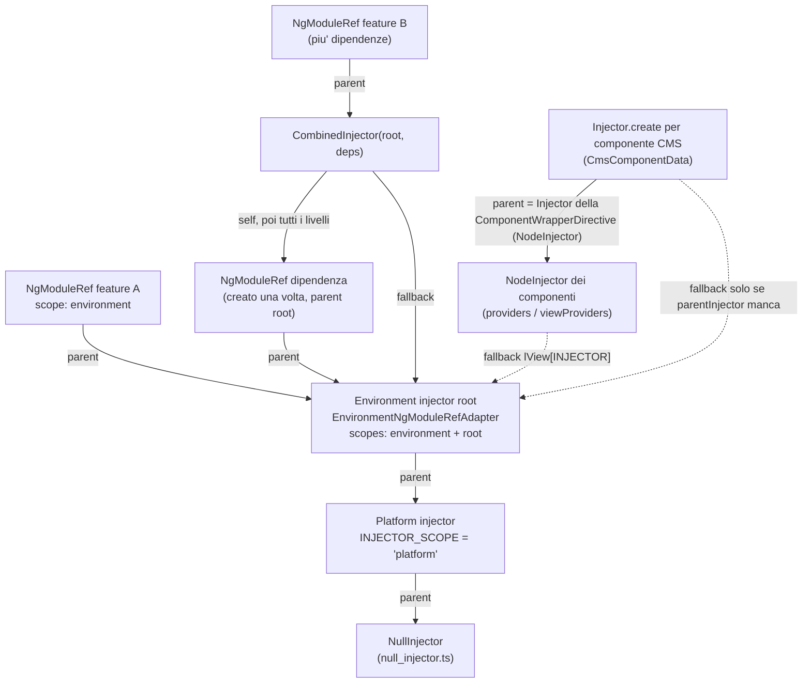
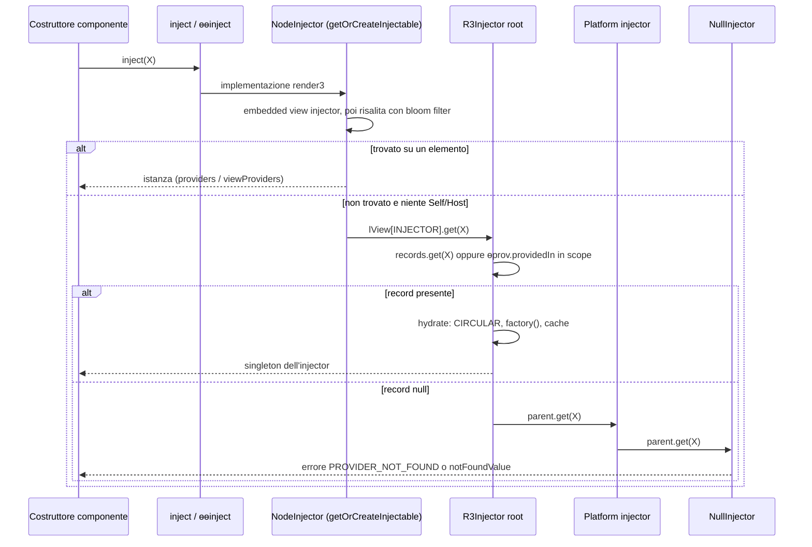
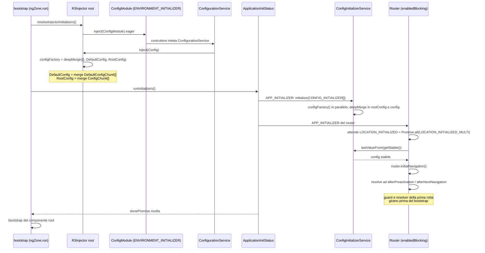
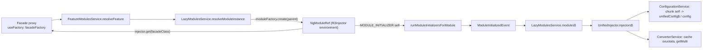

# 01 — Dependency Injection in Angular e in Spartacus

> Riferimenti allo SHA `5b7a1c2bf2808d7380bc20596d10f4fa710c3da1` (vedi [00-meta](../00-meta.md)). Sorgenti Angular: `/tmp/angular` @ `v21.2.23` (prefisso `angular:`).

## 1. A cosa serve e perché esiste

La Dependency Injection (DI) è il meccanismo con cui Angular costruisce e distribuisce le istanze di servizi, valori e funzioni: chi ha bisogno di qualcosa chiede un **token**, e un **injector** decide quale **provider** usare per produrre il valore. Spartacus è costruito quasi interamente su questo meccanismo: la configurazione globale è un token DI, i normalizer OCC sono multi provider, le facade sono provider con factory che caricano moduli lazy, gli adapter verso il backend sono classi astratte sostituibili via DI.

Capire il DI "sotto il cofano" serve, in un progetto Spartacus, a rispondere a domande molto concrete:

- perché un mio `provideConfig(...)` vince sulla config di default di una libreria? (risposta: `configFactory` fonde `RootConfig` dopo `DefaultConfig`, `core-libs/core/src/config/config-tokens.ts:L10-L12`);
- perché un mio provider `{provide: ProductAdapter, useClass: ...}` sostituisce quello OCC? (risposta: per i provider non-multi l'ultimo `records.set` vince, `angular:packages/core/src/di/r3_injector.ts:L513-L521`);
- perché un normalizer registrato in un modulo lazy non compare con `inject(PRODUCT_NORMALIZER)` nel root, eppure il `ConverterService` lo usa? (risposta: un multi token si ferma al primo injector che ha il record, `angular:packages/core/src/di/r3_injector.ts:L347-L371`; Spartacus raccoglie i multi provider di tutti gli injector con `UnifiedInjector.getMulti`, `core-libs/core/src/lazy-loading/unified-injector.ts:L79-L93`);
- perché `inject()` lancia `MISSING_INJECTION_CONTEXT` dentro un callback asincrono? (`angular:packages/core/src/di/contextual.ts:L25-L27`, `angular:packages/core/src/di/injector_compatibility.ts:L97-L103`).

Il capitolo è diviso in due metà: prima il motore di Angular 21 (injector, provider, token, contesto di iniezione, initializer), poi come Spartacus lo usa (config, `CONFIG_INITIALIZER`, converter, interceptor, `MODULE_INITIALIZER`, `UnifiedInjector`, override via DI). I dettagli completi della configurazione sono in [11 — Configurazione](../parte-2/11-configurazione.md) e quelli del lazy loading in [12 — Feature module e lazy loading](../parte-2/12-feature-module-lazy.md).

## 2. Mappa dei file

| Path | Ruolo |
|---|---|
| `angular:packages/core/src/di/injector.ts` | `Injector` astratto, `Injector.NULL`, `Injector.create` |
| `angular:packages/core/src/di/null_injector.ts` | `NullInjector`: fine della catena, lancia "No provider found" |
| `angular:packages/core/src/di/r3_injector.ts` | `EnvironmentInjector`, `R3Injector` (record, `get`, `hydrate`, multi, scope, initializer), `providerToFactory` |
| `angular:packages/core/src/di/create_injector.ts` | `createInjector`, `createInjectorWithoutInjectorInstances` |
| `angular:packages/core/src/di/scope.ts` | `InjectorScope`, `INJECTOR_SCOPE` |
| `angular:packages/core/src/di/injection_token.ts` | `InjectionToken` con `providedIn`/`factory` |
| `angular:packages/core/src/di/interface/provider.ts` | tipi `Provider`, `StaticProvider`, `EnvironmentProviders`, `ModuleWithProviders` |
| `angular:packages/core/src/di/interface/defs.ts` | `ɵɵdefineInjectable` (forma di `ɵprov`) |
| `angular:packages/core/src/di/provider_collection.ts` | `makeEnvironmentProviders`, `provideEnvironmentInitializer`, `importProvidersFrom`, `walkProviderTree`, type guard |
| `angular:packages/core/src/di/injector_compatibility.ts` | `inject`, `ɵɵinject`, `injectInjectorOnly`, `injectArgs`, `RetrievingInjector` |
| `angular:packages/core/src/di/contextual.ts` | `runInInjectionContext`, `isInInjectionContext`, `assertInInjectionContext` |
| `angular:packages/core/src/di/initializer_token.ts` | `ENVIRONMENT_INITIALIZER` (deprecato) |
| `angular:packages/core/src/render3/di.ts` | `NodeInjector`, `getOrCreateInjectable`, bloom filter, fallback al module injector |
| `angular:packages/core/src/render3/ng_module_ref.ts` | `NgModuleRef`, `NgModuleFactory`, `EnvironmentNgModuleRefAdapter`, `createEnvironmentInjector` |
| `angular:packages/core/src/application/application_init.ts` | `APP_INITIALIZER`, `provideAppInitializer`, `ApplicationInitStatus` |
| `angular:packages/core/src/application/create_application.ts` | creazione dell'env injector in `bootstrapApplication` |
| `angular:packages/core/src/platform/bootstrap.ts` | ordine environment initializer → app initializer → root component |
| `core-libs/core/src/config/config-tokens.ts` | `Config`, `DefaultConfig`, `RootConfig`, `ConfigChunk`, `DefaultConfigChunk` |
| `core-libs/core/src/config/config-providers.ts` | `provideConfig`, `provideConfigFactory`, `provideDefaultConfig`, `provideDefaultConfigFactory` |
| `core-libs/core/src/config/utils/deep-merge.ts` | `deepMerge`, semantica del merge della config |
| `core-libs/core/src/config/config.module.ts` | `ConfigModule` (`forRoot`, `withConfig`, `withConfigFactory`) |
| `core-libs/core/src/config/services/configuration.service.ts` | `ConfigurationService`: config "ambientale" dei moduli lazy |
| `core-libs/core/src/config/config-initializer/config-initializer.ts` | `ConfigInitializer`, `CONFIG_INITIALIZER`, helper |
| `core-libs/core/src/config/config-initializer/config-initializer.module.ts` | `APP_INITIALIZER` + location initializer per la config asincrona |
| `core-libs/core/src/config/config-initializer/config-initializer.service.ts` | `ConfigInitializerService` (`initialize`, `getStable`) |
| `core-libs/core/src/util/converter.service.ts` | `Converter`, `ConverterService` |
| `core-libs/core/src/util/combined-injector.ts` | `CombinedInjector` (parent multiplo per moduli lazy) |
| `core-libs/core/src/lazy-loading/tokens.ts` | `MODULE_INITIALIZER` |
| `core-libs/core/src/lazy-loading/lazy-loading.module.ts` | `MODULE_INITIALIZER` eseguiti in fase eager via `APP_INITIALIZER` |
| `core-libs/core/src/lazy-loading/lazy-modules.service.ts` | creazione degli injector dei moduli lazy |
| `core-libs/core/src/lazy-loading/unified-injector.ts` | `UnifiedInjector` (root + injector lazy) |
| `core-libs/core/src/lazy-loading/facade-factory/facade-factory.service.ts` | proxy delle facade lazy |
| `core-libs/core/src/routing/routing.module.ts` | override di `LOCATION_INITIALIZED`, `provideAppInitializer` |
| `core-libs/core/src/routing/location-initialized-multi/location-initialized-multi.ts` | `LOCATION_INITIALIZED_MULTI` e helper |
| `core-libs/core/src/base-core.module.ts` | composizione dei `forRoot()` del core (ordine degli import) |
| `projects/storefrontapp/src/app/app.config.ts` | `appConfig` dell'app demo (`importProvidersFrom(AppModule)`) |

## 3. Come funziona passo per passo

### 3.1 La gerarchia degli injector

Angular 21 ha due alberi di injector che collaborano.

**Albero "environment" (R3Injector).**

1. In cima c'è il `NullInjector`, che non risolve nulla: se gli si chiede un token con `THROW_IF_NOT_FOUND` lancia un errore `PROVIDER_NOT_FOUND` ("No provider found for ...", con `error.name = 'ɵNotFound'`), altrimenti restituisce il `notFoundValue` — `angular:packages/core/src/di/null_injector.ts:L16-L28`. Un singleton è creato pigramente da `getNullInjector()` — `angular:packages/core/src/di/r3_injector.ts:L103-L110` — ed è il parent di default quando non ne viene passato uno — `angular:packages/core/src/di/create_injector.ts:L55-L55`, `angular:packages/core/src/render3/ng_module_ref.ts:L164-L164`.
2. Il **platform injector** è creato con `Injector.create` e il provider `{provide: INJECTOR_SCOPE, useValue: 'platform'}` — `angular:packages/core/src/platform/platform.ts:L96-L105`. `Injector.create` delega a `createInjector`, che costruisce un `R3Injector` e ne risolve gli initializer — `angular:packages/core/src/di/injector.ts:L83-L118`, `angular:packages/core/src/di/create_injector.ts:L21-L35`, `angular:packages/core/src/di/create_injector.ts:L42-L55`.
3. L'**environment injector applicativo** (il "root injector") in un avvio standalone è un `EnvironmentNgModuleRefAdapter` con parent il platform injector e `runEnvironmentInitializers: false` — `angular:packages/core/src/application/create_application.ts:L64-L79`. L'adapter crea un `R3Injector` con scope `new Set(['environment'])` — `angular:packages/core/src/render3/ng_module_ref.ts:L151-L172`. Lo scope `'root'` arriva dal provider `{provide: INJECTOR_SCOPE, useValue: 'root'}` dentro `BROWSER_MODULE_PROVIDERS`, che `bootstrapApplication` antepone ai provider dell'utente — `angular:packages/platform-browser/src/browser.ts:L259-L260`, `angular:packages/platform-browser/src/browser.ts:L168-L171`. Il costruttore di `R3Injector` legge `INJECTOR_SCOPE` e aggiunge la stringa ai suoi `scopes` — `angular:packages/core/src/di/r3_injector.ts:L236-L241`.
4. Gli **injector dei moduli lazy** (Router `loadChildren`, oppure in Spartacus `LazyModulesService`) sono `NgModuleRef` il cui `R3Injector` ha scope solo `'environment'` — `angular:packages/core/src/render3/ng_module_ref.ts:L82-L95`. `NgModuleFactory.create(parentInjector)` è semplicemente `new NgModuleRef(this.moduleType, parentInjector, [])` — `angular:packages/core/src/render3/ng_module_ref.ts:L132-L134`.
5. `createEnvironmentInjector(providers, parent, debugName)` è l'API pubblica per creare a mano un environment injector figlio; a differenza del bootstrap usa `runEnvironmentInitializers: true` — `angular:packages/core/src/render3/ng_module_ref.ts:L193-L205`.

`InjectorScope` è il tipo `'root' | 'platform' | 'environment'` e `INJECTOR_SCOPE` è il token (interno) che lo imposta — `angular:packages/core/src/di/scope.ts:L11-L20`. Il costruttore registra sempre `INJECTOR` → se stesso e, se lo scope contiene `'environment'`, anche `EnvironmentInjector` → se stesso — `angular:packages/core/src/di/r3_injector.ts:L216-L234`.

**Albero degli elementi (NodeInjector).** Ogni componente/direttiva ha un `NodeInjector` legato a `(tNode, lView)`, il cui `get` delega a `getOrCreateInjectable` — `angular:packages/core/src/render3/di.ts:L893-L908`. La ricerca:

1. consulta prima gli eventuali embedded view injector (se presenti e senza `Self`) — `angular:packages/core/src/render3/di.ts:L465-L483`;
2. risale i node injector usando un bloom filter a 256 slot per scartare in fretta i nodi che non possono contenere il token — `angular:packages/core/src/render3/di.ts:L124-L136`, `angular:packages/core/src/render3/di.ts:L576-L621`; i `viewProviders` sono visibili solo dal componente o risalendo dalla sua view — `angular:packages/core/src/render3/di.ts:L637-L655`; `Self` interrompe la risalita, `Host` la interrompe all'host element — `angular:packages/core/src/render3/di.ts:L870-L877`;
3. infine ricade sul "module injector" `lView[INJECTOR]` (l'environment injector) con `setInjectImplementation(undefined)`, così i servizi dell'environment non vedono lo scope dei componenti; `Self`/`Host` impediscono questo fallback — `angular:packages/core/src/render3/di.ts:L407-L439`, `angular:packages/core/src/render3/di.ts:L491-L493`.

I `providers` e `viewProviders` di `@Component` arrivano sull'element injector attraverso `ɵɵProvidersFeature` → `providersResolver` — `angular:packages/core/src/render3/features/providers_feature.ts:L44-L56`.

### 3.2 Come un `R3Injector` risolve un token

`R3Injector extends EnvironmentInjector` e tiene una `Map<ProviderToken, Record | null>`; il valore `null` significa "so già che qui non c'è" e evita ricerche ripetute — `angular:packages/core/src/di/r3_injector.ts:L191-L197`. Un `Record` contiene `factory`, `value` e `multi` — `angular:packages/core/src/di/r3_injector.ts:L116-L120`.

Passi di `R3Injector.get(token, notFoundValue, options)` — `angular:packages/core/src/di/r3_injector.ts:L323-L422`:

1. verifica che l'injector non sia distrutto (`assertNotDestroyed`, che lancia `INJECTOR_ALREADY_DESTROYED`) — `angular:packages/core/src/di/r3_injector.ts:L328-L328`, `angular:packages/core/src/di/r3_injector.ts:L683-L690`;
2. imposta l'**injection context**: `setCurrentInjector(this)` e `setInjectImplementation(undefined)` — `angular:packages/core/src/di/r3_injector.ts:L341-L342`. È questo che rende valido `inject()` dentro le factory;
3. se non c'è `SkipSelf`, cerca il record locale — `angular:packages/core/src/di/r3_injector.ts:L344-L347`;
4. se il record manca ma il token ha un `ɵprov` il cui `providedIn` è "in scope", crea il record al volo ("Pretend as if it was here all along"); altrimenti memorizza `null` — `angular:packages/core/src/di/r3_injector.ts:L348-L367`. La regola di scope: `'any'` è sempre in scope, una stringa deve essere fra gli `scopes`, un tipo NgModule deve essere fra gli `injectorDefTypes` — `angular:packages/core/src/di/r3_injector.ts:L551-L561`, `angular:packages/core/src/di/r3_injector.ts:L243-L243`;
5. se il record c'è, `hydrate` crea l'istanza al primo accesso: imposta il marker `CIRCULAR`, invoca la factory, lancia `cyclicDependencyError` se rientra sullo stesso token, e registra l'istanza per `ngOnDestroy` se ha l'hook — `angular:packages/core/src/di/r3_injector.ts:L524-L549`, `angular:packages/core/src/di/r3_injector.ts:L86-L98`;
6. altrimenti passa al `parent` (o al `NullInjector` se c'è `Self`); con `Optional` e `notFoundValue` di default usa `null` — `angular:packages/core/src/di/r3_injector.ts:L374-L383`;
7. in caso di `CYCLIC_DI_DEPENDENCY`/`PROVIDER_NOT_FOUND`, in dev mode ogni livello antepone il token al path di dipendenza e l'ultimo formatta il messaggio — `angular:packages/core/src/di/r3_injector.ts:L384-L410`; in produzione l'errore è rilanciato senza messaggio (`new RuntimeError(errorCode, null)`) — `angular:packages/core/src/di/r3_injector.ts:L411-L413`.

Conseguenza fondamentale: **un'istanza è un singleton per injector**. Lo stesso token `providedIn: 'root'` ha un'unica istanza nell'environment injector root; un modulo lazy che ri-fornisce la classe nei propri `providers` ne crea un'altra.

`destroy()` marca l'injector come distrutto, chiama gli `ngOnDestroy` delle istanze e gli hook `onDestroy`, poi svuota i record — `angular:packages/core/src/di/r3_injector.ts:L270-L295`.

### 3.3 I provider e la loro trasformazione in factory

`Provider` è l'unione `TypeProvider | ValueProvider | ClassProvider | ConstructorProvider | ExistingProvider | FactoryProvider | any[]` — `angular:packages/core/src/di/interface/provider.ts:L336-L343`. La firma deprecata `Injector.create(providers, parent)` accetta solo `StaticProvider`, che esclude `TypeProvider`/`ClassProvider` e richiede `deps` espliciti per le classi (`StaticClassProvider`) — `angular:packages/core/src/di/injector.ts:L83-L86`, `angular:packages/core/src/di/interface/provider.ts:L258-L264`, `angular:packages/core/src/di/interface/provider.ts:L59-L71`; la firma attuale `Injector.create({providers, parent, name})` accetta invece `Array<Provider | StaticProvider>`, quindi anche classi senza `deps` — `angular:packages/core/src/di/injector.ts:L100-L104`. Tutte le forme oggetto (`ValueProvider`, `ClassProvider`, `ExistingProvider`, `FactoryProvider`, ...) hanno il flag opzionale `multi?: boolean` ("injector returns an array of instances") — `angular:packages/core/src/di/interface/provider.ts:L40-L51`; un `TypeProvider` (classe nuda) non può essere multi — `angular:packages/core/src/di/r3_injector.ts:L497-L497`.

Come vengono riconosciuti (type guard) — `angular:packages/core/src/di/provider_collection.ts:L404-L427`:

- `useValue`: per **presenza della chiave** (`USE_VALUE in value`), quindi anche `useValue: undefined` è un `ValueProvider`;
- `useExisting`, `useFactory`, `useClass`: per truthiness;
- `TypeProvider`: se il provider è una funzione (una classe).

Come diventano record — `angular:packages/core/src/di/r3_injector.ts:L624-L632`, `angular:packages/core/src/di/r3_injector.ts:L639-L681`:

| Forma | Record/factory |
|---|---|
| `useValue` | record con valore già pronto, nessuna factory (`makeRecord(undefined, provider.useValue)`) |
| `useFactory` + `deps` | `provider.useFactory(...injectArgs(provider.deps \|\| []))` |
| `useExisting` | `ɵɵinject(useExisting)` propagando solo il flag `Optional`: è un **alias**, non una nuova istanza |
| `useClass` con `deps` | `new classRef(...injectArgs(deps))` |
| `useClass` senza `deps` / `TypeProvider` | factory generata dal compilatore (`getFactoryDef`) o da `ɵprov` |

`injectArgs` risolve ogni elemento di `deps`; se un elemento è un array, i suoi membri sono letti come flag (`new Optional()`, `Self`, ...) o `@Inject(token)` più il token — `angular:packages/core/src/di/injector_compatibility.ts:L327-L362`. È la forma che Spartacus usa in `deps: [ConfigInitializerService, [new Optional(), CONFIG_INITIALIZER]]` — `core-libs/core/src/config/config-initializer/config-initializer.module.ts:L51-L58`.

Due errori tipici nascono qui: una classe senza decoratore con argomenti nel costruttore produce "Can't resolve all parameters" — `angular:packages/core/src/di/r3_injector.ts:L598-L622`; un `InjectionToken` senza `ɵprov` e senza provider produce "Token ... is missing a ɵprov definition." — `angular:packages/core/src/di/r3_injector.ts:L580-L587`.

### 3.4 Multi provider e precedenza

`processProvider` è il punto in cui si decide "chi vince" — `angular:packages/core/src/di/r3_injector.ts:L473-L522`:

1. il token è il provider stesso (per un `TypeProvider`) o `provider.provide` — `angular:packages/core/src/di/r3_injector.ts:L477-L479`;
2. se `multi: true`, crea (una sola volta per token) un record multi la cui factory è `injectArgs(multiRecord.multi)`; poi aggiunge il provider all'array `multi` e lo registra nei `records` con chiave **il provider stesso** — `angular:packages/core/src/di/r3_injector.ts:L497-L512`, `angular:packages/core/src/di/r3_injector.ts:L521-L521`. L'ordine di registrazione è quindi l'ordine dell'array finale;
3. se non è multi, `this.records.set(token, record)` **sovrascrive** il record precedente: l'ultimo provider registrato vince — `angular:packages/core/src/di/r3_injector.ts:L513-L521`;
4. mescolare multi e non-multi sullo stesso token lancia `throwMixedMultiProviderError()` solo in dev mode — `angular:packages/core/src/di/r3_injector.ts:L501-L505`, `angular:packages/core/src/di/r3_injector.ts:L514-L519`. In produzione un non-multi dopo un multi sovrascrive silenziosamente il record; un multi dopo un non-multi fa invece fallire la creazione dell'injector con un `TypeError`, perché `multiRecord.multi` è `undefined` — `angular:packages/core/src/di/r3_injector.ts:L500-L512`, `angular:packages/core/src/di/r3_injector.ts:L692-L702`.

L'ordine in cui i provider arrivano a `processProvider` dipende dall'appiattimento: `forEachSingleProvider` visita ricorsivamente array ed `EnvironmentProviders` preservando l'ordine — `angular:packages/core/src/di/r3_injector.ts:L725-L738`; per gli NgModule, `walkProviderTree` processa **prima gli `imports`** (ricorsivamente e con dedup), poi i provider dei `ModuleWithProviders` importati, poi il modulo stesso, infine i suoi `providers` — `angular:packages/core/src/di/provider_collection.ts:L292-L354`. La definizione di un NgModule importato più volte (imports, provider propri, istanziazione eager) è processata una sola volta — `angular:packages/core/src/di/provider_collection.ts:L275-L276`. I `providers` di ogni `ModuleWithProviders` vengono invece aggiunti a ogni import, anche se il modulo è già stato visto: `walkProviderTree` restituisce `true` per ogni `ModuleWithProviders` con `providers` e `processInjectorTypesWithProviders` li visita tutti — `angular:packages/core/src/di/provider_collection.ts:L360-L362`, `angular:packages/core/src/di/provider_collection.ts:L195-L208`. Più `ConfigModule.withConfig(...)` contribuiscono quindi tutti (è voluto), ma anche un `XModule.forRoot()` importato due volte registra due volte i suoi provider (per esempio un `APP_INITIALIZER` multi duplicato).

Infine il valore di un multi token è l'array dei soli provider registrati **in quell'injector**: la ricerca si ferma al primo injector che ha il record e non c'è unione con i parent — `angular:packages/core/src/di/r3_injector.ts:L347-L371`.

### 3.5 `InjectionToken` e `@Injectable`

`InjectionToken<T>` ha una descrizione usata solo per debug e un `ɵprov` opzionale — `angular:packages/core/src/di/injection_token.ts:L65-L69`, `angular:packages/core/src/di/injection_token.ts:L82-L86`. Se al costruttore si passano `options`, viene definito `ɵprov` con `providedIn: options.providedIn || 'root'`: **`'root'` è il default** — `angular:packages/core/src/di/injection_token.ts:L110-L116`. Le opzioni `providedIn: NgModule` e `'any'` sono deprecate — `angular:packages/core/src/di/injection_token.ts:L47-L47`, `angular:packages/core/src/di/injection_token.ts:L71-L80`. Due istanze diverse con la stessa descrizione sono token diversi — `angular:packages/core/src/di/injection_token.ts:L26-L29`.

`ɵɵdefineInjectable` produce `{token, providedIn, factory, value}` con `providedIn` fra `Type | 'root' | 'platform' | 'any' | 'environment' | null` — `angular:packages/core/src/di/interface/defs.ts:L167-L178`. Un token con `ɵprov` in scope viene "materializzato" alla prima richiesta (passo 4 di §3.2): non serve alcun provider esplicito.

### 3.6 `inject()`, injection context e `runInInjectionContext`

- `inject(token, options)` è `ɵɵinject(token, convertToBitFlags(options))` — `angular:packages/core/src/di/injector_compatibility.ts:L293-L297`; `convertToBitFlags` traduce `optional`/`host`/`self`/`skipSelf` nei flag interni — `angular:packages/core/src/di/injector_compatibility.ts:L300-L315`.
- `ɵɵinject` usa l'implementazione corrente (impostata da render3 per i NodeInjector) o `injectInjectorOnly` — `angular:packages/core/src/di/injector_compatibility.ts:L140-L148`.
- `injectInjectorOnly` lancia `MISSING_INJECTION_CONTEXT` se non c'è un injector corrente; altrimenti chiama `currentInjector.retrieve(...)` e, se opzionale e non trovato, restituisce `null` — `angular:packages/core/src/di/injector_compatibility.ts:L93-L120`.
- La JSDoc elenca i contesti validi: costruttore di una classe creata dal DI, field initializer, `useFactory`, `factory` di `InjectionToken`, frame dentro `runInInjectionContext`; chiamarlo in `ngOnInit` è un errore — `angular:packages/core/src/di/injector_compatibility.ts:L226-L287`.
- `runInInjectionContext(injector, fn)` imposta come injector corrente l'`R3Injector` (verificando che non sia distrutto) o un `RetrievingInjector` che adatta un `Injector` qualsiasi, esegue `fn` in modo **sincrono** e ripristina il contesto nel `finally` — `angular:packages/core/src/di/contextual.ts:L37-L59`, `angular:packages/core/src/di/injector_compatibility.ts:L49-L68`. La JSDoc avverte: niente `inject` dopo un `await` o in callback asincrone — `angular:packages/core/src/di/contextual.ts:L25-L27`.
- `isInInjectionContext()` / `assertInInjectionContext(fn)` permettono di verificarlo — `angular:packages/core/src/di/contextual.ts:L64-L88`.

### 3.7 `EnvironmentProviders`, `importProvidersFrom`, initializer

- `EnvironmentProviders` è un tipo "brandizzato" (`ɵbrand: 'EnvironmentProviders'`) accettato solo nella creazione di un `EnvironmentInjector` (e quindi anche negli NgModule), per impedirne l'uso in `@Component.providers` — `angular:packages/core/src/di/interface/provider.ts:L345-L362`. `makeEnvironmentProviders(providers)` restituisce solo `{ɵproviders: providers}` — `angular:packages/core/src/di/provider_collection.ts:L40-L52`.
- `importProvidersFrom(...sources)` restituisce `{ɵproviders: internalImportProvidersFrom(true, sources), ɵfromNgModule: true}` e in dev mode rifiuta i componenti standalone — `angular:packages/core/src/di/provider_collection.ts:L144-L174`.
- Per ogni NgModule incontrato `walkProviderTree` aggiunge **tre** provider: il modulo stesso (factory), `INJECTOR_DEF_TYPES` (multi) e un `ENVIRONMENT_INITIALIZER` `() => inject(defType)` che istanzia il modulo in modo **eager**; il commento precisa che ciò avviene dopo gli imports — `angular:packages/core/src/di/provider_collection.ts:L324-L343`.
- `ENVIRONMENT_INITIALIZER` è un multi token `ReadonlyArray<() => void>`, deprecato dalla v19 a favore di `provideEnvironmentInitializer`; le funzioni non sono attese — `angular:packages/core/src/di/initializer_token.ts:L11-L26`, `angular:packages/core/src/di/provider_collection.ts:L81-L89`. `resolveInjectorInitializers()` le legge con `{self: true}` e le esegue nell'injection context dell'injector — `angular:packages/core/src/di/r3_injector.ts:L425-L455`.
- `APP_INITIALIZER` è un `InjectionToken<ReadonlyArray<() => Observable | Promise | void>>` — `angular:packages/core/src/application/application_init.ts:L150-L152`; `provideAppInitializer(fn)` lo avvolge in `makeEnvironmentProviders` — `angular:packages/core/src/application/application_init.ts:L165-L202`; sia la JSDoc del token (`@deprecated from v19.0.0, use provideAppInitializer instead`, `angular:packages/core/src/application/application_init.ts:L38-L38`) sia quella della funzione lo dichiarano deprecato.
- `ApplicationInitStatus` (`providedIn: 'root'`) inietta `APP_INITIALIZER` opzionale (default `[]`) — `angular:packages/core/src/application/application_init.ts:L209-L236`. `runInitializers()` esegue **ogni** initializer con `runInInjectionContext`, raccoglie Promise e Observable (l'Observable deve **completare**) e risolve `donePromise` con `Promise.all` — `angular:packages/core/src/application/application_init.ts:L239-L275`.
- Nel `bootstrap`, dentro `ngZone.run`, prima si risolvono gli environment initializer e poi gli app initializer; il componente root parte solo a `donePromise` risolta — `angular:packages/core/src/platform/bootstrap.ts:L87-L93`, `angular:packages/core/src/platform/bootstrap.ts:L137-L144`.
- Con `initialNavigation: 'enabledBlocking'` il router registra un `provideAppInitializer` che attende `LOCATION_INITIALIZED` (default `Promise.resolve()`) prima della navigazione iniziale — `angular:packages/router/src/provide_router.ts:L441-L469`, `angular:packages/router/src/router_module.ts:L240-L241`.

### 3.8 Spartacus: la configurazione come grafo DI

Il cuore della config di Spartacus è in `config-tokens.ts`:

1. `Config` è una classe astratta vuota con `@Injectable({providedIn: 'root', useFactory: configFactory})` — `core-libs/core/src/config/config-tokens.ts:L14-L21`. `configFactory()` restituisce `deepMerge({}, inject(DefaultConfig), inject(RootConfig))`: **la config dell'app vince su quella di default** — `core-libs/core/src/config/config-tokens.ts:L10-L12`.
2. `DefaultConfig` e `RootConfig` sono `InjectionToken` `providedIn: 'root'` con factory che fondono rispettivamente tutti i `DefaultConfigChunk` e tutti i `ConfigChunk` (iniettati con `{optional: true}`, default `[]`) — `core-libs/core/src/config/config-tokens.ts:L23-L47`.
3. `ConfigChunk` e `DefaultConfigChunk` sono `InjectionToken<Config[]>` **senza factory**, da fornire come multi provider; la JSDoc dice di non usarli direttamente e che "all config provided in libraries should be provided as default config" — `core-libs/core/src/config/config-tokens.ts:L49-L62`.
4. Gli helper costruiscono i provider multi: `provideConfig(config, defaultConfig = false)` → `ValueProvider` su `ConfigChunk` (o `DefaultConfigChunk`), `provideConfigFactory` → `FactoryProvider`, `provideDefaultConfig` e `provideDefaultConfigFactory` → su `DefaultConfigChunk` — `core-libs/core/src/config/config-providers.ts:L18-L79`. Restituiscono `ValueProvider`/`FactoryProvider` normali, non `EnvironmentProviders` — `core-libs/core/src/config/config-providers.ts:L7-L7`.
5. `deepMerge` fonde ricorsivamente ogni valore oggetto non-array (non solo gli oggetti plain: anche le istanze di classi vengono copiate proprietà per proprietà in un `{}`, perché `isObject` controlla solo `typeof item === 'object' && !Array.isArray(item)`); `Date`, array e primitivi sono assegnati per sostituzione; `__proto__` e `constructor` sono ignorati; muta e restituisce `target` — `core-libs/core/src/config/utils/deep-merge.ts:L7-L49`.
6. Le sezioni tipizzate sono classi astratte `@Injectable({providedIn: 'root', useExisting: Config})` (es. `RoutingConfig`): iniettarle restituisce **lo stesso oggetto** `Config` — `core-libs/core/src/routing/configurable-routes/config/routing-config.ts:L22-L28`. Il tipo `Config` è esteso per module augmentation — `core-libs/core/src/routing/configurable-routes/config/routing-config.ts:L47-L49`. Il pattern `useExisting: Config` compare in 70 file (comando: `grep -rln "useExisting: Config" --include=*.ts core-libs feature-libs integration-libs | grep -v spec | wc -l`).
7. La regola ESLint `@nx/workspace-use-provide-default-config` segnala ogni `provideConfig(...)` nelle librerie: lì va usato `provideDefaultConfig()` — `tools/eslint-rules/rules/use-provide-default-config.ts:L22-L48`. `ConfigModule.withConfig` e `ConfigModule.forRoot` usano `provideConfig` (disabilitando `@nx/workspace-use-provide-default-config`); `withConfigFactory` usa `provideConfigFactory` (disabilitando `@nx/workspace-use-provide-default-config-factory`) — `core-libs/core/src/config/config.module.ts:L28-L34`, `core-libs/core/src/config/config.module.ts:L48-L52`, `core-libs/core/src/config/config.module.ts:L60-L66`.

Statistiche d'uso (comando per ciascun pattern: `grep -rF "<pattern>" --include=*.ts core-libs feature-libs integration-libs projects/storefrontapp/src | grep -v "\.spec\.ts" | wc -l`; i conteggi includono le definizioni degli helper): `provideDefaultConfig(` 397, `provideDefaultConfigFactory(` 73, `provideConfig(` 133, `provideConfigFactory(` 13, `provide: HTTP_INTERCEPTORS` 22, `MODULE_INITIALIZER` 21, `provideConfigValidator(` 6. Righe con `providedIn: 'root'` nelle librerie: 807 (`grep -rn "providedIn: 'root'" --include=*.ts core-libs feature-libs integration-libs | grep -v spec | wc -l`); righe con `new InjectionToken`: 220 (stesso comando con `"new InjectionToken"`).

### 3.9 Spartacus: config "ambientale" e moduli lazy

Un `provideDefaultConfig` dentro un modulo lazy finisce nell'injector di quel modulo, non nel root (§3.4). `ConfigurationService` (istanziato eagerly perché `ConfigModule` lo inietta nel costruttore — `core-libs/core/src/config/config.module.ts:L13-L20`) recupera questi chunk:

1. inietta `RootConfig`, `DefaultConfig`, `UnifiedInjector` e `Config`; espone `config` e `unifiedConfig$` — `core-libs/core/src/config/services/configuration.service.ts:L42-L55`;
2. `feedUnifiedConfig` combina con `zip` i `ConfigChunk` e `DefaultConfigChunk` ottenuti da `UnifiedInjector.get(token, [])` e salta la prima emissione (il root) — `core-libs/core/src/config/services/configuration.service.ts:L57-L74`;
3. `emitUnifiedConfig` ricalcola `deepMerge({}, defaultConfig, ambientDefaultConfig, ambientConfig, rootConfig)`, emette su `unifiedConfig$` e, salvo `disableConfigUpdates`, lo fonde (mutandolo) dentro `this.config` — `core-libs/core/src/config/services/configuration.service.ts:L92-L106`. La chiave `disableConfigUpdates` è deprecata e "disabled by default" — `core-libs/core/src/features-config/config/features-config.ts:L101-L116`; `isFeatureEnabled` restituisce `false` se non configurata — `core-libs/core/src/features-config/utils/feature-config-utils.ts:L48-L65`.

`UnifiedInjector` è il ponte fra il DI di Angular e i moduli lazy:

- `injectors$` emette il root injector e poi l'injector di ogni modulo lazy inizializzato — `core-libs/core/src/lazy-loading/unified-injector.ts:L32-L35`;
- `get(token, notFoundValue)` interroga il root normalmente e gli altri con `{self: true}` — `core-libs/core/src/lazy-loading/unified-injector.ts:L52-L68`;
- `getMulti(token)` accumula con `scan` gli array di tutti gli injector e lancia "Multi-providers mixed with single providers" se un valore non è un array — `core-libs/core/src/lazy-loading/unified-injector.ts:L79-L93`.

Il parent degli injector lazy è scelto da `LazyModulesService.resolveModuleInstance`: root senza dipendenze, l'injector dell'unica dipendenza, o un `CombinedInjector(root, deps)` — `core-libs/core/src/lazy-loading/lazy-modules.service.ts:L78-L108`. `CombinedInjector` cerca prima a livello `self` in tutti gli injector complementari, poi a tutti i livelli, infine nel main injector; con `{self: true}` restituisce `notFoundValue` o lancia — `core-libs/core/src/util/combined-injector.ts:L27-L72`. I moduli di dipendenza sono creati una sola volta con parent il root — `core-libs/core/src/lazy-loading/lazy-modules.service.ts:L115-L129`.

### 3.10 Spartacus: `CONFIG_INITIALIZER`, config asincrona prima del bootstrap

1. `ConfigInitializer` è `{scopes: string[]; configFactory: () => Promise<Config>}` e `CONFIG_INITIALIZER` è il multi token che li raccoglie — `core-libs/core/src/config/config-initializer/config-initializer.ts:L15-L35`. Helper: `provideConfigInitializer(Class)` (`ClassProvider` multi) e `provideConfigInitializerFactory(fn)` (`FactoryProvider` multi, la factory può restituire `null`) — `core-libs/core/src/config/config-initializer/config-initializer.ts:L46-L67`.
2. `ConfigInitializerModule.forRoot()` fornisce il guard `CONFIG_INITIALIZER_FORROOT_GUARD = true`, un `APP_INITIALIZER` multi con `deps: [ConfigInitializerService, [new Optional(), CONFIG_INITIALIZER]]` e un location initializer che "Hold on the initial navigation until the Spartacus configuration is stable" — `core-libs/core/src/config/config-initializer/config-initializer.module.ts:L41-L67`. La factory dell'`APP_INITIALIZER` restituisce `() => configInitializer.initialize(initializers)` — `core-libs/core/src/config/config-initializer/config-initializer.module.ts:L24-L30`.
3. `initialize()` ignora gli initializer `null`, lancia se uno non ha `scopes`, avvia tutte le `configFactory()` in parallelo e per ognuna fonde il risultato in `rootConfig` **e** in `config` (mutandoli), poi chiude i suoi scope — `core-libs/core/src/config/config-initializer/config-initializer.service.ts:L130-L175`.
4. `isStable` è vero se il guard manca o se non ci sono scope in corso; `getStable(...scopes)` restituisce subito `of(this.config)` se stabile, altrimenti attende — `core-libs/core/src/config/config-initializer/config-initializer.service.ts:L42-L44`, `core-libs/core/src/config/config-initializer/config-initializer.service.ts:L58-L70`.
5. `RoutingModule.forRoot()` sostituisce il token Angular `LOCATION_INITIALIZED` con `locationInitializedFactory`, che invoca tutti i `LOCATION_INITIALIZED_MULTI` e restituisce `Promise.all` — `core-libs/core/src/routing/routing.module.ts:L66-L71`, `core-libs/core/src/routing/routing.module.ts:L102-L105`. L'`AppRoutingModule` di storefront configura `initialNavigation: 'enabledBlocking'` — `core-libs/storefront/router/app-routing.module.ts:L13-L19`. Così la navigazione iniziale attende la config stabile.
6. Esempi di `CONFIG_INITIALIZER`: `SiteContextModule.forRoot()` registra `initSiteContextConfig`, che restituisce `SiteContextConfigInitializer` solo se manca una config statica per `context.baseSite`, altrimenti `null` — `core-libs/core/src/site-context/site-context.module.ts:L30-L61`; `SiteContextConfigInitializer` ha `scopes = ['context']` — `core-libs/core/src/site-context/config/config-loader/site-context-config-initializer.ts:L24-L27`.

### 3.11 Spartacus: altri multi provider e override via DI

- **Converter.** Un converter è un `Converter<S, T>` con `convert(source, target?)` — `core-libs/core/src/util/converter.service.ts:L13-L30`; è identificato da un `InjectionToken` (es. `PRODUCT_NORMALIZER`) — `core-libs/core/src/product/connectors/product/converters.ts:L11-L13` — e fornito come multi provider `useExisting` — `core-libs/core/src/occ/adapters/product/product-occ.module.ts:L42-L51`. `ConverterService` svuota la cache a ogni nuovo injector lazy, legge i converter con `getLastValueSync(unifiedInjector.getMulti(token))` e li applica in sequenza con `reduce` — `core-libs/core/src/util/converter.service.ts:L32-L65`, `core-libs/core/src/util/converter.service.ts:L130-L137`. `getLastValueSync` sottoscrive, prende l'ultimo valore sincrono e annulla — `core-libs/core/src/util/rxjs/get-last-value-sync.ts:L19-L23`.
- **Interceptor HTTP.** Registrati come multi provider `useExisting` su `HTTP_INTERCEPTORS` — `core-libs/core/src/auth/user-auth/http-interceptors/index.ts:L12-L23`; l'app demo li abilita con `provideHttpClient(withFetch(), withInterceptorsFromDi())` — `projects/storefrontapp/src/app/app.config.ts:L26-L35`. `ErrorHandlingModule.forRoot()` è importato per primo in `BaseCoreModule` proprio perché l'ordine di registrazione determina l'ordine nell'array — `core-libs/core/src/base-core.module.ts:L28-L28`, `angular:packages/core/src/di/r3_injector.ts:L512-L512`. Dettagli in [06 — HttpClient e interceptor](06-httpclient-interceptor.md).
- **Adapter.** Classi astratte (es. `ProductAdapter`) legate all'implementazione OCC con `{provide: ProductAdapter, useClass: OccProductAdapter}` — `core-libs/core/src/product/connectors/product/product.adapter.ts:L11-L11`, `core-libs/core/src/occ/adapters/product/product-occ.module.ts:L34-L37`: un provider successivo sullo stesso token le sostituisce (§3.4).
- **Facade lazy.** Le facade sono classi astratte `@Injectable({providedIn: 'root', useFactory: () => facadeFactory({...})})` — `feature-libs/cart/base/root/facade/active-cart.facade.ts:L13-L18`; `facadeFactory` chiama `inject(FacadeFactoryService)` e va quindi usata in un injection context — `core-libs/core/src/lazy-loading/facade-factory/facade-factory.ts:L20-L24`. Il modulo lazy ridefinisce la facade nel proprio injector con `useExisting: ActiveCartService` e il proxy la ottiene con `moduleRef.injector.get(facadeClass)` — `feature-libs/cart/base/core/facade/facade-providers.ts:L27-L30`, `core-libs/core/src/lazy-loading/facade-factory/facade-factory.service.ts:L49-L52`.
- **`MODULE_INITIALIZER`.** "In a way, an APP_INITIALIZER for lazy loaded modules" — `core-libs/core/src/lazy-loading/tokens.ts:L9-L20`. Se il modulo è eager, `LazyLoadingModule.forRoot()` li esegue in un `APP_INITIALIZER` — `core-libs/core/src/lazy-loading/lazy-loading.module.ts:L18-L52`; se è lazy, `runModuleInitializersForModule` li legge con `{self: true}` e li esegue — `core-libs/core/src/lazy-loading/lazy-modules.service.ts:L150-L175`. Esempio: `AsmCoreModule` — `feature-libs/asm/core/asm-core.module.ts:L22-L35`.
- **Injector "a mano".** `CmsInjectorService.getInjector` crea con `Injector.create` un injector figlio per ogni componente CMS, con `CmsComponentData` e i `providers` del mapping CMS — `core-libs/storefront/cms-structure/page/component/services/cms-injector.service.ts:L28-L50`.
- **Multi token con default.** `BEFORE_CMS_PAGE_GUARD` ha `providedIn: 'root', factory: () => []`, quindi vale `[]` finché nessuno fornisce provider — `core-libs/storefront/cms-structure/guards/before-cms-page-guard.token.ts:L22-L24`.

### 3.12 Il bootstrap dell'app demo, visto dal DI

`main.ts` chiama `bootstrapApplication(AppComponent, appConfig)` — `projects/storefrontapp/src/main.ts:L17-L17`; `appConfig.providers` contiene i provider funzionali di Angular e `importProvidersFrom(AppModule)` — `projects/storefrontapp/src/app/app.config.ts:L26-L35`. L'env injector riceve, in ordine, i provider interni, `BROWSER_MODULE_PROVIDERS` e poi quelli di `appConfig` — `angular:packages/core/src/application/create_application.ts:L66-L71`, `angular:packages/platform-browser/src/browser.ts:L171-L171`. `AppModule` importa `SpartacusModule` e mette nei propri `providers` un `EnvironmentProviders` (`privateProviders`, costruito con `makeEnvironmentProviders` e contenente un `provideConfig` per il backend OCC) — `projects/storefrontapp/src/app/app.module.ts:L15-L25`, `projects/storefrontapp/src/app/private/private.providers.ts:L19-L30`. Per la regola di §3.4, questi `providers` sono processati dopo tutti gli import del modulo. L'ordine completo di avvio è nel [capitolo 10](../parte-2/10-bootstrap-inizializzazione.md).

## 4. Diagrammi

### 4.1 Gerarchia degli injector in un'app Spartacus



Riferimenti: `NullInjector` e parent di default (`angular:packages/core/src/di/r3_injector.ts:L103-L110`), platform (`angular:packages/core/src/platform/platform.ts:L96-L105`), root (`angular:packages/core/src/application/create_application.ts:L72-L79`, `angular:packages/platform-browser/src/browser.ts:L259-L260`), moduli lazy e `CombinedInjector` (`core-libs/core/src/lazy-loading/lazy-modules.service.ts:L85-L94`, `core-libs/core/src/util/combined-injector.ts:L53-L70`), dipendenze (`core-libs/core/src/lazy-loading/lazy-modules.service.ts:L115-L129`), fallback dei NodeInjector (`angular:packages/core/src/render3/di.ts:L418-L436`), injector CMS (`core-libs/storefront/cms-structure/page/component/services/cms-injector.service.ts:L35-L49`; il parent è l'`Injector` iniettato nella `ComponentWrapperDirective`, `core-libs/storefront/cms-structure/page/component/component-wrapper.directive.ts:L59-L59`, `core-libs/storefront/cms-structure/page/component/component-wrapper.directive.ts:L94-L98`; il fallback al root `parentInjector ?? this.injector` è a `core-libs/storefront/cms-structure/page/component/services/cms-injector.service.ts:L48-L48`).

### 4.2 Risoluzione di `inject(X)` da un componente



Riferimenti: `angular:packages/core/src/di/injector_compatibility.ts:L140-L148`, `angular:packages/core/src/render3/di.ts:L457-L494`, `angular:packages/core/src/render3/di.ts:L407-L439`, `angular:packages/core/src/di/r3_injector.ts:L344-L383`, `angular:packages/core/src/di/r3_injector.ts:L524-L549`, `angular:packages/core/src/di/null_injector.ts:L16-L28`.

### 4.3 Costruzione di `Config` e config asincrona al bootstrap



Riferimenti: `angular:packages/core/src/platform/bootstrap.ts:L87-L93`, `angular:packages/core/src/di/provider_collection.ts:L339-L343`, `core-libs/core/src/config/config.module.ts:L13-L20`, `core-libs/core/src/config/config-tokens.ts:L10-L47`, `angular:packages/core/src/application/application_init.ts:L239-L275`, `core-libs/core/src/config/config-initializer/config-initializer.module.ts:L24-L67`, `core-libs/core/src/config/config-initializer/config-initializer.service.ts:L130-L175`, `angular:packages/router/src/provide_router.ts:L441-L469`, `core-libs/core/src/routing/routing.module.ts:L66-L71`, `angular:packages/core/src/platform/bootstrap.ts:L137-L144`.

### 4.4 Propagazione DI quando si carica una feature lazy



Riferimenti: `feature-libs/cart/base/root/facade/active-cart.facade.ts:L13-L18`, `core-libs/core/src/lazy-loading/facade-factory/facade-factory.service.ts:L49-L52`, `core-libs/core/src/lazy-loading/feature-modules.service.ts:L42-L73`, `core-libs/core/src/lazy-loading/lazy-modules.service.ts:L96-L107`, `core-libs/core/src/lazy-loading/lazy-modules.service.ts:L150-L175`, `core-libs/core/src/lazy-loading/lazy-modules.service.ts:L47-L68`, `core-libs/core/src/lazy-loading/unified-injector.ts:L32-L35`, `core-libs/core/src/config/services/configuration.service.ts:L57-L106`, `core-libs/core/src/util/converter.service.ts:L32-L65`.

## 5. Estratti di codice reale

### 5.1 Il punto in cui "l'ultimo vince" e i multi si accumulano

`angular:packages/core/src/di/r3_injector.ts:L497-L521`
```ts
    if (!isTypeProvider(provider) && provider.multi === true) {
      // If the provider indicates that it's a multi-provider, process it specially.
      // First check whether it's been defined already.
      let multiRecord = this.records.get(token);
      if (multiRecord) {
        // It has. Throw a nice error if
        if (ngDevMode && multiRecord.multi === undefined) {
          throwMixedMultiProviderError();
        }
      } else {
        multiRecord = makeRecord(undefined, NOT_YET, true);
        multiRecord.factory = () => injectArgs(multiRecord!.multi!);
        this.records.set(token, multiRecord);
      }
      token = provider;
      multiRecord.multi!.push(provider);
    } else {
      if (ngDevMode) {
        const existing = this.records.get(token);
        if (existing && existing.multi !== undefined) {
          throwMixedMultiProviderError();
        }
      }
    }
    this.records.set(token, record);
```

Da notare: per un multi provider `token = provider` prima di `records.set`, quindi il record è indicizzato dal provider (che a sua volta viene risolto come "token" da `injectArgs`); per un non-multi `records.set(token, record)` rimpiazza silenziosamente.

### 5.2 Lookup locale, `providedIn` e risalita al parent

`angular:packages/core/src/di/r3_injector.ts:L344-L383`
```ts
      // Check for the SkipSelf flag.
      if (!(flags & InternalInjectFlags.SkipSelf)) {
        // SkipSelf isn't set, check if the record belongs to this injector.
        let record: Record<T> | undefined | null = this.records.get(token);
        if (record === undefined) {
          // No record, but maybe the token is scoped to this injector. Look for an injectable
          // def with a scope matching this injector.
          const def = couldBeInjectableType(token) && getInjectableDef(token);
          if (def && this.injectableDefInScope(def)) {
            // Found an injectable def and it's scoped to this injector. Pretend as if it was here
            // all along.
            // ...
            record = makeRecord(injectableDefOrInjectorDefFactory(token), NOT_YET);
          } else {
            record = null;
          }
          this.records.set(token, record);
        }
        // If a record was found, get the instance for it and return it.
        if (record != null /* NOT null || undefined */) {
          return this.hydrate(token, record, flags);
        }
      }

      // Select the next injector based on the Self flag - if self is set, the next injector is
      // the NullInjector, otherwise it's the parent.
      const nextInjector = !(flags & InternalInjectFlags.Self) ? this.parent : getNullInjector();
      // ...
      return nextInjector.get(token, notFoundValue);
```

### 5.3 `useFactory`, `useExisting`, `useClass`

`angular:packages/core/src/di/r3_injector.ts:L653-L678`
```ts
    if (isValueProvider(provider)) {
      factory = () => resolveForwardRef(provider.useValue);
    } else if (isFactoryProvider(provider)) {
      factory = () => provider.useFactory(...injectArgs(provider.deps || []));
    } else if (isExistingProvider(provider)) {
      factory = (_, flags) =>
        ɵɵinject(
          resolveForwardRef(provider.useExisting),
          flags !== undefined && flags & InternalInjectFlags.Optional
            ? InternalInjectFlags.Optional
            : undefined,
        );
    } else {
      const classRef = resolveForwardRef(
        provider &&
          ((provider as StaticClassProvider | ClassProvider).useClass || provider.provide),
      );
      // ...
      if (hasDeps(provider)) {
        factory = () => new classRef(...injectArgs(provider.deps));
      } else {
        return getFactoryDef(classRef) || injectableDefOrInjectorDefFactory(classRef);
      }
    }
```

### 5.4 `InjectionToken`: `'root'` è il default

`angular:packages/core/src/di/injection_token.ts:L110-L116`
```ts
    } else if (options !== undefined) {
      this.ɵprov = ɵɵdefineInjectable({
        token: this,
        providedIn: options.providedIn || 'root',
        factory: options.factory,
      });
    }
```

### 5.5 `runInInjectionContext`

`angular:packages/core/src/di/contextual.ts:L37-L59`
```ts
export function runInInjectionContext<ReturnT>(injector: Injector, fn: () => ReturnT): ReturnT {
  let internalInjector: PrimitivesInjector;
  if (injector instanceof R3Injector) {
    assertNotDestroyed(injector);
    internalInjector = injector;
  } else {
    internalInjector = new RetrievingInjector(injector);
  }
  // ...
  const prevInjector = setCurrentInjector(internalInjector);
  const previousInjectImplementation = setInjectImplementation(undefined);
  try {
    return fn();
  } finally {
    setCurrentInjector(prevInjector);
    ngDevMode && setInjectorProfilerContext(prevInjectorProfilerContext!);
    setInjectImplementation(previousInjectImplementation);
  }
}
```

### 5.6 Ogni NgModule viene istanziato eagerly

`angular:packages/core/src/di/provider_collection.ts:L324-L344`
```ts
    if (!isDuplicate) {
      // Track the InjectorType and add a provider for it.
      // It's important that this is done after the def's imports.
      const factory = getFactoryDef(defType) || (() => new defType!());
      // ...
      // Provider to create `defType` using its factory.
      visitor({provide: defType, useFactory: factory, deps: EMPTY_ARRAY}, defType);

      // Make this `defType` available to an internal logic that calculates injector scope.
      visitor({provide: INJECTOR_DEF_TYPES, useValue: defType, multi: true}, defType);

      // Provider to eagerly instantiate `defType` via `INJECTOR_INITIALIZER`.
      visitor(
        {provide: ENVIRONMENT_INITIALIZER, useValue: () => inject(defType!), multi: true},
        defType,
      );
    }
```

### 5.7 Gli app initializer

`angular:packages/core/src/application/application_init.ts:L244-L255`
```ts
    const asyncInitPromises = [];
    for (const appInits of this.appInits) {
      const initResult = runInInjectionContext(this.injector, appInits);
      if (isPromise(initResult)) {
        asyncInitPromises.push(initResult);
      } else if (isSubscribable(initResult)) {
        const observableAsPromise = new Promise<void>((resolve, reject) => {
          initResult.subscribe({complete: resolve, error: reject});
        });
        asyncInitPromises.push(observableAsPromise);
      }
    }
```

### 5.8 I token della configurazione di Spartacus

`core-libs/core/src/config/config-tokens.ts:L10-L47`
```ts
export function configFactory() {
  return deepMerge({}, inject(DefaultConfig), inject(RootConfig));
}

/**
 * Global Configuration, can be used to inject configuration to any part of the app
 */
@Injectable({
  providedIn: 'root',
  useFactory: configFactory,
})
export abstract class Config {}

export function defaultConfigFactory() {
  return deepMerge(
    {},
    ...(inject(DefaultConfigChunk, { optional: true }) ?? [])
  );
}
// ...
export const DefaultConfig = new InjectionToken('DefaultConfiguration', {
  providedIn: 'root',
  factory: defaultConfigFactory,
});

export function rootConfigFactory() {
  return deepMerge({}, ...(inject(ConfigChunk, { optional: true }) ?? []));
}
// ...
export const RootConfig = new InjectionToken('RootConfiguration', {
  providedIn: 'root',
  factory: rootConfigFactory,
});
```

### 5.9 `provideConfig` è solo un multi provider

`core-libs/core/src/config/config-providers.ts:L18-L27`
```ts
export function provideConfig(
  config: Config = {},
  defaultConfig = false
): ValueProvider {
  return {
    provide: defaultConfig ? DefaultConfigChunk : ConfigChunk,
    useValue: config,
    multi: true,
  };
}
```

### 5.10 `UnifiedInjector`: root normale, lazy solo `self`

`core-libs/core/src/lazy-loading/unified-injector.ts:L52-L68`
```ts
  get<T>(
    token: Type<T> | InjectionToken<T> | AbstractType<T>,
    notFoundValue?: T
  ): Observable<T> {
    return this.injectors$.pipe(
      map((injector, index) =>
        injector.get<T>(
          token,
          notFoundValue ?? NOT_FOUND_SYMBOL,
          // we want to get only Self instances from all injectors except the
          // first one, which is a root injector
          index ? { self: true } : undefined
        )
      ),
      filter((instance) => instance !== NOT_FOUND_SYMBOL)
    );
  }
```

### 5.11 Il parent di un modulo lazy

`core-libs/core/src/lazy-loading/lazy-modules.service.ts:L83-L98`
```ts
    let parentInjector: Injector;

    if (!dependencyModuleRefs.length) {
      parentInjector = this.injector;
    } else if (dependencyModuleRefs.length === 1) {
      parentInjector = dependencyModuleRefs[0].injector;
    } else {
      parentInjector = new CombinedInjector(
        this.injector,
        dependencyModuleRefs.map((moduleRef) => moduleRef.injector)
      );
    }

    return this.resolveModuleFactory(moduleFunc).pipe(
      map(([moduleFactory]) => moduleFactory.create(parentInjector)),
      concatMap((moduleRef) => this.runModuleInitializersForModule(moduleRef)),
```

### 5.12 `CONFIG_INITIALIZER` e location initializer

`core-libs/core/src/config/config-initializer/config-initializer.module.ts:L46-L64`
```ts
      providers: [
        {
          provide: CONFIG_INITIALIZER_FORROOT_GUARD,
          useValue: true,
        },
        {
          provide: APP_INITIALIZER,
          multi: true,
          useFactory: configInitializerFactory,
          deps: [
            ConfigInitializerService,
            [new Optional(), CONFIG_INITIALIZER],
          ],
        },
        provideLocationInitializerFactory(() => {
          // Hold on the initial navigation until the Spartacus configuration is stable
          const configInitializer = inject(ConfigInitializerService);
          return () => lastValueFrom(configInitializer.getStable());
        }),
```

### 5.13 Facade: provider root con factory, override nel modulo lazy

`feature-libs/cart/base/root/facade/active-cart.facade.ts:L13-L18`
```ts
@Injectable({
  providedIn: 'root',
  useFactory: () =>
    facadeFactory({
      facade: ActiveCartFacade,
      feature: CART_BASE_CORE_FEATURE,
```

`feature-libs/cart/base/core/facade/facade-providers.ts:L25-L30`
```ts
export const facadeProviders: Provider[] = [
  ActiveCartService,
  {
    provide: ActiveCartFacade,
    useExisting: ActiveCartService,
  },
```

## 6. Configurazione

Nel contesto DI la "configurazione" sono i token stessi. Tabella dei token rilevanti:

| Chiave | Tipo | Default | Definita in | Letta in |
|---|---|---|---|---|
| `Config` | classe astratta (token, augmentable) | `deepMerge({}, DefaultConfig, RootConfig)` | `core-libs/core/src/config/config-tokens.ts:L10-L21` | ovunque; es. `core-libs/core/src/config/services/configuration.service.ts:L46-L48` |
| `DefaultConfig` | `InjectionToken` root con factory | merge dei `DefaultConfigChunk` | `core-libs/core/src/config/config-tokens.ts:L23-L35` | `core-libs/core/src/config/config-tokens.ts:L11-L11`, `core-libs/core/src/config/services/configuration.service.ts:L44-L44` |
| `RootConfig` | `InjectionToken` root con factory | merge dei `ConfigChunk` | `core-libs/core/src/config/config-tokens.ts:L37-L47` | `core-libs/core/src/config/config-tokens.ts:L11-L11`, `core-libs/core/src/config/config-initializer/config-initializer.service.ts:L32-L32` |
| `ConfigChunk` | `InjectionToken<Config[]>` multi | nessuno (letto `optional` → `[]`) | `core-libs/core/src/config/config-tokens.ts:L53-L53` | `core-libs/core/src/config/config-tokens.ts:L38-L38`, `core-libs/core/src/config/services/configuration.service.ts:L58-L61` |
| `DefaultConfigChunk` | `InjectionToken<Config[]>` multi | nessuno (letto `optional` → `[]`) | `core-libs/core/src/config/config-tokens.ts:L60-L62` | `core-libs/core/src/config/config-tokens.ts:L26-L26`, `core-libs/core/src/config/services/configuration.service.ts:L62-L65` |
| `CONFIG_INITIALIZER` | `InjectionToken<ConfigInitializer \| null>` multi | letto con `new Optional()` | `core-libs/core/src/config/config-initializer/config-initializer.ts:L33-L35` | `core-libs/core/src/config/config-initializer/config-initializer.module.ts:L55-L58` |
| `CONFIG_INITIALIZER_FORROOT_GUARD` | `InjectionToken<void>` | assente → `isStable` vero | `core-libs/core/src/config/config-initializer/config-initializer.ts:L37-L39` | `core-libs/core/src/config/config-initializer/config-initializer.service.ts:L42-L44` |
| `MODULE_INITIALIZER` | `InjectionToken<(() => any)[]>` multi | `[]` (lazy, self) / optional (eager) | `core-libs/core/src/lazy-loading/tokens.ts:L19-L20` | `core-libs/core/src/lazy-loading/lazy-modules.service.ts:L153-L157`, `core-libs/core/src/lazy-loading/lazy-loading.module.ts:L47-L47` |
| `LOCATION_INITIALIZED_MULTI` | `InjectionToken<LocationInitializer[]>` multi | optional → `[]` | `core-libs/core/src/routing/location-initialized-multi/location-initialized-multi.ts:L36-L38` | `core-libs/core/src/routing/routing.module.ts:L66-L71` |
| `ConfigValidatorToken` | `InjectionToken` multi | optional | `core-libs/core/src/config/config-validator/config-validator.ts:L11-L13` | `core-libs/core/src/config/config-validator/config-validator.module.ts:L55-L58` |
| `features.disableConfigUpdates` | `boolean` (deprecata) | `false` (non configurata) | `core-libs/core/src/features-config/config/features-config.ts:L101-L116` | `core-libs/core/src/config/services/configuration.service.ts:L103-L103` |
| `context.baseSite` (statico) | config | se presente disattiva `SiteContextConfigInitializer` | — | `core-libs/core/src/site-context/site-context.module.ts:L37-L40` |
| Angular `APP_INITIALIZER` | `InjectionToken<ReadonlyArray<fn>>` multi | optional → `[]` | `angular:packages/core/src/application/application_init.ts:L150-L152` | `angular:packages/core/src/application/application_init.ts:L223-L223` |
| Angular `ENVIRONMENT_INITIALIZER` | `InjectionToken<ReadonlyArray<() => void>>` multi | `EMPTY_ARRAY` (self) | `angular:packages/core/src/di/initializer_token.ts:L24-L26` | `angular:packages/core/src/di/r3_injector.ts:L436-L436` |
| Angular `INJECTOR_SCOPE` | `InjectionToken<InjectorScope \| null>` | — | `angular:packages/core/src/di/scope.ts:L18-L20` | `angular:packages/core/src/di/r3_injector.ts:L238-L241` |

## 7. Commenti e note notevoli dal sorgente

- `@deprecated from v19.0.0, use provideEnvironmentInitializer instead` (`ENVIRONMENT_INITIALIZER`) — `angular:packages/core/src/di/initializer_token.ts:L15-L15`.
- "Previously, this was achieved using the `APP_INITIALIZER` token which is now deprecated." — `angular:packages/core/src/application/application_init.ts:L167-L167`. Anche la costante `APP_INITIALIZER` (`angular:packages/core/src/application/application_init.ts:L150-L152`) porta il tag `@deprecated from v19.0.0, use provideAppInitializer instead` — `angular:packages/core/src/application/application_init.ts:L38-L38`; Spartacus la usa ancora in molti `forRoot()` (es. `core-libs/core/src/config/config-initializer/config-initializer.module.ts:L51-L58`).
- `@deprecated use the standalone function runInInjectionContext instead` (`EnvironmentInjector.runInContext`) — `angular:packages/core/src/di/r3_injector.ts:L174-L174`.
- `@deprecated from v5 use the new signature Injector.create(options)` — `angular:packages/core/src/di/injector.ts:L83-L86`.
- `// TODO: improve the typings here.` / "`token` can be a multi: true provider definition, which is considered as a Token but not represented in the typings" — `angular:packages/core/src/di/injector_compatibility.ts:L108-L109`. È la conferma, lato `inject`, che per i multi provider il provider stesso fa da chiave (§5.1).
- "General rule is, that all config provided in libraries should be provided as default config." — `core-libs/core/src/config/config-tokens.ts:L58-L58`.
- "To make sure ConfigurationService will be instantiated, we inject it into module constructor" — `core-libs/core/src/config/config.module.ts:L15-L17`.
- "We need to use subscription to propagate changes to the config from the beginning. It will be possible to make it lazy, when we drop this compatibility feature" — `core-libs/core/src/config/services/configuration.service.ts:L51-L54`.
- "@internal Not a part of a public API, used by APP_INITIALIZER to initialize all provided CONFIG_INITIALIZERS" — `core-libs/core/src/config/config-initializer/config-initializer.service.ts:L124-L130`.
- "CAUTION: The injection context is lost after leaving the synchronous execution, so any injections must be performed before moving into asynchronous execution." — `core-libs/core/src/routing/location-initialized-multi/location-initialized-multi.ts:L18-L20`. Unica menzione di `runInInjectionContext` nelle librerie (comando: `grep -rn "runInInjectionContext" --include=*.ts core-libs feature-libs integration-libs | grep -v spec` → 1 riga).
- "CAUTION: Don't use Router and don't perform any Router navigation in its implementations." — `core-libs/core/src/routing/location-initialized-multi/location-initialized-multi.ts:L33-L34`.
- `// using compiler here is for jit compatibility, there is no overhead for aot production builds as it will be stubbed` — `core-libs/core/src/lazy-loading/lazy-modules.service.ts:L228-L230`. In Angular 21 `compileModuleAsync` è `Promise.resolve(this.compileModuleSync(moduleType))` — `angular:packages/core/src/linker/compiler.ts:L64-L66`.
- `ErrorHandlingModule.forRoot(), // Import this module before any other interceptor to handle HTTP errors efficiently` — `core-libs/core/src/base-core.module.ts:L28-L28`.

## 8. Extension point

| Extension point | Meccanismo DI | Definizione | Ricetta |
|---|---|---|---|
| Config dell'app | multi `ConfigChunk` via `provideConfig`/`provideConfigFactory` | `core-libs/core/src/config/config-providers.ts:L18-L48` | [50 — Ricette config/DI](../parte-3/50-ricette-config-di.md) |
| Config di default di una libreria | multi `DefaultConfigChunk` via `provideDefaultConfig`/`provideDefaultConfigFactory` | `core-libs/core/src/config/config-providers.ts:L55-L79` | [50](../parte-3/50-ricette-config-di.md), [53 — feature lib lazy](../parte-3/53-ricette-feature-cart-checkout-stili-i18n.md) |
| Config asincrona | multi `CONFIG_INITIALIZER` via `provideConfigInitializer(Factory)` | `core-libs/core/src/config/config-initializer/config-initializer.ts:L46-L67` | [50](../parte-3/50-ricette-config-di.md) |
| Validazione config | multi `ConfigValidatorToken` via `provideConfigValidator` | `core-libs/core/src/config/config-validator/config-validator.ts:L27-L35` | [50](../parte-3/50-ricette-config-di.md) |
| Sostituire un servizio/adapter | provider non-multi sullo stesso token (ultimo vince) | `angular:packages/core/src/di/r3_injector.ts:L513-L521`, es. `core-libs/core/src/occ/adapters/product/product-occ.module.ts:L34-L37` | [50](../parte-3/50-ricette-config-di.md), [52 — OCC](../parte-3/52-ricette-occ-dati.md) |
| Aggiungere un converter | multi provider su `*_NORMALIZER`/`*_SERIALIZER` | `core-libs/core/src/occ/adapters/product/product-occ.module.ts:L42-L51`, `core-libs/core/src/util/converter.service.ts:L130-L137` | [52](../parte-3/52-ricette-occ-dati.md) |
| Interceptor HTTP | multi `HTTP_INTERCEPTORS` (`withInterceptorsFromDi()`) | `core-libs/core/src/auth/user-auth/http-interceptors/index.ts:L12-L23` | [50](../parte-3/50-ricette-config-di.md) |
| Inizializzazione di un modulo lazy | multi `MODULE_INITIALIZER` | `core-libs/core/src/lazy-loading/tokens.ts:L19-L20` | [53](../parte-3/53-ricette-feature-cart-checkout-stili-i18n.md) |
| Facade lazy | `useFactory: () => facadeFactory(...)` + `useExisting` nel modulo lazy | `core-libs/core/src/lazy-loading/facade-factory/facade-factory.ts:L20-L24`, `feature-libs/cart/base/core/facade/facade-providers.ts:L27-L30` | [50](../parte-3/50-ricette-config-di.md), [53](../parte-3/53-ricette-feature-cart-checkout-stili-i18n.md) |
| Attendere prima della navigazione iniziale | multi `LOCATION_INITIALIZED_MULTI` via `provideLocationInitializer(Factory)` | `core-libs/core/src/routing/location-initialized-multi/location-initialized-multi.ts:L43-L62` | [50](../parte-3/50-ricette-config-di.md) |
| Provider per un singolo componente CMS | `providers` del mapping `cmsComponents` → `Injector.create` | `core-libs/storefront/cms-structure/page/component/services/cms-injector.service.ts:L33-L48` | [51 — CMS/outlet](../parte-3/51-ricette-cms-outlet-layout.md) |

Quali simboli sono API pubblica (e quindi sicuri da usare negli override) è discusso in [54 — upgrade-safe](../parte-3/54-upgrade-safe.md). Due note verificate qui:

- `CONFIG_INITIALIZER_FORROOT_GUARD` non è riesportato dal barrel `core-libs/core/src/config/config-initializer/index.ts` — `core-libs/core/src/config/config-initializer/index.ts:L7-L14`.
- `CombinedInjector` non è riesportato da `core-libs/core/src/util/index.ts` (che esporta `./converter.service`) ed è usato solo da `LazyModulesService` — `core-libs/core/src/util/index.ts:L11-L11`, `core-libs/core/src/lazy-loading/lazy-modules.service.ts:L30-L30`.

Esempio illustrativo (non presente nel repo; usa solo simboli esportati da `@spartacus/core` e `@angular/core` citati sopra) di un override in un NgModule applicativo. Per quanto visto in §3.4 i `providers` del modulo vengono processati dopo i suoi `imports`:

```ts
// Esempio illustrativo, non presente nel repo
@NgModule({
  imports: [SpartacusModule],
  providers: [
    provideConfig({ backend: { occ: { baseUrl: 'https://example.com' } } }), // ConfigChunk: vince sui default
    { provide: ProductAdapter, useClass: MyProductAdapter },                  // non-multi: sostituisce OccProductAdapter
    { provide: PRODUCT_NORMALIZER, useExisting: MyNormalizer, multi: true }, // multi: si aggiunge in coda
  ],
})
export class AppCustomizationModule {}
```

`ProductAdapter` e `PRODUCT_NORMALIZER` sono raggiungibili dal public API di `@spartacus/core` — `core-libs/core/public_api.ts:L29-L29`, `core-libs/core/src/product/index.ts:L7-L7`, `core-libs/core/src/product/connectors/index.ts:L7-L7`, `core-libs/core/src/product/connectors/product/index.ts:L8-L9`. MyProductAdapter e MyNormalizer sono classi applicative ipotetiche.

⚠️ DA VERIFICARE: l'esempio non è stato compilato (`node_modules` non installato nel repo), quindi la correttezza dei tipi non è provata da un build.

## 9. Trappole, casi limite, comportamenti controintuitivi

1. **Multi token e moduli lazy.** Un multi token risolve solo i provider del primo injector che ha il record: i chunk forniti in un modulo lazy non sono visti da `inject(ConfigChunk)` nel root; li raccoglie `UnifiedInjector` con `{self: true}` — `angular:packages/core/src/di/r3_injector.ts:L347-L371`, `core-libs/core/src/lazy-loading/unified-injector.ts:L56-L67`.
2. **Anche il contrario.** Un modulo lazy che fornisce anche un solo provider multi per un token ha un proprio record multi: `injector.get(TOKEN)` da quel modulo vede **solo** i suoi provider, non quelli del root (stessa regola del punto 1). Per questo `ConverterService` usa `getMulti`, che concatena root + lazy — `core-libs/core/src/util/converter.service.ts:L52-L65`, `core-libs/core/src/lazy-loading/unified-injector.ts:L91-L91`.
3. **Mescolare multi e non-multi.** In dev mode entrambi i casi lanciano `throwMixedMultiProviderError()`. In produzione un non-multi dopo un multi sovrascrive silenziosamente il record; un multi dopo un non-multi fa fallire la creazione dell'injector con un `TypeError` (`multiRecord.multi` è `undefined`, `angular:packages/core/src/di/r3_injector.ts:L692-L702`). `UnifiedInjector.getMulti` lancia comunque se il valore non è un array — `angular:packages/core/src/di/r3_injector.ts:L501-L521`, `core-libs/core/src/lazy-loading/unified-injector.ts:L84-L88`.
4. **Gli array nella config si sostituiscono.** `deepMerge` assegna gli array per sostituzione: un chunk con un array rimpiazza completamente quello di default — `core-libs/core/src/config/utils/deep-merge.ts:L7-L9`, `core-libs/core/src/config/utils/deep-merge.ts:L36-L45`.
5. **`Config` è mutabile.** L'oggetto viene mutato dopo la creazione da `ConfigInitializerService` e da `ConfigurationService`: chi legge la config nel costruttore prima che sia stabile può vedere valori parziali; per questo esiste `getStable()`, che però restituisce lo stesso oggetto, non uno snapshot — `core-libs/core/src/config/config-initializer/config-initializer.service.ts:L160-L165`, `core-libs/core/src/config/services/configuration.service.ts:L103-L105`, `core-libs/core/src/config/config-initializer/config-initializer.service.ts:L58-L70`.
6. **`isStable` sempre vero senza `forRoot()`.** Se `ConfigInitializerModule.forRoot()` non è importato manca il guard e `isStable` è `true` — `core-libs/core/src/config/config-initializer/config-initializer.service.ts:L42-L44`.
7. **Initializer senza scope = bootstrap rotto.** Un `CONFIG_INITIALIZER` senza `scopes` provoca `throw new Error('CONFIG_INITIALIZER should provide scope!')` dentro l'`APP_INITIALIZER` — `core-libs/core/src/config/config-initializer/config-initializer.service.ts:L144-L146`.
8. **Gli `APP_INITIALIZER` partono tutti insieme.** Sono avviati in sequenza sincrona e girano in parallelo: un `APP_INITIALIZER` diverso da quello della config non attende i `CONFIG_INITIALIZER`, deve usare `getStable()` come fa `ConfigValidatorModule` — `angular:packages/core/src/application/application_init.ts:L245-L263`, `core-libs/core/src/config/config-validator/config-validator.module.ts:L28-L35`.
9. **Observable che non completa.** Un `APP_INITIALIZER` che restituisce un Observable che non completa blocca il bootstrap (`subscribe({complete: resolve})`) — `angular:packages/core/src/application/application_init.ts:L249-L253`.
10. **`MODULE_INITIALIZER` senza injection context (lazy).** Nei moduli lazy sono invocati direttamente (`initFunctions[i]()`), non con `runInInjectionContext`: al loro interno `inject()` fallisce se non c'è un contesto attivo. Nel caso eager girano invece dentro il frame dell'`APP_INITIALIZER`, che è eseguito in injection context — `core-libs/core/src/lazy-loading/lazy-modules.service.ts:L193-L194`, `core-libs/core/src/lazy-loading/lazy-loading.module.ts:L23-L27`, `angular:packages/core/src/application/application_init.ts:L246-L246`. Soluzione: usare `useFactory` con `deps` (come `AsmCoreModule`, `feature-libs/asm/core/asm-core.module.ts:L22-L35`) o iniettare nella factory e chiudere i valori nella funzione restituita.
11. **`inject()` dopo `await`.** Lancia `MISSING_INJECTION_CONTEXT` — `angular:packages/core/src/di/contextual.ts:L25-L27`, `angular:packages/core/src/di/injector_compatibility.ts:L97-L103`, `core-libs/core/src/routing/location-initialized-multi/location-initialized-multi.ts:L18-L20`.
12. **Ogni NgModule viene istanziato al bootstrap.** Via `ENVIRONMENT_INITIALIZER` `() => inject(defType)`: i costruttori dei moduli (es. `ConfigModule`) e le loro dipendenze vengono creati subito — `angular:packages/core/src/di/provider_collection.ts:L339-L343`, `core-libs/core/src/config/config.module.ts:L17-L19`.
13. **Ordine dei provider negli NgModule.** I provider dei `ModuleWithProviders` importati sono processati dopo tutti gli import del modulo; i provider propri del modulo dopo ancora. Un override non-multi va quindi messo in un punto successivo (es. `providers` dell'`AppModule`). Attenzione: il dedup vale per la definizione del modulo, non per i `providers` dei `ModuleWithProviders`, che sono aggiunti a ogni import (un `forRoot()` importato due volte duplica i suoi multi provider) — `angular:packages/core/src/di/provider_collection.ts:L316-L354`, `angular:packages/core/src/di/provider_collection.ts:L360-L362`, `angular:packages/core/src/di/r3_injector.ts:L521-L521`.
14. **`providedIn: 'root'` non è in scope in un injector lazy.** Un injector di modulo lazy ha scope solo `environment`: con `{self: true}` i token `providedIn: 'root'` risultano non trovati — `angular:packages/core/src/render3/ng_module_ref.ts:L94-L94`, `angular:packages/core/src/di/r3_injector.ts:L551-L561`, `angular:packages/core/src/di/r3_injector.ts:L374-L376`.
15. **`CombinedInjector` non supporta `self`.** Restituisce `notFoundValue` o lancia; va usato solo come parent — `core-libs/core/src/util/combined-injector.ts:L44-L51`.
16. **`useValue: undefined` è un provider valido.** Il controllo è `USE_VALUE in value`; un `useExisting`/`useFactory`/`useClass` falsy invece non viene riconosciuto come tale — `angular:packages/core/src/di/provider_collection.ts:L404-L427`.
17. **Converter senza registrazioni.** `convert`/`pipeable` restituiscono la sorgente invariata con un cast: il tipo dichiarato `T` non corrisponde al valore reale — `core-libs/core/src/util/converter.service.ts:L80-L128`.
18. **`finishScopes` e `indexOf`.** Usa `splice(indexOf(scope), 1)`: se uno scope non fosse presente, `indexOf` = -1 rimuoverebbe l'ultimo elemento — `core-libs/core/src/config/config-initializer/config-initializer.service.ts:L77-L83`.

## 10. Come fare debug

- **Leggere il path dell'errore.** In dev mode un `PROVIDER_NOT_FOUND` o un ciclo riportano tutto il path di dipendenza, assemblato risalendo lo stack degli `R3Injector.get` — `angular:packages/core/src/di/r3_injector.ts:L384-L410`. In produzione il messaggio è vuoto (`new RuntimeError(errorCode, null)`) — `angular:packages/core/src/di/r3_injector.ts:L411-L413`: riprodurre in dev.
- **"inject() must be called from an injection context".** Cercare `inject(` dopo un `await`, dentro `subscribe`, `setTimeout` o dentro un `MODULE_INITIALIZER` lazy (trappola 10). Il messaggio esatto è in `angular:packages/core/src/di/injector_compatibility.ts:L102-L102`. Per verificare a runtime usare `isInInjectionContext()` — `angular:packages/core/src/di/contextual.ts:L64-L66`.
- **Quale config vince?** Confrontare `inject(DefaultConfig)` e `inject(RootConfig)` (i due input di `configFactory`, `core-libs/core/src/config/config-tokens.ts:L10-L12`) e osservare `ConfigurationService.unifiedConfig$` per vedere l'effetto dei moduli lazy — `core-libs/core/src/config/services/configuration.service.ts:L92-L100`.
- **Bootstrap che non parte.** Controllare che ogni `APP_INITIALIZER` restituisca una Promise che si risolve o un Observable che completa (`angular:packages/core/src/application/application_init.ts:L247-L253`), che ogni `CONFIG_INITIALIZER` abbia `scopes` e che le `configFactory()` non restino appese (`core-libs/core/src/config/config-initializer/config-initializer.service.ts:L144-L173`); il location initializer di Spartacus blocca la navigazione iniziale finché `getStable()` non emette — `core-libs/core/src/config/config-initializer/config-initializer.module.ts:L60-L64`.
- **Warning di scope duplicati.** In dev mode due initializer sullo stesso scope producono "More than one CONFIG_INITIALIZER is initializing the same config scope." — `core-libs/core/src/config/config-initializer/config-initializer.service.ts:L148-L152`.
- **Override che "non prende".** Verificare (a) che il token sia la stessa istanza (`angular:packages/core/src/di/injection_token.ts:L26-L29`), (b) che il provider sia registrato dopo l'originale nello stesso injector (§3.4), (c) che il consumatore non stia in un modulo lazy che ri-fornisce il token nel proprio injector, (d) per le facade, che l'override sia nell'injector del modulo lazy da cui il proxy legge con `moduleRef.injector.get(facadeClass)` — `core-libs/core/src/lazy-loading/facade-factory/facade-factory.service.ts:L49-L52`.
- **Ispezionare i multi provider lazy.** `UnifiedInjector.getMulti(TOKEN)` mostra l'accumulo per injector — `core-libs/core/src/lazy-loading/unified-injector.ts:L79-L93`; `LazyModulesService.modules$` emette ogni `NgModuleRef` inizializzato — `core-libs/core/src/lazy-loading/lazy-modules.service.ts:L47-L68`.
- **Errori `MODULE_INITIALIZER`.** Sono loggati come "MODULE_INITIALIZER promise was rejected during app initialization." (eager) o "... while lazy loading a module." (lazy) — `core-libs/core/src/lazy-loading/lazy-loading.module.ts:L28-L33`, `core-libs/core/src/lazy-loading/lazy-modules.service.ts:L162-L168`.

## 11. Domande di autoverifica

1. **Se due moduli forniscono `{provide: ProductAdapter, useClass: ...}` nello stesso injector, quale vince?** L'ultimo processato: per i provider non-multi `records.set(token, record)` sovrascrive — `angular:packages/core/src/di/r3_injector.ts:L513-L521`. L'ordine dipende dall'appiattimento (imports, poi provider dei `ModuleWithProviders`, poi `providers` del modulo) — `angular:packages/core/src/di/provider_collection.ts:L292-L354`.
2. **Perché `provideConfig` vince su `provideDefaultConfig` indipendentemente dall'ordine?** Perché finiscono su due token diversi (`ConfigChunk` vs `DefaultConfigChunk`) e `configFactory` fonde `RootConfig` dopo `DefaultConfig` — `core-libs/core/src/config/config-providers.ts:L18-L61`, `core-libs/core/src/config/config-tokens.ts:L10-L12`.
3. **Un `provideDefaultConfig` dentro un modulo lazy finisce in `inject(Config)` del root?** Non tramite il DI di Angular (il multi token si ferma al primo injector con record); ci arriva perché `ConfigurationService` legge i chunk `self` via `UnifiedInjector` e li fonde in `config`, salvo `disableConfigUpdates` — `angular:packages/core/src/di/r3_injector.ts:L347-L371`, `core-libs/core/src/config/services/configuration.service.ts:L57-L106`.
4. **Che differenza c'è fra `useExisting` e `useClass` per esporre un servizio sotto un token astratto?** `useExisting` crea un alias (`ɵɵinject(useExisting)`) e condivide l'istanza; `useClass` crea una nuova istanza per quel token — `angular:packages/core/src/di/r3_injector.ts:L657-L677`.
5. **Un `InjectionToken` con `factory` ma senza `providedIn` dove è disponibile?** In `'root'`, perché è il default nel costruttore — `angular:packages/core/src/di/injection_token.ts:L110-L116`.
6. **Perché `inject()` funziona in una `useFactory` ma non dentro un `subscribe`?** `R3Injector.get` imposta l'injector corrente solo per la durata sincrona della risoluzione e lo ripristina nel `finally`; fuori da quel frame `injectInjectorOnly` trova `undefined` e lancia — `angular:packages/core/src/di/r3_injector.ts:L341-L342`, `angular:packages/core/src/di/r3_injector.ts:L417-L420`, `angular:packages/core/src/di/injector_compatibility.ts:L97-L103`.
7. **In che ordine girano environment initializer e app initializer al bootstrap?** Prima `resolveInjectorInitializers()` (environment, inclusa l'istanziazione eager dei moduli), poi `ApplicationInitStatus.runInitializers()`; il root component parte a `donePromise` risolta — `angular:packages/core/src/platform/bootstrap.ts:L87-L93`, `angular:packages/core/src/platform/bootstrap.ts:L137-L144`.
8. **Come fa Spartacus a impedire la navigazione iniziale prima che la config asincrona sia pronta?** Il router con `enabledBlocking` attende `LOCATION_INITIALIZED`; Spartacus lo sostituisce con il `Promise.all` dei `LOCATION_INITIALIZED_MULTI`, tra cui `lastValueFrom(getStable())` — `angular:packages/router/src/provide_router.ts:L441-L469`, `core-libs/core/src/routing/routing.module.ts:L66-L71`, `core-libs/core/src/config/config-initializer/config-initializer.module.ts:L60-L64`.
9. **Quale injector è parent di un modulo lazy con due dipendenze?** Un `CombinedInjector(root, [depA, depB])`, che cerca prima `self` nelle dipendenze, poi a tutti i livelli, poi nel root — `core-libs/core/src/lazy-loading/lazy-modules.service.ts:L89-L94`, `core-libs/core/src/util/combined-injector.ts:L53-L70`.
10. **Perché il `ConverterService` vede anche i normalizer dei moduli lazy?** Perché legge `unifiedInjector.getMulti(token)`, che concatena i multi provider di root e injector lazy, e svuota la cache a ogni nuovo injector — `core-libs/core/src/util/converter.service.ts:L32-L65`, `core-libs/core/src/lazy-loading/unified-injector.ts:L79-L93`.
