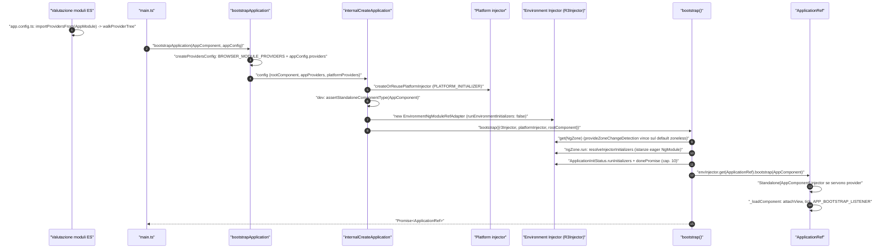
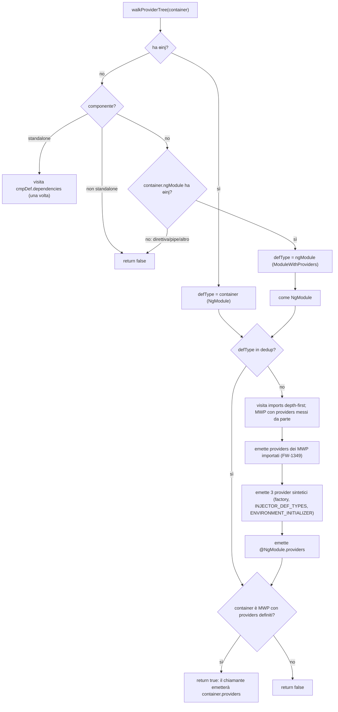
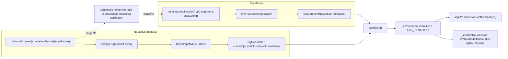
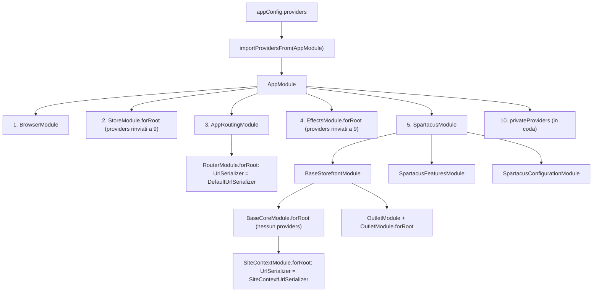

# 02 — NgModule, standalone e bootstrap dell'applicazione

> Riferimenti allo SHA `5b7a1c2bf2808d7380bc20596d10f4fa710c3da1` (vedi [00-meta](../00-meta.md)). Sorgenti Angular: `/tmp/angular` @ `v21.2.23` (prefisso `angular:`).

## 1. A cosa serve e perché esiste

Un'app Angular 21 può nascere in due modi: dal **bootstrap standalone** (`bootstrapApplication(RootComponent, appConfig)`) o dal **bootstrap per NgModule** (`platformBrowser().bootstrapModule(AppModule)`). Entrambi finiscono nella stessa funzione interna `bootstrap()` (`angular:packages/core/src/platform/bootstrap.ts:L69-L73`) e, quando c'è di mezzo un NgModule, entrambi usano lo stesso algoritmo di appiattimento dei provider, `walkProviderTree` (`angular:packages/core/src/di/create_injector.ts:L42-L56`, `angular:packages/core/src/di/provider_collection.ts:L151-L189`).

Spartacus si trova esattamente a cavallo tra i due mondi:

- l'app demo e le app generate da `ng add` sono **standalone**: `main.ts` chiama `bootstrapApplication(AppComponent, appConfig)` (`projects/storefrontapp/src/main.ts:L17-L17`) e il root component `AppComponent` è standalone (`projects/storefrontapp/src/app/app.component.ts:L14-L19`);
- ma l'intera libreria si configura ancora tramite **NgModule** e `forRoot()`: `BaseCoreModule` aggrega 16 `forRoot()` (`core-libs/core/src/base-core.module.ts:L26-L46`), `BaseStorefrontModule` aggrega `BaseCoreModule.forRoot()` e i moduli UI (`core-libs/storefront/base-storefront.module.ts:L26-L49`);
- il "ponte" tra i due mondi è una sola riga: `importProvidersFrom(AppModule)` dentro `appConfig` (`projects/storefrontapp/src/app/app.config.ts:L33-L33`).

Capire questo capitolo serve a rispondere a domande concrete che si presentano in ogni progetto Spartacus:

- perché l'ordine degli `imports` di `AppModule` conta, e perché i provider di `StoreModule.forRoot({})` finiscono **dopo** quelli di tutto `SpartacusModule` pur essendo dichiarati prima? (§3.4, `angular:packages/core/src/di/provider_collection.ts:L316-L321`);
- perché importare `OutletModule` e anche `OutletModule.forRoot()` non duplica il modulo ma aggiunge i provider? (`angular:packages/core/src/di/provider_collection.ts:L360-L362`);
- perché in Angular 21 un'app Spartacus deve fornire esplicitamente `provideZoneChangeDetection(...)`? (`angular:packages/core/src/application/create_application.ts:L66-L71`);
- perché lato server `main.server.ts` esporta una **funzione** che riceve un `BootstrapContext` e non un modulo? (`angular:packages/core/src/application/create_application.ts:L47-L54`);
- cosa fa, e cosa **non** fa, lo schematic `modernize-app-to-standalone-bootstrap-application`? (`core-libs/schematics/src/modernize-app-to-standalone-bootstrap-application/index.ts:L26-L54`).

Perimetro. Questo capitolo copre: metadati `@NgModule`, `ModuleWithProviders`/`forRoot`, appiattimento (`walkProviderTree`), componenti standalone, i due percorsi di bootstrap, piattaforma, `ApplicationRef`, `ApplicationConfig` e il loro uso in Spartacus. Restano altrove:

- la risoluzione dei token nel `R3Injector`, la regola "l'ultimo provider vince", `inject()`, `EnvironmentProviders` in generale → [01 — Dependency Injection](01-dependency-injection.md) (in particolare §3.4 e §3.7);
- `APP_INITIALIZER`, `CONFIG_INITIALIZER`, `LOCATION_INITIALIZED`, la navigazione iniziale bloccante e il primo render → [10 — Bootstrap e inizializzazione](../parte-2/10-bootstrap-inizializzazione.md);
- il dettaglio di `ng add`, delle migrazioni e dei `modernize-app-*` → [43 — Schematics e migrazioni](../parte-2/43-schematics-migrazioni.md);
- i moduli lazy di Spartacus (`LazyModulesService`) → [03 — Lazy loading](03-lazy-loading.md) e [12 — Feature module e lazy loading](../parte-2/12-feature-module-lazy.md);
- zone/zoneless nel dettaglio → [04 — Change detection, zone e signals](04-change-detection-zone-signals.md); SSR → [07 — SSR, hydration e TransferState](07-ssr-hydration-transferstate.md).

## 2. Mappa dei file

### 2.1 Angular

| Path | Ruolo |
|---|---|
| `angular:packages/core/src/metadata/ng_module.ts` | interfaccia e decoratore `@NgModule` (`providers`, `declarations`, `imports`, `exports`, `bootstrap`, `schemas`, `id`, `jit`) |
| `angular:packages/core/src/metadata/ng_module_def.ts` | `NgModuleDef` (`ɵmod`): scope di compilazione e `bootstrap` |
| `angular:packages/core/src/di/interface/defs.ts` | `ɵɵdefineInjector` (`ɵinj`), `InjectorTypeWithProviders`, `getInjectorDef` |
| `angular:packages/core/src/di/interface/provider.ts` | `ModuleWithProviders`, `EnvironmentProviders`, `isEnvironmentProviders` |
| `angular:packages/core/src/di/provider_collection.ts` | `makeEnvironmentProviders`, `provideEnvironmentInitializer`, `importProvidersFrom`, `walkProviderTree` |
| `angular:packages/core/src/di/create_injector.ts` | `createInjectorWithoutInjectorInstances` (usa `importProvidersFrom`) |
| `angular:packages/core/src/metadata/directives.ts` | `standalone?`, `Component.imports` |
| `angular:packages/compiler-cli/src/ngtsc/core/src/compiler.ts` | default `standalone: true` in AOT da v19 |
| `angular:packages/compiler-cli/src/ngtsc/annotations/ng_module/src/handler.ts` | cosa finisce negli `imports` di `ɵinj` |
| `angular:packages/core/src/render3/standalone_service.ts` | injector `Standalone[...]` per componenti standalone creati dinamicamente |
| `angular:packages/core/src/render3/ng_module_ref.ts` | `NgModuleRef`, `NgModuleFactory`, `EnvironmentNgModuleRefAdapter` |
| `angular:packages/core/src/platform/platform.ts` | `createPlatform`, `createPlatformFactory`, `createOrReusePlatformInjector`, `getPlatform` |
| `angular:packages/core/src/platform/platform_ref.ts` | `PlatformRef`, `bootstrapModule`, `bootstrapModuleFactory`, `destroy` |
| `angular:packages/core/src/platform/bootstrap.ts` | `bootstrap()` comune, `ENABLE_ROOT_COMPONENT_BOOTSTRAP`, `_moduleDoBootstrap` |
| `angular:packages/core/src/application/create_application.ts` | `internalCreateApplication` (percorso standalone) |
| `angular:packages/core/src/application/application_config.ts` | `ApplicationConfig`, `mergeApplicationConfig` |
| `angular:packages/core/src/application/application_ref.ts` | `ApplicationRef`, `BootstrapOptions`, `APP_BOOTSTRAP_LISTENER` |
| `angular:packages/core/src/application/application_module.ts` | `ApplicationModule` (istanza eager di `ApplicationRef`) |
| `angular:packages/platform-browser/src/browser.ts` | `bootstrapApplication`, `createApplication`, `platformBrowser`, `BrowserModule`, `BootstrapContext` |
| `angular:packages/router/src/router_module.ts` | `RouterModule.forRoot`: il pattern `forRoot` di riferimento |

### 2.2 Spartacus — app demo

| Path | Ruolo |
|---|---|
| `projects/storefrontapp/project.json` | entry `browser` (`main.ts`), `server` (`main.server.ts`), `ssr.entry` (`server.ts`), polyfill `zone.js` |
| `projects/storefrontapp/src/main.ts` | `bootstrapApplication(AppComponent, appConfig)` |
| `projects/storefrontapp/src/main.server.ts` | funzione `bootstrap(context)` per SSR |
| `projects/storefrontapp/src/server.ts` | passa `bootstrap` a `ngExpressEngine` |
| `projects/storefrontapp/src/app/app.component.ts` | root standalone `app-root` → `<cx-storefront />` |
| `projects/storefrontapp/src/app/app.config.ts` | `ApplicationConfig` browser + `importProvidersFrom(AppModule)` |
| `projects/storefrontapp/src/app/app.config.server.ts` | `mergeApplicationConfig(appConfig, serverConfig)` |
| `projects/storefrontapp/src/app/app.module.ts` | `AppModule`: ponte NgModule verso Spartacus |
| `projects/storefrontapp/src/app/app.module.server.ts` | `AppServerModule` (solo `provideServer`) |
| `projects/storefrontapp/src/app/private/private.providers.ts` | provider privati di test/e2e (`makeEnvironmentProviders`) |
| `projects/storefrontapp/src/app/spartacus/spartacus.module.ts` | aggregatore Base/Features/Configuration |
| `projects/storefrontapp/src/app/spartacus/spartacus-features.module.ts` | import dei moduli core/UI/feature, condizionati da `environment` |
| `projects/storefrontapp/src/app/spartacus/spartacus-configuration.module.ts` | configurazione globale via `provideConfig` |

### 2.3 Spartacus — librerie e schematics

| Path | Ruolo |
|---|---|
| `core-libs/core/src/base-core.module.ts` | aggregatore dei `forRoot()` core |
| `core-libs/storefront/base-storefront.module.ts` | aggregatore storefront (include `BaseCoreModule.forRoot()`) |
| `core-libs/storefront/router/app-routing.module.ts` | `RouterModule.forRoot([])` di Spartacus |
| `core-libs/storefront/layout/main/storefront.component.ts` | `StorefrontComponent` standalone (`cx-storefront`) |
| `core-libs/storefront/layout/main/storefront-component.module.ts` | shim NgModule che importa/esporta il componente standalone |
| `core-libs/core/src/config/config.module.ts`, `core-libs/core/src/state/state.module.ts`, `core-libs/core/src/process/process.module.ts`, `core-libs/core/src/error-handling/error-handling.module.ts`, `core-libs/core/src/site-context/site-context.module.ts` | esempi di `forRoot()` core |
| `core-libs/storefront/cms-structure/outlet/outlet.module.ts`, `core-libs/storefront/cms-structure/routing/routing.module.ts`, `core-libs/storefront/cms-structure/cms-lcp-context/cms-lcp.module.ts` | esempi di `forRoot()`/`forChild()` storefront |
| `core-libs/core/src/lazy-loading/lazy-modules.service.ts` | istanziazione degli NgModule lazy via `NgModuleFactory` |
| `core-libs/schematics/src/collection.json` | registrazione dello schematic `modernize-app-to-standalone-bootstrap-application` |
| `core-libs/schematics/src/modernize-app-to-standalone-bootstrap-application/index.ts` | catena di regole CSR+SSR |
| `core-libs/schematics/src/add-spartacus/index.ts` | `ng add`: richiede app standalone |

## 3. Come funziona passo per passo

### 3.1 Un NgModule, due definizioni

L'interfaccia `NgModule` dichiara `providers`, `declarations`, `imports`, `exports`, `bootstrap`, `schemas`, `id`, `jit` (`angular:packages/core/src/metadata/ng_module.ts:L33-L202`). Due dettagli di tipo contano:

- `providers` accetta anche `EnvironmentProviders`, non solo `Provider` (`angular:packages/core/src/metadata/ng_module.ts:L81-L81`): per questo l'app demo può mettere in `@NgModule.providers` un oggetto costruito con `makeEnvironmentProviders` (§3.13);
- `imports` accetta tipi, `ModuleWithProviders<{}>` e array annidati (`angular:packages/core/src/metadata/ng_module.ts:L138-L138`): per questo `SpartacusFeaturesModule` può spalmare un array costruito a runtime (`projects/storefrontapp/src/app/spartacus/spartacus-features.module.ts:L285-L285`).

`bootstrap` elenca i componenti avviati quando il modulo viene bootstrappato (`angular:packages/core/src/metadata/ng_module.ts:L172-L175`); `id` registra il modulo in `getNgModuleById`, e senza `id` il modulo non è registrato (`angular:packages/core/src/metadata/ng_module.ts:L189-L193`). Il decoratore è creato con `makeDecorator` e in JIT chiama `compileNgModule(type, meta)` (`angular:packages/core/src/metadata/ng_module.ts:L207-L224`).

A runtime un NgModule compilato ha **due** definizioni statiche separate (`angular:packages/core/src/metadata/ng_module_def.ts:L13-L15`, `angular:packages/core/src/metadata/ng_module_def.ts:L42-L77`, `angular:packages/core/src/di/interface/defs.ts:L197-L199`):

- `ɵmod` (`NgModuleDef`): `bootstrap`, `declarations`, `imports`, `exports`, `schemas`, `id` — serve al **compilatore di template** (scope di compilazione);
- `ɵinj` (injector def): solo `providers` e `imports` — serve al **DI**.

`getInjectorDef` legge `ɵinj` solo se è proprietà "own" del tipo, non ereditata (`angular:packages/core/src/di/interface/defs.ts:L253-L258`): un NgModule che estende un altro NgModule non ne eredita i provider.

Il punto chiave è **cosa** il compilatore AOT mette negli `imports` di `ɵinj`:

- gli import top-level, saltando direttive e pipe ("can't carry providers") e i componenti standalone che non possono esportare provider (`angular:packages/compiler-cli/src/ngtsc/annotations/ng_module/src/handler.ts:L798-L848`);
- **anche** gli NgModule elencati in `exports`: un modulo ri-esportato porta i suoi provider a chi importa il modulo che lo ri-esporta (`angular:packages/compiler-cli/src/ngtsc/annotations/ng_module/src/handler.ts:L867-L877`).

Conseguenza pratica: `RouterModule` ha come `imports`/`exports` solo direttive standalone (`ROUTER_DIRECTIVES`), che quindi non entrano nell'injector (`angular:packages/router/src/router_module.ts:L56-L56`, `angular:packages/router/src/router_module.ts:L104-L108`). Importare `RouterModule` "nudo" (come fa `BaseStorefrontModule`, `core-libs/storefront/base-storefront.module.ts:L29-L29`) porta le direttive nel template scope, ma nessun provider del router: quelli arrivano solo da `RouterModule.forRoot(...)`.

### 3.2 `ModuleWithProviders` e il pattern `forRoot`

`ModuleWithProviders<T>` è una semplice interfaccia `{ngModule: Type<T>; providers?: Array<Provider | EnvironmentProviders>}`; usarla senza generico è deprecato (`angular:packages/core/src/di/interface/provider.ts:L387-L396`). L'equivalente interno è `InjectorTypeWithProviders`, "private type and should not be exported" (`angular:packages/core/src/di/interface/defs.ts:L125-L136`).

`forRoot()` **non** è un'API di Angular: è una convenzione. Una funzione statica restituisce un `ModuleWithProviders` che associa al modulo dei provider "da registrare una volta sola nel root". Il pattern canonico è `RouterModule.forRoot(routes, config)`, che restituisce `{ngModule: RouterModule, providers: [ROUTER_PROVIDERS, ROUTES, ROUTER_FORROOT_GUARD, ...]}` (`angular:packages/router/src/router_module.ts:L133-L166`). Angular protegge il router dal doppio `forRoot`: `provideForRootGuard` cerca `Router` con `skipSelf` e lancia `FOR_ROOT_CALLED_TWICE`, e il costruttore di `RouterModule` attiva la guardia in dev (`angular:packages/router/src/router_module.ts:L109-L113`, `angular:packages/router/src/router_module.ts:L222-L233`).

Spartacus usa `forRoot()` ovunque nella sua configurazione core (§3.14), ma **senza** guardie analoghe (§9, T4).

### 3.3 `EnvironmentProviders` e `importProvidersFrom` (richiamo)

Il dettaglio è in [01 §3.7](01-dependency-injection.md); qui i fatti necessari al resto del capitolo:

- `EnvironmentProviders` è un tipo "brand" opaco, accettato solo nella creazione di un `EnvironmentInjector` (e quindi in un NgModule) e non in `@Component.providers` (`angular:packages/core/src/di/interface/provider.ts:L345-L362`); internamente contiene `ɵproviders` e opzionalmente `ɵfromNgModule` (`angular:packages/core/src/di/interface/provider.ts:L364-L379`).
- `makeEnvironmentProviders` incapsula l'array in `{ɵproviders}` e nient'altro (`angular:packages/core/src/di/provider_collection.ts:L46-L52`). `provideEnvironmentInitializer(fn)` lo usa per registrare un `ENVIRONMENT_INITIALIZER`, token che il JSDoc dichiara deprecato (`angular:packages/core/src/di/provider_collection.ts:L54-L89`).
- `importProvidersFrom(...sources)` accetta `Type`, `ModuleWithProviders` o array annidati (`angular:packages/core/src/di/provider_collection.ts:L96-L99`) e restituisce `{ɵproviders: internalImportProvidersFrom(true, sources), ɵfromNgModule: true}` (`angular:packages/core/src/di/provider_collection.ts:L144-L149`). Il JSDoc dice che i provider estratti valgono solo in application injector o altri environment injector, non in provider di componente (`angular:packages/core/src/di/provider_collection.ts:L106-L143`).
- In dev mode `importProvidersFrom` rifiuta un componente standalone (`IMPORT_PROVIDERS_FROM_STANDALONE`, `angular:packages/core/src/di/provider_collection.ts:L163-L174`); se il risultato finisce in un injector non-environment si ottiene `PROVIDER_IN_WRONG_CONTEXT` con messaggio dedicato grazie a `ɵfromNgModule` (`angular:packages/core/src/render3/errors_di.ts:L50-L61`).
- Il `R3Injector` apre ricorsivamente array ed `EnvironmentProviders` prima di registrare i record (`angular:packages/core/src/di/r3_injector.ts:L725-L738`).

Nota importante: `importProvidersFrom(AppModule)` è una **chiamata di funzione eseguita quando si valuta il modulo ES** `app.config.ts`, perché compare in un oggetto letterale (`projects/storefrontapp/src/app/app.config.ts:L26-L35`). L'appiattimento avviene quindi prima ancora di `bootstrapApplication`.

### 3.4 `walkProviderTree`: l'algoritmo di appiattimento

Questo è il cuore del capitolo: decide **in che ordine** i provider di tutti gli NgModule finiscono nell'environment injector, e quindi (per la regola "l'ultimo vince" di [01 §3.4](01-dependency-injection.md)) chi vince.

**Ingresso.** `internalImportProvidersFrom` crea un unico `Set` `dedup` per tutte le sorgenti della chiamata e raccoglie a parte i `ModuleWithProviders` top-level, i cui provider sono aggiunti dopo aver visitato tutte le sorgenti (`angular:packages/core/src/di/provider_collection.ts:L151-L189`). Lo stesso algoritmo vale per il percorso NgModule classico: `createInjectorWithoutInjectorInstances` costruisce i provider come `[additionalProviders, importProvidersFrom(defType)]` (`angular:packages/core/src/di/create_injector.ts:L42-L56`).

**Classificazione del contenitore.** `walkProviderTree` riconosce tre forme (`angular:packages/core/src/di/provider_collection.ts:L245-L266`):

1. un `InjectorType` (ha `ɵinj`) → NgModule;
2. un oggetto con `ngModule` (cioè un `ModuleWithProviders`) → si scarta l'involucro e si usa `ngModule` come `defType`;
3. un componente standalone.

Un componente non standalone, una direttiva o una pipe vengono ignorati (`return false`). In dev, uno stack `parents` rileva gli import ciclici (`angular:packages/core/src/di/provider_collection.ts:L268-L273`).

**Componente standalone.** Visita ricorsivamente `cmpDef.dependencies` (i suoi `imports`), una sola volta per tipo (`angular:packages/core/src/di/provider_collection.ts:L278-L291`).

**NgModule.** L'ordine di emissione è questo:

1. Se il modulo non è già in `dedup`: lo aggiunge, poi visita gli `imports` depth-first nell'ordine dichiarato (`angular:packages/core/src/di/provider_collection.ts:L292-L310`).
2. Gli import che erano `ModuleWithProviders` con `providers` vengono messi da parte; i loro `providers` sono emessi **solo dopo** che tutti gli import di quel modulo sono stati visitati — semantica View Engine, FW-1349 (`angular:packages/core/src/di/provider_collection.ts:L316-L321`).
3. Tre provider sintetici per il modulo: il tipo stesso (factory), `INJECTOR_DEF_TYPES` (multi) e un `ENVIRONMENT_INITIALIZER` che fa `inject(defType)`, cioè **istanziazione eager** del modulo; emessi dopo gli import (`angular:packages/core/src/di/provider_collection.ts:L324-L344`).
4. I `providers` di `@NgModule` (`ɵinj.providers`), sempre solo se non duplicato (`angular:packages/core/src/di/provider_collection.ts:L346-L354`).

**Valore di ritorno.** `walkProviderTree` restituisce `true` solo se il contenitore era un wrapper `ModuleWithProviders` con `providers !== undefined` (`angular:packages/core/src/di/provider_collection.ts:L360-L362`). Ne seguono due regole poco intuitive:

- i `providers` di un `ModuleWithProviders` sono aggiunti **anche se** il suo `ngModule` era già stato visitato (il dedup vale solo sui tipi);
- un `forRoot()` che restituisce `{ngModule}` **senza** `providers` si comporta esattamente come l'import diretto del modulo; uno con `providers: []` attiva il ramo "rinviato" con zero provider.

`processInjectorTypesWithProviders` appiattisce i `providers` di ogni `ModuleWithProviders` aprendo anche gli `EnvironmentProviders` e, in dev, li valida (`angular:packages/core/src/di/provider_collection.ts:L195-L209`, `angular:packages/core/src/di/provider_collection.ts:L388-L402`).

**Istanziazione.** Gli `ENVIRONMENT_INITIALIZER` sintetici sono eseguiti da `R3Injector.resolveInjectorInitializers()` in ordine, leggendo il token con `{self: true}` (`angular:packages/core/src/di/r3_injector.ts:L426-L448`): le istanze dei moduli vengono quindi create in **post-ordine** (prima gli importati, poi l'importatore). È così che girano i costruttori "di servizio" come quello di `ConfigModule`, che inietta `ConfigurationService` per istanziarlo (`core-libs/core/src/config/config.module.ts:L13-L19`).

### 3.5 Componenti standalone

Da Angular 19 componenti, direttive e pipe sono standalone per default: il compilatore AOT imposta `implicitStandaloneValue` a `true` per `@angular/core >= 19.0.0` (`angular:packages/compiler-cli/src/ngtsc/core/src/compiler.ts:L477-L482`), e in JIT `standalone` non specificato vale `true` (`angular:packages/core/src/render3/jit/directive.ts:L393-L393`). Per **dichiarare** un componente in un NgModule serve `standalone: false` (`angular:packages/core/src/metadata/directives.ts:L52-L66`, `angular:packages/core/src/metadata/directives.ts:L627-L630`).

`Component.imports` elenca le dipendenze di template di un componente standalone: altri componenti/direttive/pipe standalone **e** NgModule esistenti (`angular:packages/core/src/metadata/directives.ts:L632-L640`).

Per un componente standalone la definizione espone `dependencies` e `getStandaloneInjector`, che delega a `StandaloneService` dell'environment injector padre (`angular:packages/core/src/render3/definition.ts:L359-L364`). `StandaloneService` (`providedIn: 'environment'`) crea e mette in cache, per ogni componente standalone creato dinamicamente (root incluso), un environment injector figlio `Standalone[<Nome>]` con i provider raccolti dal grafo dei suoi `imports` via `internalImportProvidersFrom(false, ...)` — solo se la lista non è vuota (`angular:packages/core/src/render3/standalone_service.ts:L16-L47`, `angular:packages/core/src/render3/standalone_service.ts:L62-L66`). Nella creazione della root view, se il componente ha `getStandaloneInjector`, l'environment injector usato diventa quello standalone (`angular:packages/core/src/render3/component_ref.ts:L150-L153`).

Se si passa a `bootstrapApplication` un componente non standalone, `assertStandaloneComponentType` lancia `TYPE_IS_NOT_STANDALONE` (`angular:packages/core/src/render3/errors.ts:L25-L37`).

### 3.6 La piattaforma

`PlatformRef` è `@Injectable({providedIn: 'platform'})`: una per pagina, comune a tutte le app (`angular:packages/core/src/platform/platform_ref.ts:L23-L33`).

- `createPlatformFactory(parent, name, providers)` restituisce una factory che riusa la piattaforma esistente o ne crea una aggiungendo un token marker `Platform: <name>`; fuori da SSR verifica con `assertPlatform(marker)` che la piattaforma esistente sia della stessa configurazione (`angular:packages/core/src/platform/platform.ts:L67-L90`).
- `createPlatformInjector` crea un injector con `INJECTOR_SCOPE = 'platform'` e `PLATFORM_DESTROY_LISTENERS` (`angular:packages/core/src/platform/platform.ts:L96-L105`).
- `createPlatform` lancia `MULTIPLE_PLATFORMS` se ne esiste già una e in SSR non memorizza l'injector nella variabile globale `_platformInjector` (concorrenza tra richieste) (`angular:packages/core/src/platform/platform.ts:L36-L54`); `getPlatform()` lato server restituisce sempre `null` (`angular:packages/core/src/platform/platform.ts:L137-L143`).
- Il bootstrap standalone usa `createOrReusePlatformInjector`, che riusa `_platformInjector` o lo crea ed esegue i `PLATFORM_INITIALIZER` "avoid referencing `PlatformRef` class" (`angular:packages/core/src/platform/platform.ts:L157-L181`).
- `platformCore` è la piattaforma base; `platformBrowser` la estende con `INTERNAL_BROWSER_PLATFORM_PROVIDERS` (`angular:packages/core/src/platform/platform_core_providers.ts:L19-L20`, `angular:packages/platform-browser/src/browser.ts:L231-L232`), cioè `PLATFORM_ID` browser, un `PLATFORM_INITIALIZER` che installa `BrowserDomAdapter` e `DOCUMENT` (`angular:packages/platform-browser/src/browser.ts:L205-L223`).
- `PlatformRef.destroy()` distrugge i moduli registrati, chiama i listener e i `PLATFORM_DESTROY_LISTENERS`; una seconda chiamata lancia `PLATFORM_ALREADY_DESTROYED` (`angular:packages/core/src/platform/platform_ref.ts:L123-L140`).

### 3.7 Percorso standalone: `bootstrapApplication`

1. `bootstrapApplication(rootComponent, options?, context?)` combina il root component con `createProvidersConfig(options, context)`, in JIT risolve le risorse dei componenti e delega a `internalCreateApplication` (`angular:packages/platform-browser/src/browser.ts:L125-L140`). Gli errori di `resolveJitResources` sono solo loggati (`angular:packages/platform-browser/src/browser.ts:L177-L185`).
2. `createProvidersConfig` mette `BROWSER_MODULE_PROVIDERS` **prima** dei provider dell'utente e usa `context?.platformRef` se fornito (`angular:packages/platform-browser/src/browser.ts:L168-L174`). `BROWSER_MODULE_PROVIDERS` contiene `INJECTOR_SCOPE='root'`, `ErrorHandler`, i plugin eventi, `DomRendererFactory2`, `SharedStylesHost`, `EventManager`, `RendererFactory2`, `XhrFactory` e in dev un marker (`angular:packages/platform-browser/src/browser.ts:L259-L276`). `Testability` **non** è incluso: si aggiunge con `provideProtractorTestingSupport()` (`angular:packages/platform-browser/src/browser.ts:L104-L113`, `angular:packages/platform-browser/src/browser.ts:L198-L203`).
3. `internalCreateApplication`: lato server senza `platformRef` lancia `PLATFORM_NOT_FOUND` (`angular:packages/core/src/application/create_application.ts:L47-L54`); poi prende `platformRef.injector` o `createOrReusePlatformInjector(...)` e, in dev, verifica che il root component sia standalone (`angular:packages/core/src/application/create_application.ts:L56-L62`).
4. L'environment injector dell'app riceve, nell'ordine: `provideZonelessChangeDetectionInternal()`, `errorHandlerEnvironmentInitializer`, (dev) `validAppIdInitializer`, poi gli `appProviders` (`angular:packages/core/src/application/create_application.ts:L64-L71`). In v21 il default è quindi **zoneless**: `NgZone` → `NoopNgZone`, `ZONELESS_ENABLED = true` (`angular:packages/core/src/change_detection/scheduling/zoneless_scheduling_impl.ts:L388-L394`). Un `provideZoneChangeDetection(options)` nei provider utente ridefinisce `ZONELESS_ENABLED = false` e `NgZone`, e marca `PROVIDED_NG_ZONE = true` (`angular:packages/core/src/change_detection/scheduling/ng_zone_scheduling.ts:L153-L167`, `angular:packages/core/src/change_detection/scheduling/ng_zone_scheduling.ts:L94-L95`); arrivando dopo, vince.
5. L'injector viene creato da un `EnvironmentNgModuleRefAdapter` con debug name `'Environment Injector'` e `runEnvironmentInitializers: false`, perché gli initializer devono girare dentro la `NgZone` (`angular:packages/core/src/application/create_application.ts:L72-L85`). L'adapter è un `NgModuleRef<null>` (`instance = null`) che crea un `R3Injector` con scope `'environment'` e registra se stesso come `NgModuleRef` (`angular:packages/core/src/render3/ng_module_ref.ts:L145-L172`).
6. Si passa a `bootstrap({r3Injector, platformInjector, rootComponent})` (§3.9).

`createApplication(options?, context?)` fa lo stesso senza bootstrappare componenti (`angular:packages/platform-browser/src/browser.ts:L142-L166`). `BootstrapContext` contiene solo `platformRef`, pensato per casi come l'SSR in cui la piattaforma è creata per richiesta (`angular:packages/platform-browser/src/browser.ts:L52-L63`, `angular:packages/platform-browser/src/browser.ts:L118-L120`).

### 3.8 Percorso NgModule: `platformBrowser().bootstrapModule(AppModule)`

È il percorso legacy, quello che lo schematic Spartacus converte (§3.16).

1. `PlatformRef.bootstrapModule(moduleType, compilerOptions)` riduce le opzioni, abilita l'implementazione di bootstrap per moduli (`setModuleBootstrapImpl`) e passa da `compileNgModuleFactory` a `bootstrapModuleFactory` (`angular:packages/core/src/platform/platform_ref.ts:L87-L102`). In AOT `compileNgModuleFactory` restituisce subito `new R3NgModuleFactory(moduleType)` (`angular:packages/core/src/application/application_ngmodule_factory_compiler.ts:L22-L34`).
2. `bootstrapModuleFactory` (deprecato come API pubblica con factory) costruisce gli app provider — zoneless di default + `applicationProviders` + error handler initializer — e crea l'`NgModuleRef` senza eseguire gli initializer (`angular:packages/core/src/platform/platform_ref.ts:L41-L69`). Le `BootstrapOptions` (`ngZone`, `ngZoneEventCoalescing`, `ngZoneRunCoalescing`) sono `@deprecated 20.2` (`angular:packages/core/src/application/application_ref.ts:L93-L99`).
3. `NgModuleRef` legge `ɵmod.bootstrap` in `_bootstrapComponents` e crea l'injector con `createInjectorWithoutInjectorInstances(ngModuleType, ...)` scope `'environment'` (`angular:packages/core/src/render3/ng_module_ref.ts:L67-L95`); `createNgModuleRefWithProviders` lo crea con `runInjectorInitializers = false` (`angular:packages/core/src/render3/ng_module_ref.ts:L127-L143`).
4. `bootstrap({moduleRef, ...})` (§3.9) chiama alla fine `_moduleDoBootstrap`: avvia i componenti di `@NgModule.bootstrap`, altrimenti `ngDoBootstrap(appRef)`, altrimenti lancia `BOOTSTRAP_COMPONENTS_NOT_FOUND`; la funzione è separata per poter essere eliminata dal tree-shaking nelle app standalone (`angular:packages/core/src/platform/bootstrap.ts:L183-L215`).

`NgModuleRef.resolveInjectorInitializers()` esegue gli environment initializer e poi ottiene l'istanza del modulo (`angular:packages/core/src/render3/ng_module_ref.ts:L105-L108`).

### 3.9 `bootstrap()`: il tratto comune

1. `isApplicationBootstrapConfig` distingue i percorsi dall'assenza di `moduleRef` (`angular:packages/core/src/platform/bootstrap.ts:L69-L73`).
2. Dentro `ngZone.run` esegue prima gli environment initializer dell'injector dell'app o del modulo: qui vengono istanziati eagerly tutti gli NgModule (`angular:packages/core/src/platform/bootstrap.ts:L84-L93`).
3. In dev avvisa con `PROVIDED_BOTH_ZONE_AND_ZONELESS` se sono forniti sia zone sia zoneless (`angular:packages/core/src/platform/bootstrap.ts:L95-L105`).
4. Registra un listener sulla piattaforma: alla sua `destroy()` viene distrutto l'environment injector (standalone) o il `moduleRef` (`angular:packages/core/src/platform/bootstrap.ts:L114-L135`).
5. Aggiunge un pending task, esegue `ApplicationInitStatus.runInitializers()` e attende `donePromise`, poi imposta `LOCALE_ID` (`angular:packages/core/src/platform/bootstrap.ts:L137-L147`). Il dettaglio di questa fase, che per Spartacus è la più importante, è in [10 §3.5](../parte-2/10-bootstrap-inizializzazione.md).
6. Se `ENABLE_ROOT_COMPONENT_BOOTSTRAP` vale `false` (lo usa `@angular/ssr` nell'estrazione delle rotte) salta il root component (`angular:packages/core/src/platform/bootstrap.ts:L31-L53`, `angular:packages/core/src/platform/bootstrap.ts:L149-L160`).
7. Standalone: `appRef = envInjector.get(ApplicationRef)` e `appRef.bootstrap(rootComponent)`; NgModule: `moduleBootstrapImpl` (`angular:packages/core/src/platform/bootstrap.ts:L167-L176`). Il pending task è rimosso nel `finally` (`angular:packages/core/src/platform/bootstrap.ts:L178-L178`).
8. Errori sincroni o Promise rifiutata finiscono all'error handler interno (fuori zona) e sono rilanciati (`angular:packages/core/src/platform/bootstrap.ts:L217-L238`).

### 3.10 `ApplicationConfig`, `ApplicationRef`, `ApplicationModule`

- `ApplicationConfig` ha un solo campo, `providers: Array<Provider | EnvironmentProviders>` (`angular:packages/core/src/application/application_config.ts:L16-L21`). `mergeApplicationConfig(...configs)` concatena i `providers` da sinistra a destra (`angular:packages/core/src/application/application_config.ts:L31-L38`): chi viene dopo, a parità di token, vince.
- `ApplicationRef` è `providedIn: 'root'` (`angular:packages/core/src/application/application_ref.ts:L259-L260`); il suo `injector` è l'`EnvironmentInjector` che l'ha creata (`angular:packages/core/src/application/application_ref.ts:L359-L367`).
- `isStable` deriva da `PendingTasksInternal.hasPendingTasksObservable`, `whenStable()` è una Promise risolta alla prima emissione `true` (`angular:packages/core/src/application/application_ref.ts:L328-L357`); il JSDoc avverte che l'app non diventa mai stabile se all'avvio si avvia un task ricorrente (`angular:packages/core/src/application/application_ref.ts:L172-L179`).
- `bootstrapImpl` lancia `ASYNC_INITIALIZERS_STILL_RUNNING` se gli initializer non sono conclusi (`angular:packages/core/src/application/application_ref.ts:L508-L521`); poi risolve la factory, la associa all'`NgModuleRef` dell'injector (nel percorso standalone è l'`EnvironmentNgModuleRefAdapter`), crea il componente sul selettore e registra la Testability se presente (`angular:packages/core/src/application/application_ref.ts:L523-L548`). Passare una `ComponentFactory` è deprecato (`angular:packages/core/src/application/application_ref.ts:L445-L451`).
- `_loadComponent` aggancia la host view, esegue un primo `tick()`, aggiunge il `ComponentRef` a `components` e invoca gli `APP_BOOTSTRAP_LISTENER` (`angular:packages/core/src/application/application_ref.ts:L775-L795`, token definito in `angular:packages/core/src/application/application_ref.ts:L54-L66`).
- `tick()` è non rientrante (`RECURSIVE_APPLICATION_REF_TICK`) e in dev esegue `checkNoChanges` (`angular:packages/core/src/application/application_ref.ts:L570-L609`); `synchronize()` ripete al massimo `MAXIMUM_REFRESH_RERUNS = 10` volte (`angular:packages/core/src/application/application_ref.ts:L158-L159`, `angular:packages/core/src/application/application_ref.ts:L625-L649`). Dettagli in [04](04-change-detection-zone-signals.md).
- `ApplicationRef.destroy()` distrugge l'injector sottostante; doppia chiamata → `APPLICATION_REF_ALREADY_DESTROYED` (`angular:packages/core/src/application/application_ref.ts:L834-L850`).
- `ApplicationModule` è un NgModule vuoto il cui costruttore inietta `ApplicationRef` "to make it eager"; è ri-esportato da `BrowserModule` (`angular:packages/core/src/application/application_module.ts:L13-L24`).

### 3.11 `BrowserModule` e il marker anti-duplicazione

`BrowserModule` fornisce `BROWSER_MODULE_PROVIDERS` + `TESTABILITY_PROVIDERS` ed esporta `CommonModule` e `ApplicationModule` (`angular:packages/platform-browser/src/browser.ts:L278-L291`). In dev il costruttore cerca il marker con `{optional: true, skipSelf: true}` e lancia `BROWSER_MODULE_ALREADY_LOADED` se i provider esistono già in un injector **antenato** (`angular:packages/platform-browser/src/browser.ts:L292-L307`). Il marker esiste perché il bootstrap standalone importa i provider di `BrowserModule` senza referenziare il modulo (`angular:packages/platform-browser/src/browser.ts:L234-L242`). Il controllo usa `skipSelf`: due copie nello **stesso** injector non vengono rilevate (§9, T5).

### 3.12 Spartacus: gli entry point dell'app demo

- `project.json` dichiara `browser: main.ts` con polyfill `zone.js`, `server: main.server.ts` e `ssr.entry: server.ts` (`projects/storefrontapp/project.json:L22-L23`, `projects/storefrontapp/project.json:L142-L145`).
- `main.ts` chiama `bootstrapApplication(AppComponent, appConfig)` dopo `enableProdMode()` se `environment.production` e logga l'errore con `console.error` (`projects/storefrontapp/src/main.ts:L13-L23`).
- `AppComponent` è standalone (nessun `standalone: false`), selettore `app-root`, template `<cx-storefront />`, `imports: [StorefrontComponent]` (`projects/storefrontapp/src/app/app.component.ts:L10-L19`).
- `appConfig` fornisce `provideHttpClient(withFetch(), withInterceptorsFromDi())`, `provideClientHydration(withEventReplay(), withNoHttpTransferCache())`, `provideZoneChangeDetection({eventCoalescing: true})`, `provideBrowserGlobalErrorListeners()` e infine `importProvidersFrom(AppModule)` (`projects/storefrontapp/src/app/app.config.ts:L26-L35`). Il ruolo di `withInterceptorsFromDi()` per gli `HTTP_INTERCEPTORS` multi registrati dai moduli Spartacus ⚠️ DA VERIFICARE: implementazione non letta in questo capitolo (la catena di interceptor è trattata in [06 — HttpClient e interceptor](06-httpclient-interceptor.md)).
- Server: `main.server.ts` esporta di default `bootstrap = (context: BootstrapContext) => bootstrapApplication(AppComponent, config, context)` (`projects/storefrontapp/src/main.server.ts:L23-L26`); `server.ts` la passa a `ngExpressEngine({bootstrap, ...})` (`projects/storefrontapp/src/server.ts:L20-L20`, `projects/storefrontapp/src/server.ts:L53-L54`). ⚠️ DA VERIFICARE qui chi costruisce il `BootstrapContext` per richiesta: è nel motore SSR (vedi [07](07-ssr-hydration-transferstate.md) e [39 — SSR ottimizzato](../parte-2/39-ssr-ottimizzato.md)).
- `config` server = `mergeApplicationConfig(appConfig, serverConfig)`, con `serverConfig` che aggiunge `provideServerRendering()`, `importProvidersFrom(AppServerModule)` e `importProvidersFrom(TestConfigServerModule.forRoot())` ("DO NOT USE IN CUSTOMERS APPS") (`projects/storefrontapp/src/app/app.config.server.ts:L17-L30`). `AppServerModule` contiene solo `providers: [...provideServer({serverRequestOrigin: process.env['SERVER_REQUEST_ORIGIN']})]`, e `provideServer` restituisce `Provider[]` (`projects/storefrontapp/src/app/app.module.server.ts:L10-L17`, `core-libs/setup/ssr/providers/ssr-providers.ts:L27-L27`).

### 3.13 Spartacus: `AppModule` come ponte

`AppModule` non ha `declarations` né `bootstrap`: è puro "contenitore di provider". Importa `BrowserModule`, `StoreModule.forRoot({})`, `AppRoutingModule`, `EffectsModule.forRoot([])`, `SpartacusModule` e fornisce `privateProviders` (`projects/storefrontapp/src/app/app.module.ts:L15-L25`).

- `SpartacusModule` importa `BaseStorefrontModule`, `SpartacusFeaturesModule`, `SpartacusConfigurationModule` e ri-esporta `BaseStorefrontModule` (`projects/storefrontapp/src/app/spartacus/spartacus.module.ts:L12-L20`).
- `SpartacusConfigurationModule` è un NgModule di soli `providers` (`provideConfigFactory(layoutConfigFactory)`, `provideConfig(mediaConfig)`, `defaultCmsContentProviders`, PWA, i18n, provider di canale) e chiama `registerLocaleData` a livello di modulo ES (`projects/storefrontapp/src/app/spartacus/spartacus-configuration.module.ts:L29-L72`). I provider B2C/B2B sono `EnvironmentProviders` creati con `makeEnvironmentProviders([...provideConfig(...)])` (`projects/storefrontapp/src/app/spartacus/spartacus-b2c-configuration.providers.ts:L25-L40`, `projects/storefrontapp/src/app/spartacus/spartacus-b2b-configuration.providers.ts:L19-L28`); la scelta avviene alla valutazione del modulo ES via `environment.b2b` (`projects/storefrontapp/src/app/spartacus/spartacus-configuration.module.ts:L33-L42`).
- `SpartacusFeaturesModule` costruisce a livello di modulo ES un array `featureModules` condizionato da flag `environment.*` e lo spalma in `imports` (`projects/storefrontapp/src/app/spartacus/spartacus-features.module.ts:L115-L175`, `projects/storefrontapp/src/app/spartacus/spartacus-features.module.ts:L285-L285`); mescola `forRoot()` (`AuthModule.forRoot()`, `AnonymousConsentsModule.forRoot()`, `ProductModule.forRoot()`, `ExternalRoutesModule.forRoot()`) con import diretti (`projects/storefrontapp/src/app/spartacus/spartacus-features.module.ts:L176-L246`).
- Ogni feature module della demo importa il `*RootModule` della feature e registra i moduli lazy con `provideConfig({featureModules: {...}})`, es. `CartBaseFeatureModule` (`projects/storefrontapp/src/app/spartacus/features/cart/cart-base-feature.module.ts:L23-L35`). Il caricamento lazy vero e proprio è in [12](../parte-2/12-feature-module-lazy.md).
- `privateProviders` è un `makeEnvironmentProviders` con `provideConfig(...)` e un `importProvidersFrom(TestOutletModule, TestConfigModule.forRoot({cookie: 'cxConfigE2E'}), ...StoreDevtoolsModule.instrument())` annidato (`projects/storefrontapp/src/app/private/private.providers.ts:L19-L57`): un `importProvidersFrom` dentro un `makeEnvironmentProviders` dentro `@NgModule.providers` di un modulo a sua volta passato a `importProvidersFrom`.
- `AppRoutingModule` (esportato da `@spartacus/storefront`) importa `RouterModule.forRoot([], {anchorScrolling: 'enabled', initialNavigation: 'enabledBlocking'})` con route vuote (`core-libs/storefront/router/app-routing.module.ts:L13-L30`). Le route vere sono generate da Spartacus: vedi [05 — Router](05-router.md) e [14 — Routing](../parte-2/14-routing.md).

### 3.14 Spartacus: `BaseCoreModule`, `BaseStorefrontModule` e i `forRoot()`

`BaseCoreModule` importa 16 `forRoot()` più `FederatedLoginModule`, in quest'ordine: ErrorHandling, State, Config, ConfigInitializer, ConfigValidator, I18n, Cms, GlobalMessage, Process, FeaturesConfig, SiteContext, MetaTagConfig, BaseOcc, LazyLoading, Http, SiteTheme (`core-libs/core/src/base-core.module.ts:L26-L46`). Il suo `forRoot()` restituisce `{ngModule: BaseCoreModule}` **senza** `providers` (`core-libs/core/src/base-core.module.ts:L47-L53`): per §3.4 è equivalente a importare il tipo.

Due commenti dichiarano vincoli d'ordine (`core-libs/core/src/base-core.module.ts:L28-L28`, `core-libs/core/src/base-core.module.ts:L38-L38`):

- `ErrorHandlingModule` "before any other interceptor";
- `SiteContextModule` "after RouterModule.forRoot, because it overwrites UrlSerializer": infatti `SiteContextModule.forRoot()` include `siteContextParamsProviders`, che ridefinisce `UrlSerializer` con `useExisting: SiteContextUrlSerializer` (`core-libs/core/src/site-context/site-context.module.ts:L47-L54`, `core-libs/core/src/site-context/providers/site-context-params-providers.ts:L16-L17`), mentre `ROUTER_PROVIDERS` contiene `{provide: UrlSerializer, useClass: DefaultUrlSerializer}` (`angular:packages/router/src/router_module.ts:L65-L71`).

Le forme di `forRoot()` in Spartacus sono varie:

| Modulo | Forma | Riferimento |
|---|---|---|
| `BaseCoreModule` | `{ngModule}` senza `providers` | `core-libs/core/src/base-core.module.ts:L47-L53` |
| `ErrorHandlingModule` | sostituisce `ErrorHandler` con `CxErrorHandler`, aggiunge `provideMultiErrorHandler()`; il modulo importa altri due `forRoot()` | `core-libs/core/src/error-handling/error-handling.module.ts:L13-L32` |
| `ConfigModule` | `@NgModule({})` vuoto, costruttore che inietta `ConfigurationService`; tre factory `withConfig`, `withConfigFactory`, `forRoot(config = {})` | `core-libs/core/src/config/config.module.ts:L13-L67` |
| `StateModule` | `@NgModule({})`, `forRoot()` porta solo `stateMetaReducers` | `core-libs/core/src/state/state.module.ts:L10-L18` |
| `ProcessModule` | `providers: []` (array vuoto) | `core-libs/core/src/process/process.module.ts:L10-L20` |
| `CmsLcpModule` | `forRoot()` senza tipo di ritorno dichiarato | `core-libs/storefront/cms-structure/cms-lcp-context/cms-lcp.module.ts:L11-L19` |
| `OutletModule` | `forRoot()` con `APP_INITIALIZER`, `forChild()` con `MODULE_INITIALIZER` (per moduli lazy) | `core-libs/storefront/cms-structure/outlet/outlet.module.ts:L49-L89` |
| `RoutingModule` (storefront) | importa `CoreRoutingModule.forRoot()`; `forRoot()` aggiunge config rotte e due `BEFORE_CMS_PAGE_GUARD` multi | `core-libs/storefront/cms-structure/routing/routing.module.ts:L18-L40` |

La coppia `forRoot()`/`forChild()` di `OutletModule` mostra perché Spartacus ha bisogno di un proprio `MODULE_INITIALIZER`: gli `APP_INITIALIZER` girano una volta sola al bootstrap, e un modulo lazy ne richiede l'equivalente (vedi [03](03-lazy-loading.md) e [17 — Outlet](../parte-2/17-outlet.md)).

`BaseStorefrontModule` importa `BaseCoreModule.forRoot()`, `RouterModule` (senza `forRoot`), i moduli UI e i `forRoot()` di `PageComponentModule`, `RoutingModule`, `MediaModule`, `OutletModule`, `CmsLcpModule`; esporta `LayoutModule` e `StorefrontComponentModule` (`core-libs/storefront/base-storefront.module.ts:L26-L49`). Entrambi gli aggregatori sono API pubblica (`core-libs/core/public_api.ts:L12-L12`, `core-libs/storefront/public_api.ts:L20-L20`).

### 3.15 Spartacus: componenti standalone dentro NgModule

- `StorefrontComponent` (`cx-storefront`) è standalone e importa direttamente `RouterModule` e altri componenti/direttive standalone (`core-libs/storefront/layout/main/storefront.component.ts:L51-L67`).
- `StorefrontComponentModule` mette il componente standalone negli `imports` (non in `declarations`) e lo ri-esporta: l'NgModule resta come **shim di compatibilità** per chi importa ancora moduli (`core-libs/storefront/layout/main/storefront-component.module.ts:L19-L34`). Lo stesso fa `OutletModule` con la direttiva standalone `OutletDirective` (`core-libs/storefront/cms-structure/outlet/outlet.module.ts:L49-L52`).
- La guida di migrazione dice "standalone is now the default" (`docs/migration/221121_7/modernize-app-to-standalone-bootstrap-application.md:L126-L126`).
- Le feature lazy di Spartacus non usano `loadComponent` o `createEnvironmentInjector` ma `NgModuleFactory`: `resolveModuleFactory` usa la factory se già tale, altrimenti `compiler.compileModuleAsync(module)`, poi `moduleFactory.create(parentInjector)` (`core-libs/core/src/lazy-loading/lazy-modules.service.ts:L96-L98`, `core-libs/core/src/lazy-loading/lazy-modules.service.ts:L220-L236`). Il motivo per cui gli NgModule restano centrali in Spartacus è proprio questo: l'unità di caricamento lazy è un NgModule ([03](03-lazy-loading.md)).

### 3.16 Spartacus: lo schematic `modernize-app-to-standalone-bootstrap-application`

Il dettaglio delle regole è nel [capitolo 43](../parte-2/43-schematics-migrazioni.md); qui il collegamento con i concetti del capitolo.

- È registrato in `collection.json`, non in `migrations.json`: va lanciato esplicitamente, non parte con `ng update` (`core-libs/schematics/src/collection.json:L49-L52`). ⚠️ DA VERIFICARE la sintassi esatta del comando (presumibilmente `ng generate @spartacus/schematics:modernize-app-to-standalone-bootstrap-application`): non presente nel codice letto.
- `migrate()` concatena 5 regole comuni (AppComponent, AppModule, app.config, main.ts, angular.json) e, se `isSsrUsed(tree)`, 5 regole SSR, ognuna avvolta in `withFallbackDocsForStandaloneBootstrap` (`core-libs/schematics/src/modernize-app-to-standalone-bootstrap-application/index.ts:L26-L54`), che cattura l'eccezione, logga un link alla guida e restituisce il tree invariato (`core-libs/schematics/src/modernize-app-to-standalone-bootstrap-application/fallback-advice-to-follow-docs.ts:L28-L43`).
- Mappatura sui concetti di questo capitolo:
  - `updateAppComponent` rende `AppComponent` standalone (rimuove `standalone`, aggiunge `StorefrontComponent` a `imports`) — §3.5 (`core-libs/schematics/src/modernize-app-to-standalone-bootstrap-application/csr-and-ssr/update-app-component.ts:L22-L66`);
  - `updateAppModule` toglie da `AppModule` `bootstrap`, `declarations`, i provider funzionali e `BrowserModule` — §3.11 (`core-libs/schematics/src/modernize-app-to-standalone-bootstrap-application/csr-and-ssr/update-app-module.ts:L16-L67`, `core-libs/schematics/src/modernize-app-to-standalone-bootstrap-application/csr-and-ssr/update-app-module.ts:L95-L99`);
  - `createAppConfig` genera `app.config.ts` con `provideBrowserGlobalErrorListeners()`, `provideZoneChangeDetection({eventCoalescing: true})`, `provideHttpClient(withFetch(), withInterceptorsFromDi())`, `importProvidersFrom(AppModule)`, e lo salta se il file esiste (`core-libs/schematics/src/modernize-app-to-standalone-bootstrap-application/csr-and-ssr/create-app-config.ts:L16-L51`);
  - `updateMainTs` sostituisce `platformBrowser().bootstrapModule(...)` con `bootstrapApplication(AppComponent, appConfig)` — §3.7/§3.8 (`core-libs/schematics/src/modernize-app-to-standalone-bootstrap-application/csr-and-ssr/update-main-ts.ts:L41-L67`, `core-libs/schematics/src/modernize-app-to-standalone-bootstrap-application/csr-and-ssr/update-main-ts.ts:L102-L111`);
  - `updateAngularJson` cancella `standalone` dalle opzioni degli schematic `component|directive|pipe` (`core-libs/schematics/src/modernize-app-to-standalone-bootstrap-application/csr-and-ssr/update-angular-json.ts:L11-L32`, `core-libs/schematics/src/modernize-app-to-standalone-bootstrap-application/csr-and-ssr/update-angular-json.ts:L48-L57`);
  - SSR: `updateMainServerTs` genera la funzione `bootstrap(context)` e `createAppConfigServer` il `mergeApplicationConfig` (`core-libs/schematics/src/modernize-app-to-standalone-bootstrap-application/ssr/update-main-server-ts.ts:L97-L102`, `core-libs/schematics/src/modernize-app-to-standalone-bootstrap-application/ssr/create-app-config-server.ts:L29-L41`); `moveHydrationConfig`, `updateAppModuleServer`, `updateServerTs` completano il quadro (`core-libs/schematics/src/modernize-app-to-standalone-bootstrap-application/ssr/move-hydration-config.ts:L13-L14`, `core-libs/schematics/src/modernize-app-to-standalone-bootstrap-application/ssr/update-app-module-server.ts:L12-L14`, `core-libs/schematics/src/modernize-app-to-standalone-bootstrap-application/ssr/update-server-ts.ts:L12-L14`).
- Coerentemente, `ng add` richiede un'app standalone: `detectAndSetupAppStructure` lancia `SchematicsException` se manca `app.config.ts` (`core-libs/schematics/src/add-spartacus/index.ts:L317-L353`), poi `createAppModule` crea un `AppModule` vuoto e `updateAppConfig` aggiunge `importProvidersFrom(AppModule)` (`core-libs/schematics/src/add-spartacus/index.ts:L539-L544`, `core-libs/schematics/src/add-spartacus/create-app-module.ts:L20-L67`, `core-libs/schematics/src/add-spartacus/update-app-config.ts:L19-L46`). Il risultato ha la stessa forma dell'app demo: root standalone + `AppModule` ponte.

### 3.17 L'ordine di appiattimento dell'app demo, passo per passo

Applichiamo §3.4 a `importProvidersFrom(AppModule)`:

1. `walkProviderTree(AppModule)` — `angular:packages/core/src/di/provider_collection.ts:L151-L182`.
2. `BrowserModule` (tipo): visita i suoi import di injector (`CommonModule`, `ApplicationModule` da `exports`, §3.1), poi emette i 3 provider sintetici e `BROWSER_MODULE_PROVIDERS + TESTABILITY_PROVIDERS` — `projects/storefrontapp/src/app/app.module.ts:L16-L17`, `angular:packages/platform-browser/src/browser.ts:L287-L290`, `angular:packages/core/src/di/provider_collection.ts:L292-L354`.
3. `StoreModule.forRoot({})` (MWP): visita `StoreModule`, ma i suoi `providers` sono **rinviati** alla fine degli import di `AppModule` — `angular:packages/core/src/di/provider_collection.ts:L303-L321`.
4. `AppRoutingModule` (tipo): visita `RouterModule.forRoot(...)`; a fine import di `AppRoutingModule` emette i provider del router (incluso `UrlSerializer` → `DefaultUrlSerializer`), poi quelli di `AppRoutingModule` — `core-libs/storefront/router/app-routing.module.ts:L13-L30`, `angular:packages/router/src/router_module.ts:L69-L71`.
5. `EffectsModule.forRoot([])` (MWP): rinviato come al passo 3.
6. `SpartacusModule` → `BaseStorefrontModule` → `BaseCoreModule.forRoot()` (equivale al tipo) → 16 MWP visitati; a fine import di `BaseCoreModule` sono emessi i loro `providers` in ordine dichiarato, incluso `UrlSerializer` → `SiteContextUrlSerializer` — `core-libs/storefront/base-storefront.module.ts:L28-L28`, `core-libs/core/src/base-core.module.ts:L27-L45`, `angular:packages/core/src/di/provider_collection.ts:L316-L321`.
7. Resto di `BaseStorefrontModule`: moduli UI, poi a fine import i provider di `PageComponentModule.forRoot()`, `RoutingModule.forRoot()`, `MediaModule.forRoot()`, `OutletModule.forRoot()` (anche se `OutletModule` era già stato visitato al passo precedente come tipo), `CmsLcpModule.forRoot()` — `core-libs/storefront/base-storefront.module.ts:L36-L44`, `angular:packages/core/src/di/provider_collection.ts:L360-L362`.
8. `SpartacusFeaturesModule`, `SpartacusConfigurationModule` — `projects/storefrontapp/src/app/spartacus/spartacus.module.ts:L13-L17`.
9. Fine import di `AppModule`: i provider rinviati di `StoreModule.forRoot({})` ed `EffectsModule.forRoot([])` — `angular:packages/core/src/di/provider_collection.ts:L319-L321`.
10. Provider sintetici di `AppModule`, poi `privateProviders` (ultimi della lista) — `angular:packages/core/src/di/provider_collection.ts:L324-L354`, `projects/storefrontapp/src/app/app.module.ts:L23-L23`.

Risultato: `UrlSerializer` è registrato due volte (passi 4 e 6) e vince `SiteContextUrlSerializer`, come richiede il commento di `BaseCoreModule` (`core-libs/core/src/base-core.module.ts:L38-L38`). E `privateProviders`, con `TestConfigModule.forRoot` che "should be imported after other config modules" (`projects/storefrontapp/src/app/private/private.providers.ts:L54-L54`), è davvero in coda.

## 4. Diagrammi

### 4.1 Sequenza di `bootstrapApplication` nell'app demo (browser)



Ogni passo: §3.3 (riga 1), §3.7 (righe 2-7), §3.9 (righe 8-11), §3.5 e §3.10 (righe 12-13).

### 4.2 `walkProviderTree` per un singolo contenitore



Riferimenti: `angular:packages/core/src/di/provider_collection.ts:L245-L362` (dettaglio in §3.4).

### 4.3 I due percorsi di bootstrap convergono



Riferimenti: §3.7, §3.8, §3.9, §3.16.

### 4.4 Albero dei moduli dell'app demo e ordine di emissione



Riferimenti: §3.13, §3.14, §3.17.

## 5. Estratti di codice reale

### 5.1 L'entry point standalone

`projects/storefrontapp/src/main.ts:L13-L23`

```ts
if (environment.production) {
  enableProdMode();
}

bootstrapApplication(AppComponent, appConfig)
  /* eslint-disable-next-line no-console
  --
  It's just an example application file. This message is not crucial
  to be logged using any special logger. Moreover, we don't have
  any special logger available in this context. */
  .catch((err) => console.error(err));
```

### 5.2 `ApplicationConfig` dell'app demo: il ponte `importProvidersFrom(AppModule)`

`projects/storefrontapp/src/app/app.config.ts:L26-L35`

```ts
export const appConfig: ApplicationConfig = {
  providers: [
    provideHttpClient(withFetch(), withInterceptorsFromDi()),
    provideClientHydration(withEventReplay(), withNoHttpTransferCache()),
    provideZoneChangeDetection({ eventCoalescing: true }),
    provideBrowserGlobalErrorListeners(),

    importProvidersFrom(AppModule),
  ],
};
```

### 5.3 Root component standalone

`projects/storefrontapp/src/app/app.component.ts:L10-L19`

```ts
/**
 * Root component that belongs to the example app, not Spartacus libraries.
 * In customers' applications, the analogical root AppComponent belongs to the custom app.
 */
@Component({
  selector: 'app-root',
  template: `<cx-storefront />`,
  imports: [StorefrontComponent],
})
export class AppComponent {}
```

### 5.4 `AppModule`: nessun `declarations`, nessun `bootstrap`

`projects/storefrontapp/src/app/app.module.ts:L15-L25`

```ts
@NgModule({
  imports: [
    BrowserModule,
    StoreModule.forRoot({}),
    AppRoutingModule,
    EffectsModule.forRoot([]),
    SpartacusModule,
  ],
  providers: [privateProviders],
})
export class AppModule {}
```

### 5.5 Entry SSR: una funzione che riceve il `BootstrapContext`

`projects/storefrontapp/src/main.server.ts:L23-L26`

```ts
const bootstrap = (context: BootstrapContext) =>
  bootstrapApplication(AppComponent, config, context);

export default bootstrap;
```

`projects/storefrontapp/src/app/app.config.server.ts:L17-L30`

```ts
const serverConfig: ApplicationConfig = {
  providers: [
    provideServerRendering(),

    importProvidersFrom(AppServerModule),

    importProvidersFrom(
      // DO NOT USE IN CUSTOMERS APPS:
      TestConfigServerModule.forRoot() // Injects config dynamically from e2e tests for SSR.
    ),
  ],
};

export const config = mergeApplicationConfig(appConfig, serverConfig);
```

### 5.6 Angular: `bootstrapApplication` e `createProvidersConfig`

`angular:packages/platform-browser/src/browser.ts:L125-L140`

```ts
export async function bootstrapApplication(
  rootComponent: Type<unknown>,
  options?: ApplicationConfig,
  context?: BootstrapContext,
): Promise<ApplicationRef> {
  const config = {
    rootComponent,
    ...createProvidersConfig(options, context),
  };

  if ((typeof ngJitMode === 'undefined' || ngJitMode) && typeof fetch === 'function') {
    await resolveJitResources();
  }

  return internalCreateApplication(config);
}
```

`angular:packages/platform-browser/src/browser.ts:L168-L174`

```ts
function createProvidersConfig(options?: ApplicationConfig, context?: BootstrapContext) {
  return {
    platformRef: context?.platformRef,
    appProviders: [...BROWSER_MODULE_PROVIDERS, ...(options?.providers ?? [])],
    platformProviders: INTERNAL_BROWSER_PLATFORM_PROVIDERS,
  };
}
```

### 5.7 Angular: l'environment injector dell'app (default zoneless)

`angular:packages/core/src/application/create_application.ts:L56-L85`

```ts
  try {
    const platformInjector =
      platformRef?.injector ?? createOrReusePlatformInjector(platformProviders as StaticProvider[]);

    if ((typeof ngDevMode === 'undefined' || ngDevMode) && rootComponent !== undefined) {
      assertStandaloneComponentType(rootComponent);
    }

    // Create root application injector based on a set of providers configured at the platform
    // bootstrap level as well as providers passed to the bootstrap call by a user.
    const allAppProviders = [
      provideZonelessChangeDetectionInternal(),
      errorHandlerEnvironmentInitializer,
      ...(ngDevMode ? [validAppIdInitializer] : []),
      ...(appProviders || []),
    ];
    const adapter = new EnvironmentNgModuleRefAdapter({
      providers: allAppProviders,
      parent: platformInjector as EnvironmentInjector,
      debugName: typeof ngDevMode === 'undefined' || ngDevMode ? 'Environment Injector' : '',
      // We skip environment initializers because we need to run them inside the NgZone, which
      // happens after we get the NgZone instance from the Injector.
      runEnvironmentInitializers: false,
    });

    return bootstrap({
      r3Injector: adapter.injector,
      platformInjector,
      rootComponent,
    });
```

### 5.8 Angular: `bootstrap()` e la biforcazione finale

`angular:packages/core/src/platform/bootstrap.ts:L84-L93`

```ts
  const envInjector = isApplicationBootstrapConfig(config)
    ? config.r3Injector
    : config.moduleRef.injector;
  const ngZone = envInjector.get(NgZone);
  return ngZone.run(() => {
    if (isApplicationBootstrapConfig(config)) {
      config.r3Injector.resolveInjectorInitializers();
    } else {
      config.moduleRef.resolveInjectorInitializers();
    }
```

`angular:packages/core/src/platform/bootstrap.ts:L167-L176`

```ts
          if (isApplicationBootstrapConfig(config)) {
            const appRef = envInjector.get(ApplicationRef);
            if (config.rootComponent !== undefined) {
              appRef.bootstrap(config.rootComponent);
            }
            return appRef;
          } else {
            moduleBootstrapImpl?.(config.moduleRef, config.allPlatformModules);
            return config.moduleRef;
          }
```

### 5.9 Angular: `importProvidersFrom`

`angular:packages/core/src/di/provider_collection.ts:L144-L149`

```ts
export function importProvidersFrom(...sources: ImportProvidersSource[]): EnvironmentProviders {
  return {
    ɵproviders: internalImportProvidersFrom(true, sources),
    ɵfromNgModule: true,
  } as InternalEnvironmentProviders;
}
```

### 5.10 Angular: `walkProviderTree`, ramo NgModule

`angular:packages/core/src/di/provider_collection.ts:L292-L362`

```ts
  } else if (injDef) {
    // First, include providers from any imports.
    if (injDef.imports != null && !isDuplicate) {
      // ...
      dedup.add(defType);

      let importTypesWithProviders: InjectorTypeWithProviders<any>[] | undefined;
      try {
        deepForEach(injDef.imports, (imported) => {
          if (walkProviderTree(imported, visitor, parents, dedup)) {
            importTypesWithProviders ||= [];
            // ...
            importTypesWithProviders.push(imported);
          }
        });
      } finally {
        // ...
      }

      // Imports which are declared with providers (TypeWithProviders) need to be processed
      // after all imported modules are processed. This is similar to how View Engine
      // processes/merges module imports in the metadata resolver. See: FW-1349.
      if (importTypesWithProviders !== undefined) {
        processInjectorTypesWithProviders(importTypesWithProviders, visitor);
      }
    }

    if (!isDuplicate) {
      // Track the InjectorType and add a provider for it.
      // It's important that this is done after the def's imports.
      const factory = getFactoryDef(defType) || (() => new defType!());
      // ...
      visitor({provide: defType, useFactory: factory, deps: EMPTY_ARRAY}, defType);
      // ...
      visitor({provide: INJECTOR_DEF_TYPES, useValue: defType, multi: true}, defType);
      // ...
      visitor(
        {provide: ENVIRONMENT_INITIALIZER, useValue: () => inject(defType!), multi: true},
        defType,
      );
    }

    // Next, include providers listed on the definition itself.
    const defProviders = injDef.providers as Array<SingleProvider | InternalEnvironmentProviders>;
    if (defProviders != null && !isDuplicate) {
      // ...
    }
  } else {
    // Should not happen, but just in case.
    return false;
  }

  return (
    defType !== container && (container as InjectorTypeWithProviders<any>).providers !== undefined
  );
```

### 5.11 Angular: l'injector `Standalone[...]`

`angular:packages/core/src/render3/standalone_service.ts:L26-L47`

```ts
  getOrCreateStandaloneInjector(componentDef: ComponentDef<unknown>): EnvironmentInjector | null {
    if (!componentDef.standalone) {
      return null;
    }

    if (!this.cachedInjectors.has(componentDef)) {
      const providers = internalImportProvidersFrom(false, componentDef.type);
      const standaloneInjector =
        providers.length > 0
          ? createEnvironmentInjector(
              [providers],
              this._injector,
              typeof ngDevMode !== 'undefined' && ngDevMode
                ? `Standalone[${componentDef.type.name}]`
                : '',
            )
          : null;
      this.cachedInjectors.set(componentDef, standaloneInjector);
    }

    return this.cachedInjectors.get(componentDef)!;
  }
```

### 5.12 Angular: il pattern `forRoot` con guardia (`RouterModule`)

`angular:packages/router/src/router_module.ts:L222-L233`

```ts
export function provideForRootGuard(): any {
  const router = inject(Router, {optional: true, skipSelf: true});

  if (router) {
    throw new RuntimeError(
      RuntimeErrorCode.FOR_ROOT_CALLED_TWICE,
      `The Router was provided more than once. This can happen if 'forRoot' is used outside of the root injector.` +
        ` Lazy loaded modules should use RouterModule.forChild() instead.`,
    );
  }
  return 'guarded';
}
```

### 5.13 Spartacus: `BaseCoreModule`

`core-libs/core/src/base-core.module.ts:L26-L53`

```ts
@NgModule({
  imports: [
    ErrorHandlingModule.forRoot(), // Import this module before any other interceptor to handle HTTP errors efficiently
    StateModule.forRoot(),
    ConfigModule.forRoot(),
    ConfigInitializerModule.forRoot(),
    ConfigValidatorModule.forRoot(),
    I18nModule.forRoot(),
    CmsModule.forRoot(),
    GlobalMessageModule.forRoot(),
    ProcessModule.forRoot(),
    FeaturesConfigModule.forRoot(),
    SiteContextModule.forRoot(), // should be imported after RouterModule.forRoot, because it overwrites UrlSerializer
    MetaTagConfigModule.forRoot(),
    BaseOccModule.forRoot(),
    LazyLoadingModule.forRoot(),
    HttpModule.forRoot(),
    SiteThemeModule.forRoot(),
    FederatedLoginModule,
  ],
})
export class BaseCoreModule {
  static forRoot(): ModuleWithProviders<BaseCoreModule> {
    return {
      ngModule: BaseCoreModule,
    };
  }
}
```

### 5.14 Spartacus: `BaseStorefrontModule`, tipo e `forRoot()` dello stesso modulo

`core-libs/storefront/base-storefront.module.ts:L26-L49`

```ts
@NgModule({
  imports: [
    BaseCoreModule.forRoot(),
    RouterModule,
    GlobalMessageComponentModule,
    OutletModule,
    OutletRefModule,
    PwaModule,
    PageLayoutModule,
    SeoModule,
    PageComponentModule.forRoot(),
    PageSlotModule,
    SkipLinkModule,
    KeyboardFocusModule,
    LayoutModule,
    RoutingModule.forRoot(),
    MediaModule.forRoot(),
    OutletModule.forRoot(),
    CmsLcpModule.forRoot(),
    StorefrontComponentModule,
  ],
  exports: [LayoutModule, StorefrontComponentModule],
})
export class BaseStorefrontModule {}
```

### 5.15 Spartacus: shim NgModule per un componente standalone

`core-libs/storefront/layout/main/storefront-component.module.ts:L19-L34`

```ts
@NgModule({
  imports: [
    CommonModule,
    RouterModule,
    GlobalMessageComponentModule,
    OutletModule,
    OutletRefModule,
    PageLayoutModule,
    PageSlotModule,
    KeyboardFocusModule,
    SkipLinkModule,
    StorefrontComponent,
  ],
  exports: [StorefrontComponent],
})
export class StorefrontComponentModule {}
```

### 5.16 Spartacus: modulo "contenitore di servizio"

`core-libs/core/src/config/config.module.ts:L13-L19`

```ts
@NgModule({})
export class ConfigModule {
  // To make sure ConfigurationService will be instantiated, we inject it into
  // module constructor
  constructor(_configurationService: ConfigurationService) {
    // Intentional empty constructor
  }
```

### 5.17 Schematic: il riconoscimento testuale di `platformBrowser()`

`core-libs/schematics/src/modernize-app-to-standalone-bootstrap-application/csr-and-ssr/update-main-ts.ts:L102-L111`

```ts
        if (
          propAccess &&
          propAccess.getName() === 'bootstrapModule' &&
          propAccess.getExpression().getText() === 'platformBrowser()'
        ) {
          // Replace this call expression with bootstrapApplication(AppComponent, appConfig)
          callExpr.replaceWithText(
            'bootstrapApplication(AppComponent, appConfig)'
          );
          break;
```

## 6. Configurazione

| Chiave | Tipo | Default | Definita in | Letta in |
|---|---|---|---|---|
| `ApplicationConfig.providers` | `Array<Provider \| EnvironmentProviders>` | obbligatorio | `angular:packages/core/src/application/application_config.ts:L16-L21` | `angular:packages/platform-browser/src/browser.ts:L171-L171` |
| `BootstrapContext.platformRef` | `PlatformRef` | `undefined` → piattaforma creata/riusata | `angular:packages/platform-browser/src/browser.ts:L58-L63` | `angular:packages/core/src/application/create_application.ts:L57-L58` |
| `ENABLE_ROOT_COMPONENT_BOOTSTRAP` | `InjectionToken<boolean>` | `true` | `angular:packages/core/src/platform/bootstrap.ts:L51-L53` | `angular:packages/core/src/platform/bootstrap.ts:L149-L152` |
| `APP_BOOTSTRAP_LISTENER` | multi `InjectionToken<(compRef) => void>` | `[]` | `angular:packages/core/src/application/application_ref.ts:L64-L66` | `angular:packages/core/src/application/application_ref.ts:L784-L794` |
| `BootstrapOptions` (`ngZone`, `ngZoneEventCoalescing`, `ngZoneRunCoalescing`) | opzioni di `bootstrapModule` (deprecate 20.2) | — | `angular:packages/core/src/application/application_ref.ts:L93-L156` | `angular:packages/core/src/platform/platform_ref.ts:L97-L97` |
| `NgModule.id` | `string` | `undefined` (non registrato) | `angular:packages/core/src/metadata/ng_module.ts:L189-L193` | ⚠️ DA VERIFICARE: registrazione in `getNgModuleById` non letta |
| `Component.standalone` | `boolean` | `true` (v19+) | `angular:packages/core/src/metadata/directives.ts:L627-L630` | `angular:packages/compiler-cli/src/ngtsc/core/src/compiler.ts:L480-L482` |
| `environment.production` (demo) | `boolean` | per environment | `projects/storefrontapp/src/environments/*` (⚠️ DA VERIFICARE: non letto) | `projects/storefrontapp/src/main.ts:L13-L15`, `projects/storefrontapp/src/app/private/private.providers.ts:L55-L55` |
| `environment.b2b` e altri flag feature (demo) | `boolean` | per build | `projects/storefrontapp/src/environments/*` (⚠️ DA VERIFICARE: non letto) | `projects/storefrontapp/src/app/spartacus/spartacus-configuration.module.ts:L40-L42`, `projects/storefrontapp/src/app/spartacus/spartacus-features.module.ts:L117-L175` |
| `SERVER_REQUEST_ORIGIN` (variabile d'ambiente) | `string` | — | — | `projects/storefrontapp/src/app/app.module.server.ts:L13-L13` |
| `TestConfigModule.forRoot({cookie})` | `TestConfigModuleOptions` | — | `core-libs/core/src/config/test-config.module.ts:L83-L92` | `projects/storefrontapp/src/app/private/private.providers.ts:L54-L54` |

Per la configurazione di Spartacus vera e propria (`provideConfig`, `Config`, scope) vedi [11 — Configurazione](../parte-2/11-configurazione.md).

## 7. Commenti e note notevoli dal sorgente

- `angular:packages/core/src/di/provider_collection.ts:L316-L318` — "Imports which are declared with providers (TypeWithProviders) need to be processed after all imported modules are processed. This is similar to how View Engine processes/merges module imports in the metadata resolver. See: FW-1349." È la regola che rende l'ordine dei provider diverso dall'ordine testuale degli `imports`.
- `angular:packages/core/src/di/provider_collection.ts:L325-L326` — "Track the InjectorType and add a provider for it. It's important that this is done after the def's imports."
- `angular:packages/core/src/di/provider_collection.ts:L61-L61` — "Previously, this was achieved using the `ENVIRONMENT_INITIALIZER` token which is now deprecated."
- `angular:packages/core/src/di/interface/provider.ts:L389-L389` — `ModuleWithProviders`: "Usage without a generic type is deprecated."
- `angular:packages/core/src/application/create_application.ts:L76-L77` — "We skip environment initializers because we need to run them inside the NgZone, which happens after we get the NgZone instance from the Injector."
- `angular:packages/core/src/platform/bootstrap.ts:L183-L186` — `moduleBootstrapImpl` separato "to tree shake the module based bootstrap implementation in standalone apps".
- `angular:packages/core/src/platform/platform_ref.ts:L44-L45` — `@deprecated` `bootstrapModuleFactory` con factory.
- `angular:packages/core/src/application/application_ref.ts:L97-L97` — `BootstrapOptions` `@deprecated 20.2`.
- `angular:packages/core/src/application/application_ref.ts:L445-L446` — `@deprecated` `ApplicationRef.bootstrap(ComponentFactory)`.
- `angular:packages/core/src/render3/ng_module_ref.ts:L58-L63` — ciclo `ApplicationRef -> ComponentFactoryResolver -> NgModuleRef` risolto creando il CFR a mano.
- `angular:packages/core/src/platform/platform.ts:L47-L49` — in SSR l'injector globale non viene memorizzato per la concorrenza tra richieste (con un refuso "requjest" nel sorgente).
- `angular:packages/router/src/router_module.ts:L65-L68` — TODO: `ROUTER_PROVIDERS` mantenuti nel modulo per non introdurre una dipendenza dall'ordine di import (proprio quella di cui dipende il commento `UrlSerializer` di Spartacus).
- `core-libs/core/src/base-core.module.ts:L28-L28` e `core-libs/core/src/base-core.module.ts:L38-L38` — vincoli d'ordine di import (interceptor; `UrlSerializer`).
- `core-libs/core/src/config/config.module.ts:L15-L16` — "To make sure ConfigurationService will be instantiated, we inject it into module constructor".
- `projects/storefrontapp/src/app/spartacus/spartacus-features.module.ts:L180-L181` — `LogoutModule`/`LoginRouteModule` "will be come part of auth package".
- `projects/storefrontapp/src/app/private/private.providers.ts:L14-L18` — "CAUTION: IT IS NOT MEANT FOR CUSTOMERS' APPLICATIONS!".
- `projects/storefrontapp/src/app/private/private.providers.ts:L54-L54` — `TestConfigModule.forRoot` "Should be imported after other config modules."
- `projects/storefrontapp/src/app/app.config.server.ts:L24-L25` — "DO NOT USE IN CUSTOMERS APPS".
- `projects/storefrontapp/src/main.server.ts:L7-L9` — commento "Load `$localize` onto the global scope" senza alcun import corrispondente nel file: commento residuo.
- `core-libs/core/src/config/test-config.module.ts:L80-L80` — "CAUTION: DON'T USE IT IN PRODUCTION! IT HASN'T BEEN REVIEWED FOR SECURITY ISSUES."

## 8. Extension point

| Extension point | Tipo | Definizione | Uso tipico in un progetto Spartacus |
|---|---|---|---|
| `ApplicationConfig` / `mergeApplicationConfig` | interfaccia/funzione (`@angular/core`) | `angular:packages/core/src/application/application_config.ts:L16-L38` | aggiungere provider funzionali Angular in `app.config.ts`; comporre config server (`projects/storefrontapp/src/app/app.config.server.ts:L30-L30`) |
| `importProvidersFrom` | funzione (`@angular/core`) | `angular:packages/core/src/di/provider_collection.ts:L144-L149` | portare un NgModule (o `forRoot()`) di Spartacus o di terze parti in un'app standalone |
| `makeEnvironmentProviders` / `provideEnvironmentInitializer` | funzioni (`@angular/core`) | `angular:packages/core/src/di/provider_collection.ts:L46-L89` | raggruppare provider di configurazione come fa `privateProviders` (`projects/storefrontapp/src/app/private/private.providers.ts:L19-L57`) |
| `ModuleWithProviders<T>` | interfaccia (`@angular/core`) | `angular:packages/core/src/di/interface/provider.ts:L393-L396` | scrivere il `forRoot()` di un proprio modulo custom |
| `BootstrapContext` | interfaccia (`@angular/platform-browser`) | `angular:packages/platform-browser/src/browser.ts:L58-L63` | entry SSR (`projects/storefrontapp/src/main.server.ts:L23-L24`) |
| `APP_BOOTSTRAP_LISTENER` | multi token (`@angular/core`) | `angular:packages/core/src/application/application_ref.ts:L64-L66` | eseguire codice per ogni componente bootstrappato |
| `providePlatformInitializer` / `PLATFORM_INITIALIZER` | funzione/token (`@angular/core`) | `angular:packages/core/src/platform/platform.ts:L201-L207` | inizializzazione a livello di piattaforma |
| `NgModule.ngDoBootstrap(appRef)` | hook (solo percorso NgModule) | `angular:packages/core/src/platform/bootstrap.ts:L203-L204` | bootstrap manuale (non usato dall'app demo) |
| `BaseCoreModule` (+ `forRoot()`) | NgModule | `core-libs/core/src/base-core.module.ts:L26-L53` (export `core-libs/core/public_api.ts:L12-L12`) | importato indirettamente via `BaseStorefrontModule` |
| `BaseStorefrontModule` | NgModule | `core-libs/storefront/base-storefront.module.ts:L26-L49` (export `core-libs/storefront/public_api.ts:L20-L20`) | aggregatore da importare nello `SpartacusModule` dell'app |
| `AppRoutingModule` | NgModule | `core-libs/storefront/router/app-routing.module.ts:L13-L30` | importato in `AppModule` prima di `SpartacusModule` (§9, T16) |
| `StorefrontComponent` | componente standalone | `core-libs/storefront/layout/main/storefront.component.ts:L51-L67` | negli `imports` del root component |
| `ConfigModule.withConfig` / `withConfigFactory` / `forRoot` | factory `ModuleWithProviders` | `core-libs/core/src/config/config.module.ts:L28-L66` | alternativa NgModule a `provideConfig` |
| `OutletModule.forRoot()` / `forChild()` | factory `ModuleWithProviders` | `core-libs/storefront/cms-structure/outlet/outlet.module.ts:L54-L88` | `forChild()` nei moduli lazy |
| schematic `modernize-app-to-standalone-bootstrap-application` | schematic | `core-libs/schematics/src/collection.json:L49-L52` | migrare un'app Spartacus da `bootstrapModule` a `bootstrapApplication` |

Gli export esatti nei barrel di `ConfigModule`, `OutletModule` e `AppRoutingModule` (`index.ts` intermedi) non sono stati verificati riga per riga: ⚠️ DA VERIFICARE con grep nei `public_api.ts` prima di usarli in codice applicativo ([54 — API pubblica vs interna](../parte-3/54-upgrade-safe.md)).

Ricette correlate nella Parte III:

- override di configurazione e di servizi via DI, dove scegliere tra `provideConfig` e `ConfigModule.withConfig`: [50 — Ricette: configurazione, DI, interceptor, eventi](../parte-3/50-ricette-config-di.md);
- creare una feature library custom lazy-loaded (root module + `featureModules`), cioè un nuovo NgModule da agganciare a `SpartacusFeaturesModule`: [53 — Ricette: feature lib lazy, carrello/checkout, stili, traduzioni](../parte-3/53-ricette-feature-cart-checkout-stili-i18n.md);
- cosa si rompe negli upgrade (incluse le modernizzazioni come questo schematic) e checklist upgrade-safe: [54 — API pubblica vs interna, upgrade, anti-pattern, checklist](../parte-3/54-upgrade-safe.md).

## 9. Trappole, casi limite, comportamenti controintuitivi

1. **L'ordine dei provider non è l'ordine testuale degli `imports`.** I `providers` dei `ModuleWithProviders` sono emessi solo dopo tutti gli import fratelli, anche quelli dichiarati dopo. In `AppModule` i provider di `StoreModule.forRoot({})` finiscono **dopo** quelli dell'intero sotto-albero di `SpartacusModule` — `angular:packages/core/src/di/provider_collection.ts:L316-L321`, `projects/storefrontapp/src/app/app.module.ts:L16-L22`.
2. **`forRoot()` senza `providers` = import del tipo.** `BaseCoreModule.forRoot()` restituisce solo `{ngModule}` e si comporta come l'import diretto; `ProcessModule.forRoot()` con `providers: []` attiva invece il ramo "rinviato", con zero provider — `angular:packages/core/src/di/provider_collection.ts:L360-L362`, `core-libs/core/src/base-core.module.ts:L48-L52`, `core-libs/core/src/process/process.module.ts:L14-L18`.
3. **Tipo + `forRoot()` dello stesso modulo.** `OutletModule` e `OutletModule.forRoot()` in `BaseStorefrontModule` non duplicano il modulo ma aggiungono i provider del MWP (dedup solo sul tipo). Due chiamate allo stesso `forRoot()` registrerebbero due volte i provider, ad esempio due `APP_INITIALIZER` multi — `core-libs/storefront/base-storefront.module.ts:L31-L31`, `core-libs/storefront/base-storefront.module.ts:L43-L43`, `angular:packages/core/src/di/provider_collection.ts:L276-L276`, `angular:packages/core/src/di/provider_collection.ts:L360-L362`.
4. **Nessuna guardia contro il doppio `forRoot` nei moduli Spartacus.** Una ricerca testuale nei `*.module.ts` di `core-libs` non trova `@SkipSelf()`/`skipSelf: true`, a differenza di `RouterModule` (`FOR_ROOT_CALLED_TWICE`) — `angular:packages/router/src/router_module.ts:L222-L233`. Importare `BaseStorefrontModule` due volte, ad esempio in un modulo lazy, non dà errore.
5. **`BrowserModule` nell'`AppModule` della demo.** `bootstrapApplication` aggiunge già `BROWSER_MODULE_PROVIDERS`, ma il controllo `BROWSER_MODULE_ALREADY_LOADED` usa `skipSelf: true` e le due copie stanno nello stesso environment injector: nessun errore. Effetti: i provider di `BrowserModule` sono registrati due volte (vince la seconda copia) e si aggiungono i `TESTABILITY_PROVIDERS`, che `bootstrapApplication` di per sé non include. Lo schematic invece rimuove `BrowserModule` dalle app migrate: demo e app migrate divergono — `projects/storefrontapp/src/app/app.module.ts:L17-L17`, `angular:packages/platform-browser/src/browser.ts:L171-L171`, `angular:packages/platform-browser/src/browser.ts:L288-L288`, `angular:packages/platform-browser/src/browser.ts:L294-L297`, `core-libs/schematics/src/modernize-app-to-standalone-bootstrap-application/csr-and-ssr/update-app-module.ts:L136-L156`.
6. **Zoneless di default.** In Angular 21 `bootstrapApplication` è zoneless (`NoopNgZone`); demo e schematic aggiungono `provideZoneChangeDetection({eventCoalescing: true})`, che vince perché arriva dopo nella lista. Toglierlo cambia il modello di change detection dell'intera app — `angular:packages/core/src/application/create_application.ts:L66-L71`, `projects/storefrontapp/src/app/app.config.ts:L30-L30`, `core-libs/schematics/src/modernize-app-to-standalone-bootstrap-application/csr-and-ssr/create-app-config.ts:L46-L46`. Vedi [04](04-change-detection-zone-signals.md).
7. **`importProvidersFrom` ha due limiti.** Non accetta componenti standalone (errore in dev) e il risultato non può stare in `@Component.providers` (`PROVIDER_IN_WRONG_CONTEXT`) — `angular:packages/core/src/di/provider_collection.ts:L163-L174`, `angular:packages/core/src/render3/errors_di.ts:L50-L55`.
8. **L'appiattimento avviene all'import di `app.config.ts`.** `importProvidersFrom(AppModule)` è valutato con il modulo ES, non dentro `bootstrapApplication`: errori di grafo (cicli, provider invalidi in dev) emergono già all'import del file, fuori dal `.catch` di `main.ts` — derivato da `projects/storefrontapp/src/app/app.config.ts:L26-L35` e `angular:packages/core/src/di/provider_collection.ts:L144-L149`. ⚠️ DA VERIFICARE a runtime se, in un bundle ESM, l'eccezione arrivi davvero prima della chiamata a `bootstrapApplication` (dipende dall'ordine di valutazione dei moduli prodotto dal builder).
9. **Ogni NgModule è istanziato eager.** L'`ENVIRONMENT_INITIALIZER` sintetico fa `inject(defType)`: i costruttori dei moduli (es. `ConfigModule` che inietta `ConfigurationService`) girano all'avvio, prima degli `APP_INITIALIZER` — `angular:packages/core/src/di/provider_collection.ts:L339-L343`, `angular:packages/core/src/platform/bootstrap.ts:L89-L93`, `angular:packages/core/src/platform/bootstrap.ts:L140-L141`, `core-libs/core/src/config/config.module.ts:L17-L19`.
10. **Un injector in più per il root component.** Per `AppComponent` viene creato un environment injector figlio `Standalone[AppComponent]` se il grafo dei suoi `imports` produce provider; poiché `walkProviderTree` emette 3 provider sintetici per ogni NgModule e `StorefrontComponent` importa `RouterModule`, la lista non dovrebbe essere vuota. ⚠️ DA VERIFICARE a runtime (build non eseguibile: `node_modules` assente) che `AppComponent.ɵcmp.dependencies` includa `RouterModule` tramite `StorefrontComponent` e che l'injector venga creato — `angular:packages/core/src/render3/standalone_service.ts:L31-L43`, `angular:packages/core/src/di/provider_collection.ts:L285-L291`, `core-libs/storefront/layout/main/storefront.component.ts:L54-L56`.
11. **Lo schematic riconosce solo `platformBrowser()` letterale.** Varianti (`platformBrowserDynamic()`, variabile intermedia) non vengono convertite e, poiché la regola non lancia, non compare neanche il messaggio di fallback — `core-libs/schematics/src/modernize-app-to-standalone-bootstrap-application/csr-and-ssr/update-main-ts.ts:L102-L112`.
12. **`app.config.ts` preesistente.** `createAppConfig`/`createAppConfigServer` saltano con warning se il file esiste: un `app.config.ts` già presente non riceve `importProvidersFrom(AppModule)` — `core-libs/schematics/src/modernize-app-to-standalone-bootstrap-application/csr-and-ssr/create-app-config.ts:L20-L25`, `core-libs/schematics/src/modernize-app-to-standalone-bootstrap-application/ssr/create-app-config-server.ts:L16-L22`.
13. **Migrazione parziale "riuscita".** Il wrapper di fallback inghiotte le eccezioni e restituisce il tree: la migrazione può terminare con file in stato intermedio (es. `main.ts` aggiornato ma `AppModule` no) — `core-libs/schematics/src/modernize-app-to-standalone-bootstrap-application/fallback-advice-to-follow-docs.ts:L28-L43`.
14. **Server senza `context`.** `bootstrapApplication` lato server senza terzo argomento fallisce con `PLATFORM_NOT_FOUND`: per questo `main.server.ts` esporta una funzione — `angular:packages/core/src/application/create_application.ts:L47-L54`, `projects/storefrontapp/src/main.server.ts:L23-L24`.
15. **`mergeApplicationConfig` concatena.** I provider server seguono quelli browser e quindi li sovrascrivono a parità di token; inoltre `importProvidersFrom` è chiamato due volte separatamente (`AppServerModule`, `TestConfigServerModule.forRoot()`), ciascuna con il proprio `dedup` — `angular:packages/core/src/application/application_config.ts:L31-L38`, `angular:packages/core/src/di/provider_collection.ts:L156-L156`, `projects/storefrontapp/src/app/app.config.server.ts:L21-L26`.
16. **`AppRoutingModule` prima di `SpartacusModule`.** Il commento di `BaseCoreModule` richiede `SiteContextModule.forRoot()` "after RouterModule.forRoot": nella demo vale perché `AppRoutingModule` precede `SpartacusModule`; invertire l'ordine farebbe vincere il `DefaultUrlSerializer` di `ROUTER_PROVIDERS` — `core-libs/core/src/base-core.module.ts:L38-L38`, `projects/storefrontapp/src/app/app.module.ts:L19-L21`, `angular:packages/router/src/router_module.ts:L69-L71`.
17. **`CmsLcpModule.forRoot()` senza tipo di ritorno.** Funziona strutturalmente, ma è incoerente con gli altri `forRoot()` (e non beneficia del controllo di tipo `ModuleWithProviders`) — `core-libs/storefront/cms-structure/cms-lcp-context/cms-lcp.module.ts:L13-L18`.

## 10. Come fare debug

- **Vedere la lista appiattita.** `importProvidersFrom(AppModule)` restituisce un oggetto con `ɵproviders` (`angular:packages/core/src/di/provider_collection.ts:L144-L149`): in sviluppo un `console.log(importProvidersFrom(AppModule))` temporaneo in `app.config.ts` mostra l'array nell'ordine esatto prodotto da `walkProviderTree`. Cercare nell'array tutte le voci con `provide: UrlSerializer` permette di verificare chi vince (l'ultima, §3.17). `ɵproviders` è interno: usarlo solo per diagnosi.
- **Breakpoint mirati.** In `walkProviderTree` (`angular:packages/core/src/di/provider_collection.ts:L292-L362`) un breakpoint condizionale su `defType.name === '...'` mostra quando un modulo viene visitato e se è `isDuplicate`. In `processInjectorTypesWithProviders` (`angular:packages/core/src/di/provider_collection.ts:L195-L209`) si vedono i provider "rinviati" dei `forRoot()`.
- **Riconoscere gli injector.** L'environment injector dell'app ha debug name `'Environment Injector'` (`angular:packages/core/src/application/create_application.ts:L75-L75`); quello del root component standalone `Standalone[AppComponent]` (`angular:packages/core/src/render3/standalone_service.ts:L38-L40`); gli injector creati da `NgModuleRef` hanno come nome il nome del modulo (`angular:packages/core/src/render3/ng_module_ref.ts:L67-L95`). Utile per T10.
- **Accedere all'injector dell'app.** `bootstrapApplication` restituisce `Promise<ApplicationRef>`; `appRef.injector` è l'`EnvironmentInjector` dell'app (`angular:packages/core/src/application/application_ref.ts:L359-L367`). Un `.then((appRef) => ...)` temporaneo in `main.ts` (`projects/storefrontapp/src/main.ts:L17-L17`) consente `appRef.injector.get(X)` per controllare quale implementazione ha vinto.
- **Stabilità.** Se l'SSR non termina o `whenStable()` non risolve, sospettare task ricorrenti avviati all'avvio, come avverte il JSDoc (`angular:packages/core/src/application/application_ref.ts:L172-L179`); `appRef.isStable` deriva dai pending task (`angular:packages/core/src/application/application_ref.ts:L328-L357`). Approfondimento in [04](04-change-detection-zone-signals.md) e [07](07-ssr-hydration-transferstate.md).
- **Hook dopo il bootstrap.** Un provider `APP_BOOTSTRAP_LISTENER` multi in `appConfig` viene chiamato per ogni componente bootstrappato (`angular:packages/core/src/application/application_ref.ts:L775-L795`): utile per misurare quando il root è montato.
- **Errori di bootstrap e loro significato.**

| Errore (`RuntimeErrorCode`) | Causa | Riferimento |
|---|---|---|
| `TYPE_IS_NOT_STANDALONE` | root component non standalone passato a `bootstrapApplication` | `angular:packages/core/src/render3/errors.ts:L25-L37` |
| `IMPORT_PROVIDERS_FROM_STANDALONE` | componente standalone passato a `importProvidersFrom` | `angular:packages/core/src/di/provider_collection.ts:L163-L174` |
| `PROVIDER_IN_WRONG_CONTEXT` | `importProvidersFrom`/`EnvironmentProviders` in `@Component.providers` | `angular:packages/core/src/render3/errors_di.ts:L50-L61` |
| ciclo di import (dev) | `cyclicDependencyErrorWithDetails` con il percorso | `angular:packages/core/src/di/provider_collection.ts:L268-L273` |
| `PLATFORM_NOT_FOUND` | `bootstrapApplication` lato server senza `BootstrapContext` | `angular:packages/core/src/application/create_application.ts:L47-L54` |
| `BROWSER_MODULE_ALREADY_LOADED` | `BrowserModule` in un injector figlio (es. modulo lazy) | `angular:packages/platform-browser/src/browser.ts:L292-L307` |
| `FOR_ROOT_CALLED_TWICE` | `RouterModule.forRoot` fuori dal root injector | `angular:packages/router/src/router_module.ts:L222-L233` |
| `BOOTSTRAP_COMPONENTS_NOT_FOUND` | modulo bootstrappato senza `bootstrap` né `ngDoBootstrap` | `angular:packages/core/src/platform/bootstrap.ts:L196-L215` |
| `ASYNC_INITIALIZERS_STILL_RUNNING` | `appRef.bootstrap` chiamato prima della fine degli initializer | `angular:packages/core/src/application/application_ref.ts:L508-L521` |
| `PROVIDED_BOTH_ZONE_AND_ZONELESS` (warning) | forniti sia zone sia zoneless | `angular:packages/core/src/platform/bootstrap.ts:L95-L105` |

- **Schematic.** Se una regola fallisce compare il messaggio con il link alla guida e il tree resta invariato per quel passo (`core-libs/schematics/src/modernize-app-to-standalone-bootstrap-application/fallback-advice-to-follow-docs.ts:L28-L43`); dopo la migrazione controllare a mano `main.ts` (T11) e `app.config.ts` (T12). Approfondimento in [43](../parte-2/43-schematics-migrazioni.md).

## 11. Domande di autoverifica

1. **In `AppModule` `StoreModule.forRoot({})` è dichiarato prima di `SpartacusModule`. In che posizione finiscono i suoi provider rispetto a quelli di Spartacus?**
   Dopo: i `providers` dei `ModuleWithProviders` importati sono emessi solo al termine della visita di tutti gli import di `AppModule`, quindi dopo l'intero sotto-albero `SpartacusModule` — `angular:packages/core/src/di/provider_collection.ts:L316-L321`, `projects/storefrontapp/src/app/app.module.ts:L16-L22`.

2. **Perché `BaseCoreModule.forRoot()` e l'import diretto di `BaseCoreModule` sono equivalenti?**
   Perché `forRoot()` restituisce `{ngModule: BaseCoreModule}` senza `providers`, e `walkProviderTree` restituisce `true` (provider da emettere) solo se `providers !== undefined` — `core-libs/core/src/base-core.module.ts:L47-L53`, `angular:packages/core/src/di/provider_collection.ts:L360-L362`.

3. **Quale `UrlSerializer` vince nell'app demo e perché?**
   `SiteContextUrlSerializer`: `RouterModule.forRoot` (via `AppRoutingModule`) registra `DefaultUrlSerializer` prima, `SiteContextModule.forRoot()` (via `BaseCoreModule`) lo ridefinisce dopo, e per i provider non multi vince l'ultimo — `angular:packages/router/src/router_module.ts:L69-L71`, `core-libs/core/src/site-context/providers/site-context-params-providers.ts:L16-L17`, `core-libs/core/src/base-core.module.ts:L38-L38`; regola in [01](01-dependency-injection.md).

4. **Un'app Angular 21 bootstrappata con `bootstrapApplication` senza ulteriori provider usa zone.js?**
   No: il primo provider dell'environment injector è `provideZonelessChangeDetectionInternal()` (`NoopNgZone`); per usare zone serve `provideZoneChangeDetection(...)`, come fa `app.config.ts` — `angular:packages/core/src/application/create_application.ts:L66-L71`, `angular:packages/core/src/change_detection/scheduling/zoneless_scheduling_impl.ts:L388-L394`, `projects/storefrontapp/src/app/app.config.ts:L30-L30`.

5. **Perché `main.server.ts` non può semplicemente chiamare `bootstrapApplication(AppComponent, config)`?**
   Lato server `internalCreateApplication` richiede un `platformRef` e altrimenti lancia `PLATFORM_NOT_FOUND`; il `BootstrapContext` lo fornisce, quindi `main.server.ts` esporta una funzione che lo riceve — `angular:packages/core/src/application/create_application.ts:L47-L54`, `projects/storefrontapp/src/main.server.ts:L23-L26`.

6. **Quando viene eseguito il costruttore di `ConfigModule`, e cosa ne garantisce l'esecuzione?**
   All'avvio, dentro `ngZone.run`, durante `resolveInjectorInitializers()`, prima degli `APP_INITIALIZER`: `walkProviderTree` registra per ogni NgModule un `ENVIRONMENT_INITIALIZER` che fa `inject(defType)` — `angular:packages/core/src/di/provider_collection.ts:L339-L343`, `angular:packages/core/src/platform/bootstrap.ts:L84-L93`, `core-libs/core/src/config/config.module.ts:L15-L19`.

7. **Perché `StorefrontComponentModule` mette `StorefrontComponent` negli `imports` e non nelle `declarations`?**
   Perché `StorefrontComponent` è standalone (default da v19) e un componente standalone non si dichiara: si importa. L'NgModule resta come shim che lo ri-esporta — `core-libs/storefront/layout/main/storefront-component.module.ts:L19-L34`, `angular:packages/compiler-cli/src/ngtsc/core/src/compiler.ts:L477-L482`.

8. **Importare `RouterModule` senza `forRoot` (come fa `BaseStorefrontModule`) porta provider del router nell'injector?**
   No: `RouterModule` ha come `imports`/`exports` solo direttive standalone, che il compilatore non inserisce negli `imports` di `ɵinj`; i provider arrivano solo da `RouterModule.forRoot` — `angular:packages/router/src/router_module.ts:L104-L108`, `angular:packages/compiler-cli/src/ngtsc/annotations/ng_module/src/handler.ts:L798-L848`.

9. **Lo schematic `modernize-app-to-standalone-bootstrap-application` viene eseguito da `ng update`?**
   No: è registrato in `collection.json`, non in `migrations.json`, quindi va lanciato esplicitamente — `core-libs/schematics/src/collection.json:L49-L52`.

10. **Perché l'`AppModule` della demo può importare `BrowserModule` nonostante il bootstrap standalone, senza `BROWSER_MODULE_ALREADY_LOADED`?**
    Il controllo cerca il marker con `skipSelf: true`, cioè solo negli injector antenati; qui le due copie dei provider stanno nello stesso environment injector, quindi l'errore non scatta (ma i provider sono duplicati) — `angular:packages/platform-browser/src/browser.ts:L292-L307`, `angular:packages/platform-browser/src/browser.ts:L171-L171`, `projects/storefrontapp/src/app/app.module.ts:L17-L17`.
