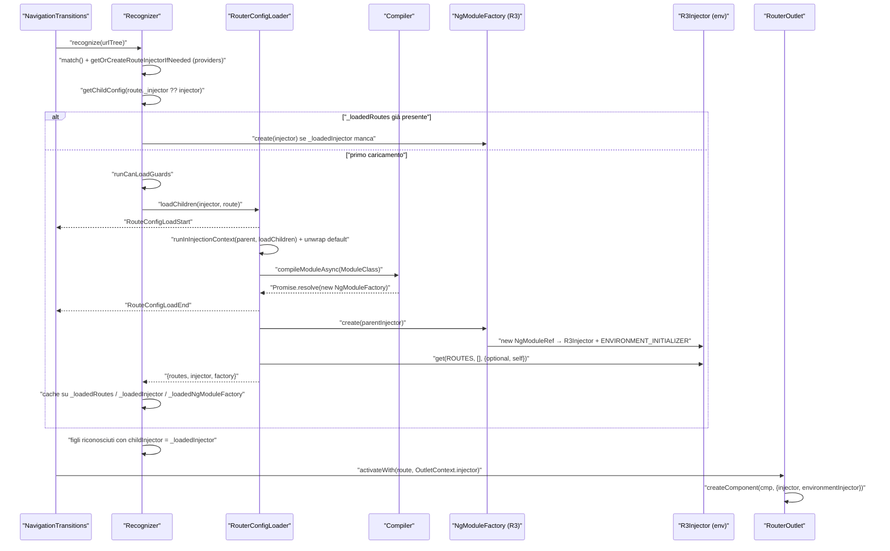
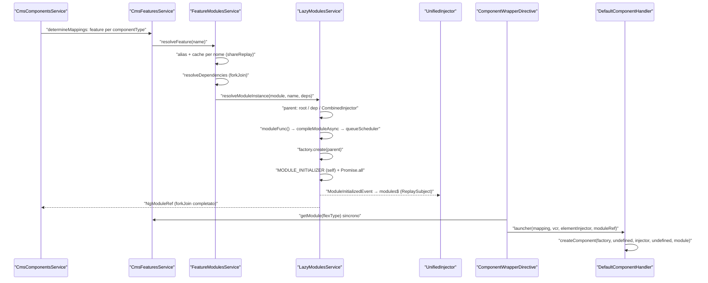

# 03 — Lazy loading: router e moduli caricati a runtime

> Riferimenti allo SHA `5b7a1c2bf2808d7380bc20596d10f4fa710c3da1` (vedi [00-meta](../00-meta.md)). Angular @ `v21.2.23` (prefisso `angular:`).

Prerequisiti: [01 — Dependency Injection](01-dependency-injection.md) (gerarchia degli injector, `R3Injector`, `ENVIRONMENT_INITIALIZER`) e [05 — Il Router di Angular](05-router.md) (recognize, guard, attivazione). Il lato Spartacus (configurazione `featureModules`, proxy facade, `MODULE_INITIALIZER` nel dettaglio) è trattato in [12 — Feature module e lazy loading in Spartacus](../parte-2/12-feature-module-lazy.md): qui lo si richiama solo per confrontarlo con il meccanismo di Angular.

## 1. A cosa serve e perché esiste

"Lazy loading" in Angular significa due cose distinte che spesso vengono confuse:

1. **Code splitting**: un `import()` dinamico fa sì che il bundler produca un chunk separato, scaricato solo quando la funzione viene chiamata. È una funzionalità del linguaggio e del bundler, non di Angular.
2. **Un nuovo injector a runtime**: quando il chunk contiene un `NgModule`, qualcuno deve istanziarlo, cioè creare un nuovo `EnvironmentInjector` figlio di un injector esistente, eseguire gli initializer del modulo e far sì che i componenti creati "dentro" quella feature vedano i suoi provider.

Angular offre un solo meccanismo *integrato* che fa entrambe le cose: le proprietà `loadChildren` e `loadComponent` di una `Route`, gestite dal `RouterConfigLoader` (`angular:packages/router/src/router_config_loader.ts:L41-L110`). Il router decide *quando* caricare (durante il recognize di una navigazione, o in background con il preloading), *quale injector usare come parent* e *dove memorizzare il risultato* (campi interni della `Route`, `angular:packages/router/src/models.ts:L771-L792`).

Spartacus, invece, **non usa il lazy loading del router**. Nelle librerie e nell'app demo non c'è alcun `loadChildren`, `loadComponent:`, `createNgModule`, `createEnvironmentInjector`, `provideRouter` o `withPreloading`; l'unico `compileModuleAsync` è in `LazyModulesService` (`core-libs/core/src/lazy-loading/lazy-modules.service.ts:L230-L230`). L'unico `RouterModule.forRoot` ha un array di route vuoto (`core-libs/storefront/router/app-routing.module.ts:L13-L19`). Il motivo è architetturale: in uno storefront Spartacus una pagina è composta dal CMS, e lo stesso componente (es. il mini-cart) può comparire in qualunque route. Il codice di una feature va quindi caricato **quando il CMS chiede un suo componente**, non quando il router entra in una certa route. Spartacus ha perciò un proprio caricatore, fuori dal router, che però riproduce — quasi riga per riga — gli stessi passi del router: `import()` → `compileModuleAsync` → `factory.create(parentInjector)` → componenti creati con l'injector del modulo come environment injector (`core-libs/core/src/lazy-loading/lazy-modules.service.ts:L96-L107`, `core-libs/storefront/cms-structure/page/component/handlers/default-component.handler.ts:L56-L68`).

Questo capitolo serve a:

- capire il meccanismo di Angular (router e API core `createNgModule` / `createEnvironmentInjector`) sui sorgenti v21.2;
- mostrare che `Compiler.compileModuleAsync` e `NgModuleFactory` — deprecati — in Ivy sono solo un involucro di `new NgModuleRef(...)`, quindi l'approccio di Spartacus è equivalente a `createNgModule` (`angular:packages/core/src/linker/compiler.ts:L57-L66`, `angular:packages/core/src/render3/ng_module_ref.ts:L127-L135`);
- mettere in fila le differenze che contano davvero (contesto di iniezione, export `default`, scelta del parent, initializer asincroni, distruzione, route e guard che vivono nel root) e le trappole che ne derivano.

## 2. Mappa dei file

### Angular — router (`angular:`)

| Path | Ruolo |
|---|---|
| `angular:packages/router/src/models.ts` | Tipi `LoadChildrenCallback`, `LoadChildren`, campi `Route.loadComponent`, `loadChildren`, `providers`, `canLoad` e cache interne `_injector`, `_loadedRoutes`, `_loadedInjector`, `_loadedNgModuleFactory`, `_loadedComponent`; `LoadedRouterConfig` |
| `angular:packages/router/src/router_config_loader.ts` | Token `ROUTES`, classe `RouterConfigLoader` (dedup con `WeakMap`), funzione `loadChildren` (unwrap `default`, `compileModuleAsync`, `factory.create`, lettura `ROUTES` con `self`) |
| `angular:packages/router/src/recognize.ts` | `processSegment` / `processSegmentAgainstRoute` / `getChildConfig`: scelta dell'injector e trigger di `loadChildren` + `canLoad` |
| `angular:packages/router/src/navigation_transition.ts` | Eventi `RouteConfigLoadStart`/`RouteConfigLoadEnd`; fase "LOAD COMPONENTS" per `loadComponent` |
| `angular:packages/router/src/utils/config.ts` | `getOrCreateRouteInjectorIfNeeded` (`createEnvironmentInjector` per i `providers` di route), `assertStandalone` |
| `angular:packages/router/src/utils/config_matching.ts` | Creazione dell'injector di route al match |
| `angular:packages/router/src/utils/collection.ts` | `wrapIntoPromise` |
| `angular:packages/router/src/router_preloader.ts` | `PreloadingStrategy`, `PreloadAllModules`, `NoPreloading`, `RouterPreloader` |
| `angular:packages/router/src/route_injector_cleanup.ts` | `destroyUnusedInjectors` (distruzione sperimentale degli injector di route) |
| `angular:packages/router/src/provide_router.ts` | `withPreloading`, `withExperimentalAutoCleanupInjectors` |
| `angular:packages/router/src/route_reuse_strategy.ts` | `ExperimentalRouteReuseStrategy`, `BaseRouteReuseStrategy.shouldDestroyInjector` |
| `angular:packages/router/src/router.ts` | `Router.config` iniziale letto da `ROUTES` |
| `angular:packages/router/src/router_module.ts` | `RouterModule.forChild` → provider multi di `ROUTES` |
| `angular:packages/router/src/router_outlet_context.ts`, `angular:packages/router/src/directives/router_outlet.ts`, `angular:packages/router/src/operators/activate_routes.ts` | Passaggio dell'environment injector della route al componente attivato |
| `angular:packages/router/src/index.ts` | Barrel pubblico di `@angular/router` |

### Angular — core (`angular:`)

| Path | Ruolo |
|---|---|
| `angular:packages/core/src/linker/compiler.ts` | `Compiler` (deprecato; in Ivy `compileModuleSync` = `new NgModuleFactory`) |
| `angular:packages/core/src/linker/ng_module_factory.ts` | `NgModuleRef` e `NgModuleFactory` astratti (factory deprecata) |
| `angular:packages/core/src/render3/ng_module_ref.ts` | `createNgModule`, `NgModuleRef` R3, `NgModuleFactory` R3, `EnvironmentNgModuleRefAdapter`, `createEnvironmentInjector` |
| `angular:packages/core/src/di/create_injector.ts` | `createInjectorWithoutInjectorInstances` |
| `angular:packages/core/src/di/r3_injector.ts` | `EnvironmentInjector`, `R3Injector` (scope, `get`, `destroy`, initializer) |
| `angular:packages/core/src/di/provider_collection.ts` | `importProvidersFrom`/`walkProviderTree`, `provideEnvironmentInitializer` |
| `angular:packages/core/src/di/initializer_token.ts` | `ENVIRONMENT_INITIALIZER` |
| `angular:packages/core/src/di/contextual.ts` | `runInInjectionContext` |
| `angular:packages/core/src/render3/standalone_service.ts`, `angular:packages/core/src/render3/definition.ts` | Injector dei componenti standalone |
| `angular:packages/core/src/linker/view_container_ref.ts`, `angular:packages/core/src/render3/component_ref.ts`, `angular:packages/core/src/render3/chained_injector.ts` | `createComponent` con `environmentInjector` / `NgModuleRef` |

### Spartacus

| Path | Ruolo |
|---|---|
| `core-libs/core/src/lazy-loading/lazy-modules.service.ts` | `LazyModulesService`: `import()` → `compileModuleAsync` → `factory.create(parent)` → `MODULE_INITIALIZER` → `ModuleInitializedEvent` |
| `core-libs/core/src/lazy-loading/feature-modules.service.ts` | `FeatureModulesService`: cache per nome, alias, dipendenze |
| `core-libs/core/src/lazy-loading/unified-injector.ts` | `UnifiedInjector`: root + injector dei moduli lazy |
| `core-libs/core/src/lazy-loading/tokens.ts` | `MODULE_INITIALIZER` |
| `core-libs/core/src/lazy-loading/lazy-loading.module.ts` | `LazyLoadingModule.forRoot()`: fallback eager via `APP_INITIALIZER` |
| `core-libs/core/src/lazy-loading/events/module-initialized-event.ts` | `ModuleInitializedEvent` |
| `core-libs/core/src/lazy-loading/facade-factory/facade-factory.service.ts` | Proxy facade risolte sull'injector lazy |
| `core-libs/core/src/util/combined-injector.ts` | `CombinedInjector` (interno, non esportato) |
| `core-libs/core/src/cms/config/cms-config.ts` | `FeatureModuleConfig`, `CmsConfig.featureModules` |
| `core-libs/storefront/cms-structure/services/cms-features.service.ts` | `CmsFeaturesService`: componentType → feature → `NgModuleRef` |
| `core-libs/storefront/cms-structure/services/cms-components.service.ts` | `determineMappings`: attende le feature prima del rendering |
| `core-libs/storefront/cms-structure/services/cms-routes-impl.service.ts` | Route CMS aggiunte a runtime con `resetConfig`; guard risolti con `UnifiedInjector` |
| `core-libs/storefront/cms-structure/page/component/handlers/default-component.handler.ts` | `createComponent(..., module)`: modulo lazy come environment injector |
| `core-libs/storefront/cms-structure/page/component/handlers/lazy-component.handler.ts` | `import()` di singoli componenti + `PendingTasks` |
| `core-libs/storefront/router/app-routing.module.ts` | Unico `RouterModule.forRoot([])` |

## 3. Come funziona passo per passo

### 3.1 Il contratto di `loadChildren` e `loadComponent`

- `LoadChildrenCallback` è una funzione senza argomenti che può restituire, in modo sincrono, come `Observable` o come `Promise`: una classe (`Type`), un `NgModuleFactory`, un array `Routes`, oppure un oggetto con export `default` di classe o `Routes`. L'`Observable` non ammette `NgModuleFactory` — `angular:packages/router/src/models.ts:L267-L274`. `LoadChildren` è solo un alias: la vecchia sintassi a stringa (`'./x#XModule'`) non esiste più — `angular:packages/router/src/models.ts:L283-L283`.
- Con un export `default` si può omettere `.then`: `loadChildren: () => import('./lazy-route/lazy.routes')` — `angular:packages/router/src/models.ts:L256-L261`.
- `loadComponent` restituisce un `Type` (o Observable/Promise di `Type` o di `DefaultExport<Type>`); il risultato viene memorizzato in `_loadedComponent` — `angular:packages/router/src/models.ts:L626-L634`.
- `providers` su una route: il router crea un **nuovo `EnvironmentInjector`** per la route e i suoi figli; se la route ha anche `loadChildren` che restituisce un modulo, quell'injector fa da parent del modulo lazy — `angular:packages/router/src/models.ts:L760-L769`.
- La `Route` contiene campi `@internal` di cache: `_injector`, `_loadedRoutes`, `_loadedInjector`, `_loadedNgModuleFactory` — `angular:packages/router/src/models.ts:L771-L792`. Il risultato di un caricamento è un `LoadedRouterConfig` = `{routes, injector, factory?}`, con `injector` `undefined` quando sono state caricate solo `Routes` — `angular:packages/router/src/models.ts:L795-L799`.
- `canLoad` è deprecato a favore di `canMatch` — `angular:packages/router/src/models.ts:L706-L715`.

In sintesi, la `Route` stessa è la cache: dopo il primo caricamento il router non richiama più la callback.

### 3.2 Injector per route: `providers` e `getOrCreateRouteInjectorIfNeeded`

Durante il matching, solo se `match()` ha avuto successo e prima dei `canMatch`, il router chiama `getOrCreateRouteInjectorIfNeeded(route, injector)` — `angular:packages/router/src/utils/config_matching.ts:L71-L71`. La funzione crea **una sola volta** un injector con `createEnvironmentInjector(route.providers, currentInjector, 'Route: <path>')` e lo salva in `route._injector` — `angular:packages/router/src/utils/config.ts:L31-L43`.

Da quel momento:
- `processSegment` processa ogni route con `r._injector ?? injector` — `angular:packages/router/src/recognize.ts:L244-L247`;
- dopo il match, `processSegmentAgainstRoute` passa a `getChildConfig` l'injector dei `providers` e usa `route._loadedInjector ?? injector` per i figli — `angular:packages/router/src/recognize.ts:L438-L441`.

Questo è il punto in cui `createEnvironmentInjector` entra nel router: **i `providers` di route non richiedono alcun NgModule** (vedi §3.6).

### 3.3 `getChildConfig`: quando parte `loadChildren`

`getChildConfig` (`angular:packages/router/src/recognize.ts:L494-L530`) distingue tre casi:

1. `route.children` statici: le route figlie "appartengono allo stesso modulo", l'injector non cambia — `angular:packages/router/src/recognize.ts:L499-L502`.
2. `route.loadChildren` già caricato (`_loadedRoutes !== undefined`): restituisce la cache; se esiste la factory ma non l'injector (perché distrutto, §3.9), lo **ricrea** con `_loadedNgModuleFactory.create(injector).injector` — `angular:packages/router/src/recognize.ts:L504-L512`.
3. `route.loadChildren` non ancora caricato: controlla l'abort della navigazione, esegue i guard `canLoad` (`runCanLoadGuards` restituisce subito `of(true)` se non ce ne sono — `angular:packages/router/src/operators/check_guards.ts:L230-L240`), poi chiama `configLoader.loadChildren(injector, route)` e salva il risultato sulla route; se `canLoad` fallisce lancia `canLoadFails(route)` — `angular:packages/router/src/recognize.ts:L514-L527`.

Il caricamento di `loadChildren` avviene quindi **durante il recognize**, perché il router deve conoscere le route figlie per continuare il matching.

### 3.4 `RouterConfigLoader.loadChildren` e la funzione `loadChildren`

`RouterConfigLoader` è `providedIn: 'root'`, deduplica i caricamenti in corso con due `WeakMap<Route, Promise>` e inietta `Compiler` — `angular:packages/router/src/router_config_loader.ts:L41-L47`.

1. Se c'è già una promise in volo per la route la restituisce; se `_loadedRoutes` è valorizzato restituisce `{routes, injector}` dalla cache — `angular:packages/router/src/router_config_loader.ts:L81-L86`.
2. Notifica `onLoadStartListener`, che `NavigationTransitions` collega all'evento `RouteConfigLoadStart` (e `onLoadEndListener` a `RouteConfigLoadEnd`) — `angular:packages/router/src/navigation_transition.ts:L389-L393`.
3. Chiama la funzione esportata `loadChildren(route, compiler, parentInjector, onLoadEndListener)` e salva su `route` i campi `_loadedRoutes`, `_loadedInjector`, `_loadedNgModuleFactory` — `angular:packages/router/src/router_config_loader.ts:L91-L102`.

La funzione `loadChildren` (`angular:packages/router/src/router_config_loader.ts:L120-L163`) — usata anche per la route discovery del prerendering in `@angular-devkit/build-angular` (`angular:packages/router/src/router_config_loader.ts:L112-L119`) e riesportata come API privata (`angular:packages/router/src/private_export.ts:L11-L11`):

1. esegue `route.loadChildren` dentro `runInInjectionContext(parentInjector, ...)`, quindi la callback può usare `inject()` — `angular:packages/router/src/router_config_loader.ts:L126-L129`;
2. normalizza il risultato con `wrapIntoPromise` (`firstValueFrom` per gli Observable, `Promise.resolve` per il resto — `angular:packages/router/src/utils/collection.ts:L88-L93`), spacchetta il `default` (`angular:packages/router/src/router_config_loader.ts:L165-L176`) e, in JIT, risolve le risorse dei componenti (`angular:packages/router/src/router_config_loader.ts:L178-L191`);
3. se il valore non è già un `NgModuleFactory` né un array, lo passa a `compiler.compileModuleAsync(t)` — `angular:packages/router/src/router_config_loader.ts:L131-L136`;
4. con un **array di route** non c'è alcun injector e le route figlie devono usare componenti standalone (`requireStandaloneComponents = true`) — `angular:packages/router/src/router_config_loader.ts:L141-L149`;
5. con un **modulo** crea `factory.create(parentInjector).injector` e legge `ROUTES` con `{optional: true, self: true}`: senza `self` un modulo privo di `RouterModule.forChild()` erediterebbe le route del parent e il preloader entrerebbe in loop infinito — `angular:packages/router/src/router_config_loader.ts:L150-L158`;
6. normalizza con `standardizeConfig` e, in dev, valida — `angular:packages/router/src/router_config_loader.ts:L159-L162`.

`RouterModule.forChild(routes)` non fa altro che fornire `ROUTES` multi con `useValue: routes` — `angular:packages/router/src/router_module.ts:L184-L189` — ed è per questo che il router trova le route del modulo lazy leggendo `ROUTES` dal suo injector.

### 3.5 `loadComponent` e i componenti standalone

`loadComponent` non viene eseguito nel recognize ma nella fase **LOAD COMPONENTS** della navigazione (dopo il recognize), con l'injector `route._environmentInjector` dello snapshot; i caricamenti dell'albero sono attesi con `Promise.all` — `angular:packages/router/src/navigation_transition.ts:L717-L739`.

`RouterConfigLoader.loadComponent`:
- riusa la promise in volo o `_loadedComponent` — `angular:packages/router/src/router_config_loader.ts:L49-L54`;
- esegue la callback in `runInInjectionContext(injector, ...)`, poi `wrapIntoPromise`, unwrap del `default` e risorse JIT — `angular:packages/router/src/router_config_loader.ts:L59-L64`;
- in dev verifica che sia standalone, salva `_loadedComponent` e pulisce la mappa nel `finally` — `angular:packages/router/src/router_config_loader.ts:L69-L77`. Passare un NgModule a `loadComponent` lancia `INVALID_ROUTE_CONFIG` ("Use 'loadChildren' instead") — `angular:packages/router/src/utils/config.ts:L73-L79`.

Un componente standalone caricato così non porta con sé un `NgModuleRef`: il suo injector viene creato all'attivazione. `createRootViewInjector` chiama `componentDef.getStandaloneInjector(realEnvironmentInjector)` — `angular:packages/core/src/render3/component_ref.ts:L150-L153` — che chiede `StandaloneService` al parent environment injector (`angular:packages/core/src/render3/definition.ts:L360-L364`); questo crea, se il componente importa provider, un injector con `createEnvironmentInjector([providers], this._injector, ...)` — `angular:packages/core/src/render3/standalone_service.ts:L31-L43`. `StandaloneService` è `providedIn: 'environment'`, quindi ogni environment injector (anche quello di un modulo lazy) ha la propria cache — `angular:packages/core/src/render3/standalone_service.ts:L61-L66`.

### 3.6 Le API core: `Compiler`, `NgModuleFactory`, `createNgModule`, `createEnvironmentInjector`

Il router (e Spartacus) passano per `Compiler.compileModuleAsync`. In Ivy questa API non compila nulla:

- `Compiler` è `providedIn: 'root'` e `@deprecated` ("Ivy JIT mode doesn't require accessing this symbol") — `angular:packages/core/src/linker/compiler.ts:L46-L52`;
- `compileModuleSync` restituisce `new NgModuleFactoryR3(moduleType)`, `compileModuleAsync` lo avvolge in `Promise.resolve` — `angular:packages/core/src/linker/compiler.ts:L57-L66`; `clearCache`/`clearCacheFor` sono no-op — `angular:packages/core/src/linker/compiler.ts:L97-L109`;
- la `NgModuleFactory` R3 ha come unico stato `moduleType` e `create(parentInjector)` esegue `new NgModuleRef(this.moduleType, parentInjector, [])` — `angular:packages/core/src/render3/ng_module_ref.ts:L127-L135`;
- `createNgModule(ngModule, parentInjector?)` è `@publicApi` ed esegue **esattamente** `new NgModuleRef(ngModule, parentInjector ?? null, [])`; senza parent si usa il `NullInjector` — `angular:packages/core/src/render3/ng_module_ref.ts:L27-L42`. `createNgModuleRef` ne è un alias deprecato — `angular:packages/core/src/render3/ng_module_ref.ts:L44-L50`;
- la `NgModuleFactory` astratta del linker è deprecata e suggerisce `createNgModule` — `angular:packages/core/src/linker/ng_module_factory.ts:L62-L75`.

Quindi `compiler.compileModuleAsync(M).then(f => f.create(parent))` ≡ `createNgModule(M, parent)`, a meno di un microtask.

Cosa succede in `new NgModuleRef(...)`:
1. crea l'`R3Injector` con `createInjectorWithoutInjectorInstances`, registrando `NgModuleRef` e `ComponentFactoryResolver` come `useValue` e lo scope `'environment'` — `angular:packages/core/src/render3/ng_module_ref.ts:L82-L95`;
2. `createInjectorWithoutInjectorInstances` raccoglie i provider con `importProvidersFrom(defType)` e usa come parent `parent || getNullInjector()` — `angular:packages/core/src/di/create_injector.ts:L42-L56`;
3. per ogni NgModule del grafo degli import, `walkProviderTree` aggiunge un provider della classe, un `INJECTOR_DEF_TYPES` e un `ENVIRONMENT_INITIALIZER` che fa `inject(defType)`: i costruttori di tutti i moduli importati vengono eseguiti alla creazione — `angular:packages/core/src/di/provider_collection.ts:L333-L343`;
4. risolve gli injector initializer separatamente (per evitare cicli se il modulo inietta il proprio ref) e ottiene l'istanza del modulo — `angular:packages/core/src/render3/ng_module_ref.ts:L97-L108`. `resolveInjectorInitializers` legge `ENVIRONMENT_INITIALIZER` con `self: true` e li invoca in modo **sincrono** — `angular:packages/core/src/di/r3_injector.ts:L426-L448`.

`createEnvironmentInjector(providers, parent, debugName)` è l'equivalente "senza modulo": crea un `EnvironmentNgModuleRefAdapter` con `runEnvironmentInitializers: true` e ne restituisce l'injector — `angular:packages/core/src/render3/ng_module_ref.ts:L183-L205`. L'adapter crea direttamente un `R3Injector` dai provider (nessuna classe modulo, `instance = null`), scope `'environment'`, parent `config.parent || getNullInjector()` — `angular:packages/core/src/render3/ng_module_ref.ts:L145-L172`. A differenza di `createNgModule`, il parent è tipizzato `EnvironmentInjector` e non un `Injector` qualsiasi — `angular:packages/core/src/render3/ng_module_ref.ts:L37-L40`, `angular:packages/core/src/render3/ng_module_ref.ts:L193-L196`. Questa differenza è rilevante per Spartacus, che a volte usa come parent un `CombinedInjector` che implementa solo `Injector` (§3.10).

Il `R3Injector` con scope `'environment'` registra `INJECTOR` ed `EnvironmentInjector` su se stesso — `angular:packages/core/src/di/r3_injector.ts:L228-L234`; crea al volo i record per gli `@Injectable` con `providedIn` corrispondente a uno dei suoi scope — `angular:packages/core/src/di/r3_injector.ts:L347-L366`; e, se non trova il token, delega a `this.parent.get(token, notFoundValue)` **senza** passare le `InjectOptions` — `angular:packages/core/src/di/r3_injector.ts:L374-L383`.

### 3.7 Come il componente "vede" l'injector lazy

Avere un `NgModuleRef` non basta: i componenti devono essere creati con il suo injector come **environment injector**.

- Nel router, `OutletContext.injector` è lo `_environmentInjector` dello snapshot attivo (che per i figli di una route lazy è `_loadedInjector`, §3.2) o, in mancanza, il root — `angular:packages/router/src/router_outlet_context.ts:L24-L26`. `ActivateRoutes` lo passa a `activateWith` — `angular:packages/router/src/operators/activate_routes.ts:L206-L206` — che crea il componente con `location.createComponent(component, {index, injector, environmentInjector})` — `angular:packages/router/src/directives/router_outlet.ts:L380-L404`.
- In generale `createComponent` accetta `environmentInjector` **oppure** `ngModuleRef` (mai entrambi: errore in dev) — `angular:packages/core/src/linker/view_container_ref.ts:L518-L526`; se nessuno dei due è passato lo cerca con `get(EnvironmentInjector, null)` — `angular:packages/core/src/linker/view_container_ref.ts:L536-L563`. La firma deprecata con factory accetta come quinto argomento un `EnvironmentInjector | NgModuleRef` — `angular:packages/core/src/linker/view_container_ref.ts:L263-L275`.
- `ComponentFactory.create` usa `environmentInjector || this.ngModule` — `angular:packages/core/src/render3/component_ref.ts:L282-L286`; `createRootViewInjector` estrae `.injector` da un `NgModuleRef` e restituisce `new ChainedInjector(injector, realEnvironmentInjector)` — `angular:packages/core/src/render3/component_ref.ts:L140-L159`. `ChainedInjector.get` interroga prima l'element injector, poi l'environment injector — `angular:packages/core/src/render3/chained_injector.ts:L18-L44`.

### 3.8 Preloading

- La strategia di default è `NoPreloading`, che non carica nulla — `angular:packages/router/src/router_preloader.ts:L62-L78`; `PreloadAllModules` carica tutto ignorando gli errori (`catchError(() => of(null))`) — `angular:packages/router/src/router_preloader.ts:L55-L60`. Entrambe, insieme a `withPreloading`, sono esportate da `@angular/router` — `angular:packages/router/src/index.ts:L98-L126`.
- `RouterPreloader.setUpPreloading` avvia il preload dopo ogni `NavigationEnd`, serializzato con `concatMap` — `angular:packages/router/src/router_preloader.ts:L103-L110`.
- Il preloader crea anch'esso gli injector dei `providers` e ricrea `_loadedInjector` dalla factory se manca — `angular:packages/router/src/router_preloader.ts:L124-L137`; salta le route `loadChildren` con `canLoad` definito (i guard possono avere side effect) — `angular:packages/router/src/router_preloader.ts:L139-L152`; non carica nulla se l'injector è già distrutto e poi ricorre sulle route figlie — `angular:packages/router/src/router_preloader.ts:L160-L183`.

### 3.9 Distruzione degli injector di route (sperimentale)

Di default il router non distrugge mai gli injector lazy. In v21.1 è stato introdotto l'opt-in `withExperimentalAutoCleanupInjectors()` (`@experimental 21.1`), che fornisce `ROUTE_INJECTOR_CLEANUP` e richiede che `RouteReuseStrategy.shouldDestroyInjector` restituisca `true` — `angular:packages/router/src/provide_router.ts:L795-L810`. Il `Router` lo inietta opzionalmente e lo invoca a ogni `NavigationEnd` — `angular:packages/router/src/router.ts:L148-L148`, `angular:packages/router/src/router.ts:L211-L213`. `destroyUnusedInjectors` distrugge `_injector` e `_loadedInjector` delle route non attive per cui la strategia acconsente, propagando ai figli — `angular:packages/router/src/route_injector_cleanup.ts:L66-L103`. `BaseRouteReuseStrategy.shouldDestroyInjector` restituisce `true` di default — `angular:packages/router/src/route_reuse_strategy.ts:L140-L150`. È per questo che `getChildConfig` e il preloader sanno ricreare `_loadedInjector` dalla factory (§3.3, §3.8).

### 3.10 Spartacus: il caricatore fuori dal router

Il dettaglio è nel [capitolo 12](../parte-2/12-feature-module-lazy.md); qui i passi, messi in parallelo con quelli del router (§3.3-§3.7).

1. **Dichiarazione.** `FeatureModuleConfig` ha `module?: () => Promise<any>`, `dependencies?` (funzioni o nomi di feature) e `cmsComponents?`; `CmsConfig.featureModules` mappa nome → config o alias stringa — `core-libs/core/src/cms/config/cms-config.ts:L109-L129`. Esempio app demo: `module: () => import('@spartacus/quote').then((m) => m.QuoteModule)` — `projects/storefrontapp/src/app/spartacus/features/quote-feature.module.ts:L26-L31`. Equivale alla callback di `loadChildren`, ma è letta da una config, non da una `Route`.
2. **Trigger.** Non è una navigazione ma il rendering CMS: `CmsFeaturesService.initFeatureMap` costruisce la mappa componentType → feature dalla config stabile `featureModules` — `core-libs/storefront/cms-structure/services/cms-features.service.ts:L56-L75`; `CmsComponentsService.determineMappings` attende con `forkJoin` la risoluzione delle feature dei componenti della pagina prima di proseguire — `core-libs/storefront/cms-structure/services/cms-components.service.ts:L92-L113`. Altri trigger: le proxy facade, che alla prima chiamata risolvono la feature e prendono la facade concreta con `moduleRef.injector.get(facadeClass)` — `core-libs/core/src/lazy-loading/facade-factory/facade-factory.service.ts:L43-L56`.
3. **Cache e dedup** (analogo di `WeakMap` + `_loadedRoutes`). `FeatureModulesService.resolveFeature` risolve l'alias e mette in cache per nome un Observable `resolveDependencies → resolveModuleInstance` con `shareReplay()` — `core-libs/core/src/lazy-loading/feature-modules.service.ts:L42-L72`. Una feature non configurata produce un errore "No module defined for Feature Module ..." — `core-libs/core/src/lazy-loading/feature-modules.service.ts:L47-L52`. `LazyModulesService.resolveModuleInstance` invece, per sua stessa documentazione, crea un'istanza nuova a ogni chiamata — `core-libs/core/src/lazy-loading/lazy-modules.service.ts:L70-L77`.
4. **Dipendenze** (nessun equivalente nel router). Risolte in parallelo con `forkJoin`: nome → `resolveFeature`, funzione → `resolveDependencyModuleInstance` — `core-libs/core/src/lazy-loading/feature-modules.service.ts:L108-L122`; i moduli di dipendenza sono creati una sola volta (mappa per classe) con parent root — `core-libs/core/src/lazy-loading/lazy-modules.service.ts:L121-L129`.
5. **Scelta del parent** (nel router: `route._injector ?? injector`). Root se non ci sono dipendenze, l'injector dell'unica dipendenza, o un `CombinedInjector(root, [injector delle dipendenze])` se sono più d'una — `core-libs/core/src/lazy-loading/lazy-modules.service.ts:L83-L94`.
6. **Import e "compilazione".** `resolveModuleFactory` esegue `moduleFunc()` **fuori** da un contesto di iniezione e senza spacchettare `default`; accetta un `NgModuleFactory` già pronto oppure passa la classe a `compileModuleAsync` (stesso ramo del router, §3.4 punto 3); poi riprogramma l'emissione su `queueScheduler` — `core-libs/core/src/lazy-loading/lazy-modules.service.ts:L220-L235`. Il `NgModuleFactory` importato è quello astratto del linker, quindi `instanceof` riconosce anche le factory R3 — `core-libs/core/src/lazy-loading/lazy-modules.service.ts:L7-L15`, `angular:packages/core/src/linker.ts:L21-L21`.
7. **Istanza.** `moduleFactory.create(parentInjector)` (= `createNgModule(M, parent)`, §3.6) — `core-libs/core/src/lazy-loading/lazy-modules.service.ts:L97-L97`.
8. **Initializer asincroni** (nessun equivalente nel router). `runModuleInitializersForModule` legge `MODULE_INITIALIZER` con `{ self: true }` — lo stesso accorgimento del router con `ROUTES` — e attende le Promise con `Promise.all` — `core-libs/core/src/lazy-loading/lazy-modules.service.ts:L150-L171`. `ENVIRONMENT_INITIALIZER`, al contrario, non è atteso e non deve essere `async` — `angular:packages/core/src/di/initializer_token.ts:L11-L24`.
9. **Notifica.** Si emette `ModuleInitializedEvent` (`feature?`, `moduleRef`) — `core-libs/core/src/lazy-loading/lazy-modules.service.ts:L99-L106`, `core-libs/core/src/lazy-loading/events/module-initialized-event.ts:L16-L31`; `modules$` è un `connectable` con `ReplaySubject` collegato nel costruttore, così anche i sottoscrittori tardivi ricevono tutti i moduli — `core-libs/core/src/lazy-loading/lazy-modules.service.ts:L47-L55`, `core-libs/core/src/lazy-loading/lazy-modules.service.ts:L65-L67`. Nel router l'unica notifica è l'evento `RouteConfigLoadEnd`.
10. **Rendering** (= `RouterOutlet.activateWith`). `ComponentWrapperDirective.launchComponent` passa all'handler l'element injector di `CmsInjectorService` e il `NgModuleRef` della feature — `core-libs/storefront/cms-structure/page/component/component-wrapper.directive.ts:L90-L102`; `CmsFeaturesService.getModule` lo restituisce in modo sincrono solo per feature già risolte — `core-libs/storefront/cms-structure/services/cms-features.service.ts:L110-L127`. `DefaultComponentHandler` chiama la firma deprecata `createComponent(factory, undefined, injector, undefined, module)` — `core-libs/storefront/cms-structure/page/component/handlers/default-component.handler.ts:L56-L68` — e per §3.7 il risultato è `ChainedInjector(elementInjector, module.injector)`.
11. **Config della feature.** La config CMS della feature è letta direttamente dall'injector del modulo (`ConfigChunk`, `DefaultConfigChunk` con `self: true`, fusi con `deepMerge`) — `core-libs/storefront/cms-structure/services/cms-features.service.ts:L188-L204`.

### 3.11 Spartacus: route e guard restano nel root

Poiché nessun modulo Spartacus è caricato dal router, le route delle feature sono dichiarate con `RouterModule.forChild` nei moduli `root` **eager** e finiscono nel `ROUTES` dell'injector root; il modulo lazy contiene solo l'implementazione. Esempio order, con `path: null` risolto da `cxRoute` — `feature-libs/order/root/order-root.module.ts:L82-L90`. Il router, infatti, inizializza `config` con `inject(ROUTES, {optional: true})?.flat()` dell'injector in cui vive (il root) — `angular:packages/router/src/router.ts:L163-L163` — e legge `ROUTES` di un modulo lazy solo nel flusso `loadChildren` (§3.4 punto 5).

Anche le route CMS aggiunte a runtime non usano `loadChildren`: `updateRouting` antepone una nuova route con `component: PageLayoutComponent` e `children` statici tramite `router.resetConfig` — `core-libs/storefront/cms-structure/services/cms-routes-impl.service.ts:L107-L119`. Le route figlie quindi "appartengono allo stesso modulo" del root (§3.3 caso 1) e i loro guard sarebbero risolti nel root injector. Per questo Spartacus avvolge ogni `canActivate` in una `CanActivateFn` che risolve il guard tramite `UnifiedInjector` ("even when they are provided only in a child injector of a lazy-loaded module") — `core-libs/storefront/cms-structure/services/cms-routes-impl.service.ts:L126-L136` — usando `getLastValueSync(unifiedInjector.get(guard))` e trattando il token come `CanActivateFn` se non trova un'istanza — `core-libs/storefront/cms-structure/services/cms-routes-impl.service.ts:L174-L180`. Lo stesso vale per i guard dei mapping CMS in `CmsGuardsService.cmsPageCanActivate` — `core-libs/storefront/cms-structure/services/cms-guards.service.ts:L41-L47`.

`UnifiedInjector.injectors$` parte dal root e aggiunge l'injector di ogni modulo emesso da `modules$` — `core-libs/core/src/lazy-loading/unified-injector.ts:L32-L35`; `get` interroga il root a tutti i livelli e gli injector lazy solo con `{ self: true }` — `core-libs/core/src/lazy-loading/unified-injector.ts:L56-L67`. `getLastValueSync` si sottoscrive e disiscrive subito restituendo l'ultima emissione sincrona — `core-libs/core/src/util/rxjs/get-last-value-sync.ts:L19-L23`.

### 3.12 Spartacus: lazy loading di singoli componenti

Oltre ai moduli, un mapping CMS può avere `component: () => import(...)`. `LazyComponentHandler` lo riconosce analizzando i primi 20 caratteri di `toString()` (`function()` o `()=>`) — `core-libs/storefront/cms-structure/page/component/handlers/lazy-component.handler.ts:L38-L48`; registra l'`import()` come `PendingTasks` (rimosso in `finalize`) per evitare che l'SSR serializzi e distrugga l'app mentre il chunk è in volo (NG0205), poi delega a `DefaultComponentHandler` passando il `module` — `core-libs/storefront/cms-structure/page/component/handlers/lazy-component.handler.ts:L60-L80`. È l'equivalente CMS di `loadComponent`, con due differenze: non c'è esecuzione in contesto di iniezione e il componente viene creato con l'environment injector della feature (se risolta), non con uno standalone injector della route.

### 3.13 Confronto riassuntivo

| Aspetto | Router Angular (`loadChildren`) | Spartacus (`featureModules`) |
|---|---|---|
| Trigger | Recognize di una navigazione / preloader (`angular:packages/router/src/recognize.ts:L514-L527`) | Rendering CMS, facade proxy (`core-libs/storefront/cms-structure/services/cms-components.service.ts:L92-L113`) |
| Unità caricabile | Classe NgModule, `NgModuleFactory`, `Routes`, `default` export (`angular:packages/router/src/models.ts:L267-L274`) | Classe NgModule o `NgModuleFactory` (`core-libs/core/src/lazy-loading/lazy-modules.service.ts:L225-L232`) |
| Contesto di iniezione della callback | Sì, `runInInjectionContext` (`angular:packages/router/src/router_config_loader.ts:L126-L129`) | No (`core-libs/core/src/lazy-loading/lazy-modules.service.ts:L223-L223`) |
| Unwrap `default` | Sì (`angular:packages/router/src/router_config_loader.ts:L165-L176`) | No |
| Istanziazione | `compileModuleAsync` + `factory.create(parent)` (`angular:packages/router/src/router_config_loader.ts:L131-L151`) | Identica (`core-libs/core/src/lazy-loading/lazy-modules.service.ts:L96-L97`) |
| Parent | `route._injector ?? injector` (`angular:packages/router/src/recognize.ts:L438-L441`) | Root / dipendenza / `CombinedInjector` (`core-libs/core/src/lazy-loading/lazy-modules.service.ts:L83-L94`) |
| Cache | Campi della `Route` + `WeakMap` (`angular:packages/router/src/router_config_loader.ts:L91-L102`) | `Map` per nome + `shareReplay` (`core-libs/core/src/lazy-loading/feature-modules.service.ts:L56-L68`) |
| Lettura token "self" | `ROUTES` (`angular:packages/router/src/router_config_loader.ts:L157-L157`) | `MODULE_INITIALIZER`, `ConfigChunk` (`core-libs/core/src/lazy-loading/lazy-modules.service.ts:L153-L157`) |
| Initializer async | No (`ENVIRONMENT_INITIALIZER` sincrono) | Sì, `MODULE_INITIALIZER` atteso |
| Uso dell'injector | Environment injector dei componenti attivati (`angular:packages/router/src/directives/router_outlet.ts:L380-L404`) | Environment injector dei componenti CMS + `UnifiedInjector` (`core-libs/storefront/cms-structure/page/component/handlers/default-component.handler.ts:L62-L68`) |
| Distruzione | Opt-in sperimentale (`angular:packages/router/src/provide_router.ts:L795-L810`) | Solo dependency module in `ngOnDestroy` (`core-libs/core/src/lazy-loading/lazy-modules.service.ts:L238-L245`) |
| Preloading | `PreloadingStrategy` | Nessuno |

## 4. Diagrammi

### 4.1 Navigazione verso una route `loadChildren` (NgModule)



Riferimenti dei passi: matching e injector di route §3.2; `getChildConfig` §3.3; loader §3.4; `Compiler`/factory/`NgModuleRef` §3.6; attivazione §3.7.

### 4.2 Gerarchia di injector: router vs Spartacus

```mermaid
flowchart TB
    subgraph NG["Router Angular"]
        RootA["Root EnvironmentInjector (ROUTES, Router)"]
        RouteInj["route._injector = createEnvironmentInjector(route.providers)"]
        Lazy["route._loadedInjector = factory.create(parent).injector"]
        Std["Standalone injector (StandaloneService)"]
        CmpA["Componente attivato: ChainedInjector(OutletInjector, env)"]
        RootA --> RouteInj --> Lazy --> Std
        Lazy -.->|"environmentInjector"| CmpA
    end
    subgraph SP["Spartacus"]
        RootS["Root injector (ROUTES eager, Router, UnifiedInjector)"]
        Dep1["Dependency module A (parent root)"]
        Dep2["Dependency module B (parent root)"]
        Comb["CombinedInjector(root, [A, B])"]
        Feat["Feature NgModuleRef = factory.create(parent)"]
        CmpS["Componente CMS: ChainedInjector(CmsInjector, feature)"]
        RootS --> Dep1
        RootS --> Dep2
        Dep1 --> Comb
        Dep2 --> Comb
        RootS --> Comb
        Comb --> Feat
        Feat -.->|"5° argomento di createComponent"| CmpS
        Feat -.->|"modules$ (self)"| RootS
    end
```



La freccia tratteggiata `modules$` indica che il root non diventa parent del modulo in senso inverso: è `UnifiedInjector` che interroga l'injector della feature con `self` (§3.11). La scelta del parent è in `core-libs/core/src/lazy-loading/lazy-modules.service.ts:L83-L94`; la catena dei componenti in `angular:packages/core/src/render3/component_ref.ts:L140-L159`.

### 4.3 Componente CMS di una feature lazy (Spartacus)



Riferimenti: §3.10 passi 2-10.

## 5. Estratti di codice reale

### 5.1 La funzione `loadChildren` del router

`angular:packages/router/src/router_config_loader.ts:L120-L163`
```ts
export async function loadChildren(
  route: Route,
  compiler: Compiler,
  parentInjector: Injector,
  onLoadEndListener?: (r: Route) => void,
): Promise<LoadedRouterConfig> {
  const loaded = await wrapIntoPromise(
    runInInjectionContext(parentInjector, () => route.loadChildren!()),
  );
  const t = await maybeResolveResources(maybeUnwrapDefaultExport(loaded));

  let factoryOrRoutes: NgModuleFactory<any> | Routes;
  if (t instanceof NgModuleFactory || Array.isArray(t)) {
    factoryOrRoutes = t;
  } else {
    factoryOrRoutes = await compiler.compileModuleAsync(t);
  }

  if (onLoadEndListener) {
    onLoadEndListener(route);
  }
  // This injector comes from the `NgModuleRef` when lazy loading an `NgModule`. There is
  // no injector associated with lazy loading a `Route` array.
  let injector: EnvironmentInjector | undefined;
  let rawRoutes: Route[];
  let requireStandaloneComponents = false;
  let factory: NgModuleFactory<unknown> | undefined = undefined;
  if (Array.isArray(factoryOrRoutes)) {
    rawRoutes = factoryOrRoutes;
    requireStandaloneComponents = true;
  } else {
    injector = factoryOrRoutes.create(parentInjector).injector;
    factory = factoryOrRoutes;
    // When loading a module that doesn't provide `RouterModule.forChild()` preloader
    // will get stuck in an infinite loop. The child module's Injector will look to
    // its parent `Injector` when it doesn't find any ROUTES so it will return routes
    // for it's parent module instead.
    rawRoutes = injector.get(ROUTES, [], {optional: true, self: true}).flat();
  }
  const routes = rawRoutes.map(standardizeConfig);
  (typeof ngDevMode === 'undefined' || ngDevMode) &&
    validateConfig(routes, route.path, requireStandaloneComponents);
  return {routes, injector, factory};
}
```

### 5.2 `RouterConfigLoader.loadChildren`: dedup e cache sulla `Route`

`angular:packages/router/src/router_config_loader.ts:L81-L109`
```ts
  loadChildren(parentInjector: Injector, route: Route): Promise<LoadedRouterConfig> {
    if (this.childrenLoaders.get(route)) {
      return this.childrenLoaders.get(route)!;
    } else if (route._loadedRoutes) {
      return Promise.resolve({routes: route._loadedRoutes, injector: route._loadedInjector});
    }

    if (this.onLoadStartListener) {
      this.onLoadStartListener(route);
    }
    const loader = (async () => {
      try {
        const result = await loadChildren(
          route,
          this.compiler,
          parentInjector,
          this.onLoadEndListener,
        );
        route._loadedRoutes = result.routes;
        route._loadedInjector = result.injector;
        route._loadedNgModuleFactory = result.factory;
        return result;
      } finally {
        this.childrenLoaders.delete(route);
      }
    })();
    this.childrenLoaders.set(route, loader);
    return loader;
  }
```

### 5.3 `getChildConfig` nel recognizer

`angular:packages/router/src/recognize.ts:L494-L530`
```ts
  private async getChildConfig(
    injector: EnvironmentInjector,
    route: Route,
    segments: UrlSegment[],
  ): Promise<LoadedRouterConfig> {
    if (route.children) {
      // The children belong to the same module
      return {routes: route.children, injector};
    }

    if (route.loadChildren) {
      // lazy children belong to the loaded module
      if (route._loadedRoutes !== undefined) {
        const ngModuleFactory = route._loadedNgModuleFactory;
        if (ngModuleFactory && !route._loadedInjector) {
          route._loadedInjector = ngModuleFactory.create(injector).injector;
        }
        return {routes: route._loadedRoutes, injector: route._loadedInjector};
      }

      if (this.abortSignal.aborted) {
        throw new Error(this.abortSignal.reason);
      }
      const shouldLoadResult = await firstValueFrom(
        runCanLoadGuards(injector, route, segments, this.urlSerializer, this.abortSignal),
      );
      if (shouldLoadResult) {
        const cfg = await this.configLoader.loadChildren(injector, route);
        route._loadedRoutes = cfg.routes;
        route._loadedInjector = cfg.injector;
        route._loadedNgModuleFactory = cfg.factory;
        return cfg;
      }
      throw canLoadFails(route);
    }

    return {routes: [], injector};
```

### 5.4 Injector dei `providers` di route

`angular:packages/router/src/utils/config.ts:L31-L43`
```ts
export function getOrCreateRouteInjectorIfNeeded(
  route: Route,
  currentInjector: EnvironmentInjector,
): EnvironmentInjector {
  if (route.providers && !route._injector) {
    route._injector = createEnvironmentInjector(
      route.providers,
      currentInjector,
      `Route: ${route.path}`,
    );
  }
  return route._injector ?? currentInjector;
}
```

### 5.5 `Compiler`, `NgModuleFactory` R3 e `createNgModule`: la stessa cosa

`angular:packages/core/src/linker/compiler.ts:L57-L66`
```ts
  compileModuleSync<T>(moduleType: Type<T>): NgModuleFactory<T> {
    return new NgModuleFactoryR3(moduleType);
  }

  /**
   * Compiles the given NgModule and all of its components
   */
  compileModuleAsync<T>(moduleType: Type<T>): Promise<NgModuleFactory<T>> {
    return Promise.resolve(this.compileModuleSync(moduleType));
  }
```

`angular:packages/core/src/render3/ng_module_ref.ts:L127-L135`
```ts
export class NgModuleFactory<T> extends viewEngine_NgModuleFactory<T> {
  constructor(public moduleType: Type<T>) {
    super();
  }

  override create(parentInjector: Injector | null): viewEngine_NgModuleRef<T> {
    return new NgModuleRef(this.moduleType, parentInjector, []);
  }
}
```

`angular:packages/core/src/render3/ng_module_ref.ts:L37-L42`
```ts
export function createNgModule<T>(
  ngModule: Type<T>,
  parentInjector?: Injector,
): viewEngine_NgModuleRef<T> {
  return new NgModuleRef<T>(ngModule, parentInjector ?? null, []);
}
```

### 5.6 `createEnvironmentInjector`

`angular:packages/core/src/render3/ng_module_ref.ts:L193-L205`
```ts
export function createEnvironmentInjector(
  providers: Array<Provider | EnvironmentProviders>,
  parent: EnvironmentInjector,
  debugName: string | null = null,
): EnvironmentInjector {
  const adapter = new EnvironmentNgModuleRefAdapter({
    providers,
    parent,
    debugName,
    runEnvironmentInitializers: true,
  });
  return adapter.injector;
}
```

### 5.7 `createRootViewInjector`: da `NgModuleRef` a `ChainedInjector`

`angular:packages/core/src/render3/component_ref.ts:L140-L159`
```ts
function createRootViewInjector(
  componentDef: ComponentDef<unknown>,
  environmentInjector: EnvironmentInjector | NgModuleRef<any> | undefined,
  injector: Injector,
): Injector {
  let realEnvironmentInjector =
    environmentInjector instanceof EnvironmentInjector
      ? environmentInjector
      : environmentInjector?.injector;

  if (realEnvironmentInjector && componentDef.getStandaloneInjector !== null) {
    realEnvironmentInjector =
      componentDef.getStandaloneInjector(realEnvironmentInjector) || realEnvironmentInjector;
  }

  const rootViewInjector = realEnvironmentInjector
    ? new ChainedInjector(injector, realEnvironmentInjector)
    : injector;
  return rootViewInjector;
}
```

### 5.8 Spartacus: `resolveModuleInstance`

`core-libs/core/src/lazy-loading/lazy-modules.service.ts:L78-L108`
```ts
  public resolveModuleInstance(
    moduleFunc: () => Promise<any>,
    feature?: string,
    dependencyModuleRefs: NgModuleRef<any>[] = []
  ): Observable<NgModuleRef<any>> {
    let parentInjector: Injector;

    if (!dependencyModuleRefs.length) {
      parentInjector = this.injector;
    } else if (dependencyModuleRefs.length === 1) {
      parentInjector = dependencyModuleRefs[0].injector;
    } else {
      parentInjector = new CombinedInjector(
        this.injector,
        dependencyModuleRefs.map((moduleRef) => moduleRef.injector)
      );
    }

    return this.resolveModuleFactory(moduleFunc).pipe(
      map(([moduleFactory]) => moduleFactory.create(parentInjector)),
      concatMap((moduleRef) => this.runModuleInitializersForModule(moduleRef)),
      tap((moduleRef) =>
        this.events.dispatch(
          createFrom(ModuleInitializedEvent, {
            feature,
            moduleRef,
          })
        )
      )
    );
  }
```

### 5.9 Spartacus: `resolveModuleFactory` (il ramo identico al router)

`core-libs/core/src/lazy-loading/lazy-modules.service.ts:L220-L236`
```ts
  private resolveModuleFactory(
    moduleFunc: () => Promise<any>
  ): Observable<[NgModuleFactory<any>, any]> {
    return from(moduleFunc()).pipe(
      switchMap((module) =>
        module instanceof NgModuleFactory
          ? (of([module, module]) as Observable<[NgModuleFactory<any>, any]>)
          : combineLatest([
              // using compiler here is for jit compatibility, there is no overhead
              // for aot production builds as it will be stubbed
              from(this.compiler.compileModuleAsync(module as any)),
              of(module),
            ])
      ),
      observeOn(queueScheduler)
    );
  }
```

Confrontalo con le righe `L131-L136` di §5.1: stesso test `instanceof NgModuleFactory`, stessa chiamata `compileModuleAsync`. Mancano `runInInjectionContext` e `maybeUnwrapDefaultExport`.

### 5.10 Spartacus: `MODULE_INITIALIZER` letto con `self`

`core-libs/core/src/lazy-loading/lazy-modules.service.ts:L150-L175`
```ts
  public runModuleInitializersForModule(
    moduleRef: NgModuleRef<any>
  ): Observable<NgModuleRef<any>> {
    const moduleInits: any[] = moduleRef.injector.get<any[]>(
      MODULE_INITIALIZER,
      [],
      { self: true }
    );
    const asyncInitPromises: Promise<any>[] =
      this.runModuleInitializerFunctions(moduleInits);
    if (asyncInitPromises.length) {
      return from(Promise.all(asyncInitPromises)).pipe(
        tap({
          error: (error) => {
            this.logger.error(
              'MODULE_INITIALIZER promise was rejected while lazy loading a module.',
              error
            );
          },
        }),
        switchMap(() => of(moduleRef))
      );
    } else {
      return of(moduleRef);
    }
  }
```

### 5.11 Spartacus: `CombinedInjector.get`

`core-libs/core/src/util/combined-injector.ts:L43-L71`
```ts
  get(token: any, notFoundValue?: any, optional?: InjectOptions): any {
    if (optional && optional.self) {
      if (notFoundValue !== undefined) {
        return notFoundValue;
      }
      throw new Error(
        "CombinedInjector should be used as a parent injector / doesn't support self dependencies"
      );
    }

    for (const injector of this.complementaryInjectors) {
      // First we are resolving providers provided at Self level
      // in all complementary injectors...
      const service = injector.get(token, NOT_FOUND_SYMBOL, { self: true });
      if (service !== NOT_FOUND_SYMBOL) {
        return service;
      }
    }

    for (const injector of this.complementaryInjectors) {
      // next we try to resolve tokens from all levels
      const service = injector.get(token, NOT_FOUND_SYMBOL);
      if (service !== NOT_FOUND_SYMBOL) {
        return service;
      }
    }
    // ...and then fallback to main injector
    return this.mainInjector.get(token, notFoundValue);
  }
```

### 5.12 Spartacus: modulo lazy come environment injector del componente CMS

`core-libs/storefront/cms-structure/page/component/handlers/default-component.handler.ts:L56-L70`
```ts
      const factory = this.getComponentFactory(
        injector,
        componentMapping.component
      );

      if (factory) {
        componentRef = viewContainerRef.createComponent(
          factory,
          undefined,
          injector,
          undefined,
          module
        );
        subscriber.next({ elementRef: componentRef.location, componentRef });
      }
```

### 5.13 Spartacus: guard di route risolti con `UnifiedInjector`

`core-libs/storefront/cms-structure/services/cms-routes-impl.service.ts:L170-L181`
```ts
    return (
      route: ActivatedRouteSnapshot,
      state: RouterStateSnapshot
    ): Observable<GuardResult> => {
      const classGuard = getLastValueSync(
        this.unifiedInjector.get<CanActivate>(
          guard as InjectionToken<CanActivate>
        )
      );
      const canActivate = classGuard ?? { canActivate: guard as CanActivateFn };
      return this.guardsComposer.canActivate([canActivate], route, state);
    };
```

### 5.14 Spartacus: `import()` di un componente come `PendingTasks`

`core-libs/storefront/cms-structure/page/component/handlers/lazy-component.handler.ts:L60-L71`
```ts
    return defer(() => {
      // Register the dynamic import as a pending task so Angular's stability
      // counter stays > 0 until the chunk is loaded. This prevents SSR from
      // serializing and destroying the app while the import() is still in flight
      // (which would cause NG0205 — destroyed injector). The task is removed by
      // finalize(), which fires on complete, error, and unsubscribe.

      const removeTaskTracking = this.pendingTasks.add();
      return from(componentMapping.component()).pipe(
        finalize(removeTaskTracking)
      );
    }).pipe(
```

## 6. Configurazione

| Chiave | Tipo | Default | Definita in | Letta in |
|---|---|---|---|---|
| `Route.loadChildren` | `LoadChildren` (callback) | nessuno | `angular:packages/router/src/models.ts:L738-L738` | `angular:packages/router/src/router_config_loader.ts:L127-L127`, `angular:packages/router/src/recognize.ts:L504-L504`, `angular:packages/router/src/router_preloader.ts:L148-L148` |
| `Route.loadComponent` | `() => Type \| Observable \| Promise` | nessuno | `angular:packages/router/src/models.ts:L626-L629` | `angular:packages/router/src/router_config_loader.ts:L62-L62`, `angular:packages/router/src/navigation_transition.ts:L723-L727` |
| `Route.providers` | `Array<Provider \| EnvironmentProviders>` | nessuno | `angular:packages/router/src/models.ts:L769-L769` | `angular:packages/router/src/utils/config.ts:L35-L40`, `angular:packages/router/src/router_preloader.ts:L124-L129` |
| `Route.canLoad` (deprecato) | array di guard | nessuno | `angular:packages/router/src/models.ts:L715-L715` | `angular:packages/router/src/operators/check_guards.ts:L237-L240`, `angular:packages/router/src/router_preloader.ts:L148-L148` |
| `PreloadingStrategy` (via `withPreloading`) | classe | `NoPreloading` | `angular:packages/router/src/router_preloader.ts:L62-L78` | `angular:packages/router/src/provide_router.ts:L629-L629`; Spartacus non lo configura |
| `withExperimentalAutoCleanupInjectors()` | feature opt-in, `@experimental 21.1` | disattivo | `angular:packages/router/src/provide_router.ts:L806-L810` | `angular:packages/router/src/router.ts:L148-L148` |
| `RouterModule.forRoot` options (Spartacus) | `ExtraOptions` | `anchorScrolling: 'enabled'`, `initialNavigation: 'enabledBlocking'` | `core-libs/storefront/router/app-routing.module.ts:L15-L18` | router Angular |
| `featureModules` (Spartacus) | `{ [name]: FeatureModuleConfig \| string }` | assente | `core-libs/core/src/cms/config/cms-config.ts:L129-L129` | `core-libs/core/src/lazy-loading/feature-modules.service.ts:L83-L97`, `core-libs/storefront/cms-structure/services/cms-features.service.ts:L57-L60` |
| `FeatureModuleConfig.module` / `.dependencies` / `.cmsComponents` | funzione `import()` / array / `string[]` | assenti | `core-libs/core/src/cms/config/cms-config.ts:L113-L121` | `core-libs/core/src/lazy-loading/feature-modules.service.ts:L58-L63`, `core-libs/storefront/cms-structure/services/cms-features.service.ts:L66-L72` |

Per la configurazione completa di `featureModules` (alias, `cmsComponents`, convenzioni delle feature lib) vedi [capitolo 12](../parte-2/12-feature-module-lazy.md) e [11 — Configurazione](../parte-2/11-configurazione.md).

## 7. Commenti e note notevoli dal sorgente

- `angular:packages/core/src/linker/compiler.ts:L46-L49` — `Compiler` è `@deprecated`: "Ivy JIT mode doesn't require accessing this symbol." Eppure il router stesso lo inietta (`angular:packages/router/src/router_config_loader.ts:L47-L47`).
- `angular:packages/core/src/linker/ng_module_factory.ts:L62-L71` — `NgModuleFactory` deprecata, invita a usare API che accettano la classe (`createNgModule`).
- `angular:packages/core/src/render3/ng_module_ref.ts:L44-L50` — `createNgModuleRef` `@deprecated Use createNgModule instead.`
- `angular:packages/core/src/linker/ng_module_factory_loader.ts:L16-L22` — `getModuleFactory` `@deprecated Use getNgModuleById instead.`
- `angular:packages/core/src/di/initializer_token.ts:L15-L20` — `ENVIRONMENT_INITIALIZER` deprecato dalla v19; le funzioni "are not awaited, hence they should not be `async`".
- `angular:packages/router/src/router_config_loader.ts:L153-L156` — il commento sul loop infinito del preloader che giustifica `self: true` nella lettura di `ROUTES`.
- `angular:packages/router/src/router_config_loader.ts:L116-L118` — la funzione `loadChildren` è un contratto con l'estrattore di route del prerendering.
- `angular:packages/router/src/router_preloader.ts:L139-L146` — "Code splitting and lazy loading is separate from client-side authorization checks and should not be used as a security measure to prevent loading of code."
- `angular:packages/router/src/route_reuse_strategy.ts:L146-L146` — typo `@xperimental 21.1`; `angular:packages/router/src/models.ts:L789-L789` — typo "retruns" nel JSDoc di `_loadedNgModuleFactory`.
- `angular:packages/core/src/linker/view_container_ref.ts:L556-L558` — "DO NOT REFACTOR" sulla ricerca `injector.get(EnvironmentInjector, null)`.
- `core-libs/core/src/lazy-loading/lazy-modules.service.ts:L228-L229` — "using compiler here is for jit compatibility, there is no overhead for aot production builds as it will be stubbed". ⚠️ DA VERIFICARE: in Angular v21 `Compiler` non viene "stubbato" dal bundler ma è già un'implementazione banale (§3.6); il commento sembra risalire a View Engine. Non verificabile senza una build (`node_modules` assente).
- `core-libs/core/src/lazy-loading/lazy-modules.service.ts:L73-L73` — "New module instance will be created with each call.": la cache non è qui ma in `FeatureModulesService`.
- `core-libs/core/src/lazy-loading/tokens.ts:L14-L17` — fallback di `MODULE_INITIALIZER` ad `APP_INITIALIZER` se il modulo è eager (typo "Therfore").
- `core-libs/storefront/cms-structure/services/cms-routes-impl.service.ts:L130-L135` — i guard sono risolti con `UnifiedInjector` "instead of only root injector".
- `core-libs/storefront/cms-structure/page/component/handlers/lazy-component.handler.ts:L61-L65` — `PendingTasks` per evitare NG0205 in SSR.
- `feature-libs/order/root/order-root.module.ts:L67-L67` — `// TODO: Inline this factory when we start releasing Ivy compiled libraries`.

## 8. Extension point

**Angular**
- `ROUTES` (`InjectionToken` multi) — `angular:packages/router/src/router_config_loader.ts:L37-L39`, esportato da `@angular/router` (`angular:packages/router/src/index.ts:L118-L118`). In Spartacus si contribuisce a `ROUTES` con `RouterModule.forChild` nei moduli eager (§3.11).
- `PreloadingStrategy` / `PreloadAllModules` / `NoPreloading` — `angular:packages/router/src/router_preloader.ts:L55-L78`. Inutili per le feature Spartacus, che non passano dal router.
- `RouteReuseStrategy.shouldDestroyInjector` (sperimentale) — `angular:packages/router/src/route_reuse_strategy.ts:L55-L57`, `angular:packages/router/src/route_reuse_strategy.ts:L148-L150`.
- `createNgModule`, `createEnvironmentInjector`, `provideEnvironmentInitializer` — `angular:packages/core/src/core.ts:L101-L103`, `angular:packages/core/src/di/provider_collection.ts:L81-L88`.

**Spartacus** (pubblici via `core-libs/core/public_api.ts:L24-L24`)
- `CmsConfig.featureModules` per dichiarare una nuova feature lazy o ridefinire `module`/`dependencies` di una esistente — `core-libs/core/src/cms/config/cms-config.ts:L129-L129`. Ricetta: [53 — Ricette: feature lib lazy, carrello/checkout, stili, traduzioni](../parte-3/53-ricette-feature-cart-checkout-stili-i18n.md).
- `MODULE_INITIALIZER` per inizializzazione (anche asincrona) di un modulo lazy — `core-libs/core/src/lazy-loading/tokens.ts:L19-L20`. Ricetta: [50 — Ricette: configurazione, DI, interceptor, eventi](../parte-3/50-ricette-config-di.md).
- `LazyModulesService`, `FeatureModulesService` (metodi `protected` `getFeatureConfig`, `resolveFeatureAlias`, `resolveDependencies` — `core-libs/core/src/lazy-loading/feature-modules.service.ts:L80-L123`), `UnifiedInjector`, `ModuleInitializedEvent`, `facadeFactory` — sostituibili/estendibili via DI.
- Mapping CMS con `component: () => import(...)` (lazy di un singolo componente, §3.12) e guard nei mapping risolti via `UnifiedInjector` — ricetta: [51 — Ricette: componenti CMS, outlet, route e layout](../parte-3/51-ricette-cms-outlet-layout.md).
- `CmsFeaturesService`, `CmsComponentsService` — esportati via `core-libs/storefront/cms-structure/services/index.ts:L7-L8`.
- **Non** sono API pubbliche: `CombinedInjector` (`core-libs/core/src/util/index.ts:L7-L28`) e `CmsRoutesImplService` (`core-libs/storefront/cms-structure/services/index.ts:L7-L12`). Vedi [54 — API pubblica vs interna, upgrade, anti-pattern, checklist](../parte-3/54-upgrade-safe.md) sul perché non dipendere da `Compiler`/`NgModuleFactory`/`CombinedInjector` nel codice applicativo.

Si può comunque usare `loadChildren`/`loadComponent` nell'**app** per pagine non CMS (Spartacus non lo impedisce: le route dell'app finiscono nello stesso `ROUTES` root). ⚠️ DA VERIFICARE: l'interazione con la catch-all CMS e con `ConfigurableRoutesService` non è esercitata da nessun esempio nel repo; vedi [05 — Il Router di Angular](05-router.md) per l'ordine delle route.

## 9. Trappole, casi limite, comportamenti controintuitivi

1. **`inject()` nella callback.** Il router esegue `loadChildren`/`loadComponent` in un contesto di iniezione; `FeatureModuleConfig.module` viene invocata senza contesto: un `inject()` dentro la callback lancerebbe. — `angular:packages/router/src/router_config_loader.ts:L127-L127` vs `core-libs/core/src/lazy-loading/lazy-modules.service.ts:L223-L223`.
2. **Export `default` non supportato da Spartacus.** `module: () => import('x')` senza `.then(m => m.X)` passerebbe il namespace del modulo ES a `compileModuleAsync`, che non valida il tipo; l'errore emergerebbe nel costruttore di `NgModuleRef` (assert solo in dev). Usa sempre `.then`, come nell'app demo. — `angular:packages/router/src/router_config_loader.ts:L172-L176`; `core-libs/core/src/lazy-loading/lazy-modules.service.ts:L225-L232`; `angular:packages/core/src/render3/ng_module_ref.ts:L74-L79`; `projects/storefrontapp/src/app/spartacus/features/quote-feature.module.ts:L29-L29`.
3. **Solo NgModule.** Spartacus accetta solo classi NgModule o factory: niente `Routes` né componenti standalone come unità lazy di feature (a differenza di `loadChildren` con array). — `core-libs/core/src/lazy-loading/lazy-modules.service.ts:L225-L232`; `angular:packages/router/src/router_config_loader.ts:L141-L149`.
4. **Moduli re-istanziati.** La deduplicazione di `importProvidersFrom` è locale alla singola chiamata: un modulo importato sia nel root sia nel modulo lazy viene rielaborato nell'injector lazy, con servizi duplicati e costruttori di modulo rieseguiti. È uno dei motivi delle `dependencies` condivise di Spartacus (create una volta). — `angular:packages/core/src/di/provider_collection.ts:L151-L156`, `angular:packages/core/src/di/provider_collection.ts:L340-L343`; `core-libs/core/src/lazy-loading/lazy-modules.service.ts:L123-L126`.
5. **`CombinedInjector` e `self`.** `R3Injector` delega al parent senza `InjectOptions`: quando un modulo lazy ha come parent un `CombinedInjector`, il ramo `self` di quest'ultimo non viene raggiunto per delega, e `optional` arriva solo come `notFoundValue = null`. Chiamato direttamente con `self` e senza `notFoundValue`, `CombinedInjector` lancia sempre. — `angular:packages/core/src/di/r3_injector.ts:L376-L383`; `core-libs/core/src/util/combined-injector.ts:L44-L51`.
6. **Initializer sincroni vs asincroni.** `ENVIRONMENT_INITIALIZER` non è atteso; per un initializer asincrono in un modulo lazy Spartacus usa `MODULE_INITIALIZER`. Un `MODULE_INITIALIZER` che lancia in modo sincrono viene loggato e rilanciato. — `angular:packages/core/src/di/initializer_token.ts:L19-L20`; `core-libs/core/src/lazy-loading/lazy-modules.service.ts:L187-L207`.
7. **Nessuna distruzione delle feature.** Il router non distrugge gli injector lazy salvo opt-in sperimentale; Spartacus in `ngOnDestroy` distrugge solo i dependency module, non i feature module, che restano vivi per tutta la vita dell'app. — `angular:packages/router/src/provide_router.ts:L799-L806`; `core-libs/core/src/lazy-loading/lazy-modules.service.ts:L243-L244`.
8. **`RouterModule.forChild` in un modulo lazy Spartacus è ignorato.** `Router.config` legge `ROUTES` solo dal root e il router legge `ROUTES` di un modulo lazy solo nel flusso `loadChildren`: route dichiarate nel modulo caricato da `LazyModulesService` non vengono mai viste. Dichiarale nel modulo `root` eager. — `angular:packages/router/src/router.ts:L163-L163`; `angular:packages/router/src/router_config_loader.ts:L157-L157`; `feature-libs/order/root/order-root.module.ts:L82-L90`.
9. **Guard forniti solo nel modulo lazy.** Su route root il router non li troverebbe: Spartacus li risolve via `UnifiedInjector`, e `getLastValueSync` prende l'**ultima** istanza emessa (l'injector lazy più recente prevale sul root). Se la feature non è ancora caricata, `classGuard` è `undefined` e il token viene trattato come `CanActivateFn`. — `core-libs/storefront/cms-structure/services/cms-routes-impl.service.ts:L174-L179`; `core-libs/core/src/util/rxjs/get-last-value-sync.ts:L19-L23`; `core-libs/core/src/lazy-loading/unified-injector.ts:L56-L67`.
10. **`getModule` può restituire `undefined`.** Per feature non ancora risolte `CmsFeaturesService.getModule` restituisce `undefined` e `createComponent` ricade sull'environment injector della factory / del DI tree. — `core-libs/storefront/cms-structure/services/cms-features.service.ts:L119-L126`; `angular:packages/core/src/render3/component_ref.ts:L284-L284`.
11. **`ngModuleRef` ed `environmentInjector` insieme.** Con la firma a classe di `createComponent` è un errore; Spartacus usa la firma deprecata con factory e passa il modulo come quinto argomento posizionale. — `angular:packages/core/src/linker/view_container_ref.ts:L518-L522`; `core-libs/storefront/cms-structure/page/component/handlers/default-component.handler.ts:L62-L68`.
12. **Il preloader ignora le route con `canLoad`**, anche se il guard è innocuo; e Spartacus non ha preloading delle feature. — `angular:packages/router/src/router_preloader.ts:L147-L152`.
13. **`createNgModule` senza parent** usa il `NullInjector`: il modulo non vedrebbe i servizi root. Spartacus passa sempre un parent. — `angular:packages/core/src/render3/ng_module_ref.ts:L31-L41`; `core-libs/core/src/lazy-loading/lazy-modules.service.ts:L83-L94`.
14. **Euristica `toString()`.** `LazyComponentHandler` riconosce il lazy import dai primi caratteri del sorgente della funzione: funzioni con nome o forme prodotte da trasformazioni diverse da `function()`/`()=>` non sarebbero riconosciute. — `core-libs/storefront/cms-structure/page/component/handlers/lazy-component.handler.ts:L45-L48`.
15. **SSR e feature module.** `LazyComponentHandler` registra un `PendingTasks`, mentre in `core-libs/core/src/lazy-loading/` non c'è alcun uso di `PendingTasks` (grep allo SHA). ⚠️ DA VERIFICARE: come l'SSR attenda il caricamento dei feature module; probabilmente la stabilità è mantenuta indirettamente da altri task (HTTP, NgRx), ma non è verificabile senza eseguire l'app (`node_modules` assente). Vedi [07 — SSR, hydration e TransferState](07-ssr-hydration-transferstate.md). — `core-libs/storefront/cms-structure/page/component/handlers/lazy-component.handler.ts:L67-L70`.
16. **Facade non fornita dal modulo lazy.** `FacadeFactoryService` fa `moduleRef.injector.get(facadeClass)`; per la delega al parent (§3.6) se il modulo non fornisce la classe la ricerca risale verso il root. ⚠️ DA VERIFICARE: se ciò restituisca il proxy `providedIn: 'root'` stesso (con possibile ricorsione) non è verificato su un caso reale. — `core-libs/core/src/lazy-loading/facade-factory/facade-factory.service.ts:L43-L56`; `angular:packages/core/src/di/r3_injector.ts:L374-L383`.

## 10. Come fare debug

- **Router.** Abilita `withDebugTracing()` (esportato da `@angular/router`, `angular:packages/router/src/index.ts:L85-L101`) o filtra `router.events` su `RouteConfigLoadStart` / `RouteConfigLoadEnd`, emessi dal loader — `angular:packages/router/src/navigation_transition.ts:L389-L393`. In Spartacus questi eventi non compaiono mai per le feature (nessun `loadChildren`): se li vedi, provengono da route dell'app.
- **Feature Spartacus.** Sottoscrivi `EventService.get(ModuleInitializedEvent)`: l'evento porta `feature` (assente per i dependency module) e `moduleRef` — `core-libs/core/src/lazy-loading/events/module-initialized-event.ts:L16-L31`. In alternativa `LazyModulesService.modules$`, che rigioca anche i moduli già caricati — `core-libs/core/src/lazy-loading/lazy-modules.service.ts:L47-L55`.
- **"No module defined for Feature Module X"**: la feature è referenziata (da `cmsComponents`, da una dipendenza o da una facade) ma manca `module` nella config — `core-libs/core/src/lazy-loading/feature-modules.service.ts:L47-L52`.
- **Componente che non vede un servizio della feature**: verifica che `getModule(flexType)` non sia `undefined` al momento del rendering (§9.10) e che il servizio sia fornito nel modulo lazy e non solo in un modulo eager con scope diverso.
- **Breakpoint utili**: `LazyModulesService.resolveModuleInstance` (`core-libs/core/src/lazy-loading/lazy-modules.service.ts:L78-L108`) per vedere il parent scelto; `NgModuleRef` constructor (`angular:packages/core/src/render3/ng_module_ref.ts:L82-L108`) per vedere quali moduli vengono istanziati (via `ENVIRONMENT_INITIALIZER`); `DefaultComponentHandler.launcher` per verificare il quinto argomento di `createComponent`.
- **Network tab**: ogni `import()` produce una richiesta a un chunk JS. Un chunk richiesto per una feature in una pagina che non ne mostra componenti indica una facade o una dipendenza che l'ha risolta (§3.10 passo 2).
- **Guard su route CMS**: un breakpoint nel wrapper di `CmsRoutesImplService` (`core-libs/storefront/cms-structure/services/cms-routes-impl.service.ts:L170-L181`) mostra se `classGuard` è stato trovato o se il token viene trattato come funzione.

## 11. Domande di autoverifica

1. **Quando, durante una navigazione, Angular esegue `loadChildren` e quando `loadComponent`?**
   `loadChildren` nel recognize (`getChildConfig`), perché servono le route figlie per proseguire il matching; `loadComponent` nella fase successiva "LOAD COMPONENTS". — `angular:packages/router/src/recognize.ts:L514-L527`, `angular:packages/router/src/navigation_transition.ts:L717-L739`.
2. **Perché il router legge `ROUTES` dal modulo lazy con `self: true`?**
   Senza `self`, un modulo privo di `RouterModule.forChild()` erediterebbe le route del parent e il preloader entrerebbe in loop infinito. — `angular:packages/router/src/router_config_loader.ts:L153-L157`.
3. **Che differenza c'è, in Ivy, tra `compiler.compileModuleAsync(M).then(f => f.create(p))` e `createNgModule(M, p)`?**
   Nessuna sostanziale: entrambe eseguono `new NgModuleRef(M, p, [])`; la prima aggiunge solo un `Promise.resolve`. — `angular:packages/core/src/linker/compiler.ts:L57-L66`, `angular:packages/core/src/render3/ng_module_ref.ts:L37-L42`, `angular:packages/core/src/render3/ng_module_ref.ts:L132-L134`.
4. **Cosa fa il router con l'array `providers` di una route e quale API usa?**
   Crea una volta un `EnvironmentInjector` con `createEnvironmentInjector(route.providers, currentInjector, 'Route: path')`, salvato in `route._injector`; è il parent di un eventuale modulo lazy. — `angular:packages/router/src/utils/config.ts:L31-L43`, `angular:packages/router/src/models.ts:L760-L769`.
5. **Perché Spartacus non usa `loadChildren` per le feature?**
   Le feature vanno caricate quando il CMS richiede un loro componente (potenzialmente in qualunque route) o quando si usa una facade, non entrando in una route; il caricatore è `FeatureModulesService` → `LazyModulesService`, attivato da `CmsComponentsService.determineMappings`. — `core-libs/storefront/cms-structure/services/cms-components.service.ts:L92-L113`, `core-libs/core/src/lazy-loading/feature-modules.service.ts:L42-L72`.
6. **Come ottiene un componente CMS di una feature lazy i servizi del modulo lazy?**
   `DefaultComponentHandler` passa il `NgModuleRef` come quinto argomento di `createComponent`; Angular costruisce `ChainedInjector(elementInjector, module.injector)`. — `core-libs/storefront/cms-structure/page/component/handlers/default-component.handler.ts:L62-L68`, `angular:packages/core/src/render3/component_ref.ts:L140-L159`.
7. **Una feature lazy ha due `dependencies`. Chi è il parent del suo injector?**
   Un `CombinedInjector` con main injector il root e come complementari gli injector dei due moduli di dipendenza (cercati prima con `self`, poi a tutti i livelli, infine il root). — `core-libs/core/src/lazy-loading/lazy-modules.service.ts:L89-L93`, `core-libs/core/src/util/combined-injector.ts:L53-L70`.
8. **Perché un `RouterModule.forChild` dentro un modulo caricato da `LazyModulesService` non ha effetto?**
   Il router legge `ROUTES` dal root all'avvio e dai moduli lazy solo nel flusso `loadChildren`; Spartacus quindi dichiara le route nei moduli `root` eager. — `angular:packages/router/src/router.ts:L163-L163`, `feature-libs/order/root/order-root.module.ts:L82-L90`.
9. **Che differenza c'è tra `ENVIRONMENT_INITIALIZER` e `MODULE_INITIALIZER`?**
   Il primo è eseguito in modo sincrono alla creazione dell'injector e non è atteso; il secondo è letto da Spartacus con `self: true` dopo la creazione del modulo e le Promise restituite sono attese con `Promise.all` prima di emettere `ModuleInitializedEvent`. — `angular:packages/core/src/di/r3_injector.ts:L426-L448`, `core-libs/core/src/lazy-loading/lazy-modules.service.ts:L150-L171`.
10. **Come vengono risolti i guard di route CMS forniti solo da un modulo lazy?**
    Ogni `canActivate` è avvolto in una funzione che usa `getLastValueSync(unifiedInjector.get(guard))`; `UnifiedInjector` interroga il root e, con `self`, gli injector lazy. Se non trova un'istanza tratta il token come `CanActivateFn`. — `core-libs/storefront/cms-structure/services/cms-routes-impl.service.ts:L174-L180`, `core-libs/core/src/lazy-loading/unified-injector.ts:L56-L67`.
