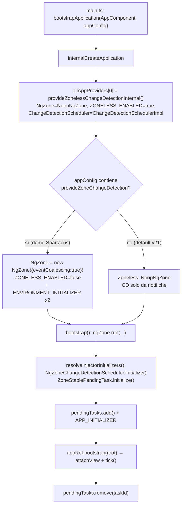
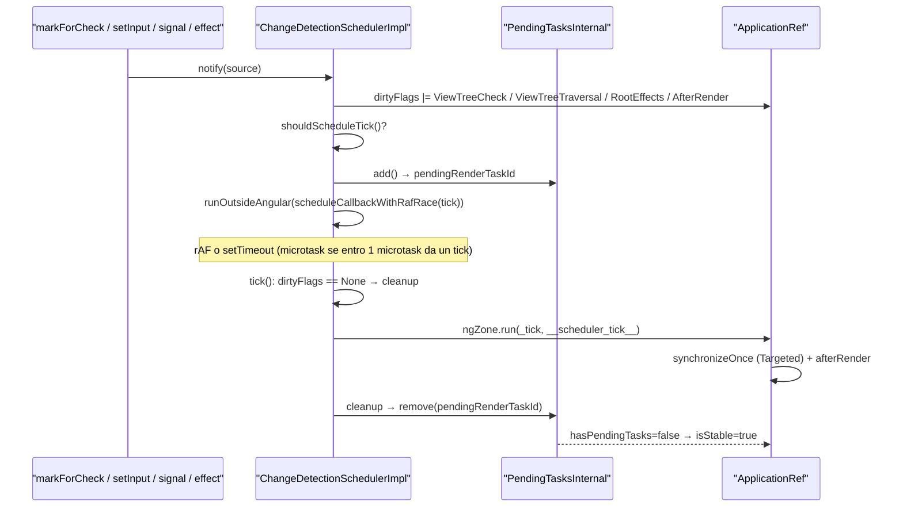
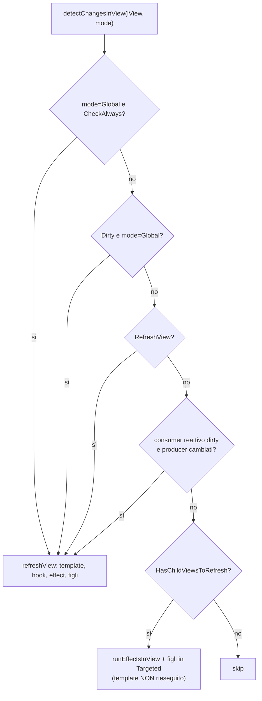
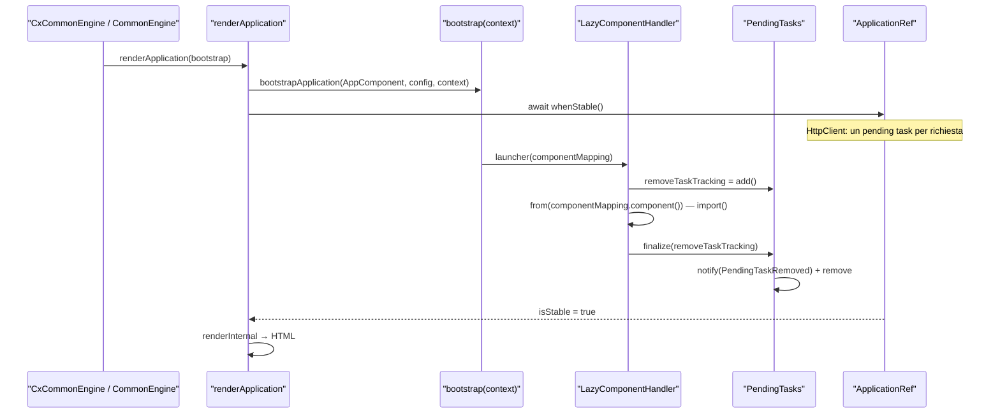

# 04 — Change detection, Zone, zoneless e signals

> Riferimenti allo SHA `5b7a1c2bf2808d7380bc20596d10f4fa710c3da1` (vedi [00-meta](../00-meta.md)). Angular @ `v21.2.23` (prefisso `angular:`), `@angular/ssr` 21.2.23 (prefisso `deps:`).

## 1. A cosa serve e perché esiste

La *change detection* (CD) è il meccanismo con cui Angular riallinea il DOM allo stato dei componenti: percorre l'albero delle view (`LView`), riesegue i template di quelle che ne hanno bisogno e lancia gli hook di ciclo di vita. Il capitolo risponde a quattro domande, tutte con conseguenze dirette per un progetto Spartacus.

1. **Chi decide *quando* parte un giro di CD?** In Angular 21 ci sono due motori:
   - **Zone.js** (`NgZone`): la zona intercetta ogni task asincrono (eventi DOM, timer, XHR, Promise). Quando la coda dei microtask si svuota emette `onMicrotaskEmpty`, e uno scheduler dedicato chiama `ApplicationRef._tick()` — `angular:packages/core/src/change_detection/scheduling/ng_zone_scheduling.ts:L45-L68`.
   - **Zoneless**: niente patch del browser. Sono le API Angular (`markForCheck`, `setInput`, listener, signal letti in template, effect…) a *notificare* uno scheduler, che pianifica un tick — `angular:packages/core/src/change_detection/scheduling/zoneless_scheduling_impl.ts:L344-L353`, `angular:packages/core/src/change_detection/scheduling/zoneless_scheduling_impl.ts:L138-L224`.

   Dalla v21 **il default è zoneless**: `internalCreateApplication` mette `provideZonelessChangeDetectionInternal()` in testa ai provider dell'app — `angular:packages/core/src/application/create_application.ts:L64-L71`. Lo fa anche il percorso NgModule — `angular:packages/core/src/platform/platform_ref.ts:L47-L61`. **La demo Spartacus invece è con Zone**: `appConfig` fornisce in modo esplicito `provideZoneChangeDetection({ eventCoalescing: true })` — `projects/storefrontapp/src/app/app.config.ts:L26-L33`.

2. **Quali view vengono controllate?** Dipende dalla strategia (`OnPush` o `Eager`, l'ex `Default`) e dalla modalità del giro (`Global` o `Targeted`) — `angular:packages/core/src/change_detection/constants.ts:L18-L41`, `angular:packages/core/src/render3/instructions/change_detection.ts:L152-L169`. Spartacus dichiara `OnPush` in 400 dei 557 file con `@Component(` delle librerie (F151 del dossier).

3. **Quando l'app è "stabile"?** In v21 `ApplicationRef.isStable` non dipende più da `NgZone`: deriva dal contatore di `PendingTasksInternal` — `angular:packages/core/src/application/application_ref.ts:L326-L334`. È il punto chiave per l'SSR, perché `renderApplication` serializza l'HTML solo dopo `whenStable()` — `angular:packages/platform-server/src/utils.ts:L362-L373`. Spartacus usa `PendingTasks` per tenere aperta la stabilità durante l'`import()` dinamico dei componenti CMS lazy — `core-libs/storefront/cms-structure/page/component/handlers/lazy-component.handler.ts:L60-L71`.

4. **Che ruolo hanno i signals?** Un signal letto in un template diventa una dipendenza del *consumer reattivo* della view. Quando cambia, Angular rifà solo quella view e si limita ad *attraversare* gli antenati — `angular:packages/core/src/render3/reactive_lview_consumer.ts:L43-L53`, `angular:packages/core/src/render3/util/view_utils.ts:L264-L280`. Nelle librerie Spartacus i signals compaiono in pochi componenti recenti (subscription-billing, order, a11y) e in un interceptor (F160–F168).

Il capitolo presuppone [01 — Dependency Injection](01-dependency-injection.md) (injection context, `DestroyRef`) e [02 — NgModule, standalone e bootstrap](02-ngmodule-standalone-bootstrap.md). Il tema stabilità/SSR prosegue in [07 — SSR, hydration e TransferState](07-ssr-hydration-transferstate.md) e in [39 — SSR ottimizzato](../parte-2/39-ssr-ottimizzato.md). Il caricamento lazy dei componenti CMS è descritto in [16 — CMS rendering](../parte-2/16-cms-rendering.md).

## 2. Mappa dei file

### Angular (`/tmp/angular`, prefisso `angular:`)

| Path | Ruolo |
|---|---|
| `angular:packages/core/src/application/create_application.ts` | Bootstrap standalone: antepone i provider zoneless (default v21) |
| `angular:packages/core/src/platform/platform_ref.ts` | `bootstrapModuleFactory`: zoneless di default anche per NgModule |
| `angular:packages/core/src/platform/bootstrap.ts` | `bootstrap()`: tutto dentro `ngZone.run`, warning zone+zoneless, pending task del bootstrap |
| `angular:packages/core/src/zone/ng_zone.ts` | `NgZone`, `NoopNgZone`, zona "angular", `checkStable`, coalescing |
| `angular:packages/core/src/zone.ts` | Export pubblico: `NgZone` e `NoopNgZone as ɵNoopNgZone` |
| `angular:packages/core/src/change_detection/scheduling/ng_zone_scheduling.ts` | `provideZoneChangeDetection`, `NgZoneChangeDetectionScheduler`, `ZoneStablePendingTask`, `NgZoneOptions` |
| `angular:packages/core/src/change_detection/scheduling/zoneless_scheduling.ts` | `NotificationSource`, `ChangeDetectionScheduler`, token `ZONELESS_ENABLED`, `PROVIDED_ZONELESS`, `SCHEDULE_IN_ROOT_ZONE` |
| `angular:packages/core/src/change_detection/scheduling/zoneless_scheduling_impl.ts` | `ChangeDetectionSchedulerImpl`, `provideZonelessChangeDetection(Internal)` |
| `angular:packages/core/src/change_detection/scheduling/flags.ts` | `SCHEDULE_IN_ROOT_ZONE_DEFAULT` |
| `angular:packages/core/src/util/callback_scheduler.ts` | Gara `setTimeout`/`requestAnimationFrame` |
| `angular:packages/core/src/application/application_ref.ts` | `tick`, `synchronize`, `ApplicationRefDirtyFlags`, `isStable`, `whenStable`, `attachView` |
| `angular:packages/core/src/render3/instructions/change_detection.ts` | `detectChangesInternal`, `detectChangesInView`, `refreshView`, `ChangeDetectionMode` |
| `angular:packages/core/src/render3/instructions/mark_view_dirty.ts` | `markViewDirty` |
| `angular:packages/core/src/render3/util/view_utils.ts` | `markAncestorsForTraversal` |
| `angular:packages/core/src/render3/reactive_lview_consumer.ts` | Consumer reattivo del template |
| `angular:packages/core/src/render3/view_ref.ts` | `ViewRef.markForCheck`, `detectChanges` |
| `angular:packages/core/src/render3/view/listeners.ts` | I listener marcano dirty la view |
| `angular:packages/core/src/render3/component_ref.ts` | `ComponentRef.setInput` |
| `angular:packages/core/src/render3/view/construction.ts` | Flag iniziali della `LView` (`CheckAlways`, `Dirty`, `SignalView`) |
| `angular:packages/core/src/change_detection/constants.ts` | `ChangeDetectionStrategy` |
| `angular:packages/core/src/change_detection/change_detector_ref.ts` | `ChangeDetectorRef` astratta |
| `angular:packages/core/src/metadata/directives.ts` | Default `changeDetection: Eager` del decoratore `@Component` |
| `angular:packages/core/src/pending_tasks.ts` | `PendingTasks` pubblico |
| `angular:packages/core/src/pending_tasks_internal.ts` | `PendingTasksInternal` (Set + `BehaviorSubject`) |
| `angular:packages/common/src/pipes/async_pipe.ts` | `AsyncPipe` e `markForCheck` |
| `angular:packages/common/http/src/interceptor.ts` | `HttpClient` contribuisce alla stabilità |
| `angular:packages/platform-server/src/utils.ts` | `renderApplication` attende `whenStable()` |
| `angular:packages/core/primitives/signals/src/signal.ts`, `computed.ts`, `graph.ts`, `equality.ts`, `untracked.ts`, `linked_signal.ts` | Grafo reattivo push/pull |
| `angular:packages/core/src/render3/reactivity/signal.ts`, `computed.ts`, `linked_signal.ts`, `effect.ts`, `root_effect_scheduler.ts`, `view_effect_runner.ts` | API pubbliche `signal`, `computed`, `linkedSignal`, `effect` |
| `angular:packages/core/rxjs-interop/src/to_signal.ts`, `to_observable.ts`, `take_until_destroyed.ts` | Interop RxJS |
| `angular:packages/core/testing/src/test_bed_compiler.ts` | TestBed zoneless di default |

### Dipendenze (`/tmp/deps`, prefisso `deps:`)

| Path | Ruolo |
|---|---|
| `deps:angular-ssr-21.2.23/package/fesm2022/node.mjs` | `CommonEngine.renderApplication` → `renderApplication`/`renderModule` |

### Spartacus

| Path | Ruolo |
|---|---|
| `projects/storefrontapp/src/main.ts` | `bootstrapApplication(AppComponent, appConfig)` |
| `projects/storefrontapp/src/app/app.config.ts` | `provideZoneChangeDetection({ eventCoalescing: true })` |
| `projects/storefrontapp/src/app/app.config.server.ts` | `mergeApplicationConfig(appConfig, serverConfig)`: Zone anche in SSR |
| `projects/storefrontapp/src/main.server.ts` | Bootstrap server con `BootstrapContext` |
| `projects/storefrontapp/project.json` | Polyfill `zone.js` (build e test) |
| `core-libs/core/src/test.ts`, `projects/storefrontapp/src/test.ts` | Workaround Karma: `provideZoneChangeDetection()` nel TestBed |
| `testing/setup-vitest.ts` | Setup vitest (zone.js importato, nessun provider zone) |
| `core-libs/schematics/src/migrations/221121_7/move-zone-change-detection-to-main/index.ts` | Migrazione `provideZoneChangeDetection` da `main.ts` ad `app.module.ts` |
| `core-libs/schematics/src/modernize-app-migrated-from-2211_32-to-2211_36/csr-and-ssr/update-main-ts.ts` | Aggiunge `ngZoneEventCoalescing` a `bootstrapModule()` |
| `core-libs/storefront/cms-structure/page/component/handlers/lazy-component.handler.ts` | Unico uso di `PendingTasks` nelle librerie |
| `core-libs/core/src/i18n/i18next/i18next-backend/i18next-http-backend.initializer.ts` | `reloadInterval: false` per non bloccare l'SSR |
| `core-libs/setup/ssr/engine/cx-common-engine.ts` | `CxCommonEngine extends CommonEngine` |
| `core-libs/storefront/cms-structure/page/slot/page-slot.component.ts` | Subscribe manuale + `markForCheck()` |
| `core-libs/storefront/cms-structure/page/component/component-wrapper.directive.ts` | `markForCheck()` dopo il lancio di un componente CMS |
| `core-libs/storefront/cms-structure/outlet/outlet.directive.ts` | `markForCheck()` su ogni embedded view di outlet |
| `core-libs/core/src/i18n/translate.pipe.ts` | Pipe impure `cxTranslate` con `markForCheck()` |
| `core-libs/storefront/layout/launch-dialog/services/inline-root-render.strategy.ts` | `ApplicationRef.attachView` per i dialog |
| `core-libs/storefront/cms-structure/page/component/services/cx-api.service.ts`, `core-libs/storefront/cms-structure/page/component/handlers/web-component.handler.ts` | `NgZone` esposto ai web component (`cxApi`) |
| `feature-libs/smartedit/core/services/smart-edit.service.ts` | `zone.run` per le callback di SmartEdit |
| `integration-libs/cdc/root/service/cdc-js.service.ts`, `integration-libs/cdc/components/gigya-raas/gigya-raas.component.ts` | `zone.run` per le callback Gigya |
| `integration-libs/opf/global-functions/core/services/domains/global/opf-global-functions-global-domain.service.ts` | `ngZone.run` attorno alle global functions OPF |
| `integration-libs/opf/base/root/services/opf-resource-loader.service.ts` | Unico `runOutsideAngular` |
| `core-libs/core/src/error-handling/http-error-handler/http-error-handler.interceptor.ts` | `toSignal` in un servizio root |
| `feature-libs/subscription-billing/components/actions-modal/subscription-actions-modal.component.ts`, `feature-libs/subscription-billing/components/list/subscription-list.component.ts` | `signal`/`computed`/`effect`/`toSignal`/`toObservable` |
| `core-libs/storefront/shared/components/ng-select-a11y/ng-select-a11y.directive.ts`, `feature-libs/storefinder/components/store-finder-search-result/store-finder-list/store-finder-list.component.ts` | `effect` dietro feature toggle a11y |

## 3. Come funziona passo per passo

### 3.1 Bootstrap: chi fornisce `NgZone` e lo scheduler

1. `bootstrapApplication()` costruisce la configurazione e delega a `internalCreateApplication` — `angular:packages/platform-browser/src/browser.ts:L125-L140`. La demo lo invoca con `bootstrapApplication(AppComponent, appConfig)` — `projects/storefrontapp/src/main.ts:L17-L17`.
2. `internalCreateApplication` compone `allAppProviders = [provideZonelessChangeDetectionInternal(), errorHandlerEnvironmentInitializer, …, ...appProviders]` — `angular:packages/core/src/application/create_application.ts:L64-L71`. I provider zoneless registrano `ChangeDetectionScheduler → ChangeDetectionSchedulerImpl`, `NgZone → NoopNgZone` e `ZONELESS_ENABLED = true` — `angular:packages/core/src/change_detection/scheduling/zoneless_scheduling_impl.ts:L388-L394`.
3. In `appProviders` la demo ha `provideZoneChangeDetection({ eventCoalescing: true })` — `projects/storefrontapp/src/app/app.config.ts:L30-L30`. Questa funzione crea un vero `NgZone` con le opzioni, imposta `PROVIDED_NG_ZONE=true` e include `internalProvideZoneChangeDetection` — `angular:packages/core/src/change_detection/scheduling/ng_zone_scheduling.ts:L153-L167`. Quest'ultimo:
   - sovrascrive `ZONELESS_ENABLED=false` e `NgZone`;
   - aggiunge due `ENVIRONMENT_INITIALIZER`, uno per `NgZoneChangeDetectionScheduler` e uno per `ZoneStablePendingTask`;
   - **non** sovrascrive `ChangeDetectionScheduler`, che resta `ChangeDetectionSchedulerImpl` — `angular:packages/core/src/change_detection/scheduling/ng_zone_scheduling.ts:L84-L131`.

   Con Zone quindi lavorano **due** scheduler: quello di zona (guidato da `onMicrotaskEmpty`) e quello "zoneless", che in questa modalità resta per lo più inattivo (§3.3).
4. Le opzioni vengono mappate da `getNgZoneOptions`: `eventCoalescing` → `shouldCoalesceEventChangeDetection`, `runCoalescing` → `shouldCoalesceRunChangeDetection`, entrambi `false` di default — `angular:packages/core/src/change_detection/scheduling/ng_zone_scheduling.ts:L223-L229`.
5. Gli environment initializer non vengono eseguiti alla creazione dell'injector, perché devono girare dentro `NgZone` — `angular:packages/core/src/application/create_application.ts:L72-L79`. `bootstrap()` ottiene `NgZone` dall'injector ed esegue dentro `ngZone.run` gli initializer, gli `APP_INITIALIZER` e il bootstrap del root component — `angular:packages/core/src/platform/bootstrap.ts:L84-L93`.
6. In dev mode, se l'injector contiene sia `PROVIDED_ZONELESS` sia `PROVIDED_NG_ZONE`, compare il warning `PROVIDED_BOTH_ZONE_AND_ZONELESS` — `angular:packages/core/src/platform/bootstrap.ts:L95-L105`. Gli errori di `NgZone.onError` vengono inoltrati all'error handler interno con una sottoscrizione fatta fuori zona — `angular:packages/core/src/platform/bootstrap.ts:L107-L112`.
7. Per tutta la durata degli initializer e fino al bootstrap del root component, `bootstrap()` tiene aperto un pending task: prima della fine del bootstrap l'app non può essere stabile — `angular:packages/core/src/platform/bootstrap.ts:L137-L178`.
8. Il bootstrap del root (`_loadComponent`) esegue `attachView` e poi un `tick()` sincrono, che è il primo render — `angular:packages/core/src/application/application_ref.ts:L775-L782`.
9. **Lato server** `internalCreateApplication` lancia errore se manca il `BootstrapContext` (`platformRef`) — `angular:packages/core/src/application/create_application.ts:L47-L54`. Per questo il `main.server.ts` della demo lo inoltra — `projects/storefrontapp/src/main.server.ts:L23-L26`. La config server è `mergeApplicationConfig(appConfig, serverConfig)` e quindi eredita `provideZoneChangeDetection` — `projects/storefrontapp/src/app/app.config.server.ts:L17-L30`.

**Percorso NgModule.** Per le app migrate da versioni con `AppModule` bootstrappato via `bootstrapModule`, `bootstrapModuleFactory` antepone anch'esso `provideZonelessChangeDetectionInternal()` — `angular:packages/core/src/platform/platform_ref.ts:L47-L61`. Poi `createInjectorWithoutInjectorInstances` mette questi provider aggiuntivi *prima* di quelli del modulo, e `R3Injector` li processa in ordine sovrascrivendo i token non-multi. Di conseguenza un `provideZoneChangeDetection` nei `providers` di `AppModule` prevale — `angular:packages/core/src/di/create_injector.ts:L49-L49`, `angular:packages/core/src/di/r3_injector.ts:L223-L226`, `angular:packages/core/src/di/r3_injector.ts:L521-L521`. È esattamente quello che fa la migrazione Spartacus `221121_7`: sposta `provideZoneChangeDetection` da `main.ts` ad `app.module.ts` — `core-libs/schematics/src/migrations/221121_7/move-zone-change-detection-to-main/index.ts:L11-L22`, `core-libs/schematics/src/migrations/221121_7/move-zone-change-detection-to-main/add-zone-change-detection-to-app-module/index.ts:L55-L80`.

### 3.2 NgZone: come la zona produce un tick

1. Il costruttore di `NgZone` richiede Zone.js: se `Zone` non è definito lancia `MISSING_ZONEJS`, poi chiama `Zone.assertZonePatched()` — `angular:packages/core/src/zone/ng_zone.ts:L151-L158`. La demo carica `zone.js` come polyfill — `projects/storefrontapp/project.json:L23-L23`.
2. `_outer` è la zona corrente al momento della creazione. `_inner` è una fork di `_outer` (in dev con `AsyncStackTaggingZoneSpec('Angular')`), forkata a sua volta con il comportamento Angular — `angular:packages/core/src/zone/ng_zone.ts:L162-L187`. La zona "angular" marca le proprietà `isAngularZone`/`isAngularZone_ID<n>` e intercetta `onInvokeTask`, `onInvoke`, `onHasTask` e `onHandleError` — `angular:packages/core/src/zone/ng_zone.ts:L426-L523`.
3. All'ingresso di un task, `onEnter` incrementa `_nesting` ed emette `onUnstable` se la zona era stabile. All'uscita `onLeave` decrementa e chiama `checkStable` — `angular:packages/core/src/zone/ng_zone.ts:L538-L549`.
4. `checkStable`: con `_nesting == 0` e nessun microtask pendente emette `onMicrotaskEmpty`. Se dopo l'emissione i microtask sono ancora zero, emette `onStable` fuori zona e imposta `isStable = true` — `angular:packages/core/src/zone/ng_zone.ts:L354-L385`. `onMicrotaskEmpty` può scattare più volte nello stesso VM turn; `onStable` una volta sola — `angular:packages/core/src/zone/ng_zone.ts:L115-L137`.
5. **Coalescing** (la demo usa `eventCoalescing: true`). Alla fine di un event task, o di ogni task se è attivo `runCoalescing`, la zona chiama `delayChangeDetectionForEvents`, che rinvia `checkStable` con `scheduleCallbackWithRafRace` eseguito fuori zona — `angular:packages/core/src/zone/ng_zone.ts:L451-L462`, `angular:packages/core/src/zone/ng_zone.ts:L401-L423`. Nel frattempo la zona dichiara `hasPendingMicrotasks = true`, e così ritarda `onMicrotaskEmpty` — `angular:packages/core/src/zone/ng_zone.ts:L526-L536`. `scheduleCallbackWithRafRace` mette in gara `setTimeout` e `requestAnimationFrame`: vince il primo, che cancella l'altro — `angular:packages/core/src/util/callback_scheduler.ts:L37-L66`. Con `runCoalescing` attivo, `eventCoalescing` viene ignorato — `angular:packages/core/src/zone/ng_zone.ts:L180-L184`.
6. `NgZoneChangeDetectionScheduler.initialize()` sottoscrive `onMicrotaskEmpty`. Se lo scheduler zoneless non sta già tickando, fa `zone.run(() => { dirtyFlags |= ViewTreeGlobal; applicationRef._tick(); })` — `angular:packages/core/src/change_detection/scheduling/ng_zone_scheduling.ts:L45-L68`. Il flag `ViewTreeGlobal` è la ragione per cui con Zone le view `CheckAlways` vengono controllate a ogni giro (§3.4).
7. `ZoneStablePendingTask` traduce la stabilità della zona in pending task: su `onUnstable` chiama `pendingTasks.add()`; su `onStable` rimuove il task in un microtask, se intanto non sono comparsi macro o microtask — `angular:packages/core/src/change_detection/scheduling/ng_zone_scheduling.ts:L231-L281`.

API di `NgZone` usate dal codice applicativo:
- `run(fn)` esegue `fn` in `_inner`; gli errori sincroni vengono rilanciati e **non** riportati via `onError` — `angular:packages/core/src/zone/ng_zone.ts:L232-L236`.
- `runGuarded(fn)` è come `run`, ma cattura gli errori sincroni e li inoltra a `onError` — `angular:packages/core/src/zone/ng_zone.ts:L260-L266`.
- `runOutsideAngular(fn)` esegue in `_outer`: i task schedulati da lì non scatenano CD — `angular:packages/core/src/zone/ng_zone.ts:L268-L283`.
- `NgZone.isInAngularZone()` legge `isAngularZone` dalla zona corrente e funziona anche senza Zone — `angular:packages/core/src/zone/ng_zone.ts:L193-L196`.
- I task con `data.__ignore_ng_zone__ === true` girano senza `onEnter`/`onLeave` — `angular:packages/core/src/zone/ng_zone.ts:L446-L449`, `angular:packages/core/src/zone/ng_zone.ts:L581-L583`.
- `NoopNgZone` (il default zoneless) implementa le stesse API senza zone: `run` e `runOutsideAngular` chiamano direttamente `fn`, `isStable` vale sempre `true` e gli eventi non vengono mai emessi — `angular:packages/core/src/zone/ng_zone.ts:L551-L579`. È esportato solo come simbolo privato `ɵNoopNgZone` — `angular:packages/core/src/zone.ts:L9-L10`.

### 3.3 Lo scheduler unificato: `ChangeDetectionSchedulerImpl`

`ChangeDetectionScheduler` è la classe astratta che viene notificata quando una `LView` diventa sporca: espone `notify(source)` e `runningTick` — `angular:packages/core/src/change_detection/scheduling/zoneless_scheduling.ts:L58-L64`. Le possibili sorgenti sono enumerate in `NotificationSource` (`MarkAncestorsForTraversal`, `SetInput`, `MarkForCheck`, `Listener`, `ViewAttached`, `PendingTaskRemoved`, `RootEffect`, `ViewEffect`, …) — `angular:packages/core/src/change_detection/scheduling/zoneless_scheduling.ts:L11-L56`.

1. **Filtro Zone.** Se zoneless non è attivo, `notify(Listener)` viene ignorata, perché i listener girano già in zona — `angular:packages/core/src/change_detection/scheduling/zoneless_scheduling_impl.ts:L138-L149`.
2. **Traduzione in dirty flag.** `MarkForCheck`, `Listener`, `SetInput`, `DeferBlockStateUpdate` e `DebugApplyChanges` producono `ViewTreeCheck`. `MarkAncestorsForTraversal`, `CustomElement` e `ViewEffect` producono `ViewTreeTraversal`. `RootEffect` produce `RootEffects`. `PendingTaskRemoved` non produce nessun flag. Tutte le altre sorgenti producono `AfterRender` — `angular:packages/core/src/change_detection/scheduling/zoneless_scheduling_impl.ts:L151-L194`.
3. **Serve un tick?** `shouldScheduleTick` risponde no in tre casi — `angular:packages/core/src/change_detection/scheduling/zoneless_scheduling_impl.ts:L227-L246`:
   - l'app è distrutta;
   - un tick è già pendente o in corso;
   - con Zone, la chiamata avviene dentro la zona Angular: la zona stabilizzerà e farà la CD da sola.
4. **Pianificazione.** Lo scheduler registra un pending task (`pendingRenderTaskId`) e pianifica `tick()` fuori dalla zona Angular con `scheduleCallbackWithRafRace`, oppure con un microtask subito dopo un tick — `angular:packages/core/src/change_detection/scheduling/zoneless_scheduling_impl.ts:L214-L224`. Dopo ogni tick, per un microtask resta attivo lo scheduler a microtask: così le notifiche ravvicinate (il pattern `Promise.resolve` di NgModel) finiscono nello stesso paint — `angular:packages/core/src/change_detection/scheduling/zoneless_scheduling_impl.ts:L122-L136`. Con Zone presente i tick manuali non ricevono questo trattamento — `angular:packages/core/src/change_detection/scheduling/zoneless_scheduling_impl.ts:L92-L104`.
5. **Cancellazione da parte della zona.** Se la zona diventa instabile mentre lo scheduler non sta tickando, la CD pianificata viene cancellata: ci penserà la zona — `angular:packages/core/src/change_detection/scheduling/zoneless_scheduling_impl.ts:L110-L119`.
6. **`tick()`.** Se `dirtyFlags === None` (per esempio quando l'unica notifica era la rimozione di un pending task) fa solo cleanup. Con Zone, se c'è un qualunque flag di view, aggiunge `ViewTreeGlobal` (workaround marcato TODO) — `angular:packages/core/src/change_detection/scheduling/zoneless_scheduling_impl.ts:L265-L287`. Poi esegue `appRef._tick()` dentro `ngZone.run` con gli argomenti `__scheduler_tick__`, che la zona riconosce per non ritardare la stabilità — `angular:packages/core/src/change_detection/scheduling/zoneless_scheduling_impl.ts:L289-L298`, `angular:packages/core/src/zone/ng_zone.ts:L478-L493`.
7. **Protezione dai loop.** In dev mode, 100 notifiche consecutive con lo scheduler a microtask lanciano `INFINITE_CHANGE_DETECTION` — `angular:packages/core/src/change_detection/scheduling/zoneless_scheduling_impl.ts:L36-L57`.

### 3.4 `ApplicationRef.tick()` e il traversal delle view

1. `ApplicationRef.tick()` pubblico aggiunge `ViewTreeGlobal` solo se zoneless **non** è attivo, poi chiama `_tick()` — `angular:packages/core/src/application/application_ref.ts:L570-L575`.
2. `tickImpl` lancia `RECURSIVE_APPLICATION_REF_TICK` se viene chiamato in modo ricorsivo. Azzera il consumer reattivo attivo, esegue `synchronize()`, in dev mode lancia `checkNoChanges()` su tutte le view e infine emette `afterTick` — `angular:packages/core/src/application/application_ref.ts:L591-L619`.
3. `synchronize()` ripete `synchronizeOnce()` finché restano dirty flag, al massimo `MAXIMUM_REFRESH_RERUNS = 10` volte; poi, in dev mode, lancia `INFINITE_CHANGE_DETECTION` — `angular:packages/core/src/application/application_ref.ts:L159-L159`, `angular:packages/core/src/application/application_ref.ts:L625-L649`.
4. `synchronizeOnce()` lavora in tre fasi — `angular:packages/core/src/application/application_ref.ts:L654-L725`:
   1. flush dei root effect;
   2. se ci sono view sporche, CD su ogni root view in modalità `Global` (se è presente `ViewTreeGlobal` **e** non si è in zoneless) oppure `Targeted`;
   3. esecuzione degli hook `afterRender`.

   In zoneless anche le root view `CheckAlways` devono essere marcate in modo esplicito — `angular:packages/core/src/application/application_ref.ts:L682-L689`. Un `markForCheck()` chiamato *durante* il check non provoca un nuovo giro — `angular:packages/core/src/application/application_ref.ts:L694-L697`.
5. La modalità determina quali view vengono rifatte: in `Global` le view `Dirty`, `CheckAlways` e `RefreshView`; in `Targeted` solo quelle con `RefreshView` o con signal cambiati — `angular:packages/core/src/render3/instructions/change_detection.ts:L152-L169`.
6. `detectChangesInView` rifà la view (`refreshView`) se vale almeno una di queste condizioni: `Global && CheckAlways`, `Dirty && Global`, `RefreshView`, oppure consumer reattivo del template sporco con producer effettivamente cambiati. Altrimenti, se la view ha `HasChildViewsToRefresh`, ne attraversa i figli in `Targeted` senza rieseguirne il template — `angular:packages/core/src/render3/instructions/change_detection.ts:L458-L517`. Le view staccate con `detach()` non vengono visitate — `angular:packages/core/src/render3/instructions/change_detection.ts:L436-L446`.
7. `refreshView` esegue in ordine — `angular:packages/core/src/render3/instructions/change_detection.ts:L227-L354`:
   1. template (update);
   2. pre-order hook (`OnInit`/`DoCheck`);
   3. transplanted view;
   4. effetti di view (`runEffectsInView`);
   5. embedded view;
   6. content hook;
   7. host binding;
   8. componenti figli;
   9. view query e view hook.

   Al termine cancella il flag `Dirty`.

**Strategie.** `ChangeDetectionStrategy` vale `OnPush = 0`, `Eager = 1` e `Default = 1`; `Default` è `@deprecated` a favore di `Eager` — `angular:packages/core/src/change_detection/constants.ts:L18-L41`. Il decoratore `@Component` usa `Eager` come default — `angular:packages/core/src/metadata/directives.ts:L669-L673`. La `LView` di un componente nasce con uno di questi flag — `angular:packages/core/src/render3/view/construction.ts:L263-L271`:
- `CheckAlways` (componente `Eager`);
- `Dirty` (componente `OnPush`: il primo check è garantito);
- `SignalView` (se `def.signals`).

Un input di binding cambiato marca `Dirty` la view figlia non-`CheckAlways` (`markDirtyIfOnPush`) — `angular:packages/core/src/render3/instructions/shared.ts:L318-L325`.

**Chi sporca una view.**
- `ViewRef.markForCheck()` chiama `markViewDirty(..., MarkForCheck)` — `angular:packages/core/src/render3/view_ref.ts:L163-L165`. `markViewDirty` notifica lo scheduler e risale fino alla root, marcando ogni view `Dirty` (più `RefreshView` se non c'è un refresh in corso) — `angular:packages/core/src/render3/instructions/mark_view_dirty.ts:L26-L52`.
- Ogni listener di template o host marca dirty la view prima di eseguire l'handler — `angular:packages/core/src/render3/view/listeners.ts:L62-L68`.
- `ComponentRef.setInput` ignora i valori identici (`Object.is`) e per gli altri marca dirty con `SetInput` — `angular:packages/core/src/render3/component_ref.ts:L566-L580`.
- `ViewRef.detectChanges()` imposta `RefreshView` ed esegue subito `detectChangesInternal`, in modo sincrono — `angular:packages/core/src/render3/view_ref.ts:L308-L316`.
- `AsyncPipe` è impure e chiama `markForCheck()` solo per i valori che arrivano in modo asincrono — `angular:packages/common/src/pipes/async_pipe.ts:L140-L143`, `angular:packages/common/src/pipes/async_pipe.ts:L178-L191`, `angular:packages/common/src/pipes/async_pipe.ts:L235-L242`. Sottoscrive dentro `untracked()` — `angular:packages/common/src/pipes/async_pipe.ts:L40-L52` — e, se cambia il riferimento all'Observable, chiude la vecchia subscription e ne apre una nuova — `angular:packages/common/src/pipes/async_pipe.ts:L194-L197`.

### 3.5 Stabilità e `PendingTasks`

1. `PendingTasks` (`@publicApi 20.0`) tiene traccia dei task che bloccano la stabilità; tra gli usi previsti c'è l'SSR, che deve attendere la stabilità prima di serializzare — `angular:packages/core/src/pending_tasks.ts:L18-L42`.
2. `add()` restituisce una funzione di cleanup idempotente. Quando viene chiamata, notifica lo scheduler con `PendingTaskRemoved`, e questo tiene aperta la stabilità fino al tick successivo — `angular:packages/core/src/pending_tasks.ts:L50-L61`. `run(fn)` (`@developerPreview 19.0`) blocca la stabilità finché la Promise restituita da `fn` non termina — `angular:packages/core/src/pending_tasks.ts:L63-L79`.
3. `PendingTasksInternal` mantiene un `Set<number>` e un `BehaviorSubject<boolean>`: emette `true` all'arrivo del primo task e `false` quando il set si svuota — `angular:packages/core/src/pending_tasks_internal.ts:L20-L69`. Dopo la distruzione, `hasPendingTasksObservable` restituisce un Observable che emette `false` e completa — `angular:packages/core/src/pending_tasks_internal.ts:L32-L46`.
4. `ApplicationRef.isStable` è `hasPendingTasksObservable.pipe(map(p => !p))` — `angular:packages/core/src/application/application_ref.ts:L326-L334`. `whenStable()` risolve alla prima emissione `true` — `angular:packages/core/src/application/application_ref.ts:L344-L357`.
5. Chi contribuisce alla stabilità:
   - il pending task del bootstrap — `angular:packages/core/src/platform/bootstrap.ts:L137-L178`;
   - il pending task di zona (`ZoneStablePendingTask`, solo con Zone);
   - il `pendingRenderTaskId` dello scheduler — `angular:packages/core/src/change_detection/scheduling/zoneless_scheduling_impl.ts:L220-L220`;
   - ogni richiesta `HttpClient` che passa dalla catena di interceptor, se `REQUESTS_CONTRIBUTE_TO_STABILITY` vale `true` (default) — `angular:packages/common/http/src/interceptor.ts:L217-L251`;
   - i task aggiunti a mano con `PendingTasks`.
6. In SSR `renderApplication` esegue `await applicationRef.whenStable()` prima di `renderInternal` — `angular:packages/platform-server/src/utils.ts:L362-L373`. `CommonEngine` di `@angular/ssr` usa `renderApplication` per le bootstrap function — `deps:angular-ssr-21.2.23/package/fesm2022/node.mjs:L185-L210`. Spartacus estende `CommonEngine` con `CxCommonEngine` — `core-libs/setup/ssr/engine/cx-common-engine.ts:L20-L66`.
7. Un task ricorrente avviato all'avvio (`setInterval`, `interval`) impedisce per sempre la stabilità — `angular:packages/core/src/application/application_ref.ts:L172-L194`. Spartacus lo evita nell'inizializzatore i18next, dove forza `reloadInterval: false` — `core-libs/core/src/i18n/i18next/i18next-backend/i18next-http-backend.initializer.ts:L62-L69`.

### 3.6 Signals: grafo push/pull

1. `createSignal` crea un `SignalNode` più getter, setter e updater — `angular:packages/core/primitives/signals/src/signal.ts:L53-L73`. Leggere il signal chiama `producerAccessed(node)` — `angular:packages/core/primitives/signals/src/signal.ts:L81-L84`. Fuori da un contesto reattivo (`activeConsumer === null`) non viene registrato nulla; leggere un signal durante la fase di notifica lancia un errore — `angular:packages/core/primitives/signals/src/graph.ts:L204-L216`.
2. `signalSetFn` rifiuta la scrittura se il consumer attivo non la consente, e aggiorna il valore solo se `!equal(old, new)` — `angular:packages/core/primitives/signals/src/signal.ts:L86-L95`. L'uguaglianza di default è `Object.is` — `angular:packages/core/primitives/signals/src/equality.ts:L17-L18`. Quando il valore cambia: `version++`, incremento dell'`epoch` globale, notifica ai consumer — `angular:packages/core/primitives/signals/src/signal.ts:L120-L125`.
3. **Push.** `producerNotifyConsumers` marca dirty i consumer live che non lo sono già — `angular:packages/core/primitives/signals/src/graph.ts:L327-L349`. `consumerMarkDirty` propaga la marcatura e invoca l'hook `consumerMarkedDirty` del nodo: è lì che view ed effect si agganciano allo scheduler — `angular:packages/core/primitives/signals/src/graph.ts:L359-L363`.
4. **Pull.** `producerUpdateValueVersion` salta il ricalcolo se il consumer è live e pulito, o se è stato pulito nello stesso epoch. Ricalcola solo se un producer ha cambiato versione — `angular:packages/core/primitives/signals/src/graph.ts:L297-L322`, `angular:packages/core/primitives/signals/src/graph.ts:L448-L472`.
5. `computed` è lazy. Memorizza l'errore e lo rilancia a ogni lettura — `angular:packages/core/primitives/signals/src/computed.ts:L70-L82`. Rileva i cicli e, se il nuovo valore è `equal` al precedente, non incrementa la versione — `angular:packages/core/primitives/signals/src/computed.ts:L132-L171`. `untracked(fn)` esegue `fn` con `activeConsumer = null` — `angular:packages/core/primitives/signals/src/untracked.ts:L15-L24`.
6. **API pubbliche.**
   - `signal()` aggiunge `set`, `update` e `asReadonly` al getter — `angular:packages/core/src/render3/reactivity/signal.ts:L72-L89`. `asReadonly` non impedisce la mutazione profonda del valore — `angular:packages/core/src/render3/reactivity/signal.ts:L35-L40`.
   - `computed()` avvolge `createComputed` — `angular:packages/core/src/render3/reactivity/computed.ts:L32-L42`.
   - `linkedSignal` (`@publicApi 20.0`) è un signal scrivibile, reinizializzato da una computazione che riceve `previous = {source, value}` — `angular:packages/core/src/render3/reactivity/linked_signal.ts:L23-L47`, `angular:packages/core/primitives/signals/src/linked_signal.ts:L159-L169`. Il suo `set()` vale finché la sorgente non cambia — `angular:packages/core/primitives/signals/src/linked_signal.ts:L106-L110`.
7. **Template.** Il template di una view gira dentro un consumer reattivo (`getOrBorrowReactiveLViewConsumer`) — `angular:packages/core/src/render3/instructions/change_detection.ts:L204-L225`. Quando un signal letto cambia, il consumer chiama `markAncestorsForTraversal`, non `markViewDirty` — `angular:packages/core/src/render3/reactive_lview_consumer.ts:L43-L53`. `markAncestorsForTraversal` notifica lo scheduler e imposta `HasChildViewsToRefresh` sugli antenati — `angular:packages/core/src/render3/util/view_utils.ts:L264-L280`. Al tick, gli antenati vengono attraversati e viene rifatta solo la view con il consumer sporco (§3.4, punto 6).
8. **Effect.** `effect()` (`@publicApi 20.0`) richiede un injection context (salvo `options.injector`) e non può essere chiamato in un contesto reattivo — `angular:packages/core/src/render3/reactivity/effect.ts:L141-L156`. Se nell'injector trova un `ViewContext` crea un *view effect*, altrimenti un *root effect* — `angular:packages/core/src/render3/reactivity/effect.ts:L158-L182`. I due tipi si comportano così:
   - **root effect**: quando diventa sporco si accoda in `EffectScheduler` e notifica `RootEffect`; viene eseguito nel flush iniziale di `synchronizeOnce` — `angular:packages/core/src/render3/reactivity/effect.ts:L254-L260`, `angular:packages/core/src/application/application_ref.ts:L656-L659`;
   - **view effect**: marca `HasChildViewsToRefresh` e notifica `ViewEffect`; viene eseguito da `runEffectsInView` durante il refresh o il traversal — `angular:packages/core/src/render3/reactivity/effect.ts:L275-L282`, `angular:packages/core/src/render3/reactivity/view_effect_runner.ts:L11-L43`.

   Entrambi vengono schedulati subito alla creazione — `angular:packages/core/src/render3/reactivity/effect.ts:L308-L312`, `angular:packages/core/src/render3/reactivity/effect.ts:L325-L327`. Ogni effect memorizza la `Zone.current` in cui è stato creato e gira in quella zona — `angular:packages/core/src/render3/reactivity/effect.ts:L304-L304`, `angular:packages/core/src/render3/reactivity/view_effect_runner.ts:L28-L34`.

### 3.7 Interop RxJS

- `toSignal()` richiede un injection context salvo `injector` o `manualCleanup`, e non va chiamato in un contesto reattivo — `angular:packages/core/rxjs-interop/src/to_signal.ts:L132-L148`. Sottoscrive subito (eager); senza `initialValue` il valore iniziale è `undefined` — `angular:packages/core/rxjs-interop/src/to_signal.ts:L161-L188`. Con `requireSync: true`, se l'Observable non emette in modo sincrono lancia `REQUIRE_SYNC_WITHOUT_SYNC_EMIT` — `angular:packages/core/rxjs-interop/src/to_signal.ts:L190-L196`. Il signal restituito è un `computed` che rilancia l'errore dell'Observable; la subscription viene chiusa su `DestroyRef.onDestroy` — `angular:packages/core/rxjs-interop/src/to_signal.ts:L198-L225`.
- `toObservable()` usa internamente un `effect` che spinge i valori in un `ReplaySubject(1)`: le emissioni seguono i tempi degli effect, non sono sincrone al `set` — `angular:packages/core/rxjs-interop/src/to_observable.ts:L48-L75`.
- `takeUntilDestroyed(destroyRef?)` usa `inject(DestroyRef)` se il parametro manca; se il `DestroyRef` è già distrutto, completa subito — `angular:packages/core/rxjs-interop/src/take_until_destroyed.ts:L25-L43`.

### 3.8 Come lo usa Spartacus

**Zone.** Tutta la catena demo + test Karma assume Zone.js:
- polyfill `zone.js` nel build e nei test — `projects/storefrontapp/project.json:L23-L23`, `projects/storefrontapp/project.json:L234-L234`;
- dipendenza `zone.js ^0.16.0` nel monorepo — `package.json:L197-L197`;
- `provideZoneChangeDetection({ eventCoalescing: true })` nella config — `projects/storefrontapp/src/app/app.config.ts:L30-L30`.

Nessun file di libreria o della demo usa `provideZonelessChangeDetection` (F140). Poiché il TestBed di Angular v21 è zoneless di default — `angular:packages/core/testing/src/test_bed_compiler.ts:L932-L947` — i `test.ts` Karma aggiungono `provideZoneChangeDetection()` per evitare gli errori NG0100 — `core-libs/core/src/test.ts:L21-L35`, `projects/storefrontapp/src/test.ts:L30-L35`. Il setup vitest invece importa `zone.js` ma non fornisce il provider — `testing/setup-vitest.ts:L7-L19`.

**NgZone.** Gli usi sono pochi e servono tutti a rientrare in zona da callback esterne:
- SmartEdit — `feature-libs/smartedit/core/services/smart-edit.service.ts:L126-L145`;
- Gigya/CDC — `integration-libs/cdc/root/service/cdc-js.service.ts:L165-L172`, `integration-libs/cdc/components/gigya-raas/gigya-raas.component.ts:L97-L101`;
- global functions OPF chiamate da script di terze parti — `integration-libs/opf/global-functions/core/services/domains/global/opf-global-functions-global-domain.service.ts:L73-L85`.

C'è un solo `runOutsideAngular`, per eseguire script esterni — `integration-libs/opf/base/root/services/opf-resource-loader.service.ts:L232-L250`. `CxApiService` espone `ngZone` ai web component tramite `webElement.cxApi` — `core-libs/storefront/cms-structure/page/component/services/cx-api.service.ts:L73-L75`, `core-libs/storefront/cms-structure/page/component/handlers/web-component.handler.ts:L75-L78`.

**OnPush e notifiche manuali.** Il motore CMS combina `OnPush` con chiamate esplicite:
- `PageSlotComponent` aggiorna `components` in una subscribe e chiama `cd.markForCheck()` — `core-libs/storefront/cms-structure/page/slot/page-slot.component.ts:L124-L131`;
- `ComponentWrapperDirective` marca il proprio `ChangeDetectorRef` dopo il lancio del componente — `core-libs/storefront/cms-structure/page/component/component-wrapper.directive.ts:L105-L113`;
- `OutletDirective` marca ogni embedded view — `core-libs/storefront/cms-structure/outlet/outlet.directive.ts:L175-L185`;
- `cxTranslate` è una pipe impure che, come `AsyncPipe`, chiama `markForCheck()` — `core-libs/core/src/i18n/translate.pipe.ts:L25-L29`, `core-libs/core/src/i18n/translate.pipe.ts:L80-L89`.

I dialog inline vengono agganciati ad `ApplicationRef.attachView` — `core-libs/storefront/layout/launch-dialog/services/inline-root-render.strategy.ts:L32-L55` — e quindi controllati a ogni tick (`attachView` li aggiunge a `_views`, `angular:packages/core/src/application/application_ref.ts:L753-L773`).

**PendingTasks.** È usato in un solo punto: `LazyComponentHandler` registra un task intorno all'`import()` del chunk del componente CMS e lo rimuove con `finalize` — `core-libs/storefront/cms-structure/page/component/handlers/lazy-component.handler.ts:L30-L31`, `core-libs/storefront/cms-structure/page/component/handlers/lazy-component.handler.ts:L60-L71`. Riconosce i mapping lazy guardando la stringa della funzione (`function()` o `()=>`) e ha priorità `LOW` — `core-libs/storefront/cms-structure/page/component/handlers/lazy-component.handler.ts:L38-L52`.

**Signals.** Gli usi sono pochi e recenti:
- `toSignal` in `HttpErrorHandlerInterceptor` — `core-libs/core/src/error-handling/http-error-handler/http-error-handler.interceptor.ts:L40-L46`;
- `signal` alimentato da `loading$` in `ConsentManagementComponent` — `core-libs/storefront/cms-components/myaccount/consent-management/components/consent-management.component.ts:L119-L124`;
- `effect` in `NgSelectA11yDirective` (toggle `a11yVocalizeDropdownItemCount`, default `true`) — `core-libs/storefront/shared/components/ng-select-a11y/ng-select-a11y.directive.ts:L98-L106`, `core-libs/core/src/features-config/feature-toggles/config/feature-toggles.ts:L1063-L1063`;
- `viewChild()` + `effect` in `StoreFinderListComponent` (toggle `a11yStoreFinderFocusOnBackButton`, default `false`) — `feature-libs/storefinder/components/store-finder-search-result/store-finder-list/store-finder-list.component.ts:L68-L83`, `core-libs/core/src/features-config/feature-toggles/config/feature-toggles.ts:L1020-L1020`;
- `viewChild.required` in `SortingComponent` — `core-libs/storefront/shared/components/list-navigation/sorting/sorting.component.ts:L38-L38`;
- `toSignal` + `computed` + `effect` in `SubscriptionActionsModalComponent` — `feature-libs/subscription-billing/components/actions-modal/subscription-actions-modal.component.ts:L67-L96`;
- `toObservable` → `switchMap` → `toSignal` in `SubscriptionListComponent` — `feature-libs/subscription-billing/components/list/subscription-list.component.ts:L44-L71`;
- `toSignal` con `initialValue` in `OrderAttachmentsDialogComponent` — `feature-libs/order/components/order-details/order-attachments/attachments-dialog/order-attachments-dialog.component.ts:L86-L90`;
- un unico `afterNextRender`, in `ConfiguratorOverviewFormComponent` — `feature-libs/product-configurator/rulebased/components/overview-form/configurator-overview-form.component.ts:L434-L443`.

Nelle librerie non compaiono `linkedSignal`, `untracked`, `input()`/`output()`/`model()` signal-based né `selectSignal` (F169).

## 4. Diagrammi

### 4.1 Scelta del motore al bootstrap (demo Spartacus)



Riferimenti: `projects/storefrontapp/src/main.ts:L17-L17`, `angular:packages/core/src/application/create_application.ts:L64-L71`, `angular:packages/core/src/change_detection/scheduling/zoneless_scheduling_impl.ts:L388-L394`, `angular:packages/core/src/change_detection/scheduling/ng_zone_scheduling.ts:L84-L131`, `angular:packages/core/src/platform/bootstrap.ts:L84-L93`, `angular:packages/core/src/platform/bootstrap.ts:L137-L178`, `angular:packages/core/src/application/application_ref.ts:L775-L782`. Il nodo H viene eseguito solo nel ramo Zone, perché i due initializer sono registrati da `internalProvideZoneChangeDetection`.

### 4.2 Ciclo con Zone.js ed event coalescing

```mermaid
sequenceDiagram
  participant DOM as "Evento DOM"
  participant Z as "NgZone (zona angular)"
  participant L as "Listener Angular"
  participant S as "ChangeDetectionSchedulerImpl"
  participant ZS as "NgZoneChangeDetectionScheduler"
  participant AR as "ApplicationRef"
  participant PT as "ZoneStablePendingTask"
  DOM->>Z: onInvokeTask → onEnter
  Z-->>PT: onUnstable → pendingTasks.add()
  Z->>L: esegue handler
  L->>L: markViewDirty(view, Listener)
  L->>S: notify(Listener)
  S-->>S: ignorata (zonelessEnabled=false)
  Z->>Z: fine task: delayChangeDetectionForEvents (rAF/setTimeout)
  Z->>Z: checkStable → onMicrotaskEmpty
  Z->>ZS: onMicrotaskEmpty
  ZS->>AR: zone.run: dirtyFlags |= ViewTreeGlobal; _tick()
  AR->>AR: synchronize → detectChangesInternal(root, Global)
  AR->>AR: dev: checkNoChanges; afterTick
  Z-->>PT: onStable (fuori zona)
  PT->>PT: queueMicrotask → pendingTasks.remove()
```

Riferimenti: `angular:packages/core/src/zone/ng_zone.ts:L538-L549`, `angular:packages/core/src/render3/view/listeners.ts:L62-L68`, `angular:packages/core/src/change_detection/scheduling/zoneless_scheduling_impl.ts:L138-L149`, `angular:packages/core/src/zone/ng_zone.ts:L451-L462`, `angular:packages/core/src/zone/ng_zone.ts:L354-L385`, `angular:packages/core/src/change_detection/scheduling/ng_zone_scheduling.ts:L45-L68`, `angular:packages/core/src/application/application_ref.ts:L591-L619`, `angular:packages/core/src/change_detection/scheduling/ng_zone_scheduling.ts:L231-L281`.

### 4.3 Ciclo zoneless: dalla notifica al tick



Riferimenti: `angular:packages/core/src/change_detection/scheduling/zoneless_scheduling_impl.ts:L151-L194`, `angular:packages/core/src/change_detection/scheduling/zoneless_scheduling_impl.ts:L214-L246`, `angular:packages/core/src/change_detection/scheduling/zoneless_scheduling_impl.ts:L122-L136`, `angular:packages/core/src/change_detection/scheduling/zoneless_scheduling_impl.ts:L265-L298`, `angular:packages/core/src/change_detection/scheduling/zoneless_scheduling_impl.ts:L312-L328`, `angular:packages/core/src/application/application_ref.ts:L682-L690`, `angular:packages/core/src/application/application_ref.ts:L326-L334`.

### 4.4 Decisione di refresh in `detectChangesInView`



Riferimenti: `angular:packages/core/src/render3/instructions/change_detection.ts:L458-L517`, `angular:packages/core/src/render3/instructions/change_detection.ts:L227-L354`.

### 4.5 SSR: stabilità e componente CMS lazy



Riferimenti: `core-libs/setup/ssr/engine/cx-common-engine.ts:L41-L59`, `deps:angular-ssr-21.2.23/package/fesm2022/node.mjs:L203-L205`, `projects/storefrontapp/src/main.server.ts:L23-L24`, `angular:packages/platform-server/src/utils.ts:L367-L371`, `angular:packages/common/http/src/interceptor.ts:L243-L247`, `core-libs/storefront/cms-structure/page/component/handlers/lazy-component.handler.ts:L60-L80`, `angular:packages/core/src/pending_tasks.ts:L57-L59`, `angular:packages/core/src/pending_tasks_internal.ts:L63-L69`.

## 5. Estratti di codice reale

### 5.1 Zoneless in testa ai provider (Angular)

`angular:packages/core/src/application/create_application.ts:L64-L71`
```ts
const allAppProviders = [
  provideZonelessChangeDetectionInternal(),
  errorHandlerEnvironmentInitializer,
  ...(ngDevMode ? [validAppIdInitializer] : []),
  ...(appProviders || []),
];
```

### 5.2 La demo Spartacus riattiva Zone

`projects/storefrontapp/src/app/app.config.ts:L26-L35`
```ts
export const appConfig: ApplicationConfig = {
  providers: [
    provideHttpClient(withFetch(), withInterceptorsFromDi()),
    provideClientHydration(withEventReplay(), withNoHttpTransferCache()),
    provideZoneChangeDetection({ eventCoalescing: true }),
    provideBrowserGlobalErrorListeners(),

    importProvidersFrom(AppModule),
  ],
};
```

### 5.3 `onMicrotaskEmpty` → tick globale

`angular:packages/core/src/change_detection/scheduling/ng_zone_scheduling.ts:L45-L68`
```ts
initialize(): void {
  if (this._onMicrotaskEmptySubscription) {
    return;
  }

  this._onMicrotaskEmptySubscription = this.zone.onMicrotaskEmpty.subscribe({
    next: () => {
      // `onMicroTaskEmpty` can happen _during_ the zoneless scheduler change detection because
      // zone.run(() => {}) will result in `checkStable` at the end of the `zone.run` closure
      // and emit `onMicrotaskEmpty` synchronously if run coalsecing is false.
      if (this.changeDetectionScheduler.runningTick) {
        return;
      }
      this.zone.run(() => {
        try {
          this.applicationRef.dirtyFlags |= ApplicationRefDirtyFlags.ViewTreeGlobal;
          this.applicationRef._tick();
        } catch (e) {
          this.applicationErrorHandler(e);
        }
      });
    },
  });
}
```

### 5.4 Il filtro dei listener e la mappa sorgente → flag

`angular:packages/core/src/change_detection/scheduling/zoneless_scheduling_impl.ts:L138-L168`
```ts
notify(source: NotificationSource): void {
  if (!this.zonelessEnabled && source === NotificationSource.Listener) {
    // When the notification comes from a listener, we skip the notification unless the
    // application has enabled zoneless. Ideally, listeners wouldn't notify the scheduler at all
    // automatically. ...
    return;
  }

  switch (source) {
    case NotificationSource.MarkAncestorsForTraversal: {
      this.appRef.dirtyFlags |= ApplicationRefDirtyFlags.ViewTreeTraversal;
      break;
    }
    case NotificationSource.DebugApplyChanges:
    case NotificationSource.DeferBlockStateUpdate:
    case NotificationSource.MarkForCheck:
    case NotificationSource.Listener:
    case NotificationSource.SetInput: {
      this.appRef.dirtyFlags |= ApplicationRefDirtyFlags.ViewTreeCheck;
      break;
    }
    // ...
```

### 5.5 `Global` solo se non zoneless

`angular:packages/core/src/application/application_ref.ts:L676-L697`
```ts
for (let {_lView} of this.allViews) {
  // When re-checking, only check views which actually need it.
  if (!useGlobalCheck && !requiresRefreshOrTraversal(_lView)) {
    continue;
  }

  const mode =
    useGlobalCheck && !this.zonelessEnabled
      ? // Global mode includes `CheckAlways` views.
        // When using zoneless, all root views must be explicitly marked for refresh, even if they are
        // `CheckAlways`.
        ChangeDetectionMode.Global
      : // Only refresh views with the `RefreshView` flag or views is a changed signal
        ChangeDetectionMode.Targeted;
  detectChangesInternal(_lView, mode);
  ranDetectChanges = true;
}

// If `markForCheck()` was called during view checking, it will have set the `ViewTreeCheck`
// flag. We clear the flag here because, for backwards compatibility, `markForCheck()`
// during view checking doesn't cause the view to be re-checked.
this.dirtyFlags &= ~ApplicationRefDirtyFlags.ViewTreeCheck;
```

### 5.6 Refresh mirato o solo traversal

`angular:packages/core/src/render3/instructions/change_detection.ts:L481-L499`
```ts
// Always refresh views marked for refresh, regardless of mode.
shouldRefreshView ||= !!(flags & LViewFlags.RefreshView);

// Refresh views when they have a dirty reactive consumer, regardless of mode.
shouldRefreshView ||= !!(consumer?.dirty && consumerPollProducersForChange(consumer));

shouldRefreshView ||= !!(ngDevMode && isExhaustiveCheckNoChanges());

// Mark the Flags and `ReactiveNode` as not dirty before refreshing the component, so that they
// can be re-dirtied during the refresh process.
if (consumer) {
  consumer.dirty = false;
}
lView[FLAGS] &= ~(LViewFlags.HasChildViewsToRefresh | LViewFlags.RefreshView);

if (shouldRefreshView) {
  refreshView(tView, lView, tView.template, lView[CONTEXT]);
} else if (flags & LViewFlags.HasChildViewsToRefresh) {
```

### 5.7 `PendingTasks` attorno all'`import()` (Spartacus)

`core-libs/storefront/cms-structure/page/component/handlers/lazy-component.handler.ts:L60-L80`
```ts
return defer(() => {
  // Register the dynamic import as a pending task so Angular's stability
  // counter stays > 0 until the chunk is loaded. This prevents SSR from
  // serializing and destroying the app while the import() is still in flight
  // (which would cause NG0205 — destroyed injector). The task is removed by
  // finalize(), which fires on complete, error, and unsubscribe.

  const removeTaskTracking = this.pendingTasks.add();
  return from(componentMapping.component()).pipe(
    finalize(removeTaskTracking)
  );
}).pipe(
  switchMap((component) =>
    this.defaultHandler.launcher(
      { ...componentMapping, component },
      viewContainerRef,
      elementInjector,
      module
    )
  )
);
```

### 5.8 `setInterval` vietato in SSR (Spartacus)

`core-libs/core/src/i18n/i18next/i18next-backend/i18next-http-backend.initializer.ts:L62-L69`
```ts
const backend: HttpBackendOptions = {
  loadPath,
  request: this.i18nextHttpClient,

  // Disable the periodical reloading. Otherwise SSR would not finish due to the pending task `setInterval()`
  // See source code of `i18next-http-backend` : https://github.com/i18next/i18next-http-backend/blob/00b7e8f67abf8372af17529b51190a7e8b17e3d8/lib/index.js#L40-L41
  reloadInterval: false,
};
```

### 5.9 OnPush + subscribe manuale + `markForCheck` (Spartacus)

`core-libs/storefront/cms-structure/page/slot/page-slot.component.ts:L124-L131`
```ts
ngOnInit() {
  this.subscription.add(
    this.slot$.pipe(tap((slot) => this.decorate(slot))).subscribe((value) => {
      this.components = value?.components || [];
      this.cd.markForCheck();
    })
  );
}
```

### 5.10 Signals + effect con chiamata HTTP (Spartacus)

`feature-libs/subscription-billing/components/actions-modal/subscription-actions-modal.component.ts:L120-L140`
```ts
protected registerSubscriptionCancellationEffect(): void {
  effect(() => {
    const mode = this.mode();
    const code = this.subscriptionCode();

    if (mode === 'cancel' && code) {
      this.actionsFacade
        .getEffectiveCancellationDate(code)
        .pipe(
          takeUntilDestroyed(this.destroyRef),
          catchError(() => {
            this.actionHandler.onError();
            return of(undefined);
          })
        )
        .subscribe((data) => {
          this.cancelData.set(data);
        });
    }
  });
}
```

### 5.11 `toObservable` → `switchMap` → `toSignal` (Spartacus)

`feature-libs/subscription-billing/components/list/subscription-list.component.ts:L44-L64`
```ts
listParams: WritableSignal<{
  sortCode: string | undefined;
  currentPage: number;
}> = signal({
  sortCode: undefined,
  currentPage: 0,
});

subscriptions$ = toObservable(this.listParams).pipe(
  switchMap((params) =>
    this.subscriptionFacade.getSubscriptionList(
      this.PAGE_SIZE,
      params.currentPage,
      params.sortCode
    )
  )
);

subscriptions = toSignal<SubscriptionList | null | undefined>(
  this.subscriptions$
);
```

### 5.12 Workaround Karma per Angular 21 (Spartacus)

`core-libs/core/src/test.ts:L21-L31`
```ts
// Angular 21 introduced a change that causes NG0100 errors in Karma tests.
// See: https://github.com/angular/angular-cli/issues/32047
// Angular fixed this for built-in test.ts: https://github.com/angular/angular-cli/pull/32049
// Since we use a custom test.ts, we must manually provide zone change detection.

//No longer necessary under vitest
@NgModule({
  providers: [provideZoneChangeDetection()],
})
class ZoneChangeDetectionModule {}
```

## 6. Configurazione

| Chiave | Tipo | Default | Definita in | Letta in |
|---|---|---|---|---|
| `NgZoneOptions.eventCoalescing` | `boolean` | `false` | `angular:packages/core/src/change_detection/scheduling/ng_zone_scheduling.ts:L197-L197` | `getNgZoneOptions` `angular:packages/core/src/change_detection/scheduling/ng_zone_scheduling.ts:L226-L226` |
| `NgZoneOptions.runCoalescing` | `boolean` | `false` | `angular:packages/core/src/change_detection/scheduling/ng_zone_scheduling.ts:L217-L217` | `angular:packages/core/src/change_detection/scheduling/ng_zone_scheduling.ts:L227-L227` |
| `scheduleInRootZone` (interno) | `boolean` | `false` (`SCHEDULE_IN_ROOT_ZONE_DEFAULT`) | `angular:packages/core/src/change_detection/scheduling/flags.ts:L9-L9` | `angular:packages/core/src/zone/ng_zone.ts:L148-L148`, `angular:packages/core/src/change_detection/scheduling/zoneless_scheduling_impl.ts:L73-L76` |
| `ZONELESS_ENABLED` (token interno) | `boolean` | `true` (factory) | `angular:packages/core/src/change_detection/scheduling/zoneless_scheduling.ts:L66-L70` | `angular:packages/core/src/application/application_ref.ts:L269-L269`, `angular:packages/core/src/change_detection/scheduling/zoneless_scheduling_impl.ts:L65-L65` |
| `REQUESTS_CONTRIBUTE_TO_STABILITY` (token interno HttpClient) | `boolean` | `true` | `angular:packages/common/http/src/interceptor.ts:L217-L221` | `angular:packages/common/http/src/interceptor.ts:L244-L244` |
| `BootstrapOptions.ngZone` / `ngZoneEventCoalescing` | deprecated | — | `angular:packages/core/src/application/application_ref.ts:L100-L134` | non letti da `bootstrapModuleFactory` (`angular:packages/core/src/platform/platform_ref.ts:L51-L56`) |
| Demo: `provideZoneChangeDetection({ eventCoalescing: true })` | provider | — | `projects/storefrontapp/src/app/app.config.ts:L30-L30` | ereditato in SSR `projects/storefrontapp/src/app/app.config.server.ts:L30-L30` |
| Demo: `polyfills` | `string[]` | `["zone.js"]` | `projects/storefrontapp/project.json:L23-L23` | builder |
| i18next `reloadInterval` | `false` | forzato `false` | `core-libs/core/src/i18n/i18next/i18next-backend/i18next-http-backend.initializer.ts:L68-L68` | `i18next-http-backend` |
| Feature toggle `a11yVocalizeDropdownItemCount` | `boolean` | `true` | `core-libs/core/src/features-config/feature-toggles/config/feature-toggles.ts:L1063-L1063` | `core-libs/storefront/shared/components/ng-select-a11y/ng-select-a11y.directive.ts:L103-L103` |
| Feature toggle `a11yStoreFinderFocusOnBackButton` | `boolean` | `false` | `core-libs/core/src/features-config/feature-toggles/config/feature-toggles.ts:L1020-L1020` | `feature-libs/storefinder/components/store-finder-search-result/store-finder-list/store-finder-list.component.ts:L77-L77` |

Non c'è nessuna chiave di configurazione Spartacus (`provideConfig`) che controlli la change detection: zone o zoneless è una scelta del bootstrap dell'applicazione. I feature toggle sono descritti in [42 — Feature toggle e deprecazioni](../parte-2/42-feature-toggle-deprecazioni.md).

## 7. Commenti e note notevoli dal sorgente

- `angular:packages/core/src/change_detection/constants.ts:L37-L37`: `@deprecated Use \`Eager\` instead.` su `ChangeDetectionStrategy.Default`. In Spartacus 5 componenti lo usano ancora (F152), per esempio `core-libs/storefront/cms-components/product/product-list/product-facet-navigation/active-facets/active-facets.component.ts:L31-L31`.
- `angular:packages/core/src/metadata/directives.ts:L671-L671`: `// TODO(jeanmeche): remove the ts-ignore when OnPush is the default`. OnPush non è ancora il default.
- `angular:packages/core/src/change_detection/scheduling/zoneless_scheduling.ts:L78-L78`: `// TODO(atscott): Remove in v19. Scheduler should be done with runOutsideAngular.` In v21 il TODO è ancora lì.
- `angular:packages/core/src/change_detection/scheduling/zoneless_scheduling_impl.ts:L98-L100`: TODO sul fatto che lo scheduler a microtask non andrebbe *mai* usato con ZoneJS attivo.
- `angular:packages/core/src/change_detection/scheduling/zoneless_scheduling_impl.ts:L284-L284`: `// TODO(alxhub): clean up and remove this workaround as a breaking change.` (forzatura di `ViewTreeGlobal` con Zone).
- `angular:packages/core/src/zone/ng_zone.ts:L355-L369`: TODO sul rientro di `checkStable`.
- `angular:packages/core/src/change_detection/scheduling/ng_zone_scheduling.ts:L52-L57`: spiega perché `NgZoneChangeDetectionScheduler` controlla `runningTick` (estratto 5.3).
- `angular:packages/core/src/change_detection/scheduling/ng_zone_scheduling.ts:L75-L82`: `PROVIDED_NG_ZONE` è documentato come controllo contro `bootstrapModule`, ma in v21 lo legge solo il warning zone+zoneless di `bootstrap()` (`angular:packages/core/src/platform/bootstrap.ts:L96-L96`).
- `angular:packages/core/src/render3/reactivity/root_effect_scheduler.ts:L132-L132`: `// TODO: what happens if this throws an error?`
- `angular:packages/common/http/src/interceptor.ts:L214-L216`: TODO che si chiede se `HttpClient` debba contribuire automaticamente alla stabilità.
- `angular:packages/core/src/render3/reactivity/effect.ts:L152-L156`: warning su `allowSignalWrites`, deprecato e ignorato.
- `core-libs/core/src/test.ts:L21-L26`: workaround NG0100 per Angular 21, con la nota "No longer necessary under vitest".
- `core-libs/storefront/cms-structure/page/component/handlers/lazy-component.handler.ts:L61-L65`: spiegazione di NG0205 in SSR (estratto 5.7).
- `core-libs/storefront/cms-structure/outlet/outlet.directive.ts:L183-L184`: "we do not know if content is created dynamically or not so we apply change detection anyway".
- `integration-libs/opf/base/root/services/opf-resource-loader.service.ts:L236-L236`: "Run outside Angular zone since script execution doesn't need change detection".
- `core-libs/storefront/layout/a11y/keyboard-focus/lock/lock-focus.directive.ts:L155-L157`: lo sblocco del focus viene ritardato con `setTimeout` "in case the host is using `ChangeDetectionStrategy.Default`".

## 8. Extension point

| Extension point | Come si usa | Definizione | Ricetta |
|---|---|---|---|
| `provideZoneChangeDetection(options)` / `NgZoneOptions` | Nei provider dell'app (`appConfig` o `AppModule`): Zone con `eventCoalescing`/`runCoalescing` | `angular:packages/core/src/change_detection/scheduling/ng_zone_scheduling.ts:L153-L167`; uso nella demo `projects/storefrontapp/src/app/app.config.ts:L30-L30` | [50 — Ricette: config, DI, interceptor, eventi](../parte-3/50-ricette-config-di.md) |
| `provideZonelessChangeDetection()` | Passaggio esplicito a zoneless (in v21 equivale a rimuovere `provideZoneChangeDetection`, più i controlli dev). Non usato da Spartacus | `angular:packages/core/src/change_detection/scheduling/zoneless_scheduling_impl.ts:L362-L386` | [54 — Upgrade-safe](../parte-3/54-upgrade-safe.md) |
| `PendingTasks` (`add`, `run`) | Tenere aperta la stabilità (SSR) durante lavoro asincrono non tracciato, per esempio `import()` o SDK esterni | `angular:packages/core/src/pending_tasks.ts:L42-L79` | [51 — Ricette: CMS, outlet, route e layout](../parte-3/51-ricette-cms-outlet-layout.md) |
| `LazyComponentHandler` (`pendingTasks` protected, `providedIn: 'root'`) | Sostituzione via DI o estensione; esportato da `@spartacus/storefront` | `core-libs/storefront/cms-structure/page/component/handlers/lazy-component.handler.ts:L27-L52`; export `core-libs/storefront/cms-structure/page/component/handlers/index.ts:L9-L9` | [51](../parte-3/51-ricette-cms-outlet-layout.md) |
| `NgZone.run` / `runOutsideAngular` | Rientrare in zona da callback di SDK esterni (modello CDC/OPF/SmartEdit), o uscirne per lavoro che non tocca la UI | `angular:packages/core/src/zone/ng_zone.ts:L232-L283` | [50](../parte-3/50-ricette-config-di.md) |
| `ChangeDetectorRef.markForCheck()` | In componenti `OnPush` che aggiornano lo stato in subscribe manuali (modello `PageSlotComponent`) | `angular:packages/core/src/change_detection/change_detector_ref.ts:L61-L119` | [51](../parte-3/51-ricette-cms-outlet-layout.md) |
| `signal` / `computed` / `effect` / `toSignal` / `toObservable` | Stato locale dei componenti custom; interop con le facade Spartacus (che espongono Observable) | `angular:packages/core/src/render3/reactivity/signal.ts:L72-L89`, `angular:packages/core/rxjs-interop/src/to_signal.ts:L132-L225` | [53 — Ricette: feature, carrello, checkout, stili, i18n](../parte-3/53-ricette-feature-cart-checkout-stili-i18n.md) |
| `REQUESTS_CONTRIBUTE_TO_STABILITY` | Token **interno** di `@angular/common/http`: impostandolo a `false` le richieste non bloccano la stabilità. Non è API pubblica | `angular:packages/common/http/src/interceptor.ts:L217-L221` | [54](../parte-3/54-upgrade-safe.md) |
| `CxApiService.ngZone` | Disponibile ai web component CMS tramite `cxApi`; **non** esportato da `page/component/services/index.ts` | `core-libs/storefront/cms-structure/page/component/services/cx-api.service.ts:L73-L75` | [51](../parte-3/51-ricette-cms-outlet-layout.md) |

Esempio d'uso di `PendingTasks.run` in un servizio custom (codice illustrativo, non presente nel repo):

```ts
// Illustrativo: blocca la stabilità SSR finché lo SDK non è pronto
private pendingTasks = inject(PendingTasks);
init(): void {
  this.pendingTasks.run(() => loadExternalSdk());
}
```

## 9. Trappole, casi limite, comportamenti controintuitivi

1. **Rimuovere `provideZoneChangeDetection` attiva zoneless.** In v21 il default è zoneless (`angular:packages/core/src/application/create_application.ts:L64-L71`). Nelle librerie Spartacus restano 152 componenti senza `changeDetection` (cioè `Eager`) più 5 con `Default` (F151), e in zoneless le root view `CheckAlways` non vengono controllate globalmente (`angular:packages/core/src/application/application_ref.ts:L682-L689`). Uno stato aggiornato in una subscribe senza `markForCheck`, senza signal o senza `async` pipe può quindi non arrivare a schermo — `projects/storefrontapp/src/app/app.config.ts:L30-L30`.
2. **Con Zone, `notify(Listener)` non fa nulla.** È la zona a garantire la CD dopo un listener (`angular:packages/core/src/change_detection/scheduling/zoneless_scheduling_impl.ts:L138-L149`). Un componente che "funziona" con Zone perché un evento DOM innesca un tick globale può smettere di aggiornarsi in zoneless.
3. **`zone.run` e `runOutsideAngular` sono no-op in zoneless.** `NoopNgZone` chiama solo `fn()` (`angular:packages/core/src/zone/ng_zone.ts:L564-L574`). I `zone.run` di CDC, OPF e SmartEdit (§3.8) servono solo con Zone; in zoneless la UI si aggiornerebbe soltanto se il codice chiamato produce notifiche (`markForCheck`, signal, `async` pipe).
4. **TestBed è zoneless di default.** Il setup vitest non fornisce `provideZoneChangeDetection` (`testing/setup-vitest.ts:L16-L19`), mentre Karma lo aggiunge (`core-libs/core/src/test.ts:L27-L31`). Gli stessi componenti girano quindi in modalità diverse nei due runner e nella demo (`angular:packages/core/testing/src/test_bed_compiler.ts:L932-L947`).
5. **Opzioni di bootstrap deprecate senza effetto.** Lo schematic `modernize-app-migrated-from-2211_32-to-2211_36` aggiunge `{ ngZoneEventCoalescing: true }` a `bootstrapModule()` (`core-libs/schematics/src/modernize-app-migrated-from-2211_32-to-2211_36/csr-and-ssr/update-main-ts.ts:L70-L73`), ma in v21 `bootstrapModuleFactory` legge solo `options.applicationProviders` (`angular:packages/core/src/platform/platform_ref.ts:L51-L56`). Per avere coalescing serve `provideZoneChangeDetection`, che è ciò che fa la migrazione `221121_7`.
6. **Ordine dei provider nel percorso NgModule.** `provideZoneChangeDetection` messo nei provider di `AppModule` vince su quello zoneless anteposto da `bootstrapModuleFactory`, perché i provider del modulo vengono processati dopo (`angular:packages/core/src/di/create_injector.ts:L49-L49`, `angular:packages/core/src/di/r3_injector.ts:L521-L521`). Se invece si fornissero entrambi `provideZoneChangeDetection` e `provideZonelessChangeDetection`, in dev mode comparirebbe il warning `PROVIDED_BOTH_ZONE_AND_ZONELESS` (`angular:packages/core/src/platform/bootstrap.ts:L95-L105`).
7. **`setInterval` e polling bloccano l'SSR.** Un task ricorrente impedisce la stabilità (`angular:packages/core/src/application/application_ref.ts:L172-L194`), e `renderApplication` resta in attesa su `whenStable()`. Spartacus forza `reloadInterval: false` in i18next per questo motivo (`core-libs/core/src/i18n/i18next/i18next-backend/i18next-http-backend.initializer.ts:L66-L68`).
8. **`import()` non è tracciato.** Senza il pending task manuale, l'SSR potrebbe serializzare e distruggere l'app mentre il chunk è ancora in volo, con errore NG0205 (`core-libs/storefront/cms-structure/page/component/handlers/lazy-component.handler.ts:L61-L70`). Un handler custom che carica codice in modo asincrono deve fare lo stesso.
9. **Due `MAXIMUM_REFRESH_RERUNS`.** Valgono 10 in `ApplicationRef` (`angular:packages/core/src/application/application_ref.ts:L159-L159`) e 100 nel traversal render3 (`angular:packages/core/src/render3/instructions/change_detection.ts:L78-L78`). Entrambi portano a `INFINITE_CHANGE_DETECTION`, ma in punti diversi.
10. **`markForCheck()` durante il check non provoca un nuovo giro** (`angular:packages/core/src/application/application_ref.ts:L694-L697`).
11. **I root effect non sono "microtask".** Il JSDoc dice che girano come microtask (`angular:packages/core/src/render3/reactivity/effect.ts:L128-L129`), ma il codice li esegue nel flush `RootEffects` di `synchronizeOnce`, dopo una notifica allo scheduler (`angular:packages/core/src/application/application_ref.ts:L656-L659`).
12. **`effect` con chiamate HTTP.** In `SubscriptionActionsModalComponent` ogni cambio di `mode` o `code` avvia una nuova richiesta. La subscription è legata a `takeUntilDestroyed(this.destroyRef)`, cioè alla distruzione del componente, e non al rerun dell'effect (non c'è `onCleanup`): le richieste precedenti non vengono annullate (`feature-libs/subscription-billing/components/actions-modal/subscription-actions-modal.component.ts:L120-L140`).
13. **`effect()` dentro un metodo.** `NgSelectA11yDirective.vocalizeItemCount()` funziona solo perché il costruttore lo invoca in injection context (`core-libs/storefront/shared/components/ng-select-a11y/ng-select-a11y.directive.ts:L103-L105`). Chiamato altrove senza `injector`, `effect()` lancia un errore (`angular:packages/core/src/render3/reactivity/effect.ts:L148-L150`). Lo stesso schema c'è in `SubscriptionActionsModalComponent` (`feature-libs/subscription-billing/components/actions-modal/subscription-actions-modal.component.ts:L106-L107`).
14. **`toSignal` in un servizio root.** La subscription vive quanto l'environment injector root, e senza `initialValue` `userId()` può valere `undefined` prima della prima emissione (`core-libs/core/src/error-handling/http-error-handler/http-error-handler.interceptor.ts:L46-L46`, `angular:packages/core/rxjs-interop/src/to_signal.ts:L161-L166`).
15. **`toObservable` non è sincrono.** In `SubscriptionListComponent` la prima richiesta parte al primo flush dell'effect interno, non alla costruzione (`angular:packages/core/rxjs-interop/src/to_observable.ts:L55-L67`, `feature-libs/subscription-billing/components/list/subscription-list.component.ts:L52-L60`).
16. **`AsyncPipe` e valori sincroni.** Se l'Observable emette in modo sincrono alla subscribe, la pipe non chiama `markForCheck` perché il valore è già nel primo render (`angular:packages/common/src/pipes/async_pipe.ts:L182-L189`).
17. **`isStable` omonimi.** `ConfigInitializerService.isStable` (`core-libs/core/src/config/config-initializer/config-initializer.service.ts:L42-L42`) e l'`isStable` del carrello usato in checkout (`feature-libs/checkout/base/components/checkout-place-order/checkout-place-order.component.ts:L95-L95`) non hanno niente a che vedere con la stabilità di `ApplicationRef`.
18. **`ChangeDetectionStrategy.Default` è deprecato** (`angular:packages/core/src/change_detection/constants.ts:L34-L40`), ma è solo un alias di `Eager`: i 5 componenti Spartacus che lo usano funzionano come prima.

## 10. Come fare debug

- **Capire se l'app gira con Zone.** Cercare `provideZoneChangeDetection` nei provider (`projects/storefrontapp/src/app/app.config.ts:L30-L30`) e `zone.js` nei `polyfills` (`projects/storefrontapp/project.json:L23-L23`). A runtime, `NgZone.isInAngularZone()` restituisce `false` se Zone non c'è (`angular:packages/core/src/zone/ng_zone.ts:L193-L196`). Se l'`NgZone` iniettato è un `NoopNgZone` (privato, `ɵNoopNgZone`), l'app è zoneless (`angular:packages/core/src/zone.ts:L9-L10`).
- **Warning in console.** `PROVIDED_BOTH_ZONE_AND_ZONELESS` indica provider in conflitto (`angular:packages/core/src/platform/bootstrap.ts:L95-L105`). Il messaggio "The application is using zoneless change detection, but is still loading Zone.js" indica un polyfill zone.js superfluo (`angular:packages/core/src/change_detection/scheduling/zoneless_scheduling_impl.ts:L362-L386`).
- **`MISSING_ZONEJS`.** Si è chiesto `provideZoneChangeDetection` senza caricare zone.js (`angular:packages/core/src/zone/ng_zone.ts:L151-L158`).
- **SSR che non termina o va in timeout.** Sottoscrivere `inject(ApplicationRef).isStable` e registrare le emissioni; l'Observable deriva da `PendingTasksInternal` (`angular:packages/core/src/application/application_ref.ts:L326-L334`). Cercare `setInterval`, `interval()` o polling avviati all'avvio (`angular:packages/core/src/application/application_ref.ts:L172-L194`), richieste HTTP che non completano (`angular:packages/common/http/src/interceptor.ts:L243-L247`) e `PendingTasks.add()` senza la rimozione corrispondente.
- **NG0205 (injector distrutto) in SSR.** Lavoro asincrono non tracciato che riprende dopo la serializzazione: aggiungere un pending task come in `LazyComponentHandler` (`core-libs/storefront/cms-structure/page/component/handlers/lazy-component.handler.ts:L60-L71`).
- **NG0100 (`ExpressionChangedAfterItHasBeenChecked`).** In dev mode `tickImpl` esegue `checkNoChanges()` su tutte le view (`angular:packages/core/src/application/application_ref.ts:L591-L619`). Nei test Karma di Angular 21 vedi il workaround di `core-libs/core/src/test.ts:L21-L35`.
- **`INFINITE_CHANGE_DETECTION`.**
  - Messaggio "Infinite change detection while refreshing application views": più di 10 giri in `synchronize` (`angular:packages/core/src/application/application_ref.ts:L625-L649`).
  - Messaggio "endless change notifications": 100 notifiche consecutive con lo scheduler a microtask (`angular:packages/core/src/change_detection/scheduling/zoneless_scheduling_impl.ts:L36-L57`).

  In entrambi i casi cercare scritture di stato (o di signal) in hook o effect che a loro volta sporcano la view.
- **Componente OnPush che non si aggiorna.** Verificare che lo stato passi per `async` pipe, `markForCheck()` (`angular:packages/core/src/render3/view_ref.ts:L163-L165`), un input cambiato per riferimento (`angular:packages/core/src/render3/instructions/shared.ts:L318-L325`) o un signal letto nel template (`angular:packages/core/src/render3/reactive_lview_consumer.ts:L43-L53`). Mutare in profondità un oggetto non cambia il riferimento, e un signal non notifica se `Object.is` dà vero (`angular:packages/core/primitives/signals/src/equality.ts:L17-L18`).
- **Effect che non parte.** Controllare il feature toggle: `a11yStoreFinderFocusOnBackButton` vale `false` di default (`core-libs/core/src/features-config/feature-toggles/config/feature-toggles.ts:L1020-L1020`). Controllare anche che il signal sia letto *dentro* la funzione dell'effect e non in un callback asincrono, dove `producerAccessed` non registra nulla (`angular:packages/core/primitives/signals/src/graph.ts:L204-L216`).

## 11. Domande di autoverifica

1. **In Angular 21, cosa succede se un'app non fornisce né `provideZoneChangeDetection` né `provideZonelessChangeDetection`?**
   L'app è zoneless: `internalCreateApplication` antepone `provideZonelessChangeDetectionInternal()`, che fornisce `NoopNgZone` e `ZONELESS_ENABLED=true` — `angular:packages/core/src/application/create_application.ts:L64-L71`, `angular:packages/core/src/change_detection/scheduling/zoneless_scheduling_impl.ts:L388-L394`.

2. **Perché la demo Spartacus controlla ancora i componenti `Eager` a ogni evento?**
   Perché fornisce `provideZoneChangeDetection({ eventCoalescing: true })` — `projects/storefrontapp/src/app/app.config.ts:L30-L30`. Su `onMicrotaskEmpty` lo scheduler di zona imposta `ViewTreeGlobal` — `angular:packages/core/src/change_detection/scheduling/ng_zone_scheduling.ts:L58-L64` — e `synchronizeOnce` usa la modalità `Global` solo se non è zoneless — `angular:packages/core/src/application/application_ref.ts:L682-L689`.

3. **Da cosa dipende `ApplicationRef.isStable` in v21, e perché è importante per l'SSR?**
   Dipende da `PendingTasksInternal.hasPendingTasksObservable` — `angular:packages/core/src/application/application_ref.ts:L326-L334`. `renderApplication` attende `whenStable()` prima di serializzare l'HTML — `angular:packages/platform-server/src/utils.ts:L362-L373`.

4. **Perché `LazyComponentHandler` chiama `pendingTasks.add()` e quando rimuove il task?**
   Per evitare che l'SSR serializzi e distrugga l'app durante l'`import()` del chunk (NG0205). Il task viene rimosso da `finalize`, cioè su complete, error o unsubscribe — `core-libs/storefront/cms-structure/page/component/handlers/lazy-component.handler.ts:L60-L71`.

5. **Cosa fa Angular quando cambia un signal letto nel template di un componente OnPush figlio di altri OnPush non sporchi?**
   Il consumer della view chiama `markAncestorsForTraversal`, che imposta `HasChildViewsToRefresh` sugli antenati e notifica lo scheduler — `angular:packages/core/src/render3/reactive_lview_consumer.ts:L43-L53`, `angular:packages/core/src/render3/util/view_utils.ts:L264-L280`. Al tick gli antenati vengono solo attraversati, mentre la view con il consumer sporco viene rifatta — `angular:packages/core/src/render3/instructions/change_detection.ts:L481-L517`.

6. **Con Zone attiva, perché `notify(NotificationSource.Listener)` non pianifica un tick?**
   Lo scheduler la ignora quando zoneless non è attivo, perché i listener girano in zona e la zona produrrà la CD — `angular:packages/core/src/change_detection/scheduling/zoneless_scheduling_impl.ts:L138-L149`.

7. **Che differenza c'è tra un view effect e un root effect, e dove vengono eseguiti?**
   Il view effect si crea quando nell'injector c'è un `ViewContext` e viene eseguito da `runEffectsInView` durante refresh o traversal della view. Il root effect viene accodato in `EffectScheduler` ed eseguito nel flush `RootEffects` di `synchronizeOnce` — `angular:packages/core/src/render3/reactivity/effect.ts:L158-L182`, `angular:packages/core/src/render3/reactivity/view_effect_runner.ts:L11-L43`, `angular:packages/core/src/application/application_ref.ts:L656-L659`.

8. **Perché lo schematic che aggiunge `ngZoneEventCoalescing: true` a `bootstrapModule()` non ha effetto in v21?**
   Perché `bootstrapModuleFactory` usa solo `options.applicationProviders`, e `BootstrapOptions.ngZoneEventCoalescing` è deprecato — `angular:packages/core/src/platform/platform_ref.ts:L51-L56`, `angular:packages/core/src/application/application_ref.ts:L100-L134`, `core-libs/schematics/src/modernize-app-migrated-from-2211_32-to-2211_36/csr-and-ssr/update-main-ts.ts:L70-L73`.

9. **Perché i test vitest di Spartacus girano in una modalità di CD diversa dai test Karma?**
   Il TestBed di v21 antepone `provideZonelessChangeDetectionInternal()` — `angular:packages/core/testing/src/test_bed_compiler.ts:L932-L947`. I `test.ts` Karma aggiungono `provideZoneChangeDetection()` — `core-libs/core/src/test.ts:L27-L31` — mentre il setup vitest non lo fa — `testing/setup-vitest.ts:L16-L19`.

10. **Un `toSignal(obs$)` senza opzioni, in un servizio `providedIn: 'root'`: quanto vale prima della prima emissione e quando si chiude la subscription?**
    Vale `undefined` — `angular:packages/core/rxjs-interop/src/to_signal.ts:L161-L166`. La subscription si chiude su `DestroyRef.onDestroy` dell'injector, cioè l'environment injector root, quindi alla distruzione dell'app — `angular:packages/core/rxjs-interop/src/to_signal.ts:L198-L200`, `core-libs/core/src/error-handling/http-error-handler/http-error-handler.interceptor.ts:L46-L46`.
