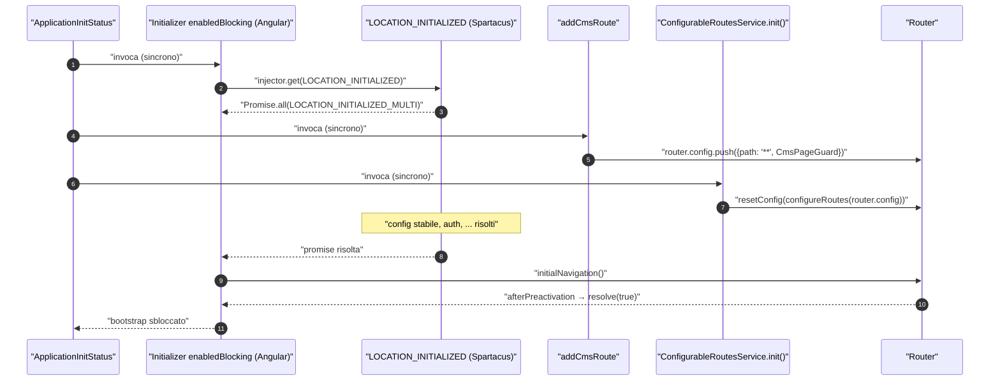
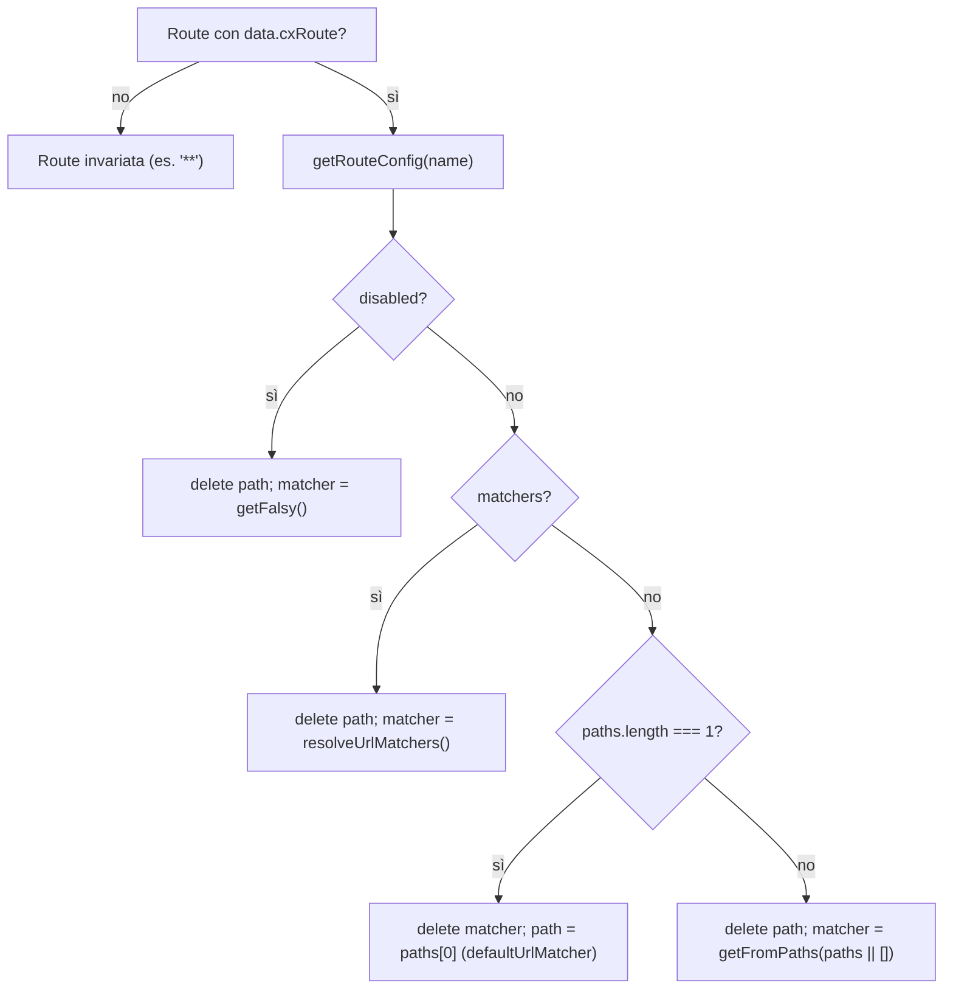
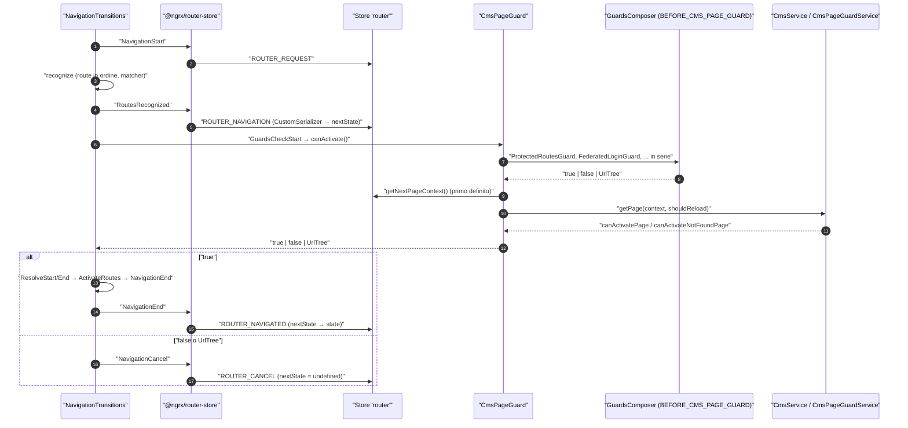
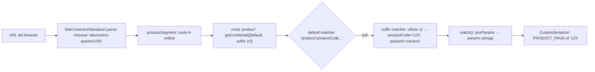

# 05 — Il Router di Angular

> Riferimenti allo SHA `5b7a1c2bf2808d7380bc20596d10f4fa710c3da1` (vedi [00-meta](../00-meta.md)). Angular @ `v21.2.23` (prefisso `angular:`), `@ngrx/router-store` / `@ngrx/store` 21.0.1 (prefisso `deps:`).

## 1. A cosa serve e perché esiste

Il Router di Angular trasforma un URL in un albero di componenti attivati. Lo fa con una pipeline fissa: parsing dell'URL in un `UrlTree`, *recognize* (abbinamento dei segmenti alla configurazione `Routes`), esecuzione dei guard, esecuzione dei resolver, attivazione dei componenti. Ogni fase emette eventi osservabili su `router.events`.

Spartacus usa questo router in modo poco convenzionale, e il capitolo esiste per spiegare proprio queste differenze:

1. **Nessuna route statica nell'app.** `AppRoutingModule` chiama `RouterModule.forRoot([])` con un array vuoto — `core-libs/storefront/router/app-routing.module.ts:L13-L19`. Le route arrivano dalle feature (`RouterModule.forChild`) con `path: null` e un nome semantico in `data.cxRoute` — `feature-libs/cart/base/root/cart-base-root.module.ts:L62-L74`. Il path reale viene scritto a runtime da `ConfigurableRoutesService` leggendo `routing.routes` dalla configurazione — `core-libs/core/src/routing/configurable-routes/configurable-routes.service.ts:L48-L52`.
2. **Una route catch-all governa quasi tutto.** In fondo alla config viene aggiunta `{ path: '**', canActivate: [CmsPageGuard], component: PageLayoutComponent }` — `core-libs/storefront/cms-structure/routing/cms-route/add-cms-route.ts:L12-L25`. Qualsiasi URL che non corrisponde a una route di feature diventa una "content page" del CMS.
3. **Il guard carica i dati.** `CmsPageGuard` non si limita a dire sì/no: carica la pagina CMS dal backend, risolve i mapping dei componenti (anche in lazy loading), esegue i guard dei componenti, carica le traduzioni e, se serve, riscrive la configurazione del router — `core-libs/storefront/cms-structure/guards/cms-page.guard.ts:L51-L84`, `core-libs/storefront/cms-structure/guards/cms-page-guard.service.ts:L65-L98`.
4. **Lo stato del router vive anche in NgRx.** `@ngrx/router-store` replica ogni navigazione nello store `router`, serializzata da un `CustomSerializer` che calcola il `PageContext` (tipo e id della pagina CMS) — `core-libs/core/src/routing/routing.module.ts:L73-L92`, `core-libs/core/src/routing/store/reducers/router.reducer.ts:L112-L167`. `CmsPageGuard` legge il contesto della navigazione *in corso* da lì — `core-libs/storefront/cms-structure/guards/cms-page.guard.ts:L58-L60`.
5. **La navigazione iniziale è bloccante e trattenuta.** `initialNavigation: 'enabledBlocking'` fa attendere il bootstrap alla prima navigazione — `angular:packages/router/src/provide_router.ts:L441-L475` — e Spartacus fornisce `LOCATION_INITIALIZED` per rimandarne l'avvio finché configurazione, autenticazione e altri initializer non sono pronti — `core-libs/core/src/routing/routing.module.ts:L54-L71`.

Per seguire il capitolo servono i concetti di DI ([01 — Dependency Injection](01-dependency-injection.md)) e di bootstrap ([02 — NgModule, standalone e bootstrap](02-ngmodule-standalone-bootstrap.md)). Il routing "semantico" di Spartacus visto dal lato delle feature (URL, page context, contenuti) è approfondito in [14 — Routing](../parte-2/14-routing.md); qui l'obiettivo è il punto di contatto con il Router di Angular.

## 2. Mappa dei file

### Angular (`/tmp/angular`, prefisso `angular:`)

| Path | Ruolo |
|---|---|
| `angular:packages/router/src/models.ts` | Tipi `Route`, `UrlMatcher`, `UrlMatchResult`, `CanActivateFn`, `GuardResult`, `DeprecatedGuard` |
| `angular:packages/router/src/utils/config.ts` | `validateConfig` (dev mode), `getOrCreateRouteInjectorIfNeeded` |
| `angular:packages/router/src/utils/config_matching.ts` | `match`, `matchWithChecks` (matching + `canMatch`) |
| `angular:packages/router/src/shared.ts` | `defaultUrlMatcher`, `matchParts` |
| `angular:packages/router/src/recognize.ts` | `recognize()` e classe `Recognizer` |
| `angular:packages/router/src/operators/check_guards.ts` | `checkGuards`, `runCanActivate`, `runCanMatchGuards` |
| `angular:packages/router/src/operators/prioritized_guard_value.ts` | Priorità dei risultati dei guard paralleli |
| `angular:packages/router/src/utils/preactivation.ts` | `getTokenOrFunctionIdentity` (guard di classe vs funzione) |
| `angular:packages/router/src/operators/resolve_data.ts` | `resolveData` |
| `angular:packages/router/src/navigation_transition.ts` | `NavigationTransitions.setupNavigations`: la pipeline e i suoi eventi |
| `angular:packages/router/src/router.ts` | `Router`: `config`, `resetConfig`, `parseUrl`/`serializeUrl`, inoltro di `events` |
| `angular:packages/router/src/url_tree.ts` | `UrlTree`, `UrlSegmentGroup`, `UrlSerializer`, `DefaultUrlSerializer` |
| `angular:packages/router/src/router_module.ts` | `RouterModule.forRoot/forChild`, `ROUTER_PROVIDERS`, scroller |
| `angular:packages/router/src/provide_router.ts` | `withEnabledBlockingInitialNavigation` |
| `angular:packages/router/src/router_scroller.ts` | `RouterScroller` ed eventi `Scroll` |
| `angular:packages/router/src/events.ts` | `EventType`, classi evento |

### NgRx (`/tmp/deps`, prefisso `deps:`)

| Path | Ruolo |
|---|---|
| `deps:ngrx-router-store-21.0.1/package/fesm2022/ngrx-router-store.mjs` | `StoreRouterConnectingModule`, `provideRouterStore`, servizio che traduce gli eventi del router in azioni |
| `deps:ngrx-store-21.0.1/package/fesm2022/ngrx-store.mjs` | `State`: applicazione delle azioni ai reducer |

### Spartacus

| Path | Ruolo |
|---|---|
| `core-libs/storefront/router/app-routing.module.ts` | `AppRoutingModule`: `RouterModule.forRoot([], …)` + initializer di `OnNavigateService` |
| `core-libs/storefront/router/on-navigate.service.ts` | Reset di scroll e focus a ogni navigazione |
| `core-libs/storefront/router/config/default-on-navigate-config.ts` | Default di `enableResetViewOnNavigate` |
| `core-libs/core/src/routing/routing.module.ts` | `RoutingModule` core: NgRx router-store, `CustomSerializer`, initializer route, `LOCATION_INITIALIZED` |
| `core-libs/core/src/routing/location-initialized-multi/location-initialized-multi.ts` | Token `LOCATION_INITIALIZED_MULTI` e helper |
| `core-libs/core/src/routing/configurable-routes/configurable-routes.service.ts` | Applica `routing.routes` alle `Route` (path/matcher) e chiama `resetConfig` |
| `core-libs/core/src/routing/configurable-routes/routes-config.ts` | `RouteConfig` (`paths`, `matchers`, `paramsMapping`, `disabled`, `protected`, `authFlow`) |
| `core-libs/core/src/routing/configurable-routes/config/routing-config.ts` | `RoutingConfig`, `RouteLoadStrategy` |
| `core-libs/core/src/routing/configurable-routes/routing-config.service.ts` | Lettura config, mappa inversa path→nome, load strategy |
| `core-libs/core/src/routing/services/url-matcher.service.ts` | Fabbrica di `UrlMatcher` (falsy, da path, combinato, opposto, glob) |
| `core-libs/core/src/routing/url-matcher/default-url-matcher.ts` | Token `DEFAULT_URL_MATCHER` |
| `core-libs/storefront/cms-structure/routing/suffix-routes/suffix-url-matcher.ts` | `getSuffixUrlMatcher` (`**/marker/:param`) |
| `core-libs/storefront/cms-pages/product-details-page/product-details-url-matcher.ts` | `PRODUCT_DETAILS_URL_MATCHER` |
| `core-libs/storefront/cms-pages/product-listing-page/product-listing-page.module.ts` | Route PLP e il loro ordine |
| `core-libs/storefront/cms-structure/routing/routing.module.ts` | `RoutingModule` storefront: config di default, `BEFORE_CMS_PAGE_GUARD` |
| `core-libs/storefront/cms-structure/routing/default-routing-config.ts` | `defaultRoutesConfigFactory` |
| `core-libs/storefront/cms-structure/routing/cms-route/add-cms-route.ts` | Route catch-all `**` |
| `core-libs/storefront/cms-structure/guards/cms-page.guard.ts` | `CmsPageGuard` |
| `core-libs/storefront/cms-structure/guards/cms-page-guard.service.ts` | Attivazione pagina CMS / not found |
| `core-libs/storefront/cms-structure/guards/before-cms-page-guard.token.ts` | Token `BEFORE_CMS_PAGE_GUARD` |
| `core-libs/storefront/cms-structure/services/guards-composer.ts` | Composizione sequenziale dei guard |
| `core-libs/storefront/cms-structure/services/cms-routes-impl.service.ts` | Route CMS dinamiche (`childRoutes`) |
| `core-libs/core/src/routing/protected-routes/protected-routes.guard.ts` | Storefront chiuso (`routing.protected`) |
| `core-libs/core/src/routing/external-routes/external-routes.service.ts` | Route verso sistemi esterni (`routing.internal`) |
| `core-libs/core/src/routing/store/reducers/router.reducer.ts` | Reducer `router` + `CustomSerializer` |
| `core-libs/core/src/routing/store/effects/router.effect.ts` | Pulizia delle route CMS dinamiche |
| `core-libs/core/src/routing/facade/routing.service.ts` | Facade di navigazione |
| `core-libs/core/src/routing/configurable-routes/url-translation/semantic-path.service.ts` | Comandi semantici `{ cxRoute, params }` → segmenti |
| `core-libs/core/src/site-context/services/site-context-url-serializer.ts` | `UrlSerializer` con prefisso di site context |

## 3. Come funziona passo per passo

### 3.1 Il modello `Route` di Angular in quattro regole

- Una route corrisponde ai segmenti con `path` (+ `pathMatch: 'prefix' | 'full'`) **oppure** con un `matcher` di tipo `UrlMatcher` — `angular:packages/router/src/models.ts:L606-L613`. Il JSDoc di `UrlMatcher` dice che "Cannot be used together with `path` and `pathMatch`" — `angular:packages/router/src/models.ts:L158-L185` — e in dev mode `validateConfig` lancia un errore se una route ha sia `path` (truthy) sia `matcher` — `angular:packages/router/src/utils/config.ts:L167-L172`.
- Una route deve avere almeno uno dei due; il controllo è `route.path === void 0 && route.matcher === void 0` — `angular:packages/router/src/utils/config.ts:L185-L190`. Quindi `path: null` supera la validazione: è il trucco su cui si reggono le route di feature di Spartacus (§3.4).
- Un `path` non può iniziare con `/` — `angular:packages/router/src/utils/config.ts:L191-L196`.
- Un `UrlMatcher` riceve `(segments, group, route)` e ritorna `UrlMatchResult | null`, dove il risultato contiene i segmenti `consumed` e i `posParams` come `UrlSegment` — `angular:packages/router/src/models.ts:L153-L156`.

I guard sono funzioni `CanActivateFn` `(route, state) => MaybeAsync<GuardResult>` — `angular:packages/router/src/models.ts:L858-L860` — dove `GuardResult` è `boolean | UrlTree | RedirectCommand` — `angular:packages/router/src/models.ts:L85-L85`. `canActivate` accetta ancora anche `DeprecatedGuard` (token di classe o stringa) — `angular:packages/router/src/models.ts:L669-L681` — tipo marcato `@deprecated` — `angular:packages/router/src/models.ts:L50-L64`. Spartacus usa proprio questa forma deprecata: `canActivate: [CmsPageGuard]` con `CmsPageGuard` classe `@Injectable` — `core-libs/storefront/cms-structure/guards/cms-page.guard.ts:L23-L27`.

### 3.2 Matching: `match()`, `defaultUrlMatcher`, ordine delle route

1. `Recognizer.processSegment` prova le route **nell'ordine della configurazione** e ritorna la prima che corrisponde; un `NoMatch` fa passare alla successiva — `angular:packages/router/src/recognize.ts:L235-L267`. L'ordine è dunque semantico: ne dipendono la posizione della catch-all `**` e l'ordine delle route PLP (§9).
2. Se la route ha `redirectTo` il redirect viene espanso, altrimenti si passa a `matchSegmentAgainstRoute` — `angular:packages/router/src/recognize.ts:L298-L321`.
3. `matchSegmentAgainstRoute` invoca `matchWithChecks` — `angular:packages/router/src/recognize.ts:L416-L437` — che esegue `match()` e, solo se c'è un match, crea l'eventuale injector della route (`route.providers`) ed esegue i guard `canMatch`; un risultato non-`true` diventa `noMatch` — `angular:packages/router/src/utils/config_matching.ts:L54-L80`, `angular:packages/router/src/utils/config.ts:L31-L43`.
4. `match()` gestisce direttamente `path: ''`: con `pathMatch: 'full'` fallisce se restano segmenti o figli, altrimenti consuma zero segmenti — `angular:packages/router/src/utils/config_matching.ts:L82-L99`.
5. Per gli altri path usa `route.matcher || defaultUrlMatcher` — `angular:packages/router/src/utils/config_matching.ts:L101-L103` — e converte i `posParams` in stringhe, fondendovi i matrix params dell'ultimo segmento consumato — `angular:packages/router/src/utils/config_matching.ts:L105-L112`.
6. `defaultUrlMatcher` divide `route.path!` per `/`; senza wildcard rifiuta URL più corti della config e, con `pathMatch: 'full'`, quelli più lunghi o con figli — `angular:packages/router/src/shared.ts:L153-L181`. In v21 supporta **un solo** `**` anche in mezzo al path, consumando tutti i segmenti — `angular:packages/router/src/shared.ts:L183-L217`. Le parti che iniziano con `:` diventano parametri, le altre sono confrontate letteralmente — `angular:packages/router/src/shared.ts:L120-L136`.
7. Per una route `'**'` i figli del segment group vengono svuotati (issue #40089) — `angular:packages/router/src/recognize.ts:L416-L437`; per le altre, i segmenti rimanenti sono abbinati ricorsivamente ai `children` — `angular:packages/router/src/recognize.ts:L440-L492`.
8. `createSnapshot` costruisce l'`ActivatedRouteSnapshot` con params, `getData(route)`, `routeConfig` e applica l'ereditarietà di params/data secondo `paramsInheritanceStrategy` (default `'emptyOnly'`) — `angular:packages/router/src/recognize.ts:L377-L400`, `angular:packages/router/src/recognize.ts:L46-L66`.
9. Alla fine l'URL dello stato viene serializzato con l'`UrlSerializer` **iniettato** — `angular:packages/router/src/recognize.ts:L97-L114`. Se nulla corrisponde, l'errore è `Cannot match any routes. URL Segment: ...` — `angular:packages/router/src/recognize.ts:L88-L95`. In Spartacus questo non accade quasi mai, perché la catch-all `**` corrisponde sempre.

### 3.3 Pipeline di navigazione ed eventi

`NavigationTransitions.setupNavigations` è una catena RxJS su un `BehaviorSubject` di transizioni, con `switchMap`: una nuova navigazione cancella quella in corso — `angular:packages/router/src/navigation_transition.ts:L440-L446`. I passi:

1. **Same-URL.** Se il router ha già navigato e `onSameUrlNavigation !== 'reload'`, una navigazione verso lo stesso URL viene saltata con `NavigationSkipped` — `angular:packages/router/src/navigation_transition.ts:L494-L513`.
2. **`NavigationStart`**, con l'URL serializzato dal serializer iniettato; poi `recognize` sulla `router.config` corrente — `angular:packages/router/src/navigation_transition.ts:L515-L545`. L'operatore aggiunge alla transizione `targetSnapshot` e `urlAfterRedirects` — `angular:packages/router/src/operators/recognize.ts:L19-L40`.
3. **`BeforeRoutesRecognized`** (interno) e poi **`RoutesRecognized`** — `angular:packages/router/src/navigation_transition.ts:L548-L573`. È qui che NgRx dispatcha `ROUTER_NAVIGATION` (§3.8).
4. **`GuardsCheckStart`**, calcolo dei guard (`getAllRouteGuards`) e `checkGuards` — `angular:packages/router/src/navigation_transition.ts:L630-L649`.
5. `checkGuards` esegue prima tutti i `canDeactivate` e, solo se tutti `true`, i `canActivate` — `angular:packages/router/src/operators/check_guards.ts:L56-L78`. Per ogni route da attivare, in sequenza, emette `ChildActivationStart`/`ActivationStart`, esegue `canActivateChild` e `canActivate`, e si ferma al primo risultato non-`true` — `angular:packages/router/src/operators/check_guards.ts:L93-L111`.
6. Dentro una singola route i guard partono **in parallelo** (`combineLatest`), ma `prioritizedGuardValue` restituisce il primo risultato non-`true` in ordine di dichiarazione, aspettando i guard precedenti — `angular:packages/router/src/operators/prioritized_guard_value.ts:L18-L45`.
7. Ogni guard viene risolto con `getTokenOrFunctionIdentity` sull'injector della route: se l'oggetto ha un metodo `canActivate` è trattato come classe, altrimenti come funzione eseguita in `runInInjectionContext` — `angular:packages/router/src/operators/check_guards.ts:L149-L172`. Il token viene cercato con `injector.get`; se manca ed è una funzione non `@Injectable`, viene usato così com'è — `angular:packages/router/src/utils/preactivation.ts:L66-L78`.
8. **Esito dei guard.** Un `UrlTree`/`RedirectCommand` viene lanciato come `redirectingNavigationError`; `false` cancella con codice `GuardRejected` — `angular:packages/router/src/navigation_transition.ts:L651-L671`. Il redirect produce `NavigationCancel` seguito da `RedirectRequest` — `angular:packages/router/src/navigation_transition.ts:L885-L901` — che il `Router` trasforma in una nuova navigazione che eredita la promise della precedente — `angular:packages/router/src/router.ts:L214-L241`.
9. **Resolver.** `ResolveStart`/`ResolveEnd` incorniciano `resolveData`; un resolver che non emette cancella con `NoDataFromResolver` — `angular:packages/router/src/navigation_transition.ts:L677-L714`. I resolver girano in sequenza — `angular:packages/router/src/operators/resolve_data.ts:L28-L69`. Spartacus non dichiara alcun `resolve:`, `canMatch:`, `canDeactivate:` né `canActivateChild:` nelle librerie né nella demo app — `core-libs/storefront/vitest.config.ts:L14-L14` (unica occorrenza di `resolve: {`, che non è una route).
10. **Attivazione.** Dopo i `loadComponent` viene invocato l'hook `afterPreactivation()` — `angular:packages/router/src/navigation_transition.ts:L717-L742` — poi `ActivateRoutes.activate`, `NavigationEnd` e aggiornamento del titolo — `angular:packages/router/src/navigation_transition.ts:L782-L810`.
11. **Errori.** Gli errori non di cancellazione diventano `NavigationError`, passando prima da `navigationErrorHandler`, che può restituire un `RedirectCommand` — `angular:packages/router/src/navigation_transition.ts:L905-L941`.

Gli eventi pubblici sono 17 (`EventType`, da `NavigationStart` a `NavigationSkipped`) — `angular:packages/router/src/events.ts:L33-L51`. Il `Router` li riceve dalla pipeline e li inoltra al `Subject` pubblico `router.events` nella stessa sottoscrizione, sincronamente, dopo aver aggiornato il proprio stato — `angular:packages/router/src/router.ts:L195-L195`, `angular:packages/router/src/router.ts:L245-L250`.

### 3.4 Dalla config Spartacus alla `Router.config`

1. **Registrazione.** `RouterModule.forRoot(routes, config)` registra `ROUTES` (multi), `ROUTER_CONFIGURATION`, location strategy, scroller, initial navigation — `angular:packages/router/src/router_module.ts:L133-L166`. `forChild` aggiunge solo un altro `ROUTES` multi — `angular:packages/router/src/router_module.ts:L184-L189`. `Router.config` è `inject(ROUTES).flat()` — `angular:packages/router/src/router.ts:L163-L163`.
2. **Route di feature senza path.** Le feature dichiarano `path: null` (con `// @ts-ignore`), `canActivate: [CmsPageGuard]`, `component: PageLayoutComponent` e `data.cxRoute` — `feature-libs/cart/base/root/cart-base-root.module.ts:L62-L74`. Il path viene dalla config: `cart: { paths: ['cart'] }` — `feature-libs/cart/base/root/config/default-cart-routing-config.ts:L12-L12`.
3. **Config delle route.** `RouteConfig` offre `paths`, `matchers` (funzioni o token di `UrlMatcherFactory`), `paramsMapping`, `disabled`, `protected`, `authFlow` — `core-libs/core/src/routing/configurable-routes/routes-config.ts:L15-L57`. Lo storefront registra i default con `provideDefaultConfigFactory(defaultRoutesConfigFactory)` — `core-libs/storefront/cms-structure/routing/routing.module.ts:L22-L26` — tra cui `home: ['']`, `notFound: ['not-found']`, `product: ['product/:productCode/:name', 'product/:productCode']` — `core-libs/storefront/cms-structure/routing/default-routing-config.ts:L17-L73`.
4. **Initializer.** `RoutingModule.forRoot()` (core) registra con `provideAppInitializer` la chiamata a `ConfigurableRoutesService.init()` — `core-libs/core/src/routing/routing.module.ts:L93-L95`, `core-libs/core/src/routing/routing.module.ts:L37-L42`. `init()` è idempotente (`initCalled`) — `core-libs/core/src/routing/configurable-routes/configurable-routes.service.ts:L31-L43`.
5. **`resetConfig`.** `configure()` ottiene il `Router` dall'`Injector` (non dal costruttore, per la dipendenza ciclica con `APP_INITIALIZER`) e chiama `router.resetConfig(this.configureRoutes(router.config))` — `core-libs/core/src/routing/configurable-routes/configurable-routes.service.ts:L48-L52`. `resetConfig` valida (dev mode), normalizza e reimposta `navigated = false` — `angular:packages/router/src/router.ts:L389-L393`. `configureRoutes` scende anche nei `children` — `core-libs/core/src/routing/configurable-routes/configurable-routes.service.ts:L59-L68`.
6. **Decisione per route.** Il nome è `route.data.cxRoute`; le route senza nome passano invariate — `core-libs/core/src/routing/configurable-routes/configurable-routes.service.ts:L77-L80`, `core-libs/core/src/routing/configurable-routes/configurable-routes.service.ts:L149-L151`. Poi, in quest'ordine — `core-libs/core/src/routing/configurable-routes/configurable-routes.service.ts:L83-L106`:
   - `disabled` → `matcher` = `getFalsy()` (non combacia mai);
   - `matchers` → matcher combinato da `resolveUrlMatchers` (le funzioni passano così come sono, i token vengono risolti con `injector.get(token)(route)`) — `core-libs/core/src/routing/configurable-routes/configurable-routes.service.ts:L118-L143`;
   - esattamente un path → `path` nativo di Angular (quindi `defaultUrlMatcher`);
   - altrimenti → `matcher` da `getFromPaths(paths || [])`.
   In ogni ramo `path` o `matcher` viene cancellato, per non violare la regola "path e matcher insieme" di §3.1.
7. **Validazione morbida.** In dev mode `validateRouteConfig` considera valide la config `null`, `paths: null` o `matchers` definiti, e avvisa se config o `paths` sono `undefined` — `core-libs/core/src/routing/configurable-routes/configurable-routes.service.ts:L153-L179`.

### 3.5 I matcher di Spartacus

`UrlMatcherService` è una piccola fabbrica di `UrlMatcher`:

- `getFalsy()` → sempre `null` — `core-libs/core/src/routing/services/url-matcher.service.ts:L24-L28`.
- `getFromPaths(paths)` → un matcher per path, combinati; in dev mode aggiunge `_paths` — `core-libs/core/src/routing/services/url-matcher.service.ts:L33-L40`.
- `getCombined(matchers)` → OR in cortocircuito: il primo risultato non nullo vince — `core-libs/core/src/routing/services/url-matcher.service.ts:L45-L63`.
- `getFromPath(path)` riproduce `defaultUrlMatcher` di Angular, ma legge il path dall'argomento e gestisce internamente il path vuoto; il commento di licenza punta a una vecchia revisione di `shared.ts` — `core-libs/core/src/routing/services/url-matcher.service.ts:L65-L88`. Rispetta `pathMatch: 'full'` e tratta `:param` come parametro — `core-libs/core/src/routing/services/url-matcher.service.ts:L90-L121`; il path vuoto replica la regola di `match()` — `core-libs/core/src/routing/services/url-matcher.service.ts:L128-L142`.
- `getOpposite(matcher)` accetta ciò che l'originale rifiuta, consumando tutti i segmenti — `core-libs/core/src/routing/services/url-matcher.service.ts:L162-L176`.
- `getFromGlob(patterns)` ricostruisce `/a/b` e lo valida con `GlobService` — `core-libs/core/src/routing/services/url-matcher.service.ts:L181-L197`; un URL è valido se almeno un pattern positivo e nessun pattern `!` corrisponde — `core-libs/core/src/util/glob.service.ts:L17-L32`.

Le factory di matcher (`UrlMatcherFactory = (route: Route) => UrlMatcher` — `core-libs/core/src/routing/url-matcher/url-matcher-factory.ts:L9-L9`) si registrano come `InjectionToken`. `DEFAULT_URL_MATCHER` crea un matcher dai `paths` della route nominata da `data.cxRoute` — `core-libs/core/src/routing/url-matcher/default-url-matcher.ts:L13-L45`.

Il matcher più interessante è `getSuffixUrlMatcher({ marker, paramName })`: cerca l'**ultima** occorrenza del marker, prende il segmento successivo come parametro e numera i precedenti `param0`, `param1`…, consumando fino al parametro — `core-libs/storefront/cms-structure/routing/suffix-routes/suffix-url-matcher.ts:L18-L48`. Su di esso sono costruiti:

- `PRODUCT_DETAILS_URL_MATCHER` = default matcher + suffisso `**/p/:productCode` — `core-libs/storefront/cms-pages/product-details-page/product-details-url-matcher.ts:L16-L50`, impostato come `routing.routes.product.matchers` di default — `core-libs/storefront/cms-pages/product-details-page/product-details-page.module.ts:L14-L36`;
- `PRODUCT_LISTING_URL_MATCHER` = default matcher + suffisso `**/c/:categoryCode`; la route `category` è dichiarata per ultima per non oscurare `brand` — `core-libs/storefront/cms-pages/product-listing-page/product-listing-url-matcher.ts:L20-L27`, `core-libs/storefront/cms-pages/product-listing-page/product-listing-page.module.ts:L30-L38`.

### 3.6 Route CMS: catch-all e route dinamiche

- **Catch-all.** `CmsRouteModule` registra un `APP_INITIALIZER` con `deps: [Injector]` — `core-libs/storefront/cms-structure/routing/cms-route/cms-route.module.ts:L10-L20` — che fa `router.config.push` della route `**` (mutazione diretta, senza `resetConfig`) — `core-libs/storefront/cms-structure/routing/cms-route/add-cms-route.ts:L12-L25`.
- **Route dinamiche con `childRoutes`.** Un componente CMS può dichiarare `childRoutes` (array di `Route` o `{ parent, children }`) e `guards` nella sua config — `core-libs/core/src/cms/config/cms-config.ts:L48-L57`, `core-libs/core/src/cms/config/cms-config.ts:L74-L77`. Durante il guard, `CmsRoutesImplService.handleCmsRoutesInGuard` ritorna `true` se la route CMS per la label esiste già; altrimenti, se i componenti della pagina hanno `childRoutes`, aggiorna la config e ri-naviga allo stesso URL ritornando `false` — `core-libs/storefront/cms-structure/services/cms-routes-impl.service.ts:L69-L91`. `updateRouting` (solo content page con label `/…`) antepone con `resetConfig` una route `path = label senza '/'`, `PageLayoutComponent`, `children` e `data.cxCmsRouteContext` — `core-libs/storefront/cms-structure/services/cms-routes-impl.service.ts:L93-L124`. I guard dei `children` vengono avvolti in un `CanActivateFn` che li risolve tramite `UnifiedInjector` (anche se forniti solo da un modulo lazy) — `core-libs/storefront/cms-structure/services/cms-routes-impl.service.ts:L126-L182`.
- **Pulizia.** `RouterEffects.clearCmsRoutes$` rimuove le route con `data.cxCmsRouteContext` su cambio lingua, login o logout — `core-libs/core/src/routing/store/effects/router.effect.ts:L19-L37`.

### 3.7 `CmsPageGuard` e la composizione dei guard

1. `CmsPageGuard` è un guard di **classe** (`@Injectable({ providedIn: 'root' })`, senza `implements CanActivate`) con proprietà statica `guardName = 'CmsPageGuard'` — `core-libs/storefront/cms-structure/guards/cms-page.guard.ts:L23-L27`. Angular lo istanzia dall'injector perché ha un metodo `canActivate` (§3.3, passo 7).
2. `canActivate` esegue prima i guard **globali** di `BeforeCmsPageGuardService`; solo se il risultato è `true` attende il `nextPageContext` dallo store, carica la pagina CMS con `getPage(ctx, shouldReload)` e delega a `canActivatePage` o `canActivateNotFoundPage` — `core-libs/storefront/cms-structure/guards/cms-page.guard.ts:L51-L84`. `shouldReload()` è `true` salvo `loadStrategy === ONCE` — `core-libs/storefront/cms-structure/guards/cms-page.guard.ts:L89-L91`.
3. I guard globali vengono dal token multi `BEFORE_CMS_PAGE_GUARD` (default `[]`), che il JSDoc riserva ai guard globali — `core-libs/storefront/cms-structure/guards/before-cms-page-guard.token.ts:L10-L24`. Lo storefront vi registra `ProtectedRoutesGuard` e `FederatedLoginGuard` — `core-libs/storefront/cms-structure/routing/routing.module.ts:L27-L36`; punchout e OPPS ne aggiungono altri — `integration-libs/punchout/root/guards/punchout-navigation.module.ts:L15-L15`, `integration-libs/opps/root/login-required/opps-login-required.module.ts:L14-L14`.
4. `BeforeCmsPageGuardService` delega a `GuardsComposer.canActivate` — `core-libs/storefront/cms-structure/guards/before-cms-page-guard.service.ts:L17-L32` — che esegue i guard **in sequenza** (`concat`) e si ferma al primo non-`true`; un oggetto senza `canActivate` causa `Error('Invalid CanActivate guard')` — `core-libs/storefront/cms-structure/services/guards-composer.ts:L59-L86`. `GuardsComposer` definisce il proprio tipo `CanActivate = { canActivate: CanActivateFn }` come sostituto di quello deprecato di Angular — `core-libs/storefront/cms-structure/services/guards-composer.ts:L16-L19`.
5. `ProtectedRoutesGuard` mappa `route.url` a stringhe (root → `['']`) e, se l'URL è protetto, delega ad `AuthGuard` — `core-libs/core/src/routing/protected-routes/protected-routes.guard.ts:L23-L33` — che salva l'URL corrente e ritorna un `UrlTree` verso `login` — `core-libs/core/src/auth/user-auth/guards/auth.guard.ts:L30-L42`. Solo `protected === false` (non `undefined`) rende pubblica una route — `core-libs/core/src/routing/protected-routes/protected-routes.service.ts:L72-L82`.
6. `canActivatePage`: tipi di componenti → `determineMappings` → guard dei componenti (`CmsGuardsService`) → chunk i18n → `handleCmsRoutesInGuard` se la route non è già CMS-driven — `core-libs/storefront/cms-structure/guards/cms-page-guard.service.ts:L65-L98`. I guard dei componenti (`cmsComponents[].guards`) sono risolti via `UnifiedInjector` e composti con `GuardsComposer` — `core-libs/storefront/cms-structure/services/cms-guards.service.ts:L36-L48`.
7. `canActivateNotFoundPage` carica la pagina `notFound`, registra il fallimento sulla pagina richiesta, cambia il `nextPageContext` e applica `canActivatePage`; se manca la route `notFound` ritorna `false` — `core-libs/storefront/cms-structure/guards/cms-page-guard.service.ts:L107-L143`. L'URL nel browser resta quello richiesto.

### 3.8 Il router in NgRx: quando arriva `ROUTER_NAVIGATION`

1. `RoutingModule` (core) importa lo store feature `router`, gli effetti e `StoreRouterConnectingModule.forRoot({ routerState: RouterState.Minimal, stateKey: 'router' })` — `core-libs/core/src/routing/routing.module.ts:L73-L82`. `RoutingModule.forRoot()` fornisce `RouterStateSerializer` = `CustomSerializer` — `core-libs/core/src/routing/routing.module.ts:L84-L92`.
2. `StoreRouterConnectingModule.forRoot` usa `provideRouterStore`, che fornisce a sua volta un `RouterStateSerializer` (`MinimalRouterStateSerializer` se non specificato) e istanzia il servizio di connessione con un environment initializer — `deps:ngrx-router-store-21.0.1/package/fesm2022/ngrx-router-store.mjs:L351-L370`, `deps:ngrx-router-store-21.0.1/package/fesm2022/ngrx-router-store.mjs:L415-L420`. Vince `CustomSerializer`: in `walkProviderTree` i provider degli import vengono visitati prima di quelli del `ModuleWithProviders` — `angular:packages/core/src/di/provider_collection.ts:L293-L320` — e un provider non-multi sovrascrive il precedente — `angular:packages/core/src/di/r3_injector.ts:L497-L521`.
3. La config NgRx di default ha `navigationActionTiming: PreActivation` — `deps:ngrx-router-store-21.0.1/package/fesm2022/ngrx-router-store.mjs:L102-L109` — e Spartacus non la cambia.
4. Il servizio si sottoscrive a `router.events`: su `NavigationStart` dispatcha `ROUTER_REQUEST`; su `RoutesRecognized`, con `PreActivation`, dispatcha **subito** `ROUTER_NAVIGATION`; su `NavigationCancel`/`NavigationError` dispatcha `ROUTER_CANCEL`/`ROUTER_ERROR`; su `NavigationEnd` dispatcha `ROUTER_NAVIGATED` — `deps:ngrx-router-store-21.0.1/package/fesm2022/ngrx-router-store.mjs:L217-L256`. Il JSDoc lo dichiara: "before any guards or resolvers run, the router will dispatch a ROUTER_NAVIGATION action" — `deps:ngrx-router-store-21.0.1/package/fesm2022/ngrx-router-store.mjs:L373-L377`.
5. `ROUTER_NAVIGATION` porta `routerState` = serializzazione dello snapshot **target** (`RoutesRecognized.state`); `ROUTER_NAVIGATED` serializza invece `router.routerState.snapshot`, già attivato — `deps:ngrx-router-store-21.0.1/package/fesm2022/ngrx-router-store.mjs:L260-L282`. Con `routerState` non `Full`, `payload.event` è ridotto a `{ id, url, urlAfterRedirects }` — `deps:ngrx-router-store-21.0.1/package/fesm2022/ngrx-router-store.mjs:L283-L305`.
6. Poiché `RoutesRecognized` è emesso prima del blocco che emette `GuardsCheckStart` ed esegue `checkGuards` — `angular:packages/router/src/navigation_transition.ts:L564-L573`, `angular:packages/router/src/navigation_transition.ts:L630-L649` — il `nextState` dello store Spartacus è già popolato quando `CmsPageGuard` si mette in ascolto. Lo `State` di NgRx applica le azioni via `observeOn(queueScheduler)` + `scan` — `deps:ngrx-store-21.0.1/package/fesm2022/ngrx-store.mjs:L487-L496`; in ogni caso `CmsPageGuard` attende con `filter(isNotUndefined)` — `core-libs/storefront/cms-structure/guards/cms-page.guard.ts:L58-L60`.
7. Il reducer Spartacus salva il serializzato in `nextState` su `ROUTER_NAVIGATION`, lo azzera su `ROUTER_ERROR`/`ROUTER_CANCEL` e su `ROUTER_NAVIGATED` lo promuove a `state` preservando il `context` eventualmente cambiato durante la navigazione — `core-libs/core/src/routing/store/reducers/router.reducer.ts:L47-L95`. `ChangeNextPageContext` modifica il `context` del `nextState` solo se c'è una navigazione in corso — `core-libs/core/src/routing/store/reducers/router.reducer.ts:L68-L75`.
8. **`CustomSerializer`.** Scende lungo `firstChild` fino alla foglia, raccogliendo `data.cxRoute` e `data.cxCmsRouteContext` da qualsiasi antenato — `core-libs/core/src/routing/store/reducers/router.reducer.ts:L112-L133`. `cmsRequired` diventa `true` se c'è un contesto CMS o se un guard in `canActivate` è una funzione con `guardName === 'CmsPageGuard'` — `core-libs/core/src/routing/store/reducers/router.reducer.ts:L135-L149`. Il `PageContext` deriva da: preview SmartEdit; `productCode` → PRODUCT_PAGE; `categoryCode`/`brandCode` → CATEGORY_PAGE; `data.pageLabel` → CONTENT_PAGE — `core-libs/core/src/routing/store/reducers/router.reducer.ts:L175-L196`; in mancanza, CONTENT_PAGE con id `'/' + segmenti della foglia` o `HOME_PAGE_CONTEXT` per l'URL vuoto — `core-libs/core/src/routing/store/reducers/router.reducer.ts:L198-L217`.

### 3.9 Bootstrap: navigazione iniziale bloccante e trattenuta

1. `AppRoutingModule` → `RouterModule.forRoot([], { anchorScrolling: 'enabled', initialNavigation: 'enabledBlocking' })` — `core-libs/storefront/router/app-routing.module.ts:L13-L19`. La demo app lo importa in `AppModule` prima di `SpartacusModule` — `projects/storefrontapp/src/app/app.module.ts:L15-L22`; lo schematic `add-spartacus` rimuove l'eventuale `AppRoutingModule` locale generato da `ng new` — `core-libs/schematics/src/add-spartacus/update-app-module.ts:L70-L75`.
2. `initialNavigation: 'enabledBlocking'` → `withEnabledBlockingInitialNavigation()` — `angular:packages/router/src/router_module.ts:L237-L244` — che registra un app initializer: attende la promise di `LOCATION_INITIALIZED`, lancia `router.initialNavigation()` e sblocca il bootstrap in `afterPreactivation` (o a fine/annullamento della navigazione) — `angular:packages/router/src/provide_router.ts:L441-L475`.
3. `ApplicationInitStatus.runInitializers` invoca **sincronamente** tutti gli initializer in ordine e attende solo quelli asincroni — `angular:packages/core/src/application/application_init.ts:L239-L275`. Così `ConfigurableRoutesService.init()`, `addCmsRoute`, `ExternalRoutesService.addRoutes()` e `OnNavigateService.initializeWithConfig()` sono già stati eseguiti quando parte la navigazione iniziale.
4. Spartacus fornisce `LOCATION_INITIALIZED` con una factory che invoca tutti i `LOCATION_INITIALIZED_MULTI` e ritorna `Promise.all` — `core-libs/core/src/routing/routing.module.ts:L54-L71`, `core-libs/core/src/routing/routing.module.ts:L102-L105`. Tra i contributori: `ConfigInitializerModule` (config stabile) — `core-libs/core/src/config/config-initializer/config-initializer.module.ts:L60-L64` — e `UserAuthModule` — `core-libs/core/src/auth/user-auth/user-auth.module.ts:L119-L120`. Il JSDoc del token vieta di usare il Router nelle implementazioni — `core-libs/core/src/routing/location-initialized-multi/location-initialized-multi.ts:L22-L38`.
5. **Ordine degli initializer di routing.** Lo storefront `RoutingModule` importa `[CoreRoutingModule.forRoot(), CmsRouteModule]` — `core-libs/storefront/cms-structure/routing/routing.module.ts:L18-L20`. I provider dei `ModuleWithProviders` importati vengono visitati dopo i moduli semplici — `angular:packages/core/src/di/provider_collection.ts:L293-L320` — e `provideAppInitializer` è un provider multi di `APP_INITIALIZER` — `angular:packages/core/src/application/application_init.ts:L192-L202`: quindi `addCmsRoute` è registrato **prima** di `ConfigurableRoutesService.init()`. Il risultato è comunque corretto: la route `**` non ha `data.cxRoute` e `configureRoutes` la lascia invariata in coda — `core-libs/core/src/routing/configurable-routes/configurable-routes.service.ts:L77-L80`, `core-libs/core/src/routing/configurable-routes/configurable-routes.service.ts:L108-L108`.

### 3.10 `UrlSerializer`, URL semantici e scroll

- **Serializer.** `UrlSerializer` è astratto, `providedIn: 'root'`, con factory `DefaultUrlSerializer` — `angular:packages/router/src/url_tree.ts:L420-L427` — ma `ROUTER_PROVIDERS` lo ri-registra, con un TODO che avverte che "provider order matters" — `angular:packages/router/src/router_module.ts:L65-L81`. `SiteContextModule.forRoot()` lo sostituisce con `SiteContextUrlSerializer` (`useExisting`) — `core-libs/core/src/site-context/providers/site-context-params-providers.ts:L14-L18` — e `BaseCoreModule` lo importa con il commento "should be imported after RouterModule.forRoot, because it overwrites UrlSerializer" — `core-libs/core/src/base-core.module.ts:L38-L38`. In `parse` rimuove i segmenti prefisso di site context e li salva in `urlTree.siteContext` — `core-libs/core/src/site-context/services/site-context-url-serializer.ts:L31-L71`; in `serialize` li riantepone — `core-libs/core/src/site-context/services/site-context-url-serializer.ts:L126-L159`. Il router usa il serializer iniettato per `parseUrl`/`serializeUrl` — `angular:packages/router/src/router.ts:L588-L594` — ma `UrlTree.toString()` usa sempre un `DefaultUrlSerializer` statico — `angular:packages/router/src/url_tree.ts:L289-L291`.
- **URL semantici.** `RoutingService.go(commands)` traduce i comandi con `SemanticPathService.transform` e chiama `router.navigate` — `core-libs/core/src/routing/facade/routing.service.ts:L91-L94`. `transform` espande i comandi `{ cxRoute, params }` scegliendo il primo path i cui parametri sono tutti forniti (con `paramsMapping`) — `core-libs/core/src/routing/configurable-routes/url-translation/semantic-path.service.ts:L41-L68`, `core-libs/core/src/routing/configurable-routes/url-translation/semantic-path.service.ts:L135-L154`. La pipe `cxUrl` delega a `transform` — `core-libs/core/src/routing/configurable-routes/url-translation/url.pipe.ts:L11-L17`.
- **Scroll.** `RouterScroller` ha di default `scrollPositionRestoration` e `anchorScrolling` a `'disabled'` e, con hydration, sopprime gli eventi `Scroll` finché l'app non è stabile — `angular:packages/router/src/router_scroller.ts:L48-L72`, `angular:packages/router/src/router_scroller.ts:L132-L132`. Su `NavigationEnd` schedula uno `Scroll` con la posizione salvata solo per `popstate` — `angular:packages/router/src/router_scroller.ts:L85-L104`, `angular:packages/router/src/router_scroller.ts:L149-L157`. `OnNavigateService` imposta `history.scrollRestoration = 'manual'`, ascolta gli `Scroll` e, salvo filtri, scrolla in cima e mette il focus sull'host — `core-libs/storefront/router/on-navigate.service.ts:L80-L90`, `core-libs/storefront/router/on-navigate.service.ts:L91-L116`.

## 4. Diagrammi

### 4.1 Bootstrap: dalla config Spartacus alla navigazione iniziale

Ogni passo corrisponde a §3.4 e §3.9.



### 4.2 Decisione di `configureRoute`



### 4.3 Una navigazione verso una pagina CMS

Combina §3.3, §3.7 e §3.8. La freccia "dispatch ROUTER_NAVIGATION" avviene durante la gestione sincrona di `RoutesRecognized`, prima di `GuardsCheckStart`.



### 4.4 Matching di `/electronics-spa/en/USD/camera/p/123`

Combina §3.2, §3.5 e §3.10.



## 5. Estratti di codice reale

### 5.1 `AppRoutingModule`

`core-libs/storefront/router/app-routing.module.ts:L13-L37`
```ts
@NgModule({
  imports: [
    RouterModule.forRoot([], {
      anchorScrolling: 'enabled',
      initialNavigation: 'enabledBlocking',
    }),
  ],
  providers: [
    provideDefaultConfig(defaultOnNavigateConfig),
    {
      provide: APP_INITIALIZER,
      useFactory: onNavigateFactory,
      deps: [OnNavigateService],
      multi: true,
    },
  ],
})
export class AppRoutingModule {}

export function onNavigateFactory(
  onNavigateService: OnNavigateService
): () => void {
  const isReady = () => onNavigateService.initializeWithConfig();
  return isReady;
}
```

### 5.2 `match()` di Angular

`angular:packages/router/src/utils/config_matching.ts:L82-L112`
```ts
export function match(
  segmentGroup: UrlSegmentGroup,
  route: Route,
  segments: UrlSegment[],
): MatchResult {
  if (route.path === '') {
    if (route.pathMatch === 'full' && (segmentGroup.hasChildren() || segments.length > 0)) {
      return {...noMatch};
    }

    return {
      matched: true,
      consumedSegments: [],
      remainingSegments: segments,
      parameters: {},
      positionalParamSegments: {},
    };
  }

  const matcher = route.matcher || defaultUrlMatcher;
  const res = matcher(segments, segmentGroup, route);
  if (!res) return {...noMatch};

  const posParams: {[n: string]: string} = {};
  Object.entries(res.posParams ?? {}).forEach(([k, v]) => {
    posParams[k] = v.path;
  });
  const parameters =
    res.consumed.length > 0
      ? {...posParams, ...res.consumed[res.consumed.length - 1].parameters}
      : posParams;
```

### 5.3 `runCanActivate`: classe o funzione

`angular:packages/router/src/operators/check_guards.ts:L149-L172`
```ts
function runCanActivate(
  futureRSS: RouterStateSnapshot,
  futureARS: ActivatedRouteSnapshot,
): Observable<GuardResult> {
  const canActivate = futureARS.routeConfig ? futureARS.routeConfig.canActivate : null;
  if (!canActivate || canActivate.length === 0) return of(true);

  const canActivateObservables = canActivate.map((canActivate) => {
    return defer(() => {
      const closestInjector = futureARS._environmentInjector;
      const guard = getTokenOrFunctionIdentity<CanActivate>(
        canActivate as ProviderToken<CanActivate>,
        closestInjector,
      );
      const guardVal = isCanActivate(guard)
        ? guard.canActivate(futureARS, futureRSS)
        : runInInjectionContext(closestInjector, () =>
            (guard as CanActivateFn)(futureARS, futureRSS),
          );
      return wrapIntoObservable(guardVal).pipe(first());
    });
  });
  return of(canActivateObservables).pipe(prioritizedGuardValue());
}
```

### 5.4 `configureRoute`

`core-libs/core/src/routing/configurable-routes/configurable-routes.service.ts:L77-L109`
```ts
  protected configureRoute(route: Route): Route {
    const routeName = this.getRouteName(route);
    if (routeName) {
      const routeConfig = this.routingConfigService.getRouteConfig(routeName);
      this.validateRouteConfig(routeConfig, routeName, route);

      if (routeConfig?.disabled) {
        delete route.path;
        return {
          ...route,
          matcher: this.urlMatcherService.getFalsy(),
        };
      } else if (routeConfig?.matchers) {
        delete route.path;
        return {
          ...route,
          matcher: this.resolveUrlMatchers(route, routeConfig?.matchers),
        };
      } else if (routeConfig?.paths?.length === 1) {
        delete route.matcher;
        return { ...route, path: routeConfig?.paths[0] };
      } else {
        delete route.path;
        return {
          ...route,
          matcher: this.urlMatcherService.getFromPaths(
            routeConfig?.paths || []
          ),
        };
      }
    }
    return route; // if route doesn't have a name, just pass the original route
  }
```

### 5.5 `getSuffixUrlMatcher`

`core-libs/storefront/cms-structure/routing/suffix-routes/suffix-url-matcher.ts:L28-L48`
```ts
  precedingParamName = precedingParamName || 'param';
  const matcher = function suffixUrlMatcher(
    segments: UrlSegment[]
  ): UrlMatchResult | null {
    const markerIndex = findLastIndex(segments, ({ path }) => path === marker);
    const isMarkerLastSegment = markerIndex === segments.length - 1;

    if (markerIndex === -1 || isMarkerLastSegment) {
      return null;
    }

    const paramIndex = markerIndex + 1;
    const posParams: { [name: string]: UrlSegment } = {
      [paramName]: segments[paramIndex],
    };

    for (let i = 0; i < markerIndex; i++) {
      posParams[`${precedingParamName}${i}`] = segments[i];
    }

    return { consumed: segments.slice(0, paramIndex + 1), posParams };
  };
```

### 5.6 La catch-all CMS

`core-libs/storefront/cms-structure/routing/cms-route/add-cms-route.ts:L12-L25`
```ts
const cmsRoute: Route = {
  path: '**',
  canActivate: [CmsPageGuard],
  component: PageLayoutComponent,
};

export function addCmsRoute(injector: Injector): () => void {
  const result = () => {
    // Router could not be injected via `deps[]` due to a cyclic dependency with APP_INITIALIZER:
    const router = injector.get(Router);
    router.config.push(cmsRoute);
  };
  return result;
}
```

### 5.7 `CmsPageGuard.canActivate`

`core-libs/storefront/cms-structure/guards/cms-page.guard.ts:L51-L84`
```ts
  canActivate(
    route: CmsActivatedRouteSnapshot,
    state: RouterStateSnapshot
  ): Observable<GuardResult> {
    return this.beforeCmsPageGuardService.canActivate(route, state).pipe(
      switchMap((canActivate) =>
        canActivate === true
          ? this.routingService.getNextPageContext().pipe(
              filter(isNotUndefined),
              take(1),
              switchMap((pageContext) =>
                this.cmsService.getPage(pageContext, this.shouldReload()).pipe(
                  first(),
                  switchMap((pageData) =>
                    pageData
                      ? this.service.canActivatePage(
                          pageContext,
                          pageData,
                          route,
                          state
                        )
                      : this.service.canActivateNotFoundPage(
                          pageContext,
                          route,
                          state
                        )
                  )
                )
              )
            )
          : of(canActivate)
      )
    );
  }
```

### 5.8 `GuardsComposer`: esecuzione in serie

`core-libs/storefront/cms-structure/services/guards-composer.ts:L59-L86`
```ts
  protected canActivateGuard(
    guard: CanActivate,
    route: CmsActivatedRouteSnapshot,
    state: RouterStateSnapshot
  ): Observable<GuardResult> {
    if (this.isCanActivate(guard)) {
      return wrapIntoObservable(guard.canActivate(route, state)).pipe(first());
    } else {
      throw new Error('Invalid CanActivate guard');
    }
  }

  // ...
  protected composeCanActivateObservables(
    canActivateObservables: CanActivateObservable[]
  ): CanActivateObservable {
    return concat(...canActivateObservables).pipe(
      skipWhile((canActivate: GuardResult) => canActivate === true),
      endWith(true),
      first()
    );
  }
```

### 5.9 NgRx: da eventi del router ad azioni

`deps:ngrx-router-store-21.0.1/package/fesm2022/ngrx-router-store.mjs:L217-L256`
```js
    setUpRouterEventsListener() {
        const dispatchNavLate = this.config.navigationActionTiming ===
            NavigationActionTiming.PostActivation;
        let routesRecognized;
        this.router.events
            .pipe(withLatestFrom(this.store))
            .subscribe(([event, storeState]) => {
            this.lastEvent = event;
            if (event instanceof NavigationStart) {
                this.routerState = this.serializer.serialize(this.router.routerState.snapshot);
                if (this.trigger !== RouterTrigger.STORE) {
                    this.storeState = storeState;
                    this.dispatchRouterRequest(event);
                }
            }
            else if (event instanceof RoutesRecognized) {
                routesRecognized = event;
                if (!dispatchNavLate && this.trigger !== RouterTrigger.STORE) {
                    this.dispatchRouterNavigation(event);
                }
            }
            // ...
            else if (event instanceof NavigationEnd) {
                if (this.trigger !== RouterTrigger.STORE) {
                    if (dispatchNavLate) {
                        this.dispatchRouterNavigation(routesRecognized);
                    }
                    this.dispatchRouterNavigated(event);
                }
                this.reset();
            }
        });
    }
```

### 5.10 Reducer `router` di Spartacus

`core-libs/core/src/routing/store/reducers/router.reducer.ts:L52-L90`
```ts
    case fromNgrxRouter.ROUTER_NAVIGATION: {
      return {
        ...state,
        nextState: action.payload.routerState,
        navigationId: action.payload.event.id,
      };
    }

    case fromNgrxRouter.ROUTER_ERROR:
    case fromNgrxRouter.ROUTER_CANCEL: {
      return {
        ...state,
        nextState: undefined,
      };
    }
    // ...
    case fromNgrxRouter.ROUTER_NAVIGATED: {
      return {
        state: {
          ...action.payload.routerState,
          context:
            // we want to preserve already resolved context,
            // in case it was changed while navigating
            state.nextState?.context ?? action.payload.routerState.context,
        },
        navigationId: action.payload.event.id,
        nextState: undefined,
      };
    }
```

### 5.11 `LOCATION_INITIALIZED` di Spartacus

`core-libs/core/src/routing/routing.module.ts:L66-L71`
```ts
function locationInitializedFactory(): Promise<any> {
  const initializers =
    inject(LOCATION_INITIALIZED_MULTI, { optional: true }) ?? [];
  const promiseInitializers = initializers.map((initializer) => initializer());
  return Promise.all(promiseInitializers);
}
```

## 6. Configurazione

| Chiave | Tipo | Default | Definita in | Letta in |
|---|---|---|---|---|
| `routing.routes[name].paths` | `string[]` | da `defaultRoutesConfigFactory` + config delle feature | `core-libs/core/src/routing/configurable-routes/routes-config.ts:L22-L22`; default `core-libs/storefront/cms-structure/routing/default-routing-config.ts:L17-L89` | `core-libs/core/src/routing/configurable-routes/configurable-routes.service.ts:L95-L104`, `core-libs/core/src/routing/configurable-routes/url-translation/semantic-path.service.ts:L26-L31` |
| `routing.routes[name].matchers` | `(UrlMatcher \| InjectionToken<UrlMatcherFactory>)[]` | — (PDP/PLP lo impostano) | `core-libs/core/src/routing/configurable-routes/routes-config.ts:L31-L31`; `core-libs/storefront/cms-pages/product-details-page/product-details-page.module.ts:L27-L35` | `core-libs/core/src/routing/configurable-routes/configurable-routes.service.ts:L118-L143` |
| `routing.routes[name].paramsMapping` | `{ [param]: string }` | es. `product: { productCode: 'code' }` | `core-libs/core/src/routing/configurable-routes/routes-config.ts:L36-L36` | `core-libs/core/src/routing/configurable-routes/url-translation/semantic-path.service.ts:L135-L154` |
| `routing.routes[name].disabled` | `boolean` | — | `core-libs/core/src/routing/configurable-routes/routes-config.ts:L41-L41` | `core-libs/core/src/routing/configurable-routes/configurable-routes.service.ts:L83-L88` |
| `routing.routes[name].protected` | `boolean` | — (conta solo `false`) | `core-libs/core/src/routing/configurable-routes/routes-config.ts:L47-L47` | `core-libs/core/src/routing/protected-routes/protected-routes.service.ts:L72-L82` |
| `routing.routes[name].authFlow` | `boolean` | `true` per login/register/… | `core-libs/core/src/routing/configurable-routes/routes-config.ts:L56-L56`; `core-libs/storefront/cms-structure/routing/default-routing-config.ts:L34-L59` | `core-libs/core/src/auth/user-auth/guards/federated-login.guard.ts:L32-L68` |
| `routing.protected` | `boolean` | `undefined` → impostato da `SecurePortalConfigInitializer` | `core-libs/core/src/routing/configurable-routes/config/routing-config.ts:L22-L49` | `core-libs/core/src/routing/protected-routes/protected-routes.service.ts:L28-L48`; `core-libs/core/src/routing/routing.module.ts:L44-L52` |
| `routing.loadStrategy` | `RouteLoadStrategy` (`'once'`/`'always'`) | `ALWAYS` | `core-libs/core/src/routing/configurable-routes/config/routing-config.ts:L11-L20` | `core-libs/core/src/routing/configurable-routes/routing-config.service.ts:L45-L47`; `core-libs/storefront/cms-structure/guards/cms-page.guard.ts:L89-L91` |
| `routing.internal` | `string[]` (glob, `!` = esclusione) | — | `core-libs/core/src/routing/external-routes/external-routes-config.ts:L10-L24` | `core-libs/core/src/routing/external-routes/external-routes.service.ts:L35-L70` |
| `enableResetViewOnNavigate.active` | `boolean` | `true` | `core-libs/storefront/router/config/default-on-navigate-config.ts:L9-L16` | `core-libs/storefront/router/on-navigate.service.ts:L80-L90` |
| `enableResetViewOnNavigate.ignoreQueryString` | `boolean` | `false` | `core-libs/storefront/router/config/default-on-navigate-config.ts:L9-L16` | `core-libs/storefront/router/on-navigate.service.ts:L91-L116` |
| `enableResetViewOnNavigate.ignoreRoutes` | `string[]` | `[]` | `core-libs/storefront/router/config/default-on-navigate-config.ts:L9-L16` | `core-libs/storefront/router/on-navigate.service.ts:L171-L179` |
| `enableResetViewOnNavigate.selectedHostElement` | `string` (tag) | `'body'` | `core-libs/storefront/router/config/default-on-navigate-config.ts:L9-L16` | `core-libs/storefront/router/on-navigate.service.ts:L45-L57` |
| `RouterModule.forRoot` → `anchorScrolling` | `'disabled' \| 'enabled'` | Angular `'disabled'`; Spartacus `'enabled'` | `core-libs/storefront/router/app-routing.module.ts:L16-L16` | `angular:packages/router/src/router_scroller.ts:L106-L126`; `core-libs/storefront/router/on-navigate.service.ts:L138-L163` |
| `RouterModule.forRoot` → `initialNavigation` | `'enabledBlocking' \| …` | Spartacus `'enabledBlocking'` | `core-libs/storefront/router/app-routing.module.ts:L17-L17` | `angular:packages/router/src/router_module.ts:L237-L244` |
| `RouterModule.forRoot` → `scrollPositionRestoration` | `'disabled' \| 'enabled' \| 'top'` | `'disabled'` (Spartacus non lo imposta) | `angular:packages/router/src/router_scroller.ts:L48-L72` | `angular:packages/router/src/router_scroller.ts:L106-L126` |
| `cmsComponents[type].childRoutes` | `Route[] \| CmsComponentChildRoutesConfig` | — | `core-libs/core/src/cms/config/cms-config.ts:L74-L74` | `core-libs/storefront/cms-structure/services/cms-components.service.ts:L205-L248` |
| `cmsComponents[type].guards` | `any[]` | — | `core-libs/core/src/cms/config/cms-config.ts:L77-L77` | `core-libs/storefront/cms-structure/services/cms-components.service.ts:L253-L261` |
| `StoreRouterConnectingModule.forRoot` → `routerState` / `stateKey` / `navigationActionTiming` | NgRx | `Minimal` / `'router'` / `PreActivation` (non impostato) | `core-libs/core/src/routing/routing.module.ts:L77-L80` | `deps:ngrx-router-store-21.0.1/package/fesm2022/ngrx-router-store.mjs:L102-L109`, `deps:ngrx-router-store-21.0.1/package/fesm2022/ngrx-router-store.mjs:L283-L305` |

## 7. Commenti e note notevoli dal sorgente

- "Router could not be injected in constructor due to cyclic dependency with APP_INITIALIZER" — `core-libs/core/src/routing/configurable-routes/configurable-routes.service.ts:L49-L49`; variante identica in `core-libs/storefront/cms-structure/routing/cms-route/add-cms-route.ts:L20-L20`. Il `Router` dipende da initializer che a loro volta vorrebbero il `Router`: per questo viene preso pigramente dall'`Injector`.
- "workaround for AOT compilation (see https://stackoverflow.com/a/51977115)" — `core-libs/core/src/routing/routing.module.ts:L40-L40`.
- JSDoc di `LOCATION_INITIALIZED`: "Only when the Promise in this injection token is resolved, then Angular will start the initial navigation in the Router." — `core-libs/core/src/routing/routing.module.ts:L54-L65`.
- "CAUTION: Don't use Router and don't perform any Router navigation in its implementations." — `core-libs/core/src/routing/location-initialized-multi/location-initialized-multi.ts:L30-L35`.
- `/** since 2211.24 not used anymore, but called indirectly via {@link BeforeCmsPageGuardService} */` sulla dipendenza `ProtectedRoutesGuard` di `CmsPageGuard` — `core-libs/storefront/cms-structure/guards/cms-page.guard.ts:L32-L33`.
- "**CAUTION**: Suitable for global guards ONLY! For route-specific guards, configure them under `cmsComponents`" — `core-libs/storefront/cms-structure/guards/before-cms-page-guard.token.ts:L13-L20`.
- "Replacement for the Angular's deprecated type `CanActivate`." — `core-libs/storefront/cms-structure/services/guards-composer.ts:L16-L19`.
- "This service should be exposed in public API only after the refactor planned in https://github.com/SAP/spartacus/issues/7070" — `core-libs/storefront/cms-structure/services/cms-routes-impl.service.ts:L31-L31`; `CmsRoutesService` è il token pubblico per l'implementazione privata — `core-libs/storefront/cms-structure/services/cms-routes.service.ts:L11-L23`.
- Licenza MIT Google nel matcher copiato da Angular (`shared.ts#L121` di una vecchia revisione) — `core-libs/core/src/routing/services/url-matcher.service.ts:L76-L83`.
- "Note: Matchers will "match" a route, but do not contribute to the creation of the route, nor do they guard routes." — `core-libs/core/src/routing/url-matcher/default-url-matcher.ts:L33-L33`.
- Ordine PLP: "The 'category' route may include a greedy suffix url matcher '**/c/:categoryCode' … the 'category' is the last route in the sequence." — `core-libs/storefront/cms-pages/product-listing-page/product-listing-page.module.ts:L31-L32`.
- "should be imported after RouterModule.forRoot, because it overwrites UrlSerializer" — `core-libs/core/src/base-core.module.ts:L38-L38`.
- Commento in `OnNavigateService` su hydration e `pairwise`: il primo `Scroll` della navigazione iniziale è soppresso, quindi il precedente è tracciato a mano — `core-libs/storefront/router/on-navigate.service.ts:L36-L43`.
- Nel reducer: "we want to preserve already resolved context, in case it was changed while navigating" — `core-libs/core/src/routing/store/reducers/router.reducer.ts:L82-L84`.
- Angular, TODO sui `ROUTER_PROVIDERS` mantenuti "to avoid a breaking change whereby the provider order matters" — `angular:packages/router/src/router_module.ts:L65-L68`.
- Angular, commento su `router.events`: "it's important to have the Router process the events _before_ the event is pushed through the public observable" — `angular:packages/router/src/router.ts:L245-L250`.
- Angular, `@deprecated` su `DeprecatedGuard` — `angular:packages/router/src/models.ts:L50-L64`.
- NgRx, JSDoc: "before any guards or resolvers run, the router will dispatch a ROUTER_NAVIGATION action" — `deps:ngrx-router-store-21.0.1/package/fesm2022/ngrx-router-store.mjs:L373-L377`.

## 8. Extension point

| Extension point | Come si usa | Definizione | Ricetta |
|---|---|---|---|
| `routing.routes[name].paths` | Cambiare o aggiungere path a una route nominata con `provideConfig` | `core-libs/core/src/routing/configurable-routes/routes-config.ts:L15-L57` | [51 — Ricette: CMS, outlet, route e layout](../parte-3/51-ricette-cms-outlet-layout.md) |
| `routing.routes[name].matchers` + `UrlMatcherFactory` | Matcher custom (funzione o token di factory) | `core-libs/core/src/routing/configurable-routes/configurable-routes.service.ts:L118-L143`; `core-libs/core/src/routing/url-matcher/url-matcher-factory.ts:L9-L9` | [51](../parte-3/51-ricette-cms-outlet-layout.md) |
| `DEFAULT_URL_MATCHER`, `PRODUCT_DETAILS_URL_MATCHER`, `PRODUCT_LISTING_URL_MATCHER` | Comporre i matcher esistenti in uno nuovo | `core-libs/core/src/routing/url-matcher/default-url-matcher.ts:L35-L45`; `core-libs/storefront/cms-pages/product-details-page/product-details-url-matcher.ts:L42-L50` | [51](../parte-3/51-ricette-cms-outlet-layout.md) |
| `getSuffixUrlMatcher` | URL SEO-friendly `…/marker/:param` | `core-libs/storefront/cms-structure/routing/suffix-routes/suffix-url-matcher.ts:L18-L55` | [51](../parte-3/51-ricette-cms-outlet-layout.md) |
| `UrlMatcherService` | Sostituzione via DI o uso diretto (`getCombined`, `getOpposite`, `getFromGlob`) | `core-libs/core/src/routing/services/url-matcher.service.ts:L17-L198` | [50 — Ricette: config, DI, interceptor, eventi](../parte-3/50-ricette-config-di.md) |
| Route Angular aggiuntive | `RouterModule.forChild` con `data.cxRoute` (+ `CmsPageGuard` se la pagina è CMS) | `feature-libs/cart/base/root/cart-base-root.module.ts:L62-L74` | [51](../parte-3/51-ricette-cms-outlet-layout.md) |
| `BEFORE_CMS_PAGE_GUARD` | Guard globale prima della logica CMS (oggetto `{ canActivate }`) | `core-libs/storefront/cms-structure/guards/before-cms-page-guard.token.ts:L10-L24` | [51](../parte-3/51-ricette-cms-outlet-layout.md) |
| `cmsComponents[type].guards` / `.childRoutes` | Guard per componente; route figlie della pagina CMS | `core-libs/core/src/cms/config/cms-config.ts:L48-L77` | [51](../parte-3/51-ricette-cms-outlet-layout.md) |
| `CmsPageGuard`, `CmsPageGuardService`, `BeforeCmsPageGuardService`, `GuardsComposer` | Sostituzione via DI (servizi `providedIn: 'root'`) | `core-libs/storefront/cms-structure/guards/cms-page.guard.ts:L23-L92`; `core-libs/storefront/cms-structure/services/guards-composer.ts:L30-L94` | [50](../parte-3/50-ricette-config-di.md), [54 — Upgrade-safe](../parte-3/54-upgrade-safe.md) |
| `LOCATION_INITIALIZED_MULTI` + `provideLocationInitializer(Factory)` | Trattenere la navigazione iniziale fino a una promise | `core-libs/core/src/routing/location-initialized-multi/location-initialized-multi.ts:L22-L62` | [50](../parte-3/50-ricette-config-di.md) |
| `ExternalRoutesModule` + `routing.internal` | URL serviti da un altro sistema (full reload) | `core-libs/core/src/routing/external-routes/external-routes.service.ts:L35-L70` | [51](../parte-3/51-ricette-cms-outlet-layout.md) |
| `OnNavigateConfig` (`enableResetViewOnNavigate`) | Disattivare/filtrare il reset di scroll e focus | `core-libs/storefront/router/config/default-on-navigate-config.ts:L9-L16` | [50](../parte-3/50-ricette-config-di.md) |
| `UrlSerializer` (Angular) | Override via DI, in competizione con `SiteContextUrlSerializer` | `core-libs/core/src/site-context/providers/site-context-params-providers.ts:L14-L18` | [54](../parte-3/54-upgrade-safe.md) |
| `RouterStateSerializer` (NgRx) | Già occupato da `CustomSerializer` (non esportato) | `core-libs/core/src/routing/routing.module.ts:L84-L92` | [54](../parte-3/54-upgrade-safe.md) |

Note di superficie pubblica (dal dossier): `CustomSerializer`, `reducer` e `RouterEffects` non sono esportati da `@spartacus/core` (le cartelle `store/reducers` ed `store/effects` sono escluse dal barrel di `core-libs/core/src/routing/index.ts`); `CmsRoutesImplService` non è esportato, `CmsRoutesService` sì. Il dettaglio delle ricette, con verifica dei simboli nei `public_api`, è nella Parte III.

## 9. Trappole, casi limite, comportamenti controintuitivi

1. **`path: null` è una mina.** Supera la validazione Angular (`=== void 0`) — `angular:packages/router/src/utils/config.ts:L185-L185` — ma se `ConfigurableRoutesService` non la configurasse, `defaultUrlMatcher` farebbe `route.path!.split('/')` su `null` — `angular:packages/router/src/shared.ts:L158-L158`, `feature-libs/cart/base/root/cart-base-root.module.ts:L64-L65`. Le route con `path: null` funzionano solo se hanno `data.cxRoute`.
2. **Mutazione dell'oggetto originale.** `configureRoute` fa `delete route.path` / `delete route.matcher` sull'oggetto registrato in `ROUTES` prima dello spread — `core-libs/core/src/routing/configurable-routes/configurable-routes.service.ts:L84-L97`.
3. **Route nominata senza config = disabilitata in silenzio.** Finisce nel ramo `getFromPaths([])`, un matcher che non combacia mai, con warning solo in dev mode — `core-libs/core/src/routing/configurable-routes/configurable-routes.service.ts:L98-L105`, `core-libs/core/src/routing/configurable-routes/configurable-routes.service.ts:L169-L176`.
4. **Uno vs due path cambiano il matcher.** Con un solo path si usa `defaultUrlMatcher` di Angular, che in v21 supporta `**` in mezzo al path; con due o più si usa `getFromPath` di Spartacus, che confronta `**` letteralmente — `core-libs/core/src/routing/configurable-routes/configurable-routes.service.ts:L95-L97`, `core-libs/core/src/routing/services/url-matcher.service.ts:L90-L119`, `angular:packages/router/src/shared.ts:L183-L217`.
5. **L'ordine conta.** `processSegment` prende la prima route che corrisponde — `angular:packages/router/src/recognize.ts:L235-L267`. Il suffix matcher di `category` (`**/c/:categoryCode`) catturerebbe `Brands/:brandName/c/:brandCode`, per questo `category` è dichiarata dopo `brand` — `core-libs/storefront/cms-pages/product-listing-page/product-listing-page.module.ts:L23-L38`. Le route anteposte con `resetConfig([nuova, ...config])` (route esterne, route CMS dinamiche) hanno precedenza su tutte — `core-libs/core/src/routing/external-routes/external-routes.service.ts:L35-L70`, `core-libs/storefront/cms-structure/services/cms-routes-impl.service.ts:L93-L124`.
6. **`resetConfig` azzera `navigated`.** Dopo `clearCmsRoutes$` o `updateRouting`, una navigazione allo stesso URL non viene saltata (`urlTransition = !router.navigated || …`) — `angular:packages/router/src/router.ts:L389-L393`, `angular:packages/router/src/navigation_transition.ts:L494-L513`.
7. **`false` + `navigateByUrl`.** `handleCmsRoutesInGuard` avvia una nuova navigazione e ritorna `false`: la corrente viene cancellata (`GuardRejected` → `ROUTER_CANCEL` → `nextState` azzerato) e la nuova la sostituisce — `core-libs/storefront/cms-structure/services/cms-routes-impl.service.ts:L85-L87`, `core-libs/core/src/routing/store/reducers/router.reducer.ts:L60-L66`. Chi osserva `NavigationCancel` vedrà un annullamento "spurio".
8. **Serie vs parallelo.** `GuardsComposer` esegue i guard in serie (`concat`) — `core-libs/storefront/cms-structure/services/guards-composer.ts:L81-L85` — Angular li avvia in parallelo e ne prioritizza solo il risultato — `angular:packages/router/src/operators/prioritized_guard_value.ts:L18-L45`. Stesso risultato, tempi ed effetti collaterali diversi: un guard in `BEFORE_CMS_PAGE_GUARD` non parte finché i precedenti non hanno emesso `true`.
9. **`cmsRequired` riconosce `CmsPageGuard` per nome.** `CustomSerializer` cerca una funzione con `guardName === 'CmsPageGuard'` in `canActivate` — `core-libs/core/src/routing/store/reducers/router.reducer.ts:L140-L146`. Un guard funzionale che fa `inject(CmsPageGuard)` non rende la route `cmsRequired`. Una sottoclasse di `CmsPageGuard` eredita la proprietà statica `guardName` — `core-libs/storefront/cms-structure/guards/cms-page.guard.ts:L27-L27` — e quindi viene riconosciuta, a meno che non la ridefinisca.
10. **Navigazioni innescate dallo store non passano dal reducer.** Se lo stato `router` cambia senza che l'abbia innescato il router, NgRx naviga verso `state.url` (`navigateIfNeeded`) e, per quella navigazione, non dispatcha `ROUTER_REQUEST`/`ROUTER_NAVIGATION`/`ROUTER_NAVIGATED` (`trigger === STORE`) — `deps:ngrx-router-store-21.0.1/package/fesm2022/ngrx-router-store.mjs:L198-L216`, `deps:ngrx-router-store-21.0.1/package/fesm2022/ngrx-router-store.mjs:L217-L256`. In quel caso `nextState` resterebbe `undefined` e `CmsPageGuard` attenderebbe un contesto che non arriva. Non scrivere nello slice `router` con reducer propri.
11. **Il contesto può sovrascrivere `cxCmsRouteContext`.** In `getPageContext`, se è presente un param `productCode`/`categoryCode`/`brandCode` o `data.pageLabel`, il contesto calcolato vince anche su quello della route CMS — `core-libs/core/src/routing/store/reducers/router.reducer.ts:L173-L196`.
12. **`UrlTree.toString()` non conosce il site context.** Usa un `DefaultUrlSerializer` statico — `angular:packages/router/src/url_tree.ts:L289-L291` — mentre `router.serializeUrl` usa `SiteContextUrlSerializer` — `core-libs/core/src/site-context/services/site-context-url-serializer.ts:L126-L131`. Per stringhe da mettere nel browser usare `router.serializeUrl` (come fa `RoutingService.getUrl` — `core-libs/core/src/routing/facade/routing.service.ts:L101-L133`).
13. **Override di `UrlSerializer`.** Vince l'ultimo provider non-multi visitato — `angular:packages/core/src/di/r3_injector.ts:L497-L521`. Un `UrlSerializer` custom fornito in `AppModule.providers` verrebbe visitato dopo gli import e quindi vincerebbe su `SiteContextUrlSerializer` (i provider del modulo seguono gli import — `angular:packages/core/src/di/provider_collection.ts:L346-L354`), perdendo il prefisso di site context se non estende quella classe.
14. **Doppio scroll all'ancora.** Con `anchorScrolling: 'enabled'` `RouterScroller` chiama `scrollToAnchor` — `angular:packages/router/src/router_scroller.ts:L106-L126` — e `OnNavigateService` lo richiama dopo 100 ms — `core-libs/storefront/router/on-navigate.service.ts:L138-L163`.
15. **Nessuno `Scroll` alla prima navigazione con hydration.** `RouterScroller` non emette finché l'app non è stabile — `angular:packages/router/src/router_scroller.ts:L132-L132` — motivo del `previousScroll` esplicito — `core-libs/storefront/router/on-navigate.service.ts:L36-L43`.
16. **`getSuffixUrlMatcher` non consuma la coda.** Usa l'ultima occorrenza del marker, richiede che non sia l'ultimo segmento e lascia non consumati i segmenti dopo il parametro (restano per eventuali figli o fanno fallire il match) — `core-libs/storefront/cms-structure/routing/suffix-routes/suffix-url-matcher.ts:L31-L47`.
17. **Matrix params finali diventano route params.** `match()` fonde i matrix params dell'ultimo segmento consumato: con `getOpposite`/`getFromGlob` (che consumano tutto) finiscono nei params — `angular:packages/router/src/utils/config_matching.ts:L109-L112`, `core-libs/core/src/routing/services/url-matcher.service.ts:L168-L170`.
18. **`ExternalRoutesGuard` in SSR.** Ritorna sempre `false` e fa il full reload solo nel browser: in SSR la navigazione è rifiutata senza redirect — `core-libs/core/src/routing/external-routes/external-routes.guard.ts:L22-L41`.
19. **Path duplicati.** Se due route nominate hanno lo stesso path, `getRouteName` restituisce l'ultima; l'errore è loggato solo in dev mode — `core-libs/core/src/routing/configurable-routes/routing-config.service.ts:L63-L92`.
20. **Un comando non traducibile manda alla home.** `SemanticPathService.transform` ritorna `['/']` se anche un solo comando semantico non è risolvibile — `core-libs/core/src/routing/configurable-routes/url-translation/semantic-path.service.ts:L41-L68`.
21. **`ProtectedRoutesService` legge `routing.protected` nel costruttore** — `core-libs/core/src/routing/protected-routes/protected-routes.service.ts:L28-L48`. ⚠️ DA VERIFICARE: se il servizio fosse istanziato prima che `SecurePortalConfigInitializer` imposti il flag, i path non protetti non verrebbero pre-calcolati. Dipende da quando il servizio viene creato rispetto ai config initializer, cosa non tracciata nel dossier.

## 10. Come fare debug

- **Tracciare la pipeline.** `RouterModule.forRoot` accetta `enableTracing` (opzione Angular non letta nel dossier): ⚠️ DA VERIFICARE nel sorgente Angular prima di usarla. In alternativa, sottoscriversi a `router.events` e loggare `NavigationStart`, `RoutesRecognized`, `GuardsCheckStart`, `GuardsCheckEnd`, `NavigationCancel` (campo `code`) e `NavigationEnd`: gli eventi pubblici sono quelli di `EventType` — `angular:packages/router/src/events.ts:L33-L51`. Una cancellazione `GuardRejected` subito seguita da una nuova `NavigationStart` verso lo stesso URL indica `handleCmsRoutesInGuard` (§9.7).
- **Ispezionare la config effettiva.** Dopo il bootstrap, `inject(Router).config` contiene le route già trasformate. In dev mode i matcher hanno proprietà di debug: `_paths` (`getFromPaths`), `_matchers` (`getCombined`), `_suffixRouteConfig` (`getSuffixUrlMatcher`) — `core-libs/core/src/routing/services/url-matcher.service.ts:L33-L40`, `core-libs/core/src/routing/services/url-matcher.service.ts:L59-L61`, `core-libs/storefront/cms-structure/routing/suffix-routes/suffix-url-matcher.ts:L50-L52`. Se una route ha `matcher: falsyUrlMatcher`, è `disabled` — `core-libs/core/src/routing/services/url-matcher.service.ts:L24-L28`. L'ultima route deve essere la catch-all `**`.
- **Warning in console (dev mode).** "No path was configured for the named route '…'!" — `core-libs/core/src/routing/configurable-routes/routing-config.service.ts:L26-L34`; "Could not configure the named route '…'" — `core-libs/core/src/routing/configurable-routes/configurable-routes.service.ts:L153-L179`; path duplicati — `core-libs/core/src/routing/configurable-routes/routing-config.service.ts:L83-L90`.
- **Store `router` con Redux DevTools.** Sequenza attesa: `@ngrx/router-store/request` → `@ngrx/router-store/navigation` (popola `nextState`) → eventuale `[Router] Change Next PageContext` (pagina not found) → `@ngrx/router-store/navigated` oppure `cancel`/`error` — `deps:ngrx-router-store-21.0.1/package/fesm2022/ngrx-router-store.mjs:L217-L256`, `core-libs/core/src/routing/store/actions/router.action.ts:L10-L15`. Controllare `nextState.context` (tipo e id della pagina) e `cmsRequired`.
- **Guard che non rispondono.** Se la navigazione resta appesa dopo `GuardsCheckStart`, mettere breakpoint in `CmsPageGuard.canActivate` — `core-libs/storefront/cms-structure/guards/cms-page.guard.ts:L51-L84` — e in `GuardsComposer.composeCanActivateObservables` — `core-libs/storefront/cms-structure/services/guards-composer.ts:L78-L86`: un guard in `BEFORE_CMS_PAGE_GUARD` che non emette blocca tutti i successivi.
- **Navigazione iniziale che non parte.** Con `enabledBlocking` il bootstrap attende `LOCATION_INITIALIZED`: un `LOCATION_INITIALIZED_MULTI` la cui promise non si risolve blocca l'app prima della prima navigazione — `core-libs/core/src/routing/routing.module.ts:L66-L71`, `angular:packages/router/src/provide_router.ts:L441-L475`.
- **Serializer.** Confrontare `router.serializeUrl(tree)` con `tree.toString()`: se differiscono per il prefisso di site context, il serializer attivo è `SiteContextUrlSerializer` (§3.10).

## 11. Domande di autoverifica

1. **Perché le route di feature possono avere `path: null` senza errori di validazione?**
   Perché `validateConfig` controlla `route.path === void 0 && route.matcher === void 0`, e `null` non è `undefined`; il path reale viene poi impostato da `ConfigurableRoutesService` — `angular:packages/router/src/utils/config.ts:L185-L190`, `core-libs/core/src/routing/configurable-routes/configurable-routes.service.ts:L83-L106`.

2. **Una route ha in config `paths: ['a', 'b']`. Viene usato `path` o `matcher`?**
   `matcher`, creato da `getFromPaths`; solo con esattamente un path viene usato `path` nativo — `core-libs/core/src/routing/configurable-routes/configurable-routes.service.ts:L95-L105`.

3. **Quando viene dispatchata `ROUTER_NAVIGATION` rispetto ai guard?**
   Sull'evento `RoutesRecognized`, perché il timing di default è `PreActivation`; `RoutesRecognized` precede `GuardsCheckStart` e `checkGuards` — `deps:ngrx-router-store-21.0.1/package/fesm2022/ngrx-router-store.mjs:L102-L109`, `deps:ngrx-router-store-21.0.1/package/fesm2022/ngrx-router-store.mjs:L232-L237`, `angular:packages/router/src/navigation_transition.ts:L564-L573`, `angular:packages/router/src/navigation_transition.ts:L630-L649`.

4. **Perché vince `CustomSerializer` e non `MinimalRouterStateSerializer`?**
   Perché `StoreRouterConnectingModule.forRoot` è negli `imports` di `RoutingModule`, mentre `CustomSerializer` è nei provider di `RoutingModule.forRoot()`, visitati dopo gli import; l'ultimo provider non-multi vince — `core-libs/core/src/routing/routing.module.ts:L73-L92`, `angular:packages/core/src/di/provider_collection.ts:L293-L320`, `angular:packages/core/src/di/r3_injector.ts:L497-L521`.

5. **In che ordine girano i guard registrati in `BEFORE_CMS_PAGE_GUARD`, e cosa succede se il primo ritorna un `UrlTree`?**
   In serie (`concat`), fermandosi al primo risultato non-`true`; l'`UrlTree` diventa il risultato di `CmsPageGuard`, e Angular lo trasforma in redirect (`NavigationCancel` + `RedirectRequest`) — `core-libs/storefront/cms-structure/services/guards-composer.ts:L78-L86`, `core-libs/storefront/cms-structure/guards/cms-page.guard.ts:L55-L57`, `angular:packages/router/src/navigation_transition.ts:L651-L671`.

6. **Perché `addCmsRoute` può fare `push` invece di `resetConfig` e restare comunque l'ultima route?**
   Perché `ConfigurableRoutesService` trasforma la config con un `map` che lascia invariate le route senza `data.cxRoute`, mantenendone la posizione; le route anteposte (esterne, CMS dinamiche) vanno in testa — `core-libs/core/src/routing/configurable-routes/configurable-routes.service.ts:L59-L68`, `core-libs/core/src/routing/configurable-routes/configurable-routes.service.ts:L108-L108`, `core-libs/storefront/cms-structure/routing/cms-route/add-cms-route.ts:L18-L25`.

7. **Come fa Spartacus a ritardare la navigazione iniziale finché la configurazione non è stabile?**
   Fornendo `LOCATION_INITIALIZED` come `Promise.all` dei `LOCATION_INITIALIZED_MULTI`; l'initializer `enabledBlocking` di Angular attende quella promise prima di `router.initialNavigation()`, e `ConfigInitializerModule` vi contribuisce con `getStable()` — `core-libs/core/src/routing/routing.module.ts:L66-L71`, `angular:packages/router/src/provide_router.ts:L441-L475`, `core-libs/core/src/config/config-initializer/config-initializer.module.ts:L60-L64`.

8. **Con l'URL `/camera/p/123`, quali params produce il matcher PDP?**
   Il default matcher fallisce, il suffix matcher trova l'ultimo `p` e produce `productCode = '123'` e `param0 = 'camera'`; `match()` li converte in stringhe — `core-libs/storefront/cms-structure/routing/suffix-routes/suffix-url-matcher.ts:L31-L47`, `angular:packages/router/src/utils/config_matching.ts:L105-L112`.

9. **Cosa succede nello store se `CmsPageGuard` ritorna `false` dopo aver aggiunto route `childRoutes`?**
   Angular cancella la navigazione, NgRx dispatcha `ROUTER_CANCEL` e il reducer azzera `nextState`; la nuova `navigateByUrl` ripopola `nextState` con la propria `ROUTER_NAVIGATION` — `core-libs/storefront/cms-structure/services/cms-routes-impl.service.ts:L69-L91`, `core-libs/core/src/routing/store/reducers/router.reducer.ts:L60-L66`, `deps:ngrx-router-store-21.0.1/package/fesm2022/ngrx-router-store.mjs:L217-L256`.

10. **Perché `OnNavigateService` non usa `pairwise` sugli eventi `Scroll`?**
    Perché con hydration il primo `Scroll` della navigazione iniziale viene soppresso, e `pairwise` scarterebbe la prima navigazione client — `core-libs/storefront/router/on-navigate.service.ts:L36-L43`, `angular:packages/router/src/router_scroller.ts:L132-L132`.
