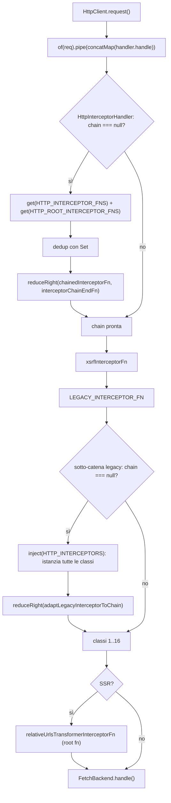
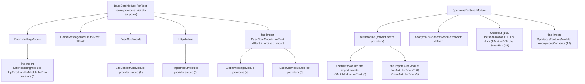
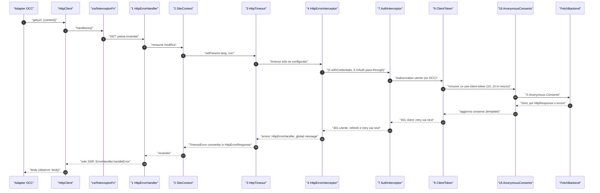
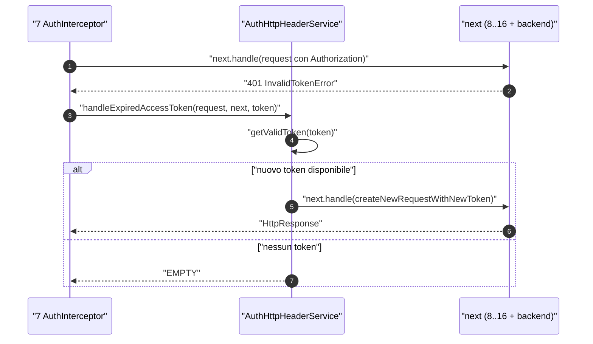

# 06 — HttpClient e interceptor

> Riferimenti allo SHA `5b7a1c2bf2808d7380bc20596d10f4fa710c3da1` (vedi [00-meta](../00-meta.md)). Angular @ `v21.2.23` (prefisso `angular:`), `angular-oauth2-oidc` 20.0.2 (prefisso `deps:`).

## 1. A cosa serve e perché esiste

Ogni byte che Spartacus scambia con il backend SAP Commerce (OCC), e anche ogni file di traduzioni caricato via HTTP, passa per l'`HttpClient` di Angular. Tra la chiamata `this.http.get(...)` di un adapter e il `fetch()` vero e proprio c'è una **catena di interceptor**: oggetti che vedono la richiesta all'andata e la risposta (o l'errore) al ritorno. Su questa catena Spartacus appoggia funzioni centrali:

- aggiunge `lang` e `curr` a ogni URL OCC (`SiteContextInterceptor`) — `core-libs/core/src/occ/adapters/site-context/site-context.interceptor.ts:L30-L68`;
- aggiunge l'header `Authorization` con il token utente e, su 401, rinnova il token e riprova (`AuthInterceptor`) — `core-libs/core/src/auth/user-auth/http-interceptors/auth.interceptor.ts:L35-L83`;
- impone un timeout alle richieste in SSR (`HttpTimeoutInterceptor`, default 20 s lato server) — `core-libs/core/src/http/http-timeout/default-http-timeout.config.ts:L9-L15`;
- trasforma gli errori HTTP in global message (`HttpErrorInterceptor`) — `core-libs/core/src/global-message/http-interceptors/http-error.interceptor.ts:L26-L65` — e, in SSR, li inoltra all'`ErrorHandler` di Angular (`HttpErrorHandlerInterceptor`) — `core-libs/core/src/error-handling/http-error-handler/http-error-handler.interceptor.ts:L27-L41`.

Il capitolo esiste per tre motivi.

1. **Spartacus usa solo interceptor "di classe".** Tutte le 22 registrazioni di libreria sono provider multi su `HTTP_INTERCEPTORS`; nessuna usa `withInterceptors` o `HttpInterceptorFn` (vedi [appendice A06](../appendici/A06-interceptor.md)). L'app deve quindi chiamare `provideHttpClient(withInterceptorsFromDi())`, come fa l'app demo — `projects/storefrontapp/src/app/app.config.ts:L26-L35` — e come scrive lo schematic `add-spartacus` — `core-libs/schematics/src/add-spartacus/update-app-config.ts:L83-L100`. Angular, però, descrive questa modalità come destinata a essere "phased out" — `angular:packages/common/http/src/provider.ts:L173-L174`.
2. **L'ordine conta, e non è quello che sembra.** Più interceptor commentano esplicitamente la propria posizione: "MUST be provided as the first one" — `core-libs/core/src/error-handling/http-error-handler/http-error-handler.interceptor.ts:L37-L38`; "ClientTokenInterceptor must be imported after the AuthInterceptor" — `core-libs/core/src/auth/auth.module.ts:L13-L16`. L'ordine reale deriva dalle regole con cui Angular appiattisce i provider degli NgModule (`walkProviderTree`), che differiscono dall'ordine testuale degli `imports`. In §3.5–§3.6 la catena dell'app demo è ricostruita interceptor per interceptor.
3. **`HttpContext` come canale laterale.** Spartacus passa informazioni agli interceptor tramite `HttpContextToken` (`OCC_HTTP_TOKEN`, `HTTP_TIMEOUT_CONFIG`) — `core-libs/core/src/occ/utils/occ-http-token.ts:L9-L20`, `core-libs/core/src/http/http-timeout/http-timeout.config.ts:L16-L18` — e tramite header "marcatore" JSON (`InterceptorUtil`) — `core-libs/core/src/occ/utils/interceptor-util.ts:L9-L46`.

Prerequisiti: multi-provider e gerarchia degli injector ([01 — Dependency Injection](01-dependency-injection.md)); bootstrap e `importProvidersFrom` ([02 — NgModule, standalone e bootstrap](02-ngmodule-standalone-bootstrap.md)). Il livello che *usa* `HttpClient` (adapter, `OccEndpointsService`) è in [21 — Livello OCC](../parte-2/21-occ.md); la logica di token/refresh in [22 — Autenticazione](../parte-2/22-auth.md); la gestione degli errori e dei global message in [41 — Errori HTTP e global message](../parte-2/41-errori-global-message.md). L'elenco completo e rigenerabile di classi e registrazioni è nell'[appendice A06](../appendici/A06-interceptor.md).

## 2. Mappa dei file

### Angular (`/tmp/angular`, prefisso `angular:`)

| Path | Ruolo |
|---|---|
| `angular:packages/common/http/src/client.ts` | `HttpClient`: `request()` crea l'`HttpRequest` e invoca l'`HttpHandler` dentro `concatMap` |
| `angular:packages/common/http/src/backend.ts` | `HttpBackend`, `HttpHandler`, `HttpInterceptorHandler` (costruisce la catena funzionale) |
| `angular:packages/common/http/src/interceptor.ts` | `HttpInterceptor`, `HttpInterceptorFn`, `HTTP_INTERCEPTORS`, `HTTP_INTERCEPTOR_FNS`, `HTTP_ROOT_INTERCEPTOR_FNS`, `legacyInterceptorFnFactory`, adattatori di catena |
| `angular:packages/common/http/src/provider.ts` | `provideHttpClient`, `withInterceptors`, `withInterceptorsFromDi`, `withFetch`, `withRequestsMadeViaParent` |
| `angular:packages/common/http/src/module.ts` | `HttpClientModule` (deprecato) |
| `angular:packages/common/http/src/context.ts` | `HttpContextToken`, `HttpContext` |
| `angular:packages/common/http/src/request.ts` | `HttpRequest` (`context`, `clone`, `urlWithParams`, `timeout`) |
| `angular:packages/common/http/src/params.ts` | `HttpParams` immutabili, codec di default |
| `angular:packages/common/http/src/xsrf.ts` | `xsrfInterceptorFn`, `HttpXsrfCookieExtractor` |
| `angular:packages/common/http/src/fetch.ts` | `FetchBackend` |
| `angular:packages/common/http/src/xhr.ts` | `HttpXhrBackend` |
| `angular:packages/common/http/src/transfer_cache.ts` | `withHttpTransferCache` (root interceptor fn) |
| `angular:packages/platform-server/src/http.ts` | `SERVER_HTTP_PROVIDERS`, `relativeUrlsTransformerInterceptorFn` |
| `angular:packages/platform-browser/src/hydration.ts` | `provideClientHydration`, `withNoHttpTransferCache` |
| `angular:packages/core/src/di/provider_collection.ts` | `importProvidersFrom`, `walkProviderTree`: ordine di appiattimento dei provider |
| `angular:packages/core/src/di/r3_injector.ts` | `processProvider`: array dei multi-provider |

### App demo

| Path | Ruolo |
|---|---|
| `projects/storefrontapp/src/app/app.config.ts` | `provideHttpClient(withFetch(), withInterceptorsFromDi())` e `importProvidersFrom(AppModule)` |
| `projects/storefrontapp/src/app/app.config.server.ts` | `provideServerRendering()` + merge con `appConfig` |
| `projects/storefrontapp/src/app/app.module.ts` | Radice dell'albero NgModule |
| `projects/storefrontapp/src/app/spartacus/spartacus.module.ts` | `BaseStorefrontModule` → `SpartacusFeaturesModule` → `SpartacusConfigurationModule` |
| `projects/storefrontapp/src/app/spartacus/spartacus-features.module.ts` | Ordine dei moduli auth/feature che portano interceptor |
| `projects/storefrontapp/src/environments/environment.ts` | Flag dei moduli condizionali (B2B, CDS, OPF, …) |

### Spartacus core (`@spartacus/core`)

| Path | Ruolo |
|---|---|
| `core-libs/core/src/base-core.module.ts` | Ordine degli import core (`ErrorHandlingModule` per primo) |
| `core-libs/core/src/error-handling/http-error-handler/http-error-handler.interceptor.ts` | `HttpErrorHandlerInterceptor` |
| `core-libs/core/src/global-message/http-interceptors/http-error.interceptor.ts` | `HttpErrorInterceptor` (global message) |
| `core-libs/core/src/occ/adapters/site-context/site-context.interceptor.ts` | `SiteContextInterceptor` (core) |
| `core-libs/core/src/occ/interceptors/with-credentials.interceptor.ts` | `WithCredentialsInterceptor` |
| `core-libs/core/src/http/http-timeout/http-timeout.interceptor.ts` | `HttpTimeoutInterceptor` |
| `core-libs/core/src/http/http-timeout/http-timeout.config.ts` | `HTTP_TIMEOUT_CONFIG`, augmentation di `BackendConfig` |
| `core-libs/core/src/auth/auth.module.ts` | Ordine `UserAuthModule` → `ClientAuthModule` |
| `core-libs/core/src/auth/user-auth/http-interceptors/auth.interceptor.ts` | `AuthInterceptor` |
| `core-libs/core/src/auth/user-auth/services/auth-http-header.service.ts` | Header `Authorization`, retry su token scaduto |
| `core-libs/core/src/auth/user-auth/http-interceptors/token-revocation.interceptor.ts` | `TokenRevocationInterceptor` |
| `core-libs/core/src/auth/client-auth/http-interceptors/client-token.interceptor.ts` | `ClientTokenInterceptor` |
| `core-libs/core/src/anonymous-consents/http-interceptors/anonymous-consents-interceptor.ts` | `AnonymousConsentsInterceptor` |
| `core-libs/core/src/occ/utils/interceptor-util.ts` | `InterceptorUtil` e costanti degli header marcatore |
| `core-libs/core/src/occ/utils/occ-http-token.ts` | `OCC_HTTP_TOKEN` / `OccHttpContext` |
| `core-libs/core/src/occ/services/occ-endpoints.service.ts` | `buildUrl` con `HttpParams` |
| `core-libs/core/src/util/http-params-uri.encoder.ts` | `HttpParamsURIEncoder` |
| `core-libs/core/src/i18n/i18next/i18next-backend/i18next-http-backend-client.ts` | `I18NEXT_HTTP_BACKEND_CLIENT` (traduzioni via `HttpClient`) |

### Feature e integration libs (interceptor registrati)

| Path | Ruolo |
|---|---|
| `feature-libs/checkout/base/root/http-interceptors/checkout-cart.interceptor.ts` | `CheckoutCartInterceptor` |
| `feature-libs/tracking/personalization/root/http-interceptors/occ-personalization-id.interceptor.ts` | `OccPersonalizationIdInterceptor` (e gemello `...TimeInterceptor`) |
| `feature-libs/asm/root/interceptors/user-id-http-header.interceptor.ts` | `UserIdHttpHeaderInterceptor` |
| `feature-libs/asm/customer-360/root/interceptors/site-context.interceptor.ts` | `SiteContextInterceptor` (ASM customer 360) |
| `feature-libs/smartedit/root/http-interceptors/cms-ticket.interceptor.ts` | `CmsTicketInterceptor` |
| `feature-libs/organization/account-summary/root/http-interceptors/blob-error.interceptor.ts` | `BlobErrorInterceptor` (B2B) |
| `integration-libs/cds/src/profiletag/http-interceptors/consent-reference-interceptor.ts` | `ConsentReferenceInterceptor` (CDS) |
| `integration-libs/cds/src/profiletag/http-interceptors/debug-interceptor.ts` | `DebugInterceptor` (CDS) |
| `integration-libs/opps/root/coupon-codes/http-interceptors/occ-opps-coupon-codes.interceptor.ts` | `OccOppsCouponCodesInterceptor` |
| `integration-libs/opf/gift-card/root/http-interceptors/opf-gift-card-payment-api.interceptor.ts` | `OpfGiftCardPaymentApiInterceptor` |
| `integration-libs/punchout/root/interceptors/punchout-cart.interceptor.ts` | `PunchoutCartInterceptor` |
| `integration-libs/segment-refs/root/http-interceptors/occ-segment-refs.interceptor.ts` | `OccSegmentRefsInterceptor` |

## 3. Come funziona passo per passo

### 3.1 `HttpClient.request()`: dalla chiamata all'`HttpRequest`

1. `HttpClient` è `providedIn: 'root'` e ha una sola dipendenza: un `HttpHandler` — `angular:packages/common/http/src/client.ts:L132-L134`.
2. Tutti i metodi shorthand (`get`, `post`, …) finiscono in `request()`. Se il primo argomento non è già un `HttpRequest`, ne costruisce uno con headers, `context`, params, `responseType` (default `'json'`), `withCredentials`, `timeout` e gli altri campi delle opzioni — `angular:packages/common/http/src/client.ts:L807-L856`.
3. Un `params` passato come oggetto viene convertito in `new HttpParams({fromObject: ...})` — `angular:packages/common/http/src/client.ts:L826-L834`.
4. L'handler, che contiene tutti gli interceptor, viene eseguito dentro `of(req).pipe(concatMap(...))`. Il commento nel sorgente spiega che in questo modo gli interceptor girano di nuovo **a ogni subscription** e a ogni retry — `angular:packages/common/http/src/client.ts:L857-L863`. La richiesta parte solo quando qualcuno si sottoscrive; un `retry()` applicato dal chiamante ripercorre l'intera catena.
5. Con `observe: 'events'`, o se si è passato un `HttpRequest`, si ottiene lo stream grezzo di `HttpEvent`; altrimenti vengono filtrati solo gli `HttpResponse` — `angular:packages/common/http/src/client.ts:L868-L877`.
6. Con `observe: 'body'` (default) si restituisce il body. Per `arraybuffer`, `blob` e `text` il tipo viene validato, contro "a misbehaving interceptor" che abbia cambiato formato; `json` non è validato — `angular:packages/common/http/src/client.ts:L880-L931`.

### 3.2 `HttpHandler`, `HttpInterceptorHandler`, `HttpBackend`

- `HttpHandler` è una classe astratta con default `useExisting: HttpInterceptorHandler` — `angular:packages/common/http/src/backend.ts:L150-L153`.
- `HttpBackend` è astratta, con default `HttpXhrBackend`. Il JSDoc avverte che iniettarla direttamente **salta la catena di interceptor** — `angular:packages/common/http/src/backend.ts:L35-L48`.
- `HttpInterceptorHandler.handle()` costruisce la catena in modo *lazy*, alla prima richiesta. Legge `HTTP_INTERCEPTOR_FNS` e `HTTP_ROOT_INTERCEPTOR_FNS`, accoda i secondi ai primi e deduplica con un `Set` — `angular:packages/common/http/src/backend.ts:L101-L112`.
- La catena è composta con `reduceRight` a partire da `interceptorChainEndFn`, così che l'esecuzione segua l'ordine dell'array: il primo elemento è il più esterno, e l'ultimo anello chiama `this.backend.handle` — `angular:packages/common/http/src/backend.ts:L114-L134`.
- Con `REQUESTS_CONTRIBUTE_TO_STABILITY` (default `true`), ogni richiesta aggiunge un task a `PendingTasks` e lo rimuove in `finalize` — `angular:packages/common/http/src/backend.ts:L125-L129`, `angular:packages/common/http/src/interceptor.ts:L217-L221`. È questo meccanismo a far attendere al rendering SSR la fine delle chiamate HTTP (vedi [07 — SSR, hydration e TransferState](07-ssr-hydration-transferstate.md)).
- In dev mode, su server, se il backend non è `FetchBackend` viene stampato una volta un warning che raccomanda `withFetch()` — `angular:packages/common/http/src/backend.ts:L70-L97`.

### 3.3 Due tipi di interceptor e l'adattatore "legacy"

- **Di classe**: `HttpInterceptor` ha il solo metodo `intercept(req, next: HttpHandler)` — `angular:packages/common/http/src/interceptor.ts:L46-L63`. Si registrano sul multi-token `HTTP_INTERCEPTORS` — `angular:packages/common/http/src/interceptor.ts:L187-L197`.
- **Funzionali**: `HttpInterceptorFn = (req, next: HttpHandlerFn) => Observable`, eseguiti in un injection context — `angular:packages/common/http/src/interceptor.ts:L84-L84`, `angular:packages/common/http/src/interceptor.ts:L97-L98`, `angular:packages/common/http/src/interceptor.ts:L127-L130`. Si registrano su `HTTP_INTERCEPTOR_FNS`, il cui default è `[xsrfInterceptorFn]` — `angular:packages/common/http/src/interceptor.ts:L199-L212`.
- `chainedInterceptorFn` esegue ogni interceptor funzionale in `runInInjectionContext(injector, ...)` — `angular:packages/common/http/src/interceptor.ts:L174-L185`.
- Il ponte tra i due mondi è `legacyInterceptorFnFactory`: produce **un unico** `HttpInterceptorFn` che, alla prima richiesta, fa `inject(HTTP_INTERCEPTORS, {optional: true})` e compone una sotto-catena delle classi, sempre con `reduceRight`, quindi nell'ordine dell'array — `angular:packages/common/http/src/interceptor.ts:L227-L241`.
- Ogni classe viene adattata da `adaptLegacyInterceptorToChain`, che le passa come `next` un oggetto `{handle}` il quale invoca *il resto* della catena — `angular:packages/common/http/src/interceptor.ts:L160-L168`. Ne segue che il `next` ricevuto da un interceptor rappresenta solo gli interceptor **a valle** più il backend. Su questo si reggono i retry dopo un 401 (§3.12).
- Anche la sotto-catena legacy registra un proprio `PendingTasks` per richiesta, in aggiunta a quello di `HttpInterceptorHandler` — `angular:packages/common/http/src/interceptor.ts:L243-L250`.

### 3.4 `provideHttpClient` e la configurazione dell'app demo

1. `provideHttpClient()` registra `HttpClient`, `HttpInterceptorHandler`, `HttpHandler → HttpInterceptorHandler`, un `HttpBackend` via factory (`FETCH_BACKEND` se presente, altrimenti `HttpXhrBackend`) e `xsrfInterceptorFn` come primo `HTTP_INTERCEPTOR_FNS`. Poi accoda i provider delle feature nell'ordine in cui sono passate — `angular:packages/common/http/src/provider.ts:L118-L139`.
2. Le feature (`HttpFeatureKind`) sono `Interceptors`, `LegacyInterceptors`, `CustomXsrfConfiguration`, `NoXsrfProtection`, `JsonpSupport`, `RequestsMadeViaParent`, `Fetch` — `angular:packages/common/http/src/provider.ts:L35-L43`. In dev mode alcune combinazioni sono vietate (`withXsrfConfiguration` + `withNoXsrfProtection`, `withRequestsMadeViaParent` + `withFetch`) — `angular:packages/common/http/src/provider.ts:L97-L116`.
3. `withInterceptors(fns)` aggiunge ogni funzione a `HTTP_INTERCEPTOR_FNS`, nell'ordine dato — `angular:packages/common/http/src/provider.ts:L150-L163`.
4. `withInterceptorsFromDi()` registra `LEGACY_INTERCEPTOR_FN` (factory `legacyInterceptorFnFactory`) e lo aggiunge a `HTTP_INTERCEPTOR_FNS` via `useExisting`. Se la feature è inclusa più volte, la funzione resta la stessa istanza e il `Set` di §3.2 la deduplica — `angular:packages/common/http/src/provider.ts:L169-L197`.
5. `withFetch()` registra `FetchBackend`, `FETCH_BACKEND` e `HttpBackend → FetchBackend` — `angular:packages/common/http/src/provider.ts:L302-L308`.
6. `withRequestsMadeViaParent()` sostituisce l'`HttpBackend` con l'`HttpHandler` dell'injector padre — `angular:packages/common/http/src/provider.ts:L276-L291`.
7. `HttpClientModule` è `@deprecated` ed equivale a `providers: [provideHttpClient(withInterceptorsFromDi())]` — `angular:packages/common/http/src/module.ts:L94-L103`.

**App demo.** `appConfig` contiene `provideHttpClient(withFetch(), withInterceptorsFromDi())`, poi `provideClientHydration(withEventReplay(), withNoHttpTransferCache())` e infine `importProvidersFrom(AppModule)` — `projects/storefrontapp/src/app/app.config.ts:L26-L35`. Quindi:

- `HTTP_INTERCEPTOR_FNS = [xsrfInterceptorFn, LEGACY_INTERCEPTOR_FN]`, il backend è `FetchBackend`, e non c'è `transferCacheInterceptorFn` perché la transfer cache HTTP è disattivata — `angular:packages/common/http/src/provider.ts:L128-L136`, `angular:packages/common/http/src/provider.ts:L186-L196`, `angular:packages/platform-browser/src/hydration.ts:L255-L266`;
- sul server la config è `mergeApplicationConfig(appConfig, serverConfig)` con `provideServerRendering()` — `projects/storefrontapp/src/app/app.config.server.ts:L17-L30`. `provideServerRendering` porta `SERVER_HTTP_PROVIDERS` — `angular:packages/platform-server/src/provide_server.ts:L28-L33`, `angular:packages/platform-server/src/server.ts:L75-L78` — che registra `relativeUrlsTransformerInterceptorFn` su `HTTP_ROOT_INTERCEPTOR_FNS`: in SSR gli URL relativi vengono risolti contro protocollo, host e porta di `PlatformLocation` — `angular:packages/platform-server/src/http.ts:L72-L110`.

Nessun file in `projects/storefrontapp/src` registra `HTTP_INTERCEPTORS`, e nessuna libreria Spartacus usa `HttpClientModule` o `withInterceptors`: tutti gli interceptor applicativi arrivano dalle librerie, come classi — `projects/storefrontapp/src/app/app.config.ts:L7-L11`, [A06](../appendici/A06-interceptor.md).

### 3.5 Come Angular ordina i multi-provider (le regole che decidono la catena)

L'ordine dell'array `HTTP_INTERCEPTORS` è l'ordine in cui l'`R3Injector` processa i provider `multi: true`: ognuno viene accodato a `multiRecord.multi`, e la factory restituisce `injectArgs(multiRecord.multi)` — `angular:packages/core/src/di/r3_injector.ts:L224-L226`, `angular:packages/core/src/di/r3_injector.ts:L497-L512`. Per conoscere la catena bisogna dunque sapere in che ordine arrivano i provider.

- `bootstrapApplication` passa all'injector root `[provideZonelessChangeDetectionInternal(), errorHandlerEnvironmentInitializer, ..., ...appProviders]`, quindi i provider dell'`ApplicationConfig` nell'ordine dichiarato — `angular:packages/core/src/application/create_application.ts:L66-L74`. `forEachSingleProvider` appiattisce array ed `EnvironmentProviders` in profondità, senza cambiare l'ordine — `angular:packages/core/src/di/r3_injector.ts:L725-L737`. `mergeApplicationConfig` concatena i `providers` nell'ordine degli argomenti — `angular:packages/core/src/application/application_config.ts:L31-L37`.
- `importProvidersFrom(AppModule)` usa `walkProviderTree` — `angular:packages/core/src/di/provider_collection.ts:L144-L188`. Valgono tre regole:
  1. **Prima gli import, poi i provider statici.** Per un NgModule vengono visitati ricorsivamente tutti gli `imports` (depth-first, nell'ordine), e solo dopo vengono emessi i `providers` di `@NgModule` del modulo stesso — `angular:packages/core/src/di/provider_collection.ts:L292-L306`, `angular:packages/core/src/di/provider_collection.ts:L346-L353`.
  2. **I `forRoot()` sono differiti.** I `providers` dei `ModuleWithProviders` importati da un modulo vengono emessi **dopo** che tutti gli import di quel modulo sono stati visitati, nell'ordine di import ("following View Engine semantics … FW-1349") — `angular:packages/core/src/di/provider_collection.ts:L304-L321`, `angular:packages/core/src/di/provider_collection.ts:L195-L209`.
  3. **Un `forRoot()` senza `providers` non è differito.** `walkProviderTree` restituisce `true` (provider differiti) solo se il container è un `ModuleWithProviders` con `providers !== undefined` — `angular:packages/core/src/di/provider_collection.ts:L360-L362`. `BaseCoreModule.forRoot()`, `AuthModule.forRoot()` e `HttpModule.forRoot()` restituiscono solo `{ngModule}`, quindi sono trattati come import semplici, visitati sul posto — `core-libs/core/src/base-core.module.ts:L47-L52`, `core-libs/core/src/auth/auth.module.ts:L18-L23`, `core-libs/core/src/http/http.module.ts:L10-L18`.
- Deduplicazione: un NgModule già visitato non riemette i suoi provider statici — `angular:packages/core/src/di/provider_collection.ts:L275-L276`, `angular:packages/core/src/di/provider_collection.ts:L346-L362`. Nessun root module con interceptor viene importato staticamente prima della posizione indicata in §3.6. L'unica eccezione nota è `OpfGiftCardModule` (lazy), che re-importa `OpfGiftCardRootModule` — `integration-libs/opf/gift-card/opf-gift-card.module.ts:L18-L18`.

### 3.6 La catena dell'app demo, interceptor per interceptor

Applicando le regole di §3.5 all'albero dei moduli dell'app demo (browser, flag d'ambiente di default, cioè B2C senza integrazioni — `projects/storefrontapp/src/environments/environment.ts:L22-L44`) si ottiene questo ordine. La catena *funzionale* è `xsrfInterceptorFn` → `LEGACY_INTERCEPTOR_FN` (→ sotto-catena qui sotto) → [`relativeUrlsTransformerInterceptorFn`, solo SSR] → `FetchBackend`.

Percorso nell'albero: `AppModule` importa `BrowserModule`, `StoreModule.forRoot({})`, `AppRoutingModule`, `EffectsModule.forRoot([])`, `SpartacusModule` — `projects/storefrontapp/src/app/app.module.ts:L15-L25`; `SpartacusModule` importa `BaseStorefrontModule`, `SpartacusFeaturesModule`, `SpartacusConfigurationModule` — `projects/storefrontapp/src/app/spartacus/spartacus.module.ts:L12-L19`; `BaseStorefrontModule` importa per primo `BaseCoreModule.forRoot()` — `core-libs/storefront/base-storefront.module.ts:L26-L28`.

| # | Interceptor | Da dove arriva | Perché in questa posizione |
|---|---|---|---|
| 1 | `HttpErrorHandlerInterceptor` | `ErrorHandlingModule` (1° import di `BaseCoreModule`) → `HttpErrorHandlerModule.forRoot()` — `core-libs/core/src/error-handling/error-handling.module.ts:L13-L31`, `core-libs/core/src/error-handling/http-error-handler/http-error-handler.module.ts:L11-L24` | `forRoot` differito, ma a fine import di `ErrorHandlingModule`, che è il primo visitato — `core-libs/core/src/base-core.module.ts:L26-L45` |
| 2 | `SiteContextInterceptor` (core) | `BaseOccModule` → `SiteContextOccModule`, provider **statici** — `core-libs/core/src/occ/base-occ.module.ts:L17-L19`, `core-libs/core/src/occ/adapters/site-context/site-context-occ.module.ts:L18-L30` | Statico: emesso subito durante la visita |
| 3 | `HttpTimeoutInterceptor` | `HttpModule` → `HttpTimeoutModule`, statico — `core-libs/core/src/http/http-timeout/http-timeout.module.ts:L13-L22` | `HttpModule.forRoot()` senza providers → visitato sul posto |
| 4 | `HttpErrorInterceptor` | `GlobalMessageModule.forRoot()` — `core-libs/core/src/global-message/global-message.module.ts:L26-L31`, `core-libs/core/src/global-message/http-interceptors/index.ts:L65-L71` | `forRoot` differito a fine import di `BaseCoreModule` |
| 5 | `WithCredentialsInterceptor` | `BaseOccModule.forRoot()` — `core-libs/core/src/occ/base-occ.module.ts:L20-L29` | Idem, dopo `GlobalMessageModule` nell'ordine di import |
| 6 | `DefaultOAuthInterceptor` (angular-oauth2-oidc) | `UserAuthModule` importa `OAuthModule.forRoot()` → `provideOAuthClient` — `core-libs/core/src/auth/user-auth/user-auth.module.ts:L98-L99`, `deps:angular-oauth2-oidc-20.0.2/package/fesm2022/angular-oauth2-oidc.mjs:L3118-L3146` | Differito a fine import di `UserAuthModule`, primo modulo visitato sotto `AuthModule` |
| 7 | `AuthInterceptor` | `UserAuthModule.forRoot()` — `core-libs/core/src/auth/user-auth/http-interceptors/index.ts:L12-L23` | `forRoot` differito a fine import di `AuthModule` |
| 8 | `TokenRevocationInterceptor` | idem | Secondo nell'array `interceptors` |
| 9 | `ClientTokenInterceptor` | `ClientAuthModule.forRoot()` — `core-libs/core/src/auth/client-auth/client-auth.module.ts:L22-L28` | Importato dopo `UserAuthModule.forRoot()` — `core-libs/core/src/auth/auth.module.ts:L13-L16` |
| 10 | `CheckoutCartInterceptor` | `CheckoutFeatureModule` → `CheckoutRootModule`, statico — `feature-libs/checkout/base/root/checkout-root.module.ts:L51-L54` | Statico, in posizione — `projects/storefrontapp/src/app/spartacus/spartacus-features.module.ts:L261-L261` |
| 11 | `OccPersonalizationIdInterceptor` | `PersonalizationRootModule`, statico — `feature-libs/tracking/personalization/root/http-interceptors/index.ts:L13-L24` | `projects/storefrontapp/src/app/spartacus/spartacus-features.module.ts:L263-L263` |
| 12 | `OccPersonalizationTimeInterceptor` | idem | Secondo nell'array |
| 13 | `UserIdHttpHeaderInterceptor` | `AsmRootModule`, statico — `feature-libs/asm/root/asm-root.module.ts:L73-L95` | `projects/storefrontapp/src/app/spartacus/spartacus-features.module.ts:L265-L265` |
| 14 | `SiteContextInterceptor` (ASM 360) | `AsmCustomer360RootModule`, statico — `feature-libs/asm/customer-360/root/asm-customer-360-root.module.ts:L18-L35` | `projects/storefrontapp/src/app/spartacus/spartacus-features.module.ts:L266-L266` |
| 15 | `CmsTicketInterceptor` | `SmartEditRootModule`, statico — `feature-libs/smartedit/root/smart-edit-root.module.ts:L22-L24` | `projects/storefrontapp/src/app/spartacus/spartacus-features.module.ts:L272-L272` |
| 16 | `AnonymousConsentsInterceptor` | `AnonymousConsentsModule.forRoot()` — `core-libs/core/src/anonymous-consents/anonymous-consents.module.ts:L18-L22` | Importato a L214 ma `forRoot` **differito** a fine import di `SpartacusFeaturesModule`, quindi ultimo — `projects/storefrontapp/src/app/spartacus/spartacus-features.module.ts:L214-L214` |

Note sulla tabella:

- `SpartacusFeaturesModule` importa per primo `AuthModule.forRoot()`, più avanti `AnonymousConsentsModule.forRoot()`, poi i feature module e in coda `...featureModules` — `projects/storefrontapp/src/app/spartacus/spartacus-features.module.ts:L176-L285`. Con i flag di default `featureModules` contiene solo `PickupInStoreFeatureModule`, che non registra interceptor — `projects/storefrontapp/src/app/spartacus/spartacus-features.module.ts:L115-L175`.
- **Varianti con flag d'ambiente.** I moduli condizionali entrano in `...featureModules`, cioè tra #15 e `AnonymousConsentsInterceptor`, con provider statici in quest'ordine: B2B `BlobErrorInterceptor`; CDS `ConsentReferenceInterceptor` e `DebugInterceptor`; OPPS `OccOppsCouponCodesInterceptor`; OPF `OpfGiftCardPaymentApiInterceptor`; Punchout `PunchoutCartInterceptor`; SegmentRefs `OccSegmentRefsInterceptor` — `projects/storefrontapp/src/app/spartacus/spartacus-features.module.ts:L117-L163`, `feature-libs/organization/account-summary/root/account-summary-root.module.ts:L49-L57`, `integration-libs/cds/src/profiletag/profile-tag.module.ts:L16-L24`, `integration-libs/opps/root/coupon-codes/opps-coupon-codes.module.ts:L19-L21`, `integration-libs/opf/gift-card/root/opf-gift-card-root.module.ts:L57-L61`, `integration-libs/punchout/root/punchout.root.module.ts:L36-L48`, `integration-libs/segment-refs/root/segment-refs-root.module.ts:L12-L17`.
- ⚠️ DA VERIFICARE: l'ordine è stato derivato **staticamente** dalle regole di `walkProviderTree`/`R3Injector`. Non è stato osservato a runtime, perché `node_modules` non è installato e non è stato possibile stampare `inject(HTTP_INTERCEPTORS)`. Dipendenze npm non estratte (es. `@ngrx/store-devtools` in `projects/storefrontapp/src/app/private/private.providers.ts:L52-L56`) potrebbero registrare altri interceptor; il controllo è stato fatto solo per `angular-oauth2-oidc` (sì), `@ngrx/store`, `@ngrx/effects`, `@ngrx/router-store`, `@angular/ssr` (no).

Questa ricostruzione risolve i ⚠️ lasciati aperti sull'ordine in [21 — Livello OCC](../parte-2/21-occ.md), [29 — ASM](../parte-2/29-asm.md) e [41 — Errori HTTP](../parte-2/41-errori-global-message.md).

### 3.7 `HttpContext` e `HttpContextToken`

- `HttpContextToken<T>` contiene soltanto una funzione `defaultValue: () => T` — `angular:packages/common/http/src/context.ts:L16-L18`. L'identità del token è l'istanza stessa: la chiave della `Map` interna è l'oggetto token — `angular:packages/common/http/src/context.ts:L55-L56`.
- `HttpContext` è "mutable and is shared between cloned requests unless explicitly specified" — `angular:packages/common/http/src/context.ts:L20-L26`. `HttpRequest.clone()` passa la stessa istanza di `context` se `update.context` non è fornito — `angular:packages/common/http/src/request.ts:L763-L781`. Se non si passa un context, il costruttore ne crea uno nuovo — `angular:packages/common/http/src/request.ts:L541-L542`.
- `HttpContext.get()` su un token assente **scrive** il default nella mappa e poi lo restituisce — `angular:packages/common/http/src/context.ts:L78-L83`.

Uso in Spartacus:

- `OCC_HTTP_TOKEN = new HttpContextToken<OccHttpContext>(() => ({}))`, con l'unico campo `sendUserIdAsHeader?: string | boolean` — `core-libs/core/src/occ/utils/occ-http-token.ts:L9-L20`. Gli adapter lo impostano con `new HttpContext().set(OCC_HTTP_TOKEN, {...})` e lo passano come `{ context }`; la ricerca prodotti, per esempio, usa `sendUserIdAsHeader: true` — `core-libs/core/src/occ/adapters/product/occ-product-search.adapter.ts:L50-L55`. Altri usi: cost center utente, configuratore variant, payment type B2B — `core-libs/core/src/occ/adapters/user/occ-user-cost-centers.adapter.ts:L32-L32`, `feature-libs/product-configurator/rulebased/occ/variant/variant-configurator-occ.adapter.ts:L403-L403`, `feature-libs/checkout/b2b/occ/adapters/occ-checkout-payment-type.adapter.ts:L40-L40`. Il consumatore è `UserIdHttpHeaderInterceptor` di ASM (§3.11).
- `HTTP_TIMEOUT_CONFIG = new HttpContextToken<HttpTimeoutConfig | undefined>(() => undefined)`. Permette di impostare il timeout di una singola richiesta, separato per browser e server; `BackendConfig` è esteso via module augmentation con `timeout` — `core-libs/core/src/http/http-timeout/http-timeout.config.ts:L16-L41`.

### 3.8 `HttpParams` e il codec di Spartacus

- `HttpParams` è immutabile: ogni mutazione restituisce una nuova istanza — `angular:packages/common/http/src/params.ts:L155-L165`. `set()`/`delete()` delegano a un `clone()` privato che accumula `updates` e un riferimento `cloneFrom`; la valutazione è rimandata a `init()` — `angular:packages/common/http/src/params.ts:L275-L288`, `angular:packages/common/http/src/params.ts:L314-L319`. `fromString` e `fromObject` si escludono a vicenda — `angular:packages/common/http/src/params.ts:L173-L178`.
- Il codec di default applica `encodeURIComponent` e poi **ri-decodifica** `@ : $ , ; = ? /` — `angular:packages/common/http/src/params.ts:L102-L119`.
- `urlWithParams` concatena i params all'URL con `?`, `&` o niente, a seconda che l'URL contenga già una query — `angular:packages/common/http/src/request.ts:L548-L566`.
- `OccEndpointsService.buildUrl` costruisce la query con `new HttpParams({encoder: new HttpParamsURIEncoder()})`, conservando l'eventuale query già presente nell'endpoint (`fromString`). Un valore `null` cancella il param, `undefined` viene ignorato — `core-libs/core/src/occ/services/occ-endpoints.service.ts:L125-L147`, `core-libs/core/src/occ/services/occ-endpoints.service.ts:L152-L167`.
- `HttpParamsURIEncoder` usa *solo* `encodeURIComponent`, così i caratteri riservati RFC 3986 restano codificati — `core-libs/core/src/util/http-params-uri.encoder.ts:L7-L23`.

### 3.9 Header "marcatore": `InterceptorUtil`

Prima che esistesse `HttpContext`, Spartacus passava parametri agli interceptor come **header JSON**, e in parte lo fa ancora:

- `InterceptorUtil.createHeader` serializza il valore con `JSON.stringify` (in `append` o `set`), `getInterceptorParam` lo rilegge con `JSON.parse`, `removeHeader` clona la richiesta senza quell'header — `core-libs/core/src/occ/utils/interceptor-util.ts:L13-L46`.
- Costanti: `cx-use-client-token`, `cx-use-csagent-token`, `sap-commerce-cloud-captcha-token` — `core-libs/core/src/occ/utils/interceptor-util.ts:L9-L11`.
- Gli adapter che richiedono il client token (ordini guest, indirizzi, registrazione) chiamano `InterceptorUtil.createHeader(USE_CLIENT_TOKEN, true, headers)` — `feature-libs/order/occ/adapters/occ-order.adapter.ts:L48-L48`, `core-libs/core/src/occ/adapters/user/occ-user-address.adapter.ts:L104-L104`. `ClientTokenInterceptor` rimuove il marcatore prima che la richiesta lasci il browser (§3.11).

### 3.10 Backend: fetch, XHR, SSR, XSRF, transfer cache

- `FetchBackend` è `@Injectable()` (non root). Usa `FetchFactory.fetch` se fornito, altrimenti `globalThis.fetch` tramite una arrow function — `angular:packages/common/http/src/fetch.ts:L57-L63`. Esegue `fetch` fuori dalla zone di Angular ed emette `HttpEventType.Sent` **prima** di attendere la risposta — `angular:packages/common/http/src/fetch.ts:L105-L118`. Implementa `request.timeout` con `setTimeout` e `AbortController` — `angular:packages/common/http/src/fetch.ts:L69-L84`. Con `withCredentials: true` imposta `credentials = 'include'`, sovrascrivendo `req.credentials` — `angular:packages/common/http/src/fetch.ts:L321-L332`.
- `HttpXhrBackend` usa `XhrFactory`, applica `withCredentials` e `timeout` all'XHR ed emette anch'esso `Sent` — `angular:packages/common/http/src/xhr.ts:L108-L113`, `angular:packages/common/http/src/xhr.ts:L158-L182`, `angular:packages/common/http/src/xhr.ts:L418-L418`.
- `xsrfInterceptorFn` lascia passare GET/HEAD, le richieste cross-origin rispetto a `PlatformLocation.href` e quelle che hanno già l'header; alle altre aggiunge il token (header di default `X-XSRF-TOKEN`) — `angular:packages/common/http/src/xsrf.ts:L93-L125`, `angular:packages/common/http/src/xsrf.ts:L40-L40`. Su server il cookie extractor restituisce sempre `null` — `angular:packages/common/http/src/xsrf.ts:L64-L75`.
- `withHttpTransferCache` registra `transferCacheInterceptorFn` come root interceptor fn e lo disattiva dopo `appRef.whenStable()` — `angular:packages/common/http/src/transfer_cache.ts:L439-L468`. `provideClientHydration` la abilita salvo `withNoHttpTransferCache()` — `angular:packages/platform-browser/src/hydration.ts:L255-L266`. L'app demo la disattiva (§3.4): Spartacus trasferisce lo stato con i propri meccanismi, trattati in [07](07-ssr-hydration-transferstate.md) e [39 — SSR ottimizzato](../parte-2/39-ssr-ottimizzato.md).
- **Traduzioni.** `I18NEXT_HTTP_BACKEND_CLIENT` usa `HttpClient` (`responseType: 'text'`), quindi anche i JSON di traduzione attraversano tutta la catena di interceptor — `core-libs/core/src/i18n/i18next/i18next-backend/i18next-http-backend-client.ts:L16-L42`. In SSR `I18nextHttpBackendInitializer.getLoadPath` rende assoluto il `loadPath` con `windowRef.location.origin` — `core-libs/core/src/i18n/i18next/i18next-backend/i18next-http-backend.initializer.ts:L73-L92` (vedi [37 — i18n](../parte-2/37-i18n.md)).

### 3.11 Che cosa fa ciascun interceptor

Andata = modifica della richiesta; ritorno = gestione di risposta o errore.

**Core**

- **#1 `HttpErrorHandlerInterceptor`.** All'andata non tocca nulla. Al ritorno inoltra ogni errore all'`ErrorHandler` di Angular, compresi errori RxJS come `TimeoutError` provenienti dagli interceptor successivi — `core-libs/core/src/error-handling/http-error-handler/http-error-handler.interceptor.ts:L27-L41`. Lo fa solo fuori dal browser (`shouldHandleError` = `!windowRef.isBrowser()`), avvolgendo l'errore in `OutboundHttpError` oppure in `CmsPageNotFoundOutboundHttpError` per i 404 sull'endpoint `pages` — `core-libs/core/src/error-handling/http-error-handler/http-error-handler.interceptor.ts:L52-L98`. Dettagli in [41](../parte-2/41-errori-global-message.md).
- **#2 `SiteContextInterceptor` (core).** Parte da lingua e valuta di default della config e le aggiorna con una subscribe a `LanguageService`/`CurrencyService` fatta nel costruttore. Aggiunge `lang` e `curr` a ogni richiesta il cui URL contiene `occEndpoints.getBaseUrl()` — `core-libs/core/src/occ/adapters/site-context/site-context.interceptor.ts:L30-L68`. `getBaseUrl()` vale `baseUrl + prefix + baseSite` attivo — `core-libs/core/src/occ/services/occ-endpoints.service.ts:L81-L101`. Vedi [13 — Site context](../parte-2/13-site-context-theme.md).
- **#3 `HttpTimeoutInterceptor`.** Prende il timeout da `HTTP_TIMEOUT_CONFIG` o, in mancanza, da `config.backend.timeout`, scegliendo `browser` o `server` in base alla piattaforma; se il valore è `undefined` non applica alcun timeout — `core-libs/core/src/http/http-timeout/http-timeout.interceptor.ts:L44-L47`, `core-libs/core/src/http/http-timeout/http-timeout.interceptor.ts:L77-L84`. Il conto parte solo all'evento `Sent`, e un `TimeoutError` diventa un `HttpErrorResponse` con messaggio contenente URL e millisecondi, loggato con `warn` — `core-libs/core/src/http/http-timeout/http-timeout.interceptor.ts:L49-L65`, `core-libs/core/src/http/http-timeout/http-timeout.interceptor.ts:L101-L123`.
- **#4 `HttpErrorInterceptor`.** Su `HttpErrorResponse` sceglie con `resolveApplicable` tra gli `HttpErrorHandler` multi ottenuti da `UnifiedInjector.getMulti` (root + moduli lazy) e chiama `handleError` — `core-libs/core/src/global-message/http-interceptors/http-error.interceptor.ts:L26-L65`.
- **#5 `WithCredentialsInterceptor`.** Imposta `withCredentials: true` se `backend.occ.useWithCredentials` è definito e l'URL contiene `backend.occ.prefix` — `core-libs/core/src/occ/interceptors/with-credentials.interceptor.ts:L28-L52`.
- **#6 `DefaultOAuthInterceptor`.** Passa la richiesta invariata se `OAuthModuleConfig` è assente o `null` — `deps:angular-oauth2-oidc-20.0.2/package/fesm2022/angular-oauth2-oidc.mjs:L3075-L3081`. Spartacus chiama `OAuthModule.forRoot()` senza argomenti, quindi il config è `null` — `core-libs/core/src/auth/user-auth/user-auth.module.ts:L98-L99`, `deps:angular-oauth2-oidc-20.0.2/package/fesm2022/angular-oauth2-oidc.mjs:L3118-L3146`. In pratica è un pass-through.
- **#7 `AuthInterceptor`.** Calcola `shouldCatchError` e `shouldAddAuthorizationHeader`, prende il token stabile (`take(1)`) solo se serve, e modifica la richiesta con `AuthHttpHeaderService.alterRequest` — `core-libs/core/src/auth/user-auth/http-interceptors/auth.interceptor.ts:L35-L49`. `alterRequest` aggiunge `Authorization` solo a URL OCC che non hanno già l'header e che non sono la richiesta `baseSites` — `core-libs/core/src/auth/user-auth/services/auth-http-header.service.ts:L188-L242`. Al ritorno: con un 401 da token scaduto su URL OCC → `handleExpiredAccessToken`; con un 401 `invalid_token` dal token endpoint → `handleExpiredRefreshToken()` ed `EMPTY` — `core-libs/core/src/auth/user-auth/http-interceptors/auth.interceptor.ts:L54-L83`. Con un 400 `invalid_grant` su richiesta `grant_type=refresh_token` → `handleExpiredRefreshToken()`, e l'errore viene comunque rilanciato — `core-libs/core/src/auth/user-auth/http-interceptors/auth.interceptor.ts:L74-L84`.
- **#8 `TokenRevocationInterceptor`.** È attivo solo se `sendAuthHeaderOnRevoke()` è vero; aggiunge `Authorization` soltanto alla chiamata verso il revoke endpoint — `core-libs/core/src/auth/user-auth/http-interceptors/token-revocation.interceptor.ts:L33-L57`, `core-libs/core/src/auth/user-auth/services/auth-config.service.ts:L112-L113`.
- **#9 `ClientTokenInterceptor`.** Rimuove **sempre** il marcatore `cx-use-client-token`, anche quando è disattivato. Solo se `authentication.useClientTokens` è vero (default `false` se assente) aggiunge `Authorization` con il client token alle richieste OCC marcate — `core-libs/core/src/auth/client-auth/http-interceptors/client-token.interceptor.ts:L33-L68`. Su un 401 da token scaduto delega a `ClientErrorHandlingService.handleExpiredClientToken(request, next)` — `core-libs/core/src/auth/client-auth/http-interceptors/client-token.interceptor.ts:L70-L85`, `core-libs/core/src/auth/client-auth/services/client-error-handling.service.ts:L30-L37`.
- **#16 `AnonymousConsentsInterceptor`.** Sugli URL OCC aggiunge l'header `X-Anonymous-Consents` con i consensi serializzati. Sulla risposta dell'endpoint `anonymousConsentTemplates` aggiorna i consensi, se l'utente è anonimo — `core-libs/core/src/anonymous-consents/http-interceptors/anonymous-consents-interceptor.ts:L40-L107`, `core-libs/core/src/model/consent.model.ts:L32-L32`.

**Nell'app demo `ClientTokenInterceptor` e `TokenRevocationInterceptor` non fanno nulla.** `useClientTokens: true` e `sendAuthHeaderOnRevoke: true` compaiono nel default solo quando il toggle `authorizationCodeFlowByDefault` è falso — `core-libs/core/src/auth/user-auth/config/default-auth-config.ts:L48-L73`, `core-libs/core/src/auth/user-auth/config/default-auth-config.ts:L116-L128`. L'app demo invece attiva `authorizationCodeFlowByDefault`, `asyncAuthConfigInitializer` e `oauthCallbackPage` — `projects/storefrontapp/src/app/spartacus/spartacus-features.module.ts:L316-L316`, `projects/storefrontapp/src/app/spartacus/spartacus-features.module.ts:L377-L377`, `projects/storefrontapp/src/app/spartacus/spartacus-features.module.ts:L395-L395`.

**Feature e integration**

- **#10 `CheckoutCartInterceptor`.** Legge lo stato del router (`take(1)`). Su un 400 `CartError/notFound` ricevuto mentre la semantic route inizia con `checkout`, naviga a `cart` e ricarica il carrello — `feature-libs/checkout/base/root/http-interceptors/checkout-cart.interceptor.ts:L37-L54`, `feature-libs/checkout/base/root/http-interceptors/checkout-cart.interceptor.ts:L84-L89`.
- **#11/#12 personalization.** Si attivano solo in browser, con `localStorage` disponibile e `personalization.enabled` (default `false`). Propagano l'header configurato e salvano in `localStorage` il valore ricevuto — `feature-libs/tracking/personalization/root/http-interceptors/occ-personalization-id.interceptor.ts:L33-L97`, `feature-libs/tracking/personalization/root/config/default-personalization-config.ts:L10-L11`.
- **#13 `UserIdHttpHeaderInterceptor`.** Agisce solo se `asm.userIdHttpHeader.enable` (default `true`). Legge `OCC_HTTP_TOKEN` e aggiunge `sap-commerce-cloud-user-id` con l'id passato come stringa, oppure con quello di `UserIdService.takeUserId()` se non è una costante (`current`, `anonymous`, …) — `feature-libs/asm/root/interceptors/user-id-http-header.interceptor.ts:L31-L83`, `feature-libs/asm/root/config/default-asm-config.ts:L77-L79`. Vedi [29 — ASM](../parte-2/29-asm.md).
- **#14 `SiteContextInterceptor` (ASM 360).** Aggiunge `lang`/`curr` solo alle richieste verso `baseUrl` (senza prefix e baseSite) che contengono `/assistedservicewebservices/` — `feature-libs/asm/customer-360/root/interceptors/site-context.interceptor.ts:L58-L70`.
- **#15 `CmsTicketInterceptor`.** Agisce solo se esiste un `cmsTicketId`: aggiunge il param `cmsTicketId` alle URL `/cms/` e `/products/` e, per `/productList`, anche `categoryCode` preso dal page context — `feature-libs/smartedit/root/http-interceptors/cms-ticket.interceptor.ts:L29-L72`.
- **Condizionali.** `BlobErrorInterceptor` (B2B) converte, in browser, un errore con body `Blob` JSON in un nuovo `HttpErrorResponse` con l'errore parsato — `feature-libs/organization/account-summary/root/http-interceptors/blob-error.interceptor.ts:L31-L54`. `ConsentReferenceInterceptor` e `DebugInterceptor` (CDS) aggiungono `X-Consent-Reference` e `X-Profile-Tag-Debug` — `integration-libs/cds/src/profiletag/http-interceptors/consent-reference-interceptor.ts:L28-L40`, `integration-libs/cds/src/profiletag/http-interceptors/debug-interceptor.ts:L28-L36`. `OccOppsCouponCodesInterceptor` legge il coupon nel costruttore e lo invia solo in browser — `integration-libs/opps/root/coupon-codes/http-interceptors/occ-opps-coupon-codes.interceptor.ts:L28-L64`. `OpfGiftCardPaymentApiInterceptor` agisce solo su `/orders/paymentAuthorizedOrderPlacement` e ricarica il carrello in caso di errore — `integration-libs/opf/gift-card/root/http-interceptors/opf-gift-card-payment-api.interceptor.ts:L32-L50`. `PunchoutCartInterceptor` aggiunge (append) `punchoutsid` alle richieste `/carts/{punchoutCartId}` — `integration-libs/punchout/root/interceptors/punchout-cart.interceptor.ts:L24-L46`. `OccSegmentRefsInterceptor` legge `segmentrefs` da query string o `localStorage` nel costruttore — `integration-libs/segment-refs/root/http-interceptors/occ-segment-refs.interceptor.ts:L39-L82`. Queste integrazioni sono trattate in [34](../parte-2/34-integration-cdc-cdp-cds.md), [35](../parte-2/35-integration-opf-payments.md) e [36](../parte-2/36-integration-s4-omf-cpq-punchout-epd.md).

### 3.12 Retry dopo un 401: chi rivede la richiesta

1. `AuthInterceptor` (#7) riceve l'errore da valle — `core-libs/core/src/auth/user-auth/http-interceptors/auth.interceptor.ts:L53-L57`.
2. Chiama `handleExpiredAccessToken(request, next, token)`. Qui `next` è l'handler costruito da `adaptLegacyInterceptorToChain`, cioè il resto della catena a partire da #8 — `core-libs/core/src/auth/user-auth/http-interceptors/auth.interceptor.ts:L60-L64`, `angular:packages/common/http/src/interceptor.ts:L164-L167`.
3. `getValidToken` produce il nuovo token, poi `next.handle(createNewRequestWithNewToken(...))`; se il token manca restituisce `EMPTY` — `core-libs/core/src/auth/user-auth/services/auth-http-header.service.ts:L247-L259`. `createNewRequestWithNewToken` usa `setHeaders: { Authorization }`, quindi sovrascrive l'header precedente — `core-libs/core/src/auth/user-auth/services/auth-http-header.service.ts:L382-L392`.
4. La richiesta ritentata attraversa solo #8–#16 e il backend. #1–#6 non la rivedono, ma l'oggetto richiesta conserva i params e gli header già aggiunti all'andata (`lang`/`curr`, `withCredentials`).

`ClientTokenInterceptor` (#9) segue lo stesso schema, e il suo retry attraversa solo #10–#16 — `core-libs/core/src/auth/client-auth/services/client-error-handling.service.ts:L30-L37`. Secondo il commento in `AuthModule`, questo ordine fa sì che `ClientTokenInterceptor` sia "the first to handle 401 errors" — `core-libs/core/src/auth/auth.module.ts:L13-L15`: essendo più interno, vede l'errore prima di `AuthInterceptor`.

## 4. Diagrammi

### 4.1 Costruzione lazy della catena (prima richiesta)

Ogni nodo corrisponde a §3.2–§3.4.



### 4.2 Come `walkProviderTree` produce l'ordine (estratto app demo)

I numeri tra parentesi sono le posizioni della tabella di §3.6.



### 4.3 Percorso di una richiesta OCC (browser, app demo)

Corrisponde a §3.11; il ritorno percorre la catena al contrario.



### 4.4 Retry dopo 401 con token utente scaduto



## 5. Estratti di codice reale

### 5.1 La catena funzionale di Angular

`angular:packages/common/http/src/backend.ts:L101-L134`
```ts
  handle(initialRequest: HttpRequest<any>): Observable<HttpEvent<any>> {
    if (this.chain === null) {
      const parentHandler = this.injector.get(HttpHandler, null, {skipSelf: true});
      const isDelegating = parentHandler !== null && this.backend === parentHandler;
      const rootInterceptorFns = this.injector.get(
        HTTP_ROOT_INTERCEPTOR_FNS,
        [],
        isDelegating ? {self: true} : undefined,
      );
      const dedupedInterceptorFns = Array.from(
        new Set([...this.injector.get(HTTP_INTERCEPTOR_FNS), ...rootInterceptorFns]),
      );

      // Note: interceptors are wrapped right-to-left so that final execution order is
      // left-to-right. That is, if `dedupedInterceptorFns` is the array `[a, b, c]`, we want to
      // produce a chain that is conceptually `c(b(a(end)))`, which we build from the inside
      // out.
      this.chain = dedupedInterceptorFns.reduceRight(
        (nextSequencedFn, interceptorFn) =>
          chainedInterceptorFn(nextSequencedFn, interceptorFn, this.injector),
        interceptorChainEndFn as ChainedInterceptorFn<unknown>,
      );
    }

    if (this.contributeToStability) {
      const removeTask = this.pendingTasks.add();
      return this.chain(initialRequest, (downstreamRequest) =>
        this.backend.handle(downstreamRequest),
      ).pipe(finalize(removeTask));
    } else {
      // ...
    }
  }
```

### 5.2 L'adattatore delle classi e la sotto-catena legacy

`angular:packages/common/http/src/interceptor.ts:L160-L168`
```ts
export function adaptLegacyInterceptorToChain(
  chainTailFn: ChainedInterceptorFn<any>,
  interceptor: HttpInterceptor,
): ChainedInterceptorFn<any> {
  return (initialRequest, finalHandlerFn) =>
    interceptor.intercept(initialRequest, {
      handle: (downstreamRequest) => chainTailFn(downstreamRequest, finalHandlerFn),
    });
}
```

`angular:packages/common/http/src/interceptor.ts:L227-L250`
```ts
export function legacyInterceptorFnFactory(): HttpInterceptorFn {
  let chain: ChainedInterceptorFn<any> | null = null;

  return (req, handler) => {
    if (chain === null) {
      const interceptors = inject(HTTP_INTERCEPTORS, {optional: true}) ?? [];
      // Note: interceptors are wrapped right-to-left so that final execution order is
      // left-to-right. ...
      chain = interceptors.reduceRight(
        adaptLegacyInterceptorToChain,
        interceptorChainEndFn as ChainedInterceptorFn<any>,
      );
    }

    const pendingTasks = inject(PendingTasks);
    const contributeToStability = inject(REQUESTS_CONTRIBUTE_TO_STABILITY);
    if (contributeToStability) {
      const removeTask = pendingTasks.add();
      return chain(req, handler).pipe(finalize(removeTask));
    // ...
```

### 5.3 `withInterceptorsFromDi` e la deduplicazione

`angular:packages/common/http/src/provider.ts:L186-L197`
```ts
  return makeHttpFeature(HttpFeatureKind.LegacyInterceptors, [
    {
      provide: LEGACY_INTERCEPTOR_FN,
      useFactory: legacyInterceptorFnFactory,
    },
    {
      provide: HTTP_INTERCEPTOR_FNS,
      useExisting: LEGACY_INTERCEPTOR_FN,
      multi: true,
    },
  ]);
}
```

### 5.4 La configurazione HTTP dell'app demo

`projects/storefrontapp/src/app/app.config.ts:L26-L35`
```ts
export const appConfig: ApplicationConfig = {
  providers: [
    provideHttpClient(withFetch(), withInterceptorsFromDi()),
    provideClientHydration(withEventReplay(), withNoHttpTransferCache()),
    provideZoneChangeDetection({ eventCoalescing: true }),
    provideBrowserGlobalErrorListeners(),

    importProvidersFrom(AppModule),
  ],
};
```

### 5.5 Il differimento dei `ModuleWithProviders`

`angular:packages/core/src/di/provider_collection.ts:L304-L321`
```ts
        deepForEach(injDef.imports, (imported) => {
          if (walkProviderTree(imported, visitor, parents, dedup)) {
            importTypesWithProviders ||= [];
            // If the processed import is an injector type with providers, we store it in the
            // list of import types with providers, so that we can process those afterwards.
            importTypesWithProviders.push(imported);
          }
        });
      } finally {
        // Remove it from the parents set when finished.
        ngDevMode && parents.pop();
      }

      // Imports which are declared with providers (TypeWithProviders) need to be processed
      // after all imported modules are processed. This is similar to how View Engine
      // processes/merges module imports in the metadata resolver. See: FW-1349.
      if (importTypesWithProviders !== undefined) {
        processInjectorTypesWithProviders(importTypesWithProviders, visitor);
      }
```

### 5.6 L'ordine dichiarato dai moduli core

`core-libs/core/src/base-core.module.ts:L26-L45`
```ts
@NgModule({
  imports: [
    ErrorHandlingModule.forRoot(), // Import this module before any other interceptor to handle HTTP errors efficiently
    StateModule.forRoot(),
    ConfigModule.forRoot(),
    // ...
    GlobalMessageModule.forRoot(),
    ProcessModule.forRoot(),
    FeaturesConfigModule.forRoot(),
    SiteContextModule.forRoot(), // should be imported after RouterModule.forRoot, because it overwrites UrlSerializer
    MetaTagConfigModule.forRoot(),
    BaseOccModule.forRoot(),
    LazyLoadingModule.forRoot(),
    HttpModule.forRoot(),
    SiteThemeModule.forRoot(),
    FederatedLoginModule,
  ],
})
```

`core-libs/core/src/auth/auth.module.ts:L12-L17`
```ts
@NgModule({
  // ClientAuthModule should always be imported after UserAuthModule because the ClientTokenInterceptor must be imported after the AuthInterceptor.
  // This way, the ClientTokenInterceptor is the first to handle 401 errors and attempt to refresh the client token.
  // If the request is not for the client token, the AuthInterceptor handles the refresh.
  imports: [CommonModule, UserAuthModule.forRoot(), ClientAuthModule.forRoot()],
})
```

### 5.7 Un interceptor di sola andata: `SiteContextInterceptor`

`core-libs/core/src/occ/adapters/site-context/site-context.interceptor.ts:L54-L68`
```ts
  intercept(
    request: HttpRequest<any>,
    next: HttpHandler
  ): Observable<HttpEvent<any>> {
    if (request.url.includes(this.occEndpoints.getBaseUrl())) {
      request = request.clone({
        setParams: {
          lang: this.activeLang ?? '',
          curr: this.activeCurr ?? '',
        },
      });
    }

    return next.handle(request);
  }
```

### 5.8 Un interceptor di solo ritorno: `HttpErrorHandlerInterceptor`

`core-libs/core/src/error-handling/http-error-handler/http-error-handler.interceptor.ts:L48-L74`
```ts
  intercept(
    request: HttpRequest<unknown>,
    next: HttpHandler
  ): Observable<HttpEvent<unknown>> {
    return next.handle(request).pipe(
      tap({
        error: (error: unknown) => {
          if (this.shouldHandleError(error)) {
            this.handleError(error);
          }
        },
      })
    );
  }

  /**
   * Determine if the error should be handled by the `ErrorHandler`.
   *
   * Be default, we avoid sending unpredictable errors to the browser's console, to prevent
   * possibly exposing there potentially confidential user's data.
   * This isn't an issue in SSR, where pages are rendered anonymously.
   * Moreover, in SSR we want to capture all app's errors, so we can potentially send
   * a HTTP error response (e.g. 500 error page) from SSR to a client.
   */
  protected shouldHandleError(_error: unknown): boolean {
    return !this.windowRef.isBrowser();
  }
```

### 5.9 Timeout che parte dal `Sent`

`core-libs/core/src/http/http-timeout/http-timeout.interceptor.ts:L40-L66`
```ts
  intercept(
    request: HttpRequest<unknown>,
    next: HttpHandler
  ): Observable<HttpEvent<unknown>> {
    const timeoutValue = this.getTimeoutValue(request);
    if (typeof timeoutValue === 'undefined') {
      return next.handle(request);
    }

    return next.handle(request).pipe(
      switchMap((event) => {
        // When event `HttpEventType.Sent` happens, let's start counting time for timeout.
        // But when event `HttpEventType.Response` is received, `switchMap` will unsubscribe from the following timeout observable.
        if (event.type === HttpEventType.Sent) {
          return NEVER.pipe(startWith(event), timeout(timeoutValue));
        }
        return of(event);
      }),
      catchError((error) => {
        throw this.convertTimeoutToHttpErrorResponse({
          error,
          request,
          timeoutValue,
        });
      })
    );
  }
```

### 5.10 `HttpContextToken` in Spartacus: definizione e uso

`core-libs/core/src/occ/utils/occ-http-token.ts:L9-L20`
```ts
export interface OccHttpContext {
  /**
   * Indicates to the interceptor that the emulated customer ID should be sent to the OCC
   * to avoid ambiguity.
   * 'string' if the request has the user ID at hand.
   * 'boolean' (or, 'true') if the request does not have the user ID but still needs to send the emulated ID.
   * @see feature-libs/asm/root/interceptors/user-id-http-header.interceptor.ts
   */
  sendUserIdAsHeader?: string | boolean;
}

export const OCC_HTTP_TOKEN = new HttpContextToken<OccHttpContext>(() => ({}));
```

`core-libs/core/src/occ/adapters/product/occ-product-search.adapter.ts:L50-L55`
```ts
    const context = new HttpContext().set(OCC_HTTP_TOKEN, {
      sendUserIdAsHeader: true,
    });

    return this.http
      .get(this.getSearchEndpoint(query, searchConfig, scope), { context })
```

### 5.11 Header marcatore e client token

`core-libs/core/src/auth/client-auth/http-interceptors/client-token.interceptor.ts:L33-L52`
```ts
  protected enableClientToken =
    inject(AuthConfig).authentication?.useClientTokens ?? false;

  constructor(
    protected clientTokenService: ClientTokenService,
    protected clientErrorHandlingService: ClientErrorHandlingService,
    protected occEndpoints: OccEndpointsService
  ) {}

  intercept(
    request: HttpRequest<any>,
    next: HttpHandler
  ): Observable<HttpEvent<any>> {
    const isClientTokenRequest = this.isClientTokenRequest(request);
    if (isClientTokenRequest) {
      request = InterceptorUtil.removeHeader(USE_CLIENT_TOKEN, request);
    }
    if (!this.enableClientToken) {
      return next.handle(request);
    }
```

### 5.12 `WithCredentialsInterceptor` e il controllo `!== undefined`

`core-libs/core/src/occ/interceptors/with-credentials.interceptor.ts:L43-L48`
```ts
  protected requiresWithCredentials(request: HttpRequest<any>): boolean {
    return (
      this.occConfig?.useWithCredentials !== undefined &&
      request.url.indexOf(this.occConfig?.prefix ?? '') > -1
    );
  }
```

## 6. Configurazione

| Chiave | Tipo | Default | Definita in | Letta in |
|---|---|---|---|---|
| `backend.timeout.server` / `.browser` | `number` (ms) | server `20_000`, browser assente | `core-libs/core/src/http/http-timeout/http-timeout.config.ts:L23-L37`; default `core-libs/core/src/http/http-timeout/default-http-timeout.config.ts:L9-L15` | `core-libs/core/src/http/http-timeout/http-timeout.interceptor.ts:L79-L83` |
| `HTTP_TIMEOUT_CONFIG` (HttpContextToken, per richiesta) | `HttpTimeoutConfig \| undefined` | `undefined` | `core-libs/core/src/http/http-timeout/http-timeout.config.ts:L16-L18` | `core-libs/core/src/http/http-timeout/http-timeout.interceptor.ts:L78-L78` |
| `backend.occ.useWithCredentials` | `boolean` (conta solo se definito) | assente | `core-libs/core/src/occ/config/occ-config.ts:L17-L21` | `core-libs/core/src/occ/interceptors/with-credentials.interceptor.ts:L45-L46` |
| `backend.occ.prefix` | `string` | demo: `/occ/v2/` | `projects/storefrontapp/src/environments/environment.ts:L25-L25` | `core-libs/core/src/occ/interceptors/with-credentials.interceptor.ts:L46-L46` |
| `authentication.useClientTokens` | `boolean` | `true` solo con toggle `authorizationCodeFlowByDefault` falso, altrimenti assente (→ `false`) | `core-libs/core/src/auth/user-auth/config/auth-config.ts:L76-L76`; `core-libs/core/src/auth/user-auth/config/default-auth-config.ts:L124-L124` | `core-libs/core/src/auth/client-auth/http-interceptors/client-token.interceptor.ts:L33-L34` |
| `authentication.sendAuthHeaderOnRevoke` | `boolean` | `true` solo nel ramo legacy | `core-libs/core/src/auth/user-auth/config/default-auth-config.ts:L123-L123` | `core-libs/core/src/auth/user-auth/services/auth-config.service.ts:L112-L113` |
| `asm.userIdHttpHeader.enable` | `boolean` | `true` | `feature-libs/asm/root/config/asm-config.ts:L39-L45`; `feature-libs/asm/root/config/default-asm-config.ts:L77-L79` | `feature-libs/asm/root/interceptors/user-id-http-header.interceptor.ts:L49-L49` |
| `OCC_HTTP_TOKEN.sendUserIdAsHeader` (HttpContextToken) | `string \| boolean` | `{}` | `core-libs/core/src/occ/utils/occ-http-token.ts:L9-L20` | `feature-libs/asm/root/interceptors/user-id-http-header.interceptor.ts:L53-L59` |
| `personalization.enabled` / `.httpHeaderName.{id,timestamp}` | `boolean` / `string` | `enabled: false`; header ⚠️ DA VERIFICARE (default non letto) | `feature-libs/tracking/personalization/root/config/default-personalization-config.ts:L10-L11` | `feature-libs/tracking/personalization/root/http-interceptors/occ-personalization-id.interceptor.ts:L35-L46` |
| `opps.couponcodes.httpHeaderName` | `string` | ⚠️ DA VERIFICARE (default non letto) | — | `integration-libs/opps/root/coupon-codes/http-interceptors/occ-opps-coupon-codes.interceptor.ts:L35-L36` |
| `segmentRefs.httpHeaderName` | `string` | ⚠️ DA VERIFICARE (default non letto) | — | `integration-libs/segment-refs/root/http-interceptors/occ-segment-refs.interceptor.ts:L57-L58` |
| Angular `XSRF_ENABLED` / `XSRF_COOKIE_NAME` / `XSRF_HEADER_NAME` | token | `true` / `XSRF-TOKEN` / `X-XSRF-TOKEN` | `angular:packages/common/http/src/xsrf.ts:L24-L45` | `angular:packages/common/http/src/xsrf.ts:L99-L119` |
| Angular `REQUESTS_CONTRIBUTE_TO_STABILITY` | `boolean` | `true` | `angular:packages/common/http/src/interceptor.ts:L217-L221` | `angular:packages/common/http/src/backend.ts:L61-L61`, `angular:packages/common/http/src/interceptor.ts:L244-L244` |
| `provideHttpClient(...)` features (app) | `HttpFeature[]` | demo: `withFetch()`, `withInterceptorsFromDi()` | `angular:packages/common/http/src/provider.ts:L35-L43` | `projects/storefrontapp/src/app/app.config.ts:L28-L28` |
| `provideClientHydration(withNoHttpTransferCache())` | feature | demo: transfer cache HTTP disattivata | `angular:packages/platform-browser/src/hydration.ts:L255-L266` | `projects/storefrontapp/src/app/app.config.ts:L29-L29` |

## 7. Commenti e note notevoli dal sorgente

- `HttpErrorHandlerInterceptor`: "CAUTION: It MUST be provided as the first one in the application to be able to catch errors from all subsequent interceptors." — `core-libs/core/src/error-handling/http-error-handler/http-error-handler.interceptor.ts:L37-L38`. Nella catena funzionale lo precede comunque `xsrfInterceptorFn` (§9, T15).
- `BaseCoreModule`: "Import this module before any other interceptor to handle HTTP errors efficiently" — `core-libs/core/src/base-core.module.ts:L28-L28`.
- `AuthModule`: "ClientAuthModule should always be imported after UserAuthModule because the ClientTokenInterceptor must be imported after the AuthInterceptor. This way, the ClientTokenInterceptor is the first to handle 401 errors…" — `core-libs/core/src/auth/auth.module.ts:L13-L15`.
- `ClientAuthModule`: "This pattern should not be used in the frontend apps, but until OCC changes this requirement we provide this module… After OCC improvements regarding client authentication this module can be safely removed." — `core-libs/core/src/auth/client-auth/client-auth.module.ts:L12-L18`.
- `TokenRevocationInterceptor`: "This interceptor is dedicated for Hybris OAuth server which requires `Authorization` header for revoke token calls." — `core-libs/core/src/auth/user-auth/http-interceptors/token-revocation.interceptor.ts:L19-L21`.
- `HttpTimeoutInterceptor`: "It starts counting time for timeout only after the request is sent." — `core-libs/core/src/http/http-timeout/http-timeout.interceptor.ts:L35-L39`.
- `HttpErrorHandlerInterceptor.shouldHandleError`: "we avoid sending unpredictable errors to the browser's console, to prevent possibly exposing there potentially confidential user's data." — `core-libs/core/src/error-handling/http-error-handler/http-error-handler.interceptor.ts:L63-L71`.
- `AsmRootModule`: "The providers below preserve backward compatibility for the CXSPA-12514 fix and should be removed once the enableExpiredRefreshTokenHandlers feature toggle is fully rolled out." — `feature-libs/asm/root/asm-root.module.ts:L77-L79`.
- `OccPersonalizationTimeInterceptor`: commento finale `// CHECK SONAR` — `feature-libs/tracking/personalization/root/http-interceptors/occ-personalization-time.interceptor.ts:L101-L101`.
- `HttpParamsURIEncoder`: "Angular uses the native encodeURIComponent function, but then un-encoded some characters that are allowed to be part of the query according to IETF RFC 3986." — `core-libs/core/src/util/http-params-uri.encoder.ts:L7-L23`.
- i18next: "It uses Angular HttpClient under the hood, so it works in SSR." — `core-libs/core/src/i18n/i18next/i18next-backend/i18next-http-backend-client.ts:L26-L26`.
- Angular `withInterceptorsFromDi`: "Prefer `withInterceptors` and functional interceptors instead, as support for DI-provided interceptors may be phased out in a later release." — `angular:packages/common/http/src/provider.ts:L173-L174`.
- Angular `HttpClientModule`: `@deprecated use provideHttpClient(withInterceptorsFromDi()) as providers instead` — `angular:packages/common/http/src/module.ts:L94-L94`.
- Angular `HttpInterceptor` JSDoc: importare `HttpClientModule` più volte (anche nei lazy module) "creates a new copy … which overwrites the interceptors provided in the root module" — `angular:packages/common/http/src/interceptor.ts:L46-L63`.
- Angular `HttpClient.request`: "This way, the handler runs inside an Observable chain, which causes interceptors to be re-run on every subscription" — `angular:packages/common/http/src/client.ts:L857-L863`.
- Angular `REQUESTS_CONTRIBUTE_TO_STABILITY`: "TODO(atscott): We need a larger discussion about stability and what should contribute to stability." — `angular:packages/common/http/src/interceptor.ts:L214-L216`.
- Angular `FetchBackend`: "TODO: Replace with AbortSignal.any([aborter.signal, AbortSignal.timeout(request.timeout)])" — `angular:packages/common/http/src/fetch.ts:L77-L77`.
- Angular `walkProviderTree`: "This allows us to process providers of injector types after all imports of an injector definition are processed. (following View Engine semantics: see FW-1349)" — `angular:packages/core/src/di/provider_collection.ts:L224-L231`.

## 8. Extension point

| Extension point | Come si usa | Definizione | Ricetta |
|---|---|---|---|
| `HTTP_INTERCEPTORS` (Angular) | Nuovo interceptor di classe: `{ provide: HTTP_INTERCEPTORS, useExisting/useClass, multi: true }` in un modulo importato **staticamente** dall'albero root (§3.5, T9). La posizione nella catena dipende da dove si importa il modulo | `angular:packages/common/http/src/interceptor.ts:L187-L197` | [50 — Ricette: config, DI, interceptor, eventi](../parte-3/50-ricette-config-di.md) |
| `withInterceptors` / `HttpInterceptorFn` (Angular) | Interceptor funzionale in `provideHttpClient(...)`: gira **fuori** dalla sotto-catena legacy, prima o dopo `LEGACY_INTERCEPTOR_FN` a seconda dell'ordine delle feature | `angular:packages/common/http/src/provider.ts:L150-L163`, `angular:packages/common/http/src/provider.ts:L118-L139` | [50](../parte-3/50-ricette-config-di.md) |
| `HttpContextToken` (Angular) | Canale laterale tipizzato verso gli interceptor | `angular:packages/common/http/src/context.ts:L16-L18` | [50](../parte-3/50-ricette-config-di.md) |
| `HTTP_TIMEOUT_CONFIG` | Timeout per singola richiesta (`new HttpContext().set(HTTP_TIMEOUT_CONFIG, {server, browser})`) | `core-libs/core/src/http/http-timeout/http-timeout.config.ts:L16-L18` | [52 — Ricette: OCC, adapter, converter](../parte-3/52-ricette-occ-dati.md) |
| `backend.timeout` | Timeout globale via `provideConfig` | `core-libs/core/src/http/http-timeout/http-timeout.config.ts:L23-L41` | [50](../parte-3/50-ricette-config-di.md) |
| `OCC_HTTP_TOKEN` / `OccHttpContext` | Chiedere a ASM di inviare `sap-commerce-cloud-user-id` da un adapter custom | `core-libs/core/src/occ/utils/occ-http-token.ts:L9-L20` | [52](../parte-3/52-ricette-occ-dati.md) |
| `InterceptorUtil`, `USE_CLIENT_TOKEN`, `USE_CUSTOMER_SUPPORT_AGENT_TOKEN`, `USE_CAPTCHA_TOKEN` | Marcare una richiesta di un adapter custom (es. client token) | `core-libs/core/src/occ/utils/interceptor-util.ts:L9-L47` | [52](../parte-3/52-ricette-occ-dati.md) |
| `HttpErrorHandlerInterceptor` (`shouldHandleError`, `handleError` protected) | Estendere e rimpiazzare via DI (registrato con `useExisting`) | `core-libs/core/src/error-handling/http-error-handler/http-error-handler.interceptor.ts:L41-L81` | [50](../parte-3/50-ricette-config-di.md), [41](../parte-2/41-errori-global-message.md) |
| `HttpTimeoutInterceptor` (`getTimeoutValue`, `convertTimeoutToHttpErrorResponse`, `buildError` protected) | Estendere e rimpiazzare via DI | `core-libs/core/src/http/http-timeout/http-timeout.interceptor.ts:L77-L124` | [50](../parte-3/50-ricette-config-di.md) |
| `HttpErrorHandler` (multi) | Gestire uno status HTTP con un global message custom | `core-libs/core/src/global-message/http-interceptors/index.ts:L22-L63` | [41](../parte-2/41-errori-global-message.md), [50](../parte-3/50-ricette-config-di.md) |
| `AuthHttpHeaderService` | Sostituibile via DI (ASM lo fa con `AsmAuthHttpHeaderService`) | `core-libs/core/src/auth/user-auth/services/auth-http-header.service.ts:L175-L259`; override `feature-libs/asm/root/asm-root.module.ts:L73-L76` | [22](../parte-2/22-auth.md), [50](../parte-3/50-ricette-config-di.md) |
| `WithCredentialsInterceptor.requiresWithCredentials` | Metodo protected da ridefinire | `core-libs/core/src/occ/interceptors/with-credentials.interceptor.ts:L43-L48` | [50](../parte-3/50-ricette-config-di.md) |
| Interceptor core `providedIn: 'root'` registrati con `useExisting` (`AuthInterceptor`, `TokenRevocationInterceptor`, `ClientTokenInterceptor`, `AnonymousConsentsInterceptor`, `SiteContextInterceptor`, `HttpErrorInterceptor`) | `{ provide: AuthInterceptor, useClass: MyAuthInterceptor }`: la registrazione `useExisting` risolve la sostituta **mantenendo la posizione** nella catena | [A06](../appendici/A06-interceptor.md), tab. 2 | [50](../parte-3/50-ricette-config-di.md), [54 — Upgrade-safe](../parte-3/54-upgrade-safe.md) |
| `I18NEXT_HTTP_BACKEND_CLIENT` | Sostituire il client HTTP delle traduzioni | `core-libs/core/src/i18n/i18next/i18next-backend/i18next-http-backend-client.ts:L16-L44` | [53 — Ricette: feature, stili, traduzioni](../parte-3/53-ricette-feature-cart-checkout-stili-i18n.md) |
| `HttpParamsURIEncoder` | Codec per `HttpParams` custom coerente con `buildUrl` | `core-libs/core/src/util/http-params-uri.encoder.ts:L16-L32` | [52](../parte-3/52-ricette-occ-dati.md) |

Superficie pubblica: `HTTP_TIMEOUT_CONFIG`, `OCC_HTTP_TOKEN`, `InterceptorUtil`, gli interceptor core e `HttpErrorHandler` sono esportati da `@spartacus/core` (`core-libs/core/src/occ/utils/index.ts:L13-L16`, `core-libs/core/src/global-message/index.ts:L10-L11`). Lo sono anche `HttpParamsURIEncoder` (`core-libs/core/src/util/index.ts:L14-L14`), `I18NEXT_HTTP_BACKEND_CLIENT` (`core-libs/core/src/i18n/i18next/i18next-backend/index.ts:L10-L10`) e `AuthHttpHeaderService` (`core-libs/core/src/auth/user-auth/services/index.ts:L10-L10`), che arrivano a `core-libs/core/public_api.ts:L11-L35` tramite i barrel. Le ricette della Parte III ricontrollano ciascun simbolo nei `public_api`.

**Il punto delicato per gli interceptor custom è la posizione.** Un modulo con `providers` statici che registra `HTTP_INTERCEPTORS` e viene importato in `SpartacusFeaturesModule` finisce nel punto in cui è importato. Se invece lo si espone come `forRoot()` con `providers`, i suoi provider sono differiti alla fine degli import del modulo padre (§3.5). Per mettere un interceptor *prima* di tutti quelli Spartacus, l'unico punto controllabile senza toccare le librerie è la catena funzionale: `withInterceptors([...])` passato prima di `withInterceptorsFromDi()` (§3.4, punto 1). Come si comporti questo caso in combinazione con gli `HttpErrorHandler` è ⚠️ DA VERIFICARE: non c'è codice di riferimento nel repo.

## 9. Trappole, casi limite, comportamenti controintuitivi

- **T1 — L'ordine testuale degli import non è l'ordine della catena.** I provider dei `forRoot()` sono differiti a fine import del modulo padre, quelli statici di `@NgModule` sono emessi subito. Per questo `SiteContextInterceptor` (#2, statico) precede `HttpErrorInterceptor` (#4, `GlobalMessageModule.forRoot()`) pur essendo importato dopo, e `AnonymousConsentsInterceptor` (importato a L214) finisce dopo `CmsTicketInterceptor` (L272) — `angular:packages/core/src/di/provider_collection.ts:L304-L321`, `core-libs/core/src/base-core.module.ts:L35-L40`, `projects/storefrontapp/src/app/spartacus/spartacus-features.module.ts:L214-L272`.
- **T2 — Perché il commento di `AuthModule` è vero.** Entrambi gli interceptor sono provider di `forRoot()` differiti nella stessa lista, processati nell'ordine di import — `core-libs/core/src/auth/auth.module.ts:L13-L16`, `angular:packages/core/src/di/provider_collection.ts:L195-L209`. Se uno dei due diventasse statico, l'ordine si invertirebbe.
- **T3 — I timeout non producono global message.** `HttpErrorInterceptor` (#4) sta *dentro* `HttpTimeoutInterceptor` (#3): il `TimeoutError` convertito in #3 risale solo verso #2 e #1. Lo vede `HttpErrorHandlerInterceptor` (#1), non il global message — `core-libs/core/src/http/http-timeout/http-timeout.interceptor.ts:L49-L65`, `core-libs/core/src/global-message/http-interceptors/http-error.interceptor.ts:L34-L42`. È una deduzione dall'ordine di §3.6, che a sua volta è ⚠️ DA VERIFICARE a runtime.
- **T4 — I retry vedono solo la parte a valle.** `AuthInterceptor` e `ClientTokenInterceptor` ritentano con il proprio `next`: #1–#6 non rivedono la richiesta, che però conserva params e header già applicati — `core-libs/core/src/auth/user-auth/services/auth-http-header.service.ts:L252-L258`, `core-libs/core/src/auth/client-auth/services/client-error-handling.service.ts:L37-L37`. Anche il timeout (#3) resta quello della richiesta originale: il retry è annidato nello stesso observable.
- **T5 — Il client token vince sull'utente.** `ClientTokenInterceptor` (#9) viene dopo `AuthInterceptor` (#7). Se è attivo, per le richieste marcate `cx-use-client-token` sovrascrive con `setHeaders` (cioè `headers.set`) l'eventuale `Authorization` utente — `core-libs/core/src/auth/client-auth/http-interceptors/client-token.interceptor.ts:L57-L67`, `angular:packages/common/http/src/request.ts:L767-L772`.
- **T6 — Il marcatore sopravvive al retry utente.** La richiesta passata a `handleExpiredAccessToken` è quella alterata da #7, quindi precedente a #9. `ClientTokenInterceptor` rimuove il marcatore solo su un proprio clone, perciò la richiesta ritentata lo conserva e ripassa correttamente da #9 — `core-libs/core/src/auth/user-auth/http-interceptors/auth.interceptor.ts:L44-L64`, `core-libs/core/src/occ/utils/interceptor-util.ts:L29-L35`.
- **T7 — Un interceptor OAuth "dormiente".** `DefaultOAuthInterceptor` di angular-oauth2-oidc è nella catena (#6) ma inerte, perché `OAuthModuleConfig` è `null`. Fornire un `OAuthModuleConfig` con `resourceServer.sendAccessToken` aggiungerebbe un secondo meccanismo di `Authorization` — `deps:angular-oauth2-oidc-20.0.2/package/fesm2022/angular-oauth2-oidc.mjs:L3075-L3095`.
- **T8 — Costruttori eseguiti alla prima richiesta.** Gli interceptor di classe sono istanziati tutti insieme alla prima richiesta HTTP (lazy `inject(HTTP_INTERCEPTORS)`). La logica nei costruttori gira in quel momento: subscribe di `SiteContextInterceptor`, lettura di coupon e URL in `OccOppsCouponCodesInterceptor`/`OccSegmentRefsInterceptor`, `toSignal` in `HttpErrorHandlerInterceptor` — `angular:packages/common/http/src/interceptor.ts:L230-L241`, `integration-libs/opps/root/coupon-codes/http-interceptors/occ-opps-coupon-codes.interceptor.ts:L28-L38`, `core-libs/core/src/error-handling/http-error-handler/http-error-handler.interceptor.ts:L46-L46`. ⚠️ DA VERIFICARE: quale sia la prima richiesta HTTP rispetto ai location initializer (per esempio il caricamento dei base site in un `CONFIG_INITIALIZER`) non è stato verificato.
- **T9 — Gli interceptor nei moduli lazy vengono ignorati.** I moduli lazy di Spartacus sono istanziati con `moduleFactory.create(parentInjector)` — `core-libs/core/src/lazy-loading/lazy-modules.service.ts:L83-L97`. `LEGACY_INTERCEPTOR_FN` fa `inject(HTTP_INTERCEPTORS)` nel contesto dell'`EnvironmentInjector` di `HttpInterceptorHandler`, cioè quello root in cui è chiamato `provideHttpClient` — `angular:packages/common/http/src/backend.ts:L63-L66`, `angular:packages/common/http/src/backend.ts:L118-L121`, `angular:packages/common/http/src/interceptor.ts:L174-L185`. Per questo tutti gli interceptor di feature stanno nei moduli `*-root` statici.
- **T10 — Due `SiteContextInterceptor`.** Esistono due classi omonime (core e asm/customer-360), entrambe nella catena (#2 e #14) con filtri URL disgiunti — `core-libs/core/src/occ/adapters/site-context/site-context.interceptor.ts:L58-L58`, `feature-libs/asm/customer-360/root/interceptors/site-context.interceptor.ts:L58-L63`. Attenzione agli import quando si fa override via DI.
- **T11 — Leggere il context lo modifica.** `HttpContext.get()` scrive il default nella mappa, e il context è condiviso tra i clone: leggere `OCC_HTTP_TOKEN` o `HTTP_TIMEOUT_CONFIG` in un interceptor muta il context della richiesta originale — `angular:packages/common/http/src/context.ts:L78-L83`, `angular:packages/common/http/src/request.ts:L763-L764`.
- **T12 — Due codifiche nella stessa URL.** `SiteContextInterceptor` aggiunge `lang`/`curr` via `setParams`, con il codec Angular di default; la query costruita da `buildUrl` usa invece `HttpParamsURIEncoder` — `core-libs/core/src/occ/adapters/site-context/site-context.interceptor.ts:L59-L64`, `core-libs/core/src/occ/services/occ-endpoints.service.ts:L126-L145`, `angular:packages/common/http/src/params.ts:L114-L119`.
- **T13 — `useWithCredentials: false` attiva le credenziali.** Il controllo è `!== undefined`, quindi anche `false` porta a `withCredentials: true` — `core-libs/core/src/occ/interceptors/with-credentials.interceptor.ts:L45-L46`.
- **T14 — `withCredentials` sovrascrive `credentials`.** Con `FetchBackend`, `withCredentials: true` diventa `credentials: 'include'` e sovrascrive un `credentials` esplicito — `angular:packages/common/http/src/fetch.ts:L325-L332`.
- **T15 — "Primo" non significa primo in assoluto.** `HttpErrorHandlerInterceptor` è il primo di `HTTP_INTERCEPTORS`, ma nella catena funzionale lo precede `xsrfInterceptorFn` (e in SSR `relativeUrlsTransformerInterceptorFn` sta in fondo). Errori sincroni in `xsrfInterceptorFn` non passerebbero da lui — `angular:packages/common/http/src/provider.ts:L128-L136`, `angular:packages/common/http/src/backend.ts:L110-L112`.
- **T16 — Un workaround non più necessario.** Il commento i18next "Angular Universal doesn't support relative URLs in HttpClient" è superato in Angular 21 da `relativeUrlsTransformerInterceptorFn`, ma Spartacus continua a rendere assoluto il path — `core-libs/core/src/i18n/i18next/i18next-backend/i18next-http-backend.initializer.ts:L73-L92`, `angular:packages/platform-server/src/http.ts:L72-L101`.
- **T17 — Config letta una sola volta.** `ClientTokenInterceptor` legge `useClientTokens` come field initializer, alla costruzione: cambi di config successivi non hanno effetto — `core-libs/core/src/auth/client-auth/http-interceptors/client-token.interceptor.ts:L33-L34`.
- **T18 — `useClass` crea un'istanza in più.** `OpfGiftCardPaymentApiInterceptor` usa `useClass` e non è `providedIn: 'root'`. Il modulo lazy `OpfGiftCardModule` re-importa `OpfGiftCardRootModule`, quindi nell'injector figlio nasce un'altra istanza, che la catena root comunque ignora (T9) — `integration-libs/opf/gift-card/root/opf-gift-card-root.module.ts:L57-L61`, `integration-libs/opf/gift-card/opf-gift-card.module.ts:L18-L18`.
- **T19 — Senza `Sent` niente timeout.** `HttpTimeoutInterceptor` inizia a contare solo all'evento `Sent`. `FetchBackend` e `HttpXhrBackend` lo emettono, ma un backend custom o di test che non lo emette disattiverebbe il timeout — `core-libs/core/src/http/http-timeout/http-timeout.interceptor.ts:L53-L56`, `angular:packages/common/http/src/fetch.ts:L118-L118`, `angular:packages/common/http/src/xhr.ts:L418-L418`.
- **T20 — Due pending task per richiesta.** Ogni richiesta registra due `PendingTasks` (handler e sotto-catena legacy), e la stabilità SSR li attende entrambi — `angular:packages/common/http/src/backend.ts:L125-L129`, `angular:packages/common/http/src/interceptor.ts:L243-L247`.
- **T21 — Iniettare `HttpBackend` salta tutto.** Un servizio che inietta `HttpBackend` e costruisce un `new HttpClient(backend)` bypassa l'intera catena: niente `lang`/`curr`, niente `Authorization`, niente timeout — `angular:packages/common/http/src/backend.ts:L35-L48`, `angular:packages/common/http/src/client.ts:L132-L134`.

## 10. Come fare debug

1. **Stampare la catena reale.** In un componente o in un initializer dell'app, `inject(HTTP_INTERCEPTORS).map(i => i.constructor.name)` restituisce l'array nell'ordine di esecuzione (§3.3) e permette di confermare la tabella di §3.6. Attenzione: questa chiamata istanzia subito tutti gli interceptor (T8). In produzione i nomi delle classi possono essere minificati; conviene farlo con una build di sviluppo.
2. **Verificare le feature di `HttpClient`.** `inject(HttpBackend) instanceof FetchBackend` conferma `withFetch()` (§3.4). In dev mode, su server, l'assenza di `withFetch()` produce il warning `NOT_USING_FETCH_BACKEND_IN_SSR` — `angular:packages/common/http/src/backend.ts:L70-L97`.
3. **Header e params in DevTools.** Nella scheda Network, una richiesta OCC dell'app demo dovrebbe mostrare `lang`/`curr` nella query (#2), `Authorization` se l'utente è loggato (#7), `X-Anonymous-Consents` (#16) e, se è attivo ASM e l'adapter ha impostato `OCC_HTTP_TOKEN`, `sap-commerce-cloud-user-id` (#13). L'assenza di `cx-use-client-token` è normale: #9 lo rimuove sempre.
4. **Timeout in SSR.** Un warning `Request to URL '...' exceeded expected time of ...ms and was aborted.` nei log del server viene da `HttpTimeoutInterceptor.buildError` — `core-libs/core/src/http/http-timeout/http-timeout.interceptor.ts:L113-L124`. Per una sola richiesta si può alzare il limite con `HTTP_TIMEOUT_CONFIG` (§3.7).
5. **Errori in SSR.** Gli errori HTTP lato server arrivano all'`ErrorHandler` come `OutboundHttpError`/`CmsPageNotFoundOutboundHttpError` (#1) — `core-libs/core/src/error-handling/http-error-handler/http-error-handler.interceptor.ts:L76-L80`. Nel browser #1 non fa nulla: per vedere l'errore servono il global message (#4) o un breakpoint.
6. **Breakpoint utili.** `legacyInterceptorFnFactory` alla riga `inject(HTTP_INTERCEPTORS ...)` — `angular:packages/common/http/src/interceptor.ts:L232-L232` — si ferma una sola volta, con l'array completo. `adaptLegacyInterceptorToChain` — `angular:packages/common/http/src/interceptor.ts:L164-L167` — si ferma a ogni passaggio di classe.
7. **Interceptor custom che "non parte".** Controllare che il modulo che lo registra sia importato staticamente dall'albero root e non da un modulo lazy (T9), e che l'app usi `withInterceptorsFromDi()` (§3.4).
8. **Elenco completo.** Per sapere quali classi esistono e dove sono registrate, l'[appendice A06](../appendici/A06-interceptor.md) è rigenerabile allo SHA corrente con `python3 tools/extract2/a06_interceptors.py`.

## 11. Domande di autoverifica

1. **Perché gli interceptor di Spartacus non funzionano con un semplice `provideHttpClient()`?**
   Perché sono tutti registrati su `HTTP_INTERCEPTORS`. Senza `withInterceptorsFromDi()` non esiste `LEGACY_INTERCEPTOR_FN` in `HTTP_INTERCEPTOR_FNS`, e nessuno inietta quel token: `provideHttpClient()` registra soltanto `xsrfInterceptorFn` — `angular:packages/common/http/src/provider.ts:L118-L139`, `angular:packages/common/http/src/provider.ts:L186-L196`, [A06](../appendici/A06-interceptor.md).

2. **Data la lista `HTTP_INTERCEPTORS = [a, b, c]`, chi vede per primo la richiesta e chi per primo l'errore?**
   La richiesta la vede per primo `a`, l'errore `c`. La catena è costruita con `reduceRight` ("conceptually `c(b(a(end)))`" in costruzione) per ottenere un'esecuzione da sinistra a destra — `angular:packages/common/http/src/interceptor.ts:L233-L240`, `angular:packages/common/http/src/interceptor.ts:L160-L168`.

3. **Perché `AnonymousConsentsInterceptor` è l'ultimo della catena dell'app demo, anche se `AnonymousConsentsModule.forRoot()` è importato prima dei feature module?**
   Perché i `providers` dei `ModuleWithProviders` sono emessi solo dopo che tutti gli import del modulo padre (`SpartacusFeaturesModule`) sono stati visitati, mentre i root module delle feature hanno provider statici emessi subito — `angular:packages/core/src/di/provider_collection.ts:L304-L321`, `projects/storefrontapp/src/app/spartacus/spartacus-features.module.ts:L214-L214`, `feature-libs/smartedit/root/smart-edit-root.module.ts:L22-L24`.

4. **`BaseCoreModule.forRoot()` è un `forRoot`: perché i suoi interceptor non vengono differiti?**
   Perché restituisce solo `{ngModule: BaseCoreModule}` senza `providers`, e `walkProviderTree` differisce solo i container con `providers !== undefined` — `core-libs/core/src/base-core.module.ts:L47-L52`, `angular:packages/core/src/di/provider_collection.ts:L360-L362`.

5. **Un `TimeoutError` in SSR genera un global message?**
   Secondo l'ordine ricostruito, no: `HttpTimeoutInterceptor` (#3) converte l'errore e lo propaga verso #2 e #1, mentre `HttpErrorInterceptor` (#4) sta più all'interno. Lo vede `HttpErrorHandlerInterceptor`, che in SSR lo passa all'`ErrorHandler` — `core-libs/core/src/http/http-timeout/http-timeout.interceptor.ts:L49-L65`, `core-libs/core/src/error-handling/http-error-handler/http-error-handler.interceptor.ts:L52-L71`.

6. **Dopo un 401 con token scaduto, la richiesta ritentata ripassa da `SiteContextInterceptor`?**
   No. `handleExpiredAccessToken` usa il `next` ricevuto da `AuthInterceptor`, che contiene solo gli interceptor a valle (#8 in poi) e il backend; i param `lang`/`curr` restano perché l'oggetto richiesta li contiene già — `core-libs/core/src/auth/user-auth/services/auth-http-header.service.ts:L247-L259`, `angular:packages/common/http/src/interceptor.ts:L164-L167`.

7. **Come fa un adapter a chiedere a ASM di inviare l'id del cliente emulato?**
   Passando `{ context: new HttpContext().set(OCC_HTTP_TOKEN, { sendUserIdAsHeader: true }) }`. `UserIdHttpHeaderInterceptor` legge il token e aggiunge `sap-commerce-cloud-user-id` se `asm.userIdHttpHeader.enable` è vero — `core-libs/core/src/occ/adapters/product/occ-product-search.adapter.ts:L50-L55`, `feature-libs/asm/root/interceptors/user-id-http-header.interceptor.ts:L31-L83`.

8. **Perché un interceptor registrato in un modulo caricato con lazy loading non intercetta nulla?**
   Perché la sotto-catena legacy fa `inject(HTTP_INTERCEPTORS)` nell'`EnvironmentInjector` di `HttpInterceptorHandler`, che è l'injector root. Il modulo lazy vive in un injector figlio creato da `moduleFactory.create(parentInjector)` — `angular:packages/common/http/src/backend.ts:L63-L66`, `angular:packages/common/http/src/interceptor.ts:L174-L185`, `core-libs/core/src/lazy-loading/lazy-modules.service.ts:L83-L97`.

9. **Con `backend.occ.useWithCredentials: false` le richieste OCC partono senza credenziali?**
   No. Il controllo è `useWithCredentials !== undefined`, quindi `false` attiva `withCredentials: true`; con `FetchBackend` questo diventa `credentials: 'include'` — `core-libs/core/src/occ/interceptors/with-credentials.interceptor.ts:L45-L46`, `angular:packages/common/http/src/fetch.ts:L325-L332`.

10. **Leggere un `HttpContextToken` in un interceptor può avere effetti collaterali?**
    Sì. `HttpContext.get()` scrive il valore di default nella mappa se il token manca, e il context è condiviso tra la richiesta e i suoi clone — `angular:packages/common/http/src/context.ts:L78-L83`, `angular:packages/common/http/src/request.ts:L763-L764`.
