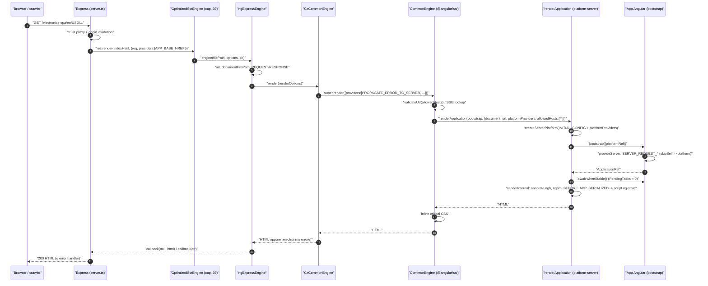
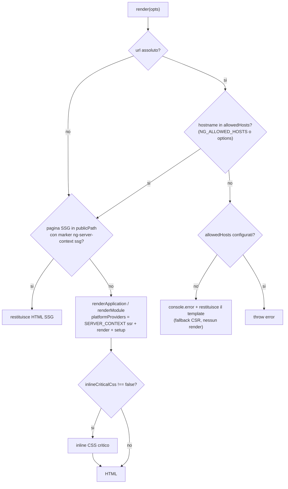
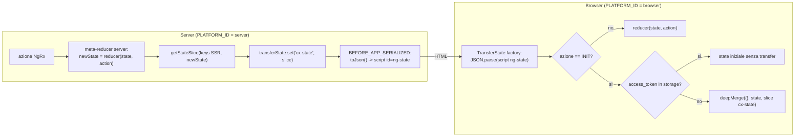
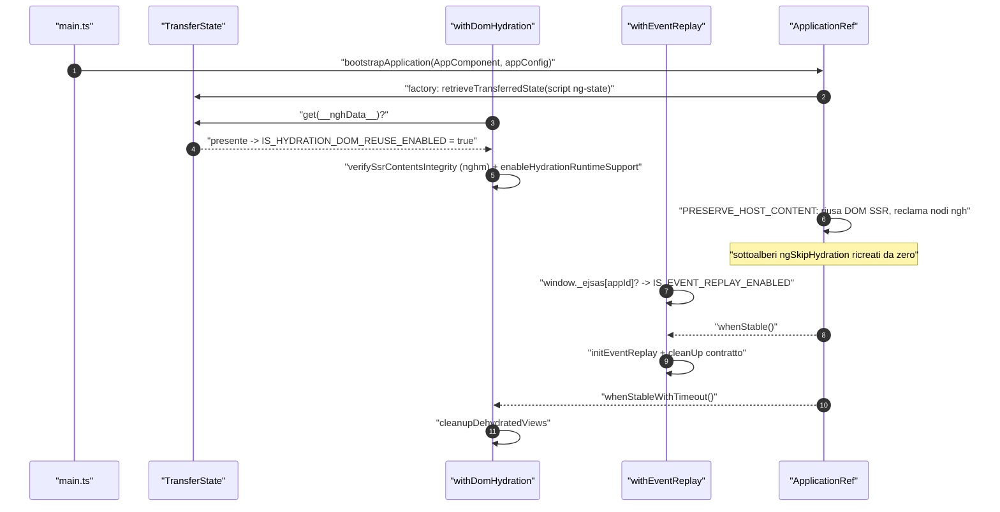
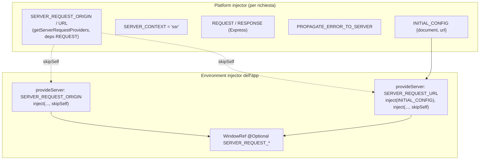

# 07 — SSR, hydration e TransferState

> Riferimenti allo SHA `5b7a1c2bf2808d7380bc20596d10f4fa710c3da1` (vedi [00-meta](../00-meta.md)).
> Angular @ `v21.2.23` (prefisso `angular:`); `@angular/ssr` 21.2.23 e NgRx 21.0.1 dai pacchetti npm pubblicati (prefisso `deps:`, path relativi a `/tmp/deps`).

## 1. A cosa serve e perché esiste

Uno storefront e-commerce deve restituire HTML già popolato alla prima richiesta: per i crawler (SEO), per il tempo al primo contenuto visibile e per i client lenti. Angular risolve il problema con tre meccanismi che questo capitolo smonta pezzo per pezzo:

1. **Server-Side Rendering (SSR)**: l'applicazione viene avviata in Node su una *platform server* con un DOM emulato (Domino), si attende che diventi *stabile* e poi il DOM viene serializzato in stringa (`angular:packages/platform-server/src/utils.ts:L342-L380`, `angular:packages/platform-server/src/platform_state.ts:L39-L56`).
2. **Hydration**: nel browser Angular non ricostruisce da zero il DOM ricevuto dal server, lo "reclama" nodo per nodo grazie alle annotazioni (`ngh`, `__nghData__`) scritte durante il render server (`angular:packages/core/src/hydration/annotate.ts:L243-L301`, `angular:packages/core/src/hydration/api.ts:L211-L228`).
3. **TransferState**: un dizionario chiave→valore JSON che il server serializza in `<script id="ng-state" type="application/json">` e che il browser rilegge al bootstrap, per non ripetere lavoro già fatto (`angular:packages/platform-server/src/transfer_state.ts:L70-L111`, `angular:packages/core/src/transfer_state.ts:L66-L79`).

Spartacus si appoggia a tutti e tre, ma con scelte proprie che è fondamentale conoscere prima di toccare qualunque cosa in area SSR:

- usa ancora il motore `CommonEngine` di `@angular/ssr/node`, avvolto in `CxCommonEngine` e in un `ngExpressEngine` copiato dal vecchio `@nguniversal/express-engine` (`core-libs/setup/ssr/engine/cx-common-engine.ts:L7-L23`, `core-libs/setup/ssr/engine/ng-express-engine.ts:L68-L81`);
- trasferisce lo **state NgRx** (non le risposte HTTP) tramite un meta-reducer che scrive in `TransferState` sotto la chiave `cx-state` (`core-libs/core/src/state/reducers/transfer-state.reducer.ts:L16-L16`), e per questo **disattiva la HTTP transfer cache** di Angular con `withNoHttpTransferCache()` (`projects/storefrontapp/src/app/app.config.ts:L29-L29`, `docs/migration/221121_7/migration.md:L207-L209`);
- espone l'URL e l'origin della richiesta tramite i token `SERVER_REQUEST_URL` / `SERVER_REQUEST_ORIGIN` (`core-libs/core/src/util/ssr.tokens.ts:L9-L21`), consumati da `WindowRef` (`core-libs/core/src/window/window-ref.ts:L19-L27`);
- trasferisce piccoli stati di direttive come attributi DOM `data-cx-state-transfer-*` (`core-libs/storefront/utils/directive-state-transfer.service.ts:L10-L42`).

Questo capitolo copre il **meccanismo** (Angular + integrazione Spartacus). L'ottimizzazione del rendering (timeout, cache, concorrenza, fallback CSR di `OptimizedSsrEngine`), il logger e la gestione errori Express sono trattati in [39 — SSR ottimizzato](../parte-2/39-ssr-ottimizzato.md). I concetti di injector platform/environment usati qui sono in [01 — Dependency Injection](01-dependency-injection.md), `bootstrapApplication` in [02 — NgModule, standalone e bootstrap](02-ngmodule-standalone-bootstrap.md), `PendingTasks` e Zone in [04 — Change detection, Zone, zoneless e signals](04-change-detection-zone-signals.md).

## 2. Mappa dei file

| Path | Ruolo |
|---|---|
| `angular:packages/platform-server/src/utils.ts` | `renderApplication`, `renderModule`, `renderInternal`, `prepareForHydration`, validazione `allowedHosts`, distruzione asincrona della platform |
| `angular:packages/platform-server/src/server.ts` | provider platform/app del server, `platformServer`, `_document` (Domino) |
| `angular:packages/platform-server/src/provide_server.ts` | `provideServerRendering()` |
| `angular:packages/platform-server/src/tokens.ts` | `PlatformConfig`, `INITIAL_CONFIG`, `BEFORE_APP_SERIALIZED` |
| `angular:packages/platform-server/src/transfer_state.ts` | serializzazione di `TransferState` in `<script id="{appId}-state">` |
| `angular:packages/platform-server/src/http.ts` | `ServerXhr` (deprecated), interceptor che rende assoluti gli URL relativi |
| `angular:packages/core/src/transfer_state.ts` | `makeStateKey`, `TransferState`, `retrieveTransferredState` |
| `angular:packages/core/src/application/application_ref.ts` | `isStable` / `whenStable()` basati su `PendingTasksInternal` |
| `angular:packages/core/src/pending_tasks.ts` | `PendingTasks` (`add`, `run`) |
| `angular:packages/core/src/hydration/api.ts` | `withDomHydration`, `withIncrementalHydration`, cleanup viste disidratate |
| `angular:packages/core/src/hydration/annotate.ts` | annotazione server (`ngh`, `NGH_DATA_KEY`) |
| `angular:packages/core/src/hydration/event_replay.ts` | `withEventReplay` (core) |
| `angular:packages/core/src/hydration/skip_hydration.ts` | attributo `ngSkipHydration` |
| `angular:packages/core/src/hydration/utils.ts` | chiavi `__nghData__`, marker `nghm`, `verifySsrContentsIntegrity` |
| `angular:packages/platform-browser/src/hydration.ts` | `provideClientHydration` e feature (`withEventReplay`, `withNoHttpTransferCache`, …) |
| `angular:packages/common/http/src/transfer_cache.ts` | HTTP transfer cache |
| `deps:angular-ssr-21.2.23/package/fesm2022/node.mjs` | `CommonEngine` (e la classe AngularNodeAppEngine, non usata da Spartacus) |
| `core-libs/setup/ssr/engine/cx-common-engine.ts` | `CxCommonEngine`: propaga al server il primo errore dell'app |
| `core-libs/setup/ssr/engine/ng-express-engine.ts` | `ngExpressEngine`: view engine Express |
| `core-libs/setup/ssr/engine-decorator/ng-express-engine-decorator.ts` | `NgExpressEngineDecorator`: aggiunge provider Spartacus e `OptimizedSsrEngine` |
| `core-libs/setup/ssr/providers/ssr-providers.ts` | `provideServer()`, `getServerRequestProviders()` |
| `core-libs/setup/ssr/providers/server-request-origin.ts`, `server-request-url.ts`, `model.ts` | factory di `SERVER_REQUEST_ORIGIN` / `SERVER_REQUEST_URL`, `ServerOptions` |
| `core-libs/setup/ssr/tokens/express.tokens.ts` | token `REQUEST` / `RESPONSE` (Express) |
| `core-libs/setup/ssr/express-utils/express-request-origin.ts`, `express-request-url.ts` | origin/URL dalla request Express |
| `core-libs/core/src/util/ssr.tokens.ts` | `SERVER_REQUEST_URL`, `SERVER_REQUEST_ORIGIN` |
| `core-libs/core/src/window/window-ref.ts` | `WindowRef`: `location` emulata in SSR |
| `core-libs/core/src/state/reducers/transfer-state.reducer.ts` | `CX_KEY`, meta-reducer server/browser |
| `core-libs/core/src/state/reducers/index.ts` | `TRANSFER_STATE_META_REDUCER`, registrazione in `META_REDUCERS` |
| `core-libs/core/src/state/config/state-config.ts` | `StateConfig.state.ssrTransfer.keys`, `StateTransferType` |
| `core-libs/core/src/state/utils/get-state-slice.ts` | estrazione dello slice da trasferire |
| `core-libs/storefront/utils/directive-state-transfer.service.ts` | `DirectiveStateTransferService` |
| `core-libs/storefront/cms-structure/page/page-layout/page-template.directive.ts` | unico consumatore del servizio sopra |
| `core-libs/storefront/cms-structure/page/component/handlers/lazy-component.handler.ts` | `PendingTasks` intorno all'`import()` dei componenti CMS lazy |
| `core-libs/storefront/shared/components/carousel/carousel.component.ts` | esempio di `ngSkipHydration` |
| `projects/storefrontapp/src/server.ts` | server Express della demo |
| `projects/storefrontapp/src/main.server.ts`, `main.ts` | bootstrap server (con `BootstrapContext`) e client |
| `projects/storefrontapp/src/app/app.config.ts`, `app.config.server.ts`, `app.module.server.ts` | hydration, config server, `provideServer` |

## 3. Come funziona passo per passo

### 3.1 La platform server e il render di Angular

**Creazione della platform.** `renderApplication(bootstrap, options)` valida l'URL contro `allowedHosts`, crea la platform server, chiama la funzione di bootstrap passando `{platformRef}`, attende `applicationRef.whenStable()` e solo allora serializza; nel `finally` distrugge la platform (`angular:packages/platform-server/src/utils.ts:L342-L380`). `renderModule` è lo stesso schema con `platformRef.bootstrapModule(moduleType)` (`angular:packages/platform-server/src/utils.ts:L283-L309`).

`createServerPlatform` passa come provider di **livello platform** `INITIAL_CONFIG = {document, url}` più gli eventuali `platformProviders` (`angular:packages/platform-server/src/utils.ts:L55-L74`). `PlatformConfig` ha solo i campi `document?` e `url?` (`angular:packages/platform-server/src/tokens.ts:L16-L34`).

I provider di platform interni registrano `DOCUMENT` (factory `_document`), `PLATFORM_ID = PLATFORM_SERVER_ID`, l'inizializzatore dell'adapter Domino, `ServerPlatformLocation` e `PlatformState` (`angular:packages/platform-server/src/server.ts:L47-L57`). `_document()` legge `INITIAL_CONFIG` e, se `document` è una stringa, la parsa con Domino usando `config.url` risolto contro `http://localhost` (`angular:packages/platform-server/src/server.ts:L95-L118`). `platformServer()` imposta `globalThis.ngServerMode = true` se non definito e lo azzera alla distruzione (`angular:packages/platform-server/src/server.ts:L130-L149`).

**Provider applicativi.** `provideServerRendering()` restituisce `PLATFORM_SERVER_PROVIDERS` come `EnvironmentProviders` (`angular:packages/platform-server/src/provide_server.ts:L28-L34`); questi includono `TRANSFER_STATE_SERIALIZATION_PROVIDERS`, il plugin eventi server, `SERVER_HTTP_PROVIDERS` e `NullViewportScroller` (`angular:packages/platform-server/src/server.ts:L75-L82`). Tra i provider HTTP c'è un interceptor root che trasforma gli URL relativi in assoluti usando `PlatformLocation` (`angular:packages/platform-server/src/http.ts:L72-L110`); il vecchio backend `ServerXhr` è `@deprecated` a favore di `withFetch()` (`angular:packages/platform-server/src/http.ts:L22-L29`), che è infatti ciò che usa la demo (`projects/storefrontapp/src/app/app.config.ts:L28-L28`).

**Bootstrap con `BootstrapContext`.** `bootstrapApplication(root, options, context?)` accetta un `BootstrapContext` con `platformRef`, necessario in SSR dove la platform è creata per ogni richiesta (`angular:packages/platform-browser/src/browser.ts:L58-L63`, `angular:packages/platform-browser/src/browser.ts:L125-L140`). La demo esporta proprio questa funzione da `main.server.ts` (`projects/storefrontapp/src/main.server.ts:L23-L26`).

**Stabilità.** `ApplicationRef.isStable` è derivato da `PendingTasksInternal.hasPendingTasksObservable` (stabile = nessun task pendente) e `whenStable()` risolve alla prima emissione `true` (`angular:packages/core/src/application/application_ref.ts:L326-L350`). Chi contribuisce ai task pendenti:

- **Zone.js**: `ZoneStablePendingTask` aggiunge un task su `onUnstable` e lo rimuove dopo `onStable` quando non restano macro/microtask (`angular:packages/core/src/change_detection/scheduling/ng_zone_scheduling.ts:L231-L281`). La demo usa `provideZoneChangeDetection({ eventCoalescing: true })` (`projects/storefrontapp/src/app/app.config.ts:L30-L30`).
- **HttpClient**: ogni richiesta che passa da `HttpInterceptorHandler` aggiunge un `PendingTasks.add()` rimosso con `finalize`, perché `REQUESTS_CONTRIBUTE_TO_STABILITY` vale `true` di default (`angular:packages/common/http/src/backend.ts:L125-L134`, `angular:packages/common/http/src/interceptor.ts:L217-L221`); gli interceptor a classi (`withInterceptorsFromDi()`) ne aggiungono uno anche per il proprio tratto di catena (`angular:packages/common/http/src/interceptor.ts:L243-L247`).
- **Codice applicativo**: `PendingTasks.add()` restituisce una funzione di cleanup idempotente (`angular:packages/core/src/pending_tasks.ts:L42-L61`); la JSDoc cita esplicitamente SSR (`angular:packages/core/src/pending_tasks.ts:L24-L26`). Spartacus lo usa in `LazyComponentHandler` (§3.6).

**Serializzazione.** `renderInternal` esegue nell'ordine: `prepareForHydration`, `appendServerContextInfo`, i callback `BEFORE_APP_SERIALIZED` (sincroni e asincroni, con `Promise.allSettled`), infine `platformState.renderToString()` (`angular:packages/platform-server/src/utils.ts:L197-L234`). Gli errori dei callback vanno a `INTERNAL_APPLICATION_ERROR_HANDLER` (`angular:packages/platform-server/src/utils.ts:L207-L221`). `appendServerContextInfo` scrive `ng-server-context` sugli host bootstrappati con il valore di `SERVER_CONTEXT` (default `'other'`) (`angular:packages/platform-server/src/utils.ts:L145-L155`, `angular:packages/platform-server/src/utils.ts:L249-L269`).

**Distruzione.** La platform è distrutta in un `setTimeout(…, 0)`, per lasciare che le promise pendenti si risolvano (`angular:packages/platform-server/src/utils.ts:L236-L247`).

### 3.2 `CommonEngine` di `@angular/ssr`

`@angular/ssr` non è nel repo Angular: `packages/ssr/docs/BUILD.bazel` dichiara che si trova nel repo Angular/CLI (`angular:packages/ssr/docs/BUILD.bazel:L16-L16`). Il codice qui descritto proviene dal pacchetto npm pubblicato 21.2.23.

1. **Costruttore.** `allowedHosts` = variabile d'ambiente letta con `getArrayFromEnv('NG_ALLOWED_HOSTS')` se presente, altrimenti `options.allowedHosts`, altrimenti insieme vuoto (`deps:angular-ssr-21.2.23/package/fesm2022/node.mjs:L108-L112`, `deps:angular-ssr-21.2.23/package/fesm2022/node.mjs:L10-L12`). Se `Zone` non è definito, aggancia una volta per processo handler globali `unhandledRejection`/`uncaughtException` (`deps:angular-ssr-21.2.23/package/fesm2022/node.mjs:L31-L41`).
2. **Validazione host.** Se `url` è assoluto, `render` ne valida l'hostname (`'*'`, match esatto o wildcard `*.dominio`, `deps:angular-ssr-21.2.23/package/fesm2022/_validation-chunk.mjs:L72-L86`). Se la validazione fallisce **e non c'è alcun host configurato**, stampa un errore e **restituisce il template HTML non renderizzato** (fallback CSR); se invece ci sono host configurati rilancia l'errore (`deps:angular-ssr-21.2.23/package/fesm2022/node.mjs:L113-L136`).
3. **Pagina SSG.** Se `publicPath`, `documentFilePath` e `url` sono definiti, cerca `publicPath/<pathname>/index.html` e lo serve solo se contiene il marker `ng-server-context="...ssg..."` (`deps:angular-ssr-21.2.23/package/fesm2022/node.mjs:L101-L101`, `deps:angular-ssr-21.2.23/package/fesm2022/node.mjs:L155-L184`).
4. **Render.** Altrimenti chiama il proprio `renderApplication` e, salvo `inlineCriticalCss === false`, inlinea il CSS critico (`deps:angular-ssr-21.2.23/package/fesm2022/node.mjs:L137-L150`).
5. **Provider.** Il `renderApplication` interno costruisce `[{SERVER_CONTEXT: 'ssr'}, ...opts.providers, ...this.options.providers]`, legge il documento (con cache per path) e chiama `renderApplication` di platform-server con questi provider come **`platformProviders`** (se `bootstrap` è una funzione) o `renderModule` con `extraProviders` (se è un NgModule), sempre con `allowedHosts: ['*']` (`deps:angular-ssr-21.2.23/package/fesm2022/node.mjs:L185-L219`, `deps:angular-ssr-21.2.23/package/fesm2022/node.mjs:L228-L230`). `ɵSERVER_CONTEXT` è l'export privato di `SERVER_CONTEXT` (`angular:packages/platform-server/src/private_export.ts:L13-L13`): per questo l'HTML SSR ha `ng-server-context="ssr"`.

Conseguenza: in SSR **tutti** i provider passati all'engine (di setup e di render) vivono nel **platform injector**, non nell'environment injector dell'app. È il motivo per cui i factory di `provideServer` leggono i valori Express con `skipSelf` (§3.4).

`@angular/ssr/node` espone anche la classe AngularNodeAppEngine, che delega ad AngularAppEngine e converte la request Node in una `Request` web (`deps:angular-ssr-21.2.23/package/fesm2022/node.mjs:L290-L307`); Spartacus non lo usa (nessuna occorrenza in `core-libs`/`projects`).

### 3.3 La catena di engine di Spartacus

**`ngExpressEngine`** è codice copiato da `@nguniversal/express-engine`, rimosso in Angular 17, mantenuto per retrocompatibilità (`core-libs/setup/ssr/engine/ng-express-engine.ts:L68-L81`). Alla chiamata crea **una sola** istanza di `CxCommonEngine` con `bootstrap`, `providers`, `enablePerformanceProfiler`, `allowedHosts` e restituisce la funzione view-engine Express `(filePath, options, callback)` (`core-libs/setup/ssr/engine/ng-express-engine.ts:L82-L94`). Per ogni render:

- se manca `bootstrap` sia nel setup sia nelle render options lancia `Error('You must pass in a NgModule to be bootstrapped')` (`core-libs/setup/ssr/engine/ng-express-engine.ts:L95-L99`);
- calcola `url` da `req.protocol`, header `host`, `req.baseUrl`, `req.url`; `documentFilePath = filePath`; `publicPath` da render options / setup / `settings.views` (`core-libs/setup/ssr/engine/ng-express-engine.ts:L101-L118`);
- aggiunge ai provider `REQUEST` (sempre) e `RESPONSE` (se presente, fallback `req.res`) (`core-libs/setup/ssr/engine/ng-express-engine.ts:L38-L53`, `core-libs/setup/ssr/engine/ng-express-engine.ts:L102-L112`);
- passa l'esito al callback Express: `callback(null, html)` oppure `callback(err)` (`core-libs/setup/ssr/engine/ng-express-engine.ts:L120-L126`).

`REQUEST` e `RESPONSE` di Spartacus sono `InjectionToken<Request>`/`<Response>` di **Express** (`core-libs/setup/ssr/tokens/express.tokens.ts:L10-L26`): da non confondere con `REQUEST` di `@angular/core` (web `Request`, `providedIn: 'platform'`, factory `null`, `angular:packages/core/src/application/platform_tokens.ts:L31-L37`).

**`CxCommonEngine`** estende `CommonEngine` (`core-libs/setup/ssr/engine/cx-common-engine.ts:L7-L23`) e ridefinisce `render` anteponendo un provider `PROPAGATE_ERROR_TO_SERVER` che memorizza solo il **primo** errore (`??=`); a rendering terminato, se un errore è stato catturato, rigetta la promise (`core-libs/setup/ssr/engine/cx-common-engine.ts:L41-L66`). L'errore viene alimentato da `PropagatingToServerErrorHandler`, registrato come `MULTI_ERROR_HANDLER` da `provideServer` (`core-libs/setup/ssr/providers/ssr-providers.ts:L41-L45`), che chiama il token o un no-op se assente (`core-libs/setup/ssr/error-handling/multi-error-handlers/propagating-to-server-error-handler.ts:L26-L38`). Il token esiste "finché Angular non implementa una propagazione corretta degli errori asincroni" (`core-libs/setup/ssr/error-handling/error-response/propagate-error-to-server.ts:L9-L22`).

**`NgExpressEngineDecorator.get(engine, optimizationOptions)`** delega a `decorateExpressEngine` (`core-libs/setup/ssr/engine-decorator/ng-express-engine-decorator.ts:L36-L49`), che antepone `getServerRequestProviders()` ai provider di setup e, se `optimizationOptions` è truthy (default `defaultSsrOptimizationOptions`), avvolge l'istanza in `OptimizedSsrEngine` (`core-libs/setup/ssr/engine-decorator/ng-express-engine-decorator.ts:L51-L74`). I dettagli di `OptimizedSsrEngine` sono nel [capitolo 39](../parte-2/39-ssr-ottimizzato.md).

### 3.4 Token di richiesta: `SERVER_REQUEST_ORIGIN` e `SERVER_REQUEST_URL`

I due token sono `InjectionToken<string>` di `@spartacus/core`, senza factory (`core-libs/core/src/util/ssr.tokens.ts:L9-L21`). Vengono forniti a **due livelli**:

1. **Platform** (solo SSR con Express): `getServerRequestProviders()` li dichiara come `StaticProvider` con `deps: [REQUEST]` e factory `getRequestOrigin`/`getRequestUrl` (`core-libs/setup/ssr/providers/ssr-providers.ts:L48-L66`). `getRequestOrigin` usa `X-Forwarded-Host` (primo valore) solo se la `trust proxy fn` di Express si fida del `remoteAddress`, altrimenti l'header `host` (`core-libs/setup/ssr/express-utils/express-request-origin.ts:L9-L26`); `getRequestUrl` = origin + `req.originalUrl` (`core-libs/setup/ssr/express-utils/express-request-url.ts:L10-L12`). Per §3.2 questi provider finiscono nel platform injector.
2. **App** (SSR e prerendering): `provideServer(options?)` fornisce i due token con factory basate su `inject`, più `LoggerService` e `PropagatingToServerErrorHandler` (`core-libs/setup/ssr/providers/ssr-providers.ts:L24-L47`). La demo lo registra in `AppServerModule` con `serverRequestOrigin: process.env['SERVER_REQUEST_ORIGIN']` (`projects/storefrontapp/src/app/app.module.server.ts:L10-L17`).

`serverRequestOriginFactory` legge il valore platform con `inject(SERVER_REQUEST_ORIGIN, {optional: true, skipSelf: true})` e restituisce, nell'ordine, `options.serverRequestOrigin`, il valore Express, oppure lancia un errore esplicativo (`core-libs/setup/ssr/providers/server-request-origin.ts:L14-L55`). L'opzione è facoltativa in SSR ma **obbligatoria per il prerendering**, e se impostata ha precedenza su Express (`core-libs/setup/ssr/providers/model.ts:L10-L23`).

`serverRequestUrlFactory` inietta `INITIAL_CONFIG`, `SERVER_REQUEST_ORIGIN` (senza `skipSelf`) e `SERVER_REQUEST_URL` del parent (`skipSelf`); in SSR restituisce l'URL Express (con sostituzione dell'origin se `options.serverRequestOrigin` è impostato), nel prerendering costruisce `origin + pathname` da `INITIAL_CONFIG.url` (`core-libs/setup/ssr/providers/server-request-url.ts:L15-L49`). Il commento avverte che in Angular recente `platformConfig.url` può essere un URL completo, da cui l'estrazione del solo `pathname` (`core-libs/setup/ssr/providers/server-request-url.ts:L37-L47`).

Il consumatore è `WindowRef`, che inietta i due token `@Optional()` (`core-libs/core/src/window/window-ref.ts:L19-L27`): in SSR `location` restituisce un `Partial<Location>` con **solo** `href` e `origin`, lanciando un errore se i token mancano (`core-libs/core/src/window/window-ref.ts:L62-L89`); `nativeWindow` è `undefined` (`core-libs/core/src/window/window-ref.ts:L37-L44`) e `resize$` emette `of(null)` (`core-libs/core/src/window/window-ref.ts:L91-L107`).

Anche il logger dipende dal contesto: `serverLoggerServiceFactory` sceglie `ExpressLoggerService` se `REQUEST` è iniettabile, altrimenti `PrerenderingLoggerService` (`core-libs/setup/ssr/logger/services/server-logger-service-factory.ts:L12-L17`).

### 3.5 TransferState: da Angular allo state NgRx di Spartacus

**Angular.** `makeStateKey<T>(key)` è un semplice cast di stringa a un tipo brandizzato (`angular:packages/core/src/transfer_state.ts:L28-L49`). `TransferState` è `providedIn: 'root'`; nel browser la factory popola lo store con `retrieveTransferredState(DOCUMENT, APP_ID)`, sul server parte vuoto (`angular:packages/core/src/transfer_state.ts:L66-L79`). L'API è `get` (default se `undefined`), `set`, `remove`, `hasKey`, `isEmpty`, `onSerialize` (`angular:packages/core/src/transfer_state.ts:L89-L126`). La serializzazione è `JSON.stringify` con `<` e `/` escapati (`angular:packages/core/src/transfer_state.ts:L131-L147`), quindi solo boolean, number, string, null e oggetti non-classe sopravvivono senza perdite (`angular:packages/core/src/transfer_state.ts:L60-L62`).

Sul server la serializzazione è un provider `multi` su `BEFORE_APP_SERIALIZED` (`angular:packages/platform-server/src/transfer_state.ts:L31-L37`): se lo store non è vuoto appende in fondo al `<body>` `<script id="{appId}-state" type="application/json">` (`angular:packages/platform-server/src/transfer_state.ts:L70-L111`). Con `APP_ID` di default `'ng'` lo script è `ng-state` (`angular:packages/core/src/application/application_tokens.ts:L44-L52`). Nel browser `retrieveTransferredState` cerca quell'elemento e fa `JSON.parse`, con warning e `{}` in caso di errore (`angular:packages/core/src/transfer_state.ts:L150-L169`).

**Spartacus.** La chiave è `CX_KEY = makeStateKey<string>('cx-state')` (`core-libs/core/src/state/reducers/transfer-state.reducer.ts:L16-L16`). Il flusso:

1. `BaseCoreModule` importa `StateModule.forRoot()` (`core-libs/core/src/base-core.module.ts:L29-L29`), che fornisce `stateMetaReducers` (`core-libs/core/src/state/state.module.ts:L10-L18`): `TRANSFER_STATE_META_REDUCER` con factory `getTransferStateReducer` (deps `PLATFORM_ID`, `TransferState`/`Config`/`AuthStatePersistenceService` opzionali), aggiunto a `META_REDUCERS` di NgRx con `useExisting`, `multi: true` (`core-libs/core/src/state/reducers/index.ts:L23-L43`).
2. In NgRx i `META_REDUCERS` vengono concatenati ai meta-reducer di `forRoot` e composti attorno al reducer factory (`combineReducers`) per formare il token NgRx REDUCER_FACTORY (`deps:ngrx-store-21.0.1/package/fesm2022/ngrx-store.mjs:L1337-L1355`, `deps:ngrx-store-21.0.1/package/fesm2022/ngrx-store.mjs:L359-L372`); il ReducerManager di NgRx ricompone tutto lo state root con quel factory a ogni aggiunta di feature (`deps:ngrx-store-21.0.1/package/fesm2022/ngrx-store.mjs:L425-L444`). Il meta-reducer di Spartacus vede quindi **l'intero state**.
3. Le feature dichiarano quali slice trasferire con `state.ssrTransfer.keys` (`core-libs/core/src/state/config/state-config.ts:L20-L39`), valore `StateTransferType.TRANSFER_STATE = 'SSR'` (`core-libs/core/src/state/config/state-config.ts:L16-L18`). OOTB lo fanno quattro store: site-context, site-theme, cms, product (`core-libs/core/src/site-context/store/site-context-store.module.ts:L20-L30`, `core-libs/core/src/site-theme/store/site-theme-store.module.ts:L20-L29`, `core-libs/core/src/cms/store/cms-store.module.ts:L21-L31`, `core-libs/core/src/product/store/product-store.module.ts:L20-L30`).
4. `getTransferStateReducer` restituisce il meta-reducer browser o server in base a `PLATFORM_ID`, solo se esistono `TransferState` e le chiavi; altrimenti un meta-reducer identità (`core-libs/core/src/state/reducers/transfer-state.reducer.ts:L18-L40`).
5. **Server**: dopo **ogni** azione, estrae lo slice delle chiavi `SSR` dal nuovo state con `getStateSlice` e lo scrive in `TransferState` sotto `cx-state`, sovrascrivendo (`core-libs/core/src/state/reducers/transfer-state.reducer.ts:L42-L62`). `filterKeysByType` seleziona le chiavi per tipo (`core-libs/core/src/state/utils/get-state-slice.ts:L104-L112`); `getStateSlice` supporta la notazione a punti e ricompone lo slice con `deepMerge` (`core-libs/core/src/state/utils/get-state-slice.ts:L10-L55`), scartando i valori vuoti (`core-libs/core/src/state/utils/get-state-slice.ts:L23-L36`).
6. **Server, fine render**: `BEFORE_APP_SERIALIZED` scrive l'intero store in `#ng-state` (passo §3.1).
7. **Browser**: il meta-reducer interviene solo sull'azione `INIT` di NgRx: calcola lo state iniziale se assente e, **se l'utente non risulta loggato** e `cx-state` esiste, fa `deepMerge({}, state, slice)`; per tutte le altre azioni delega al reducer (`core-libs/core/src/state/reducers/transfer-state.reducer.ts:L64-L96`). "Loggato" significa presenza di `token.access_token` nello storage (`core-libs/core/src/auth/user-auth/services/auth-state-persistence.service.ts:L119-L121`).

In NgRx `INIT` è il valore iniziale del `BehaviorSubject` `ActionsSubject`, mentre l'aggiunta di feature emette `UPDATE` (`deps:ngrx-store-21.0.1/package/fesm2022/ngrx-store.mjs:L196-L200`, `deps:ngrx-store-21.0.1/package/fesm2022/ngrx-store.mjs:L391-L391`, `deps:ngrx-store-21.0.1/package/fesm2022/ngrx-store.mjs:L438-L444`). `combineReducers` passa a ogni reducer registrato `state[key]` e restituisce lo **stesso oggetto** (con eventuali chiavi extra) se nessun reducer cambia riferimento, altrimenti un nuovo oggetto con le sole chiavi registrate (`deps:ngrx-store-21.0.1/package/fesm2022/ngrx-store.mjs:L319-L343`). Ne consegue che una feature registrata dopo `INIT` riceve lo slice trasferito come stato precedente **solo se** nessun reducer registrato ha cambiato riferimento tra `INIT` e il suo `UPDATE`; altrimenti `combineReducers` ha già scartato le chiavi non registrate e la feature parte dal proprio `initialState` (`deps:ngrx-store-21.0.1/package/fesm2022/ngrx-store.mjs:L329-L341`, `core-libs/core/src/state/reducers/transfer-state.reducer.ts:L89-L93`). ⚠️ DA VERIFICARE a runtime quali feature siano registrate all'`INIT` e quali azioni le precedano (dipende dall'ordine di istanziazione DI, non osservato).

`CX_KEY`, `TRANSFER_STATE_META_REDUCER` e `getTransferStateReducer` **non** sono nel public API: `core-libs/core/src/state/index.ts` non riesporta `reducers/`, e `getStateSlice` è esposto solo tramite il namespace `StateUtils` (`core-libs/core/src/state/index.ts:L7-L11`, `core-libs/core/src/state/utils/index.ts:L7-L8`, `core-libs/core/src/state/utils/utils-group.ts:L10-L10`).

### 3.6 Stabilità in Spartacus: `PendingTasks` e caricamento istantaneo

- `LazyComponentHandler` avvolge l'`import()` dinamico dei componenti CMS lazy in `PendingTasks.add()` + `finalize`, per impedire che SSR serializzi e distrugga l'app con l'import in volo (NG0205) (`core-libs/storefront/cms-structure/page/component/handlers/lazy-component.handler.ts:L31-L31`, `core-libs/storefront/cms-structure/page/component/handlers/lazy-component.handler.ts:L60-L71`).
- `DeferLoaderService` carica sempre istantaneamente sul server (`core-libs/storefront/layout/loading/defer-loader.service.ts:L55-L64`): nessun lazy rendering "on viewport" in SSR.
- `CmsComponentsService.shouldRender` esclude dal render SSR i componenti la cui mapping ha `disableSSR` (`core-libs/storefront/cms-structure/services/cms-components.service.ts:L187-L190`, `core-libs/core/src/cms/config/cms-config.ts:L75-L75`).

Questi punti, insieme a Zone e HttpClient (§3.1), determinano quando `whenStable()` risolve e quindi quando l'HTML viene serializzato.

### 3.7 Hydration lato server

1. `provideClientHydration(...features)` è nell'`appConfig` condiviso fra client e server (`projects/storefrontapp/src/app/app.config.ts:L29-L29`, `projects/storefrontapp/src/app/app.config.server.ts:L17-L30`). Restituisce `withDomHydration()` + (HTTP transfer cache solo se non disattivata né configurata) + i provider delle feature (`angular:packages/platform-browser/src/hydration.ts:L225-L266`).
2. Sul server `IS_HYDRATION_DOM_REUSE_ENABLED` è sempre `true` (`angular:packages/core/src/hydration/api.ts:L211-L228`), quindi `prepareForHydration` aggiunge il marker `nghm` come primo figlio di `<body>`, chiama `annotateForHydration` e inserisce lo script di replay eventi se ci sono tipi di evento da riprodurre (`angular:packages/platform-server/src/utils.ts:L95-L125`, `angular:packages/platform-server/src/utils.ts:L127-L139`).
3. `annotateForHydration` annota le viste di `appRef._views` e scrive **sempre** `NGH_DATA_KEY` (`__nghData__`) in `TransferState`, anche con lista vuota, come segnale al client (`angular:packages/core/src/hydration/annotate.ts:L243-L301`, `angular:packages/core/src/hydration/utils.ts:L46-L69`). Ogni host annotato riceve `ngh="<indice>"`; componenti i18n non supportati o `ShadowDom` ricevono `ngSkipHydration` (`angular:packages/core/src/hydration/annotate.ts:L820-L844`).
4. I tipi di evento vengono raccolti solo se `IS_EVENT_REPLAY_ENABLED` (`angular:packages/core/src/hydration/annotate.ts:L250-L254`); lo script di replay chiama `window.__jsaction_bootstrap(...)` ed è inserito dopo lo script `ng-event-dispatch-contract`, solo se questo esiste — cioè se la build CLI l'ha inlineato (`angular:packages/platform-server/src/utils.ts:L36-L44`, `angular:packages/platform-server/src/utils.ts:L157-L186`).

Risultato: hydration (`__nghData__`), eventuale HTTP transfer cache e Spartacus (`cx-state`) condividono **lo stesso** store `TransferState` e **lo stesso** `<script id="ng-state">`.

### 3.8 Hydration lato browser

1. Il client avvia `bootstrapApplication(AppComponent, appConfig)` (`projects/storefrontapp/src/main.ts:L17-L23`).
2. `IS_HYDRATION_DOM_REUSE_ENABLED` vale `true` solo se `TransferState` contiene `__nghData__` (`angular:packages/core/src/hydration/api.ts:L211-L228`).
3. L'initializer verifica il marker di integrità e abilita il runtime di hydration; se le annotazioni mancano, in dev mode emette "MISSING_HYDRATION_ANNOTATIONS" (`angular:packages/core/src/hydration/api.ts:L229-L266`). `verifySsrContentsIntegrity` lancia `MISSING_SSR_CONTENT_INTEGRITY_MARKER` se non trova `nghm` (`angular:packages/core/src/hydration/utils.ts:L766-L810`).
4. `PRESERVE_HOST_CONTENT` = `IS_HYDRATION_DOM_REUSE_ENABLED`: il DOM SSR dell'host non viene svuotato al bootstrap (`angular:packages/core/src/hydration/api.ts:L269-L280`).
5. I sottoalberi con `ngSkipHydration` (case-insensitive, ereditato dagli antenati, `angular:packages/core/src/hydration/skip_hydration.ts:L16-L72`) vengono ricreati da zero. In Spartacus: `CarouselComponent` (`core-libs/storefront/shared/components/carousel/carousel.component.ts:L57-L65`) e 12 componenti di form in feature-libs, es. `LoginFormComponent` (`feature-libs/user/account/components/login-form/login-form.component.ts:L36-L36`).
6. **Event replay**: `IS_EVENT_REPLAY_ENABLED` nel browser è `true` solo se `window._ejsas[appId]` esiste (`angular:packages/core/src/hydration/event_replay.ts:L76-L95`); dopo `whenStable()` gli eventi catturati vengono riprodotti e il contratto ripulito (`angular:packages/core/src/hydration/event_replay.ts:L132-L197`).
7. **Cleanup**: un `APP_BOOTSTRAP_LISTENER` attende `whenStableWithTimeout(appRef)` ed esegue `cleanupDehydratedViews` per le viste SSR non reclamate (`angular:packages/core/src/hydration/api.ts:L281-L320`); in dev mode avverte se l'app non diventa stabile entro 10 s (`angular:packages/core/src/hydration/api.ts:L87-L91`).
8. `PageTemplateDirective` recupera la classe di template SSR dall'attributo trasferito (§3.9).

`withIncrementalHydration()` (che include `withEventReplay()` e processa i blocchi `@defer`, `angular:packages/core/src/hydration/api.ts:L352-L398`) **non** è usato da Spartacus né dalla demo.

### 3.9 HTTP transfer cache e perché Spartacus la spegne

`withHttpTransferCache` registra `CACHE_OPTIONS`, l'interceptor root `transferCacheInterceptorFn` e un listener che disattiva la cache quando l'app diventa stabile (`angular:packages/common/http/src/transfer_cache.ts:L439-L468`). Sul server l'interceptor salva in `TransferState` le risposte riuscite cacheabili (di default GET/HEAD, le POST solo con `includePostRequests` o con opzione per richiesta; escluse le richieste con credenziali o header auth/cookie, con `Cache-Control` `no-store`/`private`/`no-cache` o con `cache` `no-cache`/`no-store`, o scartate dal `filter`; escluse le risposte con quelle direttive o con `Set-Cookie`), nel browser restituisce `of(cachedResponse)` (`angular:packages/common/http/src/transfer_cache.ts:L126-L152`, `angular:packages/common/http/src/transfer_cache.ts:L132-L148`, `angular:packages/common/http/src/transfer_cache.ts:L333-L333`, `angular:packages/common/http/src/transfer_cache.ts:L294-L296`, `angular:packages/common/http/src/transfer_cache.ts:L252-L316`).

`withNoHttpTransferCache()` non ha provider: è un flag che disattiva la cache; la sua JSDoc dice che le richieste vengono eseguite due volte, sul server e nel browser (`angular:packages/platform-browser/src/hydration.ts:L64-L76`). Spartacus lo usa nella demo e la schematic `add-ssr` lo inserisce sempre, con il commento "Http Transfer Cache is temporarily disabled" (ticket CXSPA-10430) (`core-libs/schematics/src/add-ssr/update-app-config-in-ssr.ts:L47-L50`, `core-libs/schematics/src/add-ssr/update-app-config-in-ssr.ts:L138-L149`). La guida di migrazione lo motiva con il meccanismo di state transfer proprio di Spartacus (`docs/migration/221121_7/migration.md:L207-L209`).

### 3.10 `DirectiveStateTransferService`

Trasferisce **stringhe** come attributi DOM `data-cx-state-transfer-{key}`: `set` e `clear` agiscono solo sul server (via un `Renderer2` creato con `createRenderer(null, null)`), `get` legge l'attributo ovunque (`core-libs/storefront/utils/directive-state-transfer.service.ts:L17-L42`). L'unico consumatore è `PageTemplateDirective` con chiave `'page-template'` (`core-libs/storefront/cms-structure/page/page-layout/page-template.directive.ts:L46-L51`): inizializza `currentTemplate` dall'attributo SSR, così dopo l'hydration può rimuovere la classe del template precedente (`core-libs/storefront/cms-structure/page/page-layout/page-template.directive.ts:L83-L87`), e in `addStyleClass` persiste il template corrente (`core-libs/storefront/cms-structure/page/page-layout/page-template.directive.ts:L114-L129`).

### 3.11 La demo: dal build al server Express

- Build: `@angular-builders/custom-esbuild:application` con `server: main.server.ts`, `ssr.entry: server.ts`, `prerender: false`; configurazioni `noSsr` e `withPrerender` (`projects/storefrontapp/project.json:L10-L10`, `projects/storefrontapp/project.json:L142-L146`, `projects/storefrontapp/project.json:L177-L186`). `withPrerender` usa `prerender.txt`, che elenca 11 route di esempio (`projects/storefrontapp/prerender.txt:L1-L11`).
- Config server: `mergeApplicationConfig(appConfig, serverConfig)` con `provideServerRendering()`, `AppServerModule` e `TestConfigServerModule.forRoot()` marcato "DO NOT USE IN CUSTOMERS APPS" (`projects/storefrontapp/src/app/app.config.server.ts:L17-L30`).
- `server.ts`: `SsrOptimizationOptions` da env (`SSR_TIMEOUT`, `SSR_CACHE`), engine decorato con `NgExpressEngineDecorator.get(engine, ssrOptions)` (`projects/storefrontapp/src/server.ts:L22-L29`); `trust proxy = 'loopback'`, middleware di validazione origin da `SSR_ALLOWED_ORIGINS`, engine `html` con `bootstrap`, statici con `maxAge: '1y'`, tutte le altre rotte con `res.render(indexHtml, { req, providers: [APP_BASE_HREF] })`, error handler di default (`projects/storefrontapp/src/server.ts:L32-L80`). Il template è `index.server.html` nella cartella server del dist (`projects/storefrontapp/src/server.ts:L34-L37`).
- La demo **non** passa `allowedHosts` a `ngExpressEngine` (`projects/storefrontapp/src/server.ts:L51-L56`): si affida alla variabile `NG_ALLOWED_HOSTS=localhost` impostata dagli script npm `serve:ssr*` (`package.json:L152-L155`) e dagli script di installazione, che esportano `NG_ALLOWED_HOSTS=${SSR_ALLOWED_HOSTS:-localhost}` (`SSR_ALLOWED_HOSTS` vuota di default = `localhost`) (`scripts/install/functions.sh:L583-L583`, `scripts/install/functions.sh:L599-L599`, `scripts/install/config.default.sh:L74-L77`). Vedi §9.

## 4. Diagrammi

### 4.1 Richiesta SSR end-to-end (demo)



Riferimenti: passi 2-3 `projects/storefrontapp/src/server.ts:L39-L75`; 4 `core-libs/setup/ssr/engine-decorator/ng-express-engine-decorator.ts:L58-L73`; 5 `core-libs/setup/ssr/engine/ng-express-engine.ts:L95-L118`; 6 `core-libs/setup/ssr/engine/ng-express-engine.ts:L120-L121`; 7 `core-libs/setup/ssr/engine/cx-common-engine.ts:L41-L59`; 8-9 `deps:angular-ssr-21.2.23/package/fesm2022/node.mjs:L113-L219`; 10-11 `angular:packages/platform-server/src/utils.ts:L342-L362`; 12 `core-libs/setup/ssr/providers/server-request-origin.ts:L16-L29`; 14 `angular:packages/platform-server/src/utils.ts:L367-L371`; 15 `angular:packages/platform-server/src/utils.ts:L197-L234`; 19 `core-libs/setup/ssr/engine/cx-common-engine.ts:L60-L65`; 20 `core-libs/setup/ssr/engine/ng-express-engine.ts:L120-L123`.

### 4.2 Decisioni di `CommonEngine.render`



Riferimenti: `deps:angular-ssr-21.2.23/package/fesm2022/node.mjs:L108-L150`, `deps:angular-ssr-21.2.23/package/fesm2022/node.mjs:L155-L219`.

### 4.3 Transfer dello state NgRx



Riferimenti: `core-libs/core/src/state/reducers/transfer-state.reducer.ts:L42-L96`; `angular:packages/platform-server/src/transfer_state.ts:L70-L111`; `angular:packages/core/src/transfer_state.ts:L66-L79`, `angular:packages/core/src/transfer_state.ts:L150-L169`; `core-libs/core/src/auth/user-auth/services/auth-state-persistence.service.ts:L119-L121`.

### 4.4 Hydration nel browser



Riferimenti: `projects/storefrontapp/src/main.ts:L17-L23`; `angular:packages/core/src/transfer_state.ts:L66-L79`; `angular:packages/core/src/hydration/api.ts:L211-L320`; `angular:packages/core/src/hydration/event_replay.ts:L76-L95`, `angular:packages/core/src/hydration/event_replay.ts:L132-L197`.

### 4.5 Livelli DI dei token di richiesta in SSR



Riferimenti: `deps:angular-ssr-21.2.23/package/fesm2022/node.mjs:L185-L209`; `angular:packages/platform-server/src/utils.ts:L55-L74`; `core-libs/setup/ssr/providers/ssr-providers.ts:L24-L66`; `core-libs/setup/ssr/providers/server-request-origin.ts:L14-L29`; `core-libs/setup/ssr/providers/server-request-url.ts:L15-L35`; `core-libs/core/src/window/window-ref.ts:L19-L27`.

## 5. Estratti di codice reale

**`CommonEngine`: provider di platform e `allowedHosts: ['*']`** — `deps:angular-ssr-21.2.23/package/fesm2022/node.mjs:L185-L209`

```js
  async renderApplication(opts) {
    const moduleOrFactory = this.options?.bootstrap ?? opts.bootstrap;
    if (!moduleOrFactory) {
      throw new Error('A module or bootstrap option must be provided.');
    }
    const extraProviders = [{
      provide: _SERVER_CONTEXT,
      useValue: 'ssr'
    }, ...(opts.providers ?? []), ...(this.options?.providers ?? [])];
    let document = opts.document;
    if (!document && opts.documentFilePath) {
      document = await this.getDocument(opts.documentFilePath);
    }
    const commonRenderingOptions = {
      url: opts.url,
      document,
      allowedHosts: ['*']
    };
    return isBootstrapFn(moduleOrFactory) ? renderApplication(moduleOrFactory, {
      platformProviders: extraProviders,
      ...commonRenderingOptions
    }) : renderModule(moduleOrFactory, {
      extraProviders,
      ...commonRenderingOptions
    });
  }
```

**`renderApplication` di platform-server** — `angular:packages/platform-server/src/utils.ts:L354-L380`

```ts
  const {url, allowedHosts} = options;

  validateAllowedHosts(url, allowedHosts);

  startMeasuring(renderAppLabel);
  const platformRef = createServerPlatform(options);
  try {
    startMeasuring(bootstrapLabel);
    const applicationRef = await bootstrap({platformRef});
    stopMeasuring(bootstrapLabel);
    // ...
    // Block until application is stable.
    await applicationRef.whenStable();
    stopMeasuring(measuringLabel);

    const rendered = await renderInternal(platformRef, applicationRef);
    stopMeasuring(_renderLabel);
    return rendered;
  } finally {
    await asyncDestroyPlatform(platformRef);
    stopMeasuring(renderAppLabel);
  }
}
```

**`CxCommonEngine.render`** — `core-libs/setup/ssr/engine/cx-common-engine.ts:L41-L66`

```ts
  override async render(options: CommonEngineRenderOptions): Promise<string> {
    let error: undefined | unknown;

    return super
      .render({
        ...options,
        providers: [
          {
            provide: PROPAGATE_ERROR_TO_SERVER,
            useFactory: () => {
              return (propagatedError: unknown) => {
                // We're interested only the first propagated error, so we use `??=` instead of `=`:
                error ??= propagatedError;
              };
            },
          },
          ...(options.providers ?? []),
        ],
      })
      .then((html: string) => {
        if (error) {
          throw error;
        }
        return html;
      });
  }
```

**`ngExpressEngine`: render options per richiesta** — `core-libs/setup/ssr/engine/ng-express-engine.ts:L101-L123`

```ts
      const { req } = renderOptions;
      const res = renderOptions.res ?? req.res;

      renderOptions.url =
        renderOptions.url ??
        `${req.protocol}://${req.get('host') || ''}${req.baseUrl}${req.url}`;
      renderOptions.documentFilePath =
        renderOptions.documentFilePath ?? filePath;
      renderOptions.providers = [
        ...(renderOptions.providers ?? []),
        getReqResProviders(req, res),
      ];
      renderOptions.publicPath =
        renderOptions.publicPath ??
        setupOptions.publicPath ??
        (options as any).settings?.views;
      renderOptions.inlineCriticalCss =
        renderOptions.inlineCriticalCss ?? setupOptions.inlineCriticalCss;

      engine
        .render(renderOptions)
        .then((html) => callback(null, html))
        .catch(callback);
```

**Provider SSR di Spartacus** — `core-libs/setup/ssr/providers/ssr-providers.ts:L27-L66`

```ts
export function provideServer(options?: ServerOptions): Provider[] {
  return [
    {
      provide: SERVER_REQUEST_ORIGIN,
      useFactory: serverRequestOriginFactory(options),
    },
    {
      provide: SERVER_REQUEST_URL,
      useFactory: serverRequestUrlFactory(options),
    },
    {
      provide: LoggerService,
      useFactory: serverLoggerServiceFactory,
    },
    {
      provide: MULTI_ERROR_HANDLER,
      useExisting: PropagatingToServerErrorHandler,
      multi: true,
    },
  ];
}
// ...
export function getServerRequestProviders(): StaticProvider[] {
  return [
    {
      provide: SERVER_REQUEST_ORIGIN,
      useFactory: getRequestOrigin,
      deps: [REQUEST],
    },
    {
      provide: SERVER_REQUEST_URL,
      useFactory: getRequestUrl,
      deps: [REQUEST],
    },
  ];
}
```

**`serverRequestUrlFactory`** — `core-libs/setup/ssr/providers/server-request-url.ts:L15-L35`

```ts
export function serverRequestUrlFactory(options?: ServerOptions): Function {
  return (): string => {
    const platformConfig = inject(INITIAL_CONFIG);
    const serverRequestOrigin = inject(SERVER_REQUEST_ORIGIN);
    const serverRequestUrl = inject(SERVER_REQUEST_URL, {
      optional: true,
      skipSelf: true,
    });

    // SSR mode
    if (serverRequestUrl) {
      // should override the automatically recognized origin
      if (options?.serverRequestOrigin) {
        return serverRequestUrl.replace(
          serverRequestOrigin,
          options.serverRequestOrigin
        );
      }

      return serverRequestUrl;
    }
```

**Meta-reducer di transfer** — `core-libs/core/src/state/reducers/transfer-state.reducer.ts:L51-L95`

```ts
  return function (reducer: any) {
    return function (state: any, action: any) {
      const newState = reducer(state, action);
      if (newState) {
        const stateSlice = getStateSlice(transferStateKeys, [], newState);
        transferState.set(CX_KEY, stateSlice);
      }

      return newState;
    };
  };
}
// ...
  return function (reducer: any) {
    return function (state: any, action: any) {
      if (action.type === INIT) {
        if (!state) {
          state = reducer(state, action);
        }

        if (!isLoggedIn && transferState.hasKey(CX_KEY)) {
          const cxKey = transferState.get<Object>(CX_KEY, {});
          const transferredStateSlice = getStateSlice(
            transferStateKeys,
            [],
            cxKey
          );

          state = deepMerge({}, state, transferredStateSlice);
        }
        return state;
      }
      return reducer(state, action);
    };
  };
```

**Registrazione in `META_REDUCERS`** — `core-libs/core/src/state/reducers/index.ts:L27-L43`

```ts
export const stateMetaReducers: Provider[] = [
  {
    provide: TRANSFER_STATE_META_REDUCER,
    useFactory: getTransferStateReducer,
    deps: [
      PLATFORM_ID,
      [new Optional(), TransferState],
      [new Optional(), Config],
      [new Optional(), AuthStatePersistenceService],
    ],
  },
  {
    provide: META_REDUCERS,
    useExisting: TRANSFER_STATE_META_REDUCER,
    multi: true,
  },
];
```

**Dichiarazione delle chiavi da trasferire (CMS)** — `core-libs/core/src/cms/store/cms-store.module.ts:L21-L31`

```ts
export function cmsStoreConfigFactory(): StateConfig {
  // if we want to reuse CMS_FEATURE const in config, we have to use factory instead of plain object
  const config: StateConfig = {
    state: {
      ssrTransfer: {
        keys: { [CMS_FEATURE]: StateTransferType.TRANSFER_STATE },
      },
    },
  };
  return config;
}
```

**Serializzazione Angular in `#ng-state`** — `angular:packages/platform-server/src/transfer_state.ts:L81-L110`

```ts
    const content = transferStore.toJson();

    if (transferStore.isEmpty) {
      // The state is empty, nothing to transfer,
      // avoid creating an extra `<script>` tag in this case.
      return;
    }
    // ...
    script.id = appId + '-state';
    script.setAttribute('type', 'application/json');

    // It is intentional that we add the script at the very bottom. Angular CLI script tags for
    // bundles are always `type="module"`. These are deferred by default and cause the
    // transfer data to be queried only after the browser has finished parsing the DOM.
    doc.body.appendChild(script);
```

**`PendingTasks` intorno all'`import()` lazy** — `core-libs/storefront/cms-structure/page/component/handlers/lazy-component.handler.ts:L60-L71`

```ts
    return defer(() => {
      // Register the dynamic import as a pending task so Angular's stability
      // counter stays > 0 until the chunk is loaded. This prevents SSR from
      // serializing and destroying the app while the import() is still in flight
      // (which would cause NG0205 — destroyed injector). The task is removed by
      // finalize(), which fires on complete, error, and unsubscribe.

      const removeTaskTracking = this.pendingTasks.add();
      return from(componentMapping.component()).pipe(
        finalize(removeTaskTracking)
      );
    }).pipe(
```

**`DirectiveStateTransferService`** — `core-libs/storefront/utils/directive-state-transfer.service.ts:L17-L42`

```ts
@Injectable({ providedIn: 'root' })
export class DirectiveStateTransferService {
  protected rendererFactory = inject(RendererFactory2);
  protected renderer2 = this.rendererFactory.createRenderer(null, null);
  protected windowRef = inject(WindowRef);

  set(el: HTMLElement, key: string, value: string): void {
    if (!this.windowRef.isBrowser()) {
      this.renderer2.setAttribute(el, this.attributeFrom(key), value);
    }
  }

  get(el: HTMLElement, key: string): string | undefined {
    return el?.getAttribute(this.attributeFrom(key)) ?? undefined;
  }
  // ...
  protected attributeFrom(key: string): string {
    return `data-cx-state-transfer-${key}`;
  }
}
```

**Config client della demo** — `projects/storefrontapp/src/app/app.config.ts:L26-L35`

```ts
export const appConfig: ApplicationConfig = {
  providers: [
    provideHttpClient(withFetch(), withInterceptorsFromDi()),
    provideClientHydration(withEventReplay(), withNoHttpTransferCache()),
    provideZoneChangeDetection({ eventCoalescing: true }),
    provideBrowserGlobalErrorListeners(),

    importProvidersFrom(AppModule),
  ],
};
```

**Bootstrap server della demo** — `projects/storefrontapp/src/main.server.ts:L23-L26`

```ts
const bootstrap = (context: BootstrapContext) =>
  bootstrapApplication(AppComponent, config, context);

export default bootstrap;
```

**Server Express della demo** — `projects/storefrontapp/src/server.ts:L22-L29`, `:L51-L75`

```ts
const ssrOptions: SsrOptimizationOptions = {
  timeout: Number(
    process.env['SSR_TIMEOUT'] ?? defaultSsrOptimizationOptions.timeout
  ),
  cache: process.env['SSR_CACHE'] === 'true',
};

const ngExpressEngine = NgExpressEngineDecorator.get(engine, ssrOptions);
// ...
  server.engine(
    'html',
    ngExpressEngine({
      bootstrap,
    })
  );
  // ...
  server.get(/.*/, (req, res) => {
    res.render(indexHtml, {
      req,
      providers: [{ provide: APP_BASE_HREF, useValue: req.baseUrl }],
    });
  });
```

**`withDomHydration`: abilitazione nel browser** — `angular:packages/core/src/hydration/api.ts:L211-L228`

```ts
export function withDomHydration(): EnvironmentProviders {
  const providers: Provider[] = [
    {
      provide: IS_HYDRATION_DOM_REUSE_ENABLED,
      useFactory: () => {
        let isEnabled = true;
        if (typeof ngServerMode === 'undefined' || !ngServerMode) {
          // On the client, verify that the server response contains
          // hydration annotations. Otherwise, keep hydration disabled.
          const transferState = inject(TransferState, {optional: true});
          isEnabled = !!transferState?.get(NGH_DATA_KEY, null);
        }
        if (isEnabled) {
          performanceMarkFeature('NgHydration');
        }
        return isEnabled;
      },
    },
```

## 6. Configurazione

| Chiave | Tipo | Default | Definita in | Letta in |
|---|---|---|---|---|
| `state.ssrTransfer.keys` | `{[key: string]: StateTransferType \| undefined}` | nessuno nel tipo; OOTB `siteContext`, `siteTheme`, `cms`, `product` → `'SSR'` | `core-libs/core/src/state/config/state-config.ts:L20-L39`; default nei `*-store.module.ts` (es. `core-libs/core/src/cms/store/cms-store.module.ts:L21-L31`) | `core-libs/core/src/state/reducers/transfer-state.reducer.ts:L24-L35` |
| `StateTransferType.TRANSFER_STATE` | enum | `'SSR'` | `core-libs/core/src/state/config/state-config.ts:L16-L18` | `core-libs/core/src/state/reducers/transfer-state.reducer.ts:L46-L49`, `core-libs/core/src/state/reducers/transfer-state.reducer.ts:L69-L72` |
| `ServerOptions.serverRequestOrigin` | `string?` | `undefined` (demo: `process.env.SERVER_REQUEST_ORIGIN`) | `core-libs/setup/ssr/providers/model.ts:L10-L23` | `core-libs/setup/ssr/providers/server-request-origin.ts:L22-L24`, `core-libs/setup/ssr/providers/server-request-url.ts:L27-L32` |
| `NgSetupOptions` (`bootstrap`, `providers`, `publicPath`, `inlineCriticalCss`, `enablePerformanceProfiler`, `allowedHosts`) | `Pick<CommonEngineRenderOptions,…> & CommonEngineOptions` | — | `core-libs/setup/ssr/engine/ng-express-engine.ts:L24-L28` | `core-libs/setup/ssr/engine/ng-express-engine.ts:L83-L88`, `core-libs/setup/ssr/engine/ng-express-engine.ts:L113-L118` |
| `RenderOptions.req` / `res` / `url` / `documentFilePath` | Express / string | `url` da `req`; `documentFilePath = filePath` | `core-libs/setup/ssr/engine/ng-express-engine.ts:L63-L66` | `core-libs/setup/ssr/engine/ng-express-engine.ts:L101-L112` |
| `allowedHosts` di `CommonEngine` | `string[]` | env `NG_ALLOWED_HOSTS=…` > `options.allowedHosts` > vuoto (= fallback CSR per URL assoluti) | `core-libs/setup/ssr/engine/ng-express-engine.ts:L87-L87` | `deps:angular-ssr-21.2.23/package/fesm2022/node.mjs:L108-L136` |
| env `NG_ALLOWED_HOSTS=localhost` | string (lista separata da virgole) | impostata negli script `serve:ssr*`; negli script di installazione `${SSR_ALLOWED_HOSTS:-localhost}` | `package.json:L152-L155`; `scripts/install/config.default.sh:L74-L77`; `scripts/install/functions.sh:L583-L583`, `scripts/install/functions.sh:L599-L599` | `deps:angular-ssr-21.2.23/package/fesm2022/node.mjs:L10-L28` |
| `inlineCriticalCss` | `boolean?` | attivo salvo `false` | `core-libs/setup/ssr/engine/ng-express-engine.ts:L117-L118` | `deps:angular-ssr-21.2.23/package/fesm2022/node.mjs:L141-L144` |
| `enablePerformanceProfiler` | `boolean?` | off | `core-libs/setup/ssr/engine/ng-express-engine.ts:L86-L86` | `deps:angular-ssr-21.2.23/package/fesm2022/node.mjs:L136-L149` |
| `optimizationOptions` di `NgExpressEngineDecorator.get` | `SsrOptimizationOptions \| null` | `defaultSsrOptimizationOptions`; falsy = nessun `OptimizedSsrEngine` | `core-libs/setup/ssr/engine-decorator/ng-express-engine-decorator.ts:L51-L57` | `core-libs/setup/ssr/engine-decorator/ng-express-engine-decorator.ts:L69-L72` |
| env demo `SSR_TIMEOUT`, `SSR_CACHE`, `SSR_ALLOWED_ORIGINS`, `SERVER_REQUEST_ORIGIN`, `PORT` | string | timeout di default; cache `false`; allowlist vuota = no-op; porta 4000 | `projects/storefrontapp/src/server.ts:L22-L27`, `projects/storefrontapp/src/server.ts:L45-L49`, `projects/storefrontapp/src/server.ts:L83-L83`; `projects/storefrontapp/src/app/app.module.server.ts:L13-L13` | idem |
| `INITIAL_CONFIG` (`document`, `url`) | token Angular | — | `angular:packages/platform-server/src/tokens.ts:L16-L34` | `angular:packages/platform-server/src/server.ts:L95-L118`; `core-libs/setup/ssr/providers/server-request-url.ts:L17-L17` |
| `provideClientHydration(withEventReplay(), withNoHttpTransferCache())` | provider | — | `projects/storefrontapp/src/app/app.config.ts:L29-L29` | `angular:packages/platform-browser/src/hydration.ts:L225-L266` |
| `initialNavigation: 'enabledBlocking'` | `ExtraOptions` del router | — | `core-libs/storefront/router/app-routing.module.ts:L13-L19` | `angular:packages/router/src/router_module.ts:L237-L244` |
| `CmsComponentMapping.disableSSR` | `boolean?` | `undefined` | `core-libs/core/src/cms/config/cms-config.ts:L75-L75` | `core-libs/storefront/cms-structure/services/cms-components.service.ts:L187-L190` |
| `APP_ID` | string | `'ng'` → `<script id="ng-state">` | `angular:packages/core/src/application/application_tokens.ts:L44-L52` | `angular:packages/core/src/transfer_state.ts:L74-L74` |
| build `server`, `ssr.entry`, `prerender`, `noSsr`/`withPrerender` | `project.json` | `prerender: false` | `projects/storefrontapp/project.json:L142-L146`, `projects/storefrontapp/project.json:L177-L186` | builder `@angular-builders/custom-esbuild:application` (`projects/storefrontapp/project.json:L10-L10`) |

## 7. Commenti e note notevoli dal sorgente

- `core-libs/setup/ssr/engine/cx-common-engine.ts:L14-L19` — la JSDoc rimanda al sorgente Angular CLI di `CommonEngine` a un commit specifico: Spartacus dipende dalla forma interna di quel motore.
- `core-libs/setup/ssr/engine/cx-common-engine.ts:L25-L40` — "will be thrown and the result promise rejected - but only AFTER the rendering is complete … only the first one will be used".
- `core-libs/setup/ssr/engine/ng-express-engine.ts:L68-L81` — `ngExpressEngine` copiato da `angular/universal` (licenza MIT Google) "to avoid larger refactors".
- `core-libs/setup/ssr/error-handling/error-response/propagate-error-to-server.ts:L9-L22` — `PROPAGATE_ERROR_TO_SERVER` fornito OOTB solo in SSR (non prerendering), "until Angular implements a proper propagation of async errors" (angular#33642).
- `core-libs/setup/ssr/testing/test-config-server.module.ts:L26-L58` — "CAUTION: DON'T USE IT IN PRODUCTION! IT HASN'T BEEN REVIEWED FOR SECURITY ISSUES."; la demo lo marca "DO NOT USE IN CUSTOMERS APPS" (`projects/storefrontapp/src/app/app.config.server.ts:L23-L26`).
- `core-libs/schematics/src/add-ssr/update-app-config-in-ssr.ts:L47-L50` — "Http Transfer Cache is temporarily disabled; https://jira.tools.sap/browse/CXSPA-10430".
- `core-libs/storefront/utils/directive-state-transfer.service.ts:L10-L16` — "useful for when a singleton state key through TransferStateService isn's sufficient" (refuso "isn's"; una classe `TransferStateService` non esiste in Spartacus: il commento si riferisce verosimilmente al `TransferState` di Angular. ⚠️ DA VERIFICARE: intenzione dell'autore non documentata).
- `core-libs/storefront/cms-structure/page/component/handlers/lazy-component.handler.ts:L61-L65` — motivazione esplicita del pending task (NG0205).
- `core-libs/storefront/shared/components/carousel/carousel.component.ts:L57-L59` — hydration disattivata per "inconsistencies between client-side rendering (CSR) and server-side rendering (SSR)".
- `core-libs/storefront/router/on-navigate.service.ts:L36-L43` — "with Angular hydration the initial navigation's `Scroll` event is suppressed".
- `core-libs/core/src/window/window-ref.ts:L37-L44` — `// TODO(#11133): Consider throwing in SSR`.
- `core-libs/setup/ssr/providers/server-request-url.ts:L37-L47` — "platformConfig.url may be a full URL (e.g. 'http://ng-localhost/') in newer Angular versions".
- `angular:packages/core/src/hydration/annotate.ts:L283-L287` — `NGH_DATA_KEY` scritto "always … even if the list of serialized views is empty".
- `angular:packages/core/src/hydration/annotate.ts:L444-L456` — fix #67928 (componenti in `LContainer` con `ngSkipHydration`), presente in v21.2.23.
- `angular:packages/platform-server/src/http.ts:L22-L29` — `ServerXhr` `@deprecated`: "xhr2 library does not safely handle redirects".
- `angular:packages/platform-server/src/transfer_state.ts:L39-L39` — `TODO: Move this to a utils folder and convert to use SafeValues.`
- `angular:packages/core/src/transfer_state.ts:L56-L58` — la JSDoc cita ancora `ServerTransferStateModule`, mentre oggi la serializzazione è registrata da `TRANSFER_STATE_SERIALIZATION_PROVIDERS` in `PLATFORM_SERVER_PROVIDERS` (`angular:packages/platform-server/src/server.ts:L75-L76`).
- `deps:angular-ssr-21.2.23/package/fesm2022/node.mjs:L123-L123` — "Falling back to client side rendering. This will become a 400 Bad Request in a future major version.": il fallback CSR per host non consentito è dichiarato transitorio.

## 8. Extension point

| Extension point | Come | Definito | Export |
|---|---|---|---|
| Trasferire lo state di una feature custom | `provideDefaultConfigFactory` / `provideConfig` con `state.ssrTransfer.keys: { [MY_FEATURE]: StateTransferType.TRANSFER_STATE }` | `core-libs/core/src/state/config/state-config.ts:L20-L39` | `@spartacus/core` (`core-libs/core/src/state/index.ts:L7-L7`) |
| Leggere URL/origin della richiesta | `inject(SERVER_REQUEST_URL)` / `inject(SERVER_REQUEST_ORIGIN)` o `WindowRef.location` | `core-libs/core/src/util/ssr.tokens.ts:L9-L21`; `core-libs/core/src/window/window-ref.ts:L62-L89` | `@spartacus/core` |
| Origin fisso (prerendering, proxy) | `provideServer({ serverRequestOrigin })` | `core-libs/setup/ssr/providers/ssr-providers.ts:L27-L47`; `core-libs/setup/ssr/providers/model.ts:L10-L23` | `@spartacus/setup/ssr` |
| Accedere a request/response Express | `inject(REQUEST, { optional: true })` / `RESPONSE` da `@spartacus/setup/ssr` | `core-libs/setup/ssr/tokens/express.tokens.ts:L10-L26` | `core-libs/setup/ssr/public_api.ts:L16-L16` |
| Provider extra per ogni render | `ngExpressEngine({ bootstrap, providers })` o `res.render(..., { providers })` | `core-libs/setup/ssr/engine/ng-express-engine.ts:L82-L118` | `core-libs/setup/ssr/public_api.ts:L10-L10` |
| `allowedHosts` / CSS critico / profiler | opzioni di `ngExpressEngine` (`allowedHosts`, `inlineCriticalCss`, `enablePerformanceProfiler`) o env `NG_ALLOWED_HOSTS=…` | `core-libs/setup/ssr/engine/ng-express-engine.ts:L24-L28` | idem |
| Engine custom | estendere `CxCommonEngine` ridefinendo `render` (chiamando `super.render`) | `core-libs/setup/ssr/engine/cx-common-engine.ts:L20-L67` | `core-libs/setup/ssr/public_api.ts:L9-L9` |
| Escludere un componente CMS dal render SSR | `cmsComponents: { X: { component, disableSSR: true } }` | `core-libs/core/src/cms/config/cms-config.ts:L75-L75` | `@spartacus/core` |
| Escludere un componente dall'hydration | `host: { ngSkipHydration: 'true' }` (come il carousel) | `angular:packages/core/src/hydration/skip_hydration.ts:L16-L72` | Angular |
| Trasferire una stringa per una direttiva | `DirectiveStateTransferService.set/get` (o sottoclasse ridefinendo `attributeFrom`) | `core-libs/storefront/utils/directive-state-transfer.service.ts:L17-L42` | `core-libs/storefront/public_api.ts:L30-L30` |
| Bloccare la serializzazione finché un lavoro asincrono non termina | `inject(PendingTasks).add()` + cleanup (come `LazyComponentHandler`) | `angular:packages/core/src/pending_tasks.ts:L42-L61` | Angular |
| Dati custom in `TransferState` | `makeStateKey` + `TransferState.set/get` o `onSerialize` | `angular:packages/core/src/transfer_state.ts:L28-L49`, `angular:packages/core/src/transfer_state.ts:L89-L126` | Angular |

Non sono estendibili via API pubblica `CX_KEY`, `TRANSFER_STATE_META_REDUCER` e `getTransferStateReducer` (`core-libs/core/src/state/index.ts:L7-L11`).

Ricette pertinenti in Parte III:
- override di config e provider via DI (es. aggiungere chiavi `ssrTransfer`, sostituire un servizio solo lato server): [50 — Ricette: configurazione, DI, interceptor, eventi](../parte-3/50-ricette-config-di.md);
- componenti CMS con `disableSSR`, direttive che usano `DirectiveStateTransferService`: [51 — Ricette: componenti CMS, outlet, route e layout](../parte-3/51-ricette-cms-outlet-layout.md);
- feature lib custom con store da trasferire: [53 — Ricette: feature lib lazy, carrello/checkout, stili, traduzioni](../parte-3/53-ricette-feature-cart-checkout-stili-i18n.md);
- simboli interni da non importare (`CX_KEY`, factory non riesportate): [54 — API pubblica vs interna, upgrade, anti-pattern, checklist](../parte-3/54-upgrade-safe.md).

## 9. Trappole, casi limite, comportamenti controintuitivi

1. **Senza `NG_ALLOWED_HOSTS=…` la demo non fa SSR.** `ngExpressEngine` costruisce sempre un URL assoluto (`core-libs/setup/ssr/engine/ng-express-engine.ts:L104-L106`) e la demo non passa `allowedHosts` (`projects/storefrontapp/src/server.ts:L51-L56`); con insieme vuoto `CommonEngine` logga l'errore e restituisce il template non renderizzato (`deps:angular-ssr-21.2.23/package/fesm2022/node.mjs:L113-L136`). Gli script `serve:ssr*` impostano `NG_ALLOWED_HOSTS=localhost` (`package.json:L152-L155`): in produzione va impostata con i propri host, altrimenti si ottiene CSR silenzioso (solo un `console.error`). Il `validateAllowedHosts` di platform-server non interviene perché `CommonEngine` passa `['*']` (`deps:angular-ssr-21.2.23/package/fesm2022/node.mjs:L198-L202`).
2. **Due `REQUEST` omonimi.** Quello di `@spartacus/setup/ssr` è l'oggetto Express (`core-libs/setup/ssr/tokens/express.tokens.ts:L15-L17`), quello di `@angular/core` è una `Request` web (`angular:packages/core/src/application/platform_tokens.ts:L31-L37`) e, con `CommonEngine`, nessuno lo fornisce (factory `null`). Spartacus non usa `RESPONSE_INIT` né `REQUEST_CONTEXT`.
3. **Provider dell'engine = platform.** Tutto ciò che passate a `ngExpressEngine`/`res.render` è un provider di platform (`deps:angular-ssr-21.2.23/package/fesm2022/node.mjs:L190-L205`): un provider app-level con lo stesso token lo oscura, a meno di usare `skipSelf` come fa `provideServer` (`core-libs/setup/ssr/providers/server-request-origin.ts:L16-L19`).
4. **Possibile `replace` no-op in `serverRequestUrlFactory`.** `inject(SERVER_REQUEST_ORIGIN)` è senza `skipSelf` (`core-libs/setup/ssr/providers/server-request-url.ts:L18-L18`), quindi risolve il provider app-level di `provideServer` che, con `options.serverRequestOrigin` impostato, restituisce proprio quel valore (`core-libs/setup/ssr/providers/server-request-origin.ts:L22-L24`); il `replace(serverRequestOrigin, options.serverRequestOrigin)` (`core-libs/setup/ssr/providers/server-request-url.ts:L28-L31`) sostituisce la stringa con sé stessa e l'URL resta con l'origin Express. Lo spec mocka `inject` (`core-libs/setup/ssr/providers/server-request-url.spec.ts:L109-L128`) e non copre la risoluzione DI reale. ⚠️ DA VERIFICARE a runtime (analisi statica coerente, non eseguito: niente `node_modules`).
5. **`SERVER_REQUEST_ORIGIN` da env vince su Express.** La demo passa `process.env['SERVER_REQUEST_ORIGIN']` (`projects/storefrontapp/src/app/app.module.server.ts:L13-L13`): se la variabile è impostata anche in SSR, l'origin è fisso per tutte le richieste (`core-libs/setup/ssr/providers/model.ts:L17-L17`).
6. **Header `Host` e proxy.** `getRequestOrigin` si fida di `X-Forwarded-Host` solo se `trust proxy fn` approva il `remoteAddress` (`core-libs/setup/ssr/express-utils/express-request-origin.ts:L12-L14`); la demo imposta `trust proxy = 'loopback'` (`projects/storefrontapp/src/server.ts:L39-L39`). Senza `SSR_ALLOWED_ORIGINS` il middleware di validazione è un no-op (`core-libs/setup/ssr/express-utils/express-origin-validation-middleware.ts:L9-L30`).
7. **Utenti loggati non ricevono lo state trasferito.** Il meta-reducer browser salta il merge se in storage c'è un `access_token` (`core-libs/core/src/state/reducers/transfer-state.reducer.ts:L81-L81`, `core-libs/core/src/auth/user-auth/services/auth-state-persistence.service.ts:L119-L121`): i dati vengono ricaricati dal client.
8. **Solo `INIT`.** Il merge avviene solo sull'azione `INIT` (`core-libs/core/src/state/reducers/transfer-state.reducer.ts:L76-L76`); una feature registrata dopo riceve lo slice trasferito come stato precedente all'`UPDATE` solo se nessun reducer registrato ha cambiato riferimento nel frattempo; altrimenti `combineReducers` ha già scartato quella chiave e la feature parte dal proprio `initialState` (`deps:ngrx-store-21.0.1/package/fesm2022/ngrx-store.mjs:L329-L341`). Se lo slice arriva, il suo `initialState` non viene fuso con esso, salvo le sotto-chiavi assenti di una feature basata su mappa di reducer, che ricevono il default del rispettivo sotto-reducer (`deps:ngrx-store-21.0.1/package/fesm2022/ngrx-store.mjs:L329-L341`). ⚠️ DA VERIFICARE a runtime l'ordine effettivo di registrazione e le azioni che precedono l'`UPDATE`.
9. **Costo per azione sul server.** Il meta-reducer server ricalcola e riscrive `cx-state` dopo ogni azione (`core-libs/core/src/state/reducers/transfer-state.reducer.ts:L51-L61`): vince l'ultimo state prima di `BEFORE_APP_SERIALIZED`.
10. **Solo JSON.** Istanze di classe, `Date`, `Map` non sopravvivono a `TransferState` (`angular:packages/core/src/transfer_state.ts:L60-L62`): lo state NgRx dichiarato in `ssrTransfer` deve essere serializzabile.
11. **Un solo script per tutti.** Hydration (`__nghData__`), Spartacus (`cx-state`) ed eventuale HTTP cache condividono `<script id="ng-state">` (`angular:packages/core/src/hydration/utils.ts:L46-L69`, `core-libs/core/src/state/reducers/transfer-state.reducer.ts:L16-L16`): con hydration lo script è sempre presente, perché `__nghData__` è scritto anche vuoto (`angular:packages/core/src/hydration/annotate.ts:L283-L287`).
12. **Richieste doppie.** Con `withNoHttpTransferCache()` le richieste OCC fatte in SSR vengono rifatte nel browser, salvo quanto già coperto dallo state trasferito (`angular:packages/platform-browser/src/hydration.ts:L64-L76`). Combinare `withNoHttpTransferCache()` e `withHttpTransferCacheOptions()` lancia un errore in dev mode (`angular:packages/platform-browser/src/hydration.ts:L243-L253`).
13. **Hydration + `enabledBlocking`.** Spartacus usa `initialNavigation: 'enabledBlocking'` (`core-libs/storefront/router/app-routing.module.ts:L17-L17`), che fornisce `IS_ENABLED_BLOCKING_INITIAL_NAVIGATION` (`angular:packages/router/src/router_module.ts:L237-L244`, `angular:packages/router/src/provide_router.ts:L441-L444`); in dev mode `provideClientHydration` emette il warning "found both hydration and enabledBlocking initial navigation … contradiction" (`angular:packages/platform-browser/src/hydration.ts:L152-L174`). ⚠️ DA VERIFICARE a runtime: non è stato trovato codice che lo sopprima.
14. **`WindowRef.location` parziale.** In SSR ha solo `href` e `origin` e lancia se i token mancano (`core-libs/core/src/window/window-ref.ts:L74-L83`): `pathname`, `search` ecc. sono `undefined` sul server.
15. **Attributo di direttiva "congelato".** `DirectiveStateTransferService.set/clear` sono no-op nel browser (`core-libs/storefront/utils/directive-state-transfer.service.ts:L23-L37`): dopo navigazioni client l'attributo `data-cx-state-transfer-*` resta quello SSR; supporta solo stringhe.
16. **Field initializer che usa `host`.** `PageTemplateDirective.currentTemplate` è inizializzato leggendo `this.host` (`core-libs/storefront/cms-structure/page/page-layout/page-template.directive.ts:L84-L87`); funziona perché con `useDefineForClassFields: false` (`tsconfig.json:L799-L799`) le parameter properties sono assegnate prima degli initializer. ⚠️ DA VERIFICARE: comportamento di emissione TypeScript, non verificato con una build.
17. **`import()` e timer non tracciati.** Solo l'`import()` di `LazyComponentHandler` è protetto da `PendingTasks` (`core-libs/storefront/cms-structure/page/component/handlers/lazy-component.handler.ts:L60-L71`): un lavoro asincrono custom che non passa da Zone/HttpClient/`PendingTasks` può essere troncato dalla serializzazione o eseguito su un injector distrutto, dato che la platform viene distrutta subito dopo (`angular:packages/platform-server/src/utils.ts:L236-L247`).
18. **CDN che rimuovono i commenti** rompono l'hydration (`MISSING_SSR_CONTENT_INTEGRITY_MARKER`, `angular:packages/core/src/hydration/utils.ts:L766-L810`).
19. **Primo errore vince, HTML scartato.** In `CxCommonEngine` solo il primo errore propagato rigetta la promise e l'HTML generato viene scartato (`core-libs/setup/ssr/engine/cx-common-engine.ts:L52-L64`).
20. **Event replay dipende dalla build.** Si attiva nel browser solo se lo script inline della build ha creato `window._ejsas[appId]` (`angular:packages/core/src/hydration/event_replay.ts:L76-L95`, `angular:packages/platform-server/src/utils.ts:L157-L186`). ⚠️ DA VERIFICARE se `@angular-builders/custom-esbuild:application` inlinea `ng-event-dispatch-contract` come il builder standard (pacchetto non disponibile).
21. **Fallback CSR e hydration.** Un HTML restituito come template (trappola 1, o fallback di `OptimizedSsrEngine`, cap. 39) non contiene `__nghData__`: nel browser l'hydration resta disattivata (`angular:packages/core/src/hydration/api.ts:L211-L228`) e in dev mode compare il warning sulle annotazioni mancanti (`angular:packages/core/src/hydration/api.ts:L229-L266`). ⚠️ DA VERIFICARE a runtime (dipende anche da `isClientRenderModeEnabled`).
22. **SSG implicito.** `ngExpressEngine` imposta `publicPath` da `settings.views` (`core-libs/setup/ssr/engine/ng-express-engine.ts:L113-L116`), che la demo punta alla cartella browser (`projects/storefrontapp/src/server.ts:L59-L59`; ⚠️ DA VERIFICARE: che Express esponga le impostazioni dell'app in `options.settings` è comportamento di Express, non verificato sul sorgente, `express` non disponibile): `CommonEngine` serve quindi una pagina prerenderizzata se esiste `index.html` con marker SSG sotto quel path (`deps:angular-ssr-21.2.23/package/fesm2022/node.mjs:L155-L184`), saltando il render (e `CxCommonEngine` non vede errori).

## 10. Come fare debug

- **È stato davvero fatto SSR?** Guardare il sorgente HTML (non il DOM ispezionato): con SSR riuscito l'host root ha `ng-server-context="ssr"` (`deps:angular-ssr-21.2.23/package/fesm2022/node.mjs:L190-L193`, `angular:packages/platform-server/src/utils.ts:L145-L155`), gli host annotati hanno `ngh` e il body inizia con il commento `nghm` (`angular:packages/platform-server/src/utils.ts:L127-L139`). Se l'HTML è il template vuoto, cercare nel log del server la riga "is not allowed … Falling back to client side rendering" (`deps:angular-ssr-21.2.23/package/fesm2022/node.mjs:L123-L123`) e impostare `NG_ALLOWED_HOSTS=…` o `allowedHosts`.
- **Cosa è stato trasferito?** Nel sorgente cercare `<script id="ng-state" type="application/json">` (`angular:packages/platform-server/src/transfer_state.ts:L102-L109`); le chiavi `cx-state` (state NgRx) e `__nghData__` (hydration) sono al primo livello del JSON. In console: `JSON.parse(document.getElementById('ng-state').textContent)['cx-state']`.
- **Lo state trasferito non viene applicato?** Verificare `access_token` nello storage (`core-libs/core/src/auth/user-auth/services/auth-state-persistence.service.ts:L119-L121`) e che la feature abbia la chiave in `state.ssrTransfer.keys` (`core-libs/core/src/state/reducers/transfer-state.reducer.ts:L24-L35`); un breakpoint nel meta-reducer browser su `action.type === INIT` (`core-libs/core/src/state/reducers/transfer-state.reducer.ts:L76-L90`) mostra lo slice mergeato.
- **Render che non termina / timeout.** Significa `whenStable()` mai risolto: cercare `setInterval`, polling, observable HTTP mai completati o `PendingTasks` non rimossi (`angular:packages/core/src/application/application_ref.ts:L326-L350`, `angular:packages/core/src/change_detection/scheduling/ng_zone_scheduling.ts:L231-L281`). Nel browser, in dev mode, il warning dopo 10 s di `whenStableWithTimeout` è un buon indizio dello stesso problema (`angular:packages/core/src/hydration/api.ts:L164-L182`).
- **Tempi delle fasi.** `ngExpressEngine({ bootstrap, enablePerformanceProfiler: true })` stampa la durata di "Retrieve SSG Page", "Render Page", "Inline Critical CSS" (`deps:angular-ssr-21.2.23/package/fesm2022/node.mjs:L136-L149`).
- **Errori SSR.** Gli errori arrivati a `ErrorHandler` sono propagati a Express tramite `PROPAGATE_ERROR_TO_SERVER` (`core-libs/setup/ssr/error-handling/multi-error-handlers/propagating-to-server-error-handler.ts:L26-L38`) e gestiti da `defaultExpressErrorHandlers` (`projects/storefrontapp/src/server.ts:L77-L77`, cap. 39). In prerendering il token non c'è e l'handler è no-op (`core-libs/setup/ssr/error-handling/error-response/propagate-error-to-server.ts:L9-L22`).
- **Mismatch di hydration (NG05xx).** Isolare il componente con `ngSkipHydration` come fa Spartacus per carousel e form (`core-libs/storefront/shared/components/carousel/carousel.component.ts:L57-L65`); verificare che il componente non legga `window`/`document` direttamente ma tramite `WindowRef` (`core-libs/core/src/window/window-ref.ts:L37-L44`).
- **URL/origin sbagliati in SSR.** Loggare `inject(SERVER_REQUEST_URL)` / `inject(SERVER_REQUEST_ORIGIN)`; controllare `SERVER_REQUEST_ORIGIN` in env (trappola 5) e `trust proxy` (trappola 6).
- **Test e2e con config dinamica.** `TestConfigServerModule` legge la config da un cookie della request (`core-libs/setup/ssr/testing/test-config-server.module.ts:L26-L58`): utile solo in test, mai in produzione.

## 11. Domande di autoverifica

1. **In quale injector finiscono i `providers` passati a `res.render(..., { providers })` in SSR?**
   Nel platform injector: `CommonEngine` li passa come `platformProviders` a `renderApplication`, che li registra insieme a `INITIAL_CONFIG` in `platformServer` (`deps:angular-ssr-21.2.23/package/fesm2022/node.mjs:L190-L205`, `angular:packages/platform-server/src/utils.ts:L55-L74`).

2. **Perché `serverRequestOriginFactory` usa `skipSelf: true`?**
   Perché il provider app-level di `provideServer` fornisce lo stesso token di quello platform di `getServerRequestProviders()`; con `skipSelf` legge il valore Express del parent invece di sé stesso (`core-libs/setup/ssr/providers/server-request-origin.ts:L16-L29`, `core-libs/setup/ssr/providers/ssr-providers.ts:L53-L66`).

3. **Cosa succede se avvio il server della demo senza `NG_ALLOWED_HOSTS=…` e senza `allowedHosts`?**
   `CommonEngine` non riesce a validare l'hostname dell'URL assoluto costruito da `ngExpressEngine`, logga un errore e restituisce il template non renderizzato (fallback CSR) (`deps:angular-ssr-21.2.23/package/fesm2022/node.mjs:L108-L136`, `core-libs/setup/ssr/engine/ng-express-engine.ts:L104-L106`).

4. **Sotto quale chiave e in quale elemento HTML viaggia lo state NgRx di Spartacus?**
   Chiave `cx-state` (`core-libs/core/src/state/reducers/transfer-state.reducer.ts:L16-L16`) dentro `<script id="ng-state" type="application/json">` (con `APP_ID` di default `'ng'`) (`angular:packages/platform-server/src/transfer_state.ts:L102-L109`, `angular:packages/core/src/application/application_tokens.ts:L44-L52`).

5. **Quali slice di state vengono trasferiti OOTB e come se ne aggiunge uno?**
   site-context, site-theme, cms, product (`core-libs/core/src/cms/store/cms-store.module.ts:L21-L31` e moduli analoghi); se ne aggiunge uno con `state.ssrTransfer.keys: { chiave: StateTransferType.TRANSFER_STATE }` (`core-libs/core/src/state/config/state-config.ts:L20-L39`).

6. **Perché un utente loggato non beneficia dello state trasferito?**
   Il meta-reducer browser esegue il `deepMerge` solo se `isLoggedIn` è falso, valutato come presenza di `token.access_token` nello storage (`core-libs/core/src/state/reducers/transfer-state.reducer.ts:L81-L90`, `core-libs/core/src/auth/user-auth/services/auth-state-persistence.service.ts:L119-L121`).

7. **Perché Spartacus usa `withNoHttpTransferCache()` e che effetto ha?**
   Perché ha un proprio meccanismo di state transfer (`docs/migration/221121_7/migration.md:L207-L209`), dichiarato temporaneo (`core-libs/schematics/src/add-ssr/update-app-config-in-ssr.ts:L47-L50`); l'effetto è che le richieste HTTP fatte in SSR vengono ripetute nel browser (`angular:packages/platform-browser/src/hydration.ts:L64-L76`).

8. **Come impedisce Spartacus che SSR serializzi la pagina mentre un componente CMS lazy si sta ancora caricando?**
   Registrando l'`import()` come `PendingTasks.add()` e rimuovendolo con `finalize`, così `whenStable()` non risolve prima (`core-libs/storefront/cms-structure/page/component/handlers/lazy-component.handler.ts:L60-L71`, `angular:packages/core/src/application/application_ref.ts:L326-L350`).

9. **Nel browser, da cosa dipende l'attivazione dell'hydration?**
   Dalla presenza di `__nghData__` in `TransferState` (`angular:packages/core/src/hydration/api.ts:L211-L228`), che il server scrive sempre durante `annotateForHydration` (`angular:packages/core/src/hydration/annotate.ts:L283-L301`).

10. **Cosa fa `CxCommonEngine` che `CommonEngine` non fa?**
    Fornisce `PROPAGATE_ERROR_TO_SERVER`, memorizza il primo errore propagato dall'app e, a render completato, rigetta la promise con quell'errore invece di restituire l'HTML (`core-libs/setup/ssr/engine/cx-common-engine.ts:L41-L66`).
