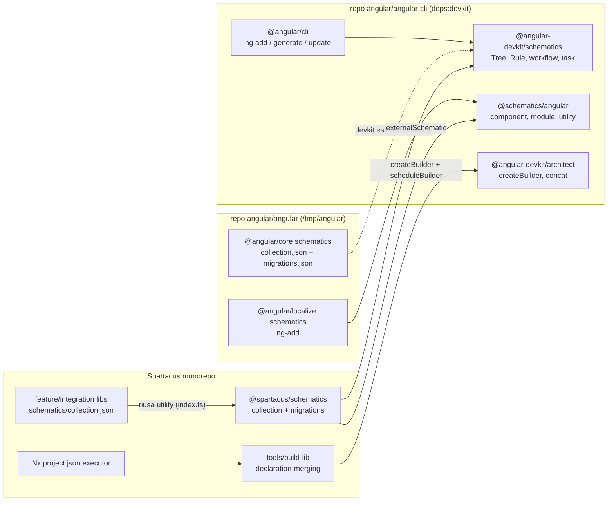
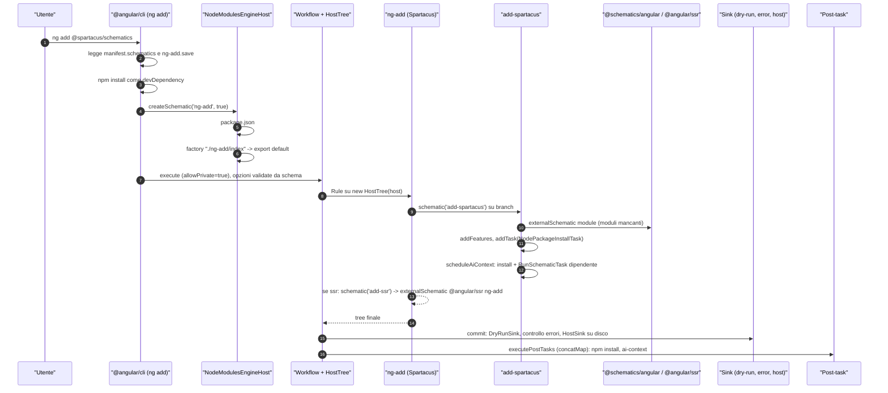
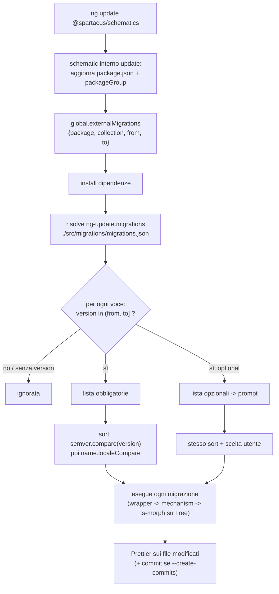
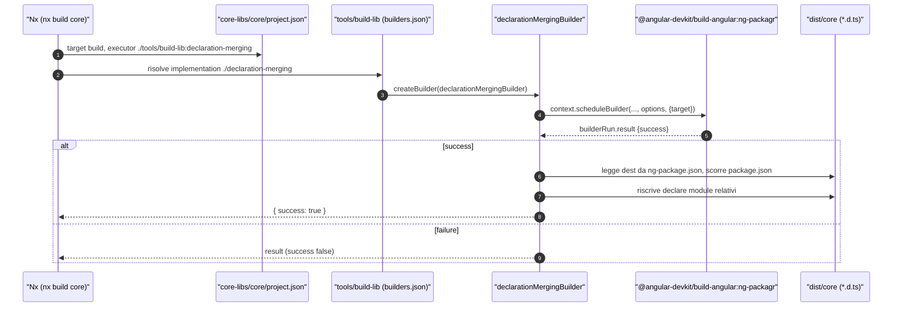

# 08 — Schematics e builder

> Riferimenti allo SHA `5b7a1c2bf2808d7380bc20596d10f4fa710c3da1` (vedi [00-meta](../00-meta.md)).
> Angular @ `v21.2.23` (prefisso `angular:`). Il devkit (`@angular-devkit/schematics` 21.2.23, `@angular-devkit/architect` 0.2102.23, `@schematics/angular` 21.2.23, `@angular/cli` 21.2.23) **non** sta in `/tmp/angular`: proviene dal repo `angular/angular-cli` ed è letto dai pacchetti npm pubblicati (codice JS compilato e `.d.ts`), con prefisso `deps:devkit/...` (path relativi a `/tmp/deps`).

## 1. A cosa serve e perché esiste

Un framework come Spartacus non vive solo di codice runtime: deve anche **installarsi** in un'applicazione Angular esistente, **aggiornarla** tra una versione e l'altra e farsi **compilare** in pacchetti npm. Angular offre per questo due meccanismi distinti, entrambi nati nel repo `angular/angular-cli`:

1. **Schematics** — trasformazioni di codice dichiarative su un file system *virtuale* (`Tree`). Sono il motore dietro `ng add`, `ng generate` e `ng update`. Una schematic è una funzione `RuleFactory<T> = (options: T) => Rule`, e una `Rule` è `(tree, context) => Tree | Observable<Tree> | Rule | Promise<...> | void` (`deps:devkit/angular-devkit-schematics-21.2.23/package/src/engine/interface.d.ts:L137-L137`, `deps:devkit/angular-devkit-schematics-21.2.23/package/src/engine/interface.d.ts:L153-L154`). Le modifiche restano in memoria fino alla fine e vengono scritte su disco solo se tutto è andato a buon fine e non si è in dry-run (`deps:devkit/angular-devkit-schematics-21.2.23/package/src/workflow/base.js:L77-L100`).
2. **Builder (Architect)** — l'astrazione con cui un *target* di un progetto (`build`, `test`, `serve`, …) viene eseguito: una funzione `(options, context) => BuilderOutput | Promise | Observable | AsyncIterable` trasformata in handler da `createBuilder` (`deps:devkit/angular-devkit-architect-0.2102.23/package/src/create-builder.js:L18-L21`, `deps:devkit/angular-devkit-architect-0.2102.23/package/src/create-builder.js:L137-L149`).

**Dove sta il codice.** In `/tmp/angular` (repo `angular/angular`) ci sono solo gli *schematics dei pacchetti framework*: `packages/core/schematics` (migrazioni `ng update` e generatori `ng generate @angular/core:*`) e `packages/localize/schematics` (`ng add @angular/localize`) (`angular:packages/core/schematics/collection.json:L1-L85`, `angular:packages/localize/schematics/collection.json:L1-L10`). Il **motore** degli schematics, il runner dei builder, la collection del CLI (`component`, `module`, …) e la logica dei comandi `ng add`/`ng update` stanno invece nel repo `angular/angular-cli`, pubblicati come `@angular-devkit/schematics`, `@angular-devkit/architect`, `@schematics/angular`, `@angular/cli`. Gli schematics di core lo dichiarano esplicitamente lasciando il devkit *esterno* al bundle: lo usano dal progetto ospite (`angular:packages/core/schematics/rollup.config.js:L56-L58`).

Spartacus usa entrambi i meccanismi:

- pubblica il pacchetto `@spartacus/schematics`, che si aggancia a `ng add` (installazione), `ng generate` (generatori) e `ng update` (migrazioni) tramite i campi `schematics`, `ng-add` e `ng-update` del proprio `package.json` (`core-libs/schematics/package.json:L43-L90`); ogni feature/integration lib ha in più una propria piccola collection (`feature-libs/cart/schematics/collection.json:L3-L17`);
- nel monorepo, i target delle librerie e dell'app demo sono eseguiti da Nx tramite `project.json` con chiave `executor`, che punta a builder Architect ufficiali, di terze parti o **locali** (`tools/build-lib`) (`nx.json:L6-L23`, `core-libs/core/project.json:L8-L19`, `tools/build-lib/builders.json:L1-L14`).

Questo capitolo spiega il **meccanismo** (devkit, CLI, Architect) e mostra *a grandi linee* come Spartacus lo sfrutta. I dettagli di ogni schematic Spartacus (`add-spartacus`, `add-ssr`, `wrapper-module`, dati di deprecazione, `modernize-app-*`, `ai-context`) sono in [43 — Schematics e migrazioni di Spartacus](../parte-2/43-schematics-migrazioni.md); i test e il tooling Nx in [44 — Strategia di test e tooling del monorepo](../parte-2/44-test-tooling.md); l'SSR aggiunto da `add-ssr` in [07 — SSR, hydration e TransferState](07-ssr-hydration-transferstate.md).

## 2. Mappa dei file

| Path | Ruolo |
|---|---|
| `angular:packages/core/package.json` | campi `schematics`, `ng-update.migrations`, `exports ./schematics/*` di `@angular/core` |
| `angular:packages/core/schematics/collection.json` | 14 schematics `ng generate @angular/core:*` |
| `angular:packages/core/schematics/migrations.json` | 6 migrazioni `ng update` versione `21.0.0` |
| `angular:packages/core/schematics/BUILD.bazel`, `angular:packages/core/schematics/rollup.config.js` | bundling dei sorgenti in `bundles/*.cjs` (devkit esterno) |
| `angular:packages/core/schematics/migrations/application-config-core/index.ts` | esempio di migrazione: `migrate(): Rule` che delega a Tsurge |
| `angular:packages/core/schematics/utils/tsurge/helpers/angular_devkit/run_in_devkit.ts` | `runMigrationInDevkit`: analyze → combine → migrate → `tree.beginUpdate` |
| `angular:packages/core/schematics/utils/project_tsconfig_paths.ts` | tsconfig dei target `build`/`test` letti dal workspace |
| `angular:packages/core/schematics/utils/typescript/compiler_host.ts` | `ts.Program` costruito sul `Tree`, `canMigrateFile` |
| `angular:packages/core/schematics/ng-generate/inject-migration/index.ts`, `schema.json` | esempio di generatore con `x-prompt` |
| `angular:packages/localize/schematics/ng-add/index.ts` | `ng add @angular/localize` con le utility di `@schematics/angular` |
| `deps:devkit/angular-devkit-schematics-21.2.23/package/src/tree/interface.d.ts` | `Tree`, `UpdateRecorder`, `MergeStrategy` |
| `deps:devkit/angular-devkit-schematics-21.2.23/package/src/engine/interface.d.ts` | tipi `Rule`, `Source`, `RuleFactory`, `SchematicContext` |
| `deps:devkit/angular-devkit-schematics-21.2.23/package/src/rules/base.js`, `call.js`, `schematic.js` | `chain`, `noop`, `mergeWith`, `branchAndMerge`, normalizzazione dei risultati, `schematic`/`externalSchematic` |
| `deps:devkit/angular-devkit-schematics-21.2.23/package/src/workflow/base.js`, `deps:devkit/angular-devkit-schematics-21.2.23/package/src/sink/host.js` | esecuzione, sink (dry-run, errori, disco), post-task |
| `deps:devkit/angular-devkit-schematics-21.2.23/package/src/engine/engine.js` | `createSchematic` (privati), scheduler delle task |
| `deps:devkit/angular-devkit-schematics-21.2.23/package/tools/node-module-engine-host.js`, `export-ref.js`, `file-system-engine-host-base.js` | risoluzione collection da `node_modules`, `factory` `path#export`, alias, privati/hidden |
| `deps:devkit/angular-devkit-schematics-21.2.23/package/tasks/package-manager/install-task.js`, `deps:devkit/angular-devkit-schematics-21.2.23/package/tasks/run-schematic/task.js` | `NodePackageInstallTask`, `RunSchematicTask` |
| `deps:devkit/angular-cli-21.2.23/package/src/commands/add/cli.js` | logica `ng add` |
| `deps:devkit/angular-cli-21.2.23/package/src/commands/update/cli.js`, `deps:devkit/angular-cli-21.2.23/package/src/commands/update/utilities/migration.js`, `deps:devkit/angular-cli-21.2.23/package/src/commands/update/schematic/index.js` | logica `ng update`: package group, selezione e ordinamento migrazioni |
| `deps:devkit/schematics-angular-21.2.23/package/collection.json`, `deps:devkit/schematics-angular-21.2.23/package/utility/workspace-models.d.ts` | collection del CLI, enum dei builder ufficiali |
| `deps:devkit/angular-devkit-architect-0.2102.23/package/src/create-builder.js`, `deps:devkit/angular-devkit-architect-0.2102.23/package/builders/concat.js` | `createBuilder`, builder `concat` |
| `package.json` (root) | versioni devkit/CLI/Nx, script `build:*`, `build:schematics`, `generate:deps`, `test:schematics` |
| `nx.json` | `targetDefaults` Nx |
| `core-libs/schematics/package.json` | metadati `schematics` / `ng-add` / `ng-update`, peer deps devkit |
| `core-libs/schematics/src/collection.json` | registro schematics Spartacus (`ng add`, `ng generate`) |
| `core-libs/schematics/src/migrations/migrations.json` | registro migrazioni `ng update` Spartacus |
| `core-libs/schematics/src/ng-add/index.ts` | entry di `ng add @spartacus/schematics` |
| `core-libs/schematics/src/shared/utils/lib-utils.ts`, `feature-utils.ts`, `new-module-utils.ts` | `SchematicConfig`, task di install, `addFeatures`, `ensureModuleExists` |
| `core-libs/schematics/src/shared/utils/program.ts`, `tree-file-system.ts` | ts-morph sopra il `Tree` |
| `core-libs/schematics/src/shared/utils/workspace-utils.ts` | lettura di `angular.json`, progetto di default |
| `core-libs/schematics/index.ts` | utility esportate agli schematics delle altre librerie (non stabile) |
| `feature-libs/cart/schematics/collection.json`, `feature-libs/cart/ng-package.json` | esempio di collection di feature lib e suo impacchettamento |
| `core-libs/*/project.json`, `projects/storefrontapp/project.json` | target Nx ed executor |
| `tools/build-lib/package.json`, `tools/build-lib/builders.json`, `tools/build-lib/declaration-merging/index.ts`, `tools/build-lib/augmented-types/index.ts` | builder Architect locali |
| `projects/storefrontapp/esbuild/plugins.ts` | plugin esbuild per `@angular-builders/custom-esbuild` |

## 3. Come funziona passo per passo

### 3.1 Come un pacchetto npm "si dichiara" al CLI

Il CLI non conosce a priori gli schematics di un pacchetto: li scopre leggendo il suo `package.json`.

- **Collection.** Il campo `schematics` indica il file `collection.json`. L'engine host risolve `require.resolve('<nome>/package.json')`, legge `schematics` e, se è un path relativo, lo risolve rispetto alla cartella del pacchetto; se il campo manca lancia `NodePackageDoesNotSupportSchematics` (`deps:devkit/angular-devkit-schematics-21.2.23/package/tools/node-module-engine-host.js:L46-L62`). `@angular/core` dichiara `"schematics": "./schematics/collection.json"` (`angular:packages/core/package.json:L39-L49`); Spartacus `"schematics": "./src/collection.json"` (`core-libs/schematics/package.json:L90-L90`).
- **Migrazioni.** Il campo `ng-update.migrations` punta a un secondo file di collection, usato solo da `ng update`. Il CLI rifiuta path assoluti o che escono dalla root del pacchetto (`deps:devkit/angular-cli-21.2.23/package/src/commands/update/cli.js:L252-L271`). Core: `./schematics/migrations.json` (`angular:packages/core/package.json:L39-L42`); Spartacus: `./src/migrations/migrations.json` (`core-libs/schematics/package.json:L46-L47`).
- **Package group.** `ng-update.packageGroup` (array o mappa) elenca i pacchetti che vanno aggiornati insieme al "capogruppo" (`deps:devkit/angular-cli-21.2.23/package/src/commands/update/schematic/index.js:L284-L306`, `deps:devkit/angular-cli-21.2.23/package/src/commands/update/schematic/index.js:L358-L375`). `@spartacus/schematics` elenca 39 pacchetti `@spartacus/*` (`core-libs/schematics/package.json:L48-L88`).
- **Salvataggio di `ng add`.** `ng-add.save` decide dove finisce la dipendenza: il CLI legge `manifest['ng-add']?.save` e installa come devDependency quando vale `'devDependencies'` (`deps:devkit/angular-cli-21.2.23/package/src/commands/add/cli.js:L425-L426`, `deps:devkit/angular-cli-21.2.23/package/src/commands/add/cli.js:L473-L473`). Sia `@angular/localize` sia `@spartacus/schematics` usano `devDependencies` (`angular:packages/localize/package.json:L25-L31`, `core-libs/schematics/package.json:L43-L45`).

### 3.2 La collection: factory, schema, alias, privati

Ogni voce di `collection.json` ha almeno `factory` e (opzionalmente) `schema`, `aliases`, `private`, `hidden`:

- `factory` è nella forma `"<percorso>#<export>"`: `ExportStringRef` divide sulla `#`, risolve il modulo con `require.resolve` e prende l'export nominato o `default` se manca (`deps:devkit/angular-devkit-schematics-21.2.23/package/tools/export-ref.js:L16-L27`). Gli schematics di core puntano a bundle CommonJS (`./bundles/inject-migration.cjs#migrate`) generati da Rollup in Bazel (`angular:packages/core/schematics/collection.json:L2-L84`, `angular:packages/core/schematics/BUILD.bazel:L63-L67`, `angular:packages/core/schematics/BUILD.bazel:L142-L187`); lo `ng-add` di Spartacus usa `"./ng-add/index"` senza `#`, quindi l'export `default` (`core-libs/schematics/src/collection.json:L4-L11`).
- `schema` è un JSON Schema: `NodeWorkflow` registra una trasformazione che valida le opzioni contro di esso, e il workflow base aggiunge i default non definiti (`addUndefinedDefaults`) (`deps:devkit/angular-devkit-schematics-21.2.23/package/tools/workflow/node-workflow.js:L57-L57`, `deps:devkit/angular-devkit-schematics-21.2.23/package/src/workflow/base.js:L48-L48`). Gli schema possono contenere `x-prompt` per chiedere interattivamente le opzioni (`angular:packages/core/schematics/ng-generate/inject-migration/schema.json:L1-L32`, `core-libs/schematics/src/add-spartacus/schema.json:L94-L96`). ⚠️ DA VERIFICARE: il *prompt provider* del CLI e la risoluzione di `$default.$source: projectName` stanno nel registry di `@angular-devkit/core`/CLI, non letti riga per riga.
- `aliases` vengono risolti prima del nome (`deps:devkit/angular-devkit-schematics-21.2.23/package/tools/file-system-engine-host-base.js:L146-L153`): per questo `ng g @spartacus/schematics:spa` equivale ad `add-spartacus` (`core-libs/schematics/src/collection.json:L12-L17`).
- `private` e `hidden`: `listSchematicNames` esclude i privati e (salvo richiesta) gli hidden (`deps:devkit/angular-devkit-schematics-21.2.23/package/tools/file-system-engine-host-base.js:L87-L102`); `createSchematic` lancia `PrivateSchematicException` se lo schematic è privato e non è stato chiesto `allowPrivate` (`deps:devkit/angular-devkit-schematics-21.2.23/package/src/engine/engine.js:L226-L256`). Il workflow consente i privati se richiesto esplicitamente o se il chiamante appartiene alla stessa collection (`deps:devkit/angular-devkit-schematics-21.2.23/package/src/workflow/base.js:L108-L110`).

### 3.3 Il modello di esecuzione: Tree, Rule, chain, merge

1. **Tree virtuale.** Il workflow crea un `new HostTree(this._host)` sul workspace (`deps:devkit/angular-devkit-schematics-21.2.23/package/src/workflow/base.js:L121-L121`). `HostTree` registra tutte le modifiche in un `CordHost` sopra un host di sola lettura: nessuna regola tocca il disco (`deps:devkit/angular-devkit-schematics-21.2.23/package/src/tree/host-tree.js:L85-L86`). L'interfaccia `Tree` offre lettura (`read`, `readText`, `readJson`, `exists`, `get`, `getDir`, `visit`), scrittura (`create`, `overwrite`, `delete`, `rename`), aggiornamenti per offset (`beginUpdate`/`commitUpdate` con `UpdateRecorder`), `branch`/`merge` e l'elenco `actions` (`deps:devkit/angular-devkit-schematics-21.2.23/package/src/tree/interface.d.ts:L38-L77`, `deps:devkit/angular-devkit-schematics-21.2.23/package/src/tree/interface.d.ts:L82-L86`).
2. **Normalizzazione del risultato di una Rule.** `callRuleAsync` esegue la regola; finché il risultato è una funzione la richiama (una `Rule` può restituire un'altra `Rule`), `undefined` significa "tree invariato", un Observable viene ridotto all'ultimo valore, altrimenti serve un `Tree` o parte `InvalidRuleResultException` (`deps:devkit/angular-devkit-schematics-21.2.23/package/src/rules/call.js:L76-L92`).
3. **Composizione.** `chain(rules)` esegue le regole in sequenza passando a ciascuna il tree prodotto dalla precedente, e restituisce a sua volta una funzione `() => intermediateTree` che il ciclo del punto 2 risolve (`deps:devkit/angular-devkit-schematics-21.2.23/package/src/rules/base.js:L46-L61`). `noop()` non restituisce nulla, quindi lascia il tree invariato (`deps:devkit/angular-devkit-schematics-21.2.23/package/src/rules/base.js:L76-L78`). `mergeWith(source, strategy)` fonde un tree generato (es. da template); `branchAndMerge(rule, strategy)` esegue la regola su `tree.branch()` e poi fa `merge` (`deps:devkit/angular-devkit-schematics-21.2.23/package/src/rules/base.js:L71-L75`, `deps:devkit/angular-devkit-schematics-21.2.23/package/src/rules/base.js:L92-L96`).
4. **Conflitti.** `MergeStrategy` stabilisce come risolverli: `Default=0`, `Error=1`, `AllowOverwriteConflict=2` (= `ContentOnly`), `AllowCreationConflict=4`, `AllowDeleteConflict=8`, `Overwrite=14` (`deps:devkit/angular-devkit-schematics-21.2.23/package/src/tree/interface.d.ts:L10-L18`).
5. **Schematics che chiamano schematics.** `schematic(name, options)` invoca uno schematic della *stessa* collection (privati inclusi) su un ramo del tree e fa merge con `AllowOverwriteConflict` (`deps:devkit/angular-devkit-schematics-21.2.23/package/src/rules/schematic.js:L38-L49`). `externalSchematic(collection, name, options)` crea la collection per nome (risolta come pacchetto npm), non passa `allowPrivate` e fa lo stesso merge (`deps:devkit/angular-devkit-schematics-21.2.23/package/src/rules/schematic.js:L22-L31`).
6. **Context.** `SchematicContext` espone `debug`, `engine`, `logger`, `schematic`, `strategy`, `interactive` e `addTask(task, dependencies?)` (`deps:devkit/angular-devkit-schematics-21.2.23/package/src/engine/interface.d.ts:L119-L132`).

### 3.4 Fine della schematic: sink e post-task

1. Il tree finale passa per tre "sink" in sequenza: un `DryRunSink` che emette il report degli eventi, un sink che fallisce con `UnsuccessfulWorkflowExecution` se è stato segnalato un errore, e infine un `HostSink` che scrive su disco **solo se non è dry-run** (`deps:devkit/angular-devkit-schematics-21.2.23/package/src/workflow/base.js:L77-L100`, `deps:devkit/angular-devkit-schematics-21.2.23/package/src/workflow/base.js:L121-L124`).
2. Il `HostSink` applica nell'ordine cancellazioni, rinomine, creazioni, aggiornamenti (`deps:devkit/angular-devkit-schematics-21.2.23/package/src/sink/host.js:L71-L71`).
3. Solo dopo il commit, e mai in dry-run, il workflow esegue `engine.executePostTasks()` (`deps:devkit/angular-devkit-schematics-21.2.23/package/src/workflow/base.js:L125-L133`). Le task sono schedulate da `TaskScheduler.schedule` con id progressivo e priorità calcolata dalle dipendenze, **senza deduplicazione** (`deps:devkit/angular-devkit-schematics-21.2.23/package/src/engine/engine.js:L89-L137`), ed eseguite in sequenza con `concatMap`, riusando un executor per nome (`deps:devkit/angular-devkit-schematics-21.2.23/package/src/engine/engine.js:L283-L297`).
4. Due task standard: `NodePackageInstallTask` (`{name: NodePackageName, options: {command: 'install', ...}}`, default `quiet`/`hideOutput` `true`, `allowScripts` `false`) (`deps:devkit/angular-devkit-schematics-21.2.23/package/tasks/package-manager/install-task.js:L12-L58`) e `RunSchematicTask(collection?, schematic, options)`, che pianifica l'esecuzione di uno schematic *dopo* il commit; con due argomenti la collection è `null`, cioè la stessa (`deps:devkit/angular-devkit-schematics-21.2.23/package/tasks/run-schematic/task.js:L12-L33`).

### 3.5 I comandi del CLI

- **`ng add <pkg>`.** Usa lo schematic `ng-add` con `allowPrivateSchematics = true`, mentre gli altri comandi schematic hanno `false` (`deps:devkit/angular-cli-21.2.23/package/src/commands/add/cli.js:L98-L99`, `deps:devkit/angular-cli-21.2.23/package/src/command-builder/schematics-command-module.js:L112-L112`, `deps:devkit/angular-cli-21.2.23/package/src/command-builder/schematics-command-module.js:L341-L341`). Dopo l'installazione verifica l'esistenza di `ng-add` con `collection.createSchematic('ng-add', true)` perché "Most `ng-add` schematics are marked as private" (`deps:devkit/angular-cli-21.2.23/package/src/commands/add/cli.js:L216-L225`).
- **`ng generate <collection>:<name>`.** Passa per `SchematicsCommandModule` con `allowPrivate: this.allowPrivateSchematics` = `false` (`deps:devkit/angular-cli-21.2.23/package/src/command-builder/schematics-command-module.js:L339-L343`).
- **`ng update <pkg>`.** Lo schematic interno di update aggiorna `package.json` (inclusi i pacchetti del group) e passa al CLI, tramite `global.externalMigrations`, l'elenco `{package, collection, from, to}`; il CLI esegue le migrazioni dopo l'installazione (`deps:devkit/angular-cli-21.2.23/package/src/commands/update/schematic/index.js:L252-L272`, `deps:devkit/angular-cli-21.2.23/package/src/commands/update/cli.js:L440-L501`). `executeMigrations` seleziona le voci con `version` nell'intervallo semver `(from, to]`, le divide in obbligatorie e `optional`, le ordina per versione e poi per **nome** (`localeCompare`) (`deps:devkit/angular-cli-21.2.23/package/src/commands/update/utilities/migration.js:L105-L142`). Le opzionali sono proposte con un prompt a scelta multipla (`deps:devkit/angular-cli-21.2.23/package/src/commands/update/utilities/migration.js:L232-L255`). Dopo ogni migrazione i file modificati sono formattati con Prettier e, con `--create-commits`, si crea un commit per migrazione (`deps:devkit/angular-cli-21.2.23/package/src/commands/update/utilities/migration.js:L166-L190`). Il blocco "un major alla volta" vale solo per `@angular/*` e `@nguniversal/*` (`deps:devkit/angular-cli-21.2.23/package/src/commands/update/cli.js:L353-L373`, `deps:devkit/angular-cli-21.2.23/package/src/commands/update/utilities/constants.js:L15-L15`).
- Le migrazioni del CLI stesso stanno in `@schematics/angular/migrations/migration-collection.json`, collegate da `@angular/cli` via `ng-update.migrations` (`deps:devkit/angular-cli-21.2.23/package/package.json:L47-L51`, `deps:devkit/schematics-angular-21.2.23/package/migrations/migration-collection.json:L1-L28`).

### 3.6 Cosa c'è in `/tmp/angular`: gli schematics di `@angular/core` e `@angular/localize`

- **Collection e migrazioni.** `@angular/core` registra 14 schematics "generate" (es. `standalone-migration`, `inject-migration`, `signal-input-migration`, `control-flow-migration`, `cleanup-unused-imports`) (`angular:packages/core/schematics/collection.json:L2-L84`) e 6 migrazioni `21.0.0` (`control-flow-migration`, `router-current-navigation` opzionale, `router-last-successful-navigation`, `application-config-core`, `add-bootstrap-context-to-server-main`, `bootstrap-options-migration`) (`angular:packages/core/schematics/migrations.json:L2-L34`). `control-flow-migration` è sia generatore sia migrazione (`angular:packages/core/schematics/collection.json:L61-L66`, `angular:packages/core/schematics/migrations.json:L3-L7`).
- **Struttura.** Sorgenti TS in `migrations/<nome>/index.ts` e `ng-generate/<nome>/index.ts`; Bazel+Rollup li impacchettano in `bundles/<nome>.cjs` (CommonJS, senza sourcemap) (`angular:packages/core/schematics/BUILD.bazel:L142-L187`), lasciando esterni `typescript`, `tslib`, `@angular-devkit/*` e `@angular/*` (`angular:packages/core/schematics/rollup.config.js:L56-L58`).
- **Tsurge.** Una migrazione è `migrate(): Rule` che delega a `runMigrationInDevkit` (`angular:packages/core/schematics/migrations/application-config-core/index.ts:L9-L20`). Tsurge divide le migrazioni in analyze, merge e migrate, pensate anche per worker separati, con le varianti `TsurgeFunnelMigration` e `TsurgeComplexMigration` (`angular:packages/core/schematics/utils/tsurge/migration.ts:L18-L44`, `angular:packages/core/schematics/utils/tsurge/migration.ts:L58-L100`). `runMigrationInDevkit` ricava i tsconfig dal workspace (lanciando `SchematicsException` se non ne trova), crea un programma per ciascuno, assegna ogni file sorgente a una sola unità di compilazione, esegue `analyze`, combina, calcola `globalMeta`, ottiene le `replacements` e le applica al `Tree` (`angular:packages/core/schematics/utils/tsurge/helpers/angular_devkit/run_in_devkit.ts:L60-L139`, `angular:packages/core/schematics/utils/tsurge/helpers/angular_devkit/run_in_devkit.ts:L63-L67`, `angular:packages/core/schematics/utils/tsurge/helpers/angular_devkit/run_in_devkit.ts:L141-L173`).
- **TypeScript sul Tree.** `getProjectTsConfigPaths` legge il workspace dal `Tree` e raccoglie i `tsConfig` dei soli target `build` e `test` (`angular:packages/core/schematics/utils/project_tsconfig_paths.ts:L16-L51`); il `ts.Program` viene costruito sul contenuto del `Tree` sovrascrivendo `host.readFile` (`angular:packages/core/schematics/utils/typescript/compiler_host.ts:L71-L103`); `canMigrateFile` esclude `.d.ts`, `.ngtypecheck.ts`, librerie esterne e file fuori dalla root (`angular:packages/core/schematics/utils/typescript/compiler_host.ts:L111-L131`).
- **Localize.** `ng add @angular/localize` è una `chain` di tre regole (types nei tsconfig, polyfill `@angular/localize/init`, eventuale spostamento in `dependencies`) (`angular:packages/localize/schematics/ng-add/index.ts:L168-L182`) costruita con le utility pubbliche di `@schematics/angular/utility` e con l'enum `AngularBuilder` per riconoscere i builder dei target (`angular:packages/localize/schematics/ng-add/index.ts:L11-L19`, `angular:packages/localize/schematics/ng-add/index.ts:L27-L63`, `deps:devkit/schematics-angular-21.2.23/package/utility/workspace-models.d.ts:L18-L38`).
- **Test.** Le migrazioni di core si testano con `SchematicTestRunner` puntato su `migrations.json` (`angular:packages/core/schematics/test/application_config_core_spec.ts:L30-L34`).

### 3.7 Spartacus: il pacchetto `@spartacus/schematics`

1. **Dipendenze.** Il monorepo installa `@angular-devkit/schematics ~21.2.23`, `@angular-devkit/core ~21.2.23`, `@schematics/angular ~21.2.23`, `@angular/cli ^21.2.23`, `@angular-devkit/build-angular 21.2.23`, `@angular-builders/custom-esbuild ^21.0.3`, `ng-packagr ^21.2.3`, `nx ^22.7.6` (`package.json:L201-L221`, `package.json:L271-L273`). Il pacchetto `@spartacus/schematics` dichiara il devkit come `peerDependencies`: il motore è quello del progetto ospite (`core-libs/schematics/package.json:L26-L34`); a runtime porta `@angular/pwa`, `@angular/ssr`, `semver`, `ts-morph`, `tslib` (`core-libs/schematics/package.json:L19-L25`).
2. **Build e pubblicazione.** Non passa per ng-packagr: è compilato con `tsc -p ./tsconfig.schematics.json` dopo `generate:deps` (`core-libs/schematics/package.json:L12-L14`), in CommonJS, escludendo template, spec e dati di test (`core-libs/schematics/tsconfig.schematics.json:L2-L29`). `.npmignore` esclude i `.ts` non dichiarazione: si pubblica il JS accanto ai sorgenti (`core-libs/schematics/.npmignore:L1-L14`). `src/dependencies.json` (pacchetto → peerDependencies) è generato da `tools/schematics/dependency-collector.ts` (`tools/schematics/dependency-collector.ts:L21-L21`, `package.json:L64-L64`, `core-libs/schematics/src/shared/utils/package-utils.ts:L21-L21`).
3. **Collection.** 9 voci: `ng-add` (private, hidden, alias `install`), `add-spartacus` (`spa`), `add-ssr` (`ssr`), `add-cms-component` (`cms`), `wrapper-module` (`wrapper`), `ai-context` (`ai`) e tre `modernize-app-*` (`core-libs/schematics/src/collection.json:L3-L53`). `ng-add`, `add-spartacus` e `add-ssr` condividono `./add-spartacus/schema.json` (`core-libs/schematics/src/collection.json:L4-L23`); `wrapper-module` e `modernize-app-*` non hanno `schema` (`core-libs/schematics/src/collection.json:L30-L52`).
4. **`ng-add`.** È una `chain` di `schematic('add-spartacus')` e, se `options.ssr`, `schematic('add-ssr')` (`core-libs/schematics/src/ng-add/index.ts:L17-L24`). Lo schema prende `project` dal progetto corrente, ha `features` con `x-prompt`, `lazy` (default `true`), `ssr` (default `false`), `aiTools` (default `["agents"]`) (`core-libs/schematics/src/add-spartacus/schema.json:L3-L13`, `core-libs/schematics/src/add-spartacus/schema.json:L338-L342`, `core-libs/schematics/src/add-spartacus/schema.json:L381-L385`, `core-libs/schematics/src/add-spartacus/schema.json:L390-L414`); il tipo TS è scritto a mano (`core-libs/schematics/src/add-spartacus/schema.ts:L7-L12`).
5. **`addSpartacus`.** Una lunga `chain`: struttura app, app module/config, store, `SpartacusModule`, features module, configurazione, feature toggles, stili, budget, feature, AI context, dipendenze, install, `finalizeInstallation` (`core-libs/schematics/src/add-spartacus/index.ts:L531-L592`). L'install npm è una task: `installPackageJsonDependencies()` → `context.addTask(new NodePackageInstallTask())` (`core-libs/schematics/src/shared/utils/lib-utils.ts:L730-L741`).
6. **Composizione con altri schematics.** I moduli mancanti si creano con `externalSchematic('@schematics/angular', 'module', {…, flat: true, typeSeparator: '.'})`, oppure `noop()` se il file ha già un `@NgModule` (`core-libs/schematics/src/shared/utils/new-module-utils.ts:L40-L77`, `core-libs/schematics/src/shared/constants.ts:L10-L10`); `add-cms-component` usa `@schematics/angular:module|component` (`core-libs/schematics/src/add-cms-component/index.ts:L412-L424`); `addSSR` invoca `externalSchematic('@angular/ssr', 'ng-add', {project})` e poi fonde i template con `MergeStrategy.Overwrite` (`core-libs/schematics/src/add-ssr/index.ts:L437-L465`, `core-libs/schematics/src/shared/constants.ts:L15-L15`).
7. **Feature senza schematics di libreria.** `addFeatures` *non* chiama gli schematics delle feature lib: per ogni feature prende il `SchematicConfig` da `featureSchematicConfigMapping`, applica in-process `addLibraryFeature` e, per gli `importAfter`, `externalSchematic('@spartacus/schematics', 'wrapper-module', …)`; una feature senza configurazione provoca `SchematicsException` (`core-libs/schematics/src/shared/utils/feature-utils.ts:L102-L153`, `core-libs/schematics/src/shared/utils/feature-utils.ts:L125-L132`). `SchematicConfig` descrive una feature in modo dichiarativo (`core-libs/schematics/src/shared/utils/lib-utils.ts:L115-L199`); `LibraryOptions` estende `Partial<ExecutionOptions>` del devkit (`core-libs/schematics/src/shared/utils/lib-utils.ts:L85-L110`).
8. **Task concatenate.** `scheduleAiContext` pianifica un `NodePackageInstallTask` e poi `RunSchematicTask('ai-context', …)` *dipendente* dal suo id, così la copia delle skill avviene dopo l'install di `@spartacus/skills` (`core-libs/schematics/src/add-spartacus/ai-context.ts:L50-L74`). La migrazione `add-or-update-ai-skills` usa lo stesso schema (`core-libs/schematics/src/migrations/add-or-update-ai-skills/ai-context.utils.ts:L107-L114`).
9. **ts-morph sopra il Tree.** Invece del `ts.Program` "nudo" di core, Spartacus crea un `Project` ts-morph il cui file system è `TreeFileSystem`, che inoltra letture e scritture al `Tree` (`core-libs/schematics/src/shared/utils/program.ts:L11-L35`, `core-libs/schematics/src/shared/utils/tree-file-system.ts:L12-L157`); `saveAndFormat` organizza gli import, formatta e salva (cioè scrive nel `Tree`) (`core-libs/schematics/src/shared/utils/program.ts:L37-L48`).
10. **Workspace.** `getWorkspace` legge `/angular.json` o `/.angular.json` con `jsonc-parser` e lancia `SchematicsException` se non li trova (`core-libs/schematics/src/shared/utils/workspace-utils.ts:L31-L82`); `getDefaultProjectNameFromWorkspace` restituisce la prima chiave di `projects` (`core-libs/schematics/src/shared/utils/workspace-utils.ts:L111-L115`); `getProjectTsConfigPaths` di Spartacus deriva dall'utility Angular (copyright Google LLC) e legge sia `targets` sia `architect` (`core-libs/schematics/src/shared/utils/project-tsconfig-paths.ts:L1-L6`, `core-libs/schematics/src/shared/utils/project-tsconfig-paths.ts:L17-L96`).
11. **API per le altre librerie.** `core-libs/schematics/index.ts` esporta le utility per gli schematics delle feature lib, dichiarandole non stabili (`core-libs/schematics/index.ts:L7-L13`).

### 3.8 Spartacus: migrazioni `ng update`

- `migrations.json` ha 25 voci su 4 versioni: `2211.19.0` (10), `2211.36.0` (4), `221121.7.0` (10), `221121.22.0` (1, `add-or-update-ai-skills`) (`core-libs/schematics/src/migrations/migrations.json:L2-L128`).
- I nomi hanno prefissi numerici `00-`, `01-`, …: poiché il CLI ordina per versione e poi per nome (§3.5), i prefissi **fissano l'ordine** (`core-libs/schematics/src/migrations/migrations.json:L3-L52`, `deps:devkit/angular-cli-21.2.23/package/src/commands/update/utilities/migration.js:L127-L127`).
- Ogni migrazione per versione è un wrapper sottile che passa dati generati a un "mechanism" generico, es. `migrateRenamedSymbols(tree, GENERATED_RENAMED_SYMBOLS_DATA)` (`core-libs/schematics/src/migrations/221121_7/rename-symbol/rename-symbol.ts:L7-L15`), che con ts-morph sostituisce gli import e chiama `saveAndFormat` (`core-libs/schematics/src/migrations/mechanism/rename-symbol/rename-symbol.ts:L14-L85`). I dati sono file generati ("Generated file, don't update manually.") (`core-libs/schematics/src/migrations/221121_7/rename-symbol/data/generated-rename-symbols.migration.ts:L8-L17`).
- Alcune migrazioni modificano direttamente il workspace, es. `221121_7/angular-config` rimuove `index` dal target `build` di `angular.json` con `tree.overwrite` (`core-libs/schematics/src/migrations/221121_7/angular-config/index.ts:L20-L71`); `migrateDependencies` aggiorna `package.json` e pianifica `installPackageJsonDependencies()` (`core-libs/schematics/src/migrations/mechanism/dependency-management/dependency-management.ts:L28-L55`).
- Nessuna feature/integration lib dichiara `ng-update`: tutto è centralizzato in `@spartacus/schematics`, che con `packageGroup` trascina l'aggiornamento delle librerie (`core-libs/schematics/package.json:L46-L89`).
- I test creano un `SchematicTestRunner('migrations', <migrations.json>)` e invocano `runSchematic('<nome>', {}, tree)` (`core-libs/schematics/src/migrations/221121_7/angular-config/index_spec.ts:L7-L50`).

Il catalogo completo delle migrazioni e dei mechanism è in [43 — Schematics e migrazioni di Spartacus](../parte-2/43-schematics-migrazioni.md).

### 3.9 Spartacus: schematics delle feature/integration lib

32 librerie (20 feature-libs, 12 integration-libs) hanno una propria `schematics/collection.json` (glob `feature-libs/*/schematics/collection.json`, `integration-libs/*/schematics/collection.json`). Quella di `@spartacus/cart` ha `ng-add` (private, hidden) e `add`, entrambi su `./add-cart/index#addCartFeatures` (`feature-libs/cart/schematics/collection.json:L3-L17`). `addCartFeatures` valida l'installazione e riusa le utility di `@spartacus/schematics` (`analyzeApplication`, `addFeatures`, `addPackageJsonDependenciesForLibrary`, `finalizeInstallation`) (`feature-libs/cart/schematics/add-cart/index.ts:L13-L43`). Gli schematics di libreria sono compilati con un `tsc` separato (`build:schematics`) e inclusi nel pacchetto ng-packagr come **asset** (`schematics/**/*.json`, `schematics/**/*.js`) (`feature-libs/cart/package.json:L25-L27`, `feature-libs/cart/ng-package.json:L7-L7`); gli script root `build:<lib>` eseguono prima `build:schematics` e poi `nx build <lib>` (`package.json:L23-L23`). `build:libs` costruisce `core` e `storefrontlib`, poi in parallelo `build:schematics` e `build:user`, quindi il resto (`package.json:L35-L35`).

### 3.10 Builder ed executor nel monorepo

1. **Niente `angular.json`.** I target sono definiti nei `project.json` Nx con chiave `executor`; `nx.json` imposta `targetDefaults` (cache, `build.dependsOn: ["^build"]`) e `useInferencePlugins: false` (`nx.json:L6-L23`). ⚠️ DA VERIFICARE: come Nx risolva ed esegua un executor Architect (incluso il path relativo `./tools/build-lib:...`) non è stato verificato sul codice Nx, non scaricato.
2. **Censimento.** Nei 42 `project.json` con executor: `nx:run-commands` 70, `@angular-eslint/builder:lint` 41, `@angular-devkit/build-angular:ng-packagr` 19, `./tools/build-lib:declaration-merging` 18, `@angular-devkit/build-angular:karma` 4, `@angular-devkit/architect:concat` 2, `@angular-builders/custom-esbuild:application` 1, `@angular-builders/custom-esbuild:dev-server` 1, `@nx/jest:jest` 1 (grep `"executor"` su `core-libs feature-libs integration-libs projects tools`, dossier F118).
3. **Librerie.** `core`, `storefrontlib`, `cart` e altre usano il builder locale `./tools/build-lib:declaration-merging`; `setup` e `assets` usano direttamente `@angular-devkit/build-angular:ng-packagr` (`core-libs/core/project.json:L8-L19`, `feature-libs/cart/project.json:L8-L19`, `core-libs/setup/project.json:L8-L19`, `core-libs/assets/project.json:L9-L9`). I test unitari passano per `nx:run-commands` (`npx vitest run --config vitest.config.ts`, `npm run test:schematics`) (`core-libs/core/project.json:L20-L26`, `feature-libs/cart/project.json:L20-L33`). `@spartacus/schematics` non ha target `build` Nx: solo `lint`, `test-jest`, `test-jest-update` (`core-libs/schematics/project.json:L6-L27`); il build è lo script `build:schematics` (`package.json:L50-L50`).
4. **Builder locali.** `tools/build-lib` è un pacchetto di builder Architect (`"builders": "builders.json"`) con `augmented-types` e `declaration-merging` (`tools/build-lib/package.json:L2-L6`, `tools/build-lib/builders.json:L1-L14`). `declaration-merging` è creato con `createBuilder`, esegue `@angular-devkit/build-angular:ng-packagr` via `context.scheduleBuilder(…, {target: context.target})` e, se ha successo, riscrive nei `.d.ts` prodotti le `declare module '<path relativo>'` in `declare module './<typings>'` (`tools/build-lib/declaration-merging/index.ts:L20-L60`, `tools/build-lib/declaration-merging/index.ts:L86-L137`), come workaround del bug ng-packagr #3085 (`tools/build-lib/declaration-merging/index.ts:L22-L28`). `augmented-types` segue lo stesso schema e sposta il blocco tra `/** AUGMENTABLE_TYPES_START */` e `/** AUGMENTABLE_TYPES_END */` nel typings radice (`tools/build-lib/augmented-types/index.ts:L20-L23`, `tools/build-lib/augmented-types/index.ts:L54-L64`, `tools/build-lib/augmented-types/index.ts:L90-L159`).
5. **Architect.** `createBuilder` normalizza il risultato della funzione (BuilderOutput → `of`, AsyncIterable → `fromAsyncIterable`, altro → `from`) e restituisce un oggetto marcato con `BuilderSymbol` (`deps:devkit/angular-devkit-architect-0.2102.23/package/src/create-builder.js:L137-L149`, `deps:devkit/angular-devkit-architect-0.2102.23/package/src/create-builder.js:L172-L178`); se l'Observable si completa senza emettere l'output è `{ success: false }` (`deps:devkit/angular-devkit-architect-0.2102.23/package/src/create-builder.js:L155-L156`). `BuilderContext` offre `scheduleBuilder` (per nome di builder) e `scheduleTarget` (per target del workspace) (`deps:devkit/angular-devkit-architect-0.2102.23/package/src/create-builder.js:L75-L96`, `deps:devkit/angular-devkit-architect-0.2102.23/package/src/api.d.ts:L116-L168`). Il pacchetto fornisce i builder `true`, `false`, `allOf` (parallelo) e `concat` (sequenziale) (`deps:devkit/angular-devkit-architect-0.2102.23/package/builders/builders.json:L3-L24`).
6. **App demo.** `build` usa `@angular-builders/custom-esbuild:application` con `plugins: ["./projects/storefrontapp/esbuild/plugins.ts"]`, `server` e `ssr.entry`; `serve` usa `custom-esbuild:dev-server` (`projects/storefrontapp/project.json:L9-L13`, `projects/storefrontapp/project.json:L142-L146`, `projects/storefrontapp/project.json:L218-L229`). Il plugin copia le variabili `CX_*` in `define['buildProcess.env']`, convertendo `'true'`/`'false'` in booleani (`projects/storefrontapp/esbuild/plugins.ts:L10-L31`). `build-csr` e `prerender` usano `@angular-devkit/architect:concat` per rieseguire `storefrontapp:build` con configurazioni combinate (`projects/storefrontapp/project.json:L190-L217`): `concat` divide la stringa in `project:target:configuration` e chiama `scheduleTarget` in sequenza, fermandosi al primo `success: false` (`deps:devkit/angular-devkit-architect-0.2102.23/package/builders/concat.js:L12-L45`). Il target `test` dell'app usa `@angular-devkit/build-angular:karma` (`projects/storefrontapp/project.json:L230-L253`).

## 4. Diagrammi

### 4.1 Dove vive cosa



Ogni freccia corrisponde a §3.6 (core/localize, `angular:packages/core/schematics/rollup.config.js:L56-L58`, `angular:packages/localize/schematics/ng-add/index.ts:L11-L19`), §3.7 (`core-libs/schematics/package.json:L26-L34`, `core-libs/schematics/src/shared/utils/new-module-utils.ts:L67-L75`), §3.9 (`feature-libs/cart/schematics/add-cart/index.ts:L13-L43`) e §3.10 (`tools/build-lib/declaration-merging/index.ts:L20-L60`).

### 4.2 `ng add @spartacus/schematics`



Passi 2-3: `deps:devkit/angular-cli-21.2.23/package/src/commands/add/cli.js:L425-L426`, `:L473-L473`; 4: `deps:devkit/angular-cli-21.2.23/package/src/commands/add/cli.js:L216-L225`; 5-6: `deps:devkit/angular-devkit-schematics-21.2.23/package/tools/node-module-engine-host.js:L46-L62`, `deps:devkit/angular-devkit-schematics-21.2.23/package/tools/export-ref.js:L16-L27`; 7-8: `deps:devkit/angular-devkit-schematics-21.2.23/package/src/workflow/base.js:L108-L124`; 9-13: `core-libs/schematics/src/ng-add/index.ts:L17-L24`, `core-libs/schematics/src/shared/utils/new-module-utils.ts:L40-L77`, `core-libs/schematics/src/add-spartacus/index.ts:L531-L592`, `core-libs/schematics/src/add-spartacus/ai-context.ts:L54-L74`, `core-libs/schematics/src/add-ssr/index.ts:L437-L465`; 15: `deps:devkit/angular-devkit-schematics-21.2.23/package/src/workflow/base.js:L77-L100`; 16: `deps:devkit/angular-devkit-schematics-21.2.23/package/src/workflow/base.js:L125-L133`, `deps:devkit/angular-devkit-schematics-21.2.23/package/src/engine/engine.js:L283-L297`.

### 4.3 `ng update`: selezione e ordine delle migrazioni



Riferimenti: B-C `deps:devkit/angular-cli-21.2.23/package/src/commands/update/schematic/index.js:L252-L272`, `:L358-L375`; D-E `deps:devkit/angular-cli-21.2.23/package/src/commands/update/cli.js:L440-L501`; F-S2 `deps:devkit/angular-cli-21.2.23/package/src/commands/update/utilities/migration.js:L105-L142`, `:L232-L255`; M `core-libs/schematics/src/migrations/221121_7/rename-symbol/rename-symbol.ts:L11-L15`, `core-libs/schematics/src/shared/utils/program.ts:L11-L35`; P `deps:devkit/angular-cli-21.2.23/package/src/commands/update/utilities/migration.js:L166-L190`.

### 4.4 `nx build core`: builder locale sopra ng-packagr



Riferimenti: `core-libs/core/project.json:L8-L19`, `tools/build-lib/builders.json:L8-L12`, `tools/build-lib/package.json:L6-L6`, `tools/build-lib/declaration-merging/index.ts:L20-L60`, `tools/build-lib/declaration-merging/index.ts:L65-L137`. Il passo 2 (risoluzione da parte di Nx) è ⚠️ DA VERIFICARE sul codice Nx (vedi §3.10).

## 5. Estratti di codice reale

### 5.1 Il contratto Rule / Source / Context

`deps:devkit/angular-devkit-schematics-21.2.23/package/src/engine/interface.d.ts:L119-L154`
```ts
export interface TypedSchematicContext<CollectionMetadataT extends object, SchematicMetadataT extends object> {
    readonly debug: boolean;
    readonly engine: Engine<CollectionMetadataT, SchematicMetadataT>;
    readonly logger: logging.LoggerApi;
    readonly schematic: Schematic<CollectionMetadataT, SchematicMetadataT>;
    readonly strategy: MergeStrategy;
    readonly interactive: boolean;
    addTask<T extends object>(task: TaskConfigurationGenerator<T>, dependencies?: Array<TaskId>): TaskId;
}
// ...
export type RuleFactory<T extends object> = (options: T) => Rule;
// ...
export type Source = (context: SchematicContext) => Tree | Observable<Tree>;
export type Rule = (tree: Tree, context: SchematicContext) => Tree | Observable<Tree> | Rule | Promise<void | Tree | Rule> | void;
```

### 5.2 Come viene normalizzato il valore di una Rule

`deps:devkit/angular-devkit-schematics-21.2.23/package/src/rules/call.js:L76-L92`
```js
async function callRuleAsync(rule, tree, context) {
    let result = await rule(tree, context);
    while (typeof result === 'function') {
        // This is considered a Rule, chain the rule and return its output.
        result = await result(tree, context);
    }
    if (typeof result === 'undefined') {
        return tree;
    }
    if ((0, rxjs_1.isObservable)(result)) {
        result = await (0, rxjs_1.lastValueFrom)(result.pipe((0, rxjs_1.defaultIfEmpty)(tree)));
    }
    if (result && interface_1.TreeSymbol in result) {
        return result;
    }
    throw new InvalidRuleResultException(result);
}
```

### 5.3 `chain` e `noop`

`deps:devkit/angular-devkit-schematics-21.2.23/package/src/rules/base.js:L46-L78`
```js
function chain(rules) {
    return async (initialTree, context) => {
        let intermediateTree;
        if (Symbol.asyncIterator in rules) {
            for await (const rule of rules) {
                intermediateTree = (0, call_1.callRule)(rule, intermediateTree ?? initialTree, context);
            }
        }
        else {
            for (const rule of rules) {
                intermediateTree = (0, call_1.callRule)(rule, intermediateTree ?? initialTree, context);
            }
        }
        return () => intermediateTree;
    };
}
// ...
function noop() {
    return () => { };
}
```

### 5.4 `schematic()` vs `externalSchematic()`

`deps:devkit/angular-devkit-schematics-21.2.23/package/src/rules/schematic.js:L22-L49`
```js
function externalSchematic(collectionName, schematicName, options, executionOptions) {
    return (input, context) => {
        const collection = context.engine.createCollection(collectionName, context.schematic.collection);
        const schematic = collection.createSchematic(schematicName);
        return schematic.call(options, (0, rxjs_1.of)((0, static_1.branch)(input)), context, executionOptions).pipe((0, rxjs_1.last)(), (0, rxjs_1.map)((x) => {
            input.merge(x, interface_1.MergeStrategy.AllowOverwriteConflict);
            return input;
        }));
    };
}
// ...
function schematic(schematicName, options, executionOptions) {
    return (input, context) => {
        const collection = context.schematic.collection;
        const schematic = collection.createSchematic(schematicName, true);
        return schematic.call(options, (0, rxjs_1.of)((0, static_1.branch)(input)), context, executionOptions).pipe((0, rxjs_1.last)(), (0, rxjs_1.map)((x) => {
            // We allow overwrite conflict here because they're the only merge conflict we particularly
            // don't want to deal with; the input tree might have an OVERWRITE which the sub
            input.merge(x, interface_1.MergeStrategy.AllowOverwriteConflict);
            return input;
        }));
    };
}
```

### 5.5 Sink: dry-run, errori, disco

`deps:devkit/angular-devkit-schematics-21.2.23/package/src/workflow/base.js:L77-L100`
```js
    _createSinks() {
        let error = false;
        const dryRunSink = new dryrun_1.DryRunSink(this._host, this._force);
        const dryRunSubscriber = dryRunSink.reporter.subscribe((event) => {
            this._reporter.next(event);
            error = error || event.kind == 'error';
        });
        // We need two sinks if we want to output what will happen, and actually do the work.
        return [
            dryRunSink,
            // Add a custom sink that clean ourselves and throws an error if an error happened.
            {
                commit() {
                    dryRunSubscriber.unsubscribe();
                    if (error) {
                        return (0, rxjs_1.throwError)(new exception_1.UnsuccessfulWorkflowExecution());
                    }
                    return (0, rxjs_1.of)();
                },
            },
            // Only add a HostSink if this is not a dryRun.
            ...(!this._dryRun ? [new host_1.HostSink(this._host, this._force)] : []),
        ];
    }
```

### 5.6 Selezione e ordinamento delle migrazioni

`deps:devkit/angular-cli-21.2.23/package/src/commands/update/utilities/migration.js:L105-L128`
```js
async function executeMigrations(workflow, logger, packageName, collectionPath, from, to, commit = false) {
    const collection = workflow.engine.createCollection(collectionPath);
    const migrationRange = new semver.Range('>' + (semver.prerelease(from) ? from.split('-')[0] + '-0' : from) + ' <=' + to.split('-')[0]);
    const requiredMigrations = [];
    const optionalMigrations = [];
    for (const name of collection.listSchematicNames()) {
        const schematic = workflow.engine.createSchematic(name, collection);
        const description = schematic.description;
        description.version = (0, cli_version_1.coerceVersionNumber)(description.version);
        if (!description.version) {
            continue;
        }
        if (semver.satisfies(description.version, migrationRange, { includePrerelease: true })) {
            (description.optional ? optionalMigrations : requiredMigrations).push(description);
        }
    }
    // ...
        requiredMigrations.sort((a, b) => semver.compare(a.version, b.version) || a.name.localeCompare(b.name));
```

### 5.7 Una migrazione di `@angular/core`

`angular:packages/core/schematics/migrations/application-config-core/index.ts:L9-L20`
```ts
import {Rule} from '@angular-devkit/schematics';
import {ApplicationConfigCoreMigration} from './application-config-core-migration';
import {runMigrationInDevkit} from '../../utils/tsurge/helpers/angular_devkit';

export function migrate(): Rule {
  return async (tree) => {
    await runMigrationInDevkit({
      tree,
      getMigration: () => new ApplicationConfigCoreMigration(),
    });
  };
}
```

`angular:packages/core/schematics/utils/tsurge/helpers/angular_devkit/run_in_devkit.ts:L128-L136`
```ts
  for (const [file, changes] of replacementsPerFile) {
    const recorder = config.tree.beginUpdate(file);
    for (const c of changes) {
      recorder
        .remove(c.data.position, c.data.end - c.data.position)
        .insertRight(c.data.position, c.data.toInsert);
    }
    config.tree.commitUpdate(recorder);
  }
```

### 5.8 Il "manifesto" di `@spartacus/schematics`

`core-libs/schematics/package.json:L43-L90`
```json
  "ng-add": {
    "save": "devDependencies"
  },
  "ng-update": {
    "migrations": "./src/migrations/migrations.json",
    "packageGroup": [
      "@spartacus/core",
      "@spartacus/storefront",
      // ...
      "@spartacus/user"
    ]
  },
  "schematics": "./src/collection.json"
```

`core-libs/schematics/src/collection.json:L3-L17`
```json
  "schematics": {
    "ng-add": {
      "factory": "./ng-add/index",
      "description": "Install and configure spartacus",
      "schema": "./add-spartacus/schema.json",
      "private": true,
      "hidden": true,
      "aliases": ["install"]
    },
    "add-spartacus": {
      "description": "Add spartacus to Angular project.",
      "factory": "./add-spartacus/index#addSpartacus",
      "schema": "./add-spartacus/schema.json",
      "aliases": ["spa"]
    },
```

### 5.9 `ng-add` di Spartacus

`core-libs/schematics/src/ng-add/index.ts:L17-L24`
```ts
export default function (options: SpartacusOptions): Rule {
  return (host: Tree, context: SchematicContext) => {
    return chain([
      schematic('add-spartacus', options),
      options.ssr ? schematic('add-ssr', options) : noop(),
    ])(host, context);
  };
}
```

### 5.10 Task dipendenti: install, poi `ai-context`

`core-libs/schematics/src/add-spartacus/ai-context.ts:L50-L69`
```ts
/**
 * Runs the `ai-context` copy schematic only after the install task, so
 * `@spartacus/skills` is present in `node_modules`.
 */
export function scheduleAiContext(options: SpartacusOptions): Rule {
  return (_tree: Tree, context: SchematicContext): void => {
    const targets = normalize(options.aiTools);
    if (targets.length === 0) {
      return;
    }

    const installTaskId = context.addTask(new NodePackageInstallTask());

    context.addTask(
      new RunSchematicTask('ai-context', {
        aiTools: targets,
        debug: options.debug,
      }),
      [installTaskId]
    );
```

### 5.11 Delegare a `@schematics/angular`

`core-libs/schematics/src/shared/utils/new-module-utils.ts:L50-L76`
```ts
  return (host: Tree): Rule => {
    const modulePath = `${getSourceRoot(host, { project: options.project })}/${
      options.path
    }`;
    const filePath = `${modulePath}/${dasherize(options.name)}.module.ts`;
    if (host.exists(filePath)) {
      const moduleFile = getTsSourceFile(host, filePath);
      const metadata = getDecoratorMetadata(
        moduleFile,
        'NgModule',
        ANGULAR_CORE
      )[0];

      if (metadata) {
        return noop();
      }
    }
    return externalSchematic(ANGULAR_SCHEMATICS, 'module', {
      project: options.project,
      name: dasherize(options.name),
      flat: true,
      commonModule: false,
      path: modulePath,
      module: options.module,
      typeSeparator: '.',
    });
  };
```

### 5.12 ts-morph sul Tree

`core-libs/schematics/src/shared/utils/program.ts:L11-L35`
```ts
export function createProgram(
  tree: Tree,
  basePath: string,
  tsconfigPath: string
): { program: Project; appSourceFiles: SourceFile[] } {
  const fs = new TreeFileSystem(tree, basePath);
  const program = new Project({
    tsConfigFilePath: tsconfigPath,
    fileSystem: fs,
  });
  program.getTypeChecker();

  const appSourceFiles = program.getSourceFiles().filter((sourceFile) => {
    return (
      !sourceFile.isDeclarationFile() &&
      !sourceFile.isFromExternalLibrary() &&
      !sourceFile.isInNodeModules()
    );
  });

  return {
    program,
    appSourceFiles,
  };
}
```

### 5.13 Una migrazione Spartacus: wrapper + mechanism

`core-libs/schematics/src/migrations/221121_7/rename-symbol/rename-symbol.ts:L7-L15`
```ts
import { Rule, Tree } from '@angular-devkit/schematics';
import { migrateRenamedSymbols } from '../../mechanism/rename-symbol/rename-symbol';
import { GENERATED_RENAMED_SYMBOLS_DATA } from './data/generated-rename-symbols.migration';

export function migrate(): Rule {
  return (tree: Tree) => {
    return migrateRenamedSymbols(tree, GENERATED_RENAMED_SYMBOLS_DATA);
  };
}
```

### 5.14 Il builder locale `declaration-merging`

`tools/build-lib/declaration-merging/index.ts:L20-L60`
```ts
export default createBuilder(declarationMergingBuilder);

/**
 * Builder that runs default ng-packagr builder ('@angular-devkit/build-angular:ng-packagr')
 * and performs additional post step to fix paths in declaration merges.
 *
 * It's a workaround to fix paths in declaration merges, reference issues:
 *   - https://github.com/ng-packagr/ng-packagr/issues/3085
 */
function declarationMergingBuilder(
  options: NgPackagrBuilderOptions & JsonObject,
  context: BuilderContext
): Observable<BuilderOutput> {
  return from(ngPackagrBuild(context, options)).pipe(
    switchMap((result) =>
      result.success
        ? from(
            declarationMergingPostStep(
              context,
              options as NgPackagrBuilderOptions
            )
          )
        : of(result)
    )
  );
}

/**
 * Run ng packager build step as is
 */
async function ngPackagrBuild(
  context: BuilderContext,
  options: NgPackagrBuilderOptions & JsonObject
): Promise<BuilderOutput> {
  const builderRun = await context.scheduleBuilder(
    '@angular-devkit/build-angular:ng-packagr',
    options,
    { target: context.target }
  );
  return await builderRun.result;
}
```

`tools/build-lib/builders.json:L1-L14`
```json
{
  "builders": {
    "augmented-types": {
      "implementation": "./augmented-types",
      "schema": "./augmented-types/schema.json",
      "description": "Propagate typing exports to main d.ts file to make them augmentable."
    },
    "declaration-merging": {
      "implementation": "./declaration-merging",
      "schema": "./declaration-merging/schema.json",
      "description": "Fix relative paths used for declaration merging in flattened .d.ts file"
    }
  }
}
```

### 5.15 Il target Nx che lo usa

`core-libs/core/project.json:L8-L19`
```json
    "build": {
      "executor": "./tools/build-lib:declaration-merging",
      "options": {
        "tsConfig": "core-libs/core/tsconfig.lib.json",
        "project": "core-libs/core/ng-package.json"
      },
      "configurations": {
        "production": {
          "tsConfig": "core-libs/core/tsconfig.lib.prod.json"
        }
      }
    },
```

### 5.16 Il builder `concat` e il suo uso nell'app demo

`deps:devkit/angular-devkit-architect-0.2102.23/package/builders/concat.js:L12-L21`
```js
const builder = (0, src_1.createBuilder)((options, context) => {
    const allRuns = [];
    context.reportProgress(0, (options.targets ? options.targets.length : 0) +
        (options.builders ? options.builders.length : 0));
    if (options.targets) {
        allRuns.push(...options.targets.map(({ target: targetStr, overrides }) => {
            const [project, target, configuration] = targetStr.split(/:/g, 3);
            return () => context.scheduleTarget({ project, target, configuration }, overrides || {});
        }));
    }
```

`projects/storefrontapp/project.json:L190-L200`
```json
    "build-csr": {
      "executor": "@angular-devkit/architect:concat",
      "configurations": {
        "development": {
          "targets": [{ "target": "storefrontapp:build:development,noSsr" }]
        },
        "production": {
          "targets": [{ "target": "storefrontapp:build:production,noSsr" }]
        }
      },
      "defaultConfiguration": "production"
    },
```

## 6. Configurazione

| Chiave | Tipo | Default | Definita in | Letta in |
|---|---|---|---|---|
| `package.json#schematics` | string (path collection) | — (assente = pacchetto senza schematics) | `core-libs/schematics/package.json:L90-L90`; `angular:packages/core/package.json:L49-L49` | `deps:devkit/angular-devkit-schematics-21.2.23/package/tools/node-module-engine-host.js:L48-L57` |
| `package.json#ng-update.migrations` | string | — | `core-libs/schematics/package.json:L46-L47` | `deps:devkit/angular-cli-21.2.23/package/src/commands/update/cli.js:L252-L271` |
| `package.json#ng-update.packageGroup` | string[] \| map | — | `core-libs/schematics/package.json:L48-L88` | `deps:devkit/angular-cli-21.2.23/package/src/commands/update/schematic/index.js:L284-L306` |
| `package.json#ng-add.save` | `'devDependencies'` \| bool | dependencies | `core-libs/schematics/package.json:L43-L45` | `deps:devkit/angular-cli-21.2.23/package/src/commands/add/cli.js:L426-L426` |
| collection `factory` | `"path#export"` | export `default` | `core-libs/schematics/src/collection.json:L5-L5` | `deps:devkit/angular-devkit-schematics-21.2.23/package/tools/export-ref.js:L17-L22` |
| collection `schema` | path JSON Schema | nessuna validazione | `core-libs/schematics/src/collection.json:L7-L7` | `deps:devkit/angular-devkit-schematics-21.2.23/package/tools/workflow/node-workflow.js:L57-L57` |
| collection `aliases` | string[] | [] | `core-libs/schematics/src/collection.json:L10-L10` | `deps:devkit/angular-devkit-schematics-21.2.23/package/tools/file-system-engine-host-base.js:L146-L153` |
| collection `private` / `hidden` | boolean | false | `core-libs/schematics/src/collection.json:L8-L9` | `deps:devkit/angular-devkit-schematics-21.2.23/package/tools/file-system-engine-host-base.js:L90-L90`, `deps:devkit/angular-devkit-schematics-21.2.23/package/src/engine/engine.js:L249-L251` |
| migrations `version` | semver string | — (senza versione la voce è ignorata) | `core-libs/schematics/src/migrations/migrations.json:L4-L4` | `deps:devkit/angular-cli-21.2.23/package/src/commands/update/utilities/migration.js:L113-L119` |
| migrations `optional` | boolean | false | `angular:packages/core/schematics/migrations.json:L12-L12` | `deps:devkit/angular-cli-21.2.23/package/src/commands/update/utilities/migration.js:L118-L118` |
| schema `x-prompt` | string \| object | — | `core-libs/schematics/src/add-spartacus/schema.json:L94-L96` | ⚠️ DA VERIFICARE: prompt provider del CLI non letto |
| schema `$default.$source: projectName` | — | progetto corrente | `core-libs/schematics/src/add-spartacus/schema.json:L10-L12` | ⚠️ DA VERIFICARE: smart default del registry non letto |
| option `ssr` (Spartacus) | boolean | false | `core-libs/schematics/src/add-spartacus/schema.json:L381-L385` | `core-libs/schematics/src/ng-add/index.ts:L21-L21` |
| option `aiTools` | `('agents'\|'claude')[]` | `["agents"]` | `core-libs/schematics/src/add-spartacus/schema.json:L390-L414` | `core-libs/schematics/src/add-spartacus/ai-context.ts:L56-L59` |
| `builders.json` (`implementation`, `schema`) | — | — | `tools/build-lib/builders.json:L3-L12` | dichiarato da `tools/build-lib/package.json:L6-L6` |
| `project.json#targets.<t>.executor` | `"pkg:builder"` o `"./path:builder"` | — | `core-libs/core/project.json:L9-L9` | Nx ⚠️ DA VERIFICARE (codice Nx non letto) |
| `nx.json#targetDefaults.build.dependsOn` | string[] | — | `nx.json:L7-L11` | Nx ⚠️ DA VERIFICARE |
| opzioni `plugins` del builder custom-esbuild | string[] | — | `projects/storefrontapp/project.json:L13-L13` | `@angular-builders/custom-esbuild` (non scaricato) |

## 7. Commenti e note notevoli dal sorgente

- "Most `ng-add` schematics are marked as private." — `deps:devkit/angular-cli-21.2.23/package/src/commands/add/cli.js:L218-L218`. Spiega perché `ng add` usa `createSchematic(…, true)` invece di `listSchematicNames`.
- "We obfuscate the context of Source and Rule because the schematic implementation should not know which types is the schematic or collection metadata, as they are both tooling specific." — `deps:devkit/angular-devkit-schematics-21.2.23/package/src/engine/interface.d.ts:L150-L151`.
- "This is used by the Schematics implementations in order to avoid needing to have typing from the tooling. Schematics are not specific to a tool." — `deps:devkit/angular-devkit-schematics-21.2.23/package/src/engine/interface.d.ts:L129-L130`. Gli schematics sono pensati indipendenti dal CLI: lo stesso `Tree`/`Rule` funziona con il CLI, i test runner, Nx.
- "We allow overwrite conflict here because they're the only merge conflict we particularly don't want to deal with" — `deps:devkit/angular-devkit-schematics-21.2.23/package/src/rules/schematic.js:L43-L44`.
- "Our migrations are set up to create a `Program` from the project's tsconfig … We can't migrate files outside of the project, because our file system interactions go through the CLI's `Tree`" — `angular:packages/core/schematics/utils/typescript/compiler_host.ts:L125-L129`.
- "Migrations should never have 2+ compilation units with overlapping source files" — `angular:packages/core/schematics/utils/tsurge/helpers/angular_devkit/run_in_devkit.ts:L141-L173`.
- "NOTE: it exports utils for other Spartacus libs' schematics, but is not intended as a public API for external use. It may change without deprecation." — `core-libs/schematics/index.ts:L9-L10`.
- "Runs the `ai-context` copy schematic only after the install task, so `@spartacus/skills` is present in `node_modules`." — `core-libs/schematics/src/add-spartacus/ai-context.ts:L50-L53`.
- "TODO:#schematics - fix the interactivity for the CDS / ASM, etc." — `core-libs/schematics/src/shared/utils/feature-utils.ts:L134-L134`.
- "Force installing versions of dependencies used by Spartacus. E.g. ng13 uses rxjs 7, but Spartacus uses rxjs 6." — `core-libs/schematics/src/add-spartacus/index.ts:L579-L580`. Commento datato (vedi §9).
- "To avoid introducing to the @spartacus/schematics a new library `@angular-devkit/build-angular` … `as any` was used" — `core-libs/schematics/src/migrations/221121_7/angular-config/index.ts:L34-L35`.
- "Generated file, don't update manually." — `core-libs/schematics/src/migrations/221121_7/rename-symbol/data/generated-rename-symbols.migration.ts:L8-L10`.
- "It's a workaround to make TS types augmentable" (TypeScript #9532, #18877) — `tools/build-lib/augmented-types/index.ts:L25-L32`.
- "It's a workaround to fix paths in declaration merges" (ng-packagr #3085) — `tools/build-lib/declaration-merging/index.ts:L22-L28`.

## 8. Extension point

`@spartacus/schematics` non ha un `public_api.ts` Angular: la sua superficie "pubblica" è `core-libs/schematics/index.ts`, dichiarata non stabile (`core-libs/schematics/index.ts:L7-L13`). Le API del devkit sono di terze parti (Angular CLI).

| Extension point | Come | Riferimento |
|---|---|---|
| Collection propria di una libreria | campo `schematics` nel `package.json` + `collection.json` con `ng-add` privato | `feature-libs/cart/package.json:L54-L54`, `feature-libs/cart/schematics/collection.json:L1-L18` |
| Riuso delle utility Spartacus negli schematics di libreria | `addFeatures`, `addPackageJsonDependenciesForLibrary`, `finalizeInstallation`, `LibraryOptions` importati da `@spartacus/schematics` | `core-libs/schematics/index.ts:L13-L13`, `feature-libs/cart/schematics/add-cart/index.ts:L13-L43` |
| Descrivere una feature installabile | oggetto `SchematicConfig` | `core-libs/schematics/src/shared/utils/lib-utils.ts:L115-L199` |
| Invocazione da riga di comando | `ng g @spartacus/schematics:wrapper-module`, `:add-cms-component` (`cms`), `:ai-context` (`ai`) | `core-libs/schematics/src/collection.json:L24-L40` |
| Comporre schematics esterni | `externalSchematic('@schematics/angular', …)`, `externalSchematic('@angular/ssr', 'ng-add', …)` | `core-libs/schematics/src/shared/utils/new-module-utils.ts:L67-L75`, `core-libs/schematics/src/add-ssr/index.ts:L437-L465` |
| Lavoro dopo l'install | `context.addTask(new NodePackageInstallTask())` + `RunSchematicTask` con dipendenze | `core-libs/schematics/src/add-spartacus/ai-context.ts:L61-L69` |
| Builder Architect custom | pacchetto con `builders.json` + `createBuilder` + `scheduleBuilder` | `tools/build-lib/builders.json:L1-L14`, `tools/build-lib/declaration-merging/index.ts:L20-L60` |
| Plugin esbuild nell'app | opzione `plugins` di `@angular-builders/custom-esbuild:application` | `projects/storefrontapp/project.json:L13-L13`, `projects/storefrontapp/esbuild/plugins.ts:L10-L31` |
| Sequenze di target | `@angular-devkit/architect:concat` con `targets` o `builders` | `projects/storefrontapp/project.json:L190-L217`, `deps:devkit/angular-devkit-architect-0.2102.23/package/builders/concat.js:L12-L26` |

Ricette pertinenti in Parte III:

- [54 — API pubblica vs interna, upgrade, anti-pattern, checklist](../parte-3/54-upgrade-safe.md): come le migrazioni `ng update` di `@spartacus/schematics` (rename symbol, deprecazioni di costruttori/componenti) impattano il codice applicativo e cosa resta a carico dello sviluppatore.
- [53 — Ricette: feature lib lazy, carrello/checkout, stili, traduzioni](../parte-3/53-ricette-feature-cart-checkout-stili-i18n.md): la struttura (root module, feature module, lazy chunk) che `addLibraryFeature`/`wrapper-module` generano in un'app quando si fa `ng add @spartacus/<lib>`.
- [50 — Ricette: configurazione, DI, interceptor, eventi](../parte-3/50-ricette-config-di.md): la configurazione `provideConfig` che gli schematics scrivono nei moduli `*-feature.module.ts`.

## 9. Trappole, casi limite, comportamenti controintuitivi

1. **`ng-add` non si invoca con `ng generate`.** È `private`: non compare in `listSchematicNames` e `ng generate` usa `allowPrivate = false`. Per ripetere l'installazione si usa `add-spartacus` (alias `spa`) (`core-libs/schematics/src/collection.json:L8-L8`, `deps:devkit/angular-cli-21.2.23/package/src/command-builder/schematics-command-module.js:L112-L112`, `deps:devkit/angular-devkit-schematics-21.2.23/package/src/engine/engine.js:L249-L251`).
2. **Il disco non cambia finché lo schematic non è finito.** Le regole lavorano su `HostTree`/`CordHost`; i sink scrivono alla fine e le task girano dopo (`deps:devkit/angular-devkit-schematics-21.2.23/package/src/tree/host-tree.js:L85-L86`, `deps:devkit/angular-devkit-schematics-21.2.23/package/src/workflow/base.js:L77-L133`). Conseguenza: durante le regole `node_modules` *non* contiene i pacchetti appena aggiunti a `package.json`, ed è per questo che `ai-context` è una `RunSchematicTask` dipendente dall'install (`core-libs/schematics/src/add-spartacus/ai-context.ts:L50-L53`).
3. **In dry-run nessuna task.** `--dry-run` non scrive e non esegue neppure `npm install` né `RunSchematicTask` (`deps:devkit/angular-devkit-schematics-21.2.23/package/src/workflow/base.js:L125-L133`).
4. **Install multipli.** Le task non sono deduplicate: `addSpartacus` pianifica `NodePackageInstallTask` in `installPackageJsonDependencies()` e di nuovo in `scheduleAiContext` (`core-libs/schematics/src/add-spartacus/index.ts:L583-L587`, `core-libs/schematics/src/add-spartacus/ai-context.ts:L61-L61`, `deps:devkit/angular-devkit-schematics-21.2.23/package/src/engine/engine.js:L117-L130`). ⚠️ DA VERIFICARE se l'executor del package manager del CLI accorpi esecuzioni ripetute (executor non letto).
5. **Sovrascritture silenziose.** `schematic()`/`externalSchematic()` fanno merge con `AllowOverwriteConflict`: le modifiche del figlio sugli stessi file vincono senza errore (`deps:devkit/angular-devkit-schematics-21.2.23/package/src/rules/schematic.js:L27-L27`, `deps:devkit/angular-devkit-schematics-21.2.23/package/src/rules/schematic.js:L45-L45`).
6. **Ordine delle migrazioni = ordine alfabetico a parità di versione.** I prefissi `00-`…`09-` sono essenziali; `add-or-update-ai-skills` funziona senza prefisso solo perché è l'unico della sua versione (`deps:devkit/angular-cli-21.2.23/package/src/commands/update/utilities/migration.js:L127-L127`, `core-libs/schematics/src/migrations/migrations.json:L123-L127`). Attenzione: `localeCompare` con `10-` verrebbe prima di `2-` se si usassero prefissi non a due cifre.
7. **Nessun "un major alla volta" per Spartacus.** Il blocco del CLI vale solo per `@angular/*`/`@nguniversal/*`; per `@spartacus/*` contano solo le versioni nell'intervallo `(from, to]` (`deps:devkit/angular-cli-21.2.23/package/src/commands/update/utilities/constants.js:L15-L15`). Una voce senza `version` è ignorata (`deps:devkit/angular-cli-21.2.23/package/src/commands/update/utilities/migration.js:L113-L116`).
8. **Solo il primo progetto.** Le migrazioni Spartacus usano `getDefaultProjectNameFromWorkspace` = prima chiave di `projects`: in un workspace multi-progetto viene migrato solo il primo (`core-libs/schematics/src/shared/utils/workspace-utils.ts:L111-L115`, `core-libs/schematics/src/migrations/mechanism/rename-symbol/rename-symbol.ts:L18-L20`, `core-libs/schematics/src/migrations/221121_7/angular-config/index.ts:L26-L29`).
9. **Solo workspace Angular CLI.** Gli helper leggono solo `/angular.json` o `/.angular.json` (`core-libs/schematics/src/shared/utils/workspace-utils.ts:L31-L31`); il monorepo Spartacus stesso non ha `angular.json` (Nx), e i test generano un workspace con `@schematics/angular:workspace` (`core-libs/schematics/src/shared/utils/generate-default-workspace.ts:L45-L60`).
10. **File fuori dai tsconfig.** Core e Spartacus migrano solo file raggiunti dai tsconfig dei target `build`/`test`; i file fuori dalla root sono saltati (core) o letti come vuoti (`TreeFileSystem.readFileSync` restituisce `''`) (`angular:packages/core/schematics/utils/typescript/compiler_host.ts:L111-L131`, `core-libs/schematics/src/shared/utils/tree-file-system.ts:L67-L78`). `TreeFileSystem` non implementa `copySync`, `glob`, `globSync` e `mkdirSync` non crea nulla (`core-libs/schematics/src/shared/utils/tree-file-system.ts:L100-L105`, `core-libs/schematics/src/shared/utils/tree-file-system.ts:L118-L121`, `core-libs/schematics/src/shared/utils/tree-file-system.ts:L149-L155`).
11. **Schematics senza schema.** `wrapper-module` e `modernize-app-*` non dichiarano `schema`: niente validazione né default (`core-libs/schematics/src/collection.json:L30-L52`).
12. **Regex "sbagliata" in `declaration-merging`.** `/declare module \'([^\@spartacus].+)\'/g` usa una classe di caratteri: esclude i moduli il cui primo carattere è uno tra `@ s p a r t c u`, non il prefisso `@spartacus` (`tools/build-lib/declaration-merging/index.ts:L109-L111`).
13. **Builder locali compilati a mano.** I builder di `tools/build-lib` sono usati tramite `index.js` versionati; nessuno script CI li ricompila: modificando `index.ts` serve rilanciare `tsc` (`"build": "tsc"`) (`tools/build-lib/package.json:L7-L9`). Il pacchetto dichiara solo `@angular-devkit/architect` ma importa anche `@angular-devkit/build-angular`, `@angular-devkit/core`, `glob`, `rxjs`, risolti dal `node_modules` di root (`tools/build-lib/package.json:L18-L20`, `tools/build-lib/declaration-merging/index.ts:L7-L18`).
14. **`augmented-types` non usato.** È definito ma nessun `project.json` lo referenzia; le librerie usano `declaration-merging`, pur con i marker `AUGMENTABLE_TYPES_START` nei public api (`tools/build-lib/builders.json:L3-L7`, `core-libs/core/public_api.ts:L38-L38`).
15. **Schematics delle feature lib come asset.** Se `build:schematics` non gira prima di `nx build <lib>`, il pacchetto esce senza JS degli schematics (`feature-libs/cart/ng-package.json:L7-L7`, `package.json:L23-L23`).
16. **Target `test` assente nelle librerie core.** `core`/`storefrontlib` hanno `test-vitest`, `lint`, `build`, ma non `test`: il comando `nx run storefrontlib:test` citato in `.claude/CLAUDE.md` non corrisponde a un target attuale (`core-libs/core/project.json:L7-L36`, `core-libs/storefront/project.json:L22-L24`). Vedi [44 — Strategia di test e tooling del monorepo](../parte-2/44-test-tooling.md).
17. **Commento obsoleto su rxjs 6/ng13** in `addSpartacus` rispetto ad Angular 21 / RxJS 7.8 (`core-libs/schematics/src/add-spartacus/index.ts:L579-L580`).

## 10. Come fare debug

- **Vedere cosa farebbe uno schematic senza toccare il disco:** `--dry-run` usa solo il `DryRunSink` (report degli eventi) ed esclude `HostSink` e post-task (`deps:devkit/angular-devkit-schematics-21.2.23/package/src/workflow/base.js:L77-L100`, `deps:devkit/angular-devkit-schematics-21.2.23/package/src/workflow/base.js:L125-L133`).
- **Log interni Spartacus:** l'opzione `debug` di `LibraryOptions` abilita messaggi come il grafo delle feature in `addFeatures` (`core-libs/schematics/src/shared/utils/lib-utils.ts:L85-L110`, `core-libs/schematics/src/shared/utils/feature-utils.ts:L107-L113`).
- **"[Internal] No feature config found":** la feature non è registrata in `featureSchematicConfigMapping` (`core-libs/schematics/src/shared/utils/feature-utils.ts:L125-L132`).
- **"Could not find Angular":** manca `angular.json`/`.angular.json` nella root del `Tree` (`core-libs/schematics/src/shared/utils/workspace-utils.ts:L31-L82`).
- **Errore "does not support schematics":** il pacchetto non ha il campo `schematics` nel `package.json` (`deps:devkit/angular-devkit-schematics-21.2.23/package/tools/node-module-engine-host.js:L46-L62`).
- **Una migrazione non parte:** controllare `from`/`to` rispetto all'intervallo `(from, to]` e la presenza di `version` (`deps:devkit/angular-cli-21.2.23/package/src/commands/update/utilities/migration.js:L105-L119`); per eseguirle una per volta e isolarle, `--create-commits` crea un commit per migrazione (`deps:devkit/angular-cli-21.2.23/package/src/commands/update/utilities/migration.js:L166-L190`).
- **Testare uno schematic/migrazione:** `SchematicTestRunner` su `collection.json`/`migrations.json` e `runSchematic(name, options, tree)` (`core-libs/schematics/src/migrations/221121_7/angular-config/index_spec.ts:L7-L50`, `angular:packages/core/schematics/test/application_config_core_spec.ts:L30-L34`). Nel monorepo: `npm run test:schematics` (Jest su `core-libs/schematics`) e `test:all-schematics` per tutte le librerie (`package.json:L145-L146`), oppure `nx run schematics:test-jest` (`core-libs/schematics/project.json:L13-L19`).
- **Builder locale:** `declaration-merging` logga via `context.logger` ogni `declare module` trovata e corretta, e gli errori per `package.json` (`tools/build-lib/declaration-merging/index.ts:L112-L136`). Se il build ng-packagr fallisce, il post-step non gira e viene restituito l'output originale (`tools/build-lib/declaration-merging/index.ts:L33-L44`).
- **`concat` che restituisce `success: false` senza errori visibili:** un target figlio è terminato senza emettere output o con `success: false`; `concat` si ferma lì (`deps:devkit/angular-devkit-architect-0.2102.23/package/builders/concat.js:L33-L45`), e `createBuilder` trasforma un Observable vuoto in `{ success: false }` (`deps:devkit/angular-devkit-architect-0.2102.23/package/src/create-builder.js:L155-L156`).

## 11. Domande di autoverifica

1. **Perché il motore degli schematics non si trova in `/tmp/angular`?**
   Perché `@angular-devkit/schematics`, `@angular-devkit/architect`, `@schematics/angular` e `@angular/cli` vivono nel repo `angular/angular-cli`; il repo `angular/angular` contiene solo gli schematics dei pacchetti framework, che lasciano il devkit esterno al bundle. — `angular:packages/core/schematics/rollup.config.js:L56-L58`
2. **Come trova il CLI il `collection.json` di `@spartacus/schematics`?**
   Risolve `@spartacus/schematics/package.json`, legge il campo `schematics` (`./src/collection.json`) e lo risolve relativamente alla cartella del pacchetto. — `deps:devkit/angular-devkit-schematics-21.2.23/package/tools/node-module-engine-host.js:L46-L62`, `core-libs/schematics/package.json:L90-L90`
3. **Cosa succede se una `Rule` non restituisce nulla?**
   `callRuleAsync` interpreta `undefined` come "tree invariato" e restituisce il tree di ingresso; è il principio su cui si basa `noop()`. — `deps:devkit/angular-devkit-schematics-21.2.23/package/src/rules/call.js:L82-L84`, `deps:devkit/angular-devkit-schematics-21.2.23/package/src/rules/base.js:L76-L78`
4. **Perché `ai-context` è una `RunSchematicTask` e non una semplice regola nella `chain`?**
   Perché le regole girano prima che i file siano scritti e prima di `npm install`; serve che `@spartacus/skills` sia in `node_modules`, quindi la copia è una task con dipendenza dall'id della task di install. — `core-libs/schematics/src/add-spartacus/ai-context.ts:L50-L69`, `deps:devkit/angular-devkit-schematics-21.2.23/package/src/workflow/base.js:L125-L133`
5. **In che ordine vengono eseguite due migrazioni Spartacus con la stessa `version`?**
   Per nome con `localeCompare`, quindi i prefissi `00-`, `01-`… determinano l'ordine. — `deps:devkit/angular-cli-21.2.23/package/src/commands/update/utilities/migration.js:L127-L127`, `core-libs/schematics/src/migrations/migrations.json:L3-L52`
6. **Perché `ng generate @spartacus/schematics:ng-add` fallisce mentre `ng add` funziona?**
   `ng-add` è `private`; `ng add` usa `allowPrivateSchematics = true`, `ng generate` no, e `createSchematic` lancia `PrivateSchematicException`. — `deps:devkit/angular-cli-21.2.23/package/src/commands/add/cli.js:L98-L99`, `deps:devkit/angular-cli-21.2.23/package/src/command-builder/schematics-command-module.js:L112-L112`, `deps:devkit/angular-devkit-schematics-21.2.23/package/src/engine/engine.js:L249-L251`
7. **Le feature lib hanno bisogno di dichiarare `ng-update` per ricevere migrazioni?**
   No: le migrazioni sono centralizzate in `@spartacus/schematics`, il cui `packageGroup` include le librerie `@spartacus/*`. — `core-libs/schematics/package.json:L46-L89`
8. **Cosa fa in più il builder `./tools/build-lib:declaration-merging` rispetto a ng-packagr?**
   Esegue ng-packagr con `scheduleBuilder` e, se ha successo, riscrive nei `.d.ts` le `declare module` con path relativo in `declare module './<typings>'` (workaround ng-packagr #3085). — `tools/build-lib/declaration-merging/index.ts:L20-L60`, `tools/build-lib/declaration-merging/index.ts:L86-L137`
9. **Come fa `build-csr` a riusare il target `build` dell'app senza SSR?**
   Usa `@angular-devkit/architect:concat` con `targets: [{target: "storefrontapp:build:production,noSsr"}]`; `concat` divide la stringa e chiama `scheduleTarget`. — `projects/storefrontapp/project.json:L190-L200`, `deps:devkit/angular-devkit-architect-0.2102.23/package/builders/concat.js:L16-L20`
10. **Perché gli schematics Spartacus usano ts-morph invece del `ts.Program` di core, e dove scrivono?**
    `createProgram` crea un `Project` ts-morph con `TreeFileSystem` come file system, che inoltra letture e scritture al `Tree`; `saveAndFormat` salva quindi nel `Tree` virtuale, non su disco. — `core-libs/schematics/src/shared/utils/program.ts:L11-L48`, `core-libs/schematics/src/shared/utils/tree-file-system.ts:L12-L157`
