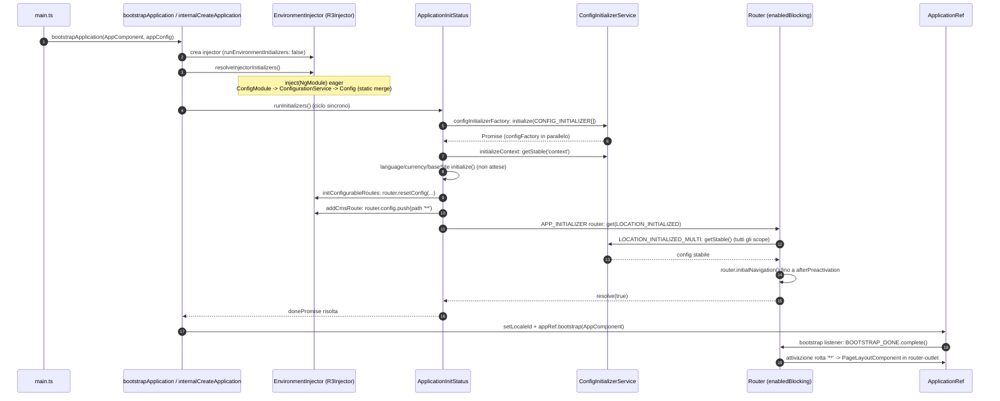
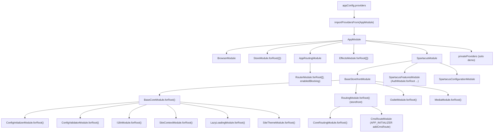
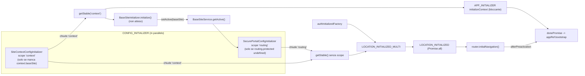

# 10 — Bootstrap e ordine di inizializzazione

> Riferimenti allo SHA `5b7a1c2bf2808d7380bc20596d10f4fa710c3da1` (vedi [00-meta](../00-meta.md)). I riferimenti prefissati `angular:` puntano a `/tmp/angular` @ `v21.2.23`.

Questo capitolo segue una storefront Spartacus dal primo byte di JavaScript eseguito (`main.ts`) fino al primo render della pagina CMS. È un capitolo "di attraversamento": tocca configurazione ([cap. 11](./11-configurazione.md)), lazy loading ([cap. 12](./12-feature-module-lazy.md)), site context ([cap. 13](./13-site-context-theme.md)), routing ([cap. 14](./14-routing.md)) e rendering CMS ([cap. 16](./16-cms-rendering.md)), ma solo per quanto serve a capire **in che ordine** le cose accadono e **chi aspetta chi**. I meccanismi Angular di base (injector, `bootstrapApplication`, router) sono trattati in Parte I: [cap. 01](../parte-1/01-dependency-injection.md), [cap. 02](../parte-1/02-ngmodule-standalone-bootstrap.md), [cap. 05](../parte-1/05-router.md).

---

## 1. A cosa serve e perché esiste

Una storefront Spartacus non può renderizzare nulla finché non sa:

1. **qual è la configurazione definitiva** — che può essere in parte statica (`provideConfig`) e in parte caricata dal backend in modo asincrono (i `CONFIG_INITIALIZER`);
2. **in quale site context si trova** — base site, lingua, valuta, che possono arrivare dalla configurazione statica, dal backend (OCC `basesites`), dall'URL o dallo storage;
3. **quali rotte esistono** — le rotte Angular sono vuote all'inizio (`RouterModule.forRoot([])`) e vengono completate a runtime con i path configurati e con una rotta wildcard CMS;
4. **qual è lo stato di autenticazione** — token persistiti, eventuale callback OAuth nell'URL.

Angular offre già i mattoni per "aspettare prima di partire": `ENVIRONMENT_INITIALIZER`, `APP_INITIALIZER` (oggi `provideAppInitializer`), `LOCATION_INITIALIZED` e la modalità `initialNavigation: 'enabledBlocking'` del router. Spartacus li compone e ci aggiunge tre meccanismi propri:

| Meccanismo Spartacus | Cosa aggiunge rispetto ad Angular | Definito in |
|---|---|---|
| `CONFIG_INITIALIZER` + `ConfigInitializerService` | contributi di config asincroni, divisi per **scope** (`'context'`, `'routing'`, `'i18n'`…), con `getStable(...scopes)` per aspettare solo la parte di config che serve | `core-libs/core/src/config/config-initializer/config-initializer.ts:L18-L67`, `core-libs/core/src/config/config-initializer/config-initializer.service.ts:L35-L175` |
| `LOCATION_INITIALIZED_MULTI` | trasforma il token singolo `LOCATION_INITIALIZED` di Angular in un multi-token, così più librerie possono trattenere la navigazione iniziale | `core-libs/core/src/routing/location-initialized-multi/location-initialized-multi.ts:L30-L62`, `core-libs/core/src/routing/routing.module.ts:L66-L71` |
| `MODULE_INITIALIZER` | un "APP_INITIALIZER per moduli lazy"; nei moduli eager viene eseguito all'avvio | `core-libs/core/src/lazy-loading/tokens.ts:L9-L20`, `core-libs/core/src/lazy-loading/lazy-loading.module.ts:L18-L53` |

Il punto di aggregazione di tutto questo è la coppia `BaseStorefrontModule` → `BaseCoreModule`: importandola, un'applicazione ottiene in un colpo solo l'intera catena di inizializzatori (`core-libs/storefront/base-storefront.module.ts:L26-L49`, `core-libs/core/src/base-core.module.ts:L26-L53`).

Il capitolo copre anche le **recipes** (`core-libs/storefront/recipes`, `core-libs/setup/recipes`) e i `public_api.ts` di `@spartacus/core`, `@spartacus/storefront`, `@spartacus/setup`, perché sono ciò che un'app tipica importa al bootstrap.

---

## 2. Mappa dei file

### 2.1 File assegnati al capitolo

| Path | Ruolo |
|---|---|
| `core-libs/core/public_api.ts` | Entry point di `@spartacus/core`: re-export di tutti i sotto-moduli (incluso `./src/base-core.module`) e blocco `AUGMENTABLE_TYPES_START/END` (`core-libs/core/public_api.ts:L10-L58`). |
| `core-libs/core/src/base-core.module.ts` | `BaseCoreModule`: aggrega 17 moduli core in un ordine esplicito; `forRoot()` senza provider propri (`core-libs/core/src/base-core.module.ts:L26-L53`). |
| `core-libs/storefront/base-storefront.module.ts` | `BaseStorefrontModule`: importa `BaseCoreModule.forRoot()` per primo, poi infrastruttura CMS/layout/routing/media/outlet; nessun `forRoot()` (`core-libs/storefront/base-storefront.module.ts:L26-L49`). |
| `core-libs/storefront/public_api.ts` | Entry point di `@spartacus/storefront`: triple-slash reference a `types.d.ts`, export di `base-storefront.module`, `recipes`, `router`, blocco `AUGMENTABLE_TYPES_START/END` (`core-libs/storefront/public_api.ts:L7-L36`). |
| `core-libs/storefront/recipes/index.ts`, `core-libs/storefront/recipes/config/index.ts` | Barrel delle recipe storefront: `default-media.config`, `layout-config`, `static-cms-structure` (`core-libs/storefront/recipes/config/index.ts:L7-L9`). |
| `core-libs/storefront/recipes/config/default-media.config.ts` | `mediaConfig`: formati immagine e `<picture>` (`core-libs/storefront/recipes/config/default-media.config.ts:L9-L38`). |
| `core-libs/storefront/recipes/config/layout-config.ts` | `layoutConfig` (deprecato) e `layoutConfigFactory()` (header unificato, niente `pageFold`) (`core-libs/storefront/recipes/config/layout-config.ts:L13-L198`). |
| `core-libs/storefront/recipes/config/static-cms-structure.ts` | `defaultCmsContentProviders`: componenti CMS statici in `PreHeader`/`SiteLogin` (`core-libs/storefront/recipes/config/static-cms-structure.ts:L10-L19`). |
| `core-libs/setup/public_api.ts` | Entry point di `@spartacus/setup`: esporta solo `./recipes/index` (`core-libs/setup/public_api.ts:L7-L7`). |
| `core-libs/setup/recipes/index.ts`, `core-libs/setup/recipes/b2b/index.ts`, `core-libs/setup/recipes/b2b/config/index.ts` | Barrel delle recipe B2B (`core-libs/setup/recipes/index.ts:L7-L7`, `core-libs/setup/recipes/b2b/index.ts:L7-L7`, `core-libs/setup/recipes/b2b/config/index.ts:L7-L7`). |
| `core-libs/setup/recipes/b2b/config/default-b2b-occ-config.ts` | `defaultB2bOccConfig`: endpoint OCC B2B (`orgUsers/${userId}/...`) (`core-libs/setup/recipes/b2b/config/default-b2b-occ-config.ts:L18-L49`). |

### 2.2 File di flusso attraversati (approfonditi in altri capitoli)

| Path | Ruolo nel bootstrap |
|---|---|
| `projects/storefrontapp/src/main.ts`, `projects/storefrontapp/src/main.server.ts` | Entry point browser e server (`bootstrapApplication`). |
| `projects/storefrontapp/src/app/app.config.ts`, `projects/storefrontapp/src/app/app.config.server.ts` | `ApplicationConfig` browser e server. |
| `projects/storefrontapp/src/app/app.module.ts` | `AppModule` importato con `importProvidersFrom`. |
| `projects/storefrontapp/src/app/spartacus/spartacus.module.ts` e fratelli | Struttura "da schematics": `BaseStorefrontModule` + feature + configurazione. |
| `projects/storefrontapp/src/app/private/private.providers.ts` | Provider solo per sviluppo/e2e. |
| `core-libs/storefront/router/app-routing.module.ts` | `AppRoutingModule`: `RouterModule.forRoot([], { initialNavigation: 'enabledBlocking' })`. |
| `core-libs/core/src/config/config-initializer/config-initializer.module.ts` | APP_INITIALIZER che esegue i `CONFIG_INITIALIZER` + `LOCATION_INITIALIZED_MULTI` che attende la config stabile. |
| `core-libs/core/src/config/config-initializer/config-initializer.service.ts` | `ConfigInitializerService`: `initialize()`, `getStable()`, gestione scope. |
| `core-libs/core/src/config/config-validator/config-validator.module.ts` | APP_INITIALIZER di validazione (solo dev mode). |
| `core-libs/core/src/routing/routing.module.ts` | Override di `LOCATION_INITIALIZED`, APP_INITIALIZER delle rotte configurabili, CONFIG_INITIALIZER secure portal. |
| `core-libs/core/src/routing/location-initialized-multi/location-initialized-multi.ts` | Token `LOCATION_INITIALIZED_MULTI` e helper. |
| `core-libs/core/src/routing/configurable-routes/configurable-routes.service.ts` | `router.resetConfig(...)` con i path da `routing.routes`. |
| `core-libs/storefront/cms-structure/routing/routing.module.ts`, `core-libs/storefront/cms-structure/routing/cms-route/cms-route.module.ts`, `core-libs/storefront/cms-structure/routing/cms-route/add-cms-route.ts` | `RoutingModule` storefront e rotta wildcard CMS. |
| `core-libs/core/src/site-context/site-context.module.ts` e `core-libs/core/src/site-context/providers/*` | Provider e APP_INITIALIZER del site context. |
| `core-libs/core/src/site-context/config/config-loader/site-context-config-initializer.ts` | CONFIG_INITIALIZER `context` da OCC (base sites). |
| `core-libs/core/src/site-context/services/language-initializer.ts`, `core-libs/core/src/site-context/services/currency-initializer.ts`, `core-libs/core/src/site-context/services/base-site-initializer.ts`, `core-libs/core/src/site-context/services/site-context-routes-handler.ts` | Impostazione dei valori attivi di contesto. |
| `core-libs/core/src/lazy-loading/lazy-loading.module.ts`, `core-libs/core/src/lazy-loading/lazy-modules.service.ts`, `core-libs/core/src/lazy-loading/tokens.ts` | `MODULE_INITIALIZER`. |
| `core-libs/storefront/layout/main/storefront.component.ts`, `core-libs/storefront/layout/main/storefront.component.html` | Root UI `cx-storefront`. |
| `angular:packages/platform-browser/src/browser.ts`, `angular:packages/core/src/application/create_application.ts`, `angular:packages/core/src/platform/bootstrap.ts`, `angular:packages/core/src/application/application_init.ts`, `angular:packages/router/src/provide_router.ts` | Lato Angular: creazione injector, initializer, bootstrap del root component, navigazione bloccante. |

---

## 3. Come funziona passo per passo

Il percorso è diviso in otto fasi. Ogni fase indica il file e le righe che la rendono vera.

### 3.1 Fase 0 — Valutazione dei moduli ES (prima di qualunque DI)

Prima ancora che Angular entri in gioco, il bundler valuta i moduli importati da `main.ts`. Due effetti collaterali avvengono qui:

- `enableProdMode()` viene chiamato solo se `environment.production` (`projects/storefrontapp/src/main.ts:L13-L15`).
- `spartacus-configuration.module.ts` esegue `registerLocaleData` per `de`, `ja`, `zh` a livello di modulo, cioè al momento dell'import (`projects/storefrontapp/src/app/spartacus/spartacus-configuration.module.ts:L29-L31`).
- La scelta B2B/B2C è già fissata: `environment.b2b` deriva da `buildProcess.env.CX_B2B ?? false` (`projects/storefrontapp/src/environments/environment.ts:L27-L27`) e seleziona l'array di provider (`projects/storefrontapp/src/app/spartacus/spartacus-configuration.module.ts:L40-L42`).

### 3.2 Fase 1 — `bootstrapApplication` e appiattimento dei provider

1. `main.ts` chiama `bootstrapApplication(AppComponent, appConfig)`: l'app demo è standalone, non usa `bootstrapModule` (`projects/storefrontapp/src/main.ts:L17-L23`).
2. `appConfig` registra in ordine `provideHttpClient(withFetch(), withInterceptorsFromDi())`, `provideClientHydration(...)`, `provideZoneChangeDetection(...)`, `provideBrowserGlobalErrorListeners()` e infine `importProvidersFrom(AppModule)` (`projects/storefrontapp/src/app/app.config.ts:L26-L35`). Tutta Spartacus entra quindi attraverso un singolo `importProvidersFrom`.
3. Angular costruisce `{ rootComponent, ...createProvidersConfig(options, context) }` (`angular:packages/platform-browser/src/browser.ts:L125-L140`), anteponendo `BROWSER_MODULE_PROVIDERS` ai provider utente (`angular:packages/platform-browser/src/browser.ts:L169-L175`).
4. `importProvidersFrom(AppModule)` attiva il walk dell'albero dei moduli. L'algoritmo è "imports-first": per ogni NgModule vengono visitati prima gli `imports`; i provider dei `ModuleWithProviders` importati sono processati **dopo** tutti gli import del modulo contenitore; poi vengono aggiunti i provider dichiarati sul modulo stesso (`angular:packages/core/src/di/provider_collection.ts:L293-L355`). Per ogni NgModule viene anche aggiunto un `ENVIRONMENT_INITIALIZER` che fa `inject(defType)` — cioè istanzia eagerly la classe del modulo (`angular:packages/core/src/di/provider_collection.ts:L338-L344`) — e questo provider è registrato *dopo* gli import ("It's important that this is done after the def's imports", `angular:packages/core/src/di/provider_collection.ts:L324-L344`).

L'albero che viene percorso nell'app demo è:

- `AppModule` → `BrowserModule`, `StoreModule.forRoot({})`, `AppRoutingModule`, `EffectsModule.forRoot([])`, `SpartacusModule`, più `privateProviders` (`projects/storefrontapp/src/app/app.module.ts:L15-L25`).
- `AppRoutingModule` → `RouterModule.forRoot([], { anchorScrolling: 'enabled', initialNavigation: 'enabledBlocking' })` + `provideDefaultConfig(defaultOnNavigateConfig)` + APP_INITIALIZER `onNavigateFactory` (`core-libs/storefront/router/app-routing.module.ts:L13-L37`).
- `SpartacusModule` → `BaseStorefrontModule`, `SpartacusFeaturesModule`, `SpartacusConfigurationModule` (`projects/storefrontapp/src/app/spartacus/spartacus.module.ts:L12-L20`).
- `BaseStorefrontModule` → `BaseCoreModule.forRoot()` (primo), `RouterModule`, moduli CMS-structure/layout, `PageComponentModule.forRoot()`, `RoutingModule.forRoot()`, `MediaModule.forRoot()`, `OutletModule.forRoot()`, `CmsLcpModule.forRoot()`, `StorefrontComponentModule` (`core-libs/storefront/base-storefront.module.ts:L26-L49`).
- `BaseCoreModule` → `ErrorHandlingModule.forRoot()` … `SiteThemeModule.forRoot()`, `FederatedLoginModule` (`core-libs/core/src/base-core.module.ts:L26-L46`).
- Il `RoutingModule` dello storefront importa `CoreRoutingModule.forRoot()` (il `RoutingModule` di core) e `CmsRouteModule` (`core-libs/storefront/cms-structure/routing/routing.module.ts:L18-L20`): `BaseCoreModule` **non** importa direttamente il routing di core.
- `SpartacusFeaturesModule` apre con `AuthModule.forRoot()`, `LogoutModule`, `LoginRouteModule` e prosegue con le feature (`projects/storefrontapp/src/app/spartacus/spartacus-features.module.ts:L176-L214`).

### 3.3 Fase 2 — Creazione dell'environment injector

`internalCreateApplication`:

- in server mode lancia `PLATFORM_NOT_FOUND` se manca il `BootstrapContext` (`angular:packages/core/src/application/create_application.ts:L47-L54`) — è il motivo per cui `main.server.ts` esporta `(context) => bootstrapApplication(AppComponent, config, context)` (`projects/storefrontapp/src/main.server.ts:L23-L26`);
- crea l'environment injector con `runEnvironmentInitializers: false`, rimandando gli `ENVIRONMENT_INITIALIZER` a quando la `NgZone` è disponibile (`angular:packages/core/src/application/create_application.ts:L66-L85`).

### 3.4 Fase 3 — `ENVIRONMENT_INITIALIZER`: istanziazione eager dei moduli e del `Config`

Dentro `ngZone.run`, `bootstrap()` chiama per prima cosa `r3Injector.resolveInjectorInitializers()` (`angular:packages/core/src/platform/bootstrap.ts:L87-L93`), che invoca sincronamente ogni funzione `ENVIRONMENT_INITIALIZER` (`angular:packages/core/src/di/r3_injector.ts:L426-L448`). Poiché ogni NgModule ha il suo `ENVIRONMENT_INITIALIZER` "eager", **tutte le classi NgModule vengono istanziate qui**, prima di qualunque APP_INITIALIZER.

Per Spartacus la conseguenza più importante è in `ConfigModule`: il suo costruttore inietta `ConfigurationService` proprio per forzarne l'istanziazione (`core-libs/core/src/config/config.module.ts:L13-L19`). `ConfigurationService` a sua volta inietta `RootConfig`, `DefaultConfig` e `Config`, e si sottoscrive subito a `feedUnifiedConfig()` (`core-libs/core/src/config/services/configuration.service.ts:L42-L55`). Iniettare `Config` significa eseguire la sua factory `deepMerge({}, inject(DefaultConfig), inject(RootConfig))` (`core-libs/core/src/config/config-tokens.ts:L10-L21`), dove `DefaultConfig` e `RootConfig` sono a loro volta il merge di tutti i `DefaultConfigChunk` e `ConfigChunk` (`core-libs/core/src/config/config-tokens.ts:L23-L47`). **Al termine di questa fase esiste già un oggetto `Config` globale con tutta la configurazione statica**; i `CONFIG_INITIALIZER` lo muteranno in place più avanti. I dettagli del merge sono nel [cap. 11](./11-configurazione.md).

### 3.5 Fase 4 — `APP_INITIALIZER`: il cuore dell'ordine di inizializzazione

Subito dopo, `bootstrap()` registra un pending task e chiama `initStatus.runInitializers()` (`angular:packages/core/src/platform/bootstrap.ts:L137-L141`). Il comportamento di `runInitializers()` è la chiave di tutto il capitolo (`angular:packages/core/src/application/application_init.ts:L239-L275`):

- tutti gli APP_INITIALIZER vengono invocati **sincronamente, in sequenza**, in injection context;
- se una funzione restituisce una `Promise` o un `Observable`, questa viene raccolta; i valori di ritorno di altro tipo (incluso `void`) sono ignorati;
- `donePromise` si risolve con `Promise.all` di quanto raccolto; un rifiuto qualunque rigetta il bootstrap.

Quindi **l'ordine nel multi-token decide solo l'ordine in cui le funzioni partono**; ciò che conta per "chi aspetta chi" sono le Promise e le dipendenze interne (scope di config, `LOCATION_INITIALIZED`). L'ordine esatto dei multi-provider nell'injector dell'app demo non è stato osservato a runtime ⚠️ DA VERIFICARE (motivo: `node_modules` assente, ricostruibile solo leggendo il walker di `angular:packages/core/src/di/provider_collection.ts:L293-L355`). La tabella seguente elenca gli APP_INITIALIZER della catena `Base*Module` e se bloccano il bootstrap.

| APP_INITIALIZER | Registrato da | Ritorna | Blocca il bootstrap? |
|---|---|---|---|
| `configInitializerFactory` → `ConfigInitializerService.initialize(CONFIG_INITIALIZER[])` | `core-libs/core/src/config/config-initializer/config-initializer.module.ts:L24-L30`, `core-libs/core/src/config/config-initializer/config-initializer.module.ts:L51-L59` | `Promise<void>` | Sì, fino alla risoluzione di tutti i `configFactory()` |
| `configValidatorFactory` | `core-libs/core/src/config/config-validator/config-validator.module.ts:L23-L37` | `void` | No (in dev mode si sottoscrive a `getStable()` e valida in seguito) |
| `i18nextProviders` | `core-libs/core/src/i18n/i18next/i18next-providers.ts:L13-L28` | `Promise` (`getStable('i18n')` poi `initialize()`) | Sì |
| `initializeContext` | `core-libs/core/src/site-context/providers/context-service-providers.ts:L15-L33` | `Promise<Config>` (`getStable('context')`) | Sì, fino a scope `context` stabile |
| `initializeLanguage`, `initializeCurrency`, `initializeBaseSite` | `core-libs/core/src/site-context/providers/context-initializer-providers.ts:L12-L55` | `void` (la Promise di `initialize()` è scartata) | No |
| `moduleInitializersFactory` (esegue i `MODULE_INITIALIZER` eager) | `core-libs/core/src/lazy-loading/lazy-loading.module.ts:L18-L53` | `Promise.all(...)` | Sì |
| `initializeTheme` | `core-libs/core/src/site-theme/providers/site-theme-initializer-providers.ts:L10-L23` | `void` | No |
| `initConfigurableRoutes` | `core-libs/core/src/routing/routing.module.ts:L37-L42`, `core-libs/core/src/routing/routing.module.ts:L93-L95` | `void` (sincrono) | No |
| `addCmsRoute` | `core-libs/storefront/cms-structure/routing/cms-route/add-cms-route.ts:L18-L25`, `core-libs/storefront/cms-structure/routing/cms-route/cms-route.module.ts:L10-L20` | `void` (sincrono) | No |
| `registerOutletsFactory` | `core-libs/storefront/cms-structure/outlet/outlet.module.ts:L29-L69` | `void` | No |
| `onNavigateFactory` | `core-libs/storefront/router/app-routing.module.ts:L20-L37` | `void` | No |
| `mediaPreconnectInitializer` | `core-libs/storefront/shared/components/media/media.module.ts:L31-L41` | ⚠️ DA VERIFICARE (corpo non letto) | ⚠️ DA VERIFICARE |
| `htmlLangProvider` | `core-libs/storefront/cms-structure/seo/html-lang-provider.ts:L10-L30` | sottoscrive `languageService.getActive()` | ⚠️ DA VERIFICARE (valore di ritorno non riportato nel dossier) |
| `initHtmlDirAttribute` | `core-libs/storefront/layout/direction/direction.module.ts:L21-L35` | ⚠️ DA VERIFICARE | ⚠️ DA VERIFICARE |
| Router `enabledBlocking` | `angular:packages/router/src/provide_router.ts:L441-L474` | `Promise` (attende `LOCATION_INITIALIZED`, poi la navigazione iniziale) | Sì |

Altri file che registrano APP_INITIALIZER in core/storefront, non approfonditi qui: `core-libs/core/src/routing/external-routes/external-routes.module.ts:L21-L21`, `core-libs/core/src/anonymous-consents/store/anonymous-consents-store.module.ts:L36-L36`, `core-libs/storefront/cms-structure/pwa/pwa.module.ts:L48-L48`, `core-libs/storefront/cms-structure/seo/seo.module.ts:L27-L27`, `core-libs/storefront/cms-structure/seo/structured-data/structured-data.module.ts:L29-L29`, `core-libs/storefront/layout/a11y/skip-link/skip-link.module.ts:L38-L38`.

Vediamo ora i blocchi principali in dettaglio.

#### 3.5.1 `CONFIG_INITIALIZER`: config asincrona per scope

1. `ConfigInitializerModule.forRoot()` fornisce tre cose: il guard `CONFIG_INITIALIZER_FORROOT_GUARD` (`useValue: true`), l'APP_INITIALIZER `configInitializerFactory` con deps `ConfigInitializerService` e `[new Optional(), CONFIG_INITIALIZER]`, e un `LOCATION_INITIALIZED_MULTI` che attende `getStable()` (`core-libs/core/src/config/config-initializer/config-initializer.module.ts:L41-L68`).
2. `initialize()` esce subito se `ongoingScopes$.value` è già valorizzato (guard contro la doppia inizializzazione, `core-libs/core/src/config/config-initializer/config-initializer.service.ts:L130-L134`).
3. Per ogni initializer: salta i `null`, lancia `Error('CONFIG_INITIALIZER should provide scope!')` se mancano gli scope (`core-libs/core/src/config/config-initializer/config-initializer.service.ts:L140-L146`), avvisa (solo dev mode) se gli scope si sovrappongono a quelli già in corso (`core-libs/core/src/config/config-initializer/config-initializer.service.ts:L148-L152`).
4. Tutti i `configFactory()` partono **in parallelo**; quando ciascuno si risolve, il risultato è fuso con `deepMerge` sia in `rootConfig` sia nel `Config` globale (mutazione in place), poi i suoi scope sono chiusi con `finishScopes` (`core-libs/core/src/config/config-initializer/config-initializer.service.ts:L154-L168`).
5. Solo dopo aver avviato tutti i factory viene emesso `ongoingScopes$.next(ongoingScopes)`, poi si attende `Promise.all` (`core-libs/core/src/config/config-initializer/config-initializer.service.ts:L170-L175`).

Chi vuole aspettare usa `getStable(...scopes)`: restituisce `of(this.config)` se la config è già stabile, altrimenti filtra `ongoingScopes$` (scartando il valore iniziale `undefined`) finché nessuno degli scope richiesti è in corso (`core-libs/core/src/config/config-initializer/config-initializer.service.ts:L35-L70`). Senza argomenti aspetta che **non ci sia alcuno scope** in corso (`core-libs/core/src/config/config-initializer/config-initializer.service.ts:L91-L103`). Due scope si sovrappongono se uno è prefisso dell'altro a confine di `.` (`core-libs/core/src/config/config-initializer/config-initializer.service.ts:L105-L122`). `isStable` è vero se manca il guard (modulo non importato) o se l'elenco degli scope in corso è vuoto (`core-libs/core/src/config/config-initializer/config-initializer.service.ts:L42-L44`).

I `CONFIG_INITIALIZER` registrati dalla catena `Base*Module` + auth sono:

| Initializer | Scope | Attivo quando | Riferimenti |
|---|---|---|---|
| `SiteContextConfigInitializer` | `['context']` | `context.baseSite` **non** è configurato staticamente | `core-libs/core/src/site-context/site-context.module.ts:L30-L41`, `core-libs/core/src/site-context/config/config-loader/site-context-config-initializer.ts:L24-L27` |
| `SecurePortalConfigInitializer` | `['routing']` | `routing.protected === undefined` nella config statica | `core-libs/core/src/routing/routing.module.ts:L44-L52`, `core-libs/core/src/routing/routing.module.ts:L96-L101`, `core-libs/core/src/routing/configurable-routes/secure-portal-config/secure-portal-config-initializer.ts:L16-L19` |
| `AuthConfigInitializer` | `['authentication.OAuthLibConfig.redirectUri', 'authentication.client_id']` | feature toggle `asyncAuthConfigInitializer` attivo (default `false`) | `core-libs/core/src/auth/user-auth/user-auth.module.ts:L108-L113`, `core-libs/core/src/auth/user-auth/config/auth-config-initializer.ts:L18-L24`, `core-libs/core/src/features-config/feature-toggles/config/feature-toggles.ts:L1090-L1090` |

#### 3.5.2 Site context

`SiteContextModule.forRoot()` fornisce in quest'ordine: default config factory, `contextServiceMapProvider`, `contextServiceProviders`, `siteContextParamsProviders`, il validator `baseSiteConfigValidator`, il `CONFIG_INITIALIZER` `initSiteContextConfig` e `contextInitializerProviders` (`core-libs/core/src/site-context/site-context.module.ts:L46-L66`).

- La default config (`defaultSiteContextConfigFactory`) definisce solo `context.language` (prima `'en'`) e `context.currency` (prima `'USD'`); **non** definisce `context.baseSite` né `context.urlParameters` (`core-libs/core/src/site-context/config/default-site-context-config.ts:L13-L58`).
- `initSiteContextConfig` attiva il caricamento da backend solo se manca `context.baseSite` statico (`core-libs/core/src/site-context/site-context.module.ts:L30-L41`). In quel caso `resolveConfig()` chiede tutti i base site (`baseSiteService.getAll()`), considera l'origin del federated login se attivo, sceglie quello i cui `urlPatterns` (regex Java convertite) matchano l'URL corrente, e **lancia** se nessuno corrisponde (`core-libs/core/src/site-context/config/config-loader/site-context-config-initializer.ts:L46-L75`). `getConfig()` costruisce `context.urlParameters` (mappando `storefront`→`baseSite`), `baseSite: [uid]`, `language`/`currency` con il default in testa e `theme` (`core-libs/core/src/site-context/config/config-loader/site-context-config-initializer.ts:L77-L98`, `core-libs/core/src/site-context/config/config-loader/site-context-config-initializer.ts:L113-L119`).
- `initializeContext` (APP_INITIALIZER) restituisce `lastValueFrom(configInit.getStable('context'))`: è **questo** che blocca il bootstrap sul site context (`core-libs/core/src/site-context/providers/context-service-providers.ts:L15-L33`).
- I tre APP_INITIALIZER language, currency, baseSite chiamano `initialize()` senza restituirne la Promise (`core-libs/core/src/site-context/providers/context-initializer-providers.ts:L12-L55`). `LanguageInitializer.initialize()` attende `getStable('context')`, poi in sequenza: lingua dal federated login, `siteContextRoutesHandler.initOnce()`, `languageStatePersistenceService.initSync()`, fallback dal config (`core-libs/core/src/site-context/services/language-initializer.ts:L35-L44`); il fallback imposta il primo valore di `context.language` solo se la lingua non è già inizializzata (`core-libs/core/src/site-context/services/language-initializer.ts:L63-L71`). `CurrencyInitializer` fa lo stesso senza il passo federated (`core-libs/core/src/site-context/services/currency-initializer.ts:L33-L41`); `BaseSiteInitializer` fa `initOnce()` + fallback su `context.baseSite` (`core-libs/core/src/site-context/services/base-site-initializer.ts:L31-L65`).
- `SiteContextRoutesHandler.initOnce()` esegue `initInternal()` una volta sola: se ci sono parametri di contesto nell'URL li legge **sincronamente** da `location.path(true)` e poi si sottoscrive ai cambi; infine completa un `ReplaySubject` (`core-libs/core/src/site-context/services/site-context-routes-handler.ts:L78-L104`).
- `siteContextParamsProviders` sostituisce `UrlSerializer` con `SiteContextUrlSerializer` (`core-libs/core/src/site-context/providers/site-context-params-providers.ts:L12-L18`); per questo il commento in `BaseCoreModule` chiede che `SiteContextModule.forRoot()` arrivi dopo `RouterModule.forRoot` (`core-libs/core/src/base-core.module.ts:L38-L38`).

Il dettaglio dei servizi di contesto è nel [cap. 13](./13-site-context-theme.md).

#### 3.5.3 Routing: rotte configurabili e rotta CMS

- `initConfigurableRoutes` chiama `ConfigurableRoutesService.init()`, idempotente (flag `initCalled`), che ottiene il `Router` dall'injector — non dal costruttore, "due to cyclic dependency with APP_INITIALIZER" — e fa `router.resetConfig(this.configureRoutes(router.config))` (`core-libs/core/src/routing/configurable-routes/configurable-routes.service.ts:L31-L52`). Ogni `Route` con `data.cxRoute` riceve `path`/`matcher` da `routing.routes[nome]`, ricorsivamente sui `children` (`core-libs/core/src/routing/configurable-routes/configurable-routes.service.ts:L59-L80`); la config è letta **sincronamente** da `RoutingConfig` (`core-libs/core/src/routing/configurable-routes/routing-config.service.ts:L21-L34`).
- `addCmsRoute` fa `router.config.push({ path: '**', canActivate: [CmsPageGuard], component: PageLayoutComponent })` (`core-libs/storefront/cms-structure/routing/cms-route/add-cms-route.ts:L12-L25`).
- `RoutingModule.forRoot()` dello storefront aggiunge `provideDefaultConfigFactory(defaultRoutesConfigFactory)` e due `BEFORE_CMS_PAGE_GUARD` (`ProtectedRoutesGuard`, `FederatedLoginGuard`) (`core-libs/storefront/cms-structure/routing/routing.module.ts:L22-L39`).

Vedi il [cap. 14](./14-routing.md) per route semantiche e `CmsPageGuard`.

#### 3.5.4 `MODULE_INITIALIZER` eager

`LazyLoadingModule.forRoot()` registra un APP_INITIALIZER che prende tutti i `MODULE_INITIALIZER` visibili dal root injector, li esegue con `runModuleInitializerFunctions` e attende con `Promise.all`; in caso di rifiuto logga "MODULE_INITIALIZER promise was rejected during app initialization." e rilancia (`core-libs/core/src/lazy-loading/lazy-loading.module.ts:L18-L53`). `runModuleInitializerFunctions` conserva solo i risultati con un metodo `then` (`core-libs/core/src/lazy-loading/lazy-modules.service.ts:L187-L215`). Il JSDoc del token conferma: nei moduli eager le funzioni girano all'inizializzazione dell'app (`core-libs/core/src/lazy-loading/tokens.ts:L9-L20`). Per i moduli lazy vedi §3.8.

### 3.6 Fase 5 — `LOCATION_INITIALIZED` e navigazione iniziale bloccante

`AppRoutingModule` usa `initialNavigation: 'enabledBlocking'` (`core-libs/storefront/router/app-routing.module.ts:L13-L19`), per cui `RouterModule.forRoot` aggiunge i provider di `withEnabledBlockingInitialNavigation()` (`angular:packages/router/src/router_module.ts:L237-L244`). Questi registrano un APP_INITIALIZER che (`angular:packages/router/src/provide_router.ts:L441-L474`):

1. legge `LOCATION_INITIALIZED` (default `Promise.resolve()`);
2. **dentro il `.then`** di quella Promise chiama `router.initialNavigation()` — quindi sempre in modo asincrono rispetto al ciclo sincrono di `runInitializers()` (`angular:packages/router/src/provide_router.ts:L452-L469`);
3. si risolve quando la navigazione arriva ad `afterPreactivation` (guard già eseguiti) oppure alla fine se la navigazione è cancellata/in errore; ad `afterPreactivation` restituisce `bootstrapDone`, che tiene ferma l'attivazione finché il root component non è stato creato.

Spartacus sovrascrive `LOCATION_INITIALIZED` nel `RoutingModule.forRoot()` di core con una factory privata che invoca tutti i `LOCATION_INITIALIZED_MULTI` e ritorna `Promise.all` (`core-libs/core/src/routing/routing.module.ts:L54-L71`, `core-libs/core/src/routing/routing.module.ts:L102-L105`). I contributori nella catena base sono:

- `ConfigInitializerModule`: `() => lastValueFrom(configInitializer.getStable())` — "Hold on the initial navigation until the Spartacus configuration is stable" (`core-libs/core/src/config/config-initializer/config-initializer.module.ts:L60-L64`);
- `UserAuthModule`: `authNotificationInitializerFactory` e `authInitializedFactory`; quest'ultimo sincronizza lo stato di auth persistito e controlla i parametri OAuth nell'URL (`core-libs/core/src/auth/user-auth/user-auth.module.ts:L70-L92`, `core-libs/core/src/auth/user-auth/user-auth.module.ts:L119-L120`);
- fuori dalla catena base: `integration-libs/opf/payment/root/opf-payment-root.module.ts:L42-L42` e `integration-libs/opps/root/coupon-codes/opps-coupon-codes.module.ts:L22-L22`.

La conseguenza: la navigazione iniziale parte solo quando **tutta** la config è stabile (tutti gli scope) e l'auth è sincronizzata. E poiché parte in un `.then`, a quel punto `initConfigurableRoutes` e `addCmsRoute` (sincroni) sono già stati eseguiti, qualunque sia il loro ordine nel multi-token.

### 3.7 Fase 6 — Bootstrap del root component e primo render

Quando `donePromise` si risolve, `bootstrap()` imposta il `LOCALE_ID` e chiama `appRef.bootstrap(config.rootComponent)` (`angular:packages/core/src/platform/bootstrap.ts:L143-L171`).

- `AppComponent` (`app-root`, ospitato in `index.html` come `<app-root>Loading...</app-root>`) ha come template solo `<cx-storefront />` (`projects/storefrontapp/src/app/app.component.ts:L14-L19`, `projects/storefrontapp/src/index.html:L82-L82`).
- `StorefrontComponent` è standalone (`core-libs/storefront/layout/main/storefront.component.ts:L51-L67`); il template è avvolto nell'outlet `StorefrontOutlets.STOREFRONT` e contiene header (`cx-page-layout section="header"` e `"navigation"`), `cx-global-message`, `<main>` con `<router-outlet />` e footer (`core-libs/storefront/layout/main/storefront.component.html:L1-L28`).
- In `ngOnInit` si sottoscrive a `routingService.isNavigating()` (`core-libs/storefront/layout/main/storefront.component.ts:L126-L138`).
- Il bootstrap listener del router chiama `router.resetRootComponentType(...)` e completa `BOOTSTRAP_DONE` (`angular:packages/router/src/provide_router.ts:L319-L343`): l'attivazione della navigazione iniziale — rotta `**` → `PageLayoutComponent` — può terminare e il `<router-outlet />` viene riempito.

### 3.8 Fase 7 — Dopo il bootstrap: moduli lazy

Quando una feature viene caricata lazy, `runModuleInitializersForModule` legge `MODULE_INITIALIZER` con `{ self: true }` dall'injector del modulo e attende le Promise prima di emettere il `moduleRef` (`core-libs/core/src/lazy-loading/lazy-modules.service.ts:L150-L175`). `OutletModule.forChild()` è un esempio concreto: registra la stessa `registerOutletsFactory` come `MODULE_INITIALIZER` invece che come APP_INITIALIZER (`core-libs/storefront/cms-structure/outlet/outlet.module.ts:L72-L88`). Vedi il [cap. 12](./12-feature-module-lazy.md).

### 3.9 Il caso dell'app demo: quali scope sono attivi

Nell'app demo:

- `context.baseSite` è configurato staticamente (B2C: elettronica/apparel; B2B: `powertools-spa`, `powertools-standalone`) (`projects/storefrontapp/src/app/spartacus/spartacus-b2c-configuration.providers.ts:L11-L31`, `projects/storefrontapp/src/app/spartacus/spartacus-b2b-configuration.providers.ts:L13-L28`) ⇒ `initSiteContextConfig` ritorna `null`, **nessuno scope `context`** (`core-libs/core/src/site-context/site-context.module.ts:L37-L40`). Lingua, valuta e `urlParameters` vengono dalla config statica e dai default (`core-libs/core/src/site-context/config/default-site-context-config.ts:L13-L58`).
- `routing.protected` non è impostato (nessun risultato per `protected:` sotto `projects/storefrontapp/src`) ⇒ `SecurePortalConfigInitializer` è **attivo** con scope `routing` (`core-libs/core/src/routing/routing.module.ts:L44-L52`). Il suo `resolveConfig()` attende `baseSiteService.get()` — cioè un base site **attivo**, perché `get()` senza argomento parte da `getActive()` che filtra i falsy — e contribuisce solo `routing.protected` (`core-libs/core/src/routing/configurable-routes/secure-portal-config/secure-portal-config-initializer.ts:L31-L50`, `core-libs/core/src/site-context/facade/base-site.service.ts:L31-L36`, `core-libs/core/src/site-context/facade/base-site.service.ts:L56-L70`).

Ne deriva una catena di dipendenze interessante: lo scope `routing` si chiude solo dopo che `BaseSiteInitializer` ha attivato un base site; quest'ultimo aspetta `getStable('context')`, che è subito soddisfatto perché `'context'` e `'routing'` non si sovrappongono (`core-libs/core/src/config/config-initializer/config-initializer.service.ts:L91-L122`). Il `LOCATION_INITIALIZED_MULTI` di config (`getStable()` senza scope) aspetta anche `routing`, quindi la navigazione iniziale parte solo dopo l'attivazione del base site e la risposta OCC sui base site.

---

## 4. Diagrammi

### 4.1 Sequenza end-to-end del bootstrap browser



Riferimenti dei passi: 1 `projects/storefrontapp/src/main.ts:L17-L17`; 2 `angular:packages/core/src/application/create_application.ts:L72-L79`; 3 `angular:packages/core/src/platform/bootstrap.ts:L89-L90`, `core-libs/core/src/config/config.module.ts:L13-L19`; 4 `angular:packages/core/src/application/application_init.ts:L239-L256`; 5-6 `core-libs/core/src/config/config-initializer/config-initializer.module.ts:L24-L30`, `core-libs/core/src/config/config-initializer/config-initializer.service.ts:L154-L175`; 7 `core-libs/core/src/site-context/providers/context-service-providers.ts:L15-L21`; 8 `core-libs/core/src/site-context/providers/context-initializer-providers.ts:L12-L34`; 9 `core-libs/core/src/routing/configurable-routes/configurable-routes.service.ts:L48-L52`; 10 `core-libs/storefront/cms-structure/routing/cms-route/add-cms-route.ts:L18-L25`; 11-12 `angular:packages/router/src/provide_router.ts:L445-L451`, `core-libs/core/src/routing/routing.module.ts:L66-L71`, `core-libs/core/src/config/config-initializer/config-initializer.module.ts:L60-L64`; 14-15 `angular:packages/router/src/provide_router.ts:L456-L469`; 16-17 `angular:packages/core/src/platform/bootstrap.ts:L143-L171`; 18 `angular:packages/router/src/provide_router.ts:L338-L342`; 19 `core-libs/storefront/cms-structure/routing/cms-route/add-cms-route.ts:L12-L16`. L'ordine relativo fra i passi 5-11 dipende dall'ordine dei multi-provider ⚠️ DA VERIFICARE (vedi §3.5).

### 4.2 Albero dei moduli importati al bootstrap (app demo)



Fonti: `projects/storefrontapp/src/app/app.config.ts:L26-L35`, `projects/storefrontapp/src/app/app.module.ts:L15-L25`, `core-libs/storefront/router/app-routing.module.ts:L13-L19`, `projects/storefrontapp/src/app/spartacus/spartacus.module.ts:L12-L20`, `core-libs/storefront/base-storefront.module.ts:L26-L49`, `core-libs/storefront/cms-structure/routing/routing.module.ts:L18-L20`, `core-libs/core/src/base-core.module.ts:L26-L46`. Per leggibilità sono mostrati solo i moduli rilevanti per l'inizializzazione.

### 4.3 Chi aspetta chi: scope di config e Promise bloccanti



Fonti: `core-libs/core/src/site-context/site-context.module.ts:L30-L41`, `core-libs/core/src/routing/routing.module.ts:L44-L52`, `core-libs/core/src/site-context/providers/context-service-providers.ts:L15-L21`, `core-libs/core/src/site-context/services/base-site-initializer.ts:L31-L65`, `core-libs/core/src/routing/configurable-routes/secure-portal-config/secure-portal-config-initializer.ts:L31-L41`, `core-libs/core/src/site-context/facade/base-site.service.ts:L56-L70`, `core-libs/core/src/config/config-initializer/config-initializer.module.ts:L60-L64`, `core-libs/core/src/auth/user-auth/user-auth.module.ts:L119-L120`, `core-libs/core/src/routing/routing.module.ts:L66-L71`, `angular:packages/router/src/provide_router.ts:L452-L469`, `angular:packages/core/src/application/application_init.ts:L263-L273`.

---

## 5. Estratti di codice reale

### 5.1 Entry point e `ApplicationConfig` dell'app demo

`projects/storefrontapp/src/main.ts:L13-L23`

```ts
if (environment.production) {
  enableProdMode();
}

bootstrapApplication(AppComponent, appConfig)
  /* eslint-disable-next-line no-console
  --
  It's just an example application file. This message is not crucial
  to be logged using any special logger. Moreover, we don't have
  any special logger available in this context. */
  .catch((err) => console.error(err));
```

`projects/storefrontapp/src/app/app.config.ts:L26-L35`

```ts
export const appConfig: ApplicationConfig = {
  providers: [
    provideHttpClient(withFetch(), withInterceptorsFromDi()),
    provideClientHydration(withEventReplay(), withNoHttpTransferCache()),
    provideZoneChangeDetection({ eventCoalescing: true }),
    provideBrowserGlobalErrorListeners(),

    importProvidersFrom(AppModule),
  ],
};
```

`projects/storefrontapp/src/main.server.ts:L23-L26`

```ts
const bootstrap = (context: BootstrapContext) =>
  bootstrapApplication(AppComponent, config, context);

export default bootstrap;
```

### 5.2 `BaseCoreModule`: l'ordine dichiarato

`core-libs/core/src/base-core.module.ts:L26-L53`

```ts
@NgModule({
  imports: [
    ErrorHandlingModule.forRoot(), // Import this module before any other interceptor to handle HTTP errors efficiently
    StateModule.forRoot(),
    ConfigModule.forRoot(),
    ConfigInitializerModule.forRoot(),
    ConfigValidatorModule.forRoot(),
    I18nModule.forRoot(),
    CmsModule.forRoot(),
    GlobalMessageModule.forRoot(),
    ProcessModule.forRoot(),
    FeaturesConfigModule.forRoot(),
    SiteContextModule.forRoot(), // should be imported after RouterModule.forRoot, because it overwrites UrlSerializer
    MetaTagConfigModule.forRoot(),
    BaseOccModule.forRoot(),
    LazyLoadingModule.forRoot(),
    HttpModule.forRoot(),
    SiteThemeModule.forRoot(),
    FederatedLoginModule,
  ],
})
export class BaseCoreModule {
  static forRoot(): ModuleWithProviders<BaseCoreModule> {
    return {
      ngModule: BaseCoreModule,
    };
  }
}
```

### 5.3 `BaseStorefrontModule`

`core-libs/storefront/base-storefront.module.ts:L26-L49`

```ts
@NgModule({
  imports: [
    BaseCoreModule.forRoot(),
    RouterModule,
    GlobalMessageComponentModule,
    OutletModule,
    OutletRefModule,
    PwaModule,
    PageLayoutModule,
    SeoModule,
    PageComponentModule.forRoot(),
    PageSlotModule,
    SkipLinkModule,
    KeyboardFocusModule,
    LayoutModule,
    RoutingModule.forRoot(),
    MediaModule.forRoot(),
    OutletModule.forRoot(),
    CmsLcpModule.forRoot(),
    StorefrontComponentModule,
  ],
  exports: [LayoutModule, StorefrontComponentModule],
})
export class BaseStorefrontModule {}
```

### 5.4 Angular: `runInitializers()`

`angular:packages/core/src/application/application_init.ts:L239-L275`

```ts
  runInitializers() {
    if (this.initialized) {
      return;
    }

    const asyncInitPromises = [];
    for (const appInits of this.appInits) {
      const initResult = runInInjectionContext(this.injector, appInits);
      if (isPromise(initResult)) {
        asyncInitPromises.push(initResult);
      } else if (isSubscribable(initResult)) {
        const observableAsPromise = new Promise<void>((resolve, reject) => {
          initResult.subscribe({complete: resolve, error: reject});
        });
        asyncInitPromises.push(observableAsPromise);
      }
    }
    // ...
    Promise.all(asyncInitPromises)
      .then(() => {
        complete();
      })
      .catch((e) => {
        this.reject(e);
      });
    // ...
  }
```

### 5.5 `ConfigInitializerModule.forRoot()`

`core-libs/core/src/config/config-initializer/config-initializer.module.ts:L41-L68`

```ts
@NgModule({})
export class ConfigInitializerModule {
  static forRoot(): ModuleWithProviders<ConfigInitializerModule> {
    return {
      ngModule: ConfigInitializerModule,
      providers: [
        {
          provide: CONFIG_INITIALIZER_FORROOT_GUARD,
          useValue: true,
        },
        {
          provide: APP_INITIALIZER,
          multi: true,
          useFactory: configInitializerFactory,
          deps: [
            ConfigInitializerService,
            [new Optional(), CONFIG_INITIALIZER],
          ],
        },
        provideLocationInitializerFactory(() => {
          // Hold on the initial navigation until the Spartacus configuration is stable
          const configInitializer = inject(ConfigInitializerService);
          return () => lastValueFrom(configInitializer.getStable());
        }),
      ],
    };
  }
}
```

### 5.6 `ConfigInitializerService.initialize()`

`core-libs/core/src/config/config-initializer/config-initializer.service.ts:L130-L175`

```ts
  async initialize(initializers?: ConfigInitializer[]) {
    if (this.ongoingScopes$.value) {
      // guard for double initialization
      return;
    }

    const ongoingScopes: string[] = [];

    const asyncConfigs: Promise<void>[] = [];

    for (const initializer of initializers || []) {
      if (!initializer) {
        continue;
      }
      if (!initializer.scopes || !initializer.scopes.length) {
        throw new Error('CONFIG_INITIALIZER should provide scope!');
      }
      // ...
      ongoingScopes.push(...initializer.scopes);

      asyncConfigs.push(
        (async () => {
          const initializerConfig = await initializer.configFactory();
          // contribute configuration to rootConfig
          deepMerge(
            this.rootConfig as Record<string, unknown>,
            initializerConfig
          );
          // contribute configuration to global config
          deepMerge(this.config as Record<string, unknown>, initializerConfig);
          this.finishScopes(initializer.scopes);
        })()
      );
    }
    this.ongoingScopes$.next(ongoingScopes);

    if (asyncConfigs.length) {
      await Promise.all(asyncConfigs);
    }
  }
```

### 5.7 `RoutingModule.forRoot()` di core: override di `LOCATION_INITIALIZED`

`core-libs/core/src/routing/routing.module.ts:L66-L71`

```ts
function locationInitializedFactory(): Promise<any> {
  const initializers =
    inject(LOCATION_INITIALIZED_MULTI, { optional: true }) ?? [];
  const promiseInitializers = initializers.map((initializer) => initializer());
  return Promise.all(promiseInitializers);
}
```

`core-libs/core/src/routing/routing.module.ts:L87-L106`

```ts
      providers: [
        reducerProvider,
        {
          provide: RouterStateSerializer,
          useClass: CustomSerializer,
        },
        provideAppInitializer(() =>
          initConfigurableRoutes(inject(ConfigurableRoutesService))()
        ),
        provideConfigInitializerFactory(() => {
          return initSecurePortalConfig(
            inject(SecurePortalConfigInitializer),
            inject(RoutingConfig)
          );
        }),
        {
          provide: LOCATION_INITIALIZED,
          useFactory: locationInitializedFactory,
        },
      ],
```

### 5.8 Angular: navigazione iniziale bloccante

`angular:packages/router/src/provide_router.ts:L445-L472`

```ts
    provideAppInitializer(() => {
      const injector = inject(Injector);
      const locationInitialized: Promise<any> = injector.get(
        LOCATION_INITIALIZED,
        Promise.resolve(),
      );

      return locationInitialized.then(() => {
        return new Promise((resolve) => {
          const router = injector.get(Router);
          const bootstrapDone = injector.get(BOOTSTRAP_DONE);
          afterNextNavigation(router, () => {
            // Unblock APP_INITIALIZER in case the initial navigation was canceled or errored
            // without a redirect.
            resolve(true);
          });

          injector.get(NavigationTransitions).afterPreactivation = () => {
            // Unblock APP_INITIALIZER once we get to `afterPreactivation`. At this point, we
            // assume activation will complete successfully (even though this is not
            // guaranteed).
            resolve(true);
            return bootstrapDone.closed ? of(void 0) : bootstrapDone;
          };
          router.initialNavigation();
        });
      });
    }),
```

### 5.9 Site context: initializer bloccante vs non bloccanti

`core-libs/core/src/site-context/providers/context-service-providers.ts:L15-L21`

```ts
export function initializeContext(
  configInit: ConfigInitializerService
): () => Promise<Config> {
  return () => {
    return lastValueFrom(configInit.getStable('context'));
  };
}
```

`core-libs/core/src/site-context/providers/context-initializer-providers.ts:L20-L26`

```ts
export function initializeLanguage(
  languageInitializer: LanguageInitializer
): () => void {
  return () => {
    languageInitializer.initialize();
  };
}
```

`core-libs/core/src/site-context/site-context.module.ts:L30-L41`

```ts
export function initSiteContextConfig(
  configInitializer: SiteContextConfigInitializer,
  config: SiteContextConfig
): ConfigInitializer | null {
  /**
   * Load config for `context` from backend only when there is no static config for `context.baseSite`
   */
  if (!config.context?.[BASE_SITE_CONTEXT_ID]) {
    return configInitializer;
  }
  return null;
}
```

### 5.10 La rotta wildcard CMS

`core-libs/storefront/cms-structure/routing/cms-route/add-cms-route.ts:L12-L25`

```ts
const cmsRoute: Route = {
  path: '**',
  canActivate: [CmsPageGuard],
  component: PageLayoutComponent,
};

export function addCmsRoute(injector: Injector): () => void {
  const result = () => {
    // Router could not be injected via `deps[]` due to a cyclic dependency with APP_INITIALIZER:
    const router = injector.get(Router);
    router.config.push(cmsRoute);
  };
  return result;
}
```

### 5.11 Recipe: `layoutConfigFactory`

`core-libs/storefront/recipes/config/layout-config.ts:L187-L198`

```ts
/**
 * Factory for layout configuration.
 */
export function layoutConfigFactory(): LayoutConfig {
  const config: LayoutConfig = JSON.parse(JSON.stringify(layoutConfig));

  applyUnifiedHeaderSlots(config);

  applyWithoutPageFold(config);

  return config;
}
```

---

## 6. Configurazione

| Chiave | Tipo | Default | Definita in | Letta in |
|---|---|---|---|---|
| `context.baseSite` | `string[]` | nessun default nel core (`defaultSiteContextConfigFactory` non lo definisce); app demo: lista B2C o B2B | `core-libs/core/src/site-context/config/default-site-context-config.ts:L13-L58`; `projects/storefrontapp/src/app/spartacus/spartacus-b2c-configuration.providers.ts:L26-L31`, `projects/storefrontapp/src/app/spartacus/spartacus-b2b-configuration.providers.ts:L22-L27` | `core-libs/core/src/site-context/site-context.module.ts:L37-L37` (decide se caricare dal backend); `core-libs/core/src/site-context/services/base-site-initializer.ts:L57-L64`; `core-libs/core/src/site-context/config/base-site-config-validator.ts:L11-L15` |
| `context.language` | `string[]` (primo = default) | `['en', 'de', 'ja', ...]` | `core-libs/core/src/site-context/config/default-site-context-config.ts:L16-L34`; backend: `core-libs/core/src/site-context/config/config-loader/site-context-config-initializer.ts:L82-L85` | `core-libs/core/src/site-context/services/language-initializer.ts:L63-L71` |
| `context.currency` | `string[]` (primo = default) | `['USD', 'EUR', ...]` | `core-libs/core/src/site-context/config/default-site-context-config.ts:L35-L56`; backend: `core-libs/core/src/site-context/config/config-loader/site-context-config-initializer.ts:L86-L89` | `core-libs/core/src/site-context/services/currency-initializer.ts:L33-L41` |
| `context.urlParameters` | `string[]` | nessuno nel core | app demo `['baseSite','language','currency']` (`projects/storefrontapp/src/app/spartacus/spartacus-b2c-configuration.providers.ts:L28-L28`); backend `core-libs/core/src/site-context/config/config-loader/site-context-config-initializer.ts:L80-L80` | `core-libs/core/src/site-context/services/site-context-routes-handler.ts:L92-L100` |
| `routing.routes[name]` | `RouteConfig` | `defaultRoutesConfigFactory` | `core-libs/storefront/cms-structure/routing/routing.module.ts:L26-L26`; app demo `projects/storefrontapp/src/app/private/private.providers.ts:L34-L41` | `core-libs/core/src/routing/configurable-routes/routing-config.service.ts:L26-L34` |
| `routing.protected` | `boolean \| undefined` | `undefined` ⇒ `SecurePortalConfigInitializer` attivo | backend: `core-libs/core/src/routing/configurable-routes/secure-portal-config/secure-portal-config-initializer.ts:L43-L50` | `core-libs/core/src/routing/routing.module.ts:L48-L48` |
| `enableResetViewOnNavigate.active` | `boolean` | `defaultOnNavigateConfig` (valore non letto ⚠️ DA VERIFICARE) | `core-libs/storefront/router/app-routing.module.ts:L21-L21` | `core-libs/storefront/router/on-navigate.service.ts:L69-L73` |
| `i18n.resources` / `i18n.chunks` / `i18n.fallbackLang` | oggetti | app demo statica (`fallbackLang: 'en'`) | `projects/storefrontapp/src/app/spartacus/spartacus-configuration.module.ts:L55-L67` | scope `'i18n'` atteso in `core-libs/core/src/i18n/i18next/i18next-providers.ts:L19-L22` |
| `features.level` | `string` | app demo `'*'` | `projects/storefrontapp/src/app/private/private.providers.ts:L44-L44` | vedi [cap. 42](./42-feature-toggle-deprecazioni.md) |
| feature toggle `asyncAuthConfigInitializer` | `boolean` | `false` | `core-libs/core/src/features-config/feature-toggles/config/feature-toggles.ts:L1090-L1090` | `core-libs/core/src/auth/user-auth/user-auth.module.ts:L108-L113` |
| `layoutSlots` | `LayoutConfig` | `layoutConfigFactory()` | `core-libs/storefront/recipes/config/layout-config.ts:L187-L198`; app demo `projects/storefrontapp/src/app/spartacus/spartacus-configuration.module.ts:L46-L46` | vedi [cap. 18](./18-layout-breakpoint-a11y.md) |
| `mediaFormats`, `media.pictureElementFormats`, `media.pictureFormatsOrder` | `MediaConfig` | `mediaConfig` | `core-libs/storefront/recipes/config/default-media.config.ts:L9-L38` | vedi [cap. 45](./45-componenti-storefront.md) |
| `backend.occ.endpoints.*` (B2B) | `OccEndpoints` | `defaultB2bOccConfig` | `core-libs/setup/recipes/b2b/config/default-b2b-occ-config.ts:L38-L49` | vedi [cap. 21](./21-occ.md) |
| `environment.b2b` | `boolean` (build time, solo app demo) | `CX_B2B ?? false` | `projects/storefrontapp/src/environments/environment.ts:L27-L27` | `projects/storefrontapp/src/app/spartacus/spartacus-configuration.module.ts:L40-L42` |
| `environment.epdVisualization` | `boolean` (build time, solo app demo) | `CX_EPD_VISUALIZATION ?? false` | `projects/storefrontapp/src/environments/environment.ts:L32-L32` | `projects/storefrontapp/src/app/spartacus/spartacus-b2c-configuration.providers.ts:L21-L23`, `projects/storefrontapp/src/app/spartacus/spartacus-b2b-configuration.providers.ts:L15-L17` |
| `RouterModule.forRoot` `initialNavigation` | `ExtraOptions` | `'enabledBlocking'` (in `AppRoutingModule`) | `core-libs/storefront/router/app-routing.module.ts:L15-L18` | `angular:packages/router/src/router_module.ts:L237-L244` |

### 6.1 Le recipes in breve

- **`mediaConfig`** — formati `mobile` 400, `tablet` 770, `desktop` 1140, `widescreen` 1400, `cartIcon` 65, `thumbnail` 96, `product` 284, `zoom` 515, più `media.pictureElementFormats` con media query e `pictureFormatsOrder` (`core-libs/storefront/recipes/config/default-media.config.ts:L9-L38`).
- **`layoutConfig`** (deprecato) — slot di `header` (con variante `lg`), `navigation`, `footer` e di 18 page template, con `pageFold` su `LandingPage2Template`, `CategoryPageTemplate`, `ProductDetailsPageTemplate` (`core-libs/storefront/recipes/config/layout-config.ts:L32-L133`). Il JSDoc indica di usare `layoutConfigFactory` con `provideConfigFactory(layoutConfigFactory)` (`core-libs/storefront/recipes/config/layout-config.ts:L13-L27`).
- **`layoutConfigFactory()`** — deep copy JSON di `layoutConfig`, poi `applyUnifiedHeaderSlots` (elimina `header.lg` e mette in `header.slots` gli 8 slot completi, `core-libs/storefront/recipes/config/layout-config.ts:L136-L156`) e `applyWithoutPageFold` (rimuove `pageFold` per evitare regressioni CLS, `core-libs/storefront/recipes/config/layout-config.ts:L158-L185`).
- **`defaultCmsContentProviders`** — `provideCmsStructure` per `HamburgerMenuComponent` nello slot `PreHeader` e `LoginComponent` in `SiteLogin` (`core-libs/storefront/recipes/config/static-cms-structure.ts:L10-L19`).
- **`defaultB2bOccConfig`** — endpoint `orgUsers/${userId}/...` per `user`, `addEntries`, `placeOrder`, `scheduleReplenishmentOrder`, `reorder`, e `users/${userId}` per profilo/chiusura account (`core-libs/setup/recipes/b2b/config/default-b2b-occ-config.ts:L18-L49`).

L'app demo usa le recipe così: `provideConfigFactory(layoutConfigFactory)`, `provideConfig(mediaConfig)`, `...defaultCmsContentProviders` (`projects/storefrontapp/src/app/spartacus/spartacus-configuration.module.ts:L44-L72`) e, in B2B, `provideConfig(defaultB2bOccConfig)` (`projects/storefrontapp/src/app/spartacus/spartacus-b2b-configuration.providers.ts:L13-L28`).

---

## 7. Commenti e note notevoli dal sorgente

- "Import this module before any other interceptor to handle HTTP errors efficiently" — su `ErrorHandlingModule.forRoot()` (`core-libs/core/src/base-core.module.ts:L28-L28`).
- "should be imported after RouterModule.forRoot, because it overwrites UrlSerializer" — su `SiteContextModule.forRoot()` (`core-libs/core/src/base-core.module.ts:L38-L38`).
- "Hold on the initial navigation until the Spartacus configuration is stable" (`core-libs/core/src/config/config-initializer/config-initializer.module.ts:L61-L61`).
- `@deprecated since 2211.22 - should not be a public API` sulla `locationInitializedFactory` esportata da `config-initializer.module.ts` (`core-libs/core/src/config/config-initializer/config-initializer.module.ts:L32-L39`).
- `@internal` "Not a part of a public API, used by APP_INITIALIZER to initialize all provided CONFIG_INITIALIZERS" su `initialize()` (`core-libs/core/src/config/config-initializer/config-initializer.service.ts:L124-L129`).
- "Should stay private in 1.x as forRoot() is used internally by ConfigInitializerModule — issue: #5279" su `ConfigValidatorModule` (`core-libs/core/src/config/config-validator/config-validator.module.ts:L39-L44`).
- CAUTION sulla perdita dell'injection context nei `LocationInitializer` asincroni (`core-libs/core/src/routing/location-initialized-multi/location-initialized-multi.ts:L13-L28`) e divieto di usare il Router nelle implementazioni (`core-libs/core/src/routing/location-initialized-multi/location-initialized-multi.ts:L30-L38`).
- "Router could not be injected in constructor due to cyclic dependency with APP_INITIALIZER" (`core-libs/core/src/routing/configurable-routes/configurable-routes.service.ts:L49-L49`) e la nota gemella in `add-cms-route.ts` (`core-libs/storefront/cms-structure/routing/cms-route/add-cms-route.ts:L20-L20`).
- "workaround for AOT compilation" su `initConfigurableRoutes` (`core-libs/core/src/routing/routing.module.ts:L40-L40`).
- "functions below should not be exposed in public API" su `siteContextParamsProviders` (`core-libs/core/src/site-context/providers/site-context-params-providers.ts:L12-L12`).
- `@deprecated since 2211.32. Use initOnce() instead` su `SiteContextRoutesHandler.init()` (`core-libs/core/src/site-context/services/site-context-routes-handler.ts:L51-L56`).
- Iniezione di `ConfigurationService` nel costruttore di `ConfigModule` "To make sure ConfigurationService will be instantiated" (`core-libs/core/src/config/config.module.ts:L13-L19`); sottoscrizione eager in `ConfigurationService` (`core-libs/core/src/config/services/configuration.service.ts:L51-L53`).
- Motivazione CLS della rimozione di `pageFold` (`core-libs/storefront/recipes/config/layout-config.ts:L158-L171`).
- Import per la type augmentation di `OccEndpoints` nella recipe B2B (`core-libs/setup/recipes/b2b/config/default-b2b-occ-config.ts:L7-L17`).
- Triple-slash reference a `types.d.ts` in `@spartacus/storefront` per le augmentation globali (`core-libs/storefront/public_api.ts:L7-L14`).
- "CAUTION: IT IS NOT MEANT FOR CUSTOMERS' APPLICATIONS!" in `privateProviders` (`projects/storefrontapp/src/app/private/private.providers.ts:L17-L17`) e "DO NOT USE IN CUSTOMERS APPS" in `app.config.server.ts` (`projects/storefrontapp/src/app/app.config.server.ts:L24-L24`).
- B2B/B2C scelto a build time solo nel repo; nei progetti cliente deciso da `ng add @spartacus/schematics` (`projects/storefrontapp/src/app/spartacus/spartacus-configuration.module.ts:L33-L39`).
- Lato Angular: `APP_INITIALIZER` "is now deprecated" a favore di `provideAppInitializer()` (`angular:packages/core/src/application/application_init.ts:L150-L203`). Spartacus usa ancora prevalentemente `APP_INITIALIZER` con `useFactory`/`deps`, con l'eccezione di `initConfigurableRoutes` registrato via `provideAppInitializer` (`core-libs/core/src/routing/routing.module.ts:L93-L95`).

---

## 8. Extension point

| Extension point | Uso tipico | Riferimento / export | Ricetta |
|---|---|---|---|
| `CONFIG_INITIALIZER`, `ConfigInitializer`, `provideConfigInitializer`, `provideConfigInitializerFactory` | caricare una parte di config dal backend prima dell'avvio, dichiarando uno scope | `core-libs/core/src/config/config-initializer/config-initializer.ts:L18-L67`; export via `core-libs/core/src/config/config-initializer/index.ts:L7-L12` → `core-libs/core/public_api.ts:L15-L15` | [Ricette config e DI](../parte-3/50-ricette-config-di.md) |
| `ConfigInitializerService.getStable(...scopes)` | in un APP_INITIALIZER o in un servizio che gira presto, aspettare solo la config che serve | `core-libs/core/src/config/config-initializer/config-initializer.service.ts:L58-L70`; export `core-libs/core/src/config/config-initializer/index.ts:L14-L14` | [Ricette config e DI](../parte-3/50-ricette-config-di.md) |
| `LOCATION_INITIALIZED_MULTI`, `provideLocationInitializer`, `provideLocationInitializerFactory` | trattenere la navigazione iniziale (es. leggere parametri dall'URL prima che il router li consumi) | `core-libs/core/src/routing/location-initialized-multi/location-initialized-multi.ts:L22-L62`; export `core-libs/core/src/routing/index.ts:L11-L11` → `core-libs/core/public_api.ts:L30-L30` | [Ricette config e DI](../parte-3/50-ricette-config-di.md) |
| `MODULE_INITIALIZER` | inizializzazione di una feature lazy al momento del caricamento | `core-libs/core/src/lazy-loading/tokens.ts:L19-L20`; export `core-libs/core/src/lazy-loading/index.ts:L9-L9` → `core-libs/core/public_api.ts:L24-L24` | [Ricette feature lib lazy](../parte-3/53-ricette-feature-cart-checkout-stili-i18n.md) |
| `SiteContextConfigInitializer` (metodi `protected resolveConfig`, `getConfig`) | cambiare come si sceglie il base site dall'URL | `core-libs/core/src/site-context/config/config-loader/site-context-config-initializer.ts:L24-L98`; export `core-libs/core/src/site-context/config/index.ts:L7-L7` | [Ricette config e DI](../parte-3/50-ricette-config-di.md) |
| `LanguageInitializer`, `CurrencyInitializer`, `BaseSiteInitializer` (metodi `protected`) | cambiare la priorità URL/persistenza/default | `core-libs/core/src/site-context/services/language-initializer.ts:L35-L79`, `core-libs/core/src/site-context/services/base-site-initializer.ts:L31-L65`; export `core-libs/core/src/site-context/services/index.ts:L7-L10` | [Ricette config e DI](../parte-3/50-ricette-config-di.md) |
| `ContextServiceMap` e costanti `*_CONTEXT_ID` | registrare un contesto custom | `core-libs/core/src/site-context/providers/context-service-map.ts:L18-L33`, `core-libs/core/src/site-context/providers/context-ids.ts:L7-L10`; export `core-libs/core/src/site-context/providers/index.ts:L7-L8` | vedi [cap. 13](./13-site-context-theme.md) |
| `BaseCoreModule`, `BaseStorefrontModule` | composizione dell'app; base per app senza alcune parti | `core-libs/core/public_api.ts:L12-L12`, `core-libs/storefront/public_api.ts:L20-L20` | [API pubblica e upgrade](../parte-3/54-upgrade-safe.md) |
| `AppRoutingModule`, `OnNavigateService` | router root con navigazione bloccante | `core-libs/storefront/router/app-routing.module.ts:L13-L37`; export `core-libs/storefront/router/index.ts:L7-L9` | [Ricette route e layout](../parte-3/51-ricette-cms-outlet-layout.md) |
| Recipes `mediaConfig`, `layoutConfigFactory`, `defaultCmsContentProviders` | punto di partenza da estendere con `provideConfig` | `core-libs/storefront/recipes/index.ts:L7-L7` → `core-libs/storefront/public_api.ts:L27-L27` | [Ricette route e layout](../parte-3/51-ricette-cms-outlet-layout.md) |
| Recipe `defaultB2bOccConfig` | endpoint B2B | `core-libs/setup/public_api.ts:L7-L7` | [Ricette OCC](../parte-3/52-ricette-occ-dati.md) |
| Outlet di root `StorefrontOutlets.STOREFRONT`, `cx-header`, `cx-footer` | sostituire/arricchire la shell della pagina | `core-libs/storefront/layout/main/storefront.component.html:L1-L28` | [Ricette outlet](../parte-3/51-ricette-cms-outlet-layout.md) |

**Non esportati** (quindi non da usare in un'app): `CONFIG_INITIALIZER_FORROOT_GUARD` (assente da `core-libs/core/src/config/config-initializer/index.ts:L7-L12`), `contextInitializerProviders`, `contextServiceProviders`, `siteContextParamsProviders` (`core-libs/core/src/site-context/providers/index.ts:L7-L8` esporta solo `context-ids` e `context-service-map`). Vedi [cap. 54](../parte-3/54-upgrade-safe.md).

### 8.1 Schema d'uso di un `CONFIG_INITIALIZER` (illustrativo)

Esempio **non presente nel repo**, costruito solo con simboli esportati e con la firma di `ConfigInitializer` (`core-libs/core/src/config/config-initializer/config-initializer.ts:L18-L28`) e `provideConfigInitializer` (`core-libs/core/src/config/config-initializer/config-initializer.ts:L46-L52`):

```ts
// ESEMPIO ILLUSTRATIVO (non presente nel repo)
@Injectable({ providedIn: 'root' })
export class MyFeatureConfigInitializer implements ConfigInitializer {
  readonly scopes = ['myFeature'];          // scope obbligatorio, altrimenti Error
  readonly configFactory = () =>
    Promise.resolve({ myFeature: { enabled: true } } as Config);
}

// in un modulo/array di provider dell'app
provideConfigInitializer(MyFeatureConfigInitializer);

// chi deve aspettare solo questa parte di config:
// configInitializerService.getStable('myFeature')
```

---

## 9. Trappole, casi limite, comportamenti controintuitivi

1. **Gli initializer di language/currency/baseSite non bloccano il bootstrap.** Ritornano `void`, quindi Angular non ne attende la Promise (`core-libs/core/src/site-context/providers/context-initializer-providers.ts:L15-L17`, `angular:packages/core/src/application/application_init.ts:L246-L256`). Il bootstrap è bloccato da `initializeContext` (config `context` stabile), non dall'impostazione dei valori attivi. Codice in un APP_INITIALIZER che legge `languageService.getActive()` in modo sincrono può non trovare ancora un valore.
2. **Molti APP_INITIALIZER sono "fire and forget".** `initializeTheme`, `onNavigateFactory`, `addCmsRoute`, `initConfigurableRoutes` e il validator ritornano `void` (`core-libs/core/src/site-theme/providers/site-theme-initializer-providers.ts:L12-L14`, `core-libs/storefront/router/app-routing.module.ts:L32-L37`, `core-libs/storefront/cms-structure/routing/cms-route/add-cms-route.ts:L18-L25`, `core-libs/core/src/routing/routing.module.ts:L37-L42`, `core-libs/core/src/config/config-validator/config-validator.module.ts:L23-L37`).
3. **Le rotte sono configurate con la config statica.** `initConfigurableRoutes` legge `routing.routes` sincronamente durante `runInitializers` (`core-libs/core/src/routing/routing.module.ts:L93-L95`, `core-libs/core/src/routing/configurable-routes/routing-config.service.ts:L26-L27`). Un `CONFIG_INITIALIZER` che contribuisse `routing.routes` in modo asincrono non verrebbe applicato alle `Route`. Il `SecurePortalConfigInitializer` del core contribuisce solo `routing.protected`, quindi non è toccato (`core-libs/core/src/routing/configurable-routes/secure-portal-config/secure-portal-config-initializer.ts:L43-L50`).
4. **Un `configFactory` che rigetta blocca tutto.** `finishScopes` non viene chiamato, `initialize()` rigetta, `donePromise` rigetta e il bootstrap fallisce; ogni `getStable` sullo scope resta in attesa (`core-libs/core/src/config/config-initializer/config-initializer.service.ts:L156-L174`, `angular:packages/core/src/application/application_init.ts:L263-L269`).
5. **URL che non matcha alcun base site ⇒ bootstrap fallito.** Senza `context.baseSite` statico, `SiteContextConfigInitializer` lancia `Error: Cannot get base site config! ...` (`core-libs/core/src/site-context/config/config-loader/site-context-config-initializer.ts:L65-L69`). Anche `SecurePortalConfigInitializer` lancia se non trova il base site attivo (`core-libs/core/src/routing/configurable-routes/secure-portal-config/secure-portal-config-initializer.ts:L31-L41`).
6. **`context.baseSite` statico disattiva tutto il caricamento `context` dal backend**, incluse lingue, valute e `urlParameters` (`core-libs/core/src/site-context/site-context.module.ts:L37-L40`). Con la sola default config, `urlParameters` resta indefinito (`core-libs/core/src/site-context/config/default-site-context-config.ts:L13-L58`).
7. **Scope mancanti ⇒ errore; scope sovrapposti ⇒ solo warning in dev.** (`core-libs/core/src/config/config-initializer/config-initializer.service.ts:L144-L152`).
8. **Guard contro la doppia inizializzazione "tardivo".** `ongoingScopes$` è valorizzato solo dopo il loop sugli initializer; una seconda chiamata a `initialize()` ritorna subito **senza attendere** la prima (`core-libs/core/src/config/config-initializer/config-initializer.service.ts:L131-L134`, `core-libs/core/src/config/config-initializer/config-initializer.service.ts:L170-L170`).
9. **`finishScopes` con `indexOf` -1.** `splice(newScopes.indexOf(scope), 1)` rimuoverebbe l'ultimo elemento se lo scope non fosse presente; in pratica non accade perché gli scope sono aggiunti in `initialize` (`core-libs/core/src/config/config-initializer/config-initializer.service.ts:L77-L83`).
10. **Senza `ConfigInitializerModule.forRoot()` la config è "sempre stabile".** Manca il guard, `isStable` è vero, `getStable()` emette subito e nessuno esegue i `CONFIG_INITIALIZER` (`core-libs/core/src/config/config-initializer/config-initializer.service.ts:L42-L44`, `core-libs/core/src/config/config-initializer/config-initializer.module.ts:L47-L50`).
11. **Due `locationInitializedFactory`.** Una pubblica deprecata in `config-initializer.module.ts` (con parametro) e una privata in `routing.module.ts`, che è quella realmente usata per `LOCATION_INITIALIZED` (`core-libs/core/src/config/config-initializer/config-initializer.module.ts:L35-L39`, `core-libs/core/src/routing/routing.module.ts:L66-L71`).
12. **Ordine dei provider e override di `UrlSerializer`.** `SiteContextModule.forRoot()` deve arrivare dopo `RouterModule.forRoot` (`core-libs/core/src/base-core.module.ts:L38-L38`). Nell'app demo `AppRoutingModule` precede `SpartacusModule` (`projects/storefrontapp/src/app/app.module.ts:L16-L22`); con l'algoritmo imports-first e MWP dopo gli import del contenitore (`angular:packages/core/src/di/provider_collection.ts:L293-L355`) i provider di `RouterModule.forRoot` sono raccolti prima di quelli di `SiteContextModule.forRoot`, quindi vince l'override. ⚠️ DA VERIFICARE: deduzione dalla lettura del walker, non da esecuzione. Invertire l'ordine in `AppModule.imports` potrebbe rompere il serializer.
13. **Senza il `RoutingModule` di core i `LOCATION_INITIALIZED_MULTI` non contano.** L'override di `LOCATION_INITIALIZED` vive lì: un'app che non importa `BaseStorefrontModule` (o il routing di core) partirebbe con la navigazione senza aspettare config e auth (`core-libs/core/src/routing/routing.module.ts:L102-L105`, `angular:packages/router/src/provide_router.ts:L447-L450`).
14. **`enabledBlocking` fa aspettare anche i guard.** Il bootstrap del root component attende `LOCATION_INITIALIZED` e la navigazione iniziale fino ad `afterPreactivation`, quindi anche `CmsPageGuard` sulla rotta `**` (`angular:packages/router/src/provide_router.ts:L452-L470`, `core-libs/storefront/cms-structure/routing/cms-route/add-cms-route.ts:L12-L16`).
15. **`push` vs `resetConfig`.** `addCmsRoute` muta `router.config` in place, `ConfigurableRoutesService` usa `resetConfig` (`core-libs/storefront/cms-structure/routing/cms-route/add-cms-route.ts:L21-L22`, `core-libs/core/src/routing/configurable-routes/configurable-routes.service.ts:L50-L51`). L'ordine fra i due APP_INITIALIZER non è stato verificato ⚠️ DA VERIFICARE, ma entrambi sono sincroni e la navigazione parte in un `.then` successivo (`angular:packages/router/src/provide_router.ts:L452-L469`), quindi la navigazione iniziale vede comunque entrambe le modifiche; la rotta `**` non ha `data.cxRoute`, quindi `configureRoutes` la lascerebbe invariata.
16. **Effetti collaterali all'import.** `registerLocaleData` nell'app demo gira al caricamento del modulo ES, non in un initializer (`projects/storefrontapp/src/app/spartacus/spartacus-configuration.module.ts:L29-L31`).
17. **`layoutConfig` vs `layoutConfigFactory`.** La costante deprecata conserva `pageFold` e l'header `lg`: chi usa `provideConfig(layoutConfig)` ottiene rendering differito sotto il fold e possibile CLS (`core-libs/storefront/recipes/config/layout-config.ts:L55-L57`, `core-libs/storefront/recipes/config/layout-config.ts:L158-L171`). La deep copy via `JSON.parse(JSON.stringify(...))` funziona perché `layoutConfig` è puro JSON (`core-libs/storefront/recipes/config/layout-config.ts:L191-L191`).
18. **Moduli di test nell'app demo.** `TestConfigModule.forRoot({ cookie: 'cxConfigE2E' })` legge la config da cookie ed è marcato "DON'T USE IT IN PRODUCTION!" (`projects/storefrontapp/src/app/private/private.providers.ts:L52-L56`, `core-libs/core/src/config/test-config.module.ts:L70-L106`). Non va copiato in progetti reali.
19. **`MODULE_INITIALIZER` in un modulo lazy non eredita quelli del parent.** È letto con `{ self: true }` (`core-libs/core/src/lazy-loading/lazy-modules.service.ts:L153-L157`); nei moduli eager gira invece nell'APP_INITIALIZER di `LazyLoadingModule` (`core-libs/core/src/lazy-loading/lazy-loading.module.ts:L44-L48`).
20. **Server senza `BootstrapContext`.** `bootstrapApplication` lato server senza `context` lancia `PLATFORM_NOT_FOUND` (`angular:packages/core/src/application/create_application.ts:L47-L54`). Vedi [cap. 07](../parte-1/07-ssr-hydration-transferstate.md) e [cap. 39](./39-ssr-ottimizzato.md).
21. **Catena nascosta `routing` → base site attivo.** Nell'app demo lo scope `routing` del secure portal attende un base site attivo, impostato da un initializer *non atteso* (`BaseSiteInitializer`); se l'attivazione non avviene mai, `getStable()` non emette e la navigazione iniziale resta bloccata (`core-libs/core/src/routing/configurable-routes/secure-portal-config/secure-portal-config-initializer.ts:L31-L41`, `core-libs/core/src/site-context/facade/base-site.service.ts:L31-L36`, `core-libs/core/src/site-context/services/base-site-initializer.ts:L57-L64`).

---

## 10. Come fare debug

1. **"L'app resta su `Loading...`".** Il root component non è stato creato: `donePromise` non si è risolta (`angular:packages/core/src/platform/bootstrap.ts:L143-L171`). Le cause tipiche, in ordine di probabilità:
   - un `CONFIG_INITIALIZER` che non risolve: mettere un breakpoint in `ConfigInitializerService.initialize()` e ispezionare `ongoingScopes$` per vedere quale scope non viene chiuso (`core-libs/core/src/config/config-initializer/config-initializer.service.ts:L154-L170`);
   - una richiesta OCC `basesites` lenta o fallita (usata da `SiteContextConfigInitializer` e, indirettamente, da `SecurePortalConfigInitializer`) — controllare la scheda Network (`core-libs/core/src/site-context/config/config-loader/site-context-config-initializer.ts:L46-L47`, `core-libs/core/src/routing/configurable-routes/secure-portal-config/secure-portal-config-initializer.ts:L31-L32`);
   - un `LOCATION_INITIALIZED_MULTI` che non risolve: breakpoint nella `locationInitializedFactory` privata di `routing.module.ts` (`core-libs/core/src/routing/routing.module.ts:L66-L71`);
   - un `MODULE_INITIALIZER` eager che rigetta: cercare in console "MODULE_INITIALIZER promise was rejected during app initialization." (`core-libs/core/src/lazy-loading/lazy-loading.module.ts:L28-L33`).
2. **Errore "Cannot get base site config!"** — l'URL corrente non matcha gli `urlPatterns` di nessun base site restituito da OCC: o si configura `context.baseSite` staticamente, o si corregge il backend (`core-libs/core/src/site-context/config/config-loader/site-context-config-initializer.ts:L61-L69`).
3. **Errore "CONFIG_INITIALIZER should provide scope!"** — un initializer custom ha `scopes` vuoto (`core-libs/core/src/config/config-initializer/config-initializer.service.ts:L144-L146`). Warning "More than one CONFIG_INITIALIZER is initializing the same config scope." — due initializer si sovrappongono (`core-libs/core/src/config/config-initializer/config-initializer.service.ts:L148-L152`).
4. **Validazione config.** In dev mode `validateConfig` gira quando la config è stabile (`core-libs/core/src/config/config-validator/config-validator.module.ts:L28-L36`); un messaggio come "Please configure context.parameters.baseSite before using storefront library!" viene da `baseSiteConfigValidator` (`core-libs/core/src/site-context/config/base-site-config-validator.ts:L11-L15`).
5. **Rotta configurata ma non raggiunta.** In dev mode `RoutingConfigService` avvisa "No path was configured for the named route" (`core-libs/core/src/routing/configurable-routes/routing-config.service.ts:L21-L34`). Ricordare la trappola 3: le rotte usano la config statica.
6. **Ispezionare l'ordine degli APP_INITIALIZER.** Un breakpoint nel ciclo `for (const appInits of this.appInits)` di `runInitializers()` (`angular:packages/core/src/application/application_init.ts:L245-L255`) permette di vedere l'array effettivo e il valore di ritorno di ciascuno (Promise o `void`): è il modo più diretto per sciogliere i "DA VERIFICARE" sull'ordine.
7. **Stato NgRx.** Nell'app demo, fuori produzione, `StoreDevtoolsModule.instrument()` è attivo (`projects/storefrontapp/src/app/private/private.providers.ts:L52-L56`): le azioni `SetActiveBaseSite` (`core-libs/core/src/site-context/facade/base-site.service.ts:L72-L82`) mostrano quando il contesto diventa attivo rispetto alla navigazione iniziale.
8. **Config iniettata dagli e2e.** Se il comportamento differisce fra sviluppo e test, verificare il cookie `cxConfigE2E` letto da `TestConfigModule` (`projects/storefrontapp/src/app/private/private.providers.ts:L54-L54`).

---

## 11. Domande di autoverifica

1. **In quale fase vengono istanziate le classi NgModule di Spartacus, e perché questo conta per `Config`?**
   Durante `resolveInjectorInitializers()`, prima degli APP_INITIALIZER, perché ogni NgModule ha un `ENVIRONMENT_INITIALIZER` che fa `inject(defType)`; `ConfigModule` inietta `ConfigurationService`, che materializza `Config` con la sola config statica. — `angular:packages/core/src/platform/bootstrap.ts:L89-L90`, `angular:packages/core/src/di/provider_collection.ts:L338-L344`, `core-libs/core/src/config/config.module.ts:L13-L19`.

2. **Un APP_INITIALIZER che chiama `service.initialize()` senza `return` blocca il bootstrap?**
   No: `runInitializers()` raccoglie solo Promise e Observable; `void` è ignorato. È il caso di language/currency/baseSite. — `angular:packages/core/src/application/application_init.ts:L245-L256`, `core-libs/core/src/site-context/providers/context-initializer-providers.ts:L20-L26`.

3. **Cosa trattiene la navigazione iniziale finché la config Spartacus non è stabile?**
   `RouterModule.forRoot` con `enabledBlocking` attende `LOCATION_INITIALIZED`; Spartacus lo sovrascrive con `Promise.all` dei `LOCATION_INITIALIZED_MULTI`, tra cui `getStable()` di `ConfigInitializerModule`. — `core-libs/storefront/router/app-routing.module.ts:L13-L19`, `angular:packages/router/src/provide_router.ts:L445-L452`, `core-libs/core/src/routing/routing.module.ts:L66-L71`, `core-libs/core/src/config/config-initializer/config-initializer.module.ts:L60-L64`.

4. **Quando viene caricata dal backend la config `context`?**
   Solo se `context.baseSite` non è configurato staticamente; altrimenti `initSiteContextConfig` restituisce `null`. — `core-libs/core/src/site-context/site-context.module.ts:L30-L41`.

5. **`getStable('context')` emette se è ancora in corso lo scope `'routing'`? E `getStable()`?**
   `getStable('context')` sì, perché `'context'` e `'routing'` non si sovrappongono; `getStable()` senza argomenti no, perché richiede zero scope in corso. — `core-libs/core/src/config/config-initializer/config-initializer.service.ts:L91-L122`.

6. **Perché `ConfigurableRoutesService` e `addCmsRoute` non iniettano il `Router` nel costruttore/`deps`?**
   Per una dipendenza ciclica con APP_INITIALIZER (il Router dipende dagli initializer): lo ottengono con `injector.get(Router)` al momento dell'esecuzione. — `core-libs/core/src/routing/configurable-routes/configurable-routes.service.ts:L48-L51`, `core-libs/storefront/cms-structure/routing/cms-route/add-cms-route.ts:L20-L22`.

7. **Che cosa succede se un `configFactory()` rigetta?**
   `initialize()` rigetta, quindi l'APP_INITIALIZER rigetta, `donePromise` rigetta e il bootstrap fallisce; lo scope non viene chiuso. — `core-libs/core/src/config/config-initializer/config-initializer.service.ts:L156-L174`, `angular:packages/core/src/application/application_init.ts:L263-L269`.

8. **Che differenza c'è fra `OutletModule.forRoot()` e `OutletModule.forChild()` al bootstrap?**
   `forRoot()` registra `registerOutletsFactory` come APP_INITIALIZER (all'avvio), `forChild()` come `MODULE_INITIALIZER` (al caricamento del modulo lazy, letto con `{ self: true }`). — `core-libs/storefront/cms-structure/outlet/outlet.module.ts:L54-L88`, `core-libs/core/src/lazy-loading/lazy-modules.service.ts:L150-L157`.

9. **Perché in un progetto nuovo conviene `provideConfigFactory(layoutConfigFactory)` invece di `provideConfig(layoutConfig)`?**
   `layoutConfig` è deprecato e conserva `pageFold` e l'header `lg`; la factory produce header unificato e niente `pageFold`, evitando regressioni CLS. — `core-libs/storefront/recipes/config/layout-config.ts:L13-L27`, `core-libs/storefront/recipes/config/layout-config.ts:L158-L198`.

10. **Perché `main.server.ts` esporta una funzione che riceve `context` invece di chiamare direttamente `bootstrapApplication`?**
    In server mode Angular richiede un `BootstrapContext` (con `platformRef`), altrimenti lancia `PLATFORM_NOT_FOUND`. — `projects/storefrontapp/src/main.server.ts:L23-L26`, `angular:packages/core/src/application/create_application.ts:L47-L54`.
