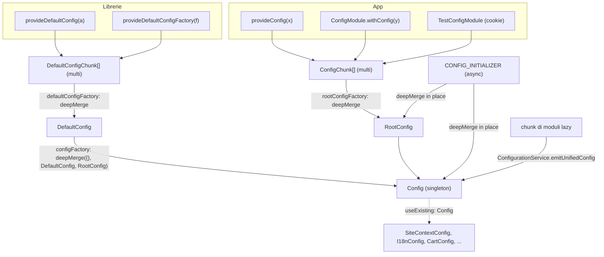
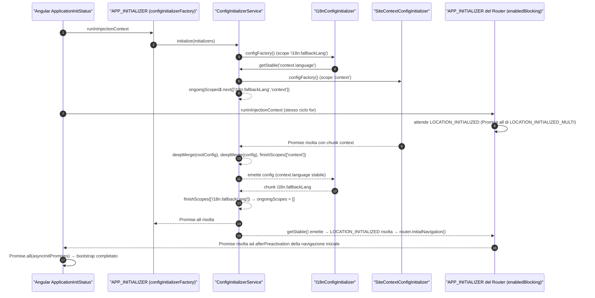
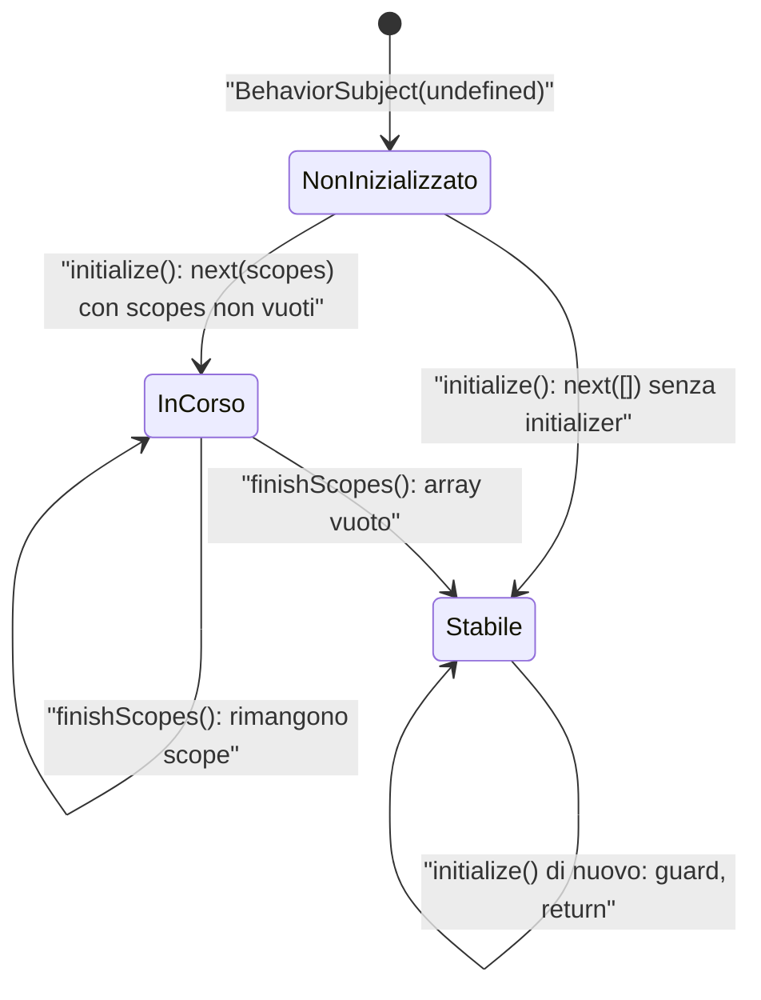
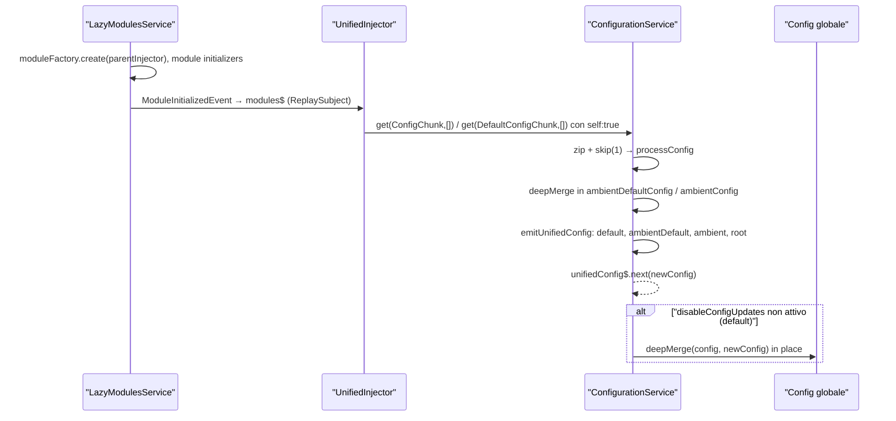

# 11 — Configurazione: provideConfig, default, merge, validator, initializer

> Riferimenti allo SHA `5b7a1c2bf2808d7380bc20596d10f4fa710c3da1` (vedi [00-meta](../00-meta.md)).

## 1. A cosa serve e perché esiste

In Spartacus quasi ogni comportamento è guidato dalla configurazione: l'URL del backend OCC, i parametri di site context, le route semantiche, il mapping dei componenti CMS, i moduli lazy, le traduzioni, i feature toggle. Il sottosistema descritto in questo capitolo risponde a quattro domande:

1. **Come si contribuisce configurazione?** Con frammenti ("chunk") registrati come multi-provider DI su due token distinti, uno per le librerie (`DefaultConfigChunk`) e uno per l'applicazione (`ConfigChunk`) — `core-libs/core/src/config/config-tokens.ts:L49-L62`.
2. **Come diventano un unico oggetto?** Con `deepMerge`, un merge ricorsivo che muta il primo argomento — `core-libs/core/src/config/utils/deep-merge.ts:L18-L49` — eseguito dalle factory dei token `DefaultConfig`, `RootConfig` e `Config` — `core-libs/core/src/config/config-tokens.ts:L10-L47`.
3. **Come si gestisce la configurazione che arriva in ritardo?** In due modi:
   - durante il bootstrap, con i `CONFIG_INITIALIZER` (config asincrona, ad esempio dal backend) orchestrati da `ConfigInitializerService` — `core-libs/core/src/config/config-initializer/config-initializer.service.ts:L130-L175`;
   - dopo il bootstrap, con la "config unificata" di `ConfigurationService`, che raccoglie i chunk dichiarati nei moduli caricati in lazy loading — `core-libs/core/src/config/services/configuration.service.ts:L57-L106`.
4. **Come si segnala una config sbagliata?** Con i `ConfigValidator`, funzioni che restituiscono un messaggio e vengono eseguite solo in dev mode — `core-libs/core/src/config/config-validator/config-validator.module.ts:L23-L37`.

Il punto di design centrale è la separazione tra **default** (librerie) e **root** (applicazione): qualsiasi `ConfigChunk` vince su qualsiasi `DefaultConfigChunk`, indipendentemente dall'ordine di import, perché i due insiemi vengono fusi separatamente e poi combinati con il root per ultimo — `core-libs/core/src/config/config-tokens.ts:L10-L12`. Il JSDoc lo dice in chiaro: "General rule is, that all config provided in libraries should be provided as default config" — `core-libs/core/src/config/config-tokens.ts:L58-L58`. Una regola ESLint di workspace lo impone sui file `**/*.module.ts` del monorepo (non sull'app demo) — `tools/eslint-rules/rules/use-provide-default-config.ts:L22-L49`, `eslint.config.mjs:L231-L239`, `projects/storefrontapp/eslint.config.mjs:L12-L13`.

Questo capitolo presuppone i concetti di DI Angular (multi provider, `InjectionToken` con `providedIn`, `inject()`) trattati in [01 — Dependency Injection](../parte-1/01-dependency-injection.md), e si collega all'ordine di bootstrap descritto in [10 — Bootstrap e ordine di inizializzazione](10-bootstrap-inizializzazione.md).

## 2. Mappa dei file

Tutti i path sono relativi a `core-libs/core/src/config/` salvo dove indicato.

| Path | Ruolo |
|---|---|
| `core-libs/core/src/config/config-tokens.ts` | Classe-token `Config` e token `DefaultConfig`, `RootConfig`, `ConfigChunk`, `DefaultConfigChunk` con le factory di merge (`configFactory`, `defaultConfigFactory`, `rootConfigFactory`) |
| `core-libs/core/src/config/config-factory.ts` | Tipo `ConfigFactory = (...props: any[]) => Config` |
| `core-libs/core/src/config/config-providers.ts` | Helper `provideConfig`, `provideConfigFactory`, `provideDefaultConfig`, `provideDefaultConfigFactory` |
| `core-libs/core/src/config/config.module.ts` | `ConfigModule` (`withConfig`, `withConfigFactory`, `forRoot`); istanzia `ConfigurationService` |
| `core-libs/core/src/config/index.ts` | Barrel pubblico della cartella (riesportato da `core-libs/core/public_api.ts`) |
| `core-libs/core/src/config/config-initializer/config-initializer.ts` | Interfaccia `ConfigInitializer`, token `CONFIG_INITIALIZER` e `CONFIG_INITIALIZER_FORROOT_GUARD`, helper `provideConfigInitializer`, `provideConfigInitializerFactory` |
| `core-libs/core/src/config/config-initializer/config-initializer.service.ts` | `ConfigInitializerService`: scope in corso, `getStable`, `initialize` |
| `core-libs/core/src/config/config-initializer/config-initializer.module.ts` | `ConfigInitializerModule.forRoot()`: guard, `APP_INITIALIZER`, location initializer |
| `core-libs/core/src/config/config-initializer/index.ts` | Barrel (non esporta il guard) |
| `core-libs/core/src/config/config-validator/config-validator.ts` | `ConfigValidatorToken`, tipo `ConfigValidator`, `provideConfigValidator`, `validateConfig` |
| `core-libs/core/src/config/config-validator/config-validator.module.ts` | `ConfigValidatorModule.forRoot()`: `APP_INITIALIZER` di validazione in dev mode |
| `core-libs/core/src/config/config-validator/index.ts` | Barrel (`export *` di entrambi i file) |
| `core-libs/core/src/config/services/configuration.service.ts` | `ConfigurationService`: config unificata con i chunk dei moduli lazy (`unifiedConfig$`) |
| `core-libs/core/src/config/test-config.module.ts` | `TestConfigModule`, `TEST_CONFIG`, `TEST_CONFIG_COOKIE_NAME`, `TestConfig`: config da cookie per i test e2e |
| `core-libs/core/src/config/utils/deep-merge.ts` | `deepMerge`, `isObject` |
| `core-libs/core/src/config/utils/get-cookie.ts` | `getCookie` (non esportato dal barrel) |
| `core-libs/core/src/config/utils/string-template.ts` | `StringTemplate.resolve`: interpolazione `${var}` usata per gli endpoint |

File correlati fuori dalla cartella, citati nel capitolo:

| Path | Ruolo nel flusso di config |
|---|---|
| `core-libs/core/src/base-core.module.ts` | Importa `ConfigModule.forRoot()`, `ConfigInitializerModule.forRoot()`, `ConfigValidatorModule.forRoot()` |
| `core-libs/core/src/routing/location-initialized-multi/location-initialized-multi.ts` | Token `LOCATION_INITIALIZED_MULTI` e `provideLocationInitializerFactory` |
| `core-libs/core/src/routing/routing.module.ts` | Fornisce `LOCATION_INITIALIZED` aggregando i `LOCATION_INITIALIZED_MULTI`; registra `SecurePortalConfigInitializer` |
| `core-libs/core/src/lazy-loading/unified-injector.ts` | `UnifiedInjector`: legge un token da root + injector dei moduli lazy |
| `core-libs/core/src/lazy-loading/lazy-modules.service.ts` | `LazyModulesService.modules$`: stream dei moduli lazy istanziati |
| `core-libs/core/src/site-context/site-context.module.ts` | Esempio di `CONFIG_INITIALIZER` condizionale e di validator |
| `core-libs/core/src/i18n/i18n.module.ts` | Altro `CONFIG_INITIALIZER` condizionale |
| `tools/eslint-rules/rules/use-provide-default-config.ts` | Regola lint che vieta `provideConfig()` (attiva come `error` solo sui file `**/*.module.ts`) |

## 3. Come funziona passo per passo

### 3.1 Il token `Config` e i tre livelli di oggetti

`Config` è una classe astratta vuota, decorata `@Injectable({ providedIn: 'root', useFactory: configFactory })` — `core-libs/core/src/config/config-tokens.ts:L14-L21`. Essendo vuota, la sua forma è data interamente dalla *module augmentation*: ogni area dichiara `interface Config extends XxxConfig {}`. Nel core l'augmentation punta al modulo relativo `config-tokens` — `core-libs/core/src/site-context/config/site-context-config.ts:L21-L23` — mentre nelle feature lib punta a `'@spartacus/core'` — `feature-libs/cart/base/root/config/cart-config.ts:L30-L32`. Per questo `Config` è elencato tra gli "augmentable types" del public API — `core-libs/core/public_api.ts:L38-L40`.

Le classi di config specifiche (`SiteContextConfig`, `I18nConfig`, …) sono anch'esse classi astratte iniettabili, ma con `useExisting: Config`: **sono alias dello stesso oggetto globale**, non oggetti separati — `core-libs/core/src/site-context/config/site-context-config.ts:L10-L19`, `core-libs/core/src/i18n/config/i18n-config.ts:L14-L23`. Iniettare `SiteContextConfig` significa ottenere l'istanza di `Config` con un tipo più stretto.

Ci sono tre oggetti di configurazione in gioco, tutti singleton in root:

| Oggetto | Costruito da | Contenuto |
|---|---|---|
| `DefaultConfig` | `defaultConfigFactory` | merge di tutti i `DefaultConfigChunk` — `core-libs/core/src/config/config-tokens.ts:L23-L35` |
| `RootConfig` | `rootConfigFactory` | merge di tutti i `ConfigChunk` — `core-libs/core/src/config/config-tokens.ts:L37-L47` |
| `Config` | `configFactory` | `deepMerge({}, DefaultConfig, RootConfig)` — `core-libs/core/src/config/config-tokens.ts:L10-L12` |

Entrambi i chunk token sono `InjectionToken<Config[]>` **senza factory**: se nessuno li fornisce, `inject(..., { optional: true })` restituisce `null` e il codice ripiega su `[]` — `core-libs/core/src/config/config-tokens.ts:L26-L26`, `L38-L38`. Il tipo `Config[]` riflette il fatto che sono multi-token (array di chunk) — `core-libs/core/src/config/config-tokens.ts:L53-L53`, `L60-L62`.

Le tre factory non sono esportate dal barrel: `index.ts` riesporta da `config-tokens` solo i cinque simboli `Config`, `ConfigChunk`, `DefaultConfig`, `DefaultConfigChunk`, `RootConfig` — `core-libs/core/src/config/index.ts:L10-L16`.

### 3.2 Contribuire configurazione: gli helper `provide*`

I quattro helper sono semplici costruttori di provider multi:

| Helper | Provider | Token | Riferimento |
|---|---|---|---|
| `provideConfig(config = {}, defaultConfig = false)` | `ValueProvider` | `ConfigChunk` (o `DefaultConfigChunk` se `defaultConfig`) | `core-libs/core/src/config/config-providers.ts:L18-L27` |
| `provideConfigFactory(factory, deps?, defaultConfig = false)` | `FactoryProvider` | idem | `core-libs/core/src/config/config-providers.ts:L37-L48` |
| `provideDefaultConfig(config = {})` | `ValueProvider` | `DefaultConfigChunk` | `core-libs/core/src/config/config-providers.ts:L55-L61` |
| `provideDefaultConfigFactory(factory, deps?)` | `FactoryProvider` | `DefaultConfigChunk` | `core-libs/core/src/config/config-providers.ts:L69-L79` |

Il tipo della factory è `ConfigFactory`, una funzione con argomenti arbitrari che restituisce `Config` — `core-libs/core/src/config/config-factory.ts:L7-L9`. Gli argomenti arrivano da `deps` secondo la semantica classica di `FactoryProvider`; in alternativa la factory può usare `inject()` perché è eseguita in injection context (come fa `TestConfigModule`, `core-libs/core/src/config/test-config.module.ts:L99-L102`).

Il JSDoc di `provideConfig` ricorda che nelle librerie va usato `provideDefaultConfig` — `core-libs/core/src/config/config-providers.ts:L11-L17` — e le due regole ESLint `use-provide-default-config` e `use-provide-default-config-factory` segnalano ogni `CallExpression` di `provideConfig()`/`provideConfigFactory()` — `tools/eslint-rules/rules/use-provide-default-config.ts:L22-L49`, `tools/eslint-rules/rules/use-provide-default-config-factory.ts:L22-L46` — ma sono abilitate come `error` solo per i file `**/*.module.ts` del workspace — `eslint.config.mjs:L231-L239` — e disattivate nell'app demo — `projects/storefrontapp/eslint.config.mjs:L12-L13`. Una chiamata in un `*.providers.ts` o `*.config.ts` non viene segnalata. L'app demo invece, da "consumer", usa `provideConfig` per backend, routing e `features.level` — `projects/storefrontapp/src/app/private/private.providers.ts:L19-L50`.

### 3.3 `ConfigModule`: la variante NgModule

`ConfigModule` offre tre metodi statici:

- `withConfig(config)` → `providers: [provideConfig(config)]` — `core-libs/core/src/config/config.module.ts:L28-L34`;
- `withConfigFactory(factory, deps?)` → `provideConfigFactory(factory, deps)` — `core-libs/core/src/config/config.module.ts:L44-L53`;
- `forRoot(config = {})` → identico a `withConfig` — `core-libs/core/src/config/config.module.ts:L60-L66`.

Tutti contengono un `eslint-disable-next-line` per la regola di cui sopra. Il ruolo vero del modulo è un altro: il suo costruttore inietta `ConfigurationService` "to make sure ConfigurationService will be instantiated" — `core-libs/core/src/config/config.module.ts:L13-L19`. È l'unico punto di libreria che lo inietta (fuori dalla cartella `config/` il grep trova solo una costante delle schematics, `core-libs/schematics/src/shared/constants.ts:L328-L328`, e una menzione nel JSDoc di `disableConfigUpdates`, `core-libs/core/src/features-config/config/features-config.ts:L112-L112`).

`BaseCoreModule` importa, in quest'ordine, `ErrorHandlingModule.forRoot()`, `StateModule.forRoot()`, `ConfigModule.forRoot()`, `ConfigInitializerModule.forRoot()`, `ConfigValidatorModule.forRoot()` — `core-libs/core/src/base-core.module.ts:L26-L32`. Quindi in una storefront standard i tre moduli di config sono sempre presenti.

### 3.4 Costruzione sincrona della `Config` globale

La `Config` viene costruita **pigramente**, alla prima iniezione di `Config` o di un suo alias `useExisting`:

1. `inject(Config)` → Angular esegue `configFactory` — `core-libs/core/src/config/config-tokens.ts:L17-L21`.
2. `configFactory` chiede `DefaultConfig` → `defaultConfigFactory` fonde i `DefaultConfigChunk` nell'ordine dei provider — `core-libs/core/src/config/config-tokens.ts:L23-L28`.
3. Poi chiede `RootConfig` → `rootConfigFactory` fonde i `ConfigChunk` — `core-libs/core/src/config/config-tokens.ts:L37-L39`.
4. `deepMerge({}, DefaultConfig, RootConfig)` produce l'oggetto `Config` — `core-libs/core/src/config/config-tokens.ts:L11-L11`.

L'ordine dei chunk all'interno dello stesso token è l'ordine in cui l'`R3Injector` li ha accumulati nel record multi (`multiRecord.multi!.push(provider)`) — `angular:packages/core/src/di/r3_injector.ts:L497-L512`. Tra provider dichiarati in `makeEnvironmentProviders` e quelli provenienti da `importProvidersFrom` vale l'ordine di posizione nell'array: `makeEnvironmentProviders` conserva l'array così com'è — `angular:packages/core/src/di/provider_collection.ts:L46-L52` — `importProvidersFrom` restituisce l'elenco dei provider raccolti in ordine (`providersOut.push(provider)`, con i `ModuleWithProviders` elaborati dopo i moduli semplici) — `angular:packages/core/src/di/provider_collection.ts:L151-L189` — e l'`R3Injector` appiattisce array ed `EnvironmentProviders` con una visita in profondità ordinata — `angular:packages/core/src/di/r3_injector.ts:L725-L738`. Nell'app demo, quindi, il `provideConfig` di `private.providers.ts` precede il `ConfigChunk` di `TestConfigModule.forRoot()`, che vince — `projects/storefrontapp/src/app/private/private.providers.ts:L19-L56`.

### 3.5 L'algoritmo di `deepMerge`

`deepMerge(target = {}, ...sources)`:

1. Se non restano sorgenti restituisce `target` — `core-libs/core/src/config/utils/deep-merge.ts:L22-L24`.
2. Estrae la prima sorgente con `sources.shift()`; una sorgente falsy diventa `{}` — `core-libs/core/src/config/utils/deep-merge.ts:L25-L25`.
3. Se la sorgente non è un oggetto "semplice" (array, primitivo) la salta e ricorre sulle restanti — `core-libs/core/src/config/utils/deep-merge.ts:L27-L29`. `isObject` è vero solo per oggetti non nulli e non array — `core-libs/core/src/config/utils/deep-merge.ts:L7-L9`.
4. Per ogni chiave enumerabile (`for...in`) — `core-libs/core/src/config/utils/deep-merge.ts:L31-L46`:
   - salta `__proto__` e `constructor` (protezione da prototype pollution) — `core-libs/core/src/config/utils/deep-merge.ts:L11-L16`, `L32-L34`;
   - un `Date` viene copiato per riferimento — `L36-L37`;
   - un oggetto viene fuso ricorsivamente, creando prima `{}` nel target se lì non c'è un oggetto — `L38-L42`;
   - tutto il resto (primitivi **e array**) sovrascrive — `L43-L45`.
5. Ricorre sulle sorgenti rimanenti e restituisce `target` — `core-libs/core/src/config/utils/deep-merge.ts:L48-L48`.

Due conseguenze pratiche:

- gli array **non si concatenano**: lo spec lo verifica ("should overrite arrays") — `core-libs/core/src/config/utils/deep-merge.spec.ts:L86-L86`;
- poiché `configFactory` parte da `{}` e il ramo oggetto crea nuovi `{}` (`L39-L41`), la `Config` globale ha **oggetti annidati propri** ma **array e `Date` condivisi** con i chunk sorgente (`L36-L37`, `L43-L45`).

`deepMerge` e `isObject` sono API pubbliche — `core-libs/core/src/config/index.ts:L27-L27`.

### 3.6 Config asincrona: `CONFIG_INITIALIZER`

Alcune parti di config possono essere note solo a runtime (es. il base site dipende dall'URL e dalla risposta del backend). Il contratto è l'interfaccia `ConfigInitializer` — `core-libs/core/src/config/config-initializer/config-initializer.ts:L15-L28`:

- `scopes: string[]` — le parti di config che l'initializer risolve, es. `'context.baseSite'`;
- `configFactory: () => Promise<Config>` — la Promise che produce il chunk.

Gli initializer si registrano sul token `CONFIG_INITIALIZER` (`InjectionToken<ConfigInitializer | null>`, multi per convenzione) — `core-libs/core/src/config/config-initializer/config-initializer.ts:L30-L35` — con `provideConfigInitializer(Classe)` (`ClassProvider` multi) — `L46-L52` — o `provideConfigInitializerFactory(() => initializer | null)` (`FactoryProvider` multi) — `L59-L67`. La factory può restituire `null` per disattivare l'initializer.

**Registrazione del motore.** `ConfigInitializerModule.forRoot()` fornisce tre cose — `core-libs/core/src/config/config-initializer/config-initializer.module.ts:L41-L68`:

1. il guard `CONFIG_INITIALIZER_FORROOT_GUARD` con valore `true` (`L47-L50`) — un token non esportato dal barrel (`core-libs/core/src/config/config-initializer/index.ts:L7-L14`) che segnala la presenza del modulo;
2. un `APP_INITIALIZER` multi con `configInitializerFactory`, che riceve `ConfigInitializerService` e l'array opzionale dei `CONFIG_INITIALIZER` (`L51-L59`) e restituisce `() => configInitializer.initialize(initializers)` (`L24-L30`);
3. un *location initializer* che trattiene la navigazione iniziale finché `getStable()` non emette (`L60-L64`) — vedi §3.8.

**`initialize`.** Il metodo è marcato `@internal` — `core-libs/core/src/config/config-initializer/config-initializer.service.ts:L124-L129` — e procede così:

1. Se `ongoingScopes$.value` è già definito esce: "guard for double initialization" — `L131-L134`.
2. Per ogni initializer — `L140-L169`:
   - salta i valori `null`/falsy (`L141-L143`);
   - lancia `Error('CONFIG_INITIALIZER should provide scope!')` se mancano gli scope (`L144-L146`);
   - in dev mode, se gli scope si sovrappongono a quelli già registrati, logga un warning (`L148-L152`);
   - aggiunge gli scope a `ongoingScopes` e avvia subito un'IIFE async che attende `configFactory()`, fonde il risultato **prima in `rootConfig` poi in `config`**, e chiama `finishScopes` (`L154-L168`).
3. Solo dopo aver avviato tutti gli initializer emette su `ongoingScopes$` l'elenco completo (`L170-L170`).
4. Attende `Promise.all` di tutte le IIFE (`L172-L174`). Se una factory rifiuta, rifiuta `initialize` e quindi l'`APP_INITIALIZER`; Angular raccoglie le Promise di tutti gli initializer e rifiuta l'inizializzazione dell'app — `angular:packages/core/src/application/application_init.ts:L239-L269`. Lo spec copre il caso ("should fail if one initializer will fail") — `core-libs/core/src/config/config-initializer/config-initializer.service.spec.ts:L195-L195`.

Il merge in `rootConfig` oltre che in `config` mantiene coerente la config unificata dei moduli lazy, che riapplica `rootConfig` per ultimo (§3.9, `core-libs/core/src/config/services/configuration.service.ts:L93-L99`): senza questo passaggio un default di un modulo lazy potrebbe sovrascrivere un valore caricato dal backend. (Interpretazione del codice: il sorgente commenta solo "contribute configuration to rootConfig", `config-initializer.service.ts:L159-L159`.)

### 3.7 Attendere la stabilità: `getStable` e gli scope

`ConfigInitializerService` mantiene lo stato in `ongoingScopes$`, un `BehaviorSubject<string[] | undefined>` che parte da `undefined` ("initialize non ancora eseguito") — `core-libs/core/src/config/config-initializer/config-initializer.service.ts:L35-L37`.

- `isStable` è `true` se **il guard è assente** oppure se gli scope in corso sono un array vuoto — `L42-L44`.
- `getStable(...scopes)` restituisce `of(this.config)` se stabile; altrimenti filtra `ongoingScopes$` scartando `undefined` e le emissioni in cui gli scope richiesti non sono pronti, prende la prima (`take(1)`) e la mappa su `this.config` — `L58-L70`. Il JSDoc lo indica come "Recommended way to get config for code that can run before app will finish initialization" — `L46-L57`.
- `areReady(scopes, ongoing)`: senza scope richiesti è vero solo se non c'è nulla in corso; altrimenti è falso se uno scope richiesto si sovrappone a uno in corso — `L91-L103`.
- `scopesOverlap(a, b)`: sovrapposti se uno è prefisso dell'altro con confine a `.` — `'test'`/`'test.a'` sì, `'test'`/`'testA'` no — `L105-L122`.
- `finishScopes` rimuove gli scope conclusi da una copia dell'array ed emette — `L77-L83`.

Il fatto che l'elenco completo venga emesso solo **dopo** l'avvio di tutte le factory (`L170-L170`) abilita le dipendenze tra initializer: `I18nConfigInitializer` (scope `['i18n.fallbackLang']`) dentro la propria `configFactory` chiama `getStable('context.language')` — `core-libs/core/src/i18n/config/i18n-config-initializer.ts:L14-L33`. In quell'istante `ongoingScopes$` vale ancora `undefined`, `isStable` è falso e il filtro `!!ongoingScopes` lo fa aspettare la lista completa; poi attende che lo scope `context` (registrato da `SiteContextConfigInitializer`) si chiuda.

Consumatori tipici di `getStable` con scope: `CmsComponentsService` (`'cmsComponents'`) — `core-libs/storefront/cms-structure/services/cms-components.service.ts:L61-L62`; `CmsFeaturesService` (`'featureModules'`) — `core-libs/storefront/cms-structure/services/cms-features.service.ts:L57-L58`; `DirectionService` (`'direction'`) — `core-libs/storefront/layout/direction/direction.service.ts:L48-L48`; `OAuthLibWrapperService` (`'authentication'`) — `core-libs/core/src/auth/user-auth/services/oauth-lib-wrapper.service.ts:L59-L59`; la persistenza del carrello (`'context'`) — `feature-libs/cart/base/core/cart-persistence.module.ts:L25-L25`. Inoltre un `APP_INITIALIZER` del site context (`initializeContext`) attende `getStable('context')` — `core-libs/core/src/site-context/providers/context-service-providers.ts:L15-L21` (registrazione come `APP_INITIALIZER` a `L27-L31`).

### 3.8 Bloccare la navigazione iniziale

Il terzo provider di `ConfigInitializerModule` è `provideLocationInitializerFactory(...)` — `core-libs/core/src/config/config-initializer/config-initializer.module.ts:L60-L64` — che crea un multi-provider sul token Spartacus `LOCATION_INITIALIZED_MULTI` — `core-libs/core/src/routing/location-initialized-multi/location-initialized-multi.ts:L36-L51` (pubblico via `core-libs/core/src/routing/index.ts:L11-L11`).

`RoutingModule.forRoot()` fornisce il token Angular `LOCATION_INITIALIZED` con una factory che esegue tutti i `LOCATION_INITIALIZED_MULTI` e ne fa `Promise.all` — `core-libs/core/src/routing/routing.module.ts:L66-L71`, `L102-L105`. Lo storefront configura il router con `initialNavigation: 'enabledBlocking'` — `core-libs/storefront/router/app-routing.module.ts:L13-L19` — e con questa opzione Angular registra un app initializer che attende `LOCATION_INITIALIZED` prima di far partire la navigazione iniziale — `angular:packages/router/src/provide_router.ts:L441-L465`.

Risultato: **nessuna route viene riconosciuta prima che tutta la config Spartacus sia stabile**. Questo è essenziale perché la config di routing stessa può essere asincrona (`SecurePortalConfigInitializer`, scope `['routing']`, `core-libs/core/src/routing/configurable-routes/secure-portal-config/secure-portal-config-initializer.ts:L16-L19`).

### 3.9 Moduli lazy: `ConfigurationService` e la config unificata

Quando un modulo viene caricato in lazy loading (vedi [12 — Feature module e lazy loading](12-feature-module-lazy.md)), i suoi `provideDefaultConfig`/`provideConfig` finiscono nel suo injector, non nel root: un multi-provider crea un record proprio nell'`R3Injector` in cui è registrato — `angular:packages/core/src/di/r3_injector.ts:L497-L512`. La `Config` globale, già costruita, non li vedrebbe. Ci pensa `ConfigurationService`:

1. Viene istanziato dal costruttore di `ConfigModule` — `core-libs/core/src/config/config.module.ts:L15-L19`.
2. Nel costruttore inietta `RootConfig`, `DefaultConfig`, `UnifiedInjector`, `Config`; crea `unifiedConfig$` come `BehaviorSubject(config)` e si sottoscrive subito a `feedUnifiedConfig()` "to propagate changes to the config from the beginning" — `core-libs/core/src/config/services/configuration.service.ts:L42-L55`.
3. `feedUnifiedConfig` chiede a `UnifiedInjector` gli stream di `ConfigChunk` e `DefaultConfigChunk` con `notFoundValue` `[]`, li accoppia con `zip` e salta la prima emissione (quella del root injector) — `L57-L74`.
4. `UnifiedInjector.injectors$` parte dal root e aggiunge l'injector di ogni modulo emesso da `LazyModulesService.modules$` — `core-libs/core/src/lazy-loading/unified-injector.ts:L32-L35`; `get` interroga ogni injector con `{ self: true }` tranne il primo, ed emette una volta per injector quando c'è un `notFoundValue` — `core-libs/core/src/lazy-loading/unified-injector.ts:L42-L68`. Il flag `Self` fa terminare il lookup sul `NullInjector` invece che sul parent — `angular:packages/core/src/di/r3_injector.ts:L374-L376` — quindi si ottengono solo i chunk propri del modulo lazy.
5. `modules$` è un `connectable` con `ReplaySubject` alimentato dagli eventi `ModuleInitializedEvent` — `core-libs/core/src/lazy-loading/lazy-modules.service.ts:L47-L68` — che `resolveModuleInstance` dispatcha dopo aver creato il modulo ed eseguito i suoi module initializer — `core-libs/core/src/lazy-loading/lazy-modules.service.ts:L78-L107`.
6. `processConfig` accumula i default chunk in `ambientDefaultConfig` e i chunk in `ambientConfig` (accumulatori privati inizializzati a `{}`, `configuration.service.ts:L37-L38`) ed emette solo se almeno uno dei due array non è vuoto — `core-libs/core/src/config/services/configuration.service.ts:L76-L90`.
7. `emitUnifiedConfig` fonde `defaultConfig → ambientDefaultConfig → ambientConfig → rootConfig` in un oggetto nuovo e lo emette su `unifiedConfig$` — `L92-L100`.
8. Salvo il flag `features.disableConfigUpdates`, la nuova config viene anche fusa **in place** nella `Config` globale ("compatibility mechanism") — `L102-L105`.

Il flag `disableConfigUpdates` è dichiarato in `FeaturesConfig` come `@deprecated`, "disabled by default and recommended to keep it so" — `core-libs/core/src/features-config/config/features-config.ts:L101-L116` — e `isFeatureEnabled` lo accetta esplicitamente come secondo argomento — `core-libs/core/src/features-config/utils/feature-config-utils.ts:L48-L51`. Nessun servizio di libreria consuma `unifiedConfig$`: l'unico riferimento extra è nel JSDoc del flag — `core-libs/core/src/features-config/config/features-config.ts:L112-L112`.

### 3.10 Validazione in dev mode

- `ConfigValidator` è il tipo `(config: Config) => string | void`: una stringa significa "validazione fallita" — `core-libs/core/src/config/config-validator/config-validator.ts:L15-L20`.
- `provideConfigValidator(fn)` registra un multi `useValue` su `ConfigValidatorToken` — `core-libs/core/src/config/config-validator/config-validator.ts:L11-L13`, `L27-L35`.
- `ConfigValidatorModule.forRoot()` registra un `APP_INITIALIZER` con deps `ConfigInitializerService` e i validator opzionali — `core-libs/core/src/config/config-validator/config-validator.module.ts:L45-L63`.
- `configValidatorFactory` inietta `LoggerService` con `inject()` e restituisce una funzione **sincrona** che, solo se `isDevMode()`, si sottoscrive a `getStable()` — `config-validator.module.ts:L23-L37`.
- Alla config stabile `validateConfig` esegue ogni validator e logga con `logger.warn` i messaggi restituiti; non lancia mai — `core-libs/core/src/config/config-validator/config-validator.ts:L37-L48`.

`isDevMode()` di Angular è vero se `ngDevMode` è `undefined` o truthy — `angular:packages/core/src/util/is_dev_mode.ts:L20-L22`. Esempio di validator: `baseSiteConfigValidator` restituisce "Please configure context.parameters.baseSite before using storefront library!" se manca il default del base site — `core-libs/core/src/site-context/config/base-site-config-validator.ts:L11-L15`. Altri validator registrati: `occConfigValidator` — `core-libs/core/src/occ/base-occ.module.ts:L31-L31`; `baseUrlConfigValidator` — `core-libs/core/src/auth/user-auth/user-auth.module.ts:L107-L107`; `epdVisualizationConfigValidator` — `integration-libs/epd-visualization/root/epd-visualization-root.module.ts:L35-L35`; `cdsConfigValidator` — `integration-libs/cds/src/cds.module.ts:L42-L42`.

### 3.11 Initializer concreti nel core

| Initializer | Scope | Attivazione | Riferimenti |
|---|---|---|---|
| `SiteContextConfigInitializer` | `['context']` | solo se manca `context.baseSite` statico (`initSiteContextConfig` restituisce `null` altrimenti) | `core-libs/core/src/site-context/config/config-loader/site-context-config-initializer.ts:L24-L27`; `core-libs/core/src/site-context/site-context.module.ts:L30-L41`, `L51-L61` |
| `I18nConfigInitializer` | `['i18n.fallbackLang']` | solo se `i18n.fallbackLang` è `undefined` | `core-libs/core/src/i18n/config/i18n-config-initializer.ts:L14-L33`; `core-libs/core/src/i18n/i18n.module.ts:L30-L53` |
| `SecurePortalConfigInitializer` | `['routing']` | solo se `routing.protected` è `undefined` (`initSecurePortalConfig` restituisce `null` altrimenti, `core-libs/core/src/routing/routing.module.ts:L44-L52`) | `core-libs/core/src/routing/configurable-routes/secure-portal-config/secure-portal-config-initializer.ts:L16-L19`; `core-libs/core/src/routing/routing.module.ts:L96-L101` |
| `AuthConfigInitializer` | `['authentication.OAuthLibConfig.redirectUri', 'authentication.client_id']` | solo con feature toggle `asyncAuthConfigInitializer` | `core-libs/core/src/auth/user-auth/user-auth.module.ts:L106-L113`; `core-libs/core/src/auth/user-auth/config/auth-config-initializer.ts:L20-L24` |

Si notano tre stili di registrazione: provider scritto a mano con `useFactory` + `deps` (`site-context.module.ts:L56-L61`), `provideConfigInitializerFactory` con `inject()` (`routing.module.ts:L96-L101`), e un toggle con commento "When removing this feature toggle, switch to `provideConfigInitializer`" (`user-auth.module.ts:L109-L109`).

### 3.12 Config per i test e2e: `TestConfigModule`

`TestConfigModule.forRoot({ cookie })` — `core-libs/core/src/config/test-config.module.ts:L83-L105`:

1. fornisce il nome del cookie su `TEST_CONFIG_COOKIE_NAME`;
2. `TEST_CONFIG` (root) legge il cookie solo in browser e se il nome è definito, e ne fa il parse — `test-config.module.ts:L35-L55`; `parseConfigJSON` applica `decodeURIComponent` + `JSON.parse` e restituisce `{}` in caso di errore — `L57-L63`;
3. passa `TEST_CONFIG.features` ai feature toggle e l'intero `TEST_CONFIG` come `ConfigChunk` via `provideConfigFactory` — `L95-L102`.

La lettura del cookie usa `getCookie`, che costruisce una RegExp concatenando il nome — `core-libs/core/src/config/utils/get-cookie.ts:L7-L12`. L'app demo importa `TestConfigModule.forRoot({ cookie: 'cxConfigE2E' })` con il commento "Should be imported after other config modules" — `projects/storefrontapp/src/app/private/private.providers.ts:L52-L56`. Il JSDoc avverte: "CAUTION: DON'T USE IT IN PRODUCTION!" — `core-libs/core/src/config/test-config.module.ts:L69-L73`.

### 3.13 `StringTemplate`

`StringTemplate.resolve(template, variables, encodeVariable?)` sostituisce ogni `${nome}` con il valore, opzionalmente passato per `encodeURIComponent` — `core-libs/core/src/config/utils/string-template.ts:L15-L31`. È nella cartella config perché i template degli endpoint OCC sono configurazione; entrambi i chiamanti di libreria passano `true` — `core-libs/core/src/occ/services/occ-endpoints.service.ts:L122-L122`, `integration-libs/opf/base/core/services/opf-endpoints.service.ts:L47-L47`. Il dettaglio sugli endpoint è in [21 — Livello OCC](21-occ.md).

## 4. Diagrammi

### 4.1 Costruzione della Config e priorità dei livelli



Ogni freccia corrisponde a: §3.2 (`config-providers.ts:L18-L79`), §3.4 (`config-tokens.ts:L10-L47`), §3.6 (`config-initializer.service.ts:L158-L165`), §3.9 (`configuration.service.ts:L92-L105`), §3.1 (`site-context-config.ts:L10-L19`), §3.12 (`test-config.module.ts:L99-L102`).

### 4.2 Bootstrap con config asincrona



Passi: 1 → `application_init.ts:L245-L246`; 2 → `config-initializer.module.ts:L24-L30`; 3, 5 → `config-initializer.service.ts:L154-L158`; 4 → `i18n-config-initializer.ts:L25-L25` (vedi §3.7); 6 → `config-initializer.service.ts:L170-L170`; 7 → `angular:packages/core/src/application/application_init.ts:L245-L248`, `angular:packages/router/src/router_module.ts:L240-L241`; 8 → `angular:packages/router/src/provide_router.ts:L445-L452`, `routing.module.ts:L66-L71`; 9-10 → `config-initializer.service.ts:L158-L166`; 11 → `L58-L70`; 13 → `L77-L83`; 14 → `L172-L174`; 15 → `config-initializer.module.ts:L60-L64`, `angular:packages/router/src/provide_router.ts:L452-L469`; 16-17 → `angular:packages/router/src/provide_router.ts:L462-L468`, `angular:packages/core/src/application/application_init.ts:L263-L269`.

L'ordine dei passi 3-5 riflette l'ordine dei provider `CONFIG_INITIALIZER` nella storefront standard: `BaseCoreModule` importa `I18nModule.forRoot()` prima di `SiteContextModule.forRoot()` — `core-libs/core/src/base-core.module.ts:L33-L38` — e Angular elabora i `ModuleWithProviders` nell'ordine di import — `angular:packages/core/src/di/provider_collection.ts:L316-L320`. Con un ordine diverso il risultato non cambia, perché `ongoingScopes$` viene emesso solo al passo 6. Spartacus usa `RouterModule.forRoot({initialNavigation: 'enabledBlocking'})`, che Angular traduce in `withEnabledBlockingInitialNavigation()` — `angular:packages/router/src/router_module.ts:L240-L241`: l'attesa di `LOCATION_INITIALIZED` è quindi essa stessa un `APP_INITIALIZER`, avviato nello stesso ciclo `for` di `runInitializers` e concorrente a `configInitializerFactory` (la posizione relativa dei due nel ciclo dipende dall'ordine dei provider ed è irrilevante: entrambi restano pendenti). L'ordine relativo tra la risoluzione di `SiteContextConfigInitializer` e l'emissione del passo 6 è garantito perché la ripresa dopo `await` avviene sempre in un microtask successivo all'esecuzione sincrona del ciclo `for`.

### 4.3 Stato di `ongoingScopes$`



Riferimenti: `config-initializer.service.ts:L35-L37` (stato iniziale), `L170-L170` (emissione), `L77-L83` (`finishScopes`), `L42-L44` (`isStable`), `L131-L134` (guard). Se il guard `CONFIG_INITIALIZER_FORROOT_GUARD` manca, `isStable` è sempre vero indipendentemente da questo stato (`L43-L43`).

### 4.4 Config unificata da moduli lazy



Riferimenti: `lazy-modules.service.ts:L78-L107`, `L47-L68`; `unified-injector.ts:L32-L35`, `L42-L68`; `configuration.service.ts:L57-L106`.

## 5. Estratti di codice reale

**Il cuore della costruzione della config** — `core-libs/core/src/config/config-tokens.ts:L10-L21`

```ts
export function configFactory() {
  return deepMerge({}, inject(DefaultConfig), inject(RootConfig));
}

/**
 * Global Configuration, can be used to inject configuration to any part of the app
 */
@Injectable({
  providedIn: 'root',
  useFactory: configFactory,
})
export abstract class Config {}
```

**Factory dei due livelli** — `core-libs/core/src/config/config-tokens.ts:L23-L47`

```ts
export function defaultConfigFactory() {
  return deepMerge(
    {},
    ...(inject(DefaultConfigChunk, { optional: true }) ?? [])
  );
}
// ...
export const DefaultConfig = new InjectionToken('DefaultConfiguration', {
  providedIn: 'root',
  factory: defaultConfigFactory,
});

export function rootConfigFactory() {
  return deepMerge({}, ...(inject(ConfigChunk, { optional: true }) ?? []));
}
// ...
export const RootConfig = new InjectionToken('RootConfiguration', {
  providedIn: 'root',
  factory: rootConfigFactory,
});
```

**Un helper provide** — `core-libs/core/src/config/config-providers.ts:L18-L27`

```ts
export function provideConfig(
  config: Config = {},
  defaultConfig = false
): ValueProvider {
  return {
    provide: defaultConfig ? DefaultConfigChunk : ConfigChunk,
    useValue: config,
    multi: true,
  };
}
```

**`deepMerge`** — `core-libs/core/src/config/utils/deep-merge.ts:L18-L49`

```ts
export function deepMerge(
  target: Record<string, unknown> = {},
  ...sources: any[]
): any {
  if (!sources.length) {
    return target;
  }
  const source = sources.shift() || {};

  if (!isObject(source)) {
    return deepMerge(target, ...sources);
  }

  for (const key in source) {
    if (isRestricted(key)) {
      continue;
    }

    if (source[key] instanceof Date) {
      target[key] = source[key];
    } else if (isObject(source[key])) {
      if (!isObject(target[key])) {
        target[key] = {};
      }
      deepMerge(target[key] as Record<string, unknown>, source[key]);
    } else {
      target[key] = source[key];
    }
  }

  return deepMerge(target, ...sources);
}
```

**Registrazione del motore degli initializer** — `core-libs/core/src/config/config-initializer/config-initializer.module.ts:L41-L68`

```ts
@NgModule({})
export class ConfigInitializerModule {
  static forRoot(): ModuleWithProviders<ConfigInitializerModule> {
    return {
      ngModule: ConfigInitializerModule,
      providers: [
        {
          provide: CONFIG_INITIALIZER_FORROOT_GUARD,
          useValue: true,
        },
        {
          provide: APP_INITIALIZER,
          multi: true,
          useFactory: configInitializerFactory,
          deps: [
            ConfigInitializerService,
            [new Optional(), CONFIG_INITIALIZER],
          ],
        },
        provideLocationInitializerFactory(() => {
          // Hold on the initial navigation until the Spartacus configuration is stable
          const configInitializer = inject(ConfigInitializerService);
          return () => lastValueFrom(configInitializer.getStable());
        }),
      ],
    };
  }
}
```

**`initialize`** — `core-libs/core/src/config/config-initializer/config-initializer.service.ts:L130-L175`

```ts
  async initialize(initializers?: ConfigInitializer[]) {
    if (this.ongoingScopes$.value) {
      // guard for double initialization
      return;
    }

    const ongoingScopes: string[] = [];

    const asyncConfigs: Promise<void>[] = [];

    for (const initializer of initializers || []) {
      if (!initializer) {
        continue;
      }
      if (!initializer.scopes || !initializer.scopes.length) {
        throw new Error('CONFIG_INITIALIZER should provide scope!');
      }

      if (isDevMode() && !this.areReady(initializer.scopes, ongoingScopes)) {
        this.logger.warn(
          'More than one CONFIG_INITIALIZER is initializing the same config scope.'
        );
      }

      ongoingScopes.push(...initializer.scopes);

      asyncConfigs.push(
        (async () => {
          const initializerConfig = await initializer.configFactory();
          // contribute configuration to rootConfig
          deepMerge(
            this.rootConfig as Record<string, unknown>,
            initializerConfig
          );
          // contribute configuration to global config
          deepMerge(this.config as Record<string, unknown>, initializerConfig);
          this.finishScopes(initializer.scopes);
        })()
      );
    }
    this.ongoingScopes$.next(ongoingScopes);

    if (asyncConfigs.length) {
      await Promise.all(asyncConfigs);
    }
  }
```

**`getStable`** — `core-libs/core/src/config/config-initializer/config-initializer.service.ts:L58-L70`

```ts
  getStable(...scopes: string[]): Observable<Config> {
    if (this.isStable) {
      return of(this.config);
    }
    return this.ongoingScopes$.pipe(
      filter(
        (ongoingScopes) =>
          !!ongoingScopes && this.areReady(scopes, ongoingScopes)
      ),
      take(1),
      map(() => this.config)
    );
  }
```

**Initializer condizionale del site context** — `core-libs/core/src/site-context/site-context.module.ts:L30-L41`

```ts
export function initSiteContextConfig(
  configInitializer: SiteContextConfigInitializer,
  config: SiteContextConfig
): ConfigInitializer | null {
  /**
   * Load config for `context` from backend only when there is no static config for `context.baseSite`
   */
  if (!config.context?.[BASE_SITE_CONTEXT_ID]) {
    return configInitializer;
  }
  return null;
```

**Validatore in dev mode** — `core-libs/core/src/config/config-validator/config-validator.module.ts:L23-L37`

```ts
export function configValidatorFactory(
  configInitializer: ConfigInitializerService,
  validators: ConfigValidator[]
): () => void {
  const logger = inject(LoggerService);
  return () => {
    if (isDevMode()) {
      configInitializer
        .getStable()
        .subscribe((config) =>
          validateConfig(config, validators || [], logger)
        );
    }
  };
}
```

**Config unificata** — `core-libs/core/src/config/services/configuration.service.ts:L92-L106`

```ts
  private emitUnifiedConfig(): void {
    const newConfig: Config = deepMerge(
      {},
      this.defaultConfig,
      this.ambientDefaultConfig,
      this.ambientConfig,
      this.rootConfig
    );
    (this.unifiedConfig$ as BehaviorSubject<Config>).next(newConfig);

    // compatibility mechanism, can be disabled with feature toggle
    if (!isFeatureEnabled(this.config, 'disableConfigUpdates')) {
      deepMerge(this.config as Record<string, unknown>, newConfig);
    }
  }
```

**Module augmentation di una feature lib** — `feature-libs/cart/base/root/config/cart-config.ts:L30-L32`

```ts
declare module '@spartacus/core' {
  interface Config extends CartConfig {}
}
```

## 6. Configurazione

Il sottosistema è il "contenitore" della configurazione; le chiavi che lo governano direttamente sono poche.

| Chiave | Tipo | Default | Definita in | Letta in |
|---|---|---|---|---|
| `features.disableConfigUpdates` | `boolean?` | non impostata (= `false`, "disabled by default") | `core-libs/core/src/features-config/config/features-config.ts:L101-L116` | `core-libs/core/src/config/services/configuration.service.ts:L103-L103` via `isFeatureEnabled` (`core-libs/core/src/features-config/utils/feature-config-utils.ts:L48-L51`) |
| `context.baseSite` (statico) | `string[]` | — | `core-libs/core/src/site-context/config/site-context-config.ts:L15-L18` | `core-libs/core/src/site-context/site-context.module.ts:L36-L38` (se presente, `SiteContextConfigInitializer` non viene attivato) |
| `i18n.fallbackLang` | `string \| false` | `undefined` (esplicito in `defaultI18nConfig`, `core-libs/core/src/i18n/config/default-i18n-config.ts:L9-L14`) | `core-libs/core/src/i18n/config/i18n-config.ts:L19-L23` | `core-libs/core/src/i18n/i18n.module.ts:L30-L32` (se definito, `I18nConfigInitializer` non viene attivato) |
| `TestConfigModuleOptions.cookie` | `string` | — (demo: `'cxConfigE2E'`) | `core-libs/core/src/config/test-config.module.ts:L65-L67` | `core-libs/core/src/config/test-config.module.ts:L89-L92`, `L45-L45` |
| `provideConfig(config, defaultConfig)` 2° argomento | `boolean` | `false` | `core-libs/core/src/config/config-providers.ts:L18-L21` | `core-libs/core/src/config/config-providers.ts:L23-L23` |
| `provideConfigFactory(..., defaultConfig)` 3° argomento | `boolean` | `false` | `core-libs/core/src/config/config-providers.ts:L37-L41` | `core-libs/core/src/config/config-providers.ts:L43-L43` |
| `StringTemplate.resolve(..., encodeVariable)` | `boolean?` | `undefined` (= non codifica) | `core-libs/core/src/config/utils/string-template.ts:L15-L19` | `core-libs/core/src/config/utils/string-template.ts:L25-L27` |

**Priorità di merge**, dal più debole al più forte:

1. `DefaultConfigChunk`, nell'ordine dei provider — `core-libs/core/src/config/config-tokens.ts:L23-L28`.
2. `DefaultConfigChunk` dei moduli lazy (`ambientDefaultConfig`), fusi nella `Config` globale se `disableConfigUpdates` non è attivo — `core-libs/core/src/config/services/configuration.service.ts:L93-L99`.
3. `ConfigChunk` dei moduli lazy (`ambientConfig`) — stesso `deepMerge`, `L93-L99`.
4. `ConfigChunk` root, nell'ordine dei provider — `core-libs/core/src/config/config-tokens.ts:L37-L39` — sempre sopra i default — `L10-L12` — e sopra i chunk lazy perché `rootConfig` è l'ultimo argomento del `deepMerge` di `emitUnifiedConfig` — `core-libs/core/src/config/services/configuration.service.ts:L93-L99`.
5. Config prodotta dai `CONFIG_INITIALIZER`, fusa in place in `RootConfig` (e in `Config`) dopo la costruzione — `core-libs/core/src/config/config-initializer/config-initializer.service.ts:L158-L165` — quindi presente anche nel `rootConfig` usato da `emitUnifiedConfig`, dove sovrascrive i `ConfigChunk` root.

## 7. Commenti e note notevoli dal sorgente

- "General rule is, that all config provided in libraries should be provided as default config." — `core-libs/core/src/config/config-tokens.ts:L58-L58`. È la regola che dà senso all'intera separazione default/root.
- `@deprecated since 2211.22 - should not be a public API` su `locationInitializedFactory` — `core-libs/core/src/config/config-initializer/config-initializer.module.ts:L32-L39`. Esiste un'altra funzione omonima, privata, in `core-libs/core/src/routing/routing.module.ts:L66-L71`: è quella effettivamente usata per `LOCATION_INITIALIZED`.
- `// Hold on the initial navigation until the Spartacus configuration is stable` — `core-libs/core/src/config/config-initializer/config-initializer.module.ts:L61-L61`.
- `@internal ... Not a part of a public API, used by APP_INITIALIZER to initialize all provided CONFIG_INITIALIZERS` su `initialize` — `core-libs/core/src/config/config-initializer/config-initializer.service.ts:L124-L129`; e `// guard for double initialization` — `L132-L132`.
- "Should stay private in 1.x as forRoot() is used internally by ConfigInitializerModule — issue: #5279" su `ConfigValidatorModule` — `core-libs/core/src/config/config-validator/config-validator.module.ts:L39-L44`. Il modulo però è riesportato con `export *` — `core-libs/core/src/config/config-validator/index.ts:L7-L8` — e la frase "used internally by ConfigInitializerModule" non corrisponde più al codice: lo importa `BaseCoreModule` — `core-libs/core/src/base-core.module.ts:L32-L32`.
- Refuso nel JSDoc di `provideConfigValidator`: "Use to probide config validation…" — `core-libs/core/src/config/config-validator/config-validator.ts:L22-L26`.
- "We need to use subscription to propagate changes to the config from the beginning. It will be possible to make it lazy, when we drop this compatibility feature in the future." — `core-libs/core/src/config/services/configuration.service.ts:L51-L54`.
- `@deprecated - this feature will be moved into INJECTION_TOKEN in https://jira.tools.sap/browse/CXSPA-13592` su `disableConfigUpdates` — `core-libs/core/src/features-config/config/features-config.ts:L101-L116`.
- "CAUTION: DON'T USE IT IN PRODUCTION! IT HASN'T BEEN REVIEWED FOR SECURITY ISSUES." — `core-libs/core/src/config/test-config.module.ts:L69-L73`.
- `// eslint-disable-next-line @nx/workspace-use-provide-default-config-factory -- deliberately providing a high priority FeatureConfig` — `core-libs/core/src/config/test-config.module.ts:L99-L102`: il commento parla di "FeatureConfig" ma il provider è un `ConfigChunk` con l'intero oggetto letto dal cookie.
- `// TODO 4.0: default to encodeVariable = true` — `core-libs/core/src/config/utils/string-template.ts:L24-L24`, ancora presente nella 2612.
- `// When removing this feature toggle, switch to provideConfigInitializer` — `core-libs/core/src/auth/user-auth/user-auth.module.ts:L109-L109`.
- Lato Angular, `APP_INITIALIZER` (usato da `ConfigInitializerModule` e `ConfigValidatorModule`) è `@deprecated from v19.0.0, use provideAppInitializer instead` — `angular:packages/core/src/application/application_init.ts:L38-L38`.

## 8. Extension point

| Extension point | Tipo | Definizione | Export pubblico |
|---|---|---|---|
| `Config` (augmentation) | classe astratta / interfaccia augmentable | `core-libs/core/src/config/config-tokens.ts:L17-L21` | `core-libs/core/src/config/index.ts:L10-L16`; `core-libs/core/public_api.ts:L40-L40` |
| `ConfigChunk`, `DefaultConfigChunk` | multi `InjectionToken<Config[]>` | `core-libs/core/src/config/config-tokens.ts:L53-L53`, `L60-L62` | `core-libs/core/src/config/index.ts:L10-L16` |
| `DefaultConfig`, `RootConfig` | `InjectionToken` | `core-libs/core/src/config/config-tokens.ts:L32-L35`, `L44-L47` | idem |
| `provideConfig`, `provideConfigFactory`, `provideDefaultConfig`, `provideDefaultConfigFactory` | funzioni provider | `core-libs/core/src/config/config-providers.ts:L18-L79` | `core-libs/core/src/config/index.ts:L9-L9` |
| `ConfigModule.withConfig` / `withConfigFactory` / `forRoot` | NgModule | `core-libs/core/src/config/config.module.ts:L13-L67` | `core-libs/core/src/config/index.ts:L18-L18` |
| `CONFIG_INITIALIZER`, `ConfigInitializer`, `provideConfigInitializer`, `provideConfigInitializerFactory` | token / interfaccia / provider | `core-libs/core/src/config/config-initializer/config-initializer.ts:L15-L67` | `core-libs/core/src/config/config-initializer/index.ts:L7-L12` → `core-libs/core/src/config/index.ts:L8-L8` |
| `ConfigInitializerService.getStable` | servizio root (metodi `protected` sovrascrivibili) | `core-libs/core/src/config/config-initializer/config-initializer.service.ts:L58-L70` | `core-libs/core/src/config/config-initializer/index.ts:L14-L14` |
| `ConfigValidator`, `provideConfigValidator`, `ConfigValidatorToken`, `validateConfig` | tipo / provider / token / funzione | `core-libs/core/src/config/config-validator/config-validator.ts:L11-L48` | `core-libs/core/src/config/config-validator/index.ts:L7-L7` |
| `ConfigurationService.unifiedConfig$` | Observable | `core-libs/core/src/config/services/configuration.service.ts:L21-L35` | `core-libs/core/src/config/index.ts:L19-L19` |
| `TestConfigModule`, `TEST_CONFIG`, `TEST_CONFIG_COOKIE_NAME` | NgModule / token | `core-libs/core/src/config/test-config.module.ts:L31-L106` | `core-libs/core/src/config/index.ts:L20-L26` |
| `LOCATION_INITIALIZED_MULTI`, `provideLocationInitializerFactory` | token / provider | `core-libs/core/src/routing/location-initialized-multi/location-initialized-multi.ts:L36-L51` | `core-libs/core/src/routing/index.ts:L11-L11` |
| `deepMerge`, `isObject`, `StringTemplate` | util | `core-libs/core/src/config/utils/deep-merge.ts:L7-L49`, `core-libs/core/src/config/utils/string-template.ts:L15-L31` | `core-libs/core/src/config/index.ts:L27-L28` |

Ricette pertinenti nella Parte III:

- Override di configurazione (`provideConfig`, ordine dei chunk, config unificata), override via DI: [50 — Ricette: configurazione, DI, interceptor, eventi](../parte-3/50-ricette-config-di.md).
- Endpoint custom e template OCC (`StringTemplate`, `backend.occ.endpoints`): [52 — Ricette: OCC, adapter, converter, endpoint, meta resolver](../parte-3/52-ricette-occ-dati.md).
- Config di una feature lib lazy (`provideDefaultConfig` nel root module, chunk nei moduli lazy) e traduzioni: [53 — Ricette: feature lib lazy, carrello/checkout, stili, traduzioni](../parte-3/53-ricette-feature-cart-checkout-stili-i18n.md).
- Uso di simboli pubblici vs interni (es. `CONFIG_INITIALIZER_FORROOT_GUARD`, `initialize` `@internal`): [54 — API pubblica vs interna](../parte-3/54-upgrade-safe.md).

Schema minimo di un `CONFIG_INITIALIZER` custom, costruito **solo** con simboli esportati (`ConfigInitializer`, `provideConfigInitializer` da `core-libs/core/src/config/config-initializer/index.ts:L7-L12`). Il codice è illustrativo, non presente nel repo:

```ts
// Esempio illustrativo (non nel repo)
@Injectable({ providedIn: 'root' })
export class MyConfigInitializer implements ConfigInitializer {
  readonly scopes = ['myFeature.endpoint'];
  readonly configFactory = () =>
    lastValueFrom(this.http.get<{ url: string }>('/my-config')).then((r) => ({
      myFeature: { endpoint: r.url },
    }));
  constructor(protected http: HttpClient) {}
}

// nei provider dell'app
provideConfigInitializer(MyConfigInitializer);
```

Vincoli che derivano dal codice: `scopes` non vuoto (altrimenti errore, `config-initializer.service.ts:L144-L146`); il chunk prodotto vince sui default e sui `ConfigChunk` statici (merge in place dopo la costruzione, `L158-L165`); un rifiuto della Promise blocca il bootstrap (`L172-L174`). ⚠️ DA VERIFICARE: l'uso di `HttpClient` dentro una `configFactory` passa per gli interceptor Spartacus già registrati; non è stato verificato quali di essi dipendano a loro volta da config non ancora stabile.

## 9. Trappole, casi limite, comportamenti controintuitivi

1. **La `Config` è mutabile e viene mutata.** `deepMerge` muta il primo argomento; `ConfigInitializerService` muta `rootConfig` e `config` — `core-libs/core/src/config/config-initializer/config-initializer.service.ts:L160-L165` — e `ConfigurationService` muta `config` quando arriva un modulo lazy — `core-libs/core/src/config/services/configuration.service.ts:L103-L105`. Chi ha letto un valore durante il costruttore può trovarsi con un dato vecchio: per questo esiste `getStable`.
2. **Gli array si sostituiscono, non si concatenano**, e vengono assegnati per riferimento — `core-libs/core/src/config/utils/deep-merge.ts:L43-L45`; `core-libs/core/src/config/utils/deep-merge.spec.ts:L86-L86`. Un `provideConfig({ context: { language: ['de'] } })` rimpiazza l'intero array di default. Mutare un array letto dalla `Config` muta anche il chunk originale.
3. **L'ordine di import conta solo dentro lo stesso token.** `ConfigChunk` batte `DefaultConfigChunk` sempre — `core-libs/core/src/config/config-tokens.ts:L10-L12`; tra due `ConfigChunk` vince l'ultimo fuso — `L37-L39`. Da qui "Should be imported after other config modules" su `TestConfigModule` — `projects/storefrontapp/src/app/private/private.providers.ts:L54-L54`.
4. **Un `provideConfig` in un modulo lazy non batte il `provideConfig` dell'app root**: nella config unificata `rootConfig` è applicata per ultima — `core-libs/core/src/config/services/configuration.service.ts:L93-L99`.
5. **Senza `ConfigInitializerModule.forRoot()` gli initializer vengono ignorati in silenzio**: il guard manca, `isStable` è sempre vero e `getStable` emette subito — `core-libs/core/src/config/config-initializer/config-initializer.service.ts:L42-L44` — e nessun `APP_INITIALIZER` chiama `initialize`.
6. **Dipendenze tra initializer**: funzionano solo grazie all'emissione differita di `ongoingScopes$` — `config-initializer.service.ts:L62-L66`, `L154-L170`. Una dipendenza circolare (A attende lo scope di B e viceversa) non ha timeout: ⚠️ DA VERIFICARE — è un'inferenza dal codice (`L156-L174`), nessun test letto la copre; il risultato atteso è un bootstrap che non termina.
7. **`finishScopes` con `splice(indexOf(scope), 1)`**: se lo scope non fosse nell'array, `indexOf` = -1 rimuoverebbe l'ultimo elemento — `config-initializer.service.ts:L78-L81`. Nel flusso normale non accade perché gli scope sono sempre pushati in `initialize` (`L154-L154`); diventa rilevante solo se si sovrascrive il servizio.
8. **Scope duplicati**: due initializer con lo stesso scope producono solo un warning in dev mode — `config-initializer.service.ts:L148-L152`; l'array contiene lo scope due volte e ciascun `finishScopes` ne rimuove una occorrenza (`L80-L80`), quindi lo scope resta "in corso" finché entrambi non hanno finito.
9. **Errore sincrono dentro un metodo async**: un initializer senza scope fa lanciare `initialize`, che essendo `async` restituisce una Promise rifiutata → bootstrap fallito — `config-initializer.service.ts:L130-L130`, `L144-L146`.
10. **I validator non proteggono la produzione**: girano solo con `isDevMode()` e loggano soltanto — `core-libs/core/src/config/config-validator/config-validator.module.ts:L28-L35`; `core-libs/core/src/config/config-validator/config-validator.ts:L42-L46`.
11. **Non determinismo con i moduli lazy**: la `Config` globale cambia quando arriva un modulo lazy; `CmsComponentsService` copia `cmsComponents` dalla config stabile proprio per questo — `core-libs/storefront/cms-structure/services/cms-components.service.ts:L61-L69`.
12. **`ConfigurationService` esiste solo se c'è `ConfigModule`** — `core-libs/core/src/config/config.module.ts:L15-L19`. In un setup minimale (es. test) che non importa `ConfigModule` i chunk dei moduli lazy non arrivano mai nella config globale. L'assenza di altri punti di iniezione è verificata via grep su `core-libs`, `feature-libs`, `integration-libs` e `projects` (spec escluse): `ConfigurationService` è iniettato solo nel costruttore di `ConfigModule` — `core-libs/core/src/config/config.module.ts:L17-L17`.
13. **Il sito non trovato rompe il bootstrap**: `SiteContextConfigInitializer` lancia un errore se l'URL non matcha alcun base site — `core-libs/core/src/site-context/config/config-loader/site-context-config-initializer.ts:L61-L70` — ma è attivo solo se manca `context.baseSite` statico — `core-libs/core/src/site-context/site-context.module.ts:L36-L40`.
14. **`ConfigModule.forRoot()` non è un vero forRoot**: identico a `withConfig`, nessun guard di unicità — `core-libs/core/src/config/config.module.ts:L28-L34`, `L60-L66`.
15. **Doppio decode e RegExp non escapata nel cookie e2e**: `getCookie` fa `decodeURIComponent` — `core-libs/core/src/config/utils/get-cookie.ts:L11-L11` — e `parseConfigJSON` lo rifà — `core-libs/core/src/config/test-config.module.ts:L59-L59`; il nome del cookie entra nella RegExp senza escape — `get-cookie.ts:L8-L8`.
16. **`StringTemplate.resolve` non codifica di default** (`TODO 4.0` mai applicato) — `core-libs/core/src/config/utils/string-template.ts:L24-L28`; chi la usa in codice custom deve passare `true` come fanno i chiamanti di libreria (`core-libs/core/src/occ/services/occ-endpoints.service.ts:L122-L122`). ⚠️ DA VERIFICARE: il valore è usato come stringa di sostituzione di `String.prototype.replace`, quindi sequenze come `$&` verrebbero interpretate; è semantica JavaScript non coperta da test letti.
17. **`isObject` non restituisce `boolean`**: per `null`, `0`, `''` restituisce il valore falsy stesso — `core-libs/core/src/config/utils/deep-merge.ts:L7-L9`. Irrilevante nei `if`, ma sorprendente se usato in un confronto stretto.

## 10. Come fare debug

- **Vedere la config finale**: iniettare `Config` (o usare `getStable()` per attendere la stabilità, `core-libs/core/src/config/config-initializer/config-initializer.service.ts:L58-L70`) e loggare l'oggetto. Per capire *da dove* arriva un valore, iniettare separatamente `DefaultConfig` e `RootConfig` (entrambi pubblici, `core-libs/core/src/config/index.ts:L10-L16`) e confrontarli.
- **Elencare i chunk**: `inject(ConfigChunk, { optional: true })` e `inject(DefaultConfigChunk, { optional: true })` restituiscono gli array nell'ordine di merge (stesso pattern di `core-libs/core/src/config/config-tokens.ts:L26-L26`, `L38-L38`).
- **Bootstrap bloccato** (pagina bianca, nessuna navigazione): un initializer non si risolve. Sottoscriversi a `getStable()` con log, o sovrascrivere `ConfigInitializerService` estendendolo e loggando in `finishScopes` (metodo `protected`, `config-initializer.service.ts:L77-L83`) per vedere quale scope resta aperto. Ricordare che `LOCATION_INITIALIZED` attende `getStable()` — `core-libs/core/src/config/config-initializer/config-initializer.module.ts:L60-L64`.
- **Bootstrap fallito con errore**: cercare in console "CONFIG_INITIALIZER should provide scope!" (`config-initializer.service.ts:L145-L145`) o "Cannot get base site config!" (`core-libs/core/src/site-context/config/config-loader/site-context-config-initializer.ts:L66-L68`).
- **Warning in dev mode**: "More than one CONFIG_INITIALIZER is initializing the same config scope." (`config-initializer.service.ts:L148-L152`) e i messaggi dei validator, emessi con `LoggerService.warn` (`core-libs/core/src/config/config-validator/config-validator.ts:L42-L46`). In un build di produzione non compaiono (`angular:packages/core/src/util/is_dev_mode.ts:L20-L22`).
- **Config che cambia dopo un lazy load**: sottoscriversi a `ConfigurationService.unifiedConfig$` — `core-libs/core/src/config/services/configuration.service.ts:L30-L30` — che emette a ogni modulo lazy con chunk. Per isolare il problema si può attivare `features.disableConfigUpdates` (deprecato) e verificare se la `Config` globale smette di cambiare — `configuration.service.ts:L103-L105`.
- **Test e2e**: impostare il cookie `cxConfigE2E` con JSON url-encoded; l'app demo lo legge tramite `TestConfigModule` — `projects/storefrontapp/src/app/private/private.providers.ts:L52-L56`, `core-libs/core/src/config/test-config.module.ts:L44-L54`.
- **Spec di riferimento** per comportamenti precisi: `core-libs/core/src/config/utils/deep-merge.spec.ts`, `core-libs/core/src/config/config-initializer/config-initializer.service.spec.ts`, `core-libs/core/src/config/services/configuration.service.spec.ts`.

## 11. Domande di autoverifica

1. **Una libreria fornisce `provideDefaultConfig({ a: 1 })` e l'app, importata *prima*, fornisce `provideConfig({ a: 2 })`. Quale valore vede `Config.a`?**
   `2`. I due token sono fusi separatamente e `RootConfig` è applicato dopo `DefaultConfig` indipendentemente dall'ordine di import — `core-libs/core/src/config/config-tokens.ts:L10-L12`.

2. **Default `context.language: ['en','de']`, app `provideConfig({ context: { language: ['it'] } })`. Risultato?**
   `['it']`: gli array sovrascrivono — `core-libs/core/src/config/utils/deep-merge.ts:L43-L45`; `deep-merge.spec.ts:L86-L86`.

3. **Perché iniettare `SiteContextConfig` e `Config` restituisce lo stesso oggetto?**
   Perché `SiteContextConfig` è dichiarata `useExisting: Config` — `core-libs/core/src/site-context/config/site-context-config.ts:L10-L19`.

4. **Cosa succede se un `CONFIG_INITIALIZER` ha `scopes: []`?**
   `initialize` lancia `Error('CONFIG_INITIALIZER should provide scope!')`, la Promise dell'`APP_INITIALIZER` è rifiutata e il bootstrap fallisce — `core-libs/core/src/config/config-initializer/config-initializer.service.ts:L144-L146`; `angular:packages/core/src/application/application_init.ts:L263-L269`.

5. **`getStable('test')` con `'testA'` in corso: emette subito?**
   Sì, se non ci sono altri scope sovrapposti: `'test'` e `'testA'` non si sovrappongono perché il carattere dopo il prefisso non è `.` — `config-initializer.service.ts:L105-L122`.

6. **Perché `I18nConfigInitializer` può chiamare `getStable('context.language')` dentro la propria `configFactory` senza ricevere subito una config incompleta?**
   Perché in quel momento `ongoingScopes$` è ancora `undefined` (l'elenco è emesso solo dopo il ciclo, `config-initializer.service.ts:L170-L170`), `isStable` è falso e il filtro `!!ongoingScopes` attende; poi attende la chiusura dello scope `context` — `L58-L70`; `core-libs/core/src/i18n/config/i18n-config-initializer.ts:L25-L25`.

7. **In produzione un `ConfigValidator` che restituisce una stringa blocca l'app?**
   No: i validator girano solo in dev mode e loggano un warning — `core-libs/core/src/config/config-validator/config-validator.module.ts:L28-L35`; `core-libs/core/src/config/config-validator/config-validator.ts:L42-L46`.

8. **Un modulo lazy fornisce `provideConfig({ x: 'lazy' })`, l'app root `provideConfig({ x: 'root' })`. Dopo il lazy load, quanto vale `Config.x`?**
   `'root'`: in `emitUnifiedConfig` `rootConfig` è l'ultima sorgente — `core-libs/core/src/config/services/configuration.service.ts:L93-L99` — e il risultato è fuso nella `Config` globale — `L103-L105`.

9. **Come fa Spartacus a impedire che il router riconosca una route prima che la config di routing caricata dal backend sia disponibile?**
   `ConfigInitializerModule` registra un `LOCATION_INITIALIZED_MULTI` che attende `getStable()` — `core-libs/core/src/config/config-initializer/config-initializer.module.ts:L60-L64`; `RoutingModule` lo aggrega in `LOCATION_INITIALIZED` — `core-libs/core/src/routing/routing.module.ts:L66-L71` — e con `initialNavigation: 'enabledBlocking'` Angular attende quella Promise prima della navigazione iniziale — `angular:packages/router/src/provide_router.ts:L441-L455`.

10. **Perché `ConfigInitializerService` fonde il chunk asincrono sia in `rootConfig` sia in `config`?**
    `config` è l'oggetto letto dall'app; `rootConfig` è riapplicato per ultimo nella config unificata dei moduli lazy (`configuration.service.ts:L93-L99`), quindi il valore asincrono resta prioritario anche dopo un lazy load — `core-libs/core/src/config/config-initializer/config-initializer.service.ts:L158-L165`.
