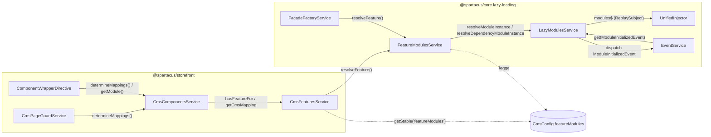
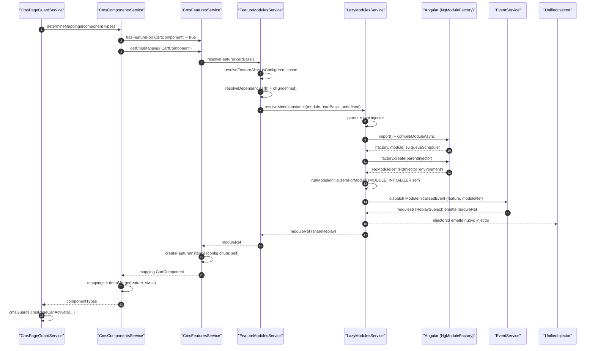
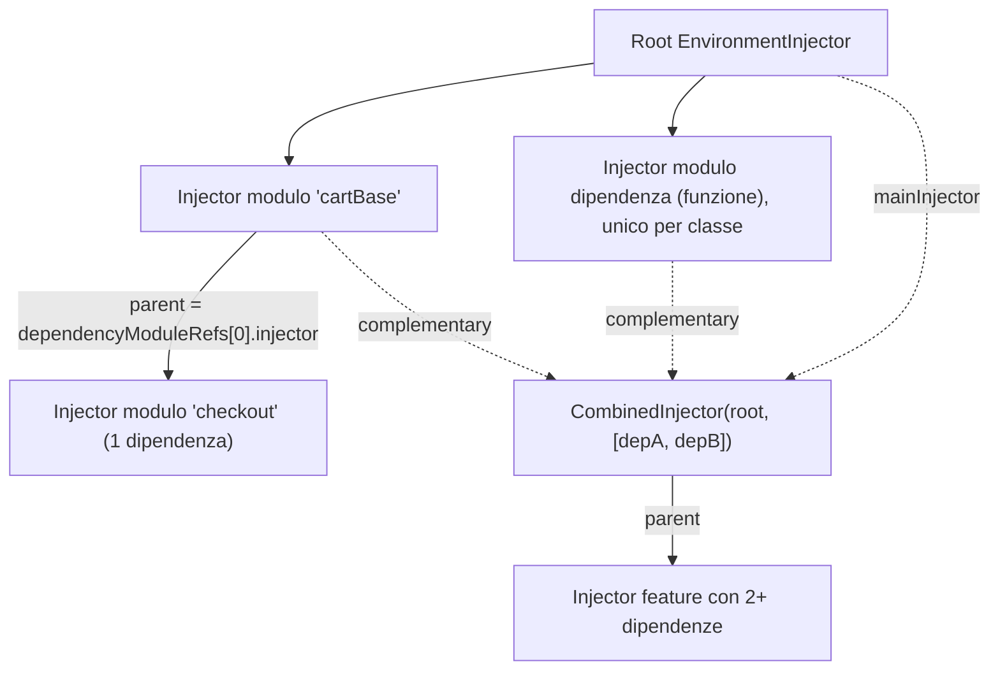
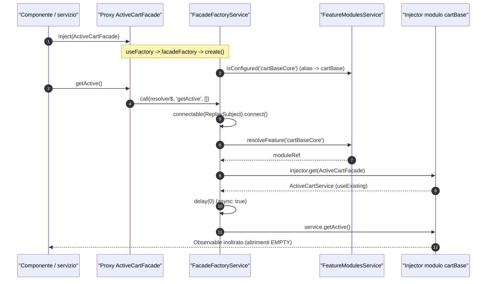

# 12 — Feature module e lazy loading in Spartacus

> Riferimenti allo SHA `5b7a1c2bf2808d7380bc20596d10f4fa710c3da1` (vedi [00-meta](../00-meta.md)).

Prerequisiti consigliati: [01 — Dependency injection](../parte-1/01-dependency-injection.md), [03 — Lazy loading in Angular](../parte-1/03-lazy-loading.md), [11 — Configurazione](11-configurazione.md).

## 1. A cosa serve e perché esiste

Angular offre un solo meccanismo "nativo" di lazy loading guidato dal router: `loadChildren` / `loadComponent` su una route (vedi [capitolo 03](../parte-1/03-lazy-loading.md)). In uno storefront Spartacus però le pagine non sono definite da route statiche dell'applicazione ma dal CMS: la stessa route `cart` mostra i componenti che il backend dichiara nella pagina, e un componente come `MiniCartComponent` può comparire in ogni pagina, nello header. Il codice che serve a renderizzarlo (componenti, store NgRx, adapter OCC) va caricato **quando il CMS chiede quel tipo di componente**, non quando il router entra in una certa route.

Per questo Spartacus implementa un proprio sistema di lazy loading, indipendente dal router, i cui pezzi vivono quasi tutti in `core-libs/core/src/lazy-loading/` e sono esportati dal public API di `@spartacus/core` (`core-libs/core/public_api.ts:L24-L24`, `core-libs/core/src/lazy-loading/index.ts:L7-L12`):

- una **configurazione** dichiarativa, `featureModules`, che associa un nome di feature a un `import()` dinamico, a delle dipendenze e ai tipi di componente CMS che la feature implementa (`core-libs/core/src/cms/config/cms-config.ts:L109-L134`);
- un **motore di caricamento** a due livelli: `FeatureModulesService` (risolve per nome, alias, dipendenze, cache) e `LazyModulesService` (import, creazione dell'`NgModuleRef`, initializer, evento) (`core-libs/core/src/lazy-loading/feature-modules.service.ts:L13-L124`, `core-libs/core/src/lazy-loading/lazy-modules.service.ts:L38-L246`);
- un **hook di inizializzazione** per moduli lazy, `MODULE_INITIALIZER`, che fa per un modulo lazy ciò che `APP_INITIALIZER` fa per l'app (`core-libs/core/src/lazy-loading/tokens.ts:L9-L20`);
- un **injector "unificato"**, `UnifiedInjector`, che permette ai servizi del root di vedere provider (multi provider, config chunk, guard) registrati dentro moduli caricati più tardi (`core-libs/core/src/lazy-loading/unified-injector.ts:L20-L94`);
- le **proxy facade** (`facadeFactory`), che consentono di iniettare dal root una facade astratta la cui implementazione vive nel modulo lazy, caricandolo alla prima chiamata (`core-libs/core/src/lazy-loading/facade-factory/facade-factory.ts:L11-L24`);
- lato storefront, `CmsFeaturesService`, che collega i tipi di componente CMS alle feature e fornisce mapping e `NgModuleRef` al motore di rendering (`core-libs/storefront/cms-structure/services/cms-features.service.ts:L27-L206`).

Il risultato è il pattern "root module eager + modulo lazy" usato da tutte le feature lib: il **root module** (es. `CartBaseRootModule`) è piccolo, viene importato eager e dichiara *quali* componenti CMS la feature copre e le facade astratte; l'**app** fornisce *dove* trovare il codice (`module: () => import(...)`); il codice pesante viene scaricato solo quando serve (`feature-libs/cart/base/root/cart-base-root.module.ts:L26-L83`, `projects/storefrontapp/src/app/spartacus/features/cart/cart-base-feature.module.ts:L23-L55`).

> Nota: nel focus dell'outline compariva un ipotetico `provideFeature`. Non esiste nel codice core (grep vuoto, dossier Q1): le feature si dichiarano solo tramite la config `featureModules` con `provideConfig` / `provideDefaultConfig(Factory)`.

## 2. Mappa dei file

| Path | Ruolo |
|---|---|
| `core-libs/core/src/lazy-loading/index.ts` | Barrel: riesporta eventi, `LazyModulesService`, token, `UnifiedInjector`, `FeatureModulesService`, facade-factory. NON esporta `LazyLoadingModule` (`:L7-L12`). |
| `core-libs/core/src/lazy-loading/tokens.ts` | Definisce `MODULE_INITIALIZER` (`:L19-L20`). |
| `core-libs/core/src/lazy-loading/lazy-loading.module.ts` | `LazyLoadingModule.forRoot()`: `APP_INITIALIZER` che esegue i `MODULE_INITIALIZER` registrati eager (`:L18-L53`). |
| `core-libs/core/src/lazy-loading/lazy-modules.service.ts` | `LazyModulesService`: import dinamico, creazione `NgModuleRef`, scelta del parent injector, initializer, `ModuleInitializedEvent`, stream `modules$` (`:L38-L246`). |
| `core-libs/core/src/lazy-loading/feature-modules.service.ts` | `FeatureModulesService`: risoluzione per nome da `CmsConfig.featureModules`, alias, dipendenze, cache (`:L13-L124`). |
| `core-libs/core/src/lazy-loading/unified-injector.ts` | `UnifiedInjector`: stream degli injector root + lazy, `get` / `getMulti` (`:L20-L94`). |
| `core-libs/core/src/lazy-loading/events/index.ts` | Barrel eventi (`:L7-L7`). |
| `core-libs/core/src/lazy-loading/events/module-initialized-event.ts` | `ModuleInitializedEvent` (`feature?`, `moduleRef`) (`:L16-L32`). |
| `core-libs/core/src/lazy-loading/facade-factory/index.ts` | Barrel facade factory (`:L7-L9`). |
| `core-libs/core/src/lazy-loading/facade-factory/facade-descriptor.ts` | `FacadeDescriptor` e i tipi che vincolano metodi/proprietà (`:L10-L57`). |
| `core-libs/core/src/lazy-loading/facade-factory/facade-factory.ts` | Funzione `facadeFactory()` (`:L20-L24`). |
| `core-libs/core/src/lazy-loading/facade-factory/facade-factory.service.ts` | `FacadeFactoryService`: costruzione del proxy (`:L29-L141`). |
| `core-libs/core/src/util/combined-injector.ts` | (contorno) `CombinedInjector`, parent di moduli con più dipendenze; non esportato (`:L27-L72`). |
| `core-libs/core/src/cms/config/cms-config.ts` | (contorno) `FeatureModuleConfig`, `CmsConfig.featureModules` (`:L109-L138`). |
| `core-libs/storefront/cms-structure/services/cms-features.service.ts` | (contorno) `CmsFeaturesService`: componentType → feature → mapping / `NgModuleRef` (`:L27-L206`). |
| `core-libs/storefront/cms-structure/services/cms-components.service.ts` | (contorno) consumo di `CmsFeaturesService`: `determineMappings`, `getModule` (`:L55-L180`). |
| `feature-libs/cart/base/root/cart-base-root.module.ts` | (esempio) root module eager del carrello: `featureModules` con soli `cmsComponents` + alias (`:L26-L83`). |
| `feature-libs/cart/base/root/facade/active-cart.facade.ts` | (esempio) facade astratta con provider `facadeFactory` (`:L13-L46`). |
| `projects/storefrontapp/src/app/spartacus/features/cart/cart-base-feature.module.ts` | (esempio) l'app fornisce i `module: () => import(...)` (`:L23-L55`). |
| `projects/storefrontapp/src/app/spartacus/features/cart/cart-base-wrapper.module.ts` | (esempio) modulo lazy effettivamente caricato per `cartBase` (`:L14-L25`). |

## 3. Come funziona passo per passo

### 3.1 La configurazione `featureModules`

`FeatureModuleConfig` ha tre chiavi, tutte opzionali (`core-libs/core/src/cms/config/cms-config.ts:L109-L122`):

- `module?: () => Promise<any>` — l'import dinamico del modulo lazy;
- `dependencies?: ((() => Promise<any>) | string)[]` — dipendenze, come funzioni di import oppure nomi di altre feature;
- `cmsComponents?: string[]` — i tipi di componente CMS coperti dalla feature.

`CmsConfig.featureModules` è una mappa `featureName → FeatureModuleConfig | string`, dove il valore stringa è un **alias** verso un'altra feature (`core-libs/core/src/cms/config/cms-config.ts:L124-L130`). `CmsConfig` è un token astratto che punta a `Config` (`useExisting: Config`) ed è fuso in `Config` per module augmentation (`core-libs/core/src/cms/config/cms-config.ts:L124-L138`).

Il punto chiave è che una feature viene di solito dichiarata **da due parti**: la libreria (root module) fornisce `cmsComponents`, `dependencies` e gli alias; l'app fornisce `module`. I chunk vengono fusi perché `provideConfig` è un multi provider su `ConfigChunk` (`core-libs/core/src/config/config-providers.ts:L18-L27`) e la root config è il `deepMerge` di tutti i chunk (`core-libs/core/src/config/config-tokens.ts:L37-L39`). Esempio carrello:

- `defaultCartComponentsConfig` nel root module dichiara per `cartBase`, `miniCart`, `addToCart` **solo** `cmsComponents` (`feature-libs/cart/base/root/cart-base-root.module.ts:L26-L44`) e l'alias `cartBaseCore → cartBase` (`feature-libs/cart/base/root/cart-base-root.module.ts:L45-L53`); è registrata con `provideDefaultConfigFactory` (`feature-libs/cart/base/root/cart-base-root.module.ts:L77-L81`);
- `CartBaseFeatureModule` dell'app demo importa `CartBaseRootModule` e con `provideConfig` aggiunge i `module: () => import(...)` (`projects/storefrontapp/src/app/spartacus/features/cart/cart-base-feature.module.ts:L23-L55`). `miniCart` e `addToCart` puntano a entry point secondari diversi, quindi a chunk separati da `cartBase` (`projects/storefrontapp/src/app/spartacus/features/cart/cart-base-feature.module.ts:L36-L55`).

I nomi delle feature sono costanti esportate dal root entry point: `CART_BASE_FEATURE = 'cartBase'`, `CART_BASE_CORE_FEATURE = 'cartBaseCore'`, `MINI_CART_FEATURE = 'miniCart'`, `ADD_TO_CART_FEATURE = 'addToCart'` (`feature-libs/cart/base/root/feature-name.ts:L7-L11`). Per la configurazione in generale vedi [capitolo 11](11-configurazione.md).

### 3.2 Bootstrap: `LazyLoadingModule` e `MODULE_INITIALIZER` eager

1. `BaseCoreModule` importa `LazyLoadingModule.forRoot()` insieme agli altri `forRoot()` del core (`core-libs/core/src/base-core.module.ts:L26-L46`). È l'unico punto d'uso del modulo, che non è nel public API (`core-libs/core/src/base-core.module.ts:L18-L18`, `core-libs/core/src/lazy-loading/index.ts:L7-L12`).
2. `forRoot()` registra un `APP_INITIALIZER` multi con factory `moduleInitializersFactory` e `deps: [LazyModulesService, [new Optional(), MODULE_INITIALIZER]]` (`core-libs/core/src/lazy-loading/lazy-loading.module.ts:L38-L53`).
3. Effetto collaterale importante: poiché la factory dipende da `LazyModulesService`, il servizio viene istanziato durante il bootstrap e il suo costruttore connette subito `modules$` agli eventi (`core-libs/core/src/lazy-loading/lazy-loading.module.ts:L47-L47`, `core-libs/core/src/lazy-loading/lazy-modules.service.ts:L60-L68`). Così nessun `ModuleInitializedEvent` successivo va perso.
4. La factory usa `inject(LoggerService)` e restituisce una funzione che esegue i `MODULE_INITIALIZER` del root injector (cioè quelli forniti da moduli importati eager) tramite `runModuleInitializerFunctions` e fa `Promise.all` sulle promise ottenute, loggando e rilanciando in caso di reject (`core-libs/core/src/lazy-loading/lazy-loading.module.ts:L18-L36`).

È il "fallback" documentato nel JSDoc del token: se il modulo che fornisce `MODULE_INITIALIZER` è caricato eager, le funzioni girano all'init dell'app come un `APP_INITIALIZER` (`core-libs/core/src/lazy-loading/tokens.ts:L9-L18`). Per l'ordine complessivo degli initializer vedi [capitolo 10](10-bootstrap-inizializzazione.md).

### 3.3 `FeatureModulesService.resolveFeature(name)`

`FeatureModulesService` è `providedIn: 'root'`, dipende da `CmsConfig` e `LazyModulesService` e tiene una `Map<string, Observable<NgModuleRef>>` di resolver "eseguiti una volta e messi in cache" (`core-libs/core/src/lazy-loading/feature-modules.service.ts:L13-L26`).

1. **Alias.** `resolveFeature` risolve per prima cosa l'alias: `resolveFeatureAlias` segue con un `while` la catena di valori stringa fino a una config oggetto (`core-libs/core/src/lazy-loading/feature-modules.service.ts:L42-L43`, `core-libs/core/src/lazy-loading/feature-modules.service.ts:L95-L100`). Quindi `resolveFeature('cartBaseCore')` diventa `resolveFeature('cartBase')`.
2. **Lazy per costruzione.** Il resto è in un `defer`: nulla accade finché qualcuno non si sottoscrive (`core-libs/core/src/lazy-loading/feature-modules.service.ts:L45-L72`).
3. **Controllo configurazione.** Se il resolver non è in cache e la feature non è configurata, restituisce `throwError` con `No module defined for Feature Module <name>` (`core-libs/core/src/lazy-loading/feature-modules.service.ts:L46-L52`). "Configurata" significa: la config (dopo l'alias) ha `module` (`core-libs/core/src/lazy-loading/feature-modules.service.ts:L33-L35`, `core-libs/core/src/lazy-loading/feature-modules.service.ts:L80-L86`).
4. **Resolver.** Altrimenti crea e registra in cache la pipeline: `resolveDependencies(dependencies)` → `switchMap` → `lazyModules.resolveModuleInstance(module, featureName, deps)` → `shareReplay()` (`core-libs/core/src/lazy-loading/feature-modules.service.ts:L54-L71`).
5. **Dipendenze.** `resolveDependencies` usa `forkJoin` (in parallelo): una stringa è una feature e richiama ricorsivamente `resolveFeature(dep)`; una funzione è un modulo dipendenza e passa per `resolveDependencyModuleInstance`; senza dipendenze emette `of(undefined)` (`core-libs/core/src/lazy-loading/feature-modules.service.ts:L108-L123`).

Esempio reale di dipendenza tra feature: il root module del checkout dichiara `dependencies: [CART_BASE_FEATURE]` e l'alias `checkoutCore → checkout` (`feature-libs/checkout/base/root/checkout-root.module.ts:L37-L49`); lo stesso schema è usato da order (`feature-libs/order/root/order-root.module.ts:L71-L76`).

### 3.4 `LazyModulesService`: dal `import()` all'`NgModuleRef`

`LazyModulesService` è `providedIn: 'root'`, implementa `OnDestroy` e dipende da `Compiler`, dal root `Injector` e da `EventService` (`core-libs/core/src/lazy-loading/lazy-modules.service.ts:L38-L64`).

**Scelta del parent injector** in `resolveModuleInstance(moduleFunc, feature?, dependencyModuleRefs = [])` (`core-libs/core/src/lazy-loading/lazy-modules.service.ts:L78-L94`):

- nessuna dipendenza → root injector;
- una dipendenza → l'injector di quella dipendenza (`dependencyModuleRefs[0].injector`);
- più dipendenze → `new CombinedInjector(root, [injector delle dipendenze])`.

Conseguenza: il checkout (unica dipendenza `cartBase`) ha come parent **direttamente** l'injector del modulo `cartBase` e quindi ne vede i provider (`core-libs/core/src/lazy-loading/lazy-modules.service.ts:L87-L88`).

**Pipeline** (`core-libs/core/src/lazy-loading/lazy-modules.service.ts:L96-L107`):

1. `resolveModuleFactory(moduleFunc)`: esegue l'`import()`; se il risultato è già una `NgModuleFactory` la usa, altrimenti chiama `compiler.compileModuleAsync(module)`; emette `[factory, module]` rischedulato su `queueScheduler` (`core-libs/core/src/lazy-loading/lazy-modules.service.ts:L220-L236`). In Angular 21 `compileModuleAsync` è soltanto `Promise.resolve(new NgModuleFactoryR3(moduleType))` e `Compiler` è deprecato (`angular:packages/core/src/linker/compiler.ts:L48-L66`).
2. `moduleFactory.create(parentInjector)`: l'implementazione Ivy crea `new NgModuleRef(moduleType, parentInjector, [])` (`angular:packages/core/src/render3/ng_module_ref.ts:L127-L134`), che costruisce un `R3Injector` figlio del parent con scope `'environment'`, risolve gli injector initializer e istanzia la classe modulo (`angular:packages/core/src/render3/ng_module_ref.ts:L67-L108`). L'`injector` dell'`NgModuleRef` è quindi un `EnvironmentInjector` (`angular:packages/core/src/render3/ng_module_ref.ts:L110-L112`).
3. `runModuleInitializersForModule(moduleRef)` (in `concatMap`): esegue i `MODULE_INITIALIZER` **del modulo** (vedi 3.5).
4. `events.dispatch(createFrom(ModuleInitializedEvent, { feature, moduleRef }))` (`core-libs/core/src/lazy-loading/lazy-modules.service.ts:L99-L106`). `createFrom` è `Object.assign(new type(), data)` (`core-libs/core/src/util/create-from.ts:L15-L17`).

Il JSDoc avverte: "New module instance will be created with each call" (`core-libs/core/src/lazy-loading/lazy-modules.service.ts:L70-L77`). La deduplica per feature è responsabilità di `FeatureModulesService` (3.3).

**Moduli dipendenza** (dipendenze di tipo funzione): `resolveDependencyModuleInstance` istanzia il modulo **una sola volta per classe**, sempre con il root injector come parent, e lo conserva nella `Map` privata `dependencyModules` (`core-libs/core/src/lazy-loading/lazy-modules.service.ts:L57-L57`, `core-libs/core/src/lazy-loading/lazy-modules.service.ts:L110-L129`). L'evento emesso per loro non ha `feature` (`core-libs/core/src/lazy-loading/lazy-modules.service.ts:L130-L138`), ed è proprio così che, secondo il JSDoc, si distinguono feature e dipendenze (`core-libs/core/src/lazy-loading/events/module-initialized-event.ts:L21-L27`).

**Distruzione**: `ngOnDestroy` chiude la sottoscrizione agli eventi e distrugge i moduli dipendenza, non i moduli feature (`core-libs/core/src/lazy-loading/lazy-modules.service.ts:L238-L245`).

### 3.5 `MODULE_INITIALIZER` nei moduli lazy

`MODULE_INITIALIZER` è un `InjectionToken<(() => any)[]>` usato come multi provider (`core-libs/core/src/lazy-loading/tokens.ts:L9-L20`).

1. `runModuleInitializersForModule` lo legge dall'injector del modulo con `{ self: true }` e default `[]`: solo gli initializer forniti in quel modulo (o nei moduli che importa, che confluiscono nello stesso `R3Injector`), non quelli del root (`core-libs/core/src/lazy-loading/lazy-modules.service.ts:L150-L157`).
2. `runModuleInitializerFunctions` esegue tutte le funzioni sincronamente e in ordine, raccogliendo solo i risultati "promise-like" (`core-libs/core/src/lazy-loading/lazy-modules.service.ts:L187-L200`). "Promise-like" significa oggetto truthy con `then` funzione (`core-libs/core/src/lazy-loading/lazy-modules.service.ts:L213-L215`): **un Observable restituito non viene atteso**.
3. Un'eccezione sincrona viene loggata ("init function throwed an error") e rilanciata (`core-libs/core/src/lazy-loading/lazy-modules.service.ts:L201-L207`).
4. Se ci sono promise si attende `Promise.all`; su reject si logga e l'errore si propaga nello stream, altrimenti si emette `moduleRef`. Senza promise si emette subito `of(moduleRef)` (`core-libs/core/src/lazy-loading/lazy-modules.service.ts:L158-L174`).

Usi reali:

- `CartPersistenceModule` registra un initializer asincrono che, a config `context` stabile, chiama `initSync()` della persistenza del carrello; usa `lastValueFrom` proprio per trasformare l'Observable in promise (`feature-libs/cart/base/core/cart-persistence.module.ts:L19-L31`, `feature-libs/cart/base/core/cart-persistence.module.ts:L58-L66`). È importato da `CartBaseCoreModule` (`feature-libs/cart/base/core/cart-base-core.module.ts:L22-L40`).
- `AsmCoreModule` registra un initializer sincrono (`feature-libs/asm/core/asm-core.module.ts:L15-L31`).
- `OutletModule.forRoot()` registra gli outlet con `APP_INITIALIZER`, `OutletModule.forChild()` con `MODULE_INITIALIZER` (`core-libs/storefront/cms-structure/outlet/outlet.module.ts:L54-L88`); `OrderDetailsModule` registra un outlet via `MODULE_INITIALIZER` (`feature-libs/order/components/order-details/order-details.module.ts:L183-L187`). Vedi [capitolo 17](17-outlet.md).

### 3.6 `ModuleInitializedEvent`, `modules$` e `UnifiedInjector`

`ModuleInitializedEvent` estende `CxEvent`, ha `type = 'ModuleInitializedEvent'`, `feature?` e `moduleRef` (`core-libs/core/src/lazy-loading/events/module-initialized-event.ts:L16-L32`). `EventService.dispatch` lo invia su un `Subject` semplice (non replay) (`core-libs/core/src/event/event.service.ts:L105-L127`); per gli eventi in generale vedi [capitolo 20](20-facade-command-query-eventi.md).

`LazyModulesService.modules$` è un `connectable` degli eventi, mappati a `moduleRef`, con connector `ReplaySubject` illimitato e `resetOnDisconnect: false`, connesso nel costruttore (`core-libs/core/src/lazy-loading/lazy-modules.service.ts:L44-L68`): chiunque si sottoscriva in seguito riceve **tutti** i moduli già inizializzati.

`UnifiedInjector` (`providedIn: 'root'`) costruisce `injectors$` = root injector (`startWith`) seguito dall'injector di ogni modulo emesso da `modules$` (`core-libs/core/src/lazy-loading/unified-injector.ts:L20-L40`).

- `get(token, notFoundValue?)` interroga il root injector normalmente (indice 0) e ogni injector lazy con `{ self: true }`; senza `notFoundValue` usa un sentinel `NOT_FOUND_SYMBOL` e filtra i "non trovati" (`core-libs/core/src/lazy-loading/unified-injector.ts:L52-L68`). Con `notFoundValue` emette esattamente una volta per injector, altrimenti solo quando trova nuove istanze (`core-libs/core/src/lazy-loading/unified-injector.ts:L42-L51`). L'opzione `self` di Angular limita la ricerca all'injector corrente (`angular:packages/core/src/di/interface/injector.ts:L72-L74`).
- `getMulti(token)` chiama `get(token, [])`, lancia se trova un valore non-array ("Multi-providers mixed with single providers"), scarta gli array vuoti e accumula con `scan` le istanze di tutti gli injector (`core-libs/core/src/lazy-loading/unified-injector.ts:L75-L93`).

Consumatori nel core e nello storefront:

| Consumatore | Uso | Riferimento |
|---|---|---|
| `ConfigurationService` | `get(ConfigChunk, [])` e `get(DefaultConfigChunk, [])` in `zip`, `skip(1)` per saltare il root; i chunk lazy confluiscono in `unifiedConfig$` e, salvo `disableConfigUpdates`, nell'oggetto `Config` globale | `core-libs/core/src/config/services/configuration.service.ts:L57-L74`, `core-libs/core/src/config/services/configuration.service.ts:L92-L105` |
| `ConverterService` | svuota la cache dei converter a ogni nuovo injector, li legge con `getMulti` | `core-libs/core/src/util/converter.service.ts:L38-L58` |
| `HttpErrorInterceptor` | `getMulti(HttpErrorHandler)` (raccoglie anche `BadCartRequestHandler` del core carrello lazy) | `core-libs/core/src/global-message/http-interceptors/http-error.interceptor.ts:L24-L28`, `feature-libs/cart/base/core/cart-base-core.module.ts:L22-L40` |
| `PageMetaService`, `DynamicAttributeService`, `PageLayoutService` | `getMulti` di `PageMetaResolver`, `ComponentDecorator`/`SlotDecorator`, `PAGE_LAYOUT_HANDLER` | `core-libs/core/src/cms/facade/page-meta.service.ts:L53-L57`, `core-libs/core/src/cms/services/dynamic-attribute.service.ts:L24-L30`, `core-libs/storefront/cms-structure/page/page-layout/page-layout.service.ts:L41-L45` |
| `CmsGuardsService` | `getLastValueSync(unifiedInjector.get(guardClass))` per le guard dei componenti CMS | `core-libs/storefront/cms-structure/services/cms-guards.service.ts:L36-L48` |
| `CmsRoutesImplService` | avvolge le `canActivate` delle child route CMS per risolvere guard fornite solo in un modulo lazy | `core-libs/storefront/cms-structure/services/cms-routes-impl.service.ts:L126-L136`, `core-libs/storefront/cms-structure/services/cms-routes-impl.service.ts:L170-L181` |

`getLastValueSync` sottoscrive e disiscrive subito restituendo l'ultimo valore emesso in modo sincrono (`core-libs/core/src/util/rxjs/get-last-value-sync.ts:L19-L23`): grazie al `ReplaySubject` di `modules$` include tutti gli injector già noti.

### 3.7 Lato storefront: `CmsFeaturesService` e il rendering

`CmsFeaturesService` (`providedIn: 'root'`) mantiene `featureModulesConfig`, `componentFeatureMap` (componentType → feature) e `featureInstances` (cache dei resolver) (`core-libs/storefront/cms-structure/services/cms-features.service.ts:L27-L54`).

1. **Mappa componenti.** Nel costruttore attende `configInitializer.getStable('featureModules')` e popola `componentFeatureMap` solo per feature **non alias**, con `module` definito e `cmsComponents` non vuoto (`core-libs/storefront/cms-structure/services/cms-features.service.ts:L56-L76`). `getStable` emette subito se la config è già stabile, altrimenti attende gli scope richiesti (`core-libs/core/src/config/config-initializer/config-initializer.service.ts:L58-L70`).
2. **`hasFeatureFor(type)`**: lookup sincrono (`core-libs/storefront/cms-structure/services/cms-features.service.ts:L82-L84`).
3. **`getCmsMapping(type)`**: risolve la feature instance e restituisce il mapping del tipo, oppure `of(undefined)` se il tipo non è coperto (`core-libs/storefront/cms-structure/services/cms-features.service.ts:L89-L103`).
4. **`resolveFeatureInstance(name)`**: delega a `FeatureModulesService.resolveFeature` e mette in cache il risultato mappato con `shareReplay()` (`core-libs/storefront/cms-structure/services/cms-features.service.ts:L134-L152`).
5. **`createFeatureInstance`**: per ogni `cmsComponents` dichiarato nella feature estrae il mapping dalla **config locale** del modulo lazy, o `{}` se assente (`core-libs/storefront/cms-structure/services/cms-features.service.ts:L157-L183`). La config locale è il `deepMerge` di `DefaultConfigChunk` e poi `ConfigChunk` letti con `{ self: true }` dall'injector del modulo (`core-libs/storefront/cms-structure/services/cms-features.service.ts:L188-L205`).
6. **`getModule(type)`**: restituisce il `moduleRef` solo per feature già risolte, con subscribe/unsubscribe sincrono sul resolver in cache (`core-libs/storefront/cms-structure/services/cms-features.service.ts:L110-L127`).

Il consumatore è `CmsComponentsService` (vedi [capitolo 16](16-cms-rendering.md)):

- congela `staticCmsConfig` quando `cmsComponents` è stabile, per non essere influenzato dai moduli lazy che modificano la config globale (`core-libs/storefront/cms-structure/services/cms-components.service.ts:L55-L69`);
- `determineMappings(types)`: per ogni tipo non ancora risolto, se coperto da una feature accoda un resolver, altrimenti usa la config statica; attende i resolver con `forkJoin` (`core-libs/storefront/cms-structure/services/cms-components.service.ts:L79-L115`);
- il mapping della feature è un **default** sovrascrivibile dalla config statica dell'app: `deepMerge({}, featureComponentMapping, staticConfig)` (`core-libs/storefront/cms-structure/services/cms-components.service.ts:L117-L141`);
- `getModule(type)` delega a `CmsFeaturesService.getModule` solo per tipi coperti da feature (`core-libs/storefront/cms-structure/services/cms-components.service.ts:L149-L153`).

Dove avviene il caricamento durante la navigazione:

1. `CmsPageGuardService.canActivatePage` ottiene i component type della pagina e chiama `determineMappings` **prima** di valutare le guard CMS (`core-libs/storefront/cms-structure/guards/cms-page-guard.service.ts:L65-L80`). Il route del carrello usa proprio `CmsPageGuard` (`feature-libs/cart/base/root/cart-base-root.module.ts:L59-L76`).
2. In rendering, `ComponentWrapperDirective.ngOnInit` chiama ancora `determineMappings([flexType])` e lancia il componente se `shouldRender` (`core-libs/storefront/cms-structure/page/component/component-wrapper.directive.ts:L67-L79`); al launcher passa l'element injector di `CmsInjectorService` e il `NgModuleRef` della feature (`core-libs/storefront/cms-structure/page/component/component-wrapper.directive.ts:L90-L102`).
3. `CmsInjectorService.getInjector` crea un `Injector.create` con `CmsComponentData` e i `providers` del mapping, figlio dell'element injector (`core-libs/storefront/cms-structure/page/component/services/cms-injector.service.ts:L28-L50`).
4. `DefaultComponentHandler` passa il `module` come quinto argomento di `createComponent(factory, undefined, injector, undefined, module)` (`core-libs/storefront/cms-structure/page/component/handlers/default-component.handler.ts:L36-L67`), cioè come `environmentInjector` (`angular:packages/core/src/linker/view_container_ref.ts:L263-L275`). Così il componente vede i servizi del modulo lazy.

### 3.8 Proxy facade: `facadeFactory`

Le facade pubbliche delle feature lib sono classi astratte nel root entry point con un provider root che crea un proxy. Esempio: `ActiveCartFacade` usa `useFactory: () => facadeFactory({ facade: ActiveCartFacade, feature: CART_BASE_CORE_FEATURE, methods: [...], async: true })` (`feature-libs/cart/base/root/facade/active-cart.facade.ts:L13-L46`).

1. `facadeFactory(descriptor)` va chiamata in un contesto di injection: è `inject(FacadeFactoryService).create(descriptor)` (`core-libs/core/src/lazy-loading/facade-factory/facade-factory.ts:L20-L24`).
2. `FacadeDescriptor<T>` ha `facade`, `feature`, `methods?`, `properties?`, `async?` (`core-libs/core/src/lazy-loading/facade-factory/facade-descriptor.ts:L10-L37`). A livello di tipi i metodi devono restituire `void | Observable<any>` e le proprietà essere `Observable`; se la facade ha altri membri `StrictlyAllowedFacade<T>` diventa `never` (`core-libs/core/src/lazy-loading/facade-factory/facade-descriptor.ts:L39-L57`).
3. `create` costruisce **un solo** `resolver$` per istanza proxy, istanzia una sottoclasse anonima della facade astratta, assegna a ogni metodo elencato una funzione `call(...)` e a ogni proprietà un `get(...)`, e marca l'istanza con `proxyFacadeInstance = true` (`core-libs/core/src/lazy-loading/facade-factory/facade-factory.service.ts:L110-L131`). `isProxyFacadeInstance` controlla quel flag (`core-libs/core/src/lazy-loading/facade-factory/facade-factory.service.ts:L133-L140`).
4. `getResolver(feature, facadeClass, async)`: se la feature non è configurata restituisce un Observable d'errore `Feature X is not configured properly`; altrimenti `resolveFeature(feature)` → `moduleRef.injector.get(facadeClass)` → opzionale `delay(0)` → `shareReplay()` (`core-libs/core/src/lazy-loading/facade-factory/facade-factory.service.ts:L38-L57`). Nel modulo lazy la stessa classe astratta è ri-fornita con l'implementazione concreta: `{ provide: ActiveCartFacade, useExisting: ActiveCartService }` (`feature-libs/cart/base/core/facade/facade-providers.ts:L25-L30`).
5. `call` è **eager**: crea un `connectable` con `ReplaySubject` e lo connette subito, quindi il caricamento parte anche se il chiamante non si sottoscrive (tipico dei comandi `void` come `addEntry`) (`core-libs/core/src/lazy-loading/facade-factory/facade-factory.service.ts:L59-L82`). Il risultato del metodo reale viene inoltrato se è un Observable, altrimenti il proxy restituisce `EMPTY` (`core-libs/core/src/lazy-loading/facade-factory/facade-factory.service.ts:L84-L91`).
6. Le proprietà sono **lazy**: `resolver$.pipe(switchMap(service => service[property]))` (`core-libs/core/src/lazy-loading/facade-factory/facade-factory.service.ts:L94-L108`).
7. `async: true` serve, secondo il commento, a rendere pronto uno store NgRx lazy (`core-libs/core/src/lazy-loading/facade-factory/facade-descriptor.ts:L32-L36`). ⚠️ DA VERIFICARE: il motivo preciso per cui serve il `delay(0)` rispetto alla registrazione di `StoreModule.forFeature` non è verificato nel codice NgRx (dossier Q6).

Le facade in quanto pattern (command/query, eventi) sono trattate nel [capitolo 20](20-facade-command-query-eventi.md); qui interessa solo il loro legame con il lazy loading.

## 4. Diagrammi

### 4.1 Componenti del sistema

Ogni freccia corrisponde a una dipendenza di costruttore o a una chiamata citata nel paragrafo 3.



### 4.2 Navigazione verso la pagina carrello (feature `cartBase`)



Riferimenti dei passi: 1 `core-libs/storefront/cms-structure/guards/cms-page-guard.service.ts:L71-L75`; 2-3 `core-libs/storefront/cms-structure/services/cms-components.service.ts:L92-L99`; 4 `core-libs/storefront/cms-structure/services/cms-features.service.ts:L134-L152`; 5-7 `core-libs/core/src/lazy-loading/feature-modules.service.ts:L42-L72`, `core-libs/core/src/lazy-loading/feature-modules.service.ts:L108-L123`; 8 `core-libs/core/src/lazy-loading/lazy-modules.service.ts:L83-L86`; 9-10 `core-libs/core/src/lazy-loading/lazy-modules.service.ts:L220-L236`; 11-12 `angular:packages/core/src/render3/ng_module_ref.ts:L127-L134`; 13 `core-libs/core/src/lazy-loading/lazy-modules.service.ts:L150-L175`; 14-16 `core-libs/core/src/lazy-loading/lazy-modules.service.ts:L99-L106`, `core-libs/core/src/lazy-loading/unified-injector.ts:L32-L35`; 19 `core-libs/storefront/cms-structure/services/cms-features.service.ts:L157-L205`; 21 `core-libs/storefront/cms-structure/services/cms-components.service.ts:L126-L135`; 23 `core-libs/storefront/cms-structure/guards/cms-page-guard.service.ts:L78-L80`.

### 4.3 Gerarchia degli injector con dipendenze



Fonti: scelta del parent `core-libs/core/src/lazy-loading/lazy-modules.service.ts:L83-L94`; modulo dipendenza creato col root injector `core-libs/core/src/lazy-loading/lazy-modules.service.ts:L121-L129`; ordine di ricerca del `CombinedInjector` `core-libs/core/src/util/combined-injector.ts:L53-L70`. Il nodo `MULTI` è illustrativo: nel codice analizzato non c'è una feature reale con due o più dipendenze (dossier Q5 per le dipendenze-funzione).

### 4.4 Proxy facade alla prima chiamata



Fonti: `feature-libs/cart/base/root/facade/active-cart.facade.ts:L13-L46`; `core-libs/core/src/lazy-loading/facade-factory/facade-factory.service.ts:L38-L57`, `core-libs/core/src/lazy-loading/facade-factory/facade-factory.service.ts:L70-L91`, `core-libs/core/src/lazy-loading/facade-factory/facade-factory.service.ts:L110-L131`; `core-libs/core/src/lazy-loading/feature-modules.service.ts:L33-L35`; `feature-libs/cart/base/core/facade/facade-providers.ts:L25-L30`.

## 5. Estratti di codice reale

**Scelta del parent injector e pipeline di creazione** — `core-libs/core/src/lazy-loading/lazy-modules.service.ts:L78-L108`

```ts
  public resolveModuleInstance(
    moduleFunc: () => Promise<any>,
    feature?: string,
    dependencyModuleRefs: NgModuleRef<any>[] = []
  ): Observable<NgModuleRef<any>> {
    let parentInjector: Injector;

    if (!dependencyModuleRefs.length) {
      parentInjector = this.injector;
    } else if (dependencyModuleRefs.length === 1) {
      parentInjector = dependencyModuleRefs[0].injector;
    } else {
      parentInjector = new CombinedInjector(
        this.injector,
        dependencyModuleRefs.map((moduleRef) => moduleRef.injector)
      );
    }

    return this.resolveModuleFactory(moduleFunc).pipe(
      map(([moduleFactory]) => moduleFactory.create(parentInjector)),
      concatMap((moduleRef) => this.runModuleInitializersForModule(moduleRef)),
      tap((moduleRef) =>
        this.events.dispatch(
          createFrom(ModuleInitializedEvent, {
            feature,
            moduleRef,
          })
        )
      )
    );
  }
```

**Resolver di feature con cache e dipendenze** — `core-libs/core/src/lazy-loading/feature-modules.service.ts:L42-L73`

```ts
  resolveFeature(featureName: string): Observable<NgModuleRef<any>> {
    featureName = this.resolveFeatureAlias(featureName);

    return defer(() => {
      if (!this.features.has(featureName)) {
        if (!this.isConfigured(featureName)) {
          return throwError(
            () =>
              new Error('No module defined for Feature Module ' + featureName)
          );
        }

        const featureConfig = this.getFeatureConfig(featureName);

        this.features.set(
          featureName,
          this.resolveDependencies(featureConfig?.dependencies).pipe(
            switchMap((deps) =>
              this.lazyModules.resolveModuleInstance(
                featureConfig?.module as () => Promise<any>,
                featureName,
                deps
              )
            ),
            shareReplay()
          )
        );
      }

      return this.features.get(featureName) ?? EMPTY;
    });
  }
```

**`MODULE_INITIALIZER` letto solo dall'injector del modulo** — `core-libs/core/src/lazy-loading/lazy-modules.service.ts:L150-L175`

```ts
  public runModuleInitializersForModule(
    moduleRef: NgModuleRef<any>
  ): Observable<NgModuleRef<any>> {
    const moduleInits: any[] = moduleRef.injector.get<any[]>(
      MODULE_INITIALIZER,
      [],
      { self: true }
    );
    const asyncInitPromises: Promise<any>[] =
      this.runModuleInitializerFunctions(moduleInits);
    if (asyncInitPromises.length) {
      return from(Promise.all(asyncInitPromises)).pipe(
        tap({
          error: (error) => {
            this.logger.error(
              'MODULE_INITIALIZER promise was rejected while lazy loading a module.',
              error
            );
          },
        }),
        switchMap(() => of(moduleRef))
      );
    } else {
      return of(moduleRef);
    }
  }
```

**`UnifiedInjector.get` / `getMulti`** — `core-libs/core/src/lazy-loading/unified-injector.ts:L52-L93` (abbreviato)

```ts
  get<T>(
    token: Type<T> | InjectionToken<T> | AbstractType<T>,
    notFoundValue?: T
  ): Observable<T> {
    return this.injectors$.pipe(
      map((injector, index) =>
        injector.get<T>(
          token,
          notFoundValue ?? NOT_FOUND_SYMBOL,
          // we want to get only Self instances from all injectors except the
          // first one, which is a root injector
          index ? { self: true } : undefined
        )
      ),
      filter((instance) => instance !== NOT_FOUND_SYMBOL)
    );
  }
  // ...
    return this.get(token, []).pipe(
      filter((instances) => {
        if (!Array.isArray(instances)) {
          throw new Error(
            `Multi-providers mixed with single providers for ${token.toString()}!`
          );
        }
        return instances.length > 0;
      }),
      scan((acc, services) => [...acc, ...services], [])
    );
```

**Root module della feature: solo `cmsComponents` + alias** — `feature-libs/cart/base/root/cart-base-root.module.ts:L26-L57` (abbreviato)

```ts
export function defaultCartComponentsConfig() {
  const config = {
    featureModules: {
      [CART_BASE_FEATURE]: {
        cmsComponents: [
          'CartApplyCouponComponent',
          'CartComponent',
          // ...
        ],
      },
      [MINI_CART_FEATURE]: {
        cmsComponents: ['MiniCartComponent'],
      },
      [ADD_TO_CART_FEATURE]: {
        cmsComponents: ['ProductAddToCartComponent'],
      },
      // By default core is bundled together with components.
      // The cart lib should keep using this default.
      // ...
      [CART_BASE_CORE_FEATURE]: CART_BASE_FEATURE,
    },
  };
  return config;
}
```

**L'app fornisce il `module`** — `projects/storefrontapp/src/app/spartacus/features/cart/cart-base-feature.module.ts:L23-L45` (abbreviato)

```ts
@NgModule({
  imports: [CartBaseRootModule],
  providers: [
    provideConfig({
      featureModules: {
        [CART_BASE_FEATURE]: {
          module: () =>
            import('./cart-base-wrapper.module').then(
              (m) => m.CartBaseWrapperModule
            ),
        },
      },
    }),
    provideConfig({
      featureModules: {
        [MINI_CART_FEATURE]: {
          module: () =>
            import('@spartacus/cart/base/components/mini-cart').then(
              (m) => m.MiniCartModule
            ),
        },
      },
    }),
    // ...
```

**Config locale della feature (self)** — `core-libs/storefront/cms-structure/services/cms-features.service.ts:L188-L205`

```ts
  private resolveFeatureConfiguration(featureInjector: Injector): CmsConfig {
    // get config chunks from feature lib
    const featureConfigChunks = featureInjector.get<any[]>(ConfigChunk, [], {
      self: true,
    });
    // get default config chunks from feature lib
    const featureDefaultConfigChunks = featureInjector.get<any[]>(
      DefaultConfigChunk,
      [],
      { self: true }
    );

    return deepMerge(
      {},
      ...(featureDefaultConfigChunks ?? []),
      ...(featureConfigChunks ?? [])
    ) as CmsConfig;
  }
```

**Costruzione del proxy facade** — `core-libs/core/src/lazy-loading/facade-factory/facade-factory.service.ts:L110-L131`

```ts
  create<T extends object>({
    facade,
    feature,
    methods,
    properties,
    async,
  }: FacadeDescriptor<T>): T {
    const resolver$ = this.getResolver(feature, facade, async);

    const result: any = new (class extends (facade as any) {})();
    (methods ?? []).forEach((method) => {
      result[method] = (...args: any[]) =>
        this.call(resolver$, method as string, args);
    });
    (properties ?? []).forEach((property) => {
      result[property] = this.get(resolver$, property as string);
    });

    result[PROXY_FACADE_INSTANCE_PROP] = true;

    return result;
  }
```

**Initializer asincrono reale** — `feature-libs/cart/base/core/cart-persistence.module.ts:L19-L31`

```ts
export function cartStatePersistenceFactory(
  cartStatePersistenceService: MultiCartStatePersistenceService,
  configInit: ConfigInitializerService
): () => Promise<Config> {
  return () =>
    lastValueFrom(
      configInit.getStable('context').pipe(
        tap(() => {
          cartStatePersistenceService.initSync();
        })
      )
    );
}
```

## 6. Configurazione

| Chiave | Tipo | Default | Definita in | Letta in |
|---|---|---|---|---|
| `featureModules` | `{ [featureName: string]: FeatureModuleConfig \| string }` | nessuno nel core; contributi dai root module delle lib via `provideDefaultConfigFactory` (es. cart) | `core-libs/core/src/cms/config/cms-config.ts:L129-L129` | `core-libs/core/src/lazy-loading/feature-modules.service.ts:L80-L100`; `core-libs/storefront/cms-structure/services/cms-features.service.ts:L56-L76` |
| `featureModules.<name>.module` | `() => Promise<any>` (classe NgModule o `NgModuleFactory`) | assente: lo fornisce l'app (es. `projects/storefrontapp/src/app/spartacus/features/cart/cart-base-feature.module.ts:L26-L35`) | `core-libs/core/src/cms/config/cms-config.ts:L113-L113` | `core-libs/core/src/lazy-loading/feature-modules.service.ts:L33-L35`, `core-libs/core/src/lazy-loading/feature-modules.service.ts:L59-L64`; `core-libs/core/src/lazy-loading/lazy-modules.service.ts:L220-L236` |
| `featureModules.<name>.dependencies` | `((() => Promise<any>) \| string)[]` | `[]` (default del parametro) | `core-libs/core/src/cms/config/cms-config.ts:L117-L117` | `core-libs/core/src/lazy-loading/feature-modules.service.ts:L108-L123` |
| `featureModules.<name>.cmsComponents` | `string[]` | assente | `core-libs/core/src/cms/config/cms-config.ts:L121-L121` | `core-libs/storefront/cms-structure/services/cms-features.service.ts:L65-L72`, `core-libs/storefront/cms-structure/services/cms-features.service.ts:L177-L181` |
| `featureModules.<alias>` (stringa) | `string` (nome di un'altra feature) | es. `cartBaseCore: 'cartBase'` | `feature-libs/cart/base/root/cart-base-root.module.ts:L53-L53` | `core-libs/core/src/lazy-loading/feature-modules.service.ts:L95-L100` (ignorato da `CmsFeaturesService`, `core-libs/storefront/cms-structure/services/cms-features.service.ts:L66-L66`) |
| `features.disableConfigUpdates` (feature toggle, `@deprecated`) | `boolean` | disabilitato ("It's disabled by default and recommended to keep it so") ⇒ la config globale viene aggiornata con i chunk lazy | `core-libs/core/src/features-config/config/features-config.ts:L100-L116` | `core-libs/core/src/config/services/configuration.service.ts:L103-L105` |
| `FacadeDescriptor.async` | `boolean` | `false` (default del parametro di `getResolver`) | `core-libs/core/src/lazy-loading/facade-factory/facade-descriptor.ts:L36-L36` | `core-libs/core/src/lazy-loading/facade-factory/facade-factory.service.ts:L41-L55` |
| Token `MODULE_INITIALIZER` | multi `(() => any)[]` | `[]` (lazy, self) / opzionale (eager) | `core-libs/core/src/lazy-loading/tokens.ts:L19-L20` | `core-libs/core/src/lazy-loading/lazy-modules.service.ts:L153-L157`; `core-libs/core/src/lazy-loading/lazy-loading.module.ts:L47-L47` |

Sul toggle `disableConfigUpdates`: il JSDoc spiega che dalla 3.0 la config unificata emette una nuova configurazione a ogni istanziazione di modulo lazy, ripubblicandola anche sul token globale `Config`; attivandolo, chi vuole la config dei moduli lazy deve usare `ConfigurationService.unifiedConfig$` (`core-libs/core/src/features-config/config/features-config.ts:L100-L116`). Vedi [capitolo 42](42-feature-toggle-deprecazioni.md) e l'[appendice A09](../appendici/A09-feature-toggle.md).

## 7. Commenti e note notevoli dal sorgente

- `core-libs/core/src/lazy-loading/tokens.ts:L9-L18` — "It is, in a way, an APP_INITIALIZER for lazy loaded modules" e la spiegazione del fallback eager (con il typo "Therfore").
- `core-libs/core/src/lazy-loading/events/module-initialized-event.ts:L10-L15` — "This event is thrown for cms driven lazy loaded feature modules amd it's dependencies" (typo "amd"); il JSDoc di `feature` spiega come distinguere moduli feature e dipendenza (`:L21-L27`).
- `core-libs/core/src/lazy-loading/lazy-modules.service.ts:L73-L73` — "New module instance will be created with each call."
- `core-libs/core/src/lazy-loading/lazy-modules.service.ts:L113-L113` — "Module will be instantiated only once, at first request for a this specific module class".
- `core-libs/core/src/lazy-loading/lazy-modules.service.ts:L228-L229` — "using compiler here is for jit compatibility, there is no overhead for aot production builds as it will be stubbed". In Angular 21 lo "stub" è letterale: `compileModuleAsync` è un `Promise.resolve` attorno a una nuova factory (`angular:packages/core/src/linker/compiler.ts:L57-L66`).
- `core-libs/core/src/lazy-loading/lazy-modules.service.ts:L203-L203` — messaggio di log "init function throwed an error" (typo).
- `core-libs/core/src/lazy-loading/feature-modules.service.ts:L17-L20` — "Each resolver runs only once and caches the result."
- `core-libs/core/src/lazy-loading/feature-modules.service.ts:L75-L79` — JSDoc incompleto ("Resolve") di `getFeatureConfig`.
- `core-libs/core/src/lazy-loading/facade-factory/facade-descriptor.ts:L32-L35` — "Required to make lazy NgRx store feature ready."
- `core-libs/core/src/lazy-loading/facade-factory/facade-factory.service.ts:L97-L97` — "Property has to be an aobservable" (typo).
- `core-libs/core/src/config/services/configuration.service.ts:L51-L53` — la sottoscrizione eager ai chunk lazy è dovuta alla compatibilità con l'aggiornamento della config globale ("It will be possible to make it lazy, when we drop this compatibility feature").
- `core-libs/storefront/cms-structure/services/cms-components.service.ts:L64-L66` — "lazy-loaded modules can affect global configuration resulting in non-deterministic state": motivazione di `staticCmsConfig`.
- `feature-libs/cart/base/root/cart-base-root.module.ts:L45-L52` — perché core e componenti del carrello restano nello stesso chunk (alias `cartBaseCore → cartBase`): ritardare il caricamento della lib e garantire che sia caricata quando serve.
- API Angular deprecate su cui poggia il meccanismo: `Compiler` (`angular:packages/core/src/linker/compiler.ts:L48-L49`), `NgModuleFactory` (`angular:packages/core/src/linker/ng_module_factory.ts:L62-L75`), `APP_INITIALIZER` "deprecated from v19.0.0, use provideAppInitializer instead" (`angular:packages/core/src/application/application_init.ts:L36-L38`), `createComponent(ComponentFactory, ...)` (`angular:packages/core/src/linker/view_container_ref.ts:L263-L275`), usato con `ComponentFactoryResolver` (`core-libs/storefront/cms-structure/page/component/handlers/default-component.handler.ts:L76-L85`). Vedi [appendice A10](../appendici/A10-deprecated.md).
- Nessun `TODO`/`FIXME`/`@deprecated` nei 12 file di `core-libs/core/src/lazy-loading/` (verifica del dossier).

## 8. Extension point

| Extension point | Tipo | Definizione | Export |
|---|---|---|---|
| `featureModules` (config) | chiave di `CmsConfig` | `core-libs/core/src/cms/config/cms-config.ts:L129-L129` | `@spartacus/core` (`core-libs/core/public_api.ts:L14-L14`) |
| `MODULE_INITIALIZER` | InjectionToken multi | `core-libs/core/src/lazy-loading/tokens.ts:L19-L20` | `@spartacus/core` (`core-libs/core/src/lazy-loading/index.ts:L9-L9`) |
| `facadeFactory` / `FacadeDescriptor` | funzione + interfaccia | `core-libs/core/src/lazy-loading/facade-factory/facade-factory.ts:L20-L24`; `core-libs/core/src/lazy-loading/facade-factory/facade-descriptor.ts:L10-L37` | `@spartacus/core` (`core-libs/core/src/lazy-loading/facade-factory/index.ts:L8-L9`) |
| `ModuleInitializedEvent` | `CxEvent` ascoltabile via `EventService.get` | `core-libs/core/src/lazy-loading/events/module-initialized-event.ts:L16-L32` | `@spartacus/core` (`core-libs/core/src/lazy-loading/index.ts:L7-L7`) |
| `UnifiedInjector` | servizio root (`injectors$`, `get`, `getMulti`) | `core-libs/core/src/lazy-loading/unified-injector.ts:L27-L94` | `@spartacus/core` (`core-libs/core/src/lazy-loading/index.ts:L10-L10`) |
| `FeatureModulesService` | servizio root; metodi `protected` sovrascrivibili `getFeatureConfig`, `resolveFeatureAlias`, `resolveDependencies` | `core-libs/core/src/lazy-loading/feature-modules.service.ts:L80-L123` | `@spartacus/core` (`core-libs/core/src/lazy-loading/index.ts:L11-L11`) |
| `LazyModulesService` | servizio root; metodi pubblici `resolveModuleInstance`, `resolveDependencyModuleInstance`, `runModuleInitializersForModule`, `runModuleInitializerFunctions`, `modules$` | `core-libs/core/src/lazy-loading/lazy-modules.service.ts:L41-L208` | `@spartacus/core` (`core-libs/core/src/lazy-loading/index.ts:L8-L8`) |
| `FacadeFactoryService` | servizio root; metodi `protected` `getResolver`, `call`, `get` | `core-libs/core/src/lazy-loading/facade-factory/facade-factory.service.ts:L38-L108` | `@spartacus/core` (`core-libs/core/src/lazy-loading/facade-factory/index.ts:L7-L7`) |
| `CmsFeaturesService` | servizio root storefront | `core-libs/storefront/cms-structure/services/cms-features.service.ts:L33-L206` | `@spartacus/storefront` (`core-libs/storefront/public_api.ts:L23-L23`) |
| `OutletModule.forChild()` | registrazione outlet in moduli lazy via `MODULE_INITIALIZER` | `core-libs/storefront/cms-structure/outlet/outlet.module.ts:L72-L88` | `@spartacus/storefront` |
| `LazyLoadingModule` | NgModule `forRoot` | `core-libs/core/src/lazy-loading/lazy-loading.module.ts:L38-L53` | **non** esportato: interno, usato solo da `BaseCoreModule` |
| `CombinedInjector` | classe util | `core-libs/core/src/util/combined-injector.ts:L27-L72` | **non** esportato (`core-libs/core/src/lazy-loading/lazy-modules.service.ts:L30-L30`) |

Come si usano in pratica:

- **Creare una feature lib lazy** (root module con `cmsComponents` e facade `facadeFactory`, modulo lazy fornito dall'app): ricetta in [Parte III, capitolo 53](../parte-3/53-ricette-feature-cart-checkout-stili-i18n.md).
- **Sostituire l'implementazione di una facade lazy** o un servizio fornito nel modulo lazy (DI, `useExisting`/`useClass`): [Parte III, capitolo 50](../parte-3/50-ricette-config-di.md).
- **Sostituire un componente CMS coperto da una feature**: basta la config statica `cmsComponents` dell'app, che vince sul mapping della feature (`core-libs/storefront/cms-structure/services/cms-components.service.ts:L126-L135`); ricetta in [Parte III, capitolo 51](../parte-3/51-ricette-cms-outlet-layout.md).
- **Evitare API interne** (`LazyLoadingModule`, `CombinedInjector`): [Parte III, capitolo 54](../parte-3/54-upgrade-safe.md).

Uno schema minimale, che usa solo simboli esportati (`provideDefaultConfigFactory` e `provideConfig` da `@spartacus/core`, `CART_BASE_FEATURE` da `@spartacus/cart/base/root`), è il seguente. **È illustrativo** (non copiato dal repo) e ricalca la struttura di carrello e checkout:

```ts
// illustrativo — non presente nel repository
// root (eager): dichiara i componenti CMS e la dipendenza
provideDefaultConfigFactory(() => ({
  featureModules: {
    myFeature: {
      cmsComponents: ['MyCmsComponent'],
      dependencies: [CART_BASE_FEATURE],
    },
    myFeatureCore: 'myFeature', // alias, come cartBaseCore -> cartBase
  },
}));

// app: fornisce il modulo lazy
provideConfig({
  featureModules: {
    myFeature: { module: () => import('./my-feature.module').then((m) => m.MyFeatureModule) },
  },
});
```

## 9. Trappole, casi limite, comportamenti controintuitivi

1. **`cmsComponents` senza `module` non basta.** `CmsFeaturesService` mappa un componente su una feature solo se la feature ha `module` (`core-libs/storefront/cms-structure/services/cms-features.service.ts:L65-L68`). Se l'app importa solo il root module e dimentica il `provideConfig` con `module`, i componenti cadono sulla config statica e in dev mode compare "No component implementation found for the CMS component type" (`core-libs/storefront/cms-structure/services/cms-components.service.ts:L159-L180`).
2. **La facade "ricorda" lo stato di configurazione al momento dell'injection.** `getResolver` verifica `isConfigured` in `create`, cioè alla prima injection del proxy (`core-libs/core/src/lazy-loading/facade-factory/facade-factory.service.ts:L43-L47`, `core-libs/core/src/lazy-loading/facade-factory/facade-factory.service.ts:L117-L117`): se in quel momento `module` non è ancora in config, il proxy resta per sempre un Observable d'errore "Feature X is not configured properly".
3. **Errori silenziosi nei comandi `void`.** Il risultato di `call` è un `ReplaySubject` già connesso: se il chiamante non si sottoscrive, l'eventuale errore di risoluzione non viene osservato da nessuno (`core-libs/core/src/lazy-loading/facade-factory/facade-factory.service.ts:L75-L91`). ⚠️ DA VERIFICARE a runtime: deriva dalla semantica di `connectable` di RxJS, non da un test.
4. **Metodi non elencati in `methods`.** Il proxy è una sottoclasse anonima di una classe astratta: i metodi non elencati non vengono definiti sull'istanza e chiamarli dà `TypeError` (`core-libs/core/src/lazy-loading/facade-factory/facade-factory.service.ts:L119-L126`). Aggiungere un metodo a una facade richiede di aggiornare anche `methods`.
5. **Valori di ritorno non-Observable scartati** dal proxy (`EMPTY`) (`core-libs/core/src/lazy-loading/facade-factory/facade-factory.service.ts:L84-L91`). Coerente con il vincolo di tipo `void | Observable<any>` (`core-libs/core/src/lazy-loading/facade-factory/facade-descriptor.ts:L39-L57`).
6. **Initializer che restituiscono Observable non vengono attesi** (solo promise-like): usa `lastValueFrom`/`firstValueFrom` come `CartPersistenceModule` (`core-libs/core/src/lazy-loading/lazy-modules.service.ts:L195-L197`, `core-libs/core/src/lazy-loading/lazy-modules.service.ts:L213-L215`, `feature-libs/cart/base/core/cart-persistence.module.ts:L23-L30`).
7. **`MODULE_INITIALIZER` e `self: true`.** Un initializer fornito nel root non viene rieseguito al caricamento lazy, e uno fornito in un modulo lazy non gira mai al bootstrap (`core-libs/core/src/lazy-loading/lazy-modules.service.ts:L153-L157`). Lo stesso modulo usato eager o lazy cambia quindi il momento di esecuzione (`core-libs/core/src/lazy-loading/tokens.ts:L14-L17`).
8. **Moduli dipendenza: istanza unica, initializer ripetuti.** Il `moduleRef` è in cache, ma `runModuleInitializersForModule` e il dispatch di `ModuleInitializedEvent` stanno dopo il `map` e quindi avvengono a ogni risoluzione (`core-libs/core/src/lazy-loading/lazy-modules.service.ts:L121-L138`): initializer rieseguiti ed emissioni duplicate dello stesso injector in `injectors$`, con possibili istanze duplicate accumulate da `getMulti` via `scan` (`core-libs/core/src/lazy-loading/unified-injector.ts:L91-L91`). ⚠️ DA VERIFICARE: impatto reale; nessun uso di dipendenze-funzione trovato nell'app demo né nei root module (dossier Q5).
9. **Stessa classe NgModule in due feature = due istanze.** `resolveModuleInstance` crea un nuovo modulo a ogni chiamata e la deduplica è per *nome di feature* (`core-libs/core/src/lazy-loading/lazy-modules.service.ts:L70-L77`, `core-libs/core/src/lazy-loading/feature-modules.service.ts:L46-L69`): se due feature diverse importano lo stesso modulo (o due nomi non-alias puntano allo stesso `import()`), i servizi vengono istanziati due volte. Per condividere, usa un alias stringa o una dipendenza. ⚠️ DA VERIFICARE: la conseguenza concreta su store/effects NgRx duplicati non è stata verificata.
10. **Dipendenze circolari tra feature (A → B → A).** Il resolver di A viene messo in cache prima che la sua pipeline sia sottoscritta; B troverebbe in cache l'Observable di A che attende B (`core-libs/core/src/lazy-loading/feature-modules.service.ts:L46-L71`, `core-libs/core/src/lazy-loading/feature-modules.service.ts:L114-L117`). ⚠️ DA VERIFICARE: ragionamento statico, presumibile stallo senza errore.
11. **Alias ciclici** (`a: 'b', b: 'a'`) fanno girare all'infinito il `while` di `resolveFeatureAlias` (`core-libs/core/src/lazy-loading/feature-modules.service.ts:L96-L98`).
12. **`cmsComponents` su un alias è ignorato.** `CmsFeaturesService` salta le voci stringa (`core-libs/storefront/cms-structure/services/cms-features.service.ts:L66-L66`): i componenti vanno dichiarati sulla feature "reale".
13. **`getModule` è sincrono e opportunistico.** Restituisce `undefined` finché la feature non è risolta (`core-libs/storefront/cms-structure/services/cms-features.service.ts:L119-L126`); per questo `ComponentWrapperDirective` chiama `determineMappings` prima di lanciare il componente (`core-libs/storefront/cms-structure/page/component/component-wrapper.directive.ts:L67-L79`).
14. **Il mapping CMS della feature viene solo dal modulo lazy.** È letto dalla config locale (`self: true`) dell'injector del modulo; config fornite altrove non contano come default della feature, e la config statica dell'app vince comunque (`core-libs/storefront/cms-structure/services/cms-features.service.ts:L188-L205`, `core-libs/storefront/cms-structure/services/cms-components.service.ts:L126-L135`).
15. **La config globale cambia dopo i caricamenti lazy.** `ConfigurationService` fonde i chunk dei moduli lazy anche nell'oggetto `Config` (salvo `disableConfigUpdates`) (`core-libs/core/src/config/services/configuration.service.ts:L92-L105`); `CmsComponentsService` si protegge con uno shallow copy `staticCmsConfig` preso a config stabile (`core-libs/storefront/cms-structure/services/cms-components.service.ts:L61-L68`). Un servizio che legge `Config` in momenti diversi può vedere valori diversi.
16. **`CombinedInjector` non supporta `self`**: con `self: true` restituisce `notFoundValue` o lancia (`core-libs/core/src/util/combined-injector.ts:L44-L51`). Non va mai usato come injector di un modulo, solo come parent.
17. **Multi e single provider sullo stesso token** fanno lanciare `getMulti` (`core-libs/core/src/lazy-loading/unified-injector.ts:L84-L88`).
18. **`UnifiedInjector.get` non lancia mai** per token assenti negli injector lazy, perché usa `NOT_FOUND_SYMBOL` come `notFoundValue` (`core-libs/core/src/lazy-loading/unified-injector.ts:L58-L66`). Un token assente anche nel root produce semplicemente nessuna emissione.
19. **Nessun modulo feature viene mai distrutto.** `modules$` usa un `ReplaySubject` illimitato e `ngOnDestroy` distrugge solo i moduli dipendenza (`core-libs/core/src/lazy-loading/lazy-modules.service.ts:L51-L54`, `core-libs/core/src/lazy-loading/lazy-modules.service.ts:L238-L245`). In SSR, dove l'app è ricreata a ogni richiesta, questo ha impatto solo se il root injector non viene distrutto. ⚠️ DA VERIFICARE: non verificato il ciclo di vita dell'app server in questo capitolo (vedi [capitolo 39](39-ssr-ottimizzato.md)).
20. **Listener tardivi di `ModuleInitializedEvent`.** L'evento passa su un `Subject` semplice; solo `modules$` fa replay. Chi chiama `EventService.get(ModuleInitializedEvent)` tardi perde gli eventi già emessi: per l'elenco completo usa `LazyModulesService.modules$` o `UnifiedInjector.injectors$` (`core-libs/core/src/event/event.service.ts:L111-L126`, `core-libs/core/src/lazy-loading/lazy-modules.service.ts:L47-L55`).
21. **Eccezioni sincrone negli initializer eager** escono prima del `.catch` della promise in `moduleInitializersFactory`, ma sono comunque loggate da `runModuleInitializerFunctions` (`core-libs/core/src/lazy-loading/lazy-loading.module.ts:L23-L28`, `core-libs/core/src/lazy-loading/lazy-modules.service.ts:L201-L207`).
22. **Initializer lazy che fallisce** blocca la feature: l'errore viene loggato e propagato nello stream, quindi `resolveFeature` termina in errore (`core-libs/core/src/lazy-loading/lazy-modules.service.ts:L161-L171`).
23. **`shareReplay()` senza `refCount`** in tutte le cache (`core-libs/core/src/lazy-loading/feature-modules.service.ts:L66-L66`, `core-libs/core/src/lazy-loading/facade-factory/facade-factory.service.ts:L56-L56`, `core-libs/storefront/cms-structure/services/cms-features.service.ts:L145-L145`): il caricamento non viene annullato se tutti i subscriber si disiscrivono. ⚠️ DA VERIFICARE: il comportamento in caso di errore (reset della cache o replay dell'errore) dipende dall'implementazione RxJS 7.8 di `shareReplay`, non consultabile (`node_modules` assente).
24. **SSR e import dinamici delle feature.** `LazyComponentHandler` registra gli `import()` dei componenti lazy come `PendingTasks` (`core-libs/storefront/cms-structure/page/component/handlers/lazy-component.handler.ts:L38-L70`), mentre `LazyModulesService` e `FeatureModulesService` non registrano pending task propri. ⚠️ DA VERIFICARE: in SSR la stabilità durante l'`import()` di una feature dipende presumibilmente dal fatto che la risoluzione avviene dentro `CmsPageGuard`, che il router attende (dossier Q2).

## 10. Come fare debug

- **La feature è configurata?** Inietta `FeatureModulesService` e chiama `isConfigured('cartBase')`: è `true` solo se, dopo l'alias, esiste `module` (`core-libs/core/src/lazy-loading/feature-modules.service.ts:L33-L35`). Se è `false`, manca il `provideConfig` dell'app.
- **Il componente è coperto da una feature?** `CmsFeaturesService.hasFeatureFor('CartComponent')` (`core-libs/storefront/cms-structure/services/cms-features.service.ts:L82-L84`). `false` con `isConfigured === true` indica `cmsComponents` mancanti o dichiarati su un alias (trappole 1 e 12).
- **Quando viene caricato un modulo?** Sottoscriviti presto a `LazyModulesService.modules$` (replay completo) oppure, se ti interessa il nome, a `EventService.get(ModuleInitializedEvent)` leggendo `feature` (assente per i moduli dipendenza) (`core-libs/core/src/lazy-loading/lazy-modules.service.ts:L47-L55`, `core-libs/core/src/lazy-loading/events/module-initialized-event.ts:L16-L32`).
- **Chunk di rete.** Nella tab Network del browser l'`import()` di `module` produce il download di un chunk JS: per il carrello dell'app demo i chunk di `cartBase`, `miniCart` e `addToCart` sono distinti (`projects/storefrontapp/src/app/spartacus/features/cart/cart-base-feature.module.ts:L26-L55`).
- **Log degli initializer.** Cerca nei log i messaggi "MODULE_INITIALIZER promise was rejected while lazy loading a module.", "MODULE_INITIALIZER promise was rejected during app initialization." e "MODULE_INITIALIZER init function throwed an error." (`core-libs/core/src/lazy-loading/lazy-modules.service.ts:L164-L167`, `core-libs/core/src/lazy-loading/lazy-loading.module.ts:L29-L32`, `core-libs/core/src/lazy-loading/lazy-modules.service.ts:L202-L205`).
- **Errori tipici.** "No module defined for Feature Module X" (da `resolveFeature`, `core-libs/core/src/lazy-loading/feature-modules.service.ts:L48-L51`), "Feature X is not configured properly" (da un proxy facade, `core-libs/core/src/lazy-loading/facade-factory/facade-factory.service.ts:L44-L46`), "Multi-providers mixed with single providers" (`core-libs/core/src/lazy-loading/unified-injector.ts:L85-L87`), "CombinedInjector should be used as a parent injector" (`core-libs/core/src/util/combined-injector.ts:L48-L50`).
- **È un proxy?** `FacadeFactoryService.isProxyFacadeInstance(facade)` (`core-libs/core/src/lazy-loading/facade-factory/facade-factory.service.ts:L138-L140`). Se ottieni il proxy dentro il modulo lazy, l'injector del modulo non ha il provider concreto della facade.
- **Quali istanze vede il root?** `getLastValueSync(unifiedInjector.getMulti(TOKEN))` restituisce le istanze accumulate da tutti gli injector noti (`core-libs/core/src/lazy-loading/unified-injector.ts:L79-L93`, `core-libs/core/src/util/rxjs/get-last-value-sync.ts:L19-L23`).
- **Breakpoint utili**: `FeatureModulesService.resolveFeature` (`core-libs/core/src/lazy-loading/feature-modules.service.ts:L42-L42`), `LazyModulesService.resolveModuleInstance` (`core-libs/core/src/lazy-loading/lazy-modules.service.ts:L85-L85`), `CmsFeaturesService.createFeatureInstance` (`core-libs/storefront/cms-structure/services/cms-features.service.ts:L157-L157`), `CmsComponentsService.determineMappings` (`core-libs/storefront/cms-structure/services/cms-components.service.ts:L79-L79`).

## 11. Domande di autoverifica

1. **Chi fornisce di solito la chiave `module` di una feature, e chi `cmsComponents`?**
   La libreria (root module eager) fornisce `cmsComponents`, `dependencies` e gli alias; l'app fornisce `module` con `provideConfig`. I chunk sono fusi perché `provideConfig` è multi su `ConfigChunk`. — `feature-libs/cart/base/root/cart-base-root.module.ts:L26-L53`, `projects/storefrontapp/src/app/spartacus/features/cart/cart-base-feature.module.ts:L23-L55`, `core-libs/core/src/config/config-providers.ts:L18-L27`.

2. **Cosa succede chiamando `resolveFeature('cartBaseCore')`?**
   L'alias viene risolto a `cartBase` prima di tutto, quindi si condivide lo stesso resolver in cache di `cartBase`: nessun modulo aggiuntivo. — `core-libs/core/src/lazy-loading/feature-modules.service.ts:L42-L43`, `core-libs/core/src/lazy-loading/feature-modules.service.ts:L95-L100`, `feature-libs/cart/base/root/cart-base-root.module.ts:L53-L53`.

3. **Qual è il parent injector del modulo `checkout`?**
   Avendo una sola dipendenza (`cartBase`), il parent è l'injector del modulo `cartBase`; con due o più dipendenze sarebbe un `CombinedInjector`. — `feature-libs/checkout/base/root/checkout-root.module.ts:L40-L43`, `core-libs/core/src/lazy-loading/lazy-modules.service.ts:L83-L94`.

4. **Un `MODULE_INITIALIZER` che restituisce un Observable viene atteso prima che la feature sia considerata pronta?**
   No: vengono raccolti solo valori con `then` funzione; bisogna convertire con `lastValueFrom`/`firstValueFrom`. — `core-libs/core/src/lazy-loading/lazy-modules.service.ts:L187-L200`, `core-libs/core/src/lazy-loading/lazy-modules.service.ts:L213-L215`, `feature-libs/cart/base/core/cart-persistence.module.ts:L19-L31`.

5. **Perché `HttpErrorInterceptor`, registrato nel root, vede `BadCartRequestHandler` fornito nel core lazy del carrello?**
   Perché usa `UnifiedInjector.getMulti(HttpErrorHandler)`, che accumula le istanze trovate (con `self: true`) negli injector dei moduli lazy man mano che `modules$` li emette. — `core-libs/core/src/global-message/http-interceptors/http-error.interceptor.ts:L24-L28`, `core-libs/core/src/lazy-loading/unified-injector.ts:L52-L93`, `feature-libs/cart/base/core/cart-base-core.module.ts:L22-L40`.

6. **Perché `UnifiedInjector` non perde i moduli caricati prima della sua creazione?**
   Perché `modules$` è un `connectable` con `ReplaySubject`, connesso nel costruttore di `LazyModulesService`, che a sua volta è istanziato al bootstrap come dipendenza dell'`APP_INITIALIZER` di `LazyLoadingModule`. — `core-libs/core/src/lazy-loading/lazy-modules.service.ts:L47-L68`, `core-libs/core/src/lazy-loading/lazy-loading.module.ts:L44-L48`.

7. **In che punto della navigazione viene scaricato il chunk di `cartBase`?**
   In `CmsPageGuardService.canActivatePage`, che chiama `determineMappings` sui component type della pagina prima delle guard CMS; `determineMappings` passa per `CmsFeaturesService.getCmsMapping` → `FeatureModulesService.resolveFeature`. — `core-libs/storefront/cms-structure/guards/cms-page-guard.service.ts:L65-L80`, `core-libs/storefront/cms-structure/services/cms-components.service.ts:L79-L115`, `core-libs/storefront/cms-structure/services/cms-features.service.ts:L89-L103`.

8. **Se l'app configura `cmsComponents.CartComponent` con un proprio componente, vince lei o la feature?**
   Vince l'app: il mapping della feature è un default, `deepMerge({}, featureComponentMapping, staticConfig)`. — `core-libs/storefront/cms-structure/services/cms-components.service.ts:L126-L135`.

9. **Chiamare `activeCartFacade.addEntry(...)` senza sottoscriversi carica comunque la feature?**
   Sì: `call` connette subito un `connectable` con `ReplaySubject`, quindi la risoluzione della feature e l'invocazione partono comunque. — `core-libs/core/src/lazy-loading/facade-factory/facade-factory.service.ts:L70-L82`.

10. **Come fa un componente CMS lazy a ottenere i servizi del proprio modulo, se il suo element injector è figlio dell'injector dell'elemento host?**
    Il `NgModuleRef` della feature viene passato come quinto argomento (`environmentInjector`) di `createComponent`. — `core-libs/storefront/cms-structure/page/component/component-wrapper.directive.ts:L90-L102`, `core-libs/storefront/cms-structure/page/component/handlers/default-component.handler.ts:L62-L68`, `angular:packages/core/src/linker/view_container_ref.ts:L263-L275`.
