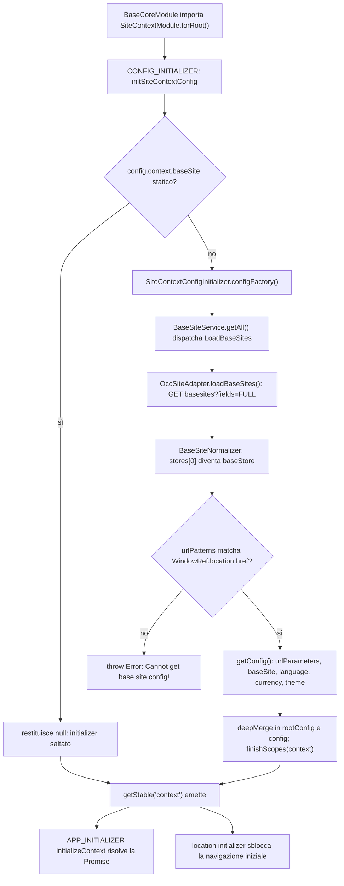
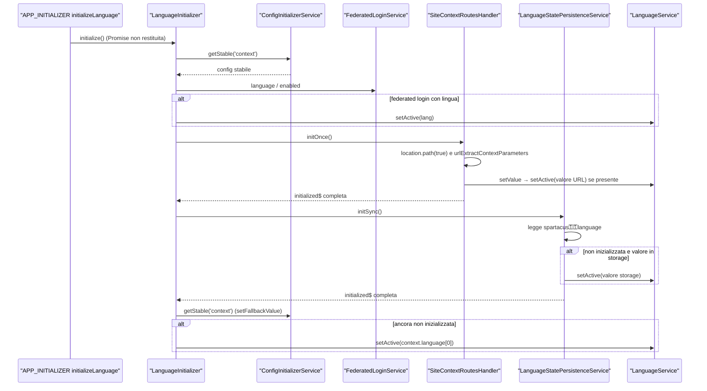
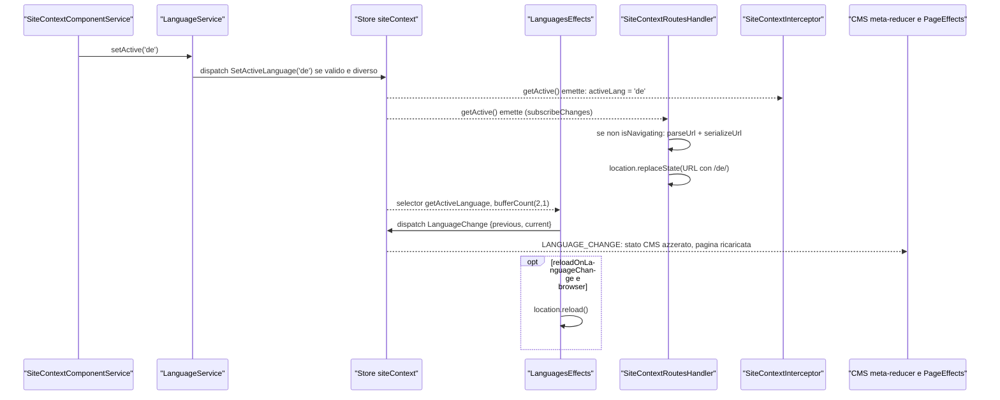
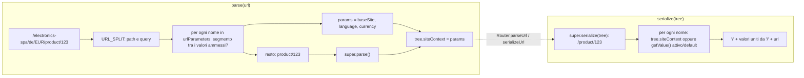
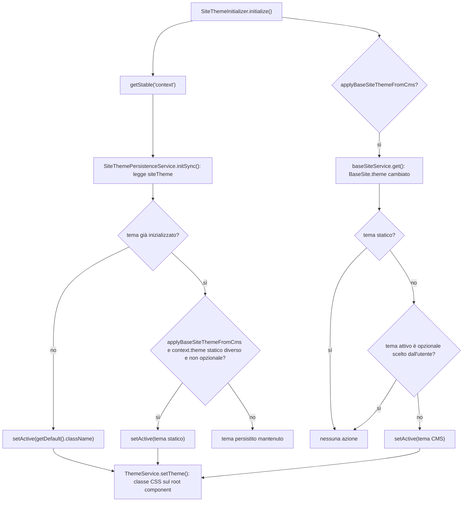

# 13 — Site context e site theme

> Riferimenti allo SHA `5b7a1c2bf2808d7380bc20596d10f4fa710c3da1` (vedi [00-meta](../00-meta.md)).

## 1. A cosa serve e perché esiste

Ogni chiamata OCC verso SAP Commerce Cloud è "situata": appartiene a un **base site** (il segmento `/electronics-spa/` nel path), viene servita in una **lingua** e in una **valuta** (i query param `lang` e `curr`). Lo storefront deve quindi sapere, in ogni momento, qual è la terna attiva `baseSite / language / currency`, da dove arriva (URL, `localStorage`, configurazione, backend) e come propagarla a router, HTTP e UI. È questo il compito del **site context** di `@spartacus/core` (`core-libs/core/src/site-context/`). Accanto a esso vive il **site theme** (`core-libs/core/src/site-theme/`), un quarto parametro di contesto che non arriva al backend ma si traduce in una classe CSS sul componente root.

Gli ID dei parametri sono quattro costanti stringa — `language`, `currency`, `baseSite`, `theme` — `core-libs/core/src/site-context/providers/context-ids.ts:L7-L10`. Tutto il sottosistema ruota attorno a una sola chiave di configurazione, `context`, un dizionario di array di stringhe con la chiave speciale `urlParameters` — `core-libs/core/src/site-context/config/site-context-config.ts:L10-L19`. La convenzione fondamentale è: **il default di un parametro è il primo elemento del suo array** — `core-libs/core/src/site-context/config/context-config-utils.ts:L28-L34`.

Il site context risolve, in sintesi, cinque problemi:

1. **Ottenere la configurazione `context`**: statica (fornita dall'app con `provideConfig`) oppure dinamica, derivata dal base site del backend il cui `urlPatterns` corrisponde all'URL corrente (`SiteContextConfigInitializer`, un `ConfigInitializer` con scope `context`) — `core-libs/core/src/site-context/site-context.module.ts:L30-L41`, `core-libs/core/src/site-context/config/config-loader/site-context-config-initializer.ts:L24-L27`.
2. **Inizializzare i valori attivi** con una precedenza precisa: (federated login →) URL → `localStorage` → default di config — `core-libs/core/src/site-context/services/language-initializer.ts:L35-L44`, `core-libs/core/src/site-context/services/currency-initializer.ts:L33-L41`, `core-libs/core/src/site-context/services/base-site-initializer.ts:L31-L38`.
3. **Codificare il contesto nell'URL** (`/electronics-spa/en/USD/...`) sostituendo l'`UrlSerializer` di Angular con `SiteContextUrlSerializer` e tenendo URL e stato sincronizzati in entrambe le direzioni con `SiteContextRoutesHandler` — `core-libs/core/src/site-context/providers/site-context-params-providers.ts:L12-L18`, `core-libs/core/src/site-context/services/site-context-routes-handler.ts:L41-L46`.
4. **Propagare il contesto alle chiamate OCC**: il base site entra nel path tramite `OccEndpointsService.getBaseUrl()`, lingua e valuta come query param tramite `SiteContextInterceptor` — `core-libs/core/src/occ/services/occ-endpoints.service.ts:L86-L102`, `core-libs/core/src/occ/adapters/site-context/site-context.interceptor.ts:L54-L68`.
5. **Notificare i cambi** al resto dell'applicazione: action NgRx `LanguageChange`/`CurrencyChange`, eventi `LanguageSetEvent`/`CurrencySetEvent`, reset del CMS al cambio lingua — `core-libs/core/src/site-context/store/effects/languages.effect.ts:L58-L70`, `core-libs/core/src/site-context/events/site-context-event.builder.ts:L41-L72`, `core-libs/core/src/cms/store/reducers/index.ts:L78-L87`.

Il site theme riusa gli stessi mattoni (store NgRx, persistenza, initializer, interfaccia `SiteContext<T>`), ma con regole proprie: non passa dall'URL, ha un default che può arrivare dal CMS e una lista di temi opzionali (di default due temi ad alto contrasto) — `core-libs/core/src/site-theme/services/site-theme-initializer.ts:L36-L50`, `core-libs/core/src/site-theme/config/default-site-theme-config.ts:L9-L22`.

Il capitolo presuppone i meccanismi di configurazione descritti in [11 — Configurazione](11-configurazione.md) (`CONFIG_INITIALIZER`, `getStable`, `deepMerge`) e l'ordine di bootstrap di [10 — Bootstrap e ordine di inizializzazione](10-bootstrap-inizializzazione.md). Il rapporto con il Router di Angular è approfondito in [05 — Il Router di Angular](../parte-1/05-router.md) e [14 — Routing](14-routing.md).

## 2. Mappa dei file

| Path | Ruolo |
|---|---|
| `core-libs/core/src/site-context/site-context.module.ts` | `SiteContextModule.forRoot()` e factory `initSiteContextConfig` (statico vs dinamico) |
| `core-libs/core/src/site-context/config/site-context-config.ts` | token astratto `SiteContextConfig` (`useExisting: Config`) + module augmentation di `Config` |
| `core-libs/core/src/site-context/config/context-config-utils.ts` | `getContextParameterValues`, `getContextParameterDefault` (default = primo elemento) |
| `core-libs/core/src/site-context/config/default-site-context-config.ts` | default: 17 lingue (prima `en`), 20 valute (prima `USD`), nessun `baseSite` |
| `core-libs/core/src/site-context/config/base-site-config-validator.ts` | validator che segnala `baseSite` mancante |
| `core-libs/core/src/site-context/config/config-loader/site-context-config-initializer.ts` | `SiteContextConfigInitializer`: config `context` dal base site che matcha l'URL |
| `core-libs/core/src/site-context/providers/context-ids.ts` | costanti `LANGUAGE_CONTEXT_ID`, `CURRENCY_CONTEXT_ID`, `BASE_SITE_CONTEXT_ID`, `THEME_CONTEXT_ID` |
| `core-libs/core/src/site-context/providers/context-service-map.ts` | `ContextServiceMap` (nome contesto → classe facade) e `serviceMapFactory` |
| `core-libs/core/src/site-context/providers/context-service-providers.ts` | facade + `APP_INITIALIZER` che attende `getStable('context')` |
| `core-libs/core/src/site-context/providers/context-initializer-providers.ts` | tre `APP_INITIALIZER` (language, currency, baseSite) |
| `core-libs/core/src/site-context/providers/site-context-params-providers.ts` | `SiteContextParamsService`, `SiteContextUrlSerializer`, override di `UrlSerializer` |
| `core-libs/core/src/site-context/facade/site-context.interface.ts` | interfaccia `SiteContext<T>` |
| `core-libs/core/src/site-context/facade/base-site.service.ts` | `BaseSiteService` |
| `core-libs/core/src/site-context/facade/language.service.ts` | `LanguageService` |
| `core-libs/core/src/site-context/facade/currency.service.ts` | `CurrencyService` (filtro `showOnlyActiveCurrencies`) |
| `core-libs/core/src/site-context/services/site-context-params.service.ts` | accesso per nome a parametri, valori e servizi di contesto |
| `core-libs/core/src/site-context/services/site-context-url-serializer.ts` | `SiteContextUrlSerializer`: toglie/aggiunge i prefissi di contesto dall'URL |
| `core-libs/core/src/site-context/services/site-context-routes-handler.ts` | `SiteContextRoutesHandler` (PRIVATE API): sincronizzazione URL ↔ stato |
| `core-libs/core/src/site-context/services/language-initializer.ts` | precedenza lingua: federated login → URL → storage → default |
| `core-libs/core/src/site-context/services/currency-initializer.ts` | precedenza valuta: URL → storage → default |
| `core-libs/core/src/site-context/services/base-site-initializer.ts` | precedenza base site: URL → default (nessuno storage) |
| `core-libs/core/src/site-context/services/language-state-persistence.service.ts` | sync lingua con `localStorage` (chiave `language`) |
| `core-libs/core/src/site-context/services/currency-state-persistence.service.ts` | sync valuta con `localStorage` (chiave `currency`) |
| `core-libs/core/src/site-context/store/state.ts` | feature `siteContext`: `languages`, `currencies`, `baseSite` |
| `core-libs/core/src/site-context/store/site-context-store.module.ts` | `StoreModule.forFeature`, effects, transfer SSR dello stato |
| `core-libs/core/src/site-context/store/reducers/*.ts` | reducer di base site, lingue, valute |
| `core-libs/core/src/site-context/store/effects/*.ts` | caricamento liste + emissione delle action `*Change` |
| `core-libs/core/src/site-context/store/actions/*.ts`, `store/selectors/*.ts` | namespace `SiteContextActions`, `SiteContextSelectors` |
| `core-libs/core/src/site-context/events/*.ts` | `LanguageSetEvent`, `CurrencySetEvent`, `SiteContextEventBuilder`, `SiteContextEventModule` |
| `core-libs/core/src/site-context/connectors/*.ts` | `SiteAdapter`, `SiteConnector`, token normalizer |
| `core-libs/core/src/occ/adapters/site-context/site-context-occ.module.ts` | binding `SiteAdapter → OccSiteAdapter`, interceptor, normalizer |
| `core-libs/core/src/occ/adapters/site-context/occ-site.adapter.ts` | implementazione OCC (`basesites`, `languages`, `currencies`, ...) |
| `core-libs/core/src/occ/adapters/site-context/converters/base-site-normalizer.ts` | `stores[0]` → `baseStore` |
| `core-libs/core/src/occ/adapters/site-context/site-context.interceptor.ts` | `SiteContextInterceptor`: query param `lang`/`curr` |
| `core-libs/core/src/occ/services/occ-endpoints.service.ts` | base site attivo nel path OCC |
| `core-libs/core/src/site-theme/site-theme.module.ts` | `SiteThemeModule.forRoot()` |
| `core-libs/core/src/site-theme/config/site-theme-config.ts`, `config/default-site-theme-config.ts` | `SiteThemeConfig`, temi opzionali di default |
| `core-libs/core/src/site-theme/facade/site-theme.service.ts` | `SiteThemeService`: default, lista temi, validazione |
| `core-libs/core/src/site-theme/services/site-theme-initializer.ts` | init tema e precedenza statico > opzionale > CMS |
| `core-libs/core/src/site-theme/services/site-theme-persistence.service.ts` | sync tema con `localStorage` (chiave `siteTheme`) |
| `core-libs/core/src/site-theme/store/*` | feature `siteTheme`, action, reducer, effect, selector |
| `core-libs/storefront/layout/theme/theme.module.ts`, `theme.service.ts` | applicazione della classe CSS del tema sul root component |

## 3. Come funziona passo per passo

### 3.1 Registrazione: `SiteContextModule.forRoot()` e `SiteThemeModule.forRoot()`

`BaseCoreModule` importa `ConfigInitializerModule.forRoot()` e, più in basso, `SiteContextModule.forRoot()` con un commento esplicito: deve stare dopo `RouterModule.forRoot` perché sovrascrive `UrlSerializer`; `SiteThemeModule.forRoot()` viene importato ancora dopo — `core-libs/core/src/base-core.module.ts:L31-L43`. Il motivo è che il router registra `UrlSerializer` con `useClass: DefaultUrlSerializer` in `ROUTER_PROVIDERS` — `angular:packages/router/src/router_module.ts:L69-L72` — e vince l'ultimo provider registrato.

`SiteContextModule` importa `StateModule`, `SiteContextStoreModule` e `SiteContextEventModule` — `core-libs/core/src/site-context/site-context.module.ts:L43-L46`. Il suo `forRoot()` registra — `core-libs/core/src/site-context/site-context.module.ts:L47-L65`:

- la default config (`provideDefaultConfigFactory(defaultSiteContextConfigFactory)`);
- `contextServiceMapProvider` (la mappa nome → facade);
- `contextServiceProviders`: `BaseSiteService`, `LanguageService`, `CurrencyService` e un `APP_INITIALIZER` che restituisce `lastValueFrom(configInit.getStable('context'))` — `core-libs/core/src/site-context/providers/context-service-providers.ts:L15-L33`;
- `siteContextParamsProviders`: `SiteContextParamsService`, `SiteContextUrlSerializer` e `{ provide: UrlSerializer, useExisting: SiteContextUrlSerializer }` — `core-libs/core/src/site-context/providers/site-context-params-providers.ts:L12-L18`;
- il validator `baseSiteConfigValidator`;
- un `CONFIG_INITIALIZER` con factory `initSiteContextConfig`;
- `contextInitializerProviders`: tre `APP_INITIALIZER` (language, currency, baseSite, in quest'ordine) — `core-libs/core/src/site-context/providers/context-initializer-providers.ts:L36-L55`.

Le tre facade sono `@Injectable()` senza `providedIn` — `core-libs/core/src/site-context/facade/base-site.service.ts:L21-L22` — quindi esistono solo dove è importato `SiteContextModule.forRoot()`.

`SiteThemeModule.forRoot()` fornisce `SiteThemeService`, `defaultSiteThemeConfig` e l'`APP_INITIALIZER` del tema; importa `StateModule` e `SiteThemeStoreModule` — `core-libs/core/src/site-theme/site-theme.module.ts:L15-L29`.

### 3.2 Configurazione `context`: statica o dinamica

La factory del `CONFIG_INITIALIZER` decide se caricare la config dal backend: lo fa **solo se non esiste una config statica per `context.baseSite`**, altrimenti restituisce `null` — `core-libs/core/src/site-context/site-context.module.ts:L30-L41`. `ConfigInitializerService.initialize` salta gli initializer `null` con un `continue` — `core-libs/core/src/config/config-initializer/config-initializer.service.ts:L140-L143`.

**Caso statico** (il più comune, e quello della demo app): l'app fornisce `context.urlParameters` e `context.baseSite`. La demo B2C configura `urlParameters: ['baseSite', 'language', 'currency']` e una lista di base site il cui primo elemento è `electronics-spa` — `projects/storefrontapp/src/app/spartacus/spartacus-b2c-configuration.providers.ts:L11-L31`. Lingue e valute, se non fornite dall'app, restano quelle del default: 17 lingue con `en` in testa e 20 valute con `USD` in testa — `core-libs/core/src/site-context/config/default-site-context-config.ts:L13-L58`.

**Caso dinamico**: `SiteContextConfigInitializer` è un `ConfigInitializer` in root con `scopes = ['context']` e `configFactory = () => lastValueFrom(this.resolveConfig())` — `core-libs/core/src/site-context/config/config-loader/site-context-config-initializer.ts:L24-L27`. `resolveConfig()`:

1. carica tutti i base site con `BaseSiteService.getAll()` (che dispatcha `LoadBaseSites` se lo store è vuoto) — `core-libs/core/src/site-context/config/config-loader/site-context-config-initializer.ts:L46-L48`, `core-libs/core/src/site-context/facade/base-site.service.ts:L41-L51`;
2. legge l'URL corrente da `WindowRef.location.href` — `core-libs/core/src/site-context/config/config-loader/site-context-config-initializer.ts:L37-L39`. In SSR `WindowRef.location` restituisce `href: SERVER_REQUEST_URL` e lancia un errore se il token manca — `core-libs/core/src/window/window-ref.ts:L70-L89`;
3. se il federated login è attivo chiama `detectContext()` e, sul login domain, usa l'`origin` del federated login al posto dell'URL — `core-libs/core/src/site-context/config/config-loader/site-context-config-initializer.ts:L49-L59`;
4. sceglie il primo base site con un `urlPatterns` che matcha l'URL (regex Java convertite con `JavaRegExpConverter.toJsRegExp`); se nessuno matcha lancia `Error: Cannot get base site config! ...` — `core-libs/core/src/site-context/config/config-loader/site-context-config-initializer.ts:L61-L74`, `core-libs/core/src/site-context/config/config-loader/site-context-config-initializer.ts:L100-L106`;
5. traduce il base site in config con `getConfig()` — `core-libs/core/src/site-context/config/config-loader/site-context-config-initializer.ts:L77-L98`:
   - `urlParameters` da `urlEncodingAttributes`, mappando l'attributo OCC `storefront` sul parametro Spartacus `baseSite` — `core-libs/core/src/site-context/config/config-loader/site-context-config-initializer.ts:L108-L119`;
   - `baseSite: [uid]`;
   - `language` e `currency` dal `baseStore`, con il default spostato in testa (`getIsoCodes` + `moveToFirst`, su una copia dell'array); la lingua di default privilegia `BaseSite.defaultLanguage` su `baseStore.defaultLanguage` — `core-libs/core/src/site-context/config/config-loader/site-context-config-initializer.ts:L82-L85`, `core-libs/core/src/site-context/config/config-loader/site-context-config-initializer.ts:L124-L151`;
   - `theme: [source.theme]` — `core-libs/core/src/site-context/config/config-loader/site-context-config-initializer.ts:L90-L93`.

Il `baseStore` esiste perché `BaseSiteNormalizer` lo valorizza con il primo elemento di `stores` (e cancella `stores`) — `core-libs/core/src/occ/adapters/site-context/converters/base-site-normalizer.ts:L18-L28`; il normalizer è applicato da `OccSiteAdapter.loadBaseSites()`, che chiama l'endpoint `baseSites` (default `basesites?fields=FULL`) **senza** segmento base site — `core-libs/core/src/occ/adapters/site-context/occ-site.adapter.ts:L109-L120`, `core-libs/core/src/occ/adapters/site-context/default-occ-site-context-config.ts:L9-L25`.

Il risultato viene fuso con `deepMerge` sia in `rootConfig` sia nella `config` globale, poi lo scope `context` viene chiuso — `core-libs/core/src/config/config-initializer/config-initializer.service.ts:L158-L169`. Attenzione: `deepMerge` non fonde gli array (un array, o anche `undefined`, sostituisce il valore di destinazione) — `core-libs/core/src/config/utils/deep-merge.ts:L7-L9`, `core-libs/core/src/config/utils/deep-merge.ts:L36-L45`. Le liste del backend rimpiazzano quindi quelle di default.

Il validator `baseSiteConfigValidator` restituisce un messaggio se manca il default di `baseSite` — `core-libs/core/src/site-context/config/base-site-config-validator.ts:L11-L15`; come tutti i validator gira solo in dev mode e dopo `getStable()` — `core-libs/core/src/config/config-validator/config-validator.module.ts:L23-L37`.

### 3.3 Attesa della config e blocco della navigazione iniziale

Due meccanismi trattengono l'applicazione finché la config `context` non è pronta:

- l'`APP_INITIALIZER` `initializeContext` restituisce una Promise su `getStable('context')` — `core-libs/core/src/site-context/providers/context-service-providers.ts:L15-L21`. `getStable(...scopes)` emette subito se tutto è stabile, altrimenti attende che gli scope richiesti non siano più in corso — `core-libs/core/src/config/config-initializer/config-initializer.service.ts:L58-L70`;
- `ConfigInitializerModule.forRoot()` registra un location initializer che blocca la navigazione iniziale fino a `getStable()` — `core-libs/core/src/config/config-initializer/config-initializer.module.ts:L60-L63`.

Al contrario, i tre `APP_INITIALIZER` di language/currency/baseSite chiamano `initialize()` ma **non restituiscono** la Promise — `core-libs/core/src/site-context/providers/context-initializer-providers.ts:L12-L34`. Angular attende solo gli initializer che restituiscono Promise o Subscribable — `angular:packages/core/src/application/application_init.ts:L244-L255` — quindi l'inizializzazione dei valori attivi procede in modo asincrono rispetto al bootstrap. Nota a margine: `APP_INITIALIZER` è deprecato da Angular v19 in favore di `provideAppInitializer` — `angular:packages/core/src/application/application_init.ts:L38-L38`.

### 3.4 Facade: `SiteContext<T>`, `BaseSiteService`, `LanguageService`, `CurrencyService`

Tutte le facade implementano `SiteContext<T>`: `getAll()`, `getActive()`, `setActive(isocode)` — `core-libs/core/src/site-context/facade/site-context.interface.ts:L9-L13`. Le regole comuni:

- **`getAll()` è lazy**: se lo store non ha le entità dispatcha la `Load*` corrispondente e filtra i `null` — `core-libs/core/src/site-context/facade/base-site.service.ts:L41-L51`, `core-libs/core/src/site-context/facade/language.service.ts:L34-L44`. `CurrencyService.getAll()` filtra inoltre le valute con `active` quando il toggle `showOnlyActiveCurrencies` è attivo — `core-libs/core/src/site-context/facade/currency.service.ts:L37-L52`.
- **`getActive()`** filtra i valori "non ancora impostati": `BaseSiteService` usa `Boolean(active)` perché lo stato iniziale è `''` — `core-libs/core/src/site-context/facade/base-site.service.ts:L31-L36`, `core-libs/core/src/site-context/store/reducers/base-site.reducer.ts:L11-L15`.
- **`setActive()`** dispatcha `SetActive*` solo se il valore è diverso dall'attuale; lingua e valuta verificano inoltre `isValid` (appartenenza a `context.language` / `context.currency`) — `core-libs/core/src/site-context/facade/language.service.ts:L59-L69`, `core-libs/core/src/site-context/facade/language.service.ts:L88-L95`, `core-libs/core/src/site-context/facade/currency.service.ts:L67-L77`, `core-libs/core/src/site-context/facade/currency.service.ts:L96-L103`. `BaseSiteService.setActive` invece **non** chiama `isValid`, che pure esiste come metodo `protected` — `core-libs/core/src/site-context/facade/base-site.service.ts:L72-L82`, `core-libs/core/src/site-context/facade/base-site.service.ts:L101-L108`.
- **`isInitialized()`** verifica in modo sincrono se `getActive()` ha già emesso (subscribe + unsubscribe immediato) — `core-libs/core/src/site-context/facade/base-site.service.ts:L87-L94`. È il predicato su cui si basa tutta la precedenza degli initializer.
- `BaseSiteService.get(siteUid?)` cerca il sito nella lista; senza uid usa il base site attivo — `core-libs/core/src/site-context/facade/base-site.service.ts:L56-L70`.

`ContextServiceMap` è una classe astratta indicizzata per nome; la factory mappa solo `language`, `currency` e `baseSite` — **non** `theme` — `core-libs/core/src/site-context/providers/context-service-map.ts:L18-L33`.

### 3.5 `SiteContextParamsService`: il contesto "per nome"

`SiteContextParamsService` fa da ponte generico fra nomi di parametro e facade, ed è usato da serializer e routes handler:

- `getContextParameters()` → tutte le chiavi di `context` tranne `urlParameters` — `core-libs/core/src/site-context/services/site-context-params.service.ts:L29-L36`;
- `getUrlEncodingParameters()` → `context.urlParameters` o `[]` — `core-libs/core/src/site-context/services/site-context-params.service.ts:L38-L40`;
- `getParamValues()` / `getParamDefaultValue()` → le utility di `context-config-utils` — `core-libs/core/src/site-context/services/site-context-params.service.ts:L42-L48`;
- `getSiteContextService(param)` → risolve la classe dal `ContextServiceMap` tramite `Injector`; se l'injection fallisce logga un warning in dev mode e restituisce `undefined` — `core-libs/core/src/site-context/services/site-context-params.service.ts:L50-L63`;
- `getValue(param)` → valore attivo letto sincronicamente, con fallback al default di config — `core-libs/core/src/site-context/services/site-context-params.service.ts:L65-L77`;
- `setValue(param, value)` → `service.setActive(value)` — `core-libs/core/src/site-context/services/site-context-params.service.ts:L79-L84`;
- `getValues(params)` → `combineLatest` dei valori attivi, emette solo quando tutti sono truthy — `core-libs/core/src/site-context/services/site-context-params.service.ts:L93-L107`.

### 3.6 Il contesto nell'URL: `SiteContextUrlSerializer`

`SiteContextUrlSerializer` estende `DefaultUrlSerializer` — `core-libs/core/src/site-context/services/site-context-url-serializer.ts:L30-L35`. Il `Router` lo usa automaticamente perché inietta `UrlSerializer` e lo invoca in `parseUrl`/`serializeUrl` — `angular:packages/router/src/router.ts:L105-L105`, `angular:packages/router/src/router.ts:L588-L595`; anche `router.url` è `serializeUrl(currentUrlTree)` — `angular:packages/router/src/router.ts:L351-L353`.

**Parse** (`parse(url)`): se `urlParameters` non è vuoto estrae i prefissi di contesto, fa il parse del resto con `super.parse` e salva i parametri nella proprietà custom `siteContext` del `UrlTree` (tipo `UrlTreeWithSiteContext`); altrimenti delega del tutto a `super.parse` — `core-libs/core/src/site-context/services/site-context-url-serializer.ts:L62-L71`, `core-libs/core/src/site-context/services/site-context-url-serializer.ts:L14-L24`. L'estrazione vera e propria (`urlExtractContextParameters`) separa path e query/fragment con `URL_SPLIT`, scarta il segmento vuoto iniziale — `core-libs/core/src/site-context/services/site-context-url-serializer.ts:L83-L88` — e poi scorre in parallelo i nomi di `urlParameters` e i segmenti: un segmento viene consumato solo se è tra i valori ammessi del parametro corrente, mentre il parametro avanza comunque — `core-libs/core/src/site-context/services/site-context-url-serializer.ts:L91-L108`.

Esempio con la config della demo (`urlParameters: ['baseSite','language','currency']`): l'URL `/electronics-spa/de/EUR/product/123` produce `params = { baseSite: 'electronics-spa', language: 'de', currency: 'EUR' }` e il router vede `product/123`. Un URL `/de/product/123` produce `{ language: 'de' }`: `de` non è un base site, quindi il parametro `baseSite` viene saltato e `de` confrontato con `language`.

**Serialize** (`serialize(tree)`): serializza con `super.serialize` e antepone, per ogni nome in `urlParameters`, il valore salvato nel tree oppure il valore **attivo** corrente (`getValue`, che a sua volta ripiega sul default di config) — `core-libs/core/src/site-context/services/site-context-url-serializer.ts:L126-L131`, `core-libs/core/src/site-context/services/site-context-url-serializer.ts:L146-L159`. Ogni `routerLink` generato dall'app ottiene così il prefisso completo senza che i componenti debbano conoscerlo.

### 3.7 Sincronizzazione bidirezionale: `SiteContextRoutesHandler`

`SiteContextRoutesHandler` è in root, marcato `// PRIVATE API` e non riesportato dal barrel dei servizi — `core-libs/core/src/site-context/services/site-context-routes-handler.ts:L21-L25`, `core-libs/core/src/site-context/services/index.ts:L7-L13`. `init()` è deprecato dalla 2211.32 e delega a `initOnce()` — `core-libs/core/src/site-context/services/site-context-routes-handler.ts:L48-L56`. `initOnce()` è idempotente: esegue `initInternal()` una sola volta e restituisce sempre lo stesso `ReplaySubject(1)` — `core-libs/core/src/site-context/services/site-context-routes-handler.ts:L62-L84`. Questo permette ai tre initializer di "chiamarlo" tutti senza ripetere il lavoro.

`initInternal()` — `core-libs/core/src/site-context/services/site-context-routes-handler.ts:L89-L105`:

1. risolve `Router` e `Location` dall'`Injector` (lazy, per non creare dipendenze circolari al bootstrap);
2. se ci sono `urlParameters`, legge sincronicamente il path corrente (`location.path(true)`) e applica i valori (`setContextParamsFromRoute` → `urlExtractContextParameters` → `SiteContextParamsService.setValue`) — `core-libs/core/src/site-context/services/site-context-routes-handler.ts:L163-L168`;
3. attiva le due subscription `subscribeChanges` e `subscribeRouting`;
4. in ogni caso emette e completa `initialized$`.

**URL → stato** (`subscribeRouting`): sugli eventi `NavigationStart`/`End`/`Error`/`Cancel` imposta `isNavigating = event instanceof NavigationStart` e, a ogni `NavigationStart`, applica i parametri estratti dall'URL di destinazione — `core-libs/core/src/site-context/services/site-context-routes-handler.ts:L137-L156`.

**Stato → URL** (`subscribeChanges`): per ogni parametro URL con un servizio, sottoscrive `getActive()`; se il valore cambia **fuori** da una navigazione e c'era già un valore precedente memorizzato, ricostruisce l'URL corrente con `router.parseUrl(router.url)` + `router.serializeUrl(...)` e lo sostituisce con `location.replaceState`, senza navigare — `core-libs/core/src/site-context/services/site-context-routes-handler.ts:L111-L131`. Il flag `isNavigating` esiste proprio per evitare il ciclo infinito fra le due subscription — `core-libs/core/src/site-context/services/site-context-routes-handler.ts:L41-L46`.

> ⚠️ DA VERIFICARE — Perché `replaceState` produca il nuovo prefisso, il `currentUrlTree` del router non deve portare con sé la proprietà custom `siteContext` con i vecchi valori (altrimenti `serialize` userebbe quelli invece del valore attivo). Il codice Angular assegna `currentUrlTree` dall'URL finale della navigazione (`angular:packages/router/src/statemanager/state_manager.ts:L108-L108`), ma non è stato verificato a runtime se quell'oggetto è lo stesso restituito da `SiteContextUrlSerializer.parse`.

### 3.8 Inizializzazione dei valori attivi e persistenza

Ogni initializer è una catena `switchMap` che parte da `getStable('context')`; ogni passo applica un valore solo se il precedente non l'ha già fatto (tranne URL e federated login, che chiamano `setActive` direttamente):

- **Lingua** — `core-libs/core/src/site-context/services/language-initializer.ts:L35-L44`:
  1. `setFromFederatedLoginContext()` → `setActive(federatedLoginService.language)` se abilitato e presente — `core-libs/core/src/site-context/services/language-initializer.ts:L73-L79`;
  2. `siteContextRoutesHandler.initOnce()` → valori dall'URL;
  3. `languageStatePersistenceService.initSync()` → `localStorage`;
  4. `setFallbackValue()` → primo elemento di `context.language` se non ancora inizializzata — `core-libs/core/src/site-context/services/language-initializer.ts:L51-L71`.
- **Valuta** — stessa catena senza federated login — `core-libs/core/src/site-context/services/currency-initializer.ts:L33-L41`, fallback `core-libs/core/src/site-context/services/currency-initializer.ts:L60-L68`.
- **Base site** — config stabile → URL → fallback, **senza** persistenza su storage — `core-libs/core/src/site-context/services/base-site-initializer.ts:L31-L38`, `core-libs/core/src/site-context/services/base-site-initializer.ts:L57-L65`.

Poiché `setContextParamsFromRoute` passa per `setValue` → `setActive` senza controllare `isInitialized()` (`core-libs/core/src/site-context/services/site-context-routes-handler.ts:L163-L168`, `core-libs/core/src/site-context/services/site-context-params.service.ts:L79-L84`, `core-libs/core/src/site-context/facade/language.service.ts:L59-L69`), un valore valido nell'URL **sovrascrive** quello impostato dal federated login.

La persistenza (`LanguageStatePersistenceService`, `CurrencyStatePersistenceService`) usa `StatePersistenceService.syncWithStorage` con chiave `language` / `currency`, `state$ = service.getActive()` e un `onRead` che applica il valore dallo storage solo se non già inizializzato, poi completa `initialized$` — `core-libs/core/src/site-context/services/language-state-persistence.service.ts:L22-L47`, `core-libs/core/src/site-context/services/currency-state-persistence.service.ts:L24-L42`. `syncWithStorage` usa per default `localStorage` e `context$ = of('')`; la lettura avviene prima della scrittura e ogni emissione di `state$` viene persistita — `core-libs/core/src/state/services/state-persistence.service.ts:L44-L92`. La chiave effettiva è `spartacus⚿<context>⚿<key>`, cioè ad esempio `spartacus⚿⚿language` — `core-libs/core/src/state/services/state-persistence.service.ts:L124-L131`. In SSR `WindowRef.localStorage` è `undefined`, quindi `onRead` riceve `undefined` e non si scrive nulla — `core-libs/core/src/window/window-ref.ts:L41-L44`, `core-libs/core/src/window/window-ref.ts:L58-L60`, `core-libs/core/src/state/services/state-persistence.service.ts:L68-L75`.

### 3.9 Store NgRx, effects ed eventi

La feature si chiama `siteContext` e contiene `languages`, `currencies`, `baseSite` — `core-libs/core/src/site-context/store/state.ts:L8-L18`. `BaseSiteState` ha `entities`, `activeSite` e `details` (il `BaseSite` attivo) — `core-libs/core/src/site-context/store/state.ts:L37-L41`. `SiteContextStoreModule` registra feature ed effects e una default config che trasferisce lo slice `siteContext` dal server al browser via `TRANSFER_STATE` — `core-libs/core/src/site-context/store/site-context-store.module.ts:L20-L43`. La chiave `state.ssrTransfer.keys` è letta dal meta-reducer `getTransferStateReducer` (registrato su `META_REDUCERS`): sul server scrive a ogni action lo slice in `TransferState` sotto `CX_KEY`; sul browser, all'action `INIT` e solo se l'utente non è loggato, lo fonde nello stato con `deepMerge` — `core-libs/core/src/state/reducers/transfer-state.reducer.ts:L18-L40`, `core-libs/core/src/state/reducers/transfer-state.reducer.ts:L51-L60`, `core-libs/core/src/state/reducers/transfer-state.reducer.ts:L74-L92`, `core-libs/core/src/state/reducers/index.ts:L27-L43`. I dettagli sono in [19 — State management](19-state-management.md) e [39 — SSR ottimizzato](39-ssr-ottimizzato.md).

Reducer:

- `SET_ACTIVE_BASE_SITE` aggiorna `activeSite` e ricalcola `details` dalle entità se presenti — `core-libs/core/src/site-context/store/reducers/base-site.reducer.ts:L29-L41`;
- `LOAD_BASE_SITES_SUCCESS` indicizza per `uid` e popola `details` del sito attivo — `core-libs/core/src/site-context/store/reducers/base-site.reducer.ts:L43-L65`;
- lingue e valute partono da `entities: null`, attivo `null`; `LOAD_*_SUCCESS` indicizza per `isocode`, `SET_ACTIVE_*` imposta l'isocode — `core-libs/core/src/site-context/store/reducers/languages.reducer.ts:L11-L51`, `core-libs/core/src/site-context/store/reducers/currencies.reducer.ts:L11-L52`.

Effects:

- `loadLanguages$`, `loadCurrencies$`, `loadBaseSite$`, `loadBaseSites$` usano `exhaustMap` sul `SiteConnector` e normalizzano gli errori con `tryNormalizeHttpError` — `core-libs/core/src/site-context/store/effects/languages.effect.ts:L34-L56`, `core-libs/core/src/site-context/store/effects/base-site.effect.ts:L20-L68`;
- `activateLanguage$` / `activateCurrency$` osservano il selector dell'attivo con `bufferCount(2, 1)` e dispatchano `LanguageChange` / `CurrencyChange` con `{ previous, current }` solo se esiste un valore precedente — `core-libs/core/src/site-context/store/effects/languages.effect.ts:L58-L70`, `core-libs/core/src/site-context/store/effects/currencies.effect.ts:L29-L65`;
- `reloadPageOnLanguageChange$` (non-dispatching) fa `location.reload()` su `LANGUAGE_CHANGE` se `reloadOnLanguageChange === true` e la piattaforma è browser — `core-libs/core/src/site-context/store/effects/languages.effect.ts:L72-L88`;
- non esiste un effect "activate" per il base site — `core-libs/core/src/site-context/store/effects/base-site.effect.ts:L16-L74`.

Eventi: `SiteContextEventBuilder` mappa `SET_ACTIVE_LANGUAGE` → `LanguageSetEvent` e `SET_ACTIVE_CURRENCY` → `CurrencySetEvent` registrandoli su `EventService` — `core-libs/core/src/site-context/events/site-context-event.builder.ts:L41-L72`; `SiteContextEventModule` esiste solo per istanziare eagerly il builder — `core-libs/core/src/site-context/events/site-context-event.module.ts:L10-L15`. Per il sistema eventi in generale vedi [20 — Facade, command & query, eventi](20-facade-command-query-eventi.md).

Consumatori del cambio lingua fuori dal site context: il meta-reducer CMS azzera l'intero stato CMS su `LANGUAGE_CHANGE` — `core-libs/core/src/cms/store/reducers/index.ts:L78-L87` — e `PageEffects` ricarica la pagina CMS corrente — `core-libs/core/src/cms/store/effects/page.effect.ts:L36-L42` (vedi [15 — CMS core](15-cms-core.md)).

### 3.10 Propagazione alle chiamate OCC

`SiteContextOccModule` (importato da `BaseOccModule`) lega `SiteAdapter` a `OccSiteAdapter`, registra `SiteContextInterceptor` su `HTTP_INTERCEPTORS` e `BaseSiteNormalizer` su `BASE_SITE_NORMALIZER` — `core-libs/core/src/occ/adapters/site-context/site-context-occ.module.ts:L18-L38`, `core-libs/core/src/occ/base-occ.module.ts:L18-L18`. `SiteConnector` delega 1:1 all'adapter — `core-libs/core/src/site-context/connectors/site.connector.ts:L19-L31`.

- **Base site nel path**: `OccEndpointsService` inietta `BaseSiteService` come `@Optional()`, memorizza l'attivo e in sua assenza usa il default di `context.baseSite` — `core-libs/core/src/occ/services/occ-endpoints.service.ts:L34-L54`; `getBaseUrl()` compone `baseUrl + prefix + baseSite` — `core-libs/core/src/occ/services/occ-endpoints.service.ts:L86-L102`. `urlPathJoin` scarta le parti falsy — `core-libs/core/src/occ/utils/occ-url-util.ts:L12-L26`.
- **Lingua e valuta in query**: `SiteContextInterceptor` parte dai default di config e si aggiorna sottoscrivendo `getActive()` di lingua e valuta — `core-libs/core/src/occ/adapters/site-context/site-context.interceptor.ts:L25-L52`; aggiunge `lang` e `curr` solo alle richieste il cui URL contiene `occEndpoints.getBaseUrl()` — `core-libs/core/src/occ/adapters/site-context/site-context.interceptor.ts:L54-L68`.

L'architettura adapter/connector/normalizer è trattata in [21 — Livello OCC](21-occ.md); gli interceptor in [06 — HttpClient e interceptor](../parte-1/06-httpclient-interceptor.md).

### 3.11 Site theme

**Configurazione.** `SiteThemeConfig` (token con `useExisting: Config`) espone `siteTheme.optionalThemes: SiteTheme[]` — `core-libs/core/src/site-theme/config/site-theme-config.ts:L11-L23`; un `SiteTheme` è `{ i18nNameKey, className }` — `core-libs/core/src/model/misc.model.ts:L140-L143`. Il default contiene due temi ad alto contrasto, `cx-theme-high-contrast-dark` e `cx-theme-high-contrast-light` — `core-libs/core/src/site-theme/config/default-site-theme-config.ts:L9-L22`. Il tema **di default** non sta in `siteTheme` ma in `context.theme`: può venire dal CMS (via `SiteContextConfigInitializer`), mentre i temi opzionali si configurano solo in `siteTheme.optionalThemes` — `core-libs/core/src/site-context/config/config-loader/site-context-config-initializer.ts:L90-L93`.

**Facade.** `SiteThemeService` (`@Injectable()` senza root) implementa `SiteContext<SiteTheme>` — `core-libs/core/src/site-theme/facade/site-theme.service.ts:L27-L32`:

- `getDefault()` → `{ className: getDefaultClassName(), i18nNameKey: 'siteThemeSwitcher.themes.default' }`, con fallback `''` — `core-libs/core/src/site-theme/facade/site-theme.service.ts:L37-L44`;
- `getDefaultClassName()` → `context.theme[0]` se presente; altrimenti, con il toggle `applyBaseSiteThemeFromCms`, il `theme` del base site attivo letto in modo sincrono (`getLastValueSync`); altrimenti `''` — `core-libs/core/src/site-theme/facade/site-theme.service.ts:L51-L71`;
- la lista dei temi è `[default, ...optionalThemes]` e `getAll()` restituisce `of(themes)` solo per conformità all'interfaccia — `core-libs/core/src/site-theme/facade/site-theme.service.ts:L84-L94`;
- `setActive(className)` dispatcha `SetActiveSiteTheme` se diverso e valido — `core-libs/core/src/site-theme/facade/site-theme.service.ts:L109-L119`; con il toggle CMS ogni stringa non null/undefined è valida (anche `''`), senza toggle il valore deve essere un `className` della lista — `core-libs/core/src/site-theme/facade/site-theme.service.ts:L130-L137`.

**Store.** Feature `siteTheme` con un solo sotto-stato `themes.activeSiteTheme` — `core-libs/core/src/site-theme/store/state.ts:L9-L25`; action `SET_ACTIVE_SITE_THEME` e `SITE_THEME_CHANGE` — `core-libs/core/src/site-theme/store/actions/site-themes.action.ts:L9-L25`; il reducer gestisce solo `SET_ACTIVE_SITE_THEME` — `core-libs/core/src/site-theme/store/reducers/site-themes.reducer.ts:L10-L28`; `activateSiteTheme$` emette `SiteThemeChange` con la tecnica `bufferCount(2, 1)` — `core-libs/core/src/site-theme/store/effects/site-themes.effect.ts:L21-L31`; lo slice è trasferito da SSR via `TRANSFER_STATE` — `core-libs/core/src/site-theme/store/site-theme-store.module.ts:L20-L42`.

**Inizializzazione.** L'`APP_INITIALIZER` del tema usa `inject()` nella factory e non restituisce nulla da attendere — `core-libs/core/src/site-theme/providers/site-theme-initializer-providers.ts:L10-L23`. `SiteThemeInitializer.initialize()` — `core-libs/core/src/site-theme/services/site-theme-initializer.ts:L36-L50`:

1. config stabile → `SiteThemePersistenceService.initSync()` (chiave `siteTheme`, `onRead` applica solo valori truthy e solo se non inizializzato) — `core-libs/core/src/site-theme/services/site-theme-persistence.service.ts:L26-L43`, `core-libs/core/src/site-theme/providers/site-theme-id.ts:L7-L7`;
2. fallback: se non inizializzato imposta `getDefault().className`; se invece la persistenza ha ripristinato un tema e il toggle CMS è attivo, un tema statico (`context.theme[0]`) vince su un tema persistito diverso, salvo che quest'ultimo sia un tema opzionale scelto dall'utente — `core-libs/core/src/site-theme/services/site-theme-initializer.ts:L67-L91`;
3. con il toggle CMS, una seconda subscription reagisce ai cambi di base site (`baseSiteService.get()`, filtrando siti senza tema e temi uguali) applicando la precedenza **statico > opzionale scelto dall'utente > CMS** — `core-libs/core/src/site-theme/services/site-theme-initializer.ts:L97-L127`, `core-libs/core/src/site-theme/services/site-theme-initializer.ts:L141-L147`.

Il tema non passa da `SiteContextRoutesHandler`, quindi non dipende dall'URL.

**Applicazione nel DOM.** `ThemeModule` (importato da `LayoutModule`, pubblico in `@spartacus/storefront`) registra un `APP_BOOTSTRAP_LISTENER` che passa il componente root a `ThemeService.init` — `core-libs/storefront/layout/theme/theme.module.ts:L10-L25`, `core-libs/storefront/layout/layout.module.ts:L15-L21`, `core-libs/storefront/layout/theme/index.ts:L7-L8`. `ThemeService` sottoscrive `SiteThemeService.getActive()` e, in `setTheme`, rimuove la classe precedente e aggiunge quella nuova sull'elemento host del root component tramite `Renderer2` — `core-libs/storefront/layout/theme/theme.service.ts:L35-L61`. Le classi CSS dei temi sono materia di [38 — Stili e theming](38-stili-theming.md).

### 3.12 UI: selettori di contesto e di tema

Il componente selettore di contesto (lingua/valuta) risolve il servizio tramite `ContextServiceMap` + `Injector` e chiama `setActive` — `core-libs/storefront/cms-components/misc/site-context-selector/site-context-component.service.ts:L72-L78`, `core-libs/storefront/cms-components/misc/site-context-selector/site-context-component.service.ts:L120-L125`. Lo switcher dei temi delega a `SiteThemeService.getAll/getActive/setActive` — `core-libs/storefront/cms-components/misc/site-theme-switcher/site-theme-switcher.component.service.ts:L13-L24`. I componenti CMS sono descritti in [45 — Componenti CMS e shared components](45-componenti-storefront.md).

## 4. Diagrammi

### 4.1 Risoluzione della config `context` al bootstrap



Riferimenti: `core-libs/core/src/base-core.module.ts:L38-L38`, `core-libs/core/src/site-context/site-context.module.ts:L30-L41`, `core-libs/core/src/site-context/config/config-loader/site-context-config-initializer.ts:L46-L98`, `core-libs/core/src/occ/adapters/site-context/occ-site.adapter.ts:L109-L120`, `core-libs/core/src/config/config-initializer/config-initializer.service.ts:L158-L169`, `core-libs/core/src/site-context/providers/context-service-providers.ts:L15-L21`, `core-libs/core/src/config/config-initializer/config-initializer.module.ts:L60-L63`.

### 4.2 Precedenza nell'inizializzazione della lingua



Riferimenti: `core-libs/core/src/site-context/providers/context-initializer-providers.ts:L20-L26`, `core-libs/core/src/site-context/services/language-initializer.ts:L35-L79`, `core-libs/core/src/site-context/services/site-context-routes-handler.ts:L78-L105`, `core-libs/core/src/site-context/services/language-state-persistence.service.ts:L29-L47`.

### 4.3 Cambio lingua dalla UI



Riferimenti: `core-libs/storefront/cms-components/misc/site-context-selector/site-context-component.service.ts:L72-L78`, `core-libs/core/src/site-context/facade/language.service.ts:L59-L69`, `core-libs/core/src/occ/adapters/site-context/site-context.interceptor.ts:L45-L52`, `core-libs/core/src/site-context/services/site-context-routes-handler.ts:L111-L131`, `core-libs/core/src/site-context/store/effects/languages.effect.ts:L58-L88`, `core-libs/core/src/cms/store/reducers/index.ts:L78-L87`, `core-libs/core/src/cms/store/effects/page.effect.ts:L36-L42`.

### 4.4 Parse e serialize dell'URL con prefissi di contesto



Riferimenti: `core-libs/core/src/site-context/services/site-context-url-serializer.ts:L62-L159`, `core-libs/core/src/site-context/services/site-context-params.service.ts:L65-L77`, `angular:packages/router/src/router.ts:L588-L595`.

### 4.5 Precedenza del tema



Riferimenti: `core-libs/core/src/site-theme/services/site-theme-initializer.ts:L36-L147`, `core-libs/core/src/site-theme/services/site-theme-persistence.service.ts:L26-L43`, `core-libs/storefront/layout/theme/theme.service.ts:L35-L61`.

## 5. Estratti di codice reale

### 5.1 Statico vs dinamico

`core-libs/core/src/site-context/site-context.module.ts:L30-L41`

```ts
export function initSiteContextConfig(
  configInitializer: SiteContextConfigInitializer,
  config: SiteContextConfig
): ConfigInitializer | null {
  /**
   * Load config for `context` from backend only when there is no static config for `context.baseSite`
   */
  if (!config.context?.[BASE_SITE_CONTEXT_ID]) {
    return configInitializer;
  }
  return null;
}
```

### 5.2 Dal base site OCC alla config `context`

`core-libs/core/src/site-context/config/config-loader/site-context-config-initializer.ts:L77-L98`

```ts
  protected getConfig(source: BaseSite): SiteContextConfig {
    const result = {
      context: {
        urlParameters: this.getUrlParams(source.urlEncodingAttributes),
        [BASE_SITE_CONTEXT_ID]: [source.uid],
        [LANGUAGE_CONTEXT_ID]: this.getIsoCodes(
          source.baseStore?.languages,
          source.defaultLanguage || source.baseStore?.defaultLanguage
        ),
        [CURRENCY_CONTEXT_ID]: this.getIsoCodes(
          source.baseStore?.currencies,
          source.baseStore?.defaultCurrency
        ),
        // Note: The default Site Theme can be driven by the CMS, but additional possible
        // selectable themes (like a11y high contrast themes) can be configured only
        // in the separate Spartacus configuration `config.siteTheme.optionalThemes`.
        [THEME_CONTEXT_ID]: [source.theme],
      },
    } as SiteContextConfig;

    return result;
  }
```

### 5.3 Estrazione dei prefissi dall'URL

`core-libs/core/src/site-context/services/site-context-url-serializer.ts:L91-L108`

```ts
    let paramId = 0;
    let segmentId = 0;
    while (
      paramId < this.urlEncodingParameters.length &&
      segmentId < segments.length
    ) {
      const paramName = this.urlEncodingParameters[paramId];
      const paramValues = this.siteContextParams.getParamValues(paramName);

      if (paramValues.includes(segments[segmentId])) {
        params[paramName] = segments[segmentId];
        segmentId++;
      }
      paramId++;
    }

    url = segments.slice(segmentId).join('/') + queryPart;
    return { url, params };
```

### 5.4 Stato → URL senza navigazione

`core-libs/core/src/site-context/services/site-context-routes-handler.ts:L111-L131`

```ts
  private subscribeChanges(params: string[]) {
    params.forEach((param) => {
      const service = this.siteContextParams.getSiteContextService(param);
      if (service) {
        this.subscription.add(
          service.getActive().subscribe((value) => {
            if (
              !this.isNavigating &&
              this.contextValues[param] &&
              this.contextValues[param] !== value
            ) {
              const parsed = this.router.parseUrl(this.router.url);
              const serialized = this.router.serializeUrl(parsed);
              this.location.replaceState(serialized);
            }
            this.contextValues[param] = value;
          })
        );
      }
    });
  }
```

### 5.5 Catena di inizializzazione della valuta

`core-libs/core/src/site-context/services/currency-initializer.ts:L33-L41`

```ts
  initialize(): Promise<unknown> {
    return firstValueFrom(
      this.configInit.getStable('context').pipe(
        switchMap(() => this.siteContextRoutesHandler.initOnce()),
        switchMap(() => this.currencyStatePersistenceService.initSync()),
        switchMap(() => this.setFallbackValue())
      )
    );
  }
```

### 5.6 Interceptor `lang`/`curr`

`core-libs/core/src/occ/adapters/site-context/site-context.interceptor.ts:L54-L68`

```ts
  intercept(
    request: HttpRequest<any>,
    next: HttpHandler
  ): Observable<HttpEvent<any>> {
    if (request.url.includes(this.occEndpoints.getBaseUrl())) {
      request = request.clone({
        setParams: {
          lang: this.activeLang ?? '',
          curr: this.activeCurr ?? '',
        },
      });
    }

    return next.handle(request);
  }
```

### 5.7 Action `*Change` solo sui cambi reali

`core-libs/core/src/site-context/store/effects/languages.effect.ts:L58-L70`

```ts
  activateLanguage$: Observable<SiteContextActions.LanguageChange> =
    createEffect(() =>
      this.state.select(getActiveLanguage).pipe(
        bufferCount(2, 1),

        // avoid dispatching `change` action when we're just setting the initial value:
        filter(([previous]) => !!previous),
        map(
          ([previous, current]) =>
            new SiteContextActions.LanguageChange({ previous, current })
        )
      )
    );
```

### 5.8 Default del tema

`core-libs/core/src/site-theme/facade/site-theme.service.ts:L51-L63`

```ts
  protected getDefaultClassName(): string {
    const staticDefault = getContextParameterDefault(
      this.config,
      THEME_CONTEXT_ID
    );
    if (staticDefault) {
      return staticDefault;
    }
    if (this.featureToggles.applyBaseSiteThemeFromCms) {
      return this.readActiveBaseSiteTheme() ?? this.FALLBACK_DEFAULT_THEME_ID;
    }
    return this.FALLBACK_DEFAULT_THEME_ID;
  }
```

### 5.9 Classe CSS sul root component

`core-libs/storefront/layout/theme/theme.service.ts:L52-L61`

```ts
  setTheme(theme: string | undefined): void {
    const element = this.rootComponent.location.nativeElement;
    if (this.existingTheme) {
      this.renderer.removeClass(element, this.existingTheme);
    }
    if (theme) {
      this.renderer.addClass(element, theme);
      this.existingTheme = theme;
    }
  }
```

## 6. Configurazione

| Chiave | Tipo | Default | Definita in | Letta in |
|---|---|---|---|---|
| `context.baseSite` | `string[]` | nessuno (il validator avvisa in dev mode) | `core-libs/core/src/site-context/config/site-context-config.ts:L15-L18` | `core-libs/core/src/site-context/site-context.module.ts:L37-L37`, `core-libs/core/src/site-context/services/base-site-initializer.ts:L57-L65`, `core-libs/core/src/occ/services/occ-endpoints.service.ts:L37-L42`, `core-libs/core/src/site-context/config/base-site-config-validator.ts:L11-L15` |
| `context.language` | `string[]` | 17 codici, primo `en` | `core-libs/core/src/site-context/config/default-site-context-config.ts:L16-L34` | `core-libs/core/src/site-context/facade/language.service.ts:L88-L95`, `core-libs/core/src/site-context/services/language-initializer.ts:L63-L71`, `core-libs/core/src/occ/adapters/site-context/site-context.interceptor.ts:L36-L39` |
| `context.currency` | `string[]` | 20 codici, primo `USD` | `core-libs/core/src/site-context/config/default-site-context-config.ts:L35-L56` | `core-libs/core/src/site-context/facade/currency.service.ts:L96-L103`, `core-libs/core/src/site-context/services/currency-initializer.ts:L60-L68`, `core-libs/core/src/occ/adapters/site-context/site-context.interceptor.ts:L40-L43` |
| `context.theme` | `string[]` | nessuno (fallback `''`) | dinamico: `core-libs/core/src/site-context/config/config-loader/site-context-config-initializer.ts:L93-L93` | `core-libs/core/src/site-theme/facade/site-theme.service.ts:L51-L58`, `core-libs/core/src/site-theme/services/site-theme-initializer.ts:L78-L81`, `core-libs/core/src/site-theme/services/site-theme-initializer.ts:L130-L135` |
| `context.urlParameters` | `string[]` | `[]` | `core-libs/core/src/site-context/config/site-context-config.ts:L16-L16` | `core-libs/core/src/site-context/services/site-context-params.service.ts:L38-L40`, `core-libs/core/src/site-context/services/site-context-url-serializer.ts:L40-L42`, `core-libs/core/src/site-context/services/site-context-routes-handler.ts:L92-L92` |
| `context.<altro>` | `string[]` | — | `core-libs/core/src/site-context/config/site-context-config.ts:L17-L17` | `core-libs/core/src/site-context/services/site-context-params.service.ts:L29-L36` |
| `siteTheme.optionalThemes` | `SiteTheme[]` | 2 temi high-contrast | `core-libs/core/src/site-theme/config/default-site-theme-config.ts:L9-L22` | `core-libs/core/src/site-theme/facade/site-theme.service.ts:L86-L89`, `core-libs/core/src/site-theme/services/site-theme-initializer.ts:L145-L146` |
| `state.ssrTransfer.keys.siteContext` | `StateTransferType` | `TRANSFER_STATE` | `core-libs/core/src/site-context/store/site-context-store.module.ts:L20-L30` | `core-libs/core/src/state/reducers/transfer-state.reducer.ts:L24-L36` |
| `state.ssrTransfer.keys.siteTheme` | `StateTransferType` | `TRANSFER_STATE` | `core-libs/core/src/site-theme/store/site-theme-store.module.ts:L20-L29` | `core-libs/core/src/state/reducers/transfer-state.reducer.ts:L24-L36` |
| `backend.occ.endpoints.baseSites` | `string` | `'basesites?fields=FULL'` | `core-libs/core/src/occ/adapters/site-context/default-occ-site-context-config.ts:L21-L21` | `core-libs/core/src/occ/adapters/site-context/occ-site.adapter.ts:L100-L100`, `core-libs/core/src/occ/adapters/site-context/occ-site.adapter.ts:L114-L114` |
| `backend.occ.endpoints.languages` / `currencies` | `string` | `'languages'` / `'currencies'` | `core-libs/core/src/occ/adapters/site-context/default-occ-site-context-config.ts:L13-L14` | `core-libs/core/src/occ/adapters/site-context/occ-site.adapter.ts` |
| feature toggle `showOnlyActiveCurrencies` | `boolean` | `true` | `core-libs/core/src/features-config/feature-toggles/config/feature-toggles.ts:L306-L311`, `core-libs/core/src/features-config/feature-toggles/config/feature-toggles.ts:L1051-L1051` | `core-libs/core/src/site-context/facade/currency.service.ts:L47-L49` |
| feature toggle `applyBaseSiteThemeFromCms` | `boolean` | `false` | `core-libs/core/src/features-config/feature-toggles/config/feature-toggles.ts:L655-L670`, `core-libs/core/src/features-config/feature-toggles/config/feature-toggles.ts:L1092-L1092` | `core-libs/core/src/site-theme/facade/site-theme.service.ts:L59-L59`, `core-libs/core/src/site-theme/facade/site-theme.service.ts:L131-L131`, `core-libs/core/src/site-theme/services/site-theme-initializer.ts:L47-L47`, `core-libs/core/src/site-theme/services/site-theme-initializer.ts:L77-L77` |
| feature toggle `reloadOnLanguageChange` | `boolean` | `false` | `core-libs/core/src/features-config/feature-toggles/config/feature-toggles.ts:L700-L710`, `core-libs/core/src/features-config/feature-toggles/config/feature-toggles.ts:L1096-L1096` | `core-libs/core/src/site-context/store/effects/languages.effect.ts:L78-L78` |
| chiave storage lingua | `string` | `spartacus⚿⚿language` | `core-libs/core/src/site-context/services/language-state-persistence.service.ts:L31-L31`, `core-libs/core/src/state/services/state-persistence.service.ts:L124-L131` | idem |
| chiave storage valuta | `string` | `spartacus⚿⚿currency` | `core-libs/core/src/site-context/services/currency-state-persistence.service.ts:L26-L26` | idem |
| chiave storage tema | `string` | `spartacus⚿⚿siteTheme` | `core-libs/core/src/site-theme/providers/site-theme-id.ts:L7-L7`, `core-libs/core/src/site-theme/services/site-theme-persistence.service.ts:L28-L28` | idem |

La demo app attiva `showOnlyActiveCurrencies`, `applyBaseSiteThemeFromCms` e `reloadOnLanguageChange` — `projects/storefrontapp/src/app/spartacus/spartacus-features.module.ts:L340-L340`, `projects/storefrontapp/src/app/spartacus/spartacus-features.module.ts:L379-L382`. Per il funzionamento generale dei feature toggle vedi [42 — Feature toggle e deprecazioni](42-feature-toggle-deprecazioni.md); per le chiavi di config in generale l'[Appendice A02](../appendici/A02-config.md).

## 7. Commenti e note notevoli dal sorgente

- `// should be imported after RouterModule.forRoot, because it overwrites UrlSerializer` — `core-libs/core/src/base-core.module.ts:L38-L38`. L'ordine degli import è parte del contratto.
- `Load config for \`context\` from backend only when there is no static config for \`context.baseSite\`` — `core-libs/core/src/site-context/site-context.module.ts:L34-L36`. Una sola chiave decide fra due modalità di funzionamento.
- `// functions below should not be exposed in public API:` — `core-libs/core/src/site-context/providers/site-context-params-providers.ts:L12-L12`; e `// PRIVATE API` su `SiteContextRoutesHandler` — `core-libs/core/src/site-context/services/site-context-routes-handler.ts:L21-L21`.
- `@deprecated since 2211.32. Use \`initOnce()\` instead for safe idempotent initialization.` — `core-libs/core/src/site-context/services/site-context-routes-handler.ts:L51-L52`.
- JSDoc su `isNavigating`: serve a evitare il loop infinito fra `subscribeChanges` e `subscribeRouting` — `core-libs/core/src/site-context/services/site-context-routes-handler.ts:L41-L45`. Curiosamente il commento dice che `subscribeChanges` "triggers a navigation", mentre il codice fa `location.replaceState` (nessuna navigazione Angular) — `core-libs/core/src/site-context/services/site-context-routes-handler.ts:L122-L124`.
- `It maps the string "storefront" (used in OCC) to the "baseSite" (used in Spartacus)` — `core-libs/core/src/site-context/config/config-loader/site-context-config-initializer.ts:L111-L111`.
- `There is no OCC API to load one site based on Uid.` — `core-libs/core/src/occ/adapters/site-context/occ-site.adapter.ts:L86-L87`: `loadBaseSite` carica tutti i siti e filtra.
- `// We take the first store as the base store.` — `core-libs/core/src/occ/adapters/site-context/converters/base-site-normalizer.ts:L23-L23`.
- `// avoid dispatching \`change\` action when we're just setting the initial value:` — `core-libs/core/src/site-context/store/effects/languages.effect.ts:L63-L63`, `core-libs/core/src/site-context/store/effects/currencies.effect.ts:L58-L58`.
- `// if we want to reuse SITE_CONTEXT_FEATURE const in config, we have to use factory instead of plain object` — `core-libs/core/src/site-context/store/site-context-store.module.ts:L21-L21`.
- `CAUTION: This property should be accessed only when those configs are stable` — `core-libs/core/src/site-theme/facade/site-theme.service.ts:L84-L84`.
- `// We could return a simple value, but we return Observable only to conform the class interface \`SiteContext<T>\`` — `core-libs/core/src/site-theme/facade/site-theme.service.ts:L92-L92`.
- `// Empty string is valid — it means "default / no theme".` — `core-libs/core/src/site-theme/facade/site-theme.service.ts:L132-L133`.
- Precedenza del tema (statico > opzionale utente > CMS) documentata nel JSDoc — `core-libs/core/src/site-theme/services/site-theme-initializer.ts:L97-L100`, e ripetuta nel JSDoc del toggle — `core-libs/core/src/features-config/feature-toggles/config/feature-toggles.ts:L655-L670`.
- Il JSDoc di `CurrencyService.setActive` dice "Sets the active language." (copia-incolla) — `core-libs/core/src/site-context/facade/currency.service.ts:L64-L66`.
- `// TODO(#11133): Consider throwing in SSR` su `WindowRef.nativeWindow` — `core-libs/core/src/window/window-ref.ts:L42-L42`.
- `// Do not change order of subscription! Read should happen before write on context change.` — `core-libs/core/src/state/services/state-persistence.service.ts:L63-L63`.

## 8. Extension point

API pubbliche (riesportate da `core-libs/core/public_api.ts:L31-L32` tramite `core-libs/core/src/site-context/index.ts:L7-L16` e `core-libs/core/src/site-theme/index.ts:L7-L13`):

| Extension point | Dove | Come si usa |
|---|---|---|
| Config `context` (`SiteContextConfig`) | `core-libs/core/src/site-context/config/site-context-config.ts:L10-L19` | `provideConfig({ context: { baseSite, language, currency, urlParameters, theme } })`, come la demo app — `projects/storefrontapp/src/app/spartacus/spartacus-b2c-configuration.providers.ts:L11-L31` |
| Config `siteTheme` (`SiteThemeConfig`, `defaultSiteThemeConfig`) | `core-libs/core/src/site-theme/config/site-theme-config.ts:L11-L23`, `core-libs/core/src/site-theme/config/default-site-theme-config.ts:L9-L22` | sovrascrivere `optionalThemes` (array: sostituisce, non fonde) |
| `SiteContextConfigInitializer` | `core-libs/core/src/site-context/config/config-loader/site-context-config-initializer.ts:L46-L98` | estendere i metodi `protected` `resolveConfig`/`getConfig` e ri-fornire la classe |
| `SiteAdapter` / `SiteConnector` | `core-libs/core/src/site-context/connectors/site.adapter.ts:L17-L57`, `core-libs/core/src/site-context/connectors/site.connector.ts:L19-L31` | fornire un adapter alternativo a `OccSiteAdapter` |
| Token normalizer (`BASE_SITE_NORMALIZER`, `LANGUAGE_NORMALIZER`, ...) | `core-libs/core/src/site-context/connectors/converters.ts:L12-L38` | aggiungere converter `multi` |
| Facade `BaseSiteService`, `LanguageService`, `CurrencyService`, `SiteThemeService` | `core-libs/core/src/site-context/facade/base-site.service.ts:L21-L22`, `core-libs/core/src/site-theme/facade/site-theme.service.ts:L27-L32` | sostituzione via DI (non sono `providedIn: 'root'`) |
| `ContextServiceMap` | `core-libs/core/src/site-context/providers/context-service-map.ts:L18-L33` | mappare un nome di contesto su una classe `SiteContext<T>` |
| Initializer e persistence service (`setFallbackValue`, `setDefaultFromConfig`, `onRead` protected) | `core-libs/core/src/site-context/services/language-initializer.ts:L51-L79`, `core-libs/core/src/site-context/services/language-state-persistence.service.ts:L38-L47` | personalizzare la precedenza |
| `SiteContextUrlSerializer`, `SiteContextParamsService`, tipi `UrlTreeWithSiteContext` | `core-libs/core/src/site-context/services/site-context-url-serializer.ts:L14-L160`, `core-libs/core/src/site-context/services/site-context-params.service.ts:L19-L108` | estendere i metodi `protected` del serializer |
| Eventi `LanguageSetEvent`, `CurrencySetEvent` | `core-libs/core/src/site-context/events/site-context.events.ts:L12-L29` | `EventService.get(LanguageSetEvent)` |
| Action/selector `SiteContextActions`, `SiteContextSelectors`, `SiteThemeActions`, `SiteThemeSelectors` | `core-libs/core/src/site-context/store/actions/index.ts:L7-L8`, `core-libs/core/src/site-context/store/selectors/index.ts:L7-L8`, `core-libs/core/src/site-theme/store/selectors/index.ts:L7-L8` | `ofType(SiteContextActions.LANGUAGE_CHANGE)` per reagire ai cambi reali |
| `OccSiteAdapter`, `SiteContextInterceptor`, `BaseSiteNormalizer`, `SiteContextOccModule` | `core-libs/core/src/occ/adapters/site-context/index.ts:L7-L10` | estendere/sostituire via DI |
| Feature toggle | `core-libs/core/src/features-config/feature-toggles/config/feature-toggles.ts:L306-L311`, `core-libs/core/src/features-config/feature-toggles/config/feature-toggles.ts:L655-L670`, `core-libs/core/src/features-config/feature-toggles/config/feature-toggles.ts:L700-L710` | `provideFeatureToggles`/config `features` (vedi capitolo 42) |
| `ThemeService` (storefront) | `core-libs/storefront/layout/theme/theme.service.ts:L52-L61`, export `core-libs/storefront/layout/theme/index.ts:L7-L8` | estendere `setTheme` per applicare il tema altrove |

**Non pubblici** (non contarci in un upgrade): `SiteContextRoutesHandler`, `contextInitializerProviders`, `contextServiceProviders`, `siteContextParamsProviders`, `defaultSiteContextConfigFactory`, `baseSiteConfigValidator`, `SiteThemeInitializer`, `SiteThemePersistenceService`, `SITE_THEME_ID`, reducer ed effects — `core-libs/core/src/site-context/providers/index.ts:L7-L8`, `core-libs/core/src/site-context/config/index.ts:L7-L9`, `core-libs/core/src/site-theme/index.ts:L7-L13`, `core-libs/core/src/site-context/services/index.ts:L7-L13`.

> ⚠️ DA VERIFICARE — Estendere `ContextServiceMap` con un contesto aggiuntivo (per farlo comparire nell'URL o nel selettore) è possibile sul piano dei tipi (`[context: string]: Type<SiteContext<any>>`), ma nel repository non c'è alcun esempio che lo faccia: il comportamento end-to-end (validità dei valori, ordine degli initializer) non è verificato.

Ricette pertinenti in Parte III:

- configurare base site, lingue, valute e prefissi URL; sostituire una facade o un initializer via DI: [50 — Ricette: configurazione, DI, interceptor, eventi](../parte-3/50-ricette-config-di.md);
- reagire al cambio lingua/valuta con eventi o action: [50 — Ricette: configurazione, DI, interceptor, eventi](../parte-3/50-ricette-config-di.md);
- un adapter o un normalizer custom per i base site: [52 — Ricette: OCC, adapter, converter, endpoint, meta resolver](../parte-3/52-ricette-occ-dati.md);
- aggiungere un tema opzionale e le sue classi CSS, traduzioni del selettore: [53 — Ricette: feature lib lazy, carrello/checkout, stili, traduzioni](../parte-3/53-ricette-feature-cart-checkout-stili-i18n.md);
- selettori di contesto e switcher del tema nel layout: [51 — Ricette: componenti CMS, outlet, route e layout](../parte-3/51-ricette-cms-outlet-layout.md);
- cosa è API pubblica e cosa no (`SiteContextRoutesHandler`, provider interni): [54 — API pubblica vs interna, upgrade, anti-pattern, checklist](../parte-3/54-upgrade-safe.md).

## 9. Trappole, casi limite, comportamenti controintuitivi

1. **`context.baseSite` statico spegne tutto il caricamento dinamico.** Non solo il base site: anche `urlParameters`, lingue, valute e tema dal backend non vengono letti; restano i default (`en`, `USD`, nessun `urlParameters`) se l'app non li fornisce — `core-libs/core/src/site-context/site-context.module.ts:L37-L40`, `core-libs/core/src/site-context/config/default-site-context-config.ts:L13-L58`. Il JSDoc del toggle `applyBaseSiteThemeFromCms` lo conferma per il tema — `core-libs/core/src/features-config/feature-toggles/config/feature-toggles.ts:L655-L670`.
2. **Il messaggio del validator cita una chiave sbagliata**: `context.parameters.baseSite`, mentre la chiave reale è `context.baseSite` — `core-libs/core/src/site-context/config/base-site-config-validator.ts:L13-L13`.
3. **Gli array non si fondono.** Una lista di lingue fornita dall'app sostituisce interamente quella di default; idem quelle del backend — `core-libs/core/src/config/utils/deep-merge.ts:L7-L9`, `core-libs/core/src/config/utils/deep-merge.ts:L36-L45`.
4. **`undefined` sovrascrive.** In modalità dinamica `getIsoCodes` restituisce `undefined` se manca la lista o il default; `deepMerge` assegna anche `undefined`, quindi il default di lingua/valuta verrebbe cancellato — `core-libs/core/src/site-context/config/config-loader/site-context-config-initializer.ts:L124-L135`, `core-libs/core/src/config/utils/deep-merge.ts:L36-L45`. ⚠️ DA VERIFICARE a runtime: dipende dai dati restituiti da OCC.
5. **Il bootstrap non aspetta i valori attivi.** I `APP_INITIALIZER` di language/currency/baseSite e del tema non restituiscono la Promise: si attende solo `getStable('context')` e il location initializer — `core-libs/core/src/site-context/providers/context-initializer-providers.ts:L12-L34`, `core-libs/core/src/site-theme/providers/site-theme-initializer-providers.ts:L10-L23`, `angular:packages/core/src/application/application_init.ts:L244-L255`. Codice che legge sincronicamente il valore attivo molto presto può trovare il default.
6. **`BaseSiteService.setActive` non valida.** Lingua, valuta e tema scartano valori non ammessi; il base site no (`isValid` esiste ma non è chiamato) — `core-libs/core/src/site-context/facade/base-site.service.ts:L72-L82`, `core-libs/core/src/site-context/facade/base-site.service.ts:L101-L108`.
7. **Lingue/valute fuori lista vengono ignorate in silenzio**, anche se il backend le espone — `core-libs/core/src/site-context/facade/language.service.ts:L59-L69`, `core-libs/core/src/site-context/facade/currency.service.ts:L67-L77`.
8. **L'ordine di `urlParameters` conta.** Il parse avanza sui nomi anche quando il segmento non matcha; valori omonimi fra parametri diversi possono finire sul parametro sbagliato — `core-libs/core/src/site-context/services/site-context-url-serializer.ts:L91-L105`.
9. **`serialize` aggiunge sempre tutti i prefissi**, usando il valore attivo (o il default) quando il tree non li ha: un URL senza prefisso diventa un URL con prefisso completo — `core-libs/core/src/site-context/services/site-context-url-serializer.ts:L146-L159`, `core-libs/core/src/site-context/services/site-context-params.service.ts:L65-L77`.
10. **Cambio di contesto = `replaceState`, non navigazione**: nessuna nuova voce di history, nessun guard/resolver eseguito — `core-libs/core/src/site-context/services/site-context-routes-handler.ts:L117-L125`. E il primo valore non provoca riscrittura (serve un `contextValues[param]` precedente) — `core-libs/core/src/site-context/services/site-context-routes-handler.ts:L117-L126`.
11. **L'URL vince sul federated login** per la lingua: entrambi chiamano `setActive` senza guardare `isInitialized()`, e l'URL viene dopo — `core-libs/core/src/site-context/services/language-initializer.ts:L35-L44`, `core-libs/core/src/site-context/services/site-context-routes-handler.ts:L163-L168`.
12. **`theme` non è nel `ContextServiceMap`**: `setValue('theme', …)` è no-op e il tema non può stare nell'URL; inoltre `SiteContextParamsService.getValues([... 'theme'])` non emette mai, perché quel ramo produce `''` e il filtro richiede tutti valori truthy — `core-libs/core/src/site-context/providers/context-service-map.ts:L26-L33`, `core-libs/core/src/site-context/services/site-context-params.service.ts:L93-L107`.
13. **Eventi vs action.** `LanguageSetEvent`/`CurrencySetEvent` scattano su ogni `SET_ACTIVE_*`, anche l'iniziale; `LANGUAGE_CHANGE`/`CURRENCY_CHANGE` saltano il primo valore. Per reagire solo ai cambi reali usare le action `*Change` — `core-libs/core/src/site-context/events/site-context-event.builder.ts:L41-L72`, `core-libs/core/src/site-context/store/effects/languages.effect.ts:L58-L70`.
14. **Nessuna action di cambio per il base site.** `BASE_SITE_CHANGE`/`BaseSiteChange` esiste ma nessun file non-spec delle librerie la dispatcha, e non c'è un effect "activate" — `core-libs/core/src/site-context/store/actions/base-site.action.ts:L11-L20`, `core-libs/core/src/site-context/store/effects/base-site.effect.ts:L16-L74`. Anche `LoadBaseSite` (singolo) non è dispatchata dalle librerie.
15. **`loadBaseSite` non normalizza**: a differenza di `loadBaseSites`, non applica `BASE_SITE_NORMALIZER`, quindi `baseStore` non viene valorizzato per quella via — `core-libs/core/src/occ/adapters/site-context/occ-site.adapter.ts:L86-L107`, `core-libs/core/src/occ/adapters/site-context/occ-site.adapter.ts:L109-L120`.
16. **`details` può essere `undefined`**: `SET_ACTIVE_BASE_SITE` con entità caricate ma uid assente produce `details = entities[uid]` — `core-libs/core/src/site-context/store/reducers/base-site.reducer.ts:L29-L41`, mentre il tipo dichiara `BaseSite` — `core-libs/core/src/site-context/store/state.ts:L37-L41`.
17. **`lang`/`curr` e l'URL base.** L'interceptor confronta con `getBaseUrl()` comprensivo del base site: le chiamate costruite con `baseSite: false` (es. `basesites`) non ricevono i parametri quando un base site è attivo; se invece non c'è ancora alcun base site (né statico), `urlPathJoin` scarta il segmento vuoto e `getBaseUrl()` diventa prefisso anche di `basesites` — `core-libs/core/src/occ/adapters/site-context/site-context.interceptor.ts:L58-L58`, `core-libs/core/src/occ/services/occ-endpoints.service.ts:L37-L42`, `core-libs/core/src/occ/utils/occ-url-util.ts:L12-L26`, `core-libs/core/src/occ/adapters/site-context/occ-site.adapter.ts:L114-L114`.
18. **Prima dello store l'interceptor usa i default di config** (`context.language[0]`, `context.currency[0]`), cioè `en`/`USD` con base site statico e config di default — `core-libs/core/src/occ/adapters/site-context/site-context.interceptor.ts:L36-L43`.
19. **SSR.** `WindowRef.location` lancia se manca `SERVER_REQUEST_URL` (rilevante per il caricamento dinamico); lo storage non esiste; gli slice `siteContext` e `siteTheme` passano al browser via TransferState, ma il browser li applica all'`INIT` solo se l'utente non è loggato — `core-libs/core/src/window/window-ref.ts:L70-L89`, `core-libs/core/src/state/reducers/transfer-state.reducer.ts:L74-L92`. Vedi [07 — SSR, hydration e TransferState](../parte-1/07-ssr-hydration-transferstate.md).
20. **`reloadPage()` usa il global `location`** e non `WindowRef`; è protetto da `isPlatformBrowser` — `core-libs/core/src/site-context/store/effects/languages.effect.ts:L72-L88`.
21. **Il tema "Default" può avere `className` `''`.** Con `applyBaseSiteThemeFromCms` `''` è valido ma non viene ripristinato dallo storage (`onRead` richiede un valore truthy); `ThemeService.setTheme('')` rimuove la classe precedente senza aggiungerne — `core-libs/core/src/site-theme/facade/site-theme.service.ts:L130-L137`, `core-libs/core/src/site-theme/services/site-theme-persistence.service.ts:L26-L43`, `core-libs/storefront/layout/theme/theme.service.ts:L52-L61`.
22. **Default tema letto in modo sincrono**: con il toggle CMS `getDefault()` usa `getLastValueSync` sul base site; se non è ancora risolto il default è `''` — `core-libs/core/src/site-theme/facade/site-theme.service.ts:L51-L71`. La seconda subscription di `SiteThemeInitializer` corregge poi il tema quando il base site arriva — `core-libs/core/src/site-theme/services/site-theme-initializer.ts:L102-L127`.
23. **Collisione di nomi `siteTheme`**: chiave di config, nome della feature NgRx e chiave di persistenza — `core-libs/core/src/site-theme/config/site-theme-config.ts:L16-L16`, `core-libs/core/src/site-theme/store/state.ts:L9-L9`, `core-libs/core/src/site-theme/providers/site-theme-id.ts:L7-L7`.
24. **Ordine degli import**: se `SiteContextModule.forRoot()` finisse prima di `RouterModule.forRoot`, il `DefaultUrlSerializer` del router vincerebbe e i prefissi non verrebbero gestiti — `core-libs/core/src/base-core.module.ts:L38-L38`, `angular:packages/router/src/router_module.ts:L69-L72`.
25. **Subscription mai chiuse** nei costruttori di `SiteContextInterceptor` e `OccEndpointsService` (servizi root con durata dell'app) — `core-libs/core/src/occ/adapters/site-context/site-context.interceptor.ts:L45-L52`, `core-libs/core/src/occ/services/occ-endpoints.service.ts:L50-L54`.

> ⚠️ DA VERIFICARE — Ordine effettivo fra l'`APP_INITIALIZER` di `ConfigInitializerModule` e quelli di `SiteContextModule` quando la config è statica: se `initialize()` degli initializer di contesto gira prima che `ongoingScopes$` sia valorizzato, `getStable('context')` semplicemente attende (`core-libs/core/src/config/config-initializer/config-initializer.service.ts:L58-L70`); l'ordine reale non è stato osservato a runtime.

## 10. Come fare debug

- **Quale modalità è attiva?** Se `context.baseSite` è presente nella config statica, `SiteContextConfigInitializer` non gira: un breakpoint in `initSiteContextConfig` (`core-libs/core/src/site-context/site-context.module.ts:L30-L41`) lo conferma subito. In modalità dinamica, un breakpoint in `getConfig()` (`core-libs/core/src/site-context/config/config-loader/site-context-config-initializer.ts:L77-L98`) mostra la config derivata dal base site.
- **Errore "Cannot get base site config!"**: confrontare l'URL codificato nel messaggio con gli `urlPatterns` della risposta di `basesites?fields=FULL` (tab Network) — `core-libs/core/src/site-context/config/config-loader/site-context-config-initializer.ts:L61-L74`. In SSR controllare che `SERVER_REQUEST_URL` sia fornito — `core-libs/core/src/window/window-ref.ts:L70-L89`.
- **Config finale**: iniettare `ConfigInitializerService` e loggare `getStable('context')`, oppure ispezionare `SiteContextConfig` (che è `useExisting: Config`) — `core-libs/core/src/config/config-initializer/config-initializer.service.ts:L58-L70`.
- **Store**: con Redux DevTools cercare le action `[Site-context] Set Active Language`, `[Site-context] Language Change`, `[Site-context] Load BaseSites Success` e lo slice `siteContext` (`activeLanguage`, `activeCurrency`, `baseSite.activeSite`) — `core-libs/core/src/site-context/store/actions/base-site.action.ts:L11-L20`, `core-libs/core/src/site-context/store/state.ts:L8-L41`. Per il tema: `[Site-theme] Set Active Site Theme` e `siteTheme.themes.activeSiteTheme` — `core-libs/core/src/site-theme/store/actions/site-themes.action.ts:L9-L25`.
- **Un valore "non cambia"**: verificare che sia nella lista `context.language`/`context.currency` (altrimenti `setActive` lo scarta, `core-libs/core/src/site-context/facade/language.service.ts:L88-L95`) e che non sia già l'attivo.
- **Precedenza inattesa**: controllare il `localStorage` alle chiavi `spartacus⚿⚿language`, `spartacus⚿⚿currency`, `spartacus⚿⚿siteTheme` — `core-libs/core/src/state/services/state-persistence.service.ts:L124-L131`. Cancellarle riporta al default (salvo prefisso URL).
- **URL**: in console `router.parseUrl('/electronics-spa/de/EUR/cart')` restituisce un `UrlTree` con proprietà `siteContext`; `router.serializeUrl(tree)` mostra i prefissi riaggiunti — `core-libs/core/src/site-context/services/site-context-url-serializer.ts:L62-L71`, `core-libs/core/src/site-context/services/site-context-url-serializer.ts:L126-L131`. Se i prefissi non compaiono, verificare che `UrlSerializer` sia risolto in `SiteContextUrlSerializer` (ordine import, `core-libs/core/src/base-core.module.ts:L38-L38`).
- **Chiamate OCC**: nel tab Network verificare il segmento base site nel path e i query param `lang`/`curr`; se mancano, l'URL della richiesta non contiene `getBaseUrl()` — `core-libs/core/src/occ/adapters/site-context/site-context.interceptor.ts:L54-L68`.
- **Warning `Couldn't find site context service for '...'`** in dev mode: il nome in `urlParameters` è mappato in `ContextServiceMap` ma il servizio non è iniettabile (es. `SiteContextModule.forRoot()` non importato) — `core-libs/core/src/site-context/services/site-context-params.service.ts:L50-L63`.
- **Tema**: ispezionare le classi CSS dell'elemento host del root component — nell'app demo è `app-root`, perché `main.ts` fa `bootstrapApplication(AppComponent, appConfig)` (`projects/storefrontapp/src/main.ts:L17-L17`, `projects/storefrontapp/src/app/app.component.ts:L15-L15`) — e la catena `SiteThemeService.getActive()` → `ThemeService.setTheme` — `core-libs/storefront/layout/theme/theme.service.ts:L35-L61`.

## 11. Domande di autoverifica

1. **Che cosa succede se configuro staticamente `context.baseSite` ma non `context.language`?**
   Il `CONFIG_INITIALIZER` restituisce `null` e il backend non viene interrogato per la config; la lingua di default resta il primo elemento del default di Spartacus, `en`. — `core-libs/core/src/site-context/site-context.module.ts:L30-L41`, `core-libs/core/src/site-context/config/default-site-context-config.ts:L13-L58`.

2. **Perché `SiteContextModule.forRoot()` deve essere importato dopo `RouterModule.forRoot`?**
   Perché registra `{ provide: UrlSerializer, useExisting: SiteContextUrlSerializer }`, che deve prevalere sul `DefaultUrlSerializer` registrato dal router in `ROUTER_PROVIDERS`. — `core-libs/core/src/site-context/providers/site-context-params-providers.ts:L12-L18`, `angular:packages/router/src/router_module.ts:L69-L72`, `core-libs/core/src/base-core.module.ts:L38-L38`.

3. **Qual è l'ordine di precedenza per la valuta attiva all'avvio?**
   Config stabile → valore dall'URL (`initOnce`) → `localStorage` (solo se non già inizializzata) → primo elemento di `context.currency`. — `core-libs/core/src/site-context/services/currency-initializer.ts:L33-L41`, `core-libs/core/src/site-context/services/currency-state-persistence.service.ts:L24-L42`.

4. **Il base site attivo viene salvato nel `localStorage`?**
   No: `BaseSiteInitializer` passa solo da URL e default di config, senza persistence service. — `core-libs/core/src/site-context/services/base-site-initializer.ts:L31-L38`.

5. **Come fa Spartacus ad aggiungere `/electronics-spa/en/USD` a tutti i link senza che i componenti lo sappiano?**
   `SiteContextUrlSerializer.serialize` antepone a ogni URL serializzato dal router i valori dei parametri in `urlParameters` (dal tree o attivi). — `core-libs/core/src/site-context/services/site-context-url-serializer.ts:L126-L159`, `angular:packages/router/src/router.ts:L588-L595`.

6. **Se l'utente cambia lingua dal selettore, viene eseguita una navigazione Angular?**
   No: `SiteContextRoutesHandler.subscribeChanges` riscrive l'URL con `location.replaceState`; il ricaricamento dei contenuti avviene tramite `LANGUAGE_CHANGE` (reset CMS + `PageEffects`) ed eventualmente `location.reload()` se `reloadOnLanguageChange` è attivo. — `core-libs/core/src/site-context/services/site-context-routes-handler.ts:L111-L131`, `core-libs/core/src/cms/store/reducers/index.ts:L78-L87`, `core-libs/core/src/site-context/store/effects/languages.effect.ts:L72-L88`.

7. **Voglio eseguire codice solo quando la lingua cambia davvero, non all'impostazione iniziale. Uso `LanguageSetEvent` o `LanguageChange`?**
   `LanguageChange`: è emessa da `activateLanguage$` solo se esiste un valore precedente, mentre `LanguageSetEvent` scatta su ogni `SET_ACTIVE_LANGUAGE`. — `core-libs/core/src/site-context/store/effects/languages.effect.ts:L58-L70`, `core-libs/core/src/site-context/events/site-context-event.builder.ts:L41-L72`.

8. **Da dove arrivano i query param `lang` e `curr` delle chiamate OCC?**
   Da `SiteContextInterceptor`, che parte dai default di config, si aggiorna su `getActive()` di lingua e valuta e li aggiunge solo agli URL che contengono `getBaseUrl()`. — `core-libs/core/src/occ/adapters/site-context/site-context.interceptor.ts:L25-L68`.

9. **Con `applyBaseSiteThemeFromCms` attivo, un tema scelto dall'utente tra quelli ad alto contrasto viene sovrascritto dal tema CMS?**
   No: la precedenza è tema statico (`context.theme`) > tema opzionale scelto dall'utente > tema CMS. — `core-libs/core/src/site-theme/services/site-theme-initializer.ts:L97-L127`, `core-libs/core/src/site-theme/services/site-theme-initializer.ts:L141-L147`.

10. **Perché `theme` non può comparire tra gli `urlParameters` con effetto?**
    Perché `ContextServiceMap` mappa solo `language`, `currency` e `baseSite`: per `theme` `getSiteContextService` non trova un servizio e `setValue` non fa nulla; inoltre `SiteThemeInitializer` non passa da `SiteContextRoutesHandler`. — `core-libs/core/src/site-context/providers/context-service-map.ts:L26-L33`, `core-libs/core/src/site-context/services/site-context-params.service.ts:L79-L84`, `core-libs/core/src/site-theme/services/site-theme-initializer.ts:L36-L50`.
