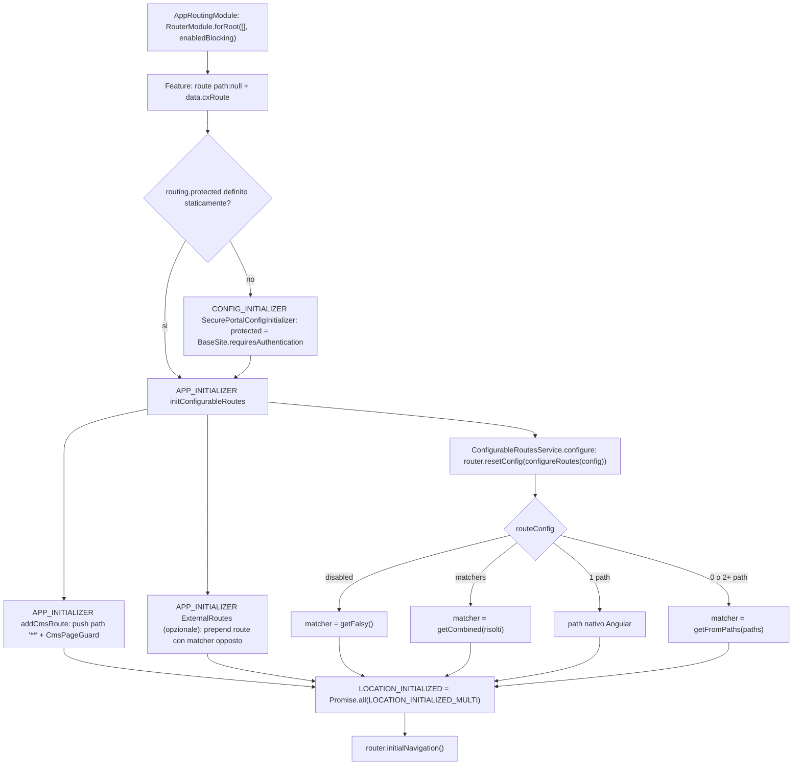
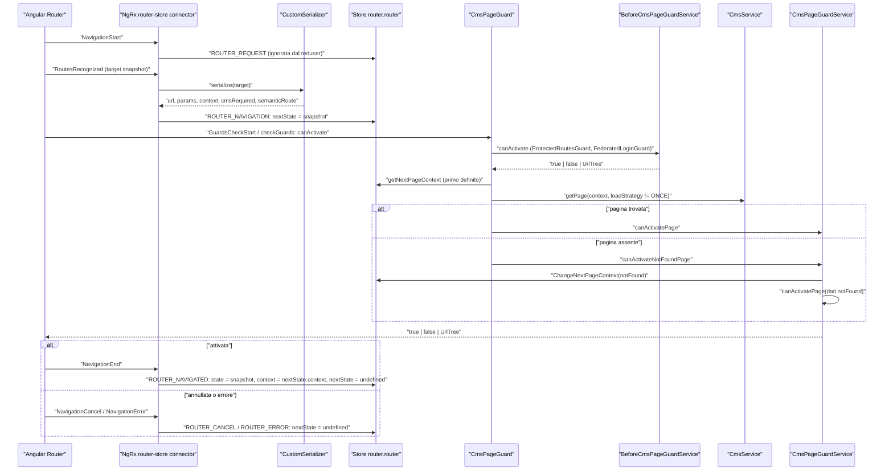
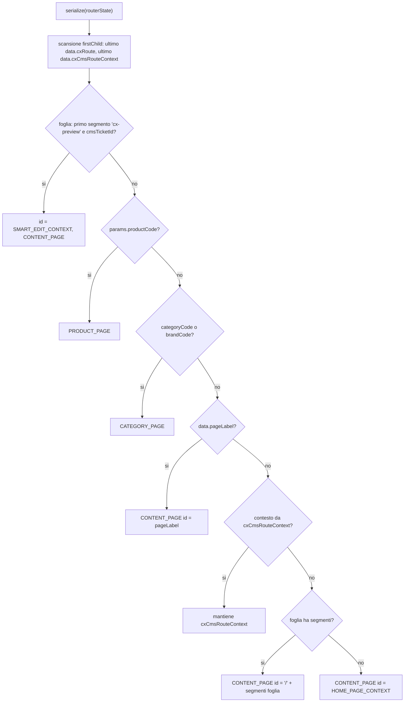
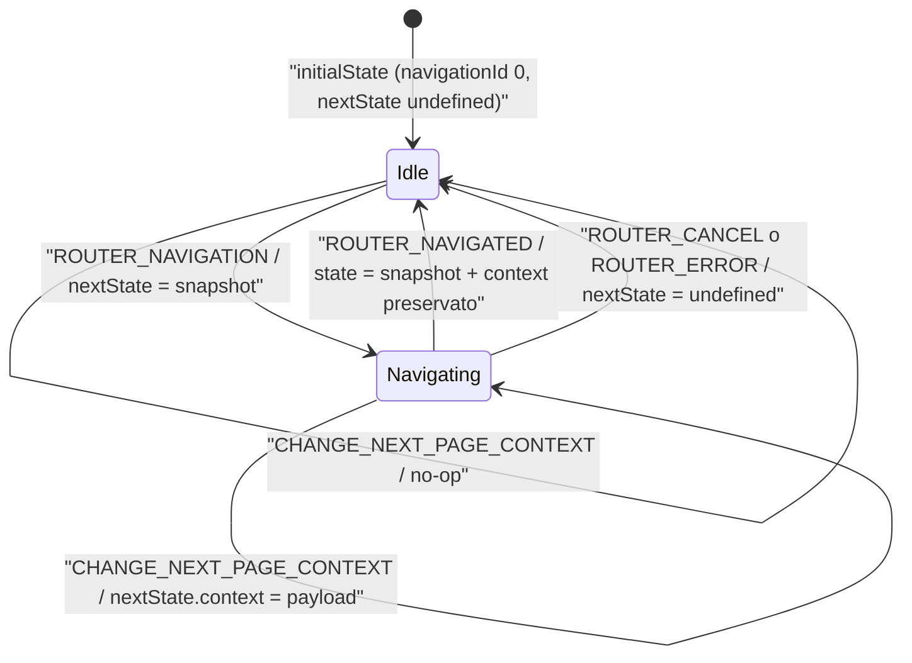

# 14 — Routing: route semantiche, URL, page guard, contesto

> Riferimenti allo SHA `5b7a1c2bf2808d7380bc20596d10f4fa710c3da1` (vedi [00-meta](../00-meta.md)).

Questo capitolo spiega come Spartacus si appoggia al Router di Angular senza scrivere quasi nessuna route "vera". Le route sono **semantiche**: si chiamano `product`, `cart`, `login` e i loro path reali vengono dalla configurazione `routing.routes`. All'avvio un servizio riscrive la configurazione del Router. Durante la navigazione uno store NgRx tiene lo stato "corrente" e quello "in arrivo". Un unico guard, `CmsPageGuard`, decide se e quale pagina CMS mostrare. Il router di Angular in sé (matching, guard, eventi) è descritto nel [cap. 05](../parte-1/05-router.md). L'ordine di bootstrap è nel [cap. 10](./10-bootstrap-inizializzazione.md), il caricamento delle pagine CMS nel [cap. 15](./15-cms-core.md), il loro rendering nel [cap. 16](./16-cms-rendering.md). `AuthGuard` e il flusso OAuth sono nel [cap. 22](./22-auth.md).

---

## 1. A cosa serve e perché esiste

Uno storefront e-commerce ha due esigenze in conflitto:

1. **Gli URL appartengono al business.** `/product/123/nome`, `/p/123`, `/Brands/Canon/c/brand_10` cambiano da progetto a progetto, e spesso da lingua a lingua. Il codice dei componenti non deve contenerli.
2. **Le pagine appartengono al CMS.** Quasi tutto il contenuto (layout, slot, componenti) arriva dal backend SAP Commerce. Una route Angular statica per ogni pagina non è possibile.

Spartacus risolve la prima esigenza con le **route semantiche**. Il modello è `RoutingConfig.routing.routes`: un dizionario `nomeRoute → { paths, matchers, paramsMapping, ... }` aperto anche a pagine custom (`core-libs/core/src/routing/configurable-routes/routes-config.ts:L11-L13`, `core-libs/core/src/routing/configurable-routes/routes-config.ts:L16-L57`). Le route Angular dichiarano solo il proprio nome in `data.cxRoute`. All'avvio `ConfigurableRoutesService` ne riscrive `path`/`matcher` a partire dalla config (`core-libs/core/src/routing/configurable-routes/configurable-routes.service.ts:L48-L52`, `core-libs/core/src/routing/configurable-routes/configurable-routes.service.ts:L77-L109`). Per generare link si usano i comandi `{ cxRoute, params }`, tradotti da `SemanticPathService` e dalla pipe `cxUrl` (`core-libs/core/src/routing/configurable-routes/url-translation/semantic-path.service.ts:L41-L68`, `core-libs/core/src/routing/configurable-routes/url-translation/url.pipe.ts:L11-L18`).

La seconda esigenza è risolta da una route wildcard `**` aggiunta in coda alla config del Router e protetta da `CmsPageGuard` (`core-libs/storefront/cms-structure/routing/cms-route/add-cms-route.ts:L12-L25`). Il guard carica la pagina CMS che corrisponde al **PageContext** della navigazione in corso. Se la pagina non esiste mostra quella `notFound` (`core-libs/storefront/cms-structure/guards/cms-page.guard.ts:L51-L84`). Il `PageContext` (`id` + `PageType`) è calcolato da un serializer custom del router-state NgRx (`core-libs/core/src/routing/store/reducers/router.reducer.ts:L112-L217`).

Intorno a questo nucleo ci sono:

- **Protected routes e secure portal.** Con `routing.protected = true` lo storefront è chiuso agli anonimi, tranne le route con `protected: false` (`core-libs/core/src/routing/configurable-routes/config/routing-config.ts:L30-L45`, `core-libs/core/src/routing/protected-routes/protected-routes.guard.ts:L23-L33`).
- **External routes.** Gli URL che non rientrano nei glob `routing.internal` causano un full page reload verso un altro sistema (`core-libs/core/src/routing/external-routes/external-routes.service.ts:L46-L70`, `core-libs/core/src/routing/external-routes/external-routes.guard.ts:L22-L41`).
- **Context.** I componenti possono chiedere "il contesto" (per esempio le order entries del carrello attivo) tramite `ContextService`, che lo ricava dal `data.cxContext` delle route attive (`core-libs/storefront/context/context.service.ts:L16-L37`, `core-libs/storefront/context/routing-context.service.ts:L31-L63`).
- **OnNavigateService.** Riporta scroll e focus in cima alla pagina dopo ogni navigazione (`core-libs/storefront/router/on-navigate.service.ts:L80-L119`).

### Dove viene attivato

- `AppRoutingModule` registra il Router con `RouterModule.forRoot([], { anchorScrolling: 'enabled', initialNavigation: 'enabledBlocking' })` (`core-libs/storefront/router/app-routing.module.ts:L13-L37`).
- `BaseStorefrontModule` importa `RoutingModule.forRoot()` di storefront (`core-libs/storefront/base-storefront.module.ts:L41-L41`). Questo importa il `RoutingModule.forRoot()` di core e `CmsRouteModule`, e registra la config di default e i guard globali (`core-libs/storefront/cms-structure/routing/routing.module.ts:L18-L40`).
- Il `RoutingModule` di core collega lo store: feature `'router'`, effects, `StoreRouterConnectingModule` (`core-libs/core/src/routing/routing.module.ts:L73-L82`). Fornisce anche serializer, initializer delle route e `LOCATION_INITIALIZED` (`core-libs/core/src/routing/routing.module.ts:L84-L108`).
- `ExternalRoutesModule.forRoot()` è opt-in. L'app demo lo importa esplicitamente (`projects/storefrontapp/src/app/spartacus/spartacus-features.module.ts:L246-L246`).

---

## 2. Mappa dei file

| Path | Ruolo |
|---|---|
| `core-libs/core/src/routing/configurable-routes/config/routing-config.ts` | `RouteLoadStrategy`, `RoutingConfig`, `RoutingConfigDefinition` (`routes`, `protected`, `loadStrategy`) e augmentation di `Config` |
| `core-libs/core/src/routing/configurable-routes/routes-config.ts` | `RoutesConfig`, `RouteConfig` (`paths`, `matchers`, `paramsMapping`, `disabled`, `protected`, `authFlow`), `ParamsMapping` |
| `core-libs/core/src/routing/configurable-routes/routing-config.service.ts` | `RoutingConfigService`: lookup per nome, load strategy, mappa inversa path → nome |
| `core-libs/core/src/routing/configurable-routes/configurable-routes.service.ts` | `ConfigurableRoutesService`: all'avvio riscrive `path`/`matcher` delle route con `data.cxRoute` |
| `core-libs/core/src/routing/configurable-routes/secure-portal-config/secure-portal-config-initializer.ts` | `SecurePortalConfigInitializer`: ricava `routing.protected` da `BaseSite.requiresAuthentication` |
| `core-libs/core/src/routing/configurable-routes/url-translation/semantic-path.service.ts` | `SemanticPathService`: `{cxRoute, params}` → segmenti URL |
| `core-libs/core/src/routing/configurable-routes/url-translation/url.pipe.ts` | Pipe `cxUrl` (`UrlPipe`) |
| `core-libs/core/src/routing/configurable-routes/url-translation/product-url.pipe.ts` | Pipe `cxProductUrl` (`ProductURLPipe`) |
| `core-libs/core/src/routing/configurable-routes/url-translation/url.module.ts` | `UrlModule`: importa e riesporta le due pipe standalone |
| `core-libs/core/src/routing/configurable-routes/url-translation/url-command.ts` | Tipi `UrlCommandRoute`, `UrlCommand`, `UrlCommands` |
| `core-libs/core/src/routing/configurable-routes/url-translation/url-parsing.service.ts` | `UrlParsingService`: segmenti primari, `matchPath` |
| `core-libs/core/src/routing/configurable-routes/url-translation/path-utils.ts` | `isParam`, `getParamName`, `ensureLeadingSlash`, `removeLeadingSlash` (non esportati) |
| `core-libs/core/src/routing/configurable-routes/url-translation/testing/mock-url.pipe.ts` | `MockUrlPipe` e `URL_TESTING_ALLOWLISTED_PARAMS` per i test |
| `core-libs/core/src/routing/configurable-routes/url-translation/testing/url-testing.module.ts` | `UrlTestingModule.allowlistParams()` |
| `core-libs/core/src/routing/services/url-matcher.service.ts` | `UrlMatcherService`: matcher falsy / da path / combinato / opposto / glob |
| `core-libs/core/src/routing/services/activated-routes.service.ts` | `ActivatedRoutesService.routes$`: catena root → foglia a ogni `NavigationEnd` |
| `core-libs/core/src/routing/url-matcher/default-url-matcher.ts` | `DEFAULT_URL_MATCHER` (factory di matcher dai `paths`) |
| `core-libs/core/src/routing/url-matcher/url-matcher-factory.ts` | Tipo `UrlMatcherFactory` |
| `core-libs/core/src/routing/facade/routing.service.ts` | `RoutingService`: `go`, `goByUrl`, `getUrl`, `back`, selettori del router-state |
| `core-libs/core/src/routing/facade/routing-params.service.ts` | `RoutingParamsService`: params fusi di tutte le route attive |
| `core-libs/core/src/routing/store/routing-state.ts` | `ROUTING_FEATURE`, `RouterState` (con `nextState`), `ActivatedRouterStateSnapshot` |
| `core-libs/core/src/routing/store/reducers/router.reducer.ts` | `initialState`, `reducer`, `reducerToken`, `CustomSerializer` (calcolo di `PageContext`) |
| `core-libs/core/src/routing/store/actions/router.action.ts` | `ChangeNextPageContext` |
| `core-libs/core/src/routing/store/selectors/routing.selector.ts` | `getRouterState`, `getPageContext`, `getNextPageContext`, `isNavigating`, `getSemanticRoute` |
| `core-libs/core/src/routing/store/effects/router.effect.ts` | `RouterEffects.clearCmsRoutes$` |
| `core-libs/core/src/routing/models/page-context.model.ts` | `PageContext`, `HOME_PAGE_CONTEXT`, `SMART_EDIT_CONTEXT` |
| `core-libs/core/src/routing/models/cms-route.ts` | `CmsRouteData`, `CmsRoute`, `CmsActivatedRouteSnapshot` |
| `core-libs/core/src/routing/routing.module.ts` | `RoutingModule` core: store, serializer, APP/CONFIG/LOCATION initializer |
| `core-libs/core/src/routing/location-initialized-multi/location-initialized-multi.ts` | `LOCATION_INITIALIZED_MULTI`, `provideLocationInitializer(Factory)` |
| `core-libs/core/src/routing/protected-routes/protected-routes.service.ts` | `ProtectedRoutesService`: quali URL sono protetti |
| `core-libs/core/src/routing/protected-routes/protected-routes.guard.ts` | `ProtectedRoutesGuard`: delega ad `AuthGuard` |
| `core-libs/core/src/routing/external-routes/external-routes-config.ts` | `ExternalRoutesConfig` (`routing.internal`) |
| `core-libs/core/src/routing/external-routes/external-routes.service.ts` | `ExternalRoutesService`: aggiunge in testa la route "esterna" |
| `core-libs/core/src/routing/external-routes/external-routes.guard.ts` | `ExternalRoutesGuard`: full page reload, ritorna sempre `false` |
| `core-libs/core/src/routing/external-routes/external-routes.module.ts` | `ExternalRoutesModule.forRoot()` |
| `core-libs/storefront/cms-structure/routing/routing.module.ts` | `RoutingModule` storefront: core + `CmsRouteModule` + default config + `BEFORE_CMS_PAGE_GUARD` |
| `core-libs/storefront/cms-structure/routing/default-routing-config.ts` | `defaultRoutesConfigFactory`: route di default (home, login, product, ...) |
| `core-libs/storefront/cms-structure/routing/cms-route/add-cms-route.ts` | `addCmsRoute`: route `**` con `CmsPageGuard` |
| `core-libs/storefront/cms-structure/routing/suffix-routes/suffix-url-matcher.ts` | `getSuffixUrlMatcher` (es. `**/p/:productCode`) |
| `core-libs/storefront/cms-pages/product-details-page/product-details-url-matcher.ts` | `PRODUCT_DETAILS_URL_MATCHER` |
| `core-libs/storefront/cms-structure/guards/cms-page.guard.ts` | `CmsPageGuard` |
| `core-libs/storefront/cms-structure/guards/cms-page-guard.service.ts` | `CmsPageGuardService`: `canActivatePage`, `canActivateNotFoundPage` |
| `core-libs/storefront/cms-structure/guards/before-cms-page-guard.token.ts` | `BEFORE_CMS_PAGE_GUARD` |
| `core-libs/storefront/cms-structure/guards/before-cms-page-guard.service.ts` | `BeforeCmsPageGuardService` |
| `core-libs/storefront/cms-structure/services/guards-composer.ts` | `GuardsComposer`: esecuzione sequenziale dei guard |
| `core-libs/storefront/cms-structure/services/cms-routes-impl.service.ts` | `CmsRoutesImplService`: child routes generate dal CMS |
| `core-libs/storefront/context/context.service.ts` | `ContextService` |
| `core-libs/storefront/context/routing-context.service.ts` | `RoutingContextService` (`data.cxContext`) |
| `core-libs/storefront/router/app-routing.module.ts` | `AppRoutingModule` (`RouterModule.forRoot`) |
| `core-libs/storefront/router/on-navigate.service.ts` | `OnNavigateService` (reset scroll/focus) |
| `core-libs/storefront/router/config/on-navigate-config.ts` | `OnNavigateConfig` |
| `core-libs/storefront/router/config/default-on-navigate-config.ts` | `defaultOnNavigateConfig` |

---

## 3. Come funziona passo per passo

### 3.1 Il modello di configurazione

`RoutingConfig` è una classe astratta fornita in `root` con `useExisting: Config`: legge dall'oggetto di configurazione globale (`core-libs/core/src/routing/configurable-routes/config/routing-config.ts:L22-L28`). Il meccanismo è descritto nel [cap. 11](./11-configurazione.md). `RoutingConfigDefinition` ha tre chiavi: `routes`, `protected`, `loadStrategy` (`core-libs/core/src/routing/configurable-routes/config/routing-config.ts:L30-L45`). `ExternalRoutesConfig` aggiunge `internal` via augmentation (`core-libs/core/src/routing/external-routes/external-routes-config.ts:L10-L24`).

Per ogni route, `RouteConfig` contiene:

- `paths`: alias usati **sia** per generare i link **sia** per il matching, a meno che sia dato `matchers` (`core-libs/core/src/routing/configurable-routes/routes-config.ts:L16-L22`);
- `matchers`: `UrlMatcher` di Angular o `InjectionToken<UrlMatcherFactory>`. Se assenti si usano i `paths` (`core-libs/core/src/routing/configurable-routes/routes-config.ts:L24-L31`);
- `paramsMapping`, `disabled` (spegne il matcher ma lascia generare i link), `protected` (ha effetto solo `false`), `authFlow` (`core-libs/core/src/routing/configurable-routes/routes-config.ts:L33-L57`).

`RoutingConfigService` è il punto di lettura:

- `getRouteConfig(name)` legge `routing.routes[name]` e, solo in dev mode, avvisa se manca (`core-libs/core/src/routing/configurable-routes/routing-config.service.ts:L26-L40`);
- `getLoadStrategy()` ritorna `ALWAYS` di default (`core-libs/core/src/routing/configurable-routes/routing-config.service.ts:L45-L47`);
- `getRouteName(path)` usa una mappa inversa costruita la prima volta che serve (`core-libs/core/src/routing/configurable-routes/routing-config.service.ts:L63-L68`). Se un path è configurato per due route, l'ultima vince e l'errore compare solo in dev mode (`core-libs/core/src/routing/configurable-routes/routing-config.service.ts:L77-L92`).

La config di default arriva da `defaultRoutesConfigFactory`, registrata con `provideDefaultConfigFactory` (`core-libs/storefront/cms-structure/routing/routing.module.ts:L26-L26`). La factory legge tre feature toggle (`core-libs/storefront/cms-structure/routing/default-routing-config.ts:L10-L15`) e definisce:

- `home: ['']`, `notFound: ['not-found']`, `login` (`'sign-in'` o `'login'` a seconda di `authorizationCodeFlowByDefault`) e le altre route del flusso di login, tutte con `protected: false, authFlow: true` (`core-libs/storefront/cms-structure/routing/default-routing-config.ts:L20-L59`);
- le route PLP/PDP: `search`, `category` (`paramsMapping { categoryCode: 'code' }`), `brand`, `product` con due path e `paramsMapping { productCode: 'code' }` (`core-libs/storefront/cms-structure/routing/default-routing-config.ts:L61-L73`);
- `termsAndConditions`, `coupons`, `couponClaim`, `myInterests`, `notificationPreference` (`core-libs/storefront/cms-structure/routing/default-routing-config.ts:L75-L86`);
- in base ai toggle, `loginForm` e `oAuthCallback` (`core-libs/storefront/cms-structure/routing/default-routing-config.ts:L90-L112`).

Le altre route (carrello, checkout, my-account...) sono aggiunte dalle feature lib con il loro `provideDefaultConfig`. Il dettaglio è nei rispettivi capitoli.

### 3.2 Bootstrap: dalla config alle route Angular

1. **Route "vuote" con nome.** Le feature dichiarano route con `path: null` (con `// @ts-ignore`), un `canActivate: [CmsPageGuard]`, `component: PageLayoutComponent` e `data.cxRoute`. Esempi: `product` (`core-libs/storefront/cms-pages/product-details-page/product-details-page.module.ts:L16-L35`) e `cart` (`feature-libs/cart/base/root/cart-base-root.module.ts:L64-L74`).
2. **Router vuoto e bloccante.** `AppRoutingModule` registra `routes: []` con `initialNavigation: 'enabledBlocking'` (`core-libs/storefront/router/app-routing.module.ts:L15-L18`).
3. **Secure portal.** Se `routing.protected` non è definito nella config statica, un `CONFIG_INITIALIZER` (scope `'routing'`) lo ricava dal BaseSite (`core-libs/core/src/routing/routing.module.ts:L44-L52`, `core-libs/core/src/routing/configurable-routes/secure-portal-config/secure-portal-config-initializer.ts:L16-L19`). `resolveConfig()` prende il primo `BaseSite`, lancia un errore se manca e mappa `requiresAuthentication → routing.protected` (`core-libs/core/src/routing/configurable-routes/secure-portal-config/secure-portal-config-initializer.ts:L31-L50`).
4. **Riscrittura delle route.** Un APP_INITIALIZER chiama `ConfigurableRoutesService.init()` (`core-libs/core/src/routing/routing.module.ts:L93-L95`, `core-libs/core/src/routing/routing.module.ts:L37-L42`). `init()` è idempotente (`core-libs/core/src/routing/configurable-routes/configurable-routes.service.ts:L31-L43`). `configure()` prende il `Router` dall'`Injector`, perché iniettarlo nel costruttore creerebbe una dipendenza ciclica con APP_INITIALIZER. Poi chiama `router.resetConfig(this.configureRoutes(router.config))` (`core-libs/core/src/routing/configurable-routes/configurable-routes.service.ts:L48-L52`). La ricorsione scende anche nei `children` (`core-libs/core/src/routing/configurable-routes/configurable-routes.service.ts:L59-L68`).
5. **Priorità in `configureRoute`** (`core-libs/core/src/routing/configurable-routes/configurable-routes.service.ts:L83-L106`):
   1. `disabled` → matcher sempre falso (`getFalsy`);
   2. `matchers` → matcher combinato. Le funzioni sono usate così come sono, i token sono risolti con `injector.get(token)(route)` (`core-libs/core/src/routing/configurable-routes/configurable-routes.service.ts:L118-L143`);
   3. esattamente un `path` → si usa il `path` nativo di Angular e si cancella `matcher`;
   4. altrimenti (0 o ≥ 2 path) → `urlMatcherService.getFromPaths(paths || [])`.
   Le route senza `data.cxRoute` passano invariate (`core-libs/core/src/routing/configurable-routes/configurable-routes.service.ts:L108-L108`, `core-libs/core/src/routing/configurable-routes/configurable-routes.service.ts:L149-L151`). In dev mode `validateRouteConfig` avvisa se config o `paths` sono `undefined`. `null` vale come spegnimento esplicito (`core-libs/core/src/routing/configurable-routes/configurable-routes.service.ts:L153-L179`).
6. **Wildcard CMS.** L'APP_INITIALIZER di `CmsRouteModule` (`core-libs/storefront/cms-structure/routing/cms-route/cms-route.module.ts:L10-L20`) fa `router.config.push({ path: '**', canActivate: [CmsPageGuard], component: PageLayoutComponent })` (`core-libs/storefront/cms-structure/routing/cms-route/add-cms-route.ts:L12-L25`).
7. **Route esterna (opzionale).** Se esistono pattern `routing.internal`, `ExternalRoutesService.addRoutes()` aggiunge **in testa** una route con matcher "opposto" al glob (`core-libs/core/src/routing/external-routes/external-routes.service.ts:L35-L70`).
8. **Navigazione iniziale.** Con `enabledBlocking`, Angular attende `LOCATION_INITIALIZED` prima di chiamare `router.initialNavigation()` (`angular:packages/router/src/provide_router.ts:L441-L470`). Spartacus sostituisce `LOCATION_INITIALIZED` con il `Promise.all` di tutti i `LOCATION_INITIALIZED_MULTI` (`core-libs/core/src/routing/routing.module.ts:L54-L71`). Tra questi: la stabilità della config (`core-libs/core/src/config/config-initializer/config-initializer.module.ts:L60-L64`) e due initializer dell'auth (`core-libs/core/src/auth/user-auth/user-auth.module.ts:L119-L120`).

> ⚠️ DA VERIFICARE: l'ordine relativo degli APP_INITIALIZER dei passi 4, 6 e 7 dipende dall'ordine di import dei moduli. L'esito descritto (route esterna in testa, wildcard in coda) non dipende dall'ordine. `addCmsRoute` fa `push` e `addRoutes` fa prepend. Se però `addCmsRoute` girasse prima di `configure()`, la wildcard passerebbe da `configureRoute` e uscirebbe invariata, perché non ha `cxRoute`.

### 3.3 Il matching: `UrlMatcherService`

- `getFromPaths(paths)` crea un matcher per path e li combina. In dev mode aggiunge `_paths` per il debug (`core-libs/core/src/routing/services/url-matcher.service.ts:L33-L40`).
- `getCombined(matchers)` restituisce il primo risultato non nullo, nell'ordine dell'array (`core-libs/core/src/routing/services/url-matcher.service.ts:L45-L58`).
- `getFromPath(path)` è una copia adattata del `defaultUrlMatcher` di Angular. Prende il path dall'argomento invece che da `route.path` e gestisce anche `''` (`core-libs/core/src/routing/services/url-matcher.service.ts:L65-L88`). Rispetta `pathMatch: 'full'`, raccoglie `:param` in `posParams` e consuma `parts.length` segmenti (`core-libs/core/src/routing/services/url-matcher.service.ts:L90-L121`). Con path vuoto, e senza `full` o con zero segmenti residui, matcha senza consumare nulla (`core-libs/core/src/routing/services/url-matcher.service.ts:L128-L142`).
- `getOpposite(m)` consuma tutto quando `m` **non** matcha, e restituisce `null` quando matcha (`core-libs/core/src/routing/services/url-matcher.service.ts:L162-L176`).
- `getFromGlob(patterns)` ricostruisce `/seg1/seg2` e lo passa a `GlobService.getValidator` (`core-libs/core/src/routing/services/url-matcher.service.ts:L178-L197`). Il validator richiede che almeno un pattern positivo matchi e nessun pattern negativo (`core-libs/core/src/util/glob.service.ts:L17-L32`).

Per comporre matcher senza perdere i `paths` configurati esiste `DEFAULT_URL_MATCHER`. È una factory che legge `route.data['cxRoute']` e restituisce `getFromPaths(paths)` (`core-libs/core/src/routing/url-matcher/default-url-matcher.ts:L13-L24`, `core-libs/core/src/routing/url-matcher/default-url-matcher.ts:L35-L45`). La PDP la usa: `PRODUCT_DETAILS_URL_MATCHER` combina il matcher di default con un suffix matcher `p/:productCode` (`core-libs/storefront/cms-pages/product-details-page/product-details-url-matcher.ts:L16-L29`). È anche il valore di default di `routing.routes.product.matchers` (`core-libs/storefront/cms-pages/product-details-page/product-details-page.module.ts:L27-L35`). `getSuffixUrlMatcher` cerca l'**ultima** occorrenza del marker, mette il segmento successivo in `paramName` e i precedenti in `param0..n` (`core-libs/storefront/cms-structure/routing/suffix-routes/suffix-url-matcher.ts:L18-L48`).

### 3.4 Generare URL: `SemanticPathService`, `cxUrl`, `RoutingService`

1. `{ cxRoute: 'product', params: product } | cxUrl` chiama `UrlPipe.transform`, che delega a `SemanticPathService.transform` (`core-libs/core/src/routing/configurable-routes/url-translation/url.pipe.ts:L11-L18`). `cxProductUrl` è una scorciatoia per `{ cxRoute: 'product', params: product }` (`core-libs/core/src/routing/configurable-routes/url-translation/product-url.pipe.ts:L10-L16`).
2. `transform` normalizza i comandi in array. I comandi non-route passano invariati. Ogni comando `{cxRoute}` (truthy con `cxRoute` truthy, `core-libs/core/src/routing/configurable-routes/url-translation/semantic-path.service.ts:L70-L72`) è sostituito dai segmenti generati. Se **uno** non è risolvibile, il risultato è `ROOT_URL = ['/']` (`core-libs/core/src/routing/configurable-routes/url-translation/semantic-path.service.ts:L16-L16`, `core-libs/core/src/routing/configurable-routes/url-translation/semantic-path.service.ts:L41-L61`).
3. `generateUrlPart` ritorna `null` se la route non ha config o `paths`, oppure se nessun path è soddisfacibile (`core-libs/core/src/routing/configurable-routes/url-translation/semantic-path.service.ts:L78-L111`).
4. `findPathWithFillableParams` sceglie il **primo** path i cui parametri, dopo il `paramsMapping`, sono tutti `!== undefined` (`core-libs/core/src/routing/configurable-routes/url-translation/semantic-path.service.ts:L135-L154`). Con i default della PDP, un prodotto con `name` produce `product/:productCode/:name`, senza `name` produce `product/:productCode`.
5. `provideParamsValues` sostituisce ogni `:param` con `params[mapping[param] || param]` (`core-libs/core/src/routing/configurable-routes/url-translation/semantic-path.service.ts:L117-L133`, `core-libs/core/src/routing/configurable-routes/url-translation/semantic-path.service.ts:L163-L171`).
6. Se il primo comando era una route, il risultato diventa assoluto con `unshift('/')` (`core-libs/core/src/routing/configurable-routes/url-translation/semantic-path.service.ts:L63-L76`).

`RoutingService` riusa lo stesso traduttore:

- `go(commands, extras)` → `router.navigate(transform(commands), extras)` (`core-libs/core/src/routing/facade/routing.service.ts:L91-L94`, `core-libs/core/src/routing/facade/routing.service.ts:L167-L169`);
- `goByUrl` → `router.navigateByUrl`, senza traduzione (`core-libs/core/src/routing/facade/routing.service.ts:L131-L133`);
- `getUrl` → `serializeUrl(createUrlTree(...))` con `/` iniziale garantito; `getFullUrl` vi antepone `winRef.location.origin` (`core-libs/core/src/routing/facade/routing.service.ts:L101-L121`);
- `back()` usa `location.back()` solo se il referrer è della stessa origin, altrimenti va a `['/']` (`core-libs/core/src/routing/facade/routing.service.ts:L138-L157`).

`SemanticPathService.get(name)` è la variante "solo stringa": `'/' + paths[0]` (`core-libs/core/src/routing/configurable-routes/url-translation/semantic-path.service.ts:L26-L31`). La usano per esempio `AuthGuard` per `login` (`core-libs/core/src/auth/user-auth/guards/auth.guard.ts:L30-L42`) e il guard per `notFound` (`core-libs/storefront/cms-structure/guards/cms-page-guard.service.ts:L107-L121`).

### 3.5 Lo stato del router in NgRx

Il `RoutingModule` di core registra la feature `'router'` e `StoreRouterConnectingModule.forRoot({ routerState: RouterState.Minimal, stateKey: 'router' })` (`core-libs/core/src/routing/routing.module.ts:L73-L82`). Nello stesso `forRoot()` sostituisce il serializer: `RouterStateSerializer → CustomSerializer` (`core-libs/core/src/routing/routing.module.ts:L84-L92`).

**Chi vince tra i due serializer?** `provideRouterStore` registra `RouterStateSerializer` con il serializer minimale di NgRx (`deps:ngrx-router-store-21.0.1/package/fesm2022/ngrx-router-store.mjs:L351-L370`). In Angular però i `providers` di un `ModuleWithProviders` vengono elaborati **dopo** quelli dei moduli che importa (`angular:packages/core/src/di/provider_collection.ts:L300-L321`). `R3Injector.processProvider` sovrascrive il record per token (`angular:packages/core/src/di/r3_injector.ts:L473-L522`). Vince quindi `CustomSerializer`.

**Quando parte `ROUTER_NAVIGATION`?** Spartacus non imposta `navigationActionTiming`, quindi vale il default `NavigationActionTiming.PreActivation` (`deps:ngrx-router-store-21.0.1/package/fesm2022/ngrx-router-store.mjs:L102-L109`). Il servizio di connessione di NgRx (`StoreRouterConnectingService.setUpRouterEventsListener`) mappa gli eventi del Router così (`deps:ngrx-router-store-21.0.1/package/fesm2022/ngrx-router-store.mjs:L217-L256`):

| Evento Angular | Azione NgRx | Effetto nel reducer Spartacus |
|---|---|---|
| `NavigationStart` | ROUTER_REQUEST | nessuno (non gestita) |
| `RoutesRecognized` | `ROUTER_NAVIGATION` | `nextState` = snapshot target serializzato |
| `NavigationCancel` | `ROUTER_CANCEL` | `nextState = undefined` |
| `NavigationError` | `ROUTER_ERROR` | `nextState = undefined` |
| `NavigationEnd` | `ROUTER_NAVIGATED` | `state` = snapshot attivo, `context` preservato, `nextState = undefined` |

Nel Router di Angular `RoutesRecognized` è emesso **prima** di `GuardsCheckStart` e dell'operatore `checkGuards` (`angular:packages/router/src/navigation_transition.ts:L564-L572`, `angular:packages/router/src/navigation_transition.ts:L630-L649`). Il JSDoc del modulo NgRx lo conferma: "before any guards or resolvers run" (`deps:ngrx-router-store-21.0.1/package/fesm2022/ngrx-router-store.mjs:L375-L376`). Per questo `CmsPageGuard` trova `nextPageContext` già pronto. `ROUTER_NAVIGATION` serializza lo snapshot target `lastRoutesRecognized.state`, mentre `ROUTER_NAVIGATED` serializza `router.routerState.snapshot` (`deps:ngrx-router-store-21.0.1/package/fesm2022/ngrx-router-store.mjs:L260-L282`). Con `Minimal`, l'`event` nel payload si riduce a `{ id, url, urlAfterRedirects }` (`deps:ngrx-router-store-21.0.1/package/fesm2022/ngrx-router-store.mjs:L283-L305`).

Lo stato Spartacus estende quello di NgRx con `nextState` (`core-libs/core/src/routing/store/routing-state.ts:L11-L16`). Ogni snapshot ha `url`, `queryParams`, `params`, `context`, `cmsRequired`, `semanticRoute` (`core-libs/core/src/routing/store/routing-state.ts:L18-L25`). La feature è annidata due volte (`router.router`) (`core-libs/core/src/routing/store/routing-state.ts:L27-L29`, `core-libs/core/src/routing/store/reducers/router.reducer.ts:L41-L45`). Il reducer:

- `ROUTER_NAVIGATION` → `nextState` + `navigationId`, `state` invariato (`core-libs/core/src/routing/store/reducers/router.reducer.ts:L52-L58`);
- `ROUTER_ERROR`/`ROUTER_CANCEL` → `nextState: undefined` (`core-libs/core/src/routing/store/reducers/router.reducer.ts:L60-L66`);
- `CHANGE_NEXT_PAGE_CONTEXT` → sostituisce `nextState.context` se esiste un `nextState` (`core-libs/core/src/routing/store/reducers/router.reducer.ts:L68-L75`);
- `ROUTER_NAVIGATED` → `state` = snapshot, ma con `context` preso da `nextState.context` se presente. Serve a conservare un contesto cambiato durante la navigazione, come il not-found (`core-libs/core/src/routing/store/reducers/router.reducer.ts:L77-L89`).

I selettori espongono `getPageContext` (default `{ id: '' }`), `getNextPageContext` e `isNavigating = !!nextPageContext` (`core-libs/core/src/routing/store/selectors/routing.selector.ts:L15-L46`). `RoutingService` li incapsula (`core-libs/core/src/routing/facade/routing.service.ts:L49-L81`). Il modello generale dello store è nel [cap. 19](./19-state-management.md).

### 3.6 Il calcolo del `PageContext` (`CustomSerializer`)

`CustomSerializer.serialize` scende lungo `firstChild` (`core-libs/core/src/routing/store/reducers/router.reducer.ts:L112-L133`):

1. accumula `urlString`, prende l'ultimo `data.cxRoute` (→ `semanticRoute`) e l'ultimo `data.cxCmsRouteContext` (→ `context`);
2. imposta `cmsRequired = true` se c'è un contesto CMS, oppure se una route ha in `canActivate` una funzione con `guardName === 'CmsPageGuard'` (`core-libs/core/src/routing/store/reducers/router.reducer.ts:L135-L149`). La proprietà statica è definita su `CmsPageGuard` (`core-libs/storefront/cms-structure/guards/cms-page.guard.ts:L26-L27`);
3. se manca `cxRoute`, cerca la route semantica con `getRouteName(urlString.substr(1))`. Funziona solo per URL statici (`core-libs/core/src/routing/store/reducers/router.reducer.ts:L152-L155`, `core-libs/core/src/routing/store/reducers/router.reducer.ts:L222-L237`);
4. calcola il contesto con `getPageContext` e restituisce `url`, `queryParams` della root, `params` della foglia, ecc. (`core-libs/core/src/routing/store/reducers/router.reducer.ts:L156-L166`).

`getPageContext`:

- `cx-preview` come primo segmento + `cmsTicketId` → `{ id: SMART_EDIT_CONTEXT, type: CONTENT_PAGE }` (`core-libs/core/src/routing/store/reducers/router.reducer.ts:L175-L184`);
- altrimenti, in ordine: `params.productCode` → `PRODUCT_PAGE`; `categoryCode` → `CATEGORY_PAGE`; `brandCode` → `CATEGORY_PAGE`; `data.pageLabel` → `CONTENT_PAGE` (`core-libs/core/src/routing/store/reducers/router.reducer.ts:L185-L196`);
- se ancora nessun contesto: `'/' + segmenti della foglia` come content page, oppure `HOME_PAGE_CONTEXT` se la foglia non ha segmenti (`core-libs/core/src/routing/store/reducers/router.reducer.ts:L198-L217`).

Le costanti valgono `HOME_PAGE_CONTEXT = '__HOMEPAGE__'` e `SMART_EDIT_CONTEXT = 'smartedit-preview'` (`core-libs/core/src/routing/models/page-context.model.ts:L9-L20`). `PageContext` è una classe con `id` e `type?` (`core-libs/core/src/routing/models/page-context.model.ts:L22-L30`). Come `CmsService` usa il contesto per caricare la pagina è spiegato nel [cap. 15](./15-cms-core.md).

### 3.7 `CmsPageGuard`: decidere quale pagina mostrare

1. **Guard globali prima di tutto.** `BeforeCmsPageGuardService` esegue i guard registrati in `BEFORE_CMS_PAGE_GUARD` tramite `GuardsComposer` (`core-libs/storefront/cms-structure/guards/before-cms-page-guard.service.ts:L17-L33`). Lo storefront vi registra `ProtectedRoutesGuard` e `FederatedLoginGuard` (`core-libs/storefront/cms-structure/routing/routing.module.ts:L27-L36`). Il token è pensato **solo** per guard globali (`core-libs/storefront/cms-structure/guards/before-cms-page-guard.token.ts:L10-L24`).
2. **Composizione.** `GuardsComposer` esegue i guard in sequenza con `concat`, salta i `true` ed emette il primo risultato diverso da `true` (`false` o `UrlTree`), oppure `true` alla fine (`core-libs/storefront/cms-structure/services/guards-composer.ts:L39-L86`). Ogni guard è normalizzato con `wrapIntoObservable(...).pipe(first())` (`core-libs/storefront/cms-structure/services/guards-composer.ts:L59-L69`).
3. **Contesto in arrivo.** Se i before-guard danno `true`, il guard prende il primo `getNextPageContext()` definito (`core-libs/storefront/cms-structure/guards/cms-page.guard.ts:L55-L60`). Il valore è già presente grazie al timing di `ROUTER_NAVIGATION` (§3.5).
4. **Caricamento pagina.** `cmsService.getPage(pageContext, shouldReload())`, dove `shouldReload()` è `loadStrategy !== ONCE` (`core-libs/storefront/cms-structure/guards/cms-page.guard.ts:L61-L62`, `core-libs/storefront/cms-structure/guards/cms-page.guard.ts:L89-L91`, `core-libs/core/src/cms/facade/cms.service.ts:L274-L278`).
5. **Pagina trovata → `canActivatePage`.** Prende i tipi di componente della pagina, ne determina i mapping e ne esegue i guard (`cmsComponents[...].guards`). Se l'esito è `true`, carica i chunk i18n. Se la route non ha già un `cxCmsRouteContext`, chiama `handleCmsRoutesInGuard` (`core-libs/storefront/cms-structure/guards/cms-page-guard.service.ts:L65-L99`). I guard dei componenti sono istanziati via `UnifiedInjector` (`core-libs/storefront/cms-structure/services/cms-guards.service.ts:L36-L48`).
6. **Child routes CMS.** Se i componenti dichiarano `childRoutes`, `CmsRoutesImplService` aggiunge in testa una route `{ path: label, component: PageLayoutComponent, children, data: { cxCmsRouteContext } }`, ri-naviga allo stesso URL e ritorna `false` (`core-libs/storefront/cms-structure/services/cms-routes-impl.service.ts:L69-L124`). Queste route vengono rimosse da `RouterEffects.clearCmsRoutes$` su `LANGUAGE_CHANGE`, `LOGIN`, `LOGOUT` (`core-libs/core/src/routing/store/effects/router.effect.ts:L19-L37`).
7. **Pagina non trovata → `canActivateNotFoundPage`.** Il guard risolve `notFound`; se non è configurato ritorna `false`. Carica la pagina not-found come `CONTENT_PAGE` (`core-libs/storefront/cms-structure/guards/cms-page-guard.service.ts:L107-L121`), imposta il "fail index" della pagina richiesta, chiama `changeNextPageContext(notFound)`, attende l'aggiornamento dell'indice e prosegue con `canActivatePage` sui dati not-found (`core-libs/storefront/cms-structure/guards/cms-page-guard.service.ts:L122-L142`). L'URL resta quello richiesto. Il contesto not-found sopravvive a `ROUTER_NAVIGATED` grazie alla regola del reducer (§3.5).

### 3.8 Protected routes

- `ProtectedRoutesService.shouldProtect = !!routing.protected` (`core-libs/core/src/routing/protected-routes/protected-routes.service.ts:L24-L26`). Se è vero già nel costruttore, il servizio pre-calcola i segmenti dei path con `protected === false` esplicito (`core-libs/core/src/routing/protected-routes/protected-routes.service.ts:L28-L38`, `core-libs/core/src/routing/protected-routes/protected-routes.service.ts:L72-L89`).
- `isUrlProtected(segs) = shouldProtect && !matchAnyPath(segs, nonProtectedPaths)`, con `UrlParsingService.matchPath` (`core-libs/core/src/routing/protected-routes/protected-routes.service.ts:L43-L67`). `matchPath` richiede lo stesso numero di segmenti e confronta solo quelli statici (`core-libs/core/src/routing/configurable-routes/url-translation/url-parsing.service.ts:L28-L63`).
- `ProtectedRoutesGuard` usa i segmenti di `route.url` (`['']` per la root). Se l'URL è protetto delega ad `AuthGuard.canActivate()` (`core-libs/core/src/routing/protected-routes/protected-routes.guard.ts:L23-L33`), che per un anonimo salva l'URL corrente e ritorna la `UrlTree` di `login` (`core-libs/core/src/auth/user-auth/guards/auth.guard.ts:L30-L42`).
- `authFlow: true` è letto da `AuthFlowRoutesService` (`core-libs/core/src/auth/user-auth/services/auth-flow-routes.service.ts:L23-L47`) e da `FederatedLoginGuard` (`core-libs/core/src/auth/user-auth/guards/federated-login.guard.ts:L21-L57`), trattati nel [cap. 22](./22-auth.md).

### 3.9 External routes

`ExternalRoutesModule.forRoot()` registra un APP_INITIALIZER (`core-libs/core/src/routing/external-routes/external-routes.module.ts:L11-L29`, `core-libs/core/src/routing/external-routes/external-routes.providers.ts:L9-L16`). Senza pattern `internal` non aggiunge nulla. Altrimenti aggiunge in testa una route `pathMatch: 'full'` con matcher `getOpposite(getFromGlob(internal))`, `canActivate: [ExternalRoutesGuard]` e `component: {} as any` (`core-libs/core/src/routing/external-routes/external-routes.service.ts:L35-L70`). Il guard, solo nel browser, imposta `window.location.href = state.url`, e ritorna **sempre** `false` (`core-libs/core/src/routing/external-routes/external-routes.guard.ts:L22-L41`).

### 3.10 Context dalle route

- `ContextService.get(token)` → `RoutingContextService.get(token)`, con `distinctUntilChanged` e `shareReplay` (`core-libs/storefront/context/context.service.ts:L16-L37`).
- `RoutingContextService` fonde con `Object.assign` i `data.cxContext` di tutte le route attive, dalla root alla foglia (`core-libs/storefront/context/routing-context.service.ts:L31-L46`). Risolve il provider token con `UnifiedInjector.get`, oppure emette `undefined` (`core-libs/storefront/context/routing-context.service.ts:L54-L63`, `core-libs/core/src/lazy-loading/unified-injector.ts:L52-L68`).
- Le route attive vengono da `ActivatedRoutesService.routes$`, che emette a ogni `NavigationEnd` più una volta all'iscrizione (`core-libs/core/src/routing/services/activated-routes.service.ts:L22-L39`). Sulla stessa sorgente `RoutingParamsService` fonde i `params` (`core-libs/core/src/routing/facade/routing-params.service.ts:L20-L44`).
- Esempio: la route `cart` mappa `ORDER_ENTRIES_CONTEXT` su `ActiveCartOrderEntriesContextToken` (`feature-libs/cart/base/root/cart-base-root.module.ts:L64-L74`).

### 3.11 Dopo la navigazione: `OnNavigateService`

`AppRoutingModule` fornisce `defaultOnNavigateConfig` e un APP_INITIALIZER che chiama `initializeWithConfig()` (`core-libs/storefront/router/app-routing.module.ts:L22-L37`). Il servizio si attiva solo con `active` truthy (`core-libs/storefront/router/on-navigate.service.ts:L69-L73`). Imposta la scroll restoration `manual` e ascolta gli eventi `Scroll` (`core-libs/storefront/router/on-navigate.service.ts:L80-L119`):

- back/forward (`position` presente) → ripristino della posizione;
- altrimenti esce subito se il path è uguale e `ignoreQueryString` è attivo, o se l'URL contiene un segmento di `ignoreRoutes`;
- altrimenti scrolla all'anchor (con `anchorScrolling === 'enabled'`) o a `[0,0]`, con `setTimeout` di 0 o 100 ms (`core-libs/storefront/router/on-navigate.service.ts:L138-L163`);
- infine sposta il focus su `selectedHostElement` (default `'body'`) o sull'host del componente bootstrap (`core-libs/storefront/router/on-navigate.service.ts:L45-L57`, `core-libs/storefront/router/on-navigate.service.ts:L125-L131`).

`previousScroll` sostituisce `pairwise` perché con l'hydration il primo evento `Scroll` è soppresso (`core-libs/storefront/router/on-navigate.service.ts:L36-L43`).

---

## 4. Diagrammi

### 4.1 Bootstrap del routing



Riferimenti: `core-libs/storefront/router/app-routing.module.ts:L15-L18`, `core-libs/core/src/routing/routing.module.ts:L44-L52`, `core-libs/core/src/routing/routing.module.ts:L84-L108`, `core-libs/core/src/routing/configurable-routes/configurable-routes.service.ts:L48-L106`, `core-libs/storefront/cms-structure/routing/cms-route/add-cms-route.ts:L12-L25`, `core-libs/core/src/routing/external-routes/external-routes.service.ts:L35-L70`, `angular:packages/router/src/provide_router.ts:L441-L470`.

### 4.2 Navigazione verso una pagina CMS: store, guard, reducer



Riferimenti: `deps:ngrx-router-store-21.0.1/package/fesm2022/ngrx-router-store.mjs:L217-L282`, `angular:packages/router/src/navigation_transition.ts:L564-L572`, `angular:packages/router/src/navigation_transition.ts:L630-L649`, `core-libs/core/src/routing/store/reducers/router.reducer.ts:L52-L89`, `core-libs/storefront/cms-structure/guards/cms-page.guard.ts:L51-L84`, `core-libs/storefront/cms-structure/guards/cms-page-guard.service.ts:L65-L142`.

### 4.3 Risoluzione del `PageContext`



Riferimenti: `core-libs/core/src/routing/store/reducers/router.reducer.ts:L120-L133`, `core-libs/core/src/routing/store/reducers/router.reducer.ts:L175-L217`.

### 4.4 Ciclo di vita dello slice `router`



`isNavigating` è vero esattamente nello stato *Navigating* (`core-libs/core/src/routing/store/selectors/routing.selector.ts:L34-L46`). Riferimenti delle transizioni: `core-libs/core/src/routing/store/reducers/router.reducer.ts:L26-L89`.

---

## 5. Estratti di codice reale

### 5.1 Riscrittura di una route semantica

`core-libs/core/src/routing/configurable-routes/configurable-routes.service.ts:L77-L109`
```ts
  protected configureRoute(route: Route): Route {
    const routeName = this.getRouteName(route);
    if (routeName) {
      const routeConfig = this.routingConfigService.getRouteConfig(routeName);
      this.validateRouteConfig(routeConfig, routeName, route);

      if (routeConfig?.disabled) {
        delete route.path;
        return {
          ...route,
          matcher: this.urlMatcherService.getFalsy(),
        };
      } else if (routeConfig?.matchers) {
        delete route.path;
        return {
          ...route,
          matcher: this.resolveUrlMatchers(route, routeConfig?.matchers),
        };
      } else if (routeConfig?.paths?.length === 1) {
        delete route.matcher;
        return { ...route, path: routeConfig?.paths[0] };
      } else {
        delete route.path;
        return {
          ...route,
          matcher: this.urlMatcherService.getFromPaths(
            routeConfig?.paths || []
          ),
        };
      }
    }
    return route; // if route doesn't have a name, just pass the original route
  }
```

Nota il `delete route.path` sull'oggetto **originale**, prima dello spread (vedi §9).

### 5.2 Traduzione dei comandi semantici

`core-libs/core/src/routing/configurable-routes/url-translation/semantic-path.service.ts:L41-L68`
```ts
  transform(commands: UrlCommands): any[] {
    if (!Array.isArray(commands)) {
      commands = [commands];
    }

    const result: (string | undefined)[] = [];
    for (const command of commands) {
      if (!this.isRouteCommand(command)) {
        // don't modify segment that is not route command:
        result.push(command);
      } else {
        // generate array with url segments for given route command:
        const partialResult = this.generateUrlPart(command);

        if (partialResult === null) {
          return this.ROOT_URL;
        }

        result.push(...partialResult);
      }
    }

    if (this.shouldOutputAbsolute(commands)) {
      result.unshift('/');
    }

    return result;
  }
```

### 5.3 Reducer del router con `nextState`

`core-libs/core/src/routing/store/reducers/router.reducer.ts:L52-L89`
```ts
    case fromNgrxRouter.ROUTER_NAVIGATION: {
      return {
        ...state,
        nextState: action.payload.routerState,
        navigationId: action.payload.event.id,
      };
    }

    case fromNgrxRouter.ROUTER_ERROR:
    case fromNgrxRouter.ROUTER_CANCEL: {
      return {
        ...state,
        nextState: undefined,
      };
    }

    case CHANGE_NEXT_PAGE_CONTEXT: {
      return state.nextState
        ? {
            ...state,
            nextState: { ...state.nextState, context: action.payload },
          }
        : state;
    }

    case fromNgrxRouter.ROUTER_NAVIGATED: {
      return {
        state: {
          ...action.payload.routerState,
          context:
            // we want to preserve already resolved context,
            // in case it was changed while navigating
            state.nextState?.context ?? action.payload.routerState.context,
        },
        navigationId: action.payload.event.id,
        nextState: undefined,
      };
    }
```

### 5.4 Da dove arriva `ROUTER_NAVIGATION` (NgRx 21)

`deps:ngrx-router-store-21.0.1/package/fesm2022/ngrx-router-store.mjs:L232-L256`
```js
            else if (event instanceof RoutesRecognized) {
                routesRecognized = event;
                if (!dispatchNavLate && this.trigger !== RouterTrigger.STORE) {
                    this.dispatchRouterNavigation(event);
                }
            }
            else if (event instanceof NavigationCancel) {
                this.dispatchRouterCancel(event);
                this.reset();
            }
            else if (event instanceof NavigationError) {
                this.dispatchRouterError(event);
                this.reset();
            }
            else if (event instanceof NavigationEnd) {
                if (this.trigger !== RouterTrigger.STORE) {
                    if (dispatchNavLate) {
                        this.dispatchRouterNavigation(routesRecognized);
                    }
                    this.dispatchRouterNavigated(event);
                }
                this.reset();
            }
```

### 5.5 Il serializer riconosce le pagine CMS

`core-libs/core/src/routing/store/reducers/router.reducer.ts:L120-L149`
```ts
    while (state.firstChild) {
      state = state.firstChild as CmsActivatedRouteSnapshot;
      urlString +=
        '/' + state.url.map((urlSegment) => urlSegment.path).join('/');

      // we use semantic route information embedded from any parent route
      if (state.data?.cxRoute) {
        semanticRoute = state.data?.cxRoute;
      }

      // we use context information embedded in Cms driven routes from any parent route
      if (state.data?.cxCmsRouteContext) {
        context = state.data?.cxCmsRouteContext;
      }

      // we assume, that any route that has CmsPageGuard or it's child
      // is cmsRequired
      if (
        !cmsRequired &&
        (context ||
          state.routeConfig?.canActivate?.find(
            (x) =>
              x &&
              typeof x === 'function' &&
              'guardName' in x &&
              x.guardName === 'CmsPageGuard'
          ))
      ) {
        cmsRequired = true;
      }
    }
```

### 5.6 `CmsPageGuard.canActivate`

`core-libs/storefront/cms-structure/guards/cms-page.guard.ts:L51-L84`
```ts
  canActivate(
    route: CmsActivatedRouteSnapshot,
    state: RouterStateSnapshot
  ): Observable<GuardResult> {
    return this.beforeCmsPageGuardService.canActivate(route, state).pipe(
      switchMap((canActivate) =>
        canActivate === true
          ? this.routingService.getNextPageContext().pipe(
              filter(isNotUndefined),
              take(1),
              switchMap((pageContext) =>
                this.cmsService.getPage(pageContext, this.shouldReload()).pipe(
                  first(),
                  switchMap((pageData) =>
                    pageData
                      ? this.service.canActivatePage(
                          pageContext,
                          pageData,
                          route,
                          state
                        )
                      : this.service.canActivateNotFoundPage(
                          pageContext,
                          route,
                          state
                        )
                  )
                )
              )
            )
          : of(canActivate)
      )
    );
  }
```

### 5.7 La route wildcard CMS

`core-libs/storefront/cms-structure/routing/cms-route/add-cms-route.ts:L12-L25`
```ts
const cmsRoute: Route = {
  path: '**',
  canActivate: [CmsPageGuard],
  component: PageLayoutComponent,
};

export function addCmsRoute(injector: Injector): () => void {
  const result = () => {
    // Router could not be injected via `deps[]` due to a cyclic dependency with APP_INITIALIZER:
    const router = injector.get(Router);
    router.config.push(cmsRoute);
  };
  return result;
}
```

### 5.8 Route di default PLP/PDP

`core-libs/storefront/cms-structure/routing/default-routing-config.ts:L61-L73`
```ts
        // plp routes
        search: { paths: ['search/:query'] },
        category: {
          paths: ['category/:categoryCode'],
          paramsMapping: { categoryCode: 'code' },
        },
        brand: { paths: ['Brands/:brandName/c/:brandCode'] },

        // pdp routes
        product: {
          paths: ['product/:productCode/:name', 'product/:productCode'],
          paramsMapping: { productCode: 'code' },
        },
```

---

## 6. Configurazione

| Chiave | Tipo | Default | Definita in | Letta in |
|---|---|---|---|---|
| `routing.routes` | `RoutesConfig` | route di §3.1 via `provideDefaultConfigFactory` | `core-libs/core/src/routing/configurable-routes/config/routing-config.ts:L34-L34`; default `core-libs/storefront/cms-structure/routing/default-routing-config.ts:L17-L114` | `core-libs/core/src/routing/configurable-routes/routing-config.service.ts:L26-L34`; `core-libs/core/src/routing/protected-routes/protected-routes.service.ts:L72-L80`; `core-libs/core/src/auth/user-auth/services/auth-flow-routes.service.ts:L23-L32` |
| `routing.routes[x].paths` | `string[]` | — | `core-libs/core/src/routing/configurable-routes/routes-config.ts:L22-L22` | `core-libs/core/src/routing/configurable-routes/configurable-routes.service.ts:L95-L104`; `core-libs/core/src/routing/configurable-routes/url-translation/semantic-path.service.ts:L135-L154`; `core-libs/core/src/routing/url-matcher/default-url-matcher.ts:L13-L24` |
| `routing.routes[x].matchers` | `(UrlMatcher \| InjectionToken<UrlMatcherFactory>)[]` | — (PDP: `[PRODUCT_DETAILS_URL_MATCHER]`) | `core-libs/core/src/routing/configurable-routes/routes-config.ts:L31-L31` | `core-libs/core/src/routing/configurable-routes/configurable-routes.service.ts:L89-L94` |
| `routing.routes[x].paramsMapping` | `ParamsMapping` | — (category/product/couponClaim → `code`) | `core-libs/core/src/routing/configurable-routes/routes-config.ts:L36-L36` | `core-libs/core/src/routing/configurable-routes/url-translation/semantic-path.service.ts:L104-L108`, `core-libs/core/src/routing/configurable-routes/url-translation/semantic-path.service.ts:L141-L145` |
| `routing.routes[x].disabled` | `boolean` | — | `core-libs/core/src/routing/configurable-routes/routes-config.ts:L41-L41` | `core-libs/core/src/routing/configurable-routes/configurable-routes.service.ts:L83-L88` |
| `routing.routes[x].protected` | `boolean` (solo `false` conta) | — (route di login: `false`) | `core-libs/core/src/routing/configurable-routes/routes-config.ts:L47-L47` | `core-libs/core/src/routing/protected-routes/protected-routes.service.ts:L72-L80` |
| `routing.routes[x].authFlow` | `boolean` | — (route di login: `true`) | `core-libs/core/src/routing/configurable-routes/routes-config.ts:L56-L56` | `core-libs/core/src/auth/user-auth/services/auth-flow-routes.service.ts:L23-L32` |
| `routing.protected` | `boolean` | `undefined` → ricavato da `BaseSite.requiresAuthentication` | `core-libs/core/src/routing/configurable-routes/config/routing-config.ts:L39-L39` | `core-libs/core/src/routing/routing.module.ts:L44-L52`; `core-libs/core/src/routing/protected-routes/protected-routes.service.ts:L24-L26` |
| `routing.loadStrategy` | `RouteLoadStrategy` | `ALWAYS` (fallback nel servizio) | `core-libs/core/src/routing/configurable-routes/config/routing-config.ts:L44-L44` | `core-libs/core/src/routing/configurable-routes/routing-config.service.ts:L45-L47`; `core-libs/storefront/cms-structure/guards/cms-page.guard.ts:L89-L91` |
| `routing.internal` | `string[]` (glob che iniziano con `/` o `!/`) | — (nessuna route esterna) | `core-libs/core/src/routing/external-routes/external-routes-config.ts:L10-L12` | `core-libs/core/src/routing/external-routes/external-routes.service.ts:L46-L70` |
| `enableResetViewOnNavigate.active` | `boolean` | `true` | `core-libs/storefront/router/config/on-navigate-config.ts:L16-L16`; default `core-libs/storefront/router/config/default-on-navigate-config.ts:L9-L16` | `core-libs/storefront/router/on-navigate.service.ts:L69-L73` |
| `enableResetViewOnNavigate.ignoreQueryString` | `boolean` | `false` | `core-libs/storefront/router/config/on-navigate-config.ts:L17-L17` | `core-libs/storefront/router/on-navigate.service.ts:L80-L119` |
| `enableResetViewOnNavigate.ignoreRoutes` | `string[]` | `[]` | `core-libs/storefront/router/config/on-navigate-config.ts:L18-L18` | `core-libs/storefront/router/on-navigate.service.ts:L171-L179` |
| `enableResetViewOnNavigate.selectedHostElement` | `string` | `'body'` | `core-libs/storefront/router/config/on-navigate-config.ts:L25-L25` | `core-libs/storefront/router/on-navigate.service.ts:L45-L57` |
| Feature toggle `authorizationCodeFlowByDefault` | `boolean` | vedi [cap. 42](./42-feature-toggle-deprecazioni.md) | `core-libs/core/src/features-config/feature-toggles/config/feature-toggles.ts:L161-L161` | `core-libs/storefront/cms-structure/routing/default-routing-config.ts:L10-L15` |
| Feature toggle `oauthCallbackPage` | `boolean` | — | `core-libs/core/src/features-config/feature-toggles/config/feature-toggles.ts:L914-L914` | `core-libs/storefront/cms-structure/routing/default-routing-config.ts:L104-L104` |
| Feature toggle `asyncAuthConfigInitializer` | `boolean` | — | `core-libs/core/src/features-config/feature-toggles/config/feature-toggles.ts:L637-L637` | `core-libs/storefront/cms-structure/routing/default-routing-config.ts:L105-L105` |
| Opzioni Router `anchorScrolling` / `initialNavigation` | `ExtraOptions` di Angular | `'enabled'` / `'enabledBlocking'` | `core-libs/storefront/router/app-routing.module.ts:L15-L18` | `core-libs/storefront/router/on-navigate.service.ts:L31-L32`; `angular:packages/router/src/provide_router.ts:L441-L470` |
| `StoreRouterConnectingModule.forRoot` | `routerState` / `stateKey` | `Minimal` / `'router'` (timing `PreActivation` implicito) | `core-libs/core/src/routing/routing.module.ts:L77-L80` | `deps:ngrx-router-store-21.0.1/package/fesm2022/ngrx-router-store.mjs:L102-L109` |
| Route `data.cxRoute` | `string` | — | (Route data di Angular) | `core-libs/core/src/routing/configurable-routes/configurable-routes.service.ts:L149-L151`; `core-libs/core/src/routing/store/reducers/router.reducer.ts:L125-L128`; `core-libs/core/src/routing/url-matcher/default-url-matcher.ts:L13-L24` |
| Route `data.cxContext` | mappa `ContextToken → token` | — | (Route data di Angular) | `core-libs/storefront/context/routing-context.service.ts:L31-L46` |
| Route `data.cxCmsRouteContext` / `data.pageLabel` | `PageContext` / `string` | — | `core-libs/core/src/routing/models/cms-route.ts:L10-L13` | `core-libs/core/src/routing/store/reducers/router.reducer.ts:L130-L133`, `core-libs/core/src/routing/store/reducers/router.reducer.ts:L185-L196`; `core-libs/core/src/routing/store/effects/router.effect.ts:L19-L37`; `core-libs/storefront/cms-structure/guards/cms-page-guard.service.ts:L86-L95` |

Il catalogo completo delle chiavi di config è nell'[appendice A02](../appendici/A02-config.md).

---

## 7. Commenti e note notevoli dal sorgente

- *"guard not to call init() more than once"*: `ConfigurableRoutesService` è pensato per essere richiamato senza danni (`core-libs/core/src/routing/configurable-routes/configurable-routes.service.ts:L31-L31`).
- *"Router could not be injected in constructor due to cyclic dependency with APP_INITIALIZER"* (`core-libs/core/src/routing/configurable-routes/configurable-routes.service.ts:L49-L49`). Lo stesso workaround compare in `addCmsRoute` (`core-libs/storefront/cms-structure/routing/cms-route/add-cms-route.ts:L20-L20`).
- *"null value of routeConfig or routeConfig.paths means explicit switching off the route - it's valid config"* (`core-libs/core/src/routing/configurable-routes/configurable-routes.service.ts:L159-L160`).
- *"workaround for AOT compilation"* su `initConfigurableRoutes` (`core-libs/core/src/routing/routing.module.ts:L40-L40`).
- JSDoc su `LOCATION_INITIALIZED`: *"Only when the Promise in this injection token is resolved, then Angular will start the initial navigation in the Router."* (`core-libs/core/src/routing/routing.module.ts:L54-L65`).
- *"CAUTION: Don't use Router and don't perform any Router navigation in its implementations."* per i `LocationInitializer` (`core-libs/core/src/routing/location-initialized-multi/location-initialized-multi.ts:L30-L35`). Inoltre l'injection context si perde dopo la parte sincrona (`core-libs/core/src/routing/location-initialized-multi/location-initialized-multi.ts:L16-L21`).
- `@license` MIT di Google sul matcher copiato da Angular (`core-libs/core/src/routing/services/url-matcher.service.ts:L76-L83`).
- *"we assume, that any route that has CmsPageGuard or it's child is cmsRequired"* (`core-libs/core/src/routing/store/reducers/router.reducer.ts:L135-L136`).
- *"NOTE: It works only for simple static urls that are equal to the page label of cms-driven content page"* su `lookupSemanticRoute` (`core-libs/core/src/routing/store/reducers/router.reducer.ts:L222-L232`).
- *"we want to preserve already resolved context, in case it was changed while navigating"* (`core-libs/core/src/routing/store/reducers/router.reducer.ts:L82-L83`).
- Commento sul tipo `CONTENT_PAGE` "hardcoded" per la home (`core-libs/core/src/routing/store/reducers/router.reducer.ts:L208-L214`).
- *"since 2211.24 not used anymore, but called indirectly via BeforeCmsPageGuardService"* sul parametro `protectedRoutesGuard` di `CmsPageGuard` (`core-libs/storefront/cms-structure/guards/cms-page.guard.ts:L29-L38`).
- *"for content pages the page label returned from backend can be different than ID initially assumed from route"* (`core-libs/storefront/cms-structure/guards/cms-page-guard.service.ts:L87-L87`).
- *"CAUTION: Suitable for global guards ONLY!"* su `BEFORE_CMS_PAGE_GUARD` (`core-libs/storefront/cms-structure/guards/before-cms-page-guard.token.ts:L13-L20`).
- *"Public injection token for the private implementation... After #7070"* su `CmsRoutesService` (`core-libs/storefront/cms-structure/services/cms-routes.service.ts:L11-L12`).
- *"the external route should be activated only when it's NOT an internal route"* (`core-libs/core/src/routing/external-routes/external-routes.service.ts:L69-L69`).
- Il commento su hydration e `pairwise` in `OnNavigateService` (`core-libs/storefront/router/on-navigate.service.ts:L36-L42`).
- JSDoc di NgRx: *"During the navigation, before any guards or resolvers run, the router will dispatch a ROUTER_NAVIGATION action"* (`deps:ngrx-router-store-21.0.1/package/fesm2022/ngrx-router-store.mjs:L375-L376`).

---

## 8. Extension point

| Extension point | Come si usa | Riferimento | Ricetta |
|---|---|---|---|
| `routing.routes` (`RoutesConfig`) | `provideConfig({ routing: { routes: { product: { paths: [...] } } } })` per cambiare URL, aggiungere alias o pagine custom | `core-libs/core/src/routing/configurable-routes/routes-config.ts:L11-L61` | [51 — route custom e page layout](../parte-3/51-ricette-cms-outlet-layout.md) |
| Route Angular con `data.cxRoute` | Route `path: null` + `canActivate: [CmsPageGuard]` + `component: PageLayoutComponent` + `data: { cxRoute }` | `core-libs/storefront/cms-pages/product-details-page/product-details-page.module.ts:L16-L35` | [51](../parte-3/51-ricette-cms-outlet-layout.md) |
| `matchers` + `DEFAULT_URL_MATCHER` / `getSuffixUrlMatcher` | Matcher custom che non perde i `paths` di default (modello: `PRODUCT_DETAILS_URL_MATCHER`) | `core-libs/core/src/routing/url-matcher/default-url-matcher.ts:L35-L45`; `core-libs/storefront/cms-structure/routing/suffix-routes/suffix-url-matcher.ts:L18-L55`; `core-libs/storefront/cms-pages/product-details-page/product-details-url-matcher.ts:L42-L50` | [51](../parte-3/51-ricette-cms-outlet-layout.md) |
| `UrlMatcherService` | Classe sostituibile via DI (metodi pubblici e `protected getFromPath`) | `core-libs/core/src/routing/services/url-matcher.service.ts:L17-L198` | [50 — override di service via DI](../parte-3/50-ricette-config-di.md) |
| `BEFORE_CMS_PAGE_GUARD` | `{ provide: BEFORE_CMS_PAGE_GUARD, useExisting: MyGlobalGuard, multi: true }`, solo per guard globali | `core-libs/storefront/cms-structure/guards/before-cms-page-guard.token.ts:L10-L24` | [51](../parte-3/51-ricette-cms-outlet-layout.md) |
| Guard per componente (`cmsComponents[...].guards`) | Alternativa a `BEFORE_CMS_PAGE_GUARD` per guard legati a una pagina | `core-libs/storefront/cms-structure/services/cms-guards.service.ts:L36-L48` | [51](../parte-3/51-ricette-cms-outlet-layout.md) |
| `routing.protected` + `protected: false` | Secure portal: storefront chiuso con eccezioni | `core-libs/core/src/routing/protected-routes/protected-routes.service.ts:L24-L89` | [50](../parte-3/50-ricette-config-di.md) |
| `routing.internal` + `ExternalRoutesModule.forRoot()` | Migrazione graduale da un altro storefront | `core-libs/core/src/routing/external-routes/external-routes.service.ts:L35-L70` | [50](../parte-3/50-ricette-config-di.md) |
| `LOCATION_INITIALIZED_MULTI` / `provideLocationInitializer(Factory)` | Trattenere la navigazione iniziale finché una Promise non si risolve (senza usare il Router) | `core-libs/core/src/routing/location-initialized-multi/location-initialized-multi.ts:L13-L62` | [50](../parte-3/50-ricette-config-di.md) |
| `data.cxContext` + `ContextService` | Fornire un contesto ai componenti in base alla route (es. `ORDER_ENTRIES_CONTEXT`) | `core-libs/storefront/context/routing-context.service.ts:L31-L63`; `feature-libs/cart/base/root/cart-base-root.module.ts:L64-L74` | [51](../parte-3/51-ricette-cms-outlet-layout.md) |
| `ContextService.resolveContext` (protected) | Override per sorgenti di contesto diverse dalla route | `core-libs/storefront/context/context.service.ts:L33-L37` | [50](../parte-3/50-ricette-config-di.md) |
| `OnNavigateConfig` | Disattivare o regolare scroll/focus dopo la navigazione | `core-libs/storefront/router/config/on-navigate-config.ts:L10-L31` | [50](../parte-3/50-ricette-config-di.md) |
| `RoutingActions.ChangeNextPageContext` / `RoutingService.changeNextPageContext` | Cambiare la pagina CMS mostrata durante una navigazione (come fa il not-found) | `core-libs/core/src/routing/facade/routing.service.ts:L72-L74` | [51](../parte-3/51-ricette-cms-outlet-layout.md) |
| `UrlTestingModule` / `MockUrlPipe` | Test di componenti che usano `cxUrl` (non nel `public_api`; alias tsconfig negli spec) | `core-libs/core/src/routing/configurable-routes/url-translation/testing/url-testing.module.ts:L11-L29`; `core-libs/storefront/tsconfig.spec.json:L29-L30` | [54 — API pubblica vs interna](../parte-3/54-upgrade-safe.md) |

**Non** sono nel public API: `path-utils`, `addExternalRoutesFactory`, `getDefaultUrlMatcherFactory`, `defaultRoutesConfigFactory`, `CustomSerializer`, il `reducer` e gli `effects` del router. Il barrel `core-libs/core/src/routing/index.ts` non esporta `store/reducers` né `store/effects` (`core-libs/core/src/routing/index.ts:L7-L20`, `core-libs/core/src/routing/url-matcher/index.ts:L7-L8`, `core-libs/core/src/routing/external-routes/index.ts:L7-L10`). Sostituirli significa dipendere da API interne: vedi [cap. 54](../parte-3/54-upgrade-safe.md). Il catalogo dei guard è nell'[appendice A05](../appendici/A05-guard.md), quello degli injection token nell'[appendice A01](../appendici/A01-injection-token.md).

---

## 9. Trappole, casi limite, comportamenti controintuitivi

1. **`configureRoute` muta le route originali.** `delete route.path` / `delete route.matcher` agiscono sull'oggetto passato a `RouterModule.forChild`, prima della copia (`core-libs/core/src/routing/configurable-routes/configurable-routes.service.ts:L84-L99`).
2. **Uno o più path cambiano il motore di matching.** Con un solo path si usa il `path` nativo di Angular. Con 0 o ≥ 2 si usa il matcher Spartacus, e `paths: []` non matcha mai (`core-libs/core/src/routing/configurable-routes/configurable-routes.service.ts:L95-L105`, `core-libs/core/src/routing/services/url-matcher.service.ts:L33-L58`).
3. **`matchers` non sostituisce `paths` per i link.** La PDP fa il matching con `PRODUCT_DETAILS_URL_MATCHER` ma genera i link dai `paths` di default (`core-libs/core/src/routing/configurable-routes/configurable-routes.service.ts:L89-L94`, `core-libs/core/src/routing/configurable-routes/url-translation/semantic-path.service.ts:L87-L97`).
4. **Un solo comando non risolvibile azzera l'URL.** `transform` restituisce `['/']` e perde gli altri segmenti (`core-libs/core/src/routing/configurable-routes/url-translation/semantic-path.service.ts:L55-L57`). In dev mode compare solo il warning di `getRouteConfig` (`core-libs/core/src/routing/configurable-routes/routing-config.service.ts:L30-L32`).
5. **`standarizeRouteCommand` muta l'input**, aggiungendo `params: {}` (`core-libs/core/src/routing/configurable-routes/url-translation/semantic-path.service.ts:L113-L115`).
6. **L'ordine dei `paths` conta e `null` vale come presente.** Il test è `!== undefined` (`core-libs/core/src/routing/configurable-routes/url-translation/semantic-path.service.ts:L139-L147`).
7. **`cxUrl` è una pipe pura.** Non dichiara `pure: false` (`core-libs/core/src/routing/configurable-routes/url-translation/url.pipe.ts:L11-L11`) e Angular usa `pure: true` di default (`angular:packages/core/src/metadata/directives.ts:L750-L756`). Se si muta l'oggetto comando senza cambiarne il riferimento, il link non si aggiorna.
8. **Mappa inversa costruita una sola volta.** Modifiche alla config dopo la prima chiamata a `getRouteName` non sono viste (`core-libs/core/src/routing/configurable-routes/routing-config.service.ts:L63-L68`).
9. **`ProtectedRoutesService` calcola i path pubblici nel costruttore** e solo se `shouldProtect` è già vero (`core-libs/core/src/routing/protected-routes/protected-routes.service.ts:L28-L38`). Se il servizio fosse istanziato con `routing.protected` ancora falso e il flag diventasse vero dopo, `nonProtectedPaths` resterebbe indefinito. ⚠️ DA VERIFICARE: in pratica il servizio nasce con `ProtectedRoutesGuard` durante la prima navigazione, quindi dopo la stabilità della config (`core-libs/core/src/config/config-initializer/config-initializer.module.ts:L60-L64`). Un'iniezione anticipata da codice custom non è stata analizzata.
10. **`ProtectedRoutesGuard` guarda `route.url`, non l'URL completo.** Con route annidate i segmenti sono quelli della route su cui gira il guard (`core-libs/core/src/routing/protected-routes/protected-routes.guard.ts:L24-L27`). Per la wildcard `**` coincidono con tutto l'URL residuo.
11. **Un `protected: false` con `/` iniziale non matcha mai**, perché `getSegments` divide per `/` senza normalizzare (`core-libs/core/src/routing/protected-routes/protected-routes.service.ts:L87-L89`).
12. **`routing.protected: false` statico disattiva il secure portal del BaseSite** (`core-libs/core/src/routing/routing.module.ts:L48-L51`). Se il BaseSite manca, `SecurePortalConfigInitializer` lancia un errore (`core-libs/core/src/routing/configurable-routes/secure-portal-config/secure-portal-config-initializer.ts:L33-L37`).
13. **`CmsPageGuard` dipende dal router-store.** Il guard aspetta un `nextPageContext` definito (`core-libs/storefront/cms-structure/guards/cms-page.guard.ts:L58-L60`). In una navigazione normale arriva prima dei guard (§3.5). Due casi lo lasciano senza contesto: una navigazione con trigger "store", in cui NgRx non dispatcha `ROUTER_NAVIGATION` (`deps:ngrx-router-store-21.0.1/package/fesm2022/ngrx-router-store.mjs:L232-L236`), o un `CmsPageGuard` invocato a mano fuori dal Router. In questi casi il guard può non emettere mai.
14. **Modificare `router.state.url` nello store fa navigare.** Il connettore NgRx confronta lo `state.url` dello slice con `router.url` e, se differiscono, chiama `navigateByUrl` (`deps:ngrx-router-store-21.0.1/package/fesm2022/ngrx-router-store.mjs:L191-L216`). Non scrivete reducer custom sullo slice `router`.
15. **`cmsRequired` riconosce solo `CmsPageGuard` "di classe".** Il controllo cerca `guardName` su una funzione in `canActivate`. Un guard funzionale che incapsula `CmsPageGuard` non viene riconosciuto (`core-libs/core/src/routing/store/reducers/router.reducer.ts:L137-L149`).
16. **I param vincono su `cxCmsRouteContext`.** `productCode`/`categoryCode`/`brandCode`/`pageLabel` sovrascrivono un contesto CMS trovato più in alto (`core-libs/core/src/routing/store/reducers/router.reducer.ts:L185-L196`).
17. **Il label di fallback usa solo la foglia**, mentre `lookupSemanticRoute` usa l'URL accumulato su tutta la catena (`core-libs/core/src/routing/store/reducers/router.reducer.ts:L120-L123`, `core-libs/core/src/routing/store/reducers/router.reducer.ts:L198-L201`).
18. **`ROUTER_NAVIGATED` ricostruisce lo slice da zero.** Mantiene solo `state`, `navigationId`, `nextState` (`core-libs/core/src/routing/store/reducers/router.reducer.ts:L77-L89`). Eventuali campi aggiunti allo slice vanno persi.
19. **`ChangeNextPageContext` fuori navigazione è un no-op silenzioso** (`core-libs/core/src/routing/store/reducers/router.reducer.ts:L68-L75`).
20. **`clearCmsRoutes$` pulisce solo il primo livello** di `router.config` (`core-libs/core/src/routing/store/effects/router.effect.ts:L27-L30`).
21. **`handleCmsRoutesInGuard` può annullare e rilanciare la navigazione.** Lancia `navigateByUrl(currentUrl)` e ritorna `false` (`core-libs/storefront/cms-structure/services/cms-routes-impl.service.ts:L82-L88`). Nel log vedrete un `ROUTER_CANCEL` seguito da una nuova navigazione.
22. **La route esterna in SSR blocca e basta.** Ritorna `false` senza redirect (`core-libs/core/src/routing/external-routes/external-routes.guard.ts:L26-L29`).
23. **`getFullUrl` e `back()` in SSR.** `getFullUrl` lancia se mancano `SERVER_REQUEST_URL`/`SERVER_REQUEST_ORIGIN` (`core-libs/core/src/window/window-ref.ts:L70-L82`). `back()` senza `nativeWindow` va a `['/']` (`core-libs/core/src/routing/facade/routing.service.ts:L138-L148`).
24. **Param omonimi: vince il figlio** in `RoutingParamsService` (`core-libs/core/src/routing/facade/routing-params.service.ts:L43-L43`). `ActivatedRoutesService` segue solo `firstChild` e ignora gli outlet secondari (`core-libs/core/src/routing/services/activated-routes.service.ts:L31-L34`).
25. **`ContextService` può emettere più istanze**, una per ogni injector (root e lazy) in cui il token è registrato (`core-libs/storefront/context/routing-context.service.ts:L57-L60`, `core-libs/core/src/lazy-loading/unified-injector.ts:L56-L66`).
26. **`ignoreRoutes` confronta segmenti esatti in qualsiasi posizione.** `['my-account']` ignora ogni URL che contiene quel segmento (`core-libs/storefront/router/on-navigate.service.ts:L171-L178`). Lo scroll avviene in un `setTimeout` di 100 ms, di cui i test asincroni devono tenere conto (`core-libs/storefront/router/on-navigate.service.ts:L155-L162`).
27. **Suffix matcher e ultima occorrenza.** Su `/p/x/p/123` il risultato è `productCode = 123`, con `param0 = 'p'` e `param1 = 'x'` (`core-libs/storefront/cms-structure/routing/suffix-routes/suffix-url-matcher.ts:L31-L45`).

---

## 10. Come fare debug

- **Vedere la config effettiva del Router.** Dopo il bootstrap ispezionate `inject(Router).config`. Le route semantiche con matcher custom hanno, in dev mode, la proprietà `_paths` (`core-libs/core/src/routing/services/url-matcher.service.ts:L36-L38`). I suffix matcher hanno `_suffixRouteConfig` (`core-libs/storefront/cms-structure/routing/suffix-routes/suffix-url-matcher.ts:L50-L52`). La wildcard `**` deve essere l'ultima e la route esterna, se presente, la prima.
- **Warning di dev mode.** "No path was configured for the named route" (`core-libs/core/src/routing/configurable-routes/routing-config.service.ts:L30-L32`), "Could not configure the named route" (`core-libs/core/src/routing/configurable-routes/configurable-routes.service.ts:L153-L179`) e l'errore sui path duplicati (`core-libs/core/src/routing/configurable-routes/routing-config.service.ts:L84-L89`) compaiono solo con `isDevMode()`. In produzione un link sbagliato diventa `/` senza avvisi.
- **Redux DevTools sullo slice `router.router`.** Seguite la sequenza `@ngrx/router-store/request` → `/navigation` (con `nextState.context`) → eventuale `[Router] Change Next PageContext` → `/navigated` oppure `/cancel`. I type sono definiti in `deps:ngrx-router-store-21.0.1/package/fesm2022/ngrx-router-store.mjs:L12-L33` e `core-libs/core/src/routing/store/actions/router.action.ts:L10-L17`. Un `nextState` che resta valorizzato indica una navigazione appesa, tipicamente un guard che non emette.
- **Quale pagina CMS viene chiesta.** Leggete `nextState.context` (`id`, `type`) e confrontatelo con le regole di §3.6. Un `id` come `'/foo/bar'` di tipo `ContentPage` significa che nessun param/`pageLabel` ha prodotto un contesto e che si è usato il fallback della foglia (`core-libs/core/src/routing/store/reducers/router.reducer.ts:L198-L203`).
- **Eventi del Router.** Con `withDebugTracing()` o sottoscrivendo `router.events` verificate l'ordine `RoutesRecognized` → `GuardsCheckStart` → `GuardsCheckEnd` (`angular:packages/router/src/navigation_transition.ts:L564-L660`). Un `NavigationCancel` subito dopo `GuardsCheckEnd` con nuova `NavigationStart` sullo stesso URL è il segno delle child routes CMS (§9.21).
- **Protected routes.** Chiamate `ProtectedRoutesService.isUrlProtected(['my','path'])` dalla console o da un test. Ricordate che i segmenti vanno senza `/` iniziale (`core-libs/core/src/routing/protected-routes/protected-routes.service.ts:L43-L45`).
- **Test.** `UrlTestingModule` stampa i comandi `cxUrl` come stringhe leggibili (`cxRoute:product code:123`) (`core-libs/core/src/routing/configurable-routes/url-translation/testing/mock-url.pipe.ts:L20-L52`). Con `allowlistParams` riduce il rumore (`core-libs/core/src/routing/configurable-routes/url-translation/testing/url-testing.module.ts:L11-L29`).

---

## 11. Domande di autoverifica

1. **Perché `CmsPageGuard` trova già valorizzato `getNextPageContext()`?**
   Perché `@ngrx/router-store` 21, con il timing di default `PreActivation`, dispatcha `ROUTER_NAVIGATION` su `RoutesRecognized`. Angular emette quell'evento prima di `GuardsCheckStart` e dei guard, e il reducer Spartacus vi salva `nextState`. — `deps:ngrx-router-store-21.0.1/package/fesm2022/ngrx-router-store.mjs:L102-L109`, `deps:ngrx-router-store-21.0.1/package/fesm2022/ngrx-router-store.mjs:L232-L236`, `angular:packages/router/src/navigation_transition.ts:L564-L572`, `core-libs/core/src/routing/store/reducers/router.reducer.ts:L52-L58`.

2. **Una route con `paths: ['a', 'b']` usa il `path` nativo di Angular?**
   No. Il `path` nativo si usa solo con esattamente un path. Con due path si genera un matcher combinato con `getFromPaths`. — `core-libs/core/src/routing/configurable-routes/configurable-routes.service.ts:L95-L105`.

3. **Che URL produce `{ cxRoute: 'product', params: { code: '42' } } | cxUrl` con la config di default?**
   `['/', 'product', '42']`. Il primo path richiede `name`, che manca, quindi si usa `product/:productCode`. `productCode` è mappato su `code` e il risultato diventa assoluto perché il primo comando è una route. — `core-libs/storefront/cms-structure/routing/default-routing-config.ts:L61-L73`, `core-libs/core/src/routing/configurable-routes/url-translation/semantic-path.service.ts:L63-L65`, `core-libs/core/src/routing/configurable-routes/url-translation/semantic-path.service.ts:L135-L154`.

4. **Come fa la pagina not-found a mantenere l'URL richiesto e a mostrare il contenuto `notFound`?**
   `canActivateNotFoundPage` dispatcha `ChangeNextPageContext(notFound)` e attiva la route originale. Su `ROUTER_NAVIGATED` il reducer usa `nextState.context` al posto del contesto ricalcolato. — `core-libs/storefront/cms-structure/guards/cms-page-guard.service.ts:L122-L142`, `core-libs/core/src/routing/store/reducers/router.reducer.ts:L77-L89`.

5. **Quale serializer usa davvero lo store, visto che `StoreRouterConnectingModule.forRoot` ne registra uno minimale?**
   `CustomSerializer`. Il provider di `RoutingModule.forRoot()` è elaborato dopo quelli dei moduli importati e sovrascrive il record del token `RouterStateSerializer`. — `core-libs/core/src/routing/routing.module.ts:L84-L92`, `angular:packages/core/src/di/provider_collection.ts:L300-L321`, `angular:packages/core/src/di/r3_injector.ts:L473-L522`.

6. **Con `routing.protected: true`, come si rende pubblica una pagina custom?**
   Si imposta `protected: false` esplicito sulla sua `RouteConfig`, con path senza `/` iniziale. `undefined` è ignorato. — `core-libs/core/src/routing/protected-routes/protected-routes.service.ts:L72-L89`.

7. **Dove registrereste un guard che deve girare su tutte le pagine CMS prima del caricamento della pagina? E uno solo per una pagina?**
   Il primo va in `BEFORE_CMS_PAGE_GUARD` (multi). Il secondo va in `cmsComponents[tipo].guards` di un componente della pagina, come indica la nota "CAUTION" del token. — `core-libs/storefront/cms-structure/guards/before-cms-page-guard.token.ts:L10-L24`, `core-libs/storefront/cms-structure/services/cms-guards.service.ts:L36-L48`.

8. **Perché le route CMS con child routes spariscono dopo un cambio lingua o un login?**
   `RouterEffects.clearCmsRoutes$` rimuove su `LANGUAGE_CHANGE`/`LOGIN`/`LOGOUT` le route con `data.cxCmsRouteContext` e chiama `resetConfig`. Alla navigazione successiva `CmsPageGuard` le ricrea. — `core-libs/core/src/routing/store/effects/router.effect.ts:L19-L37`, `core-libs/storefront/cms-structure/services/cms-routes-impl.service.ts:L93-L124`.

9. **Quando parte la prima navigazione dell'app?**
   Dopo che si è risolta `LOCATION_INITIALIZED`, che Spartacus sostituisce con il `Promise.all` dei `LOCATION_INITIALIZED_MULTI`: config stabile e initializer dell'auth. Lo prevede `initialNavigation: 'enabledBlocking'`. — `core-libs/core/src/routing/routing.module.ts:L54-L71`, `angular:packages/router/src/provide_router.ts:L441-L470`, `core-libs/core/src/config/config-initializer/config-initializer.module.ts:L60-L64`.

10. **Che `PageContext` ha l'URL `/` della home?**
    `{ id: '__HOMEPAGE__', type: CONTENT_PAGE }`: la foglia non ha segmenti e non ci sono param né `pageLabel`. — `core-libs/core/src/routing/store/reducers/router.reducer.ts:L198-L217`, `core-libs/core/src/routing/models/page-context.model.ts:L9-L20`.
