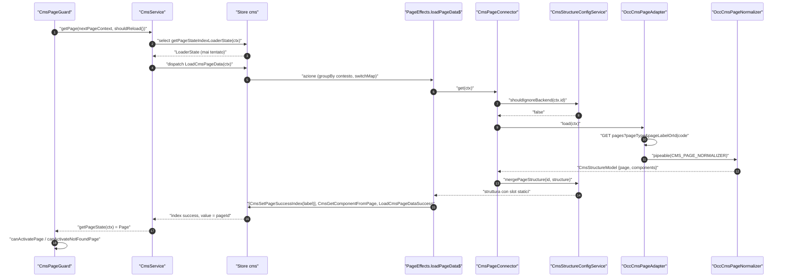
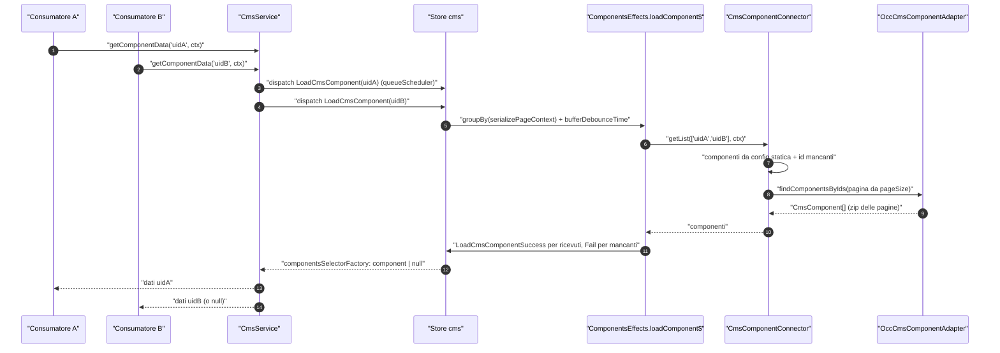
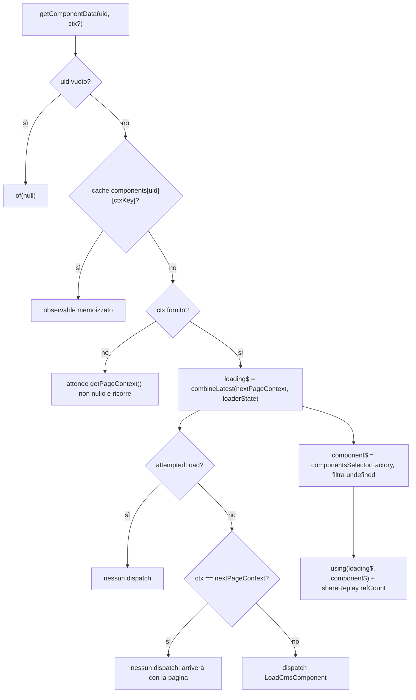
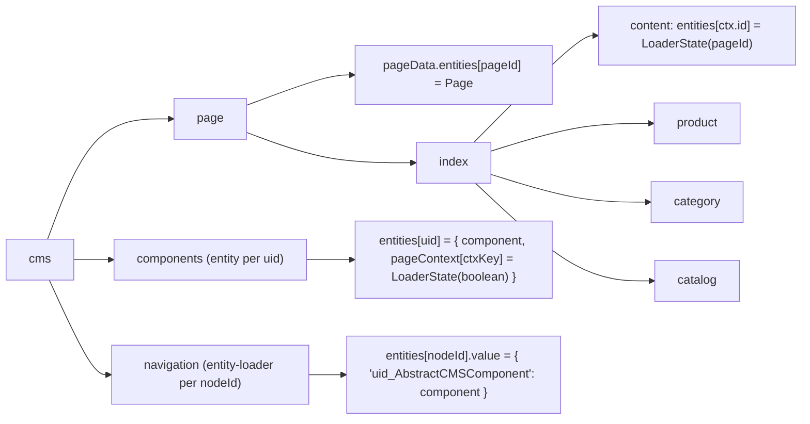

# 15 — CMS (core): pagine, slot, componenti, caricamento

> Riferimenti allo SHA `5b7a1c2bf2808d7380bc20596d10f4fa710c3da1` (vedi [00-meta](../00-meta.md)).

Questo capitolo descrive la metà "dati" del CMS di Spartacus, quella che vive in `@spartacus/core`: come una pagina CMS viene richiesta, normalizzata, fusa con la struttura statica, salvata nello store NgRx e riletta; come i dati dei singoli componenti vengono caricati a blocchi; come i decorator permettono a SmartEdit di agganciarsi. La metà "rendering" (`PageLayoutComponent`, `PageSlotComponent`, `ComponentWrapperDirective`, mapping verso le classi Angular) è nel [capitolo 16 — CMS (storefront): rendering dinamico delle pagine](16-cms-rendering.md). Il dettaglio SEO dei file `cms/page/**` è nel [capitolo 40 — SEO e PWA](40-seo-pwa.md): qui compaiono solo come contorno.

---

## 1. A cosa serve e perché esiste

Spartacus è uno storefront "guidato dal CMS": la quasi totalità delle pagine non è definita da route Angular statiche, ma da una struttura che arriva da SAP Commerce Cloud (pagina → template → slot → componenti). Il modulo `cms` di core risolve quattro problemi distinti:

1. **Ottenere la struttura di una pagina** a partire da un `PageContext` (id + `PageType`), indipendentemente dalla sorgente: backend OCC, configurazione statica, o un CMS di terze parti tramite un adapter custom. Il connettore di pagina accetta sia l'adapter sia la config statica (`core-libs/core/src/cms/connectors/page/cms-page.connector.ts:L30-L54`), e l'adapter astratto dichiara esplicitamente lo scopo "third-party CMS" (`core-libs/core/src/cms/connectors/page/cms-page.adapter.ts:L11-L24`).
2. **Separare struttura e dati dei componenti.** Il modello di risposta normalizzato è la coppia `{ page, components }` (`core-libs/core/src/cms/model/page.model.ts:L28-L34`): lo slot contiene solo riferimenti leggeri (`uid`, `typeCode`, `flexType`, `properties`) (`core-libs/core/src/cms/model/content-slot-component-data.model.ts:L7-L12`), mentre i dati completi stanno in un ramo separato dello store, indicizzato per `uid` (`core-libs/core/src/cms/store/cms-state.ts:L22-L62`).
3. **Caricare i dati dei componenti in modo efficiente.** Quando un componente non è arrivato con la pagina, le richieste emesse nello stesso turno dell'event loop vengono accorpate in un'unica chiamata di rete, come promesso dal JSDoc di `getComponentData` (`core-libs/core/src/cms/facade/cms.service.ts:L61-L73`) e realizzato dall'effect `loadComponent$` con `bufferDebounceTime` (`core-libs/core/src/cms/store/effects/components.effect.ts:L41-L65`).
4. **Definire il contratto di configurazione** con cui lo storefront mappa i tipi CMS su componenti Angular (`cmsComponents`) e su feature lazy (`featureModules`). La *definizione* è in core (`core-libs/core/src/cms/config/cms-config.ts:L124-L138`); la *lettura* è nello storefront (`core-libs/storefront/cms-structure/services/cms-components.service.ts:L67-L67`, `core-libs/storefront/cms-structure/services/cms-features.service.ts:L60-L60`).

Il tutto è esposto tramite un'unica facade, `CmsService` (`core-libs/core/src/cms/facade/cms.service.ts:L33-L46`), che i consumatori (guard, componenti, SmartEdit) usano senza toccare direttamente NgRx.

### Dove viene attivato

- `CmsModule` importa `CmsStoreModule` e `PageMetaModule.forRoot()`; il suo `forRoot()` fornisce `CmsService` e la config di default `defaultCmsModuleConfig` (`core-libs/core/src/cms/cms.module.ts:L14-L24`).
- `CmsModule.forRoot()` è importato da `BaseCoreModule` (`core-libs/core/src/base-core.module.ts:L34-L34`).
- I binding OCC (adapter di pagina e componenti, normalizer di pagina) **non** sono in `CmsModule`, ma in `CmsOccModule` (`core-libs/core/src/occ/adapters/cms/cms-occ.module.ts:L16-L34`), importato da `BaseOccModule` (`core-libs/core/src/occ/base-occ.module.ts:L18-L18`). È la separazione standard connector/adapter descritta nel [capitolo 21 — Livello OCC](21-occ.md).

---

## 2. Mappa dei file

Tutti i path sotto `core-libs/core/src/cms/` salvo dove indicato.

| Path | Ruolo |
|---|---|
| `core-libs/core/src/cms/cms.module.ts` | `CmsModule` e `forRoot()`: importa store e page meta, fornisce `CmsService` e default config |
| `core-libs/core/src/cms/index.ts` | Barrel pubblico: non esporta `utils/`, effects né reducers |
| `core-libs/core/src/cms/config/cms-config.ts` | `CmsConfig`, `CmsComponentMapping`, `CMSComponentConfig`, `FeatureModuleConfig`, `DeferLoadingStrategy`, costanti JSP/Flex |
| `core-libs/core/src/cms/config/cms-structure.config.ts` | `CmsStructureConfig`, `CmsPageConfig`, `CmsPageSlotConfig`, `CmsPageSlotsConfig` |
| `core-libs/core/src/cms/config/default-cms-config.ts` | `defaultCmsModuleConfig`: 4 endpoint OCC, `pageSize: 50` |
| `core-libs/core/src/cms/connectors/page/cms-page.adapter.ts` | `CmsPageAdapter` astratta |
| `core-libs/core/src/cms/connectors/page/cms-page.connector.ts` | `CmsPageConnector`: `ignoreBackend`, 400 → `{}`, merge statico |
| `core-libs/core/src/cms/connectors/page/converters.ts` | `CMS_PAGE_NORMALIZER` |
| `core-libs/core/src/cms/connectors/component/cms-component.adapter.ts` | `CmsComponentAdapter` astratta |
| `core-libs/core/src/cms/connectors/component/cms-component.connector.ts` | `CmsComponentConnector`: config statica + paginazione delle richieste |
| `core-libs/core/src/cms/connectors/component/converters.ts` | `CMS_COMPONENT_NORMALIZER` (nessun provider di default) |
| `core-libs/core/src/cms/decorators/component-decorator.ts` | `ComponentDecorator` astratta (hook DOM componente) |
| `core-libs/core/src/cms/decorators/slot-decorator.ts` | `SlotDecorator` astratta (hook DOM slot) |
| `core-libs/core/src/cms/facade/cms.service.ts` | `CmsService`: facade pagine/slot/componenti/navigazione, refresh, cache componenti |
| `core-libs/core/src/cms/facade/page-meta.service.ts` | `PageMetaService` (contorno, cap. 40) |
| `core-libs/core/src/cms/model/page.model.ts` | `Page`, `CmsStructureModel`, `PageMeta`, `BreadcrumbMeta`, `PageRobotsMeta` |
| `core-libs/core/src/cms/model/content-slot-data.model.ts` | `ContentSlotData` |
| `core-libs/core/src/cms/model/content-slot-component-data.model.ts` | `ContentSlotComponentData` |
| `core-libs/core/src/cms/model/node-item.model.ts` | `NodeItem` |
| `core-libs/core/src/cms/services/cms-structure-config.service.ts` | `CmsStructureConfigService`: merge delle strutture statiche |
| `core-libs/core/src/cms/services/dynamic-attribute.service.ts` | `DynamicAttributeService`: applica i decorator |
| `core-libs/core/src/cms/store/cms-state.ts` | Tipi di stato, `CMS_FEATURE`, entity type |
| `core-libs/core/src/cms/store/cms-store.module.ts` | `CmsStoreModule`: feature store, effects, SSR transfer |
| `core-libs/core/src/cms/store/actions/page.action.ts` | Azioni pagina e indice |
| `core-libs/core/src/cms/store/actions/components.action.ts` | Azioni componenti |
| `core-libs/core/src/cms/store/actions/navigation-entry-item.action.ts` | Azioni navigazione |
| `core-libs/core/src/cms/store/effects/page.effect.ts` | `PageEffects`: load pagina, refresh su cambio contesto |
| `core-libs/core/src/cms/store/effects/components.effect.ts` | `ComponentsEffects`: batch/debounce per contesto |
| `core-libs/core/src/cms/store/effects/navigation-entry-item.effect.ts` | `NavigationEntryItemEffects` |
| `core-libs/core/src/cms/store/reducers/index.ts` | `getReducers`, `reducerToken`, `clearCmsState`, `metaReducers` |
| `core-libs/core/src/cms/store/reducers/page-data.reducer.ts` | `Page` per `pageId` |
| `core-libs/core/src/cms/store/reducers/page-index.reducer.ts` | Indice contesto → `pageId`, per tipo |
| `core-libs/core/src/cms/store/reducers/components.reducer.ts` | `ComponentsContext` per uid |
| `core-libs/core/src/cms/store/reducers/navigation-entry-item.reducer.ts` | `NodeItem` per nodo |
| `core-libs/core/src/cms/store/selectors/page.selectors.ts` | Selettori pagina, indice, slot, tipi |
| `core-libs/core/src/cms/store/selectors/components.selectors.ts` | Selettori componenti (tri-stato) |
| `core-libs/core/src/cms/store/selectors/navigation-entry-item.selectors.ts` | Selettori navigazione |
| `core-libs/core/src/cms/utils/cms-utils.ts` | `serializePageContext`, `CURRENT_CONTEXT_KEY` (non pubblici) |
| `core-libs/core/src/cms/page/` | Page meta resolver, canonical, breadcrumb (contorno, cap. 40) |
| `core-libs/core/src/occ/adapters/cms/cms-occ.module.ts` | Binding OCC degli adapter e del normalizer |
| `core-libs/core/src/occ/adapters/cms/occ-cms-page.adapter.ts` | `OccCmsPageAdapter` |
| `core-libs/core/src/occ/adapters/cms/occ-cms-component.adapter.ts` | `OccCmsComponentAdapter` |
| `core-libs/core/src/occ/adapters/cms/legacy-occ-cms-component.adapter.ts` | `LegacyOccCmsComponentAdapter` (POST, backend pre-1905) |
| `core-libs/core/src/occ/adapters/cms/converters/occ-cms-page-normalizer.ts` | `OccCmsPageNormalizer` |
| `core-libs/storefront/cms-structure/utils/cms-structure.util.ts` | `provideCmsStructure()` |
| `core-libs/storefront/recipes/config/static-cms-structure.ts` | Provider statici esportati `defaultCmsContentProviders` (`HamburgerMenuComponent`, `LoginComponent`), inclusi dall'app |
| `core-libs/storefront/cms-structure/guards/cms-page.guard.ts` | `CmsPageGuard`: principale consumatore di `getPage()` |
| `feature-libs/smartedit/core/services/smart-edit.service.ts` | Refresh pagina/componenti da SmartEdit |
| `feature-libs/smartedit/core/decorators/index.ts` | Decorator SmartEdit (multi-provider) |

---

## 3. Come funziona passo per passo

### 3.1 Il modello dati: pagina, slot, riferimento, componente

Il modello normalizzato ha quattro livelli:

- **`Page`**: `pageId`, `name`, `type`, `title`, `template`, `slots` (mappa posizione → `ContentSlotData`), `properties`, `label`, `robots` e altri campi (`core-libs/core/src/cms/model/page.model.ts:L10-L26`).
- **`ContentSlotData`**: `{ components?: ContentSlotComponentData[]; properties?: any }` (`core-libs/core/src/cms/model/content-slot-data.model.ts:L9-L12`).
- **`ContentSlotComponentData`**: riferimento leggero `{ uid, typeCode, flexType, properties }` (`core-libs/core/src/cms/model/content-slot-component-data.model.ts:L7-L12`).
- **`CmsComponent`**: i dati veri del componente, con `uid`, `typeCode`, `name`, `modifiedTime`, `otherProperties`, `composition.inner`, `styleClasses` (`core-libs/core/src/model/cms.model.ts:L7-L32`).

La risposta di un caricamento pagina è `CmsStructureModel = { page?: Page; components?: CmsComponent[] }` (`core-libs/core/src/cms/model/page.model.ts:L28-L34`).

Il contesto che identifica una pagina è `PageContext { id: string; type?: PageType }`, con due id speciali: `HOME_PAGE_CONTEXT = '__HOMEPAGE__'` e `SMART_EDIT_CONTEXT = 'smartedit-preview'` (`core-libs/core/src/routing/models/page-context.model.ts:L15-L30`). `PageType` ha quattro valori: `ContentPage`, `ProductPage`, `CategoryPage`, `CatalogPage` (`core-libs/core/src/model/cms.model.ts:L38-L42`). Come il router produce il `PageContext` è argomento del [capitolo 14 — Routing](14-routing.md).

### 3.2 La chiave del contesto: `serializePageContext`

Quasi tutto il modulo indicizza i dati per "contesto serializzato". La funzione `serializePageContext` restituisce `'current'` se il contesto è assente, solo `'<type>'` se `ignoreContentPageId` è vero e il tipo è `ContentPage`, altrimenti `'<type>-<id>'` (`core-libs/core/src/cms/utils/cms-utils.ts:L10-L34`). La variante "senza id" serve perché un componente su una ContentPage non dipende dalla specifica content page (a differenza di PDP/PLP, dove l'id del prodotto/categoria entra nei parametri della richiesta — vedi 3.10). Questa funzione **non** è API pubblica: `core-libs/core/src/cms/index.ts` non riesporta `utils/` (`core-libs/core/src/cms/index.ts:L7-L21`).

### 3.3 Lo store `cms`

`CmsStoreModule` registra la feature `'cms'` con il reducer fornito via token, i meta-reducer e gli effects (`core-libs/core/src/cms/store/cms-store.module.ts:L33-L45`). La forma dello stato è:

- `CmsState = { page: PageState; components: ComponentsState; navigation: EntityLoaderState<NodeItem> }`, con `PageState = { pageData: EntityState<Page>; index: IndexType }` (`core-libs/core/src/cms/store/cms-state.ts:L75-L84`).
- `IndexType` ha quattro `EntityLoaderState<string>` (content, product, category, catalog) (`core-libs/core/src/cms/store/cms-state.ts:L64-L69`): ogni ramo mappa `pageContext.id` → `pageId`, con il loader state (loading/success/error) dell'ultimo caricamento.
- `ComponentsContext` (per uid) contiene **un solo** `component` e una mappa `pageContext[context] → LoaderState<boolean>` il cui `value` indica se il componente esiste per quel contesto (`core-libs/core/src/cms/store/cms-state.ts:L22-L62`).

`getReducers()` compone il tutto: `pageData` è un reducer semplice; ogni ramo dell'indice è un `entityLoaderReducer` con entity type uguale al `PageType` corrispondente; `components` è un `entityReducer` su `COMPONENT_ENTITY`; `navigation` un `entityLoaderReducer` su `NAVIGATION_DETAIL_ENTITY` (`core-libs/core/src/cms/store/reducers/index.ts:L33-L65`). I reducer sono forniti via `InjectionToken('CmsReducers')` con `useFactory: getReducers` (`core-libs/core/src/cms/store/reducers/index.ts:L67-L73`). Le utility generiche (`loaderReducer`, `entityReducer`, `entityLoaderReducer`) sono descritte nel [capitolo 19 — State management](19-state-management.md).

Due proprietà trasversali dello store:

- **Transfer state SSR.** L'intero ramo `cms` è trasferito dal server al client con `StateTransferType.TRANSFER_STATE`; la config è prodotta da una factory solo per poter usare la costante `CMS_FEATURE` come chiave (`core-libs/core/src/cms/store/cms-store.module.ts:L21-L31`).
- **Reset su cambio contesto utente.** Il meta-reducer `clearCmsState` azzera l'intero stato CMS su `LANGUAGE_CHANGE`, `LOGOUT` e `LOGIN` (`core-libs/core/src/cms/store/reducers/index.ts:L75-L90`).

### 3.4 Caricare una pagina: dalla guard a `hasPage`

Il consumatore principale è `CmsPageGuard`: prende il `nextPageContext`, chiama `cmsService.getPage(pageContext, shouldReload())` e, a seconda che la pagina esista, delega a `canActivatePage` o `canActivateNotFoundPage`; `shouldReload()` è vero se la load strategy di routing non è `ONCE` (`core-libs/storefront/cms-structure/guards/cms-page.guard.ts:L51-L91`).

`CmsService.getPage` è `hasPage(...)` seguito da `getPageState(...)` se la pagina esiste, altrimenti `of(null)` (`core-libs/core/src/cms/facade/cms.service.ts:L274-L283`). Il cuore è `hasPage` (`core-libs/core/src/cms/facade/cms.service.ts:L247-L269`):

1. seleziona il loader state dell'indice per il contesto (`getPageStateIndexLoaderState`);
2. in un `tap`, se il caricamento non è mai stato tentato (`!loading && !success && !error`) oppure se `forceReload` è vero e non c'è un caricamento in corso, dispatcha `LoadCmsPageData(pageContext)` e azzera `forceReload` (mutando il parametro, così le emissioni successive non ri-dispatchano);
3. scarta gli stati privi della proprietà `value` — il caso di uno stato incompleto trasferito da un SSR fallito (`core-libs/core/src/cms/facade/cms.service.ts:L258-L263`);
4. lascia passare solo stati conclusi (`success`, oppure `error && !loading`) e li mappa a `!!success`; un errore nello stream diventa `false`.

### 3.5 L'azione `LoadCmsPageData` e l'indice

Le azioni pagina sono entity-loader action il cui *entity type* è il `PageType` del contesto (`payload.type ?? ''`) e il cui *entity id* è `pageContext.id` (`core-libs/core/src/cms/store/actions/page.action.ts:L18-L24`). Di conseguenza `LoadCmsPageData` mette `loading: true` solo nel ramo indice del tipo corrispondente. I tipi d'azione sono `[Cms] Load Page Data` (+ Fail, Success), `[Cms] Set Page Success Index`, `[Cms] Set Page Fail Index` (`core-libs/core/src/cms/store/actions/page.action.ts:L12-L16`).

### 3.6 `PageEffects.loadPageData$`

L'effect raggruppa i `LoadCmsPageData` per contesto serializzato (forma completa, **senza** ignorare l'id delle content page) e dentro ogni gruppo usa `switchMap` su `CmsPageConnector.get(pageContext)` (`core-libs/core/src/cms/store/effects/page.effect.ts:L58-L66`). Effetto pratico: due richieste per lo stesso contesto si annullano a vicenda (vince l'ultima), richieste per contesti diversi procedono in parallelo.

A successo emette, nell'ordine (`core-libs/core/src/cms/store/effects/page.effect.ts:L67-L93`):

1. opzionalmente `CmsSetPageSuccessIndex({ id: pageLabel, type }, page)`, anteposto con `unshift` se la `label` restituita dal backend differisce dall'id del contesto: la pagina viene registrata anche sotto la label corretta (`core-libs/core/src/cms/store/effects/page.effect.ts:L81-L91`);
2. `CmsGetComponentFromPage` con tutti i componenti inclusi nella risposta, ciascuno accoppiato al contesto;
3. `LoadCmsPageDataSuccess(pageContext, page ?? {})`.

In errore emette `LoadCmsPageDataFail(pageContext, tryNormalizeHttpError(error, logger))` (`core-libs/core/src/cms/store/effects/page.effect.ts:L95-L102`).

### 3.7 `CmsPageConnector.get`: backend, config statica, 400

Il connettore chiede a `CmsStructureConfigService.shouldIgnoreBackend(pageContext.id)`: se falso chiama `CmsPageAdapter.load`, altrimenti parte da `{}`; in entrambi i casi fonde la struttura statica con `mergePageStructure` (`core-libs/core/src/cms/connectors/page/cms-page.connector.ts:L30-L54`). Un `HttpErrorResponse` con status 400 dall'adapter viene convertito in struttura vuota `{}`; gli altri errori sono rilanciati (`core-libs/core/src/cms/connectors/page/cms-page.connector.ts:L37-L46`). `shouldIgnoreBackend` è vero solo se in `cmsStructure.pages` esiste una pagina con quel `pageId` e `ignoreBackend` truthy (`core-libs/core/src/cms/services/cms-structure-config.service.ts:L56-L60`, `core-libs/core/src/cms/services/cms-structure-config.service.ts:L84-L92`).

### 3.8 L'adapter OCC e il normalizer

`OccCmsPageAdapter.load` ottiene lo user id, costruisce l'URL con l'endpoint `page` (by id) se il contesto non ha `type`, altrimenti con `pages` e query params; fa la GET e passa la risposta per `CMS_PAGE_NORMALIZER`, con `take(1)` (`core-libs/core/src/occ/adapters/cms/occ-cms-page.adapter.ts:L48-L66`). I query params sono (`core-libs/core/src/occ/adapters/cms/occ-cms-page.adapter.ts:L86-L102`):

- nessuno per `HOME_PAGE_CONTEXT` e `SMART_EDIT_CONTEXT`;
- `pageType` = tipo del contesto;
- `pageLabelOrId=id` per `ContentPage`, altrimenti `code=id`.

`ConverterService.convertSource` applica in sequenza (`reduce`) tutti i converter multi-provider del token (`core-libs/core/src/util/converter.service.ts:L130-L137`). Per le pagine il default è `OccCmsPageNormalizer`, che esegue quattro passi in ordine (`core-libs/core/src/occ/adapters/cms/converters/occ-cms-page-normalizer.ts:L22-L35`):

1. `normalizePageData`: `typeCode → type`, `uid → pageId`, più `name`, `label`, `template`, `title`, `description`, `properties`, e `normalizeRobots` (`core-libs/core/src/occ/adapters/cms/converters/occ-cms-page-normalizer.ts:L40-L77`);
2. `normalizePageSlotData`: forza `contentSlot` ad array se arriva come oggetto singolo e crea uno slot per ogni `position`, copiando le `properties` (`core-libs/core/src/occ/adapters/cms/converters/occ-cms-page-normalizer.ts:L82-L105`);
3. `normalizePageComponentData`: per ogni componente dello slot aggiunge un `ContentSlotComponentData` `{uid, typeCode, flexType, properties}`, ma solo se `components.component` è un array (`core-libs/core/src/occ/adapters/cms/converters/occ-cms-page-normalizer.ts:L110-L139`);
4. `normalizeComponentData`: copia i dati completi dei componenti in `target.components`, rinomina `modifiedtime → modifiedTime` e azzera `properties`, che restano solo nel riferimento di slot (`core-libs/core/src/occ/adapters/cms/converters/occ-cms-page-normalizer.ts:L166-L193`).

Il campo più importante prodotto dal normalizer è `flexType`: vale `component.flexType` per `CMSFlexComponent`, `component.uid` per `JspIncludeComponent`, altrimenti `typeCode` (`core-libs/core/src/occ/adapters/cms/converters/occ-cms-page-normalizer.ts:L151-L158`). È la chiave con cui lo storefront cerca il mapping in `cmsComponents` (cap. 16). Le costanti dei due tipi speciali sono in `cms-config.ts` (`core-libs/core/src/cms/config/cms-config.ts:L42-L43`).

`normalizeRobots` converte il `robotTag` OCC (es. `INDEX_FOLLOW`, `NOINDEX_NOFOLLOW`) in una coppia di `PageRobotsMeta`; senza tag produce `[]` (`core-libs/core/src/occ/adapters/cms/converters/occ-cms-page-normalizer.ts:L198-L222`).

### 3.9 Merge della struttura statica

`CmsStructureConfigService.mergePageStructure(pageId, structure)` esegue `mergePage` (slot della pagina configurata) e poi `mergeSlots(page)` senza argomento, cioè con gli slot globali `cmsStructure.slots` (`core-libs/core/src/cms/services/cms-structure-config.service.ts:L38-L45`, `core-libs/core/src/cms/services/cms-structure-config.service.ts:L135-L138`).

- `mergePage`: se c'è una pagina configurata con quel `pageId` e la struttura non ha `page`, la crea copiando la config e svuotando `slots`; poi fonde gli slot configurati della pagina (`core-libs/core/src/cms/services/cms-structure-config.service.ts:L99-L122`).
- `mergeSlots`: per ogni posizione configurata, aggiunge lo slot **solo se la posizione non è già presente nella pagina**, anche se lo slot del CMS è vuoto. Il JSDoc lo dichiara: il CMS deve poter sovrascrivere la configurazione statica. Per ogni componente aggiunge il riferimento allo slot e il componente completo in `components` (`core-libs/core/src/cms/services/cms-structure-config.service.ts:L124-L167`).
- `getComponentsByPosition` risolve i `componentIds` dello slot in `cmsStructure.components[id]`, aggiungendo `uid: componentId` (`core-libs/core/src/cms/services/cms-structure-config.service.ts:L169-L186`).

La config `CmsStructureConfig` (classe astratta, alias di `Config`) aggiunge `cmsStructure.{components, pages, slots}` (`core-libs/core/src/cms/config/cms-structure.config.ts:L68-L89`). Lo storefront fornisce un helper, `provideCmsStructure({componentId, pageSlotPosition, ...})`, che genera `cmsStructure.components[componentId] = {typeCode, flexType}` e `cmsStructure.slots[pageSlotPosition] = {componentIds: [componentId]}` più una config di layout, tramite `provideConfig` (`core-libs/storefront/cms-structure/utils/cms-structure.util.ts:L31-L66`). Lo storefront esporta `defaultCmsContentProviders` (`HamburgerMenuComponent` in `PreHeader`, `LoginComponent` in `SiteLogin`), che l'app include nei propri provider: lo schematic `add-spartacus` lo aggiunge al modulo di configurazione generato, e l'app demo fa lo stesso (`core-libs/storefront/recipes/config/static-cms-structure.ts:L10-L19`, `core-libs/schematics/src/add-spartacus/configuration.ts:L113-L119`, `projects/storefrontapp/src/app/spartacus/spartacus-configuration.module.ts:L48-L48`).

### 3.10 Reducer e indice dopo il successo

Una volta emesse le azioni di successo:

- `page-data.reducer` salva la `Page` in `entities[page.pageId ?? '']`, senza guardare l'entity type (`core-libs/core/src/cms/store/reducers/page-data.reducer.ts:L13-L27`).
- `page-index.reducer(entityType)` agisce solo se `meta.entityType === entityType`: su Success e `CmsSetPageSuccessIndex` scrive `payload.pageId`, su Fail torna a `undefined`, su `CmsSetPageFailIndex` scrive il `payload` (stringa) (`core-libs/core/src/cms/store/reducers/page-index.reducer.ts:L28-L46`). Il valore finisce nel loader state perché, su `success`, `loaderReducer` calcola `value` con il sub-reducer (`core-libs/core/src/state/utils/loader/loader.reducer.ts:L53-L60`, `core-libs/core/src/state/utils/loader/loader.reducer.ts:L80-L82`).
- `CmsGetComponentFromPage` porta come entity id l'**array** degli uid (`core-libs/core/src/cms/store/actions/components.action.ts:L65-L80`); `entityReducer`, quando sia `meta.entityId` sia `payload` sono array, passa al reducer interno un'azione con `payload: action.payload[i]` per ogni id (`core-libs/core/src/state/utils/entity/entity.reducer.ts:L40-L53`). Il components reducer riceve così un singolo `{component, pageContext}` e scrive sia `component` sia `pageContext[ctx]` con `value: true` (`core-libs/core/src/cms/store/reducers/components.reducer.ts:L71-L87`).

La lettura avviene in due passi: `getPageData(pageContext)` combina il valore dell'indice (contesto → `pageId`) con `pageData.entities[indexValue]` (`core-libs/core/src/cms/store/selectors/page.selectors.ts:L88-L96`). Il ramo indice è scelto da `getIndexByType` in base al `PageType`; per tipo assente o ignoto restituisce `{ entities: {} }` (`core-libs/core/src/cms/store/selectors/page.selectors.ts:L17-L38`).

Infine `hasPage` vede `success` ed emette `true`; `getPage` passa a `getPageState` e la guard procede con `canActivatePage`, che legge `getPageComponentTypes(pageContext)`, risolve i mapping, valuta le guard dei componenti, carica i chunk i18n e registra le child route (`core-libs/storefront/cms-structure/guards/cms-page-guard.service.ts:L65-L99`). `getPageComponentTypes` raccoglie in un `Set` i `flexType` di tutti i componenti di tutti gli slot (`core-libs/core/src/cms/store/selectors/page.selectors.ts:L40-L52`).

### 3.11 Pagina non trovata: l'indice di fallback

Se la pagina non esiste, `canActivateNotFoundPage` carica la pagina `notFound` come ContentPage, ne legge l'indice, lo assegna al contesto richiesto con `setPageFailIndex(pageContext, notFoundIndex)`, cambia il `nextPageContext` e attende che `getPageIndex(pageContext)` coincida con l'indice della 404 (`core-libs/storefront/cms-structure/guards/cms-page-guard.service.ts:L107-L143`). `CmsSetPageFailIndex` porta come payload il `pageId` della pagina di fallback e crea un `Error('Failed to set cms page index')` (`core-libs/core/src/cms/store/actions/page.action.ts:L53-L69`): nell'indice del tipo originale, la entry dell'URL richiesto punta quindi alla pagina 404, con loader state in errore. Un'interessante conseguenza è che `getPageData` per l'URL inesistente restituisce i dati della 404 senza duplicarli in `pageData`.

### 3.12 Dati di un componente: `getComponentData`

`getComponentData(uid, pageContext?)` (`core-libs/core/src/cms/facade/cms.service.ts:L74-L95`):

1. per `uid === ''` restituisce `of(null)`;
2. calcola il contesto serializzato con `ignoreContentPageId = true`;
3. memoizza un observable per `uid` e contesto nella cache privata `components[uid][context]` (`core-libs/core/src/cms/facade/cms.service.ts:L37-L41`).

L'observable è creato da `createComponentData` (`core-libs/core/src/cms/facade/cms.service.ts:L97-L146`):

- **senza contesto**: attende il `PageContext` corrente non nullo e richiama `getComponentData` con quel contesto (`core-libs/core/src/cms/facade/cms.service.ts:L101-L108`);
- **con contesto**: costruisce `loading$` combinando `getNextPageContext()` e il loader state del componente per il contesto, osservati su `queueScheduler`. Dispatcha `LoadCmsComponent({uid, pageContext})` solo se non è mai stato tentato un caricamento **e** il contesto richiesto non coincide con quello della navigazione in corso — in quel caso i dati potrebbero arrivare a breve con la pagina (`core-libs/core/src/cms/facade/cms.service.ts:L112-L135`);
- il dato emesso è `componentsSelectorFactory(uid, context)` filtrato da `undefined`; `using()` lega la sottoscrizione di `loading$` alla vita di `component$`, e il tutto è condiviso con `shareReplay({bufferSize: 1, refCount: true})` (`core-libs/core/src/cms/facade/cms.service.ts:L137-L145`).

Il selettore è **tri-stato**: restituisce il componente se esiste per il contesto, `null` se è stato tentato ma non esiste (o è ristretto), `undefined` se lo stato è ignoto (`core-libs/core/src/cms/store/selectors/components.selectors.ts:L67-L94`). Poiché `CmsService` filtra solo `undefined`, il consumatore può ricevere `null`. L'esistenza per contesto è letta da `componentsLoaderStateSelectorFactory`, che ripiega su `initialLoaderState` (`core-libs/core/src/cms/store/selectors/components.selectors.ts:L26-L38`).

### 3.13 Batching: `ComponentsEffects.loadComponent$`

`LoadCmsComponent` ha payload `{uid, pageContext?}` ed entity id = `uid` (`core-libs/core/src/cms/store/actions/components.action.ts:L19-L63`). Il components reducer, su Load e Fail, aggiorna solo `pageContext[context]` con un `loaderReducer` interno il cui sub-reducer `componentExistsReducer` dà `false` su Fail e `true` su Success/GetFromPage (`core-libs/core/src/cms/store/reducers/components.reducer.ts:L18-L55`).

L'effect `loadComponent$` è definito come funzione con parametri `{scheduler, debounce = 0}` (`core-libs/core/src/cms/store/effects/components.effect.ts:L41-L65`):

1. `groupBy` per contesto serializzato (forma completa);
2. dentro ogni gruppo `bufferDebounceTime(debounce, scheduler)` accumula le azioni e le emette come array dopo `debounceTime`, poi svuota il buffer (`core-libs/core/src/util/rxjs/buffer-debounce-time.ts:L10-L24`);
3. `loadComponentsEffect(uids, ctx ?? { id: '' })` carica il blocco con una sola chiamata;
4. `withdrawOn(this.contextChange$)` reinizializza tutto il flusso su `LANGUAGE_CHANGE`/`LOGOUT`/`LOGIN` (`core-libs/core/src/cms/store/effects/components.effect.ts:L33-L39`): `withdrawOn(notifier)` è `notifier.pipe(startWith(undefined), switchMap(() => source))` (`core-libs/core/src/util/rxjs/withdraw-on.ts:L10-L27`).

NgRx invoca l'effect "funzione" senza argomenti, quindi `debounce = 0` e `scheduler` indefinito: `bufferDebounceTime(0)` raccoglie le azioni dello stesso turno (`core-libs/core/src/cms/store/effects/components.effect.ts:L41-L46`). `createEffect` senza `functional` chiama `source()` e salva come effect la funzione restituita (`deps:ngrx-effects-21.0.1/package/fesm2022/ngrx-effects.mjs:L85-L95`); `mergeEffects` la invoca poi come `sourceInstance[propertyName]()` (`deps:ngrx-effects-21.0.1/package/fesm2022/ngrx-effects.mjs:L153-L155`).

`loadComponentsEffect` chiama `CmsComponentConnector.getList(uids, pageContext)`, emette un `LoadCmsComponentSuccess` per ogni componente ricevuto e un `LoadCmsComponentFail` per ogni uid richiesto ma assente dalla risposta; se la chiamata fallisce, emette `LoadCmsComponentFail` per tutti gli uid del blocco con l'errore normalizzato (`core-libs/core/src/cms/store/effects/components.effect.ts:L74-L117`).

### 3.14 `CmsComponentConnector.getList` e l'adapter OCC

`getList` (`core-libs/core/src/cms/connectors/component/cms-component.connector.ts:L41-L86`):

1. chiede a `CmsStructureConfigService.getComponentsFromConfig(ids)` i componenti statici (array allineato agli id, `undefined` per i mancanti) (`core-libs/core/src/cms/services/cms-structure-config.service.ts:L75-L79`, `core-libs/core/src/cms/services/cms-structure-config.service.ts:L188-L192`);
2. calcola gli id mancanti;
3. li divide in pagine da `componentsLoading.pageSize` (default 50; fallback: tutti in una pagina se il valore è falsy);
4. lancia una `findComponentsByIds` per pagina, le combina con `zip` e restituisce prima i componenti da config e poi quelli caricati.

`OccCmsComponentAdapter.findComponentsByIds` fa una GET sull'endpoint `components` con `componentIds` (lista separata da virgole), `fields='DEFAULT'`, `currentPage=0`, `pageSize=ids.length` e i parametri di contesto; estrae `componentList.component ?? []` e applica `pipeableMany(CMS_COMPONENT_NORMALIZER)` (`core-libs/core/src/occ/adapters/cms/occ-cms-component.adapter.ts:L51-L78`). I parametri di contesto sono `productCode`/`categoryCode`/`catalogCode` per Product/Category/Catalog page, nessuno per ContentPage (`core-libs/core/src/occ/adapters/cms/occ-cms-component.adapter.ts:L132-L152`) — ecco perché la cache usa la chiave `'ContentPage'` senza id.

Nel repo non esiste alcun provider per `CMS_COMPONENT_NORMALIZER`, e `pipeableMany` restituisce lo stream invariato se il token non ha converter (`core-libs/core/src/util/converter.service.ts:L93-L101`): i componenti OCC arrivano quindi nello store così come sono.

Per backend pre-1905 esiste `LegacyOccCmsComponentAdapter`, che carica i componenti con POST di `{ idList }` e va fornito esplicitamente per il token `CmsComponentAdapter` (`core-libs/core/src/occ/adapters/cms/legacy-occ-cms-component.adapter.ts:L16-L56`).

Il metodo `CmsComponentConnector.get` (singolo componente: config statica, altrimenti `adapter.load`) esiste (`core-libs/core/src/cms/connectors/component/cms-component.connector.ts:L26-L39`), ma il caricamento runtime dei componenti passa solo da `getList`.

### 3.15 Slot e navigazione

- `getContentSlot(position)` usa il `PageContext` corrente e `getCurrentSlotSelectorFactory`, filtrando `undefined` (`core-libs/core/src/cms/facade/cms.service.ts:L152-L165`). Il selettore restituisce lo slot, oppure `{ components: [] }` se la pagina esiste ma lo slot no, oppure `undefined` se la pagina non c'è (`core-libs/core/src/cms/store/selectors/page.selectors.ts:L105-L114`).
- `loadNavigationItems(rootUid, itemList)` dispatcha `LoadCmsNavigationItems({nodeId, items})`; `getNavigationEntryItems(nodeUid)` legge dallo store (`core-libs/core/src/cms/facade/cms.service.ts:L171-L192`).
- `NavigationEntryItemEffects` divide gli item per `superType` (`AbstractCMSComponent`, `AbstractPage`, `AbstractMedia`), legge il contesto dallo stato del router (`take(1)`) e carica solo i componenti con una sola `getList` (`core-libs/core/src/cms/store/effects/navigation-entry-item.effect.ts:L35-L63`, `core-libs/core/src/cms/store/effects/navigation-entry-item.effect.ts:L82-L102`). Senza componenti emette `LoadCmsNavigationItemsFail(nodeId, new Error('navigation nodes are empty'))` (`core-libs/core/src/cms/store/effects/navigation-entry-item.effect.ts:L70-L77`).
- Il reducer fonde ogni componente nello stato del nodo sotto la chiave `` `${uid}_AbstractCMSComponent` `` (`core-libs/core/src/cms/store/reducers/navigation-entry-item.reducer.ts:L16-L34`); `NodeItem` è proprio una mappa `[id_type: string]: CmsLinkComponent` (`core-libs/core/src/cms/model/node-item.model.ts:L9-L11`).

### 3.16 Refresh e invalidazione

- `refreshLatestPage()` dispatcha `LoadCmsPageData` col contesto corrente (`take(1)`); `refreshPageById(pageId)` dispatcha `LoadCmsPageData({ id: pageId })` senza `type` (`core-libs/core/src/cms/facade/cms.service.ts:L197-L213`).
- `refreshComponent(uid, pageContext?)` dispatcha direttamente `LoadCmsComponent`, senza passare dalla cache del service (`core-libs/core/src/cms/facade/cms.service.ts:L221-L223`).
- `clearComponentState(uids?)` rimuove le entry della cache locale e dispatcha `ClearCmsComponent` per ogni uid (tutti quelli in cache se non specificati) (`core-libs/core/src/cms/facade/cms.service.ts:L295-L309`); `ClearCmsComponent` estende `EntityLoaderResetAction` (`core-libs/core/src/cms/store/actions/components.action.ts:L82-L88`) e il reducer riporta il `ComponentsContext` a `initialState` (`core-libs/core/src/cms/store/reducers/components.reducer.ts:L13-L40`).
- `PageEffects.refreshPage$`: su `LANGUAGE_CHANGE`/`LOGOUT`/`LOGIN` attende uno stato router con `cmsRequired` e senza `nextState`, poi ri-dispatcha `LoadCmsPageData(state.context)` (`core-libs/core/src/cms/store/effects/page.effect.ts:L34-L56`).
- In aggiunta, il costruttore di `PageMetaService` chiama `cms.refreshLatestPage()` a ogni cambio di lingua attiva, saltando la prima emissione (`core-libs/core/src/cms/facade/page-meta.service.ts:L42-L50`).

### 3.17 Decorator e hook SmartEdit

`ComponentDecorator` e `SlotDecorator` sono classi astratte `@Injectable()` con `decorate(element, renderer, data?)` (`core-libs/core/src/cms/decorators/component-decorator.ts:L10-L23`, `core-libs/core/src/cms/decorators/slot-decorator.ts:L10-L23`). `DynamicAttributeService` raccoglie i decorator multi-provider via `UnifiedInjector.getMulti` (con `shareReplay(1)`) e li applica sincronamente con `getLastValueSync` in `addAttributesToComponent`/`addAttributesToSlot` (`core-libs/core/src/cms/services/dynamic-attribute.service.ts:L20-L64`). `getMulti` filtra le liste vuote e accumula le istanze man mano che si aggiungono injector lazy (`core-libs/core/src/lazy-loading/unified-injector.ts:L79-L93`); `getLastValueSync` sottoscrive, prende l'ultima emissione sincrona e disiscrive subito (`core-libs/core/src/util/rxjs/get-last-value-sync.ts:L19-L23`).

I chiamanti storefront sono `ComponentWrapperDirective` e `PageSlotComponent` (`core-libs/storefront/cms-structure/page/component/component-wrapper.directive.ts:L139-L139`, `core-libs/storefront/cms-structure/page/slot/page-slot.component.ts:L158-L158`). La feature SmartEdit registra `SmartEditComponentDecorator` e `SmartEditSlotDecorator` come multi-provider (`feature-libs/smartedit/core/decorators/index.ts:L12-L23`), e quando l'editor modifica qualcosa `SmartEditService.renderComponent` invoca `clearComponentState()` + `refreshPageById`/`refreshLatestPage` per uno slot, oppure `refreshComponent(componentId)` per un componente (`feature-libs/smartedit/core/services/smart-edit.service.ts:L126-L149`). Il dettaglio SmartEdit è nel [capitolo 33 — Tracking, SmartEdit, Qualtrics](33-tracking-smartedit-qualtrics.md).

---

## 4. Diagrammi

### 4.1 Caricamento di una pagina (FL1)

Ogni freccia corrisponde ai passi 3.4–3.10.



### 4.2 Dati di un componente e batching (FL2)



### 4.3 Come `createComponentData` decide se dispatchare



### 4.4 Forma dello store e chiavi



---

## 5. Estratti di codice reale

### 5.1 `hasPage` e `getPage` — `core-libs/core/src/cms/facade/cms.service.ts:L247-L283`

```ts
  hasPage(pageContext: PageContext, forceReload = false): Observable<boolean> {
    return this.store.pipe(
      select(CmsSelectors.getPageStateIndexLoaderState(pageContext)),
      tap((entity: LoaderState<string>) => {
        const attemptedLoad = entity.loading || entity.success || entity.error;
        const shouldReload = forceReload && !entity.loading;
        if (!attemptedLoad || shouldReload) {
          this.store.dispatch(new CmsActions.LoadCmsPageData(pageContext));
          forceReload = false;
        }
      }),
      filter((entity) => {
        if (!entity.hasOwnProperty('value')) {
          // if we have incomplete state from SSR failed load transfer state,
          // we should wait for reload and actual value
          return false;
        }
        return Boolean(entity.success || (entity.error && !entity.loading));
      }),
      map((loaderState) => !!loaderState.success),
      catchError(() => of(false))
    );
  }
  // ...
  getPage(
    pageContext: PageContext,
    forceReload = false
  ): Observable<Page | null> {
    return this.hasPage(pageContext, forceReload).pipe(
      switchMap((hasPage) =>
        hasPage ? this.getPageState(pageContext) : of(null)
      )
    );
  }
```

### 5.2 `createComponentData` — `core-libs/core/src/cms/facade/cms.service.ts:L110-L145`

```ts
    const context = serializePageContext(pageContext, true);

    const loading$ = combineLatest([
      this.routingService.getNextPageContext(),
      this.store.pipe(
        select(CmsSelectors.componentsLoaderStateSelectorFactory(uid, context))
      ),
    ]).pipe(
      observeOn(queueScheduler),
      tap(([nextContext, loadingState]) => {
        const attemptedLoad =
          loadingState.loading || loadingState.success || loadingState.error;
        // if the requested context is the same as the one that's currently being navigated to
        // (as it might already been triggered and might be available shortly from page data)
        // TODO(issue:3649), TODO(issue:3668) - this optimization could be removed
        const couldBeLoadedWithPageData = nextContext
          ? serializePageContext(nextContext, true) === context
          : false;

        if (!attemptedLoad && !couldBeLoadedWithPageData) {
          this.store.dispatch(
            new CmsActions.LoadCmsComponent({ uid, pageContext })
          );
        }
      })
    );

    const component$ = this.store.pipe(
      select(CmsSelectors.componentsSelectorFactory(uid, context)),
      filter(isNotUndefined)
    ) as Observable<T>;

    return using(
      () => loading$.subscribe(),
      () => component$
    ).pipe(shareReplay({ bufferSize: 1, refCount: true }));
```

### 5.3 `PageEffects.loadPageData$` — `core-libs/core/src/cms/store/effects/page.effect.ts:L58-L94`

```ts
  loadPageData$: Observable<Action> = createEffect(() =>
    this.actions$.pipe(
      ofType(CmsActions.LOAD_CMS_PAGE_DATA),
      map((action: CmsActions.LoadCmsPageData) => action.payload),
      groupBy((pageContext) => serializePageContext(pageContext)),
      mergeMap((group) =>
        group.pipe(
          switchMap((pageContext) =>
            this.cmsPageConnector.get(pageContext).pipe(
              mergeMap((cmsStructure: CmsStructureModel) => {
                const actions: Action[] = [
                  new CmsActions.CmsGetComponentFromPage(
                    (cmsStructure.components ?? []).map((component) => ({
                      component,
                      pageContext,
                    }))
                  ),
                  new CmsActions.LoadCmsPageDataSuccess(
                    pageContext,
                    cmsStructure.page ?? {}
                  ),
                ];

                const pageLabel = cmsStructure.page?.label;
                // For content pages the page label returned from backend can be different than page ID initially assumed from route.
                // In such a case let's save the success response not only for initially assumed page ID, but also for correct page label.
                if (pageLabel && pageLabel !== pageContext.id) {
                  actions.unshift(
                    new CmsActions.CmsSetPageSuccessIndex(
                      { id: pageLabel, type: pageContext.type },
                      cmsStructure.page ?? {}
                    )
                  );
                }

                return actions;
              }),
```

### 5.4 `ComponentsEffects.loadComponent$` — `core-libs/core/src/cms/store/effects/components.effect.ts:L41-L65`

```ts
  loadComponent$ = createEffect(
    () =>
      ({ scheduler, debounce = 0 } = {}): Observable<
        | CmsActions.LoadCmsComponentSuccess<CmsComponent>
        | CmsActions.LoadCmsComponentFail
      > =>
        this.actions$.pipe(
          ofType<CmsActions.LoadCmsComponent>(CmsActions.LOAD_CMS_COMPONENT),
          groupBy((actions) =>
            serializePageContext(actions.payload.pageContext)
          ),
          mergeMap((actionGroup) =>
            actionGroup.pipe(
              bufferDebounceTime(debounce, scheduler),
              mergeMap((actions) =>
                this.loadComponentsEffect(
                  actions.map((action) => action.payload.uid),
                  actions[0].payload.pageContext ?? { id: '' }
                )
              )
            )
          ),
          withdrawOn(this.contextChange$)
        )
  );
```

### 5.5 `CmsPageConnector.get` — `core-libs/core/src/cms/connectors/page/cms-page.connector.ts:L30-L54`

```ts
  get(pageContext: PageContext): Observable<CmsStructureModel> {
    return this.cmsStructureConfigService
      .shouldIgnoreBackend(pageContext.id)
      .pipe(
        switchMap((loadFromConfig) => {
          if (!loadFromConfig) {
            return this.cmsPageAdapter.load(pageContext).pipe(
              catchError((error) => {
                if (
                  error instanceof HttpErrorResponse &&
                  error.status === 400
                ) {
                  return of({});
                } else {
                  throw error;
                }
              })
            );
          } else {
            return of({});
          }
        }),
        switchMap((page) => this.mergeDefaultPageStructure(pageContext, page))
      );
  }
```

### 5.6 Paginazione in `getList` — `core-libs/core/src/cms/connectors/component/cms-component.connector.ts:L55-L80`

```ts
        if (missingIds.length > 0) {
          const pageSize =
            this.config.componentsLoading?.pageSize || missingIds.length;
          const totalPages = Math.ceil(missingIds.length / pageSize);
          const cmsComponents: Observable<CmsComponent[]>[] = [];

          let currentPage = 0;
          while (currentPage < totalPages) {
            cmsComponents.push(
              this.cmsComponentAdapter.findComponentsByIds(
                missingIds.slice(
                  currentPage * pageSize,
                  (currentPage + 1) * pageSize
                ),
                pageContext
              )
            );
            currentPage++;
          }
          return zip(...cmsComponents).pipe(
            map((loadedComponents) =>
              [...configuredComponents.filter(Boolean)].concat(
                ...loadedComponents
              )
            )
          );
```

### 5.7 `mergeSlots` — `core-libs/core/src/cms/services/cms-structure-config.service.ts:L131-L167`

```ts
  protected mergeSlots(
    pageStructure: CmsStructureModel,
    slots?: CmsPageSlotsConfig
  ): Observable<CmsStructureModel> {
    // if no slots have been given, we use the global configured slots
    if (!slots && this.cmsDataConfig.cmsStructure?.slots) {
      slots = this.cmsDataConfig.cmsStructure.slots;
    }

    if (!slots) {
      return of(pageStructure);
    }

    for (const position of Object.keys(slots)) {
      if (
        pageStructure.page?.slots &&
        !Object.keys(pageStructure.page.slots).includes(position)
      ) {
        // the global slot isn't yet part of the page structure
        pageStructure.page.slots[position] = {};

        for (const component of this.getComponentsByPosition(slots, position)) {
          pageStructure.page.slots[position].components ??= [];
          pageStructure.page.slots[position].components.push({
            uid: component.uid,
            flexType: component.flexType,
            typeCode: component.typeCode,
          });

          pageStructure.components ??= [];
          pageStructure.components.push(component);
        }
      }
    }

    return of(pageStructure);
  }
```

### 5.8 Il reducer dei componenti — `core-libs/core/src/cms/store/reducers/components.reducer.ts:L18-L31` e `L56-L70`

```ts
function componentExistsReducer<T extends CmsComponent>(
  state: boolean | undefined,
  action: CmsActions.CmsComponentAction<T>
): boolean | undefined {
  switch (action.type) {
    case CmsActions.LOAD_CMS_COMPONENT_FAIL:
      return false;

    case CmsActions.CMS_GET_COMPONENT_FROM_PAGE:
    case CmsActions.LOAD_CMS_COMPONENT_SUCCESS:
      return true;
  }
  return state;
}
// ...
    case CmsActions.LOAD_CMS_COMPONENT_SUCCESS: {
      const pageContextReducer = loaderReducer<boolean, any>(
        action.meta.entityType,
        componentExistsReducer
      );
      const context = serializePageContext(action.payload.pageContext, true);
      return {
        ...state,
        component: action.payload.component as T,
        pageContext: {
          ...state.pageContext,
          [context]: pageContextReducer(state.pageContext[context], action),
        },
      };
    }
```

### 5.9 `flexType` — `core-libs/core/src/occ/adapters/cms/converters/occ-cms-page-normalizer.ts:L151-L158`

```ts
  protected getFlexTypeFromComponent(component: Occ.Component | any): string {
    if (component.typeCode === CMS_FLEX_COMPONENT_TYPE) {
      return component.flexType;
    } else if (component.typeCode === JSP_INCLUDE_CMS_COMPONENT_TYPE) {
      return component.uid;
    }
    return component.typeCode;
  }
```

### 5.10 Meta-reducer di reset — `core-libs/core/src/cms/store/reducers/index.ts:L75-L90`

```ts
export function clearCmsState(
  reducer: ActionReducer<StateWithCms, Action>
): ActionReducer<StateWithCms, Action> {
  return function (state, action) {
    if (
      action.type === SiteContextActions.LANGUAGE_CHANGE ||
      action.type === AuthActions.LOGOUT ||
      action.type === AuthActions.LOGIN
    ) {
      state = undefined;
    }
    return reducer(state, action);
  };
}

export const metaReducers: MetaReducer<StateWithCms>[] = [clearCmsState];
```

---

## 6. Configurazione

`CmsConfig` è una classe astratta `@Injectable({providedIn: 'root', useExisting: Config})` che estende `OccConfig` e aggiunge `featureModules`, `cmsComponents`, `componentsLoading.pageSize`; viene fusa nell'interfaccia globale `Config` via module augmentation (`core-libs/core/src/cms/config/cms-config.ts:L124-L138`). Il trucco `useExisting: Config` è consentito perché `@Injectable` accetta un `InjectableProvider` che include `ExistingSansProvider` (`angular:packages/core/src/di/injectable.ts:L29-L35`, `angular:packages/core/src/di/interface/provider.ts:L161-L166`): iniettare `CmsConfig` equivale a iniettare `Config`. Il meccanismo generale è nel [capitolo 11 — Configurazione](11-configurazione.md).

| Chiave | Tipo | Default | Definita in | Letta in |
|---|---|---|---|---|
| `cmsComponents` | `CMSComponentConfig` | `{}` | `core-libs/core/src/cms/config/cms-config.ts:L130-L130`; default `core-libs/core/src/cms/config/default-cms-config.ts:L20-L20` | `core-libs/storefront/cms-structure/services/cms-components.service.ts:L67-L67` (cap. 16) |
| `cmsComponents[type].component / providers / childRoutes / disableSSR / i18nKeys / guards / data / deferLoading` | vedi `CmsComponentMapping` | — | `core-libs/core/src/cms/config/cms-config.ts:L60-L93` | storefront, cap. 16 (⚠️ DA VERIFICARE riga per riga nel cap. 16: fuori perimetro di questo dossier) |
| `featureModules` | `{[name]: FeatureModuleConfig \| string}` | nessuno | `core-libs/core/src/cms/config/cms-config.ts:L129-L129` | `core-libs/storefront/cms-structure/services/cms-features.service.ts:L60-L60` (cap. 12) |
| `featureModules[x].cmsComponents` | `string[]` | — | `core-libs/core/src/cms/config/cms-config.ts:L121-L121` | `core-libs/storefront/cms-structure/services/cms-features.service.ts:L68-L70` |
| `componentsLoading.pageSize` | `number` | `50` | `core-libs/core/src/cms/config/cms-config.ts:L131-L133`; default `core-libs/core/src/cms/config/default-cms-config.ts:L21-L23` | `core-libs/core/src/cms/connectors/component/cms-component.connector.ts:L56-L57` |
| `backend.occ.endpoints.component` | `string \| OccEndpoint` | `'users/${userId}/cms/components/${id}'` | `core-libs/core/src/cms/config/default-cms-config.ts:L13-L13` | `core-libs/core/src/occ/adapters/cms/occ-cms-component.adapter.ts:L93-L93` |
| `backend.occ.endpoints.components` | `string \| OccEndpoint` | `'users/${userId}/cms/components'` | `core-libs/core/src/cms/config/default-cms-config.ts:L14-L14` | `core-libs/core/src/occ/adapters/cms/occ-cms-component.adapter.ts:L110-L110` |
| `backend.occ.endpoints.pages` | `string \| OccEndpoint` | `'users/${userId}/cms/pages'` | `core-libs/core/src/cms/config/default-cms-config.ts:L15-L15` | `core-libs/core/src/occ/adapters/cms/occ-cms-page.adapter.ts:L56-L59` |
| `backend.occ.endpoints.page` | `string \| OccEndpoint` | `'users/${userId}/cms/pages/${id}'` | `core-libs/core/src/cms/config/default-cms-config.ts:L16-L16` | `core-libs/core/src/occ/adapters/cms/occ-cms-page.adapter.ts:L53-L55` |
| `cmsStructure.components` | `{[id]: ContentSlotComponentData \| any}` | nessuno (`defaultCmsContentProviders`, se l'app lo include: HamburgerMenu/Login) | `core-libs/core/src/cms/config/cms-structure.config.ts:L80-L84` | `core-libs/core/src/cms/services/cms-structure-config.service.ts:L176-L178`, `core-libs/core/src/cms/services/cms-structure-config.service.ts:L191-L191` |
| `cmsStructure.pages` | `CmsPageConfig[]` | nessuno | `core-libs/core/src/cms/config/cms-structure.config.ts:L80-L84` | `core-libs/core/src/cms/services/cms-structure-config.service.ts:L87-L91` |
| `cmsStructure.pages[].ignoreBackend` | `boolean` | `undefined` (= false) | `core-libs/core/src/cms/config/cms-structure.config.ts:L25-L25` | `core-libs/core/src/cms/services/cms-structure-config.service.ts:L56-L60` |
| `cmsStructure.slots` | `CmsPageSlotsConfig` | nessuno (`defaultCmsContentProviders`, se l'app lo include: `PreHeader`, `SiteLogin`) | `core-libs/core/src/cms/config/cms-structure.config.ts:L80-L84` | `core-libs/core/src/cms/services/cms-structure-config.service.ts:L136-L138` |
| `state.ssrTransfer.keys.cms` | `StateTransferType` | `TRANSFER_STATE` | `core-libs/core/src/cms/store/cms-store.module.ts:L21-L31` | modulo state (cap. 19) |
| `pageMeta.resolvers` | `PageMetaResolverConfig[]` | 7 voci | `core-libs/core/src/cms/page/config/page-meta.config.ts:L22-L29`; default `core-libs/core/src/cms/page/config/default-page-meta.config.ts:L11-L40` | `core-libs/core/src/cms/facade/page-meta.service.ts:L115-L125` (cap. 40) |
| `pageMeta.canonicalUrl` | `CanonicalUrlOptions` | `{forceHttps: true, forceWww: false, removeQueryParams: true, forceTrailingSlash: true}` | `core-libs/core/src/cms/page/config/page-meta.config.ts:L43-L71`; default `core-libs/core/src/cms/page/config/default-page-meta.config.ts:L41-L46` | `core-libs/core/src/cms/page/routing/page-link.service.ts:L34-L37` (cap. 40) |

### 6.1 Il contratto `CmsComponentMapping`

`CmsComponentMapping<T>` definisce per ogni tipo CMS: `component`, `providers` (`StaticProvider[]`), `childRoutes`, `disableSSR`, `i18nKeys`, `guards`, `data` statica (tipizzata `T`) e `deferLoading` (`core-libs/core/src/cms/config/cms-config.ts:L60-L93`). Note dal sorgente:

- `providers`: i component service sono pensati come non-singleton, scoped all'albero di iniezione del componente; i provider configurabili permettono di sostituirli via config (`core-libs/core/src/cms/config/cms-config.ts:L62-L73`).
- `data`: dati iniziali senza chiamata API, proprietà UI non presenti in API, ghost design (`core-libs/core/src/cms/config/cms-config.ts:L79-L85`).
- `deferLoading`: `DeferLoadingStrategy.DEFER = 'DEFERRED-LOADING'` o `INSTANT = 'INSTANT-LOADING'` (`core-libs/core/src/cms/config/cms-config.ts:L96-L101`).
- `childRoutes`: un array di route oppure `CmsComponentChildRoutesConfig` con `parent.data` e `children` (`core-libs/core/src/cms/config/cms-config.ts:L48-L58`).

`CMSComponentConfig` unisce le chiavi tipizzate di `StandardCmsComponentConfig` (17 tipi standard) e `JspIncludeCmsComponentConfig` (6 tipi JSP) con un index signature `[componentType: string]` (`core-libs/core/src/cms/config/cms-config.ts:L13-L40`, `core-libs/core/src/cms/config/cms-config.ts:L103-L107`). `FeatureModuleConfig` ha `module` lazy, `dependencies` e `cmsComponents` (`core-libs/core/src/cms/config/cms-config.ts:L109-L122`). L'elenco completo dei mapping presenti nel repo è nell'[Appendice A03](../appendici/A03-cms-components.md).

### 6.2 Il contratto `CmsPageConfig`

`CmsPageConfig` ha `ignoreBackend`, `pageId`, `type`, `title`, `template` e `slots` obbligatorio (`core-libs/core/src/cms/config/cms-structure.config.ts:L19-L49`); `CmsPageSlotConfig` è `{ componentIds?: string[]; properties?: any }` e `CmsPageSlotsConfig` una mappa posizione → slot (`core-libs/core/src/cms/config/cms-structure.config.ts:L54-L66`).

---

## 7. Commenti e note notevoli dal sorgente

- **Ottimizzazione "rimovibile".** In `createComponentData`, il salto del dispatch quando il contesto coincide con quello in navigazione è accompagnato da `TODO(issue:3649), TODO(issue:3668) - this optimization could be removed` (`core-libs/core/src/cms/facade/cms.service.ts:L122-L124`).
- **SSR incompleto.** `hasPage` commenta: "if we have incomplete state from SSR failed load transfer state, we should wait for reload and actual value" (`core-libs/core/src/cms/facade/cms.service.ts:L260-L261`).
- **Label ≠ id.** "For content pages the page label returned from backend can be different than page ID initially assumed from route." (`core-libs/core/src/cms/store/effects/page.effect.ts:L82-L83`); lo stesso concetto riappare nella guard (`core-libs/storefront/cms-structure/guards/cms-page-guard.service.ts:L87-L87`).
- **Factory per la costante.** "if we want to reuse CMS_FEATURE const in config, we have to use factory instead of plain object" (`core-libs/core/src/cms/store/cms-store.module.ts:L22-L22`).
- **OCC fuori sync.** "while we're hoping to get this right from the backend api, the OCC api stills seems out of sync with the right model." — a proposito di `modifiedtime` (`core-libs/core/src/occ/adapters/cms/converters/occ-cms-page-normalizer.ts:L176-L177`).
- **Navigazione incompleta.** Gli item di navigazione di tipo pagina e media sono un "TODO: future work" commentato (`core-libs/core/src/cms/store/effects/navigation-entry-item.effect.ts:L64-L69`).
- **Ticket di tipizzazione.** `CXSPA-11104: Revise type to avoid redundant types` su `getComponentsFromConfig` (`core-libs/core/src/cms/services/cms-structure-config.service.ts:L74-L74`).
- **Legacy adapter.** Il JSDoc spiega che il passaggio da POST a GET era inizialmente dietro un flag `legacy` e "from version 3.0 onwards" è stato spostato in un adapter opzionale (`core-libs/core/src/occ/adapters/cms/legacy-occ-cms-component.adapter.ts:L16-L25`).
- **Refresh su cambio lingua.** `PageMetaService` cita il ticket CXSPA-10923 e salta la prima emissione di `getActive()` per non duplicare il refresh all'avvio (`core-libs/core/src/cms/facade/page-meta.service.ts:L42-L50`); nello stesso file `platformId` è marcato `// @deprecated (will be removed in 12 months)` (`core-libs/core/src/cms/facade/page-meta.service.ts:L39-L40`).
- **Uso dichiarato di `clearComponentState`.** Il JSDoc cita esplicitamente SmartEdit: "for example in SmartEdit context when child components need to be refreshed" (`core-libs/core/src/cms/facade/cms.service.ts:L295-L309`).
- **`CmsStructureConfigService` e il suo intento.** "The intent of the `CmsStructureConfigService` however is to provide fast loading pages and default cms structure for commodity commerce." (`core-libs/core/src/cms/services/cms-structure-config.service.ts:L18-L31`).

---

## 8. Extension point

Tutto ciò che segue è esportato da `@spartacus/core` tramite `core-libs/core/public_api.ts:L14-L14` (`export * from './src/cms/index';`), salvo dove indicato.

| Extension point | Tipo | Come si usa | Sorgente |
|---|---|---|---|
| `CmsPageAdapter` | classe astratta / token DI | sostituire per un CMS terzo (`{ provide: CmsPageAdapter, useClass: ... }`) | `core-libs/core/src/cms/connectors/page/cms-page.adapter.ts:L15-L24` |
| `CmsComponentAdapter` | classe astratta / token DI | idem per i componenti; alternativa pronta `LegacyOccCmsComponentAdapter` (export via `core-libs/core/public_api.ts:L27-L27`) | `core-libs/core/src/cms/connectors/component/cms-component.adapter.ts:L11-L35`, `core-libs/core/src/occ/adapters/cms/legacy-occ-cms-component.adapter.ts:L29-L29` |
| `CMS_PAGE_NORMALIZER` | `InjectionToken` multi | aggiungere un converter dopo `OccCmsPageNormalizer`, o estendere quest'ultimo (metodi `protected`) | `core-libs/core/src/cms/connectors/page/converters.ts:L11-L13`, `core-libs/core/src/occ/adapters/cms/converters/occ-cms-page-normalizer.ts:L22-L35` |
| `CMS_COMPONENT_NORMALIZER` | `InjectionToken` multi | nessun default: un converter registrato qui diventa l'unico passaggio di normalizzazione dei componenti | `core-libs/core/src/cms/connectors/component/converters.ts:L11-L13` |
| `CmsPageConnector`, `CmsComponentConnector` | `providedIn: 'root'` | override via DI | `core-libs/core/src/cms/connectors/page/cms-page.connector.ts:L16-L19`, `core-libs/core/src/cms/connectors/component/cms-component.connector.ts:L16-L19` |
| `CmsService` | `providedIn: 'root'`, campi `protected` | override via DI (facade) | `core-libs/core/src/cms/facade/cms.service.ts:L33-L46` |
| `CmsStructureConfigService` | `providedIn: 'root'`, metodi `protected` | override di `mergePage`/`mergeSlots`/... | `core-libs/core/src/cms/services/cms-structure-config.service.ts:L27-L31` |
| `CmsConfig`, `CmsStructureConfig` | config token alias di `Config` | `provideConfig` / `provideDefaultConfig` | `core-libs/core/src/cms/config/cms-config.ts:L124-L138`, `core-libs/core/src/cms/config/cms-structure.config.ts:L75-L89` |
| `provideCmsStructure()` | helper (`@spartacus/storefront`) | componente statico in uno slot globale | `core-libs/storefront/cms-structure/utils/cms-structure.util.ts:L31-L38` |
| `ComponentDecorator`, `SlotDecorator` | multi-provider | aggiungere attributi DOM a componenti/slot | `core-libs/core/src/cms/decorators/component-decorator.ts:L10-L23`, `core-libs/core/src/cms/decorators/slot-decorator.ts:L10-L23` |
| `CmsActions`, `CmsSelectors`, `StateWithCms`, `CMS_FEATURE` | API NgRx pubblica | dispatch e selettori componibili; effects e reducers NON esportati | `core-libs/core/src/cms/index.ts:L19-L21` |
| `CmsComponentMapping.providers/guards/childRoutes/data/deferLoading` | config per componente | personalizzazione per tipo CMS | `core-libs/core/src/cms/config/cms-config.ts:L60-L93` |
| `PageMetaResolver` e `pageMeta.resolvers` | multi-provider + config | meta per tipo di pagina (cap. 40) | `core-libs/core/src/cms/page/page-meta.resolver.ts:L17-L54` |

**Ricette (Parte III)**

- Sostituire o aggiungere un componente CMS tramite `cmsComponents`, page layout e struttura statica: [Parte III, capitolo 51 — Ricette: componenti CMS, outlet, route e layout](../parte-3/51-ricette-cms-outlet-layout.md).
- Adapter e converter custom (es. `CmsPageAdapter` verso un CMS terzo, normalizer aggiuntivo su `CMS_PAGE_NORMALIZER`), endpoint OCC e meta resolver: [Parte III, capitolo 52 — Ricette: OCC, adapter, converter, endpoint, meta resolver](../parte-3/52-ricette-occ-dati.md).
- Override di service/facade via DI (es. `CmsService`, `CmsStructureConfigService`) e di configurazione: [Parte III, capitolo 50 — Ricette: configurazione, DI, interceptor, eventi](../parte-3/50-ricette-config-di.md).
- Feature lazy con `featureModules[x].cmsComponents`: [Parte III, capitolo 53 — Ricette: feature lib lazy, carrello/checkout, stili, traduzioni](../parte-3/53-ricette-feature-cart-checkout-stili-i18n.md).
- Cosa è API pubblica (es. `serializePageContext` non lo è) e cosa si rompe negli upgrade: [Parte III, capitolo 54 — API pubblica vs interna, upgrade, anti-pattern, checklist](../parte-3/54-upgrade-safe.md).

Schizzo illustrativo (non presente nel repo) di un adapter di pagina per un CMS terzo, che usa solo simboli esportati da `@spartacus/core`:

```ts
// ESEMPIO ILLUSTRATIVO — non è codice del repository
import { Injectable } from '@angular/core';
import { Observable, of } from 'rxjs';
import { CmsPageAdapter, CmsStructureModel, PageContext } from '@spartacus/core';

@Injectable()
export class MyHeadlessCmsPageAdapter extends CmsPageAdapter {
  load(pageContext: PageContext): Observable<CmsStructureModel> {
    // costruire { page: { pageId, template, slots }, components: [...] }
    return of({ page: { pageId: pageContext.id, slots: {} }, components: [] });
  }
}

// providers: [{ provide: CmsPageAdapter, useClass: MyHeadlessCmsPageAdapter }]
```

Attenzione: `CmsOccModule` registra `CmsPageAdapter` con `useExisting: OccCmsPageAdapter` (`core-libs/core/src/occ/adapters/cms/cms-occ.module.ts:L16-L34`); quale provider vinca dipende dall'ordine degli injector/moduli (regole DI nel [capitolo 01 — Dependency Injection in Angular e in Spartacus](../parte-1/01-dependency-injection.md)). Il `pageId` restituito deve essere coerente, perché diventa la chiave di `pageData.entities` e il valore dell'indice (3.10).

---

## 9. Trappole, casi limite, comportamenti controintuitivi

1. **Due serializzazioni diverse del contesto.** La cache di `CmsService` e il components reducer usano `ignoreContentPageId = true` (tutte le ContentPage condividono la chiave `'ContentPage'`), mentre i `groupBy` negli effects usano la forma completa `type-id` (`core-libs/core/src/cms/facade/cms.service.ts:L82-L82`, `core-libs/core/src/cms/store/reducers/components.reducer.ts:L47-L47`, `core-libs/core/src/cms/store/effects/components.effect.ts:L49-L51`, `core-libs/core/src/cms/store/effects/page.effect.ts:L62-L62`). Due content page diverse producono due gruppi nell'effect ma un'unica entry di stato.
2. **Un solo `component` per uid.** Lo stato componente ha un unico `component` condiviso tra contesti: un `LoadCmsComponentSuccess` per un contesto sovrascrive i dati visti da tutti i contesti in cui il componente "esiste" (`core-libs/core/src/cms/store/cms-state.ts:L22-L23`, `core-libs/core/src/cms/store/reducers/components.reducer.ts:L62-L65`, `core-libs/core/src/cms/store/selectors/components.selectors.ts:L83-L86`). Se il backend restituisce varianti diverse dello stesso uid per prodotti diversi, l'ultima vince.
3. **`getComponentData` può emettere `null`.** Il selettore tri-stato restituisce `null` per componente inesistente o ristretto, e il service filtra solo `undefined` (`core-libs/core/src/cms/facade/cms.service.ts:L137-L140`, `core-libs/core/src/cms/store/selectors/components.selectors.ts:L87-L88`). I consumatori devono gestirlo.
4. **`refreshPageById` senza tipo.** Crea un contesto senza `type`: entity type `''`, quindi nessun ramo dell'indice viene aggiornato (il page-index reducer filtra per tipo), mentre `pageData.entities[pageId]` sì; l'adapter OCC usa l'endpoint `page/{id}` (`core-libs/core/src/cms/facade/cms.service.ts:L210-L213`, `core-libs/core/src/cms/store/reducers/page-index.reducer.ts:L28-L28`, `core-libs/core/src/cms/store/reducers/page-data.reducer.ts:L18-L23`, `core-libs/core/src/occ/adapters/cms/occ-cms-page.adapter.ts:L52-L55`). La pagina corrente vede comunque i dati aggiornati se il suo indice punta già a quel `pageId`, perché `getPageData` risolve indice → `pageData.entities` (`core-libs/core/src/cms/store/selectors/page.selectors.ts:L88-L96`); un contesto che non è mai stato indicizzato, invece, non ne beneficia.
5. **`refreshComponent(uid)` senza contesto.** Il `LoadCmsComponent` scrive `loading: true` sotto la chiave `'current'`, ma l'effect sostituisce il contesto con `{ id: '' }`. Success e Fail vengono quindi scritti sotto la chiave `'undefined-'` (tipo `undefined`), e la entry `'current'` resta in loading. La richiesta OCC parte senza parametri di contesto (`core-libs/core/src/cms/facade/cms.service.ts:L221-L223`, `core-libs/core/src/cms/utils/cms-utils.ts:L25-L33`, `core-libs/core/src/cms/store/effects/components.effect.ts:L58-L58`, `core-libs/core/src/cms/store/effects/components.effect.ts:L83-L87`, `core-libs/core/src/cms/store/reducers/components.reducer.ts:L61-L61`).
6. **Un 400 diventa "pagina vuota" e poi 404.** `CmsPageConnector` converte un 400 in `{}` (`core-libs/core/src/cms/connectors/page/cms-page.connector.ts:L37-L46`). Senza pagina configurata `mergeSlots` non aggiunge nulla perché richiede `pageStructure.page?.slots` (`core-libs/core/src/cms/services/cms-structure-config.service.ts:L145-L148`); l'effect emette `LoadCmsPageDataSuccess(ctx, {})` (`core-libs/core/src/cms/store/effects/page.effect.ts:L75-L78`), che salva la pagina sotto `entities['']` (`core-libs/core/src/cms/store/reducers/page-data.reducer.ts:L22-L22`) e mette nell'indice `success: true` con `value: undefined` (`core-libs/core/src/state/utils/loader/loader.reducer.ts:L53-L60`). `hasPage` emette quindi `true`, ma `getPageData` restituisce `entities[undefined]`, cioè `undefined` (`core-libs/core/src/cms/store/selectors/page.selectors.ts:L88-L96`), e `CmsPageGuard` sceglie `canActivateNotFoundPage` (`core-libs/storefront/cms-structure/guards/cms-page.guard.ts:L62-L77`). Risultato finale corretto (404), ma per una strada indiretta: lo stato dice "successo".
7. **Il CMS vince sulla config statica, anche con slot vuoti.** Uno slot già presente nella pagina CMS, anche senza componenti, blocca l'iniezione dello slot statico omonimo (`core-libs/core/src/cms/services/cms-structure-config.service.ts:L124-L148`). Se `provideCmsStructure` "non funziona", controllare che il template CMS non definisca già quella posizione.
8. **Mutazioni in place.** `mergePage`/`mergeSlots` mutano l'oggetto `pageStructure` ricevuto (`core-libs/core/src/cms/services/cms-structure-config.service.ts:L107-L115`, `core-libs/core/src/cms/services/cms-structure-config.service.ts:L150-L161`); `OccCmsPageNormalizer` muta la sorgente OCC (wrap di `contentSlot`, rename `modifiedtime`, `properties = undefined`). L'ordine dei passi conta: `normalizePageComponentData` legge `properties` prima che `normalizeComponentData` le azzeri (`core-libs/core/src/occ/adapters/cms/converters/occ-cms-page-normalizer.ts:L30-L33`, `core-libs/core/src/occ/adapters/cms/converters/occ-cms-page-normalizer.ts:L178-L186`). Un converter custom aggiunto *dopo* su `CMS_PAGE_NORMALIZER` riceve quindi una sorgente già modificata.
9. **Componente singolo non array.** `normalizePageComponentData` salta un `components.component` non array, ma `normalizeComponentData` lo itera con `for...of`: un singolo oggetto lancia un `TypeError`, che non è un `HttpErrorResponse` 400, quindi `CmsPageConnector` lo rilancia e fa fallire il caricamento della pagina (`LoadCmsPageDataFail`). Un `contentSlot` singolo, invece, viene normalizzato ad array (`core-libs/core/src/occ/adapters/cms/converters/occ-cms-page-normalizer.ts:L89-L94`, `core-libs/core/src/occ/adapters/cms/converters/occ-cms-page-normalizer.ts:L118-L118`, `core-libs/core/src/occ/adapters/cms/converters/occ-cms-page-normalizer.ts:L175-L175`, `core-libs/core/src/cms/connectors/page/cms-page.connector.ts:L37-L46`, `core-libs/core/src/cms/store/effects/page.effect.ts:L95-L102`).
10. **`pageSize` falsy.** `componentsLoading.pageSize = 0` non disattiva il caricamento: fa fallback a tutti gli id in un'unica richiesta (`core-libs/core/src/cms/connectors/component/cms-component.connector.ts:L56-L57`).
11. **Ordine dei risultati di `getList`.** Non rispetta l'ordine degli id: prima i componenti da config, poi quelli caricati (`core-libs/core/src/cms/connectors/component/cms-component.connector.ts:L74-L80`).
12. **Il payload array è gestito "altrove".** Il components reducer ignora `CMS_GET_COMPONENT_FROM_PAGE` con payload array: funziona solo perché `entityReducer` partiziona prima il payload (`core-libs/core/src/cms/store/reducers/components.reducer.ts:L76-L87`, `core-libs/core/src/state/utils/entity/entity.reducer.ts:L40-L53`). Chi dispatcha a mano un'azione con payload array e `entityId` non array non otterrà nulla.
13. **`CmsSetPageSuccessIndex` fuori dall'unione.** Non è incluso nel tipo `CmsPageAction`, ma il page-index reducer lo gestisce (`core-libs/core/src/cms/store/actions/page.action.ts:L72-L76`, `core-libs/core/src/cms/store/reducers/page-index.reducer.ts:L42-L44`).
14. **Cache del service mai svuotata.** La mappa `components` di `CmsService` cresce per uid/contesto e si svuota solo con `clearComponentState` (`core-libs/core/src/cms/facade/cms.service.ts:L37-L41`, `core-libs/core/src/cms/facade/cms.service.ts:L302-L309`). Dopo `clearCmsState` (lingua/login) l'observable memoizzato continua a selezionare dallo store azzerato: il loader state torna iniziale e un nuovo dispatch avviene alla successiva emissione (`core-libs/core/src/cms/store/reducers/index.ts:L75-L88`).
15. **Slot assente ≠ slot inesistente.** `getContentSlot` emette `{ components: [] }` per una posizione assente su una pagina esistente, non `undefined` (`core-libs/core/src/cms/store/selectors/page.selectors.ts:L109-L113`).
16. **Decorator lazy non applicati.** `DynamicAttributeService` usa `getLastValueSync`: decorator forniti in moduli lazy non ancora caricati non vengono applicati; senza decorator `getMulti` non emette e si usa `|| []` (`core-libs/core/src/cms/services/dynamic-attribute.service.ts:L45-L47`, `core-libs/core/src/lazy-loading/unified-injector.ts:L83-L91`).
17. **Classe `abstract` istanziata.** `CmsStructureConfigService` è dichiarata `abstract` ma ha `providedIn: 'root'`: l'`abstract` di TypeScript non impedisce ad Angular di creare la factory, e nel repo non ci sono sottoclassi (`core-libs/core/src/cms/services/cms-structure-config.service.ts:L27-L31`).
18. **`forceReload` mutato.** `hasPage` modifica il proprio parametro dentro `tap` per evitare reload ripetuti a ogni emissione (`core-libs/core/src/cms/facade/cms.service.ts:L252-L256`).
19. **`serializePageContext` non è pubblico.** Non compare nel barrel `core-libs/core/src/cms/index.ts` (`core-libs/core/src/cms/index.ts:L7-L21`): import da path interni non sono upgrade-safe.

---

## 10. Come fare debug

- **Redux DevTools.** Filtrare le azioni per prefisso `[Cms]`: i tipi pagina sono in `core-libs/core/src/cms/store/actions/page.action.ts:L12-L16`, quelli dei componenti in `core-libs/core/src/cms/store/actions/components.action.ts:L13-L17`. Una navigazione sana mostra `[Cms] Load Page Data` → (opz.) `[Cms] Set Page Success Index` → `[Cms] Get Component from Page` → `[Cms] Load Page Data Success`, secondo l'ordine dell'effect (`core-libs/core/src/cms/store/effects/page.effect.ts:L67-L93`).
- **Leggere lo stato.** In `cms.page.index.<tipo>.entities[<id>]` controllare `loading/success/error/value`: `value` è il `pageId`; poi `cms.page.pageData.entities[<pageId>]` (`core-libs/core/src/cms/store/cms-state.ts:L64-L84`). Per una 404 attesa, la entry dell'URL avrà `error: true` e `value` uguale al `pageId` della pagina not-found (3.11).
- **Componente che non appare.** In `cms.components.entities[<uid>].pageContext` cercare la chiave del contesto (`'ContentPage'`, `'ProductPage-<code>'`, `'current'`…, vedi `core-libs/core/src/cms/utils/cms-utils.ts:L21-L34`): `value: false` significa che il backend non l'ha restituito, e il messaggio dell'errore è `Failed to load CmsComponent <type> uid: <uid>` (`core-libs/core/src/cms/store/effects/components.effect.ts:L93-L103`).
- **Verificare il batching.** Nella tab Network una navigazione dovrebbe produrre una GET su `.../cms/components?componentIds=a,b,c&fields=DEFAULT&...` per contesto (`core-libs/core/src/occ/adapters/cms/occ-cms-component.adapter.ts:L51-L78`), spezzata in blocchi da `pageSize` (`core-libs/core/src/cms/connectors/component/cms-component.connector.ts:L55-L73`). Molte richieste singole indicano consumatori che passano contesti diversi (es. `undefined` → `'current'`).
- **Pagina statica che non si applica.** Verificare `cmsStructure.pages[].pageId` contro `pageContext.id` (il match è esatto, `core-libs/core/src/cms/services/cms-structure-config.service.ts:L84-L92`) e che lo slot non esista già nel template CMS (trappola 7).
- **Errori di pagina.** `LoadCmsPageDataFail` porta l'errore normalizzato da `tryNormalizeHttpError` (`core-libs/core/src/cms/store/effects/page.effect.ts:L95-L102`); ricordare che un 400 **non** arriva qui (trappola 6).
- **SSR.** Se la pagina lato client resta in attesa dopo un SSR fallito, guardare lo stato trasferito: entry dell'indice senza la proprietà `value` vengono scartate da `hasPage` (`core-libs/core/src/cms/facade/cms.service.ts:L258-L263`). Il meccanismo di transfer state è nel [capitolo 07 — SSR, hydration e TransferState](../parte-1/07-ssr-hydration-transferstate.md).
- **Breakpoint utili.** `CmsService.hasPage` (decisione di dispatch), `CmsPageConnector.get` (backend vs config, 400), `OccCmsPageNormalizer.convert` (forma della risposta), `ComponentsEffects.loadComponentsEffect` (uid richiesti vs ricevuti), `CmsStructureConfigService.mergeSlots`.

---

## 11. Domande di autoverifica

1. **Perché due ContentPage diverse condividono lo stesso stato di esistenza di un componente, mentre due PDP no?**
   Perché cache e components reducer serializzano il contesto con `ignoreContentPageId = true`, producendo `'ContentPage'` per ogni content page e `'ProductPage-<code>'` per i prodotti (`core-libs/core/src/cms/utils/cms-utils.ts:L29-L33`, `core-libs/core/src/cms/store/reducers/components.reducer.ts:L47-L47`); coerentemente, l'adapter OCC non invia parametri di contesto per le ContentPage (`core-libs/core/src/occ/adapters/cms/occ-cms-component.adapter.ts:L132-L152`).

2. **In che ordine `PageEffects` emette le azioni di successo e perché `CmsGetComponentFromPage` precede `LoadCmsPageDataSuccess`?**
   Ordine: (opz.) `CmsSetPageSuccessIndex`, `CmsGetComponentFromPage`, `LoadCmsPageDataSuccess` (`core-libs/core/src/cms/store/effects/page.effect.ts:L67-L91`). Così, quando `hasPage` vede il successo e i componenti iniziano a chiedere dati, lo stato dei componenti inclusi nella pagina è già marcato come esistente e `createComponentData` non dispatcha (`core-libs/core/src/cms/facade/cms.service.ts:L119-L133`).

3. **Quante richieste HTTP produce la richiesta di 120 componenti assenti dalla config nello stesso turno, con la config di default?**
   Tre: `pageSize` di default è 50 (`core-libs/core/src/cms/config/default-cms-config.ts:L21-L23`) e `getList` divide gli id mancanti in `Math.ceil(120 / 50) = 3` pagine combinate con `zip` (`core-libs/core/src/cms/connectors/component/cms-component.connector.ts:L55-L80`). L'effect gira con `debounce = 0`, perché NgRx lo invoca senza argomenti (sezione 3.13, `deps:ngrx-effects-21.0.1/package/fesm2022/ngrx-effects.mjs:L153-L155`).

4. **Cosa succede nello store quando l'utente fa login?**
   Il meta-reducer `clearCmsState` azzera tutto lo stato `cms` (`core-libs/core/src/cms/store/reducers/index.ts:L75-L90`); `ComponentsEffects` resetta i buffer con `withdrawOn` (`core-libs/core/src/cms/store/effects/components.effect.ts:L33-L39`, `core-libs/core/src/cms/store/effects/components.effect.ts:L63-L63`); `PageEffects.refreshPage$` ricarica la pagina corrente quando il router è stabile su una route `cmsRequired` (`core-libs/core/src/cms/store/effects/page.effect.ts:L34-L56`).

5. **Ho configurato con `provideCmsStructure` un componente nello slot `SiteLogin`, ma non compare. Prima ipotesi?**
   Il template CMS definisce già la posizione `SiteLogin` (anche vuota): `mergeSlots` aggiunge uno slot statico solo se la posizione non è già presente (`core-libs/core/src/cms/services/cms-structure-config.service.ts:L144-L163`).

6. **Che chiave usa lo storefront per trovare il mapping di un componente `CMSFlexComponent`? E di un `JspIncludeComponent`?**
   Il `flexType` calcolato dal normalizer: `component.flexType` per `CMSFlexComponent`, `component.uid` per `JspIncludeComponent` (`core-libs/core/src/occ/adapters/cms/converters/occ-cms-page-normalizer.ts:L151-L158`); `getPageComponentTypes` raccoglie proprio questi valori (`core-libs/core/src/cms/store/selectors/page.selectors.ts:L40-L52`).

7. **Come fa un URL inesistente a mostrare la pagina 404 senza duplicarne i dati?**
   La guard carica la pagina `notFound`, ne legge l'indice e con `setPageFailIndex` assegna quel `pageId` alla entry dell'URL richiesto nel ramo indice del suo tipo (`core-libs/storefront/cms-structure/guards/cms-page-guard.service.ts:L107-L143`, `core-libs/core/src/cms/store/reducers/page-index.reducer.ts:L38-L40`); `getPageData` risolve poi indice → `pageData.entities` (`core-libs/core/src/cms/store/selectors/page.selectors.ts:L88-L96`).

8. **Un converter registrato su `CMS_COMPONENT_NORMALIZER` affianca un normalizer di default?**
   No: nel repo non c'è alcun provider per quel token e `pipeableMany` lascia passare lo stream invariato se non ci sono converter (`core-libs/core/src/util/converter.service.ts:L93-L101`). Il converter custom sarebbe l'unico; con più converter, `convertSource` li applica in sequenza con `reduce` partendo da `undefined` (`core-libs/core/src/util/converter.service.ts:L130-L137`).

9. **Perché `hasPage` scarta certi stati anche se `success` è vero?**
   Scarta gli stati senza la proprietà `value`, che sono quelli incompleti arrivati dal transfer state di un SSR fallito; attende il reload (`core-libs/core/src/cms/facade/cms.service.ts:L258-L263`).

10. **Qual è la differenza tra `refreshComponent(uid)` e `getComponentData(uid)` rispetto alla cache del service?**
    `refreshComponent` dispatcha direttamente `LoadCmsComponent` senza toccare la cache `components` (`core-libs/core/src/cms/facade/cms.service.ts:L221-L223`); `getComponentData` passa dalla cache e dispatcha solo se il caricamento non è mai stato tentato (`core-libs/core/src/cms/facade/cms.service.ts:L74-L95`, `core-libs/core/src/cms/facade/cms.service.ts:L129-L133`).
