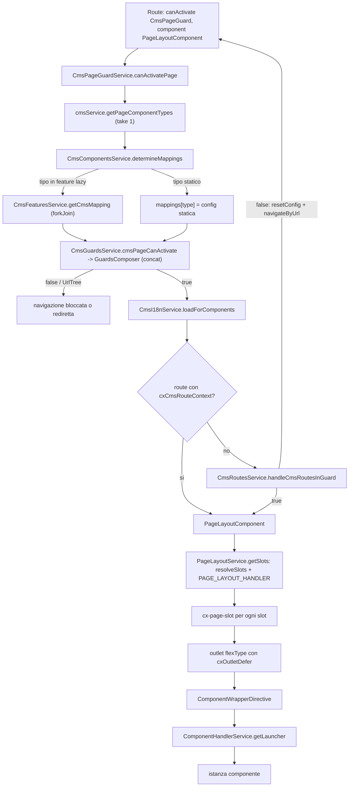
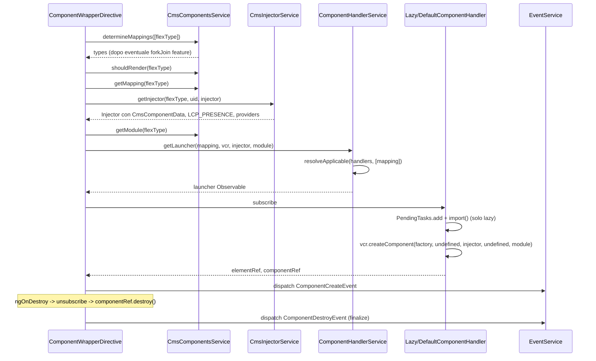
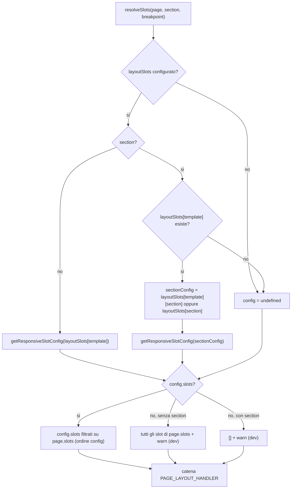
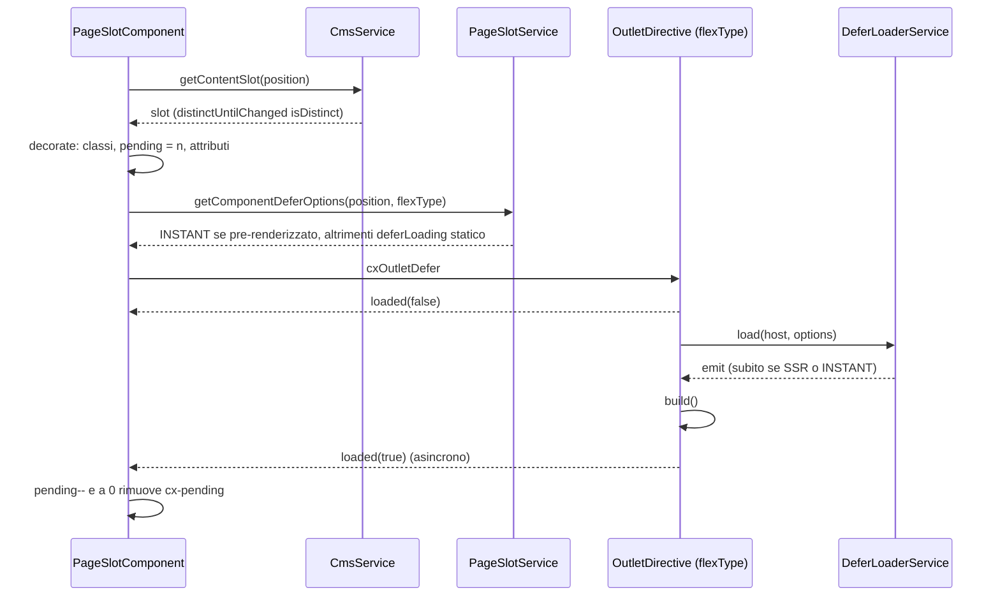

# 16 — CMS (storefront): rendering dinamico delle pagine

> Riferimenti allo SHA `5b7a1c2bf2808d7380bc20596d10f4fa710c3da1` (vedi [00-meta](../00-meta.md)).

Questo capitolo segue il percorso di una pagina CMS dal momento in cui il router attiva una route Spartacus fino a quando un componente Angular (o un web component) viene istanziato in uno slot. Il [capitolo 15](../parte-2/15-cms-core.md) descrive come i dati della pagina arrivano nello store (`CmsService`, normalizer, connector) e come si definisce il mapping `cmsComponents`. Qui guardiamo il lato UI di `@spartacus/storefront`: chi legge quei dati e come li trasforma in DOM.

## 1. A cosa serve e perché esiste

In Spartacus quasi nessuna pagina ha un template Angular scritto a mano. Il backend SAP Commerce restituisce una struttura (page template, slot, componenti con `typeCode`/`flexType`) e lo storefront deve:

1. **scegliere quali slot mostrare e in che ordine**, in base a un `LayoutConfig` che dipende dal page template, dalla sezione (header/footer/...) e dal breakpoint (`PageLayoutService`, `core-libs/storefront/cms-structure/page/page-layout/page-layout.service.ts:L54-L80`);
2. **per ogni slot, rendere i componenti**, eventualmente in modo differito (lazy rendering sul viewport) e con classi CSS di stato (`PageSlotComponent`, `core-libs/storefront/cms-structure/page/slot/page-slot.component.ts:L48-L54`);
3. **per ogni componente, trovare l'implementazione** dal mapping `cmsComponents` (anche dentro feature module caricati in lazy), creare un injector dedicato con i dati CMS (`CmsComponentData`) e lanciare il componente con l'handler giusto: classe Angular, `() => import(...)` o web component (`ComponentWrapperDirective`, `core-libs/storefront/cms-structure/page/component/component-wrapper.directive.ts:L67-L119`);
4. **prima ancora di rendere**, durante la navigazione, risolvere i mapping, eseguire le guard dichiarate dai componenti, caricare i chunk i18n e, per le content page, generare al volo child route (`CmsPageGuardService.canActivatePage`, `core-libs/storefront/cms-structure/guards/cms-page-guard.service.ts:L65-L98`).

Il risultato: lo storefront è un *interprete* della struttura CMS. Aggiungere un componente a una pagina in Backoffice/SmartEdit non richiede nuovo codice Angular, purché esista un mapping per il suo `flexType`.

Il capitolo copre anche due argomenti collaterali assegnati agli stessi file: le route PDP/PLP (`cms-pages`) e il contesto LCP (Largest Contentful Paint), che sfrutta proprio l'injector per componente creato dal wrapper.

## 2. Mappa dei file

Il barrel pubblico è `core-libs/storefront/public_api.ts`, che riesporta `./cms-pages/index` (L22), `./cms-structure/index` (L23) e `./shared/index` (L29).

| Path | Ruolo |
|---|---|
| `core-libs/storefront/cms-structure/page/page-layout/page-layout.component.ts` (+ `.html`) | `PageLayoutComponent` (`cx-page-layout`): calcola nome layout, slot, page fold; rende un outlet e un `cx-page-slot` per slot |
| `core-libs/storefront/cms-structure/page/page-layout/page-layout.service.ts` | `PageLayoutService`: risolve gli slot da `LayoutConfig` (template/section/breakpoint) e li passa agli handler |
| `core-libs/storefront/cms-structure/page/page-layout/page-layout-handler.ts` | `PAGE_LAYOUT_HANDLER` (multi token) e interfaccia `PageLayoutHandler` |
| `core-libs/storefront/cms-structure/page/page-layout/page-template.directive.ts` | `PageTemplateDirective` (`cxPageTemplateStyle`): classe CSS = page template, con rehydration SSR |
| `core-libs/storefront/cms-structure/page/page-layout/page-layout.module.ts` | `PageLayoutModule` |
| `core-libs/storefront/cms-structure/page/slot/page-slot.component.ts` (+ `.html`) | `PageSlotComponent` (`cx-page-slot`): legge lo slot, gestisce classi `cx-pending`/`page-fold`, outlet per slot e per componente |
| `core-libs/storefront/cms-structure/page/slot/page-slot.service.ts` | `PageSlotService`: slot pre-renderizzati in SSR e opzioni di defer |
| `core-libs/storefront/cms-structure/page/slot/page-slot.module.ts` | `PageSlotModule` (istanzia subito `PageSlotService`) |
| `core-libs/storefront/cms-structure/page/component/component-wrapper.directive.ts` | `ComponentWrapperDirective` (`cxComponentWrapper`): mapping → injector → handler → eventi |
| `core-libs/storefront/cms-structure/page/component/inner-components-host.directive.ts` | `InnerComponentsHostDirective` (`cxInnerComponentsHost`): rende `composition.inner` |
| `core-libs/storefront/cms-structure/page/component/handlers/component-handler.ts` | `ComponentHandler`: classe astratta e token multi |
| `core-libs/storefront/cms-structure/page/component/handlers/default-component.handler.ts` | `DefaultComponentHandler`: classi Angular (priorità `FALLBACK`) |
| `core-libs/storefront/cms-structure/page/component/handlers/lazy-component.handler.ts` | `LazyComponentHandler`: `() => import()` con `PendingTasks` (priorità `LOW`) |
| `core-libs/storefront/cms-structure/page/component/handlers/web-component.handler.ts` | `WebComponentHandler`: `'path#selector'` (non registrato né esportato) |
| `core-libs/storefront/cms-structure/page/component/page-component.module.ts` | `PageComponentModule` (+ `forRoot()` che registra gli handler) |
| `core-libs/storefront/cms-structure/page/component/services/component-handler.service.ts` | `ComponentHandlerService`: sceglie l'handler con `resolveApplicable` |
| `core-libs/storefront/cms-structure/page/component/services/cms-injector.service.ts` | `CmsInjectorService`: injector per componente CMS |
| `core-libs/storefront/cms-structure/page/component/services/component-data.provider.ts` | `ComponentDataProvider`: unisce dati statici e dati CMS (interno) |
| `core-libs/storefront/cms-structure/page/component/services/cx-api.service.ts` | `CxApiService`: facade esposti ai web component (interno) |
| `core-libs/storefront/cms-structure/page/component/events/component.event.ts` | `ComponentEvent`, `ComponentCreateEvent`, `ComponentDestroyEvent` |
| `core-libs/storefront/cms-structure/page/model/cms-component-data.ts` | `CmsComponentData<T>` |
| `core-libs/storefront/cms-structure/services/cms-components.service.ts` | `CmsComponentsService`: mapping (anche da feature lazy), SSR, child routes, guard, i18n, defer, dati statici |
| `core-libs/storefront/cms-structure/services/cms-features.service.ts` | `CmsFeaturesService`: feature module CMS e loro config |
| `core-libs/storefront/cms-structure/services/cms-guards.service.ts` | `CmsGuardsService`: guard dichiarate dai componenti della pagina |
| `core-libs/storefront/cms-structure/services/guards-composer.ts` | `GuardsComposer` e tipi `CanActivate`, `CanActivateObservable` |
| `core-libs/storefront/cms-structure/services/cms-i18n.service.ts` | `CmsI18nService`: chunk i18n dei componenti |
| `core-libs/storefront/cms-structure/services/cms-routes.service.ts` | `CmsRoutesService` (astratto pubblico, `useExisting` impl) |
| `core-libs/storefront/cms-structure/services/cms-routes-impl.service.ts` | `CmsRoutesImplService` (interno): child route CMS con `resetConfig` |
| `core-libs/storefront/cms-structure/services/utils.ts` | `isCanActivate` (interno) |
| `core-libs/storefront/cms-structure/utils/cms-structure.util.ts`, `core-libs/storefront/cms-structure/utils/cms-structure.model.ts` | `provideCmsStructure`, `PageSection`, `CmsStructureOptions` |
| `core-libs/storefront/cms-structure/cms-lcp-context/*` | `CmsLcpModule`, `CmsLcpService`, `LcpCmsComponentsConfig`, `provideLcpPresenceForCmsComponent` |
| `core-libs/storefront/shared/lcp-context/*` | `LCP_PRESENCE`, `LcpPresence`, `LcpContextDirective`, `ProvideLcpPresenceDirective`, `LcpPresenceMappingService` |
| `core-libs/storefront/cms-pages/product-details-page/*` | `ProductDetailsPageModule`, `PRODUCT_DETAILS_URL_MATCHER` |
| `core-libs/storefront/cms-pages/product-listing-page/*` | `ProductListingPageModule`, `PRODUCT_LISTING_URL_MATCHER` |

Collaboratori fuori dal perimetro del capitolo ma citati spesso: `OutletDirective` ([cap. 17](../parte-2/17-outlet.md)), `BreakpointService` e `LayoutConfig` ([cap. 18](../parte-2/18-layout-breakpoint-a11y.md)), `CmsPageGuard` e routing ([cap. 14](../parte-2/14-routing.md)), `FeatureModulesService` e `UnifiedInjector` ([cap. 12](../parte-2/12-feature-module-lazy.md)).

## 3. Come funziona passo per passo

### 3.1 Registrazione

`BaseStorefrontModule` importa `PageLayoutModule`, `PageComponentModule.forRoot()`, `PageSlotModule` e `CmsLcpModule.forRoot()` (`core-libs/storefront/base-storefront.module.ts:L26-L46`). Di questi:

- `PageComponentModule.forRoot()` registra come multi-provider di `ComponentHandler`, tramite `useExisting`, `DefaultComponentHandler` e `LazyComponentHandler` (`core-libs/storefront/cms-structure/page/component/page-component.module.ts:L23-L40`). `WebComponentHandler` **non** è registrato (`core-libs/storefront/cms-structure/page/component/handlers/index.ts:L7-L9`; un grep sul repo, spec esclusi, trova la classe solo nella sua dichiarazione).
- `PageSlotModule` inietta `PageSlotService` nel costruttore per crearlo "ASAP", così che possa ispezionare il DOM pre-renderizzato dal server prima che Angular lo tocchi (`core-libs/storefront/cms-structure/page/slot/page-slot.module.ts:L14-L23`).
- `CmsLcpModule.forRoot()` fornisce la config di default `lcpCmsComponents: { idMarker: '__cxLCP__', ids: [] }` (`core-libs/storefront/cms-structure/cms-lcp-context/cms-lcp.module.ts:L11-L19`, `core-libs/storefront/cms-structure/cms-lcp-context/config/default-lcp-cms-components.config.ts:L9-L14`).

Le route con `PageLayoutComponent` arrivano da più parti; nel perimetro del capitolo ci sono i moduli PDP/PLP (§3.10) e la route generata da `CmsRoutesImplService` (§3.9).

### 3.2 Navigazione: `CmsPageGuardService.canActivatePage`

Prima che `PageLayoutComponent` venga creato, la guard CMS prepara il terreno. `canActivatePage` (`core-libs/storefront/cms-structure/guards/cms-page-guard.service.ts:L65-L98`):

1. ottiene i tipi di componente della pagina con `cmsService.getPageComponentTypes(pageContext)` e `take(1)` (L71-L72);
2. chiama `CmsComponentsService.determineMappings(componentTypes)`, che risolve anche i mapping che vivono in feature module lazy (L73-L75; dettagli in §3.7);
3. esegue le guard dichiarate dai componenti con `CmsGuardsService.cmsPageCanActivate` (L76-L80);
4. se il risultato è `true`, avvia il caricamento dei chunk i18n con `CmsI18nService.loadForComponents` (L81-L85);
5. se il risultato è `true` e la route **non** ha `data.cxCmsRouteContext`, delega a `CmsRoutesService.handleCmsRoutesInGuard`, che può generare child route e annullare la navigazione per rifarla (L86-L95; §3.9).

La costruzione di `pageContext`/`pageData` e la gestione della pagina not-found appartengono alla guard (cap. 14) e non sono trattate qui.

#### Guard dei componenti

`CmsGuardsService.cmsPageCanActivate` prende l'unione deduplicata delle guard dei mapping (`CmsComponentsService.getGuards`, che usa un `Set`: `core-libs/storefront/cms-structure/services/cms-components.service.ts:L253-L261`), ottiene ogni istanza con `getLastValueSync(this.unifiedInjector.get(guardClass))` (quindi anche da injector di moduli lazy), tiene solo gli oggetti con metodo `canActivate` (`isCanActivate`, `core-libs/storefront/cms-structure/services/utils.ts:L9-L11`) e passa tutto a `GuardsComposer.canActivate` (`core-libs/storefront/cms-structure/services/cms-guards.service.ts:L36-L48`).

`GuardsComposer.canActivate` ritorna `of(true)` se non ci sono guard; altrimenti trasforma ogni risultato in Observable con `wrapIntoObservable(...).pipe(first())` (`core-libs/storefront/cms-structure/services/guards-composer.ts:L39-L69`) e li compone **in sequenza** con `concat`, saltando i `true` e fermandosi al primo `false`/`UrlTree`, oppure emettendo `true` alla fine (`core-libs/storefront/cms-structure/services/guards-composer.ts:L78-L86`). Il file definisce anche un proprio tipo `CanActivate = { canActivate: CanActivateFn }` come sostituto del tipo Angular deprecato (`core-libs/storefront/cms-structure/services/guards-composer.ts:L16-L24`).

#### i18n

`CmsI18nService.loadForComponents` raccoglie le `i18nKeys` dei componenti renderizzabili (`getI18nKeys` filtra con `shouldRender`: `core-libs/storefront/cms-structure/services/cms-components.service.ts:L266-L276`), le converte nei nomi di chunk con `TranslationChunkService.getChunkNameForKey`, deduplica e chiama `translation.loadChunks` (`core-libs/storefront/cms-structure/services/cms-i18n.service.ts:L21-L28`). Il caricamento è *fire-and-forget*: la guard non aspetta i chunk.

### 3.3 `PageLayoutComponent`: dal template agli slot

`PageLayoutComponent` è standalone, `OnPush`, selettore `cx-page-layout` (`core-libs/storefront/cms-structure/page/page-layout/page-layout.component.ts:L17-L29`). Tutto lo stato è reattivo:

- l'input `section` alimenta un `BehaviorSubject` `section$` che parte da `undefined` (L31-L34);
- `layoutName$` è la section se valorizzata, altrimenti il `templateName$` della pagina corrente (L36-L41);
- `slots$` è `pageLayoutService.getSlots(section)` per ogni valore di `section$` (L43-L45);
- `pageFoldSlot$` deriva **sempre** dal template (non dalla section) tramite `getPageFoldSlot` (L47-L53);
- il costruttore chiama `useFeatureStyles('a11yB2BRegisterComponent')` (L55-L57).

Il template (`core-libs/storefront/cms-structure/page/page-layout/page-layout.component.html:L1-L18`) mette su un unico `ng-template` sia `[cxPageTemplateStyle]` sia `[cxOutlet]="layoutName"`, con contesto `{ templateName$, slots$, section$ }`. Dentro: `<ng-content />` e poi un `<cx-page-slot>` per ogni slot, con `isPageFold` vero solo per lo slot uguale a `pageFoldSlot$`. Il fatto che l'intero layout sia un outlet con nome = template (o section) permette di sostituire il layout di un'intera pagina con un outlet (cap. 17).

Lo stesso componente serve sia come componente di route (pagina intera, `section` assente) sia come contenitore di sezione: per esempio `<cx-page-layout section="header">` (la chiave `section` è una stringa libera; `PageSection` definisce `header`, `footer`, `navigation`: `core-libs/storefront/cms-structure/utils/cms-structure.model.ts:L9-L13`).

### 3.4 `PageLayoutService`: quali slot, in che ordine

`PageLayoutService` è `providedIn: 'root'` e nel costruttore si abbona a `unifiedInjector.getMulti(PAGE_LAYOUT_HANDLER)`, quindi raccoglie gli handler anche da moduli caricati in lazy (`core-libs/storefront/cms-structure/page/page-layout/page-layout.service.ts:L26-L46`; `UnifiedInjector.getMulti` accumula con `scan` e scarta gli array vuoti: `core-libs/core/src/lazy-loading/unified-injector.ts:L75-L94`).

`getSlots(section?)` (`core-libs/storefront/cms-structure/page/page-layout/page-layout.service.ts:L54-L80`):

1. combina `page$` (`cms.getCurrentPage()` filtrato sui valori truthy, L129-L132) e `breakpointService.breakpoint$`;
2. calcola gli slot con `resolveSlots(page, section, breakpoint)`;
3. li fa passare **in catena** attraverso tutti gli handler: l'Observable restituito da uno è l'input del successivo (L61-L67);
4. deduplica con un confronto elemento per elemento (L68-L78).

`resolveSlots` (`core-libs/storefront/cms-structure/page/page-layout/page-layout.service.ts:L106-L127`) ha tre rami:

- **c'è config con `slots`**: tiene solo gli slot configurati che esistono davvero in `page.slots`, nell'ordine della configurazione (L117-L119);
- **nessuna config, nessuna section**: rende *tutti* gli slot della pagina nell'ordine delle chiavi di `page.slots` e logga un avviso (L120-L122);
- **nessuna config, con section**: rende `[]` e logga un avviso (L123-L125).

La ricerca della config passa da `getSlotConfig` (`core-libs/storefront/cms-structure/page/page-layout/page-layout.service.ts:L146-L173`): senza `layoutSlots` ritorna `undefined`; con section delega a `getSlotConfigForSection`; altrimenti risolve la config del template per breakpoint con `getResponsiveSlotConfig`.

`getSlotConfigForSection` (`core-libs/storefront/cms-structure/page/page-layout/page-layout.service.ts:L175-L210`) cerca prima `layoutSlots[template][section]`, poi la config globale `layoutSlots[section]`; ma se il template corrente non ha alcuna voce in `layoutSlots`, esce subito con `undefined` (L181-L185). Dopo la risoluzione responsive, se l'attributo manca prova `pageTemplateConfig[section]` e poi `layoutSlots[section]` (L201-L209).

`getResponsiveSlotConfig` (`core-libs/storefront/cms-structure/page/page-layout/page-layout.service.ts:L217-L243`) usa la config del breakpoint corrente se contiene l'attributo; altrimenti scorre i breakpoint **precedenti** nell'elenco ordinato di `BreakpointService.breakpoints` (ordinati per dimensione dello schermo, dal più piccolo al più grande: `core-libs/storefront/layout/breakpoint/breakpoint.service.ts:L54-L65`; l'ordine crescente si vede in `isDown`, che considera "più piccoli o uguali" i breakpoint fino all'indice incluso, `core-libs/storefront/layout/breakpoint/breakpoint.service.ts:L89-L97`) e tiene l'ultimo che ha l'attributo; in mancanza, la config "piatta". Nota: il comparatore `sortByScreenSize` restituisce solo `-1` o `0`, mai `1` (`core-libs/storefront/layout/breakpoint/breakpoint.service.ts:L139-L152`), quindi l'ordine crescente è garantito solo se le chiavi della config sono già in un ordine compatibile, come nel default.

`getPageFoldSlot(pageTemplate)` applica la stessa risoluzione responsive all'attributo `pageFold` di `layoutSlots[pageTemplate]` (`core-libs/storefront/cms-structure/page/page-layout/page-layout.service.ts:L88-L104`).

Gli avvisi passano da `logMissingLayoutConfig`: solo in `isDevMode()`, una volta per template con `logger.info` (elenco degli slot disponibili) e una volta per chiave (section o template) con `logger.warn` (`core-libs/storefront/cms-structure/page/page-layout/page-layout.service.ts:L251-L273`).

Esempio reale di handler: `CartPageLayoutHandler` agisce solo su `CartPageTemplate` senza section ed esclude slot in base allo stato del carrello (`feature-libs/cart/base/components/cart-page-layout-handler.ts:L28-L60`); è registrato come multi-provider in `CartBaseComponentsModule` (`feature-libs/cart/base/components/cart-base-components.module.ts:L42-L46`). Altri provider di `PAGE_LAYOUT_HANDLER` si trovano nel product configurator (`feature-libs/product-configurator/rulebased/root/cpq/cpq-configurator-layout.module.ts:L86-L86`, `feature-libs/product-configurator/rulebased/root/variant/variant-configurator-overview-layout.module.ts:L62-L62`).

### 3.5 `PageTemplateDirective`: la classe CSS del template

`PageTemplateDirective` (`[cxPageTemplateStyle]`) aggiunge all'host una classe CSS uguale al nome del page template (`core-libs/storefront/cms-structure/page/page-layout/page-template.directive.ts:L22-L47`). Se è applicata a un `ng-template` (come in `PageLayoutComponent`), l'host è il **parent element** (`templateRef.elementRef.nativeElement.parentElement`, L147-L151): in pratica il tag `cx-page-layout`.

- Con input valorizzato usa quel valore; un input falsy pulisce la classe solo se era stata impostata da input (L66-L74).
- Senza input, in `ngOnInit` si abbona a `pageLayoutService.templateName$` (L96-L104).
- `addStyleClass` rimuove la classe precedente, aggiunge la nuova con `classList.add`, la persiste con `DirectiveStateTransferService.set` e chiama `markForCheck()`; il JSDoc spiega che non usa `@HostBinding` per non cancellare classi già presenti (L106-L129).
- `currentTemplate` è inizializzato leggendo l'attributo trasferito dal server (`DirectiveStateTransferService.get(host, 'page-template')`, L48-L51 e L83-L87), così dopo l'idratazione la direttiva sa quale classe rimuovere al primo cambio di template.

`DirectiveStateTransferService.set` scrive `data-cx-state-transfer-<key>` **solo lato server**; `get` legge l'attributo ovunque (`core-libs/storefront/utils/directive-state-transfer.service.ts:L23-L41`).

### 3.6 `PageSlotComponent` e `PageSlotService`

`PageSlotComponent` ha selettore `cx-page-slot,[cx-page-slot]`, è `OnPush` (`core-libs/storefront/cms-structure/page/slot/page-slot.component.ts:L48-L54`) e il JSDoc dichiara le classi CSS che gestisce: la `position`, `cx-pending` "for as long as the slot hasn't start loading" (nel codice, in realtà, finché tutti i componenti non hanno emesso `loaded(true)`, vedi sotto: `core-libs/storefront/cms-structure/page/slot/page-slot.component.ts:L45-L45`, `:L170-L173`), `page-fold` per lo slot di fold (L39-L47).

**Stato e host binding.** `position` è sia `@Input` sia `@HostBinding('attr.position')` e alimenta `position$` (L62-L69, L93). Gli altri binding: `class`, `class.page-fold` ← `isPageFold`, `class.cx-pending` ← `isPending` (default `true`), `class.has-components` ← `hasComponents`, che il commento dichiara non più usato ma tenuto per retrocompatibilità (L74-L91).

**Dati.** `slot$` = `position$` non-undefined → `cmsService.getContentSlot(position)` → `distinctUntilChanged(this.isDistinct)`; `components$` mappa `slot.components ?? []` (L97-L106). `isDistinct` considera uguali due slot con gli stessi `uid` nello stesso ordine (L201-L213).

**Decorazione.** In `ngOnInit` sottoscrive `slot$`, chiama `decorate(slot)`, assegna `components` e fa `markForCheck()` (L124-L131). `decorate` (L133-L164):

- sostituisce la vecchia position nella stringa `class` e aggiunge la nuova;
- imposta `pending` = numero di componenti dello slot (quindi `cx-pending` attivo se > 0) e `hasComponents`;
- scrive a mano l'attributo `class` con `Renderer2.setAttribute`, "for when change detection will not update host binding" (L149);
- applica i decorator di slot con `dynamicAttributeService.addAttributesToSlot` (che esegue in sequenza i decorator registrati: `core-libs/core/src/cms/services/dynamic-attribute.service.ts:L40-L65`).

**Template** (`core-libs/storefront/cms-structure/page/slot/page-slot.component.html:L1-L17`): due livelli di outlet.

1. Un outlet esterno con nome = `position` e contesto `{ components$ }`: si può sostituire un intero slot.
2. Per ogni componente **con `flexType`**, un outlet interno con nome = `flexType`, contesto `{ component }`, `cxOutletDefer` = `getComponentDeferOptions(flexType)` e `(loaded)="isLoaded($event)"`; dentro, `<ng-container [cxComponentWrapper]="component" />`.

**Defer e conteggio.** Con `cxOutletDefer` valorizzato, `OutletDirective` emette `loaded(false)`, aspetta `DeferLoaderService.load(host, options)`, poi esegue `build()` ed emette `loaded(true)` (`core-libs/storefront/cms-structure/outlet/outlet.directive.ts:L85-L116`). L'output `loaded` è un `EventEmitter` asincrono (`new EventEmitter<boolean>(true)`, `core-libs/storefront/cms-structure/outlet/outlet.directive.ts:L58-L58`), che in Angular consegna i valori dentro un `setTimeout` (`angular:packages/core/src/event_emitter.ts:L156-L189`). `isLoaded(true)` decrementa `pending`; a zero `isPending` diventa `false` e la classe `cx-pending` sparisce (`core-libs/storefront/cms-structure/page/slot/page-slot.component.ts:L170-L188`).

`DeferLoaderService` carica subito se è SSR, se la strategia dell'elemento è `INSTANT`, oppure se la strategia globale (default `INSTANT`) è `INSTANT` e l'elemento non chiede `DEFER` (`core-libs/storefront/layout/loading/defer-loader.service.ts:L31-L31`, `:L55-L64`).

**`PageSlotService` e passaggio SSR → CSR.** Nel costruttore (`core-libs/storefront/cms-structure/page/slot/page-slot.service.ts:L13-L25`) chiama `resolvePrerenderedSlots()`, che **solo nel browser** raccoglie le `position` dei `cx-page-slot` già presenti nel DOM (quindi arrivati dall'SSR) la cui parte superiore cade nel viewport iniziale (L30-L42). `getComponentDeferOptions(slot, type)` ritorna `INSTANT` se lo slot è fra quelli pre-renderizzati, altrimenti il `deferLoading` del tipo da `CmsComponentsService.getDeferLoadingStrategy` (L63-L73). `shouldNotDefer` restituisce `true` **una sola volta per slot**, perché lo rimuove con `splice` (L51-L57). Lo scopo, scritto nel commento, è evitare lo sfarfallio degli slot visibili nel passaggio da SSR a CSR (L44-L50).

### 3.7 `CmsComponentsService`: mapping, feature lazy e regole

`CmsComponentsService` (root) mantiene `missingComponents`, `mappings` (già risolti), `staticCmsConfig` e `mappingResolvers` (`core-libs/storefront/cms-structure/services/cms-components.service.ts:L36-L51`). Nel costruttore cattura `cmsComponents` da `configInitializer.getStable('cmsComponents')` come **config statica**, per non dipendere da ciò che i moduli lazy aggiungeranno alla config globale (L55-L69).

`determineMappings(types)` (L79-L115), dentro `defer`, per ogni tipo non ancora mappato:

- se `featureModules.hasFeatureFor(type)` → accoda un resolver della feature;
- altrimenti → usa la config statica, se c'è.

Se ci sono resolver li esegue con `forkJoin` e poi emette i tipi; altrimenti emette subito `of(types)`.

Il resolver della feature (`getFeatureMappingResolver`, L117-L141) chiede a `CmsFeaturesService.getCmsMapping(type)` il mapping dichiarato dal modulo e salva `deepMerge({}, featureMapping, staticConfig)`: la config della feature fa da default e quella dell'app la sovrascrive (commento a L127-L128). Il resolver è condiviso con `share()` ed è rimosso dalla Map dopo l'uso.

Gli altri metodi:

| Metodo | Comportamento | Riferimento |
|---|---|---|
| `getMapping(type)` | `mappings[type]` o fallback alla config statica; in dev mode logga una volta "No component implementation found..." | `core-libs/storefront/cms-structure/services/cms-components.service.ts:L165-L181` |
| `getModule(type)` | `NgModuleRef` della feature, solo se il tipo è coperto da una feature | `core-libs/storefront/cms-structure/services/cms-components.service.ts:L149-L153` |
| `shouldRender(type)` | `false` solo su server con `disableSSR` | `core-libs/storefront/cms-structure/services/cms-components.service.ts:L187-L190` |
| `getDeferLoadingStrategy(type)` | `deferLoading` letto **solo** dalla config statica | `core-libs/storefront/cms-structure/services/cms-components.service.ts:L195-L200` |
| `getChildRoutes(types)` | `childRoutes` dei tipi renderizzabili, normalizzati | `core-libs/storefront/cms-structure/services/cms-components.service.ts:L205-L214` |
| `standardizeChildRoutes` | unisce array e oggetti `{ parent, children }`; vince l'ultimo `parent` | `core-libs/storefront/cms-structure/services/cms-components.service.ts:L231-L248` |
| `getStaticData(type)` | `getMapping(type)?.data` | `core-libs/storefront/cms-structure/services/cms-components.service.ts:L219-L223` |
| `getGuards(types)` | unione deduplicata, **senza** filtro `shouldRender` | `core-libs/storefront/cms-structure/services/cms-components.service.ts:L253-L261` |
| `getI18nKeys(types)` | unione deduplicata dei tipi renderizzabili | `core-libs/storefront/cms-structure/services/cms-components.service.ts:L266-L276` |

#### `CmsFeaturesService`

`CmsFeaturesService` costruisce la mappa tipo → feature da `getStable('featureModules')`, includendo solo feature non-stringa con `module` e `cmsComponents` non vuoti (`core-libs/storefront/cms-structure/services/cms-features.service.ts:L56-L76`). `getCmsMapping(type)` risolve l'istanza della feature (`resolveFeatureInstance`, che memorizza `featureModules.resolveFeature(name)` con `shareReplay()`: L134-L152) e ne restituisce `componentsMappings[type]`, oppure `of(undefined)` (L89-L103). `createFeatureInstance` estrae, per ogni tipo dichiarato in `featureModules[name].cmsComponents`, la voce `cmsComponents[type]` dalla configurazione **del modulo feature** (L157-L183), letta con `{ self: true }` da `ConfigChunk` e `DefaultConfigChunk` del suo injector e fusa (default prima, poi config: L188-L205). `getModule(type)` restituisce il `moduleRef` solo per feature già risolte, con subscribe e unsubscribe sincroni (L110-L127).

### 3.8 `ComponentWrapperDirective`: dal dato al componente

`ComponentWrapperDirective` (`[cxComponentWrapper]`) riceve un `ContentSlotComponentData` ed espone l'output `cxComponentRef` (`core-libs/storefront/cms-structure/page/component/component-wrapper.directive.ts:L39-L45`). Il suo campo `cmpRef` è dichiarato "unsafe": può arrivare tardi (lazy/defer) o mai (web component) (L47-L52).

1. `ngOnInit` chiama `determineMappings([flexType])` e, se `shouldRender(flexType)`, `launchComponent()` (L67-L79).
2. `launchComponent` legge il mapping e, se manca, esce (L81-L88).
3. Chiede un *launcher* a `ComponentHandlerService.getLauncher` passando il mapping, il `ViewContainerRef`, l'injector costruito da `CmsInjectorService.getInjector(flexType, uid, this.injector)` e il modulo della feature (`getModule`) (L90-L102).
4. Alla emissione del launcher salva `cmpRef`, emette `cxComponentRef`, invia `ComponentCreateEvent`, applica i decorator di componente e fa `markForCheck()` sul `ChangeDetectorRef` del proprio injector; con `finalize` invia `ComponentDestroyEvent` (L103-L116).
5. `ngOnDestroy` disiscrive `launcherResource`: l'handler distrugge il componente e scatta il `finalize` (L146-L150).

Il payload degli eventi contiene `typeCode` e `id` (= `uid`); solo `ComponentCreateEvent` porta anche `host` (`elementRef.nativeElement`). Gli eventi passano da `eventService.dispatch(payload, event)` (L124-L136). Le classi sono in `core-libs/storefront/cms-structure/page/component/events/component.event.ts:L9-L48` (`type` = `'ComponentCreate'` / `'ComponentDestroy'`).

#### Injector per componente: `CmsInjectorService`

`getInjector(type, uid, parentInjector?)` crea con `Injector.create` un injector figlio con tre gruppi di provider (`core-libs/storefront/cms-structure/page/component/services/cms-injector.service.ts:L28-L50`):

- `CmsComponentData` → `{ uid, data$: ComponentDataProvider.get(uid, type) }`;
- `provideLcpPresenceForCmsComponent()` (§3.11);
- i `providers` del mapping (`CmsComponentMapping.providers`, documentati come servizi non singleton con scope sull'albero del componente: `core-libs/core/src/cms/config/cms-config.ts:L60-L73`).

Il parent è l'injector del wrapper (quindi l'albero degli element injector dello slot). `Injector.create` in Angular 21 restituisce un `DestroyableInjector` (`angular:packages/core/src/di/injector.ts:L100-L104`).

`CmsComponentData<T>` è una classe astratta usata come token con `uid` e `data$` (`core-libs/storefront/cms-structure/page/model/cms-component-data.ts:L10-L13`). `ComponentDataProvider.get(uid, type?)` (`core-libs/storefront/cms-structure/page/component/services/component-data.provider.ts:L35-L59`):

- con `uid` e dati statici (`mapping.data`): emette prima i dati statici (`startWith`), poi `{ ...static, ...cms }`;
- con `uid` senza dati statici: solo `cmsService.getComponentData(uid)`;
- senza `uid`: `of(static)` oppure `EMPTY`.

#### Scelta dell'handler

`ComponentHandlerService` inietta l'array `@Optional() @Inject(ComponentHandler)` e sceglie con `resolveApplicable(this.handlers, [componentMapping])` (`core-libs/storefront/cms-structure/page/component/services/component-handler.service.ts:L33-L52`); in dev mode, se nessuno fa match, logga una volta per mapping "Can't resolve handler for component mapping: " (L54-L62); `getLauncher` restituisce `undefined` se manca l'handler (L74-L88).

`resolveApplicable` (`core-libs/core/src/util/applicable.ts:L47-L87`) filtra gli applicabili con `hasMatch` vero (o senza `hasMatch`); fra più candidati vince la priorità più alta e, a parità, quello fornito per ultimo; senza `getPriority` vale `Priority.NORMAL`. Valori: `FALLBACK = -50`, `LOW = -10`, `NORMAL = 0`, `HIGH = 10` (`core-libs/core/src/util/applicable.ts:L7-L24`).

| Handler | `hasMatch` | Priorità | Riferimento |
|---|---|---|---|
| `DefaultComponentHandler` | `typeof component === 'function'` | `FALLBACK` | `core-libs/storefront/cms-structure/page/component/handlers/default-component.handler.ts:L24-L34` |
| `LazyComponentHandler` | funzione il cui `toString()` inizia con `function()` o `()=>` | `LOW` | `core-libs/storefront/cms-structure/page/component/handlers/lazy-component.handler.ts:L35-L52` |
| `WebComponentHandler` | stringa che contiene `#` | `LOW` | `core-libs/storefront/cms-structure/page/component/handlers/web-component.handler.ts:L27-L47` |

Il contratto comune è scritto nel JSDoc di `ComponentHandler`: abbonarsi al launcher istanzia il componente, l'emissione porta `ElementRef` (e `ComponentRef` per i componenti Angular), la disiscrizione lo distrugge (`core-libs/storefront/cms-structure/page/component/handlers/component-handler.ts:L22-L35`).

- **Default**: usa `elementInjector ?? viewContainerRef.injector`, risolve una `ComponentFactory` con `ComponentFactoryResolver` e chiama `viewContainerRef.createComponent(factory, undefined, injector, undefined, module)`; il teardown è `componentRef.destroy()` (`core-libs/storefront/cms-structure/page/component/handlers/default-component.handler.ts:L42-L85`). Sia `ComponentFactoryResolver` sia questo overload di `createComponent` sono `@deprecated` in Angular 21 (`angular:packages/core/src/linker/component_factory_resolver.ts:L30-L41`, `angular:packages/core/src/linker/view_container_ref.ts:L263-L275`).
- **Lazy**: dentro `defer` registra un task con `PendingTasks.add()`, risolve la Promise di `component()` e rimuove il task in `finalize`; poi passa la classe risolta al `DefaultComponentHandler` (`core-libs/storefront/cms-structure/page/component/handlers/lazy-component.handler.ts:L54-L81`). Il commento spiega che senza il task l'SSR serializzerebbe e distruggerebbe l'app mentre l'`import()` è ancora in volo (NG0205). `PendingTasks.add()` restituisce una funzione di cleanup idempotente (`angular:packages/core/src/pending_tasks.ts:L42-L60`).
- **Web component**: crea l'elemento custom con `Renderer2`, gli assegna `cxApi = { ...CxApiService, cmsComponentData }` e lo appende al `parentElement` dell'anchor del VCR; emette solo `elementRef` (`core-libs/storefront/cms-structure/page/component/handlers/web-component.handler.ts:L49-L96`). `initWebComponent` divide `path#selector`, carica lo script una sola volta (cache `loadedWebComponents`) e concatena le `onload` se lo script è ancora in caricamento (L98-L136). `CxApiService` espone come proprietà pubbliche opzionali numerosi facade core più `ngZone` (`core-libs/storefront/cms-structure/page/component/services/cx-api.service.ts:L33-L75`).

#### Componenti annidati: `InnerComponentsHostDirective`

`[cxInnerComponentsHost]` legge `data$.composition.inner` dal `CmsComponentData` iniettato (`core-libs/storefront/cms-structure/page/component/inner-components-host.directive.ts:L28-L33`) e, per ogni nome, crea a mano (`new`) un `ComponentWrapperDirective` con `cxComponentWrapper = { flexType: component, uid: '' }` e ne chiama `ngOnInit()`; a ogni nuova lista distrugge i wrapper precedenti (L57-L81). È usata per esempio nella search box e negli item di product grid/list/carousel (`core-libs/storefront/cms-components/product/product-list/product-grid-item/product-grid-item.component.html:L45-L45`, `core-libs/storefront/cms-components/navigation/search-box/search-box.component.html:L213-L213`).

### 3.9 Child route CMS (`CmsRoutesImplService`)

Un componente CMS può dichiarare `childRoutes` nel mapping (`Route[]` o `{ parent?: Pick<Route, 'data'>; children?: Route[] }`: `core-libs/core/src/cms/config/cms-config.ts:L48-L58`). `CmsRoutesService` è la facciata pubblica astratta con `useExisting: CmsRoutesImplService` (`core-libs/storefront/cms-structure/services/cms-routes.service.ts:L11-L24`); l'implementazione non è esportata in attesa del refactor della issue #7070 (`core-libs/storefront/cms-structure/services/cms-routes-impl.service.ts:L31-L33`).

`handleCmsRoutesInGuard` (`core-libs/storefront/cms-structure/services/cms-routes-impl.service.ts:L69-L91`):

1. se esiste già una route CMS per la label (`cmsRouteExists`: URL che inizia con `/` e route in `router.config` con `data.cxCmsRouteContext` e `path` uguale, L42-L58) → `true`;
2. se i componenti hanno child route e `updateRouting` riesce → `router.navigateByUrl(currentUrl)` e ritorna `false` (la navigazione corrente è annullata e rifatta);
3. altrimenti → `true`.

`updateRouting` (L93-L124) agisce solo per `PageType.CONTENT_PAGE` con label che inizia per `/` e lunga più di 1: crea `{ path: label senza '/', component: PageLayoutComponent, children, data: deepMerge(parent.data, { cxCmsRouteContext: { type, id } }) }` e la mette **in testa** con `router.resetConfig`. Le guard delle child route vengono avvolte ricorsivamente (`wrapCmsGuardsRecursively`, L126-L155) da un wrapper che cerca un'istanza di classe con `UnifiedInjector` e, se non la trova, tratta la guard come `CanActivateFn`, eseguendola con `GuardsComposer` (L164-L182). Il JSDoc spiega lo scopo: permettere al router di usare guard fornite solo nell'injector di un modulo lazy.

Alla seconda navigazione la route ha `cxCmsRouteContext`, quindi `canActivatePage` non richiama `handleCmsRoutesInGuard` (`core-libs/storefront/cms-structure/guards/cms-page-guard.service.ts:L88-L88`).

### 3.10 `cms-pages`: route PDP e PLP

`ProductDetailsPageModule` registra una route `path: null` (con `@ts-ignore`), `canActivate: [CmsPageGuard]`, `component: PageLayoutComponent`, `data: { cxRoute: 'product' }` (`core-libs/storefront/cms-pages/product-details-page/product-details-page.module.ts:L14-L24`) e fornisce come default `routing.routes.product.matchers = [PRODUCT_DETAILS_URL_MATCHER]` (L26-L36). Il token combina il `DEFAULT_URL_MATCHER` con un suffix matcher `marker: 'p', paramName: 'productCode'` tramite `UrlMatcherService.getCombined` (`core-libs/storefront/cms-pages/product-details-page/product-details-url-matcher.ts:L16-L50`). Il JSDoc ricorda che i matcher "matchano" una route ma non la creano né la proteggono (L31-L41).

`ProductListingPageModule` registra tre route `path: null` → `PageLayoutComponent` con `CmsPageGuard`: `search` (`pageLabel: 'search'`), `brand` e `category`, quest'ultima **per ultima** perché il suo matcher `**/c/:categoryCode` è greedy e oscurerebbe `brand` (`core-libs/storefront/cms-pages/product-listing-page/product-listing-page.module.ts:L14-L39`). Il default è `routing.routes.category.matchers = [PRODUCT_LISTING_URL_MATCHER]` (L41-L51), con suffix matcher `marker: 'c', paramName: 'categoryCode'` (`core-libs/storefront/cms-pages/product-listing-page/product-listing-url-matcher.ts:L20-L28`).

Nell'app demo entrambi i moduli sono importati in `SpartacusFeaturesModule` (`projects/storefrontapp/src/app/spartacus/spartacus-features.module.ts:L224-L225`). La sostituzione di `path: null` con i path/matcher configurati avviene nel routing core ([cap. 14](../parte-2/14-routing.md)): `ConfigurableRoutesService.configureRoute` usa `data.cxRoute` come nome della route e, se la config ha `matchers`, cancella `path` e imposta `matcher` (`core-libs/core/src/routing/configurable-routes/configurable-routes.service.ts:L77-L94`).

### 3.11 Contesto LCP

Obiettivo (JSDoc di `LcpCmsComponentsConfig`): sapere quali componenti contengono l'elemento LCP per ottimizzarne il caricamento, per esempio dando priorità all'immagine principale (`core-libs/storefront/cms-structure/cms-lcp-context/config/lcp-cms-components.config.ts:L19-L26`).

1. `LCP_PRESENCE` è un `InjectionToken<Observable<LcpPresence>>` root con default `of(LcpPresence.NO_LCP)`, pensato per essere ri-fornito a livello DOM da un antenato (`core-libs/storefront/shared/lcp-context/lcp-presence.token.ts:L11-L32`).
2. Per ogni componente CMS, `CmsInjectorService` aggiunge `provideLcpPresenceForCmsComponent()` (`core-libs/storefront/cms-structure/page/component/services/cms-injector.service.ts:L45-L45`): una factory che da `CmsComponentData.data$` calcola `CmsLcpService.getLcpPresence(data)` con `distinctUntilChanged` e `shareReplay({ bufferSize: 1, refCount: true })` (`core-libs/storefront/cms-structure/cms-lcp-context/provide-lcp-presence-for-cms-component.ts:L14-L36`).
3. `CmsLcpService.getLcpPresence` ritorna `HAS_LCP` se l'`uid` contiene `idMarker` o è in `ids`, altrimenti `NO_LCP` (`core-libs/storefront/cms-structure/cms-lcp-context/cms-lcp.service.ts:L50-L65`).
4. Un discendente usa `*cxLcpContext`, che inietta `LCP_PRESENCE` e ricava `fetchPriority$` con `LcpPresenceMappingService` (`HAS_LCP` → `ImageFetchPriority.HIGH`, altrimenti `undefined`) e crea la view con contesto `$implicit: { lcpPresence$, fetchPriority$ }` (`core-libs/storefront/shared/lcp-context/lcp-context.directive.ts:L45-L76`, `core-libs/storefront/shared/lcp-context/lcp-presence-mapping.service.ts:L14-L22`).
5. Fuori dai componenti CMS si può fornire il valore a mano con `[cxProvideLcpPresence]` (`core-libs/storefront/shared/lcp-context/provide-lcp-presence.directive.ts:L24-L47`).

### 3.12 `provideCmsStructure`

Helper per aggiungere a una pagina un componente che il backend non fornisce: `provideCmsStructure(options)` restituisce un `provideConfig` che fonde `buildCmsStructure` (`cmsStructure.components[id] = { typeCode, flexType }` ed eventualmente `cmsStructure.slots[pos] = { componentIds: [id] }`) e `buildLayoutConfig` (`layoutSlots[template]` e/o `layoutSlots[section]` con `slots: [pos]`, eventualmente sotto la chiave del breakpoint) (`core-libs/storefront/cms-structure/utils/cms-structure.util.ts:L31-L108`). Il JSDoc propone come esempio `{ componentId: 'LoginComponent', pageSlotPosition: 'SiteLogin' }` (L12-L30). Il trattamento di `cmsStructure` lato dati è nel [capitolo 15](../parte-2/15-cms-core.md).

## 4. Diagrammi

### 4.1 Pipeline completa: dalla route al componente

Ogni nodo corrisponde ai passi di §3.2-§3.8.



### 4.2 Lancio di un componente (`ComponentWrapperDirective`)



### 4.3 Risoluzione degli slot (`resolveSlots` / `getSlotConfig`)



### 4.4 Ciclo di vita di uno slot e defer



## 5. Estratti di codice reale

**Il template del layout** — `core-libs/storefront/cms-structure/page/page-layout/page-layout.component.html:L1-L18`

```html
<ng-template
  *ngIf="layoutName$ | async as layoutName"
  [cxPageTemplateStyle]="layoutName"
  [cxOutlet]="layoutName"
  [cxOutletContext]="{
    templateName$: templateName$,
    slots$: slots$,
    section$: section$,
  }"
>
  <ng-content />

  <cx-page-slot
    *ngFor="let slot of slots$ | async"
    [position]="slot"
    [isPageFold]="slot === (pageFoldSlot$ | async)"
  />
</ng-template>
```

**Gli stream del layout** — `core-libs/storefront/cms-structure/page/page-layout/page-layout.component.ts:L31-L53`

```ts
  @Input() set section(value: string) {
    this.section$.next(value);
  }
  readonly section$ = new BehaviorSubject<string | undefined>(undefined);

  readonly templateName$: Observable<string> =
    this.pageLayoutService.templateName$;

  readonly layoutName$: Observable<string> = this.section$.pipe(
    switchMap((section) => (section ? of(section) : this.templateName$))
  );

  readonly slots$: Observable<string[]> = this.section$.pipe(
    switchMap((section) => this.pageLayoutService.getSlots(section))
  );

  readonly pageFoldSlot$: Observable<string | undefined> =
    this.templateName$.pipe(
      switchMap((templateName) =>
        this.pageLayoutService.getPageFoldSlot(templateName)
      ),
      distinctUntilChanged()
    );
```

**Catena degli handler di layout** — `core-libs/storefront/cms-structure/page/page-layout/page-layout.service.ts:L54-L67`

```ts
  getSlots(section?: string): Observable<string[]> {
    return combineLatest([this.page$, this.breakpointService.breakpoint$]).pipe(
      map(([page, breakpoint]) => {
        const pageTemplate = page.template;
        const slots = this.resolveSlots(page, section, breakpoint);
        return { slots, pageTemplate, breakpoint };
      }),
      switchMap(({ slots, pageTemplate, breakpoint }) => {
        let result = of(slots);
        for (const handler of this.handlers || []) {
          result = handler.handle(result, pageTemplate, section, breakpoint);
        }
        return result;
      }),
```

**I tre rami di `resolveSlots`** — `core-libs/storefront/cms-structure/page/page-layout/page-layout.service.ts:L111-L126`

```ts
    const config = this.getSlotConfig(
      page.template ?? '',
      'slots',
      section,
      breakpoint
    );
    if (config && config.slots) {
      const pageSlots = page.slots ? Object.keys(page.slots) : [];
      return config.slots.filter((slot) => pageSlots.includes(slot));
    } else if (!section) {
      this.logMissingLayoutConfig(page);
      return page.slots ? Object.keys(page.slots) : [];
    } else {
      this.logMissingLayoutConfig(page, section);
      return [];
    }
```

**Breakpoint "più vicino"** — `core-libs/storefront/cms-structure/page/page-layout/page-layout.service.ts:L229-L242`

```ts
    // we have a config for the specific breakpoint
    if (layoutSlotConfig[breakpoint]?.hasOwnProperty(configAttribute)) {
      return <SlotConfig>layoutSlotConfig[breakpoint];
    }

    // find closest config
    const all = this.breakpointService.breakpoints;

    for (const br of all.slice(0, all.indexOf(breakpoint))) {
      if (layoutSlotConfig[br]?.hasOwnProperty(configAttribute)) {
        slotConfig = <SlotConfig>layoutSlotConfig[br];
      }
    }
    return slotConfig;
```

**Il template dello slot** — `core-libs/storefront/cms-structure/page/slot/page-slot.component.html:L1-L17`

```html
<ng-template
  *ngIf="position"
  [cxOutlet]="position"
  [cxOutletContext]="{ components$: components$ }"
>
  <ng-container *ngFor="let component of components">
    <ng-template
      *ngIf="component.flexType"
      [cxOutlet]="component.flexType"
      [cxOutletContext]="{ component: component }"
      [cxOutletDefer]="getComponentDeferOptions(component.flexType)"
      (loaded)="isLoaded($event)"
    >
      <ng-container [cxComponentWrapper]="component" />
    </ng-template>
  </ng-container>
</ng-template>
```

**Slot pre-renderizzati e defer** — `core-libs/storefront/cms-structure/page/slot/page-slot.service.ts:L51-L73`

```ts
  shouldNotDefer(slot: string): boolean {
    if (this.prerenderedSlots?.includes(slot)) {
      this.prerenderedSlots.splice(this.prerenderedSlots.indexOf(slot), 1);
      return true;
    }
    return false;
  }

  /**
   * Returns the defer options for the given component. If the wrapping
   * page slot is prerendered, we would ignore the defer options altogether.
   */
  getComponentDeferOptions(
    slot: string | undefined,
    componentType: string
  ): IntersectionOptions {
    if (slot && this.shouldNotDefer(slot)) {
      return { deferLoading: DeferLoadingStrategy.INSTANT };
    }
    const deferLoading =
      this.cmsComponentsService.getDeferLoadingStrategy(componentType);
    return { deferLoading };
  }
```

**Il cuore del wrapper** — `core-libs/storefront/cms-structure/page/component/component-wrapper.directive.ts:L81-L117`

```ts
  private launchComponent() {
    const componentMapping = this.cmsComponentsService.getMapping(
      this.cxComponentWrapper.flexType ?? ''
    );

    if (!componentMapping) {
      return;
    }

    this.launcherResource = this.componentHandler
      .getLauncher(
        componentMapping,
        this.vcr,
        this.cmsInjector.getInjector(
          this.cxComponentWrapper.flexType ?? '',
          this.cxComponentWrapper.uid ?? '',
          this.injector
        ),
        this.cmsComponentsService.getModule(
          this.cxComponentWrapper.flexType ?? ''
        )
      )
      ?.pipe(
        filter(isNotUndefined),
        tap(({ elementRef, componentRef }) => {
          this.cmpRef = componentRef;

          this.cxComponentRef.emit(componentRef);

          this.dispatchEvent(ComponentCreateEvent, elementRef);
          this.decorate(elementRef);
          this.injector.get(ChangeDetectorRef).markForCheck();
        }),
        finalize(() => this.dispatchEvent(ComponentDestroyEvent))
      )
      .subscribe();
  }
```

**L'injector per componente** — `core-libs/storefront/cms-structure/page/component/services/cms-injector.service.ts:L28-L50`

```ts
  public getInjector(
    type: string,
    uid: string,
    parentInjector?: Injector
  ): Injector {
    const configProviders =
      this.cmsComponentsService.getMapping(type)?.providers ?? [];
    return Injector.create({
      providers: [
        {
          provide: CmsComponentData,
          useFactory: (dataProvider: ComponentDataProvider) => ({
            uid,
            data$: dataProvider.get(uid, type),
          }),
          deps: [ComponentDataProvider],
        },
        provideLcpPresenceForCmsComponent(),
        ...configProviders,
      ],
      parent: parentInjector ?? this.injector,
    });
  }
```

**Handler lazy con `PendingTasks`** — `core-libs/storefront/cms-structure/page/component/handlers/lazy-component.handler.ts:L60-L80`

```ts
    return defer(() => {
      // Register the dynamic import as a pending task so Angular's stability
      // counter stays > 0 until the chunk is loaded. This prevents SSR from
      // serializing and destroying the app while the import() is still in flight
      // (which would cause NG0205 — destroyed injector). The task is removed by
      // finalize(), which fires on complete, error, and unsubscribe.

      const removeTaskTracking = this.pendingTasks.add();
      return from(componentMapping.component()).pipe(
        finalize(removeTaskTracking)
      );
    }).pipe(
      switchMap((component) =>
        this.defaultHandler.launcher(
          { ...componentMapping, component },
          viewContainerRef,
          elementInjector,
          module
        )
      )
    );
```

**Handler di default** — `core-libs/storefront/cms-structure/page/component/handlers/default-component.handler.ts:L48-L72`

```ts
      const injector = elementInjector ?? viewContainerRef.injector;

      const dispose = () => {
        if (componentRef) {
          componentRef.destroy();
        }
      };

      const factory = this.getComponentFactory(
        injector,
        componentMapping.component
      );

      if (factory) {
        componentRef = viewContainerRef.createComponent(
          factory,
          undefined,
          injector,
          undefined,
          module
        );
        subscriber.next({ elementRef: componentRef.location, componentRef });
      }

      return dispose;
```

**Scelta per priorità** — `core-libs/core/src/util/applicable.ts:L63-L87`

```ts
export function resolveApplicable<T extends Applicable>(
  applicables: T[],
  matchParams: any[] = [],
  priorityParams: any[] = []
): T | undefined {
  const matchedApplicables = (applicables ?? []).filter(
    (applicable) => !applicable.hasMatch || applicable.hasMatch(...matchParams)
  );

  if (matchedApplicables.length < 2) {
    return matchedApplicables[0];
  }

  let lastPriority = -Infinity;
  return matchedApplicables.reduce((acc: T | undefined, curr: T) => {
    const currPriority = curr.getPriority
      ? curr.getPriority(...priorityParams)
      : Priority.NORMAL;
    if (lastPriority > currPriority) {
      return acc;
    }
    lastPriority = currPriority;
    return curr;
  }, undefined);
}
```

**Mapping da feature: la feature è il default** — `core-libs/storefront/cms-structure/services/cms-components.service.ts:L122-L139`

```ts
      const mappingResolver$ = this.featureModules
        .getCmsMapping(componentType)
        .pipe(
          filter(isNotUndefined),
          tap((featureComponentMapping) => {
            // We treat cms mapping configuration from a feature as a default,
            // that can be overridden by app/static configuration
            this.mappings[componentType] = deepMerge(
              {},
              featureComponentMapping,
              staticConfig
            );
            this.mappingResolvers.delete(componentType);
          }),
          share()
        );
```

**Dati statici + dati CMS** — `core-libs/storefront/cms-structure/page/component/services/component-data.provider.ts:L43-L57`

```ts
      if (uid) {
        if (staticComponentData) {
          return this.cmsService.getComponentData<T>(uid).pipe(
            map((data) => ({
              ...staticComponentData,
              ...data,
            })),
            startWith(staticComponentData)
          );
        } else {
          return this.cmsService.getComponentData<T>(uid);
        }
      } else {
        return staticComponentData ? of(staticComponentData) : EMPTY;
      }
```

**Composizione sequenziale delle guard** — `core-libs/storefront/cms-structure/services/guards-composer.ts:L78-L86`

```ts
  protected composeCanActivateObservables(
    canActivateObservables: CanActivateObservable[]
  ): CanActivateObservable {
    return concat(...canActivateObservables).pipe(
      skipWhile((canActivate: GuardResult) => canActivate === true),
      endWith(true),
      first()
    );
  }
```

**Generazione della route figlia** — `core-libs/storefront/cms-structure/services/cms-routes-impl.service.ts:L98-L120`

```ts
    if (
      pageContext.type === PageType.CONTENT_PAGE &&
      pageLabel.startsWith('/') &&
      pageLabel.length > 1
    ) {
      const children = this.wrapCmsGuardsRecursively(
        childRoutesConfig.children ?? []
      );

      const newRoute: CmsRoute = {
        path: pageLabel.substring(1),
        component: PageLayoutComponent,
        children: children,
        data: deepMerge({}, childRoutesConfig?.parent?.data ?? {}, {
          cxCmsRouteContext: {
            type: pageContext.type,
            id: pageLabel,
          },
        }),
      };

      this.router.resetConfig([newRoute, ...this.router.config]);
      return true;
```

**Presenza LCP per componente CMS** — `core-libs/storefront/cms-structure/cms-lcp-context/provide-lcp-presence-for-cms-component.ts:L20-L36`

```ts
export const provideLcpPresenceForCmsComponent = (): FactoryProvider => {
  return {
    provide: LCP_PRESENCE,
    useFactory: (): Observable<LcpPresence> => {
      const cmsComponentData = inject(CmsComponentData);
      const cmsLcpService = inject(CmsLcpService);

      return cmsComponentData.data$.pipe(
        switchMap((componentData) =>
          cmsLcpService.getLcpPresence(componentData)
        ),
        distinctUntilChanged(),
        shareReplay({ bufferSize: 1, refCount: true })
      );
    },
  };
};
```

## 6. Configurazione

| Chiave | Tipo | Default | Definita in | Letta in |
|---|---|---|---|---|
| `layoutSlots` | `LayoutSlotConfig` | nessuno nei moduli di questo capitolo | `core-libs/storefront/layout/config/layout-config.ts:L102-L102` | `core-libs/storefront/cms-structure/page/page-layout/page-layout.service.ts:L146-L173`, `:L181-L209`, `:L88-L104` |
| `layoutSlots[template\|section].slots` | `string[]` | — | `core-libs/storefront/layout/config/layout-config.ts:L36-L46` | `core-libs/storefront/cms-structure/page/page-layout/page-layout.service.ts:L111-L119` |
| `layoutSlots[template].pageFold` | `string` | — | `core-libs/storefront/layout/config/layout-config.ts:L36-L46` | `core-libs/storefront/cms-structure/page/page-layout/page-layout.service.ts:L88-L104` |
| `layoutSlots[...][lg\|md\|sm\|xs]` | `SlotGroup` | — | `core-libs/storefront/layout/config/layout-config.ts:L48-L57` | `core-libs/storefront/cms-structure/page/page-layout/page-layout.service.ts:L217-L243` |
| `breakpoints` | `LayoutBreakPoints` | `xs: 576, sm: 768, md: 992, lg: 1200, xl: { min: 1200 }` (`core-libs/storefront/layout/config/default-layout.config.ts:L9-L19`, fornito da `LayoutModule`: `core-libs/storefront/layout/layout.module.ts:L22-L22`) | `core-libs/storefront/layout/config/layout-config.ts:L100-L100` | `core-libs/storefront/layout/breakpoint/breakpoint.service.ts:L54-L65` |
| `deferredLoading.strategy` | `DeferLoadingStrategy` | `INSTANT` se assente | `core-libs/storefront/layout/config/layout-config.ts:L109-L114` | `core-libs/storefront/layout/loading/defer-loader.service.ts:L31-L31` |
| `cmsComponents[type].component` | classe / `() => import()` / `'path#selector'` | — | `core-libs/core/src/cms/config/cms-config.ts:L60-L61` | `hasMatch` degli handler (`core-libs/storefront/cms-structure/page/component/handlers/default-component.handler.ts:L28-L30`, `core-libs/storefront/cms-structure/page/component/handlers/lazy-component.handler.ts:L38-L48`, `core-libs/storefront/cms-structure/page/component/handlers/web-component.handler.ts:L38-L43`) |
| `cmsComponents[type].providers` | `StaticProvider[]` | `[]` | `core-libs/core/src/cms/config/cms-config.ts:L73-L73` | `core-libs/storefront/cms-structure/page/component/services/cms-injector.service.ts:L33-L34` |
| `cmsComponents[type].childRoutes` | `Route[] \| CmsComponentChildRoutesConfig` | `[]` | `core-libs/core/src/cms/config/cms-config.ts:L74-L74` | `core-libs/storefront/cms-structure/services/cms-components.service.ts:L205-L214` |
| `cmsComponents[type].disableSSR` | `boolean` | falsy | `core-libs/core/src/cms/config/cms-config.ts:L75-L75` | `core-libs/storefront/cms-structure/services/cms-components.service.ts:L187-L190` |
| `cmsComponents[type].i18nKeys` | `string[]` | — | `core-libs/core/src/cms/config/cms-config.ts:L76-L76` | `core-libs/storefront/cms-structure/services/cms-components.service.ts:L266-L276` |
| `cmsComponents[type].guards` | `any[]` | — | `core-libs/core/src/cms/config/cms-config.ts:L77-L77` | `core-libs/storefront/cms-structure/services/cms-components.service.ts:L253-L261` |
| `cmsComponents[type].data` | `T` | — | `core-libs/core/src/cms/config/cms-config.ts:L85-L85` | `core-libs/storefront/cms-structure/services/cms-components.service.ts:L219-L223` → `core-libs/storefront/cms-structure/page/component/services/component-data.provider.ts:L39-L41` |
| `cmsComponents[type].deferLoading` | `DeferLoadingStrategy` | — | `core-libs/core/src/cms/config/cms-config.ts:L92-L92` | `core-libs/storefront/cms-structure/services/cms-components.service.ts:L195-L200` (solo config statica) |
| `featureModules[name]` | `FeatureModuleConfig \| string` | `{}` | `core-libs/core/src/cms/config/cms-config.ts:L109-L129` | `core-libs/storefront/cms-structure/services/cms-features.service.ts:L56-L76` |
| `featureModules[name].cmsComponents` | `string[]` | — | `core-libs/core/src/cms/config/cms-config.ts:L121-L121` | `core-libs/storefront/cms-structure/services/cms-features.service.ts:L68-L72`, `:L177-L181` |
| `lcpCmsComponents.idMarker` | `string` | `'__cxLCP__'` | `core-libs/storefront/cms-structure/cms-lcp-context/config/lcp-cms-components.config.ts:L37-L37`; default `core-libs/storefront/cms-structure/cms-lcp-context/config/default-lcp-cms-components.config.ts:L11-L11` | `core-libs/storefront/cms-structure/cms-lcp-context/cms-lcp.service.ts:L51-L56` |
| `lcpCmsComponents.ids` | `string[]` | `[]` | `core-libs/storefront/cms-structure/cms-lcp-context/config/lcp-cms-components.config.ts:L46-L46`; default `core-libs/storefront/cms-structure/cms-lcp-context/config/default-lcp-cms-components.config.ts:L12-L12` | `core-libs/storefront/cms-structure/cms-lcp-context/cms-lcp.service.ts:L52-L62` |
| `routing.routes.product.matchers` | token `UrlMatcherFactory`[] | `[PRODUCT_DETAILS_URL_MATCHER]` | `core-libs/storefront/cms-pages/product-details-page/product-details-page.module.ts:L26-L36` | `core-libs/core/src/routing/configurable-routes/configurable-routes.service.ts:L77-L94` |
| `routing.routes.category.matchers` | idem | `[PRODUCT_LISTING_URL_MATCHER]` | `core-libs/storefront/cms-pages/product-listing-page/product-listing-page.module.ts:L41-L51` | `core-libs/core/src/routing/configurable-routes/configurable-routes.service.ts:L77-L94` |
| feature toggle `a11yB2BRegisterComponent` | `boolean` | `false` | `core-libs/core/src/features-config/feature-toggles/config/feature-toggles.ts:L58-L58`, `:L1021-L1021` | `core-libs/storefront/cms-structure/page/page-layout/page-layout.component.ts:L55-L57` (via `useFeatureStyles`) |

Valori degli enum usati: `BREAKPOINT` = `xs`, `sm`, `md`, `lg`, `xl` (`core-libs/storefront/layout/config/layout-config.ts:L22-L28`); `DeferLoadingStrategy.DEFER = 'DEFERRED-LOADING'`, `INSTANT = 'INSTANT-LOADING'` (`core-libs/core/src/cms/config/cms-config.ts:L96-L101`).

Esempio di configurazione (illustrativo, costruito con le sole chiavi documentate sopra; i nomi MyBannerComponent e my-banner.component non esistono nel repo):

```ts
provideConfig(<LayoutConfig & CmsConfig>{
  layoutSlots: {
    LandingPage2Template: {
      pageFold: 'Section2B',
      slots: ['Section1', 'Section2A', 'Section2B', 'Section3'],
      xs: { slots: ['Section1', 'Section3'] },
    },
    header: { slots: ['SiteLogo', 'SearchBox', 'MiniCart'] },
  },
  cmsComponents: {
    SimpleResponsiveBannerComponent: {
      component: () =>
        import('./my-banner.component').then((m) => m.MyBannerComponent),
      deferLoading: DeferLoadingStrategy.DEFER,
      data: { headline: 'default' },
    },
  },
});
```

Con questa config, su `xs` la pagina rende solo `Section1` e `Section3` (se esistono nella pagina CMS); su `sm` e superiori, dove non c'è una voce `slots` specifica, `getResponsiveSlotConfig` cerca fra i breakpoint più piccoli: trova `xs` e quindi usa ancora `['Section1', 'Section3']`. È il comportamento di T5 in §9: una config su `xs` "si propaga" verso l'alto finché non viene ridefinita. La voce `header` globale vale solo sulle pagine il cui template ha una voce in `layoutSlots` (qui solo `LandingPage2Template`); sulle altre pagine la section `header` rende `[]` (T2, `core-libs/storefront/cms-structure/page/page-layout/page-layout.service.ts:L181-L185`).

## 7. Commenti e note notevoli dal sorgente

- "Prints warn messages for missing layout configs. The warnings are only printed once per config to not pollute the console log." — `core-libs/storefront/cms-structure/page/page-layout/page-layout.service.ts:L48-L50`; e "the info log is not printed in production" (L256).
- `PageTemplateDirective`: "Persist the current template for rehydration. Without this, the current template would be unknown and the directive would not be able to remove old style classes." — `core-libs/storefront/cms-structure/page/page-layout/page-template.directive.ts:L120-L121`. Il JSDoc della stessa direttiva mostra gli esempi `<cx-storefront class="LandingPageTemplate">` e `[cxPageTemplateStyle]="pageTemplateName"` (L31-L44).
- `hasComponents`: "This is no longer used in spartacus, but kept for backwards compatibility." — `core-libs/storefront/cms-structure/page/slot/page-slot.component.ts:L87-L91`.
- "manually set classes for when change detection will not update host binding" — `core-libs/storefront/cms-structure/page/slot/page-slot.component.ts:L149-L149`.
- "instantiate PageSlotService ASAP, so it can examine SSR pre-rendered DOM" — `core-libs/storefront/cms-structure/page/slot/page-slot.module.ts:L19-L19`.
- `shouldNotDefer`: "It's especially useful when transitioning from SSR to CSR application, where we don't want to apply deferring logic to slots that are visible to avoid unnecessary flickering." — `core-libs/storefront/cms-structure/page/slot/page-slot.service.ts:L44-L50`.
- `cmpRef`: "This property in unsafe" (lazy/defer o web component) — `core-libs/storefront/cms-structure/page/component/component-wrapper.directive.ts:L47-L51`.
- Il commento SSR/NG0205 del `LazyComponentHandler` — `core-libs/storefront/cms-structure/page/component/handlers/lazy-component.handler.ts:L61-L65` — e il refuso "We want to mach dynamic import signature () => import('')" (L35-L37).
- `WebComponentHandler`: "If script is still loading (has onload callback defined) add new callback and chain it with the existing one. Needed to support loading multiple components from one script" — `core-libs/storefront/cms-structure/page/component/handlers/web-component.handler.ts:L124-L126`.
- "Contains already initialized resolvers for specified component typez" (refuso originale) — `core-libs/storefront/cms-structure/services/cms-components.service.ts:L49-L49`.
- "We treat cms mapping configuration from a feature as a default, that can be overridden by app/static configuration" — `core-libs/storefront/cms-structure/services/cms-components.service.ts:L127-L128`.
- `// TODO:#checkout - handle breaking changes in schematics` nel costruttore di `CmsGuardsService` — `core-libs/storefront/cms-structure/services/cms-guards.service.ts:L25-L25`.
- `CmsRoutesService`: "Public injection token for the private implementation ... After #7070, this class should be replaced with a real implementation." — `core-libs/storefront/cms-structure/services/cms-routes.service.ts:L11-L12`; e in `CmsRoutesImplService`: "This service should be exposed in public API only after the refactor planned in https://github.com/SAP/spartacus/issues/7070" (`core-libs/storefront/cms-structure/services/cms-routes-impl.service.ts:L31-L31`).
- `GuardsComposer`: "Replacement for the Angular's deprecated type `CanActivate`." — `core-libs/storefront/cms-structure/services/guards-composer.ts:L16-L18`.
- Due `// eslint-disable-next-line @typescript-eslint/no-non-null-assertion` in `CmsFeaturesService` — `core-libs/storefront/cms-structure/services/cms-features.service.ts:L161-L161`, `:L178-L178`.
- PLP: "The 'category' route may include a greedy suffix url matcher '**/c/:categoryCode' So not to shadow the specific 'brand' route, the 'category' is the last route in the sequence." — `core-libs/storefront/cms-pages/product-listing-page/product-listing-page.module.ts:L31-L32`.
- `// @ts-ignore` su `path: null` — `core-libs/storefront/cms-pages/product-details-page/product-details-page.module.ts:L18-L19`, `core-libs/storefront/cms-pages/product-listing-page/product-listing-page.module.ts:L17-L18` (e anche `:L24-L25`, `:L33-L34`).
- Il JSDoc di `CmsLcpService` cita `config.lcpCmsComponentIdMarker`, chiave che non esiste nel codice (quella reale è `lcpCmsComponents.idMarker`) — `core-libs/storefront/cms-structure/cms-lcp-context/cms-lcp.service.ts:L21-L24`.
- Il JSDoc di `ProvideLcpPresenceDirective` dice che per i componenti CMS la presenza LCP "is already defined by the `[cxComponentWrapper]` directive"; nel codice è fornita dall'injector creato da `CmsInjectorService`, che il wrapper usa — `core-libs/storefront/shared/lcp-context/provide-lcp-presence.directive.ts:L17-L23`, `core-libs/storefront/cms-structure/page/component/services/cms-injector.service.ts:L45-L45`.
- Nessun `@deprecated` nei 66 file del capitolo (grep sull'elenco `outline/16.files.txt`); le deprecazioni rilevanti sono lato Angular (`ComponentFactoryResolver`, overload di `createComponent`, §3.8).

## 8. Extension point

| Extension point | Come si usa | Riferimento | Ricetta |
|---|---|---|---|
| `cmsComponents[type]` (mapping) | sostituire/aggiungere un componente per `flexType`: classe, `() => import()`, con `providers`, `data`, `guards`, `childRoutes`, `i18nKeys`, `disableSSR`, `deferLoading` | `core-libs/core/src/cms/config/cms-config.ts:L60-L93` | [51 — sostituire o creare un componente CMS](../parte-3/51-ricette-cms-outlet-layout.md) |
| `CmsComponentData<T>` | iniettarlo nel proprio componente per leggere `uid` e `data$` | `core-libs/storefront/cms-structure/page/model/cms-component-data.ts:L10-L13` | [51 — estendere un componente CMS](../parte-3/51-ricette-cms-outlet-layout.md) |
| `layoutSlots` / `LayoutConfig` | ordine e visibilità degli slot per template, section, breakpoint; `pageFold` | `core-libs/storefront/layout/config/layout-config.ts:L36-L122` | [51 — page layout](../parte-3/51-ricette-cms-outlet-layout.md) |
| `PAGE_LAYOUT_HANDLER` | multi-provider: trasformare l'elenco degli slot in base allo stato (es. carrello) | `core-libs/storefront/cms-structure/page/page-layout/page-layout-handler.ts:L11-L22`; esempio `feature-libs/cart/base/components/cart-base-components.module.ts:L42-L46` | [51 — page layout](../parte-3/51-ricette-cms-outlet-layout.md) |
| `PageLayoutService` | servizio root con metodi `protected` (`getSlotConfig`, `getSlotConfigForSection`, `getResponsiveSlotConfig`) sostituibile via DI | `core-libs/storefront/cms-structure/page/page-layout/page-layout.service.ts:L146-L243` | [50 — override di servizi via DI](../parte-3/50-ricette-config-di.md) |
| `<cx-page-layout section="...">` | rendere una sezione (header, footer, ...) con gli stessi meccanismi | `core-libs/storefront/cms-structure/page/page-layout/page-layout.component.ts:L31-L34` | [51](../parte-3/51-ricette-cms-outlet-layout.md) |
| Outlet `layoutName`, `position`, `flexType` | sostituire/affiancare un layout intero, uno slot, un tipo di componente | `core-libs/storefront/cms-structure/page/page-layout/page-layout.component.html:L1-L10`, `core-libs/storefront/cms-structure/page/slot/page-slot.component.html:L1-L13` | [51 — outlet](../parte-3/51-ricette-cms-outlet-layout.md), [cap. 17](../parte-2/17-outlet.md) |
| `ComponentHandler` | multi-provider di un nuovo handler (`hasMatch` + `getPriority` + `launcher`) per nuovi formati di `component` | `core-libs/storefront/cms-structure/page/component/handlers/component-handler.ts:L17-L45`; registrazione `core-libs/storefront/cms-structure/page/component/page-component.module.ts:L23-L40` | [50 — multi provider](../parte-3/50-ricette-config-di.md) |
| `ComponentCreateEvent` / `ComponentDestroyEvent` | ascoltare la vita dei componenti CMS con `EventService` (es. tracking) | `core-libs/storefront/cms-structure/page/component/events/component.event.ts:L29-L48` | [50 — eventi](../parte-3/50-ricette-config-di.md), [Appendice eventi](../appendici/A07-eventi.md) |
| output `cxComponentRef` | ottenere il `ComponentRef` quando si usa `cxComponentWrapper` a mano | `core-libs/storefront/cms-structure/page/component/component-wrapper.directive.ts:L45-L45` | [51](../parte-3/51-ricette-cms-outlet-layout.md) |
| `cxInnerComponentsHost` | rendere componenti annidati da `composition.inner` | `core-libs/storefront/cms-structure/page/component/inner-components-host.directive.ts:L28-L33` | [51](../parte-3/51-ricette-cms-outlet-layout.md) |
| `featureModules[name].cmsComponents` | spostare un gruppo di componenti in un feature module lazy | `core-libs/core/src/cms/config/cms-config.ts:L109-L129` | [53 — feature lib lazy](../parte-3/53-ricette-feature-cart-checkout-stili-i18n.md) |
| `provideCmsStructure` | aggiungere un componente/slot che il backend non fornisce | `core-libs/storefront/cms-structure/utils/cms-structure.util.ts:L31-L38` | [51](../parte-3/51-ricette-cms-outlet-layout.md) |
| `childRoutes` + `CmsRoutesService` | sotto-route sotto una content page CMS | `core-libs/storefront/cms-structure/services/cms-routes-impl.service.ts:L69-L124` | [51 — route custom](../parte-3/51-ricette-cms-outlet-layout.md) |
| `PRODUCT_DETAILS_URL_MATCHER`, `PRODUCT_LISTING_URL_MATCHER` | riusare o sostituire i matcher di PDP/PLP in `routing.routes.*.matchers` | `core-libs/storefront/cms-pages/product-details-page/product-details-url-matcher.ts:L42-L50`, `core-libs/storefront/cms-pages/product-listing-page/product-listing-url-matcher.ts:L42-L50` | [51 — route custom](../parte-3/51-ricette-cms-outlet-layout.md) |
| `CmsLcpService` / `lcpCmsComponents` | marcare componenti LCP per id/marker o con logica custom (estensione documentata nel JSDoc con `CustomCmsLcpService`) | `core-libs/storefront/cms-structure/cms-lcp-context/cms-lcp.service.ts:L26-L65` | [50 — override di servizi](../parte-3/50-ricette-config-di.md) |
| `LCP_PRESENCE`, `*cxLcpContext`, `[cxProvideLcpPresence]` | leggere/fornire la presenza LCP nei propri template | `core-libs/storefront/shared/lcp-context/lcp-presence.token.ts:L26-L32` | [51](../parte-3/51-ricette-cms-outlet-layout.md) |

Cosa **non** è pubblico (non usarlo in codice applicativo; vedi [54 — API pubblica vs interna](../parte-3/54-upgrade-safe.md)): `ComponentDataProvider` e `CxApiService` (`core-libs/storefront/cms-structure/page/component/services/index.ts:L7-L8`), `WebComponentHandler` (`core-libs/storefront/cms-structure/page/component/handlers/index.ts:L7-L9`), `CmsRoutesImplService` e `isCanActivate` (`core-libs/storefront/cms-structure/services/index.ts:L7-L12`), `DEFAULT_LCP_PRESENCE` (`core-libs/storefront/shared/lcp-context/index.ts:L7-L13`), `defaultLcpCmsComponentsConfig` (`core-libs/storefront/cms-structure/cms-lcp-context/config/index.ts:L7-L7`), le factory `get...UrlMatcherFactory` (`core-libs/storefront/cms-pages/product-details-page/index.ts:L7-L8`).

Elenchi trasversali: [Appendice A01 — injection token](../appendici/A01-injection-token.md), [A02 — config](../appendici/A02-config.md), [A03 — componenti CMS](../appendici/A03-cms-components.md), [A05 — guard](../appendici/A05-guard.md).

## 9. Trappole, casi limite, comportamenti controintuitivi

1. **Nessuna config = tutti gli slot.** Senza `LayoutConfig` per il template, `resolveSlots` rende *tutti* gli slot della pagina nell'ordine delle chiavi di `page.slots`, con un `info` (elenco degli slot disponibili, una volta per template) e un `warn` (una volta per chiave: la section, o il template se manca la section) solo in dev mode, e nulla in produzione (`core-libs/storefront/cms-structure/page/page-layout/page-layout.service.ts:L120-L122`, `:L251-L272`). Al contrario, uno slot configurato ma assente nella pagina CMS viene scartato in silenzio (L117-L119).
2. **Section globale ignorata.** Una section definita solo globalmente (`layoutSlots.header`) si applica solo se anche il template corrente ha una voce in `layoutSlots`; altrimenti `getSlotConfigForSection` esce subito e la section rende `[]` (`core-libs/storefront/cms-structure/page/page-layout/page-layout.service.ts:L181-L185`, `:L123-L125`).
3. **Possibile `TypeError` nel fallback di section.** `getSlotConfigForSection` legge `pageTemplateConfig[section].hasOwnProperty(...)` senza optional chaining: se la config di section arriva dal fallback globale e la config responsive non ha l'attributo, `pageTemplateConfig[section]` è `undefined` (`core-libs/storefront/cms-structure/page/page-layout/page-layout.service.ts:L189-L209`).
4. **Il breakpoint "più vicino" è solo verso il basso.** `getResponsiveSlotConfig` scorre solo i breakpoint precedenti a quello corrente nell'elenco ordinato: una config `xs` vale anche per `md` se `md` non ha la propria; una config `lg` non vale mai per `md` (`core-libs/storefront/cms-structure/page/page-layout/page-layout.service.ts:L234-L242`).
5. **Handler di layout arrivati tardi.** Gli handler del root injector sono assegnati in modo sincrono nel costruttore (`injectors$` parte dal root injector con `startWith`); quelli forniti da moduli lazy si aggiungono solo quando il modulo viene caricato e valgono per le emissioni successive di `getSlots`. Se il root non fornisce handler, `getMulti` scarta gli array vuoti, `handlers` resta `undefined` fino al primo modulo lazy e `this.handlers || []` salta la catena (`core-libs/core/src/lazy-loading/unified-injector.ts:L32-L35`, `:L82-L91`; `core-libs/storefront/cms-structure/page/page-layout/page-layout.service.ts:L41-L45`, `:L63-L63`).
6. **Page fold con le section.** `pageFoldSlot$` usa sempre il template, anche quando `PageLayoutComponent` rende una section (`core-libs/storefront/cms-structure/page/page-layout/page-layout.component.ts:L47-L53`).
7. **`cx-pending` che non sparisce.** `pending` parte dal numero totale di componenti dello slot, ma il template crea l'outlet solo per i componenti con `flexType`: un componente senza `flexType` non emetterà mai `loaded(true)` e lo slot resterà `cx-pending` (`core-libs/storefront/cms-structure/page/slot/page-slot.component.ts:L145-L145`; `core-libs/storefront/cms-structure/page/slot/page-slot.component.html:L8-L12`).
8. **`loaded(false)` anche con INSTANT.** `cxOutletDefer` riceve sempre un oggetto, quindi l'outlet passa sempre da `deferLoading()` ed emette `loaded(false)` prima di `true`, anche quando la strategia è INSTANT (`core-libs/storefront/cms-structure/page/slot/page-slot.component.html:L11-L11`; `core-libs/storefront/cms-structure/outlet/outlet.directive.ts:L85-L86`, `:L102-L114`).
9. **`shouldNotDefer` consuma lo slot.** La prima chiamata per uno slot pre-renderizzato lo rimuove dall'elenco con `splice` (`core-libs/storefront/cms-structure/page/slot/page-slot.service.ts:L51-L57`). Il template rivaluta `getComponentDeferOptions` a ogni change detection, ma `OutletDirective` rifà il render solo quando cambia `cxOutlet` (`core-libs/storefront/cms-structure/outlet/outlet.directive.ts:L92-L100`): conta quindi solo la prima valutazione, che è quella che ottiene INSTANT. Attenzione però: lo slot viene consumato dal **primo componente** dello slot; dal secondo in poi `shouldNotDefer` ritorna `false` e vale il `deferLoading` del tipo. Effetto pratico su slot con più componenti differiti ⚠️ DA VERIFICARE con un test end-to-end.
10. **`deferLoading` nelle feature lazy non conta.** `getDeferLoadingStrategy` legge solo la config statica: un `deferLoading` dichiarato nella config di un feature module viene ignorato (`core-libs/storefront/cms-structure/services/cms-components.service.ts:L195-L200`).
11. **`isDistinct` e i campi del componente.** Lo slot riemette solo se cambia la lista degli `uid`; un cambio di altri campi dei componenti dello slot non riemette. Inoltre ritorna `false` se uno dei due slot non ha `components` (`core-libs/storefront/cms-structure/page/slot/page-slot.component.ts:L201-L213`).
12. **`replace` sulla classe.** `decorate` rimuove la vecchia position con `cls.replace(this.lastPosition, '')`, che sostituisce la prima sottostringa uguale anche se fa parte di un'altra classe (`core-libs/storefront/cms-structure/page/slot/page-slot.component.ts:L136-L138`).
13. **Subscription non conservata nel wrapper.** `ngOnInit` non salva la subscription a `determineMappings`: se il wrapper è distrutto prima che la feature lazy sia risolta, `launchComponent` potrebbe girare dopo il destroy (`core-libs/storefront/cms-structure/page/component/component-wrapper.directive.ts:L67-L79`). ⚠️ DA VERIFICARE con un test: dipende da tempi di risoluzione della feature.
14. **Il riconoscimento del lazy si basa su `toString()`.** `isNotClass` controlla che i primi 20 caratteri (senza il primo spazio) inizino con `function()` o `()=>` (`core-libs/storefront/cms-structure/page/component/handlers/lazy-component.handler.ts:L45-L48`). Forme diverse (per esempio `async () =>` o una funzione con nome) non fanno match con `LazyComponentHandler` e ricadono sul `DefaultComponentHandler`, che le tratterebbe come classi (`core-libs/storefront/cms-structure/page/component/handlers/default-component.handler.ts:L28-L30`). Per un `() => import()` corretto fanno match entrambi e vince il lazy per priorità (`LOW` > `FALLBACK`).
15. **Web component non attivi di default.** Un mapping `'path#selector'` produce "Can't resolve handler for component mapping" finché l'app non registra `WebComponentHandler` come `ComponentHandler`; la classe non è nel public API (`core-libs/storefront/cms-structure/page/component/handlers/index.ts:L7-L9`; `core-libs/storefront/cms-structure/page/component/services/component-handler.service.ts:L54-L62`). ⚠️ DA VERIFICARE come un'app possa importarla senza path interno. Inoltre l'elemento viene appeso al `parentElement` dell'anchor e non inserito nella view Angular, e il launcher ignora `module` (`core-libs/storefront/cms-structure/page/component/handlers/web-component.handler.ts:L49-L53`, `:L80-L83`).
16. **Inner component senza `uid`.** `InnerComponentsHostDirective` usa `uid: ''`: `ComponentDataProvider.get('', type)` restituisce solo i dati statici oppure `EMPTY`, e gli eventi avranno `id: ''` e `typeCode` undefined (`core-libs/storefront/cms-structure/page/component/inner-components-host.directive.ts:L73-L73`; `core-libs/storefront/cms-structure/page/component/services/component-data.provider.ts:L55-L57`; `core-libs/storefront/cms-structure/page/component/component-wrapper.directive.ts:L128-L131`).
17. **Doppia emissione di `data$`.** Con dati statici nel mapping, il componente vede prima i soli dati statici (`startWith`) e poi il merge (`core-libs/storefront/cms-structure/page/component/services/component-data.provider.ts:L45-L51`).
18. **Guard e `disableSSR`.** `getGuards` non filtra con `shouldRender` (a differenza di `getChildRoutes` e `getI18nKeys`): le guard di componenti con `disableSSR` girano anche in SSR (`core-libs/storefront/cms-structure/services/cms-components.service.ts:L253-L261` vs `:L205-L214`, `:L266-L276`).
19. **Guard funzionali nei mapping.** `CmsGuardsService` tiene solo oggetti con `canActivate` (`isCanActivate`), quindi una `CanActivateFn` messa in `guards` di un mapping non viene eseguita da questa strada (`core-libs/storefront/cms-structure/services/cms-guards.service.ts:L42-L46`): viene ignorata in silenzio. `UnifiedInjector.get` passa `NOT_FOUND_SYMBOL` come `notFoundValue` e filtra quel valore (`core-libs/core/src/lazy-loading/unified-injector.ts:L56-L67`); per una funzione senza `ɵprov`, `R3Injector.get` non trova definizioni, delega al parent e alla fine restituisce il `notFoundValue` (`angular:packages/core/src/di/r3_injector.ts:L351-L383`), quindi `getLastValueSync` dà `undefined` e `isCanActivate` la scarta. Nelle child route, invece, le `CanActivateFn` sono supportate dal wrapper, che conta proprio su questo comportamento (`classGuard ?? { canActivate: guard as CanActivateFn }`, `core-libs/storefront/cms-structure/services/cms-routes-impl.service.ts:L164-L182`, `:L174-L179`).
20. **`resetConfig` e navigazione annullata.** Al primo accesso a una content page con child route, la guard ritorna `false`, modifica la config globale del router e rinaviga (`core-libs/storefront/cms-structure/services/cms-routes-impl.service.ts:L84-L88`, `:L119-L119`). `wrapCmsGuardsRecursively` muta anche `route.children` dell'oggetto di config originale (L139-L141).
21. **Feature come stringa.** Le voci `featureModules` espresse come alias stringa, o senza `module`/`cmsComponents`, non entrano nella mappa tipo → feature (`core-libs/storefront/cms-structure/services/cms-features.service.ts:L65-L73`).
22. **Classe del template e SSR.** `DirectiveStateTransferService.set` scrive l'attributo solo lato server; nel browser la persistenza è un no-op (`core-libs/storefront/utils/directive-state-transfer.service.ts:L23-L27`). `currentTemplate` è un field initializer che usa `this.host` (che dipende dalle parameter properties del costruttore): funziona perché il `tsconfig.json` root imposta `useDefineForClassFields: false` (`tsconfig.json:L799-L799`; `core-libs/storefront/cms-structure/page/page-layout/page-template.directive.ts:L84-L94`).
23. **Marker LCP come sottostringa.** `idMarker` è cercato con `includes`, quindi ovunque nell'`uid`, non solo come suffisso (`core-libs/storefront/cms-structure/cms-lcp-context/cms-lcp.service.ts:L55-L57`).
24. **`[cxProvideLcpPresence]` come attributo nudo.** Anche un attributo statico fa scattare `ngOnChanges` (initial input: `NgOnChangesFeature` imposta `setInput = ngOnChangesSetInput`, che registra un `SimpleChange`, `angular:packages/core/src/render3/features/ng_onchanges_feature.ts:L50-L53`, `:L87-L110`), ma con `<div cxProvideLcpPresence>` il valore è la stringa vuota: `this.cxProvideLcpPresence ?? LcpPresence.NO_LCP` non la sostituisce, e la direttiva emette `''` invece di `NO_LCP` (`core-libs/storefront/shared/lcp-context/provide-lcp-presence.directive.ts:L38-L41`). Va sempre passato un valore (`[cxProvideLcpPresence]="..."`).
25. **API deprecate di Angular.** `DefaultComponentHandler` usa `ComponentFactoryResolver` e l'overload factory di `createComponent`, entrambi `@deprecated` in Angular 21 (`angular:packages/core/src/linker/component_factory_resolver.ts:L30-L41`, `angular:packages/core/src/linker/view_container_ref.ts:L263-L275`): da tenere d'occhio negli upgrade.

## 10. Come fare debug

- **"Il mio slot non compare."** In dev mode cerca in console `Available CMS page slots: '...'` e `No layout config found for <template|section>` (`core-libs/storefront/cms-structure/page/page-layout/page-layout.service.ts:L251-L273`). Confronta i nomi con `layoutSlots`; ricorda T2 (section globale) e T4 (breakpoint solo verso il basso). Ispeziona l'attributo `position` dei `cx-page-slot` nel DOM (`@HostBinding('attr.position')`, `core-libs/storefront/cms-structure/page/slot/page-slot.component.ts:L62-L69`) e la classe del template sul tag `cx-page-layout` (`core-libs/storefront/cms-structure/page/page-layout/page-template.directive.ts:L147-L151`).
- **"Il componente non si vede."** Messaggi utili, solo in dev mode: `No component implementation found for the CMS component type '...'` (mapping mancante, `core-libs/storefront/cms-structure/services/cms-components.service.ts:L165-L181`) e `Can't resolve handler for component mapping: ` (formato di `component` non riconosciuto, `core-libs/storefront/cms-structure/page/component/services/component-handler.service.ts:L54-L62`). Se in SSR manca ma nel browser c'è, verifica `disableSSR` (`core-libs/storefront/cms-structure/services/cms-components.service.ts:L187-L190`).
- **Slot bloccato su `cx-pending`.** Controlla che ogni componente dello slot abbia `flexType` (T7) e se la strategia è DEFER: con `deferredLoading.strategy` o `cmsComponents[type].deferLoading` = `DEFER` il componente aspetta l'intersezione con il viewport (`core-libs/storefront/layout/loading/defer-loader.service.ts:L55-L64`).
- **Eventi dei componenti.** Abbonati a `ComponentCreateEvent`/`ComponentDestroyEvent` con `EventService.get(...)` per vedere `typeCode`, `id` e `host` di ogni componente creato (`core-libs/storefront/cms-structure/page/component/component-wrapper.directive.ts:L124-L136`).
- **Mapping effettivo di una feature lazy.** Breakpoint in `CmsComponentsService.getFeatureMappingResolver` sul `deepMerge` (`core-libs/storefront/cms-structure/services/cms-components.service.ts:L129-L133`) e in `CmsFeaturesService.createFeatureInstance` (`core-libs/storefront/cms-structure/services/cms-features.service.ts:L157-L183`) per vedere cosa arriva dalla config della feature e cosa la sovrascrive.
- **Quale handler viene scelto.** Breakpoint in `ComponentHandlerService.resolve` (`core-libs/storefront/cms-structure/page/component/services/component-handler.service.ts:L49-L52`) e in `resolveApplicable` (`core-libs/core/src/util/applicable.ts:L63-L87`).
- **Guard e child route.** Breakpoint in `CmsPageGuardService.canActivatePage` (`core-libs/storefront/cms-structure/guards/cms-page-guard.service.ts:L65-L98`): i `componentTypes` dopo `determineMappings`, l'esito di `cmsPageCanActivate` e il ramo `handleCmsRoutesInGuard`. Dopo la prima visita a una content page con child route, `router.config` contiene in testa una route con `data.cxCmsRouteContext` (`core-libs/storefront/cms-structure/services/cms-routes-impl.service.ts:L107-L119`).
- **SSR e lazy component.** Un `NG0205` (destroyed injector) in SSR con componenti lazy indica un `import()` non tracciato: il `LazyComponentHandler` usa `PendingTasks` proprio per evitarlo (`core-libs/storefront/cms-structure/page/component/handlers/lazy-component.handler.ts:L60-L70`); un handler custom che carica codice in modo asincrono dovrebbe fare lo stesso. Vedi [cap. 4](../parte-1/04-change-detection-zone-signals.md) e [cap. 7](../parte-1/07-ssr-hydration-transferstate.md).
- **Classe del template dopo l'idratazione.** Nel markup SSR cerca l'attributo `data-cx-state-transfer-page-template` sul tag `cx-page-layout` (`core-libs/storefront/utils/directive-state-transfer.service.ts:L23-L41`).
- **LCP.** Verifica l'`uid` del componente (marker `__cxLCP__` o lista `ids`) e, nei template che usano `*cxLcpContext`, il valore di `fetchPriority$` (`core-libs/storefront/shared/lcp-context/lcp-context.directive.ts:L45-L76`).

## 11. Domande di autoverifica

1. **Se per `LandingPage2Template` non c'è alcuna voce in `layoutSlots`, cosa rende `PageLayoutComponent` senza section? E con `section="header"`?**
   Senza section: tutti gli slot della pagina, nell'ordine delle chiavi di `page.slots`, più un avviso in dev mode. Con section: `[]`, anche se esiste `layoutSlots.header` globale, perché `getSlotConfigForSection` esce subito quando il template non ha config. — `core-libs/storefront/cms-structure/page/page-layout/page-layout.service.ts:L120-L125`, `:L181-L185`

2. **Su `md`, se la config del template ha solo `slots` piatto e una voce `xs.slots`, quale elenco viene usato?**
   Quello di `xs`: senza voce per `md`, `getResponsiveSlotConfig` scorre i breakpoint precedenti e tiene l'ultimo che ha `slots`; la config piatta vale solo se nessun breakpoint più piccolo ce l'ha. — `core-libs/storefront/cms-structure/page/page-layout/page-layout.service.ts:L229-L242`

3. **Perché un mapping `component: () => import('./x').then(m => m.X)` non viene trattato da `DefaultComponentHandler`, che pure fa match su ogni funzione?**
   Fanno match entrambi, ma `LazyComponentHandler` ha priorità `LOW` (-10) e `DefaultComponentHandler` `FALLBACK` (-50); `resolveApplicable` sceglie la priorità più alta. — `core-libs/storefront/cms-structure/page/component/handlers/lazy-component.handler.ts:L38-L52`, `core-libs/storefront/cms-structure/page/component/handlers/default-component.handler.ts:L28-L34`, `core-libs/core/src/util/applicable.ts:L76-L86`

4. **Perché `LazyComponentHandler` chiama `PendingTasks.add()`?**
   Per tenere l'app "instabile" finché il chunk non è caricato: altrimenti in SSR Angular serializzerebbe e distruggerebbe l'app durante l'`import()`, con errore NG0205. Il task è rimosso in `finalize`. — `core-libs/storefront/cms-structure/page/component/handlers/lazy-component.handler.ts:L60-L70`, `angular:packages/core/src/pending_tasks.ts:L42-L60`

5. **Un componente vuole un servizio non singleton, una istanza per ogni componente CMS. Dove si dichiara e chi lo fornisce?**
   In `cmsComponents[type].providers`; `CmsInjectorService.getInjector` li aggiunge all'injector creato con `Injector.create` per ogni istanza, accanto a `CmsComponentData` e `LCP_PRESENCE`. — `core-libs/core/src/cms/config/cms-config.ts:L60-L73`, `core-libs/storefront/cms-structure/page/component/services/cms-injector.service.ts:L28-L50`

6. **Un feature module dichiara `cmsComponents.X.component = A` e l'app configura staticamente `cmsComponents.X.component = B`. Quale vince?**
   `B`: il mapping della feature è il default e viene fuso con `deepMerge({}, featureMapping, staticConfig)`, quindi la config statica sovrascrive. — `core-libs/storefront/cms-structure/services/cms-components.service.ts:L126-L134`

7. **Perché uno slot visibile renderizzato in SSR non applica il defer al primo render nel browser?**
   `PageSlotModule` istanzia subito `PageSlotService`, che nel browser legge dal DOM SSR le `position` degli slot nel viewport; `getComponentDeferOptions` ritorna `INSTANT` per quello slot (una volta sola, poi lo rimuove dall'elenco). — `core-libs/storefront/cms-structure/page/slot/page-slot.module.ts:L18-L23`, `core-libs/storefront/cms-structure/page/slot/page-slot.service.ts:L30-L73`

8. **Cosa succede alla prima navigazione verso una content page `/faq` i cui componenti dichiarano `childRoutes`?**
   La guard chiama `handleCmsRoutesInGuard`: `updateRouting` antepone a `router.config` una route `faq` con `PageLayoutComponent`, le child route e `data.cxCmsRouteContext`, poi rinaviga con `navigateByUrl` e ritorna `false`. Alla nuova navigazione la route ha `cxCmsRouteContext` e il passo viene saltato. — `core-libs/storefront/cms-structure/services/cms-routes-impl.service.ts:L69-L124`, `core-libs/storefront/cms-structure/guards/cms-page-guard.service.ts:L86-L95`

9. **In che ordine vengono eseguite le guard dichiarate dai componenti della pagina, e quando si fermano?**
   In sequenza (`concat`): i `true` vengono saltati, il primo `false`/`UrlTree` è il risultato; se tutte ritornano `true` si emette `true` (`endWith(true)`). Senza guard: `of(true)`. — `core-libs/storefront/cms-structure/services/guards-composer.ts:L39-L51`, `:L78-L86`

10. **Come fa un componente CMS a sapere che contiene l'elemento LCP, senza codice specifico?**
    L'injector per componente fornisce `LCP_PRESENCE` calcolato da `CmsLcpService` sull'`uid` (marker `__cxLCP__` o lista `lcpCmsComponents.ids`); nel template, `*cxLcpContext` lo trasforma in `fetchPriority$` (`HIGH` se `HAS_LCP`). — `core-libs/storefront/cms-structure/cms-lcp-context/provide-lcp-presence-for-cms-component.ts:L20-L36`, `core-libs/storefront/cms-structure/cms-lcp-context/cms-lcp.service.ts:L50-L65`, `core-libs/storefront/shared/lcp-context/lcp-presence-mapping.service.ts:L14-L22`
