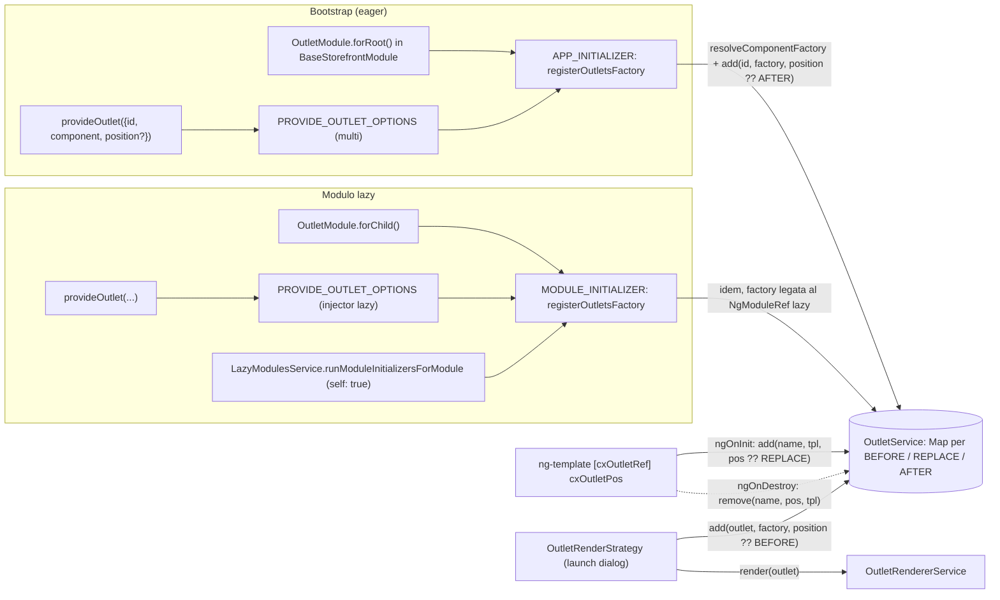
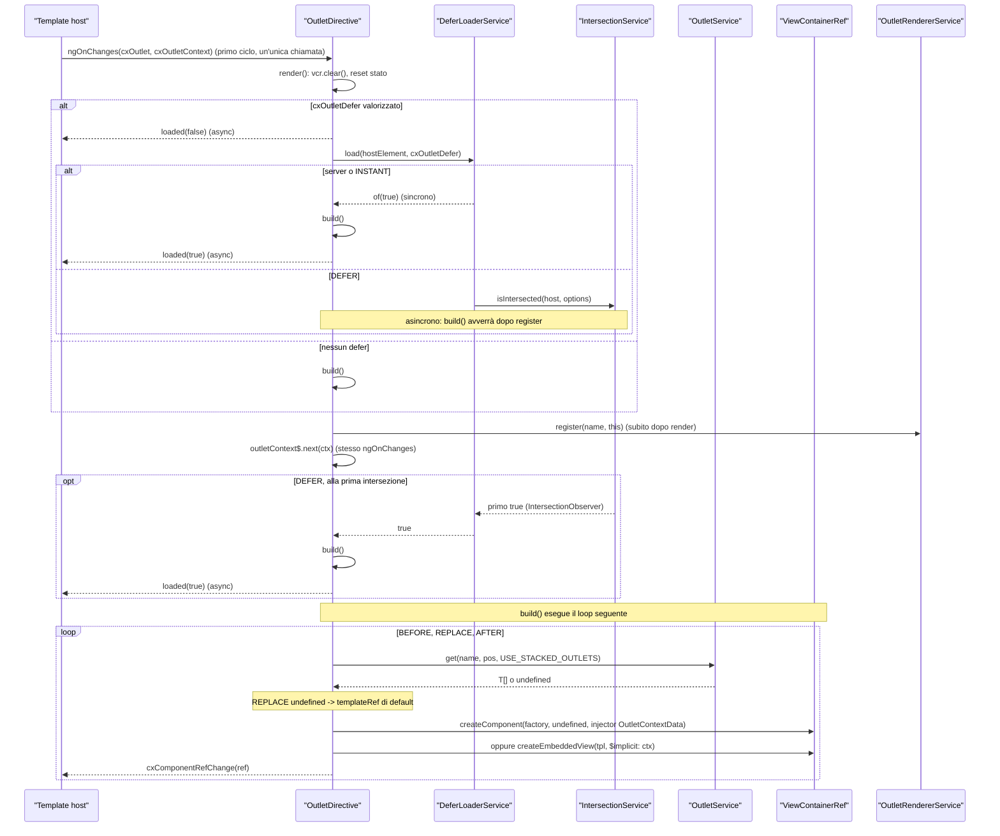
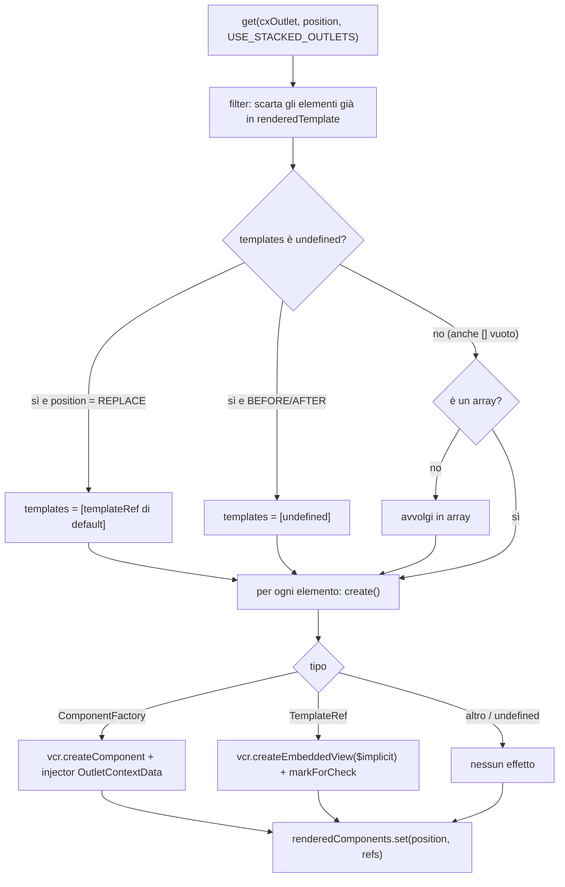
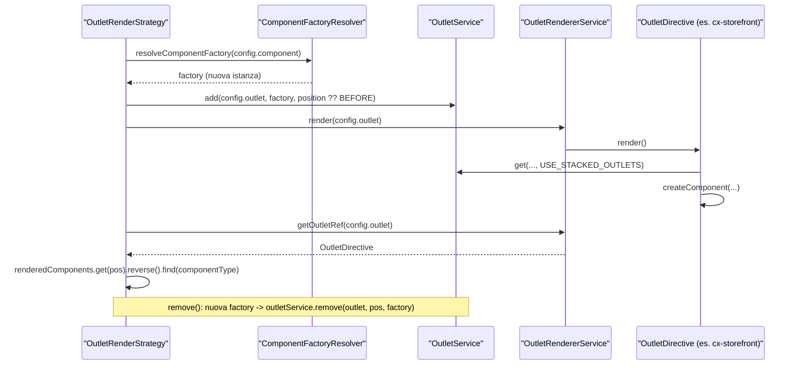

# 17 — Outlet

> Riferimenti allo SHA `5b7a1c2bf2808d7380bc20596d10f4fa710c3da1` (vedi [00-meta](../00-meta.md)).

Prerequisiti consigliati: [01 — Dependency injection](../parte-1/01-dependency-injection.md), [12 — Feature module e lazy loading](12-feature-module-lazy.md), [16 — CMS (storefront): rendering dinamico](16-cms-rendering.md). Per l'elenco completo dei nomi di outlet esistenti vedi l'[Appendice A08 — Outlet](../appendici/A08-outlet.md).

## 1. A cosa serve e perché esiste

Il CMS decide *quali* componenti compaiono in una pagina (cap. [15](15-cms-core.md) e [16](16-cms-rendering.md)), ma molte porzioni di UI non sono componenti CMS: il riepilogo d'ordine dentro il checkout, le righe di una tabella B2B, l'intero layout di una pagina, il guscio dello storefront. Per renderle personalizzabili senza fare fork dei template, Spartacus offre gli **outlet**: punti nominati nei template in cui l'applicazione può inserire contenuto *prima*, *dopo* o *al posto* del contenuto di default.

Il meccanismo, che vive in `core-libs/storefront/cms-structure/outlet/`, ha quattro pezzi:

- un **modello**: l'enum `OutletPosition` con i valori `replace`, `before`, `after` e il token astratto `OutletContextData` con cui un componente inserito legge il contesto dell'outlet (`core-libs/storefront/cms-structure/outlet/outlet.model.ts:L9-L13`, `core-libs/storefront/cms-structure/outlet/outlet.model.ts:L18-L21`);
- un **registro** globale e sincrono, `OutletService`, che per ogni posizione mantiene una `Map` nome-outlet → array di `TemplateRef` o `ComponentFactory` (`core-libs/storefront/cms-structure/outlet/outlet.service.ts:L10-L18`);
- due **direttive**: `[cxOutlet]` dichiara il punto di inserimento e renderizza ciò che il registro contiene (`core-libs/storefront/cms-structure/outlet/outlet.directive.ts:L33-L34`); `[cxOutletRef]` registra un template HTML in un outlet (`core-libs/storefront/cms-structure/outlet/outlet-ref/outlet-ref.directive.ts:L17-L22`);
- un modo **programmatico** di registrare componenti: `provideOutlet()` + `OutletModule.forRoot()/forChild()` (`core-libs/storefront/cms-structure/outlet/outlet.providers.ts:L34-L47`, `core-libs/storefront/cms-structure/outlet/outlet.module.ts:L54-L88`), più un servizio per forzare il ri-render di un outlet già a schermo, `OutletRendererService` (`core-libs/storefront/cms-structure/outlet/outlet-renderer.service.ts:L13-L17`).

La direttiva si appoggia inoltre al **deferred loading** del layout (`DeferLoaderService`, `IntersectionService`) per costruire il contenuto solo quando l'host entra nel viewport (`core-libs/storefront/cms-structure/outlet/outlet.directive.ts:L23-L24`, `core-libs/storefront/cms-structure/outlet/outlet.directive.ts:L102-L116`).

Gli outlet sono ovunque nel layout di base: l'intero storefront è avvolto nell'outlet `cx-storefront` (`core-libs/storefront/layout/main/storefront.component.html:L1-L1`), ogni pagina nell'outlet che porta il nome del suo template di layout (`core-libs/storefront/cms-structure/page/page-layout/page-layout.component.html:L1-L10`), ogni slot nell'outlet col nome della posizione e ogni componente CMS nell'outlet col suo `flexType` (`core-libs/storefront/cms-structure/page/slot/page-slot.component.html:L1-L17`). È per questo che un'applicazione può sostituire "la pagina con layout X" o "il componente CMS di tipo Y" senza toccare la configurazione CMS.

## 2. Mappa dei file

| Path | Ruolo |
|---|---|
| `core-libs/storefront/cms-structure/outlet/index.ts` | Barrel pubblico: export completi di direttive, model, servizi; da `outlet.module` solo `OutletModule`, da `outlet.providers` solo `provideOutlet` e `ProvideOutletOptions` (`:L7-L14`). |
| `core-libs/storefront/cms-structure/outlet/outlet.model.ts` | `OutletPosition`, costanti `AVOID_STACKED_OUTLETS`/`USE_STACKED_OUTLETS`, token astratto `OutletContextData` (`:L9-L44`). |
| `core-libs/storefront/cms-structure/outlet/outlet.service.ts` | `OutletService`: registro root, `add`/`get`/`remove`/`removeValueOrAll` (`:L10-L98`). |
| `core-libs/storefront/cms-structure/outlet/outlet.directive.ts` | `OutletDirective` (`[cxOutlet]`): rendering BEFORE/REPLACE/AFTER, contesto, defer, injector con `OutletContextData` (`:L33-L236`). |
| `core-libs/storefront/cms-structure/outlet/outlet-renderer.service.ts` | `OutletRendererService`: mappa nome → direttiva per il re-render imperativo (`:L13-L48`). |
| `core-libs/storefront/cms-structure/outlet/outlet.providers.ts` | `PROVIDE_OUTLET_OPTIONS` (privato), `ProvideOutletOptions`, `provideOutlet()` (`:L10-L47`). |
| `core-libs/storefront/cms-structure/outlet/outlet.module.ts` | `OutletModule` con `forRoot()` (APP_INITIALIZER) e `forChild()` (MODULE_INITIALIZER); `registerOutletsFactory` (privato) (`:L26-L88`). |
| `core-libs/storefront/cms-structure/outlet/outlet-ref/outlet-ref.directive.ts` | `OutletRefDirective` (`[cxOutletRef]`, `cxOutletPos`) (`:L17-L36`). |
| `core-libs/storefront/cms-structure/outlet/outlet-ref/outlet-ref.module.ts` | `OutletRefModule`: importa/esporta la direttiva standalone (`:L12-L16`). |

File di altri capitoli toccati dai flussi (solo riferimento):

| Path | Ruolo nel flusso |
|---|---|
| `core-libs/storefront/layout/loading/defer-loader.service.ts` | Decide se caricare subito o attendere l'intersezione (`:L44-L64`). |
| `core-libs/storefront/layout/loading/intersection.service.ts` | `IntersectionObserver` nativo, primo `true` (`:L45-L58`, `:L103-L118`). |
| `core-libs/storefront/layout/launch-dialog/services/outlet-render.strategy.ts` | Apre dialog/componenti dentro un outlet (`:L26-L99`). Dettagli nel cap. [18](18-layout-breakpoint-a11y.md). |
| `core-libs/storefront/cms-structure/page/slot/page-slot.component.html` | Consumer principale con `cxOutletDefer` e `(loaded)` (`:L1-L17`). |
| `core-libs/core/src/lazy-loading/tokens.ts`, `lazy-modules.service.ts`, `lazy-loading.module.ts` | `MODULE_INITIALIZER` usato da `OutletModule.forChild()` (cap. [12](12-feature-module-lazy.md)). |

## 3. Come funziona passo per passo

### 3.1 Il modello: posizioni e contesto

`OutletPosition` è un enum di stringhe: `REPLACE = 'replace'`, `BEFORE = 'before'`, `AFTER = 'after'` (`core-libs/storefront/cms-structure/outlet/outlet.model.ts:L9-L13`). Essendo valori stringa, nei template si possono scrivere letteralmente (`cxOutletPos="before"`, come nell'app demo: `projects/storefrontapp/src/test-outlets/test-outlet-template/test-outlet-template.component.html:L3-L3`).

Due costanti booleane danno un nome al terzo parametro `stacked` di `OutletService.get`: `AVOID_STACKED_OUTLETS = false` e `USE_STACKED_OUTLETS = true` (`core-libs/storefront/cms-structure/outlet/outlet.model.ts:L15-L16`).

`OutletContextData<T>` è una **classe astratta usata come token DI** (`core-libs/storefront/cms-structure/outlet/outlet.model.ts:L18-L21`). Espone `reference` (nome dell'outlet), `position`, `context` e `context$: Observable<T>` (`core-libs/storefront/cms-structure/outlet/outlet.model.ts:L25-L43`). `context` è il solo valore iniziale, non viene aggiornato ed è `@deprecated since 3.0` a favore di `context$` (`core-libs/storefront/cms-structure/outlet/outlet.model.ts:L33-L39`).

### 3.2 Il registro `OutletService`

`OutletService` è `providedIn: 'root'` ed è generico su `T = TemplateRef<any> | ComponentFactory<any>` (`core-libs/storefront/cms-structure/outlet/outlet.service.ts:L10-L13`). Il suo stato è un oggetto con tre `Map<string, T[]>`, una per posizione (`core-libs/storefront/cms-structure/outlet/outlet.service.ts:L14-L18`).

1. **`add(outlet, templateOrFactory, position = REPLACE)`** prende lo store della posizione e accoda il nuovo elemento all'array esistente con `concat`, senza deduplicare (`core-libs/storefront/cms-structure/outlet/outlet.service.ts:L31-L42`). Se la posizione non corrisponde a nessuno store, la chiamata è ignorata in silenzio (guard `if (store)`, `core-libs/storefront/cms-structure/outlet/outlet.service.ts:L36-L41`).
2. **`get(outlet, position = REPLACE, stacked = AVOID_STACKED_OUTLETS)`** ricade sullo store REPLACE se la posizione non esiste (`core-libs/storefront/cms-structure/outlet/outlet.service.ts:L53-L60`); con `stacked=false` restituisce solo il **primo** elemento, con `stacked=true` l'intero array (o `undefined`) (`core-libs/storefront/cms-structure/outlet/outlet.service.ts:L62-L66`).
3. **`remove(outlet, position = REPLACE, value?)`** ricade anch'esso su REPLACE e delega a `removeValueOrAll` (`core-libs/storefront/cms-structure/outlet/outlet.service.ts:L69-L79`), che è `protected`: senza `value` cancella l'intera chiave, con `value` filtra per identità (`!==`) (`core-libs/storefront/cms-structure/outlet/outlet.service.ts:L81-L96`).

Il registro **non espone Observable**: aggiungere o togliere una voce non notifica nessuna direttiva (`core-libs/storefront/cms-structure/outlet/outlet.service.ts:L13-L98`). Questa scelta è all'origine di diverse trappole (sezione 9) e dell'esistenza di `OutletRendererService` (3.7).

### 3.3 Tre modi di riempire il registro

**(a) `provideOutlet` + `OutletModule.forRoot()` (eager).**

1. Un modulo dichiara `provideOutlet({ id, component, position? })`, che restituisce un multi provider `{ provide: PROVIDE_OUTLET_OPTIONS, useValue: options, multi: true }` (`core-libs/storefront/cms-structure/outlet/outlet.providers.ts:L41-L47`). `ProvideOutletOptions` ha `id: string`, `component: Type<any>`, `position?: OutletPosition` (`core-libs/storefront/cms-structure/outlet/outlet.providers.ts:L17-L32`).
2. `BaseStorefrontModule` importa `OutletModule.forRoot()` (`core-libs/storefront/base-storefront.module.ts:L43-L43`), che registra `registerOutletsFactory` come `APP_INITIALIZER` multi con deps `[new Optional(), PROVIDE_OUTLET_OPTIONS]`, `ComponentFactoryResolver`, `OutletService` (`core-libs/storefront/cms-structure/outlet/outlet.module.ts:L54-L70`).
3. Al bootstrap la funzione restituita da `registerOutletsFactory` itera sulle opzioni, risolve una `ComponentFactory` per ogni `component` e la aggiunge a `OutletService` con posizione `options.position ?? OutletPosition.AFTER` (`core-libs/storefront/cms-structure/outlet/outlet.module.ts:L29-L47`).
4. In Angular, `resolveComponentFactory` crea **una nuova istanza** di `ComponentFactory` a ogni chiamata, legata all'`NgModuleRef` del resolver (`angular:packages/core/src/render3/component_ref.ts:L97-L101`); con `bootstrapApplication` (come nell'app demo, `projects/storefrontapp/src/main.ts:L17-L17`) il root environment injector è un `EnvironmentNgModuleRefAdapter`, che fornisce un proprio `ComponentFactoryResolver(this)` (`angular:packages/core/src/application/create_application.ts:L72-L72`, `angular:packages/core/src/render3/ng_module_ref.ts:L147-L148`, `angular:packages/core/src/render3/ng_module_ref.ts:L162-L162`); per i moduli lazy è invece l'`NgModuleRef` del modulo (`angular:packages/core/src/render3/ng_module_ref.ts:L64-L65`, `angular:packages/core/src/render3/ng_module_ref.ts:L88-L89`).

**(b) `provideOutlet` + `OutletModule.forChild()` (moduli lazy).**

1. `forChild()` registra la stessa factory ma sul token `MODULE_INITIALIZER` di `@spartacus/core` (`core-libs/storefront/cms-structure/outlet/outlet.module.ts:L72-L88`). È importato in `CartBaseComponentsModule`, `PickupInStoreComponentsModule`, `OrderConfirmationModule` (`feature-libs/cart/base/components/cart-base-components.module.ts:L30-L30`, `feature-libs/pickup-in-store/components/pickup-in-store-components.module.ts:L28-L28`, `feature-libs/order/components/order-confirmation/order-confirmation.module.ts:L61-L61`).
2. `MODULE_INITIALIZER` è descritto come "un APP_INITIALIZER per moduli lazy"; se il modulo è eager le funzioni girano all'avvio (`core-libs/core/src/lazy-loading/tokens.ts:L9-L20`). Il fallback eager è l'`APP_INITIALIZER` di `LazyLoadingModule.forRoot()` (`core-libs/core/src/lazy-loading/lazy-loading.module.ts:L40-L52`), importato da `BaseCoreModule` (`core-libs/core/src/base-core.module.ts:L41-L41`).
3. Per un modulo lazy, `LazyModulesService.resolveModuleInstance` crea il modulo e subito dopo chiama `runModuleInitializersForModule(moduleRef)` (`core-libs/core/src/lazy-loading/lazy-modules.service.ts:L96-L98`), che legge `MODULE_INITIALIZER` dall'injector del modulo con `{ self: true }` (`core-libs/core/src/lazy-loading/lazy-modules.service.ts:L150-L157`) ed esegue tutte le funzioni, attendendo solo i risultati promise-like (`core-libs/core/src/lazy-loading/lazy-modules.service.ts:L187-L199`). La funzione restituita da `registerOutletsFactory` ha tipo `() => void`: non restituisce una promise, quindi `runModuleInitializersForModule` non attende nulla (`core-libs/storefront/cms-structure/outlet/outlet.module.ts:L33-L33`, `core-libs/core/src/lazy-loading/lazy-modules.service.ts:L194-L197`).
4. Le deps vengono risolte dall'injector del modulo lazy: il `ComponentFactoryResolver` è quello dell'`NgModuleRef` lazy, quindi la factory è legata a quel modulo (`angular:packages/core/src/render3/ng_module_ref.ts:L64-L65`, `angular:packages/core/src/render3/ng_module_ref.ts:L88-L89`).

Esempio concreto nell'app demo: `CartBaseModule` importa `CartBaseComponentsModule` (`feature-libs/cart/base/cart-base.module.ts:L12-L15`), che contiene `OutletModule.forChild()`, ed è caricato lazy da `featureModules[CART_BASE_FEATURE]` tramite `CartBaseWrapperModule` (`projects/storefrontapp/src/app/spartacus/features/cart/cart-base-feature.module.ts:L26-L35`, `projects/storefrontapp/src/app/spartacus/features/cart/cart-base-wrapper.module.ts:L22-L25`).

**(c) `[cxOutletRef]` da template.**

1. `<ng-template [cxOutletRef]="nome" cxOutletPos="before">` istanzia `OutletRefDirective`, con input `cxOutletRef: string` e `cxOutletPos: OutletPosition` (`core-libs/storefront/cms-structure/outlet/outlet-ref/outlet-ref.directive.ts:L17-L22`).
2. In `ngOnInit` registra il proprio `TemplateRef` con `outletService.add(cxOutletRef, tpl, cxOutletPos)`; con `cxOutletPos` assente vale il default REPLACE di `add()` (`core-libs/storefront/cms-structure/outlet/outlet-ref/outlet-ref.directive.ts:L29-L31`, `core-libs/storefront/cms-structure/outlet/outlet.service.ts:L31-L35`).
3. In `ngOnDestroy` rimuove esattamente il proprio template (filtro per identità) (`core-libs/storefront/cms-structure/outlet/outlet-ref/outlet-ref.directive.ts:L33-L35`, `core-libs/storefront/cms-structure/outlet/outlet.service.ts:L88-L95`).

L'app demo usa questa forma solo in `TestOutletModule`, a scopo di test e2e (`projects/storefrontapp/src/app/private/private.providers.ts:L52-L53`).

C'è poi un quarto "scrittore" del registro, `OutletRenderStrategy` del launch dialog, descritto in 3.7.

### 3.4 Rendering di `[cxOutlet]`

`OutletDirective` ha selettore `[cxOutlet]`, nessun flag `standalone` (quindi standalone per default in Angular 21) e implementa `OnDestroy, OnChanges` (`core-libs/storefront/cms-structure/outlet/outlet.directive.ts:L33-L34`). Inietta `ViewContainerRef`, `TemplateRef`, `OutletService`, `DeferLoaderService`, `OutletRendererService` (`core-libs/storefront/cms-structure/outlet/outlet.directive.ts:L67-L73`): l'iniezione di `TemplateRef` impone di applicarla a un `<ng-template>` (o in forma strutturale con `*`).

Input e output:

- `cxOutlet: string` e `cxOutletContext: T` (`core-libs/storefront/cms-structure/outlet/outlet.directive.ts:L41-L46`);
- `cxOutletDefer: IntersectionOptions` e `loaded: EventEmitter<boolean>` creato con `isAsync = true` (`core-libs/storefront/cms-structure/outlet/outlet.directive.ts:L53-L58`);
- la coppia `cxComponentRef` / `cxComponentRefChange` per il binding two-way `[(cxComponentRef)]` (`core-libs/storefront/cms-structure/outlet/outlet.directive.ts:L60-L63`).

Stato interno: `renderedTemplate` (privato, elementi già creati) e `renderedComponents` (pubblico, `Map` posizione → array di `ComponentRef`/`EmbeddedViewRef`) (`core-libs/storefront/cms-structure/outlet/outlet.directive.ts:L35-L39`); il contesto corrente vive in un `ReplaySubject<T>(1)` privato `outletContext$` (`core-libs/storefront/cms-structure/outlet/outlet.directive.ts:L48-L51`).

Il ciclo è:

1. **`ngOnChanges`**: se cambia `cxOutlet` esegue `render()` e poi registra la direttiva in `OutletRendererService`; se cambia `cxOutletContext` emette il nuovo valore su `outletContext$` (`core-libs/storefront/cms-structure/outlet/outlet.directive.ts:L92-L100`). Poiché il primo `ngOnChanges` contiene sia `cxOutlet` sia `cxOutletContext`, `render()` gira prima che `outletContext$` riceva il primo valore; dato che è un `ReplaySubject(1)`, i componenti sottoscritti a `context$` ricevono comunque il valore appena emesso (`core-libs/storefront/cms-structure/outlet/outlet.directive.ts:L51-L51`).
2. **`render()`** (pubblico): `vcr.clear()`, azzera `renderedTemplate` e `renderedComponents`, ricrea la `Subscription`, poi sceglie `deferLoading()` se `cxOutletDefer` è truthy, altrimenti `build()` (`core-libs/storefront/cms-structure/outlet/outlet.directive.ts:L78-L90`).
3. **`build()`** costruisce le posizioni in ordine BEFORE, REPLACE, AFTER (`core-libs/storefront/cms-structure/outlet/outlet.directive.ts:L121-L125`). Poiché tutte usano lo stesso `ViewContainerRef` e `createComponent`/`createEmbeddedView` sono chiamati senza indice (inserimento in coda: `angular:packages/core/src/linker/view_container_ref.ts:L682-L685`), l'ordine di creazione è anche l'ordine nel DOM.
4. **`buildOutlet(position)`**:
   - legge il registro con `USE_STACKED_OUTLETS` (tutti gli elementi) e scarta quelli già in `renderedTemplate` (`core-libs/storefront/cms-structure/outlet/outlet.directive.ts:L130-L135`);
   - se per REPLACE il risultato è `undefined`, usa il **contenuto di default**, cioè il `TemplateRef` dell'`<ng-template>` su cui sta la direttiva (`core-libs/storefront/cms-structure/outlet/outlet.directive.ts:L137-L139`);
   - un risultato non-array (es. `OutletService` esteso) viene avvolto in un array (`core-libs/storefront/cms-structure/outlet/outlet.directive.ts:L141-L145`);
   - chiama `create()` per ciascun elemento e salva i ref non-undefined in `renderedComponents` (`core-libs/storefront/cms-structure/outlet/outlet.directive.ts:L147-L155`).
5. **`create(obj, position)`** aggiunge sempre `obj` a `renderedTemplate` (`core-libs/storefront/cms-structure/outlet/outlet.directive.ts:L165-L165`), poi:
   - `ComponentFactory` → `vcr.createComponent(factory, undefined, getComponentInjector(position))` ed emette `cxComponentRefChange` (`core-libs/storefront/cms-structure/outlet/outlet.directive.ts:L167-L174`);
   - `TemplateRef` → `vcr.createEmbeddedView(tpl, { $implicit: this.cxOutletContext })`, `markForCheck()` sulla vista ed emissione di `cxComponentRefChange` (`core-libs/storefront/cms-structure/outlet/outlet.directive.ts:L175-L188`);
   - qualsiasi altro oggetto non produce nulla: `create()` ritorna implicitamente `undefined` (`core-libs/storefront/cms-structure/outlet/outlet.directive.ts:L167-L190`).

### 3.5 Contesto: `$implicit` per i template, `OutletContextData` per i componenti

Le due forme di contenuto ricevono il contesto in modo diverso:

- un **template** lo riceve come `$implicit` della vista embedded (`core-libs/storefront/cms-structure/outlet/outlet.directive.ts:L176-L181`) e lo legge con `let-model` (`projects/storefrontapp/src/test-outlets/test-outlet-template/test-outlet-template.component.html:L3-L19`);
- un **componente** riceve un injector dedicato: `getComponentInjector()` costruisce un `OutletContextData` con `reference`, `position`, `context` (valore corrente) e `context$` (dal `ReplaySubject`) (`core-libs/storefront/cms-structure/outlet/outlet.directive.ts:L196-L202`) e lo fornisce via `useValue` in un `Injector.create` con parent `this.vcr.injector` (`core-libs/storefront/cms-structure/outlet/outlet.directive.ts:L204-L212`).

Un componente tipico usa `@Optional() OutletContextData` e si sottoscrive a `context$` (`feature-libs/cart/base/components/cart-shared/order-summary/order-summary.component.ts:L26-L34`); l'iniezione è opzionale perché lo stesso `OrderSummaryComponent` è usato anche come elemento diretto `<cx-order-summary [cart]="cart" />` (`feature-libs/cart/base/components/cart-totals/cart-totals.component.html:L2-L2`).

Lato Angular, la `ComponentFactory` passata a `createComponent` porta con sé un `ngModule`: in quel caso `ViewContainerRef.createComponent` non cerca un `EnvironmentInjector` nell'albero DI e usa come `contextInjector` l'injector passato (`angular:packages/core/src/linker/view_container_ref.ts:L531-L537`); l'environment injector diventa l'`ngModule` della factory (`angular:packages/core/src/render3/component_ref.ts:L282-L286`). Il componente vede quindi: node injector = quello con `OutletContextData` (parent `vcr.injector`), environment injector = il `NgModuleRef` in cui la factory è stata risolta (per `forRoot`, con `bootstrapApplication`, l'`EnvironmentNgModuleRefAdapter` root; per `forChild` l'`NgModuleRef` lazy).

### 3.6 Deferred loading (`cxOutletDefer`)

Quando `cxOutletDefer` è valorizzato, `render()` chiama `deferLoading()` (`core-libs/storefront/cms-structure/outlet/outlet.directive.ts:L85-L86`):

1. emette `loaded(false)` (`core-libs/storefront/cms-structure/outlet/outlet.directive.ts:L103-L103`);
2. ricava l'host risalendo i `parentNode` dal nodo del VCR (per un `ng-template` è un commento) fino al primo `HTMLElement` (`core-libs/storefront/cms-structure/outlet/outlet.directive.ts:L104-L104`, `core-libs/storefront/cms-structure/outlet/outlet.directive.ts:L225-L230`);
3. si sottoscrive a `deferLoaderService.load(hostElement, cxOutletDefer)` e alla prima emissione esegue `build()` ed emette `loaded(true)` (`core-libs/storefront/cms-structure/outlet/outlet.directive.ts:L108-L115`).

`DeferLoaderService.load` restituisce `of(true)` se deve caricare subito, altrimenti `intersectionService.isIntersected(element, options)` (`core-libs/storefront/layout/loading/defer-loader.service.ts:L44-L53`). Carica subito se: siamo su server, oppure la strategia dell'elemento è INSTANT, oppure non è DEFER e quella globale è INSTANT (`core-libs/storefront/layout/loading/defer-loader.service.ts:L55-L64`). La strategia globale è `config.deferredLoading?.strategy ?? DeferLoadingStrategy.INSTANT` (`core-libs/storefront/layout/loading/defer-loader.service.ts:L30-L31`); `DeferLoadingStrategy` vale `DEFER = 'DEFERRED-LOADING'` o `INSTANT = 'INSTANT-LOADING'` (`core-libs/core/src/cms/config/cms-config.ts:L96-L101`).

`IntersectionService.isIntersected` su server restituisce `of(false)`, in browser emette solo il primo `true` (`core-libs/storefront/layout/loading/intersection.service.ts:L45-L58`), osservando l'elemento con un `IntersectionObserver` nativo disconnesso al teardown (`core-libs/storefront/layout/loading/intersection.service.ts:L103-L118`); il `rootMargin` viene da `options.rootMargin` o da `LayoutConfig.deferredLoading.intersectionMargin` (`core-libs/storefront/layout/loading/intersection.service.ts:L120-L130`).

Il consumer principale è `PageSlotComponent`: per ogni componente CMS crea un outlet `component.flexType` con `[cxOutletDefer]="getComponentDeferOptions(component.flexType)"` e `(loaded)="isLoaded($event)"` (`core-libs/storefront/cms-structure/page/slot/page-slot.component.html:L7-L13`). `getComponentDeferOptions` restituisce **sempre** un oggetto (INSTANT per slot da non differire, altrimenti la strategia del tipo di componente), quindi il ramo defer è sempre preso (`core-libs/storefront/cms-structure/page/slot/page-slot.service.ts:L63-L73`). Il contatore `pending` parte dal numero di componenti dello slot e scende a ogni `loaded(true)`; a zero la classe host `cx-pending` sparisce (`core-libs/storefront/cms-structure/page/slot/page-slot.component.ts:L145-L145`, `core-libs/storefront/cms-structure/page/slot/page-slot.component.ts:L170-L173`, `core-libs/storefront/cms-structure/page/slot/page-slot.component.ts:L183-L188`, `core-libs/storefront/cms-structure/page/slot/page-slot.component.ts:L85-L85`). Il resto del deferred loading è trattato nel cap. [18](18-layout-breakpoint-a11y.md).

### 3.7 Re-render imperativo: `OutletRendererService` e launch dialog

`OutletRendererService` (`providedIn: 'root'`) tiene un `BehaviorSubject` di `Map<string, OutletDirective>` (`core-libs/storefront/cms-structure/outlet/outlet-renderer.service.ts:L13-L17`):

- `register(cxOutlet, directive)` muta la Map con `set` e ri-emette la stessa istanza (`core-libs/storefront/cms-structure/outlet/outlet-renderer.service.ts:L36-L38`); è chiamato da ogni `OutletDirective` dopo `render()` (`core-libs/storefront/cms-structure/outlet/outlet.directive.ts:L95-L95`);
- `render(outlet)` chiama `render()` sulla direttiva registrata con quel nome, se esiste (`core-libs/storefront/cms-structure/outlet/outlet-renderer.service.ts:L24-L28`);
- `getOutletRef(outlet)` restituisce un Observable della direttiva, filtrando i null con `isNotNullable` (`core-libs/storefront/cms-structure/outlet/outlet-renderer.service.ts:L43-L48`).

Il consumer principale è `OutletRenderStrategy` (launch dialog), che inietta `OutletService<ComponentFactory<any>>`, `ComponentFactoryResolver` e `OutletRendererService` (`core-libs/storefront/layout/launch-dialog/services/outlet-render.strategy.ts:L26-L36`). Nel suo `render`:

1. risolve la factory di `config.component` e la aggiunge all'outlet con posizione `config.position` o, in mancanza, BEFORE (`core-libs/storefront/layout/launch-dialog/services/outlet-render.strategy.ts:L49-L57`), coerentemente col default documentato in `LaunchOutletDialog` (`core-libs/storefront/layout/launch-dialog/config/launch-config.ts:L38-L47`);
2. forza il ri-render dell'outlet con `outletRendererService.render(config.outlet)` (`core-libs/storefront/layout/launch-dialog/services/outlet-render.strategy.ts:L58-L58`) — necessario perché il registro non è reattivo;
3. ottiene il `ComponentRef` creato leggendo `renderedComponents` della direttiva e cercando, dall'ultimo, quello con lo stesso `componentType` (`core-libs/storefront/layout/launch-dialog/services/outlet-render.strategy.ts:L61-L72`);
4. alla chiusura, `remove` risolve una nuova factory e la passa a `outletService.remove` come `value` (`core-libs/storefront/layout/launch-dialog/services/outlet-render.strategy.ts:L86-L97`).

Esempio reale: ASM si apre nell'outlet `'cx-storefront'` senza `position`, quindi prima dello storefront (`feature-libs/asm/components/default-asm-layout.config.ts:L10-L17`, `core-libs/storefront/layout/main/storefront.component.html:L1-L1`).

### 3.8 Teardown

`OutletDirective.ngOnDestroy` chiude la subscription del defer e completa `outletContext$`, ma non deregistra la direttiva da `OutletRendererService` (`core-libs/storefront/cms-structure/outlet/outlet.directive.ts:L232-L235`). `OutletRefDirective.ngOnDestroy` invece rimuove il proprio template dal registro (`core-libs/storefront/cms-structure/outlet/outlet-ref/outlet-ref.directive.ts:L33-L35`). Le registrazioni fatte via `provideOutlet` non vengono mai rimosse: nessun codice in `outlet.module.ts` chiama `remove` (`core-libs/storefront/cms-structure/outlet/outlet.module.ts:L29-L47`).

## 4. Diagrammi

### 4.1 Chi scrive nel registro



Riferimenti: `provideOutlet` (`core-libs/storefront/cms-structure/outlet/outlet.providers.ts:L41-L47`), `forRoot`/`forChild` (`core-libs/storefront/cms-structure/outlet/outlet.module.ts:L54-L88`), factory e default AFTER (`core-libs/storefront/cms-structure/outlet/outlet.module.ts:L29-L47`), `self: true` (`core-libs/core/src/lazy-loading/lazy-modules.service.ts:L150-L157`), `cxOutletRef` (`core-libs/storefront/cms-structure/outlet/outlet-ref/outlet-ref.directive.ts:L29-L35`), launch dialog (`core-libs/storefront/layout/launch-dialog/services/outlet-render.strategy.ts:L49-L58`).

### 4.2 Rendering di un outlet (con e senza defer)



Riferimenti: `ngOnChanges` (`core-libs/storefront/cms-structure/outlet/outlet.directive.ts:L92-L100`), `render` (`core-libs/storefront/cms-structure/outlet/outlet.directive.ts:L78-L90`), `deferLoading` (`core-libs/storefront/cms-structure/outlet/outlet.directive.ts:L102-L116`; nel ramo DEFER `build()` gira nella subscribe, quindi dopo `register`: `core-libs/storefront/cms-structure/outlet/outlet.directive.ts:L93-L96`, `core-libs/storefront/cms-structure/outlet/outlet.directive.ts:L108-L115`), `DeferLoaderService` (`core-libs/storefront/layout/loading/defer-loader.service.ts:L44-L64`), `IntersectionService` (`core-libs/storefront/layout/loading/intersection.service.ts:L45-L58`), `buildOutlet`/`create` (`core-libs/storefront/cms-structure/outlet/outlet.directive.ts:L130-L190`).

### 4.3 Decisione di `buildOutlet` per una posizione



Riferimenti: `core-libs/storefront/cms-structure/outlet/outlet.directive.ts:L130-L156`, `core-libs/storefront/cms-structure/outlet/outlet.directive.ts:L161-L190`.

### 4.4 Launch dialog in un outlet



Riferimenti: `core-libs/storefront/layout/launch-dialog/services/outlet-render.strategy.ts:L45-L99`, `core-libs/storefront/cms-structure/outlet/outlet-renderer.service.ts:L24-L48`.

## 5. Estratti di codice reale

**Il registro: `add` e `get`.**

```ts
// core-libs/storefront/cms-structure/outlet/outlet.service.ts:L31-L66
  add(
    outlet: string,
    templateOrFactory: T,
    position: OutletPosition = OutletPosition.REPLACE
  ): void {
    const store = this.templatesRefs[position];
    if (store) {
      const existing = store.get(outlet) || [];
      const newValue: T[] = existing.concat([templateOrFactory]);
      store.set(outlet, newValue);
    }
  }
  // ...
  get(
    outlet: string,
    position: OutletPosition = OutletPosition.REPLACE,
    stacked = AVOID_STACKED_OUTLETS
  ): T[] | T | undefined {
    const store =
      this.templatesRefs[position] ||
      this.templatesRefs[OutletPosition.REPLACE];

    const templateRef: T[] | undefined = store.get(outlet);
    if (templateRef && !stacked) {
      return templateRef[0];
    }
    return templateRef;
  }
```

**Il cuore della direttiva: `render`, `ngOnChanges`, `buildOutlet`.**

```ts
// core-libs/storefront/cms-structure/outlet/outlet.directive.ts:L78-L100
  public render(): void {
    this.vcr.clear();
    this.renderedTemplate = [];
    this.renderedComponents.clear();
    this.subscription.unsubscribe();
    this.subscription = new Subscription();

    if (this.cxOutletDefer) {
      this.deferLoading();
    } else {
      this.build();
    }
  }

  ngOnChanges(changes: SimpleChanges): void {
    if (changes.cxOutlet) {
      this.render();
      this.outletRendererService.register(this.cxOutlet, this);
    }
    if (changes.cxOutletContext) {
      this.outletContext$.next(this.cxOutletContext);
    }
  }
```

```ts
// core-libs/storefront/cms-structure/outlet/outlet.directive.ts:L130-L156
  private buildOutlet(position: OutletPosition): void {
    let templates: any[] = <any[]>(
      this.outletService.get(this.cxOutlet, position, USE_STACKED_OUTLETS)
    );

    templates = templates?.filter((el) => !this.renderedTemplate.includes(el));

    if (!templates && position === OutletPosition.REPLACE) {
      templates = [this.templateRef];
    }

    // Just in case someone extended the `OutletService` and
    // returns a singular object.
    if (!Array.isArray(templates)) {
      templates = [templates];
    }

    const components: (ComponentRef<any> | EmbeddedViewRef<any>)[] = [];
    templates.forEach((obj) => {
      const component = this.create(obj, position);
      if (component) {
        components.push(component);
      }
    });

    this.renderedComponents.set(position, components);
  }
```

**L'injector che porta `OutletContextData`.**

```ts
// core-libs/storefront/cms-structure/outlet/outlet.directive.ts:L196-L213
  private getComponentInjector(position: OutletPosition): Injector {
    const contextData: OutletContextData<T> = {
      reference: this.cxOutlet,
      position,
      context: this.cxOutletContext,
      context$: this.outletContext$.asObservable(),
    };

    return Injector.create({
      providers: [
        {
          provide: OutletContextData,
          useValue: contextData,
        },
      ],
      parent: this.vcr.injector,
    });
  }
```

**Registrazione programmatica: `provideOutlet` e `registerOutletsFactory`.**

```ts
// core-libs/storefront/cms-structure/outlet/outlet.providers.ts:L34-L47
/**
 * Helper function to register a component for an outlet.
 *
 * @param options.id unique id of the outlet
 * @param options.component Component to be registered for the outlet
 * @param options.position Component's position in the outlet (default: `OutletPosition.AFTER`)
 */
export function provideOutlet(options: ProvideOutletOptions): StaticProvider {
  return {
    provide: PROVIDE_OUTLET_OPTIONS,
    useValue: options,
    multi: true,
  };
}
```

```ts
// core-libs/storefront/cms-structure/outlet/outlet.module.ts:L29-L47
export function registerOutletsFactory(
  providedOutletOptions: ProvideOutletOptions[],
  componentFactoryResolver: ComponentFactoryResolver,
  outletService: OutletService<ComponentFactory<Type<any>>>
): () => void {
  const result = () => {
    (providedOutletOptions ?? []).forEach((options) => {
      const factory = componentFactoryResolver.resolveComponentFactory(
        options.component
      );
      outletService.add(
        options.id,
        factory,
        options.position ?? OutletPosition.AFTER
      );
    });
  };
  return result;
}
```

**Uso reale: registrazione e "ancora vuota".** Il cart registra `OrderSummaryComponent` in AFTER (default):

```ts
// feature-libs/cart/base/components/cart-shared/cart-shared.module.ts:L55-L58
    provideOutlet({
      id: CartOutlets.ORDER_SUMMARY,
      component: OrderSummaryComponent,
    }),
```

Il checkout dichiara l'outlet su un `<ng-template />` vuoto: il REPLACE di default non produce nulla e il componente registrato compare dopo (`feature-libs/checkout/base/components/checkout-order-summary/checkout-order-summary.component.html:L1-L4`):

```html
<!-- feature-libs/checkout/base/components/checkout-order-summary/checkout-order-summary.component.html:L1-L4 -->
<ng-template
  [cxOutlet]="cartOutlets.ORDER_SUMMARY"
  [cxOutletContext]="cart$ | async"
/>
```

E il componente legge il contesto:

```ts
// feature-libs/cart/base/components/cart-shared/order-summary/order-summary.component.ts:L26-L34
  constructor(@Optional() protected outlet?: OutletContextData<any>) {}

  ngOnInit(): void {
    if (this.outlet?.context$) {
      this.subscription.add(
        this.outlet.context$.subscribe((context) => (this.cart = context))
      );
    }
  }
```

**Outlet annidati con defer in `PageSlotComponent`.**

```html
<!-- core-libs/storefront/cms-structure/page/slot/page-slot.component.html:L1-L17 -->
<ng-template
  *ngIf="position"
  [cxOutlet]="position"
  [cxOutletContext]="{ components$: components$ }"
>
  <ng-container *ngFor="let component of components">
    <ng-template
      *ngIf="component.flexType"
      [cxOutlet]="component.flexType"
      [cxOutletContext]="{ component: component }"
      [cxOutletDefer]="getComponentDeferOptions(component.flexType)"
      (loaded)="isLoaded($event)"
    >
      <ng-container [cxComponentWrapper]="component" />
    </ng-template>
  </ng-container>
</ng-template>
```

**`cxOutletRef` nell'app demo** (posizione `before`, contesto via `let-model`; nel file seguono `after` e REPLACE senza `cxOutletPos`, `projects/storefrontapp/src/test-outlets/test-outlet-template/test-outlet-template.component.html:L11-L11` e `projects/storefrontapp/src/test-outlets/test-outlet-template/test-outlet-template.component.html:L19-L19`):

```html
<!-- projects/storefrontapp/src/test-outlets/test-outlet-template/test-outlet-template.component.html:L3-L9 -->
<ng-template [cxOutletRef]="testTemplate" cxOutletPos="before" let-model>
  <p>
    Before slot 1, slots: {{ (model.slots$ | async)?.length }}, template:
    {{ model.templateName$ | async }}, sections:
    {{ model.sections$ | async | json }}
  </p>
</ng-template>
```

## 6. Configurazione

Gli outlet non hanno una chiave di configurazione globale propria: `PROVIDE_OUTLET_OPTIONS` è un token marcato `@private` con il commento "We plan to drive the outlets by standard configuration" (`core-libs/storefront/cms-structure/outlet/outlet.providers.ts:L10-L15`). I "parametri" sono le opzioni di `provideOutlet`, gli input delle direttive e la config di deferred loading.

| Chiave | Tipo | Default | Definita in | Letta in |
|---|---|---|---|---|
| `provideOutlet({ id })` | `string` | — (obbligatoria) | `core-libs/storefront/cms-structure/outlet/outlet.providers.ts:L21-L21` | `core-libs/storefront/cms-structure/outlet/outlet.module.ts:L39-L40` |
| `provideOutlet({ component })` | `Type<any>` | — (obbligatoria) | `core-libs/storefront/cms-structure/outlet/outlet.providers.ts:L26-L26` | `core-libs/storefront/cms-structure/outlet/outlet.module.ts:L36-L38` |
| `provideOutlet({ position })` | `OutletPosition?` | `AFTER` | `core-libs/storefront/cms-structure/outlet/outlet.providers.ts:L31-L31` | `core-libs/storefront/cms-structure/outlet/outlet.module.ts:L42-L42` |
| `[cxOutlet]` | `string` | — | `core-libs/storefront/cms-structure/outlet/outlet.directive.ts:L41-L41` | `core-libs/storefront/cms-structure/outlet/outlet.directive.ts:L93-L95`, `core-libs/storefront/cms-structure/outlet/outlet.directive.ts:L132-L132`, `core-libs/storefront/cms-structure/outlet/outlet.directive.ts:L198-L198` |
| `[cxOutletContext]` | `T` | `undefined` | `core-libs/storefront/cms-structure/outlet/outlet.directive.ts:L46-L46` | `core-libs/storefront/cms-structure/outlet/outlet.directive.ts:L97-L99`, `core-libs/storefront/cms-structure/outlet/outlet.directive.ts:L179-L179`, `core-libs/storefront/cms-structure/outlet/outlet.directive.ts:L200-L200` |
| `[cxOutletDefer]` | `IntersectionOptions` | `undefined` (nessun defer) | `core-libs/storefront/cms-structure/outlet/outlet.directive.ts:L56-L56` | `core-libs/storefront/cms-structure/outlet/outlet.directive.ts:L85-L85`, `core-libs/storefront/cms-structure/outlet/outlet.directive.ts:L110-L110` |
| `[(cxComponentRef)]` | `ComponentRef \| EmbeddedViewRef` | — | `core-libs/storefront/cms-structure/outlet/outlet.directive.ts:L60-L63` | mai letto; solo emesso via `cxComponentRefChange` (`core-libs/storefront/cms-structure/outlet/outlet.directive.ts:L173-L173`, `core-libs/storefront/cms-structure/outlet/outlet.directive.ts:L187-L187`) |
| `[cxOutletRef]` | `string` | — | `core-libs/storefront/cms-structure/outlet/outlet-ref/outlet-ref.directive.ts:L19-L20` | `core-libs/storefront/cms-structure/outlet/outlet-ref/outlet-ref.directive.ts:L30-L30`, `core-libs/storefront/cms-structure/outlet/outlet-ref/outlet-ref.directive.ts:L34-L34` |
| `cxOutletPos` | `OutletPosition` | `undefined` → REPLACE in `add()` | `core-libs/storefront/cms-structure/outlet/outlet-ref/outlet-ref.directive.ts:L21-L22` | `core-libs/storefront/cms-structure/outlet/outlet-ref/outlet-ref.directive.ts:L30-L30`; default in `core-libs/storefront/cms-structure/outlet/outlet.service.ts:L34-L34` |
| `OutletService.get(..., stacked)` | `boolean` | `AVOID_STACKED_OUTLETS` (false) | `core-libs/storefront/cms-structure/outlet/outlet.service.ts:L56-L56` | `core-libs/storefront/cms-structure/outlet/outlet.service.ts:L63-L63` |
| `layout.launch[X].outlet` / `.position` (`LaunchOutletDialog`) | `string` / `OutletPosition?` | position `BEFORE` | `core-libs/storefront/layout/launch-dialog/config/launch-config.ts:L38-L47` | `core-libs/storefront/layout/launch-dialog/services/outlet-render.strategy.ts:L53-L57` |
| `deferredLoading.strategy` (`LayoutConfig`) | `DeferLoadingStrategy?` | `INSTANT` | `core-libs/storefront/layout/config/layout-config.ts:L114-L114` | `core-libs/storefront/layout/loading/defer-loader.service.ts:L30-L31` |
| `deferredLoading.intersectionMargin` (`LayoutConfig`) | `string?` | `undefined` | `core-libs/storefront/layout/config/layout-config.ts:L121-L121` | `core-libs/storefront/layout/loading/intersection.service.ts:L124-L129` |
| `IntersectionOptions.deferLoading` / `rootMargin` / `threshold` | vari | — | `core-libs/storefront/layout/loading/intersection.model.ts:L9-L21` | `core-libs/storefront/layout/loading/defer-loader.service.ts:L48-L48`, `core-libs/storefront/layout/loading/intersection.service.ts:L108-L109`, `core-libs/storefront/layout/loading/intersection.service.ts:L121-L122` |

**Default di posizione a confronto** (fonte frequente di sorprese, vedi T1):

| Via di registrazione | Default | Riferimento |
|---|---|---|
| `provideOutlet` (via `registerOutletsFactory`) | `AFTER` | `core-libs/storefront/cms-structure/outlet/outlet.module.ts:L42-L42` |
| `OutletService.add` diretto | `REPLACE` | `core-libs/storefront/cms-structure/outlet/outlet.service.ts:L34-L34` |
| `[cxOutletRef]` senza `cxOutletPos` | `REPLACE` | `core-libs/storefront/cms-structure/outlet/outlet-ref/outlet-ref.directive.ts:L30-L30` |
| Launch dialog (`OutletRenderStrategy`) | `BEFORE` | `core-libs/storefront/layout/launch-dialog/services/outlet-render.strategy.ts:L56-L56` |

I nomi degli outlet sono stringhe, raccolte per convenzione in enum per feature: es. `CartOutlets.ORDER_SUMMARY = 'cx-order-summary'`, `StorefrontOutlets.STOREFRONT = 'cx-storefront'` (`feature-libs/cart/base/root/models/cart-outlets.model.ts:L18-L18`, `core-libs/storefront/layout/main/storefront-outlets.model.ts:L7-L9`). L'elenco completo (9 enum, 38 membri, 85 usi nei template, 35 chiamate `provideOutlet`) è nell'[Appendice A08](../appendici/A08-outlet.md). Oltre agli outlet "dichiarati" in enum, sono outlet anche i nomi di layout, le posizioni di slot e i `flexType` dei componenti CMS (`core-libs/storefront/cms-structure/page/page-layout/page-layout.component.html:L4-L4`, `core-libs/storefront/cms-structure/page/slot/page-slot.component.html:L3-L3`, `core-libs/storefront/cms-structure/page/slot/page-slot.component.html:L9-L9`).

## 7. Commenti e note notevoli dal sorgente

- `OutletContextData`: "Token for injecting outlet related context to the component rendered in the outlet" (`core-libs/storefront/cms-structure/outlet/outlet.model.ts:L18-L20`).
- `context`: "WARNING: Avoid using it if you need to read the latest value of the context. This property is only the initial context value and won't be updated when the new context appears." + `@deprecated since 3.0` (`core-libs/storefront/cms-structure/outlet/outlet.model.ts:L33-L37`).
- `PROVIDE_OUTLET_OPTIONS`: "@private We plan to drive the outlets by standard configuration" — dichiara l'intenzione di passare a una configurazione standard; allo SHA analizzato non esiste (`core-libs/storefront/cms-structure/outlet/outlet.providers.ts:L10-L12`).
- `registerOutletsFactory` è marcata `@private` ed è esclusa dal barrel (`core-libs/storefront/cms-structure/outlet/outlet.module.ts:L26-L28`, `core-libs/storefront/cms-structure/outlet/index.ts:L12-L12`).
- Il JSDoc di `OutletService.get` cita `OutletPosition.before` (minuscolo), membro che non esiste nell'enum (`core-libs/storefront/cms-structure/outlet/outlet.service.ts:L50-L50`).
- `deferLoading`: "Although the deferLoaderService might emit only once, as long as the hostElement isn't being loaded, there's no value being emitted. Therefore we need to clean up the subscription on destroy." (`core-libs/storefront/cms-structure/outlet/outlet.directive.ts:L105-L107`).
- `buildOutlet`: "Just in case someone extended the `OutletService` and returns a singular object." — tolleranza esplicita verso override del servizio (`core-libs/storefront/cms-structure/outlet/outlet.directive.ts:L141-L142`).
- `create`: "we do not know if content is created dynamically or not so we apply change detection anyway" (`core-libs/storefront/cms-structure/outlet/outlet.directive.ts:L183-L184`).
- `getHostElement`: si evita di attraversare i parent *elements* perché bloccante su ie11 (`core-libs/storefront/cms-structure/outlet/outlet.directive.ts:L215-L224`).
- `OutletRendererService.render`: JSDoc "Dynamically render the templates in the specified array", ma il parametro è una stringa (`core-libs/storefront/cms-structure/outlet/outlet-renderer.service.ts:L19-L24`).
- `getOutletRef`: JSDoc "Returns map of outlets", ma restituisce una singola direttiva (`core-libs/storefront/cms-structure/outlet/outlet-renderer.service.ts:L39-L43`).
- `TestOutletModule` è importato "Custom usages of cxOutletRef only for e2e testing" (`projects/storefrontapp/src/app/private/private.providers.ts:L52-L53`).
- Esiste un uso strutturale commentato `*cxOutlet` nel product summary; nessun uso attivo di quella forma (`core-libs/storefront/cms-components/product/product-summary/product-summary.component.html:L26-L26`).
- Nessun TODO/FIXME nei 9 file della cartella outlet (verificato allo SHA con `grep -rn "TODO\|FIXME" core-libs/storefront/cms-structure/outlet/`: nessun risultato).

## 8. Extension point

Tutto ciò che segue è esportato da `@spartacus/storefront` tramite la catena `core-libs/storefront/public_api.ts:L23-L23` → `core-libs/storefront/cms-structure/index.ts:L9-L9` → `core-libs/storefront/cms-structure/outlet/index.ts:L7-L14`.

| Extension point | Come si usa | Riferimento | Ricetta |
|---|---|---|---|
| `provideOutlet()` + `ProvideOutletOptions` | Registrare un componente in un outlet (default AFTER); serve `OutletModule.forRoot()` (già in `BaseStorefrontModule`) o `forChild()` nei moduli lazy | `core-libs/storefront/cms-structure/outlet/outlet.providers.ts:L17-L47` | [51 — outlet](../parte-3/51-ricette-cms-outlet-layout.md) |
| `OutletModule.forRoot()` / `forChild()` | `forChild()` nei moduli lazy che dichiarano `provideOutlet` | `core-libs/storefront/cms-structure/outlet/outlet.module.ts:L54-L88` | [51](../parte-3/51-ricette-cms-outlet-layout.md), [53 — feature lazy](../parte-3/53-ricette-feature-cart-checkout-stili-i18n.md) |
| `[cxOutletRef]` + `cxOutletPos` (`OutletRefModule` o direttiva standalone) | Sostituire/arricchire da template, senza scrivere un componente | `core-libs/storefront/cms-structure/outlet/outlet-ref/outlet-ref.directive.ts:L17-L35` | [51](../parte-3/51-ricette-cms-outlet-layout.md) |
| `[cxOutlet]` nei propri template | Aprire nuovi punti di estensione nei propri componenti; `cxOutletContext`, `cxOutletDefer`, `(loaded)`, `[(cxComponentRef)]` | `core-libs/storefront/cms-structure/outlet/outlet.directive.ts:L33-L63` | [51](../parte-3/51-ricette-cms-outlet-layout.md) |
| `OutletContextData<T>` | Iniettarlo (meglio `@Optional()`) nel componente registrato e leggere `context$` | `core-libs/storefront/cms-structure/outlet/outlet.model.ts:L21-L44` | [51](../parte-3/51-ricette-cms-outlet-layout.md) |
| `OutletService` | Registrazione imperativa (`add`/`remove`) o sostituzione via DI; `removeValueOrAll` è `protected`; la direttiva tollera `get` che ritorna un singolo oggetto | `core-libs/storefront/cms-structure/outlet/outlet.service.ts:L10-L98`, `core-libs/storefront/cms-structure/outlet/outlet.directive.ts:L141-L145` | [50 — override DI](../parte-3/50-ricette-config-di.md) |
| `OutletRendererService` | Forzare il ri-render di un outlet dopo un `add` tardivo | `core-libs/storefront/cms-structure/outlet/outlet-renderer.service.ts:L24-L48` | [51](../parte-3/51-ricette-cms-outlet-layout.md) |
| `LayoutConfig.launch` con `outlet` | Aprire un componente in un outlet tramite launch dialog | `core-libs/storefront/layout/launch-dialog/config/launch-config.ts:L38-L47` | [51](../parte-3/51-ricette-cms-outlet-layout.md), cap. [18](18-layout-breakpoint-a11y.md) |
| `LayoutConfig.deferredLoading` | Strategia globale e margine dell'intersezione | `core-libs/storefront/layout/config/layout-config.ts:L109-L121` | cap. [18](18-layout-breakpoint-a11y.md) |
| Enum `*Outlets` (es. `CartOutlets`) | Nomi stabili da usare invece di stringhe | `feature-libs/cart/base/root/models/cart-outlets.model.ts:L10-L10` | [Appendice A08](../appendici/A08-outlet.md) |

**Non pubblici** (non usarli, vedi [54 — upgrade-safe](../parte-3/54-upgrade-safe.md)): `PROVIDE_OUTLET_OPTIONS` (`core-libs/storefront/cms-structure/outlet/outlet.providers.ts:L13-L15`) e `registerOutletsFactory` (`core-libs/storefront/cms-structure/outlet/outlet.module.ts:L29-L47`); nessun file fuori dalla cartella outlet li referenzia (verificato allo SHA con `grep -rln "PROVIDE_OUTLET_OPTIONS\|registerOutletsFactory"`: compaiono solo in `outlet.providers.ts` e `outlet.module.ts`, `core-libs/storefront/cms-structure/outlet/outlet.module.ts:L29-L29`).

Esempio minimale, ricostruito solo con simboli pubblici (`provideOutlet`, `OutletPosition`, `CartOutlets` e il pattern di `cart-item-validation-quantity-hint.module.ts:L16-L20`):

```ts
// Ispirato a feature-libs/cart/base/components/validation/cart-item-quantity-hint/cart-item-validation-quantity-hint.module.ts:L16-L20
providers: [
  provideOutlet({
    id: CartOutlets.ITEM_VALIDATION_QUANTITY_HINT,
    position: OutletPosition.REPLACE,
    component: CartItemValidationQuantityHintComponent,
  }),
],
```

## 9. Trappole, casi limite, comportamenti controintuitivi

- **T1 — Default di posizione incoerenti.** `provideOutlet` → AFTER (`core-libs/storefront/cms-structure/outlet/outlet.module.ts:L42-L42`); `OutletService.add` e `cxOutletRef` senza `cxOutletPos` → REPLACE (`core-libs/storefront/cms-structure/outlet/outlet.service.ts:L34-L34`); launch dialog → BEFORE (`core-libs/storefront/layout/launch-dialog/services/outlet-render.strategy.ts:L56-L56`). Chi si aspetta di "sostituire" con `provideOutlet` senza `position` ottiene un'aggiunta in coda al contenuto di default.
- **T2 — REPLACE multipli si sommano.** La direttiva legge con `USE_STACKED_OUTLETS`, quindi due registrazioni in REPLACE vengono renderizzate entrambe (`core-libs/storefront/cms-structure/outlet/outlet.directive.ts:L131-L133`); solo `get()` con lo `stacked` di default ritorna il primo (`core-libs/storefront/cms-structure/outlet/outlet.service.ts:L62-L65`). "Replace" significa "sostituisci il default", non "l'ultimo vince".
- **T3 — Default perso dopo una rimozione.** Il contenuto di default compare solo se lo store REPLACE restituisce `undefined`; se la chiave esiste ma l'array è vuoto (dopo `remove` con `value` che filtra tutto), `templates` è `[]` e non si vede niente, nemmeno il default (`core-libs/storefront/cms-structure/outlet/outlet.directive.ts:L135-L139`, `core-libs/storefront/cms-structure/outlet/outlet.service.ts:L91-L94`). Per ripristinare il default serve `remove` senza `value`, che cancella la chiave (`core-libs/storefront/cms-structure/outlet/outlet.service.ts:L86-L87`). Nota: `OutletRefDirective` rimuove sempre con `value` (`core-libs/storefront/cms-structure/outlet/outlet-ref/outlet-ref.directive.ts:L34-L34`).
- **T4 — `[undefined]` innocuo.** Per BEFORE/AFTER vuoti `templates` diventa `[undefined]`; `create(undefined)` lo aggiunge a `renderedTemplate` e non crea nulla (`core-libs/storefront/cms-structure/outlet/outlet.directive.ts:L143-L145`, `core-libs/storefront/cms-structure/outlet/outlet.directive.ts:L165-L165`).
- **T5 — Stessa voce in due posizioni.** `renderedTemplate` è condiviso fra le tre posizioni dello stesso `build()`: lo stesso `TemplateRef`/factory registrato in due posizioni viene creato solo nella prima secondo l'ordine BEFORE → REPLACE → AFTER (`core-libs/storefront/cms-structure/outlet/outlet.directive.ts:L121-L135`).
- **T6 — Il registro non è reattivo.** Un `add` successivo al render di un outlet non appare finché la direttiva non ri-esegue `render()` (cambio di `cxOutlet` o `OutletRendererService.render`) (`core-libs/storefront/cms-structure/outlet/outlet.service.ts:L30-L42`, `core-libs/storefront/cms-structure/outlet/outlet.directive.ts:L92-L96`). Per `forChild` nei moduli lazy il problema non si pone quando l'outlet sta in un componente dello stesso modulo (gli initializer girano subito dopo la creazione del modulo, `core-libs/core/src/lazy-loading/lazy-modules.service.ts:L96-L98`), ma un outlet già renderizzato da un altro modulo (es. `ORDER_SUMMARY` nei dettagli d'ordine, `feature-libs/order/components/order-details/order-detail-totals/order-detail-totals.component.html:L4-L7`, riempito dal modulo cart, `feature-libs/cart/base/components/cart-shared/cart-shared.module.ts:L55-L58`) dipende dall'ordine di caricamento. ⚠️ DA VERIFICARE a runtime: l'ordine fra caricamento delle feature lazy e primo rendering degli outlet non è determinabile dalla sola lettura del codice.
- **T7 — Il contesto non aggiorna i template.** Cambiare `cxOutletContext` emette su `outletContext$` (`core-libs/storefront/cms-structure/outlet/outlet.directive.ts:L97-L99`), ma le viste da `TemplateRef` hanno il `$implicit` fissato alla creazione (`core-libs/storefront/cms-structure/outlet/outlet.directive.ts:L176-L181`); solo i componenti, via `context$`, vedono i nuovi valori. Anche `OutletContextData.context` resta il valore iniziale (`core-libs/storefront/cms-structure/outlet/outlet.model.ts:L33-L39`). Per contesti che cambiano, passare Observable nel contesto (come fanno `PageLayoutComponent` e `PageSlotComponent` con `slots$`, `components$`: `core-libs/storefront/cms-structure/page/page-layout/page-layout.component.html:L5-L9`, `core-libs/storefront/cms-structure/page/slot/page-slot.component.html:L4-L4`).
- **T8 — `cxOutletDefer` non è "reattivo".** Cambiare solo `cxOutletDefer` non provoca re-render (solo `changes.cxOutlet` lo fa) (`core-libs/storefront/cms-structure/outlet/outlet.directive.ts:L93-L96`).
- **T9 — `loaded` solo col defer.** `loaded` è emesso solo nel ramo defer (`false` poi `true`); senza `cxOutletDefer` non arriva nulla (`core-libs/storefront/cms-structure/outlet/outlet.directive.ts:L102-L116`, `core-libs/storefront/cms-structure/outlet/outlet.directive.ts:L85-L89`). `PageSlotComponent` funziona perché `getComponentDeferOptions` restituisce sempre un oggetto truthy (`core-libs/storefront/cms-structure/page/slot/page-slot.service.ts:L63-L73`): un override che restituisse `undefined` lascerebbe lo slot `cx-pending` per sempre.
- **T10 — `loaded` è asincrono.** `EventEmitter(true)` emette in un tick successivo, quindi `loaded(true)` arriva dopo `build()` (`core-libs/storefront/cms-structure/outlet/outlet.directive.ts:L58-L58`).
- **T11 — Il defer osserva l'host, non il contenuto.** L'elemento osservato è il primo `HTMLElement` antenato del commento dell'`ng-template` (es. l'host `cx-page-slot`) (`core-libs/storefront/cms-structure/outlet/outlet.directive.ts:L104-L104`, `core-libs/storefront/cms-structure/outlet/outlet.directive.ts:L225-L230`).
- **T12 — In SSR tutto è istantaneo.** `DeferLoaderService` carica subito su server (`core-libs/storefront/layout/loading/defer-loader.service.ts:L58-L59`); `IntersectionService` su server ritornerebbe `of(false)` (`core-libs/storefront/layout/loading/intersection.service.ts:L50-L53`), ma non viene interpellato.
- **T13 — Direttive distrutte nel renderer.** `ngOnDestroy` non deregistra da `OutletRendererService` (`core-libs/storefront/cms-structure/outlet/outlet.directive.ts:L232-L235`): la Map conserva direttive distrutte e `render(name)` potrebbe invocare `render()` su una di esse (`core-libs/storefront/cms-structure/outlet/outlet-renderer.service.ts:L24-L28`). ⚠️ DA VERIFICARE: l'effetto di `vcr.clear()`/`createComponent` su un `ViewContainerRef` già distrutto non è stato provato a runtime.
- **T14 — Nomi duplicati nel renderer.** La chiave di `OutletRendererService` è il nome: più `[cxOutlet]` con lo stesso nome (es. lo stesso `flexType` ripetuto in più slot) si sovrascrivono e vince l'ultimo registrato (`core-libs/storefront/cms-structure/outlet/outlet-renderer.service.ts:L36-L38`, `core-libs/storefront/cms-structure/page/slot/page-slot.component.html:L9-L9`). `render(name)` rigenera quindi solo una delle istanze.
- **T15 — `getOutletRef` emette troppo.** `register` muta la Map in place e la ri-emette; `getOutletRef` non ha `distinctUntilChanged` ed emette a ogni registrazione di *qualunque* outlet (`core-libs/storefront/cms-structure/outlet/outlet-renderer.service.ts:L37-L37`, `core-libs/storefront/cms-structure/outlet/outlet-renderer.service.ts:L43-L48`).
- **T16 — `reverse()` muta lo stato della direttiva.** In `OutletRenderStrategy.render`, `components.reverse()` inverte in place l'array di `renderedComponents` (`core-libs/storefront/layout/launch-dialog/services/outlet-render.strategy.ts:L67-L68`). Se l'outlet fosse differito e non ancora costruito, `renderedComponents.get(position)` sarebbe `undefined` (`core-libs/storefront/cms-structure/outlet/outlet.directive.ts:L81-L81`) e `.reverse()` lancerebbe. ⚠️ DA VERIFICARE: non è stato cercato se esistano launch config su outlet con `cxOutletDefer` (l'esempio ASM usa `cx-storefront`, senza defer: `core-libs/storefront/layout/main/storefront.component.html:L1-L1`).
- **T17 — `remove` del launch dialog con una factory nuova.** `OutletRenderStrategy.remove` risolve una nuova factory e la passa come `value` (`core-libs/storefront/layout/launch-dialog/services/outlet-render.strategy.ts:L87-L95`); dato che `resolveComponentFactory` crea un'istanza nuova a ogni chiamata (`angular:packages/core/src/render3/component_ref.ts:L97-L101`), il filtro per identità (`core-libs/storefront/cms-structure/outlet/outlet.service.ts:L91-L91`) non dovrebbe trovare la factory aggiunta in `render()`. Lo spec usa un resolver mock che restituisce sempre lo stesso oggetto e non testa `remove` (`core-libs/storefront/layout/launch-dialog/services/outlet-render.strategy.spec.ts:L40-L55`, `core-libs/storefront/layout/launch-dialog/services/outlet-render.strategy.spec.ts:L57-L133`). Coerente con questo, il JSDoc di `LaunchOutletDialog` avverte: "Outlet rendering should only be used for elements that open once and do not close." (`core-libs/storefront/layout/launch-dialog/config/launch-config.ts:L34-L37`). ⚠️ DA VERIFICARE con un test reale: è una deduzione dal codice, gli spec non sono eseguibili (node_modules assente).
- **T18 — Posizioni non valide.** `add` ignora in silenzio posizioni sconosciute, `get`/`remove` ricadono su REPLACE (`core-libs/storefront/cms-structure/outlet/outlet.service.ts:L36-L37`, `core-libs/storefront/cms-structure/outlet/outlet.service.ts:L58-L60`, `core-libs/storefront/cms-structure/outlet/outlet.service.ts:L74-L76`).
- **T19 — Nessuna deduplica.** La stessa opzione registrata due volte produce due rendering (`core-libs/storefront/cms-structure/outlet/outlet.service.ts:L38-L40`).
- **T20 — Possibili doppie registrazioni con `forChild`.** Le deps di `registerOutletsFactory` sono risolte senza `Self` (`core-libs/storefront/cms-structure/outlet/outlet.module.ts:L79-L83`); un injector di modulo senza propri `PROVIDE_OUTLET_OPTIONS` delega al parent (`angular:packages/core/src/di/r3_injector.ts:L345-L347`, `angular:packages/core/src/di/r3_injector.ts:L374-L376`) e ri-registrerebbe le opzioni del parent. Inoltre un `forChild` finito nell'injector root fa girare la factory sia via `MODULE_INITIALIZER` (`core-libs/core/src/lazy-loading/lazy-loading.module.ts:L44-L49`) sia accanto a `forRoot` (`core-libs/storefront/cms-structure/outlet/outlet.module.ts:L58-L66`). ⚠️ DA VERIFICARE a runtime: dipende da come i feature module sono caricati (eager o lazy) nell'app.
- **T21 — Environment injector del componente.** Con `forRoot` la factory è legata al `NgModuleRef` root (con `bootstrapApplication`, come nell'app demo, è un `EnvironmentNgModuleRefAdapter`: `angular:packages/core/src/application/create_application.ts:L72-L72`, `angular:packages/core/src/render3/ng_module_ref.ts:L147-L148`), con `forChild` all'`NgModuleRef` lazy; quel `NgModuleRef` diventa l'environment injector del componente, indipendentemente da dove sta l'outlet (`angular:packages/core/src/render3/component_ref.ts:L282-L286`, `angular:packages/core/src/linker/view_container_ref.ts:L536-L537`). Un componente che dipende da servizi forniti da un modulo lazy deve quindi essere registrato con `forChild` in quel modulo.
- **T22 — API Angular deprecate.** `ComponentFactoryResolver`, `ComponentFactory` (`angular:packages/core/src/linker/component_factory_resolver.ts:L38-L41`, `angular:packages/core/src/linker/component_factory.ts:L91-L94`), l'overload factory di `createComponent` (`angular:packages/core/src/linker/view_container_ref.ts:L263-L270`) e `APP_INITIALIZER` (`angular:packages/core/src/application/application_init.ts:L38-L38`) sono deprecati; il registro è tipato su `ComponentFactory` (`core-libs/storefront/cms-structure/outlet/outlet.service.ts:L13-L13`).
- **T23 — Classi componente ignorate.** Passare a `OutletService.add` una classe componente invece di una factory non produce nulla (`core-libs/storefront/cms-structure/outlet/outlet.directive.ts:L167-L190`).
- **T24 — Esempio demo incoerente.** Il template demo legge `model.sections$` ma `PageLayoutComponent` fornisce `section$` (`projects/storefrontapp/src/test-outlets/test-outlet-template/test-outlet-template.component.html:L7-L7`, `core-libs/storefront/cms-structure/page/page-layout/page-layout.component.html:L8-L8`).
- **T25 — `cxComponentRef` non è un input "vero".** Non viene mai letto dalla direttiva; serve solo come metà del binding two-way (`core-libs/storefront/cms-structure/outlet/outlet.directive.ts:L60-L63`). Uso reale in `AddToCartComponent` (`feature-libs/cart/base/components/add-to-cart/add-to-cart.component.html:L24-L28`).
- **T26 — `cxComponentRefChange` anche per il default.** È emesso per ogni vista creata, incluso il template di default REPLACE (`core-libs/storefront/cms-structure/outlet/outlet.directive.ts:L137-L139`, `core-libs/storefront/cms-structure/outlet/outlet.directive.ts:L187-L187`): chi ascolta l'evento deve distinguere i ref (es. con `instanceof ComponentRef`).

## 10. Come fare debug

1. **Il mio componente non compare.** Verificare in ordine:
   - che il modulo con `provideOutlet` importi `OutletModule.forChild()` se è lazy, oppure che le opzioni finiscano nel root injector dove opera `forRoot()` (`core-libs/storefront/cms-structure/outlet/outlet.module.ts:L54-L88`);
   - che `id` coincida esattamente con il valore stringa usato in `[cxOutlet]` (gli enum hanno valori come `'cx-order-summary'`, `feature-libs/cart/base/root/models/cart-outlets.model.ts:L18-L18`);
   - lo stato del registro: da un componente (injection context), `inject(OutletService).get('nome', OutletPosition.AFTER, true)` mostra l'array (`core-libs/storefront/cms-structure/outlet/outlet.service.ts:L53-L66`). Dalla console `inject()` non funziona: in dev mode si può usare `ng.getInjector(el).get(...)` passando la stringa `'after'`, perché i valori dell'enum sono stringhe (`core-libs/storefront/cms-structure/outlet/outlet.model.ts:L9-L13`). ⚠️ DA VERIFICARE: l'uso di `ng.getInjector` in console dipende dalla build in dev mode, non verificato nel repo;
   - se l'aggiunta è avvenuta dopo il render, forzarlo con `OutletRendererService.render('nome')` (`core-libs/storefront/cms-structure/outlet/outlet-renderer.service.ts:L24-L28`) e vedere se compare (conferma T6).
2. **Il contenuto di default è sparito.** Controllare se la chiave REPLACE esiste con array vuoto (T3): `get(nome, OutletPosition.REPLACE, true)` restituisce `[]` invece di `undefined`.
3. **Vedo il mio componente due volte.** Cercare doppie `provideOutlet` (T19) o doppie esecuzioni della factory (T20); un breakpoint in `OutletService.add` (`core-libs/storefront/cms-structure/outlet/outlet.service.ts:L36-L41`) mostra chiamante e stack.
4. **Il componente non vede il contesto aggiornato.** Usare `context$`, non `context` (`core-libs/storefront/cms-structure/outlet/outlet.model.ts:L33-L43`); per template, passare Observable (T7).
5. **Slot sempre `cx-pending`.** Verificare che arrivi `loaded(true)`: breakpoint in `deferLoading()` (`core-libs/storefront/cms-structure/outlet/outlet.directive.ts:L111-L114`) e in `PageSlotComponent.isLoaded` (`core-libs/storefront/cms-structure/page/slot/page-slot.component.ts:L183-L188`); controllare la strategia globale `deferredLoading.strategy` (`core-libs/storefront/layout/loading/defer-loader.service.ts:L30-L31`) e che l'host sia davvero visibile (`IntersectionObserver`, `core-libs/storefront/layout/loading/intersection.service.ts:L103-L118`).
6. **Il componente lanciato in outlet non si chiude.** Vedi T17: ispezionare l'array dopo `remove` con `get(outlet, OutletPosition.BEFORE, true)`.
7. **Ispezionare i ref creati.** `renderedComponents` è pubblico sulla direttiva (`core-libs/storefront/cms-structure/outlet/outlet.directive.ts:L36-L39`); `OutletRendererService.getOutletRef('nome')` restituisce la direttiva registrata (`core-libs/storefront/cms-structure/outlet/outlet-renderer.service.ts:L43-L48`).
8. **Test unitari.** Il registro è una classe senza dipendenze (`core-libs/storefront/cms-structure/outlet/outlet.service.ts:L13-L18`): si può istanziare con `new OutletService()` e verificare `add`/`get`/`remove` in isolamento.

## 11. Domande di autoverifica

1. **Registro con `provideOutlet({ id: 'x', component: C })` senza `position`: dove compare `C`?**
   Dopo il contenuto di default, perché `registerOutletsFactory` usa `options.position ?? OutletPosition.AFTER` (`core-libs/storefront/cms-structure/outlet/outlet.module.ts:L42-L42`) e il default REPLACE resta il `templateRef` (`core-libs/storefront/cms-structure/outlet/outlet.directive.ts:L137-L139`).

2. **Due moduli registrano due componenti diversi in REPLACE sullo stesso outlet. Cosa si vede?**
   Entrambi, nell'ordine di registrazione: la direttiva legge con `USE_STACKED_OUTLETS` (`core-libs/storefront/cms-structure/outlet/outlet.directive.ts:L131-L133`) e `add` accoda (`core-libs/storefront/cms-structure/outlet/outlet.service.ts:L38-L40`).

3. **Perché in un modulo lazy serve `OutletModule.forChild()` e non basta `provideOutlet`?**
   Perché le opzioni vengono lette da una funzione registrata su `MODULE_INITIALIZER` che `LazyModulesService` esegue leggendo l'injector del modulo con `{ self: true }` (`core-libs/storefront/cms-structure/outlet/outlet.module.ts:L72-L88`, `core-libs/core/src/lazy-loading/lazy-modules.service.ts:L150-L157`); l'`APP_INITIALIZER` di `forRoot` è già stato eseguito al bootstrap e vede solo il root injector (`core-libs/storefront/cms-structure/outlet/outlet.module.ts:L54-L70`).

4. **Un componente inserito via outlet come ottiene i dati? E un template?**
   Il componente inietta `OutletContextData` dall'injector creato in `getComponentInjector` e legge `context$` (`core-libs/storefront/cms-structure/outlet/outlet.directive.ts:L196-L212`); il template riceve il contesto come `$implicit` (`core-libs/storefront/cms-structure/outlet/outlet.directive.ts:L176-L181`).

5. **Se il contesto cambia, chi vede il nuovo valore?**
   Solo chi è sottoscritto a `context$` (`core-libs/storefront/cms-structure/outlet/outlet.directive.ts:L97-L99`); `$implicit` dei template e `OutletContextData.context` restano al valore iniziale (`core-libs/storefront/cms-structure/outlet/outlet.directive.ts:L179-L179`, `core-libs/storefront/cms-structure/outlet/outlet.model.ts:L33-L39`).

6. **Aggiungo un template con `OutletService.add` dopo che l'outlet è già a schermo. Perché non appare e come lo faccio apparire?**
   Il registro è una `Map` senza notifiche (`core-libs/storefront/cms-structure/outlet/outlet.service.ts:L13-L42`); bisogna chiamare `OutletRendererService.render(nome)`, che invoca `render()` sulla direttiva registrata (`core-libs/storefront/cms-structure/outlet/outlet-renderer.service.ts:L24-L28`), come fa `OutletRenderStrategy` (`core-libs/storefront/layout/launch-dialog/services/outlet-render.strategy.ts:L58-L58`).

7. **In SSR un outlet con `cxOutletDefer` viene renderizzato?**
   Sì: `DeferLoaderService.shouldLoadInstantly` ritorna `true` su piattaforma server e `load` restituisce `of(true)` (`core-libs/storefront/layout/loading/defer-loader.service.ts:L44-L64`).

8. **Perché un `cxOutletRef` senza `cxOutletPos` sostituisce il contenuto, mentre `provideOutlet` senza `position` lo affianca?**
   `OutletRefDirective` passa `undefined` ad `add`, che applica il default REPLACE (`core-libs/storefront/cms-structure/outlet/outlet-ref/outlet-ref.directive.ts:L30-L30`, `core-libs/storefront/cms-structure/outlet/outlet.service.ts:L34-L34`); `registerOutletsFactory` invece forza AFTER (`core-libs/storefront/cms-structure/outlet/outlet.module.ts:L42-L42`).

9. **Dopo che tutti i template REPLACE registrati via `cxOutletRef` sono stati distrutti, torna il contenuto di default?**
   No: `remove` con `value` lascia la chiave con array vuoto (`core-libs/storefront/cms-structure/outlet/outlet.service.ts:L88-L95`) e la direttiva usa il default solo se il risultato è `undefined` (`core-libs/storefront/cms-structure/outlet/outlet.directive.ts:L137-L139`). Inoltre, senza re-render, la vista resta quella già creata (T6).

10. **Quale environment injector usa un componente registrato con `provideOutlet` in un modulo lazy con `forChild()`?**
    L'`NgModuleRef` lazy, perché la factory è risolta con il `ComponentFactoryResolver` di quel modulo e `createComponent` usa l'`ngModule` della factory (`angular:packages/core/src/render3/ng_module_ref.ts:L64-L65`, `angular:packages/core/src/render3/component_ref.ts:L282-L286`, `angular:packages/core/src/linker/view_container_ref.ts:L531-L537`).
