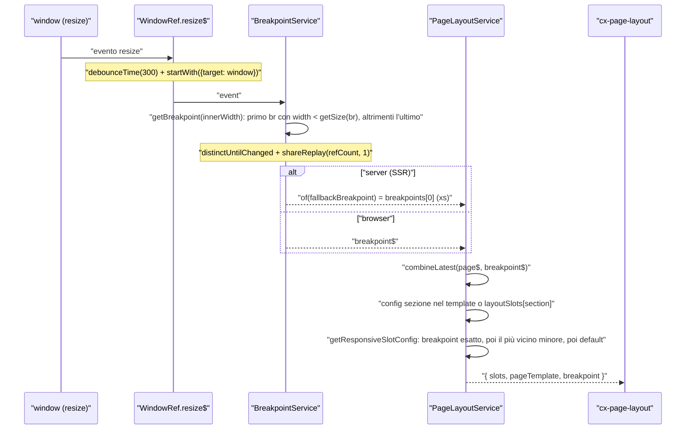
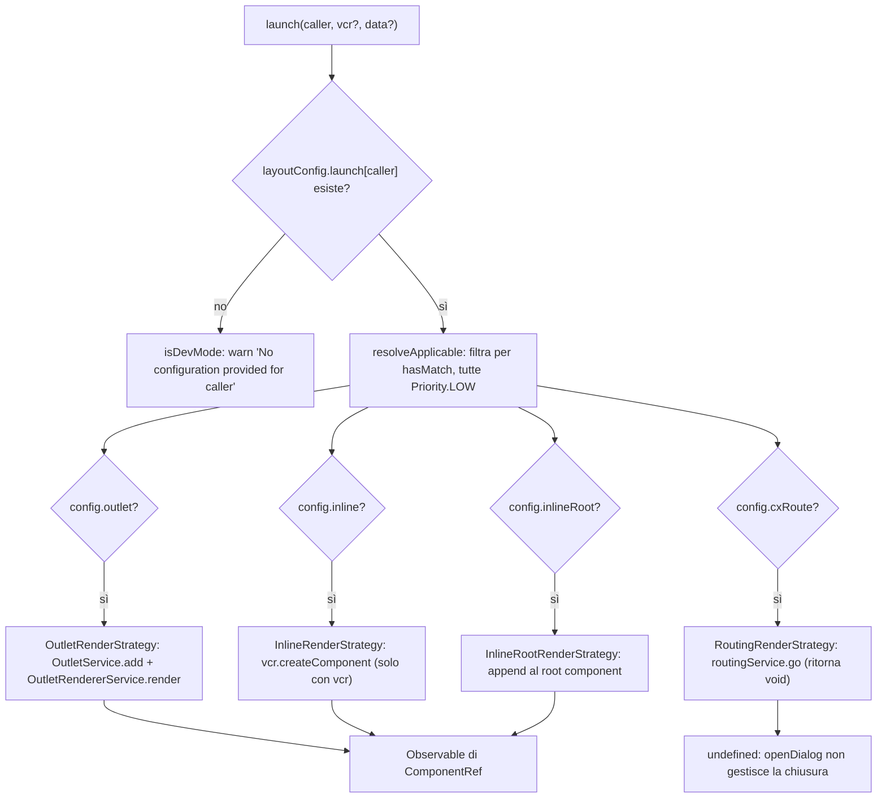
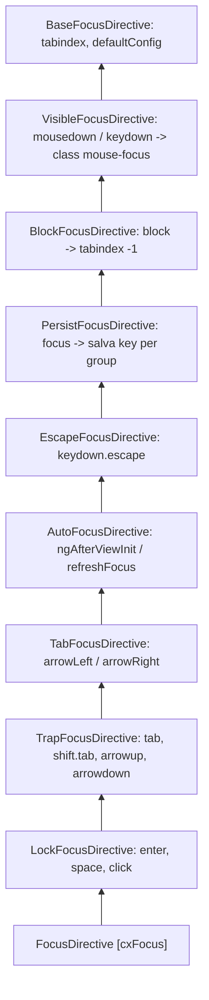

# 18 — Layout, breakpoint, launch dialog e accessibilità

> Riferimenti allo SHA `5b7a1c2bf2808d7380bc20596d10f4fa710c3da1` (vedi [00-meta](../00-meta.md)).

Prerequisiti consigliati: [11 — Configurazione](11-configurazione.md), [16 — CMS (storefront): rendering dinamico](16-cms-rendering.md), [17 — Outlet](17-outlet.md). Per i feature toggle citati vedi [42 — Feature toggle e deprecazioni](42-feature-toggle-deprecazioni.md) e l'[Appendice A09](../appendici/A09-feature-toggle.md).

## 1. A cosa serve e perché esiste

La cartella `core-libs/storefront/layout/` contiene il "guscio" dello storefront: tutto ciò che non è un componente CMS ma serve a disporre, aprire e rendere navigabili i componenti CMS. Il barrel `core-libs/storefront/layout/index.ts` riesporta a11y, breakpoint, config, direction, header, launch-dialog, `layout.module`, loading, main e theme (`core-libs/storefront/layout/index.ts:L7-L16`), e `@spartacus/storefront` lo riesporta per intero (`core-libs/storefront/public_api.ts:L26-L26`).

Il capitolo copre cinque sottosistemi che collaborano:

1. **`LayoutConfig`**: la configurazione che dice quali slot CMS mostrare in ogni sezione (header, footer, ...) o page template, eventualmente diversi per breakpoint, più i breakpoint stessi, la strategia di deferred loading e la configurazione dei dialog (`launch`) (`core-libs/storefront/layout/config/layout-config.ts:L90-L125`). Il JSDoc dichiara esplicitamente che il design adattivo è "per breakpoint (not per device type)": il DOM viene (ri)renderizzato per breakpoint, non nascosto via CSS (`core-libs/storefront/layout/config/layout-config.ts:L84-L89`).
2. **`BreakpointService`**: trasforma la larghezza della finestra in un valore dell'enum `BREAKPOINT` (`xs`…`xl`) osservabile, con fallback "mobile first" in SSR (`core-libs/storefront/layout/breakpoint/breakpoint.service.ts:L40-L46`, `core-libs/storefront/layout/breakpoint/breakpoint.service.ts:L123-L131`).
3. **Launch dialog**: `LaunchDialogService` apre componenti (dialog, popover, sidebar, ma anche navigazioni) identificati da una chiave `LAUNCH_CALLER`, scegliendo una di quattro strategie di rendering in base alla configurazione (`core-libs/storefront/layout/launch-dialog/services/launch-dialog.service.ts:L78-L97`, `core-libs/storefront/layout/launch-dialog/launch-dialog.module.ts:L18-L41`).
4. **La shell `cx-storefront`** (`StorefrontComponent`): il template radice con header, main, footer, outlet, skip link, gestione del focus dopo la navigazione e del menu hamburger (`core-libs/storefront/layout/main/storefront.component.html:L1-L28`, `core-libs/storefront/layout/main/storefront.component.ts:L51-L67`), più il **deferred loading** (`DeferLoaderService`, `IntersectionService`) usato dagli outlet.
5. **Accessibilità da tastiera**: la directive `[cxFocus]` (una catena di nove classi: Base → Visible → Block → Persist → Escape → AutoFocus → Tab → Trap → Lock), `[cxSkipFocus]`, le skip link e alcune directive di supporto (`core-libs/storefront/layout/a11y/keyboard-focus/focus.directive.ts:L12-L25`, `core-libs/storefront/layout/a11y/index.ts:L7-L13`).

Il tutto entra nell'applicazione tramite `BaseStorefrontModule`, che importa `SkipLinkModule`, `KeyboardFocusModule`, `LayoutModule` e `StorefrontComponentModule` e riesporta gli ultimi due (`core-libs/storefront/base-storefront.module.ts:L26-L49`). `LayoutModule` a sua volta importa `OutletRefModule`, `LaunchDialogModule.forRoot()`, `DirectionModule`, `ThemeModule` e registra i breakpoint di default con `provideDefaultConfig(defaultLayoutConfig)` (`core-libs/storefront/layout/layout.module.ts:L15-L25`).

## 2. Mappa dei file

| Path | Ruolo |
|---|---|
| `core-libs/storefront/layout/index.ts` | Barrel pubblico del layout (`:L7-L16`). |
| `core-libs/storefront/layout/layout.module.ts` | `LayoutModule`: default breakpoints, `LaunchDialogModule.forRoot()`, Direction/Theme (`:L15-L25`). |
| `core-libs/storefront/layout/config/layout-config.ts` | `BREAKPOINT`, `LayoutSections`, `SlotConfig`, `SlotGroup`, `LayoutSlotConfig`, `BreakPoint`, `LayoutBreakPoints`, `LayoutConfig` + augmentation di `Config` (`:L11-L129`). |
| `core-libs/storefront/layout/config/default-layout.config.ts` | `defaultLayoutConfig` — solo `breakpoints` (`:L9-L19`). |
| `core-libs/storefront/recipes/config/layout-config.ts` | Recipe `layoutConfig` (deprecata) con i `layoutSlots` standard e `layoutConfigFactory()` (`:L25-L198`). |
| `core-libs/storefront/layout/breakpoint/breakpoint.service.ts` | `BreakpointService`: `breakpoint$`, `isUp/isDown/isEqual`, `getSize` (`:L19-L207`). |
| `core-libs/storefront/layout/launch-dialog/config/launch-config.ts` | `LaunchConfig`, `LaunchOptions` e sottotipi, `DIALOG_TYPE`, `LAUNCH_CALLER` (`:L9-L103`). |
| `core-libs/storefront/layout/launch-dialog/launch-dialog.module.ts` | Multi-provider delle 4 strategie; `forRoot()` alias `LayoutConfig` (`:L18-L49`). |
| `core-libs/storefront/layout/launch-dialog/services/launch-dialog.service.ts` | `LaunchDialogService`: `openDialog`, `launch`, `clear`, `closeDialog`, `data$` (`:L24-L186`). |
| `core-libs/storefront/layout/launch-dialog/services/launch-render.strategy.ts` | Classe astratta `LaunchRenderStrategy` (`shouldRender`, `applyClasses`, `remove`, priorità LOW) (`:L24-L158`). |
| `core-libs/storefront/layout/launch-dialog/services/outlet-render.strategy.ts` | Render dentro un outlet via `OutletService` (`:L45-L98`). |
| `core-libs/storefront/layout/launch-dialog/services/inline-render.strategy.ts` | Render nel `ViewContainerRef` del chiamante (`:L42-L75`). |
| `core-libs/storefront/layout/launch-dialog/services/inline-root-render.strategy.ts` | Render nel root component (`ApplicationRef.components[0]`) (`:L21-L70`). |
| `core-libs/storefront/layout/launch-dialog/services/routing-render.strategy.ts` | "Apertura" come navigazione `RoutingService.go` (`:L22-L32`). |
| `core-libs/storefront/layout/main/storefront.component.ts` / `.html` | `StorefrontComponent` (`cx-storefront`): shell, focus, Escape, hamburger, navigazione. |
| `core-libs/storefront/layout/main/storefront-component.module.ts` | `StorefrontComponentModule` (`:L19-L34`). |
| `core-libs/storefront/layout/main/storefront-outlets.model.ts` | Enum `StorefrontOutlets` (`:L7-L9`). |
| `core-libs/storefront/layout/header/hamburger-menu/*` | `HamburgerMenuService` (stato `isExpanded`), `HamburgerMenuComponent`, `HamburgerMenuModule` (mapping CMS). |
| `core-libs/storefront/layout/loading/defer-loader.service.ts` | `DeferLoaderService`: caricamento immediato o al viewport (`:L22-L64`). |
| `core-libs/storefront/layout/loading/intersection.service.ts` / `intersection.model.ts` | `IntersectionService` (IntersectionObserver), `IntersectionOptions`. |
| `core-libs/storefront/layout/a11y/keyboard-focus/keyboard-focus.model.ts` | Attributi `data-cx-focus*`, `MOVE_FOCUS`, gerarchia di config, `TrapFocus` (`:L7-L149`). |
| `core-libs/storefront/layout/a11y/keyboard-focus/focus.directive.ts` | `FocusDirective` `[cxFocus]`, foglia della catena (`:L12-L25`). |
| `core-libs/storefront/layout/a11y/keyboard-focus/{base,visible,block,persist,escape,autofocus,tab,trap,lock}/` | Le nove directive astratte della catena e i servizi paralleli. |
| `core-libs/storefront/layout/a11y/keyboard-focus/services/keyboard-focus.service.ts` / `select-focus.util.ts` | `KeyboardFocusService` (foglia dei servizi), `SelectFocusUtility` (query dei focusable). |
| `core-libs/storefront/layout/a11y/keyboard-focus/skip-focus.directive.ts` | `SkipFocusDirective` `[cxSkipFocus]` (`:L17-L78`). |
| `core-libs/storefront/layout/a11y/keyboard-focus/keyboard-focus.module.ts` | `KeyboardFocusModule`: solo `FocusDirective` + `SkipFocusDirective` (`:L12-L29`). |
| `core-libs/storefront/layout/a11y/keyboard-focus/focus-testing.module.ts` | `KeyboardFocusTestingModule` per gli unit test (`:L10-L19`). |
| `core-libs/storefront/layout/a11y/skip-link/*` | Config, directive `[cxSkipLink]`, `SkipLinkService`, `SkipLinkComponent`, `SkipLinkModule` + `skipLinkFactory`. |
| `core-libs/storefront/layout/a11y/{btn-like-link,focus-first-invalid-field,native-select-space,on-dom-change,truncation-tooltip}/` | Directive a11y di supporto. |

File di altri capitoli toccati dai flussi:

| Path | Ruolo nel flusso |
|---|---|
| `core-libs/storefront/cms-structure/page/page-layout/page-layout.service.ts` | Combina pagina e breakpoint per risolvere gli slot (`:L55-L59`, `:L187-L191`, `:L217-L243`). Dettagli nel cap. [16](16-cms-rendering.md). |
| `core-libs/storefront/cms-structure/outlet/outlet.directive.ts` | Consumer del deferred loading (`:L102-L116`). Vedi cap. [17](17-outlet.md). |
| `core-libs/core/src/window/window-ref.ts` | `resize$` con debounce e `startWith` (`:L91-L107`). |
| `core-libs/core/src/util/applicable.ts` | `resolveApplicable`, usato per scegliere la strategia (`:L47-L74`). |

## 3. Come funziona passo per passo

### 3.1 `LayoutConfig`: tipi e default

- `BREAKPOINT` è un enum di stringhe `xs`, `sm`, `md`, `lg`, `xl`; il JSDoc dice che il tipo "can be extended to allow for custom screens, such as XLL or `tablet`" (`core-libs/storefront/layout/config/layout-config.ts:L11-L28`) e il public API lo marca fra i tipi augmentabili (blocco `AUGMENTABLE_TYPES_START` … `AUGMENTABLE_TYPES_END`) (`core-libs/storefront/public_api.ts:L32-L36`).
- `LayoutSections` è `'header' | 'footer' | 'LandingPage2Template' | string`, cioè qualunque stringa (`core-libs/storefront/layout/config/layout-config.ts:L30-L34`): sia una sezione (header, navigation, footer) sia un nome di page template.
- `SlotConfig` ha `slots?: string[]` (posizioni degli slot CMS, mappate su `slot.position`) e `pageFold?: string` (ultimo slot atteso above-the-fold) (`core-libs/storefront/layout/config/layout-config.ts:L36-L46`).
- `SlotGroup` permette config per `lg`, `md`, `sm`, `xs` — **non** `xl` (`core-libs/storefront/layout/config/layout-config.ts:L48-L57`).
- `LayoutSlotConfig` è ricorsivo: ogni sezione mappa a `SlotConfig | SlotGroup | LayoutSlotConfig` (`core-libs/storefront/layout/config/layout-config.ts:L59-L61`), così un page template può contenere a sua volta config per sezioni.
- `BreakPoint` ha `min?`/`max?` e `LayoutBreakPoints` mappa ogni `BREAKPOINT` a `number | BreakPoint` (`core-libs/storefront/layout/config/layout-config.ts:L63-L82`).
- `LayoutConfig` è una classe astratta `@Injectable({ providedIn: 'root', useExisting: Config })` con `breakpoints?`, `layoutSlots?`, `deferredLoading?: { strategy?, intersectionMargin? }` e `launch?: LaunchConfig` (`core-libs/storefront/layout/config/layout-config.ts:L90-L125`), fusa nell'interfaccia `Config` di `@spartacus/core` con module augmentation (`core-libs/storefront/layout/config/layout-config.ts:L127-L129`). È il pattern standard descritto nel cap. [11](11-configurazione.md).

`defaultLayoutConfig` contiene **solo** i breakpoint: `xs: 576, sm: 768, md: 992, lg: 1200, xl: { min: 1200 }` (`core-libs/storefront/layout/config/default-layout.config.ts:L9-L19`). I `layoutSlots` standard vivono altrove, nella recipe `layoutConfig`, marcata `@deprecated Use layoutConfigFactory and provideConfigFactory(layoutConfigFactory) instead` (`core-libs/storefront/recipes/config/layout-config.ts:L25-L51`). Nella recipe l'header ha una config `lg` con 8 slot e una di default di 4 (`'PreHeader','SiteLogo','SearchBox','MiniCart'`), mentre `navigation` ha `lg: { slots: [] }` (`core-libs/storefront/recipes/config/layout-config.ts:L25-L51`); `LandingPage2Template` ha `pageFold: 'Section2B'` e `CategoryPageTemplate` `pageFold: 'Section2'` (`core-libs/storefront/recipes/config/layout-config.ts:L55-L73`).

`layoutConfigFactory()` clona la recipe via JSON, applica `applyUnifiedHeaderSlots` (rimuove `header.lg` e mette tutti gli 8 slot nel default) e `applyWithoutPageFold` (rimuove i `pageFold`) (`core-libs/storefront/recipes/config/layout-config.ts:L190-L198`). La rimozione del `pageFold` è motivata da regressioni di CLS: il `pageFold` faceva comparire i componenti CMS "only after a small delay even in SSR pages" (`core-libs/storefront/recipes/config/layout-config.ts:L158-L171`).

### 3.2 `BreakpointService`: dalla larghezza al breakpoint

1. Il servizio è `providedIn: 'root'` e il JSDoc dichiara la base Bootstrap: xs < 576, sm 576–767, md 768–991, lg 992–1199, xl ≥ 1200 (`core-libs/storefront/layout/breakpoint/breakpoint.service.ts:L19-L37`).
2. Il costruttore dichiara `winRef`, `layoutConfig` e `platform` come parameter properties `protected` (`core-libs/storefront/layout/breakpoint/breakpoint.service.ts:L48-L52`): per questo il field initializer `breakpoint$` può già usarli.
3. In browser `breakpoint$` = `winRef.resize$` → `getBreakpoint(innerWidth)` → `distinctUntilChanged()` → `shareReplay({ refCount: true, bufferSize: 1 })`; fuori dal browser è `of(this.fallbackBreakpoint)` (`core-libs/storefront/layout/breakpoint/breakpoint.service.ts:L40-L46`).
4. `WindowRef.resize$` ascolta `resize` con `debounceTime(300)`, simula un primo evento con `startWith({ target: this.nativeWindow })` e, senza window, restituisce `of(null)` (`core-libs/core/src/window/window-ref.ts:L91-L107`). Grazie a `startWith` il breakpoint è disponibile subito, senza aspettare un resize.
5. La lista ordinata dei breakpoint è calcolata e memoizzata in `_breakpoints` alla prima lettura del getter `breakpoints` (`core-libs/storefront/layout/breakpoint/breakpoint.service.ts:L60-L65`). L'ordinamento usa un comparatore che, per ogni breakpoint, considera `max(min+1, max)` e restituisce `-1` o `0` (`core-libs/storefront/layout/breakpoint/breakpoint.service.ts:L138-L153`). La sorgente è `layoutConfig?.breakpoints || {}` (`core-libs/storefront/layout/breakpoint/breakpoint.service.ts:L204-L206`).
6. `getMaxSize` tratta un numero come max, altrimenti usa `.max`, altrimenti `null` (`core-libs/storefront/layout/breakpoint/breakpoint.service.ts:L161-L176`); `getMinSize` legge `.min` (`core-libs/storefront/layout/breakpoint/breakpoint.service.ts:L178-L180`).
7. `getSize(bp)` restituisce il max del breakpoint o, in mancanza, il `min` del breakpoint successivo (`core-libs/storefront/layout/breakpoint/breakpoint.service.ts:L71-L80`). Con il default, `xl` non ha né max né successivo: `getSize(xl)` è falsy, come conferma lo spec (`core-libs/storefront/layout/breakpoint/breakpoint.service.spec.ts:L185-L188`).
8. `getBreakpoint(width)` restituisce il primo breakpoint per cui `width < getSize(br)`, altrimenti l'ultimo della lista (`core-libs/storefront/layout/breakpoint/breakpoint.service.ts:L192-L199`). Con il default: 575 → `xs`, 576 → `sm`, 991 → `md`, 1199 → `lg`, 1200 → nessun match → `xl`.
9. In SSR `fallbackBreakpoint` è il primo della lista ordinata ("mobile first"), cioè `xs` (`core-libs/storefront/layout/breakpoint/breakpoint.service.ts:L123-L131`).
10. Le API derivate: `isDown(bp)` è vero se il breakpoint corrente sta fra l'indice 0 e `bp` incluso (`core-libs/storefront/layout/breakpoint/breakpoint.service.ts:L89-L97`); `isUp(bp)` se è `bp` o successivo (`core-libs/storefront/layout/breakpoint/breakpoint.service.ts:L106-L114`); `isEqual(bp)` confronta in modo stretto (`core-libs/storefront/layout/breakpoint/breakpoint.service.ts:L119-L121`). Esempi: `NavigationUIComponent.isDesktop$ = isUp(BREAKPOINT.lg)` (`core-libs/storefront/cms-components/navigation/navigation/navigation-ui.component.ts:L107-L107`), `SearchBoxComponent` usa `isDown(BREAKPOINT.sm)` (`core-libs/storefront/cms-components/navigation/search-box/search-box.component.ts:L222-L222`).

### 3.3 Dagli slot configurati agli slot renderizzati

Il consumatore principale di `breakpoint$` è `PageLayoutService` (cap. [16](16-cms-rendering.md)), che fa `combineLatest([this.page$, this.breakpointService.breakpoint$])` e risolve gli slot per sezione/template (`core-libs/storefront/cms-structure/page/page-layout/page-layout.service.ts:L55-L59`):

1. per una sezione dentro un page template, se il template non ha config per quella sezione si usa la config globale `layoutSlots[section]` (`core-libs/storefront/cms-structure/page/page-layout/page-layout.service.ts:L187-L191`);
2. `getResponsiveSlotConfig` usa la config del breakpoint esatto se contiene l'attributo cercato (`slots` o `pageFold`); altrimenti scorre i breakpoint **più piccoli** di quello corrente e tiene l'ultimo che lo definisce; altrimenti usa la config di default (`core-libs/storefront/cms-structure/page/page-layout/page-layout.service.ts:L217-L243`).

Conseguenza: una config `lg` vale anche per `xl` (che `SlotGroup` non prevede), ma non per `md`.

### 3.4 Launch dialog: configurazione

`LaunchConfig` è un dizionario `[key: string]: LaunchOptions` e `LaunchOptions` è l'unione di quattro forme (`core-libs/storefront/layout/launch-dialog/config/launch-config.ts:L9-L17`):

| Forma | Discriminante | Note | Ref |
|---|---|---|---|
| `LaunchOutletDialog` | `outlet: string` (+ `position?`, default BEFORE) | "should only be used for elements that open once and do not close" | `core-libs/storefront/layout/launch-dialog/config/launch-config.ts:L34-L47` |
| `LaunchInlineDialog` | `inline: boolean` | accanto al trigger (serve un `ViewContainerRef`) | `core-libs/storefront/layout/launch-dialog/config/launch-config.ts:L49-L54` |
| `LaunchInlineRootDialog` | `inlineRoot: boolean` | "directly inside the cx-storefront", consigliato per dialog globali | `core-libs/storefront/layout/launch-dialog/config/launch-config.ts:L56-L62` |
| `LaunchRoute` | `cxRoute: string` (+ `params?`) | navigazione, nessun componente | `core-libs/storefront/layout/launch-dialog/config/launch-config.ts:L64-L76` |

Le prime tre estendono `LaunchDialog` con `component`, `multi?` (può essere renderizzato più volte) e `dialogType?: DIALOG_TYPE` (per le classi CSS) (`core-libs/storefront/layout/launch-dialog/config/launch-config.ts:L19-L32`). `DIALOG_TYPE` ha sei valori: `POPOVER`, `POPOVER_CENTER`, `POPOVER_CENTER_BACKDROP`, `DIALOG`, `SIDEBAR_START`, `SIDEBAR_END` (`core-libs/storefront/layout/launch-dialog/config/launch-config.ts:L78-L88`).

Le chiavi sono valori di `LAUNCH_CALLER`; lo storefront ne definisce nove (`ASM`, `SKIP_LINKS`, `ANONYMOUS_CONSENT`, `REPLENISHMENT_ORDER`, `PLACE_ORDER_SPINNER`, `SUGGESTED_ADDRESSES`, `COUPON`, `CLAIM_DIALOG`, `STOCK_NOTIFICATION`) (`core-libs/storefront/layout/launch-dialog/config/launch-config.ts:L90-L103`) e le feature lib lo estendono con module augmentation **più** assegnazione runtime, perché un enum TypeScript augmentato non crea il valore a runtime (`feature-libs/cart/base/root/models/augmented.model.ts:L7-L16`). Esempi di config: `ADDED_TO_CART` è `inlineRoot` con `DIALOG_TYPE.DIALOG` (`feature-libs/cart/base/components/added-to-cart-dialog/default-added-to-cart-layout.config.ts:L10-L18`); `ASM` è renderizzato nell'outlet `'cx-storefront'` (`feature-libs/asm/components/default-asm-layout.config.ts:L10-L17`).

### 3.5 Launch dialog: scelta della strategia

1. `LaunchDialogModule` registra quattro provider multi `LaunchRenderStrategy` con `useExisting`, nell'ordine Outlet, Inline, Routing, InlineRoot (`core-libs/storefront/layout/launch-dialog/launch-dialog.module.ts:L18-L41`); `forRoot()` aggiunge `{ provide: LayoutConfig, useExisting: Config }` (`core-libs/storefront/layout/launch-dialog/launch-dialog.module.ts:L42-L49`).
2. `LaunchDialogService` riceve l'array delle strategie e `LayoutConfig` (`core-libs/storefront/layout/launch-dialog/services/launch-dialog.service.ts:L36-L42`).
3. `findConfiguration(caller)` legge `layoutConfig.launch[caller]`; `getStrategy(config)` chiama `resolveApplicable(this.renderStrategies, [config])` (`core-libs/storefront/layout/launch-dialog/services/launch-dialog.service.ts:L167-L185`).
4. `resolveApplicable` tiene gli applicable con `hasMatch` vero; fra più match vince la priorità più alta e, a parità, "the applicable that was provided later wins" (`core-libs/core/src/util/applicable.ts:L47-L74`). Tutte le strategie restituiscono `Priority.LOW` (`core-libs/storefront/layout/launch-dialog/services/launch-render.strategy.ts:L155-L157`).
5. I `hasMatch`: Outlet → `Boolean(config.outlet)` (`core-libs/storefront/layout/launch-dialog/services/outlet-render.strategy.ts:L82-L84`); Inline → `Boolean(config.inline)` (`core-libs/storefront/layout/launch-dialog/services/inline-render.strategy.ts:L73-L75`); InlineRoot → `Boolean(config.inlineRoot)` (`core-libs/storefront/layout/launch-dialog/services/inline-root-render.strategy.ts:L67-L70`); Routing → `Boolean(config.cxRoute)` (`core-libs/storefront/layout/launch-dialog/services/routing-render.strategy.ts:L22-L32`).

### 3.6 Launch dialog: apertura e chiusura

1. `launch(caller, vcr?, data?)`: se c'è config e strategia, resetta `_dialogClose` a `undefined`, emette `data` su `_dataSubject` e restituisce `renderer.render(config, caller, vcr)`; senza config, in dev mode, logga `No configuration provided for caller ...` (`core-libs/storefront/layout/launch-dialog/services/launch-dialog.service.ts:L78-L97`).
2. Ogni strategia controlla `shouldRender`: serve `config.component` e, se il caller è già in `renderedCallers`, un nuovo render è permesso solo con `multi: true` (`core-libs/storefront/layout/launch-dialog/services/launch-render.strategy.ts:L92-L102`).
3. Rendering per strategia:
   - **Outlet**: risolve una `ComponentFactory`, la aggiunge a `OutletService` (posizione default `BEFORE`), chiama `outletRendererService.render(outlet)` e registra il caller (`core-libs/storefront/layout/launch-dialog/services/outlet-render.strategy.ts:L45-L59`); il `ComponentRef` viene poi recuperato dall'`OutletDirective` registrata, cercando nei `renderedComponents` invertiti il componente con lo stesso `componentType` (`core-libs/storefront/layout/launch-dialog/services/outlet-render.strategy.ts:L61-L78`). Il meccanismo outlet è descritto nel cap. [17](17-outlet.md).
   - **Inline**: crea il componente solo se è fornito un `vcr` (`vcr.createComponent(factory)`), applica le classi e restituisce `of(component)`; altrimenti, in dev mode, logga un warning (`core-libs/storefront/layout/launch-dialog/services/inline-render.strategy.ts:L42-L71`).
   - **InlineRoot**: `hostComponent` è `ApplicationRef.components[0]` (`core-libs/storefront/layout/launch-dialog/services/inline-root-render.strategy.ts:L32-L34`); il componente viene creato con un `Injector.create({ providers: [] })` vuoto, la sua `hostView` viene attaccata all'`ApplicationRef` e il suo elemento appeso a quello del root component (`core-libs/storefront/layout/launch-dialog/services/inline-root-render.strategy.ts:L36-L64`). `ApplicationRef.attachView` mette la view sotto dirty checking e la stacca automaticamente quando viene distrutta (`angular:packages/core/src/application/application_ref.ts:L753-L763`).
   - **Routing**: `routingService.go(config)` e nessun valore di ritorno (`core-libs/storefront/layout/launch-dialog/services/routing-render.strategy.ts:L22-L32`).
4. `applyClasses` aggiunge all'host del componente le classi del `dialogType` (hard-coded: DIALOG → `d-block fade modal show`, POPOVER → `cx-dialog-popover`, ecc.) e, per `DIALOG`, `modal-open` sul `body` (`core-libs/storefront/layout/launch-dialog/services/launch-render.strategy.ts:L32-L57`, `core-libs/storefront/layout/launch-dialog/services/launch-render.strategy.ts:L104-L136`).
5. Il componente aperto legge i dati con `launchDialogService.data$` (`core-libs/storefront/layout/launch-dialog/services/launch-dialog.service.ts:L32-L34`).
6. `openDialog(caller, openElement?, vcr?, data?)` combina il `ComponentRef$` con `dialogClose`; alla prima chiusura non-`undefined` rimette il focus su `openElement`, chiama `clear(caller)` e distrugge il componente (`core-libs/storefront/layout/launch-dialog/services/launch-dialog.service.ts:L52-L71`).
7. La chiusura parte da `closeDialog(reason)`, che emette su `_dialogClose` (`core-libs/storefront/layout/launch-dialog/services/launch-dialog.service.ts:L134-L140`). `clear(caller)` delega a `strategy.remove(caller, config)` (`core-libs/storefront/layout/launch-dialog/services/launch-dialog.service.ts:L121-L132`), che toglie il caller da `renderedCallers` e `modal-open` dal body (`core-libs/storefront/layout/launch-dialog/services/launch-render.strategy.ts:L145-L153`); la variante Outlet rimuove prima la factory da `OutletService` (`core-libs/storefront/layout/launch-dialog/services/outlet-render.strategy.ts:L86-L98`).
8. `focusElement` focalizza il primo focusable dentro il trigger (via `AutoFocusService.findFirstFocusable`) o il trigger stesso, con un `tabindex="-1"` temporaneo se assente, rimosso subito dopo (`core-libs/storefront/layout/launch-dialog/services/launch-dialog.service.ts:L142-L160`).
9. `openDialogAndSubscribe` sottoscrive internamente con `take(1)` ed è pensato per i trigger che possono essere distrutti mentre il dialog è aperto (`core-libs/storefront/layout/launch-dialog/services/launch-dialog.service.ts:L99-L114`).

Esempio reale: `AddedToCartDialogEventListener` chiama `openDialog(LAUNCH_CALLER.ADDED_TO_CART, event?.triggerElementRef, undefined, addToCartData)` e sottoscrive con `take(1)` (`feature-libs/cart/base/components/added-to-cart-dialog/added-to-cart-dialog-event.listener.ts:L57-L67`), poi chiude con `closeDialog(reason)` (`feature-libs/cart/base/components/added-to-cart-dialog/added-to-cart-dialog-event.listener.ts:L84-L85`).

### 3.7 La shell `cx-storefront`

`StorefrontComponent` è standalone e importa, fra gli altri, `PageLayoutComponent`, `PageSlotComponent`, `FocusDirective`, `SkipFocusDirective`, `SkipLinkDirective`, `GlobalMessageComponent`, `OutletDirective`, `PageTemplateDirective`; non usa OnPush (`core-libs/storefront/layout/main/storefront.component.ts:L51-L67`). Nella demo app il root `app-root` ha come template solo `<cx-storefront />` (`projects/storefrontapp/src/app/app.component.ts:L15-L16`).

Struttura del template (`core-libs/storefront/layout/main/storefront.component.html:L1-L28`):

- tutto è dentro l'outlet `StorefrontOutlets.STOREFRONT` (`'cx-storefront'`, `core-libs/storefront/layout/main/storefront-outlets.model.ts:L7-L9`) con `cxPageTemplateStyle`;
- l'header è dentro l'outlet `cx-header`: `<header id="cx-header" cxSkipLink="cx-header" [cxFocus]="focusConfig">` con `keydown.escape` → `collapseMenu()` e `click` → `collapseMenuIfClickOutside` (`core-libs/storefront/layout/main/storefront.component.html:L1-L10`); contiene `<cx-page-layout section="header" [cxSkipFocus]="skipFocusConfig" />` e `<cx-page-layout section="navigation" />`, seguiti dallo slot `BottomHeaderSlot` e da `<cx-global-message aria-atomic="true" aria-live="assertive" />` (`core-libs/storefront/layout/main/storefront.component.html:L11-L16`);
- `<main cxSkipLink="cx-main" [cxFocus]="{ disableMouseFocus: true }">` contiene il `<router-outlet />`; il footer è nell'outlet `cx-footer` (`core-libs/storefront/layout/main/storefront.component.html:L19-L27`).

Comportamenti del componente:

1. Stato iniziale: `focusConfig = { disableMouseFocus: true, trap: false }`, `skipFocusConfig = { isEnabled: false, activeElementSelectors: ['button.cx-hamburger'] }` (`core-libs/storefront/layout/main/storefront.component.ts:L68-L74`).
2. Host binding `class.start-navigating`, `class.stop-navigating` e `tabindex = '-1'` ("required by esc focus") (`core-libs/storefront/layout/main/storefront.component.ts:L86-L90`).
3. `keydown.escape` sull'host delega a `KeyboardFocusService.handleEscape` con `{ focusOnEscape: true, focusOnDoubleEscape: true }` (`core-libs/storefront/layout/main/storefront.component.ts:L94-L106`).
4. Il costruttore registra sei feature styles con `useFeatureStyles(...)` (`core-libs/storefront/layout/main/storefront.component.ts:L112-L124`); `useFeatureStyles` richiede un injection context, registra l'uso nel `FeatureStylesService` e lo deregistra su `DestroyRef.onDestroy` (`core-libs/core/src/features-config/utils/use-feature-styles.ts:L32-L40`).
5. `ngOnInit` sottoscrive `routingService.isNavigating()` (che seleziona `RoutingSelector.isNavigating` dallo store, `core-libs/core/src/routing/facade/routing.service.ts:L79-L81`), ridefinisce `isExpanded$` con un `tap` di focus, chiama `trapFocusOnMenuIfExpanded()` (`core-libs/storefront/layout/main/storefront.component.ts:L126-L139`) e, con `a11yPreventWindowsHighContrastOverride`, aggiunge una classe a `documentElement` (`core-libs/storefront/layout/main/storefront.component.ts:L141-L147`).
6. **Focus dopo la navigazione** (`onNavigation`): a fine navigazione, se l'elemento attivo non è il `body`, sposta il focus sul contenuto di `cx-main` con `SkipLinkService.scrollToTarget`; con `a11yFocusBreadcrumbOnNavigation` e una `CATEGORY_PAGE` prova prima `cx-breadcrumb nav a` (`core-libs/storefront/layout/main/storefront.component.ts:L194-L228`, `core-libs/storefront/layout/main/storefront.component.ts:L110-L110`). Il JSDoc del toggle conferma il fallback su `cx-main` (`core-libs/core/src/features-config/feature-toggles/config/feature-toggles.ts:L838-L844`).

### 3.8 Menu hamburger e focus trap su mobile

1. `HamburgerMenuService` (root) espone `isExpanded: BehaviorSubject<boolean>` (iniziale `false`) e collassa il menu a ogni `NavigationStart` (`core-libs/storefront/layout/header/hamburger-menu/hamburger-menu.service.ts:L12-L24`); `toggle(forceCollapse?)` emette `false` o inverte (`core-libs/storefront/layout/header/hamburger-menu/hamburger-menu.service.ts:L29-L35`).
2. `HamburgerMenuComponent` (OnPush) delega al service (`core-libs/storefront/layout/header/hamburger-menu/hamburger-menu.component.ts:L13-L29`); il template è un `<button class="cx-hamburger">` con `aria-expanded`, `aria-label` tradotto e `aria-controls="cx-header"` (`core-libs/storefront/layout/header/hamburger-menu/hamburger-menu.component.html:L1-L18`). Viene mappato come componente CMS `HamburgerMenuComponent` (`core-libs/storefront/layout/header/hamburger-menu/hamburger-menu.module.ts:L12-L25`).
3. Quando il menu si espande, `focusOnFirstNavigationItem` cerca `header cx-navigation-ui` e focalizza, in `setTimeout`, il primo `li:not(.back) button, [tabindex="0"]` (`core-libs/storefront/layout/main/storefront.component.ts:L176-L186`).
4. `trapFocusOnMenuIfExpanded` ricrea `focusConfig` con `trap: isExpanded` e `skipFocusConfig` con `isEnabled: isExpanded` (`core-libs/storefront/layout/main/storefront.component.ts:L164-L174`). Sull'header questo attiva il trap di `[cxFocus]`; sulla sezione `header` `SkipFocusDirective` mette `tabindex=-1` su tutti i focusabili visibili tranne `button.cx-hamburger` (`core-libs/storefront/layout/a11y/keyboard-focus/skip-focus.directive.ts:L38-L67`): restano tabbabili il bottone e la navigazione.
5. Chiusura: Escape sull'header, click sull'area `header.is-expanded` (`core-libs/storefront/layout/main/storefront.component.ts:L150-L162`) o una nuova navigazione.

### 3.9 Deferred loading

1. `DeferLoaderService` calcola `globalLoadStrategy = config.deferredLoading?.strategy ?? DeferLoadingStrategy.INSTANT` (`core-libs/storefront/layout/loading/defer-loader.service.ts:L22-L32`). I valori sono `DEFER = 'DEFERRED-LOADING'` e `INSTANT = 'INSTANT-LOADING'` (`core-libs/core/src/cms/config/cms-config.ts:L96-L100`).
2. `load(element, options)` restituisce `of(true)` se va caricato subito, altrimenti `intersectionService.isIntersected(element, options)` (`core-libs/storefront/layout/loading/defer-loader.service.ts:L44-L53`). "Subito" significa: server, OR strategia dell'elemento INSTANT, OR (elemento non DEFER AND globale INSTANT) (`core-libs/storefront/layout/loading/defer-loader.service.ts:L55-L64`).
3. `IntersectionService.isIntersected` in SSR restituisce `of(false)`; in browser emette solo il primo `true` (`core-libs/storefront/layout/loading/intersection.service.ts:L45-L58`). L'observable crea un `IntersectionObserver` nativo per sottoscrizione e lo disconnette al teardown (`core-libs/storefront/layout/loading/intersection.service.ts:L103-L118`); il `rootMargin` viene da `options.rootMargin`, poi da `deferredLoading.intersectionMargin` (`core-libs/storefront/layout/loading/intersection.service.ts:L120-L131`).
4. Chi lo usa: `OutletDirective.deferLoading()` emette `loaded(false)`, attende `deferLoaderService.load(...)` e poi costruisce l'outlet ed emette `loaded(true)` (`core-libs/storefront/cms-structure/outlet/outlet.directive.ts:L102-L116`); `PageSlotService.getComponentDeferOptions` forza INSTANT per gli slot che non vanno differiti, altrimenti usa la strategia del componente CMS (`core-libs/storefront/cms-structure/page/slot/page-slot.service.ts:L63-L73`).

### 3.10 Keyboard focus: la catena di `[cxFocus]`

**Modello.** Gli attributi DOM sono `data-cx-focus` e `data-cx-focus-group`; `MOVE_FOCUS` ha `NEXT = 1`, `PREV = -1` (`core-libs/storefront/layout/a11y/keyboard-focus/keyboard-focus.model.ts:L7-L15`). Le interfacce di config formano una catena: `VisibleFocusConfig` (disableMouseFocus) → `BlockFocusConfig` (block) → `PersistFocusConfig` (key, group, focusTargetSelector, clearOnRestore) → `EscapeFocusConfig` (focusOnEscape, focusOnDoubleEscape) → `AutoFocusConfig` (autofocus, refreshFocus) → `TabFocusConfig` (tab) → `TrapFocusConfig` (trap, trapTabOnly) → `LockFocusConfig` (lock) → `FocusConfig` (`core-libs/storefront/layout/a11y/keyboard-focus/keyboard-focus.model.ts:L19-L149`).

**Directive e servizi.** `FocusDirective` (`[cxFocus]`) estende `LockFocusDirective`, con `defaultConfig = {}` e `@Input('cxFocus') config`, e inietta `KeyboardFocusService` (`core-libs/storefront/layout/a11y/keyboard-focus/focus.directive.ts:L12-L25`). Sotto c'è la catena `Lock → Trap → Tab → AutoFocus → Escape → Persist → Block → Visible → Base`, tutte `@Directive()` senza selettore (`core-libs/storefront/layout/a11y/keyboard-focus/lock/lock-focus.directive.ts:L32-L36`, `core-libs/storefront/layout/a11y/keyboard-focus/visible/visible-focus.directive.ts:L24-L25`). In parallelo, `KeyboardFocusService extends LockFocusService extends TrapFocusService extends TabFocusService extends AutoFocusService extends EscapeFocusService extends PersistFocusService extends BaseFocusService`, tutti `providedIn: 'root'` (`core-libs/storefront/layout/a11y/keyboard-focus/services/keyboard-focus.service.ts:L10-L13`, `core-libs/storefront/layout/a11y/keyboard-focus/persist/persist-focus.service.ts:L19-L22`). Solo `FocusDirective`, `SkipFocusDirective`, alcuni tipi, i servizi di `services/` e le utils sono pubblici; le directive intermedie sono volutamente non esportate (`core-libs/storefront/layout/a11y/keyboard-focus/index.ts:L7-L27`) e `KeyboardFocusModule` dichiara solo le due directive pubbliche (`core-libs/storefront/layout/a11y/keyboard-focus/keyboard-focus.module.ts:L12-L29`).

Cosa fa ogni anello:

| Anello | Comportamento | Ref |
|---|---|---|
| Base | `@HostBinding('attr.tabindex')`; applica `defaultConfig` se config vuota; `tabindex=-1` solo se l'host non è nativamente focusabile e non ha tabindex | `core-libs/storefront/layout/a11y/keyboard-focus/base/base-focus.directive.ts:L43-L53`, `:L67-L71`, `:L88-L112` |
| Visible | classe `mouse-focus` su `mousedown`, rimossa su `keydown` di navigazione, solo con `disableMouseFocus` | `core-libs/storefront/layout/a11y/keyboard-focus/visible/visible-focus.directive.ts:L35-L86` |
| Block | `tabindex=-1` se `block` | `core-libs/storefront/layout/a11y/keyboard-focus/block/block-focus.directive.ts:L30-L35` |
| Persist | `data-cx-focus=key`; su `focus` salva la chiave per gruppo; una config stringa diventa `{ key }`; in `ngAfterViewInit` ripristina il focus persistito | `core-libs/storefront/layout/a11y/keyboard-focus/persist/persist-focus.directive.ts:L69-L131` |
| Escape | su `keydown.escape` focalizza l'host; al secondo Escape (già sull'host) con `focusOnDoubleEscape` il primo focusable | `core-libs/storefront/layout/a11y/keyboard-focus/escape/escape-focus.directive.ts:L36-L48`, `core-libs/storefront/layout/a11y/keyboard-focus/escape/escape-focus.service.ts:L24-L42` |
| AutoFocus | in `ngAfterViewInit` focalizza il primo focusable (persistito → selettore → `[autofocus]` → primo focusable → host con `:host`); `refreshFocus` in `ngOnChanges` lo rilancia | `core-libs/storefront/layout/a11y/keyboard-focus/autofocus/auto-focus.directive.ts:L18-L39`, `:L61-L95`; `core-libs/storefront/layout/a11y/keyboard-focus/autofocus/auto-focus.service.ts:L22-L33` |
| Tab | frecce sinistra/destra spostano il focus fra i figli (`tab: true`, selettore CSS o `'scroll'`) | `core-libs/storefront/layout/a11y/keyboard-focus/tab/tab-focus.directive.ts:L25-L37`, `core-libs/storefront/layout/a11y/keyboard-focus/tab/tab-focus.service.ts:L18-L35` |
| Trap | Tab/freccia giù e Shift+Tab/freccia su ciclano dentro l'host (`trap`), o solo Tab (`trapTabOnly`) | `core-libs/storefront/layout/a11y/keyboard-focus/trap/trap-focus.directive.ts:L23-L39`, `core-libs/storefront/layout/a11y/keyboard-focus/trap/trap-focus.service.ts:L34-L73` |
| Lock | l'host è un unico stop di tabulazione; Enter/Space/click sbloccano i figli; Escape ri-blocca | `core-libs/storefront/layout/a11y/keyboard-focus/lock/lock-focus.directive.ts:L42-L221` |

La ricerca dei focusable è in `SelectFocusUtility`: selettori `a[href], button, [tabindex], input, select, textarea` con suffisso `:not([disabled]):not([hidden]):not([aria-hidden])` (`core-libs/storefront/layout/a11y/keyboard-focus/services/select-focus.util.ts:L18-L33`); senza `locked` esclude `tabindex='-1'` e filtra gli elementi nascosti (`core-libs/storefront/layout/a11y/keyboard-focus/services/select-focus.util.ts:L65-L78`), dove "nascosto" significa `offsetParent === null` (`core-libs/storefront/layout/a11y/keyboard-focus/services/select-focus.util.ts:L80-L92`).

Esempio di configurazione reale per un modale: `AddedToCartDialogComponent.focusConfig = { trap: true, block: true, autofocus: 'button', focusOnEscape: true }` (`feature-libs/cart/base/components/added-to-cart-dialog/added-to-cart-dialog.component.ts:L93-L98`).

### 3.11 Skip link

1. `SkipLinkConfig` (`useExisting: Config`) ha `skipLinks?: SkipLink[]`, dove `SkipLink` ha `key`, `i18nKey`, `target?`, `position?` (`core-libs/storefront/layout/a11y/skip-link/config/skip-link.config.ts:L10-L32`). Il default definisce `cx-header`, `cx-main`, `cx-footer` (`core-libs/storefront/layout/a11y/skip-link/config/default-skip-link.config.ts:L9-L21`).
2. `SkipLinkModule` registra il default e un `APP_INITIALIZER` con `skipLinkFactory` (`core-libs/storefront/layout/a11y/skip-link/skip-link.module.ts:L25-L45`), che aggiunge la factory di `SkipLinkComponent` all'outlet `'cx-storefront'` in posizione `BEFORE` (`core-libs/storefront/layout/a11y/skip-link/skip-link.module.ts:L47-L60`): così la skip link è il primo contenuto renderizzato prima della shell.
3. `[cxSkipLink]` registra l'elemento host nel service in `ngOnInit` e lo rimuove in `ngOnDestroy` (`core-libs/storefront/layout/a11y/skip-link/directive/skip-link.directive.ts:L10-L26`). `SkipLinkService.add` accetta solo chiavi presenti in config e le inserisce in ordine di config (`core-libs/storefront/layout/a11y/skip-link/service/skip-link.service.ts:L27-L42`, `core-libs/storefront/layout/a11y/skip-link/service/skip-link.service.ts:L93-L111`).
4. `SkipLinkComponent` (OnPush) rende un `<button>` per link dentro un `div [cxFocus]="{ tab: true }"`, quindi navigabile con le frecce (`core-libs/storefront/layout/a11y/skip-link/component/skip-link.component.ts:L15-L29`, `core-libs/storefront/layout/a11y/skip-link/component/skip-link.component.html:L1-L6`).
5. Il click chiama `scrollToTarget`, che focalizza il primo focusable del target (via `KeyboardFocusService.findFirstFocusable`) o il target, con `tabindex="-1"` temporaneo (`core-libs/storefront/layout/a11y/skip-link/service/skip-link.service.ts:L56-L87`).

### 3.12 Altre directive a11y

- `BtnLikeLinkDirective` (`a[cxBtnLikeLink].btn`): host `tabindex="0"`, `role="button"`, Enter/Space → `click()` (`core-libs/storefront/layout/a11y/btn-like-link/btn-like-link.directive.ts:L18-L36`); il JSDoc la definisce un "code smell" da usare solo per vecchi componenti (`core-libs/storefront/layout/a11y/btn-like-link/btn-like-link.directive.ts:L9-L17`).
- `FocusFirstInvalidFieldDirective` (`[cxFocusFirstInvalidField]`): `focusFirstInvalidField()` focalizza in `setTimeout` il primo campo `.ng-invalid` (`core-libs/storefront/layout/a11y/focus-first-invalid-field/focus-first-invalid-field.directive.ts:L30-L53`); il timeout serve a passare dopo l'autofocus di un host `cxFocus` (caso Safari) (`core-libs/storefront/layout/a11y/focus-first-invalid-field/focus-first-invalid-field.directive.ts:L18-L23`).
- `NativeSelectSpaceDirective` (`select[cxNativeSelectSpace]`), con `a11yNavigationSpaceKeyOnKeyUp`, sposta l'azione della barra spaziatrice sul `keyup` (WCAG 2.5.2) (`core-libs/storefront/layout/a11y/native-select-space/native-select-space.directive.ts:L22-L49`).
- `DomChangeDirective` (`[cxDomChange]`) emette le mutation di un `MutationObserver` su subtree/childList (`core-libs/storefront/layout/a11y/on-dom-change/dom-change.directive.ts:L28-L66`).
- `TruncationTooltipDirective` (`[cxTruncationTooltip]`) mostra uno span `aria-hidden` appeso al `body` se il testo è troncato (`core-libs/storefront/layout/a11y/truncation-tooltip/truncation-tooltip.directive.ts:L17-L56`).

## 4. Diagrammi

### 4.1 Risoluzione del breakpoint e degli slot



Riferimenti: `core-libs/core/src/window/window-ref.ts:L91-L107`, `core-libs/storefront/layout/breakpoint/breakpoint.service.ts:L40-L46`, `core-libs/storefront/layout/breakpoint/breakpoint.service.ts:L192-L199`, `core-libs/storefront/layout/breakpoint/breakpoint.service.ts:L123-L131`, `core-libs/storefront/cms-structure/page/page-layout/page-layout.service.ts:L55-L59`, `core-libs/storefront/cms-structure/page/page-layout/page-layout.service.ts:L187-L191`, `core-libs/storefront/cms-structure/page/page-layout/page-layout.service.ts:L217-L243`.

### 4.2 Ciclo di vita di un launch dialog (inlineRoot)

```mermaid
sequenceDiagram
    participant F as "Feature (es. AddedToCartDialogEventListener)"
    participant LDS as "LaunchDialogService"
    participant RA as "resolveApplicable"
    participant S as "InlineRootRenderStrategy"
    participant AR as "ApplicationRef"
    participant D as "Componente dialog"
    F->>LDS: "openDialog(ADDED_TO_CART, triggerRef, undefined, data)"
    LDS->>LDS: "findConfiguration: layoutConfig.launch[caller]"
    LDS->>RA: "resolveApplicable(strategies, [config])"
    RA-->>LDS: "strategia con hasMatch vero (inlineRoot)"
    LDS->>LDS: "_dialogClose.next(undefined); _dataSubject.next(data)"
    LDS->>S: "render(config, caller)"
    S->>S: "shouldRender (component, multi)"
    S->>D: "factory.create(Injector.create({providers: []}))"
    S->>AR: "attachView(hostView); appendChild a components[0]"
    S->>S: "applyClasses(DIALOG): d-block fade modal show + body.modal-open"
    S-->>LDS: "of(componentRef)"
    LDS-->>F: "combineLatest([component$, dialogClose]) filtrato"
    F->>F: "pipe(take(1)).subscribe()"
    D->>LDS: "data$ (legge i dati)"
    D->>LDS: "closeDialog(reason)"
    LDS->>LDS: "focusElement(trigger)"
    LDS->>S: "clear -> remove(caller): via da renderedCallers, via modal-open"
    LDS->>D: "componentRef.destroy()"
```

Riferimenti: `feature-libs/cart/base/components/added-to-cart-dialog/added-to-cart-dialog-event.listener.ts:L57-L67`, `core-libs/storefront/layout/launch-dialog/services/launch-dialog.service.ts:L52-L97`, `core-libs/storefront/layout/launch-dialog/services/launch-dialog.service.ts:L121-L185`, `core-libs/core/src/util/applicable.ts:L47-L74`, `core-libs/storefront/layout/launch-dialog/services/inline-root-render.strategy.ts:L36-L64`, `core-libs/storefront/layout/launch-dialog/services/launch-render.strategy.ts:L92-L153`.

### 4.3 Scelta della strategia di rendering



Se più `hasMatch` sono veri vince il provider registrato per ultimo (ordine: Outlet, Inline, Routing, InlineRoot). Riferimenti: `core-libs/storefront/layout/launch-dialog/launch-dialog.module.ts:L18-L41`, `core-libs/core/src/util/applicable.ts:L47-L74`, `core-libs/storefront/layout/launch-dialog/services/outlet-render.strategy.ts:L45-L84`, `core-libs/storefront/layout/launch-dialog/services/inline-render.strategy.ts:L42-L75`, `core-libs/storefront/layout/launch-dialog/services/routing-render.strategy.ts:L22-L32`, `core-libs/storefront/layout/launch-dialog/services/inline-root-render.strategy.ts:L36-L70`.

### 4.4 Gerarchia di `[cxFocus]` ed eventi gestiti



Riferimenti: `core-libs/storefront/layout/a11y/keyboard-focus/focus.directive.ts:L12-L25`, `core-libs/storefront/layout/a11y/keyboard-focus/lock/lock-focus.directive.ts:L32-L36`, `core-libs/storefront/layout/a11y/keyboard-focus/trap/trap-focus.directive.ts:L16-L17`, `core-libs/storefront/layout/a11y/keyboard-focus/tab/tab-focus.directive.ts:L17-L18`, `core-libs/storefront/layout/a11y/keyboard-focus/autofocus/auto-focus.directive.ts:L40-L44`, `core-libs/storefront/layout/a11y/keyboard-focus/escape/escape-focus.directive.ts:L26-L30`, `core-libs/storefront/layout/a11y/keyboard-focus/persist/persist-focus.directive.ts:L47-L51`, `core-libs/storefront/layout/a11y/keyboard-focus/block/block-focus.directive.ts:L12-L17`, `core-libs/storefront/layout/a11y/keyboard-focus/visible/visible-focus.directive.ts:L24-L25`.

### 4.5 Skip link e focus dopo la navigazione

```mermaid
sequenceDiagram
    participant AI as "APP_INITIALIZER (skipLinkFactory)"
    participant OS as "OutletService"
    participant SF as "cx-storefront"
    participant SLD as "[cxSkipLink] su header/main/footer"
    participant SLS as "SkipLinkService"
    participant SLC as "cx-skip-link"
    AI->>OS: "add('cx-storefront', SkipLinkComponent factory, BEFORE)"
    SF->>SLC: "outlet cx-storefront rende la skip link prima della shell"
    SLD->>SLS: "ngOnInit: add(key, element) (solo chiavi in config, ordine di config)"
    SLS-->>SLC: "skipLinks$"
    SLC->>SLS: "click: scrollToTarget(link)"
    SLS->>SLS: "findFirstFocusable(target) o target; tabindex -1 temporaneo; focus()"
    Note over SF: "Router: isNavigating() passa a false"
    SF->>SF: "onNavigation(false): activeElement diverso da body?"
    SF->>SLS: "scrollToTarget('cx-main') (o breadcrumb con toggle su CATEGORY_PAGE)"
```

Riferimenti: `core-libs/storefront/layout/a11y/skip-link/skip-link.module.ts:L25-L60`, `core-libs/storefront/layout/main/storefront.component.html:L1-L1`, `core-libs/storefront/layout/a11y/skip-link/directive/skip-link.directive.ts:L10-L26`, `core-libs/storefront/layout/a11y/skip-link/service/skip-link.service.ts:L27-L111`, `core-libs/storefront/layout/a11y/skip-link/component/skip-link.component.html:L1-L6`, `core-libs/storefront/layout/main/storefront.component.ts:L194-L228`.

## 5. Estratti di codice reale

**`breakpoint$`** — `core-libs/storefront/layout/breakpoint/breakpoint.service.ts:L40-L46`

```ts
  breakpoint$: Observable<BREAKPOINT> = isPlatformBrowser(this.platform)
    ? this.winRef.resize$.pipe(
        map((event) => this.getBreakpoint((<Window>event.target).innerWidth)),
        distinctUntilChanged(),
        shareReplay({ refCount: true, bufferSize: 1 })
      )
    : of(this.fallbackBreakpoint);
```

**Ordinamento dei breakpoint** — `core-libs/storefront/layout/breakpoint/breakpoint.service.ts:L138-L153`

```ts
  protected resolveBreakpointsFromConfig(): BREAKPOINT[] {
    const sortByScreenSize = (next: BREAKPOINT, prev: BREAKPOINT): number => {
      const nextMinSize = this.getMinSize(next);
      const maxNext = Math.max(
        nextMinSize ? nextMinSize + 1 : 0,
        this.getMaxSize(next) || 0
      );
      const preMinSize = this.getMinSize(prev);
      const maxPrev = Math.max(
        preMinSize ? preMinSize + 1 : 0,
        this.getMaxSize(prev) || 0
      );
      return maxNext < maxPrev ? -1 : 0;
    };
    return (Object.keys(this.config) as BREAKPOINT[]).sort(sortByScreenSize);
  }
```

**Config responsiva degli slot** — `core-libs/storefront/cms-structure/page/page-layout/page-layout.service.ts:L217-L243`

```ts
  protected getResponsiveSlotConfig(
    layoutSlotConfig: LayoutSlotConfig,
    configAttribute: string,
    breakpoint?: BREAKPOINT
  ): SlotConfig {
    let slotConfig = <SlotConfig>layoutSlotConfig;

    // fallback to default slot config
    if (!layoutSlotConfig || !breakpoint) {
      return slotConfig;
    }

    // we have a config for the specific breakpoint
    if (layoutSlotConfig[breakpoint]?.hasOwnProperty(configAttribute)) {
      return <SlotConfig>layoutSlotConfig[breakpoint];
    }

    // find closest config
    const all = this.breakpointService.breakpoints;

    for (const br of all.slice(0, all.indexOf(breakpoint))) {
      if (layoutSlotConfig[br]?.hasOwnProperty(configAttribute)) {
        slotConfig = <SlotConfig>layoutSlotConfig[br];
      }
    }
    return slotConfig;
  }
```

**`openDialog` e `launch`** — `core-libs/storefront/layout/launch-dialog/services/launch-dialog.service.ts:L52-L97`

```ts
  openDialog(
    caller: LAUNCH_CALLER | string,
    openElement?: ElementRef,
    vcr?: ViewContainerRef,
    data?: any
  ): Observable<any> | undefined {
    const component = this.launch(caller, vcr, data);

    if (component) {
      return combineLatest([component, this.dialogClose]).pipe(
        filter(([, close]) => close !== undefined),
        tap(([comp]) => {
          this.focusElement(openElement?.nativeElement);
          this.clear(caller);
          comp?.destroy();
        }),
        map(([comp]) => comp)
      );
    }
  }
  // ...
  launch(
    caller: LAUNCH_CALLER | string,
    vcr?: ViewContainerRef,
    data?: any
  ): void | Observable<ComponentRef<any> | undefined> {
    const config = this.findConfiguration(caller);
    if (config) {
      const renderer = this.getStrategy(config);

      // Render if the strategy exists
      if (renderer) {
        this._dialogClose.next(undefined);
        this._dataSubject.next(data);

        return renderer.render(config, caller, vcr);
      }
    } else if (isDevMode()) {
      this.logger.warn('No configuration provided for caller ' + caller);
    }
  }
```

**`shouldRender`** — `core-libs/storefront/layout/launch-dialog/services/launch-render.strategy.ts:L92-L102`

```ts
  protected shouldRender(
    caller: LAUNCH_CALLER | string,
    config: LaunchDialog
  ): boolean {
    return (
      Boolean(config.component) &&
      (this.renderedCallers.some((el) => el.caller === caller)
        ? !!config.multi
        : true)
    );
  }
```

**Render inline-root** — `core-libs/storefront/layout/launch-dialog/services/inline-root-render.strategy.ts:L40-L64`

```ts
    if (this.shouldRender(caller, config)) {
      const componentFactory =
        this.componentFactoryResolver.resolveComponentFactory(config.component);

      const contentInjector = Injector.create({
        providers: [],
      });

      const componentRef = componentFactory.create(contentInjector);

      this.injector.get(ApplicationRef)?.attachView(componentRef.hostView);

      this.renderer.appendChild(
        this.hostComponent?.location.nativeElement,
        componentRef.location.nativeElement
      );

      if (config?.dialogType) {
        this.applyClasses(componentRef, config?.dialogType);
      }

      this.renderedCallers.push({ caller, component: componentRef });

      return of(componentRef);
    }
```

**Shell dello storefront** — `core-libs/storefront/layout/main/storefront.component.html:L1-L28`

```html
<ng-template [cxOutlet]="StorefrontOutlets.STOREFRONT" cxPageTemplateStyle>
  <ng-template cxOutlet="cx-header">
    <header
      id="cx-header"
      cxSkipLink="cx-header"
      [cxFocus]="focusConfig"
      [class.is-expanded]="isExpanded$ | async"
      (keydown.escape)="collapseMenu()"
      (click)="collapseMenuIfClickOutside($event)"
    >
      <cx-page-layout section="header" [cxSkipFocus]="skipFocusConfig" />

      <cx-page-layout section="navigation" />
    </header>
    <cx-page-slot position="BottomHeaderSlot" class="cx-bottom-header-slot" />
    <cx-global-message aria-atomic="true" aria-live="assertive" />
  </ng-template>

  <main cxSkipLink="cx-main" [cxFocus]="{ disableMouseFocus: true }">
    <router-outlet />
  </main>

  <ng-template cxOutlet="cx-footer">
    <footer cxSkipLink="cx-footer" [cxFocus]="{ disableMouseFocus: true }">
      <cx-page-layout section="footer" />
    </footer>
  </ng-template>
</ng-template>
```

**Focus dopo la navigazione** — `core-libs/storefront/layout/main/storefront.component.ts:L194-L202`, `:L221-L228`

```ts
  protected onNavigation(isNavigating: boolean): void {
    this.startNavigating = isNavigating === true;
    this.stopNavigating = isNavigating === false;

    // After clicking a link the focus should move to the first available item in the main content area.
    if (
      this.stopNavigating &&
      this.document?.activeElement !== this.document?.body
    ) {
      // ... ramo a11yFocusBreadcrumbOnNavigation
      } else {
        this.skipLinkService?.scrollToTarget('cx-main');
      }
    }
  }
```

**Focus trap** — `core-libs/storefront/layout/a11y/keyboard-focus/trap/trap-focus.service.ts:L34-L73`

```ts
  moveFocus(
    host: HTMLElement,
    config: TrapFocusConfig,
    increment: MOVE_FOCUS,
    event: UIEvent
  ): void {
    const focusable: HTMLElement[] = this.findFocusable(host);

    let index = focusable.findIndex((v) => v === event.target) + increment;
    const trap = config.trap || config.trapTabOnly;

    const shouldMoveFocus =
      (index >= 0 && index < focusable.length) ||
      (index < 0 && this.getTrapStart(trap)) ||
      (index >= focusable.length && this.getTrapEnd(trap));

    if (shouldMoveFocus) {
      if (index >= focusable.length) {
        index = 0;
      }
      if (index < 0) {
        index = focusable.length - 1;
      }

      event.preventDefault();
      event.stopPropagation();

      const el = focusable[index];

      el.focus();
    }
  }

  protected getTrapStart(trap: TrapFocusType | undefined): boolean {
    return trap === true || trap === TrapFocus.start;
  }

  protected getTrapEnd(trap: TrapFocusType | undefined): boolean {
    return trap === true || trap === TrapFocus.end;
  }
```

**Lock: default impliciti** — `core-libs/storefront/layout/a11y/keyboard-focus/lock/lock-focus.directive.ts:L109-L129`

```ts
  ngOnInit() {
    super.ngOnInit();

    this.shouldLock = this.config?.lock;

    if (this.shouldLock) {
      this.tabindex = 0;

      // Locked elements will be set to `autofocus` by default if it's not
      // been configured. This will ensure that autofocus kicks in upon unlock.
      if (!this.config.hasOwnProperty('autofocus')) {
        this.config.autofocus = true;
      }
      // Locked elements will be set to `focusOnEscape` by default if it's not
      // been configured. This will ensure that  the host gets locked again when
      // `escape` is pressed.
      if (!this.config.hasOwnProperty('focusOnEscape')) {
        this.config.focusOnEscape = !(this.config?.focusOnEscape === false);
      }
    }
  }
```

**Skip link nell'outlet** — `core-libs/storefront/layout/a11y/skip-link/skip-link.module.ts:L47-L60`

```ts
/**
 * Adds the skip link component before the cx-storefront.
 */
export function skipLinkFactory(
  componentFactoryResolver: ComponentFactoryResolver,
  outletService: OutletService
): () => void {
  const isReady = () => {
    const factory =
      componentFactoryResolver.resolveComponentFactory(SkipLinkComponent);
    outletService.add('cx-storefront', <any>factory, OutletPosition.BEFORE);
  };
  return isReady;
}
```

**Decisione di caricamento immediato** — `core-libs/storefront/layout/loading/defer-loader.service.ts:L55-L64`

```ts
  private shouldLoadInstantly(
    elementLoadingStrategy: DeferLoadingStrategy | undefined
  ): boolean {
    return (
      isPlatformServer(this.platformId) ||
      elementLoadingStrategy === DeferLoadingStrategy.INSTANT ||
      (elementLoadingStrategy !== DeferLoadingStrategy.DEFER &&
        this.globalLoadStrategy === DeferLoadingStrategy.INSTANT)
    );
  }
```

## 6. Configurazione

| Chiave | Tipo | Default | Definita in | Letta in |
|---|---|---|---|---|
| `breakpoints` | `LayoutBreakPoints` (`number` = max, oppure `{min?, max?}`) | `xs:576, sm:768, md:992, lg:1200, xl:{min:1200}` | `core-libs/storefront/layout/config/layout-config.ts:L100-L100`; default `core-libs/storefront/layout/config/default-layout.config.ts:L10-L18` | `core-libs/storefront/layout/breakpoint/breakpoint.service.ts:L204-L206` |
| `layoutSlots` | `LayoutSlotConfig` | nessuno in `defaultLayoutConfig`; recipe `layoutConfig` / `layoutConfigFactory` | `core-libs/storefront/layout/config/layout-config.ts:L102-L102`; recipe `core-libs/storefront/recipes/config/layout-config.ts:L27-L134` | `core-libs/storefront/cms-structure/page/page-layout/page-layout.service.ts:L146-L210` |
| `layoutSlots.<x>.slots` | `string[]` | — | `core-libs/storefront/layout/config/layout-config.ts:L38-L38` | `core-libs/storefront/cms-structure/page/page-layout/page-layout.service.ts:L217-L243` |
| `layoutSlots.<x>.pageFold` | `string` | recipe `Section2B`/`Section2`, rimossi dalla factory | `core-libs/storefront/layout/config/layout-config.ts:L45-L45` | `core-libs/storefront/cms-structure/page/page-layout/page-layout.service.ts:L89-L101` |
| `deferredLoading.strategy` | `DeferLoadingStrategy` | `INSTANT` (fallback nel service) | `core-libs/storefront/layout/config/layout-config.ts:L114-L114` | `core-libs/storefront/layout/loading/defer-loader.service.ts:L30-L31` |
| `deferredLoading.intersectionMargin` | `string` | `undefined` | `core-libs/storefront/layout/config/layout-config.ts:L121-L121` | `core-libs/storefront/layout/loading/intersection.service.ts:L124-L130` |
| `launch` | `LaunchConfig` (`{[caller]: LaunchOptions}`) | nessuno nel layout core; contributi delle feature (es. `ADDED_TO_CART`, `ASM`) | `core-libs/storefront/layout/config/layout-config.ts:L124-L124`; tipi `core-libs/storefront/layout/launch-dialog/config/launch-config.ts:L9-L76` | `core-libs/storefront/layout/launch-dialog/services/launch-dialog.service.ts:L167-L174` |
| `launch.<c>.component` / `multi` / `dialogType` | `any` / `boolean` / `DIALOG_TYPE` | `multi` falsy | `core-libs/storefront/layout/launch-dialog/config/launch-config.ts:L22-L32` | `core-libs/storefront/layout/launch-dialog/services/launch-render.strategy.ts:L92-L136` |
| `launch.<c>.outlet` / `position` | `string` / `OutletPosition` | position `BEFORE` | `core-libs/storefront/layout/launch-dialog/config/launch-config.ts:L38-L47` | `core-libs/storefront/layout/launch-dialog/services/outlet-render.strategy.ts:L53-L57` |
| `launch.<c>.inline` | `boolean` | — | `core-libs/storefront/layout/launch-dialog/config/launch-config.ts:L52-L54` | `core-libs/storefront/layout/launch-dialog/services/inline-render.strategy.ts:L73-L75` |
| `launch.<c>.inlineRoot` | `boolean` | — | `core-libs/storefront/layout/launch-dialog/config/launch-config.ts:L60-L62` | `core-libs/storefront/layout/launch-dialog/services/inline-root-render.strategy.ts:L67-L69` |
| `launch.<c>.cxRoute` / `params` | `string` / object | — | `core-libs/storefront/layout/launch-dialog/config/launch-config.ts:L67-L76` | `core-libs/storefront/layout/launch-dialog/services/routing-render.strategy.ts:L25-L31` |
| `skipLinks` | `SkipLink[]` | header / main / footer | `core-libs/storefront/layout/a11y/skip-link/config/skip-link.config.ts:L14-L16`; default `core-libs/storefront/layout/a11y/skip-link/config/default-skip-link.config.ts:L9-L21` | `core-libs/storefront/layout/a11y/skip-link/service/skip-link.service.ts:L28-L30`, `core-libs/storefront/layout/a11y/skip-link/service/skip-link.service.ts:L94-L99` |
| `FocusConfig` (input `[cxFocus]`) | oggetto o stringa (= key) | `{}` | `core-libs/storefront/layout/a11y/keyboard-focus/keyboard-focus.model.ts:L19-L149` | catena di directive (sez. 3.10) |
| `SkipFocusConfig` (input `[cxSkipFocus]`) | `{isEnabled, activeElementSelectors?}` | `{ isEnabled: false }` | `core-libs/storefront/layout/a11y/keyboard-focus/skip-focus.directive.ts:L17-L24`, `core-libs/storefront/layout/a11y/keyboard-focus/skip-focus.directive.ts:L32-L32` | `core-libs/storefront/layout/a11y/keyboard-focus/skip-focus.directive.ts:L38-L43` |
| toggle `a11yPreventWindowsHighContrastOverride` | boolean | `false` | `core-libs/core/src/features-config/feature-toggles/config/feature-toggles.ts:L1026-L1026` | `core-libs/storefront/layout/main/storefront.component.ts:L143-L147` |
| toggle `a11yFocusBreadcrumbOnNavigation` | boolean | `false` | `core-libs/core/src/features-config/feature-toggles/config/feature-toggles.ts:L1105-L1105` | `core-libs/storefront/layout/main/storefront.component.ts:L203-L203` |
| toggle `a11yConsentManagementFocusPreservation` | boolean | `true` | `core-libs/core/src/features-config/feature-toggles/config/feature-toggles.ts:L1059-L1059` | `core-libs/storefront/layout/a11y/keyboard-focus/visible/visible-focus.directive.ts:L74-L74` |
| toggle `a11yRestoreFocusOnNgSelect` | boolean | `false` | `core-libs/core/src/features-config/feature-toggles/config/feature-toggles.ts:L1065-L1065` | `core-libs/storefront/layout/a11y/keyboard-focus/persist/persist-focus.directive.ts:L115-L115` |
| toggle `a11yNavigationSpaceKeyOnKeyUp` | boolean | `false` | `core-libs/core/src/features-config/feature-toggles/config/feature-toggles.ts:L1093-L1093` | `core-libs/storefront/layout/a11y/native-select-space/native-select-space.directive.ts:L32-L32`, `core-libs/storefront/layout/a11y/native-select-space/native-select-space.directive.ts:L43-L43` |

## 7. Commenti e note notevoli dal sorgente

- `// TODO: make classes configurable` — le classi CSS dei dialog sono hard-coded (`core-libs/storefront/layout/launch-dialog/services/launch-render.strategy.ts:L110-L110`).
- `// this is going to fail as we have sub services. They will al have their own map. // We must bring this to a singleton map.` — gli autori sanno che ogni servizio della catena ha la propria `Map` di focus persistito (`core-libs/storefront/layout/a11y/keyboard-focus/persist/persist-focus.service.ts:L23-L24`).
- `// given that we're likely going to refactor the directives, we're // NOT exposing all it to the public API.` (`core-libs/storefront/layout/a11y/keyboard-focus/index.ts:L7-L8`).
- La recipe `layoutConfig` è `@deprecated` a favore di `layoutConfigFactory` + `provideConfigFactory(layoutConfigFactory)` (`core-libs/storefront/recipes/config/layout-config.ts:L25-L25`), e la factory rimuove `pageFold` "to avoid CLS (Cumulative Layout Shift) regressions" (`core-libs/storefront/recipes/config/layout-config.ts:L158-L171`).
- JSDoc di `LaunchOutletDialog`: "Outlet rendering should only be used for elements that open once and do not close." (`core-libs/storefront/layout/launch-dialog/config/launch-config.ts:L34-L37`).
- JSDoc di `BREAKPOINT`: cambiando dimensioni o nomi dei breakpoint "you might loose out on these configurations" (page layout e tabelle preconfigurate) (`core-libs/storefront/layout/config/layout-config.ts:L17-L20`).
- `// required by esc focus` sul `tabindex = '-1'` di `cx-storefront` (`core-libs/storefront/layout/main/storefront.component.ts:L89-L90`).
- `// TODO: Required to use feature flag with root styles.` sul blocco `a11yPreventWindowsHighContrastOverride` (`core-libs/storefront/layout/main/storefront.component.ts:L141-L142`).
- `// we wait a few milliseconds, mainly because firefox will otherwise apply the mouse event on the new focused child element` (`core-libs/storefront/layout/a11y/keyboard-focus/lock/lock-focus.directive.ts:L101-L102`) e `// Delay unlocking in case the host is using ChangeDetectionStrategy.Default` (`core-libs/storefront/layout/a11y/keyboard-focus/lock/lock-focus.directive.ts:L156-L156`).
- JSDoc di `disableTabbingForTick`: `requestAnimationFrame` "may seem like a bad code smell", giustificato dall'interazione con `TrapFocusDirective` (`core-libs/storefront/layout/a11y/keyboard-focus/keyboard-focus.utils.ts:L7-L32`).
- `SelectFocusUtility` esclude volutamente `[contentEditable=true]`, `iframe`, `area[href]` (`core-libs/storefront/layout/a11y/keyboard-focus/services/select-focus.util.ts:L27-L30`) e per performance non usa computed style in `isHidden` (`core-libs/storefront/layout/a11y/keyboard-focus/services/select-focus.util.ts:L80-L92`).
- JSDoc di `VisibleFocusDirective`: il bordo di focus "can be considered annoying by keyboard users" — testuale; il senso inteso sembra riferito agli utenti mouse (`core-libs/storefront/layout/a11y/keyboard-focus/visible/visible-focus.directive.ts:L19-L22`).
- JSDoc di `NativeSelectSpaceDirective`: "Fixes WCAG 2.5.2 (Level A)" (`core-libs/storefront/layout/a11y/native-select-space/native-select-space.directive.ts:L10-L21`).
- "Early return for SSR - element is never intersected on server" (`core-libs/storefront/layout/loading/intersection.service.ts:L50-L50`).
- Angular 21 depreca `ComponentFactoryResolver` (`angular:packages/core/src/linker/component_factory_resolver.ts:L38-L41`), la firma `createComponent(componentFactory)` (`angular:packages/core/src/linker/view_container_ref.ts:L263-L267`) e `APP_INITIALIZER` ("use provideAppInitializer instead", `angular:packages/core/src/application/application_init.ts:L38-L38`): tutte usate in questo capitolo.

## 8. Extension point

| Extension point | Come si usa | Definizione | Export pubblico |
|---|---|---|---|
| `LayoutConfig.breakpoints` | `provideConfig({ breakpoints: {...} })` per cambiare soglie o aggiungere breakpoint | `core-libs/storefront/layout/config/layout-config.ts:L100-L100` | `core-libs/storefront/layout/config/index.ts:L8-L8` |
| `LayoutConfig.layoutSlots` | slot per sezione / page template / breakpoint; base consigliata `provideConfigFactory(layoutConfigFactory)` | `core-libs/storefront/layout/config/layout-config.ts:L102-L102`; `core-libs/storefront/recipes/config/layout-config.ts:L190-L198` | `core-libs/storefront/public_api.ts:L27-L27` |
| `BREAKPOINT` augmentabile | module augmentation + valore runtime (come `LAUNCH_CALLER`) | `core-libs/storefront/layout/config/layout-config.ts:L22-L28` | `core-libs/storefront/public_api.ts:L34-L34` |
| `BreakpointService` | sostituzione via DI; metodi `protected` (`resolveBreakpointsFromConfig`, `getBreakpoint`, `fallbackBreakpoint`) | `core-libs/storefront/layout/breakpoint/breakpoint.service.ts:L37-L207` | `core-libs/storefront/layout/breakpoint/index.ts:L7-L7` |
| `LAUNCH_CALLER` + `LayoutConfig.launch` | nuovo caller (augmentation + valore runtime) e config `{ inlineRoot / inline / outlet / cxRoute, component, dialogType }` | `core-libs/storefront/layout/launch-dialog/config/launch-config.ts:L9-L103`; esempio `feature-libs/cart/base/root/models/augmented.model.ts:L7-L16` | `core-libs/storefront/public_api.ts:L35-L35` |
| `LaunchRenderStrategy` | nuova strategia: estendere la classe astratta, implementare `render`/`hasMatch` (eventualmente `getPriority` > LOW) e registrarla come provider multi | `core-libs/storefront/layout/launch-dialog/services/launch-render.strategy.ts:L24-L158`; `core-libs/storefront/layout/launch-dialog/launch-dialog.module.ts:L18-L41` | `core-libs/storefront/layout/launch-dialog/services/index.ts:L10-L10` |
| `LaunchDialogService` | API per aprire/chiudere dialog e passare dati | `core-libs/storefront/layout/launch-dialog/services/launch-dialog.service.ts:L24-L186` | `core-libs/storefront/layout/launch-dialog/services/index.ts:L9-L9` |
| Outlet `cx-storefront`, `cx-header`, `cx-footer` | sostituire o arricchire la shell (cap. [17](17-outlet.md)) | `core-libs/storefront/layout/main/storefront.component.html:L1-L2`, `core-libs/storefront/layout/main/storefront.component.html:L23-L23` | `core-libs/storefront/layout/main/index.ts:L7-L7` |
| `SkipLinkConfig.skipLinks` + `[cxSkipLink]` | nuove skip link: aggiungere la chiave in config e la directive sul target | `core-libs/storefront/layout/a11y/skip-link/config/skip-link.config.ts:L10-L32`; `core-libs/storefront/layout/a11y/skip-link/directive/skip-link.directive.ts:L10-L26` | `core-libs/storefront/layout/a11y/skip-link/index.ts:L7-L11` |
| `[cxFocus]` / `FocusConfig` | comportamento da tastiera di dialog, menu, liste | `core-libs/storefront/layout/a11y/keyboard-focus/focus.directive.ts:L12-L25` | `core-libs/storefront/layout/a11y/keyboard-focus/index.ts:L9-L10` |
| `KeyboardFocusService` / `SelectFocusUtility` | focus programmatico (`findFirstFocusable`, `findFocusable`) | `core-libs/storefront/layout/a11y/keyboard-focus/services/keyboard-focus.service.ts:L10-L13` | `core-libs/storefront/layout/a11y/keyboard-focus/services/index.ts:L7-L8` |
| `KeyboardFocusTestingModule` | mock di `[cxFocus]` negli unit test | `core-libs/storefront/layout/a11y/keyboard-focus/focus-testing.module.ts:L10-L19` | `core-libs/storefront/layout/a11y/keyboard-focus/index.ts:L13-L13` |
| `LayoutConfig.deferredLoading` / `DeferLoaderService` | strategia globale e margine di intersezione | `core-libs/storefront/layout/config/layout-config.ts:L114-L121` | `core-libs/storefront/layout/loading/index.ts:L7-L9` |

Non pubblici (non esportati da `core-libs/storefront/layout/a11y/keyboard-focus/index.ts`): `AutoFocusService`, `PersistFocusService`, `EscapeFocusService`, `TabFocusService`, `TrapFocusService`, `LockFocusService`, `BaseFocusService` e le directive intermedie (`core-libs/storefront/layout/a11y/keyboard-focus/index.ts:L17-L27`). Non vanno estese né importate da path interni (vedi [54 — API pubblica vs interna](../parte-3/54-upgrade-safe.md)).

Ricette pertinenti in Parte III:

- [51 — Ricette: componenti CMS, outlet, route e layout](../parte-3/51-ricette-cms-outlet-layout.md): page layout custom con `LayoutConfig.layoutSlots`, uso degli outlet della shell.
- [50 — Ricette: configurazione, DI, interceptor, eventi](../parte-3/50-ricette-config-di.md): override di config (`provideConfig`, `provideConfigFactory`) e sostituzione di servizi come `BreakpointService` o di una strategia.
- [54 — API pubblica vs interna, upgrade, anti-pattern, checklist](../parte-3/54-upgrade-safe.md): perché non estendere le directive di focus non esportate e cosa cambia con le deprecazioni Angular citate.
- [53 — Ricette: feature lib lazy, carrello/checkout, stili, traduzioni](../parte-3/53-ricette-feature-cart-checkout-stili-i18n.md): il dialog "aggiunto al carrello" come esempio di launch dialog di una feature lib.

Schema illustrativo (non presente nel repo; usa solo simboli esportati) di un nuovo dialog globale, sul modello di `ADDED_TO_CART` (`feature-libs/cart/base/root/models/augmented.model.ts:L7-L16`, `feature-libs/cart/base/components/added-to-cart-dialog/default-added-to-cart-layout.config.ts:L10-L18`):

```ts
// esempio illustrativo
declare module '@spartacus/storefront' {
  enum LAUNCH_CALLER {
    MY_DIALOG = 'MY_DIALOG',
  }
}
(LAUNCH_CALLER as any)['MY_DIALOG'] = 'MY_DIALOG';

provideDefaultConfig(<LayoutConfig>{
  launch: {
    MY_DIALOG: {
      inlineRoot: true,
      component: MyDialogComponent,
      dialogType: DIALOG_TYPE.DIALOG,
    },
  },
});

// apertura e chiusura
launchDialogService.openDialogAndSubscribe(LAUNCH_CALLER.MY_DIALOG, triggerRef, data);
launchDialogService.closeDialog('done');
```

## 9. Trappole, casi limite, comportamenti controintuitivi

1. **`defaultLayoutConfig` non ha slot.** Senza la recipe (`layoutConfig` o `layoutConfigFactory`) nessuno slot viene risolto (`core-libs/storefront/layout/config/default-layout.config.ts:L9-L19`, `core-libs/storefront/cms-structure/page/page-layout/page-layout.service.ts:L152-L154`).
2. **SSR è sempre `xs`.** Lato server `breakpoint$` è il breakpoint più piccolo, quindi l'HTML server usa la config "mobile" (con la recipe deprecata, header a 4 slot) e il client può cambiare layout dopo l'hydration (`core-libs/storefront/layout/breakpoint/breakpoint.service.ts:L46-L46`, `core-libs/storefront/layout/breakpoint/breakpoint.service.ts:L129-L131`, `core-libs/storefront/recipes/config/layout-config.ts:L33-L47`). La factory unifica gli slot dell'header anche per questo (cap. [39](39-ssr-ottimizzato.md)).
3. **`xl` non esiste in `SlotGroup`**, ma su `xl` vale la config del breakpoint minore più vicino (es. `lg`) (`core-libs/storefront/layout/config/layout-config.ts:L48-L57`, `core-libs/storefront/cms-structure/page/page-layout/page-layout.service.ts:L234-L241`).
4. **Comparatore non coerente.** `resolveBreakpointsFromConfig` restituisce solo `-1` o `0`, mai `1` (`core-libs/storefront/layout/breakpoint/breakpoint.service.ts:L139-L152`). ⚠️ DA VERIFICARE: l'ordine risultante su configurazioni arbitrarie dipende dall'algoritmo di sort del motore JS; lo spec copre alcuni casi (`core-libs/storefront/layout/breakpoint/breakpoint.service.spec.ts:L48-L142`) ma non è stato possibile eseguire test (node_modules assente). Dichiarare le chiavi in ordine crescente è la scelta prudente.
5. **Numero = max.** `xs: 576` significa "fino a 575": un valore numerico è sempre un max (`core-libs/storefront/layout/breakpoint/breakpoint.service.ts:L161-L176`). Il JSDoc di `BreakPoint.max` dice erroneamente "The minimum screen width" (`core-libs/storefront/layout/config/layout-config.ts:L69-L72`).
6. **Field initializer e costruttore.** `breakpoint$` legge `this.platform`/`this.winRef` durante l'inizializzazione dei campi: una sottoclasse che cambia il costruttore deve preservare quelle parameter properties (`core-libs/storefront/layout/breakpoint/breakpoint.service.ts:L40-L52`).
7. **Un solo `_dialogClose` per tutti.** `closeDialog` chiude logicamente tutti i dialog aperti in parallelo con `openDialog`, e ogni `launch` resetta lo stato a `undefined` (`core-libs/storefront/layout/launch-dialog/services/launch-dialog.service.ts:L26-L26`, `core-libs/storefront/layout/launch-dialog/services/launch-dialog.service.ts:L89-L89`, `core-libs/storefront/layout/launch-dialog/services/launch-dialog.service.ts:L138-L140`).
8. **Senza subscribe niente cleanup.** Se nessuno sottoscrive l'observable di `openDialog`, focus, `clear` e `destroy` non avvengono mai (`core-libs/storefront/layout/launch-dialog/services/launch-dialog.service.ts:L61-L69`); il caller resta in `renderedCallers` e, senza `multi`, il dialog non si riapre (`core-libs/storefront/layout/launch-dialog/services/launch-render.strategy.ts:L92-L102`, `core-libs/storefront/layout/launch-dialog/services/launch-render.strategy.ts:L145-L148`).
9. **Routing restituisce `void`**: con una config `cxRoute`, `openDialog` restituisce `undefined` (`core-libs/storefront/layout/launch-dialog/services/routing-render.strategy.ts:L25-L27`, `core-libs/storefront/layout/launch-dialog/services/launch-dialog.service.ts:L60-L70`).
10. **`openDialogAndSubscribe` non funziona con `inline`**: passa sempre `vcr = undefined`, e la strategia inline non renderizza senza `ViewContainerRef` (`core-libs/storefront/layout/launch-dialog/services/launch-dialog.service.ts:L111-L111`, `core-libs/storefront/layout/launch-dialog/services/inline-render.strategy.ts:L47-L48`).
11. **"inside the cx-storefront" non è letterale.** `InlineRootRenderStrategy` appende al primo componente bootstrappato, che nella demo è `app-root`, genitore di `cx-storefront` (`core-libs/storefront/layout/launch-dialog/config/launch-config.ts:L56-L59`, `core-libs/storefront/layout/launch-dialog/services/inline-root-render.strategy.ts:L32-L34`, `projects/storefrontapp/src/app/app.component.ts:L15-L16`).
12. **Injector vuoto, ma i servizi root funzionano.** Il componente inline-root è creato con `Injector.create({ providers: [] })` (`core-libs/storefront/layout/launch-dialog/services/inline-root-render.strategy.ts:L44-L48`). La strategia è `providedIn: 'root'` e riceve un `ComponentFactoryResolver` legato all'`NgModuleRef` root (`core-libs/storefront/layout/launch-dialog/services/inline-root-render.strategy.ts:L21-L30`, `angular:packages/core/src/render3/ng_module_ref.ts:L64-L65`, `angular:packages/core/src/render3/ng_module_ref.ts:L84-L89`); la factory risultante è legata a quel modulo (`angular:packages/core/src/render3/component_ref.ts:L97-L101`) e `create` concatena l'injector vuoto con l'injector di modulo tramite `ChainedInjector` (`angular:packages/core/src/render3/component_ref.ts:L140-L158`, `angular:packages/core/src/render3/component_ref.ts:L268-L285`). Ne segue che il componente **non** vede provider di componenti o di route lazy del trigger: solo l'ambiente root.
13. **Ordine dei provider decide le config ambigue.** Tutte le strategie sono `Priority.LOW`: una config con sia `outlet` sia `inlineRoot` va a InlineRoot, registrato per ultimo (`core-libs/storefront/layout/launch-dialog/launch-dialog.module.ts:L18-L41`, `core-libs/core/src/util/applicable.ts:L57-L57`).
14. **`reverse()` muta in place** l'array `renderedComponents` dell'`OutletDirective` (`core-libs/storefront/layout/launch-dialog/services/outlet-render.strategy.ts:L63-L71`).
15. **Focus persistito non condiviso.** Ogni servizio della catena è un'istanza root distinta con la propria `Map`: `LaunchDialogService` (che usa `AutoFocusService`) non vede il focus persistito tramite `FocusDirective` (che usa `KeyboardFocusService`) (`core-libs/storefront/layout/a11y/keyboard-focus/persist/persist-focus.service.ts:L23-L25`, `core-libs/storefront/layout/launch-dialog/services/launch-dialog.service.ts:L30-L30`, `core-libs/storefront/layout/a11y/keyboard-focus/focus.directive.ts:L20-L20`). In più `AutoFocusService` non è pubblico (`core-libs/storefront/layout/a11y/keyboard-focus/index.ts:L17-L17`).
16. **`TrapFocus.both` non intrappola**: né start né end, permette solo movimento interno con le frecce (`core-libs/storefront/layout/a11y/keyboard-focus/trap/trap-focus.service.ts:L67-L73`, `core-libs/storefront/layout/a11y/keyboard-focus/keyboard-focus.model.ts:L111-L116`).
17. **`lock` letto solo all'init, `trap` a ogni tasto.** Cambiare `lock` dopo `ngOnInit` non ha effetto; `trap` è letto a ogni keydown, ed è per questo che `StorefrontComponent` può attivare il trap riassegnando `focusConfig` (`core-libs/storefront/layout/a11y/keyboard-focus/lock/lock-focus.directive.ts:L112-L112`, `core-libs/storefront/layout/a11y/keyboard-focus/trap/trap-focus.directive.ts:L27-L27`, `core-libs/storefront/layout/main/storefront.component.ts:L168-L168`).
18. **Config mutata.** `LockFocusDirective` scrive `autofocus` e `focusOnEscape` nell'oggetto ricevuto e `AutoFocusDirective.ngOnChanges` scrive `autofocus = true`: un literal condiviso fra istanze verrebbe modificato (`core-libs/storefront/layout/a11y/keyboard-focus/lock/lock-focus.directive.ts:L119-L127`, `core-libs/storefront/layout/a11y/keyboard-focus/autofocus/auto-focus.directive.ts:L74-L76`).
19. **`ng-reflect-router-link` solo in dev mode.** `requiresExplicitTabIndex` lo controlla per riconoscere i link focusabili (`core-libs/storefront/layout/a11y/keyboard-focus/base/base-focus.directive.ts:L105-L110`).
20. **`isHidden` = `offsetParent === null`.** ⚠️ DA VERIFICARE: secondo il comportamento DOM standard anche gli elementi `position: fixed` hanno `offsetParent` null e risulterebbero "nascosti"; non verificato nel repo (`core-libs/storefront/layout/a11y/keyboard-focus/services/select-focus.util.ts:L90-L92`).
21. **Selettore malformato in `SkipFocusDirective`**: `[tabindex]:not([tabindex="-1"]` manca di una parentesi (`core-libs/storefront/layout/a11y/keyboard-focus/skip-focus.directive.ts:L53-L54`). ⚠️ DA VERIFICARE come i browser lo interpretino (probabile chiusura implicita a fine input).
22. **`SkipFocusDirective` in disattivazione** scrive `tabindex="0"` su tutti gli elementi trovati, anche quelli nativamente focusabili che prima non lo avevano (`core-libs/storefront/layout/a11y/keyboard-focus/skip-focus.directive.ts:L52-L66`).
23. **`tap` di focus duplicato.** `isExpanded$` è riassegnato in `ngOnInit` e sottoscritto sia dall'`async` del template sia da `trapFocusOnMenuIfExpanded`: `focusOnFirstNavigationItem` può girare una volta per sottoscrittore (`core-libs/storefront/layout/main/storefront.component.ts:L131-L139`, `core-libs/storefront/layout/main/storefront.component.html:L7-L7`).
24. **Primo caricamento senza focus automatico.** `onNavigation` sposta il focus solo se `activeElement !== body` (`core-libs/storefront/layout/main/storefront.component.ts:L199-L202`).
25. **`@ViewChild(SkipLinkComponent) child`** non trova letture nel repo (F+5) e la skip link non è nel template ma nell'outlet (`core-libs/storefront/layout/main/storefront.component.ts:L92-L92`). ⚠️ DA VERIFICARE se sia mai valorizzato: non eseguibile senza runtime.
26. **`SkipLink.position` inutilizzato**: copiato in `add` ma non letto da `scrollToTarget` (`core-libs/storefront/layout/a11y/skip-link/service/skip-link.service.ts:L37-L37`, `core-libs/storefront/layout/a11y/skip-link/service/skip-link.service.ts:L56-L87`).
27. **Array mutato nel `BehaviorSubject`.** `SkipLinkService.add` fa `splice` sull'array corrente e ri-emette lo stesso riferimento (`core-libs/storefront/layout/a11y/skip-link/service/skip-link.service.ts:L33-L40`). ⚠️ DA VERIFICARE se con OnPush + `async` la lista venga sempre ri-renderizzata.
28. **`NativeSelectSpaceDirective`**: il JSDoc dice che il keydown Space è soppresso, ma il codice sopprime solo i keydown con `event.repeat` (`core-libs/storefront/layout/a11y/native-select-space/native-select-space.directive.ts:L14-L18`, `core-libs/storefront/layout/a11y/native-select-space/native-select-space.directive.ts:L31-L37`).
29. **`DomChangeDirective` in SSR.** Il `MutationObserver` è creato nel costruttore senza guard di piattaforma (`core-libs/storefront/layout/a11y/on-dom-change/dom-change.directive.ts:L42-L61`). ⚠️ DA VERIFICARE se sia definito nel runtime SSR (cap. [39](39-ssr-ottimizzato.md)).
30. **`IntersectionService` in SSR non emette mai `true`**; è `DeferLoaderService` a caricare subito sul server (`core-libs/storefront/layout/loading/intersection.service.ts:L51-L53`, `core-libs/storefront/layout/loading/defer-loader.service.ts:L59-L59`).
31. **API Angular deprecate**: `ComponentFactoryResolver`, `createComponent(factory)` e `APP_INITIALIZER` (sez. 7). Un aggiornamento futuro di Angular che le rimuova toccherà Outlet/Inline/InlineRoot strategy e `skipLinkFactory`.

## 10. Come fare debug

- **Quale breakpoint è attivo?** Iniettare `BreakpointService` e sottoscrivere `breakpoint$`; `breakpoints` restituisce l'ordine effettivo usato da `getBreakpoint` (`core-libs/storefront/layout/breakpoint/breakpoint.service.ts:L60-L65`). Ricordare il debounce di 300 ms del resize (`core-libs/core/src/window/window-ref.ts:L91-L107`).
- **Slot mancanti in una sezione?** Verificare che la recipe sia fornita (trappola 1) e quale config vince per il breakpoint corrente (`core-libs/storefront/cms-structure/page/page-layout/page-layout.service.ts:L217-L243`); confrontare HTML SSR (sempre `xs`) e client.
- **Il dialog non si apre.** In dev mode cercare in console `No configuration provided for caller` (`core-libs/storefront/layout/launch-dialog/services/launch-dialog.service.ts:L93-L95`) o `No view container ref provided for ...` (`core-libs/storefront/layout/launch-dialog/services/inline-render.strategy.ts:L42-L71`). Se si apre la prima volta ma non la seconda, controllare che l'observable di `openDialog` sia sottoscritto e che `closeDialog` venga chiamato (trappola 8).
- **Il dialog si apre nel posto sbagliato.** Controllare quali discriminanti (`outlet`, `inline`, `inlineRoot`, `cxRoute`) sono presenti nella config finale, ricordando l'ordine dei provider (trappola 13). La config finale è leggibile iniettando `LayoutConfig` e guardando `launch`.
- **Il `body` resta con `modal-open`.** Significa che `remove` non è stato chiamato (manca `clear`) (`core-libs/storefront/layout/launch-dialog/services/launch-render.strategy.ts:L145-L153`).
- **Focus da tastiera.** Ispezionare nel DOM gli attributi `tabindex`, `data-cx-focus`, `data-cx-focus-group` e le classi `mouse-focus`, `focus-lock`, `is-locked` impostati dalla catena (`core-libs/storefront/layout/a11y/keyboard-focus/keyboard-focus.model.ts:L7-L8`, `core-libs/storefront/layout/a11y/keyboard-focus/lock/lock-focus.directive.ts:L42-L56`). In DevTools `document.activeElement` mostra dove è finito il focus dopo una navigazione (`core-libs/storefront/layout/main/storefront.component.ts:L194-L228`).
- **Skip link mancante.** La chiave deve esistere in `skipLinks` e il target avere `[cxSkipLink]` (`core-libs/storefront/layout/a11y/skip-link/service/skip-link.service.ts:L27-L42`).
- **Unit test.** Usare `KeyboardFocusTestingModule` per sostituire `[cxFocus]` con un mock senza logica (`core-libs/storefront/layout/a11y/keyboard-focus/focus-testing.module.ts:L10-L19`).

## 11. Domande di autoverifica

1. **Con la config di default, quale breakpoint corrisponde a una finestra larga 1200 px? E in SSR?**
   `xl`: nessun breakpoint ha `1200 < getSize(br)` e `getBreakpoint` restituisce l'ultimo; in SSR sempre `xs`, il primo della lista (`core-libs/storefront/layout/breakpoint/breakpoint.service.ts:L192-L199`, `core-libs/storefront/layout/breakpoint/breakpoint.service.ts:L123-L131`).
2. **Perché i `layoutSlots` non sono in `defaultLayoutConfig` e che cosa usare?**
   `defaultLayoutConfig` contiene solo i breakpoint; gli slot stanno nella recipe, oggi tramite `layoutConfigFactory()` con `provideConfigFactory`, che unifica l'header e rimuove `pageFold` per evitare CLS (`core-libs/storefront/layout/config/default-layout.config.ts:L9-L19`, `core-libs/storefront/recipes/config/layout-config.ts:L25-L25`, `core-libs/storefront/recipes/config/layout-config.ts:L158-L198`).
3. **Hai configurato slot solo per `lg` e per il default. Cosa vede un utente su `xl` e su `md`?**
   Su `xl` la config `lg` (il più vicino minore che la definisce); su `md` la config di default, perché `lg` non è minore di `md` (`core-libs/storefront/cms-structure/page/page-layout/page-layout.service.ts:L217-L243`).
4. **Come sceglie `LaunchDialogService` la strategia di rendering?**
   `resolveApplicable` sulle strategie multi-provider, filtrate per `hasMatch` sulla config (`outlet`, `inline`, `cxRoute`, `inlineRoot`); a pari priorità (tutte LOW) vince l'ultimo provider (`core-libs/storefront/layout/launch-dialog/services/launch-dialog.service.ts:L181-L185`, `core-libs/core/src/util/applicable.ts:L47-L74`, `core-libs/storefront/layout/launch-dialog/launch-dialog.module.ts:L18-L41`).
5. **Perché un dialog aperto con `openDialog` senza subscribe non si può riaprire?**
   Il cleanup (`clear` → `remove`) gira solo nel `tap` dell'observable restituito; il caller resta in `renderedCallers` e `shouldRender` lo blocca senza `multi` (`core-libs/storefront/layout/launch-dialog/services/launch-dialog.service.ts:L61-L69`, `core-libs/storefront/layout/launch-dialog/services/launch-render.strategy.ts:L92-L102`).
6. **Come si aggiunge un nuovo `LAUNCH_CALLER` in una libreria?**
   Module augmentation dell'enum in `@spartacus/storefront` più assegnazione del valore a runtime, poi una voce in `LayoutConfig.launch` (`feature-libs/cart/base/root/models/augmented.model.ts:L7-L16`, `feature-libs/cart/base/components/added-to-cart-dialog/default-added-to-cart-layout.config.ts:L10-L18`).
7. **Cosa succede alla pressione di Escape due volte di seguito dentro `cx-storefront`?**
   Al primo Escape il focus va all'host (che ha `tabindex="-1"`); al secondo, essendo il target già l'host e `focusOnDoubleEscape` vero, va al primo focusable (`core-libs/storefront/layout/main/storefront.component.ts:L86-L106`, `core-libs/storefront/layout/a11y/keyboard-focus/escape/escape-focus.service.ts:L24-L42`).
8. **Come viene intrappolato il focus quando il menu hamburger è aperto?**
   `trapFocusOnMenuIfExpanded` imposta `trap: true` sul `[cxFocus]` dell'header e `isEnabled: true` su `[cxSkipFocus]`, che mette `tabindex=-1` su tutti i focusabili della sezione header tranne `button.cx-hamburger`; `TrapFocusService.moveFocus` cicla Tab e frecce (`core-libs/storefront/layout/main/storefront.component.ts:L164-L174`, `core-libs/storefront/layout/a11y/keyboard-focus/skip-focus.directive.ts:L38-L67`, `core-libs/storefront/layout/a11y/keyboard-focus/trap/trap-focus.service.ts:L34-L65`).
9. **Come arriva `SkipLinkComponent` nel DOM, visto che non è nel template di `cx-storefront`?**
   Un `APP_INITIALIZER` (`skipLinkFactory`) aggiunge la sua factory all'outlet `cx-storefront` in posizione `BEFORE` (`core-libs/storefront/layout/a11y/skip-link/skip-link.module.ts:L37-L60`, `core-libs/storefront/layout/main/storefront.component.html:L1-L1`).
10. **Perché in SSR un componente CMS con strategia DEFER viene comunque renderizzato?**
    `shouldLoadInstantly` restituisce `true` su piattaforma server prima di valutare la strategia; `IntersectionService` in SSR restituirebbe solo `false` (`core-libs/storefront/layout/loading/defer-loader.service.ts:L55-L64`, `core-libs/storefront/layout/loading/intersection.service.ts:L45-L58`).
