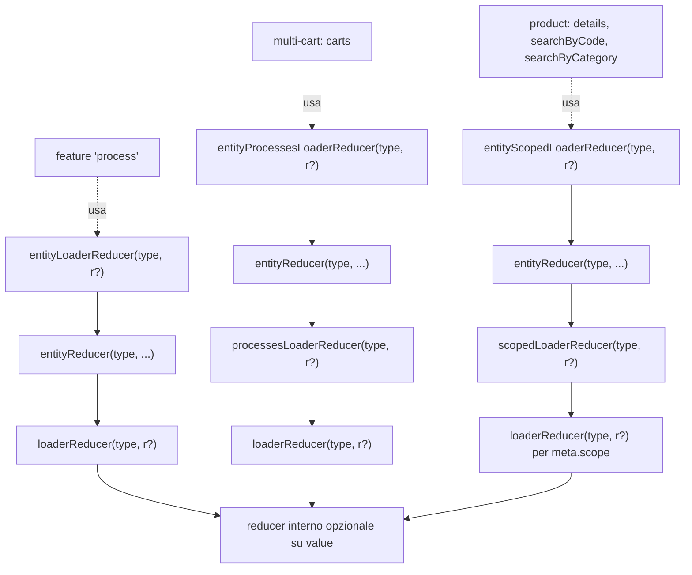
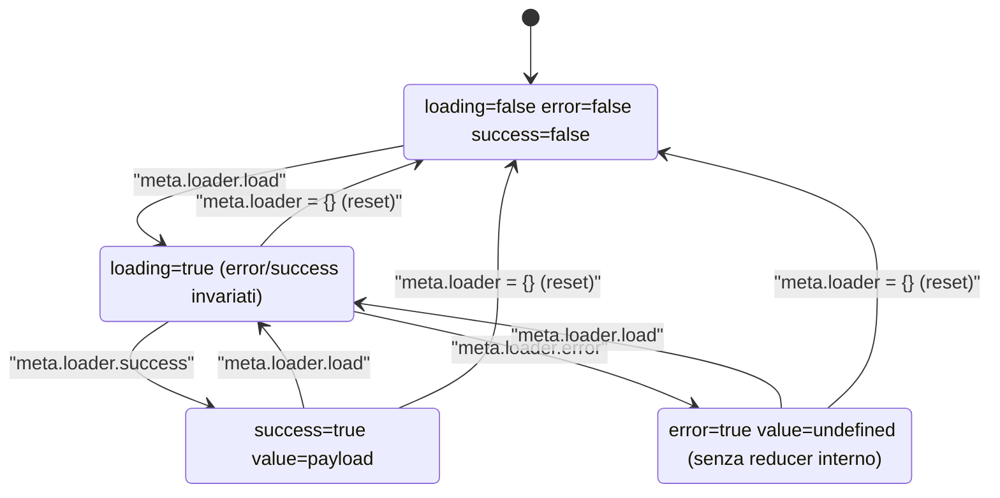
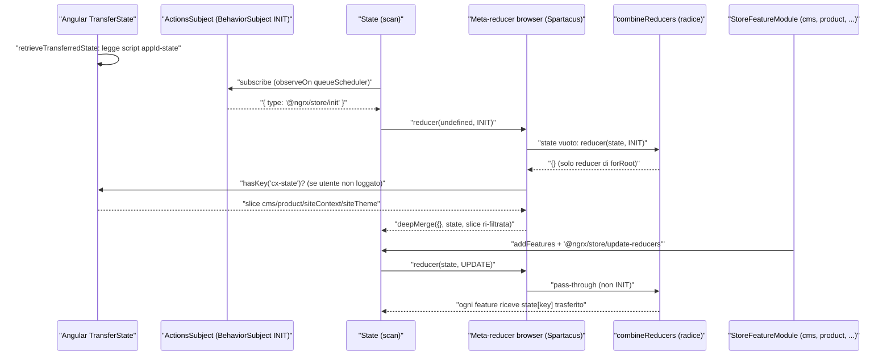
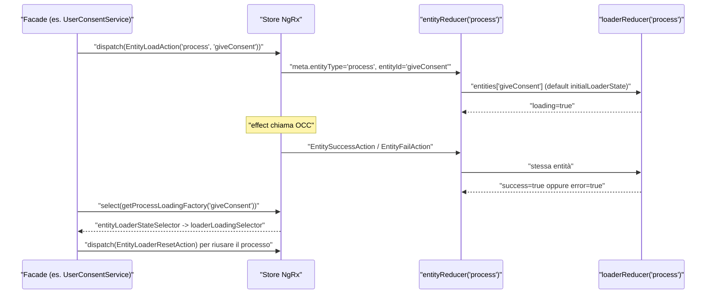

# 19 — State management: NgRx, loader/entity/process state

> Riferimenti allo SHA `5b7a1c2bf2808d7380bc20596d10f4fa710c3da1` (vedi [00-meta](../00-meta.md)).

Prerequisiti consigliati: [07 — SSR, hydration e TransferState](../parte-1/07-ssr-hydration-transferstate.md), [11 — Configurazione](11-configurazione.md), [12 — Feature module e lazy loading](12-feature-module-lazy.md). Capitoli collegati: [20 — Facade, command & query, eventi](20-facade-command-query-eventi.md), [25 — Carrello](25-cart.md).

## 1. A cosa serve e perché esiste

Spartacus usa NgRx (21.0.x) come store applicativo, ma **non** si limita a fornire reducer per le singole feature: il sottosistema `core-libs/core/src/state/` è una piccola libreria di *higher-order reducer* (HOR), azioni base e selector puri che tutte le feature riusano per gestire lo stesso problema ricorrente: "ho dei dati che arrivano dal backend OCC, possono essere in caricamento, caricati, falliti o da resettare; e spesso sono molti, indicizzati per id".

Il capitolo copre cinque pezzi distinti, tutti esportati da `@spartacus/core` (`core-libs/core/public_api.ts:L33-L33`, `core-libs/core/src/state/index.ts:L7-L11`; `core-libs/core/public_api.ts:L28-L28`, `core-libs/core/src/process/index.ts:L7-L9`):

1. **`StateModule.forRoot()`** e il **meta-reducer di transfer state**: copia slice selezionate dello store NgRx dal render SSR al browser tramite l'`TransferState` di Angular (`core-libs/core/src/state/state.module.ts:L10-L18`, `core-libs/core/src/state/reducers/index.ts:L23-L43`).
2. **`StateConfig`**: la sola chiave di configurazione del sottosistema, `state.ssrTransfer.keys` (`core-libs/core/src/state/config/state-config.ts:L20-L35`).
3. **`StatePersistenceService`**: sincronizzazione di uno stream di stato con `localStorage`/`sessionStorage`, con chiave contestuale (es. per base site) (`core-libs/core/src/state/services/state-persistence.service.ts:L18-L132`).
4. **`StateUtils`**: il namespace con loader, entity, entity-loader, processes-loader, entity-processes-loader, serializer B2B e `getStateSlice` (`core-libs/core/src/state/utils/index.ts:L7-L8`, `core-libs/core/src/state/utils/utils-group.ts:L7-L14`).
5. **`ProcessModule`**: una feature NgRx generica, `process`, che è un `EntityLoaderState` indicizzato per *process id* e serve a tracciare operazioni "fire and forget" (dare un consenso, cancellare un ordine) senza creare una slice dedicata per ognuna (`core-libs/core/src/process/store/process-store.module.ts:L13-L17`, `core-libs/core/src/process/store/reducers/index.ts:L13-L26`).

Completa il quadro `StateEventService`, il ponte che trasforma azioni NgRx in eventi Spartacus (`core-libs/core/src/state/event/state-event.service.ts:L16-L77`); il sistema eventi in sé è trattato nel [capitolo 20](20-facade-command-query-eventi.md).

Il principio che lega tutto: **i reducer generici non guardano `action.type`, guardano `action.meta`**. Una feature crea una classe azione che estende un'azione base (es. `EntityLoadAction`), sovrascrive `type` con il proprio nome leggibile nei DevTools, e il reducer generico la interpreta in base a `meta.entityType`, `meta.entityId`, `meta.loader` e `meta.processesCountDiff` (`core-libs/core/src/state/utils/loader/loader.reducer.ts:L32-L36`, `core-libs/core/src/state/utils/entity/entity.reducer.ts:L28-L32`, `core-libs/core/src/product/store/actions/product.action.ts:L29-L35`).

> Nota importante: Spartacus **non crea lo store radice**. `StoreModule.forRoot({})` ed `EffectsModule.forRoot([])` sono nell'`AppModule` dell'applicazione (`projects/storefrontapp/src/app/app.module.ts:L15-L22`) e vengono inseriti dallo schematic `add-spartacus` (`core-libs/schematics/src/add-spartacus/store.ts:L58-L65`). Spartacus contribuisce solo feature (`StoreModule.forFeature`) e meta-reducer (`META_REDUCERS`).

## 2. Mappa dei file

| Path | Ruolo |
|---|---|
| `core-libs/core/src/state/index.ts` | Barrel pubblico: config, eventi, `StatePersistenceService`, `StateModule`, `StateUtils`. NON esporta `./reducers` (`:L7-L11`). |
| `core-libs/core/src/state/state.module.ts` | `StateModule` vuoto; `forRoot()` aggiunge `stateMetaReducers` (`:L10-L18`). |
| `core-libs/core/src/state/config/state-config.ts` | `StorageSyncType`, `StateTransferType`, `StateConfig`, augmentation di `Config` (`:L10-L39`). |
| `core-libs/core/src/state/reducers/index.ts` | `TRANSFER_STATE_META_REDUCER` e `stateMetaReducers` (registrazione su `META_REDUCERS`) (`:L23-L43`). |
| `core-libs/core/src/state/reducers/transfer-state.reducer.ts` | `CX_KEY = 'cx-state'`, `getTransferStateReducer`, varianti server e browser (`:L16-L96`). |
| `core-libs/core/src/state/services/state-persistence.service.ts` | `StatePersistenceService`: `syncWithStorage`, `readStateFromStorage`, `generateKeyWithContext` (`:L18-L132`). |
| `core-libs/core/src/state/utils/browser-storage.ts` | `getStorage`, `persistToStorage`, `readFromStorage`, `isSsr` (`:L11-L75`). |
| `core-libs/core/src/state/utils/get-state-slice.ts` | Estrazione di sotto-alberi per path con `.`: `getStateSlice`, `filterKeysByType` (`:L10-L112`). |
| `core-libs/core/src/state/utils/index.ts`, `utils-group.ts` | Namespace `StateUtils` (`index.ts:L7-L8`, `utils-group.ts:L7-L14`). |
| `core-libs/core/src/state/utils/loader/*` | `LoaderState`, azioni `[LOADER] *`, `loaderReducer`, selector puri. |
| `core-libs/core/src/state/utils/processes-loader/*` | `ProcessesLoaderState` (`processesCount`), `processesLoaderReducer`, `isStableSelector`. |
| `core-libs/core/src/state/utils/entity/*` | `EntityState` (mappa `entities`), azioni remove, `entityReducer`. |
| `core-libs/core/src/state/utils/entity-loader/*` | `EntityLoaderState` = entity + loader; azioni `[ENTITY] LOAD*`. |
| `core-libs/core/src/state/utils/entity-processes-loader/*` | entity + processes-loader (usato dal multi-cart). |
| `core-libs/core/src/state/utils/scoped-loader/*` | loader per entità *e* scope (usato solo dal prodotto); NON in `StateUtils` (`utils-group.ts:L7-L14`). |
| `core-libs/core/src/state/utils/entity-list-state.ts`, `serializer.ts` | Pattern lista+entità B2B e serializzazione delle chiavi di ricerca. |
| `core-libs/core/src/state/event/*` | `ActionToEventMapping`, `StateEventService`, helper di test. |
| `core-libs/core/src/process/process.module.ts` | `ProcessModule` (importa `ProcessStoreModule`; `forRoot` senza provider) (`:L10-L20`). |
| `core-libs/core/src/process/store/process-store.module.ts` | Registra la feature `process` (`:L13-L17`). |
| `core-libs/core/src/process/store/process-state.ts` | `PROCESS_FEATURE = 'process'`, `StateWithProcess<T>` (`:L9-L13`). |
| `core-libs/core/src/process/store/reducers/index.ts` | `getReducers` = `entityLoaderReducer(PROCESS_FEATURE)`, `reducerToken` (`:L13-L26`). |
| `core-libs/core/src/process/store/selectors/*` | `getProcessState`, `getProcess{State,Loading,Success,Error}Factory`, namespace `ProcessSelectors`. |
| `core-libs/core/src/process/store/selectors/process-group.selectors.ts` | Barrel non importato da nessun file (dossier T24). |
| `deps:ngrx-store-21.0.1/package/fesm2022/ngrx-store.mjs` | (contorno, NgRx) `INIT`, `META_REDUCERS`, composizione dei meta-reducer, `State`, `ReducerManager.addFeatures`/`updateReducers`. |

## 3. Come funziona passo per passo

### 3.1 Come NgRx compone reducer e meta-reducer (il contesto necessario)

Per capire quando e su cosa agiscono i meta-reducer di Spartacus serve sapere come NgRx 21.0.1 costruisce il reducer radice. I sorgenti NgRx sono letti dal pacchetto pubblicato (`deps:`).

1. **INIT non viene dispatchata da nessuno.** `INIT = '@ngrx/store/init'` è il valore iniziale del `BehaviorSubject` `ActionsSubject` (`deps:ngrx-store-21.0.1/package/fesm2022/ngrx-store.mjs:L196-L200`).
2. **Due sorgenti di meta-reducer radice.** Il token multi `META_REDUCERS` raccoglie i meta-reducer "definiti internamente da @ngrx/store o da library author"; quelli passati a `StoreModule.forRoot(…, { metaReducers })` finiscono in un token separato (`deps:ngrx-store-21.0.1/package/fesm2022/ngrx-store.mjs:L244-L256`). La concatenazione è `metaReducers.concat(userProvidedMetaReducers)`: prima i `META_REDUCERS`, poi quelli dell'utente (`deps:ngrx-store-21.0.1/package/fesm2022/ngrx-store.mjs:L1069-L1071`).
3. **Il reducer factory radice.** `StoreModule.forRoot` fornisce `REDUCER_FACTORY = createReducerFactory(combineReducers, metaReducerRisolti)` (`deps:ngrx-store-21.0.1/package/fesm2022/ngrx-store.mjs:L1337-L1353`). `createReducerFactory` compone `[...metaReducers, reducerFactory]` con `compose`, che applica da destra: il **primo** meta-reducer dell'array è il **più esterno**; il reducer ottenuto sostituisce `state === undefined` con `initialState` prima di chiamare la catena (`deps:ngrx-store-21.0.1/package/fesm2022/ngrx-store.mjs:L349-L371`). Quindi i meta-reducer radice vedono lo **stato globale intero**, prima e dopo `combineReducers`.
4. **Il runtime check di NgRx usa lo stesso canale.** `StoreModule.forRoot` registra tre provider `META_REDUCERS` (immutability, serialization, in-zone) (`deps:ngrx-store-21.0.1/package/fesm2022/ngrx-store.mjs:L1241-L1258`).
5. **INIT è ridotta alla costruzione di `State`.** Il costruttore di `State` si sottoscrive alle azioni con `observeOn(queueScheduler)`, `withLatestFrom(reducer$)` e `scan` (`deps:ngrx-store-21.0.1/package/fesm2022/ngrx-store.mjs:L485-L498`); con delay 0 il `queueScheduler` esegue subito (`deps:rxjs-7.8.2/package/dist/esm/internal/scheduler/QueueAction.js:L8-L16`). `Store` dipende dal token NgRx StateObservable (`deps:ngrx-store-21.0.1/package/fesm2022/ngrx-store.mjs:L627-L627`), fornito da `State` con `useExisting` (`deps:ngrx-store-21.0.1/package/fesm2022/ngrx-store.mjs:L516-L519`), il modulo NgModule restituito da `StoreModule.forRoot` inietta `Store` e ogni modulo feature inietta il modulo root prima di registrare la propria feature (`deps:ngrx-store-21.0.1/package/fesm2022/ngrx-store.mjs:L1482-L1484`, `:L1502-L1518`, `:L1523-L1523`). Conseguenza: **INIT viene ridotta quando il reducer radice contiene solo i reducer di `forRoot`** (nell'app demo: nessuno, `StoreModule.forRoot({})`).
6. **Le feature arrivano dopo, con UPDATE.** `addFeatures` costruisce il reducer della feature (applicando i `metaReducers` *della feature*), poi `updateReducers` ricostruisce il reducer radice con lo stesso `reducerFactory` (quindi con gli stessi meta-reducer radice) e dispatcha `'@ngrx/store/update-reducers'` (`deps:ngrx-store-21.0.1/package/fesm2022/ngrx-store.mjs:L391-L391`, `:L406-L416`, `:L438-L444`).
7. **`combineReducers` e le chiavi orfane.** La funzione `combination` passa a ogni reducer `state[key]`; se almeno una chiave cambia, restituisce un **nuovo** oggetto che contiene solo le chiavi con un reducer registrato (`deps:ngrx-store-21.0.1/package/fesm2022/ngrx-store.mjs:L319-L343`).

I punti 5-7 spiegano il funzionamento del transfer state lato browser (3.3) e una trappola (§9).

### 3.2 Bootstrap: `StateModule`, `ProcessModule` e i meta-reducer

1. `BaseCoreModule` importa `StateModule.forRoot()` subito dopo `ErrorHandlingModule.forRoot()` e prima di `ConfigModule.forRoot()`; più sotto importa `ProcessModule.forRoot()` (`core-libs/core/src/base-core.module.ts:L26-L36`).
2. `StateModule.forRoot()` aggiunge `stateMetaReducers`; `StateModule` importato senza `forRoot` (come fanno `ProcessStoreModule` e gli store module delle feature) non aggiunge alcun provider (`core-libs/core/src/state/state.module.ts:L10-L18`, `core-libs/core/src/process/store/process-store.module.ts:L14-L14`).
3. `stateMetaReducers` definisce il token `TRANSFER_STATE_META_REDUCER` con factory `getTransferStateReducer` e dipendenze `PLATFORM_ID`, `TransferState`, `Config`, `AuthStatePersistenceService` (le ultime tre `Optional`), e lo inserisce in `META_REDUCERS` con `useExisting` (`core-libs/core/src/state/reducers/index.ts:L23-L43`).
4. `getTransferStateReducer` decide **una volta sola, alla creazione**:
   - se c'è un `TransferState` *e* `config.state.ssrTransfer.keys`, sul browser restituisce `getBrowserTransferStateReducer(…, Boolean(authStatePersistenceService?.isUserLoggedIn()))`, sul server `getServerTransferStateReducer(…)` (`core-libs/core/src/state/reducers/transfer-state.reducer.ts:L18-L37`);
   - altrimenti restituisce il meta-reducer identità `(reducer) => reducer` (`core-libs/core/src/state/reducers/transfer-state.reducer.ts:L39-L39`).
5. `ProcessModule` importa `ProcessStoreModule` (`core-libs/core/src/process/process.module.ts:L10-L20`), che registra `StoreModule.forFeature(PROCESS_FEATURE, reducerToken)` (`core-libs/core/src/process/store/process-store.module.ts:L13-L17`) con reducer `entityLoaderReducer(PROCESS_FEATURE)` fornito da factory (`core-libs/core/src/process/store/reducers/index.ts:L13-L26`).

### 3.3 Transfer state: dal render SSR al browser

**Configurazione.** Le chiavi da trasferire sono in `state.ssrTransfer.keys`, mappa `chiave → StateTransferType` (`core-libs/core/src/state/config/state-config.ts:L20-L35`); `StateTransferType` ha un solo valore, `TRANSFER_STATE = 'SSR'` (`core-libs/core/src/state/config/state-config.ts:L16-L18`). Il core dichiara come default le feature `cms`, `product`, `siteContext`, `siteTheme`, ognuna con una `provideDefaultConfigFactory` nel proprio store module (`core-libs/core/src/cms/store/cms-store.module.ts:L21-L31`, `core-libs/core/src/product/store/product-store.module.ts:L20-L30`, `core-libs/core/src/site-context/store/site-context-store.module.ts:L20-L30`, `core-libs/core/src/site-theme/store/site-theme-store.module.ts:L20-L29`).

**Lato server**, dopo **ogni** azione:

1. il meta-reducer calcola `newState = reducer(state, action)` (`core-libs/core/src/state/reducers/transfer-state.reducer.ts:L51-L53`);
2. estrae le chiavi di tipo `'SSR'` con `filterKeysByType` (`core-libs/core/src/state/reducers/transfer-state.reducer.ts:L46-L49`, `core-libs/core/src/state/utils/get-state-slice.ts:L104-L112`);
3. costruisce la slice con `getStateSlice(transferStateKeys, [], newState)` e la scrive con `transferState.set(CX_KEY, stateSlice)` (`core-libs/core/src/state/reducers/transfer-state.reducer.ts:L54-L57`). `CX_KEY` è `makeStateKey('cx-state')` (`core-libs/core/src/state/reducers/transfer-state.reducer.ts:L16-L16`).

`TransferState.set` assegna semplicemente la chiave nel suo `store` (`angular:packages/core/src/transfer_state.ts:L89-L112`) e `toJson()` serializza con `JSON.stringify`, facendo l'escape di `<` e `/` (`angular:packages/core/src/transfer_state.ts:L131-L146`). L'inserimento dello `<script>` nell'HTML è compito di platform-server (vedi [capitolo 07](../parte-1/07-ssr-hydration-transferstate.md); ⚠️ DA VERIFICARE in quel capitolo: fuori dai file di questo).

**Lato browser**:

1. Angular `TransferState`, se non è `ngServerMode`, popola `store` con `retrieveTransferredState(DOCUMENT, APP_ID)` (`angular:packages/core/src/transfer_state.ts:L66-L79`), cioè leggendo lo `<script>` con id `appId + '-state'` (`angular:packages/core/src/transfer_state.ts:L150-L157`).
2. Il meta-reducer browser interviene **solo sull'azione `INIT`** (`core-libs/core/src/state/reducers/transfer-state.reducer.ts:L76-L76`). Se lo stato è vuoto lo crea chiamando il reducer (`:L77-L79`); poiché INIT è ridotta quando lo store contiene solo i reducer di `forRoot` (3.1, punto 5), questo stato iniziale è essenzialmente vuoto.
3. Se l'utente **non** risulta loggato e la chiave `cx-state` esiste, rilegge il valore, lo **ri-filtra** con le chiavi configurate sul client e lo fonde con `deepMerge({}, state, transferredStateSlice)` (`core-libs/core/src/state/reducers/transfer-state.reducer.ts:L81-L90`). `isUserLoggedIn()` legge in modo sincrono dallo storage la presenza di `token.access_token` e il suo JSDoc dice esplicitamente che esiste per il transfer state reducer (`core-libs/core/src/auth/user-auth/services/auth-state-persistence.service.ts:L115-L121`).
4. Ogni altra azione passa invariata (`core-libs/core/src/state/reducers/transfer-state.reducer.ts:L93-L93`).
5. Quando gli store module (`cms`, `product`, …) registrano le loro feature, `combineReducers` passa a ciascun reducer la slice già presente in `state[key]` (3.1, punti 6-7): è così che il reducer CMS "trova" lo stato del server come proprio stato precedente.

Perché il controllo sul login? Lo stato renderizzato dal server è anonimo (il server non ha il token del browser); se l'utente è loggato, contenuti come CMS e prezzi potrebbero differire, quindi Spartacus preferisce ricaricarli. Il codice esprime questa scelta con la condizione `!isLoggedIn` (`core-libs/core/src/state/reducers/transfer-state.reducer.ts:L81-L81`); la motivazione non è scritta nel sorgente (deduzione dell'autore, coerente con il JSDoc citato).

### 3.4 `getStateSlice`: estrarre sotto-alberi per path

- `getStateSliceValue` naviga lo stato con un path separato da `'.'` (`core-libs/core/src/state/utils/get-state-slice.ts:L10-L21`).
- `createShellObject` ricostruisce l'oggetto annidato attorno al valore con `reduceRight`; se la chiave è vuota, il valore è falsy oppure `Object.keys(value)` è vuoto (oggetti vuoti, ma anche booleani e numeri) restituisce `{}` (`core-libs/core/src/state/utils/get-state-slice.ts:L23-L36`).
- `getStateSlice` fonde con `deepMerge` le shell di tutte le chiavi; con array chiavi vuoto restituisce `{}` (`core-libs/core/src/state/utils/get-state-slice.ts:L38-L55`).
- `handleExclusions` clona e cancella i path esclusi; `getExclusionKeys` seleziona le esclusioni con `String.includes` (`core-libs/core/src/state/utils/get-state-slice.ts:L57-L102`). Il transfer state passa sempre `excludeKeys = []` (`core-libs/core/src/state/reducers/transfer-state.reducer.ts:L55-L55`).

Le chiavi di `ssrTransfer.keys` possono quindi essere path annidati, es. `'cms.page'` (sintassi supportata da `getStateSliceValue`; nessun uso di questo tipo trovato nei default del core, che usano solo chiavi di primo livello).

### 3.5 Storage sync: `StatePersistenceService`

`StatePersistenceService` è `providedIn: 'root'` e dipende solo da `WindowRef` (`core-libs/core/src/state/services/state-persistence.service.ts:L18-L22`).

`syncWithStorage({ key, state$, context$, storageType, onRead })`:

1. default: `context$ = of('')`, `storageType = LOCAL_STORAGE`, `onRead` no-op (`core-libs/core/src/state/services/state-persistence.service.ts:L44-L58`);
2. risolve lo storage con `getStorage`: `LOCAL_STORAGE` → `winRef.localStorage`, `SESSION_STORAGE` → `winRef.sessionStorage`, `NO_STORAGE` → `undefined`, qualunque altro valore → `sessionStorage` (`core-libs/core/src/state/utils/browser-storage.ts:L11-L37`); in SSR `WindowRef` restituisce `undefined` per entrambi (`core-libs/core/src/window/window-ref.ts:L50-L60`);
3. **prima** sottoscrizione (lettura): a ogni emissione di `context$` legge dallo storage (o `undefined` se non c'è storage) e chiama `onRead`; il commento impone che la lettura sia sottoscritta prima della scrittura (`core-libs/core/src/state/services/state-persistence.service.ts:L63-L78`);
4. **seconda** sottoscrizione (scrittura, solo se lo storage esiste): a ogni emissione di `state$` scrive con l'ultimo contesto via `withLatestFrom(context$)` (`core-libs/core/src/state/services/state-persistence.service.ts:L80-L90`);
5. restituisce la `Subscription` composta, che il chiamante deve chiudere (`core-libs/core/src/state/services/state-persistence.service.ts:L61-L61`, `:L92-L92`).

La chiave nello storage è `spartacus⚿<contesti uniti da ⚿>⚿<key>` (`core-libs/core/src/state/services/state-persistence.service.ts:L124-L131`); il JSDoc porta l'esempio `spartacus⚿electronics⚿cart` (`core-libs/core/src/state/services/state-persistence.service.ts:L28-L34`). `persistToStorage` scrive `JSON.stringify(value)` e scarta in silenzio `undefined` (`core-libs/core/src/state/utils/browser-storage.ts:L39-L55`); `readFromStorage` fa `JSON.parse` senza `try/catch` (`core-libs/core/src/state/utils/browser-storage.ts:L57-L71`). La variante sincrona è `readStateFromStorage` (`core-libs/core/src/state/services/state-persistence.service.ts:L105-L122`).

Uso reale: `MultiCartStatePersistenceService` sincronizza la chiave `'cart'` con contesto `BASE_SITE_CONTEXT_ID` su `LOCAL_STORAGE` (`feature-libs/cart/base/core/services/multi-cart-state-persistence.service.ts:L35-L43`).

### 3.6 Loader state: la cella di base

`LoaderState<T>` = `{ loading?, error?, success?, value? }` (`core-libs/core/src/state/utils/loader/loader-state.ts:L7-L12`); lo stato iniziale ha i tre flag a `false` e `value: undefined` (`core-libs/core/src/state/utils/loader/loader.reducer.ts:L11-L16`).

Le azioni portano un `meta: LoaderMeta = { entityType, loader }` (`core-libs/core/src/state/utils/loader/loader.action.ts:L15-L29`) costruito dalle meta factory: `loadMeta` → `{load: true}`, `failMeta` → `{error: error ? error : true}`, `successMeta` → `{success: true}`, `resetMeta` → `{}` (`core-libs/core/src/state/utils/loader/loader.action.ts:L31-L63`). Le classi `Loader{Load,Fail,Success,Reset}Action` impostano `type` e `meta`; `LoaderFailAction` implementa anche `ErrorAction` (`core-libs/core/src/state/utils/loader/loader.action.ts:L65-L101`), cioè ha un campo `error`, che è ciò che `ErrorActionService.isErrorAction` controlla (`'error' in action`) (`core-libs/core/src/error-handling/effects-error-handler/error-action.service.ts:L41-L43`).

`loaderReducer(entityType, reducer?)`:

1. reagisce solo se `action.meta.loader` esiste e `meta.entityType === entityType` (`core-libs/core/src/state/utils/loader/loader.reducer.ts:L32-L37`);
2. **LOAD**: `loading: true`, gli altri flag invariati (`:L39-L44`);
3. **FAIL**: `loading: false, error: true, success: false`, `value` azzerato se non c'è reducer interno (`:L45-L52`);
4. **SUCCESS**: `value = action.payload` (o reducer interno), `loading: false, error: false, success: true` (`:L53-L60`);
5. qualunque altro `meta.loader` (es. `{}`) è un **RESET** a `initialLoaderState` (`:L61-L69`);
6. per ogni azione che non ha un `meta.loader` truthy con lo stesso `entityType` (comprese le azioni loader di altri tipi e gli increment/decrement dei processi, che hanno `loader: undefined`: `core-libs/core/src/state/utils/processes-loader/processes-loader.action.ts:L30-L34`), se c'è un reducer interno lo applica a `value`, cambiando riferimento solo se il valore cambia (`:L72-L78`);
7. `getReducerIfExists` usa **sempre** il reducer interno quando presente, ignorando il fallback (`:L80-L82`).

I selector di loader sono funzioni pure, non `createSelector`, con default `false` via `??` (`core-libs/core/src/state/utils/loader/loader.selectors.ts:L9-L23`).

### 3.7 Entity state e entity-loader: molte celle per id

`EntityState<T>` è `{ entities: { [id]: T } }` (`core-libs/core/src/state/utils/entity/entity-state.ts:L7-L11`); `EntityMeta` aggiunge `entityId?: string | string[] | null` ed `entityRemove?` (`core-libs/core/src/state/utils/entity/entity.action.ts:L12-L18`).

`entityReducer(entityType, reducer)`:

1. se `entityType` coincide ed `entityId !== undefined`, gli id sono `[].concat(entityId ?? '')`; se `entityRemove` è vero rimuove le entità (`core-libs/core/src/state/utils/entity/entity.reducer.ts:L28-L38`);
2. altrimenti (azione di altro tipo, o senza id) gli id sono **tutte** le chiavi esistenti (`:L42-L44`);
3. se `entityId` e `payload` sono entrambi array, l'entità *i* riceve `payload[i]` (`:L40-L52`);
4. applica il reducer interno per id; ogni risultato truthy, anche se identico allo stato precedente, entra negli update e lo stato cambia riferimento se c'è almeno un update (`:L46-L66`). Con un reducer interno di tipo loader, che per le azioni non pertinenti restituisce `state` (`core-libs/core/src/state/utils/loader/loader.reducer.ts:L72-L78`), se esiste almeno un'entità lo stato cambia riferimento a **ogni** azione dispatchata (`core-libs/core/src/state/utils/entity/entity.reducer.ts:L42-L44`, `:L53-L63`);
5. `removeSelectedEntities`: con `entityId === null` torna a `{entities: {}}`, altrimenti filtra (`:L69-L92`).

`entityLoaderReducer` è la composizione `entityReducer(entityType, loaderReducer(entityType, reducer))` (`core-libs/core/src/state/utils/entity-loader/entity-loader.reducer.ts:L13-L25`); `EntityLoaderState<T>` = `EntityState<LoaderState<T>>` (`core-libs/core/src/state/utils/entity-loader/entity-loader-state.ts:L10-L10`). Le meta entity-loader sono lo spread di loader meta + `entityMeta` (`core-libs/core/src/state/utils/entity-loader/entity-loader.action.ts:L30-L69`); `entityMeta(type, id?)` assegna `entityId: id` anche quando `id` è `undefined` (`core-libs/core/src/state/utils/entity/entity.action.ts:L20-L25`). `entityLoaderStateSelector` restituisce `initialLoaderState` per id inesistenti (`core-libs/core/src/state/utils/entity-loader/entity-loader.selectors.ts:L17-L54`).

### 3.8 Processes loader ed entity-processes-loader: contare le operazioni in volo

`ProcessesLoaderState<T>` aggiunge `processesCount?` (`core-libs/core/src/state/utils/processes-loader/processes-loader-state.ts:L9-L11`). Le azioni increment/decrement hanno `loader: undefined` e `processesCountDiff` `+1`/`-1` (`core-libs/core/src/state/utils/processes-loader/processes-loader.action.ts:L27-L45`); il reset dei processi è anche un reset del loader, con `processesCountDiff: null` (`core-libs/core/src/state/utils/processes-loader/processes-loader.action.ts:L47-L55`).

`processesLoaderReducer`:

1. delega prima a `loaderReducer(entityType, reducer)` (`core-libs/core/src/state/utils/processes-loader/processes-loader.reducer.ts:L34-L34`);
2. se l'`entityType` coincide: in dev mode logga un `console.error` se il contatore scenderebbe sotto zero (`:L35-L52`);
3. con diff numerico somma (se il contatore è falsy diventa direttamente il diff) (`:L53-L59`); con `null` torna a `processesCount: 0` (`:L60-L66`).

`isStableSelector` = `!processesCount && !loading`; `hasPendingProcessesSelector` = `processesCount > 0` (`core-libs/core/src/state/utils/processes-loader/processes-loader.selectors.ts:L9-L17`).

`entityProcessesLoaderReducer` = `entityReducer(entityType, processesLoaderReducer(entityType, reducer))` (`core-libs/core/src/state/utils/entity-processes-loader/entity-processes-loader.reducer.ts:L13-L25`). Il consumatore principale è il multi-cart: la slice `carts` è `entityProcessesLoaderReducer(MULTI_CART_DATA, createCartEntitiesReducer(enabled))` (`feature-libs/cart/base/core/store/reducers/index.ts:L34-L47`); le azioni che modificano il carrello estendono `EntityProcessesIncrementAction` (`feature-libs/cart/base/core/store/actions/cart-entry.action.ts:L22-L22`) e la stabilità si legge con `entityIsStableSelector` (`feature-libs/cart/base/core/store/selectors/multi-cart.selector.ts:L53-L61`).

### 3.9 Scoped loader: entità × scope (solo prodotto)

`ScopedLoaderState<T>` è una mappa `scope → LoaderState<T>` (`core-libs/core/src/state/utils/scoped-loader/scoped-loader.state.ts:L10-L14`). `scopedLoaderReducer` applica `loaderReducer` alla sotto-chiave `meta.scope ?? ''` (`core-libs/core/src/state/utils/scoped-loader/scoped-loader.reducer.ts:L27-L43`); `entityScopedLoaderReducer` lo avvolge in `entityReducer` (`core-libs/core/src/state/utils/scoped-loader/entity-scoped-loader.reducer.ts:L20-L31`). Lo usa solo lo store prodotto, per `searchByCode`, `searchByCategory` e `details` (`core-libs/core/src/product/store/reducers/index.ts:L22-L35`), con azioni come `LoadProduct` che estendono `EntityScopedLoaderActions.EntityScopedLoadAction` (`core-libs/core/src/product/store/actions/product.action.ts:L29-L35`). Dettagli sugli scope di prodotto nel [capitolo 24](24-product-search.md).

### 3.10 La feature `process`

1. Le azioni di processo riusano le azioni entity-loader con `entityType = PROCESS_FEATURE` ed `entityId = <process id>` (`core-libs/core/src/user/store/actions/customer-coupon.action.ts:L115-L139`); i process id sono costanti stringa delle feature, es. `'subscribeCustomerCoupon'` (`core-libs/core/src/user/store/user-state.ts:L40-L40`).
2. Il reducer `entityLoaderReducer(PROCESS_FEATURE)` non ha reducer interno: per un processo interessano solo i flag (`core-libs/core/src/process/store/reducers/index.ts:L13-L15`).
3. Lettura: `getProcessStateFactory(id)` = `createSelector(getProcessState(), s => entityLoaderStateSelector(s, id))` e le derivate loading/success/error (`core-libs/core/src/process/store/selectors/process.selectors.ts:L18-L53`). Nel core si importano direttamente (`core-libs/core/src/user/facade/user-consent.service.ts:L201-L202`), nelle feature lib tramite il namespace pubblico `ProcessSelectors` (`feature-libs/order/core/facade/order-history.service.ts:L193-L202`).

### 3.11 Azioni → eventi: `StateEventService`

`register({ action, event, factory? })` registra in `EventService` uno stream ottenuto filtrando `ActionsSubject` con `ofType` sui tipi indicati e mappando ogni azione in evento (`core-libs/core/src/state/event/state-event.service.ts:L36-L55`). Senza factory l'evento è `createFrom(eventType, action.payload ?? {})` (`core-libs/core/src/state/event/state-event.service.ts:L68-L76`), cioè `Object.assign(new type(), data)` (`core-libs/core/src/util/create-from.ts:L15-L17`). Esempi: senza factory `UPDATE_USER_ADDRESS → UpdateUserAddressEvent` (`core-libs/core/src/user/events/user-event.builder.ts:L33-L38`); con factory `DeleteCartEvent` arricchito con `cartCode` (`feature-libs/cart/base/core/event/cart-event.builder.ts:L137-L144`).

## 4. Diagrammi

### 4.1 Composizione degli higher-order reducer

Ogni freccia è "avvolge"; i riferimenti sono in 3.6-3.10.



### 4.2 Transizioni di una cella `LoaderState`



Riferimenti: `core-libs/core/src/state/utils/loader/loader.reducer.ts:L39-L69`.

### 4.3 Bootstrap NgRx e transfer state nel browser



Riferimenti: `angular:packages/core/src/transfer_state.ts:L66-L79`; `deps:ngrx-store-21.0.1/package/fesm2022/ngrx-store.mjs:L196-L200`, `:L485-L498`, `:L438-L444`; `core-libs/core/src/state/reducers/transfer-state.reducer.ts:L74-L94`.

### 4.4 Ciclo di vita di un processo (entity-loader `process`)



Riferimenti: `core-libs/core/src/state/utils/entity-loader/entity-loader.action.ts:L71-L108`, `core-libs/core/src/state/utils/entity/entity.reducer.ts:L28-L57`, `core-libs/core/src/process/store/selectors/process.selectors.ts:L18-L35`, `core-libs/core/src/user/facade/user-consent.service.ts:L201-L202`. Il process id è `GIVE_CONSENT_PROCESS_ID = 'giveConsent'` (`core-libs/core/src/user/store/user-state.ts:L24-L24`); le azioni sono `GiveUserConsent`/`GiveUserConsentFail`/`GiveUserConsentSuccess`/`ResetGiveUserConsentProcess` (`core-libs/core/src/user/store/actions/user-consents.action.ts:L71-L81`, `:L85-L85`, `:L96-L96`, `:L104-L104`).

## 5. Estratti di codice reale

### 5.1 Registrazione del meta-reducer

`core-libs/core/src/state/reducers/index.ts:L23-L43`
```ts
export const TRANSFER_STATE_META_REDUCER = new InjectionToken(
  'TransferStateMetaReducer'
);

export const stateMetaReducers: Provider[] = [
  {
    provide: TRANSFER_STATE_META_REDUCER,
    useFactory: getTransferStateReducer,
    deps: [
      PLATFORM_ID,
      [new Optional(), TransferState],
      [new Optional(), Config],
      [new Optional(), AuthStatePersistenceService],
    ],
  },
  {
    provide: META_REDUCERS,
    useExisting: TRANSFER_STATE_META_REDUCER,
    multi: true,
  },
];
```

### 5.2 Meta-reducer server e browser

`core-libs/core/src/state/reducers/transfer-state.reducer.ts:L51-L61`
```ts
  return function (reducer: any) {
    return function (state: any, action: any) {
      const newState = reducer(state, action);
      if (newState) {
        const stateSlice = getStateSlice(transferStateKeys, [], newState);
        transferState.set(CX_KEY, stateSlice);
      }

      return newState;
    };
  };
```

`core-libs/core/src/state/reducers/transfer-state.reducer.ts:L74-L95`
```ts
  return function (reducer: any) {
    return function (state: any, action: any) {
      if (action.type === INIT) {
        if (!state) {
          state = reducer(state, action);
        }

        if (!isLoggedIn && transferState.hasKey(CX_KEY)) {
          const cxKey = transferState.get<Object>(CX_KEY, {});
          const transferredStateSlice = getStateSlice(
            transferStateKeys,
            [],
            cxKey
          );

          state = deepMerge({}, state, transferredStateSlice);
        }
        return state;
      }
      return reducer(state, action);
    };
  };
```

### 5.3 Come NgRx compone i meta-reducer

`deps:ngrx-store-21.0.1/package/fesm2022/ngrx-store.mjs:L359-L372`
```js
function createReducerFactory(reducerFactory, metaReducers) {
    if (Array.isArray(metaReducers) && metaReducers.length > 0) {
        reducerFactory = compose.apply(null, [
            ...metaReducers,
            reducerFactory,
        ]);
    }
    return (reducers, initialState) => {
        const reducer = reducerFactory(reducers);
        return (state, action) => {
            state = state === undefined ? initialState : state;
            return reducer(state, action);
        };
    };
```

### 5.4 Il cuore di `loaderReducer`

`core-libs/core/src/state/utils/loader/loader.reducer.ts:L32-L70`
```ts
    if (
      action.meta &&
      action.meta.loader &&
      action.meta.entityType === entityType
    ) {
      const entity = action.meta.loader;

      if (entity.load) {
        return {
          ...state,
          loading: true,
          value: getReducerIfExists(state.value),
        };
      } else if (entity.error) {
        return {
          ...state,
          loading: false,
          error: true,
          success: false,
          value: getReducerIfExists(undefined),
        };
      } else if (entity.success) {
        return {
          ...state,
          value: getReducerIfExists(action.payload),
          loading: false,
          error: false,
          success: true,
        };
      } else {
        // reset state action
        return {
          ...initialLoaderState,
          value: reducer
            ? reducer(initialLoaderState.value, action)
            : initialLoaderState.value,
        };
      }
    }
```

### 5.5 Instradamento per id in `entityReducer`

`core-libs/core/src/state/utils/entity/entity.reducer.ts:L26-L57`
```ts
    let ids: string[] = [];
    let partitionPayload = false;
    if (
      action.meta &&
      action.meta.entityType === entityType &&
      action.meta.entityId !== undefined
    ) {
      ids = ([] as string[]).concat(action.meta.entityId ?? '');

      // remove selected entities
      if (action.meta.entityRemove) {
        return removeSelectedEntities(action, state, ids);
      }

      partitionPayload =
        Array.isArray(action.meta.entityId) && Array.isArray(action.payload);
    } else {
      ids = Object.keys(state.entities);
    }

    const entityUpdates: { [id: string]: T } = {};

    for (let i = 0; i < ids.length; i++) {
      const id = ids[i];
      const subAction = partitionPayload
        ? { ...action, payload: action.payload[i] }
        : action;
      const newState = reducer(state.entities[id], subAction);
      if (newState) {
        entityUpdates[id] = newState;
      }
    }
```

### 5.6 Azioni base entity-loader

`core-libs/core/src/state/utils/entity-loader/entity-loader.action.ts:L71-L100`
```ts
export class EntityLoadAction implements EntityLoaderAction {
  type = ENTITY_LOAD_ACTION;
  readonly meta: EntityLoaderMeta;
  constructor(entityType: string, id: EntityId) {
    this.meta = entityLoadMeta(entityType, id);
  }
}

export class EntityFailAction implements EntityLoaderAction, ErrorAction {
  type = ENTITY_FAIL_ACTION;
  readonly meta: EntityLoaderMeta;
  public error: any;

  constructor(entityType: string, id: EntityId, error: any) {
    this.meta = entityFailMeta(entityType, id, error);
    this.error = error;
  }
}

export class EntitySuccessAction implements EntityLoaderAction {
  type = ENTITY_SUCCESS_ACTION;
  readonly meta: EntityLoaderMeta;
  constructor(
    entityType: string,
    id: EntityId,
    public payload?: any
  ) {
    this.meta = entitySuccessMeta(entityType, id);
  }
}
```

### 5.7 Contatore dei processi

`core-libs/core/src/state/utils/processes-loader/processes-loader.reducer.ts:L34-L69`
```ts
    const loaderState = loaderReducer(entityType, reducer)(state, action);
    if (action.meta && action.meta.entityType === entityType) {
      const processesCountDiff = action.meta.processesCountDiff;
      if (
        isDevMode() &&
        state.processesCount &&
        processesCountDiff &&
        state.processesCount + processesCountDiff < 0
      ) {
        //CXSPA-3670 - extract logging to an effect
        /* eslint-disable-next-line no-console */
        console.error(
          // ...
        );
      }
      if (processesCountDiff) {
        return {
          ...loaderState,
          processesCount: state.processesCount
            ? state.processesCount + processesCountDiff
            : processesCountDiff,
        };
      } else if (processesCountDiff === null) {
        // reset action
        return {
          ...loaderState,
          ...initialProcessesState,
        };
      }
    }

    return loaderState;
```

### 5.8 Storage sync

`core-libs/core/src/state/services/state-persistence.service.ts:L59-L92`
```ts
    const storage = getStorage(storageType, this.winRef);

    const subscriptions = new Subscription();

    // Do not change order of subscription! Read should happen before write on context change.
    subscriptions.add(
      context$
        .pipe(
          map((context) => {
            return storage
              ? readFromStorage<T>(
                  storage,
                  this.generateKeyWithContext(context, key)
                )
              : undefined;
          }),
          tap((state) => onRead(state))
        )
        .subscribe()
    );

    if (storage) {
      subscriptions.add(
        state$.pipe(withLatestFrom(context$)).subscribe(([state, context]) => {
          persistToStorage(
            this.generateKeyWithContext(context, key),
            state,
            storage
          );
        })
      );
    }

    return subscriptions;
```

### 5.9 La feature `process`

`core-libs/core/src/process/store/process-store.module.ts:L13-L17`
```ts
@NgModule({
  imports: [StateModule, StoreModule.forFeature(PROCESS_FEATURE, reducerToken)],
  providers: [reducerProvider],
})
export class ProcessStoreModule {}
```

## 6. Configurazione

| Chiave | Tipo | Default | Definita in | Letta in |
|---|---|---|---|---|
| `state.ssrTransfer.keys` | `{ [key: string]: StateTransferType \| undefined }` | nessun default in `state/`; il core aggiunge `cms`, `product`, `siteContext`, `siteTheme` con `provideDefaultConfigFactory` | `core-libs/core/src/state/config/state-config.ts:L25-L34` | `core-libs/core/src/state/reducers/transfer-state.reducer.ts:L24-L35`; default in `core-libs/core/src/cms/store/cms-store.module.ts:L21-L31`, `core-libs/core/src/product/store/product-store.module.ts:L20-L30`, `core-libs/core/src/site-context/store/site-context-store.module.ts:L20-L30`, `core-libs/core/src/site-theme/store/site-theme-store.module.ts:L20-L29` |
| `StateTransferType.TRANSFER_STATE` | enum `'SSR'` | — | `core-libs/core/src/state/config/state-config.ts:L16-L18` | `core-libs/core/src/state/reducers/transfer-state.reducer.ts:L46-L49`, `:L69-L72` |
| `syncWithStorage({ storageType })` (parametro, non config globale) | `StorageSyncType` | `LOCAL_STORAGE` | `core-libs/core/src/state/services/state-persistence.service.ts:L48-L48` | `core-libs/core/src/state/utils/browser-storage.ts:L11-L37` |
| `syncWithStorage({ context$ })` | `Observable<string \| string[]>` | `of('')` | `core-libs/core/src/state/services/state-persistence.service.ts:L47-L47` | `core-libs/core/src/state/services/state-persistence.service.ts:L65-L77`, `:L82-L82` |
| `readStateFromStorage({ context, storageType })` | `string \| string[]`, `StorageSyncType` | `''`, `LOCAL_STORAGE` | `core-libs/core/src/state/services/state-persistence.service.ts:L107-L108` | `core-libs/core/src/state/services/state-persistence.service.ts:L114-L121` |
| `CX_KEY` (chiave `TransferState`, costante non configurabile) | `StateKey<string>` | `'cx-state'` | `core-libs/core/src/state/reducers/transfer-state.reducer.ts:L16-L16` | `core-libs/core/src/state/reducers/transfer-state.reducer.ts:L56-L56`, `:L81-L82` |
| Feature toggle `enableCartSlowNetworkResilience` (contesto: cambia il reducer interno di `carts`) | `boolean` | `false` (l'app demo lo imposta a `true`) | `core-libs/core/src/features-config/feature-toggles/config/feature-toggles.ts:L1084-L1084` | `feature-libs/cart/base/core/store/reducers/index.ts:L37-L37`; demo `projects/storefrontapp/src/app/spartacus/spartacus-features.module.ts:L372-L372` |

Esempio di configurazione (usa solo `provideConfig`, `StateConfig`, `StateTransferType`, tutti pubblici): aggiungere una propria feature `myFeature` al transfer state.

```ts
// Esempio illustrativo, non presente nel repo
provideConfig(<StateConfig>{
  state: {
    ssrTransfer: {
      keys: { myFeature: StateTransferType.TRANSFER_STATE },
    },
  },
});
```

Per *escludere* una feature di default si può mappare la chiave a `undefined` (il tipo lo consente, `core-libs/core/src/state/config/state-config.ts:L28-L31`): `filterKeysByType` tiene solo le chiavi il cui valore è uguale a `'SSR'` (`core-libs/core/src/state/utils/get-state-slice.ts:L104-L112`). Che il merge di configurazione propaghi davvero `undefined` sopra il default dipende da `deepMerge`, che assegna i valori non-oggetto così come sono (`core-libs/core/src/config/utils/deep-merge.ts:L36-L45`); vedi [capitolo 11](11-configurazione.md).

## 7. Commenti e note notevoli dal sorgente

- `/** Higher order reducer that adds generic loading flag to chunk of the state … Utilizes "loader" meta field … */` — `core-libs/core/src/state/utils/loader/loader.reducer.ts:L18-L23`. È la dichiarazione del principio "meta, non type".
- `// processes reset action is a reset action for loader reducer, but not the other way around` — `core-libs/core/src/state/utils/processes-loader/processes-loader.action.ts:L50-L50`. Conseguenza in §9 (T11).
- `//CXSPA-3670 - extract logging to an effect` e il messaggio "There should always be only one decrement action for each increment action. Make sure that you don't reset state in between those actions." — `core-libs/core/src/state/utils/processes-loader/processes-loader.reducer.ts:L43-L50`. Debito tecnico dichiarato: un `console.error` dentro un reducer.
- `// Do not change order of subscription! Read should happen before write on context change.` — `core-libs/core/src/state/services/state-persistence.service.ts:L63-L63`.
- JSDoc di `persistToStorage`: rifiuta `undefined` perché `JSON.stringify(undefined)` non produce JSON valido — `core-libs/core/src/state/utils/browser-storage.ts:L39-L46`.
- JSDoc di `isUserLoggedIn`: "(required by transfer state reducer)" e invito a usare `AuthService` negli altri casi — `core-libs/core/src/auth/user-auth/services/auth-state-persistence.service.ts:L115-L118`.
- `// if we want to reuse CMS_FEATURE const in config, we have to use factory instead of plain object` — `core-libs/core/src/cms/store/cms-store.module.ts:L22-L22`. Spiega perché i default di `ssrTransfer` sono factory.
- `/* With ProcessesLoaderResetAction we run it on every entity of this type. */` — `feature-libs/cart/base/core/store/actions/cart.action.ts:L238-L241`. Uso intenzionale del "broadcast" di `entityReducer` (T7).
- JSDoc di `StateEventService.createEvent`: afferma che il `payload` è usato "come argomento del costruttore dell'evento" — `core-libs/core/src/state/event/state-event.service.ts:L57-L67`; in realtà `createFrom` chiama `new type()` senza argomenti e poi `Object.assign` (`core-libs/core/src/util/create-from.ts:L15-L17`).
- NgRx: il commento su `META_REDUCERS` lo riserva ai meta-reducer "defined either internally by @ngrx/store or by library authors" — `deps:ngrx-store-21.0.1/package/fesm2022/ngrx-store.mjs:L248-L251`. Spartacus lo usa esattamente in questo ruolo di library author.
- Nessun `@deprecated` nei file del capitolo (dossier, sezione N).

## 8. Extension point

| Cosa vuoi fare | Meccanismo | Dove nel codice | Ricetta |
|---|---|---|---|
| Trasferire da SSR una slice della propria feature | config `state.ssrTransfer.keys` | `core-libs/core/src/state/config/state-config.ts:L20-L35` | [50 — Ricette config/DI](../parte-3/50-ricette-config-di.md) |
| Persistere una slice in local/session storage | `StatePersistenceService.syncWithStorage` (pubblico) | `core-libs/core/src/state/services/state-persistence.service.ts:L44-L93` | [53 — Ricette feature/cart](../parte-3/53-ricette-feature-cart-checkout-stili-i18n.md) |
| Cambiare il formato della chiave di storage | estendere `StatePersistenceService` e sovrascrivere `protected generateKeyWithContext`, fornendolo via DI | `core-libs/core/src/state/services/state-persistence.service.ts:L124-L131` | [50](../parte-3/50-ricette-config-di.md) |
| Nuova slice con stato di caricamento per id | `StateUtils.entityLoaderReducer` + classi azione `StateUtils.Entity*Action` sovrascrivendo `type` | `core-libs/core/src/state/utils/entity-loader/entity-loader.reducer.ts:L13-L25`, `core-libs/core/src/state/utils/entity-loader/entity-loader.action.ts:L71-L108` | [53](../parte-3/53-ricette-feature-cart-checkout-stili-i18n.md) |
| Tracciare un'operazione senza slice dedicata | feature `process` con un nuovo process id + `ProcessSelectors` | `core-libs/core/src/process/store/process-state.ts:L9-L13`, `core-libs/core/src/process/store/selectors/index.ts:L7-L8` | [53](../parte-3/53-ricette-feature-cart-checkout-stili-i18n.md) |
| Contare operazioni concorrenti su un'entità | `StateUtils.entityProcessesLoaderReducer` + `EntityProcesses{Increment,Decrement}Action` | `core-libs/core/src/state/utils/entity-processes-loader/entity-processes-loader.reducer.ts:L13-L25`, `core-libs/core/src/state/utils/entity-processes-loader/entity-processes-loader.action.ts:L60-L88` | [53](../parte-3/53-ricette-feature-cart-checkout-stili-i18n.md) |
| Esporre un'azione NgRx come evento Spartacus | `StateEventService.register({action, event, factory?})` | `core-libs/core/src/state/event/state-event.service.ts:L36-L41` | [50](../parte-3/50-ricette-config-di.md) (eventi custom) |
| Aggiungere un proprio meta-reducer radice | provider multi `META_REDUCERS` di `@ngrx/store` (stesso meccanismo di Spartacus) | `core-libs/core/src/state/reducers/index.ts:L38-L42` | [50](../parte-3/50-ricette-config-di.md) |
| Sostituire il meta-reducer di transfer state | **sconsigliato**: `TRANSFER_STATE_META_REDUCER` non è esportato da `@spartacus/core` (`core-libs/core/src/state/index.ts:L7-L11`; dossier F+15) | `core-libs/core/src/state/reducers/index.ts:L23-L25` | [54 — API pubblica vs interna](../parte-3/54-upgrade-safe.md) |
| Usare scoped loader fuori dal prodotto | **non pubblico**: `scoped-loader` non è in `StateUtils` né nei barrel (`core-libs/core/src/state/utils/utils-group.ts:L7-L14`) | `core-libs/core/src/state/utils/scoped-loader/scoped-loader.reducer.ts:L27-L43` | [54](../parte-3/54-upgrade-safe.md) |

Simboli pubblici (barrel): `StateModule`, `StateConfig`, `StorageSyncType`, `StateTransferType`, `StatePersistenceService`, `StateEventService`, `ActionToEventMapping`, `StateUtils`, `ProcessModule`, `PROCESS_FEATURE`, `StateWithProcess`, `ProcessSelectors` (dossier, sezione E). Non pubblici: `TRANSFER_STATE_META_REDUCER`, `CX_KEY`, `getTransferStateReducer`, `getStorage`/`persistToStorage`/`readFromStorage`, tutto `scoped-loader`.

## 9. Trappole, casi limite, comportamenti controintuitivi

1. **I reducer generici rispondono al `meta`, non al `type`.** Qualunque azione con `meta.entityType` e `meta.loader` corrispondenti viene interpretata, anche se il `type` è "custom" (`core-libs/core/src/state/utils/loader/loader.reducer.ts:L32-L36`). Due feature che riusano lo stesso `entityType` si pestano i piedi.
2. **LOAD non azzera `error`/`success`.** Durante un ricaricamento, `success: true` (o `error: true`) resta visibile insieme a `loading: true` (`core-libs/core/src/state/utils/loader/loader.reducer.ts:L39-L44`). Un componente che mostra "errore" quando `error === true` lo mostrerà anche durante il retry.
3. **FAIL cancella `value`** se non c'è reducer interno (`core-libs/core/src/state/utils/loader/loader.reducer.ts:L45-L52`).
4. **Ordine dei controlli**: `load` → `error` → `success` → reset. `loader: {}` è un reset; `failMeta` sostituisce un errore falsy con `true`, quindi una FAIL non può degenerare in reset (`core-libs/core/src/state/utils/loader/loader.reducer.ts:L39-L69`, `core-libs/core/src/state/utils/loader/loader.action.ts:L40-L47`).
5. **Con un reducer interno il `payload` della SUCCESS non viene usato automaticamente**: `getReducerIfExists` restituisce il risultato del reducer interno (`core-libs/core/src/state/utils/loader/loader.reducer.ts:L56-L56`, `:L80-L82`).
6. **Broadcast di `entityReducer`.** Un'azione senza `entityId` (o con `entityId: undefined`, come produce `entityResetMeta(type)` senza id) viene applicata a **tutte** le entità (`core-libs/core/src/state/utils/entity/entity.reducer.ts:L42-L44`, `core-libs/core/src/state/utils/entity/entity.action.ts:L20-L25`). È voluto per `ResetCartDetails` (`feature-libs/cart/base/core/store/actions/cart.action.ts:L238-L257`), ma è anche il motivo per cui ogni azione dello store passa per ogni entità (costo O(n) per azione con reducer interno). Con un reducer interno di tipo loader, inoltre, se esiste almeno un'entità la slice (es. `process`, `cart.carts`) riceve un nuovo riferimento a ogni azione, perché ogni risultato truthy entra negli update (`core-libs/core/src/state/utils/entity/entity.reducer.ts:L53-L63`, `core-libs/core/src/state/utils/loader/loader.reducer.ts:L72-L78`).
7. **`entityId: null` senza `entityRemove` diventa l'id `''`** per effetto di `?? ''` (`core-libs/core/src/state/utils/entity/entity.reducer.ts:L33-L33`).
8. **Reducer interno che restituisce falsy**: l'entità non viene aggiornata né creata (`core-libs/core/src/state/utils/entity/entity.reducer.ts:L53-L56`).
9. **Contatore dei processi negativo senza log.** Se `processesCount` è `0` e arriva un decrement, il controllo dev-mode non scatta (richiede `state.processesCount` truthy) e il contatore diventa `-1`; un valore negativo è truthy, quindi `isStableSelector` restituisce `false` finché un increment non riporta il contatore a `0` o arriva un reset dei processi; da quel momento il contatore resta sfasato (`core-libs/core/src/state/utils/processes-loader/processes-loader.reducer.ts:L53-L66`, `core-libs/core/src/state/utils/processes-loader/processes-loader.reducer.ts:L37-L42`, `:L56-L58`, `core-libs/core/src/state/utils/processes-loader/processes-loader.selectors.ts:L9-L11`).
10. **Un reset del loader non azzera `processesCount`**: serve `processesCountDiff: null`, cioè `ProcessesLoaderResetAction`/`EntityProcessesLoaderResetAction` (`core-libs/core/src/state/utils/processes-loader/processes-loader.reducer.ts:L53-L66`, `core-libs/core/src/state/utils/processes-loader/processes-loader.action.ts:L47-L55`).
11. **Id inesistente = stabile.** `entityIsStableSelector` su un id assente usa `initialLoaderState` (senza `processesCount`) → `true` (`core-libs/core/src/state/utils/entity-processes-loader/entity-processes-loader.selectors.ts:L19-L45`, `core-libs/core/src/state/utils/entity-loader/entity-loader.selectors.ts:L17-L22`).
12. **Eventi senza factory**: l'evento è creato con `new type()` senza argomenti; costruttori con parametri obbligatori non ricevono il payload (`core-libs/core/src/util/create-from.ts:L15-L17`).
13. **Transfer state ignorato per l'utente loggato**, valutato **una sola volta** alla creazione del meta-reducer (`core-libs/core/src/state/reducers/transfer-state.reducer.ts:L26-L30`, `:L81-L81`).
14. **Il server riscrive `cx-state` a ogni azione** (costo proporzionale al numero di azioni durante il render) (`core-libs/core/src/state/reducers/transfer-state.reducer.ts:L52-L57`).
15. **Merge browser: gli array trasferiti sostituiscono quelli iniziali**, gli oggetti si fondono ricorsivamente: `deepMerge` tratta gli array come valori scalari (`core-libs/core/src/config/utils/deep-merge.ts:L7-L9`, `:L36-L45`).
16. **Valori falsy, oggetti vuoti e primitivi senza chiavi (booleani, numeri) non vengono trasferiti**: `createShellObject` restituisce `{}` quando `Object.keys(value)` è vuoto (`core-libs/core/src/state/utils/get-state-slice.ts:L28-L30`).
17. **Le chiavi devono esistere anche nella config del browser**: la slice ricevuta viene ri-filtrata con le chiavi del client (`core-libs/core/src/state/reducers/transfer-state.reducer.ts:L83-L87`).
18. **Slice trasferite e chiavi orfane in `combineReducers`.** Al momento di INIT esistono solo i reducer di `forRoot` (3.1); la slice trasferita resta nello stato come chiavi "senza reducer". `combineReducers`, alla prima azione che cambia qualche chiave, costruisce un nuovo oggetto con **solo** le chiavi registrate (`deps:ngrx-store-21.0.1/package/fesm2022/ngrx-store.mjs:L319-L343`). Ne segue, per deduzione, che una slice trasferita per una feature registrata *dopo* un cambiamento di stato andrebbe persa. ⚠️ DA VERIFICARE a runtime: dipende dall'ordine effettivo di istanziazione degli store module (core eager vs feature lazy), che non si ricava dai soli file del capitolo.
19. **Meta-reducer registrati in moduli lazy.** Il reducer factory radice (token interno di NgRx prodotto da `createReducerFactory`) è costruito una volta nell'injector root a partire da `META_REDUCERS` (`deps:ngrx-store-21.0.1/package/fesm2022/ngrx-store.mjs:L1337-L1353`). `CartPersistenceModule` registra su `META_REDUCERS` un meta-reducer che reagisce a INIT (`feature-libs/cart/base/core/cart-persistence.module.ts:L39-L52`, `:L67-L71`), ma nell'app demo è raggiunto solo attraverso `CartBaseWrapperModule`, caricato con `import()` (`projects/storefrontapp/src/app/spartacus/features/cart/cart-base-feature.module.ts:L28-L32`, `projects/storefrontapp/src/app/spartacus/features/cart/cart-base-wrapper.module.ts:L22-L25`, `feature-libs/cart/base/cart-base.module.ts:L13-L13`, `feature-libs/cart/base/core/cart-base-core.module.ts:L24-L28`). ⚠️ DA VERIFICARE: se in quella configurazione il meta-reducer venga effettivamente applicato (il provider vive nell'injector del modulo lazy, creato dopo INIT); approfondimento nel [capitolo 25](25-cart.md) e, per gli injector lazy, nel [capitolo 12](12-feature-module-lazy.md). I meta-reducer *di feature* (es. `multiCartMetaReducers` passato a `forFeature`) non hanno questo problema perché viaggiano con la feature (`feature-libs/cart/base/core/store/multi-cart-store.module.ts:L25-L27`, `deps:ngrx-store-21.0.1/package/fesm2022/ngrx-store.mjs:L406-L416`).
20. **Storage**: `readFromStorage` lancia su JSON corrotto (`core-libs/core/src/state/utils/browser-storage.ts:L65-L70`); in SSR `onRead` è comunque chiamato con `undefined` e la scrittura non è sottoscritta (`core-libs/core/src/state/services/state-persistence.service.ts:L67-L75`, `:L80-L90`); un tipo di storage sconosciuto ricade su `sessionStorage`, mentre il default del servizio è `localStorage` (`core-libs/core/src/state/utils/browser-storage.ts:L31-L33`); emissioni di `state$` prima della prima emissione di `context$` sono perse per via di `withLatestFrom` (`core-libs/core/src/state/services/state-persistence.service.ts:L82-L82`).
21. **I processi non si puliscono da soli**: lo stato di un process id resta finché non arriva un reset esplicito (es. `ResetSubscribeCustomerCouponProcess`) (`core-libs/core/src/user/store/actions/customer-coupon.action.ts:L136-L141`).
22. **`StateModule` senza `forRoot` non fa nulla**: importarlo in un modulo feature non registra il meta-reducer (`core-libs/core/src/state/state.module.ts:L10-L18`).

## 10. Come fare debug

- **Redux DevTools**: i `type` delle azioni feature sono leggibili (es. `'[Product] Load Product Data'`, costante `LOAD_PRODUCT`: `core-libs/core/src/product/store/actions/product.action.ts:L15-L15`), ma per capire *quale cella* cambia guardate `meta.entityType`, `meta.entityId`, `meta.loader`, `meta.processesCountDiff`, `meta.scope` (3.6-3.9).
- **Transfer state**: nell'HTML renderizzato dal server cercate lo `<script id="<appId>-state">` e la chiave `cx-state` (`angular:packages/core/src/transfer_state.ts:L150-L157`, `core-libs/core/src/state/reducers/transfer-state.reducer.ts:L16-L16`). Se lo stato non viene riusato nel browser, verificate nell'ordine: (a) `config.state.ssrTransfer.keys` contiene la chiave anche nel browser (`:L24-L24`, `:L83-L87`); (b) nello storage non c'è un `token.access_token` (`core-libs/core/src/auth/user-auth/services/auth-state-persistence.service.ts:L119-L121`); (c) la slice non è un oggetto vuoto (`core-libs/core/src/state/utils/get-state-slice.ts:L28-L30`).
- **Ispezionare lo stato di un processo**: `store.select(ProcessSelectors.getProcessStateFactory('<id>'))` restituisce l'intera cella `LoaderState` (`core-libs/core/src/process/store/selectors/process.selectors.ts:L18-L26`).
- **Carrello che non diventa "stabile"**: controllate `processesCount` dell'entità nello stato `cart.carts.entities[<id>]`; un valore negativo indica decrement non bilanciati (§9.9); in dev mode cercate in console il messaggio di `CXSPA-3670` (`core-libs/core/src/state/utils/processes-loader/processes-loader.reducer.ts:L45-L51`).
- **Storage**: le chiavi hanno il prefisso `spartacus⚿` (`core-libs/core/src/state/services/state-persistence.service.ts:L128-L130`); un valore corrotto fa lanciare `JSON.parse` (§9.20).
- **Meta-reducer**: per verificare quali meta-reducer radice sono attivi, mettete un breakpoint in `createReducerFactory` di NgRx e ispezionate `metaReducers` (`deps:ngrx-store-21.0.1/package/fesm2022/ngrx-store.mjs:L359-L365`).
- **Test di mapping azione→evento**: `testActionToEventMapping` (non esportato dai barrel) mostra il pattern: sottoscrivere `eventService.get(...)` con `take(1)`, fare `actions$.next(action)`, confrontare (`core-libs/core/src/state/event/testing-utils/test-action-to-event-mapping.ts:L12-L31`).

## 11. Domande di autoverifica

1. **Chi crea lo store radice NgRx in un'app Spartacus?**
   L'applicazione, con `StoreModule.forRoot({})` nell'`AppModule`, inserito dallo schematic `add-spartacus`. Spartacus aggiunge solo feature e meta-reducer. — `projects/storefrontapp/src/app/app.module.ts:L15-L22`, `core-libs/schematics/src/add-spartacus/store.ts:L58-L65`.

2. **Perché il meta-reducer browser del transfer state agisce solo su INIT, e con quale stato?**
   Perché INIT è il valore iniziale di `ActionsSubject` e viene ridotta alla costruzione di `State`, quando esistono solo i reducer di `forRoot`; il meta-reducer pre-popola lo stato con la slice trasferita che le feature troveranno come stato precedente. — `deps:ngrx-store-21.0.1/package/fesm2022/ngrx-store.mjs:L196-L200`, `:L485-L498`; `core-libs/core/src/state/reducers/transfer-state.reducer.ts:L76-L91`.

3. **In che ordine NgRx applica `META_REDUCERS` e i `metaReducers` di `forRoot`?**
   Prima i `META_REDUCERS`, poi quelli utente (`concat`); il primo dell'array è il più esterno. — `deps:ngrx-store-21.0.1/package/fesm2022/ngrx-store.mjs:L1069-L1071`, `:L349-L371`.

4. **Un utente loggato riceve lo stato CMS renderizzato dal server?**
   No: se `isUserLoggedIn()` (presenza di `token.access_token` in storage) è vero alla creazione del meta-reducer, la slice non viene fusa. — `core-libs/core/src/state/reducers/transfer-state.reducer.ts:L26-L30`, `:L81-L81`; `core-libs/core/src/auth/user-auth/services/auth-state-persistence.service.ts:L119-L121`.

5. **Cosa succede a `error` e `success` quando arriva una nuova LOAD?**
   Restano invariati; cambia solo `loading: true`. — `core-libs/core/src/state/utils/loader/loader.reducer.ts:L39-L44`.

6. **Come si resetta lo stato di tutti i carrelli in un colpo solo?**
   Con un'azione senza id (`ResetCartDetails extends ProcessesLoaderResetAction`): `entityReducer` la applica a tutte le chiavi esistenti. — `feature-libs/cart/base/core/store/actions/cart.action.ts:L238-L257`, `core-libs/core/src/state/utils/entity/entity.reducer.ts:L42-L44`.

7. **Perché un `LoaderResetAction` non basta a sbloccare un carrello con `processesCount` sporco?**
   Perché il reset del loader non porta `processesCountDiff: null`; solo il reset dei processi azzera il contatore. — `core-libs/core/src/state/utils/processes-loader/processes-loader.action.ts:L47-L55`, `core-libs/core/src/state/utils/processes-loader/processes-loader.reducer.ts:L53-L66`.

8. **Dove finisce nello storage lo stato sincronizzato con `key: 'cart'` e contesto `electronics`?**
   Sotto `spartacus⚿electronics⚿cart`, in `localStorage` per default. — `core-libs/core/src/state/services/state-persistence.service.ts:L28-L34`, `:L48-L48`, `:L124-L131`.

9. **Posso usare `entityScopedLoaderReducer` in una mia feature importandolo da `@spartacus/core`?**
   No: lo scoped loader non è in `StateUtils` né in altri barrel pubblici. — `core-libs/core/src/state/utils/utils-group.ts:L7-L14`.

10. **Come si trasforma un'azione NgRx in evento senza scrivere una factory, e che vincolo impone sulla classe evento?**
    `StateEventService.register({action, event})`: l'evento è `Object.assign(new Event(), payload ?? {})`, quindi la classe deve essere istanziabile senza argomenti. — `core-libs/core/src/state/event/state-event.service.ts:L68-L76`, `core-libs/core/src/util/create-from.ts:L15-L17`.
