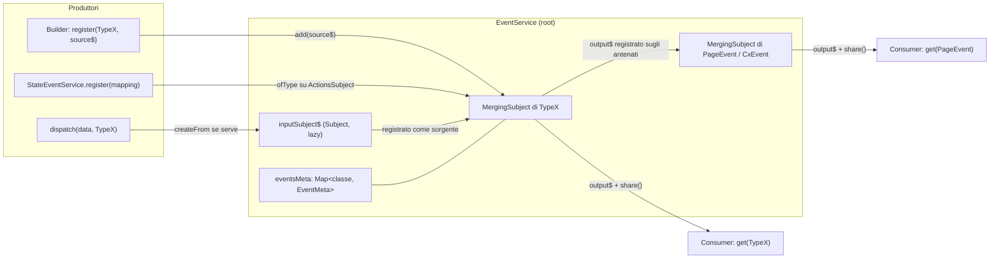
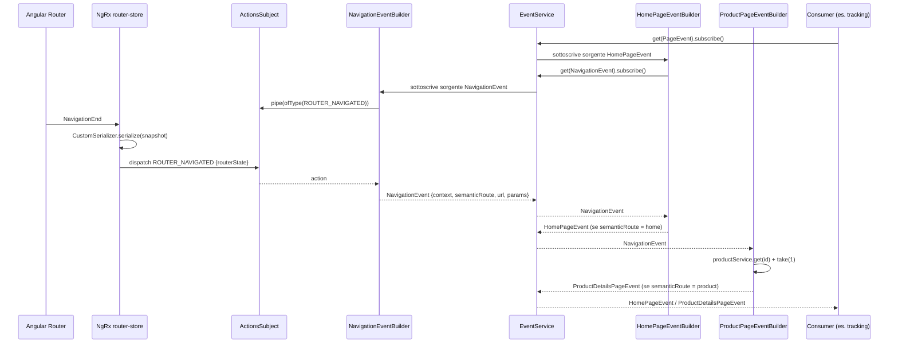
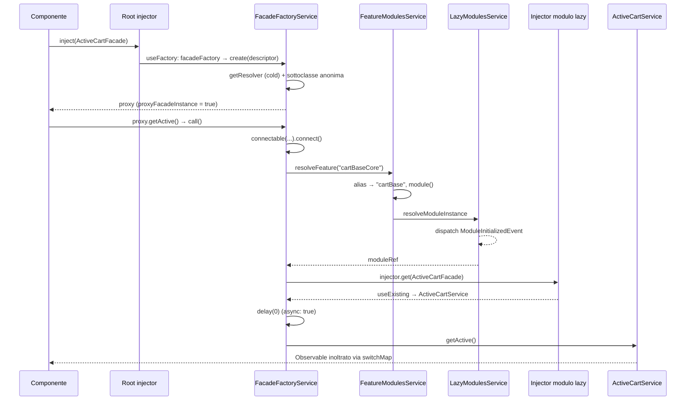
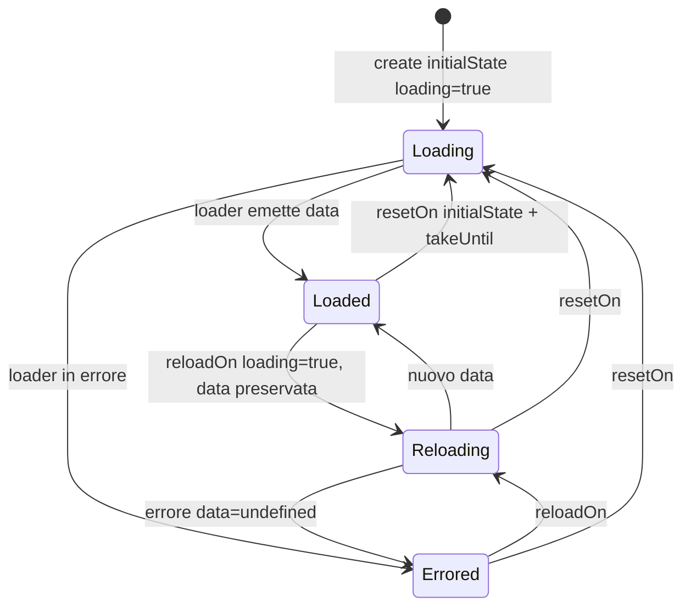
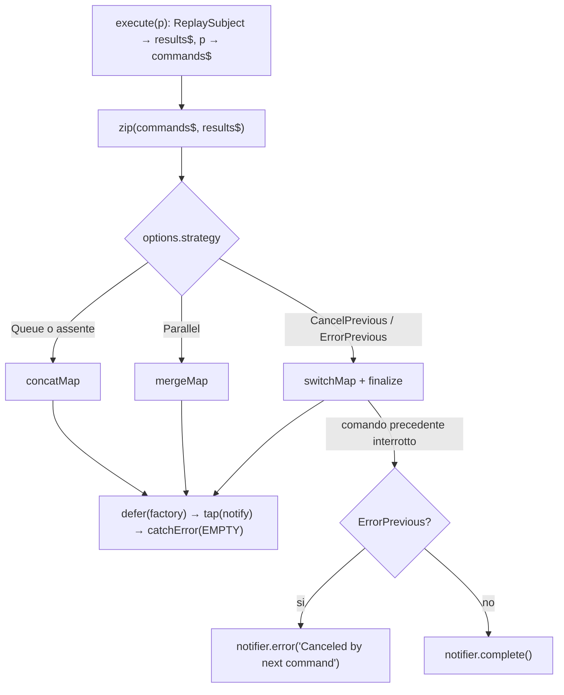

# 20 — Facade, command & query, eventi

> Riferimenti allo SHA `5b7a1c2bf2808d7380bc20596d10f4fa710c3da1` (vedi [00-meta](../00-meta.md)).

Prerequisiti consigliati: [01 — Dependency injection](../parte-1/01-dependency-injection.md), [12 — Feature module e lazy loading in Spartacus](12-feature-module-lazy.md), [19 — State management](19-state-management.md). Collegati: [14 — Routing](14-routing.md) (route semantiche), [25 — Carrello](25-cart.md) e [26 — Checkout](26-checkout.md) (i principali utilizzatori di facade, command e query).

## 1. A cosa serve e perché esiste

Una feature Spartacus espone ai componenti (e alle altre feature) un'API stabile e indipendente da *come* i dati vengono caricati. Questo capitolo copre i quattro mattoni con cui quell'API viene costruita e con cui le feature comunicano fra loro senza dipendenze dirette:

1. **Facade (proxy lazy).** Una facade è una classe astratta che i componenti iniettano. Con `facadeFactory` la facade viene fornita nel root injector come un *proxy* che, alla prima chiamata di metodo (o alla prima sottoscrizione di una proprietà), scarica il modulo lazy della feature e inoltra la chiamata all'implementazione reale (`core-libs/core/src/lazy-loading/facade-factory/facade-factory.service.ts:L22-L36`, `core-libs/core/src/lazy-loading/facade-factory/facade-factory.ts:L20-L24`). È ciò che consente a un header di iniettare `ActiveCartFacade` senza trascinare nel bundle iniziale tutto il codice del carrello (`feature-libs/cart/base/root/facade/active-cart.facade.ts:L13-L46`).
2. **Command.** Un'astrazione per le operazioni di scrittura (POST/PUT/DELETE verso OCC) con una *strategia di concorrenza* esplicita: in coda, in parallelo, annulla la precedente, metti in errore la precedente (`core-libs/core/src/util/command-query/command.service.ts:L27-L38`). Il comando parte anche se nessuno si sottoscrive al risultato (`core-libs/core/src/util/command-query/command.service.ts:L122-L132`).
3. **Query.** Un'astrazione per le letture con stato `{loading, error, data}`, caricamento lazy alla sottoscrizione e invalidazione dichiarativa tramite eventi (`reloadOn`, `resetOn`) (`core-libs/core/src/util/command-query/query.service.ts:L33-L60`). Insieme a Command è l'alternativa "senza NgRx" usata dalle feature più recenti (es. checkout, `feature-libs/checkout/base/core/facade/checkout-query.service.ts:L32-L54`).
4. **Eventi.** Un bus tipizzato per classi (`EventService`): chiunque può *registrare* una sorgente observable per un tipo di evento, *dispatchare* un'istanza, o *ascoltare* un tipo (e quindi anche tutti i suoi sottotipi) (`core-libs/core/src/event/event.service.ts:L47-L113`). `StateEventService` trasforma azioni NgRx in eventi (`core-libs/core/src/state/event/state-event.service.ts:L16-L76`), e `@spartacus/storefront` aggiunge una catena di eventi di pagina (`NavigationEvent` → `HomePageEvent`, `ProductDetailsPageEvent`, ...) pensata per tracking e personalizzazione (`core-libs/storefront/events/index.ts:L7-L10`).

I quattro pezzi sono intrecciati: le query usano eventi come trigger (`core-libs/core/src/util/command-query/query.service.ts:L144-L155`), i command dispatchano eventi di dominio dopo il successo (`feature-libs/checkout/base/core/facade/checkout-delivery-address.service.ts:L34-L64`), il lazy loading che sta dietro le facade notifica la creazione dei moduli con un evento (`core-libs/core/src/lazy-loading/lazy-modules.service.ts:L99-L106`).

Tutti i simboli principali sono API pubblica di `@spartacus/core`: eventi (`core-libs/core/src/event/index.ts:L7-L8`), command/query e `createFrom` (`core-libs/core/src/util/index.ts:L10-L12`, `core-libs/core/public_api.ts:L35-L35`), facade factory (`core-libs/core/src/lazy-loading/facade-factory/index.ts:L7-L9`, `core-libs/core/public_api.ts:L24-L24`), `StateEventService` (`core-libs/core/src/state/event/index.ts:L7-L8`, `core-libs/core/public_api.ts:L33-L33`). Gli eventi di pagina sono pubblici da `@spartacus/storefront` (`core-libs/storefront/public_api.ts:L25-L25`). `MergingSubject`, il motore interno del bus, **non** è esportato ed è marcato `// PRIVATE API` (`core-libs/core/src/event/index.ts:L7-L8`, `core-libs/core/src/event/utils/merging-subject.ts:L10-L10`).

## 2. Mappa dei file

| Path | Ruolo |
|---|---|
| `core-libs/core/src/event/cx-event.ts` | `CxEvent`: classe base astratta di tutti gli eventi, con il solo campo statico `type = 'CxEvent'` (`:L12-L17`). |
| `core-libs/core/src/event/event.service.ts` | `EventService`: `register`/`get`/`dispatch`, registrazione sui tipi padre, validazioni in dev mode (`:L44-L223`). |
| `core-libs/core/src/event/utils/merging-subject.ts` | `MergingSubject` (PRIVATE API): fonde dinamicamente N sorgenti in un `output$` con refcount (`:L10-L141`). |
| `core-libs/core/src/event/index.ts` | Barrel pubblico: `CxEvent`, `EventService` (`:L7-L8`). |
| `core-libs/core/src/util/create-from.ts` | `createFrom(type, data)`: `Object.assign(new type(), data)` (`:L15-L17`). |
| `core-libs/core/src/state/event/action-to-event-mapping.ts` | `ActionToEventMapping<T>`: `action`, `event`, `factory?` (`:L9-L24`). |
| `core-libs/core/src/state/event/state-event.service.ts` | `StateEventService`: azioni NgRx → sorgenti di eventi (`:L16-L76`). |
| `core-libs/core/src/util/command-query/command.service.ts` | `Command`, `CommandStrategy`, `CommandService` (`:L27-L140`). |
| `core-libs/core/src/util/command-query/query.service.ts` | `QueryNotifier`, `QueryState`, `Query`, `QueryService` (`:L31-L160`). |
| `core-libs/core/src/util/command-query/index.ts` | Barrel command/query (`:L7-L8`). |
| `core-libs/core/src/lazy-loading/facade-factory/facade-descriptor.ts` | `FacadeDescriptor<T>` e i tipi che vincolano metodi/proprietà (`:L10-L57`). |
| `core-libs/core/src/lazy-loading/facade-factory/facade-factory.ts` | Funzione `facadeFactory(descriptor)` (`:L20-L24`). |
| `core-libs/core/src/lazy-loading/facade-factory/facade-factory.service.ts` | `FacadeFactoryService`: costruzione del proxy, resolver, `call`/`get` (`:L20-L141`). |
| `core-libs/core/src/lazy-loading/feature-modules.service.ts` | Risoluzione feature → `NgModuleRef` usata dal proxy (dettagli nel [capitolo 12](12-feature-module-lazy.md)) (`:L33-L100`). |
| `core-libs/core/src/lazy-loading/events/module-initialized-event.ts` | `ModuleInitializedEvent` (`:L16-L32`). |
| `core-libs/storefront/events/navigation/navigation.event.ts` | `NavigationEvent` (`:L13-L34`). |
| `core-libs/storefront/events/navigation/navigation-event.builder.ts` | `NavigationEventBuilder`: `ROUTER_NAVIGATED` → `NavigationEvent` (`:L23-L65`). |
| `core-libs/storefront/events/navigation/navigation-event.module.ts` | `NavigationEventModule`: istanzia il builder (`:L10-L15`). |
| `core-libs/storefront/events/page/page.events.ts` | `PageEvent` astratta, porta `navigation` (`:L13-L18`). |
| `core-libs/storefront/events/home/home-page.events.ts` | `HomePageEvent` (`:L12-L15`). |
| `core-libs/storefront/events/home/home-page-event.builder.ts` | `HomePageEventBuilder`: `NavigationEvent` con `semanticRoute === 'home'` (`:L14-L36`). |
| `core-libs/storefront/events/home/home-page-event.module.ts` | `HomePageEventModule` (`:L10-L15`). |
| `core-libs/storefront/events/product/product-page.events.ts` | `ProductDetailsPageEvent`, `CategoryPageResultsEvent`, `SearchPageResultsEvent` (`:L13-L42`). |
| `core-libs/storefront/events/product/product-page-event.builder.ts` | `ProductPageEventBuilder`: PDP, categoria, ricerca (`:L23-L125`). |
| `core-libs/storefront/events/product/product-page-event.module.ts` | `ProductPageEventModule` (`:L10-L15`). |
| `core-libs/storefront/events/index.ts` e `*/index.ts` | Barrel degli eventi storefront (`core-libs/storefront/events/index.ts:L7-L10`). |

File di esempio citati: `feature-libs/cart/base/root/facade/active-cart.facade.ts`, `feature-libs/cart/base/core/facade/facade-providers.ts`, `feature-libs/checkout/base/core/facade/checkout-delivery-address.service.ts`, `feature-libs/checkout/base/core/facade/checkout-query.service.ts`, `feature-libs/checkout/base/root/events/checkout-query-event.listener.ts`, `core-libs/core/src/auth/user-auth/events/user-auth-event.builder.ts`, `feature-libs/cart/base/core/event/cart-event.builder.ts`.

## 3. Come funziona passo per passo

### 3.1 Il modello degli eventi: classi, non stringhe

Un evento Spartacus è un'istanza di una classe che (per convenzione) estende `CxEvent`. `CxEvent` non ha membri d'istanza: ha solo il campo statico `type = 'CxEvent'` e il commento "One event to rule them all" (`core-libs/core/src/event/cx-event.ts:L7-L17`). La chiave con cui il bus indicizza gli eventi è **la classe stessa** (il costruttore), non una stringa: lo stato di `EventService` è una `Map` privata da classe a `EventMeta` (`core-libs/core/src/event/event.service.ts:L49-L52`). Il campo statico `type` serve solo alla validazione in dev mode (§3.6).

Per costruire istanze da dati plain si usa `createFrom(type, data)`, che invoca `new type()` **senza argomenti** e copia le proprietà con `Object.assign` (`core-libs/core/src/util/create-from.ts:L15-L17`). È il motivo per cui gli eventi Spartacus dichiarano campi e non costruttori parametrici (es. `NavigationEvent`, `core-libs/storefront/events/navigation/navigation.event.ts:L13-L34`).

### 3.2 `EventService.register`: aggiungere una sorgente

`EventService` è un singleton `providedIn: 'root'` (`core-libs/core/src/event/event.service.ts:L44-L48`). Per ogni tipo tiene un `EventMeta` con un `inputSubject$` (inizialmente `null`) e un `MergingSubject` (`core-libs/core/src/event/event.service.ts:L24-L34`).

`register(eventType, source$)` (`core-libs/core/src/event/event.service.ts:L68-L84`):

1. recupera (o crea) il meta del tipo con `getEventMeta` (`core-libs/core/src/event/event.service.ts:L69-L69`); la creazione, in dev mode, è preceduta dalla validazione del tipo (`core-libs/core/src/event/event.service.ts:L133-L142`);
2. se la stessa istanza di observable è già registrata per quel tipo non la aggiunge e, in dev mode, logga un warning (`core-libs/core/src/event/event.service.ts:L70-L78`); altrimenti `mergingSubject.add(source$)` (`core-libs/core/src/event/event.service.ts:L80-L80`);
3. restituisce una funzione di teardown che rimuove la sorgente (`core-libs/core/src/event/event.service.ts:L83-L83`). Il JSDoc impone di chiamarla (es. in `ngOnDestroy`) quando chi ha registrato la sorgente non la mantiene più, per evitare memory leak (`core-libs/core/src/event/event.service.ts:L57-L59`).

Registrare **non sottoscrive** la sorgente: `MergingSubject.add` si abbona subito solo se c'è già un consumer attivo, altrimenti accoda e basta (`core-libs/core/src/event/utils/merging-subject.ts:L71-L80`).

### 3.3 La gerarchia: chi ascolta il padre riceve i figli

Alla creazione del meta di un tipo, `createEventMeta` risale la prototype chain della classe e registra l'`output$` del nuovo tipo come sorgente di **ogni** classe antenata (`core-libs/core/src/event/event.service.ts:L144-L159`). La condizione d'uscita (`Object.getPrototypeOf(parentEvent) !== Object.getPrototypeOf({})`) ferma il ciclo quando il candidato è `Function.prototype`, il cui prototipo è `Object.prototype`: per `HomePageEvent` vengono quindi registrati `PageEvent` e `CxEvent` (dossier F+10). Il comportamento è documentato come `@since 3.1` (`core-libs/core/src/event/event.service.ts:L61-L61`) e coperto dallo spec "should register the parent class" con un padre astratto `CartEvent` (`core-libs/core/src/event/event.service.spec.ts:L176-L189`).

Il collegamento avviene alla creazione del meta del sottotipo, ma questo non crea problemi di ordine: qualsiasi emissione di un sottotipo richiede `register` o `dispatch` su quel tipo, entrambi passano per `getEventMeta` (`core-libs/core/src/event/event.service.ts:L68-L69`, `core-libs/core/src/event/event.service.ts:L120-L126`), e se il consumer del padre è già attivo `MergingSubject.add` si abbona subito (`core-libs/core/src/event/utils/merging-subject.ts:L76-L78`) (dossier F+14).

### 3.4 `EventService.get`: ascoltare

`get(eventType)` restituisce `mergingSubject.output$` del tipo (creando il meta se manca); in dev mode lo avvolge con un `tap` di validazione (`core-libs/core/src/event/event.service.ts:L90-L96`). `output$` è un `Observable` custom seguito da `share()` (`core-libs/core/src/event/utils/merging-subject.ts:L45-L58`):

- alla **prima** sottoscrizione (il solo "consumer" interno è il subscriber di `share()`, `core-libs/core/src/event/utils/merging-subject.ts:L46-L47`) memorizza il consumer e si abbona a tutte le sorgenti registrate (`core-libs/core/src/event/utils/merging-subject.ts:L51-L52`, `core-libs/core/src/event/utils/merging-subject.ts:L85-L89`);
- ogni sorgente inoltra **solo** le notifiche `next` (`core-libs/core/src/event/utils/merging-subject.ts:L102-L105`): `error` e `complete` delle sorgenti non arrivano mai a chi ascolta;
- quando l'ultimo sottoscrittore se ne va (refcount di `share()` a zero) annulla il consumer e si disabbona da tutte le sorgenti (`core-libs/core/src/event/utils/merging-subject.ts:L54-L57`, `core-libs/core/src/event/utils/merging-subject.ts:L95-L97`);
- una nuova sottoscrizione successiva ripete il ciclo (`core-libs/core/src/event/utils/merging-subject.ts:L36-L44`).

Le sorgenti sono quindi "attive" solo mentre qualcuno ascolta. Questo è un pilastro del design: un builder di eventi costoso (es. che legge lo store) non lavora finché nessuno è interessato.

### 3.5 `EventService.dispatch`: emettere un'istanza

`dispatch(event, eventType?)` (`core-libs/core/src/event/event.service.ts:L105-L113`):

1. senza `eventType`, il tipo è `event.constructor` (`core-libs/core/src/event/event.service.ts:L106-L107`);
2. con `eventType` e un oggetto che non ne è istanza, lo converte con `createFrom` (`core-libs/core/src/event/event.service.ts:L108-L110`);
3. prende l'input subject del tipo e fa `next` (`core-libs/core/src/event/event.service.ts:L111-L112`).

L'input subject è un `Subject` semplice creato al primo `dispatch` e registrato come una qualsiasi altra sorgente tramite `register` (`core-libs/core/src/event/event.service.ts:L120-L128`; il commento `// will be created lazily by the dispatch method` è a `core-libs/core/src/event/event.service.ts:L146-L146`). Essendo un `Subject` non-replay, e dato che le sorgenti sono collegate al consumer solo se ce n'è uno (§3.4), **un evento dispatchato quando nessuno ascolta quel tipo (o un suo antenato) è perso** (vedi §9).

### 3.6 Validazioni in dev mode

Tutte le validazioni sono sotto `isDevMode()`, che in Angular è vero se `ngDevMode` è `undefined` o truthy (`angular:packages/core/src/util/is_dev_mode.ts:L20-L22`):

- `validateEventType`: lancia `Error` solo se `eventType` è nullish o non ha `constructor` (in pratica `null`/`undefined`); un valore non-classe ma con `constructor` (es. una stringa o un oggetto plain) passa e produce al più un warning di `validateCxEvent` (`core-libs/core/src/event/event.service.ts:L166-L174`);
- `validateCxEvent`: risale la catena cercando una classe con `type === 'CxEvent'`; se non la trova emette **solo un warning** (`core-libs/core/src/event/event.service.ts:L181-L197`);
- `getValidatedEventStream`: `tap` che avvisa se un valore emesso non è `instanceof` del tipo chiesto (`core-libs/core/src/event/event.service.ts:L204-L222`).

In produzione nessuno di questi controlli viene eseguito.

### 3.7 `StateEventService`: azioni NgRx → eventi

`StateEventService` (root) dipende da `ActionsSubject` di NgRx e da `EventService` (`core-libs/core/src/state/event/state-event.service.ts:L16-L26`). Il mapping è un `ActionToEventMapping<T>`: `action` (stringa o array), `event` (classe o `null`), `factory?` (`core-libs/core/src/state/event/action-to-event-mapping.ts:L9-L24`).

1. `register(mapping)` delega a `eventService.register(mapping.event, getFromAction(mapping))` e restituisce il teardown (`core-libs/core/src/state/event/state-event.service.ts:L36-L41`).
2. `getFromAction` filtra `ActionsSubject` con `ofType(...)` sulle action normalizzate in array (`core-libs/core/src/state/event/state-event.service.ts:L47-L55`). `ofType` è importato da `@ngrx/effects` (`core-libs/core/src/state/event/state-event.service.ts:L8-L8`) ed è un semplice `filter` che confronta `action.type` con la stringa (o con il `.type` di un ActionCreator) senza trasformare l'action (`deps:ngrx-effects-21.0.1/package/fesm2022/ngrx-effects.mjs:L245-L254`).
3. `createEvent` usa la `factory` se presente, altrimenti `createFrom(eventType, action.payload ?? {})` (`core-libs/core/src/state/event/state-event.service.ts:L68-L76`).

Esempi reali: `UserAuthEventBuilder` mappa `AuthActions.LOGIN` → `LoginEvent` senza factory, mentre deriva `LogoutEvent` da `isUserLoggedIn()` con `pairwise` registrando direttamente su `EventService` (`core-libs/core/src/auth/user-auth/events/user-auth-event.builder.ts:L40-L63`); `CartEventBuilder` usa una `factory` per aggiungere `cartCode` al payload di `DELETE_CART` (`feature-libs/cart/base/core/event/cart-event.builder.ts:L137-L145`).

Nota NgRx: `ActionsSubject` è un `BehaviorSubject` inizializzato con `{ type: '@ngrx/store/init' }` e `Store.dispatch` fa `actionsObserver.next(action)` (`deps:ngrx-store-21.0.1/package/fesm2022/ngrx-store.mjs:L196-L200`, `deps:ngrx-store-21.0.1/package/fesm2022/ngrx-store.mjs:L598-L603`). Ogni nuova sottoscrizione riceve quindi subito l'**ultima** action dispatchata: se coincide con una di quelle mappate, il primo consumer di un evento derivato da azioni riceve un evento "di replay" (vedi §9).

### 3.8 Command

`Command<PARAMS, RESULT>` è una classe astratta con il solo `execute(parameters): Observable<RESULT>` (`core-libs/core/src/util/command-query/command.service.ts:L27-L29`). `CommandService` (root, `OnDestroy`) li fabbrica (`core-libs/core/src/util/command-query/command.service.ts:L40-L44`).

`create(commandFactory, options?)` (`core-libs/core/src/util/command-query/command.service.ts:L50-L135`):

1. crea due `Subject`: `commands$` per i parametri e `results$` per i `ReplaySubject` che notificheranno ciascun chiamante (`core-libs/core/src/util/command-query/command.service.ts:L54-L55`);
2. definisce `notify(notifier$)`, un observer parziale che inoltra solo `next`/`error`/`complete`: dopo RxJS 7.3 passare il subject direttamente a `tap` inoltrerebbe anche l'handler `unsubscribe` (commento con link alla PR RxJS #6527, `core-libs/core/src/util/command-query/command.service.ts:L57-L68`);
3. costruisce la pipeline `zip(commands$, results$)` + operatore di flattening scelto in base alla strategia (`core-libs/core/src/util/command-query/command.service.ts:L72-L118`):
   - `CancelPrevious` / `ErrorPrevious` → `switchMap` (`core-libs/core/src/util/command-query/command.service.ts:L73-L93`); nel `finalize`, se il notifier non è già chiuso né in errore, `ErrorPrevious` lo chiude con `Error('Canceled by next command')`, `CancelPrevious` con `complete()` (`core-libs/core/src/util/command-query/command.service.ts:L80-L90`);
   - `Parallel` → `mergeMap` (`core-libs/core/src/util/command-query/command.service.ts:L96-L105`);
   - `Queue` e **default** (nessuna strategia) → `concatMap` (`core-libs/core/src/util/command-query/command.service.ts:L107-L117`);
   - in ogni ramo la factory è avvolta in `defer`, il risultato inoltrato al notifier via `tap(notify(...))`, e un `catchError(() => EMPTY)` impedisce che l'errore di un comando chiuda l'intera pipeline: l'errore arriva solo al notifier di quel comando (`core-libs/core/src/util/command-query/command.service.ts:L99-L102`);
4. **sottoscrive subito** la pipeline e la accumula in `this.subscriptions` (`core-libs/core/src/util/command-query/command.service.ts:L120-L120`);
5. ritorna un'istanza di una sottoclasse anonima di `Command` il cui `execute` crea un `ReplaySubject`, lo spinge su `results$`, spinge i parametri su `commands$` e restituisce il `ReplaySubject` (`core-libs/core/src/util/command-query/command.service.ts:L122-L132`).

Poiché `zip` accoppia l'n-esimo parametro con l'n-esimo notifier, ogni chiamante riceve esattamente il risultato del proprio comando. Il comando parte all'interno di `execute`, indipendentemente dalla sottoscrizione del risultato: lo spec lo verifica con "should execute command without subscription" e conferma `Queue` come default (`core-libs/core/src/util/command-query/command.service.spec.ts:L92-L92`, `core-libs/core/src/util/command-query/command.service.spec.ts:L163-L163`). `ngOnDestroy` del servizio chiude tutte le pipeline (`core-libs/core/src/util/command-query/command.service.ts:L137-L139`).

Fuori da `CommandService`, nel codice non-spec del repo `CancelPrevious` compare 24 volte e `Queue` 7; `ErrorPrevious` e `Parallel` non sono mai usate (compaiono solo nello `switch` di `core-libs/core/src/util/command-query/command.service.ts:L72-L118`) (dossier F51, conteggio via `git grep`). Un uso tipico: `CheckoutDeliveryAddressService` crea `createDeliveryAddressCommand` con `CancelPrevious`, chiama il connector e, in `tap`, dispatcha `CheckoutDeliveryAddressCreatedEvent` (`feature-libs/checkout/base/core/facade/checkout-delivery-address.service.ts:L34-L64`); i metodi pubblici della facade si limitano a `command.execute(...)` (`feature-libs/checkout/base/core/facade/checkout-delivery-address.service.ts:L162-L172`).

### 3.9 Query

Tipi pubblici (`core-libs/core/src/util/command-query/query.service.ts:L31-L42`): `QueryNotifier = Observable<unknown> | Type<CxEvent>`; `QueryState<T> = {loading, error: false | Error, data: T | undefined}`; `Query<RESULT, PARAMS>` con `get(...params)` e `getState(...params)`. `QueryService` è root, `OnDestroy`, e inietta `EventService` (`core-libs/core/src/util/command-query/query.service.ts:L44-L50`).

`create(loaderFactory, options?)` (`core-libs/core/src/util/command-query/query.service.ts:L52-L142`):

1. Stato iniziale `{data: undefined, error: false, loading: true}` in un `BehaviorSubject` (`core-libs/core/src/util/command-query/query.service.ts:L61-L67`).
2. `onSubscribeLoad$`: `iif(() => state$.value.loading, of(undefined), EMPTY)` — emette solo se lo stato è ancora `loading`, cioè alla prima sottoscrizione o se un caricamento precedente è stato interrotto da un unsubscribe (`core-libs/core/src/util/command-query/query.service.ts:L69-L75`).
3. Tre stream di trigger costruiti con `getTriggersStream`: `loadTrigger$` fonde `onSubscribeLoad$` (valutato per primo, come spiega il commento) con `reloadOn` e `resetOn`; `resetTrigger$` e `reloadTrigger$` separati (`core-libs/core/src/util/command-query/query.service.ts:L77-L84`). `getTriggersStream` converte le classi evento in `eventService.get(trigger)` e fonde tutto con `merge`; con lista vuota ritorna `EMPTY` (`core-libs/core/src/util/command-query/query.service.ts:L144-L155`).
4. `loaderFactory()` è invocata **una sola volta**, qui, e il suo observable è interrotto da un reset con `takeUntil(resetTrigger$)` (`core-libs/core/src/util/command-query/query.service.ts:L86-L86`).
5. `load$`: a ogni trigger imposta `loading: true` (preservando `data`), fa `switchMap` sul loader, su dato imposta `{loading: false, error: false, data}`, su errore `{loading: false, error, data: undefined}` e ritorna la sorgente (si risottoscrive ai trigger); il tutto è condiviso con `share()` (`core-libs/core/src/util/command-query/query.service.ts:L88-L103`).
6. Se `reloadOn` non è vuoto, una subscription **permanente** in `this.subscriptions` mette `loading: true` a ogni trigger, anche senza sottoscrittori della query (`core-libs/core/src/util/command-query/query.service.ts:L105-L114`).
7. Se `resetOn` non è vuoto, un'altra subscription permanente riporta lo stato a `initialState` (se non lo è già) (`core-libs/core/src/util/command-query/query.service.ts:L116-L129`).
8. `query$ = using(() => load$.subscribe(), () => state$)`: sottoscrivere lo stato attiva `load$` come "risorsa" che vive quanto il sottoscrittore (`core-libs/core/src/util/command-query/query.service.ts:L131-L134`).
9. `get()` restituisce `data` con `distinctUntilChanged`, `getState()` lo stato completo; i `params` sono ignorati (`core-libs/core/src/util/command-query/query.service.ts:L136-L141`).

Esempio: `CheckoutQueryService` crea la query sui dettagli del checkout con `reloadOn: [CheckoutQueryReloadEvent]` e `resetOn: [CheckoutQueryResetEvent]`, restituiti da metodi `protected` sovrascrivibili (`feature-libs/checkout/base/core/facade/checkout-query.service.ts:L32-L54`). Un listener separato, `CheckoutQueryEventListener`, traduce eventi di dominio negli eventi di controllo: cambio lingua/valuta → reload; login, logout, merge/save/restore carrello, ordine piazzato → reset (`feature-libs/checkout/base/root/events/checkout-query-event.listener.ts:L38-L62`). I due eventi di controllo sono emessi con `dispatch` (Subject non-replay), ma non vanno persi perché le subscription permanenti di §3.9 punti 6-7 li ascoltano sempre (`core-libs/core/src/util/command-query/query.service.ts:L105-L129`).

### 3.10 Facade proxy con `facadeFactory`

Il descrittore `FacadeDescriptor<T>` ha `facade` (classe astratta) e `feature` obbligatori, `methods`, `properties`, `async` opzionali (`core-libs/core/src/lazy-loading/facade-factory/facade-descriptor.ts:L10-L37`). I tipi ausiliari `MethodKeys`/`PropertyKeys` limitano a compile time le chiavi a metodi che ritornano `void | Observable` e a proprietà `Observable`; `StrictlyAllowedFacade<T>` diventa `never` se la facade contiene membri di altro tipo (`core-libs/core/src/lazy-loading/facade-factory/facade-descriptor.ts:L39-L57`). Il JSDoc lo ribadisce: i ritorni non-observable vengono ignorati, e `async` serve a rendere pronto lo store NgRx lazy (`core-libs/core/src/lazy-loading/facade-factory/facade-descriptor.ts:L19-L36`).

Flusso, con `ActiveCartFacade` come esempio:

1. La facade astratta è dichiarata `@Injectable({ providedIn: 'root', useFactory: () => facadeFactory({...}) })` con feature `CART_BASE_CORE_FEATURE`, la lista esplicita dei metodi e `async: true` (`feature-libs/cart/base/root/facade/active-cart.facade.ts:L13-L46`).
2. `facadeFactory` chiama `inject(FacadeFactoryService).create(descriptor)` (`core-libs/core/src/lazy-loading/facade-factory/facade-factory.ts:L20-L24`); `inject()` di Angular richiede un injection context attivo (senza, `injectInjectorOnly` lancia `MISSING_INJECTION_CONTEXT`: `angular:packages/core/src/di/injector_compatibility.ts:L93-L103`), che `useFactory` fornisce.
3. `create` costruisce il resolver con `getResolver(feature, facade, async)` (`core-libs/core/src/lazy-loading/facade-factory/facade-factory.service.ts:L117-L117`). Se la feature non è configurata (`isConfigured` è vero solo se la config, dopo la risoluzione degli alias, ha `module`, `core-libs/core/src/lazy-loading/feature-modules.service.ts:L33-L35`) il resolver è un `throwError` permanente; altrimenti è `resolveFeature(feature)` → `moduleRef.injector.get(facadeClass)`, con `delay(0)` se `async`, e `shareReplay()` (`core-libs/core/src/lazy-loading/facade-factory/facade-factory.service.ts:L38-L57`). Il resolver è cold: nessun caricamento avviene qui (spec "should not trigger lazy loading", `core-libs/core/src/lazy-loading/facade-factory/facade-factory.service.spec.ts:L118-L132`).
4. Istanzia una **sottoclasse anonima** della facade astratta, assegna una funzione proxy per ogni metodo elencato e un observable per ogni proprietà elencata, e marca l'istanza con `proxyFacadeInstance = true` (`core-libs/core/src/lazy-loading/facade-factory/facade-factory.service.ts:L119-L130`, costante a `core-libs/core/src/lazy-loading/facade-factory/facade-factory.service.ts:L20-L20`, verifica con `isProxyFacadeInstance` a `core-libs/core/src/lazy-loading/facade-factory/facade-factory.service.ts:L138-L140`).
5. Alla chiamata di un metodo, `call()` crea un `connectable(resolver$.pipe(map(service => service[method](...args))), {connector: ReplaySubject, resetOnDisconnect: false})` e fa **subito** `connect()`: il modulo viene scaricato e il metodo reale eseguito anche se il chiamante non si sottoscrive (`core-libs/core/src/lazy-loading/facade-factory/facade-factory.service.ts:L70-L82`).
6. `resolveFeature('cartBaseCore')` risolve l'alias `cartBaseCore` → `cartBase` (`core-libs/core/src/lazy-loading/feature-modules.service.ts:L95-L100`, `feature-libs/cart/base/root/cart-base-root.module.ts:L45-L53`), il cui `module` è l'import dinamico fornito dall'app (`projects/storefrontapp/src/app/spartacus/features/cart/cart-base-feature.module.ts:L26-L33`); la risoluzione è cachata per feature (`core-libs/core/src/lazy-loading/feature-modules.service.ts:L42-L73`).
7. `LazyModulesService`, dopo aver creato il modulo e i suoi initializer, dispatcha `ModuleInitializedEvent` con `feature` e `moduleRef` (`core-libs/core/src/lazy-loading/lazy-modules.service.ts:L99-L106`).
8. `moduleRef.injector.get(ActiveCartFacade)` trova nel modulo lazy il provider `{provide: ActiveCartFacade, useExisting: ActiveCartService}` e restituisce l'implementazione concreta, non il proxy root (`feature-libs/cart/base/core/facade/facade-providers.ts:L27-L30`, `feature-libs/cart/base/core/cart-base-core.module.ts:L36-L36`).
9. Il risultato del metodo reale viene appiattito con `switchMap`: se è observable viene inoltrato, altrimenti si ritorna `EMPTY` (`core-libs/core/src/lazy-loading/facade-factory/facade-factory.service.ts:L84-L91`).
10. Le **proprietà** sono invece `resolver$.pipe(switchMap(service => service[property]))`: cold, il caricamento avviene solo alla sottoscrizione (`core-libs/core/src/lazy-loading/facade-factory/facade-factory.service.ts:L103-L108`).

Lo spec copre tutti questi casi: chiamata di metodo che innesca il lazy loading senza subscribe, proprietà non sottoscritta che non lo innesca, `async: true` che ritarda l'inizializzazione (`core-libs/core/src/lazy-loading/facade-factory/facade-factory.service.spec.ts:L156-L187` per metodi e proprietà, `core-libs/core/src/lazy-loading/facade-factory/facade-factory.service.spec.ts:L126-L137` per l'opzione `async`). Nel repo 62 file non-spec usano `facadeFactory(` (dossier F98).

### 3.11 Eventi di pagina dello storefront

La catena parte dal router store di NgRx:

1. Spartacus configura `StoreRouterConnectingModule.forRoot({ routerState: RouterState.Minimal, stateKey: ROUTING_FEATURE })` e, in `RoutingModule.forRoot()`, fornisce `RouterStateSerializer` con `useClass: CustomSerializer` (`core-libs/core/src/routing/routing.module.ts:L77-L80`, `core-libs/core/src/routing/routing.module.ts:L89-L92`). Senza un serializer esplicito NgRx userebbe MinimalRouterStateSerializer (`deps:ngrx-router-store-21.0.1/package/fesm2022/ngrx-router-store.mjs:L359-L366`). I provider di `RoutingModule.forRoot()` (importato da `BaseStorefrontModule`, `core-libs/storefront/base-storefront.module.ts:L41-L41`) sono raccolti dopo quelli dei suoi import: `walkProviderTree` elabora prima gli import, poi i `ModuleWithProviders` importati come `StoreRouterConnectingModule.forRoot(...)` (`angular:packages/core/src/di/provider_collection.ts:L293-L321`, `deps:ngrx-router-store-21.0.1/package/fesm2022/ngrx-router-store.mjs:L414-L420`), poi i provider del modulo stesso (`angular:packages/core/src/di/provider_collection.ts:L346-L354`), e restituisce `true` per un `ModuleWithProviders` così che il genitore ne visiti i `providers` dopo (`angular:packages/core/src/di/provider_collection.ts:L360-L362`). Per i token non-multi `R3Injector` sovrascrive il record e vince l'ultimo (`angular:packages/core/src/di/r3_injector.ts:L521-L521`): quindi vince `CustomSerializer` (vedi [capitolo 19](19-state-management.md) e [capitolo 14](14-routing.md)); il funzionamento di `HomePageEventBuilder`, che legge `semanticRoute`, lo presuppone.
2. Su `NavigationEnd` (se la navigazione non è stata innescata dallo store) il router store serializza `router.routerState.snapshot` e dispatcha `{type: ROUTER_NAVIGATED, payload: {routerState, event}}` (`deps:ngrx-router-store-21.0.1/package/fesm2022/ngrx-router-store.mjs:L245-L253`, `deps:ngrx-router-store-21.0.1/package/fesm2022/ngrx-router-store.mjs:L279-L305`); `ROUTER_NAVIGATED` vale `'@ngrx/router-store/navigated'` (`deps:ngrx-router-store-21.0.1/package/fesm2022/ngrx-router-store.mjs:L32-L33`). In modalità `Minimal`, `payload.event` è ridotto a `{id, url, urlAfterRedirects}` (`deps:ngrx-router-store-21.0.1/package/fesm2022/ngrx-router-store.mjs:L283-L305`).
3. `CustomSerializer.serialize` produce un `ActivatedRouterStateSnapshot` con `url`, `queryParams`, `params`, `context`, `cmsRequired`, `semanticRoute` (`core-libs/core/src/routing/store/routing-state.ts:L18-L25`); `semanticRoute` viene da `data.cxRoute` di una route antenata o, in mancanza, da `lookupSemanticRoute(urlString)` (`core-libs/core/src/routing/store/reducers/router.reducer.ts:L125-L155`).
4. `NavigationEventBuilder` (root) registra nel costruttore una sorgente per `NavigationEvent` (`core-libs/storefront/events/navigation/navigation-event.builder.ts:L23-L39`): filtra `ActionsSubject` con `ofType<RouterNavigatedAction<ActivatedRouterStateSnapshot>>(ROUTER_NAVIGATED)` e legge `payload.routerState` (`core-libs/storefront/events/navigation/navigation-event.builder.ts:L57-L64`). Il generico di `RouterNavigatedAction` è solo una dichiarazione di tipo del payload (`deps:ngrx-router-store-21.0.1/package/types/ngrx-router-store.d.ts:L129-L139`): nessun controllo runtime. L'evento copia `context`, `semanticRoute`, `url`, `params` — non `queryParams` né `cmsRequired` (`core-libs/storefront/events/navigation/navigation-event.builder.ts:L44-L55`).
5. `HomePageEventBuilder` ascolta `NavigationEvent`, filtra `semanticRoute === 'home'` e crea `HomePageEvent` con `navigation` (`core-libs/storefront/events/home/home-page-event.builder.ts:L22-L35`). `HomePageEvent extends PageEvent` (`core-libs/storefront/events/home/home-page.events.ts:L12-L15`), e `PageEvent` è astratta e porta il `NavigationEvent` originario (`core-libs/storefront/events/page/page.events.ts:L13-L18`).
6. `ProductPageEventBuilder` (dipende da `EventService`, `ProductService`, `ProductSearchService`) registra tre sorgenti (`core-libs/storefront/events/product/product-page-event.builder.ts:L23-L48`):
   - **PDP**: `semanticRoute === 'product'` → `switchMap` su `productService.get(context.id)` → primo prodotto truthy (`take(1)`) → `ProductDetailsPageEvent` con categorie, codice, nome, prezzo (`core-libs/storefront/events/product/product-page-event.builder.ts:L50-L69`);
   - **Categoria**: per ogni `NavigationEvent`, `switchMap` che ritorna `EMPTY` se la route non è `'category'`, altrimenti mappa `productSearchService.getResults().pipe(skip(1))` a `CategoryPageResultsEvent` (`core-libs/storefront/events/product/product-page-event.builder.ts:L71-L97`);
   - **Ricerca**: stessa struttura con `'search'` e `searchTerm = freeTextSearch ?? ''` (`core-libs/storefront/events/product/product-page-event.builder.ts:L99-L124`).
   `getResults()` è una `select` sullo store (`core-libs/core/src/product/facade/product-search.service.ts:L32-L34`); lo `skip(1)` salta il valore corrente (iniziale o della ricerca precedente), come spiega il commento (`core-libs/storefront/events/product/product-page-event.builder.ts:L73-L73`).
7. I builder sono `providedIn: 'root'` ma nessuno li inietta da solo: vengono istanziati dai moduli vuoti `NavigationEventModule`, `HomePageEventModule`, `ProductPageEventModule`, che li ricevono nel costruttore (`core-libs/storefront/events/navigation/navigation-event.module.ts:L10-L15`, `core-libs/storefront/events/home/home-page-event.module.ts:L10-L15`, `core-libs/storefront/events/product/product-page-event.module.ts:L10-L15`). L'app demo li importa in `SpartacusFeaturesModule` (`projects/storefrontapp/src/app/spartacus/spartacus-features.module.ts:L239-L242`) e lo schematic `add-spartacus` li aggiunge al modulo generato (`core-libs/schematics/src/add-spartacus/spartacus-features.ts:L241-L243`).

Grazie alla gerarchia di §3.3, un consumer di `PageEvent` riceve `HomePageEvent`, `ProductDetailsPageEvent`, `CategoryPageResultsEvent` e `SearchPageResultsEvent` (`core-libs/core/src/event/event.service.ts:L151-L158`).

## 4. Diagrammi

### 4.1 Struttura interna di `EventService`



Riferimenti: `register` `core-libs/core/src/event/event.service.ts:L68-L84`; input subject `core-libs/core/src/event/event.service.ts:L120-L128`; registrazione sugli antenati `core-libs/core/src/event/event.service.ts:L151-L158`; `output$` `core-libs/core/src/event/utils/merging-subject.ts:L45-L58`; `StateEventService` `core-libs/core/src/state/event/state-event.service.ts:L36-L55`.

### 4.2 Catena degli eventi di pagina



Riferimenti: `deps:ngrx-router-store-21.0.1/package/fesm2022/ngrx-router-store.mjs:L245-L253`; `core-libs/storefront/events/navigation/navigation-event.builder.ts:L44-L64`; `core-libs/storefront/events/home/home-page-event.builder.ts:L26-L35`; `core-libs/storefront/events/product/product-page-event.builder.ts:L50-L69`. La sottoscrizione a cascata (consumer → sorgente → `get` del builder a monte) discende da `core-libs/core/src/event/utils/merging-subject.ts:L45-L58`.

### 4.3 Facade proxy: prima chiamata di metodo



Riferimenti: `feature-libs/cart/base/root/facade/active-cart.facade.ts:L13-L46`; `core-libs/core/src/lazy-loading/facade-factory/facade-factory.service.ts:L38-L131`; `core-libs/core/src/lazy-loading/feature-modules.service.ts:L42-L100`; `core-libs/core/src/lazy-loading/lazy-modules.service.ts:L99-L106`; `feature-libs/cart/base/core/facade/facade-providers.ts:L27-L30`.

### 4.4 Stati di una Query



Riferimenti: `core-libs/core/src/util/command-query/query.service.ts:L61-L67`, `core-libs/core/src/util/command-query/query.service.ts:L86-L129`. `Reloading` non è uno stato distinto nel codice: è `loading: true` con `data` ancora valorizzato (`core-libs/core/src/util/command-query/query.service.ts:L89-L93`).

### 4.5 Strategie di Command



Riferimenti: `core-libs/core/src/util/command-query/command.service.ts:L72-L132`.

## 5. Estratti di codice reale

**Registrazione sugli antenati** — `core-libs/core/src/event/event.service.ts:L144-L159`

```ts
  private createEventMeta<T>(eventType: AbstractType<T>): void {
    const eventMeta: EventMeta<T> = {
      inputSubject$: null, // will be created lazily by the `dispatch` method
      mergingSubject: new MergingSubject<T>(),
    };
    this.eventsMeta.set(eventType, eventMeta);

    let parentEvent = Object.getPrototypeOf(eventType);
    while (
      parentEvent !== null &&
      Object.getPrototypeOf(parentEvent) !== Object.getPrototypeOf({})
    ) {
      this.register(parentEvent, eventMeta.mergingSubject.output$);
      parentEvent = Object.getPrototypeOf(parentEvent);
    }
  }
```

**`dispatch`** — `core-libs/core/src/event/event.service.ts:L105-L113`

```ts
  dispatch<T extends object>(event: T, eventType?: Type<T>): void {
    if (!eventType) {
      eventType = event.constructor as Type<T>;
    } else if (!(event instanceof eventType)) {
      event = createFrom(eventType, event);
    }
    const inputSubject$ = this.getInputSubject(eventType);
    inputSubject$.next(event);
  }
```

**`MergingSubject.output$`** — `core-libs/core/src/event/utils/merging-subject.ts:L45-L58`

```ts
  readonly output$: Observable<T> = new Observable<T>((consumer) => {
    // There can be only 0 or 1 consumer of this observable coming from the `share()` operator
    // that is piped right after this observable.
    // `share()` not only multicasts the results but also  When all end-subscribers unsubscribe from `share()` operator, it will unsubscribe
    // from this observable (by the nature `refCount`-nature of the `share()` operator).

    this.consumer = consumer;
    this.bindAllSourcesToConsumer(consumer);

    return () => {
      this.consumer = null;
      this.unbindAllSourcesFromConsumer();
    };
  }).pipe(share());
```

**Binding: solo `next`** — `core-libs/core/src/event/utils/merging-subject.ts:L102-L105`

```ts
  private bindSourceToConsumer(source: Observable<T>, consumer: Subscriber<T>) {
    const subscriptionToSource = source.subscribe((val) => consumer.next(val)); // passes all emissions from source to consumer
    this.subscriptionsToSources.set(source, subscriptionToSource);
  }
```

**Azioni → eventi** — `core-libs/core/src/state/event/state-event.service.ts:L36-L41`

```ts
  register<T>(mapping: ActionToEventMapping<T>): () => void {
    return this.eventService.register(
      mapping.event as Type<T>,
      this.getFromAction(mapping)
    );
  }
```

**`ofType` di NgRx** — `deps:ngrx-effects-21.0.1/package/fesm2022/ngrx-effects.mjs:L245-L254`

```js
function ofType(...allowedTypes) {
    return filter((action) => allowedTypes.some((typeOrActionCreator) => {
        if (typeof typeOrActionCreator === 'string') {
            // Comparing the string to type
            return typeOrActionCreator === action.type;
        }
        // We are filtering by ActionCreator
        return typeOrActionCreator.type === action.type;
    }));
}
```

**Strategia a switch di `CommandService`** — `core-libs/core/src/util/command-query/command.service.ts:L72-L94`

```ts
    switch (options?.strategy) {
      case CommandStrategy.CancelPrevious:
      case CommandStrategy.ErrorPrevious:
        process$ = zip(commands$, results$).pipe(
          switchMap(([cmd, notifier$]) =>
            defer(() => commandFactory(cmd)).pipe(
              tap(notify(notifier$)),
              catchError(() => EMPTY),
              finalize(() => {
                // do not overwrite existing existing ending state
                if (!notifier$.closed && !notifier$.hasError) {
                  // command has not ended yet, so close notifier$ according to strategy
                  if (options.strategy === CommandStrategy.ErrorPrevious) {
                    notifier$.error(new Error('Canceled by next command'));
                  } else {
                    notifier$.complete();
                  }
                }
              })
            )
          )
        );
        break;
```

**`execute`** — `core-libs/core/src/util/command-query/command.service.ts:L120-L132`

```ts
    this.subscriptions.add(process$.subscribe());

    const command: Command<PARAMS, RESULT> = new (class extends Command<
      PARAMS,
      RESULT
    > {
      execute = (parameters: PARAMS) => {
        const result$ = new ReplaySubject<RESULT>();
        results$.next(result$);
        commands$.next(parameters);
        return result$;
      };
    })();
```

**Cuore di `QueryService.create`** — `core-libs/core/src/util/command-query/query.service.ts:L86-L103` e `core-libs/core/src/util/command-query/query.service.ts:L131-L141`

```ts
    const loader$ = loaderFactory().pipe(takeUntil(resetTrigger$));

    const load$ = loadTrigger$.pipe(
      tap(() => {
        if (!state$.value.loading) {
          state$.next({ ...state$.value, loading: true });
        }
      }),
      switchMap(() => loader$),
      tap((data) => {
        state$.next({ loading: false, error: false, data });
      }),
      catchError((error, sourceStream$) => {
        state$.next({ loading: false, error, data: undefined });
        return sourceStream$;
      }),
      share()
    );
    // ...
    const query$ = using(
      () => load$.subscribe(),
      () => state$
    );

    const data$ = query$.pipe(
      map((queryState) => queryState.data),
      distinctUntilChanged()
    );

    return { get: () => data$, getState: () => query$ };
```

**Proxy della facade** — `core-libs/core/src/lazy-loading/facade-factory/facade-factory.service.ts:L70-L92`

```ts
  protected call(
    resolver$: Observable<any>,
    method: string,
    args: unknown[]
  ): Observable<unknown> {
    const callResult$ = connectable(
      resolver$.pipe(map((service) => service[method](...args))),
      {
        connector: () => new ReplaySubject(),
        resetOnDisconnect: false,
      }
    );
    callResult$.connect();

    return callResult$.pipe(
      switchMap((result) => {
        if (isObservable(result)) {
          return result;
        }
        return EMPTY;
      })
    );
  }
```

**Costruzione del proxy** — `core-libs/core/src/lazy-loading/facade-factory/facade-factory.service.ts:L110-L131`

```ts
  create<T extends object>({
    facade,
    feature,
    methods,
    properties,
    async,
  }: FacadeDescriptor<T>): T {
    const resolver$ = this.getResolver(feature, facade, async);

    const result: any = new (class extends (facade as any) {})();
    (methods ?? []).forEach((method) => {
      result[method] = (...args: any[]) =>
        this.call(resolver$, method as string, args);
    });
    (properties ?? []).forEach((property) => {
      result[property] = this.get(resolver$, property as string);
    });

    result[PROXY_FACADE_INSTANCE_PROP] = true;

    return result;
  }
```

**Sorgente di `NavigationEvent`** — `core-libs/storefront/events/navigation/navigation-event.builder.ts:L57-L64`

```ts
  private getNavigatedEvent(): Observable<ActivatedRouterStateSnapshot> {
    return this.actions.pipe(
      ofType<RouterNavigatedAction<ActivatedRouterStateSnapshot>>(
        ROUTER_NAVIGATED
      ),
      map((event) => event.payload.routerState)
    );
  }
```

**Risultati di categoria** — `core-libs/storefront/events/product/product-page-event.builder.ts:L71-L97`

```ts
  protected buildCategoryResultsPageEvent(): Observable<CategoryPageResultsEvent> {
    const searchResults$ = this.productSearchService.getResults().pipe(
      // skipping the initial value, and preventing emission of the previous search state
      skip(1)
    );

    return this.eventService.get(NavigationEvent).pipe(
      switchMap((navigationEvent) => {
        if (navigationEvent?.semanticRoute !== 'category') {
          return EMPTY;
        }

        return searchResults$.pipe(
          map((searchResults) =>
            createFrom(CategoryPageResultsEvent, {
              navigation: navigationEvent,
              ...{
                categoryCode: navigationEvent?.context?.id,
                numberOfResults: searchResults?.pagination?.totalResults ?? 0,
                categoryName: searchResults.breadcrumbs?.[0].facetValueName,
              },
            })
          )
        );
      })
    );
  }
```

## 6. Configurazione

Questo sottosistema non ha chiavi in `provideConfig`: si configura con argomenti/descrittori nel codice e, per le facade, con la config `featureModules` del [capitolo 12](12-feature-module-lazy.md).

| Chiave | Tipo | Default | Definita in | Letta in |
|---|---|---|---|---|
| `FacadeDescriptor.facade` | `AbstractType<StrictlyAllowedFacade<T>>` | obbligatoria | `core-libs/core/src/lazy-loading/facade-factory/facade-descriptor.ts:L14-L14` | `core-libs/core/src/lazy-loading/facade-factory/facade-factory.service.ts:L117-L119` |
| `FacadeDescriptor.feature` | `string` | obbligatoria | `core-libs/core/src/lazy-loading/facade-factory/facade-descriptor.ts:L18-L18` | `core-libs/core/src/lazy-loading/facade-factory/facade-factory.service.ts:L43-L49` |
| `FacadeDescriptor.methods` | `MethodKeys<T>[]` | `[]` (via `?? []`) | `core-libs/core/src/lazy-loading/facade-factory/facade-descriptor.ts:L25-L25` | `core-libs/core/src/lazy-loading/facade-factory/facade-factory.service.ts:L120-L123` |
| `FacadeDescriptor.properties` | `PropertyKeys<T>[]` | `[]` (via `?? []`) | `core-libs/core/src/lazy-loading/facade-factory/facade-descriptor.ts:L31-L31` | `core-libs/core/src/lazy-loading/facade-factory/facade-factory.service.ts:L124-L126` |
| `FacadeDescriptor.async` | `boolean` | `false` (parametro `async = false`) | `core-libs/core/src/lazy-loading/facade-factory/facade-descriptor.ts:L36-L36` | `core-libs/core/src/lazy-loading/facade-factory/facade-factory.service.ts:L41-L55` |
| `featureModules[name].module` | `() => Promise<any>` | — | [capitolo 12](12-feature-module-lazy.md) | `core-libs/core/src/lazy-loading/feature-modules.service.ts:L33-L35` |
| `featureModules[name]` come stringa | alias | — | es. `feature-libs/cart/base/root/cart-base-root.module.ts:L53-L53` | `core-libs/core/src/lazy-loading/feature-modules.service.ts:L95-L100` |
| `options.strategy` (`CommandService.create`) | `CommandStrategy` | `Queue` (ramo `default`) | `core-libs/core/src/util/command-query/command.service.ts:L52-L52` | `core-libs/core/src/util/command-query/command.service.ts:L72-L118` |
| `options.reloadOn` (`QueryService.create`) | `QueryNotifier[]` | `[]` | `core-libs/core/src/util/command-query/query.service.ts:L56-L56` | `core-libs/core/src/util/command-query/query.service.ts:L79-L84`, `core-libs/core/src/util/command-query/query.service.ts:L106-L114` |
| `options.resetOn` (`QueryService.create`) | `QueryNotifier[]` | `[]` | `core-libs/core/src/util/command-query/query.service.ts:L58-L58` | `core-libs/core/src/util/command-query/query.service.ts:L80-L86`, `core-libs/core/src/util/command-query/query.service.ts:L117-L129` |
| `ActionToEventMapping.action` / `event` / `factory` | `string \| string[]` / `Type<T> \| null` / funzione | senza `factory` → `createFrom(event, payload ?? {})` | `core-libs/core/src/state/event/action-to-event-mapping.ts:L13-L23` | `core-libs/core/src/state/event/state-event.service.ts:L47-L76` |
| `isDevMode()` (Angular) | `boolean` | `true` se `ngDevMode` è `undefined` | `angular:packages/core/src/util/is_dev_mode.ts:L20-L22` | `core-libs/core/src/event/event.service.ts:L71-L71`, `core-libs/core/src/event/event.service.ts:L92-L92`, `core-libs/core/src/event/event.service.ts:L135-L135` |
| `data.cxRoute` (route data) | `string` | — | es. `feature-libs/cart/base/root/cart-base-root.module.ts:L69-L69` | `core-libs/core/src/routing/store/reducers/router.reducer.ts:L126-L128` → `NavigationEvent.semanticRoute` |
| `routerState` del router store | `RouterState` | `Minimal` in Spartacus | `core-libs/core/src/routing/routing.module.ts:L77-L80` | `deps:ngrx-router-store-21.0.1/package/fesm2022/ngrx-router-store.mjs:L283-L305` (forma di `payload.event`) |

## 7. Commenti e note notevoli dal sorgente

- `"One event to rule them all".` — la dichiarazione d'intenti di `CxEvent` (`core-libs/core/src/event/cx-event.ts:L10-L10`).
- `CAUTION: To avoid memory leaks, the returned teardown function should be called ...` — il contratto di `register` (`core-libs/core/src/event/event.service.ts:L57-L59`).
- `@since 3.1 - registers the given source$ for the parent classes ...` — la gerarchia è stata aggiunta dopo; prima di 3.1 l'ascolto di un padre non riceveva i figli (`core-libs/core/src/event/event.service.ts:L61-L61`).
- `// PRIVATE API` su `MergingSubject` (`core-libs/core/src/event/utils/merging-subject.ts:L10-L10`) e l'avvertenza `In particular closed event sources won't be automatically removed.` (`core-libs/core/src/event/utils/merging-subject.ts:L20-L22`).
- Commento troncato: `` `share()` not only multicasts the results but also  When all end-subscribers unsubscribe ... `` — la frase è grammaticalmente incompleta nel sorgente (`core-libs/core/src/event/utils/merging-subject.ts:L48-L49`).
- `// SkipIfOngoing,` / `// ErrorIfOngoing` — strategie di comando previste ma mai implementate (`core-libs/core/src/util/command-query/command.service.ts:L36-L37`).
- Il commento su RxJS 7.3.0 e la PR #6527: perché `notify` elenca gli handler uno per uno (`core-libs/core/src/util/command-query/command.service.ts:L57-L61`).
- `// do not overwrite existing existing ending state` (con la ripetizione) (`core-libs/core/src/util/command-query/command.service.ts:L81-L81`).
- `// Intentional empty constructor` in `CommandService` (`core-libs/core/src/util/command-query/command.service.ts:L46-L48`) e nei moduli eventi (`core-libs/storefront/events/navigation/navigation-event.module.ts:L10-L15`).
- `/** Reloads the query, while preserving the data until the new data is loaded */` e `/** Resets the query to the initial state */` — la semantica di `reloadOn`/`resetOn` (`core-libs/core/src/util/command-query/query.service.ts:L55-L58`).
- `// we need to evaluate onSubscribeLoad$ before other triggers in order to avoid other triggers changing state$ value` (`core-libs/core/src/util/command-query/query.service.ts:L78-L78`).
- `Required to make lazy NgRx store feature ready.` — la ragione d'essere di `async` (`core-libs/core/src/lazy-loading/facade-factory/facade-descriptor.ts:L33-L35`), e il `// TODO:#deprecation-checkout - remove once we remove ngrx` sopra `async: true` nelle facade di checkout (`feature-libs/checkout/base/root/facade/checkout-delivery-address.facade.ts:L24-L25`).
- Refuso `Property has to be an aobservable` (`core-libs/core/src/lazy-loading/facade-factory/facade-factory.service.ts:L97-L97`).
- `// skipping the initial value, and preventing emission of the previous search state` (`core-libs/storefront/events/product/product-page-event.builder.ts:L73-L73`, ripetuto a `core-libs/storefront/events/product/product-page-event.builder.ts:L101-L101`).

## 8. Extension point

| Extension point | Come | Riferimento | Ricetta |
|---|---|---|---|
| Evento custom | Classe che estende `CxEvent` (campi, niente costruttore parametrico), `static readonly type` | `core-libs/core/src/event/cx-event.ts:L12-L17`, `core-libs/core/src/util/create-from.ts:L15-L17` | [Parte III, cap. 50](../parte-3/50-ricette-config-di.md) |
| Sorgente di eventi custom | `EventService.register(Type, source$)` conservando il teardown | `core-libs/core/src/event/event.service.ts:L68-L84` | [Parte III, cap. 50](../parte-3/50-ricette-config-di.md) |
| Evento da azione NgRx | `StateEventService.register({action, event, factory?})` | `core-libs/core/src/state/event/state-event.service.ts:L36-L41` | [Parte III, cap. 50](../parte-3/50-ricette-config-di.md) |
| Ascolto di una famiglia di eventi | `eventService.get(PageEvent)` (o un altro padre astratto) | `core-libs/core/src/event/event.service.ts:L151-L158` | [Parte III, cap. 50](../parte-3/50-ricette-config-di.md) |
| Arricchire/sostituire gli eventi di pagina | Sottoclasse di `NavigationEventBuilder` / `HomePageEventBuilder` / `ProductPageEventBuilder` (metodi `register()`/`build*()` protected) fornita al posto dell'originale | `core-libs/storefront/events/navigation/navigation-event.builder.ts:L37-L55`, `core-libs/storefront/events/product/product-page-event.builder.ts:L35-L124` | [Parte III, cap. 50](../parte-3/50-ricette-config-di.md) |
| Facade per una feature lib custom | Classe astratta `@Injectable({providedIn: 'root', useFactory: () => facadeFactory({...})})` + nel modulo lazy `{provide: Facade, useExisting: Impl}` | `feature-libs/cart/base/root/facade/active-cart.facade.ts:L13-L46`, `feature-libs/cart/base/core/facade/facade-providers.ts:L27-L30` | [Parte III, cap. 53](../parte-3/53-ricette-feature-cart-checkout-stili-i18n.md) |
| Sostituire l'implementazione di una facade lazy | Fornire un altro provider per la classe facade nel modulo lazy (o sottoclassare il servizio concreto) | `feature-libs/cart/base/core/facade/facade-providers.ts:L27-L30` | [Parte III, cap. 50](../parte-3/50-ricette-config-di.md) |
| Command/Query in un servizio custom | `CommandService.create(factory, {strategy})`, `QueryService.create(loader, {reloadOn, resetOn})` | `core-libs/core/src/util/command-query/command.service.ts:L50-L53`, `core-libs/core/src/util/command-query/query.service.ts:L52-L60` | [Parte III, cap. 53](../parte-3/53-ricette-feature-cart-checkout-stili-i18n.md) |
| Cambiare gli eventi che invalidano la query di checkout | Sottoclasse di `CheckoutQueryService` che sovrascrive `getCheckoutQueryReloadEvents()` / `getCheckoutQueryResetEvents()` | `feature-libs/checkout/base/core/facade/checkout-query.service.ts:L32-L40` | [Parte III, cap. 53](../parte-3/53-ricette-feature-cart-checkout-stili-i18n.md) |
| Reagire al caricamento di un modulo lazy | `eventService.get(ModuleInitializedEvent)` | `core-libs/core/src/lazy-loading/events/module-initialized-event.ts:L16-L32` | [Parte III, cap. 50](../parte-3/50-ricette-config-di.md) |
| Da evitare | Importare `MergingSubject` (non esportato, PRIVATE API) o affidarsi a membri `private` di `EventService` | `core-libs/core/src/event/index.ts:L7-L8`, `core-libs/core/src/event/event.service.ts:L52-L52` | [Parte III, cap. 54](../parte-3/54-upgrade-safe.md) |

Note sui punti di estensione:

- `StateEventService` è sottoclassabile: `getFromAction` e `createEvent` sono `protected` (`core-libs/core/src/state/event/state-event.service.ts:L47-L76`).
- `FacadeFactoryService` ha `getResolver`, `call`, `get` `protected` ed è `providedIn: 'root'`, quindi tecnicamente sostituibile via DI (`core-libs/core/src/lazy-loading/facade-factory/facade-factory.service.ts:L29-L108`); farlo cambia il comportamento di tutte le 62 facade del repo (dossier F98).
- `QueryService.getTriggersStream` è `protected` (`core-libs/core/src/util/command-query/query.service.ts:L144-L155`).
- Gli eventi di pagina sono opt-in: per averli bisogna importare i tre `*EventModule` (`projects/storefrontapp/src/app/spartacus/spartacus-features.module.ts:L239-L242`).

## 9. Trappole, casi limite, comportamenti controintuitivi

1. **Eventi dispatchati senza ascoltatori sono persi.** `dispatch` usa un `Subject` non-replay e le sorgenti sono collegate solo se esiste un consumer (`core-libs/core/src/event/event.service.ts:L123-L127`, `core-libs/core/src/event/utils/merging-subject.ts:L76-L78`). Se un listener si sottoscrive "tardi" (es. dopo che un componente lazy è stato caricato) non vede gli eventi già emessi. `QueryService` evita il problema mantenendo subscription permanenti sui trigger (`core-libs/core/src/util/command-query/query.service.ts:L105-L129`).
2. **Le sorgenti lavorano solo mentre qualcuno ascolta.** Un builder che dipende dallo stato corrente vede solo ciò che accade dopo la sottoscrizione; con `skip(1)` su `getResults()` il primo valore (lo stato attuale dello store) viene scartato (`core-libs/core/src/event/utils/merging-subject.ts:L45-L58`, `core-libs/storefront/events/product/product-page-event.builder.ts:L72-L75`).
3. **Errori e complete delle sorgenti sono silenziosi.** `MergingSubject` inoltra solo `next`: una sorgente che va in errore smette di emettere senza che nessuno lo sappia e resta registrata (`core-libs/core/src/event/utils/merging-subject.ts:L102-L105`, `core-libs/core/src/event/utils/merging-subject.ts:L20-L22`).
4. **Deduplicazione per identità.** `register` ignora solo la *stessa istanza* di observable (`core-libs/core/src/event/event.service.ts:L70-L81`, `core-libs/core/src/event/utils/merging-subject.ts:L138-L140`): chiamare due volte un metodo `build*()` crea due observable diversi e quindi eventi doppi.
5. **Possibile doppia ricezione ascoltando un "nonno".** Il ciclo di `createEventMeta` registra l'`output$` di `HomePageEvent` sia su `PageEvent` sia su `CxEvent`, e anche `PageEvent` registra il proprio `output$` su `CxEvent` (`core-libs/core/src/event/event.service.ts:L151-L158`): per lettura del codice, `get(CxEvent)` dovrebbe ricevere due volte ogni `HomePageEvent`, mentre `get(PageEvent)` lo riceve una volta. ⚠️ DA VERIFICARE con un test runtime: lo spec copre solo gerarchie a due livelli (`core-libs/core/src/event/event.service.spec.ts:L176-L189`) e `node_modules` non è installato.
6. **Validazioni solo in dev mode e quasi solo warning.** Un evento che non estende `CxEvent` produce un warning in dev e nulla in produzione; lancia solo un `eventType` nullish o senza `constructor`, in pratica `null`/`undefined` (`core-libs/core/src/event/event.service.ts:L135-L137`, `core-libs/core/src/event/event.service.ts:L166-L222`).
7. **`validateCxEvent` guarda il campo `type`, non l'ereditarietà.** Una classe non derivata da `CxEvent` con `static type = 'CxEvent'` passerebbe la validazione (`core-libs/core/src/event/event.service.ts:L187-L189`). Correlato: `PageEvent` non ridefinisce `type` e quindi eredita `'CxEvent'` (`core-libs/storefront/events/page/page.events.ts:L13-L18`, `core-libs/core/src/event/cx-event.ts:L16-L16`).
8. **`createFrom` chiama `new Type()` senza argomenti.** Eventi con costruttore parametrico ricevono `undefined` quando creati da `dispatch(plainObject, Type)` o da `StateEventService` senza factory (`core-libs/core/src/util/create-from.ts:L15-L17`, `core-libs/core/src/event/event.service.ts:L108-L110`).
9. **Action senza payload → eventi vuoti.** `createFrom(eventType, action.payload ?? {})` (`core-libs/core/src/state/event/state-event.service.ts:L73-L75`). Il tipo di `ActionToEventMapping.event` ammette `null`, ma viene castato e passato a `EventService.register`; nel codice di produzione non esistono mapping con `event: null` (dossier F+11).
10. **Replay dell'ultima action.** `ActionsSubject` è un `BehaviorSubject` (`deps:ngrx-store-21.0.1/package/fesm2022/ngrx-store.mjs:L196-L200`): quando il primo consumer attiva una sorgente basata su `ofType`, questa riceve subito l'ultima action dispatchata e, se corrisponde, emette un evento relativo a un'azione avvenuta *prima* della sottoscrizione. Per `NavigationEvent` succede solo se l'ultima action in assoluto è proprio `ROUTER_NAVIGATED`.
11. **`execute` è hot.** Il comando parte dentro `execute` anche se nessuno sottoscrive il risultato; il `ReplaySubject` conserva tutte le emissioni (`core-libs/core/src/util/command-query/command.service.ts:L126-L131`). Sottoscrivere due volte il risultato **non** riesegue il comando.
12. **`CancelPrevious` ≠ errore.** Il chiamante annullato riceve un `complete` senza valori; solo con `ErrorPrevious` riceve `Error('Canceled by next command')` (`core-libs/core/src/util/command-query/command.service.ts:L80-L90`). Codice che usa `firstValueFrom` sul risultato di un comando `CancelPrevious` annullato riceve un rifiuto `EmptyError` di RxJS, a meno di passare `firstValueFrom(result$, { defaultValue })` (`deps:rxjs-7.8.2/package/dist/esm/internal/firstValueFrom.js:L12-L18`).
13. **Pipeline dei comandi legate al root.** Vivono quanto `CommandService` (root): un comando creato in un servizio a vita breve non viene rilasciato alla sua distruzione (`core-libs/core/src/util/command-query/command.service.ts:L120-L120`, `core-libs/core/src/util/command-query/command.service.ts:L137-L139`).
14. **`loaderFactory()` è chiamata una sola volta.** Il codice imperativo nel corpo della factory (fuori dall'observable restituito) non viene rieseguito ai reload: va messo dentro l'observable (es. `defer`/`switchMap`) (`core-libs/core/src/util/command-query/query.service.ts:L86-L86`).
15. **Le query cambiano stato anche quando nessuno ascolta.** Le subscription di reload/reset vivono nel root; alla sottoscrizione successiva `onSubscribeLoad$` riparte se `loading` è `true` (`core-libs/core/src/util/command-query/query.service.ts:L105-L129`, `core-libs/core/src/util/command-query/query.service.ts:L69-L75`).
16. **Errore → `data` perso.** Lo stato di errore azzera `data` (`core-libs/core/src/util/command-query/query.service.ts:L98-L101`); la query resta comunque reattiva ai trigger successivi perché `catchError` ritorna la sorgente.
17. **Parametri di `get`/`getState` ignorati.** L'interfaccia `Query` li dichiara, l'implementazione li ignora (`core-libs/core/src/util/command-query/query.service.ts:L39-L42`, `core-libs/core/src/util/command-query/query.service.ts:L141-L141`).
18. **`distinctUntilChanged` per riferimento.** Un reload che restituisce un oggetto nuovo ma uguale emette comunque su `get()` (`core-libs/core/src/util/command-query/query.service.ts:L136-L139`).
19. **Metodo dimenticato nella lista = `undefined`.** Sul proxy esistono solo i membri elencati in `methods`/`properties`; la facade è astratta, quindi chiamare un metodo non elencato produce un `TypeError` a runtime (`core-libs/core/src/lazy-loading/facade-factory/facade-factory.service.ts:L119-L126`).
20. **Ritorni non-observable persi.** Un metodo proxato che ritorna, per esempio, un `boolean` restituisce `EMPTY`; anche i metodi `void` restituiscono un observable che non emette (`core-libs/core/src/lazy-loading/facade-factory/facade-factory.service.ts:L84-L91`, `core-libs/core/src/lazy-loading/facade-factory/facade-descriptor.ts:L21-L24`).
21. **"Feature X is not configured properly" è definitivo.** `isConfigured` è valutato una sola volta, quando il proxy viene creato alla prima iniezione: se in quel momento la feature non ha `module`, il resolver è un `throwError` per tutta la vita dell'app (`core-libs/core/src/lazy-loading/facade-factory/facade-factory.service.ts:L43-L47`, `core-libs/core/src/lazy-loading/facade-factory/facade-factory.service.ts:L117-L117`).
22. **Facade non ri-fornita nel modulo lazy.** Se il modulo lazy non fornisce la classe facade, `moduleRef.injector.get(facadeClass)` risale al root injector e ottiene il proxy stesso, che richiamerebbe sé stesso (`core-libs/core/src/lazy-loading/facade-factory/facade-factory.service.ts:L49-L52`). ⚠️ DA VERIFICARE: deduzione dalla gerarchia degli injector, nessun test nel repo.
23. **I metodi scaricano subito il chunk, le proprietà no.** `call()` fa `connect()` immediato, `get()` resta cold (`core-libs/core/src/lazy-loading/facade-factory/facade-factory.service.ts:L75-L82`, `core-libs/core/src/lazy-loading/facade-factory/facade-factory.service.ts:L103-L108`): chiamare un metodo in un costruttore anticipa il download del modulo.
24. **`categoryName` con breadcrumbs vuoti.** `searchResults.breadcrumbs?.[0].facetValueName` lancia se `breadcrumbs` è un array vuoto, e `searchResults` è usato senza `?.` (`core-libs/storefront/events/product/product-page-event.builder.ts:L90-L90`). ⚠️ DA VERIFICARE se OCC restituisca mai `breadcrumbs: []` su una pagina categoria.
25. **`numberOfResults: Number`.** Tipizzato con il wrapper `Number` invece di `number` (`core-libs/storefront/events/product/product-page.events.ts:L30-L30`, `core-libs/storefront/events/product/product-page.events.ts:L41-L41`).
26. **Una sola `ProductDetailsPageEvent` per navigazione.** `take(1)` dopo il primo prodotto truthy; una nuova navigazione annulla l'attesa (`switchMap`) (`core-libs/storefront/events/product/product-page-event.builder.ts:L53-L56`, `core-libs/core/src/product/facade/product.service.ts:L39-L46`).
27. **Eventi di categoria/ricerca ripetuti.** Dopo il `switchMap`, ogni nuova emissione di `getResults()` sulla stessa pagina (paginazione, facet) genera un nuovo evento finché non arriva un'altra navigazione (`core-libs/storefront/events/product/product-page-event.builder.ts:L77-L96`). ⚠️ DA VERIFICARE se paginazione/facet producano una nuova `ROUTER_NAVIGATED` (e quindi un nuovo `switchMap`) o solo una nuova emissione dello store.
28. **Nessun modulo, nessun evento di pagina.** Senza `NavigationEventModule` & co. i builder non vengono istanziati e nessuna sorgente è registrata (`core-libs/storefront/events/navigation/navigation-event.module.ts:L10-L15`).
29. **`HomePageEvent` richiede la route semantica `home`.** Serve `data.cxRoute: 'home'` o un riconoscimento via `lookupSemanticRoute` (`core-libs/storefront/events/home/home-page-event.builder.ts:L28-L28`, `core-libs/core/src/routing/store/reducers/router.reducer.ts:L126-L155`).
30. **`NavigationEvent` non porta i query param.** Copia solo `context`, `semanticRoute`, `url`, `params` (`core-libs/storefront/events/navigation/navigation-event.builder.ts:L44-L55`); i `queryParams` sono nello snapshot ma vanno letti altrove.

## 10. Come fare debug

- **Vedere i warning del bus.** Le validazioni di `EventService` sono attive solo in dev mode (`isDevMode()`, `angular:packages/core/src/util/is_dev_mode.ts:L20-L22`); in sviluppo cercare in console i messaggi "has been already registered for the type" (registrazione doppia, `core-libs/core/src/event/event.service.ts:L72-L77`), "does not inherit from the CxEvent" (`core-libs/core/src/event/event.service.ts:L194-L196`) e "that is not an instance of the declared type" (`core-libs/core/src/event/event.service.ts:L211-L218`). Passano per `LoggerService` (`core-libs/core/src/event/event.service.ts:L48-L48`).
- **Tracciare tutto il traffico.** Sottoscrivere temporaneamente `eventService.get(CxEvent)` mostra ogni evento il cui tipo estende `CxEvent` (§3.3), con la possibile duplicazione descritta in §9 punto 5. Per gli eventi di pagina basta `get(PageEvent)`.
- **Evento atteso che non arriva.** Verificare nell'ordine: (1) il builder è istanziato? (moduli `*EventModule` importati, `projects/storefrontapp/src/app/spartacus/spartacus-features.module.ts:L239-L242`); (2) c'era un consumer quando l'evento è stato emesso? (§9 punti 1-2); (3) la sorgente è andata in errore? (`MergingSubject` lo nasconde, §9 punto 3); (4) per gli eventi di pagina, il `semanticRoute` nello stato router è quello atteso (`core-libs/core/src/routing/store/reducers/router.reducer.ts:L125-L155`): con Redux DevTools si vede la action `@ngrx/router-store/navigated` e il suo `payload.routerState` (`deps:ngrx-router-store-21.0.1/package/fesm2022/ngrx-router-store.mjs:L32-L33`).
- **Eventi da azioni NgRx.** Confrontare in DevTools il `type` esatto dell'action con la stringa del mapping: `ofType` fa un confronto `===` (`deps:ngrx-effects-21.0.1/package/fesm2022/ngrx-effects.mjs:L245-L254`).
- **Facade.** Per capire se si sta parlando con il proxy o con l'implementazione: `inject(FacadeFactoryService).isProxyFacadeInstance(facade)` (`core-libs/core/src/lazy-loading/facade-factory/facade-factory.service.ts:L138-L140`) o, in console, la proprietà `proxyFacadeInstance` sull'istanza. Il caricamento del modulo è osservabile con `eventService.get(ModuleInitializedEvent)` (`core-libs/core/src/lazy-loading/lazy-modules.service.ts:L99-L106`) o nel tab Network (chunk scaricato alla prima chiamata di metodo). L'errore "Feature X is not configured properly" indica un `featureModules[X].module` mancante (`core-libs/core/src/lazy-loading/facade-factory/facade-factory.service.ts:L43-L47`).
- **Command.** Ricordare che il risultato è un `ReplaySubject`: sottoscriverlo in ritardo non perde il valore (`core-libs/core/src/util/command-query/command.service.ts:L127-L130`). Un risultato che completa senza valori con `CancelPrevious` indica un comando annullato dal successivo (§9 punto 12).
- **Query.** Usare `getState()` invece di `get()` per vedere `loading` ed `error` (`core-libs/core/src/util/command-query/query.service.ts:L141-L141`); un `loading: true` persistente indica un loader che non emette né va in errore (per esempio una dipendenza che non emette mai). Le precondizioni non soddisfatte di `checkoutPreconditions` producono invece uno stato di errore: il metodo lancia `Error('Checkout conditions not met')` (`feature-libs/checkout/base/core/facade/checkout-query.service.ts:L66-L84`) e la query passa a `{loading: false, error, data: undefined}` (`core-libs/core/src/util/command-query/query.service.ts:L98-L101`).
- **Nei test.** Gli spec del repo sono una buona guida: `core-libs/core/src/event/event.service.spec.ts`, `core-libs/core/src/util/command-query/command.service.spec.ts`, `core-libs/core/src/lazy-loading/facade-factory/facade-factory.service.spec.ts`.

## 11. Domande di autoverifica

1. **Con quale chiave `EventService` indicizza i tipi di evento, e a cosa serve il campo statico `type`?**
   Con la classe stessa (una `Map` da costruttore a meta, `core-libs/core/src/event/event.service.ts:L49-L52`). `type` è usato solo dalla validazione in dev mode `validateCxEvent` (`core-libs/core/src/event/event.service.ts:L181-L197`).

2. **Registro una sorgente per `AddToCartSuccessEvent` e mi sottoscrivo a un padre astratto `CartEvent`. Ricevo gli eventi? Perché?**
   Sì: alla creazione del meta del sottotipo il suo `output$` viene registrato come sorgente di ogni antenato (`core-libs/core/src/event/event.service.ts:L151-L158`), comportamento verificato dallo spec "should register the parent class" (`core-libs/core/src/event/event.service.spec.ts:L176-L189`).

3. **Perché un evento passato a `dispatch` può andare perso?**
   Perché l'input subject è un `Subject` semplice (`core-libs/core/src/event/event.service.ts:L123-L127`) e `MergingSubject` si abbona alle sorgenti solo se ha un consumer (`core-libs/core/src/event/utils/merging-subject.ts:L71-L80`): senza sottoscrittori l'emissione non arriva a nessuno.

4. **Che evento produce `StateEventService` per un'action `{type: 'X', payload: {a: 1}}` mappata senza factory a `MyEvent`?**
   `createFrom(MyEvent, {a: 1})`, cioè `Object.assign(new MyEvent(), {a: 1})` (`core-libs/core/src/state/event/state-event.service.ts:L68-L76`, `core-libs/core/src/util/create-from.ts:L15-L17`). Il filtro avviene con `ofType`, un `filter` per uguaglianza di `type` (`deps:ngrx-effects-21.0.1/package/fesm2022/ngrx-effects.mjs:L245-L254`).

5. **Qual è la strategia di default di `CommandService.create`, e cosa riceve il chiamante annullato con `CancelPrevious`?**
   `Queue` (`concatMap`, ramo `default`, `core-libs/core/src/util/command-query/command.service.ts:L107-L117`). Con `CancelPrevious` il notifier annullato viene completato senza valori; con `ErrorPrevious` riceve `Error('Canceled by next command')` (`core-libs/core/src/util/command-query/command.service.ts:L80-L90`).

6. **Se chiamo `command.execute(p)` senza sottoscrivere il risultato, la chiamata HTTP parte?**
   Sì: la pipeline è sottoscritta in `create` (`core-libs/core/src/util/command-query/command.service.ts:L120-L120`) e `execute` spinge subito parametri e notifier (`core-libs/core/src/util/command-query/command.service.ts:L126-L131`); lo spec "should execute command without subscription" lo conferma (`core-libs/core/src/util/command-query/command.service.spec.ts:L92-L92`).

7. **Che differenza c'è fra un evento in `reloadOn` e uno in `resetOn` per una query?**
   `reloadOn` mette `loading: true` preservando `data` e ricarica; `resetOn` interrompe il loader (`takeUntil`), riporta lo stato a `initialState` (`data: undefined`) e ricarica (`core-libs/core/src/util/command-query/query.service.ts:L55-L58`, `core-libs/core/src/util/command-query/query.service.ts:L86-L129`).

8. **Quando viene scaricato il modulo lazy dietro una facade creata con `facadeFactory`?**
   Non all'iniezione (resolver cold, `core-libs/core/src/lazy-loading/facade-factory/facade-factory.service.ts:L38-L57`), ma alla prima chiamata di un metodo — `call()` fa `connect()` immediato (`core-libs/core/src/lazy-loading/facade-factory/facade-factory.service.ts:L75-L82`) — o alla prima sottoscrizione di una proprietà (`core-libs/core/src/lazy-loading/facade-factory/facade-factory.service.ts:L103-L108`).

9. **Perché `moduleRef.injector.get(ActiveCartFacade)` restituisce l'implementazione e non il proxy?**
   Perché il modulo core lazy fornisce `{provide: ActiveCartFacade, useExisting: ActiveCartService}` (`feature-libs/cart/base/core/facade/facade-providers.ts:L27-L30`, incluso in `feature-libs/cart/base/core/cart-base-core.module.ts:L36-L36`), che l'injector del modulo trova prima del provider root.

10. **Quale action NgRx alimenta `NavigationEvent`, quando viene emessa e quali campi dello snapshot vengono copiati?**
    `ROUTER_NAVIGATED` (`'@ngrx/router-store/navigated'`), dispatchata dal router store su `NavigationEnd` (`deps:ngrx-router-store-21.0.1/package/fesm2022/ngrx-router-store.mjs:L32-L33`, `deps:ngrx-router-store-21.0.1/package/fesm2022/ngrx-router-store.mjs:L245-L253`). Il builder copia `context`, `semanticRoute`, `url`, `params` da `payload.routerState` (`core-libs/storefront/events/navigation/navigation-event.builder.ts:L44-L64`).
