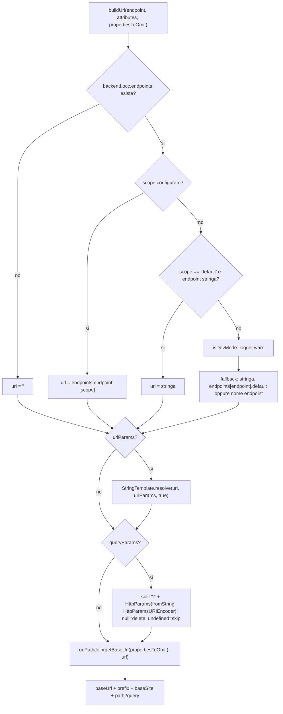
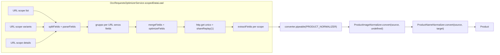

# 21 — Livello OCC: adapter, connector, converter, endpoint

> Riferimenti allo SHA `5b7a1c2bf2808d7380bc20596d10f4fa710c3da1` (vedi [00-meta](../00-meta.md)).

## 1. A cosa serve e perché esiste

OCC (Omni Commerce Connect) è l'API REST di SAP Commerce Cloud. In Spartacus il "livello OCC" è lo strato che separa la logica di dominio (facade, store NgRx, servizi di caricamento) dal formato concreto delle chiamate HTTP verso il backend. È costruito su quattro idee che si ripetono in tutto il codice, dal core alle feature lib:

1. **Adapter astratto + connector.** Il dominio dipende da una classe astratta (`ProductAdapter`, `CmsPageAdapter`, `SiteAdapter`, …) e da un *connector* `providedIn: 'root'` che la delega; il modulo OCC lega la classe astratta all'implementazione concreta (`OccProductAdapter`, …) via DI. Cambiare backend significa fornire un altro adapter, non toccare facade e store (`core-libs/core/src/product/connectors/product/product.adapter.ts:L11-L30`, `core-libs/core/src/product/connectors/product/product.connector.ts:L13-L33`, `core-libs/core/src/occ/adapters/product/product-occ.module.ts:L30-L76`).
2. **Endpoint configurabili.** Gli URL non sono scritti negli adapter: l'adapter chiede a `OccEndpointsService.buildUrl('product', { urlParams, scope })` e il servizio compone `baseUrl + prefix + baseSite + template` leggendo `backend.occ.endpoints` dalla configurazione globale (`core-libs/core/src/occ/services/occ-endpoints.service.ts:L111-L150`, `core-libs/core/src/occ/adapters/product/occ-product.adapter.ts:L54-L59`). Questo permette di cambiare il parametro `fields` o l'intero path senza estendere classi.
3. **Converter impilabili.** I dati raw (`Occ.*`) passano per `ConverterService`, che applica in catena tutti i converter registrati come multi-provider su un `InjectionToken` (*normalizer* backend→UI, *serializer* UI→backend) (`core-libs/core/src/util/converter.service.ts:L13-L30`, `core-libs/core/src/util/converter.service.ts:L130-L137`).
4. **Scope di caricamento.** Un modello può essere caricato a "pezzi" (scope `list`, `details`, `attributes`, …), ciascuno con un proprio endpoint/`fields`; `LoadingScopesService` espande gli scope inclusi e `OccRequestsOptimizerService` fonde in un'unica richiesta gli scope che puntano allo stesso URL (`core-libs/core/src/occ/services/loading-scopes.service.ts:L29-L53`, `core-libs/core/src/occ/services/occ-requests-optimizer.service.ts:L34-L80`).

Attorno a questi pilastri ci sono gli interceptor HTTP OCC (credenziali, lingua/valuta, timeout), gli header/context token di "segnalazione" per altri interceptor, la normalizzazione degli errori e il namespace `Occ` dei modelli raw.

Questo capitolo segue il filo di un caso concreto — **il caricamento di un prodotto** — dal facade fino all'URL OCC e ritorno. Il dettaglio di store e facade prodotto è nel capitolo [24 — Prodotto e ricerca](../parte-2/24-product-search.md); lo state management generico è nel [19](../parte-2/19-state-management.md); la pipeline di configurazione (`provideDefaultConfig`, validator, factory) nel [11](../parte-2/11-configurazione.md).

## 2. Mappa dei file

| Path | Ruolo |
|---|---|
| `core-libs/core/src/occ/config/occ-config.ts` | `BackendConfig`, `OccConfig` (`useExisting: Config`), augmentation di `Config` |
| `core-libs/core/src/occ/config/default-occ-config.ts` | `defaultOccConfig` (`prefix: '/occ/v2/'`) |
| `core-libs/core/src/occ/config/occ-config-validator.ts` | `occConfigValidator` (richiede `backend.occ.baseUrl`) |
| `core-libs/core/src/occ/config/loading-scopes-config.ts` | `LoadingScopeConfig`, `LoadingScopesConfig`, `LoadingScopes` |
| `core-libs/core/src/occ/config/config-from-meta-tag-factory.ts` | baseUrl OCC/media da `<meta>`; `provideConfigFromMetaTags` |
| `core-libs/core/src/occ/config/meta-tag-config.module.ts` | `MetaTagConfigModule.forRoot()` |
| `core-libs/core/src/occ/base-occ.module.ts` | `BaseOccModule`: CMS/site-context OCC, `WithCredentialsInterceptor`, default + validator |
| `core-libs/core/src/occ/interceptors/with-credentials.interceptor.ts` | `WithCredentialsInterceptor` |
| `core-libs/core/src/occ/occ-models/occ-endpoints.model.ts` | `DEFAULT_SCOPE`, `OccEndpoint`, `ProductOccEndpoint`, `OccEndpoints` (augmentabile) |
| `core-libs/core/src/occ/occ-models/occ.models.ts` | namespace `Occ` con i modelli raw del backend |
| `core-libs/core/src/occ/services/occ-endpoints.service.ts` | `OccEndpointsService`: `buildUrl`, `getBaseUrl`, `isConfigured`, `getRawEndpointValue` |
| `core-libs/core/src/occ/services/loading-scopes.service.ts` | `LoadingScopesService`: `expand`, `getMaxAge`, `getReloadTriggers` |
| `core-libs/core/src/occ/services/occ-fields.service.ts` | `OccFieldsService.getOptimalUrlGroups` (raggruppa URL che differiscono solo per `fields`) |
| `core-libs/core/src/occ/services/occ-requests-optimizer.service.ts` | `OccRequestsOptimizerService.scopedDataLoad` |
| `core-libs/core/src/occ/utils/occ-url-util.ts` | `urlPathJoin` |
| `core-libs/core/src/occ/utils/occ-fields.ts` | `mergeFields`, `optimizeFields`, `parseFields`, `stringifyFields`, `extractFields` |
| `core-libs/core/src/occ/utils/interceptor-util.ts` | header `USE_CLIENT_TOKEN`, `USE_CUSTOMER_SUPPORT_AGENT_TOKEN`, `USE_CAPTCHA_TOKEN`; `InterceptorUtil` |
| `core-libs/core/src/occ/utils/occ-http-token.ts` | `OccHttpContext`, `OCC_HTTP_TOKEN` |
| `core-libs/core/src/occ/utils/occ-user-ids.ts`, `occ-constants.ts`, `index.ts` | costanti user id/cart id, `OCC_USER_ID_CONSTANTS` |
| `core-libs/core/src/occ/adapters/product/product-occ.module.ts` | `ProductOccModule`: binding adapter + normalizer prodotto |
| `core-libs/core/src/occ/adapters/product/default-occ-product-config.ts` | endpoint prodotto e `loadingScopes.product.details` |
| `core-libs/core/src/occ/adapters/product/product-occ-config.ts` | `ProductScopesConfig` + augmentation `LoadingScopes.product` |
| `core-libs/core/src/occ/adapters/product/occ-product.adapter.ts` | `OccProductAdapter` (`load`, `loadMany`) |
| `core-libs/core/src/occ/adapters/product/occ-product-search.adapter.ts` | ricerca, by codes, suggerimenti, keyword redirect |
| `core-libs/core/src/occ/adapters/product/converters/*` | `ProductImageNormalizer`, `ProductNameNormalizer`, normalizer search/references |
| `core-libs/core/src/occ/adapters/cms/*` | `CmsOccModule`, `OccCmsPageAdapter`, `OccCmsComponentAdapter`, `LegacyOccCmsComponentAdapter`, `OccCmsPageNormalizer` |
| `core-libs/core/src/occ/adapters/site-context/*` | `SiteContextOccModule`, `OccSiteAdapter`, `SiteContextInterceptor`, `BaseSiteNormalizer` |
| `core-libs/core/src/occ/adapters/user/*` | `UserOccModule` e adapter utente (address, consent, payment, …) |
| `core-libs/core/src/occ/adapters/cost-center/*` | `CostCenterOccModule`, normalizer/serializer cost center |
| `core-libs/core/src/http/http-timeout/*` | `HttpTimeoutInterceptor`, `HTTP_TIMEOUT_CONFIG`, default timeout |
| `core-libs/core/src/util/converter.service.ts` | `Converter`, `ConverterService` |
| `core-libs/core/src/util/try-normalize-http-error.ts` | `tryNormalizeHttpError` |
| `core-libs/core/src/util/occ-http-error-constants.ts` | `OccHttpErrorType`, `OccHttpErrorReason` |
| `core-libs/core/src/product/connectors/product/*` | `ProductAdapter`, `ProductConnector`, `PRODUCT_NORMALIZER`, `ScopedProductData` |

## 3. Come funziona passo per passo

### 3.1 Configurazione: `OccConfig` e `BackendConfig`

`BackendConfig` raggruppa tutto ciò che riguarda il backend: `occ` (`baseUrl`, `prefix`, `useWithCredentials`, `endpoints`), `media` (`baseUrl`, `prefix`) e `loadingScopes` (`core-libs/core/src/occ/config/occ-config.ts:L13-L40`). `OccConfig` è una classe astratta `providedIn: 'root'` con `useExisting: Config` che estende `SiteContextConfig` e aggiunge `backend?: BackendConfig`: iniettare `OccConfig` restituisce quindi l'oggetto di configurazione globale già fuso (`core-libs/core/src/occ/config/occ-config.ts:L42-L48`). Lo stesso file aumenta `Config` (module augmentation) così che `Config` estenda `OccConfig` (`core-libs/core/src/occ/config/occ-config.ts:L50-L52`); `Config` in sé è una classe astratta vuota (`core-libs/core/src/config/config-tokens.ts:L21-L21`).

Il default OCC imposta solo `prefix: '/occ/v2/'`, nessun `baseUrl` (`core-libs/core/src/occ/config/default-occ-config.ts:L9-L15`); per questo `occConfigValidator` segnala un errore se `backend.occ.baseUrl` è `undefined` (`core-libs/core/src/occ/config/occ-config-validator.ts:L9-L17`).

Altri moduli aumentano `BackendConfig`: per esempio il timeout HTTP aggiunge `timeout?: HttpTimeoutConfig` tramite `BackendHttpTimeoutConfig` (`core-libs/core/src/http/http-timeout/http-timeout.config.ts:L35-L41`). `BackendConfig` e `OccEndpoints` sono esportati esplicitamente nella sezione *AUGMENTABLE_TYPES* del public API di core (`core-libs/core/public_api.ts:L50-L51`).

### 3.2 Bootstrap del livello OCC

`BaseCoreModule` importa, in quest'ordine, `SiteContextModule.forRoot()`, `MetaTagConfigModule.forRoot()`, `BaseOccModule.forRoot()`, `LazyLoadingModule.forRoot()`, `HttpModule.forRoot()` (`core-libs/core/src/base-core.module.ts:L38-L42`).

- `BaseOccModule` importa `CmsOccModule` e `SiteContextOccModule`; `forRoot()` registra `WithCredentialsInterceptor` in `HTTP_INTERCEPTORS` (`useExisting`, `multi`), `defaultOccConfig` e il validator (`core-libs/core/src/occ/base-occ.module.ts:L17-L35`). `HTTP_INTERCEPTORS` è il multi-token Angular `InjectionToken<readonly HttpInterceptor[]>` (`angular:packages/common/http/src/interceptor.ts:L195-L197`).
- `SiteContextOccModule` registra `SiteContextInterceptor`, `OccSiteAdapter` per `SiteAdapter`, `BaseSiteNormalizer` su `BASE_SITE_NORMALIZER` e gli endpoint di default site-context (`core-libs/core/src/occ/adapters/site-context/site-context-occ.module.ts:L18-L38`).
- `CmsOccModule` lega `CmsPageAdapter`→`OccCmsPageAdapter` e `CmsComponentAdapter`→`OccCmsComponentAdapter` con `useExisting` e registra `OccCmsPageNormalizer` su `CMS_PAGE_NORMALIZER` (`core-libs/core/src/occ/adapters/cms/cms-occ.module.ts:L16-L34`).
- `HttpModule` importa `HttpTimeoutModule`, che registra `HttpTimeoutInterceptor` e il default di timeout; `HttpModule.forRoot()` non aggiunge provider (`core-libs/core/src/http/http-timeout/http-timeout.module.ts:L13-L23`, `core-libs/core/src/http/http.module.ts:L10-L19`).

**Attenzione:** `ProductOccModule` *non* è importato da `BaseCoreModule`. L'app demo lo importa esplicitamente e lo schematic `add-spartacus` lo aggiunge al modulo delle feature (`projects/storefrontapp/src/app/spartacus/spartacus-features.module.ts:L15-L15`, `core-libs/schematics/src/add-spartacus/spartacus-features.ts:L187-L187`).

### 3.3 `baseUrl` dai meta tag

`MetaTagConfigModule.forRoot()` espone `provideConfigFromMetaTags()`, che registra due config factory dipendenti da `Meta` (`core-libs/core/src/occ/config/config-from-meta-tag-factory.ts:L37-L42`, `core-libs/core/src/occ/config/meta-tag-config.module.ts:L10-L18`). La lettura usa `meta.getTag('name="..."')` (`core-libs/core/src/occ/config/config-from-meta-tag-factory.ts:L32-L35`). I meta tag sono `occ-backend-base-url` e `media-backend-base-url`, con placeholder `OCC_BACKEND_BASE_URL_VALUE` / `MEDIA_BACKEND_BASE_URL_VALUE` (`core-libs/core/src/occ/config/config-from-meta-tag-factory.ts:L12-L16`). Se il tag esiste e non contiene il placeholder, la factory contribuisce `{ backend: { occ: { baseUrl } } }` (o `backend.media.baseUrl`), altrimenti `{}` (`core-libs/core/src/occ/config/config-from-meta-tag-factory.ts:L18-L30`). In pratica il `baseUrl` può essere iniettato nell'`index.html` al deploy, senza ricompilare.

### 3.4 Il modello degli endpoint e gli scope

`DEFAULT_SCOPE` vale `'default'` (`core-libs/core/src/occ/occ-models/occ-endpoints.model.ts:L7-L7`). Un `OccEndpoint` è una mappa *scope → template* con chiave opzionale `default`; `ProductOccEndpoint` aggiunge `list`, `details`, `attributes`, `variants` (`core-libs/core/src/occ/occ-models/occ-endpoints.model.ts:L9-L19`). In `OccEndpoints` ogni voce è `string | OccEndpoint` (es. `product?: string | ProductOccEndpoint`), salvo eccezioni come gli endpoint del configuratore, tipizzati solo `string` (`core-libs/core/src/occ/occ-models/occ-endpoints.model.ts:L21-L33`, `core-libs/core/src/occ/occ-models/occ-endpoints.model.ts:L162-L167`).

Le feature lib estendono `OccEndpoints` via module augmentation di `@spartacus/core`, per esempio il carrello (`feature-libs/cart/base/occ/model/occ-cart-endpoints.model.ts:L97-L98`).

I template di default per il prodotto stanno in `defaultOccProductConfig`: l'endpoint `product` ha scope `default`, `list`, `details`, `promotions`, `attributes`, `price`, `stock`, `unit`, `list_item`, ciascuno con il proprio `fields` (`core-libs/core/src/occ/adapters/product/default-occ-product-config.ts:L14-L28`). Lo stesso file definisce `productAvailabilities`, `productReviews`, `productReferences`, `productSearch` (scope `default`, `carousel`, `carouselMinimal`), `productSearchByCategory` (`default`, `code`), `productSuggestions` (`core-libs/core/src/occ/adapters/product/default-occ-product-config.ts:L29-L49`). Lo scope `variants` dell'endpoint `product` viene invece dalla feature lib `product/variants` (`feature-libs/product/variants/occ/config/default-occ-product-variants-config.ts:L9-L16`). Gli endpoint CMS (`component`, `components`, `pages`, `page`) sono definiti in `defaultCmsModuleConfig`, non nel modulo OCC (`core-libs/core/src/cms/config/default-cms-config.ts:L9-L17`).

### 3.5 `OccEndpointsService`: da chiave a URL

`OccEndpointsService` è `providedIn: 'root'`, inietta `OccConfig` e, opzionalmente, `BaseSiteService`; se presente, si sottoscrive a `getActive()` e memorizza `_activeBaseSite` (`core-libs/core/src/occ/services/occ-endpoints.service.ts:L31-L55`). Finché il valore non arriva, il getter `activeBaseSite` ricade sul primo valore configurato del contesto `baseSite` (`core-libs/core/src/occ/services/occ-endpoints.service.ts:L37-L42`, `core-libs/core/src/site-context/config/context-config-utils.ts:L28-L34`).

`buildUrl(endpoint, attributes?, propertiesToOmit?)` (`core-libs/core/src/occ/services/occ-endpoints.service.ts:L111-L150`) procede così:

1. **Risoluzione del template per scope** con `getEndpointForScope` (`core-libs/core/src/occ/services/occ-endpoints.service.ts:L196-L225`):
   - se `backend.occ.endpoints` manca → stringa vuota (`core-libs/core/src/occ/services/occ-endpoints.service.ts:L197-L201`);
   - se lo scope richiesto è configurato → quel template;
   - se lo scope è `default` e l'endpoint è una stringa → la stringa;
   - altrimenti, in dev mode, `logger.warn("<endpoint> endpoint configuration missing for scope ...")`, e poi fallback: la stringa, oppure lo scope `default`, oppure **il nome stesso dell'endpoint** (`core-libs/core/src/occ/services/occ-endpoints.service.ts:L206-L224`).
2. **Path params**: se ci sono `urlParams`, `StringTemplate.resolve(url, urlParams, true)` sostituisce ogni `${label}` con il valore codificato da `encodeURIComponent` (`core-libs/core/src/occ/services/occ-endpoints.service.ts:L121-L123`, `core-libs/core/src/config/utils/string-template.ts:L15-L31`).
3. **Query params**: se ci sono `queryParams`, la query già presente nel template viene separata (`split('?')`) e passata come `fromString` a un `HttpParams` con encoder `HttpParamsURIEncoder`; poi `getHttpParamsFromQueryParams` applica ogni chiave: `undefined` è ignorato, `null` **cancella** il parametro (anche se proveniva dal template), gli altri valori fanno `set` (`core-libs/core/src/occ/services/occ-endpoints.service.ts:L125-L146`, `core-libs/core/src/occ/services/occ-endpoints.service.ts:L152-L168`). `HttpParams` con `fromString` analizza la stringa con il codec fornito (`angular:packages/common/http/src/params.ts:L165-L180`); `HttpParamsURIEncoder` usa `encodeURIComponent` puro per chiavi e valori, al contrario del codec di default di Angular che de-codifica alcuni caratteri (`core-libs/core/src/util/http-params-uri.encoder.ts:L7-L23`).
4. **Prefisso base**: `buildUrlFromEndpointString` fa `urlPathJoin(this.getBaseUrl(propertiesToOmit), endpointString)` (`core-libs/core/src/occ/services/occ-endpoints.service.ts:L233-L238`).

`getBaseUrl()` unisce con `urlPathJoin` `backend.occ.baseUrl` (default `''`), il prefix e il baseSite, omettendo ogni parte il cui flag in `BaseOccUrlProperties` vale esplicitamente `false` (`core-libs/core/src/occ/services/occ-endpoints.service.ts:L86-L102`, `core-libs/core/src/occ/services/occ-endpoints.service.ts:L19-L29`). `getPrefix()` antepone `/` se manca (`core-libs/core/src/occ/services/occ-endpoints.service.ts:L240-L248`).

`urlPathJoin` scarta le parti falsy, toglie gli slash iniziali/finali da ogni parte, unisce con `/` e preserva lo slash iniziale della prima parte e quello finale dell'ultima (`core-libs/core/src/occ/utils/occ-url-util.ts:L12-L26`). Il test documenta che `urlPathJoin('https://test123', '/occ/v2/', 'test3')` dà `'https://test123/occ/v2/test3'` (`core-libs/core/src/occ/utils/occ-url-util.spec.ts:L20-L24`).

Due metodi ausiliari:
- `isConfigured(endpoint, scope)` usa `getEndpointFromConfig`, che **non** fa fallback: uno scope non configurato dà `undefined` → `false` (`core-libs/core/src/occ/services/occ-endpoints.service.ts:L75-L79`, `core-libs/core/src/occ/services/occ-endpoints.service.ts:L170-L193`).
- `getRawEndpointValue(endpoint, scope)` restituisce il template non risolto, con lo stesso fallback di `getEndpointForScope` (`core-libs/core/src/occ/services/occ-endpoints.service.ts:L63-L67`).

**Esempio (calcolo a mano).** Con `baseUrl = 'https://api.example.com'`, prefix di default `'/occ/v2/'`, baseSite attivo `electronics-spa`, `buildUrl('product', { urlParams: { productCode: '358639' }, scope: 'list' })` prende il template `list` (`core-libs/core/src/occ/adapters/product/default-occ-product-config.ts:L17-L17`), sostituisce `${productCode}` e restituisce `https://api.example.com/occ/v2/electronics-spa/products/358639?fields=code,purchasable,name,summary,price(formattedValue),images(DEFAULT,galleryIndex),baseProduct`. La query del template resta letterale perché non ci sono `queryParams` (vedi trappola 9.8). I valori `api.example.com`, `electronics-spa`, `358639` sono esemplificativi.

### 3.6 Adapter e connector

`ProductAdapter` è una classe astratta con `load(productCode, scope?)` obbligatorio e `loadMany?(products)` opzionale (`core-libs/core/src/product/connectors/product/product.adapter.ts:L11-L30`). `ProductConnector` (`providedIn: 'root'`) inietta l'adapter: `get` ha scope di default `''`; `getMany` usa `loadMany` se l'adapter lo implementa, altrimenti chiama `load` per ogni elemento e mette l'observable in `data$` (`core-libs/core/src/product/connectors/product/product.connector.ts:L13-L33`). `ScopedData<T>` ha `scope?` e `data$?: Observable<T>`; `ScopedProductData` aggiunge `code` (`core-libs/core/src/model/scoped-data.ts:L12-L15`, `core-libs/core/src/product/connectors/product/scoped-product-data.ts:L13-L15`).

`ProductOccModule` collega le classi astratte alle implementazioni OCC (`useClass`): `ProductAdapter`→`OccProductAdapter`, `ProductAvailabilityAdapter`→`OccProductAvailabilityAdapter`, e così references, search e reviews; registra `ProductImageNormalizer` e poi `ProductNameNormalizer` su `PRODUCT_NORMALIZER` (`multi`, in quest'ordine) (`core-libs/core/src/occ/adapters/product/product-occ.module.ts:L30-L76`). Il modulo importa `./product-occ-config` per side effect, il che attiva l'augmentation `LoadingScopes.product` (`core-libs/core/src/occ/adapters/product/product-occ.module.ts:L26-L26`, `core-libs/core/src/occ/adapters/product/product-occ-config.ts:L13-L30`).

`OccProductAdapter.load` fa `http.get(getEndpoint(code, scope))` e applica `converter.pipeable(PRODUCT_NORMALIZER)` (`core-libs/core/src/occ/adapters/product/occ-product.adapter.ts:L29-L33`). `loadMany` costruisce gli URL per ciascun `(code, scope)`, li passa a `OccRequestsOptimizerService.scopedDataLoad` e aggiunge il normalizer a ogni `data$` (`core-libs/core/src/occ/adapters/product/occ-product.adapter.ts:L35-L52`). `getEndpoint` è `buildUrl('product', { urlParams: { productCode }, scope })` (`core-libs/core/src/occ/adapters/product/occ-product.adapter.ts:L54-L59`).

Lo stesso schema vale per gli altri domini: CMS (`core-libs/core/src/occ/adapters/cms/cms-occ.module.ts:L16-L34`), site context (`core-libs/core/src/occ/adapters/site-context/site-context-occ.module.ts:L18-L38`), utente (`UserOccModule` registra 8 adapter e 3 normalizer, `core-libs/core/src/occ/adapters/user/user-occ.module.ts:L34-L72`), cost center (`core-libs/core/src/occ/adapters/cost-center/cost-center-occ.module.ts:L20-L40`).

### 3.7 `ConverterService`: normalizer e serializer

L'interfaccia `Converter<SOURCE, TARGET>` ha un solo metodo `convert(source, target?)`; il commento stabilisce la convenzione *normalize* = backend→UI, *serialize* = UI→backend, e che i converter si possono impilare (`core-libs/core/src/util/converter.service.ts:L13-L30`).

`ConverterService`:
- mantiene una cache `Map<InjectionToken, Converter[]>` che viene svuotata ogni volta che `UnifiedInjector.injectors$` emette, cioè quando appare un nuovo injector (tipicamente un modulo lazy) (`core-libs/core/src/util/converter.service.ts:L35-L50`);
- legge i converter di un token in modo sincrono con `getLastValueSync(this.unifiedInjector.getMulti(token))` (`core-libs/core/src/util/converter.service.ts:L52-L65`). `UnifiedInjector.getMulti` accumula con `scan` le istanze multi-provider dell'injector root e dei moduli lazy, e lancia un errore se trova un provider non-multi (`core-libs/core/src/lazy-loading/unified-injector.ts:L75-L93`);
- `pipeable(token)` restituisce `map(convertSource)` se ci sono converter, altrimenti un operatore identità; `pipeableMany` fa lo stesso sugli array (`core-libs/core/src/util/converter.service.ts:L80-L101`);
- `convert`/`convertMany` restituiscono la sorgente (cast) se il token non ha converter (`core-libs/core/src/util/converter.service.ts:L106-L128`);
- `convertSource` applica i converter in catena con `reduce` partendo da `target = undefined`: il primo converter crea il target, i successivi lo arricchiscono (`core-libs/core/src/util/converter.service.ts:L130-L137`).

`PRODUCT_NORMALIZER` è un `InjectionToken<Converter<any, Product>>` (`core-libs/core/src/product/connectors/product/converters.ts:L11-L13`).

I due normalizer di prodotto mostrano bene il contratto:
- `ProductImageNormalizer` crea il target come copia della sorgente se assente e sostituisce `images` con la struttura normalizzata (`core-libs/core/src/occ/adapters/product/converters/product-image-normalizer.ts:L18-L26`). Le immagini sono raggruppate per `imageType` e `format`; quelle con `galleryIndex` finiscono in array (`images.GALLERY[i]`), le altre in oggetto (`images.PRIMARY`) (`core-libs/core/src/occ/adapters/product/converters/product-image-normalizer.ts:L36-L61`). Gli URL relativi sono prefissati con `backend.media.baseUrl`, altrimenti `backend.occ.baseUrl`; quelli che iniziano con `http`, `data:image` o `//` restano invariati (`core-libs/core/src/occ/adapters/product/converters/product-image-normalizer.ts:L91-L100`).
- `ProductNameNormalizer` rimuove i tag HTML da `name`, genera `slug` e conserva l'originale in `nameHtml` (`core-libs/core/src/occ/adapters/product/converters/product-name-normalizer.ts:L17-L33`); lo slug sostituisce i caratteri riservati `` !*'();:@&=+$,/?%#[]`` con `-` e comprime i trattini multipli (`core-libs/core/src/occ/adapters/product/converters/product-name-normalizer.ts:L42-L64`).

I normalizer possono annidarsi: `OccProductSearchPageNormalizer` converte ogni prodotto della pagina con `converterService.convert(product, PRODUCT_NORMALIZER)` (`core-libs/core/src/occ/adapters/product/converters/occ-product-search-page-normalizer.ts:L31-L47`), e `OccProductReferencesListNormalizer` fa lo stesso su `references[].target` (`core-libs/core/src/occ/adapters/product/converters/occ-product-references-list-normalizer.ts:L22-L39`). Il serializer è il percorso inverso: `OccProductReviewsAdapter.post` passa la review per `PRODUCT_REVIEW_SERIALIZER` e la invia come `application/x-www-form-urlencoded` (`core-libs/core/src/occ/adapters/product/occ-product-reviews.adapter.ts:L39-L55`); `OccCostCenterSerializer` rinomina `active` in `activeFlag` (`core-libs/core/src/occ/adapters/cost-center/converters/occ-cost-center-serializer.ts:L18-L25`).

### 3.8 Loading scopes

`LoadingScopeConfig` ha `include?: string[]`, `maxAge?: number` (secondi) e `reloadOn?: Type<CxEvent>[]`; `LoadingScopes` è una mappa *modello → scope → config* (`core-libs/core/src/occ/config/loading-scopes-config.ts:L10-L31`). Il default dichiara `loadingScopes.product.details.include = [LIST, VARIANTS]` (`core-libs/core/src/occ/adapters/product/default-occ-product-config.ts:L52-L58`). L'enum `ProductScope` elenca `list`, `details`, `attributes`, `variants`, `code`, `price`, `stock`, `unit`, `promotions`, `list_item`, `multi_dimensional`, `multi_dimensional_availability` (`core-libs/core/src/product/model/product-scope.ts:L7-L21`).

`LoadingScopesService.expand(model, scopes)` scorre gli scope da destra e inserisce gli scope inclusi **prima** dello scope che li include, senza duplicati, ricorsivamente sugli scope appena inseriti (`core-libs/core/src/occ/services/loading-scopes.service.ts:L29-L53`). Lo spec lo conferma: con `list.include = ['base']`, `expand('product', ['list'])` dà `['base', 'list']`, e con `detail.include = ['list']` si ottiene `['base', 'list', 'detail']` (`core-libs/core/src/occ/services/loading-scopes.service.spec.ts:L52-L60`). Con la configurazione di default, quindi, `['details']` diventa `['list', 'variants', 'details']`. Il JSDoc stabilisce che i dati degli scope si fondono nell'ordine dato, con l'ultimo che sovrascrive (`core-libs/core/src/occ/services/loading-scopes.service.ts:L17-L28`).

`getMaxAge` converte `maxAge` da secondi a millisecondi (default 0) e `getReloadTriggers` restituisce `reloadOn` o `[]` (`core-libs/core/src/occ/services/loading-scopes.service.ts:L61-L77`).

### 3.9 Ottimizzazione delle richieste: fusione dei `fields`

`OccRequestsOptimizerService.scopedDataLoad(scopedDataWithUrls, dataFactory?)` usa di default `http.get(url)` come data factory e raggruppa i modelli con `OccFieldsService.getOptimalUrlGroups` (`core-libs/core/src/occ/services/occ-requests-optimizer.service.ts:L34-L44`).

`getOptimalUrlGroups` (`core-libs/core/src/occ/services/occ-fields.service.ts:L59-L82`):
1. per ogni modello separa l'URL "senza `fields`" (con gli altri parametri ordinati alfabeticamente) dal valore di `fields`, tramite `splitFields` (`core-libs/core/src/occ/services/occ-fields.service.ts:L89-L116`; il nome del parametro è `FIELDS_PARAM = 'fields'`, `core-libs/core/src/occ/services/occ-fields.service.ts:L48-L48`);
2. analizza `fields` in un AST con `parseFields` (`a,b(c,d)` → `{a:{}, b:{c:{}, d:{}}}`) (`core-libs/core/src/occ/utils/occ-fields.ts:L49-L84`, `core-libs/core/src/occ/utils/occ-fields.spec.ts:L76-L85`);
3. indicizza ciascun gruppo per scope e ricostruisce l'URL con i fields fusi.

`mergeFields` fonde gli AST con `deepMerge`, li ottimizza e li riconverte in stringa (`core-libs/core/src/occ/utils/occ-fields.ts:L14-L20`); `optimizeFields` rimuove `DEFAULT` e `BASIC` se c'è `FULL`, e `BASIC` se c'è `DEFAULT`, ricorsivamente (`core-libs/core/src/occ/utils/occ-fields.ts:L27-L41`).

Infine, se un URL ottimale copre un solo scope il suo `data$` viene passato così com'è; se ne copre più di uno viene fatta un'unica richiesta condivisa con `shareReplay(1)` e ogni scope ne estrae la propria parte con `extractFields` (`core-libs/core/src/occ/services/occ-requests-optimizer.service.ts:L55-L74`). `extractFields` restituisce l'oggetto intero se i fields sono vuoti o contengono `BASIC`/`DEFAULT`/`FULL` (definizione ambigua), altrimenti copia solo le chiavi richieste (`core-libs/core/src/occ/utils/occ-fields.ts:L106-L139`). `OccFieldsService` è usato anche fuori dal core, per esempio negli adapter order-history e quote (`feature-libs/order/occ/adapters/occ-order-history.adapter.ts:L48-L48`, `feature-libs/quote/occ/adapters/occ-quote.adapter.ts:L48-L48`).

### 3.10 Interceptor OCC

- **`WithCredentialsInterceptor`** clona la request con `withCredentials: true` quando `requiresWithCredentials` è vero (`core-libs/core/src/occ/interceptors/with-credentials.interceptor.ts:L28-L38`). La condizione è `useWithCredentials !== undefined` *e* l'URL contiene il `prefix` configurato, con match per sottostringa (`core-libs/core/src/occ/interceptors/with-credentials.interceptor.ts:L43-L52`). Il test conferma che anche un URL di terze parti che contiene il prefix riceve `withCredentials` (`core-libs/core/src/occ/interceptors/with-credentials.interceptor.spec.ts:L151-L160`).
- **`SiteContextInterceptor`** (`providedIn: 'root'`) inizializza lingua e valuta dai default della configurazione e poi si sottoscrive a `LanguageService.getActive()` e `CurrencyService.getActive()` (`core-libs/core/src/occ/adapters/site-context/site-context.interceptor.ts:L25-L52`). In `intercept` aggiunge i query param `lang` e `curr` solo se l'URL contiene `occEndpoints.getBaseUrl()` (baseUrl + prefix + baseSite) (`core-libs/core/src/occ/adapters/site-context/site-context.interceptor.ts:L54-L68`).
- **`HttpTimeoutInterceptor`** sceglie il timeout dando priorità al context token `HTTP_TIMEOUT_CONFIG` rispetto a `config.backend.timeout`, e usa `browser` o `server` in base a `windowRef.isBrowser()` (`core-libs/core/src/http/http-timeout/http-timeout.interceptor.ts:L77-L84`). Se il valore è `undefined` la richiesta passa senza timeout (`core-libs/core/src/http/http-timeout/http-timeout.interceptor.ts:L44-L47`). Il timer parte solo all'evento `HttpEventType.Sent`: `switchMap` su `NEVER.pipe(startWith(event), timeout(timeoutValue))`, abbandonato all'evento successivo (`core-libs/core/src/http/http-timeout/http-timeout.interceptor.ts:L49-L57`). Un `TimeoutError` RxJS diventa un `HttpErrorResponse` il cui `error` è un `Error` con il messaggio, loggato anche con `logger.warn` (`core-libs/core/src/http/http-timeout/http-timeout.interceptor.ts:L92-L124`). Default: 20 000 ms lato server, nessun timeout in browser (`core-libs/core/src/http/http-timeout/default-http-timeout.config.ts:L9-L15`).

L'ordine effettivo della catena `HTTP_INTERCEPTORS` (questi tre più quelli di auth, ASM, error handling) dipende dall'ordine di registrazione dei provider nei moduli importati. ⚠️ DA VERIFICARE: non ricostruito end-to-end in questo capitolo; vedi [06 — HttpClient e interceptor](../parte-1/06-httpclient-interceptor.md).

### 3.11 Header di segnalazione e `HttpContext`

Gli adapter a volte devono chiedere un comportamento a un interceptor che sta "più avanti". Spartacus usa due meccanismi.

**Header di segnalazione.** Le costanti sono `cx-use-client-token`, `cx-use-csagent-token` e `sap-commerce-cloud-captcha-token` (`core-libs/core/src/occ/utils/interceptor-util.ts:L9-L11`). `InterceptorUtil.createHeader` serializza il parametro con `JSON.stringify` (in append se gli header esistono), `getInterceptorParam` lo rilegge con `JSON.parse` e `removeHeader` clona la request senza l'header (`core-libs/core/src/occ/utils/interceptor-util.ts:L13-L47`). Esempio lato produttore: `OccUserAddressAdapter.verify` aggiunge `cx-use-client-token` quando l'utente è `anonymous` (`core-libs/core/src/occ/adapters/user/occ-user-address.adapter.ts:L96-L106`). Esempio lato consumatore: `ClientTokenInterceptor` riconosce la richiesta con `getInterceptorParam` e rimuove l'header prima di inoltrarla (`core-libs/core/src/auth/client-auth/http-interceptors/client-token.interceptor.ts:L42-L49`, `core-libs/core/src/auth/client-auth/http-interceptors/client-token.interceptor.ts:L99-L105`) — dettagli nel capitolo [22 — Autenticazione](../parte-2/22-auth.md). `USE_CAPTCHA_TOKEN` è invece usato come header reale, con il token del provider captcha come valore (`feature-libs/user/profile/occ/adapters/occ-user-profile.adapter.ts:L199-L199`).

**`HttpContext`.** `OCC_HTTP_TOKEN` è un `HttpContextToken<OccHttpContext>` con default `{}`; il campo `sendUserIdAsHeader` (string | boolean) chiede di inviare l'id del cliente emulato (ASM) (`core-libs/core/src/occ/utils/occ-http-token.ts:L9-L20`). In Angular `HttpContextToken` contiene solo una factory `defaultValue` (`angular:packages/common/http/src/context.ts:L16-L18`). `OccProductSearchAdapter.search` e `OccUserCostCenterAdapter.loadActiveList` lo impostano a `true` (`core-libs/core/src/occ/adapters/product/occ-product-search.adapter.ts:L46-L71`, `core-libs/core/src/occ/adapters/user/occ-user-cost-centers.adapter.ts:L31-L55`). Il consumatore è `UserIdHttpHeaderInterceptor` di ASM: se il valore è una stringa la usa come user id, se è `true` prende lo user id da `UserIdService`, il tutto solo con `asm.userIdHttpHeader.enable` (`feature-libs/asm/root/interceptors/user-id-http-header.interceptor.ts:L49-L69`); vedi [29 — ASM](../parte-2/29-asm.md).

Costanti correlate: `OCC_USER_ID_CURRENT = 'current'`, `OCC_USER_ID_ANONYMOUS = 'anonymous'`, `OCC_USER_ID_GUEST = 'guest'`, `OCC_CART_ID_CURRENT = 'current'` (`core-libs/core/src/occ/utils/occ-user-ids.ts:L7-L9`, `core-libs/core/src/occ/utils/occ-constants.ts:L7-L7`); `OCC_USER_ID_CONSTANTS` è un `InjectionToken` root la cui factory restituisce il namespace `OCC_USER_IDS` (`core-libs/core/src/occ/utils/index.ts:L9-L24`).

### 3.12 Errori

`tryNormalizeHttpError` converte un `HttpErrorResponse` in `HttpErrorModel` (message, status, statusText, url), copiando `error.error.errors` in `details` o, per gli errori OAuth, `error`/`error_description` (`core-libs/core/src/util/try-normalize-http-error.ts:L21-L57`). Se l'errore non è né `HttpErrorResponse` né `HttpErrorModel` lo restituisce invariato e in dev mode logga un errore (`core-libs/core/src/util/try-normalize-http-error.ts:L59-L65`). Gli adapter lo usano nel proprio `catchError` (es. `core-libs/core/src/occ/adapters/user/occ-user-address.adapter.ts:L55-L58`), oppure lo applica l'effetto NgRx (prodotto, §3.13). Il formato raw è `Occ.ErrorModel` (`message`, `reason`, `subject`, `subjectType`, `type`) dentro `Occ.ErrorList` (`core-libs/core/src/occ/occ-models/occ.models.ts:L104-L137`); `OccHttpErrorType` (`NotFoundError`, `ClassMismatchError`) e `OccHttpErrorReason` (`notFound`) sono costanti pubbliche per riconoscerli (`core-libs/core/src/util/occ-http-error-constants.ts:L9-L16`, `core-libs/core/public_api.ts:L54-L57`). La gestione globale degli errori è nel capitolo [41](../parte-2/41-errori-global-message.md).

### 3.13 Esempio end-to-end: caricamento di un prodotto

1. Un componente chiama `ProductService.get(code, scopes)`; lo scope di default è `DEFAULT_SCOPE` e il facade delega a `ProductLoadingService.get` passando un array (`core-libs/core/src/product/facade/product.service.ts:L39-L46`).
2. `ProductLoadingService.get` espande gli scope con `loadingScopes.expand('product', scopes)` e crea o riusa un observable per scope (`core-libs/core/src/product/services/product-loading.service.ts:L49-L56`). Con `['details']` si ottiene `['list', 'variants', 'details']` (§3.8).
3. Per ciascuno scope, se lo stato non è loading/success/error (o scatta un reload trigger) e non è già in caricamento, viene dispatchata `LoadProduct(productCode, scope)` (`core-libs/core/src/product/services/product-loading.service.ts:L102-L133`).
4. `ProductEffects.loadProduct$` raggruppa le `LOAD_PRODUCT` contemporanee con `bufferDebounceTime` e le passa tutte a `productConnector.getMany`; le richieste sono annullate (`withdrawOn`) al cambio di lingua/valuta (`core-libs/core/src/product/store/effects/product.effect.ts:L34-L57`).
5. `ProductConnector.getMany` chiama `OccProductAdapter.loadMany` (`core-libs/core/src/product/connectors/product/product.connector.ts:L23-L32`).
6. `loadMany` costruisce un URL per scope via `buildUrl('product', …)` (`core-libs/core/src/occ/adapters/product/occ-product.adapter.ts:L35-L59`); `buildUrl` risolve template, parametri e base (`core-libs/core/src/occ/services/occ-endpoints.service.ts:L111-L150`).
7. `scopedDataLoad` raggruppa gli URL che differiscono solo per `fields`: i tre scope dell'esempio hanno tutti `products/${productCode}?fields=…`, quindi finiscono nello stesso gruppo e producono **una sola** `http.get` con `fields` fusi, condivisa con `shareReplay(1)` (`core-libs/core/src/occ/services/occ-requests-optimizer.service.ts:L55-L74`, `core-libs/core/src/occ/services/occ-fields.service.ts:L59-L82`). Se però lo scope `variants` non è configurato (feature `product/variants` assente), il suo URL ricade sul template `default` (§3.5) e il risultato cambia: vedi trappola 9.5.
8. La richiesta attraversa gli interceptor: `SiteContextInterceptor` aggiunge `lang`/`curr`, `WithCredentialsInterceptor` eventualmente `withCredentials`, `HttpTimeoutInterceptor` il timeout (§3.10).
9. Ogni scope estrae la propria parte con `extractFields` (`core-libs/core/src/occ/services/occ-requests-optimizer.service.ts:L64-L72`) e passa per `converter.pipeable(PRODUCT_NORMALIZER)`: prima `ProductImageNormalizer`, poi `ProductNameNormalizer` (`core-libs/core/src/occ/adapters/product/occ-product.adapter.ts:L43-L51`, `core-libs/core/src/util/converter.service.ts:L130-L137`, `core-libs/core/src/occ/adapters/product/product-occ.module.ts:L42-L51`).
10. L'effetto emette `LoadProductSuccess({ code, ...data }, scope)` oppure, in errore, `LoadProductFail(code, tryNormalizeHttpError(error, logger), scope)` (`core-libs/core/src/product/store/effects/product.effect.ts:L59-L91`); se `data$` manca emette `LoadProductFail` con `Error('Scoped product data does not exist')` (`core-libs/core/src/product/store/effects/product.effect.ts:L82-L89`).
11. `ProductLoadingService` combina gli scope con `uniteLatest` e `deepMerge({}, ...productParts)`: finché uno degli scope non ha dati emette `undefined`, poi il prodotto fuso (con `distinctUntilChanged`) (`core-libs/core/src/product/services/product-loading.service.ts:L74-L85`).

## 4. Diagrammi

### 4.1 Product load: dal facade alla risposta normalizzata

```mermaid
sequenceDiagram
    autonumber
    participant C as "Componente"
    participant PS as "ProductService"
    participant PLS as "ProductLoadingService"
    participant LSS as "LoadingScopesService"
    participant ST as "Store NgRx"
    participant EF as "ProductEffects.loadProduct$"
    participant CN as "ProductConnector"
    participant AD as "OccProductAdapter"
    participant EP as "OccEndpointsService"
    participant OPT as "OccRequestsOptimizerService"
    participant HTTP as "HttpClient + HTTP_INTERCEPTORS"
    participant CV as "ConverterService"
    C->>PS: get(code, ['details'])
    PS->>PLS: get(code, scopes)
    PLS->>LSS: expand('product', scopes)
    LSS-->>PLS: ['list','variants','details']
    loop per ogni scope non caricato
        PLS->>ST: dispatch LoadProduct(code, scope)
    end
    ST->>EF: azioni LOAD_PRODUCT (bufferDebounceTime)
    EF->>CN: getMany(products)
    CN->>AD: loadMany(products)
    AD->>EP: buildUrl('product', {urlParams, scope}) x N
    EP-->>AD: URL completi
    AD->>OPT: scopedDataLoad(scopedDataWithUrls)
    OPT->>HTTP: GET unico per gruppo (fields fusi, shareReplay)
    HTTP-->>OPT: Occ.Product
    OPT-->>AD: data$ per scope (extractFields)
    AD->>CV: pipeable(PRODUCT_NORMALIZER)
    CV-->>EF: Product normalizzato
    EF->>ST: LoadProductSuccess / LoadProductFail
    ST-->>PLS: stato per scope
    PLS-->>C: deepMerge delle parti (uniteLatest)
```

Riferimenti: passi 1-11 di §3.13.

### 4.2 Costruzione dell'URL in `buildUrl`



Riferimenti: `core-libs/core/src/occ/services/occ-endpoints.service.ts:L111-L168`, `core-libs/core/src/occ/services/occ-endpoints.service.ts:L196-L238`.

### 4.3 Catena dei converter e fusione dei fields



Riferimenti: `core-libs/core/src/occ/services/occ-requests-optimizer.service.ts:L34-L80`, `core-libs/core/src/occ/services/occ-fields.service.ts:L59-L116`, `core-libs/core/src/occ/utils/occ-fields.ts:L14-L41`, `core-libs/core/src/util/converter.service.ts:L130-L137`, `core-libs/core/src/occ/adapters/product/product-occ.module.ts:L42-L51`.

## 5. Estratti di codice reale

### 5.1 `OccConfig` e `BackendConfig`

`core-libs/core/src/occ/config/occ-config.ts:L13-L52`
```ts
export interface BackendConfig {
  occ?: {
    baseUrl?: string;
    prefix?: string;
    /**
     * Indicates whether or not cross-site Access-Control requests should be made
     * using credentials such as cookies, authorization headers or TLS client certificates
     */
    useWithCredentials?: boolean;

    endpoints?: OccEndpoints;
  };
  media?: {
    // ...
    baseUrl?: string;
    // ...
    prefix?: string;
  };
  loadingScopes?: LoadingScopes;
}

@Injectable({
  providedIn: 'root',
  useExisting: Config,
})
export abstract class OccConfig extends SiteContextConfig {
  backend?: BackendConfig;
}

declare module '../../config/config-tokens' {
  interface Config extends OccConfig {}
}
```

### 5.2 `buildUrl` e la scelta del template

`core-libs/core/src/occ/services/occ-endpoints.service.ts:L111-L150`
```ts
  buildUrl(
    endpoint: string,
    attributes?: DynamicAttributes,
    propertiesToOmit?: BaseOccUrlProperties
  ): string {
    let url = this.getEndpointForScope(endpoint, attributes?.scope);

    if (attributes) {
      const { urlParams, queryParams } = attributes;

      if (urlParams) {
        url = StringTemplate.resolve(url, urlParams, true);
      }

      if (queryParams) {
        let httpParamsOptions = { encoder: new HttpParamsURIEncoder() };

        if (url.includes('?')) {
          let queryParamsFromEndpoint: string;
          [url, queryParamsFromEndpoint] = url.split('?');
          httpParamsOptions = {
            ...httpParamsOptions,
            ...{ fromString: queryParamsFromEndpoint },
          };
        }
        // ...
      }
    }

    return this.buildUrlFromEndpointString(url, propertiesToOmit);
  }
```

`core-libs/core/src/occ/services/occ-endpoints.service.ts:L195-L225`
```ts
  // TODO: Can we reuse getEndpointFromConfig in this method? Should we change behavior of this function?
  private getEndpointForScope(endpoint: string, scope?: string): string {
    const endpointsConfig = this.config.backend?.occ?.endpoints;

    if (!endpointsConfig) {
      return '';
    }

    const endpointConfig: any =
      endpointsConfig[endpoint as keyof typeof endpointsConfig];

    if (scope) {
      if (endpointConfig?.[scope]) {
        return endpointConfig?.[scope];
      }
      if (scope === DEFAULT_SCOPE && typeof endpointConfig === 'string') {
        return endpointConfig;
      }
      if (isDevMode()) {
        this.logger.warn(
          `${endpoint} endpoint configuration missing for scope "${scope}"`
        );
      }
    }

    return (
      (typeof endpointConfig === 'string'
        ? endpointConfig
        : endpointConfig?.[DEFAULT_SCOPE]) || endpoint
    );
  }
```

### 5.3 `urlPathJoin`

`core-libs/core/src/occ/utils/occ-url-util.ts:L12-L33`
```ts
export function urlPathJoin(...parts: string[]): string {
  const paths: string[] = [];
  parts = parts.filter((part) => Boolean(part));
  for (const part of parts) {
    paths.push(cleanSlashes(part));
  }

  if (parts[0]?.startsWith('/')) {
    paths[0] = '/' + paths[0];
  }
  if (parts[parts.length - 1]?.endsWith('/')) {
    paths[paths.length - 1] = paths[paths.length - 1] + '/';
  }
  return paths.join('/');
}

function cleanSlashes(path: string): string {
  path = path.startsWith('/') ? path.slice(1) : path;
  path = path.endsWith('/') ? path.slice(0, -1) : path;

  return path;
}
```

### 5.4 Adapter OCC del prodotto e connector

`core-libs/core/src/occ/adapters/product/occ-product.adapter.ts:L29-L59`
```ts
  load(productCode: string, scope?: string): Observable<Product> {
    return this.http
      .get(this.getEndpoint(productCode, scope))
      .pipe(this.converter.pipeable(PRODUCT_NORMALIZER));
  }

  loadMany(products: ScopedProductData[]): ScopedProductData[] {
    const scopedDataWithUrls: ScopedDataWithUrl[] = products.map((model) => ({
      scopedData: model,
      url: this.getEndpoint(model.code, model.scope),
    }));

    return this.requestsOptimizer
      .scopedDataLoad<Occ.Product>(scopedDataWithUrls)
      .map(
        (scopedProduct) =>
          ({
            ...scopedProduct,
            data$: scopedProduct.data$?.pipe(
              this.converter.pipeable(PRODUCT_NORMALIZER)
            ),
          }) as ScopedProductData
      );
  }

  protected getEndpoint(code: string, scope?: string): string {
    return this.occEndpoints.buildUrl('product', {
      urlParams: { productCode: code },
      scope,
    });
  }
```

`core-libs/core/src/product/connectors/product/product.connector.ts:L13-L33`
```ts
@Injectable({
  providedIn: 'root',
})
export class ProductConnector {
  constructor(protected adapter: ProductAdapter) {}

  get(productCode: string, scope = ''): Observable<Product> {
    return this.adapter.load(productCode, scope);
  }

  getMany(products: ScopedProductData[]): ScopedProductData[] {
    if (!this.adapter.loadMany) {
      return products.map((product) => ({
        ...product,
        data$: this.adapter.load(product.code, product.scope),
      }));
    }

    return this.adapter.loadMany(products);
  }
}
```

### 5.5 Binding DI in `ProductOccModule`

`core-libs/core/src/occ/adapters/product/product-occ.module.ts:L30-L51`
```ts
@NgModule({
  imports: [CommonModule],
  providers: [
    provideDefaultConfig(defaultOccProductConfig),
    {
      provide: ProductAdapter,
      useClass: OccProductAdapter,
    },
    {
      provide: ProductAvailabilityAdapter,
      useClass: OccProductAvailabilityAdapter,
    },
    {
      provide: PRODUCT_NORMALIZER,
      useExisting: ProductImageNormalizer,
      multi: true,
    },
    {
      provide: PRODUCT_NORMALIZER,
      useExisting: ProductNameNormalizer,
      multi: true,
    },
    // ...
```

### 5.6 Il cuore di `ConverterService`

`core-libs/core/src/util/converter.service.ts:L80-L88`
```ts
  pipeable<S, T>(
    injectionToken: InjectionToken<Converter<S, T>>
  ): OperatorFunction<S, T> {
    if (this.hasConverters(injectionToken)) {
      return map((model: S) => this.convertSource(model, injectionToken));
    } else {
      return (observable: Observable<any>) => observable as Observable<T>;
    }
  }
```

`core-libs/core/src/util/converter.service.ts:L130-L137`
```ts
  private convertSource<S, T>(
    source: S,
    injectionToken: InjectionToken<Converter<S, T>>
  ): T {
    return this.getConverters(injectionToken)?.reduce((target, converter) => {
      return converter.convert(source, target);
    }, undefined as any);
  }
```

### 5.7 Primo normalizer della catena

`core-libs/core/src/occ/adapters/product/converters/product-image-normalizer.ts:L18-L26`
```ts
  convert(source: Occ.Product, target?: Product): Product {
    if (target === undefined) {
      target = { ...(source as any) } as Product;
    }
    if (source.images) {
      target.images = this.normalize(source.images);
    }
    return target;
  }
```

### 5.8 Espansione degli scope

`core-libs/core/src/occ/services/loading-scopes.service.ts:L29-L53`
```ts
  expand(model: string, scopes: string[]): string[] {
    const scopesConfig = this.config?.backend?.loadingScopes?.[model];

    if (scopesConfig) {
      const expandedScopes = [...scopes];
      let i = expandedScopes.length;

      while (i > 0) {
        i--;
        const includedScopes = scopesConfig[expandedScopes[i]]?.include;
        if (includedScopes) {
          for (const includedScope of includedScopes) {
            if (!expandedScopes.includes(includedScope)) {
              expandedScopes.splice(i, 0, includedScope);
              i++;
            }
          }
        }
      }

      return expandedScopes;
    }

    return scopes;
  }
```

### 5.9 Fusione delle richieste

`core-libs/core/src/occ/services/occ-requests-optimizer.service.ts:L53-L74`
```ts
        const groupedModels = Object.values(groupedModelsSet);

        if (groupedModels.length === 1) {
          // only one scope for url, we can pass the data straightaway
          result.push({
            ...groupedModels[0].scopedData,
            data$: dataFactory?.(url),
          });
        } else {
          // multiple scopes per url
          // we have to split the model per each scope
          const data$ = dataFactory?.(url).pipe(shareReplay(1));

          groupedModels.forEach((modelData) => {
            result.push({
              ...modelData.scopedData,
              data$: data$?.pipe(
                map((data) => extractFields<T>(data, modelData.fields))
              ),
            });
          });
        }
```

### 5.10 Interceptor OCC

`core-libs/core/src/occ/interceptors/with-credentials.interceptor.ts:L43-L48`
```ts
  protected requiresWithCredentials(request: HttpRequest<any>): boolean {
    return (
      this.occConfig?.useWithCredentials !== undefined &&
      request.url.indexOf(this.occConfig?.prefix ?? '') > -1
    );
  }
```

`core-libs/core/src/occ/adapters/site-context/site-context.interceptor.ts:L54-L68`
```ts
  intercept(
    request: HttpRequest<any>,
    next: HttpHandler
  ): Observable<HttpEvent<any>> {
    if (request.url.includes(this.occEndpoints.getBaseUrl())) {
      request = request.clone({
        setParams: {
          lang: this.activeLang ?? '',
          curr: this.activeCurr ?? '',
        },
      });
    }

    return next.handle(request);
  }
```

`core-libs/core/src/http/http-timeout/http-timeout.interceptor.ts:L49-L57`
```ts
    return next.handle(request).pipe(
      switchMap((event) => {
        // When event `HttpEventType.Sent` happens, let's start counting time for timeout.
        // But when event `HttpEventType.Response` is received, `switchMap` will unsubscribe from the following timeout observable.
        if (event.type === HttpEventType.Sent) {
          return NEVER.pipe(startWith(event), timeout(timeoutValue));
        }
        return of(event);
      }),
```

## 6. Configurazione

| Chiave | Tipo | Default | Definita in | Letta in |
|---|---|---|---|---|
| `backend.occ.baseUrl` | `string` | nessuno (validator obbligatorio) | `core-libs/core/src/occ/config/occ-config.ts:L15-L15` | `core-libs/core/src/occ/services/occ-endpoints.service.ts:L93-L96`; `core-libs/core/src/occ/adapters/product/converters/product-image-normalizer.ts:L95-L99`; `core-libs/core/src/occ/config/occ-config-validator.ts:L9-L17` |
| `backend.occ.prefix` | `string` | `'/occ/v2/'` (`core-libs/core/src/occ/config/default-occ-config.ts:L9-L15`) | `core-libs/core/src/occ/config/occ-config.ts:L16-L16` | `core-libs/core/src/occ/services/occ-endpoints.service.ts:L240-L248`; `core-libs/core/src/occ/interceptors/with-credentials.interceptor.ts:L46-L46` |
| `backend.occ.useWithCredentials` | `boolean` | `undefined` | `core-libs/core/src/occ/config/occ-config.ts:L17-L21` | `core-libs/core/src/occ/interceptors/with-credentials.interceptor.ts:L45-L45` |
| `backend.occ.endpoints` | `OccEndpoints` | per modulo (prodotto, site context, utente, cost center, CMS) | `core-libs/core/src/occ/config/occ-config.ts:L23-L23` | `core-libs/core/src/occ/services/occ-endpoints.service.ts:L174-L174`, `core-libs/core/src/occ/services/occ-endpoints.service.ts:L197-L197` |
| `backend.occ.endpoints.product.<scope>` | `string` | `default`, `list`, `details`, … (`core-libs/core/src/occ/adapters/product/default-occ-product-config.ts:L14-L28`); `variants` dalla feature lib | `core-libs/core/src/occ/occ-models/occ-endpoints.model.ts:L14-L27` | `core-libs/core/src/occ/adapters/product/occ-product.adapter.ts:L54-L59` |
| `backend.media.baseUrl` | `string` | `undefined` | `core-libs/core/src/occ/config/occ-config.ts:L25-L31` | `core-libs/core/src/occ/adapters/product/converters/product-image-normalizer.ts:L96-L96`; `core-libs/storefront/shared/components/media/media.service.ts:L399-L402` |
| `backend.media.prefix` | `string` | `undefined` | `core-libs/core/src/occ/config/occ-config.ts:L32-L37` | `core-libs/storefront/shared/components/media/media.service.ts:L405-L412` (solo con toggle `enableMediaPrefix`) |
| `backend.loadingScopes.<model>.<scope>.include` | `string[]` | `product.details.include = ['list','variants']` (`core-libs/core/src/occ/adapters/product/default-occ-product-config.ts:L52-L58`) | `core-libs/core/src/occ/config/loading-scopes-config.ts:L10-L31` | `core-libs/core/src/occ/services/loading-scopes.service.ts:L38-L38` |
| `backend.loadingScopes.<model>.<scope>.maxAge` | `number` (s) | `0` | `core-libs/core/src/occ/config/loading-scopes-config.ts:L10-L31` | `core-libs/core/src/occ/services/loading-scopes.service.ts:L61-L65` |
| `backend.loadingScopes.<model>.<scope>.reloadOn` | `Type<CxEvent>[]` | `[]` | `core-libs/core/src/occ/config/loading-scopes-config.ts:L10-L31` | `core-libs/core/src/occ/services/loading-scopes.service.ts:L75-L77` |
| `backend.timeout.server` | `number` (ms) | `20000` (`core-libs/core/src/http/http-timeout/default-http-timeout.config.ts:L9-L15`) | `core-libs/core/src/http/http-timeout/http-timeout.config.ts:L16-L33` | `core-libs/core/src/http/http-timeout/http-timeout.interceptor.ts:L77-L84` |
| `backend.timeout.browser` | `number` (ms) | `undefined` (nessun timeout) | `core-libs/core/src/http/http-timeout/http-timeout.config.ts:L16-L33` | `core-libs/core/src/http/http-timeout/http-timeout.interceptor.ts:L77-L84` |
| `context.baseSite` (fallback del baseSite) | `string[]` | — | site context | `core-libs/core/src/occ/services/occ-endpoints.service.ts:L37-L42` |
| `HttpContext` `HTTP_TIMEOUT_CONFIG` | `HttpTimeoutConfig` | `undefined` | `core-libs/core/src/http/http-timeout/http-timeout.config.ts:L16-L18` | `core-libs/core/src/http/http-timeout/http-timeout.interceptor.ts:L78-L78` |
| `HttpContext` `OCC_HTTP_TOKEN.sendUserIdAsHeader` | `string \| boolean` | `{}` | `core-libs/core/src/occ/utils/occ-http-token.ts:L9-L20` | `feature-libs/asm/root/interceptors/user-id-http-header.interceptor.ts:L53-L69` |
| Meta tag `occ-backend-base-url` / `media-backend-base-url` | `string` | placeholder ignorato | `core-libs/core/src/occ/config/config-from-meta-tag-factory.ts:L12-L16` | `core-libs/core/src/occ/config/config-from-meta-tag-factory.ts:L18-L30` |
| Feature toggle `enableHierarchicalAddressFormat` | `boolean` | — | FeatureToggles | `core-libs/core/src/occ/adapters/user/occ-user-address.adapter.ts:L51-L53` |
| Feature toggle `b2bCheckoutShippingAddressFilter` | `boolean` | — | FeatureToggles | `core-libs/core/src/occ/adapters/user/occ-user-cost-centers.adapter.ts:L31-L55` |

Esempio di configurazione applicativa (illustrativo, usa solo chiavi della tabella):

```ts
// Esempio illustrativo, non presente nel repo
provideConfig(<OccConfig>{
  backend: {
    occ: {
      baseUrl: 'https://api.example.com',
      endpoints: {
        product: {
          list: 'products/${productCode}?fields=code,name,price(formattedValue),images(DEFAULT,galleryIndex),baseProduct',
        },
      },
    },
    loadingScopes: {
      product: { details: { include: ['list', 'variants'], maxAge: 60 } },
    },
    timeout: { browser: 30_000 },
  },
});
```

Il merge profondo della configurazione (descritto nel capitolo [11](../parte-2/11-configurazione.md)) fa sì che il solo scope `list` venga sovrascritto lasciando invariati gli altri scope di `product`: `configFactory` esegue `deepMerge({}, inject(DefaultConfig), inject(RootConfig))` e `deepMerge` ricorre sugli oggetti annidati (`core-libs/core/src/config/config-tokens.ts:L10-L11`, `core-libs/core/src/config/utils/deep-merge.ts:L38-L45`). Gli array (es. `include`) invece vengono sostituiti, non concatenati.

## 7. Commenti e note notevoli dal sorgente

- `// TODO: Can we reuse getEndpointFromConfig in this method? Should we change behavior of this function?` — riconosce la doppia semantica tra `getEndpointFromConfig` (senza fallback) e `getEndpointForScope` (con fallback) (`core-libs/core/src/occ/services/occ-endpoints.service.ts:L195-L195`).
- `// TODO 4.0: default to encodeVariable = true` in `StringTemplate.resolve`: il default è ancora `false`, ma `buildUrl` passa esplicitamente `true` (`core-libs/core/src/config/utils/string-template.ts:L24-L24`, `core-libs/core/src/occ/services/occ-endpoints.service.ts:L121-L123`).
- `// CHECK SONAR` (`core-libs/core/src/occ/utils/occ-fields.ts:L141-L141`).
- `// TODO(#8878): Which models we can remove from here?` nel namespace `Occ` (`core-libs/core/src/occ/occ-models/occ.models.ts:L3066-L3066`).
- `// Uncomment this when occ gets configured` sopra la variante di `productReferences` con `referenceType` nel template (`core-libs/core/src/occ/adapters/product/default-occ-product-config.ts:L32-L34`).
- `// Max limit of ProductSearch OCC` (`CHUNK_SIZE = 100` in `searchByCodes`) (`core-libs/core/src/occ/adapters/product/occ-product-search.adapter.ts:L73-L107`).
- JSDoc di `LegacyOccCmsComponentAdapter`: "Before 1905, the OCC CMS component API required was using POST method …" (`core-libs/core/src/occ/adapters/cms/legacy-occ-cms-component.adapter.ts:L16-L25`).
- JSDoc di `normalizeImageUrl`: "For media, we use the `backend.media.baseUrl` by default, but fallback to `backend.occ.baseUrl` if none provided." (`core-libs/core/src/occ/adapters/product/converters/product-image-normalizer.ts:L84-L90`).
- JSDoc di `expand`: "I.e. if 'details' scope includes 'list' scope by configuration, it'll return ['details', 'list']" — l'ordine dell'esempio è opposto a quello reale e a quello dello spec (`['base', 'list']`) (`core-libs/core/src/occ/services/loading-scopes.service.ts:L20-L20`, `core-libs/core/src/occ/services/loading-scopes.service.spec.ts:L52-L55`).
- `// CXSPA-11104: Revise type to avoid redundant types - typescript:S6571` (`core-libs/core/src/util/try-normalize-http-error.ts:L28-L28`).
- Nessun `@deprecated` nei file non-spec di `core-libs/core/src/occ/` e `core-libs/core/src/http/` (verifica del dossier con `grep -rn "@deprecated"`).
- Il nome file `prduct-availability.adapter.ts` contiene un refuso, importato così da `ProductOccModule` (`core-libs/core/src/occ/adapters/product/product-occ.module.ts:L11-L11`).

## 8. Extension point

| Extension point | Meccanismo | Dove | Ricetta |
|---|---|---|---|
| `backend.occ.endpoints.<key>[.<scope>]` | config: cambiare path o `fields` di uno scope senza codice | `core-libs/core/src/occ/services/occ-endpoints.service.ts:L196-L225` | [52 — Ricette OCC](../parte-3/52-ricette-occ-dati.md) (campi OCC aggiuntivi) |
| `OccEndpoints` | module augmentation `declare module '@spartacus/core'` per tipizzare endpoint nuovi | `core-libs/core/src/occ/occ-models/occ-endpoints.model.ts:L21-L33`, esempio `feature-libs/cart/base/occ/model/occ-cart-endpoints.model.ts:L97-L98` | [52](../parte-3/52-ricette-occ-dati.md) (endpoint custom) |
| `BackendConfig` | module augmentation (come fa `BackendHttpTimeoutConfig`) | `core-libs/core/src/http/http-timeout/http-timeout.config.ts:L35-L41` | [50 — Ricette config/DI](../parte-3/50-ricette-config-di.md) |
| `ProductAdapter`, `ProductSearchAdapter`, `ProductReferencesAdapter`, `ProductReviewsAdapter`, `ProductAvailabilityAdapter` | `{ provide: ProductAdapter, useClass: MyAdapter }` | `core-libs/core/src/product/connectors/product/product.adapter.ts:L11-L30`, `core-libs/core/src/occ/adapters/product/product-occ.module.ts:L34-L73` | [52](../parte-3/52-ricette-occ-dati.md) (adapter/connector custom) |
| `CmsPageAdapter`, `CmsComponentAdapter` (alternativa `LegacyOccCmsComponentAdapter`) | provider della classe astratta | `core-libs/core/src/occ/adapters/cms/cms-occ.module.ts:L16-L34`, `core-libs/core/src/occ/adapters/cms/legacy-occ-cms-component.adapter.ts:L16-L57` | [52](../parte-3/52-ricette-occ-dati.md) |
| `*_NORMALIZER` / `*_SERIALIZER` (es. `PRODUCT_NORMALIZER`) | multi-provider aggiuntivo: il nuovo converter riceve il `target` già prodotto dai precedenti | `core-libs/core/src/util/converter.service.ts:L130-L137`, `core-libs/core/src/product/connectors/product/converters.ts:L11-L13` | [52](../parte-3/52-ricette-occ-dati.md) (converter custom) |
| Normalizer esistenti con metodi `protected` (es. `ProductNameNormalizer.normalizeSlug`/`normalize`) | ereditarietà + `useExisting` della sottoclasse. Nota: ridefinire solo il campo `reservedSlugCharacters` non ha effetto, perché `slugRegex` (privato) è già calcolato dalla classe base durante l'inizializzazione dei suoi campi | `core-libs/core/src/occ/adapters/product/converters/product-name-normalizer.ts:L42-L64` | [52](../parte-3/52-ricette-occ-dati.md) |
| `OccEndpointsService` (`getHttpParamsFromQueryParams` è `protected`) | sostituzione del servizio root | `core-libs/core/src/occ/services/occ-endpoints.service.ts:L152-L168` | [50](../parte-3/50-ricette-config-di.md) |
| `OccRequestsOptimizerService.scopedDataLoad(…, dataFactory)` | data factory custom per altri modelli a scope | `core-libs/core/src/occ/services/occ-requests-optimizer.service.ts:L34-L44` | [52](../parte-3/52-ricette-occ-dati.md) |
| `backend.loadingScopes` / `LoadingScopes` | config di `include`, `maxAge`, `reloadOn` | `core-libs/core/src/occ/config/loading-scopes-config.ts:L10-L31` | [52](../parte-3/52-ricette-occ-dati.md) |
| `HTTP_INTERCEPTORS` | interceptor custom; quelli OCC sono `useExisting` della classe, quindi sostituibili fornendo la classe | `core-libs/core/src/occ/base-occ.module.ts:L17-L35`, `core-libs/core/src/occ/adapters/site-context/site-context-occ.module.ts:L18-L38` | [50](../parte-3/50-ricette-config-di.md) (interceptor custom) |
| `HTTP_TIMEOUT_CONFIG`, `OCC_HTTP_TOKEN` | `HttpContext` per singola richiesta | `core-libs/core/src/http/http-timeout/http-timeout.config.ts:L16-L18`, `core-libs/core/src/occ/utils/occ-http-token.ts:L9-L20` | [52](../parte-3/52-ricette-occ-dati.md) |
| `InterceptorUtil` + `USE_CLIENT_TOKEN` & co. | header di segnalazione verso gli interceptor auth/ASM | `core-libs/core/src/occ/utils/interceptor-util.ts:L9-L47` | [22 — Autenticazione](../parte-2/22-auth.md) |
| `MetaTagConfigModule` / `provideConfigFromMetaTags` | `baseUrl` iniettato a runtime via `<meta>` | `core-libs/core/src/occ/config/config-from-meta-tag-factory.ts:L37-L42` | [50](../parte-3/50-ricette-config-di.md) |

Nota sull'API pubblica: `OccConfig`, `OccEndpointsService`, gli interceptor, gli adapter e i normalizer OCC sono raggiungibili tramite `export * from './src/occ/index'` (`core-libs/core/public_api.ts:L27-L27`), `ConverterService` tramite `./src/util/index` (`core-libs/core/public_api.ts:L35-L35`), adapter/token prodotto tramite `./src/product/index` (`core-libs/core/public_api.ts:L29-L29`). Alcuni file non sono riesportati dai barrel OCC (per esempio i default config degli endpoint e `loading-scopes-config`): vedi trappola 9.17 e il capitolo [54](../parte-3/54-upgrade-safe.md).

## 9. Trappole, casi limite, comportamenti controintuitivi

1. **`useWithCredentials: false` attiva comunque le credenziali.** La condizione è `!== undefined`, non `=== true` (`core-libs/core/src/occ/interceptors/with-credentials.interceptor.ts:L45-L45`). Il test intitolato a `useWithCredentials: false` in realtà omette la chiave (`core-libs/core/src/occ/interceptors/with-credentials.interceptor.spec.ts:L73-L81`). Per disattivarle bisogna non impostare la chiave.
2. **Match per sottostringa sul prefix.** Anche host terzi con lo stesso path ricevono `withCredentials`; con `prefix` vuoto `indexOf('')` vale 0 e tutte le richieste ne sono coinvolte (`core-libs/core/src/occ/interceptors/with-credentials.interceptor.ts:L46-L46`, `core-libs/core/src/occ/interceptors/with-credentials.interceptor.spec.ts:L151-L160`).
3. **`lang`/`curr` solo sotto il baseSite.** `SiteContextInterceptor` confronta l'URL con `getBaseUrl()`, che include il baseSite: le chiamate costruite con `{ baseSite: false }` (come `baseSites` in `OccSiteAdapter`) non ricevono `lang`/`curr` **quando il baseSite è noto** (`core-libs/core/src/occ/adapters/site-context/site-context.interceptor.ts:L58-L58`, `core-libs/core/src/occ/adapters/site-context/occ-site.adapter.ts:L85-L107`). Se il baseSite è risolto dal backend (`SiteContextConfigInitializer`, senza `context.baseSite` statico: `core-libs/core/src/site-context/site-context.module.ts:L34-L39`, `core-libs/core/src/site-context/config/config-loader/site-context-config-initializer.ts:L47-L47`), `activeBaseSite` è ancora `undefined` e `urlPathJoin` scarta la parte vuota conservando lo slash finale del prefix (`core-libs/core/src/occ/services/occ-endpoints.service.ts:L98-L101`, `core-libs/core/src/occ/utils/occ-url-util.ts:L14-L24`): `getBaseUrl()` termina con il prefix, la chiamata `basesites` lo contiene e riceve `lang=`/`curr=` vuoti (`core-libs/core/src/occ/adapters/site-context/site-context.interceptor.ts:L58-L63`).
4. **Uno scope mancante non fallisce.** `getEndpointForScope` logga un warning solo in dev mode, poi usa il `default`; se manca anche quello usa **il nome dell'endpoint** come path (`core-libs/core/src/occ/services/occ-endpoints.service.ts:L213-L224`). In produzione non c'è alcun warning.
5. **`variants` senza la feature `product/variants`.** Il default core fa includere `variants` a `details` (`core-libs/core/src/occ/adapters/product/default-occ-product-config.ts:L52-L58`), ma il template `product.variants` arriva solo dalla feature lib (`feature-libs/product/variants/occ/config/default-occ-product-variants-config.ts:L9-L16`); senza di essa lo scope `variants` ricade sul template `default`, più pesante, con warning (`core-libs/core/src/occ/services/occ-endpoints.service.ts:L213-L224`). Poiché tutti gli scope `product` condividono path e differiscono solo per `fields`, il template `default` finisce comunque nello stesso gruppo di fusione (§3.9), allargando il `fields` della richiesta unica.
6. **`isConfigured` ≠ `buildUrl`.** `isConfigured('x', 'scope')` può essere `false` mentre `buildUrl` restituisce comunque un URL grazie al fallback (`core-libs/core/src/occ/services/occ-endpoints.service.ts:L75-L79`, `core-libs/core/src/occ/services/occ-endpoints.service.ts:L170-L225`).
7. **`null` cancella, `undefined` ignora.** Un `queryParams` con valore `null` rimuove anche un parametro già presente nel template (es. `fields`); `undefined` lo lascia (`core-libs/core/src/occ/services/occ-endpoints.service.ts:L159-L164`). `OccProductReferencesAdapter` sfrutta il caso `undefined` per `referenceType`/`pageSize` facoltativi (`core-libs/core/src/occ/adapters/product/occ-product-references.adapter.ts:L34-L43`).
8. **Ri-codifica della query del template.** Quando ci sono `queryParams`, la query del template viene ri-analizzata e ri-codificata con `encodeURIComponent` (per esempio `,` diventa `%2C`; le parentesi `(`/`)` non vengono codificate da `encodeURIComponent` e restano letterali); senza `queryParams` resta letterale (`core-libs/core/src/occ/services/occ-endpoints.service.ts:L125-L146`, `core-libs/core/src/util/http-params-uri.encoder.ts:L21-L23`). Le due forme sono equivalenti per il server, ma possono confondere confronti di URL nei test o nella cache.
9. **Placeholder non risolti.** `buildUrl` senza `urlParams` lascia i `${...}` letterali. `LegacyOccCmsComponentAdapter` costruisce l'endpoint `components` senza `userId`, quindi con il template di default `users/${userId}/cms/components` il placeholder resterebbe nell'URL (`core-libs/core/src/occ/adapters/cms/legacy-occ-cms-component.adapter.ts:L16-L57`, `core-libs/core/src/cms/config/default-cms-config.ts:L9-L17`). ⚠️ DA VERIFICARE a runtime: dipende dal template che l'applicazione configura per un backend pre-1905.
10. **Modelli senza scope scartati.** `getOptimalUrlGroups` non inserisce in nessun gruppo i modelli con `scope === undefined` (`core-libs/core/src/occ/services/occ-fields.service.ts:L67-L69`), quindi questi **mancano** dall'array restituito da `scopedDataLoad`, che itera solo sui modelli raggruppati (`core-libs/core/src/occ/services/occ-requests-optimizer.service.ts:L53-L73`). L'effetto prodotto mappa solo quell'array (`core-libs/core/src/product/store/effects/product.effect.ts:L48-L53`) e per loro non emette alcuna azione: niente `LoadProductSuccess` e niente `LoadProductFail`. Il messaggio `Scoped product data does not exist` riguarda solo un elemento restituito con `data$` indefinito (`core-libs/core/src/product/store/effects/product.effect.ts:L82-L89`).
11. **`extractFields` con `DEFAULT`.** Se i fields contengono `BASIC`/`DEFAULT`/`FULL` non viene estratto nulla: lo scope `default` di prodotto (che inizia con `DEFAULT,…`) riceve l'intera risposta fusa (`core-libs/core/src/occ/utils/occ-fields.ts:L106-L139`).
12. **`splitFields` e il carattere `=`.** I parametri sono divisi con `split('=')` prendendo solo l'indice `1`: un valore che contiene `=` viene troncato (`core-libs/core/src/occ/services/occ-fields.service.ts:L95-L98`).
13. **`pipeable` decide all'istante.** L'operatore restituito da `pipeable` è scelto alla sua creazione: se in quel momento il token non ha converter si ottiene l'identità, e un converter fornito più tardi da un modulo lazy non verrà applicato a quell'operatore, anche se la cache viene svuotata (`core-libs/core/src/util/converter.service.ts:L80-L88`, `core-libs/core/src/util/converter.service.ts:L38-L45`). Negli adapter OCC `pipeable` è invocato a ogni chiamata (`core-libs/core/src/occ/adapters/product/occ-product.adapter.ts:L29-L33`), quindi il problema riguarda operatori memorizzati e riusati.
14. **Converter senza `multi: true`.** `UnifiedInjector.getMulti` emette l'errore `Multi-providers mixed with single providers for ...` dentro il `filter` dell'Observable (`core-libs/core/src/lazy-loading/unified-injector.ts:L83-L88`). `ConverterService` lo consuma con `getLastValueSync`, che si sottoscrive con la sola callback `next` (`core-libs/core/src/util/rxjs/get-last-value-sync.ts:L19-L22`): RxJS rilancia l'errore in modo asincrono come unhandled error (`deps:rxjs-7.8.2/package/dist/cjs/internal/util/reportUnhandledError.js:L6-L15`). Intanto `ConverterService` non trova converter e restituisce la sorgente non convertita, cioè l'operatore identità (`core-libs/core/src/util/converter.service.ts:L83-L87`): la conversione viene saltata in silenzio.
15. **Doppio slash nelle immagini.** `normalizeImageUrl` concatena baseUrl e url senza `urlPathJoin`: un baseUrl con slash finale e un url con slash iniziale producono `//` (`core-libs/core/src/occ/adapters/product/converters/product-image-normalizer.ts:L91-L100`). Inoltre il normalizer usa `||` mentre `MediaService.getBaseUrl()` usa `??`: con `backend.media.baseUrl = ''` il primo ricade su `occ.baseUrl`, il secondo no (`core-libs/storefront/shared/components/media/media.service.ts:L399-L402`).
16. **`ProductReferenceNormalizer` non registrato.** È esportato ma non è legato a `PRODUCT_NORMALIZER` in `ProductOccModule` (`core-libs/core/src/occ/adapters/product/converters/index.ts:L8-L8`, `core-libs/core/src/occ/adapters/product/product-occ.module.ts:L42-L51`).
17. **File non esportati dai barrel.** `OccUserCostCenterAdapter`, `OccAddressListNormalizer`, i default config degli endpoint (`default-occ-product-config`, `default-occ-user-config`, …), `product-occ-config` e `loading-scopes-config` non sono riesportati dai barrel OCC (`core-libs/core/src/occ/adapters/user/index.ts:L7-L15`, `core-libs/core/src/occ/adapters/user/converters/index.ts:L7-L8`, `core-libs/core/src/occ/adapters/product/index.ts:L7-L13`, `core-libs/core/src/occ/index.ts:L7-L17`).
18. **`loadBaseSite` non normalizza.** A differenza di `loadBaseSites`, `OccSiteAdapter.loadBaseSite` non applica `BASE_SITE_NORMALIZER`, quindi `stores`→`baseStore` non avviene (`core-libs/core/src/occ/adapters/site-context/occ-site.adapter.ts:L85-L120`, `core-libs/core/src/occ/adapters/site-context/converters/base-site-normalizer.ts:L18-L28`).
19. **`tryNormalizeHttpError` e `error: null`.** Il codice accede a `error.error.errors` senza optional chaining: un `HttpErrorResponse` con `error: null` genera un `TypeError` (`core-libs/core/src/util/try-normalize-http-error.ts:L21-L57`). Angular produce davvero `error: null`: il backend XHR imposta `body = null` per una risposta di errore JSON con corpo vuoto e lo passa come `error` all'`HttpErrorResponse` (`angular:packages/common/http/src/xhr.ts:L265-L265`, `angular:packages/common/http/src/xhr.ts:L298-L307`).
20. **Timeout solo in SSR.** In browser il timeout HTTP è disabilitato di default; in SSR vale 20 s e il timer parte solo dopo `Sent` (`core-libs/core/src/http/http-timeout/default-http-timeout.config.ts:L9-L15`, `core-libs/core/src/http/http-timeout/http-timeout.interceptor.ts:L49-L57`).
21. **`maxAge` ignorato lato server.** Il trigger di ricarica per età è attivo solo con `isPlatformBrowser` (`core-libs/core/src/product/services/product-loading.service.ts:L157-L191`).
22. **baseSite "provvisorio".** `OccEndpointsService` si sottoscrive a `BaseSiteService.getActive()` nel costruttore senza unsubscribe; prima della prima emissione usa il baseSite di default della configurazione (`core-libs/core/src/occ/services/occ-endpoints.service.ts:L37-L55`).
23. **`ProductOccModule` va importato.** Non fa parte di `BaseCoreModule`: senza di esso non c'è binding per `ProductAdapter` (`core-libs/core/src/base-core.module.ts:L38-L42`, `projects/storefrontapp/src/app/spartacus/spartacus-features.module.ts:L15-L15`).
24. **Cost center: slash e `fields` sovrascritto.** Il template `getActiveCostCenters` inizia con `/` (innocuo grazie a `cleanSlashes`); con il toggle `b2bCheckoutShippingAddressFilter` il `fields` del template viene sovrascritto dal query param (`core-libs/core/src/occ/adapters/cost-center/default-occ-cost-centers-config.ts:L13-L14`, `core-libs/core/src/occ/adapters/user/occ-user-cost-centers.adapter.ts:L31-L55`).

## 10. Come fare debug

- **Quale URL viene chiamato?** In un test o da console, inietta `OccEndpointsService` e confronta `getRawEndpointValue('product', 'details')` (template, con fallback) con `isConfigured('product', 'details')` (senza fallback): se il primo restituisce il template `default` e il secondo `false`, lo scope non è configurato (`core-libs/core/src/occ/services/occ-endpoints.service.ts:L63-L79`). In dev mode cerca in console il warning `endpoint configuration missing for scope` (`core-libs/core/src/occ/services/occ-endpoints.service.ts:L213-L217`).
- **URL senza host o senza baseSite.** `getBaseUrl()` usa `''` se `baseUrl` manca e il baseSite di default finché `BaseSiteService` non emette (`core-libs/core/src/occ/services/occ-endpoints.service.ts:L86-L102`, `core-libs/core/src/occ/services/occ-endpoints.service.ts:L37-L42`). Controlla anche l'errore del validator (`core-libs/core/src/occ/config/occ-config-validator.ts:L9-L17`) e il meta tag `occ-backend-base-url` nell'HTML servito (`core-libs/core/src/occ/config/config-from-meta-tag-factory.ts:L18-L23`).
- **Una sola richiesta per più scope.** Nel tab Network, per un PDP compare una `GET products/<code>?fields=…` con i fields fusi: è `OccRequestsOptimizerService` che ha raggruppato gli scope (`core-libs/core/src/occ/services/occ-requests-optimizer.service.ts:L55-L74`). Se invece vedi più richieste allo stesso prodotto, gli URL differiscono per qualcosa oltre a `fields` (`core-libs/core/src/occ/services/occ-fields.service.ts:L89-L116`).
- **Converter che non scatta.** Verifica che il provider abbia `multi: true` (altrimenti `UnifiedInjector` produce un errore non gestito asincrono e la conversione viene saltata in silenzio, vedi trappola 14) e che il modulo che lo fornisce sia caricato prima della creazione dell'operatore `pipeable` (`core-libs/core/src/lazy-loading/unified-injector.ts:L75-L93`, `core-libs/core/src/util/converter.service.ts:L80-L88`). Un breakpoint in `convertSource` mostra l'ordine dei converter applicati (`core-libs/core/src/util/converter.service.ts:L130-L137`).
- **`lang`/`curr` mancanti.** L'URL deve contenere esattamente `getBaseUrl()` (`core-libs/core/src/occ/adapters/site-context/site-context.interceptor.ts:L54-L68`).
- **Cookie inattesi.** Controlla se `useWithCredentials` è definito (anche `false`) e se il prefix compare nell'URL (`core-libs/core/src/occ/interceptors/with-credentials.interceptor.ts:L43-L48`).
- **Richieste abortite in SSR.** Il messaggio `Request to URL '...' exceeded expected time of ...ms and was aborted.` arriva da `HttpTimeoutInterceptor` (`core-libs/core/src/http/http-timeout/http-timeout.interceptor.ts:L92-L124`); si alza il limite globale con `backend.timeout.server` o per singola richiesta con `HTTP_TIMEOUT_CONFIG` (`core-libs/core/src/http/http-timeout/http-timeout.interceptor.ts:L77-L84`).
- **Errori dello store prodotto.** Le azioni `LoadProductFail` contengono un `HttpErrorModel` con `details` = `Occ.ErrorModel[]` (`core-libs/core/src/product/store/effects/product.effect.ts:L59-L91`, `core-libs/core/src/util/try-normalize-http-error.ts:L21-L57`); con Redux DevTools si vede lo scope fallito in `meta`.
- **Nei test unitari** gli adapter user usano `MockOccEndpointsService`, che restituisce la chiave dell'endpoint prefissata da `/` e baseUrl vuoto: gli URL attesi nei test sono quindi del tipo `/addresses` e non quelli reali (`core-libs/core/src/occ/adapters/user/unit-test.helper.ts:L10-L36`).

## 11. Domande di autoverifica

1. **Perché `inject(OccConfig)` restituisce la configurazione globale e non un oggetto separato?**
   Perché `OccConfig` è dichiarata `providedIn: 'root'` con `useExisting: Config` (`core-libs/core/src/occ/config/occ-config.ts:L42-L48`).

2. **Che URL produce `buildUrl('product', { urlParams: { productCode: 'X' }, scope: 'foo' })` se lo scope `foo` non esiste?**
   Il template dello scope `default` di `product` (con warning solo in dev mode); se mancasse anche quello, il path sarebbe `product` (`core-libs/core/src/occ/services/occ-endpoints.service.ts:L206-L224`).

3. **Come si elimina il parametro `fields` del template per una singola chiamata?**
   Passando `queryParams: { fields: null }`: `null` provoca `httpParams.delete(key)` sui parametri analizzati dal template (`core-libs/core/src/occ/services/occ-endpoints.service.ts:L125-L168`).

4. **In che ordine vengono applicati `ProductImageNormalizer` e `ProductNameNormalizer`, e chi crea il `target`?**
   Nell'ordine di registrazione in `ProductOccModule` (prima Image, poi Name); `convertSource` parte da `target = undefined` e il primo converter crea la copia della sorgente (`core-libs/core/src/occ/adapters/product/product-occ.module.ts:L42-L51`, `core-libs/core/src/util/converter.service.ts:L130-L137`, `core-libs/core/src/occ/adapters/product/converters/product-image-normalizer.ts:L18-L26`).

5. **Con la configurazione di default, quali scope vengono caricati per `ProductService.get(code, 'details')`?**
   `['list', 'variants', 'details']`: `expand` inserisce gli scope inclusi prima di quello che li include (`core-libs/core/src/occ/adapters/product/default-occ-product-config.ts:L52-L58`, `core-libs/core/src/occ/services/loading-scopes.service.ts:L29-L53`, `core-libs/core/src/occ/services/loading-scopes.service.spec.ts:L52-L60`).

6. **Perché tre scope di prodotto possono produrre una sola richiesta HTTP?**
   Perché `getOptimalUrlGroups` raggruppa gli URL uguali a meno di `fields`, fonde i fields e `scopedDataLoad` condivide la richiesta con `shareReplay(1)`, estraendo poi le parti con `extractFields` (`core-libs/core/src/occ/services/occ-fields.service.ts:L59-L82`, `core-libs/core/src/occ/services/occ-requests-optimizer.service.ts:L55-L74`).

7. **Impostare `useWithCredentials: false` disattiva `withCredentials`?**
   No: la condizione è `!== undefined`, quindi anche `false` lo attiva per gli URL che contengono il prefix (`core-libs/core/src/occ/interceptors/with-credentials.interceptor.ts:L43-L48`).

8. **Perché la chiamata a `basesites` non porta `lang` e `curr`?**
   Perché è costruita con `{ baseSite: false }` e `SiteContextInterceptor` aggiunge i parametri solo se l'URL contiene `getBaseUrl()`, che include il baseSite (`core-libs/core/src/occ/adapters/site-context/occ-site.adapter.ts:L85-L107`, `core-libs/core/src/occ/adapters/site-context/site-context.interceptor.ts:L54-L68`). Vale però solo quando il baseSite è noto: se è risolto dal backend tramite `SiteContextConfigInitializer`, `getBaseUrl()` termina con il prefix e la chiamata `basesites` riceve `lang=`/`curr=` vuoti (vedi trappola 3 in §9).

9. **Come può un adapter chiedere all'interceptor ASM di inviare l'id del cliente emulato?**
   Impostando `new HttpContext().set(OCC_HTTP_TOKEN, { sendUserIdAsHeader: true })`, come fa `OccProductSearchAdapter.search`; `UserIdHttpHeaderInterceptor` lo legge se `asm.userIdHttpHeader.enable` è attivo (`core-libs/core/src/occ/adapters/product/occ-product-search.adapter.ts:L46-L71`, `feature-libs/asm/root/interceptors/user-id-http-header.interceptor.ts:L49-L69`).

10. **Qual è il timeout HTTP di default in browser e in SSR, e da quando si conta?**
    Nessuno in browser, 20 000 ms in SSR; il conteggio parte all'evento `HttpEventType.Sent` (`core-libs/core/src/http/http-timeout/default-http-timeout.config.ts:L9-L15`, `core-libs/core/src/http/http-timeout/http-timeout.interceptor.ts:L49-L57`).
