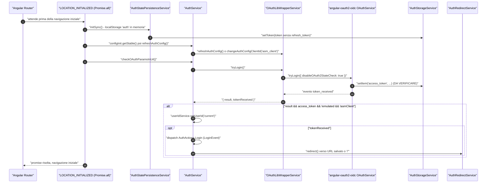
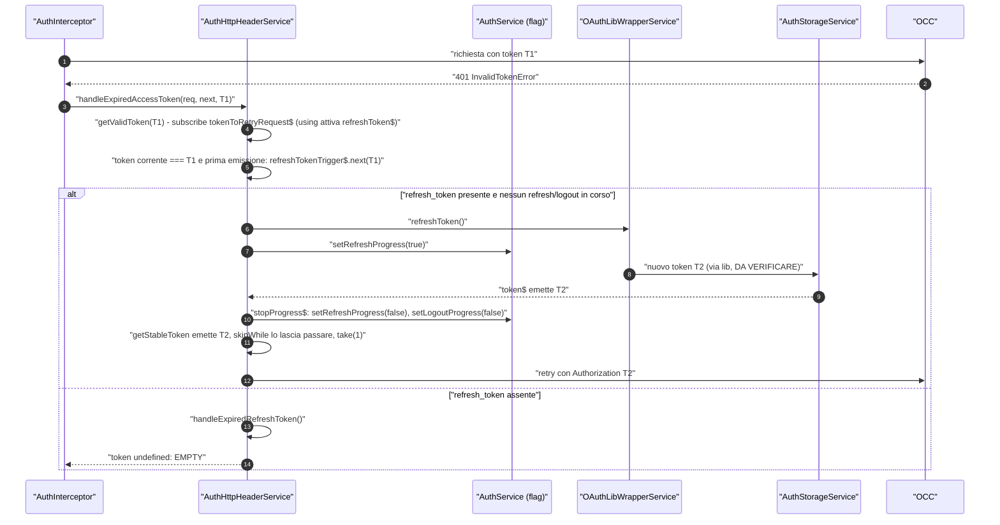
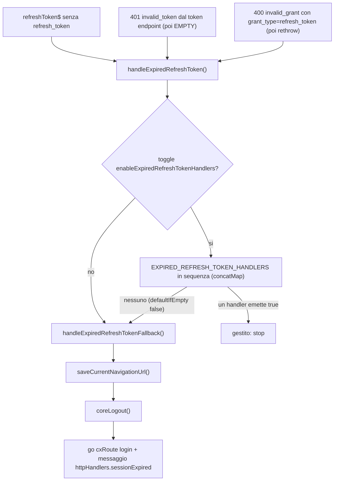

# 22 — Autenticazione: OAuth, token, interceptor, refresh

> Riferimenti allo SHA `5b7a1c2bf2808d7380bc20596d10f4fa710c3da1` (vedi [00-meta](../00-meta.md)).
>
> Nota sui collegamenti: i capitoli e le ricette non ancora presenti nel repository del libro sono indicati con il loro path relativo in `codice` (es. `../parte-3/50-ricette-config-di.md`) anziché con un link cliccabile, per non introdurre link rotti. Le appendici sono già collegate.

## 1. A cosa serve e perché esiste

Il sottosistema di autenticazione di `@spartacus/core` risolve quattro problemi distinti, che conviene tenere separati mentalmente:

1. **Ottenere un token utente** dall'Authorization Server di SAP Commerce, con uno dei tre flow OAuth supportati (Authorization Code con PKCE, Implicit, Resource Owner Password). Il flow non è configurato esplicitamente: è *dedotto* da `responseType` — `core-libs/core/src/auth/user-auth/services/auth-config.service.ts:L151-L164`, enum `OAuthFlow` in `core-libs/core/src/auth/user-auth/models/oauth-flow.ts:L10-L23`.
2. **Conservare il token** e lo `userId` OCC (`current` / `anonymous` / customer emulato) in memoria e, in parte, nel `localStorage` — `core-libs/core/src/auth/user-auth/services/auth-storage.service.ts:L18-L37`, `core-libs/core/src/auth/user-auth/services/auth-state-persistence.service.ts:L19-L57`.
3. **Allegare il token alle chiamate OCC** e gestire in modo trasparente la scadenza: 401 → refresh → retry, oppure logout forzato quando anche il refresh token è inutilizzabile — `core-libs/core/src/auth/user-auth/http-interceptors/auth.interceptor.ts:L31-L88`, `core-libs/core/src/auth/user-auth/services/auth-http-header.service.ts:L247-L310`.
4. **Token "client"** (grant `client_credentials`) per gli endpoint OCC che lo richiedono con l'Authorization Server legacy (es. registrazione utente). È un modulo separato, dichiarato esplicitamente un workaround rimovibile — `core-libs/core/src/auth/client-auth/client-auth.module.ts:L12-L29`.

Attorno a questo nucleo ruotano: il redirect alla pagina "di prima" dopo il login (`AuthRedirectService`), i guard (`AuthGuard`, `NotAuthGuard`, `CustomLoginGuard`, `OAuthCallbackGuard`, `FederatedLoginGuard`), il *federated login* (login su un dominio separato), le notifiche di logout tra tab e gli eventi `LoginEvent`/`LogoutEvent`.

Spartacus non implementa il protocollo OAuth da sé: lo delega alla libreria **angular-oauth2-oidc** (`OAuthModule.forRoot()` importato in `core-libs/core/src/auth/user-auth/user-auth.module.ts:L98-L100`), incapsulata da `OAuthLibWrapperService` (`core-libs/core/src/auth/user-auth/services/oauth-lib-wrapper.service.ts:L32-L53`). Spartacus però si riserva il controllo degli endpoint: il tipo `AuthLibConfig` *omette* dal `AuthConfig` della libreria `clientId`, `loginUrl`, `tokenEndpoint`, `revocationEndpoint` ecc., che vengono invece calcolati da `AuthConfigService` — `core-libs/core/src/auth/user-auth/config/auth-config.ts:L20-L30`.

> ⚠️ DA VERIFICARE — Il comportamento interno di angular-oauth2-oidc (`tryLogin()`, `refreshToken()`, `revokeTokenAndLogout()`, gestione PKCE, scrittura del token tramite `OAuthStorage.setItem`) non è verificabile su questo checkout: `node_modules` non è installato (dossier Q1). Nel capitolo è descritto solo ciò che si vede dal lato Spartacus.

## 2. Mappa dei file

| Path | Ruolo |
|---|---|
| `core-libs/core/src/auth/auth.module.ts` | `AuthModule`: importa `UserAuthModule.forRoot()` **prima** di `ClientAuthModule.forRoot()` (ordine interceptor) |
| `core-libs/core/src/auth/user-auth/user-auth.module.ts` | `UserAuthModule`: default config, validator, initializer, interceptor, `OAuthStorage → AuthStorageService`, location initializer |
| `core-libs/core/src/auth/user-auth/config/auth-config.ts` | `AuthConfig` (abstract, `useExisting: Config`), `AuthLibConfig` |
| `core-libs/core/src/auth/user-auth/config/default-auth-config.ts` | `defaultAuthConfig`, `defaultAuthConfigFactory` (dipende dai feature toggle), token deprecato `USE_AUTHORIZATION_CODE_FLOW_BY_DEFAULT` |
| `core-libs/core/src/auth/user-auth/config/auth-config-initializer.ts` | `AuthConfigInitializer`: `client_id` e `redirectUri` dinamici per base site |
| `core-libs/core/src/auth/user-auth/config/base-url-config-validator.ts` | warning se manca un base URL |
| `core-libs/core/src/auth/user-auth/services/auth-config.service.ts` | `AuthConfigService`: endpoint prefissati, flow dedotto |
| `core-libs/core/src/auth/user-auth/services/oauth-lib-wrapper.service.ts` | `OAuthLibWrapperService`: unico punto di contatto con `OAuthService` della lib |
| `core-libs/core/src/auth/user-auth/services/auth-storage.service.ts` | `AuthStorageService`: implementazione in memoria di `OAuthStorage` |
| `core-libs/core/src/auth/user-auth/services/auth-state-persistence.service.ts` | sincronizzazione `{ userId, token, redirectUrl }` con `localStorage` chiave `auth` |
| `core-libs/core/src/auth/user-auth/services/auth-http-header.service.ts` | `AuthHttpHeaderService`: header, refresh, retry, logout su refresh scaduto |
| `core-libs/core/src/auth/user-auth/services/auth-http-header-handler.ts` | `ExpiredRefreshTokenHandler`, `EXPIRED_REFRESH_TOKEN_HANDLERS` |
| `core-libs/core/src/auth/user-auth/services/auth-redirect.service.ts` | `AuthRedirectService`: memorizza e ripristina l'URL pre-login |
| `core-libs/core/src/auth/user-auth/services/auth-redirect-storage.service.ts` | contenitore della redirect URL |
| `core-libs/core/src/auth/user-auth/services/auth-flow-routes.service.ts` | riconosce le route con `authFlow: true` |
| `core-libs/core/src/auth/user-auth/services/auth-multisite-isolation.service.ts` | suffisso `\|baseSite` allo uid per siti isolati |
| `core-libs/core/src/auth/user-auth/facade/auth.service.ts` | `AuthService`: facade di login/logout, stato refresh/logout, client ASM |
| `core-libs/core/src/auth/user-auth/facade/user-id.service.ts` | `UserIdService`: `current` / `anonymous` / emulato |
| `core-libs/core/src/auth/user-auth/facade/auth-notification.service.ts` | `AuthNotificationService`: logout cross-tab via `BroadcastChannel` |
| `core-libs/core/src/auth/user-auth/facade/csrf-state.service.ts` | `CsrfStateService`: condivide il CSRF fra guard e form |
| `core-libs/core/src/auth/user-auth/http-interceptors/auth.interceptor.ts` | `AuthInterceptor` |
| `core-libs/core/src/auth/user-auth/http-interceptors/token-revocation.interceptor.ts` | `TokenRevocationInterceptor` |
| `core-libs/core/src/auth/user-auth/http-interceptors/index.ts` | array `interceptors` (multi `HTTP_INTERCEPTORS`) |
| `core-libs/core/src/auth/user-auth/guards/auth.guard.ts` | `AuthGuard` |
| `core-libs/core/src/auth/user-auth/guards/not-auth.guard.ts` | `NotAuthGuard` |
| `core-libs/core/src/auth/user-auth/guards/custom-login.guard.ts` | `CustomLoginGuard` (CSRF + retry) |
| `core-libs/core/src/auth/user-auth/guards/oauth-callback.guard.ts` | `OAuthCallbackGuard` |
| `core-libs/core/src/auth/user-auth/guards/federated-login.guard.ts` | `FederatedLoginGuard` |
| `core-libs/core/src/auth/user-auth/events/user-auth-event.builder.ts` | `UserAuthEventBuilder`: `LoginEvent`, `LogoutEvent` |
| `core-libs/core/src/auth/user-auth/store/actions/login-logout.action.ts` | azioni `[Auth] Login` / `[Auth] Logout` |
| `core-libs/core/src/auth/user-auth/models/auth-token.model.ts` | `AuthToken` |
| `core-libs/core/src/auth/user-auth/utils/oauth-constants.ts` | `OAUTH_REDIRECT_FLOW_KEY` |
| `core-libs/core/src/auth/client-auth/client-auth.module.ts` | `ClientAuthModule` (store + `ClientTokenInterceptor`) |
| `core-libs/core/src/auth/client-auth/http-interceptors/client-token.interceptor.ts` | `ClientTokenInterceptor` |
| `core-libs/core/src/auth/client-auth/services/client-token.service.ts` | facade sullo store del client token |
| `core-libs/core/src/auth/client-auth/services/client-authentication-token.service.ts` | POST `grant_type=client_credentials` |
| `core-libs/core/src/auth/client-auth/services/client-error-handling.service.ts` | refresh client token + retry |
| `core-libs/core/src/auth/client-auth/services/cross-site-request-forgery.service.ts` | GET del token CSRF (custom login page) |
| `core-libs/core/src/auth/client-auth/store/effects/client-token.effect.ts` | `ClientTokenEffect` (`exhaustMap`) |
| `core-libs/core/src/auth/client-auth/store/client-auth-store.module.ts` | feature store `client-auth` |
| `core-libs/core/src/federated-login/services/federated-login.service.ts` | `FederatedLoginService` |
| `core-libs/core/src/federated-login/services/federated-login-context-serializer.service.ts` | contesto `ctx` in Base64 URL-safe |
| `core-libs/core/src/federated-login/config/federated-login-config.ts` | `FederatedLoginConfig` |

## 3. Come funziona passo per passo

### 3.1 Wiring dei moduli e ordine degli interceptor

L'app demo importa `AuthModule.forRoot()` (`projects/storefrontapp/src/app/spartacus/spartacus-features.module.ts:L179-L179`). `AuthModule` importa i due sottomoduli in un ordine preciso, motivato da un commento (`core-libs/core/src/auth/auth.module.ts:L12-L24`): il `ClientTokenInterceptor` deve essere registrato **dopo** l'`AuthInterceptor`, così è il primo a vedere i 401.

Perché "registrato dopo" significa "vede prima l'errore"? Angular adatta gli interceptor a classe (`HTTP_INTERCEPTORS`) con `reduceRight`: con l'array `[a, b, c]` la catena è `c(b(a(end)))` in costruzione, cioè in esecuzione `a` è il più esterno e `c` il più interno, quindi `c` è il primo a ricevere risposta ed errore — `angular:packages/common/http/src/interceptor.ts:L233-L240`. Gli interceptor utente sono `AuthInterceptor` e poi `TokenRevocationInterceptor`, entrambi `useExisting` (`core-libs/core/src/auth/user-auth/http-interceptors/index.ts:L12-L23`); `ClientAuthModule.forRoot()` aggiunge il `ClientTokenInterceptor` (`core-libs/core/src/auth/client-auth/client-auth.module.ts:L12-L29`). Risultato: `AuthInterceptor` (esterno) → `TokenRevocationInterceptor` → `ClientTokenInterceptor` (interno). Approfondimento generale sugli interceptor: capitolo 06 (`../parte-1/06-httpclient-interceptor.md`) e [appendice A06](../appendici/A06-interceptor.md).

`UserAuthModule.forRoot()` fornisce (`core-libs/core/src/auth/user-auth/user-auth.module.ts:L102-L123`):

- `provideDefaultConfigFactory(defaultAuthConfigFactory)` — la default config dipende dai feature toggle (§3.2);
- `provideConfigValidator(baseUrlConfigValidator)` — warning se mancano sia `authentication.baseUrl` sia `backend.occ.baseUrl`, salvo `requireHttps === false` (`core-libs/core/src/auth/user-auth/config/base-url-config-validator.ts:L10-L19`);
- un config initializer `AuthConfigInitializer`, ma solo con il toggle `asyncAuthConfigInitializer` (la factory altrimenti restituisce `null`) — `core-libs/core/src/auth/user-auth/user-auth.module.ts:L108-L113`;
- gli interceptor, il binding `OAuthStorage → AuthStorageService` (la libreria scrive e legge il token *attraverso* il servizio Spartacus) e due *location initializer*.

`FederatedLoginModule` invece arriva da `BaseCoreModule` (`core-libs/core/src/base-core.module.ts:L44-L44`) e fornisce solo la default config (`core-libs/core/src/federated-login/federated-login.module.ts:L10-L17`). `UserAuthEventModule` istanzia eagerly `UserAuthEventBuilder` iniettandolo nel costruttore (`core-libs/core/src/auth/user-auth/events/user-auth-event.module.ts:L10-L15`).

### 3.2 La configurazione di default dipende dai feature toggle

`defaultAuthConfig` descrive il caso "moderno" (`core-libs/core/src/auth/user-auth/config/default-auth-config.ts:L48-L74`): `client_id: 'mobile_android_public'`, endpoint `/oauth/token`, `/oauth/revoke`, `/oauth/authorize`, `responseType: 'code'`, `disablePKCE: false`, `redirectUri: '/oauth-callback'`, `customLoginPage` (`/csrf`, `/login`) e `initializerOptions` `'auto'`. In `OAuthLibConfig` imposta inoltre `scope: ''`, `customTokenParameters: ['token_type']`, `skipIssuerCheck: true`, `oidc: false` e altri flag — `core-libs/core/src/auth/user-auth/config/default-auth-config.ts:L54-L61`.

`defaultAuthConfigFactory` legge tre toggle e "toglie pezzi" a quella config (`core-libs/core/src/auth/user-auth/config/default-auth-config.ts:L76-L139`):

| `authorizationCodeFlowByDefault` | `asyncAuthConfigInitializer` | `oauthCallbackPage` | Risultato |
|---|---|---|---|
| true | true | true | `defaultAuthConfig` invariato (`core-libs/core/src/auth/user-auth/config/default-auth-config.ts:L83-L86`) |
| true | true | false | senza `redirectUri` (`core-libs/core/src/auth/user-auth/config/default-auth-config.ts:L87-L99`) |
| true | false | — | senza `initializerOptions` e `redirectUri` (`core-libs/core/src/auth/user-auth/config/default-auth-config.ts:L101-L115`) |
| false | — | — | legacy ROPC: `mobile_android` + `client_secret: 'secret'`, `sendAuthHeaderOnRevoke: true`, `useClientTokens: true`, `disablePKCE: true`; rimossi `responseType`, `customLoginPage`, `initializerOptions`, `redirectUri` (`core-libs/core/src/auth/user-auth/config/default-auth-config.ts:L117-L138`) |

I default dei toggle allo SHA analizzato sono: `authorizationCodeFlowByDefault: true` (`core-libs/core/src/features-config/feature-toggles/config/feature-toggles.ts:L1029-L1029`), `asyncAuthConfigInitializer: false` (`core-libs/core/src/features-config/feature-toggles/config/feature-toggles.ts:L1090-L1090`), `oauthCallbackPage: false` (`core-libs/core/src/features-config/feature-toggles/config/feature-toggles.ts:L1111-L1111`). Quindi, **con i default, si cade nella terza riga**: Authorization Code + PKCE, `client_id` `mobile_android_public`, custom login page abilitata, nessun `redirectUri` configurato (verrà calcolato a runtime, §3.4). Il toggle `asyncAuthConfigInitializer` ha effetto solo se `authorizationCodeFlowByDefault` è attivo (`core-libs/core/src/features-config/feature-toggles/config/feature-toggles.ts:L631-L637`). Sui feature toggle in generale: capitolo 42 (`../parte-2/42-feature-toggle-deprecazioni.md`) e [appendice A09](../appendici/A09-feature-toggle.md).

`AuthConfigService` trasforma la config in URL: `getBaseUrl()` usa `authentication.baseUrl` o, in fallback, `backend.occ.baseUrl + '/authorizationserver'` (`core-libs/core/src/auth/user-auth/services/auth-config.service.ts:L54-L59`); ogni endpoint passa per `prefixEndpoint`, che aggiunge `/` se manca e prefissa il base URL (`core-libs/core/src/auth/user-auth/services/auth-config.service.ts:L139-L145`). `customLoginEnabled()` è vero se esiste l'oggetto `customLoginPage` (`core-libs/core/src/auth/user-auth/services/auth-config.service.ts:L105-L107`). Il flow è dedotto da `responseType`: contiene `code` → `AuthorizationCode`; `token` → `ImplicitFlow`; altrimenti `ResourceOwnerPasswordFlow` (`core-libs/core/src/auth/user-auth/services/auth-config.service.ts:L151-L164`).

### 3.3 Dove vive il token

`AuthStorageService` estende l'`OAuthStorage` della libreria ma non scrive in nessuno storage del browser: tiene l'intero token in un `BehaviorSubject<AuthToken>` inizializzato a `{}` (`core-libs/core/src/auth/user-auth/services/auth-storage.service.ts:L18-L37`). L'API per la libreria è sincrona: `getItem` legge il valore corrente con un subscribe/unsubscribe immediato; `setItem` e `removeItem` emettono un nuovo oggetto token (`core-libs/core/src/auth/user-auth/services/auth-storage.service.ts:L85-L118`). Alcune chiavi (`PKCE_verifier`, `access_token`, `refresh_token`, `expires_at`, `nonce`…) restano stringhe, le altre sono serializzate JSON (`core-libs/core/src/auth/user-auth/services/auth-storage.service.ts:L22-L56`).

Il modello `AuthToken` ha `access_token` e `access_token_stored_at` obbligatori; `refresh_token`, `expires_at`, `granted_scopes`, `token_type` opzionali (`core-libs/core/src/auth/user-auth/models/auth-token.model.ts:L10-L35`).

La persistenza vera la fa `AuthStatePersistenceService`: sincronizza con il browser storage, sotto la chiave `'auth'`, lo stato `{ userId, token, redirectUrl }` (`core-libs/core/src/auth/user-auth/services/auth-state-persistence.service.ts:L19-L57`), di default in `localStorage` (`core-libs/core/src/state/services/state-persistence.service.ts:L44-L48`). Il `refresh_token` **non** viene mai persistito "per minimizzare il rischio di hijacking" (`core-libs/core/src/auth/user-auth/services/auth-state-persistence.service.ts:L77-L83`). In lettura (`onRead`) ripristina token e redirect URL, imposta lo `userId` salvato o chiama `clearUserId()` (`core-libs/core/src/auth/user-auth/services/auth-state-persistence.service.ts:L92-L104`). Esiste anche un `isUserLoggedIn()` *sincrono*, che legge direttamente lo storage e serve al transfer state reducer (`core-libs/core/src/auth/user-auth/services/auth-state-persistence.service.ts:L115-L121`). Il meccanismo generico di persistenza è trattato nel capitolo 19 (`../parte-2/19-state-management.md`).

`UserIdService` usa un `ReplaySubject<string>(1)`: finché nessuno chiama `setUserId`, `getUserId()` non emette (`core-libs/core/src/auth/user-auth/facade/user-id.service.ts:L24-L34`). I valori notevoli sono `OCC_USER_ID_CURRENT = 'current'` e `OCC_USER_ID_ANONYMOUS = 'anonymous'` (`core-libs/core/src/occ/utils/occ-user-ids.ts:L7-L8`). `takeUserId(true)` lancia un `Error` se l'utente è anonimo (`core-libs/core/src/auth/user-auth/facade/user-id.service.ts:L57-L69`); `isEmulated()` è vero quando lo userId non è né `anonymous` né `current`, cioè un customerId in emulazione ASM (`core-libs/core/src/auth/user-auth/facade/user-id.service.ts:L81-L88`). Il JSDoc dichiara l'implementazione specifica per OCC (`core-libs/core/src/auth/user-auth/facade/user-id.service.ts:L15-L20`).

### 3.4 Configurazione della libreria: `OAuthLibWrapperService`

Il costruttore chiama `initialize()` (`core-libs/core/src/auth/user-auth/services/oauth-lib-wrapper.service.ts:L32-L53`), che:

1. con `asyncAuthConfigInitializer` applica la config a ogni emissione di `configInitializerService.getStable('authentication')`; senza, la applica subito, sincrona (`core-libs/core/src/auth/user-auth/services/oauth-lib-wrapper.service.ts:L55-L64`);
2. se il federated login è abilitato, rilegge il contesto e riconfigura la lib con il `loginUrl` arricchito da `ctx=…` (`core-libs/core/src/auth/user-auth/services/oauth-lib-wrapper.service.ts:L66-L73`, `core-libs/core/src/auth/user-auth/services/oauth-lib-wrapper.service.ts:L126-L139`).

`generateBaseConfig` mappa la config Spartacus sui campi della lib (`tokenEndpoint`, `loginUrl`, `clientId`, `dummyClientSecret`, `revocationEndpoint`, `logoutUrl`, `userinfoEndpoint`, `issuer`, `redirectUri`) e poi spalma `OAuthLibConfig` (`core-libs/core/src/auth/user-auth/services/oauth-lib-wrapper.service.ts:L96-L115`). Se `redirectUri` non è configurato, `generateCustomerLoginConfig` lo calcola: `''` in SSR, l'origin federato sul login domain, altrimenti `location.origin` (`core-libs/core/src/auth/user-auth/services/oauth-lib-wrapper.service.ts:L76-L94`). `applyConfiguration` chiama `oAuthService.configure(config)` e, in modalità async, segnala `initialized` (`core-libs/core/src/auth/user-auth/services/oauth-lib-wrapper.service.ts:L118-L123`): tutti i metodi che parlano con la lib (`authorizeWithPasswordFlow`, `refreshToken`, `revokeAndLogout`, `initLoginFlow`) attendono quel segnale in modalità async (`core-libs/core/src/auth/user-auth/services/oauth-lib-wrapper.service.ts:L157-L198`, `core-libs/core/src/auth/user-auth/services/oauth-lib-wrapper.service.ts:L239-L246`).

Con l'initializer asincrono attivo, `AuthConfigInitializer` calcola `client_id` e `redirectUri` combinando il base site attivo e `authentication.initializerOptions` (`core-libs/core/src/auth/user-auth/config/auth-config-initializer.ts:L19-L53`): il client id riceve il suffisso `_<baseSite>` (`core-libs/core/src/auth/user-auth/config/auth-config-initializer.ts:L55-L59`); il redirect URI riceve `/<baseSite>` e, con `oauthCallbackPage`, il path `oauth-callback` (`core-libs/core/src/auth/user-auth/config/auth-config-initializer.ts:L84-L113`). Il valore `'auto'` vale `true` solo se `BASE_SITE_CONTEXT_ID` è fra i parametri di URL encoding del site context (`core-libs/core/src/auth/user-auth/config/auth-config-initializer.ts:L142-L146`). Il meccanismo dei config initializer è nel capitolo 11 (`../parte-2/11-configurazione.md`).

### 3.5 Bootstrap: sincronizzazione e ritorno dall'Authorization Server

Il punto più delicato è *quando* Spartacus controlla se nell'URL c'è un `code` OAuth. Lo fa in un **location initializer**: i location initializer sono raccolti nel multi-token `LOCATION_INITIALIZED_MULTI` e risolti in un `Promise.all` fornito come `LOCATION_INITIALIZED` di Angular (`core-libs/core/src/routing/routing.module.ts:L66-L71`), e con `withEnabledBlockingInitialNavigation` il router attende quella promise prima della navigazione iniziale (`angular:packages/router/src/provide_router.ts:L445-L452`). Dettagli sull'ordine di bootstrap: capitolo 10 (`../parte-2/10-bootstrap-inizializzazione.md`).

`authInitializedFactory` (`core-libs/core/src/auth/user-auth/user-auth.module.ts:L70-L80`):

1. avvia **subito** `AuthStatePersistenceService.initSync()`, così token, userId e redirect URL letti dal `localStorage` sono in memoria; il commento spiega che altrimenti il `nonce` dell'Implicit Flow sarebbe `undefined`;
2. restituisce `checkOAuthParamsInUrl(...)`, che in browser attende `configInit.getStable()`, chiama `authService.refreshAuthConfig()` e poi `authService.checkOAuthParamsInUrl()`; in SSR risolve subito (`core-libs/core/src/auth/user-auth/user-auth.module.ts:L39-L56`).

`AuthService.refreshAuthConfig()` cambia il client id in `'asm_client'` se il code flow è default e ASM risulta abilitato, altrimenti riconfigura normalmente la lib (`core-libs/core/src/auth/user-auth/facade/auth.service.ts:L316-L327`). ASM è considerato abilitato se `asm=true` è nella query, se `localStorage.asm_enabled === 'true'` o se il path contiene `assisted-service/emulate?` (`core-libs/core/src/auth/user-auth/facade/auth.service.ts:L263-L284`).

`AuthService.checkOAuthParamsInUrl()` (`core-libs/core/src/auth/user-auth/facade/auth.service.ts:L90-L117`):

1. chiama `oAuthLibWrapperService.tryLogin()`, che si iscrive all'evento `token_received` e invoca `oAuthService.tryLogin({ disableOAuth2StateCheck: true })`, risolvendo `{ result, tokenReceived }` (`core-libs/core/src/auth/user-auth/services/oauth-lib-wrapper.service.ts:L258-L284`); `tokenReceived` distingue il ritorno da una pagina di autorizzazione esterna dal token preso dallo storage (`core-libs/core/src/auth/user-auth/models/oauth-try-login-response.ts:L7-L19`);
2. imposta `userId = 'current'` solo se `result` è vero **e** c'è un `access_token` **e** l'utente non è emulato **e** non si usa il client ASM — il commento ricorda che nel code flow `result` è `true` anche senza login riuscito (`core-libs/core/src/auth/user-auth/facade/auth.service.ts:L101-L105`);
3. solo se `tokenReceived` dispatcha `AuthActions.Login` e chiama `authRedirectService.redirect()` (`core-libs/core/src/auth/user-auth/facade/auth.service.ts:L107-L114`);
4. ogni errore è silenziato con `catch {}` (`core-libs/core/src/auth/user-auth/facade/auth.service.ts:L116-L116`).

In parallelo, `authNotificationInitializerFactory` avvia l'ascolto del `BroadcastChannel` solo con il toggle `propagateLogoutToAllTabs` (`core-libs/core/src/auth/user-auth/user-auth.module.ts:L85-L92`).

### 3.6 Avviare il login

- **Redirect (Authorization Code / Implicit)**: `AuthService.loginWithRedirect()` chiama `initLoginFlow()` e ritorna sempre `true` (`core-libs/core/src/auth/user-auth/facade/auth.service.ts:L122-L125`). `OAuthLibWrapperService.initLoginFlow()` scrive `oAuthRedirectCodeFlow='true'` in `localStorage` se il code flow non è default o se il federated login è abilitato (`core-libs/core/src/auth/user-auth/services/oauth-lib-wrapper.service.ts:L219-L225`, chiave in `core-libs/core/src/auth/user-auth/utils/oauth-constants.ts:L7-L7`); sul login domain federato non avvia il flow ma rimanda al login dell'origin "perché il PKCE sia disponibile all'origin" (`core-libs/core/src/auth/user-auth/services/oauth-lib-wrapper.service.ts:L227-L237`); altrimenti delega a `oAuthService.initLoginFlow()` (`core-libs/core/src/auth/user-auth/services/oauth-lib-wrapper.service.ts:L239-L246`). La chiave `oAuthRedirectCodeFlow` viene rimossa da `tryLogin()` se il token non arriva o in caso di errore (`core-libs/core/src/auth/user-auth/services/oauth-lib-wrapper.service.ts:L276-L288`).
- **Credenziali (ROPC)**: `loginWithCredentials(uid, pwd)` decora lo uid con `|<baseSiteUid>` se il sito è `isolated` (`core-libs/core/src/auth/user-auth/services/auth-multisite-isolation.service.ts:L16-L38`), chiama `authorizeWithPasswordFlow` (→ `fetchTokenUsingPasswordFlow`), imposta `current`, dispatcha `Login` e fa redirect, inghiottendo gli errori (`core-libs/core/src/auth/user-auth/facade/auth.service.ts:L132-L153`, `core-libs/core/src/auth/user-auth/services/oauth-lib-wrapper.service.ts:L157-L168`).
- **OTP**: `otpLoginWithCredentials(tokenId, tokenCode)` riusa il password flow con tokenId/tokenCode come credenziali, senza decorazione multisite (`core-libs/core/src/auth/user-auth/facade/auth.service.ts:L169-L186`).

**Custom login page.** Col code flow default l'Authorization Server presenta un form di login servito da Spartacus stesso: la route `login` ha path `sign-in` e viene aggiunta la route `loginForm` con path `login` (`core-libs/storefront/cms-structure/routing/default-routing-config.ts:L24-L33`, `core-libs/storefront/cms-structure/routing/default-routing-config.ts:L94-L111`). Il componente CMS `ReturningCustomerLoginComponent` è protetto da `[NotAuthGuard, CustomLoginGuard]` (`feature-libs/user/account/components/login-form/login-form.module.ts:L52-L54`), come `VerifyOTPTokenComponent` (`feature-libs/user/account/components/verification-token-form/verification-token-form.module.ts:L59-L61`). `CustomLoginGuard` è un no-op se la custom login page non è configurata o in SSR (`core-libs/core/src/auth/user-auth/guards/custom-login.guard.ts:L61-L68`); altrimenti chiede il token CSRF (GET con `withCredentials: true`, `core-libs/core/src/auth/client-auth/services/cross-site-request-forgery.service.ts:L30-L35`) come prova di una sessione valida dell'Authorization Server, lo salva in `CsrfStateService` e azzera il contatore dei redirect (`core-libs/core/src/auth/user-auth/guards/custom-login.guard.ts:L70-L75`). Il form lo rilegge con il getter `csrf` (`feature-libs/user/account/components/login-form/login-form-component.service.ts:L61-L63`). In caso di errore CSRF il guard ritenta una sola volta (contatore in `localStorage` `login_redirect_count`, valido 15 s), poi porta a `home` con `authMessages.unrecoverableError` (`core-libs/core/src/auth/user-auth/guards/custom-login.guard.ts:L29-L38`, `core-libs/core/src/auth/user-auth/guards/custom-login.guard.ts:L76-L101`). `AuthService.getCsrfToken()` restituisce uno stream condiviso con `shareReplay({ bufferSize: 1, refCount: true })` (`core-libs/core/src/auth/user-auth/facade/auth.service.ts:L67-L69`), mentre `refreshCsrfToken()` rifà la GET (`core-libs/core/src/auth/user-auth/facade/auth.service.ts:L256-L258`).

**Pagina di callback.** Con i tre toggle attivi esiste la route `oAuthCallback` (`oauth-callback`) (`core-libs/storefront/cms-structure/routing/default-routing-config.ts:L94-L111`) e `OAuthCallbackComponent` è mappato su `SpinnerComponent` con `OAuthCallbackGuard` (`feature-libs/user/account/components/oauth-callback/oauth-callback.module.ts:L26-L37`). Il guard in SSR lascia renderizzare la pagina; in browser, se l'utente è loggato chiama `redirect()` e ritorna `true`, altrimenti manda a `login` (`core-libs/core/src/auth/user-auth/guards/oauth-callback.guard.ts:L32-L52`).

### 3.7 Allegare il token alle richieste: `AuthInterceptor`

`AuthInterceptor` non contiene logica propria: "only hooks into request send/received events" e delega ad `AuthHttpHeaderService` (`core-libs/core/src/auth/user-auth/http-interceptors/auth.interceptor.ts:L20-L29`). Per ogni richiesta:

1. `shouldCatchError` è vero per URL OCC; `shouldAddAuthorizationHeader` per URL OCC **senza** un header `Authorization` già presente (`core-libs/core/src/auth/user-auth/services/auth-http-header.service.ts:L175-L183`). "URL OCC" significa semplicemente `url.includes(occEndpoints.getBaseUrl())` (`core-libs/core/src/auth/user-auth/services/auth-http-header.service.ts:L205-L207`).
2. Se serve l'header, il token arriva da `getStableToken().pipe(take(1))`: emette in modo sincrono, salvo refresh o logout in corso (`core-libs/core/src/auth/user-auth/http-interceptors/auth.interceptor.ts:L40-L49`). `getStableToken()` combina `token$`, `refreshInProgress$` e `logoutInProgress$`, filtra finché entrambi i flag sono `false` e usa `observeOn(queueScheduler)` (`core-libs/core/src/auth/user-auth/services/auth-http-header.service.ts:L337-L350`). In pratica, **durante un refresh tutte le nuove richieste OCC restano in attesa**.
3. `alterRequest` aggiunge `Authorization: <token_type|Bearer> <access_token>` — ma non alle richieste `baseSites` (`core-libs/core/src/auth/user-auth/services/auth-http-header.service.ts:L188-L203`). Se il token passato non ha `access_token`, `createAuthorizationHeader` rilegge in modo sincrono quello corrente; se non c'è restituisce `{}` (`core-libs/core/src/auth/user-auth/services/auth-http-header.service.ts:L220-L242`).

`TokenRevocationInterceptor` (dedicato al server OAuth Hybris) passa la richiesta invariata se `sendAuthHeaderOnRevoke()` è falso; altrimenti aggiunge `Authorization` solo se l'URL è esattamente l'endpoint di revoca (`core-libs/core/src/auth/user-auth/http-interceptors/token-revocation.interceptor.ts:L19-L58`).

### 3.8 Gestione errori: 401, refresh e retry

Nel `catchError` dell'`AuthInterceptor` (`core-libs/core/src/auth/user-auth/http-interceptors/auth.interceptor.ts:L54-L84`):

- **401 + token scaduto + URL OCC** → `handleExpiredAccessToken(request, next, token)`. Il token è "scaduto" se `error.errors[0].type` è `InvalidBearerTokenError` o `InvalidTokenError` (`core-libs/core/src/auth/user-auth/http-interceptors/auth.interceptor.ts:L106-L110`).
- **401 dal token endpoint con `error === 'invalid_token'`** → `handleExpiredRefreshToken()` e `EMPTY` (`core-libs/core/src/auth/user-auth/http-interceptors/auth.interceptor.ts:L65-L72`). "Dal token endpoint" significa `errResponse.url` che contiene `getTokenEndpoint()` (`core-libs/core/src/auth/user-auth/http-interceptors/auth.interceptor.ts:L90-L104`).
- **400 `invalid_grant` con `grant_type === 'refresh_token'`** → `handleExpiredRefreshToken()`, **ma l'errore viene comunque rilanciato** (`core-libs/core/src/auth/user-auth/http-interceptors/auth.interceptor.ts:L74-L83`).

Il refresh è un piccolo motore reattivo dentro `AuthHttpHeaderService`:

1. `handleExpiredAccessToken` chiama `getValidToken(initialToken)` e ritenta la richiesta con il nuovo token; se il token è assente restituisce `EMPTY` "per evitare `Authorization: bearer undefined`" (`core-libs/core/src/auth/user-auth/services/auth-http-header.service.ts:L247-L260`).
2. `getValidToken` si iscrive a `tokenToRetryRequest$`; alla **prima** emissione, e solo se il token corrente è identico a quello della richiesta fallita, emette su `refreshTokenTrigger$` (guard per più chiamate parallele); poi salta i valori finché il token non cambia e prende il primo nuovo (`core-libs/core/src/auth/user-auth/services/auth-http-header.service.ts:L356-L380`).
3. `tokenToRetryRequest$` usa `using()` per tenere sottoscritto `refreshToken$` finché c'è qualcuno in attesa di `getStableToken()`, condiviso con `shareReplay({ refCount: true, bufferSize: 1 })` (`core-libs/core/src/auth/user-auth/services/auth-http-header.service.ts:L148-L151`).
4. `refreshToken$` ignora i trigger se refresh o logout sono già in corso; se il token ha `refresh_token` chiama `oAuthLibWrapperService.refreshToken()` e imposta `refreshInProgress=true`, altrimenti chiama `handleExpiredRefreshToken()` (`core-libs/core/src/auth/user-auth/services/auth-http-header.service.ts:L125-L142`). `refreshToken()` del wrapper è fire-and-forget (`core-libs/core/src/auth/user-auth/services/oauth-lib-wrapper.service.ts:L173-L181`).
5. La libreria salva il nuovo token tramite `AuthStorageService.setItem` (`core-libs/core/src/auth/user-auth/services/auth-storage.service.ts:L111-L118`). ⚠️ DA VERIFICARE — che la lib scriva proprio via `setItem` è nel codice di angular-oauth2-oidc, non disponibile (`node_modules` assente).
6. `stopProgress$` confronta con `pairwise` token precedente e nuovo e, quando l'`access_token` cambia, azzera sia `logoutInProgress` sia `refreshInProgress` (`core-libs/core/src/auth/user-auth/services/auth-http-header.service.ts:L109-L119`). È sottoscritto nel costruttore per tutta la vita del servizio (`core-libs/core/src/auth/user-auth/services/auth-http-header.service.ts:L166-L169`).
7. `getStableToken()` ora emette il nuovo token: le richieste in coda partono, quella fallita viene ritentata con `createNewRequestWithNewToken` (`core-libs/core/src/auth/user-auth/services/auth-http-header.service.ts:L382-L392`).

### 3.9 Refresh token scaduto o assente

`handleExpiredRefreshToken()` (`core-libs/core/src/auth/user-auth/services/auth-http-header.service.ts:L265-L285`):

- senza il toggle `enableExpiredRefreshTokenHandlers` va dritto al fallback;
- con il toggle (default `true`, `core-libs/core/src/features-config/feature-toggles/config/feature-toggles.ts:L1072-L1072`) esegue in sequenza (`concatMap`) gli `ExpiredRefreshTokenHandler` iniettati da `EXPIRED_REFRESH_TOKEN_HANDLERS` (opzionale, default `[]`, `core-libs/core/src/auth/user-auth/services/auth-http-header.service.ts:L154-L155`) e si ferma al primo che restituisce `true`; se nessuno gestisce, fallback. Un handler che non restituisce un Observable conta come "non gestito" (`core-libs/core/src/auth/user-auth/services/auth-http-header.service.ts:L318-L328`).

Il **fallback** salva l'URL della navigazione corrente, esegue `coreLogout()` e poi naviga a `login` mostrando `httpHandlers.sessionExpired` come messaggio d'errore (`core-libs/core/src/auth/user-auth/services/auth-http-header.service.ts:L287-L310`).

### 3.10 Logout

`AuthService.logout()` non revoca nulla: naviga alla cxRoute `logout` (`core-libs/core/src/auth/user-auth/facade/auth.service.ts:L222-L224`), dove `LogoutGuard` chiama `coreLogout()` (`core-libs/storefront/cms-components/user/logout/logout.guard.ts:L87-L89`). `coreLogout()` (`core-libs/core/src/auth/user-auth/facade/auth.service.ts:L192-L207`):

1. `logoutInProgress = true` (blocca le nuove richieste OCC in `getStableToken`);
2. `clearUserId()` → `anonymous`;
3. se `propagateLogoutToAllTabs`, invia `LOGOUT` sul `BroadcastChannel`;
4. `revokeAndLogout()`: `revokeTokenAndLogout(true)` della lib e, se la revoca fallisce, `logOut(true)` locale comunque (`core-libs/core/src/auth/user-auth/services/oauth-lib-wrapper.service.ts:L186-L198`);
5. nel `finally`: dispatch `AuthActions.Logout` e `logoutInProgress = false`.

`LogoutEvent` non è legato all'azione NgRx ma alla transizione `true → false` di `isUserLoggedIn()` (`core-libs/core/src/auth/user-auth/events/user-auth-event.builder.ts:L57-L63`); `LoginEvent` invece è mappato sull'azione `AuthActions.LOGIN` via `StateEventService` (`core-libs/core/src/auth/user-auth/events/user-auth-event.builder.ts:L40-L45`). Entrambi sono emessi anche per l'emulazione cliente, non per l'autenticazione dell'agente ASM (`core-libs/core/src/auth/user-auth/events/user-auth.events.ts:L9-L19`). Sugli eventi in generale: capitolo 20 (`../parte-2/20-facade-command-query-eventi.md`) e [appendice A07](../appendici/A07-eventi.md).

Nelle altre tab, `handleAuthNotification` riceve `LOGOUT` e, se non c'è già un logout in corso e l'utente è loggato, esegue a sua volta `coreLogout()` (`core-libs/core/src/auth/user-auth/facade/auth.service.ts:L300-L314`). Il canale si chiama `spartacus_auth_notification`, le notifiche sono isolate per base site e **non** passano per `EventService` (`core-libs/core/src/auth/user-auth/facade/auth-notification.service.ts:L11-L28`); la classe base apre il `BroadcastChannel` in `listen()` (`core-libs/core/src/util/browser-tab-notification/abstract-browser-tab-notification.service.ts:L93-L98`).

### 3.11 Redirect dopo il login e guard di accesso

`AuthRedirectService` ricorda "la pagina precedente" oppure "la pagina che l'`AuthGuard` ha appena bloccato" (`core-libs/core/src/auth/user-auth/services/auth-redirect.service.ts:L31-L44`):

- senza il toggle `redirectOnlyOnTrueNavigationEnd` (default `false`, `core-libs/core/src/features-config/feature-toggles/config/feature-toggles.ts:L1078-L1078`) salva `urlAfterRedirects` a ogni `NavigationEnd`; con il toggle scarta i `NavigationEnd` preceduti da un `NavigationCancel` di tipo `Redirect` (`core-libs/core/src/auth/user-auth/services/auth-redirect.service.ts:L62-L72`, `core-libs/core/src/auth/user-auth/services/auth-redirect.service.ts:L122-L140`), cioè da un guard che ha restituito una `UrlTree` (`angular:packages/router/src/events.ts:L179-L183`);
- `setRedirectUrl` ignora gli URL delle route `authFlow` e rimuove i parametri di site context (`core-libs/core/src/auth/user-auth/services/auth-redirect.service.ts:L112-L120`); le route `authFlow` sono calcolate lazily dalla `RoutingConfig` (`core-libs/core/src/auth/user-auth/services/auth-flow-routes.service.ts:L23-L46`, proprietà definita in `core-libs/core/src/routing/configurable-routes/routes-config.ts:L49-L56`);
- `saveCurrentNavigationUrl()` usa `router.currentNavigation()?.finalUrl` e non fa nulla se non c'è una navigazione in corso (`core-libs/core/src/auth/user-auth/services/auth-redirect.service.ts:L99-L107`);
- `redirect()` naviga all'URL salvato o a `'/'` e azzera l'URL (`core-libs/core/src/auth/user-auth/services/auth-redirect.service.ts:L81-L93`).

`AuthGuard`, se l'utente non è loggato, salva l'URL della navigazione corrente e restituisce la `UrlTree` di `login` (`core-libs/core/src/auth/user-auth/guards/auth.guard.ts:L30-L42`). `NotAuthGuard`, se l'utente è loggato, restituisce la `UrlTree` di `home` (`core-libs/core/src/auth/user-auth/guards/not-auth.guard.ts:L28-L40`). Catalogo dei guard: [appendice A05](../appendici/A05-guard.md); route semantiche e protected routes: capitolo 14 (`../parte-2/14-routing.md`).

### 3.12 Client token (`client_credentials`)

1. Un adapter OCC marca la richiesta con l'header `cx-use-client-token` (`USE_CLIENT_TOKEN`, `core-libs/core/src/occ/utils/interceptor-util.ts:L9-L9`).
2. `ClientTokenInterceptor` rimuove **sempre** il marker, anche con i client token disabilitati; se `useClientTokens` è falso passa oltre (`core-libs/core/src/auth/client-auth/http-interceptors/client-token.interceptor.ts:L46-L52`). Il flag è letto una volta sola come field initializer (`core-libs/core/src/auth/client-auth/http-interceptors/client-token.interceptor.ts:L32-L34`).
3. Per richieste marcate chiede il token a `ClientTokenService.getClientToken()`, che dispatcha `LoadClientToken` se lo store non è né caricato né in loading (`core-libs/core/src/auth/client-auth/services/client-token.service.ts:L31-L47`). Per le altre restituisce `of(undefined)` (`core-libs/core/src/auth/client-auth/http-interceptors/client-token.interceptor.ts:L90-L97`).
4. `ClientTokenEffect` usa `exhaustMap` e chiama `ClientAuthenticationTokenService`, che fa POST al token endpoint con `client_id`, `client_secret`, `grant_type=client_credentials` (`core-libs/core/src/auth/client-auth/store/effects/client-token.effect.ts:L21-L42`, `core-libs/core/src/auth/client-auth/services/client-authentication-token.service.ts:L31-L48`). Lo stato è un `loaderReducer` nella feature `client-auth` (`core-libs/core/src/auth/client-auth/store/reducers/index.ts:L13-L25`, `core-libs/core/src/auth/client-auth/store/client-auth-state.ts:L10-L19`).
5. Il client token è aggiunto come `Authorization` se presente e se l'URL è OCC (`core-libs/core/src/auth/client-auth/http-interceptors/client-token.interceptor.ts:L57-L68`).
6. Su 401 scaduto di una richiesta marcata, `ClientErrorHandlingService.handleExpiredClientToken` forza `refreshClientToken()` e ritenta (`core-libs/core/src/auth/client-auth/http-interceptors/client-token.interceptor.ts:L71-L85`, `core-libs/core/src/auth/client-auth/services/client-error-handling.service.ts:L30-L40`). Essendo l'interceptor più interno, il 401 non arriva all'`AuthInterceptor` se viene gestito qui.

### 3.13 Federated login

Il federated login permette di eseguire il login su un **login domain** diverso dal dominio dello storefront ("origin"). Config di default: `enabled: false`, `contextParameterName: 'ctx'`, `loginHosts: []`, `originMap: {}` (`core-libs/core/src/federated-login/config/default-federated-login-config.ts:L9-L18`).

1. `FederatedLoginService.enabled` e `isLoginDomain` sono calcolati una volta alla creazione; `isLoginDomain` confronta `loginHosts` con l'host di `location.origin` (`core-libs/core/src/federated-login/services/federated-login.service.ts:L24-L27`, `core-libs/core/src/federated-login/services/federated-login.service.ts:L81-L89`).
2. Sull'origin, `getParameters()` produce `ctx=<serializzato>` con lingua attiva e origin (`core-libs/core/src/federated-login/services/federated-login.service.ts:L40-L60`); `serializeContext` è un Base64 URL-safe di `<originKey>:<language>`, stringa vuota se l'origin non è in `originMap` (`core-libs/core/src/federated-login/services/federated-login-context-serializer.service.ts:L16-L31`). Il wrapper lo appende al `loginUrl` (`core-libs/core/src/auth/user-auth/services/oauth-lib-wrapper.service.ts:L126-L139`).
3. Sul login domain, `detectContext()` fonde il contesto salvato e quello in URL e lo riscrive in `localStorage` chiave `federatedLogin` (`core-libs/core/src/federated-login/services/federated-login.service.ts:L62-L79`, `core-libs/core/src/federated-login/services/federated-login-context-storage.ts:L17-L23`); `validateContext` azzera `origin` se non è fra i valori di `originMap` (`core-libs/core/src/federated-login/services/federated-login.service.ts:L92-L105`).
4. `FederatedLoginGuard` è registrato come `BEFORE_CMS_PAGE_GUARD` (`core-libs/storefront/cms-structure/routing/routing.module.ts:L27-L36`): sul login domain senza `origin` manda a `notFound` evitando loop, su route non `authFlow` rimanda all'origin via `location.href` e ritorna `false` (`core-libs/core/src/auth/user-auth/guards/federated-login.guard.ts:L43-L57`, `core-libs/core/src/auth/user-auth/guards/federated-login.guard.ts:L74-L104`).
5. Il `redirectUri` sul login domain è l'origin memorizzato (`core-libs/core/src/auth/user-auth/services/oauth-lib-wrapper.service.ts:L76-L94`).

## 4. Diagrammi

### 4.1 Bootstrap e ritorno dall'Authorization Server (Authorization Code)



Riferimenti: `core-libs/core/src/routing/routing.module.ts:L66-L71`, `core-libs/core/src/auth/user-auth/user-auth.module.ts:L39-L80`, `core-libs/core/src/auth/user-auth/services/auth-state-persistence.service.ts:L77-L104`, `core-libs/core/src/auth/user-auth/facade/auth.service.ts:L90-L117`, `core-libs/core/src/auth/user-auth/facade/auth.service.ts:L316-L327`, `core-libs/core/src/auth/user-auth/services/oauth-lib-wrapper.service.ts:L258-L284`.

### 4.2 Catena degli interceptor su una richiesta OCC

```mermaid
flowchart LR
    REQ["HttpClient request"] --> AI["AuthInterceptor (esterno)"]
    AI -->|"URL OCC, senza Authorization"| GST["getStableToken().pipe(take(1))"]
    GST -->|"attende fine refresh/logout"| ALT["alterRequest: Authorization Bearer (no baseSites)"]
    AI -->|"altrimenti"| PASS1["richiesta invariata"]
    ALT --> TRI["TokenRevocationInterceptor"]
    PASS1 --> TRI
    TRI -->|"sendAuthHeaderOnRevoke e URL === revokeEndpoint"| REV["aggiunge Authorization"]
    TRI -->|"altrimenti"| CTI["ClientTokenInterceptor (interno)"]
    REV --> CTI
    CTI -->|"rimuove header cx-use-client-token"| CHK{"useClientTokens?"}
    CHK -->|"no"| BE["backend OCC"]
    CHK -->|"si e richiesta marcata"| CT["ClientTokenService.getClientToken()"]
    CT --> BE
```



Riferimenti: `angular:packages/common/http/src/interceptor.ts:L233-L240`, `core-libs/core/src/auth/auth.module.ts:L12-L24`, `core-libs/core/src/auth/user-auth/http-interceptors/auth.interceptor.ts:L31-L49`, `core-libs/core/src/auth/user-auth/services/auth-http-header.service.ts:L175-L203`, `core-libs/core/src/auth/user-auth/http-interceptors/token-revocation.interceptor.ts:L29-L58`, `core-libs/core/src/auth/client-auth/http-interceptors/client-token.interceptor.ts:L42-L97`.

### 4.3 401 per access token scaduto: refresh e retry



Riferimenti: `core-libs/core/src/auth/user-auth/http-interceptors/auth.interceptor.ts:L56-L64`, `core-libs/core/src/auth/user-auth/services/auth-http-header.service.ts:L109-L151`, `core-libs/core/src/auth/user-auth/services/auth-http-header.service.ts:L247-L260`, `core-libs/core/src/auth/user-auth/services/auth-http-header.service.ts:L337-L392`, `core-libs/core/src/auth/user-auth/services/oauth-lib-wrapper.service.ts:L173-L181`.

### 4.4 Refresh token inutilizzabile: handler e fallback



Riferimenti: `core-libs/core/src/auth/user-auth/services/auth-http-header.service.ts:L125-L142`, `core-libs/core/src/auth/user-auth/http-interceptors/auth.interceptor.ts:L65-L83`, `core-libs/core/src/auth/user-auth/services/auth-http-header.service.ts:L265-L328`.

## 5. Estratti di codice reale

### 5.1 L'ordine dei moduli è semantico

`core-libs/core/src/auth/auth.module.ts:L12-L17`
```ts
@NgModule({
  // ClientAuthModule should always be imported after UserAuthModule because the ClientTokenInterceptor must be imported after the AuthInterceptor.
  // This way, the ClientTokenInterceptor is the first to handle 401 errors and attempt to refresh the client token.
  // If the request is not for the client token, the AuthInterceptor handles the refresh.
  imports: [CommonModule, UserAuthModule.forRoot(), ClientAuthModule.forRoot()],
})
```

### 5.2 Location initializer: prima la sync dello storage, poi il controllo dell'URL

`core-libs/core/src/auth/user-auth/user-auth.module.ts:L70-L80`
```ts
const authInitializedFactory: LocationInitializerFactory = () => {
  const authService = inject(AuthService);
  const configInit = inject(ConfigInitializerService);
  const platformId = inject(PLATFORM_ID);
  const authStatePersistenceService = inject(AuthStatePersistenceService);

  //We need to call it before checkOAuthParamsInUrl to ensure that in-memory storage is in sync with browser storage.
  //In other case "nonce" value used in Implicit Flow will be undefined causing the error.
  authStatePersistenceFactory(authStatePersistenceService)();
  return checkOAuthParamsInUrl(authService, configInit, platformId);
};
```

### 5.3 Il `refresh_token` non finisce nel `localStorage`

`core-libs/core/src/auth/user-auth/services/auth-state-persistence.service.ts:L76-L84`
```ts
      map(([authToken, userId, redirectUrl]) => {
        let token = authToken;
        if (token) {
          token = { ...token };
          // To minimize risk of user account hijacking we don't persist user refresh_token
          delete token.refresh_token;
        }
        return { token, userId, redirectUrl };
      })
```

### 5.4 Gestione degli errori in `AuthInterceptor`

`core-libs/core/src/auth/user-auth/http-interceptors/auth.interceptor.ts:L54-L84`
```ts
          catchError((errResponse: any) => {
            switch (errResponse.status) {
              case 401: // Unauthorized
                if (this.isExpiredToken(errResponse) && shouldCatchError) {
                  // request failed because of the expired access token
                  // we should get refresh the token and retry the request, or logout if the refresh is missing / expired
                  return this.authHttpHeaderService.handleExpiredAccessToken(
                    request,
                    next,
                    token
                  );
                } else if (
                  // Refresh the expired token
                  // Check if the OAuth endpoint was called and the error is because the refresh token expired
                  this.errorIsInvalidToken(errResponse)
                ) {
                  this.authHttpHeaderService.handleExpiredRefreshToken();
                  return EMPTY;
                }
                break;
              case 400: // Bad Request
                if (
                  this.errorIsInvalidGrant(errResponse) &&
                  request.body.get('grant_type') === 'refresh_token'
                ) {
                  this.authHttpHeaderService.handleExpiredRefreshToken();
                }
                break;
            }
            throw errResponse;
          })
```

### 5.5 Il cuore del refresh: trigger, stop e retry

`core-libs/core/src/auth/user-auth/services/auth-http-header.service.ts:L125-L151`
```ts
  protected refreshToken$ = this.refreshTokenTrigger$.pipe(
    withLatestFrom(
      this.authService.refreshInProgress$,
      this.authService.logoutInProgress$
    ),
    filter(
      ([, refreshInProgress, logoutInProgress]) =>
        !refreshInProgress && !logoutInProgress
    ),
    tap(([token]) => {
      if (token?.refresh_token) {
        this.oAuthLibWrapperService.refreshToken();
        this.authService.setRefreshProgress(true);
      } else {
        this.handleExpiredRefreshToken();
      }
    })
  );

  /**
   * Kicks of the process by listening to the new token and refresh token processes.
   * This token should be used when retrying the failed http request.
   */
  protected tokenToRetryRequest$ = using(
    () => this.refreshToken$.subscribe(),
    () => this.getStableToken()
  ).pipe(shareReplay({ refCount: true, bufferSize: 1 }));
```

`core-libs/core/src/auth/user-auth/services/auth-http-header.service.ts:L356-L380`
```ts
  protected getValidToken(
    requestToken: AuthToken | undefined
  ): Observable<AuthToken | undefined> {
    return defer(() => {
      // flag to only refresh token only on first emission
      let refreshTriggered = false;
      return this.tokenToRetryRequest$.pipe(
        tap((token) => {
          // we want to refresh the access token only when it is old.
          // this is a guard for the case when there are multiple parallel http calls
          if (
            token?.access_token === requestToken?.access_token &&
            !refreshTriggered
          ) {
            this.refreshTokenTrigger$.next(token as AuthToken);
          }
          refreshTriggered = true;
        }),
        skipWhile(
          (token) => token?.access_token === requestToken?.access_token
        ),
        take(1)
      );
    });
  }
```

### 5.6 Handler per il refresh token scaduto

`core-libs/core/src/auth/user-auth/services/auth-http-header-handler.ts:L17-L23`
```ts
export interface ExpiredRefreshTokenHandler {
  handleExpiredRefreshTokenIfApplicable?(): Observable<boolean>;
}

export const EXPIRED_REFRESH_TOKEN_HANDLERS = new InjectionToken<
  ExpiredRefreshTokenHandler[]
>('EXPIRED_REFRESH_TOKEN_HANDLERS');
```

### 5.7 `coreLogout()`

`core-libs/core/src/auth/user-auth/facade/auth.service.ts:L192-L207`
```ts
  coreLogout(): Promise<void> {
    this.setLogoutProgress(true);
    this.userIdService.clearUserId();
    if (this.featureToggles.propagateLogoutToAllTabs) {
      this.authNotificationService.sendNotification(
        AuthNotificationType.LOGOUT
      );
    }
    return new Promise((resolve) => {
      this.oAuthLibWrapperService.revokeAndLogout().finally(() => {
        this.store.dispatch(new AuthActions.Logout());
        this.setLogoutProgress(false);
        resolve();
      });
    });
  }
```

### 5.8 Default legacy (senza code flow)

`core-libs/core/src/auth/user-auth/config/default-auth-config.ts:L117-L138`
```ts
  } else {
    const config = {
      authentication: {
        ...defaultAuthConfig.authentication,
        client_id: 'mobile_android',
        client_secret: 'secret',
        sendAuthHeaderOnRevoke: true,
        useClientTokens: true,
        OAuthLibConfig: {
          ...defaultAuthConfig.authentication?.OAuthLibConfig,
          disablePKCE: true,
        },
      },
    } satisfies AuthConfig;

    delete config.authentication.OAuthLibConfig.responseType;
    delete config.authentication.customLoginPage;
    delete config.authentication.initializerOptions;
    delete config.authentication.OAuthLibConfig?.redirectUri;

    return config;
  }
```

### 5.9 `ClientTokenInterceptor`: marker sempre rimosso

`core-libs/core/src/auth/client-auth/http-interceptors/client-token.interceptor.ts:L42-L52`
```ts
  intercept(
    request: HttpRequest<any>,
    next: HttpHandler
  ): Observable<HttpEvent<any>> {
    const isClientTokenRequest = this.isClientTokenRequest(request);
    if (isClientTokenRequest) {
      request = InterceptorUtil.removeHeader(USE_CLIENT_TOKEN, request);
    }
    if (!this.enableClientToken) {
      return next.handle(request);
    }
```

### 5.10 `CustomLoginGuard`: CSRF e un solo retry

`core-libs/core/src/auth/user-auth/guards/custom-login.guard.ts:L70-L87`
```ts
    return this.authService.getCsrfToken().pipe(
      tap((token) => {
        this.csrfStateService.set(token);
        this.clearRedirectCount();
      }),
      map(() => true),
      catchError(() => {
        const currentCount = this.getRedirectCount();
        // check if retry limit is met
        if (currentCount >= totalRetries) {
          // go to homepage with message
          this.clearRedirectCount();
          this.showErrorMessage({ key: 'authMessages.unrecoverableError' });
          return this.createRoute('home');
        }

        // retry until limit met
        this.setRedirectCount(currentCount + 1);
```

## 6. Configurazione

Tutte le chiavi `authentication.*` sono definite nella classe astratta `AuthConfig` (`core-libs/core/src/auth/user-auth/config/auth-config.ts:L32-L143`), fusa in `Config` via module augmentation (`core-libs/core/src/auth/user-auth/config/auth-config.ts:L145-L147`). Il catalogo generale è in [appendice A02](../appendici/A02-config.md).

| Chiave | Tipo | Default | Definita in | Letta in |
|---|---|---|---|---|
| `authentication.client_id` | string | `mobile_android_public` (code flow) / `mobile_android` (legacy) | `core-libs/core/src/auth/user-auth/config/auth-config.ts:L38-L41`; `core-libs/core/src/auth/user-auth/config/default-auth-config.ts:L50-L50`, `core-libs/core/src/auth/user-auth/config/default-auth-config.ts:L121-L121` | `core-libs/core/src/auth/user-auth/services/auth-config.service.ts:L38-L40`; `core-libs/core/src/auth/user-auth/config/auth-config-initializer.ts:L55-L59` |
| `authentication.client_secret` | string | assente / `secret` (legacy) | `core-libs/core/src/auth/user-auth/config/auth-config.ts:L42-L45`; `core-libs/core/src/auth/user-auth/config/default-auth-config.ts:L122-L122` | `core-libs/core/src/auth/user-auth/services/auth-config.service.ts:L47-L49` |
| `authentication.baseUrl` | string | assente → `backend.occ.baseUrl + '/authorizationserver'` | `core-libs/core/src/auth/user-auth/config/auth-config.ts:L46-L49` | `core-libs/core/src/auth/user-auth/services/auth-config.service.ts:L54-L59`; `core-libs/core/src/auth/user-auth/config/base-url-config-validator.ts:L10-L19` |
| `authentication.tokenEndpoint` | string | `/oauth/token` | `core-libs/core/src/auth/user-auth/config/auth-config.ts:L50-L53`; `core-libs/core/src/auth/user-auth/config/default-auth-config.ts:L51-L51` | `core-libs/core/src/auth/user-auth/services/auth-config.service.ts:L64-L67` |
| `authentication.revokeEndpoint` | string | `/oauth/revoke` | `core-libs/core/src/auth/user-auth/config/auth-config.ts:L54-L57`; `core-libs/core/src/auth/user-auth/config/default-auth-config.ts:L52-L52` | `core-libs/core/src/auth/user-auth/services/auth-config.service.ts:L97-L100` |
| `authentication.sendAuthHeaderOnRevoke` | boolean | assente / `true` (legacy) | `core-libs/core/src/auth/user-auth/config/auth-config.ts:L59-L66`; `core-libs/core/src/auth/user-auth/config/default-auth-config.ts:L123-L123` | `core-libs/core/src/auth/user-auth/services/auth-config.service.ts:L112-L114` → `core-libs/core/src/auth/user-auth/http-interceptors/token-revocation.interceptor.ts:L33-L36` |
| `authentication.useClientTokens` | boolean | assente (→ `false`) / `true` (legacy) | `core-libs/core/src/auth/user-auth/config/auth-config.ts:L67-L76`; `core-libs/core/src/auth/user-auth/config/default-auth-config.ts:L124-L124` | `core-libs/core/src/auth/client-auth/http-interceptors/client-token.interceptor.ts:L33-L34` |
| `authentication.loginUrl` | string | `/oauth/authorize` | `core-libs/core/src/auth/user-auth/config/auth-config.ts:L77-L80`; `core-libs/core/src/auth/user-auth/config/default-auth-config.ts:L53-L53` | `core-libs/core/src/auth/user-auth/services/auth-config.service.ts:L72-L75` |
| `authentication.logoutUrl` | string | assente | `core-libs/core/src/auth/user-auth/config/auth-config.ts:L81-L84` | `core-libs/core/src/auth/user-auth/services/auth-config.service.ts:L119-L122` |
| `authentication.userinfoEndpoint` | string | assente | `core-libs/core/src/auth/user-auth/config/auth-config.ts:L85-L88` | `core-libs/core/src/auth/user-auth/services/auth-config.service.ts:L127-L130` |
| `authentication.OAuthLibConfig` | `AuthLibConfig` | vedi §3.2 | `core-libs/core/src/auth/user-auth/config/auth-config.ts:L89-L92`; `core-libs/core/src/auth/user-auth/config/default-auth-config.ts:L54-L64` | `core-libs/core/src/auth/user-auth/services/auth-config.service.ts:L135-L137` → `core-libs/core/src/auth/user-auth/services/oauth-lib-wrapper.service.ts:L96-L115` |
| `authentication.OAuthLibConfig.responseType` | string | `code` / rimosso (legacy) | `core-libs/core/src/auth/user-auth/config/default-auth-config.ts:L62-L62`, `core-libs/core/src/auth/user-auth/config/default-auth-config.ts:L132-L132` | `core-libs/core/src/auth/user-auth/services/auth-config.service.ts:L151-L164` |
| `authentication.OAuthLibConfig.disablePKCE` | boolean | `false` / `true` (legacy) | `core-libs/core/src/auth/user-auth/config/default-auth-config.ts:L59-L59`, `core-libs/core/src/auth/user-auth/config/default-auth-config.ts:L127-L127` | lib angular-oauth2-oidc (⚠️ DA VERIFICARE: `node_modules` assente) |
| `authentication.OAuthLibConfig.redirectUri` | string | `/oauth-callback` solo con i tre toggle, altrimenti rimosso | `core-libs/core/src/auth/user-auth/config/default-auth-config.ts:L63-L63` | `core-libs/core/src/auth/user-auth/config/auth-config-initializer.ts:L79-L114`; `core-libs/core/src/auth/user-auth/services/oauth-lib-wrapper.service.ts:L80-L91` |
| `authentication.OAuthLibConfig.requireHttps` | boolean | assente | (campo della lib) | `core-libs/core/src/auth/user-auth/config/base-url-config-validator.ts:L15-L15` |
| `authentication.customLoginPage.csrfEndpoint` | string | `/csrf` (rimosso in legacy) | `core-libs/core/src/auth/user-auth/config/auth-config.ts:L96-L105`; `core-libs/core/src/auth/user-auth/config/default-auth-config.ts:L65-L68` | `core-libs/core/src/auth/user-auth/services/auth-config.service.ts:L89-L92` |
| `authentication.customLoginPage.loginFormEndpoint` | string | `/login` (rimosso in legacy) | idem | `core-libs/core/src/auth/user-auth/services/auth-config.service.ts:L80-L84` |
| `authentication.initializerOptions.addBaseSiteToRedirectUri` | `boolean \| 'auto'` | `'auto'` (rimosso senza async initializer) | `core-libs/core/src/auth/user-auth/config/auth-config.ts:L107-L123`; `core-libs/core/src/auth/user-auth/config/default-auth-config.ts:L69-L72` | `core-libs/core/src/auth/user-auth/config/auth-config-initializer.ts:L132-L140` |
| `authentication.initializerOptions.baseSiteSuffix` | `boolean \| 'auto'` | `'auto'` (idem) | `core-libs/core/src/auth/user-auth/config/auth-config.ts:L125-L140` | `core-libs/core/src/auth/user-auth/config/auth-config-initializer.ts:L119-L127` |
| `federatedLogin.enabled` | boolean | `false` | `core-libs/core/src/federated-login/config/federated-login-config.ts:L15-L16`; `core-libs/core/src/federated-login/config/default-federated-login-config.ts:L12-L12` | `core-libs/core/src/federated-login/services/federated-login.service.ts:L24-L24` |
| `federatedLogin.contextParameterName` | string | `ctx` | `core-libs/core/src/federated-login/config/federated-login-config.ts:L18-L19` | `core-libs/core/src/federated-login/services/federated-login.service.ts:L62-L79` |
| `federatedLogin.loginHosts` | string[] | `[]` | `core-libs/core/src/federated-login/config/federated-login-config.ts:L21-L31` | `core-libs/core/src/federated-login/services/federated-login.service.ts:L81-L89` |
| `federatedLogin.originMap` | `Record<string, string>` | `{}` | `core-libs/core/src/federated-login/config/federated-login-config.ts:L33-L45` | `core-libs/core/src/federated-login/services/federated-login-context-serializer.service.ts:L61-L71`; `core-libs/core/src/federated-login/services/federated-login.service.ts:L92-L105` |
| toggle `authorizationCodeFlowByDefault` | boolean | `true` | `core-libs/core/src/features-config/feature-toggles/config/feature-toggles.ts:L161-L161`; default `core-libs/core/src/features-config/feature-toggles/config/feature-toggles.ts:L1029-L1029` | `core-libs/core/src/auth/user-auth/config/default-auth-config.ts:L76-L83`; `core-libs/core/src/auth/user-auth/facade/auth.service.ts:L316-L320`; `core-libs/core/src/auth/user-auth/services/oauth-lib-wrapper.service.ts:L219-L225` |
| toggle `asyncAuthConfigInitializer` | boolean | `false` | `core-libs/core/src/features-config/feature-toggles/config/feature-toggles.ts:L637-L637`; default `core-libs/core/src/features-config/feature-toggles/config/feature-toggles.ts:L1090-L1090` | `core-libs/core/src/auth/user-auth/user-auth.module.ts:L108-L113`; `core-libs/core/src/auth/user-auth/services/oauth-lib-wrapper.service.ts:L55-L64` |
| toggle `oauthCallbackPage` | boolean | `false` | `core-libs/core/src/features-config/feature-toggles/config/feature-toggles.ts:L914-L914`; default `core-libs/core/src/features-config/feature-toggles/config/feature-toggles.ts:L1111-L1111` | `core-libs/core/src/auth/user-auth/config/default-auth-config.ts:L85-L85`; `core-libs/core/src/auth/user-auth/config/auth-config-initializer.ts:L160-L166` |
| toggle `propagateLogoutToAllTabs` | boolean | `false` | `core-libs/core/src/features-config/feature-toggles/config/feature-toggles.ts:L610-L610`; default `core-libs/core/src/features-config/feature-toggles/config/feature-toggles.ts:L1088-L1088` | `core-libs/core/src/auth/user-auth/user-auth.module.ts:L85-L92`; `core-libs/core/src/auth/user-auth/facade/auth.service.ts:L195-L199` |
| toggle `enableExpiredRefreshTokenHandlers` | boolean | `true` | `core-libs/core/src/features-config/feature-toggles/config/feature-toggles.ts:L464-L464`; default `core-libs/core/src/features-config/feature-toggles/config/feature-toggles.ts:L1072-L1072` | `core-libs/core/src/auth/user-auth/services/auth-http-header.service.ts:L265-L269` |
| toggle `redirectOnlyOnTrueNavigationEnd` | boolean | `false` | `core-libs/core/src/features-config/feature-toggles/config/feature-toggles.ts:L509-L509`; default `core-libs/core/src/features-config/feature-toggles/config/feature-toggles.ts:L1078-L1078` | `core-libs/core/src/auth/user-auth/services/auth-redirect.service.ts:L62-L72` |
| storage `auth` (localStorage) | — | — | `core-libs/core/src/auth/user-auth/services/auth-state-persistence.service.ts:L44-L44` | `core-libs/core/src/state/services/state-persistence.service.ts:L44-L48` |
| storage `oAuthRedirectCodeFlow` | — | — | `core-libs/core/src/auth/user-auth/utils/oauth-constants.ts:L7-L7` | `core-libs/core/src/auth/user-auth/services/oauth-lib-wrapper.service.ts:L224-L224`, `core-libs/core/src/auth/user-auth/services/oauth-lib-wrapper.service.ts:L278-L286` |
| storage `login_redirect_count` | — | — | `core-libs/core/src/auth/user-auth/guards/custom-login.guard.ts:L29-L29` | `core-libs/core/src/auth/user-auth/guards/custom-login.guard.ts:L106-L123` |
| storage `federatedLogin` | — | — | `core-libs/core/src/federated-login/services/federated-login-context-storage.ts:L17-L17` | `core-libs/core/src/federated-login/services/federated-login-context-storage.ts:L26-L40` |
| storage `asm_enabled` | — | — | `core-libs/core/src/auth/user-auth/facade/auth.service.ts:L265-L265` | `core-libs/core/src/auth/user-auth/facade/auth.service.ts:L289-L295` |

Due regole di compatibilità con il backend vengono dal JSDoc: `sendAuthHeaderOnRevoke` e `useClientTokens` vanno messi a `true` con l'Authorization Server legacy (precedente a settembre 2025) e a `false` con quello ricostruito (`core-libs/core/src/auth/user-auth/config/auth-config.ts:L59-L76`).

Il token `USE_AUTHORIZATION_CODE_FLOW_BY_DEFAULT` è deprecato dalla 221121.1 a favore del toggle (`core-libs/core/src/auth/user-auth/config/default-auth-config.ts:L11-L19`); vedi [appendice A10](../appendici/A10-deprecated.md).

## 7. Commenti e note notevoli dal sorgente

- `// TODO: Remove platformId dependency in 4.0` — TODO mai risolto, sopravvissuto a molte major (`core-libs/core/src/auth/user-auth/services/oauth-lib-wrapper.service.ts:L45-L45`).
- `// TODO(#9638): Use logout route when it will support passing redirect url` — il fallback del refresh scaduto usa `coreLogout()` direttamente perché la route `logout` non sa conservare la redirect URL (`core-libs/core/src/auth/user-auth/services/auth-http-header.service.ts:L299-L299`).
- Token temporanei "to preserve legacy behavior of CXPSA-12514 fix", da rimuovere a rollout completato di `enableExpiredRefreshTokenHandlers` (`core-libs/core/src/auth/user-auth/services/auth-http-header.service.ts:L51-L54`).
- `// When removing this feature toggle, switch to provideConfigInitializer` (`core-libs/core/src/auth/user-auth/user-auth.module.ts:L109-L109`).
- Il commento che spiega perché serve controllare anche l'`access_token`: nel code flow `result` è `true` anche senza login riuscito, con link al sorgente di angular-oauth2-oidc (`core-libs/core/src/auth/user-auth/facade/auth.service.ts:L101-L103`).
- `// We don't load discovery document, because it doesn't contain revoke endpoint information` (`core-libs/core/src/auth/user-auth/services/oauth-lib-wrapper.service.ts:L273-L273`).
- `// To minimize risk of user account hijacking we don't persist user refresh_token` (`core-libs/core/src/auth/user-auth/services/auth-state-persistence.service.ts:L80-L80`).
- Il commento in testa ad `auth-config.ts` spiega perché alcuni campi della lib sono omessi: `siletRefreshTimeout` deprecato (con typo) e endpoint sotto il controllo di Spartacus (`core-libs/core/src/auth/user-auth/config/auth-config.ts:L11-L19`).
- JSDoc di `ClientAuthModule`: il pattern del client token "should not be used in the frontend apps" e il modulo "can be safely removed" dopo i miglioramenti OCC (`core-libs/core/src/auth/client-auth/client-auth.module.ts:L12-L18`).
- JSDoc di `getClientSecret`: "OAuth server shouldn't require it from web apps (but Hybris OAuth server requires)" (`core-libs/core/src/auth/user-auth/services/auth-config.service.ts:L42-L46`).
- JSDoc di `coreLogout`: "To perform logout it is best to use `logout` method. Use this method with caution." (`core-libs/core/src/auth/user-auth/facade/auth.service.ts:L188-L191`).
- JSDoc di `AuthNotificationService`: non fa da ponte verso `EventService`; ogni tab esegue il proprio `coreLogout()` (`core-libs/core/src/auth/user-auth/facade/auth-notification.service.ts:L20-L25`).
- JSDoc di `AuthRedirectService.init`: coppie `[NavigationEnd, NavigationEnd]` salvate, `[NavigationCancel, NavigationEnd]` scartate per non far sovrascrivere l'URL dal redirect post-logout verso `/` (`core-libs/core/src/auth/user-auth/services/auth-redirect.service.ts:L55-L61`).
- JSDoc del toggle `oauthCallbackPage`, che descrive cosa serve lato CMS (`OauthCallbackComponent` con `SpinnerComponent`) (`core-libs/core/src/features-config/feature-toggles/config/feature-toggles.ts:L902-L914`).

## 8. Extension point

| Extension point | Come | Dove | Ricetta |
|---|---|---|---|
| `AuthConfig` | `provideConfig({ authentication: {...} })`; augmentation di `Config` | `core-libs/core/src/auth/user-auth/config/auth-config.ts:L32-L147` | `../parte-3/50-ricette-config-di.md` (override di configurazione) |
| `AuthConfigInitializer` | sottoclasse con override dei metodi `protected` (`generateClientId`, `generateRedirectUri`…) | `core-libs/core/src/auth/user-auth/config/auth-config-initializer.ts:L19-L167` | `../parte-3/50-ricette-config-di.md` |
| `AuthService`, `UserIdService`, `AuthStorageService` | sostituzione via DI (`provide: AuthService, useExisting: ...`): è quello che fa ASM | `feature-libs/asm/root/asm-root.module.ts:L65-L83` | `../parte-3/50-ricette-config-di.md` (override di service/facade via DI) |
| `AuthHttpHeaderService` | sottoclasse via DI; attenzione ai conflitti fra librerie (ASM, Punchout) e ai token `DEFAULT_AUTH_HTTP_HEADER_SERVICE` / `DELEGATED_AUTH_HTTP_HEADER_SERVICE` | `core-libs/core/src/auth/user-auth/services/auth-http-header.service.ts:L51-L82`; `integration-libs/punchout/root/punchout.root.module.ts:L51-L71` | `../parte-3/50-ricette-config-di.md` |
| `EXPIRED_REFRESH_TOKEN_HANDLERS` | provider multi con un `ExpiredRefreshTokenHandler`: alternativa *non invasiva* all'override del servizio | `core-libs/core/src/auth/user-auth/services/auth-http-header-handler.ts:L17-L23` | `../parte-3/50-ricette-config-di.md` (interceptor e DI) |
| `AuthInterceptor`, `TokenRevocationInterceptor` | registrati `useExisting`: sostituibili con `{ provide: AuthInterceptor, useClass: ... }` | `core-libs/core/src/auth/user-auth/http-interceptors/index.ts:L12-L23` | `../parte-3/50-ricette-config-di.md` (interceptor custom) |
| Guard (`AuthGuard`, `NotAuthGuard`, `CustomLoginGuard`, `FederatedLoginGuard`, `OAuthCallbackGuard`) | uso nei `guards` dei componenti CMS o override via DI (metodi `protected`) | `core-libs/core/src/auth/user-auth/guards/index.ts:L7-L11` | `../parte-3/51-ricette-cms-outlet-layout.md` (route custom e guard) |
| `RouteConfig.authFlow` | marcare route custom come parte del percorso di login (esclusa dal redirect, ammessa sul login domain) | `core-libs/core/src/routing/configurable-routes/routes-config.ts:L49-L56` | `../parte-3/51-ricette-cms-outlet-layout.md` |
| `LoginEvent`, `LogoutEvent` | `EventService.get(LoginEvent)` per reagire a login/logout | `core-libs/core/src/auth/user-auth/events/user-auth.events.ts:L9-L19` | `../parte-3/50-ricette-config-di.md` (eventi) |
| `USE_CLIENT_TOKEN` + `InterceptorUtil` | marcare richieste di un adapter custom per usare il client token | `core-libs/core/src/occ/utils/interceptor-util.ts:L9-L9` | `../parte-3/52-ricette-occ-dati.md` (adapter custom) |
| `FederatedLoginConfig` | `provideConfig({ federatedLogin: {...} })` | `core-libs/core/src/federated-login/config/federated-login-config.ts:L10-L47` | `../parte-3/50-ricette-config-di.md` |

Esempio minimo di handler (solo simboli esportati: `ExpiredRefreshTokenHandler` ed `EXPIRED_REFRESH_TOKEN_HANDLERS` sono nel barrel dei servizi `user-auth`, riesportato da `@spartacus/core` — `core-libs/core/public_api.ts:L11-L11`, `core-libs/core/src/auth/index.ts:L7-L9`). È uno schizzo illustrativo, non codice del repository:

```ts
// esempio illustrativo
@Injectable({ providedIn: 'root' })
export class MyExpiredRefreshTokenHandler implements ExpiredRefreshTokenHandler {
  handleExpiredRefreshTokenIfApplicable(): Observable<boolean> {
    // true = gestito: il fallback (logout + redirect a login) NON viene eseguito
    return of(false);
  }
}

// providers:
{ provide: EXPIRED_REFRESH_TOKEN_HANDLERS, useExisting: MyExpiredRefreshTokenHandler, multi: true }
```

Funziona solo con il toggle `enableExpiredRefreshTokenHandlers` attivo (default `true`) — `core-libs/core/src/auth/user-auth/services/auth-http-header.service.ts:L265-L285`. Punchout usa esattamente questo meccanismo (`integration-libs/punchout/root/punchout.root.module.ts:L51-L71`); il capitolo 36 (`../parte-2/36-integration-s4-omf-cpq-punchout-epd.md`) e il capitolo 29 su ASM (`../parte-2/29-asm.md`) mostrano gli override reali.

Da evitare (vedi `../parte-3/54-upgrade-safe.md`): importare simboli non esportati dai barrel. Non sono pubblici, per esempio, l'array `interceptors` e le factory del modulo (`core-libs/core/src/auth/user-auth/index.ts:L13-L22`), `provideAuthorizationCodeFlowByDefault` (`core-libs/core/src/auth/user-auth/index.ts:L9-L9`), effects e reducers del client auth (`core-libs/core/src/auth/client-auth/index.ts:L7-L13`), la costante `totalRetries` (`core-libs/core/src/auth/user-auth/guards/index.ts:L8-L8`).

## 9. Trappole, casi limite, comportamenti controintuitivi

1. **L'ordine `UserAuthModule` → `ClientAuthModule` è semantico.** Invertirlo farebbe gestire i 401 dei client token all'`AuthInterceptor` — `core-libs/core/src/auth/auth.module.ts:L13-L16`, `angular:packages/common/http/src/interceptor.ts:L233-L240`.
2. **Il login fallito non lancia.** `checkOAuthParamsInUrl`, `loginWithCredentials`, `otpLoginWithCredentials` inghiottono ogni errore con `catch {}`; il chiamante deve osservare `isUserLoggedIn()` — `core-libs/core/src/auth/user-auth/facade/auth.service.ts:L116-L116`, `core-libs/core/src/auth/user-auth/facade/auth.service.ts:L152-L152`, `core-libs/core/src/auth/user-auth/facade/auth.service.ts:L185-L185`.
3. **Dopo un reload non c'è refresh token.** Il `refresh_token` non è persistito; al primo 401 dopo un reload `refreshToken$` non trova `refresh_token` e chiama `handleExpiredRefreshToken()` → logout forzato e redirect a login — `core-libs/core/src/auth/user-auth/services/auth-state-persistence.service.ts:L80-L81`, `core-libs/core/src/auth/user-auth/services/auth-http-header.service.ts:L134-L140`.
4. **`UserIdService` può non emettere mai.** È un `ReplaySubject(1)`: senza `setUserId`/`clearUserId` (normalmente chiamati da `onRead`) `getUserId()` resta muto — `core-libs/core/src/auth/user-auth/facade/user-id.service.ts:L25-L25`, `core-libs/core/src/auth/user-auth/services/auth-state-persistence.service.ts:L99-L103`.
5. **"URL OCC" è un `includes`.** Se il base URL OCC fosse stringa vuota, ogni URL risulterebbe OCC e riceverebbe l'header — `core-libs/core/src/auth/user-auth/services/auth-http-header.service.ts:L205-L207`. ⚠️ DA VERIFICARE il valore di `OccEndpointsService.getBaseUrl()` con baseUrl non configurato (capitolo 21, `../parte-2/21-occ.md`).
6. **401 e 400 si comportano diversamente.** Su 401 `invalid_token` l'interceptor restituisce `EMPTY` (stream completato senza valore né errore); su 400 `invalid_grant` chiama lo stesso handler ma rilancia l'errore — `core-libs/core/src/auth/user-auth/http-interceptors/auth.interceptor.ts:L65-L83`.
7. **`request.body.get(...)` presuppone `HttpParams`.** Un 400 `invalid_grant` dal token endpoint con un body di altro tipo potrebbe lanciare un `TypeError` — `core-libs/core/src/auth/user-auth/http-interceptors/auth.interceptor.ts:L76-L77`.
8. **Retry che "sparisce".** Se dopo il refresh il token è `undefined` (logout in corso), `handleExpiredAccessToken` restituisce `EMPTY`: il componente che aveva fatto la chiamata non riceve né valore né errore — `core-libs/core/src/auth/user-auth/services/auth-http-header.service.ts:L253-L258`.
9. **Richieste in coda durante refresh/logout.** `getStableToken()` filtra finché uno dei due flag è vero: le richieste OCC che richiedono l'header aspettano — `core-libs/core/src/auth/user-auth/services/auth-http-header.service.ts:L337-L350`. I flag tornano `false` solo quando l'`access_token` cambia (`stopProgress$`) o nel `finally` di `coreLogout()` — `core-libs/core/src/auth/user-auth/services/auth-http-header.service.ts:L109-L119`, `core-libs/core/src/auth/user-auth/facade/auth.service.ts:L201-L205`.
10. **Revoca con uguaglianza esatta.** `TokenRevocationInterceptor` confronta l'URL con `===` all'endpoint di revoca prefissato: query string o slash diversi disattivano l'header — `core-libs/core/src/auth/user-auth/http-interceptors/token-revocation.interceptor.ts:L56-L58`.
11. **`useClientTokens` letto una sola volta.** È un field initializer di `ClientTokenInterceptor`: un valore impostato da un config initializer asincrono successivo all'istanziazione non ha effetto — `core-libs/core/src/auth/client-auth/http-interceptors/client-token.interceptor.ts:L33-L34`.
12. **Store client token in errore = "caricato".** `isClientTokenLoaded` considera `success || error`; `getClientToken()` può emettere `undefined` e la richiesta parte senza header — `core-libs/core/src/auth/client-auth/services/client-token.service.ts:L66-L68`, `core-libs/core/src/auth/client-auth/http-interceptors/client-token.interceptor.ts:L57-L68`.
13. **Federated login statico.** `enabled` e `isLoginDomain` sono calcolati alla creazione del servizio — `core-libs/core/src/federated-login/services/federated-login.service.ts:L24-L27`. Inoltre se l'origin non è in `originMap` il parametro `ctx` è vuoto — `core-libs/core/src/federated-login/services/federated-login-context-serializer.service.ts:L19-L22`.
14. **`saveCurrentNavigationUrl()` è no-op fuori navigazione.** Se l'errore nasce da un'azione UI su pagina stabile, resta l'ultimo URL salvato dal listener `NavigationEnd` — `core-libs/core/src/auth/user-auth/services/auth-redirect.service.ts:L99-L103`.
15. **Redirect sovrascritto dai guard.** Con il default `redirectOnlyOnTrueNavigationEnd: false`, i redirect dei guard (es. post-logout verso `/`) possono sovrascrivere l'URL salvato; è il problema che il toggle risolve — `core-libs/core/src/features-config/feature-toggles/config/feature-toggles.ts:L506-L509`, `core-libs/core/src/auth/user-auth/services/auth-redirect.service.ts:L55-L61`.
16. **ASM "appiccicoso".** `refreshAuthConfig()` attiva `asm_client` anche solo per `asm_enabled` rimasto in `localStorage` da una sessione precedente — `core-libs/core/src/auth/user-auth/facade/auth.service.ts:L263-L267`, `core-libs/core/src/auth/user-auth/facade/auth.service.ts:L289-L291`. E con client ASM o utente emulato, `checkOAuthParamsInUrl` non imposta `current` né fa redirect — `core-libs/core/src/auth/user-auth/facade/auth.service.ts:L104-L104`.
17. **Un solo retry CSRF in 15 s.** Oltre, `CustomLoginGuard` porta a home con `authMessages.unrecoverableError` — `core-libs/core/src/auth/user-auth/guards/custom-login.guard.ts:L29-L31`, `core-libs/core/src/auth/user-auth/guards/custom-login.guard.ts:L79-L84`.
18. **In legacy la custom login page sparisce.** `defaultAuthConfigFactory` elimina `customLoginPage`, quindi `customLoginEnabled()` è falso e `CustomLoginGuard` diventa no-op — `core-libs/core/src/auth/user-auth/config/default-auth-config.ts:L133-L133`, `core-libs/core/src/auth/user-auth/services/auth-config.service.ts:L105-L107`.
19. **`provideAuthorizationCodeFlowByDefault` usa `inject()`.** Va chiamata in un injection context, ed è comunque non esportata dal barrel — `core-libs/core/src/auth/user-auth/config/default-auth-config.ts:L31-L46`, `core-libs/core/src/auth/user-auth/index.ts:L9-L9`.
20. **`LogoutEvent` non coincide con `AuthActions.Logout`.** L'evento nasce dalla transizione di `isUserLoggedIn()` (quando la lib rimuove il token), l'azione nel `finally` di `coreLogout()`: l'ordine relativo dipende dalla lib — `core-libs/core/src/auth/user-auth/events/user-auth-event.builder.ts:L57-L63`, `core-libs/core/src/auth/user-auth/facade/auth.service.ts:L201-L205`. ⚠️ DA VERIFICARE il momento esatto della rimozione del token nella lib (`node_modules` assente).

## 10. Come fare debug

- **Il token c'è?** In DevTools → Application → Local Storage, chiave `auth`: contiene `token` (senza `refresh_token`), `userId`, `redirectUrl` (`core-libs/core/src/auth/user-auth/services/auth-state-persistence.service.ts:L19-L57`). Ricorda che è solo la copia persistita: la fonte di verità è il `BehaviorSubject` di `AuthStorageService` (`core-libs/core/src/auth/user-auth/services/auth-storage.service.ts:L18-L37`).
- **Quale flow è attivo?** Inietta `AuthConfigService` e chiama `getOAuthFlow()` (`core-libs/core/src/auth/user-auth/services/auth-config.service.ts:L151-L164`); verifica i toggle `authorizationCodeFlowByDefault`, `asyncAuthConfigInitializer`, `oauthCallbackPage` tramite la tabella di §3.2.
- **Endpoint sbagliati / warning in console.** Controlla `getBaseUrl()` e il warning di `baseUrlConfigValidator` (`core-libs/core/src/auth/user-auth/services/auth-config.service.ts:L54-L59`, `core-libs/core/src/auth/user-auth/config/base-url-config-validator.ts:L10-L19`).
- **Header `Authorization` mancante.** Nel tab Network verifica che l'URL contenga il base URL OCC (`isOccUrl`) e non sia una richiesta `baseSites` (`core-libs/core/src/auth/user-auth/services/auth-http-header.service.ts:L188-L213`). Se la richiesta non parte proprio, probabilmente `refreshInProgress$` o `logoutInProgress$` sono rimasti `true`: sottoscrivi entrambi da `AuthService` (`core-libs/core/src/auth/user-auth/facade/auth.service.ts:L52-L62`).
- **Logout inatteso con messaggio "session expired".** Metti un breakpoint in `handleExpiredRefreshTokenFallback` (`core-libs/core/src/auth/user-auth/services/auth-http-header.service.ts:L287-L310`) e risali lo stack: refresh token assente (`core-libs/core/src/auth/user-auth/services/auth-http-header.service.ts:L138-L140`, tipico dopo un reload), 401 `invalid_token` o 400 `invalid_grant` dal token endpoint (`core-libs/core/src/auth/user-auth/http-interceptors/auth.interceptor.ts:L65-L83`).
- **Il ritorno dall'Authorization Server non logga.** Breakpoint in `AuthService.checkOAuthParamsInUrl` sul `catch {}` (`core-libs/core/src/auth/user-auth/facade/auth.service.ts:L90-L117`); controlla `result`, `tokenReceived`, `isEmulated`, `isUsingASMClient`; verifica che non sia rimasto `asm_enabled` in `localStorage` (`core-libs/core/src/auth/user-auth/facade/auth.service.ts:L263-L284`) e la chiave `oAuthRedirectCodeFlow`.
- **Redirect post-login nella pagina sbagliata.** Osserva `redirectUrl` nel `localStorage` `auth` durante la navigazione; valuta il toggle `redirectOnlyOnTrueNavigationEnd` e la marcatura `authFlow` delle route (`core-libs/core/src/auth/user-auth/services/auth-redirect.service.ts:L62-L72`, `core-libs/core/src/auth/user-auth/services/auth-flow-routes.service.ts:L23-L46`).
- **Loop sulla pagina di login (custom login page).** Ispeziona `login_redirect_count` in `localStorage` e la risposta della GET CSRF (`core-libs/core/src/auth/user-auth/guards/custom-login.guard.ts:L29-L38`, `core-libs/core/src/auth/client-auth/services/cross-site-request-forgery.service.ts:L30-L35`): la GET richiede i cookie dell'Authorization Server (`withCredentials: true`).
- **Client token.** Con lo store devtools di NgRx osserva le azioni `[Token] Load Client Token*` e la feature `client-auth` (`core-libs/core/src/auth/client-auth/store/actions/client-token.action.ts:L12-L41`, `core-libs/core/src/auth/client-auth/store/client-auth-state.ts:L10-L19`); ricorda che senza `useClientTokens: true` l'interceptor si limita a rimuovere il marker.
- **Logout cross-tab non propagato.** Verifica il toggle `propagateLogoutToAllTabs` e che le tab siano sullo stesso base site (canale `spartacus_auth_notification`, `core-libs/core/src/auth/user-auth/facade/auth-notification.service.ts:L11-L28`).

## 11. Domande di autoverifica

1. **Perché `ClientAuthModule` deve essere importato dopo `UserAuthModule`?**
   Perché gli interceptor a classe sono concatenati con `reduceRight`: l'ultimo registrato è il più interno e vede per primo gli errori; così `ClientTokenInterceptor` può gestire i 401 dei client token prima dell'`AuthInterceptor` — `core-libs/core/src/auth/auth.module.ts:L12-L16`, `angular:packages/common/http/src/interceptor.ts:L233-L240`.

2. **Con i feature toggle di default, quale flow OAuth usa Spartacus e con quale `client_id`?**
   Authorization Code con PKCE (`responseType: 'code'`, `disablePKCE: false`), `client_id` `mobile_android_public`, senza `initializerOptions` né `redirectUri` configurati (ramo code flow senza async initializer) — `core-libs/core/src/auth/user-auth/config/default-auth-config.ts:L101-L115`, `core-libs/core/src/features-config/feature-toggles/config/feature-toggles.ts:L1029-L1029`, `core-libs/core/src/features-config/feature-toggles/config/feature-toggles.ts:L1090-L1090`.

3. **Perché dopo un reload della pagina un access token scaduto porta al logout invece che a un refresh?**
   Perché `AuthStatePersistenceService` cancella il `refresh_token` prima di salvare nel `localStorage`; dopo il reload `refreshToken$` non trova il `refresh_token` e chiama `handleExpiredRefreshToken()` — `core-libs/core/src/auth/user-auth/services/auth-state-persistence.service.ts:L77-L83`, `core-libs/core/src/auth/user-auth/services/auth-http-header.service.ts:L134-L140`.

4. **Se tre chiamate OCC parallele ricevono 401, quanti refresh partono?**
   Uno: `getValidToken` emette sul trigger solo se il token corrente è ancora quello della richiesta fallita e solo alla prima emissione, e `refreshToken$` scarta i trigger mentre `refreshInProgress` è vero — `core-libs/core/src/auth/user-auth/services/auth-http-header.service.ts:L356-L380`, `core-libs/core/src/auth/user-auth/services/auth-http-header.service.ts:L125-L133`.

5. **Cosa succede di default quando il refresh token è scaduto, e come si può intervenire senza sovrascrivere `AuthHttpHeaderService`?**
   Fallback: salva l'URL corrente, `coreLogout()`, navigazione a `login` con messaggio `httpHandlers.sessionExpired`. Si può registrare un `ExpiredRefreshTokenHandler` in `EXPIRED_REFRESH_TOKEN_HANDLERS` che restituisca `of(true)` (toggle `enableExpiredRefreshTokenHandlers` attivo) — `core-libs/core/src/auth/user-auth/services/auth-http-header.service.ts:L265-L310`, `core-libs/core/src/auth/user-auth/services/auth-http-header-handler.ts:L17-L23`.

6. **Perché `AuthService.logout()` non chiama direttamente la revoca?**
   Naviga alla cxRoute `logout`, dove `LogoutGuard` invoca `coreLogout()`; il JSDoc di `coreLogout` raccomanda di usare `logout` — `core-libs/core/src/auth/user-auth/facade/auth.service.ts:L188-L191`, `core-libs/core/src/auth/user-auth/facade/auth.service.ts:L222-L224`, `core-libs/storefront/cms-components/user/logout/logout.guard.ts:L87-L89`.

7. **`LogoutEvent` è emesso dall'azione `AuthActions.Logout`?**
   No: deriva dalla transizione `true → false` di `isUserLoggedIn()`; `LoginEvent` invece è mappato sull'azione `AuthActions.LOGIN` — `core-libs/core/src/auth/user-auth/events/user-auth-event.builder.ts:L40-L63`.

8. **In quale momento del bootstrap viene letto il `code` OAuth dall'URL, e perché prima viene sincronizzato lo storage?**
   In un location initializer, risolto prima della navigazione iniziale; la sincronizzazione con il `localStorage` avviene prima per avere in memoria valori come il `nonce` — `core-libs/core/src/auth/user-auth/user-auth.module.ts:L70-L80`, `core-libs/core/src/routing/routing.module.ts:L66-L71`, `angular:packages/router/src/provide_router.ts:L445-L452`.

9. **Perché una richiesta a `baseSites` non riceve l'header `Authorization` anche se l'utente è loggato?**
   Perché `alterRequest` esclude esplicitamente le richieste il cui URL contiene l'endpoint `baseSites` — `core-libs/core/src/auth/user-auth/services/auth-http-header.service.ts:L188-L213`.

10. **Con `useClientTokens: false`, cosa fa `ClientTokenInterceptor` su una richiesta marcata `cx-use-client-token`?**
    Rimuove il marker e passa la richiesta invariata, senza chiedere alcun token — `core-libs/core/src/auth/client-auth/http-interceptors/client-token.interceptor.ts:L46-L52`.
