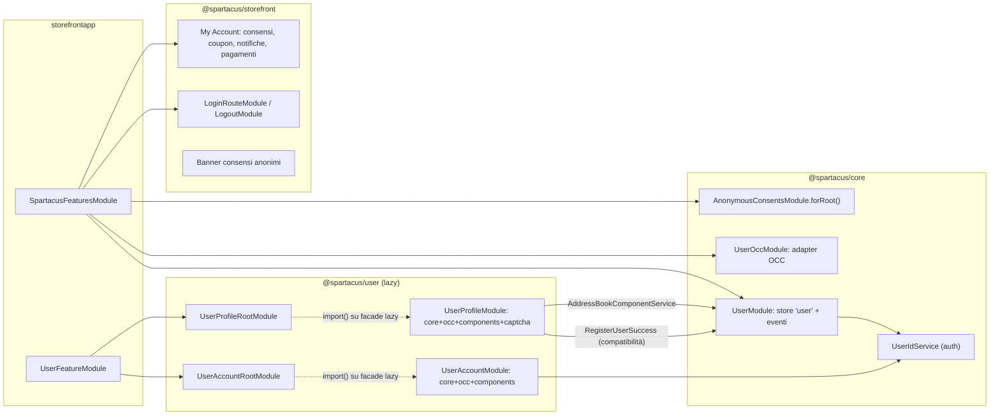
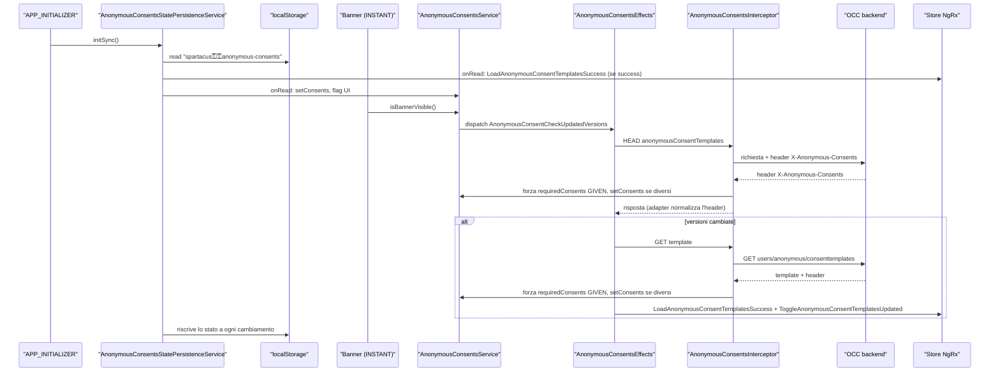
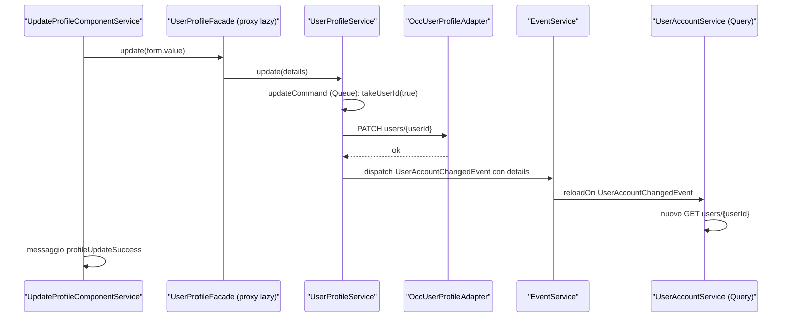
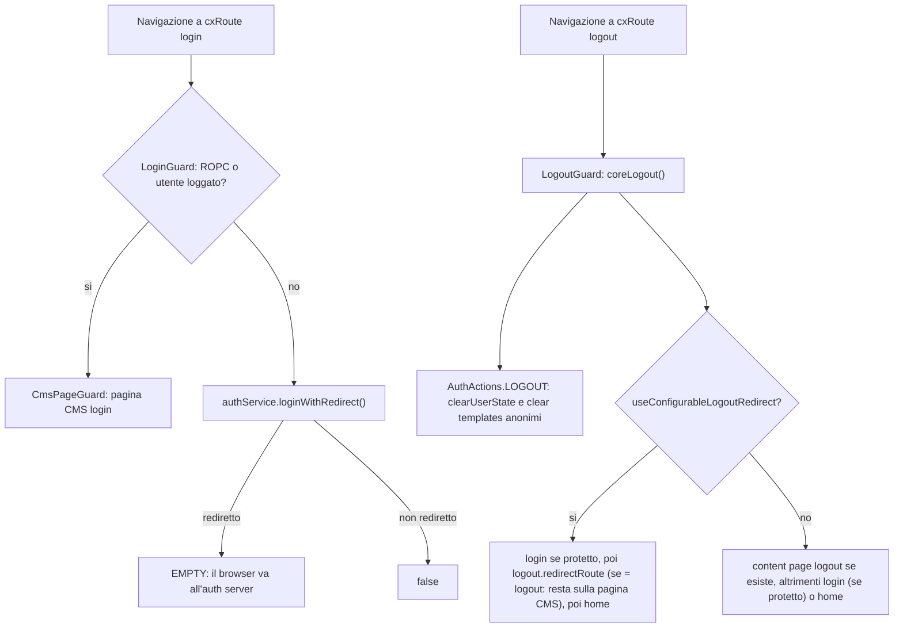

# 23 — Utente, profilo, consensi

> Riferimenti allo SHA `5b7a1c2bf2808d7380bc20596d10f4fa710c3da1` (vedi [00-meta](../00-meta.md)).

## 1. A cosa serve e perché esiste

"L'utente" in Spartacus non è un unico modulo: è un dominio **spezzato in tre strati con età e stili architetturali diversi**, e la prima cosa da capire è dove sta ogni pezzo.

1. **Core utente "legacy" in `@spartacus/core`** (`core-libs/core/src/user`). È basato su NgRx: un feature store `user` con indirizzi, consensi del cliente registrato, paesi/regioni/città/distretti, metodi di pagamento, coupon cliente, preferenze di notifica, interessi prodotto e cost center B2B — `core-libs/core/src/user/store/user-state.ts:L52-L65`. Le facade (`UserAddressService`, `UserConsentService`, `UserPaymentService`, …) sono classi `providedIn: 'root'` che fanno *fire-and-forget* sullo store — `core-libs/core/src/user/facade/user-address.service.ts:L44-L48`. Nell'app demo è registrato con `UserModule` + `UserOccModule`, moduli semplici, non `forRoot` — `projects/storefrontapp/src/app/spartacus/spartacus-features.module.ts:L201-L217`.
2. **Consensi anonimi in `@spartacus/core`** (`core-libs/core/src/anonymous-consents`). Uno store separato (`anonymous-consents`), persistito in `localStorage`, più un interceptor HTTP che allega l'header `X-Anonymous-Consents` a ogni chiamata OCC — `core-libs/core/src/anonymous-consents/store/anonymous-consents-state.ts:L10-L24`, `core-libs/core/src/model/consent.model.ts:L21-L32`. Si attiva con `AnonymousConsentsModule.forRoot()` — `core-libs/core/src/anonymous-consents/anonymous-consents.module.ts:L14-L28`.
3. **Libreria `@spartacus/user`** (`feature-libs/user`), che riesporta due entry point — `feature-libs/user/public_api.ts:L19-L20`:
   - `@spartacus/user/account`: chi è l'utente loggato (GET `users/{userId}`), login form, mini-login, login OTP;
   - `@spartacus/user/profile`: registrazione, aggiornamento profilo/email/password, recupero password, chiusura account, rubrica indirizzi.

   Qui non c'è NgRx: lo stato è gestito con `Query` e `Command` (vedi [capitolo 20](../parte-2/20-facade-command-query-eventi.md)) e la libreria è **lazy**, con il pattern `root` / `core` / `occ` / `components`. L'app importa solo i root module e mappa le feature su `import()` dinamici — `projects/storefrontapp/src/app/spartacus/features/user/user-feature.module.ts:L39-L78`.

A questi si aggiungono i **componenti storefront** in `core-libs/storefront/cms-components` (rotte `login`/`logout`, banner consensi anonimi, pagine My Account per consensi, coupon, notifiche, interessi, metodi di pagamento) — `projects/storefrontapp/src/app/spartacus/spartacus-features.module.ts:L180-L181`, `:L201-L217`.

Perché questa frammentazione? Il sorgente stesso la presenta come una migrazione in corso: `UserRegisterService` di `@spartacus/user/profile` dispatcha ancora un'azione NgRx del core "as a compatibility mechanism only, to make anonymous consents management work properly in transitional period (when we move logic to separate libraries)" — `feature-libs/user/profile/core/facade/user-register.service.ts:L33-L43`. Allo stesso modo `UserProfileFacadeTransitionalToken` esiste perché codice del core possa leggere i titoli del profilo senza dipendere da `@spartacus/user` — `core-libs/core/src/user/user-transitional-tokens.ts:L10-L12`, `feature-libs/user/profile/root/user-profile-root.module.ts:L45-L53`.

Un'ultima nota di orientamento: `UserIdService`, che tutte le facade usano per sapere *per chi* chiamare OCC, **non sta nel modulo user** ma in `auth/user-auth/facade` — `core-libs/core/src/user/facade/user-address.service.ts:L11-L11`. È trattato nel [capitolo 22](../parte-2/22-auth.md); qui basta ricordare che emette `'current'` per un cliente loggato, `'anonymous'` senza login e il `customerId` durante l'emulazione ASM — `core-libs/core/src/auth/user-auth/facade/user-id.service.ts:L24-L48` — e che `takeUserId(true)` lancia errore se l'utente è anonimo — `core-libs/core/src/auth/user-auth/facade/user-id.service.ts:L50-L62`.

## 2. Mappa dei file

| Path | Ruolo |
|---|---|
| `core-libs/core/src/user/user.module.ts` | `UserModule`: importa `UserStoreModule` + `UserEventModule`, fornisce `UserEventBuilder` e `defaultHierarchicalAddressConfig` |
| `core-libs/core/src/user/user-transitional-tokens.ts` | `UserProfileFacadeTransitionalToken` (solo `getTitles()`) |
| `core-libs/core/src/user/index.ts` | barrel pubblico (non esporta effects né reducers) |
| `core-libs/core/src/user/config/hierarchical-address-config.ts` | `HierarchicalAddressConfig` |
| `core-libs/core/src/user/config/default-hierarchical-address-config.ts` | default `['CN']` |
| `core-libs/core/src/user/connectors/*/` | connector `providedIn: 'root'` + adapter astratti + token converter per address, consent, cost-center, customer-coupon, interests, notification-preference, payment |
| `core-libs/core/src/user/events/user-event.builder.ts` | mapping azioni indirizzo → eventi |
| `core-libs/core/src/user/events/user.events.ts` | `AddUserAddressEvent`, `UpdateUserAddressEvent`, `DeleteUserAddressEvent`, ecc. |
| `core-libs/core/src/user/facade/user-address.service.ts` | indirizzi, paesi, regioni/città/distretti, verifica indirizzo (`Command`) |
| `core-libs/core/src/user/facade/user-consent.service.ts` | consensi utente registrato |
| `core-libs/core/src/user/facade/consent.service.ts` | `ConsentService`: facade unificata anonimi + registrati |
| `core-libs/core/src/user/facade/user-payment.service.ts` | metodi di pagamento e billing countries |
| `core-libs/core/src/user/facade/customer-coupon.service.ts` | coupon cliente |
| `core-libs/core/src/user/facade/user-interests.service.ts` | interessi prodotto |
| `core-libs/core/src/user/facade/user-notification-preference.service.ts` | canali di notifica |
| `core-libs/core/src/user/facade/user-cost-center.service.ts` | cost center B2B attivi |
| `core-libs/core/src/user/store/user-state.ts` | `USER_FEATURE`, ID di processo, entity type dei loader, `UserState` |
| `core-libs/core/src/user/store/user-store.module.ts` | `StoreModule.forFeature` + `EffectsModule.forFeature` |
| `core-libs/core/src/user/store/reducers/index.ts` | mappa reducer, `reducerToken`, meta-reducer `clearUserState` |
| `core-libs/core/src/user/store/effects/index.ts` | i 12 effect del feature `user` |
| `core-libs/core/src/occ/adapters/user/user-occ.module.ts` | `UserOccModule`: binding adapter OCC utente + consensi anonimi |
| `core-libs/core/src/occ/adapters/user/default-occ-user-config.ts` | endpoint OCC dell'area utente legacy |
| `core-libs/core/src/anonymous-consents/anonymous-consents.module.ts` | `AnonymousConsentsModule.forRoot()` |
| `core-libs/core/src/anonymous-consents/config/anonymous-consents-config.ts` | `AnonymousConsentsConfig` |
| `core-libs/core/src/anonymous-consents/facade/anonymous-consents.service.ts` | `AnonymousConsentsService` |
| `core-libs/core/src/anonymous-consents/http-interceptors/anonymous-consents-interceptor.ts` | header `X-Anonymous-Consents` in richiesta e risposta |
| `core-libs/core/src/anonymous-consents/services/anonymous-consents-state-persistence.service.ts` | sync con `localStorage` |
| `core-libs/core/src/anonymous-consents/store/anonymous-consents-store.module.ts` | feature store + `APP_INITIALIZER` di persistenza |
| `core-libs/core/src/anonymous-consents/store/effects/anonymous-consents.effect.ts` | check versioni, caricamento template, trasferimento al login, consensi obbligatori |
| `core-libs/core/src/occ/adapters/user/occ-anonymous-consent-templates.adapter.ts` | GET template, HEAD per i consensi |
| `feature-libs/user/account/user-account.module.ts` | modulo lazy `UserAccountModule` |
| `feature-libs/user/account/root/user-account-root.module.ts` | `UserAccountRootModule`, CMS mapping lazy della feature `userAccount` |
| `feature-libs/user/account/root/facade/user-account.facade.ts` | `UserAccountFacade` lazy (`get`, `getById`) |
| `feature-libs/user/account/root/facade/verification-token.facade.ts` | `VerificationTokenFacade` lazy (OTP) |
| `feature-libs/user/account/root/services/user-login-currency.service.ts` | valuta utente al login / ripristino al logout |
| `feature-libs/user/account/core/facade/user-account.service.ts` | `UserAccountService` basato su `Query` |
| `feature-libs/user/account/occ/adapters/occ-user-account.adapter.ts` | `OccUserAccountAdapter` |
| `feature-libs/user/account/components/login-form/login-form-component.service.ts` | login ROPC o POST nativo (Authorization Code) |
| `feature-libs/user/account/components/otp-login-form/otp-login-form.component.ts` | primo passo del login OTP |
| `feature-libs/user/account/components/verification-token-form/verification-token-form.component.ts` | secondo passo del login OTP |
| `feature-libs/user/profile/user-profile.module.ts` | modulo lazy `UserProfileModule` |
| `feature-libs/user/profile/root/user-profile-root.module.ts` | root module, token transitorio, CMS mapping lazy `userProfile` |
| `feature-libs/user/profile/root/facade/user-profile.facade.ts` | `UserProfileFacade` lazy |
| `feature-libs/user/profile/core/facade/user-profile.service.ts` | update / close / titoli (`Command` + `Query`) |
| `feature-libs/user/profile/core/facade/user-register.service.ts` | registrazione, registrazione guest |
| `feature-libs/user/profile/occ/adapters/occ-user-profile.adapter.ts` | `OccUserProfileAdapter` |
| `feature-libs/user/profile/components/register/register.component.ts` | form registrazione, checkbox newsletter → consenso anonimo |
| `feature-libs/user/profile/components/address-book/address-form/address-form.component.ts` | form indirizzo, verifica, formato gerarchico |
| `core-libs/storefront/cms-components/user/login-route/login.guard.ts` | `LoginGuard`: pagina CMS o redirect OAuth |
| `core-libs/storefront/cms-components/user/logout/logout.guard.ts` | `LogoutGuard` |
| `core-libs/storefront/cms-components/anonymous-consent-management/anonymous-consent-management.module.ts` | banner e dialog consensi anonimi |
| `core-libs/storefront/cms-components/myaccount/consent-management/components/consent-management.component.ts` | pagina consensi My Account |
| `feature-libs/user/wishlist/occ/adapters/occ-user-wishlist.adapter.ts` | adapter OCC wishlist (senza NgModule proprio) |

## 3. Come funziona passo per passo

### 3.1 Wiring all'avvio

1. `UserModule` importa `UserStoreModule` e `UserEventModule`, fornisce `UserEventBuilder` e la default config degli indirizzi gerarchici; il suo `forRoot()` restituisce solo `ngModule: UserModule`, senza provider aggiuntivi — `core-libs/core/src/user/user.module.ts:L14-L27`.
2. `UserStoreModule` registra il feature store `'user'` con `StoreModule.forFeature(USER_FEATURE, reducerToken, { metaReducers })` e `EffectsModule.forFeature(effects)` — `core-libs/core/src/user/store/user-store.module.ts:L17-L27`. La mappa dei reducer è fornita via `InjectionToken` `'UserReducers'` con `useFactory: getReducers` — `core-libs/core/src/user/store/reducers/index.ts:L91-L97`.
3. `UserEventModule` inietta `UserEventBuilder` nel costruttore solo per istanziarlo — `core-libs/core/src/user/events/user-event.module.ts:L10-L15`.
4. `UserOccModule` collega con `useClass` tutti gli adapter OCC dell'area utente **e** quello dei template di consensi anonimi, registra i normalizer multi e la default config degli endpoint — `core-libs/core/src/occ/adapters/user/user-occ.module.ts:L34-L72`, `core-libs/core/src/occ/adapters/user/default-occ-user-config.ts:L9-L34`.
5. `AnonymousConsentsModule.forRoot()` aggiunge interceptor, `AnonymousConsentsService` e la default config; lo store module viene importato sempre — `core-libs/core/src/anonymous-consents/anonymous-consents.module.ts:L14-L28`. L'interceptor è registrato come `HTTP_INTERCEPTORS` multi `useExisting` — `core-libs/core/src/anonymous-consents/http-interceptors/index.ts:L11-L17`.
6. Lo store dei consensi anonimi registra un `APP_INITIALIZER` che chiama `AnonymousConsentsStatePersistenceService.initSync()` — `core-libs/core/src/anonymous-consents/store/anonymous-consents-store.module.ts:L17-L43`.
7. `UserAccountRootModule` importa `UserAccountEventModule` e fornisce la default config più una *config factory* con la mappa CMS lazy — `feature-libs/user/account/root/user-account-root.module.ts:L68-L75`. `UserAccountEventModule` istanzia eagerly `UserAccountEventListener` e `UserLoginCurrencyService` — `feature-libs/user/account/root/events/user-account-event.module.ts:L11-L18`.
8. `UserProfileRootModule` lega `UserProfileFacadeTransitionalToken` a `UserProfileFacade` e istanzia eagerly `UserCurrencyPreferenceSaverService` — `feature-libs/user/profile/root/user-profile-root.module.ts:L45-L58`.

### 3.2 Lo store `user` del core

- `UserState` ha 12 slice; quasi tutte sono `StateUtils.LoaderState<...>`, mentre `billingCountries` e `countries` sono reducer semplici — `core-libs/core/src/user/store/user-state.ts:L52-L65`, `core-libs/core/src/user/store/reducers/index.ts:L47-L89`. **Non** c'è lo slice "dettagli account": quello vive in `@spartacus/user/account` via `Query` — `feature-libs/user/account/core/facade/user-account.service.ts:L26-L35`.
- `user-state.ts` definisce anche gli **ID di processo** (`registerUser`, `giveConsent`, `withdrawConsent`, `updateNotificationPreferences`, …) e gli entity type dei loader (`'[User] User Addresses'`, …) — `core-libs/core/src/user/store/user-state.ts:L22-L46`.
- Il `loaderReducer` (vedi [capitolo 19](../parte-2/19-state-management.md)) si comporta in base a `action.meta.loader`: load → `loading: true`; error → `error: true, success: false`; success → `value = subReducer(state.value, action)` o `action.payload`; reset → stato iniziale — `core-libs/core/src/state/utils/loader/loader.reducer.ts:L39-L69`. Con un sub-reducer, questo viene chiamato sempre — `core-libs/core/src/state/utils/loader/loader.reducer.ts:L80-L82`.
- Le mutazioni indirizzo `AddUserAddress`, `UpdateUserAddress`, `DeleteUserAddress` estendono `LoaderLoadAction(USER_ADDRESSES)`, cioè **condividono il loader della lista** — `core-libs/core/src/user/store/actions/user-addresses.action.ts:L56-L61`, `:L84-L91`, `:L114-L119`. Il sub-reducer gestisce solo `LOAD_USER_ADDRESSES_FAIL` e `LOAD_USER_ADDRESSES_SUCCESS` — `core-libs/core/src/user/store/reducers/user-addresses.reducer.ts:L12-L26`.
- Il meta-reducer `clearUserState` azzera tutto lo stato `user` su `AuthActions.LOGOUT` — `core-libs/core/src/user/store/reducers/index.ts:L99-L111`.
- `UserActions` e `UsersSelectors` sono namespace (`import * as`) sui file "group" — `core-libs/core/src/user/store/actions/index.ts:L7-L8`, `core-libs/core/src/user/store/selectors/index.ts:L7-L8`; il feature selector è `createFeatureSelector<UserState>(USER_FEATURE)` — `core-libs/core/src/user/store/selectors/feature.selector.ts:L10-L11`.
- Gli effect sono 12 — `core-libs/core/src/user/store/effects/index.ts:L20-L33`. I più interessanti:
  - `ClearMiscsDataEffect`: `LANGUAGE_CHANGE`/`CURRENCY_CHANGE` → `ClearUserMiscsData` — `core-libs/core/src/user/store/effects/clear-miscs-data.effect.ts:L17-L27`. Le delivery countries si resettano nel reducer — `core-libs/core/src/user/store/reducers/delivery-countries.reducer.ts:L20-L42`; regioni, città e distretti invece tramite effect che emettono `LoaderResetAction` — `core-libs/core/src/user/store/effects/regions.effect.ts:L50-L57`, `core-libs/core/src/user/store/effects/cities-districts.effect.ts:L50-L55`, `:L82-L87`.
  - Paesi, regioni, città e distretti si caricano con `SiteConnector` (site-context), non con un connector utente — `core-libs/core/src/user/store/effects/regions.effect.ts:L29-L37`, `core-libs/core/src/user/store/effects/delivery-countries.effect.ts:L26-L26`, `core-libs/core/src/user/store/effects/billing-countries.effect.ts:L26-L26`.
  - Indirizzi: load con `switchMap`, add/update/delete con `mergeMap`, errori passati da `tryNormalizeHttpError` — `core-libs/core/src/user/store/effects/user-addresses.effect.ts:L26-L70`; un update fallito mostra `addressForm.invalidAddress` — `core-libs/core/src/user/store/effects/user-addresses.effect.ts:L84-L94`; dopo i success l'effect ricarica la lista chiamando la *facade* `UserAddressService.loadAddresses()` — `core-libs/core/src/user/store/effects/user-addresses.effect.ts:L128-L177`, `:L179-L198`.
  - Pagamenti: set default/delete emettono success e poi `LoadUserPaymentMethods` — `core-libs/core/src/user/store/effects/payment-methods.effect.ts:L45-L97`.
  - Consensi: `resetConsents$` su `LANGUAGE_CHANGE` — `core-libs/core/src/user/store/effects/user-consents.effect.ts:L23-L29`; `giveConsent$` gestisce `GIVE_USER_CONSENT` **e** `TRANSFER_ANONYMOUS_CONSENT` con `concatMap` — `core-libs/core/src/user/store/effects/user-consents.effect.ts:L50-L65`; un 409 sul trasferimento rimuove i messaggi d'errore — `core-libs/core/src/user/store/effects/user-consents.effect.ts:L75-L85`.
  - Interessi prodotto: dopo add/remove ricaricano la lista — `core-libs/core/src/user/store/effects/product-interests.effect.ts:L58-L121`.

### 3.3 Le facade del core

- Pattern comune: `takeUserId()` + `store.dispatch(...)` dentro `subscribe`, ritorno `void` — `core-libs/core/src/user/facade/user-address.service.ts:L44-L48`.
- `setAddressAsDefault` è un `UpdateUserAddress` con `address: { defaultAddress: true }` — `core-libs/core/src/user/facade/user-address.service.ts:L69-L79`; `getDefaultAddress()` cerca `defaultAddress` nella lista — `core-libs/core/src/user/facade/user-address.service.ts:L116-L120`.
- `getRegions(countryIsoCode)` contiene logica di caricamento *dentro* `map`: azzera, avvia `loadRegions`, ritorna `[]` durante il caricamento — `core-libs/core/src/user/facade/user-address.service.ts:L188-L209`; `getCities`/`getDistricts` replicano lo schema — `core-libs/core/src/user/facade/user-address.service.ts:L215-L240`, `:L261-L280`.
- `verifyAddress` **non passa dallo store**: è un `Command` che chiama `UserAddressConnector.verify` con `takeUserId(false)`, quindi funziona anche per anonimi — `core-libs/core/src/user/facade/user-address.service.ts:L301-L318`. Lato OCC, per lo userId anonimo viene aggiunto l'header `USE_CLIENT_TOKEN` — `core-libs/core/src/occ/adapters/user/occ-user-address.adapter.ts:L96-L105`.
- `UserConsentService.getConsents(loadIfMissing)` con `iif`: se `true` carica i template quando mancano e non c'è già stato un success ("avoid infinite loop") — `core-libs/core/src/user/facade/user-consent.service.ts:L60-L85`.
- `UserConsentService.getConsent(templateId)` emette solo se `isUserLoggedIn()` **e** `userId === OCC_USER_ID_CURRENT` (soluzione dichiarata temporanea, CXSPA-2988) — `core-libs/core/src/user/facade/user-consent.service.ts:L128-L154`.
- Un consenso registrato è "dato" se ha `consentGivenDate` e nessuna `consentWithdrawnDate`; un consenso assente è considerato ritirato — `core-libs/core/src/user/facade/user-consent.service.ts:L163-L178`.
- Gli stati di give/withdraw si leggono dal feature `process` (`getProcessLoadingFactory(GIVE_CONSENT_PROCESS_ID)`, …) — `core-libs/core/src/user/facade/user-consent.service.ts:L200-L222`, perché le azioni sono `EntityLoadAction` su `PROCESS_FEATURE` — `core-libs/core/src/user/store/actions/user-consents.action.ts:L71-L83`.
- `ConsentService` unifica: `getConsent` fa `merge` del flusso registrato e di quello anonimo — `core-libs/core/src/user/facade/consent.service.ts:L14-L35`; distingue i tipi per forma (`templateCode` vs `code`) — `core-libs/core/src/user/facade/consent.service.ts:L106-L125`.
- `UserCostCenterService.getActiveCostCenters()` usa `observeOn(queueScheduler)` e auto-carica solo per utenti loggati — `core-libs/core/src/user/facade/user-cost-center.service.ts:L31-L62`; `CustomerCouponService.getCustomerCoupons` e `UserInterestsService.getAndLoadProductInterests` usano lo schema "attemptedLoad" — `core-libs/core/src/user/facade/customer-coupon.service.ts:L66-L86`, `core-libs/core/src/user/facade/user-interests.service.ts:L81-L127`.

### 3.4 Connector, adapter, endpoint (core)

Ogni area ha un connector `providedIn: 'root'` che delega a un adapter astratto — `core-libs/core/src/user/connectors/address/user-address.connector.ts:L12-L37`, `core-libs/core/src/user/connectors/address/user-address.adapter.ts:L10-L27` (pattern generale nel [capitolo 21](../parte-2/21-occ.md)). Particolarità:

- `UserConsentAdapter.withdrawConsent` ha un terzo parametro opzionale `consentId` — `core-libs/core/src/user/connectors/consent/user-consent.adapter.ts:L19-L23` — che l'implementazione OCC ignora, usando `consentCode` come `consentId` dell'URL — `core-libs/core/src/occ/adapters/user/occ-user-consent.adapter.ts:L69-L78`.
- `CustomerCouponConnector.claimCustomerCoupon` usa la variante con codice nel body — `core-libs/core/src/user/connectors/customer-coupon/customer-coupon.connector.ts:L42-L47`.
- Il barrel `core-libs/core/src/user/connectors/index.ts` non esporta `notification-preference` — `core-libs/core/src/user/connectors/index.ts:L7-L12`.

### 3.5 Consensi anonimi

1. **Persistenza.** `initSync()` chiama `StatePersistenceService.syncWithStorage` con chiave `'anonymous-consents'` e l'intero stato del feature — `core-libs/core/src/anonymous-consents/services/anonymous-consents-state-persistence.service.ts:L42-L63`. Il default è `localStorage` con contesto vuoto, quindi la chiave effettiva è `spartacus⚿⚿anonymous-consents` — `core-libs/core/src/state/services/state-persistence.service.ts:L45-L48`, `:L124-L131`. In lettura (`onRead`) reidrata i template solo se `templates.success`, poi i consensi e i flag UI — `core-libs/core/src/anonymous-consents/services/anonymous-consents-state-persistence.service.ts:L69-L91`.
2. **Stato.** `templates` (loader), `consents` (array di `{templateCode, templateVersion, consentState}`), `ui.{bannerDismissed, updated}` — `core-libs/core/src/anonymous-consents/store/anonymous-consents-state.ts:L10-L24`, `core-libs/core/src/anonymous-consents/store/reducers/index.ts:L27-L36`. Give/withdraw cambiano lo stato del solo consenso con quel `templateCode`; `SET_ANONYMOUS_CONSENTS` sostituisce l'array — `core-libs/core/src/anonymous-consents/store/reducers/anonymous-consents.reducer.ts:L15-L62`. Su `LOGOUT` o `LANGUAGE_CHANGE` un meta-reducer azzera solo `templates` — `core-libs/core/src/anonymous-consents/store/reducers/index.ts:L49-L65`.
3. **Banner.** Il componente è caricato con `DeferLoadingStrategy.INSTANT` — `core-libs/storefront/cms-components/anonymous-consent-management/anonymous-consent-management.module.ts:L32-L42`. `isBannerVisible()` ritorna `false` per utenti loggati; altrimenti è visibile se non dismesso o se i template sono cambiati, e a ogni emissione dispatcha `AnonymousConsentCheckUpdatedVersions` — `core-libs/core/src/anonymous-consents/facade/anonymous-consents.service.ts:L281-L309`.
4. **Check versioni.** `checkConsentVersions$` chiama `loadAnonymousConsents()` e, se le versioni differiscono, dispatcha `LoadAnonymousConsentTemplates` — `core-libs/core/src/anonymous-consents/store/effects/anonymous-consents.effect.ts:L36-L87`. L'adapter OCC fa una **HEAD** sull'endpoint dei template e legge l'header `X-Anonymous-Consents` — `core-libs/core/src/occ/adapters/user/occ-anonymous-consent-templates.adapter.ts:L48-L62`. Se il backend non restituisce consensi, in dev mode viene loggato un warning — `core-libs/core/src/anonymous-consents/store/effects/anonymous-consents.effect.ts:L49-L55`.
5. **Caricamento template.** `loadAnonymousConsentTemplates$` emette `LoadAnonymousConsentTemplatesSuccess` e `ToggleAnonymousConsentTemplatesUpdated(updated)`, con `updated` calcolato solo se esistevano template — `core-libs/core/src/anonymous-consents/store/effects/anonymous-consents.effect.ts:L89-L129`; il confronto (`detectUpdatedTemplates`) guarda lunghezza e `version` per posizione — `core-libs/core/src/anonymous-consents/facade/anonymous-consents.service.ts:L316-L333`.
6. **Interceptor.** Per ogni richiesta prende una volta consensi e stato login, ignora URL non OCC — `core-libs/core/src/anonymous-consents/http-interceptors/anonymous-consents-interceptor.ts:L36-L48`, `:L110-L112`; aggiunge l'header con i consensi serializzati (JSON + `encodeURIComponent`) — `core-libs/core/src/anonymous-consents/http-interceptors/anonymous-consents-interceptor.ts:L93-L108`; sulla risposta dell'endpoint template, per utenti non loggati, decodifica l'header, forza a `GIVEN` i `requiredConsents` e fa `setConsents` solo se cambiati — `core-libs/core/src/anonymous-consents/http-interceptors/anonymous-consents-interceptor.ts:L51-L91`, `:L114-L135`. Il confronto `consentsUpdated` è tra stringhe serializzate — `core-libs/core/src/anonymous-consents/facade/anonymous-consents.service.ts:L369-L376`.
7. **Al login.** Due effect reagiscono a `AuthActions.LOGIN`:
   - `transferAnonymousConsentsToUser$`: solo se in precedenza si è visto `REGISTER_USER_SUCCESS` (`withLatestFrom`), trasforma i consensi anonimi `GIVEN` non obbligatori in `TransferAnonymousConsent` — `core-libs/core/src/anonymous-consents/store/effects/anonymous-consents.effect.ts:L133-L184`;
   - `giveRequiredConsentsToUser$`: carica i consensi utente se mancano e dà quelli obbligatori risultati ritirati — `core-libs/core/src/anonymous-consents/store/effects/anonymous-consents.effect.ts:L195-L247`.

### 3.6 `@spartacus/user/account`

1. `UserAccountModule` (lazy) = `UserAccountCoreModule` + `UserAccountOccModule` + `UserAccountComponentsModule` — `feature-libs/user/account/user-account.module.ts:L12-L19`.
2. La root dichiara le feature `userAccount` e `userAccountCore` — `feature-libs/user/account/root/feature-name.ts:L7-L8` — e, nella config factory, elenca i CMS component e mappa la core sulla feature dei componenti ("by default core is bundled together with components") — `feature-libs/user/account/root/user-account-root.module.ts:L23-L48`. `OAuthCallbackComponent` viene tolto se non sono attivi insieme `oauthCallbackPage`, `asyncAuthConfigInitializer`, `authorizationCodeFlowByDefault` — `feature-libs/user/account/root/user-account-root.module.ts:L50-L63`.
3. `UserAccountFacade` è una facade lazy creata con `facadeFactory` sulla feature `userAccountCore` (metodi `get`, `getById`) — `feature-libs/user/account/root/facade/user-account.facade.ts:L13-L25` (meccanismo nel [capitolo 12](../parte-2/12-feature-module-lazy.md)). Il core la lega a `UserAccountService` con `useExisting` — `feature-libs/user/account/core/facade/facade-providers.ts:L15-L26`.
4. `UserAccountService.get()` è una `Query` che chiama `users/{userId}` solo per utenti loggati, si ricarica su `UserAccountChangedEvent` e si resetta su `LoginEvent`/`LogoutEvent` — `feature-libs/user/account/core/facade/user-account.service.ts:L26-L35`. `getById` bypassa la query — `feature-libs/user/account/core/facade/user-account.service.ts:L43-L49`.
5. Endpoint: `user: 'users/${userId}'`, `createVerificationToken: 'users/anonymous/verificationToken'`, aggiunti a `OccEndpoints` via module augmentation — `feature-libs/user/account/occ/adapters/config/default-occ-user-account-endpoint.config.ts:L9-L18`, `feature-libs/user/account/occ/adapters/config/occ-user-account-endpoint.model.ts:L20-L22`.
6. Il modello `User` di account è minimale e aumentabile — `feature-libs/user/account/root/model/user.model.ts:L7-L15`, `feature-libs/user/account/root/public_api.ts:L17-L19`; `@spartacus/user/profile/root` lo aumenta con currency, language, defaultAddress, roles, … — `feature-libs/user/profile/root/model/user-profile.model.ts:L9-L26`.
7. Su `LogoutEvent` il listener mostra `authMessages.signedOutSuccessfully` — `feature-libs/user/account/root/events/user-account-event.listener.ts:L35-L44`.

**Login form.** `ReturningCustomerLoginComponent` → `LoginFormComponent` con guard `NotAuthGuard`, `CustomLoginGuard` e `LoginFormComponentService` fornito a livello di componente — `feature-libs/user/account/components/login-form/login-form.module.ts:L50-L64`. Il componente è standalone, OnPush, con `ngSkipHydration` — `feature-libs/user/account/components/login-form/login-form.component.ts:L32-L65`.

- Con `authorizationCodeFlowByDefault` (default `true`, `core-libs/core/src/features-config/feature-toggles/config/feature-toggles.ts:L1029-L1029`) il costruttore del servizio chiama `initCustomLogin()`: form `POST` nativo verso `getCustomLoginFormEndpoint()` con un controllo `csrf` obbligatorio — `feature-libs/user/account/components/login-form/login-form-component.service.ts:L90-L93`, `:L275-L280`.
- Con `authorizationCodeFlowByDefaultCsrfTokenRefresh` il CSRF è rinfrescato subito prima del submit, che avviene *prima* di `busy$.next(true)` — `feature-libs/user/account/components/login-form/login-form-component.service.ts:L101-L131`. Se il refresh fallisce, l'errore va in `sessionStorage` e si naviga "hard" a `/login` — `feature-libs/user/account/components/login-form/login-form-component.service.ts:L133-L166`.
- Senza code flow (ROPC), `login()` chiama `auth.loginWithCredentials(userId.toLowerCase(), password)` — `feature-libs/user/account/components/login-form/login-form-component.service.ts:L198-L213`.
- Al rientro, `handleCustomLoginError` legge l'errore da `sessionStorage` (`cx_login_error`) o dal query param `error`, e lo traduce in chiavi i18n tramite `resolveLoginErrorKey` — `feature-libs/user/account/components/login-form/login-form-component.service.ts:L217-L262`.

**Login OTP.** `OneTimePasswordLoginFormComponent` chiama `createVerificationToken` e naviga a `verifyToken` passando loginId, password, tokenId, expiresIn nello `state` — `feature-libs/user/account/components/otp-login-form/otp-login-form.component.ts:L132-L173`. `VerificationTokenService` è un `Command` — `feature-libs/user/account/core/facade/verification-token.service.ts:L22-L38`; l'adapter invia POST con `USE_CLIENT_TOKEN` — `feature-libs/user/account/occ/adapters/occ-user-account.adapter.ts:L54-L79`. Il form di verifica legge lo stato da `history.state` e lo sovrascrive con `pushState` — `feature-libs/user/account/components/verification-token-form/verification-token-form.component.ts:L110-L124`, poi usa `otpLoginWithCredentials` (ROPC) o il submit nativo (code flow) — `feature-libs/user/account/components/verification-token-form/verification-token-form-component.service.ts:L64-L87`.

### 3.7 `@spartacus/user/profile`

1. `UserProfileModule` (lazy) = Core + Occ + Components + `CaptchaModule` — `feature-libs/user/profile/user-profile.module.ts:L13-L21`. I CMS component della feature `userProfile` sono elencati nella root — `feature-libs/user/profile/root/user-profile-root.module.ts:L21-L43`.
2. Quattro facade lazy sulla feature `userProfileCore`: `UserEmailFacade`, `UserPasswordFacade`, `UserProfileFacade`, `UserRegisterFacade` — `feature-libs/user/profile/root/facade/user-profile.facade.ts:L14-L22`, `feature-libs/user/profile/root/facade/user-register.facade.ts:L14-L22`; implementazioni collegate con `useExisting` — `feature-libs/user/profile/core/facade/facade-providers.ts:L18-L39`.
3. `UserProfileService.get()` delega a `UserAccountFacade.get()`: il profilo non ha stato proprio — `feature-libs/user/profile/core/facade/user-profile.service.ts:L79-L81`.
4. `updateCommand` (strategia `Queue`) fa PATCH e dispatcha `UserAccountChangedEvent` — `feature-libs/user/profile/core/facade/user-profile.service.ts:L31-L48`; `closeCommand` fa `remove(uid)` e poi `authService.logout()` — `feature-libs/user/profile/core/facade/user-profile.service.ts:L50-L60`; `titleQuery` si ricarica su `LanguageSetEvent` — `feature-libs/user/profile/core/facade/user-profile.service.ts:L62-L67`.
5. `registerCommand` chiama il connector e in `tap` dispatcha `UserActions.RegisterUserSuccess()` nello store del core — `feature-libs/user/profile/core/facade/user-register.service.ts:L33-L43`. `registerGuestCommand` fa login con credenziali in ROPC o naviga a `login` con code flow — `feature-libs/user/profile/core/facade/user-register.service.ts:L45-L62`.
6. Adapter OCC: `update` (PATCH) e `close` (DELETE) usano gli endpoint opzionali `userUpdateProfile`/`userCloseAccount` se configurati, altrimenti `user` — `feature-libs/user/profile/occ/adapters/occ-user-profile.adapter.ts:L49-L60`, `:L164-L174`; `register` invia POST con `USE_CLIENT_TOKEN` e captcha token — `feature-libs/user/profile/occ/adapters/occ-user-profile.adapter.ts:L62-L96`; `updateEmail` POST a `users/${userId}/login` con `{ newLoginId, password }` — `feature-libs/user/profile/occ/adapters/occ-user-profile.adapter.ts:L124-L142`.
7. Componenti: la registrazione collega la checkbox `newsletter` al consenso anonimo `registerConsent` — `feature-libs/user/profile/components/register/register.component.ts:L204-L209`, `:L272-L283`; dopo la registrazione naviga a `login` — `feature-libs/user/profile/components/register/register.component.ts:L260-L270`. Cambio email e cambio password terminano con `coreLogout()` e navigazione a `login` — `feature-libs/user/profile/components/update-email/update-email-component.service.ts:L77-L104`, `feature-libs/user/profile/components/update-password/update-password-component.service.ts:L92-L112`. Il modal di chiusura account chiama `coreLogout()` e va a `home` — `feature-libs/user/profile/components/close-account/components/close-account-modal/close-account-modal.component.ts:L85-L100`.
8. Rubrica: `AddressBookComponentService` è un sottile wrapper sopra `UserAddressService` del core — `feature-libs/user/profile/components/address-book/address-book.component.service.ts:L11-L42`. Il form indirizzo, per i paesi a formato gerarchico (solo con toggle `enableHierarchicalAddressFormat`), salta la verifica OCC — `feature-libs/user/profile/components/address-book/address-form/address-form.component.ts:L413-L420`, `:L499-L518`.

### 3.8 Rotte `login`/`logout` e My Account (storefront)

- `LoginRouteModule` registra `cxRoute: 'login'` con `LoginGuard` — `core-libs/storefront/cms-components/user/login-route/login-route.module.ts:L15-L36`. `LoginGuard` lascia passare alla pagina CMS se il flow è ROPC o l'utente è già loggato, altrimenti chiama `loginWithRedirect()` e ritorna `EMPTY` — `core-libs/storefront/cms-components/user/login-route/login.guard.ts:L34-L65`.
- `LogoutModule` registra `cxRoute: 'logout'` con `[LogoutGuard, CmsPageGuard]` e default `logout.redirectRoute: 'home'` — `core-libs/storefront/cms-components/user/logout/logout.module.ts:L18-L33`, `core-libs/storefront/cms-components/user/logout/config/default-logout-config.ts:L9-L13`. Con `useConfigurableLogoutRedirect` il guard esegue `coreLogout()` e reindirizza secondo la priorità login (storefront protetto) → `redirectRoute` → home — `core-libs/storefront/cms-components/user/logout/logout.guard.ts:L71-L110`; senza toggle controlla se esiste una content page `logout` — `core-libs/storefront/cms-components/user/logout/logout.guard.ts:L46-L69`.
- La pagina consensi carica i consensi se mancano, nasconde i template anonimi se `showAnonymousConsents` è false o quelli in `hideConsents` — `core-libs/storefront/cms-components/myaccount/consent-management/components/consent-management.component.ts:L127-L192`; dà consenso con `template.id` + `version`, lo ritira con `currentConsent.code` + `template.id` — `core-libs/storefront/cms-components/myaccount/consent-management/components/consent-management.component.ts:L230-L245`; dopo un withdraw riuscito ricarica — `core-libs/storefront/cms-components/myaccount/consent-management/components/consent-management.component.ts:L203-L222`.
- Coupon: rotta `couponClaim` con `AuthGuard` + `CmsPageGuard` — `core-libs/storefront/cms-components/myaccount/my-coupons/my-coupons.module.ts:L48-L81`; `CouponClaimComponent` legge `couponCode` dai parametri e fa il claim — `core-libs/storefront/cms-components/myaccount/my-coupons/coupon-claim/coupon-claim.component.ts:L29-L52`.
- Notifiche e metodi di pagamento chiamano le facade core in `ngOnInit` — `core-libs/storefront/cms-components/myaccount/notification-preference/notification-preference.component.ts:L42-L47`, `core-libs/storefront/cms-components/myaccount/payment-methods/payment-methods.component.ts:L52-L67`.

## 4. Diagrammi

### 4.1 Architettura: dove vive ogni pezzo



Riferimenti: wiring app `projects/storefrontapp/src/app/spartacus/spartacus-features.module.ts:L180-L217`, `projects/storefrontapp/src/app/spartacus/features/user/user-feature.module.ts:L39-L78`; moduli lazy `feature-libs/user/account/user-account.module.ts:L12-L19`, `feature-libs/user/profile/user-profile.module.ts:L13-L21`; ponti verso il core `feature-libs/user/profile/core/facade/user-register.service.ts:L33-L43`, `feature-libs/user/profile/components/address-book/address-book.component.service.ts:L11-L42`.

### 4.2 Consensi anonimi: avvio, banner, header HTTP



Riferimenti: `core-libs/core/src/anonymous-consents/store/anonymous-consents-store.module.ts:L17-L43`, `core-libs/core/src/anonymous-consents/services/anonymous-consents-state-persistence.service.ts:L42-L91`, `core-libs/core/src/anonymous-consents/facade/anonymous-consents.service.ts:L281-L309`, `core-libs/core/src/anonymous-consents/store/effects/anonymous-consents.effect.ts:L36-L129`, `core-libs/core/src/occ/adapters/user/occ-anonymous-consent-templates.adapter.ts:L48-L62`, `core-libs/core/src/anonymous-consents/http-interceptors/anonymous-consents-interceptor.ts:L36-L135`.

### 4.3 Registrazione e trasferimento dei consensi anonimi

```mermaid
sequenceDiagram
  participant RC as "RegisterComponent"
  participant ACS as "AnonymousConsentsService"
  participant URF as "UserRegisterFacade (lazy)"
  participant URS as "UserRegisterService"
  participant ST as "Store NgRx core"
  participant AFX as "AnonymousConsentsEffects"
  participant UFX as "UserConsentsEffects"
  RC->>ACS: giveConsent(registerConsent) su checkbox newsletter
  RC->>URF: register(user)
  URF->>URS: facadeFactory risolve userProfileCore
  URS->>URS: registerCommand: POST users (client token + captcha)
  URS->>ST: dispatch RegisterUserSuccess
  RC->>RC: onRegisterUserSuccess: go login
  Note over ST,AFX: piu tardi, AuthActions.LOGIN
  ST->>AFX: LOGIN (withLatestFrom REGISTER_USER_SUCCESS)
  AFX->>ST: TransferAnonymousConsent per consensi GIVEN non obbligatori
  ST->>UFX: giveConsent$ con concatMap
  UFX->>UFX: POST consenso; 409 rimuove messaggi errore
  ST->>AFX: LOGIN
  AFX->>ST: GiveUserConsent per consensi obbligatori ritirati
```

Riferimenti: `feature-libs/user/profile/components/register/register.component.ts:L204-L209`, `:L260-L283`, `feature-libs/user/profile/core/facade/user-register.service.ts:L33-L43`, `feature-libs/user/profile/occ/adapters/occ-user-profile.adapter.ts:L62-L96`, `core-libs/core/src/anonymous-consents/store/effects/anonymous-consents.effect.ts:L133-L247`, `core-libs/core/src/user/store/effects/user-consents.effect.ts:L50-L90`.

### 4.4 Aggiornamento profilo e reload della `Query` utente



Riferimenti: `feature-libs/user/profile/components/update-profile/update-profile-component.service.ts:L34-L77`, `feature-libs/user/profile/root/facade/user-profile.facade.ts:L14-L22`, `feature-libs/user/profile/core/facade/user-profile.service.ts:L31-L48`, `feature-libs/user/profile/occ/adapters/occ-user-profile.adapter.ts:L49-L60`, `feature-libs/user/account/core/facade/user-account.service.ts:L26-L35`.

### 4.5 Rotte `login` e `logout`



Riferimenti: `core-libs/storefront/cms-components/user/login-route/login.guard.ts:L34-L65`, `core-libs/storefront/cms-components/user/logout/logout.guard.ts:L46-L110`, `core-libs/core/src/user/store/reducers/index.ts:L99-L111`, `core-libs/core/src/anonymous-consents/store/reducers/index.ts:L49-L65`.

## 5. Estratti di codice reale

**Il meta-reducer che svuota lo store `user` al logout** — `core-libs/core/src/user/store/reducers/index.ts:L99-L111`

```ts
export function clearUserState(
  reducer: ActionReducer<any>
): ActionReducer<any> {
  return function (state, action) {
    if (action.type === AuthActions.LOGOUT) {
      state = undefined;
    }

    return reducer(state, action);
  };
}

export const metaReducers: MetaReducer<any>[] = [clearUserState];
```

**Facade legacy: fire-and-forget e `Command` fuori store** — `core-libs/core/src/user/facade/user-address.service.ts:L44-L48` e `:L301-L318`

```ts
  loadAddresses(): void {
    this.userIdService.takeUserId().subscribe((userId) => {
      this.store.dispatch(new UserActions.LoadUserAddresses(userId));
    });
  }
// ...
  verifyAddress(address: Address): Observable<AddressValidation> {
    return this.userAddressVerificationCommand.execute({ address });
  }

  protected userAddressVerificationCommand: Command<
    {
      address: Address;
    },
    AddressValidation
  > = this.command.create((payload) =>
    this.userIdService
      .takeUserId(false)
      .pipe(
        switchMap((userId) =>
          this.userAddressConnector.verify(userId, payload.address)
        )
      )
  );
```

**Effetti collaterali dentro `map`** — `core-libs/core/src/user/facade/user-address.service.ts:L188-L209`

```ts
  getRegions(countryIsoCode: string): Observable<Region[]> {
    return this.store.pipe(
      select(UsersSelectors.getRegionsDataAndLoading),
      map(({ regions, country, loading, loaded }) => {
        if (!countryIsoCode && (loading || loaded)) {
          this.clearRegions();
          return [];
        } else if (loading && !loaded) {
          // don't interrupt loading
          return [];
        } else if (!loading && countryIsoCode !== country && countryIsoCode) {
          // country changed - clear store and load new regions
          if (country) {
            this.clearRegions();
          }
          this.loadRegions(countryIsoCode);
          return [];
        }
        return regions;
      })
    );
  }
```

**`getConsents(loadIfMissing)` e la guardia contro il loop** — `core-libs/core/src/user/facade/user-consent.service.ts:L60-L85`

```ts
  getConsents(loadIfMissing = false): Observable<ConsentTemplate[]> {
    return iif(
      () => loadIfMissing,
      (<Store<StateWithUser>>this.store).pipe(
        select(UsersSelectors.getConsentsValue),
        withLatestFrom(
          this.getConsentsResultLoading(),
          this.getConsentsResultSuccess()
        ),
        filter(([_templates, loading, _success]) => !loading),
        tap(([templates, _loading, success]) => {
          if (!templates || templates.length === 0) {
            // avoid infinite loop - if we've already attempted to load templates and we got an empty array as the response
            if (!success) {
              this.loadConsents();
            }
          }
        }),
        filter(([templates, _loading]) => Boolean(templates)),
        map(([templates, _loading]) => templates)
      ),
      (<Store<StateWithUser>>this.store).pipe(
        select(UsersSelectors.getConsentsValue)
      )
    );
  }
```

**La facade unificata dei consensi** — `core-libs/core/src/user/facade/consent.service.ts:L14-L35`

```ts
/**
 * Unified facade for both anonymous and registered user consents.
 */
@Injectable({ providedIn: 'root' })
export class ConsentService {
  constructor(
    protected anonymousConsentsService: AnonymousConsentsService,
    protected userConsentService: UserConsentService
  ) {}

  /**
   * Returns either anonymous consent or registered consent as they are emitted.
   * @param templateCode for which to return either anonymous or registered consent.
   */
  getConsent(
    templateCode: string
  ): Observable<AnonymousConsent | Consent | undefined> {
    return merge(
      this.userConsentService.getConsent(templateCode),
      this.anonymousConsentsService.getConsent(templateCode)
    );
  }
```

**L'interceptor dei consensi anonimi** — `core-libs/core/src/anonymous-consents/http-interceptors/anonymous-consents-interceptor.ts:L36-L69` e `:L110-L112`

```ts
  intercept(
    request: HttpRequest<any>,
    next: HttpHandler
  ): Observable<HttpEvent<any>> {
    return combineLatest([
      this.anonymousConsentsService.getConsents(),
      this.authService.isUserLoggedIn(),
    ]).pipe(
      take(1),
      switchMap(([consents, isUserLoggedIn]) => {
        if (!this.isOccUrl(request.url)) {
          return next.handle(request);
        }

        const clonedRequest = this.handleRequest(consents, request);
        return next.handle(clonedRequest).pipe(
          tap((event) => {
            if (
              event instanceof HttpResponse &&
              (event.url ?? '').startsWith(
                this.occEndpoints.buildUrl('anonymousConsentTemplates')
              )
            ) {
              this.handleResponse(
                isUserLoggedIn,
                event.headers.get(ANONYMOUS_CONSENTS_HEADER),
                consents
              );
            }
          })
        );
      })
    );
  }
// ...
  private isOccUrl(url: string): boolean {
    return url.includes(this.occEndpoints.getBaseUrl());
  }
```

**Banner e check versioni a ogni emissione** — `core-libs/core/src/anonymous-consents/facade/anonymous-consents.service.ts:L281-L299`

```ts
  isBannerVisible(): Observable<boolean> {
    return this.authService
      .isUserLoggedIn()
      .pipe(
        switchMap((isLoggedIn) =>
          isLoggedIn ? of(false) : this.getAnonymousBannerVisible()
        )
      );
  }

  private getAnonymousBannerVisible(): Observable<boolean> {
    return combineLatest([
      this.isBannerDismissed(),
      this.getTemplatesUpdated(),
    ]).pipe(
      tap(() => this.checkConsentVersions()),
      map(([dismissed, updated]) => !dismissed || updated)
    );
  }
```

**Trasferimento dei consensi al login (estratto)** — `core-libs/core/src/anonymous-consents/store/effects/anonymous-consents.effect.ts:L131-L146`

```ts
  // TODO(#9416): This won't work with flow different than `Resource Owner Password Flow` which involves redirect (maybe in popup in will work)

  transferAnonymousConsentsToUser$: Observable<
    UserActions.TransferAnonymousConsent | Observable<never>
  > = createEffect(() =>
    this.actions$.pipe(
      ofType<AuthActions.Login>(AuthActions.LOGIN),
      filter(() => Boolean(this.anonymousConsentsConfig.anonymousConsents)),
      withLatestFrom(
        this.actions$.pipe(
          ofType<UserActions.RegisterUserSuccess>(
            UserActions.REGISTER_USER_SUCCESS
          )
        )
      ),
      filter(([, registerAction]) => Boolean(registerAction)),
```

**Il ponte di compatibilità dalla libreria lazy allo store del core** — `feature-libs/user/profile/core/facade/user-register.service.ts:L33-L43`

```ts
  protected registerCommand: Command<{ user: UserSignUp }, User> =
    this.command.create(({ user }) =>
      this.userConnector.register(user).pipe(
        tap(() => {
          // this is a compatibility mechanism only, to make anonymous consents
          // management work properly in transitional period (when we move logic
          // to separate libraries)
          this.store.dispatch(new UserActions.RegisterUserSuccess());
        })
      )
    );
```

**La `Query` dell'utente corrente** — `feature-libs/user/account/core/facade/user-account.service.ts:L24-L49`

```ts
@Injectable()
export class UserAccountService implements UserAccountFacade {
  protected userQuery: Query<User> = this.query.create(
    () =>
      this.userIdService
        .takeUserId(true)
        .pipe(switchMap((userId) => this.userAccountConnector.get(userId))),
    {
      reloadOn: [UserAccountChangedEvent],
      resetOn: [LoginEvent, LogoutEvent],
    }
  );
// ...
  /**
   * Returns the user according the userId
   * no use query for userId can change every time
   */
  getById(userId: string): Observable<User | undefined> {
    return this.userAccountConnector.get(userId);
  }
```

**Update e close del profilo** — `feature-libs/user/profile/core/facade/user-profile.service.ts:L31-L60`

```ts
  protected updateCommand: Command<{ details: User }> = this.command.create(
    (payload) =>
      this.userIdService.takeUserId(true).pipe(
        switchMap((uid) =>
          this.userProfileConnector.update(uid, payload.details).pipe(
            tap(() => {
              this.eventService.dispatch(
                { user: payload.details },
                UserAccountChangedEvent
              );
            })
          )
        )
      ),
    {
      strategy: CommandStrategy.Queue,
    }
  );

  protected closeCommand: Command = this.command.create(() =>
    this.userIdService
      .takeUserId(true)
      .pipe(
        switchMap((uid) =>
          this.userProfileConnector
            .remove(uid)
            .pipe(tap(() => this.authService.logout()))
        )
      )
  );
```

**Facade lazy** — `feature-libs/user/profile/root/facade/user-profile.facade.ts:L14-L23`

```ts
@Injectable({
  providedIn: 'root',
  useFactory: () =>
    facadeFactory({
      facade: UserProfileFacade,
      feature: USER_PROFILE_CORE_FEATURE,
      methods: ['get', 'update', 'close', 'getTitles'],
    }),
})
export abstract class UserProfileFacade {
```

**`LoginGuard`** — `core-libs/storefront/cms-components/user/login-route/login.guard.ts:L34-L65`

```ts
  canActivate(
    route: ActivatedRouteSnapshot,
    state: RouterStateSnapshot
  ): Observable<GuardResult> {
    return this.shouldRenderCMSPage().pipe(
      take(1),
      switchMap((shouldRenderCMSPage) => {
        if (shouldRenderCMSPage) {
          return this.cmsPageGuard.canActivate(route, state);
        } else {
          // This method can trigger redirect to OAuth server that's why we don't return anything in this case
          const redirected = this.authService.loginWithRedirect();
          if (!redirected) {
            return of(false);
          }
          return EMPTY;
        }
      })
    );
  }

  protected shouldRenderCMSPage(): Observable<boolean> {
    return this.authService.isUserLoggedIn().pipe(
      take(1),
      map((isUserLoggedIn) => {
        return (
          this.authConfigService.getOAuthFlow() ===
            OAuthFlow.ResourceOwnerPasswordFlow || isUserLoggedIn
        );
      })
    );
  }
```

## 6. Configurazione

| Chiave | Tipo | Default | Definita in | Letta in |
|---|---|---|---|---|
| `hierarchicalAddress.countriesUsingHierarchicalAddressFormat` | `string[]` | `['CN']` | `core-libs/core/src/user/config/hierarchical-address-config.ts:L15-L22`, default `core-libs/core/src/user/config/default-hierarchical-address-config.ts:L9-L13` | `feature-libs/user/profile/components/address-book/address-form/address-form.component.ts:L417-L420` |
| `anonymousConsents.registerConsent` | `string` | `'MARKETING_NEWSLETTER'` | `core-libs/core/src/anonymous-consents/config/anonymous-consents-config.ts:L17-L20`, default `core-libs/core/src/anonymous-consents/config/default-anonymous-consents-config.ts:L9-L19` | `feature-libs/user/profile/components/register/register.component.ts:L272-L283` |
| `anonymousConsents.showLegalDescriptionInDialog` | `boolean` | `true` | `core-libs/core/src/anonymous-consents/config/anonymous-consents-config.ts:L21-L24` | `core-libs/storefront/shared/components/anonymous-consents-dialog/anonymous-consent-dialog.component.ts:L100-L100` |
| `anonymousConsents.requiredConsents` | `string[]` | `[]` | `core-libs/core/src/anonymous-consents/config/anonymous-consents-config.ts:L25-L28` | `core-libs/core/src/anonymous-consents/http-interceptors/anonymous-consents-interceptor.ts:L114-L135`; `core-libs/core/src/anonymous-consents/store/effects/anonymous-consents.effect.ts:L186-L193`; `core-libs/storefront/cms-components/myaccount/consent-management/consent-management-component.service.ts:L13-L24` |
| `anonymousConsents.consentManagementPage.showAnonymousConsents` | `boolean` | `true` | `core-libs/core/src/anonymous-consents/config/anonymous-consents-config.ts:L32-L36` | `core-libs/storefront/cms-components/myaccount/consent-management/components/consent-management.component.ts:L166-L175` |
| `anonymousConsents.consentManagementPage.hideConsents` | `string[]` | `[]` | `core-libs/core/src/anonymous-consents/config/anonymous-consents-config.ts:L37-L40` | `core-libs/storefront/cms-components/myaccount/consent-management/components/consent-management.component.ts:L177-L186` |
| `userAccount.enableUserCurrencySync` | `boolean` | `false` | `feature-libs/user/account/root/config/user-account-config.ts:L14-L23`, default `feature-libs/user/account/root/config/default-user-account-config.ts:L9-L13` | `feature-libs/user/account/root/services/user-login-currency.service.ts:L38-L75`; `feature-libs/user/profile/root/services/user-currency-preference-saver.service.ts:L34-L57` |
| `logout.redirectRoute` | `string` | `'home'` | `core-libs/storefront/cms-components/user/logout/config/logout-config.ts:L14-L25`, default `core-libs/storefront/cms-components/user/logout/config/default-logout-config.ts:L9-L13` | `core-libs/storefront/cms-components/user/logout/logout.guard.ts:L91-L110` (solo con `useConfigurableLogoutRedirect`) |
| Endpoint OCC utente legacy (`paymentDetailsAll`, `paymentDetail`, `anonymousConsentTemplates`, `consentTemplates`, `consents`, `consentDetail`, `addresses`, `addressDetail`, `addressVerification`, `customerCoupons`, `claimCoupon`, `claimCustomerCoupon`, `couponNotification`, `notificationPreference`, `productInterests`, `getProductInterests`) | `string` | vedi file | `core-libs/core/src/occ/adapters/user/default-occ-user-config.ts:L9-L34` | adapter in `core-libs/core/src/occ/adapters/user/` |
| Endpoint OCC account (`user`, `createVerificationToken`) | `string` | `users/${userId}`, `users/anonymous/verificationToken` | `feature-libs/user/account/occ/adapters/config/default-occ-user-account-endpoint.config.ts:L9-L18` | `feature-libs/user/account/occ/adapters/occ-user-account.adapter.ts:L54-L79` |
| Endpoint OCC profile (`userRegister`, `userForgotPassword`, `userRestoreToken`, `userResetPassword`, `userUpdateLoginId`, `userUpdatePassword`, `titles`; opzionali `userUpdateProfile`, `userCloseAccount`) | `string` | vedi file (opzionali non definiti) | `feature-libs/user/profile/occ/adapters/config/default-occ-user-profile-endpoint.config.ts:L9-L23`, modello `feature-libs/user/profile/occ/adapters/config/occ-user-profile-endpoint.model.ts:L13-L53` | `feature-libs/user/profile/occ/adapters/occ-user-profile.adapter.ts:L49-L174` |
| Endpoint OCC wishlist (`getWishlists`, …) | `string` (castati `as any`) | vedi file | `feature-libs/user/wishlist/occ/adapters/config/default-occ-user-wishlist-endpoint.config.ts:L9-L21` | `feature-libs/user/wishlist/occ/adapters/occ-user-wishlist.adapter.ts:L25-L50` |
| Token `USE_MY_ACCOUNT_V2_PROFILE` / `USE_MY_ACCOUNT_V2_EMAIL` / `USE_MY_ACCOUNT_V2_PASSWORD` | `InjectionToken<boolean>` | `false` | `feature-libs/user/profile/components/update-profile/use-my-account-v2-profile.ts:L9-L12`, `feature-libs/user/profile/components/update-email/use-my-account-v2-email.ts:L9-L11`, `feature-libs/user/profile/components/update-password/use-my-account-v2-password.ts:L9-L11` | `feature-libs/user/profile/components/update-profile/update-profile.module.ts:L36-L83`, `feature-libs/user/profile/components/update-email/update-email.module.ts:L91-L91`, `feature-libs/user/profile/components/update-password/update-password.module.ts:L90-L90`, `feature-libs/user/profile/components/update-password/update-password-component.service.ts:L52-L52` |
| Token `USE_MY_ACCOUNT_V2_CONSENT` / `USE_MY_ACCOUNT_V2_NOTIFICATION_PREFERENCE` | `InjectionToken<boolean>` | `false` | `core-libs/storefront/cms-components/myaccount/my-account-v2/use-my-account-v2-consent-notification-perference.ts:L9-L18` | `core-libs/storefront/cms-components/myaccount/consent-management/consent-management.module.ts:L26-L60` |
| Feature toggle `enableHierarchicalAddressFormat` | `boolean` | `false` | `core-libs/core/src/features-config/feature-toggles/config/feature-toggles.ts:L1081-L1081` | `feature-libs/user/profile/components/address-book/address-form/address-form.component.ts:L413-L420`, `:L499-L518` |
| Feature toggle `useConfigurableLogoutRedirect` | `boolean` | `false` | `core-libs/core/src/features-config/feature-toggles/config/feature-toggles.ts:L1089-L1089` | `core-libs/storefront/cms-components/user/logout/logout.guard.ts:L46-L110` |
| Feature toggle `authorizationCodeFlowByDefault` | `boolean` | `true` | `core-libs/core/src/features-config/feature-toggles/config/feature-toggles.ts:L1029-L1029` | `feature-libs/user/account/components/login-form/login-form-component.service.ts:L90-L93`; `feature-libs/user/profile/core/facade/user-register.service.ts:L45-L62`; `feature-libs/user/profile/components/register/register.component.ts:L260-L270`; `feature-libs/user/account/components/guards/login-as-guest.guard.ts:L30-L44` |
| Feature toggle `authorizationCodeFlowByDefaultCsrfTokenRefresh` | `boolean` | `false` | `core-libs/core/src/features-config/feature-toggles/config/feature-toggles.ts:L1030-L1030` | `feature-libs/user/account/components/login-form/login-form-component.service.ts:L101-L131` |
| Feature toggle `siteIsolationForCustomLoginPage` | `boolean` | `false` | `core-libs/core/src/features-config/feature-toggles/config/feature-toggles.ts:L1091-L1091` | `feature-libs/user/account/components/login-form/login-form-component.service.ts:L294-L324` |
| Feature toggle `oauthCallbackPage` / `asyncAuthConfigInitializer` | `boolean` | `false` / `false` | `core-libs/core/src/features-config/feature-toggles/config/feature-toggles.ts:L1111-L1111`, `:L1090-L1090` | `feature-libs/user/account/components/oauth-callback/oauth-callback.module.ts:L19-L37`; `feature-libs/user/account/root/user-account-root.module.ts:L50-L63` |
| `featureModules.userAccount` / `userAccountCore` | `CmsConfig` | lista componenti; core → components | `feature-libs/user/account/root/user-account-root.module.ts:L23-L48` | `core-libs/core/src/lazy-loading/feature-modules.service.ts:L80-L100` (via `core-libs/core/src/lazy-loading/facade-factory/facade-factory.service.ts:L43-L49`) |
| `featureModules.userProfile` / `userProfileCore` | `CmsConfig` | lista componenti; core → components | `feature-libs/user/profile/root/user-profile-root.module.ts:L21-L43` | idem |

Chiavi di storage usate dal dominio: `spartacus⚿⚿anonymous-consents` (localStorage, `core-libs/core/src/state/services/state-persistence.service.ts:L124-L131`), `spartacus⚿⚿pre-login-currency` (localStorage, `feature-libs/user/account/root/services/user-login-currency-persistence.service.ts:L10-L37`), `cx_login_error` e `cx_otp_login_state` (`feature-libs/user/account/components/user-account-constants.ts:L7-L10`), `isGuestUserCheckout` (`core-libs/storefront/cms-components/user/utils/user-constants.ts:L7-L7`).

Per i meccanismi generali (`provideDefaultConfig`, config factory, merge) vedi il [capitolo 11](../parte-2/11-configurazione.md); per i toggle il [capitolo 42](../parte-2/42-feature-toggle-deprecazioni.md).

## 7. Commenti e note notevoli dal sorgente

- "avoid infinite loop - if we've already attempted to load templates and we got an empty array as the response" — `core-libs/core/src/user/facade/user-consent.service.ts:L72-L72`. Spiega perché `getConsents(true)` guarda anche `success`.
- "NOTE: This is a temporary solution and the issue should be solved in the roots. Here is the ticket to track the issue: https://jira.tools.sap/browse/CXSPA-2988" — `core-libs/core/src/user/facade/user-consent.service.ts:L136-L137`.
- "TODO: for future releases, refactor this part to thrown errors" — `core-libs/core/src/user/facade/user-cost-center.service.ts:L37-L37`.
- "TODO(#9416): This won't work with flow different than `Resource Owner Password Flow` which involves redirect (maybe in popup in will work)" — `core-libs/core/src/anonymous-consents/store/effects/anonymous-consents.effect.ts:L131-L131`. Ammissione esplicita di un limite funzionale.
- "using the endpoint that doesn't set caching headers" — `core-libs/core/src/occ/adapters/user/occ-anonymous-consent-templates.adapter.ts:L49-L49`. Motiva la HEAD.
- "this is a compatibility mechanism only, to make anonymous consents management work properly in transitional period (when we move logic to separate libraries)" — `feature-libs/user/profile/core/facade/user-register.service.ts:L37-L39`.
- "TODO: Inline this factory when we start releasing Ivy compiled libraries" — `feature-libs/user/account/root/user-account-root.module.ts:L22-L22`, `feature-libs/user/profile/root/user-profile-root.module.ts:L20-L20`.
- "by default core is bundled together with components" — `feature-libs/user/account/root/user-account-root.module.ts:L45-L45`.
- "no use query for userId can change every time" — `feature-libs/user/account/core/facade/user-account.service.ts:L45-L45`.
- "TODO: consider dropping toLowerCase as this should not be part of the UI, as it's too opinionated and doesn't work with other AUTH services" — `feature-libs/user/account/components/login-form/login-form-component.service.ts:L203-L204`.
- "CXSPA-13213: refresh the CSRF token immediately before the native form submit. The auth server rotates per-request, so a stale page-load token would 403." — `feature-libs/user/account/components/login-form/login-form-component.service.ts:L102-L109`.
- "Submit BEFORE flipping busy$ to true … the browser excludes disabled inputs from native form submissions — resulting in an empty POST body and a 403." — `feature-libs/user/account/components/login-form/login-form-component.service.ts:L122-L125`. Una lezione di DOM poco ovvia.
- Lungo commento sul perché usare `window.location.href` e `sessionStorage` invece del router e dei query param — `feature-libs/user/account/components/login-form/login-form-component.service.ts:L136-L158`.
- "TODO(#9638): Use logout route when it will support passing redirect url" — `feature-libs/user/profile/components/update-email/update-email-component.service.ts:L93-L93`, `feature-libs/user/profile/components/update-password/update-password-component.service.ts:L108-L108`.
- "This method can trigger redirect to OAuth server that's why we don't return anything in this case" — `core-libs/storefront/cms-components/user/login-route/login.guard.ts:L44-L44`.
- `@deprecated since 221121.21` sul parametro `cms` di `LogoutGuard`, rimozione "in the major release of 2028" — `core-libs/storefront/cms-components/user/logout/logout.guard.ts:L37-L39`.
- "TODO(#9385): Use CMS page guard here." — `core-libs/storefront/cms-components/user/logout/logout.guard.ts:L63-L63`, `:L79-L79`.
- JSDoc di `RegisterComponentService.getAdditionalConsents`: "In integration scenarios, eg: cdc, this method will be overridden" — `feature-libs/user/profile/components/register/register-component.service.ts:L53-L58`.
- JSDoc `UserIdService`: implementazione OCC-specifica, "provide your own implementation" — `core-libs/core/src/auth/user-auth/facade/user-id.service.ts:L15-L20`.
- "'default' is only valid for mutations (POST/DELETE), not for GET entries." — `feature-libs/user/wishlist/occ/adapters/occ-user-wishlist.adapter.ts:L43-L44`.
- Commento nell'app: `LogoutModule` e `LoginRouteModule` "will be come part of auth package" — `projects/storefrontapp/src/app/spartacus/spartacus-features.module.ts:L180-L181`.

## 8. Extension point

| Extension point | Come si estende | Riferimento | Ricetta |
|---|---|---|---|
| Adapter core (`UserAddressAdapter`, `UserConsentAdapter`, `UserPaymentAdapter`, `CustomerCouponAdapter`, `UserInterestsAdapter`, `UserCostCenterAdapter`) | fornire una propria classe al posto dell'adapter OCC (binding `useClass` in `UserOccModule`) | `core-libs/core/src/user/connectors/address/user-address.adapter.ts:L10-L27`, `core-libs/core/src/occ/adapters/user/user-occ.module.ts:L34-L72` | [Ricette OCC](../parte-3/52-ricette-occ-dati.md) |
| Token converter (`ADDRESS_NORMALIZER`, `ADDRESS_SERIALIZER`, `ADDRESS_VALIDATION_NORMALIZER`, …, `ANONYMOUS_CONSENT_NORMALIZER`) | converter multi aggiuntivi | `core-libs/core/src/user/connectors/address/converters.ts:L12-L26` | [Ricette OCC](../parte-3/52-ricette-occ-dati.md) |
| Endpoint OCC (core, account, profile; opzionali `userUpdateProfile`, `userCloseAccount`) | `provideConfig` con `backend.occ.endpoints` | `core-libs/core/src/occ/adapters/user/default-occ-user-config.ts:L9-L34`, `feature-libs/user/profile/occ/adapters/occ-user-profile.adapter.ts:L49-L60` | [Ricette OCC](../parte-3/52-ricette-occ-dati.md) |
| Facade core `providedIn: 'root'` (`UserAddressService`, `UserConsentService`, `ConsentService`, `AnonymousConsentsService`, …) | sostituzione via DI (`{ provide: X, useClass: MyX }`) | `core-libs/core/src/user/facade/consent.service.ts:L14-L35`, `core-libs/core/src/anonymous-consents/facade/anonymous-consents.service.ts:L46-L65` | [Ricette config/DI](../parte-3/50-ricette-config-di.md) |
| `UserIdService` | "provide your own implementation" | `core-libs/core/src/auth/user-auth/facade/user-id.service.ts:L15-L24` | [Ricette config/DI](../parte-3/50-ricette-config-di.md) |
| Facade lazy (`UserAccountFacade`, `UserProfileFacade`, `UserRegisterFacade`, `UserEmailFacade`, `UserPasswordFacade`, `VerificationTokenFacade`) | sostituire l'implementazione nel core lazy (`useExisting`) o consumarle senza importare il core | `feature-libs/user/account/core/facade/facade-providers.ts:L15-L26`, `feature-libs/user/profile/core/facade/facade-providers.ts:L18-L39` | [Ricette feature lazy](../parte-3/53-ricette-feature-cart-checkout-stili-i18n.md) |
| Adapter lazy (`UserAccountAdapter`, `UserProfileAdapter`) + token (`USER_ACCOUNT_NORMALIZER`, `LOGIN_FORM_SERIALIZER`, `USER_SIGN_UP_SERIALIZER`, `TITLE_NORMALIZER`, …) | come per il core | `feature-libs/user/account/core/connectors/converters.ts:L15-L29`, `feature-libs/user/profile/core/connectors/user-profile.adapter.ts:L11-L42`, `feature-libs/user/profile/core/connectors/converters.ts:L12-L30` | [Ricette OCC](../parte-3/52-ricette-occ-dati.md) |
| Modello `User` aumentabile | module augmentation di `@spartacus/user/account/root` | `feature-libs/user/account/root/model/user.model.ts:L7-L15`, `feature-libs/user/profile/root/model/user-profile.model.ts:L9-L26` | [Ricette OCC](../parte-3/52-ricette-occ-dati.md) |
| Eventi (`UserAccountChangedEvent`, `AddUserAddressEvent`, `UpdateUserAddressEvent`, `DeleteUserAddressEvent`, `LoginEvent`, `LogoutEvent`) | `EventService.get(...)` | `feature-libs/user/account/root/events/user-account.events.ts:L10-L16`, `core-libs/core/src/user/events/user-event.builder.ts:L25-L53` | [Ricette eventi](../parte-3/50-ricette-config-di.md) |
| `RegisterComponentService` (`getAdditionalConsents`, `generateAdditionalConsentsFormControl`, `collectDataFromRegisterForm`) | sostituzione del servizio (lo fa l'integrazione CDC) | `feature-libs/user/profile/components/register/register-component.service.ts:L53-L85` | [Ricette CMS](../parte-3/51-ricette-cms-outlet-layout.md) |
| Servizi di componente (`LoginFormComponentService`, `UpdateProfileComponentService`) | `providers` nella `CmsConfig` del componente | `feature-libs/user/account/components/login-form/login-form.module.ts:L50-L64`, `feature-libs/user/profile/components/update-profile/update-profile.module.ts:L36-L83` | [Ricette CMS](../parte-3/51-ricette-cms-outlet-layout.md) |
| `ConsentManagementComponentService.getRequiredConsents` | override (parametro pensato per CDC) | `core-libs/storefront/cms-components/myaccount/consent-management/consent-management-component.service.ts:L13-L24` | [Ricette CMS](../parte-3/51-ricette-cms-outlet-layout.md) |
| Mapping CMS (`ReturningCustomerLoginComponent`, `RegisterCustomerComponent`, `ConsentManagementComponent`, `AnonymousConsentManagementBannerComponent`, …) | `provideConfig({ cmsComponents: ... })` | `feature-libs/user/account/root/user-account-root.module.ts:L23-L48`, `core-libs/storefront/cms-components/anonymous-consent-management/anonymous-consent-management.module.ts:L32-L42` | [Ricette CMS](../parte-3/51-ricette-cms-outlet-layout.md) |
| Token `USE_MY_ACCOUNT_V2_*` | `{ provide: USE_MY_ACCOUNT_V2_PROFILE, useValue: true }` | `projects/storefrontapp/src/app/spartacus/features/user/user-feature.module.ts:L79-L90` | [Ricette config/DI](../parte-3/50-ricette-config-di.md) |
| `LogoutConfig`, `LogoutGuard`, `LoginGuard` | config / sostituzione guard | `core-libs/storefront/cms-components/user/logout/config/logout-config.ts:L14-L25`, `core-libs/storefront/cms-components/user/logout/logout.guard.ts:L71-L110` | [Ricette route](../parte-3/51-ricette-cms-outlet-layout.md) |
| Config `HierarchicalAddressConfig`, `AnonymousConsentsConfig`, `UserAccountConfig` | `provideConfig` | `core-libs/core/src/user/config/hierarchical-address-config.ts:L10-L27`, `core-libs/core/src/anonymous-consents/config/anonymous-consents-config.ts:L11-L43`, `feature-libs/user/account/root/config/user-account-config.ts:L14-L23` | [Ricette config/DI](../parte-3/50-ricette-config-di.md) |

Consigli di upgrade-safety (vedi [capitolo 54](../parte-3/54-upgrade-safe.md)): preferire le facade astratte di `@spartacus/user/*/root` e gli eventi agli internals dello store `user`, i cui reducer ed effect **non** sono esportati dal barrel — `core-libs/core/src/user/index.ts:L7-L15`.

> Nota: `UserNotificationPreferenceAdapter` e il suo connector sono esportati solo dal barrel locale `core-libs/core/src/user/connectors/notification-preference/index.ts:L8-L9`, che a sua volta non è riesportato da `core-libs/core/src/user/connectors/index.ts:L7-L12`; fuori da `core-libs/core/src/user/` gli unici import sono relativi (`core-libs/core/src/occ/adapters/user/user-occ.module.ts:L19-L19`, `core-libs/core/src/occ/adapters/user/occ-user-notification-preference.adapter.ts:L19-L20`). Quindi il simbolo non è importabile da `@spartacus/core` e il token astratto, registrato con `useClass: OccUserNotificationPreferenceAdapter` (`core-libs/core/src/occ/adapters/user/user-occ.module.ts:L50-L51`), non è sovrascrivibile tramite API pubblica (è esportata solo la classe OCC, `core-libs/core/src/occ/adapters/user/index.ts:L13-L13`).

## 9. Trappole, casi limite, comportamenti controintuitivi

1. **Mutazioni indirizzo e loader condiviso.** Add/Update/Delete usano il loader `USER_ADDRESSES`: durante una mutazione `getAddressesLoading()` è `true`, e un update fallito imposta `error: true` sull'intera lista, mentre il valore resta perché il sub-reducer non gestisce quei fail — `core-libs/core/src/user/store/actions/user-addresses.action.ts:L56-L137`, `core-libs/core/src/state/utils/loader/loader.reducer.ts:L45-L52`, `core-libs/core/src/user/store/reducers/user-addresses.reducer.ts:L16-L25`.
2. **Dispatch dentro `map`.** `getRegions/getCities/getDistricts` dispatchano clear/load nel `map` di un selettore: ogni sottoscrittore in più può ripeterli, e durante il caricamento ritornano `[]` (non il valore precedente) — `core-libs/core/src/user/facade/user-address.service.ts:L188-L280`.
3. **`consentId` ignorato.** L'adapter OCC ignora il `consentId` di `withdrawConsent`, che il componente consensi valorizza con `template.id` — `core-libs/core/src/occ/adapters/user/occ-user-consent.adapter.ts:L69-L78`, `core-libs/storefront/cms-components/myaccount/consent-management/components/consent-management.component.ts:L239-L243`.
4. **Withdraw senza reducer.** Il reducer dei consensi non ha un case per il withdraw success: lo stato resta "dato" finché qualcuno non chiama `loadConsents()` (la pagina lo fa) — `core-libs/core/src/user/store/reducers/user-consents.reducer.ts:L16-L33`, `core-libs/storefront/cms-components/myaccount/consent-management/components/consent-management.component.ts:L203-L222`. Se costruisci una UI tua, devi ricaricare.
5. **Trasferimento consensi solo dopo una registrazione nella stessa sessione app.** `withLatestFrom` su `REGISTER_USER_SUCCESS`: un login senza registrazione precedente non trasferisce nulla; il TODO dichiara che con flow a redirect non funziona — `core-libs/core/src/anonymous-consents/store/effects/anonymous-consents.effect.ts:L131-L146`.
6. **Code flow di default e trasferimento.** `authorizationCodeFlowByDefault` è `true` e dopo la registrazione si va a `login` (redirect al server OAuth) — `feature-libs/user/profile/components/register/register.component.ts:L260-L262`, `core-libs/core/src/features-config/feature-toggles/config/feature-toggles.ts:L1029-L1029`. Combinato con il punto 5, il trasferimento potrebbe non avvenire. ⚠️ DA VERIFICARE a runtime: dipende da se lo store sopravvive al redirect (dossier T6/Q3).
7. **`templates: {}` dopo logout/cambio lingua.** Il meta-reducer anonimo non usa lo stato iniziale del loader: i flag loading/success/error diventano `undefined` — `core-libs/core/src/anonymous-consents/store/reducers/index.ts:L58-L61`.
8. **Una HEAD per ogni emissione del banner.** `isBannerVisible()` dispatcha il check versioni a ogni emissione del `combineLatest`, e sia il banner sia il link "open dialog" creano uno stream — `core-libs/core/src/anonymous-consents/facade/anonymous-consents.service.ts:L291-L299`, `core-libs/storefront/cms-components/anonymous-consent-management/banner/anonymous-consent-management-banner.component.ts:L23-L24`, `core-libs/storefront/cms-components/anonymous-consent-management/open-dialog/anonymous-consent-open-dialog.component.ts:L27-L28`.
9. **`giveAllConsents()` è lazy e ripetitivo.** Agisce solo se sottoscritto e ri-dispatcha a ogni nuova emissione dei template finché la sottoscrizione è viva — `core-libs/core/src/anonymous-consents/facade/anonymous-consents.service.ts:L169-L215`, `core-libs/storefront/cms-components/anonymous-consent-management/banner/anonymous-consent-management-banner.component.ts:L44-L51`.
10. **Confronti sensibili all'ordine.** `consentsUpdated` confronta stringhe JSON; `detectUpdatedTemplates` confronta per indice: un riordino è un "aggiornamento" — `core-libs/core/src/anonymous-consents/facade/anonymous-consents.service.ts:L316-L333`, `:L369-L376`.
11. **Mutazione in place.** `giveRequiredConsents` copia l'array ma modifica gli oggetti (`consent.consentState = GIVEN`) — `core-libs/core/src/anonymous-consents/http-interceptors/anonymous-consents-interceptor.ts:L117-L131`.
12. **`includes` invece di `startsWith`.** L'interceptor considera OCC ogni URL che *contiene* il base URL — `core-libs/core/src/anonymous-consents/http-interceptors/anonymous-consents-interceptor.ts:L110-L112`.
13. **Captcha "enabled" sempre vero.** In `appendCaptchaToken` la variabile `isCaptchaEnabled` riceve il valore di ritorno di `.subscribe(...)`, una `Subscription` sempre truthy: conta solo `provider.getToken()` — `feature-libs/user/profile/occ/adapters/occ-user-profile.adapter.ts:L187-L203`.
14. **Doppio logout alla chiusura account.** `closeCommand` chiama `authService.logout()` e il modal chiama anche `coreLogout()` — `feature-libs/user/profile/core/facade/user-profile.service.ts:L55-L57`, `feature-libs/user/profile/components/close-account/components/close-account-modal/close-account-modal.component.ts:L97-L99`.
15. **Evento con dati parziali.** `UserAccountChangedEvent` porta solo i dettagli inviati, non l'utente completo — `feature-libs/user/profile/core/facade/user-profile.service.ts:L36-L41`.
16. **Sync valuta "a ping-pong".** Con `enableUserCurrencySync` il login applica la valuta utente con `setActive`, che genera `CurrencySetEvent`, e `UserCurrencyPreferenceSaverService` reagisce con una PATCH della stessa valuta — `feature-libs/user/account/root/services/user-login-currency.service.ts:L38-L75`, `core-libs/core/src/site-context/events/site-context-event.builder.ts:L58-L71`, `feature-libs/user/profile/root/services/user-currency-preference-saver.service.ts:L34-L57`. ⚠️ DA VERIFICARE: catena dedotta dal codice, non eseguita.
17. **Password nello `history.state`.** Nel login OTP la password in chiaro viaggia nello state di navigazione verso `verifyToken` ed è sovrascritta solo dal componente di arrivo — `feature-libs/user/account/components/otp-login-form/otp-login-form.component.ts:L132-L173`, `feature-libs/user/account/components/verification-token-form/verification-token-form.component.ts:L110-L124`.
18. **`history` globale in SSR.** `VerificationTokenFormComponent.ngOnInit` usa `history` direttamente, non `WindowRef` — `feature-libs/user/account/components/verification-token-form/verification-token-form.component.ts:L110-L124`. ⚠️ DA VERIFICARE il comportamento in SSR (in Node `history` non esiste; dipende da come la pagina viene renderizzata lato server, vedi [capitolo 7](../parte-1/07-ssr-hydration-transferstate.md)).
19. **Coupon claim e navigazione immediata.** `CouponClaimComponent` sottoscrive un risultato che può emettere subito `false` e navigare a `coupons` prima del successo — `core-libs/storefront/cms-components/myaccount/my-coupons/coupon-claim/coupon-claim.component.ts:L29-L52`. ⚠️ DA VERIFICARE a runtime se il messaggio di successo vada perso.
20. **Eventi "comando" non legati allo store.** `LoadUserAddressesEvent` e `LoadUserPaymentMethodsEvent` (`core-libs/core/src/user/events/user.events.ts:L30-L36`) non sono mappati su azioni dal `UserEventBuilder` (`core-libs/core/src/user/events/user-event.builder.ts:L25-L53`). Sono eventi di richiesta: li emette il checkout dopo aver creato un indirizzo o un metodo di pagamento (`feature-libs/checkout/base/root/events/checkout-delivery-address-event.listener.ts:L90-L92`, `feature-libs/checkout/base/root/events/checkout-payment-event.listener.ts:L49-L51`). `CheckoutLegacyStoreEventListener` li traduce in `LoadUserAddresses`/`LoadUserPaymentMethods` (`feature-libs/checkout/base/root/events/checkout-legacy-store-event.listener.ts:L38-L66`). Senza la feature checkout nessuno li emette né li ascolta.
21. **Eventi sulla richiesta, non sul success.** `UpdateUserAddressEvent` & co. sono legati a `UPDATE_USER_ADDRESS`: arrivano anche se la chiamata poi fallisce — `core-libs/core/src/user/events/user-event.builder.ts:L25-L53`.
22. **ASM e consensi.** `UserConsentService.getConsent` richiede `userId === 'current'`: in emulazione ASM (userId = customerId) non emette — `core-libs/core/src/user/facade/user-consent.service.ts:L128-L154`, `core-libs/core/src/auth/user-auth/facade/user-id.service.ts:L24-L48` (vedi [capitolo 29](../parte-2/29-asm.md)).
23. **`toLowerCase()` opinionato.** Il login ROPC e la registrazione abbassano username/email — `feature-libs/user/account/components/login-form/login-form-component.service.ts:L198-L213`, `feature-libs/user/profile/components/register/register-component.service.ts:L53-L85`.
24. **Refusi nell'API pubblica** (non "correggibili" senza breaking change): `getProdutInterestsLoading`, `removeProdutInterest`, `ToggleAnonymousConsentsBannerDissmissed`, `OneTimePasswordLoginFormModeule`, il file `use-my-account-v2-consent-notification-perference.ts` — `core-libs/core/src/user/facade/user-interests.service.ts:L81-L127`, `core-libs/core/src/anonymous-consents/store/actions/anonymous-consents.action.ts:L91-L113`, `feature-libs/user/account/components/user-account-component.module.ts:L16-L27`. Anche le costanti action degli interessi non hanno il prefisso `[User]` e quelle del claim coupon sono troncate — `core-libs/core/src/user/store/actions/product-interests.actions.ts:L32-L48`, `core-libs/core/src/user/store/actions/customer-coupon.action.ts:L58-L66`.
25. **`UserComponentModule` inutilizzato dall'app demo**, che importa direttamente `LogoutModule` e `LoginRouteModule` — `core-libs/storefront/cms-components/user/user.module.ts:L14-L23`, `projects/storefrontapp/src/app/spartacus/spartacus-features.module.ts:L180-L181`.
26. **Wishlist senza modulo.** `@spartacus/user/wishlist` non registra provider: oggi lo fa il modulo `wish-list-v2` di cart — `feature-libs/user/wishlist/public_api.ts:L7-L9`, `feature-libs/cart/wish-list/wish-list-v2.module.ts:L36-L46` (vedi [capitolo 25](../parte-2/25-cart.md)). L'adapter, se non trova wishlist, ritorna `{ entries: [] }` — `feature-libs/user/wishlist/occ/adapters/occ-user-wishlist.adapter.ts:L25-L50`.
27. **`getById` senza cache.** Ogni chiamata è una GET — `feature-libs/user/account/core/facade/user-account.service.ts:L43-L49`.

## 10. Come fare debug

- **Quale "utente" stai guardando?** Prima di tutto chiediti se il dato vive nello store NgRx `user` (indirizzi, consensi registrati, pagamenti, coupon, …) — `core-libs/core/src/user/store/user-state.ts:L52-L65` — oppure in una `Query` di `@spartacus/user` (dettagli account, titoli) — `feature-libs/user/account/core/facade/user-account.service.ts:L26-L35`, `feature-libs/user/profile/core/facade/user-profile.service.ts:L62-L67`. Solo il primo si vede nello state tree.
- **State tree.** Cerca le chiavi `user` (`core-libs/core/src/user/store/user-state.ts:L22-L46`), `anonymous-consents` (`core-libs/core/src/anonymous-consents/store/anonymous-consents-state.ts:L10-L24`) e `process` per gli esiti di give/withdraw consent (`core-libs/core/src/user/store/actions/user-consents.action.ts:L71-L83`). Le action hanno type parlanti (`'[User] …'`), con le eccezioni del punto 24 della sezione 9.
- **Consensi anonimi.** Ispeziona in `localStorage` la chiave `spartacus⚿⚿anonymous-consents` — `core-libs/core/src/state/services/state-persistence.service.ts:L124-L131` — e nel tab Network l'header `X-Anonymous-Consents` sulle richieste OCC e sulla risposta di `users/anonymous/consenttemplates` — `core-libs/core/src/anonymous-consents/http-interceptors/anonymous-consents-interceptor.ts:L51-L108`. Le richieste `HEAD` sullo stesso endpoint sono il check versioni — `core-libs/core/src/occ/adapters/user/occ-anonymous-consent-templates.adapter.ts:L48-L62`. Se in dev mode vedi il warning "No consents were loaded", il backend non restituisce l'header — `core-libs/core/src/anonymous-consents/store/effects/anonymous-consents.effect.ts:L49-L55`.
- **Feature lazy non caricata.** Se un componente come `ReturningCustomerLoginComponent` non appare, verifica che sia nella lista CMS della feature (`feature-libs/user/account/root/user-account-root.module.ts:L23-L48`) e che l'app abbia mappato `USER_ACCOUNT_FEATURE` sul wrapper module (`projects/storefrontapp/src/app/spartacus/features/user/user-feature.module.ts:L39-L78`). Per `OAuthCallbackComponent` controlla i tre toggle — `feature-libs/user/account/root/user-account-root.module.ts:L50-L63`. Meccanismo nel [capitolo 12](../parte-2/12-feature-module-lazy.md).
- **La query utente non si aggiorna.** Deve passare un `UserAccountChangedEvent` (`reloadOn`) oppure un `LoginEvent`/`LogoutEvent` (`resetOn`) — `feature-libs/user/account/core/facade/user-account.service.ts:L26-L35`. Puoi sottoscrivere `EventService.get(UserAccountChangedEvent)` per vedere se viene emesso (`feature-libs/user/profile/core/facade/user-profile.service.ts:L36-L41`).
- **Login form che dà 403 in code flow.** Ricordati del CSRF ruotato per richiesta e del submit prima di `busy$` — `feature-libs/user/account/components/login-form/login-form-component.service.ts:L101-L131`; in caso di errore cerca `cx_login_error` in `sessionStorage` — `feature-libs/user/account/components/login-form/login-form-component.service.ts:L133-L166`.
- **Regioni che "spariscono".** Il cambio lingua/valuta emette `ClearUserMiscsData` e resetta paesi, regioni, città e distretti — `core-libs/core/src/user/store/effects/clear-miscs-data.effect.ts:L17-L27`, `core-libs/core/src/user/store/effects/regions.effect.ts:L50-L57`.
- **Consensi utente "fermi".** Dopo un cambio lingua il loader dei consensi è resettato (`core-libs/core/src/user/store/effects/user-consents.effect.ts:L23-L29`); dopo un withdraw serve un reload (sezione 9, punto 4).
- **Test.** I test di `@spartacus/user` girano con Vitest in `jsdom` — `feature-libs/user/vitest.config.ts:L33-L35`; comando e linee guida nel [capitolo 44](../parte-2/44-test-tooling.md).

## 11. Domande di autoverifica

1. **Dove sta `UserIdService` e quali valori emette?**
   In `core-libs/core/src/auth/user-auth/facade/`, non nel modulo user; emette `'current'`, `'anonymous'` o il `customerId` in emulazione ASM — `core-libs/core/src/user/facade/user-address.service.ts:L11-L11`, `core-libs/core/src/auth/user-auth/facade/user-id.service.ts:L24-L48`.

2. **Lo stato NgRx `user` contiene i dati anagrafici del cliente loggato?**
   No: contiene indirizzi, consensi, paesi, pagamenti, coupon, notifiche, interessi, cost center. I dettagli account sono in una `Query` di `UserAccountService` — `core-libs/core/src/user/store/user-state.ts:L52-L65`, `feature-libs/user/account/core/facade/user-account.service.ts:L26-L35`.

3. **Perché `verifyAddress` funziona anche per un utente anonimo?**
   Perché è un `Command` fuori store che usa `takeUserId(false)`, e l'adapter OCC aggiunge `USE_CLIENT_TOKEN` per lo userId anonimo — `core-libs/core/src/user/facade/user-address.service.ts:L301-L318`, `core-libs/core/src/occ/adapters/user/occ-user-address.adapter.ts:L96-L105`.

4. **Come arrivano al backend i consensi di un visitatore anonimo?**
   Tramite l'header `X-Anonymous-Consents` (JSON + `encodeURIComponent`) che `AnonymousConsentsInterceptor` aggiunge a ogni richiesta OCC — `core-libs/core/src/anonymous-consents/http-interceptors/anonymous-consents-interceptor.ts:L93-L108`, `core-libs/core/src/model/consent.model.ts:L21-L32`.

5. **In quali condizioni i consensi anonimi vengono trasferiti all'utente dopo il login?**
   Su `AuthActions.LOGIN`, se esiste la config `anonymousConsents` e se in precedenza è stato visto `REGISTER_USER_SUCCESS`; vengono trasferiti solo i consensi `GIVEN` non obbligatori — `core-libs/core/src/anonymous-consents/store/effects/anonymous-consents.effect.ts:L133-L184`.

6. **Chi dispatcha `RegisterUserSuccess`, visto che la registrazione è in una libreria senza NgRx?**
   `UserRegisterService` di `@spartacus/user/profile`, nel `tap` del `registerCommand`, come meccanismo di compatibilità — `feature-libs/user/profile/core/facade/user-register.service.ts:L33-L43`.

7. **Dopo `UserProfileFacade.update()`, come si aggiorna il nome nel mini-login?**
   `updateCommand` dispatcha `UserAccountChangedEvent`; la `Query` di `UserAccountService` ha `reloadOn: [UserAccountChangedEvent]` e rifà la GET; `LoginComponent` legge `userAccount.get()` — `feature-libs/user/profile/core/facade/user-profile.service.ts:L31-L48`, `feature-libs/user/account/core/facade/user-account.service.ts:L26-L35`, `feature-libs/user/account/components/login/login.component.ts:L45-L62`.

8. **Cosa succede allo store `user` e ai consensi anonimi al logout?**
   `clearUserState` azzera tutto lo stato `user`; il meta-reducer anonimo azzera solo `templates`, conservando consensi e flag UI — `core-libs/core/src/user/store/reducers/index.ts:L99-L111`, `core-libs/core/src/anonymous-consents/store/reducers/index.ts:L49-L65`.

9. **Quando `LoginGuard` mostra la pagina CMS di login invece di redirigere?**
   Quando il flow è Resource Owner Password o l'utente è già loggato; altrimenti chiama `loginWithRedirect()` e ritorna `EMPTY` — `core-libs/storefront/cms-components/user/login-route/login.guard.ts:L34-L65`.

10. **Perché dopo aver ritirato un consenso con una UI custom lo stato può risultare ancora "dato"?**
    Perché il reducer dei consensi gestisce solo il give success; il withdraw richiede un `loadConsents()` esplicito, come fa `ConsentManagementComponent` — `core-libs/core/src/user/store/reducers/user-consents.reducer.ts:L16-L33`, `core-libs/storefront/cms-components/myaccount/consent-management/components/consent-management.component.ts:L203-L222`.
