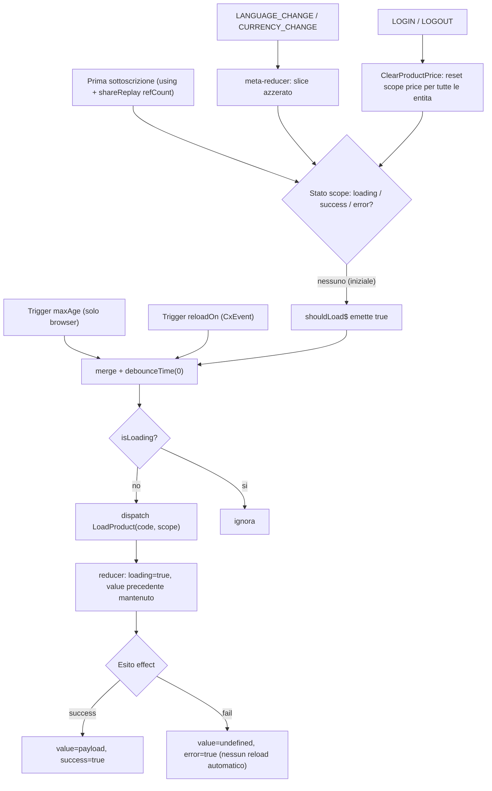
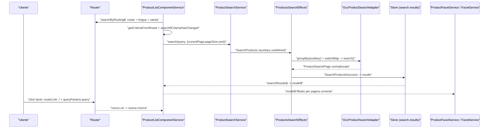

# 24 — Prodotto e ricerca

> Riferimenti allo SHA `5b7a1c2bf2808d7380bc20596d10f4fa710c3da1` (vedi [00-meta](../00-meta.md)).

## 1. A cosa serve e perché esiste

Il dominio "prodotto" è il cuore di qualsiasi storefront: la pagina di dettaglio (PDP), la pagina di elenco/ricerca (PLP), il search box con autocompletamento, i carousel, le recensioni e i prodotti correlati leggono tutti dati di prodotto. In Spartacus questo dominio è distribuito su tre livelli:

1. **Core non-UI** (`core-libs/core/src/product`): facade (`ProductService`, `ProductSearchService`, `SearchboxService`, `ProductSearchByCodeService`, `ProductReviewService`, `ProductReferenceService`, `ProductAvailabilityService`), un servizio di orchestrazione dei caricamenti per *scope* (`ProductLoadingService`), lo slice NgRx `product`, connector/adapter astratti, page meta resolver ed eventi. `ProductModule` importa store ed eventi; solo `forRoot()` aggiunge i quattro `PageMetaResolver` (prodotto, categoria, ricerca, coupon-search) (`core-libs/core/src/product/product.module.ts:L16-L49`).
2. **Implementazione OCC** (`core-libs/core/src/occ/adapters/product`): `ProductOccModule` lega gli adapter astratti alle classi OCC e registra i normalizer multi-provider (`core-libs/core/src/occ/adapters/product/product-occ.module.ts:L30-L76`).
3. **UI** (`core-libs/storefront/cms-components/product` e `cms-pages`): componenti CMS di PDP e PLP, facet navigation, carousel, references; più le feature lib opzionali `@spartacus/product` (variants, bulk-pricing, future-stock, image-zoom) e `@spartacus/product-multi-dimensional`.

L'app demo mette insieme tutto importando `ProductModule.forRoot()` + `ProductOccModule` ("Product Core") e i moduli UI di prodotto (`projects/storefrontapp/src/app/spartacus/spartacus-features.module.ts:L219-L234`).

Il problema di fondo che questo codice risolve è **caricare un prodotto "a pezzi"**. Un prodotto OCC ha decine di campi; una lista ne serve pochi (nome, prezzo, immagine), la PDP molti di più, la tab "specifiche" solo le `classifications`. Spartacus introduce quindi gli **scope** (`ProductScope`: `list`, `details`, `attributes`, `variants`, `price`, `stock`, …) (`core-libs/core/src/product/model/product-scope.ts:L7-L21`): ogni scope ha un proprio stato nello store, un proprio endpoint/`fields` OCC, e può essere invalidato separatamente. Sopra gli scope, una serie di ottimizzazioni (buffer delle azioni simultanee, fusione delle richieste che differiscono solo per `fields`) evita che "caricare a pezzi" significhi "fare N richieste HTTP".

La ricerca segue un modello diverso: non è un'entità indicizzata per codice ma un singolo risultato corrente, con due "canali" separati — risultati di pagina (PLP) e risultati ausiliari (search box) — più i suggerimenti (`core-libs/core/src/product/store/product-state.ts:L35-L39`). La PLP è **guidata dall'URL**: facet, ordinamento e paginazione sono navigazioni, e la ricerca riparte dal cambio di route.

Capitoli collegati: lo state management generico (loader/entity/scoped) è nel [19](../parte-2/19-state-management.md); facade ed eventi nel [20](../parte-2/20-facade-command-query-eventi.md); endpoint, converter e `OccRequestsOptimizerService` nel [21](../parte-2/21-occ.md); il caricamento lazy delle feature nel [12](../parte-2/12-feature-module-lazy.md); gli outlet nel [17](../parte-2/17-outlet.md); il rendering CMS nel [16](../parte-2/16-cms-rendering.md); il trasferimento di stato SSR nel [07](../parte-1/07-ssr-hydration-transferstate.md).

## 2. Mappa dei file

| Path | Ruolo |
|---|---|
| `core-libs/core/src/product/product.module.ts` | `ProductModule` (+`forRoot` con 4 `PageMetaResolver`) |
| `core-libs/core/src/product/model/product-scope.ts` | enum `ProductScope` |
| `core-libs/core/src/product/model/search-config.ts` | `SearchConfig` (pageSize, currentPage, sort, filters, query) |
| `core-libs/core/src/product/facade/product.service.ts` | `ProductService`: `get` per scope, stati loader |
| `core-libs/core/src/product/services/product-loading.service.ts` | `ProductLoadingService`: espansione scope, cache observable, maxAge, reloadOn |
| `core-libs/core/src/product/services/product-catalog.service.ts` | `ProductCatalogService.isProductInCatalog` |
| `core-libs/core/src/product/services/*-page-meta.resolver.ts` | resolver SEO di prodotto, categoria, ricerca, coupon |
| `core-libs/core/src/product/facade/product-search.service.ts` | `ProductSearchService` (risultati PLP) |
| `core-libs/core/src/product/facade/searchbox.service.ts` | `SearchboxService` (risultati ausiliari + suggerimenti) |
| `core-libs/core/src/product/facade/product-search-by-code.service.ts` | load per codice (carousel) |
| `core-libs/core/src/product/facade/product-search-by-category.service.ts` | load per categoria |
| `core-libs/core/src/product/facade/product-review.service.ts`, `product-reference.service.ts` | reviews e references |
| `core-libs/core/src/product/facade/product-availability.service.ts` | stock in tempo reale via `CommandService` |
| `core-libs/core/src/product/store/product-state.ts` | shape dello slice `product` e costanti entità |
| `core-libs/core/src/product/store/product-store.module.ts` | feature NgRx + config SSR transfer |
| `core-libs/core/src/product/store/actions/*.ts` | azioni product, search, by-code, by-category, reviews, references |
| `core-libs/core/src/product/store/effects/*.ts` | `ProductEffects`, `ProductsSearchEffects`, `ProductSearchByCodeEffects`, `ProductSearchByCategoryEffects`, `ProductReviewsEffects`, `ProductReferencesEffects` |
| `core-libs/core/src/product/store/reducers/*.ts` | mappa reducer, meta-reducer `clearProductsState`, search/reviews/references |
| `core-libs/core/src/product/store/selectors/*.ts` | selector per entità/scope, search, reviews, references |
| `core-libs/core/src/product/connectors/**` | `ProductAdapter`, `ProductConnector`, `ProductSearchAdapter`, `ProductReviewsAdapter`, `ProductReferencesAdapter`, `ProductAvailabilityAdapter`, token di conversione |
| `core-libs/core/src/product/event/*.ts` | `FacetChangedEvent` e `ProductEventBuilder` |
| `core-libs/core/src/occ/adapters/product/product-occ.module.ts` | binding OCC + normalizer |
| `core-libs/core/src/occ/adapters/product/default-occ-product-config.ts` | endpoint prodotto/ricerca e `loadingScopes.product` |
| `core-libs/core/src/occ/adapters/product/occ-product.adapter.ts` | `OccProductAdapter` (`load`, `loadMany`) |
| `core-libs/core/src/occ/adapters/product/occ-product-search.adapter.ts` | ricerca, by codes (chunk 100), by category, suggerimenti, keyword redirect |
| `core-libs/core/src/occ/adapters/product/converters/*.ts` | `ProductImageNormalizer`, `ProductNameNormalizer`, `OccProductSearchPageNormalizer`, `OccProductReferencesListNormalizer` |
| `core-libs/core/src/occ/services/loading-scopes.service.ts` | `LoadingScopesService` (`expand`, `getMaxAge`, `getReloadTriggers`) |
| `core-libs/storefront/cms-components/product/current-product.service.ts` | `CurrentProductService`: prodotto dalla route |
| `core-libs/storefront/cms-components/product/product-outlets.model.ts` | `ProductDetailOutlets`, `ProductListOutlets` |
| `core-libs/storefront/cms-components/product/product-summary/`, `product-intro/`, `product-images/`, `product-tabs/`, `stock-notification/` | componenti PDP |
| `core-libs/storefront/cms-components/product/product-list/` | `ProductListModule`, `ProductListComponent`, `ProductListComponentService`, scroll, grid/list item, facet navigation |
| `core-libs/storefront/cms-components/product/carousel/` | `ProductCarouselComponent`, `ProductReferencesComponent`, `ProductCarouselService` |
| `core-libs/storefront/cms-pages/product-details-page/product-details-page.module.ts` | route PDP |
| `core-libs/storefront/cms-pages/product-listing-page/product-listing-page.module.ts` | route search/brand/category |
| `feature-libs/product/variants/**` | selettori varianti, guard, endpoint `variants` |
| `feature-libs/product/bulk-pricing/**` | scope `bulkPrices`, tabella prezzi a scaglioni |
| `feature-libs/product/future-stock/**` | facade lazy future stock |
| `feature-libs/product/image-zoom/**` | sostituzione di `ProductImagesComponent` con zoom |
| `feature-libs/product-multi-dimensional/**` | selector multi-dimensionale e range prezzo in lista |

## 3. Come funziona passo per passo

### 3.1 Wiring: store, effects, SSR

`ProductStoreModule` registra la feature NgRx `product` con `metaReducers` e gli effects, e fornisce via factory una `StateConfig` che marca l'intero slice `product` come `TRANSFER_STATE`: lo stato prodotto calcolato in SSR viene trasferito al browser (`core-libs/core/src/product/store/product-store.module.ts:L20-L43`). La factory serve solo a poter usare la costante `PRODUCT_FEATURE` come chiave calcolata (commento a `core-libs/core/src/product/store/product-store.module.ts:L21-L21`).

Lo slice contiene sei sotto-stati (`core-libs/core/src/product/store/product-state.ts:L14-L33`):

- `details`: `EntityScopedLoaderState<Product>` — prodotti per codice e per scope;
- `search`: `{ results, suggestions, auxResults }`;
- `searchByCode`: `EntityScopedLoaderState<Product>` (carousel);
- `searchByCategory`: `EntityScopedLoaderState<Product[]>`;
- `reviews` e `references`: stato "singolo prodotto" `{ productCode, list }` (`core-libs/core/src/product/store/product-state.ts:L41-L49`).

I reducer di `details`, `searchByCode`, `searchByCategory` sono creati con `entityScopedLoaderReducer`; la mappa è fornita via `reducerToken`/`reducerProvider` (`core-libs/core/src/product/store/reducers/index.ts:L22-L43`). Gli effects sono registrati nell'ordine `ProductsSearchEffects`, `ProductSearchByCodeEffects`, `ProductSearchByCategoryEffects`, `ProductEffects`, `ProductReviewsEffects`, `ProductReferencesEffects` (`core-libs/core/src/product/store/effects/index.ts:L14-L21`). Il barrel pubblico esporta azioni, stato e selector ma **non** effects né reducers (`core-libs/core/src/product/index.ts:L7-L15`).

### 3.2 Gli scope e `ProductService.get`

`ProductService.get(code, scopes = DEFAULT_SCOPE)` restituisce `of(undefined)` se il codice è falsy; altrimenti normalizza gli scope in array e delega a `ProductLoadingService.get` (`core-libs/core/src/product/facade/product.service.ts:L39-L46`). `DEFAULT_SCOPE` vale `'default'` (`core-libs/core/src/occ/occ-models/occ-endpoints.model.ts:L7-L7`). Il JSDoc garantisce che il prodotto venga caricato una sola volta anche con osservatori paralleli e invita a chiedere solo gli scope necessari (`core-libs/core/src/product/facade/product.service.ts:L26-L38`).

Attenzione: `isLoading`, `isSuccess`, `hasError` hanno scope di default `''`, non `'default'` (`core-libs/core/src/product/facade/product.service.ts:L51-L88`).

### 3.3 `ProductLoadingService`: espansione, cache, combinazione

`ProductLoadingService.get(code, scopes)` (`core-libs/core/src/product/services/product-loading.service.ts:L49-L56`):

1. valida la chiave con `isKeyInvalid`, che lancia un `Error` per `__proto__`, `constructor`, `prototype` (`core-libs/core/src/util/is-key-invalid.ts:L17-L27`);
2. espande gli scope con `LoadingScopesService.expand('product', scopes)`;
3. inizializza (una volta) gli observable per scope e per combinazione;
4. restituisce `products[code][scopesIndex]`.

**Espansione.** `expand` scorre gli scope all'indietro e inserisce gli scope inclusi (`include`) *prima* dello scope che li include, senza duplicati (`core-libs/core/src/occ/services/loading-scopes.service.ts:L29-L53`). Il JSDoc fissa la semantica di merge: l'ultimo scope sovrascrive i precedenti, anche quelli impliciti (`core-libs/core/src/occ/services/loading-scopes.service.ts:L22-L24`). Il default OCC configura `details.include = [LIST, VARIANTS]` (`core-libs/core/src/occ/adapters/product/default-occ-product-config.ts:L52-L58`), quindi `expand('product', ['details'])` produce `['list', 'variants', 'details']` (`core-libs/core/src/occ/services/loading-scopes.service.ts:L33-L49`).

**Cache.** La mappa è `products: { [code]: { [scope]: Observable<Product> } }`; per più scope la chiave è `scopes.join('ɵ')` (`core-libs/core/src/product/services/product-loading.service.ts:L37-L39`, `core-libs/core/src/product/services/product-loading.service.ts:L88-L90`).

**Combinazione.** Con più di uno scope l'observable combinato usa `uniteLatest` sugli stream per scope, emette `undefined` finché non sono presenti tutte le parti, poi `deepMerge({}, ...parts)` nell'ordine degli scope (`core-libs/core/src/product/services/product-loading.service.ts:L74-L85`). `uniteLatest` è un `combineLatest` che emette la prima volta in modo sincrono e poi audita con `asapScheduler`, riducendo emissioni simultanee a una sola (`core-libs/core/src/util/rxjs/unite-latest.ts:L15-L47`).

### 3.4 Logica di caricamento per scope

Per ogni scope `getProductForScope` costruisce tre stream (`core-libs/core/src/product/services/product-loading.service.ts:L102-L143`):

- `shouldLoad$`: `true` quando lo stato loader dello scope non è né `loading` né `success` né `error`;
- `productLoadLogic$`: `merge(shouldLoad$, ...reloadTriggers)` → `debounceTime(0)` → `withLatestFrom(isLoading$)` → dispatch di `LoadProduct(code, scope)` solo se non già in loading;
- `productData$`: il valore dallo store.

La logica di load è "attaccata" ai dati con `using()` e condivisa con `shareReplay({ bufferSize: 1, refCount: true })`: il load parte alla prima sottoscrizione e la logica si ferma quando non ci sono più subscriber (`core-libs/core/src/product/services/product-loading.service.ts:L139-L142`).

**Reload trigger.** `getProductReloadTriggers` aggiunge:

- un trigger `maxAge`, attivo solo se configurato **e** in browser (`isPlatformBrowser`), che osserva `LOAD_PRODUCT_SUCCESS/FAIL` e `LOAD_PRODUCT` filtrati per codice e scope (`core-libs/core/src/product/services/product-loading.service.ts:L157-L185`);
- i trigger `reloadOn`: classi `CxEvent` trasformate in stream con `eventService.get(e)` (`core-libs/core/src/product/services/product-loading.service.ts:L187-L191`).

`getMaxAge` legge `backend.loadingScopes[model][scope].maxAge` in secondi e lo converte in millisecondi; `getReloadTriggers` legge `reloadOn` o `[]` (`core-libs/core/src/occ/services/loading-scopes.service.ts:L61-L77`).

`getMaxAgeTrigger` calcola l'età dall'ultimo load completato: se scaduta emette subito `true`, altrimenti programma l'emissione a `maxAge - age`; dopo ogni fine-load programma un nuovo `true` a `maxAge`, ritirato (`withdrawOn`) se parte un nuovo load (`core-libs/core/src/product/services/product-loading.service.ts:L204-L242`). Poiché `timestamp` parte da `0`, alla prima sottoscrizione l'età risulta maggiore di `maxAge` e il trigger emette subito; l'emissione si fonde con quella di `shouldLoad$` grazie al `debounceTime(0)` (`core-libs/core/src/product/services/product-loading.service.ts:L210-L227`, `core-libs/core/src/product/services/product-loading.service.ts:L120-L124`).

### 3.5 Store: azioni e reducer scoped

`LoadProduct(payload: code, scope = '')`, `LoadProductFail(code, payload, scope)` e `LoadProductSuccess(payload: Product, scope)` estendono le azioni scoped-loader con entità `PRODUCT_DETAIL_ENTITY`; il success usa `payload.code ?? ''` come id (`core-libs/core/src/product/store/actions/product.action.ts:L29-L64`).

`scopedLoaderReducer` indicizza lo stato per `action.meta.scope ?? ''` e delega a `loaderReducer` (`core-libs/core/src/state/utils/scoped-loader/scoped-loader.reducer.ts:L20-L44`). Nel `loaderReducer` un'azione di load **mantiene** il `value` precedente (stale-while-loading), un errore lo azzera, il success lo sostituisce (`core-libs/core/src/state/utils/loader/loader.reducer.ts:L39-L60`).

Il selector `getSelectedProductStateFactory(code, scope = '')` estrae lo stato loader per entità+scope con fallback a `initialLoaderState` (`core-libs/core/src/product/store/selectors/product.selectors.ts:L19-L29`).

### 3.6 Effects: bufferizzazione e `getMany`

`ProductEffects.loadProduct$` mappa le `LoadProduct` in `{ code, scope }`, le accumula con `bufferDebounceTime(debounce)` e chiama `productConnector.getMany(products)` unendo gli stream risultanti; tutto è ritirato da `withdrawOn(contextChange$)` (cambio lingua/valuta) (`core-libs/core/src/product/store/effects/product.effect.ts:L34-L57`). L'effect è "a factory" (`({ scheduler, debounce = 0 } = {}) => …`) per poter iniettare lo scheduler nei test (`core-libs/core/src/product/store/effects/product.effect.ts:L34-L38`).

- `bufferDebounceTime` accumula i valori e li emette come array dopo `debounceTime(time)`, poi resetta il buffer (`core-libs/core/src/util/rxjs/buffer-debounce-time.ts:L10-L24`).
- `withdrawOn(notifier)` = `notifier.pipe(startWith(undefined), switchMap(() => source))`: a ogni emissione del notifier risottoscrive la sorgente, cancellando le richieste in corso (`core-libs/core/src/util/rxjs/withdraw-on.ts:L19-L27`).

`productLoadEffect` emette `LoadProductSuccess({ code, ...data }, scope)` o `LoadProductFail` con errore normalizzato; se `data$` manca emette `LoadProductFail` con `Error('Scoped product data does not exist')` (`core-libs/core/src/product/store/effects/product.effect.ts:L59-L91`).

### 3.7 Connector, adapter OCC e ottimizzazione delle richieste

`ProductAdapter` dichiara `load(code, scope?)` obbligatorio e `loadMany?(products)` opzionale (`core-libs/core/src/product/connectors/product/product.adapter.ts:L11-L30`). `ProductConnector.getMany` usa `loadMany` se esiste, altrimenti mappa ogni prodotto su `adapter.load(code, scope)` (`core-libs/core/src/product/connectors/product/product.connector.ts:L19-L33`).

`OccProductAdapter.loadMany` costruisce un URL per scope e delega a `OccRequestsOptimizerService.scopedDataLoad`, applicando poi `PRODUCT_NORMALIZER` a ogni `data$` (`core-libs/core/src/occ/adapters/product/occ-product.adapter.ts:L35-L52`). L'URL viene da `buildUrl('product', { urlParams: { productCode }, scope })` (`core-libs/core/src/occ/adapters/product/occ-product.adapter.ts:L29-L59`).

`scopedDataLoad` chiede a `OccFieldsService.getOptimalUrlGroups` di raggruppare gli URL che differiscono solo per `fields` (`core-libs/core/src/occ/services/occ-fields.service.ts:L50-L82`): con un solo scope per URL passa il `data$` diretto; con più scope fa **una sola GET** con `shareReplay(1)` ed estrae per ogni scope i propri campi con `extractFields` (`core-libs/core/src/occ/services/occ-requests-optimizer.service.ts:L34-L79`). Gli endpoint `default`, `list` e `details` condividono il path `products/${productCode}` (`core-libs/core/src/occ/adapters/product/default-occ-product-config.ts:L15-L19`): caricare la PDP produce quindi una GET unica.

Se uno scope non ha endpoint configurato, `getEndpointForScope` in dev mode logga un warning e ricade su `default` (`core-libs/core/src/occ/services/occ-endpoints.service.ts:L206-L224`). Gli endpoint core coprono `default`, `list`, `details`, `promotions`, `attributes`, `price`, `stock`, `unit`, `list_item` — non `variants`, `code` o `multi_dimensional*` (`core-libs/core/src/occ/adapters/product/default-occ-product-config.ts:L14-L28`).

### 3.8 Normalizzazione

`ProductOccModule` registra su `PRODUCT_NORMALIZER` `ProductImageNormalizer` e `ProductNameNormalizer` (`core-libs/core/src/occ/adapters/product/product-occ.module.ts:L30-L76`).

- `ProductImageNormalizer` ristruttura la lista piatta di immagini in `images[imageType][format]`, o in array indicizzato quando c'è `galleryIndex` (`core-libs/core/src/occ/adapters/product/converters/product-image-normalizer.ts:L28-L61`); prefissa gli URL relativi con `backend.media.baseUrl`, fallback `backend.occ.baseUrl`, lasciando invariati quelli che iniziano con `http`, `data:image` o `//` (`core-libs/core/src/occ/adapters/product/converters/product-image-normalizer.ts:L84-L100`).
- `ProductNameNormalizer` rimuove l'HTML dal `name`, conserva l'originale in `nameHtml` e genera uno `slug` (`core-libs/core/src/occ/adapters/product/converters/product-name-normalizer.ts:L17-L64`).
- `OccProductSearchPageNormalizer` normalizza i facet e converte ogni prodotto con `PRODUCT_NORMALIZER` (`core-libs/core/src/occ/adapters/product/converters/occ-product-search-page-normalizer.ts:L31-L47`); rimuove `topValues` impostando `topValueCount` (default 6) (`core-libs/core/src/occ/adapters/product/converters/occ-product-search-page-normalizer.ts:L91-L102`) e scarta i facet "inutili" (non visibili o senza valori selezionati / con `count < totalResults`, workaround CS-427) (`core-libs/core/src/occ/adapters/product/converters/occ-product-search-page-normalizer.ts:L54-L80`).

Se un token non ha converter registrati, `ConverterService` restituisce la sorgente invariata (`core-libs/core/src/util/converter.service.ts:L80-L112`).

### 3.9 Invalidazione: contesto e autenticazione

- `LANGUAGE_CHANGE`/`CURRENCY_CHANGE`: il meta-reducer `clearProductsState` azzera l'intero slice (`core-libs/core/src/product/store/reducers/index.ts:L45-L59`), mentre gli effect con `withdrawOn(contextChange$)` cancellano le richieste in volo (`core-libs/core/src/product/store/effects/product.effect.ts:L26-L32`). Per gli stream ancora sottoscritti lo stato torna iniziale, `shouldLoad$` riemette e parte un nuovo load (`core-libs/core/src/product/services/product-loading.service.ts:L102-L112`).
- `LOGIN`/`LOGOUT`: `clearProductPrice$` emette `ClearProductPrice` (`core-libs/core/src/product/store/effects/product.effect.ts:L93-L99`), un `EntityScopedResetAction` con id `undefined` e scope `PRICE` (`core-libs/core/src/product/store/actions/product.action.ts:L66-L72`); nell'`entityReducer` un id `undefined` applica l'azione a **tutte** le entità (`core-libs/core/src/state/utils/entity/entity.reducer.ts:L28-L44`). Lo stato by-code viene svuotato con `ClearProductSearchByCodeState` (`core-libs/core/src/product/store/effects/product-search-by-code.effect.ts:L107-L113`).

### 3.10 Ricerca: PLP e search box

`ProductSearchService.search` fa dispatch di `SearchProducts` **solo se** `query` è truthy; `getResults` seleziona `results`; `clearResults` invia `ClearProductSearchResult({ clearPageResults: true })` (`core-libs/core/src/product/facade/product-search.service.ts:L21-L42`).

`SearchboxService extends ProductSearchService`: `search` invia `SearchProducts(…, auxiliary = true)` anche con query vuota, `getResults` legge `auxResults` (`core-libs/core/src/product/facade/searchbox.service.ts:L19-L68`). `searchWithCompletion`/`searchSuggestionsWithCompletion` fanno dispatch e poi restituiscono la prima azione SUCCESS/FAIL da `ActionsSubject` con `take(1)`, pur essendo tipizzati `Observable<boolean>` (`core-libs/core/src/product/facade/searchbox.service.ts:L40-L53`, `core-libs/core/src/product/facade/searchbox.service.ts:L86-L99`); il consumer `SearchBoxComponentService` tratta infatti il valore come azione (`core-libs/storefront/cms-components/navigation/search-box/search-box-component.service.ts:L93-L108`).

`ProductsSearchEffects.searchProducts$` raggruppa per `auxiliary` (`groupBy`) e usa `switchMap` per gruppo: una ricerca PLP non cancella quella del search box e viceversa (`core-libs/core/src/product/store/effects/product-search.effect.ts:L26-L43`). Un errore `ArrayIndexOutOfBoundsError` produce il global message `searchBox.queryError` (`core-libs/core/src/product/store/effects/product-search.effect.ts:L44-L63`). I suggerimenti usano `switchMap` e convertono `undefined` in `[]` (`core-libs/core/src/product/store/effects/product-search.effect.ts:L72-L101`). Il reducer scrive `auxResults` o `results` in base ad `auxiliary` (`core-libs/core/src/product/store/reducers/product-search.reducer.ts:L25-L54`).

Lato OCC, `OccProductSearchAdapter.search` usa `{ pageSize: 20 }` se `searchConfig` è `undefined`, imposta `OCC_HTTP_TOKEN.sendUserIdAsHeader: true` e mette `query` + config nei query param (`core-libs/core/src/occ/adapters/product/occ-product-search.adapter.ts:L42-L56`, `core-libs/core/src/occ/adapters/product/occ-product-search.adapter.ts:L147-L156`). Se la risposta contiene `keywordRedirectUrl`, è **l'adapter stesso** a navigare con il `Router` (`core-libs/core/src/occ/adapters/product/occ-product-search.adapter.ts:L59-L69`, `core-libs/core/src/occ/adapters/product/occ-product-search.adapter.ts:L164-L194`). `loadSuggestions` ha `pageSize` di default 3 (`core-libs/core/src/occ/adapters/product/occ-product-search.adapter.ts:L123-L135`).

### 3.11 PLP guidata dall'URL

`ProductListComponentService.searchByRouting$` combina router state (distinto per `state.url`), lingua e valuta attive, applica `debounceTime(0)` e lancia la ricerca se i criteri sono cambiati (`core-libs/storefront/cms-components/product/product-list/container/product-list-component.service.ts:L69-L90`).

- I criteri vengono dai query param `query`, `pageSize`, `currentPage`, `sortCode`; in assenza di `query`, dai route param (`categoryCode`/`brandCode` → `:relevance:allCategories:<code>`); `pageSize` ricade su `view.defaultPageSize` (`core-libs/storefront/cms-components/product/product-list/container/product-list-component.service.ts:L191-L223`).
- `searchIfCriteriaHasChanged` confronta query (senza sort code), pagina, pageSize e sortCode con l'ultima risposta in store (`core-libs/storefront/cms-components/product/product-list/container/product-list-component.service.ts:L92-L169`); rimuove dalla query il sort `relevance` e tratta `currentPage` 0 come `undefined` (`core-libs/storefront/cms-components/product/product-list/container/product-list-component.service.ts:L117-L152`).
- `model$` lega ricerca e risultati con `using()` + `shareReplay({ bufferSize: 1, refCount: true })`: lasciata la PLP, la ricerca su route change si ferma (`core-libs/storefront/cms-components/product/product-list/container/product-list-component.service.ts:L171-L183`).
- `sort(sortCode)` naviga con `queryParamsHandling: 'merge'` (`core-libs/storefront/cms-components/product/product-list/container/product-list-component.service.ts:L270-L286`); `getPageItems` (infinite scroll) cerca senza navigare (`core-libs/storefront/cms-components/product/product-list/container/product-list-component.service.ts:L247-L265`).

`ProductListComponent` sceglie Grid se il template di pagina è `ProductGridPageTemplate` e annuncia `sorting.pageViewUpdated` in modo assistivo ai cambi successivi (`core-libs/storefront/cms-components/product/product-list/container/product-list.component.ts:L64-L93`). Il template usa `cx-pagination` (`queryParam="currentPage"`) o `cx-product-scroll` se l'infinite scroll è attivo (`core-libs/storefront/cms-components/product/product-list/container/product-list.component.html:L25-L79`). `ProductListModule` mappa `CMSProductListComponent`, `ProductGridComponent` e `SearchResultsListComponent` su `ProductListComponent` con `composition.inner: ['ProductAddToCartComponent']` (`core-libs/storefront/cms-components/product/product-list/product-list.module.ts:L63-L94`).

Grid/list item forniscono localmente `ProductListItemContextSource` (alias `ProductListItemContext`) e vi pubblicano il prodotto (`core-libs/storefront/cms-components/product/product-list/product-grid-item/product-grid-item.component.ts:L32-L80`); gli outlet `ITEM_DETAILS` e `ITEM_ACTIONS` avvolgono rating/prezzo e add-to-cart (`core-libs/storefront/cms-components/product/product-list/product-grid-item/product-grid-item.component.html:L23-L47`). L'add-to-cart è nascosto se manca il prezzo o `purchasable === false` (`core-libs/storefront/cms-components/product/product-list/product-list.service.ts:L12-L16`).

### 3.12 Facet

`ProductFacetService.searchResult$` filtra il `model$` della PLP verificando che il risultato appartenga alla pagina corrente (categoria: query contiene `allCategories:<id>`; ricerca: `freeTextSearch` uguale alla query di route) (`core-libs/storefront/cms-components/product/product-list/product-facet-navigation/services/product-facet.service.ts:L40-L96`) e toglie dagli active facet il breadcrumb implicito della categoria/brand di route (`core-libs/storefront/cms-components/product/product-list/product-facet-navigation/services/product-facet.service.ts:L98-L119`).

`FacetService` tiene lo stato UI in una `Map<facet.name, BehaviorSubject<FacetCollapseState>>` inizializzata con `topValueCount` (`core-libs/storefront/cms-components/product/product-list/product-facet-navigation/services/facet.service.ts:L28-L48`, `core-libs/storefront/cms-components/product/product-list/product-facet-navigation/services/facet.service.ts:L113-L127`). Selezionare un facet è una navigazione: `routerLink="./"` con `[queryParams]="getLinkParams(value)"` (`core-libs/storefront/cms-components/product/product-list/product-facet-navigation/facet/facet.component.html:L13-L14`); `getLinkParams` decodifica la query e sostituisce `+` con spazio (`core-libs/storefront/cms-components/product/product-list/product-facet-navigation/services/facet.service.ts:L146-L159`).

In parallelo `ProductEventBuilder` confronta a coppie (`pairwise`) i risultati PLP consecutivi ed emette `FacetChangedEvent` individuando l'unico breadcrumb aggiunto/rimosso (`core-libs/core/src/product/event/product-event.builder.ts:L37-L67`); il builder è istanziato dal costruttore di `ProductEventModule` (`core-libs/core/src/product/event/product-event.module.ts:L10-L15`).

### 3.13 PDP

`CurrentProductService.getProduct(scopes?)` legge `productCode` dal router state, usa di default lo scope `DETAILS`, restituisce `of(null)` senza codice e filtra gli `undefined` (`core-libs/storefront/cms-components/product/current-product.service.ts:L27-L57`). I componenti chiedono scope diversi: `ProductSummaryComponent` `DETAILS`+`PRICE`+`PROMOTIONS` (`core-libs/storefront/cms-components/product/product-summary/product-summary.component.ts:L33-L40`), `ProductAttributesComponent` `ATTRIBUTES` (mappato a `ProductSpecsTabComponent`) (`core-libs/storefront/cms-components/product/product-tabs/product-attributes/product-attributes.component.ts:L19-L23`).

Altri pezzi della PDP:

- il summary avvolge prezzo e testo negli outlet `PRICE` e `SUMMARY` con contesto `{ product }` (`core-libs/storefront/cms-components/product/product-summary/product-summary.component.html:L6-L23`);
- `ProductIntroComponent.showReviews` cerca nel DOM la tab reviews per etichetta tradotta e la clicca (`core-libs/storefront/cms-components/product/product-intro/product-intro.component.ts:L65-L151`);
- `ProductImagesComponent` usa `images.PRIMARY` come immagine principale e mostra le thumbnail solo se `GALLERY` ha almeno 2 elementi (`core-libs/storefront/cms-components/product/product-images/product-images.component.ts:L34-L109`);
- `StockNotificationComponent` calcola `outOfStock$` e, per utenti non anonimi, carica preferenze e interessi `BACK_IN_STOCK` (`core-libs/storefront/cms-components/product/stock-notification/stock-notification.component.ts:L77-L100`).

La route PDP è `path: null` con `CmsPageGuard`, `cxRoute: 'product'` e matcher `PRODUCT_DETAILS_URL_MATCHER` (`core-libs/storefront/cms-pages/product-details-page/product-details-page.module.ts:L14-L38`); la PLP registra `search`, `brand` e per ultima `category`, perché il suo matcher può essere greedy (`core-libs/storefront/cms-pages/product-listing-page/product-listing-page.module.ts:L13-L52`).

### 3.14 Page meta resolver

- `ProductPageMetaResolver` (`PRODUCT_PAGE`) deriva il prodotto dal parametro `productCode` con scope `DETAILS` (`core-libs/core/src/product/services/product-page-meta.resolver.ts:L57-L69`); titolo `name | primaCategoria | manufacturer` (`core-libs/core/src/product/services/product-page-meta.resolver.ts:L91-L102`), immagine `images.PRIMARY.zoom.url` (`core-libs/core/src/product/services/product-page-meta.resolver.ts:L145-L149`), canonical che risale `baseProduct` con scope `LIST` (`core-libs/core/src/product/services/product-page-meta.resolver.ts:L167-L209`).
- `CategoryPageMetaResolver` usa i risultati di ricerca solo se la pagina contiene `CMSProductListComponent` o `ProductGridComponent` (`core-libs/core/src/product/services/category-page-meta.resolver.ts:L40-L54`).
- `SearchPageMetaResolver` si applica a `CONTENT_PAGE` con template `SearchResultsListPageTemplate` (`core-libs/core/src/product/services/search-page-meta.resolver.ts:L35-L73`); `CouponSearchPageResolver` aggiunge +1 al punteggio se c'è `couponcode` (`core-libs/core/src/product/services/coupon-search-page-meta.resolver.ts:L51-L95`).

### 3.15 Carousel e ricerca per codici

`ProductCarouselComponent` carica ogni codice con `ProductSearchByCodeService.get({ code, scope })`, scope `carousel` se la mappatura ha `composition.inner`, altrimenti `carouselMinimal` (`core-libs/storefront/cms-components/product/carousel/product-carousel/product-carousel.component.ts:L62-L83`). Con `categoryCodes` risolve prima i prodotti di ogni categoria (scope `CODE`) e li accoda (`core-libs/storefront/cms-components/product/carousel/product-carousel/product-carousel.component.ts:L93-L120`).

`ProductSearchByCodeService.get` seleziona lo stato scoped e, con `auditTime(0)`, fa dispatch del load se lo stato è iniziale; il load è legato alla sottoscrizione con `using()` (`core-libs/core/src/product/facade/product-search-by-code.service.ts:L30-L61`), senza `shareReplay` (`core-libs/core/src/product/facade/product-search-by-code.service.ts:L57-L60`).

`ProductSearchByCodeEffects.searchByCodes$` raggruppa per scope, bufferizza e fa **una** chiamata `searchByCodes(codes, scope)` per gruppo, emettendo un success per prodotto, associando prodotti e codici per indice (`core-libs/core/src/product/store/effects/product-search-by-code.effect.ts:L44-L84`). L'adapter spezza i codici in chunk da 100 ed esegue `search('', { filters: 'code:…', pageSize: 100 }, scope)` per chunk, unendo con `forkJoin` (`core-libs/core/src/occ/adapters/product/occ-product-search.adapter.ts:L73-L107`).

### 3.16 Reviews e references

- `ProductReviewService.getByProductCode` fa dispatch di `LoadProductReviews` quando il selector restituisce `undefined` (prodotto diverso da quello in stato) (`core-libs/core/src/product/facade/product-review.service.ts:L22-L34`, `core-libs/core/src/product/store/selectors/product-reviews.selectors.ts:L21-L30`). Il reducer gestisce solo il success di load (`core-libs/core/src/product/store/reducers/product-reviews.reducer.ts:L16-L34`); il POST è form-urlencoded (`core-libs/core/src/occ/adapters/product/occ-product-reviews.adapter.ts:L39-L55`) e produce i global message di conferma/errore (`core-libs/core/src/product/store/effects/product-reviews.effect.ts:L78-L104`).
- `ProductReferencesComponent` a ogni cambio di prodotto corrente chiama `cleanReferences()`, poi ricarica con `productReferenceTypes` del CMS (`core-libs/storefront/cms-components/product/carousel/product-references/product-references.component.ts:L56-L105`). Il reducer accumula la lista deduplicando per `referenceType` + `target.code` e sovrascrive `productCode` (`core-libs/core/src/product/store/reducers/product-references.reducer.ts:L21-L46`); l'effect usa `mergeMap` (`core-libs/core/src/product/store/effects/product-references.effect.ts:L22-L46`).

### 3.17 Stock in tempo reale

`ProductAvailabilityService` usa `CommandService` con strategia `CancelPrevious`; il JSDoc lo distingue dallo stock eventualmente cachato di `ProductService` (`core-libs/core/src/product/facade/product-availability.service.ts:L17-L59`). L'adapter OCC chiama `productAvailabilities?filters=<code>:<unit>`, estrae `availabilityItems[0].unitAvailabilities[0]` e in caso di errore restituisce `{}` (`core-libs/core/src/occ/adapters/product/occ-product-availability-adapter.ts:L21-L45`).

### 3.18 Feature lib `@spartacus/product`

L'entry point principale esporta `{}`: tutto è nelle entry secondarie (`feature-libs/product/public_api.ts:L14-L20`). Ogni feature ha un *root module* eager che dichiara `featureModules.<nome>.cmsComponents`; l'app aggiunge `module: () => import(...)` (`projects/storefrontapp/src/app/spartacus/features/product/product-variants-feature.module.ts:L21-L33`); `CmsFeaturesService` mappa un tipo CMS su una feature solo se ha sia `module` sia `cmsComponents` (`core-libs/storefront/cms-structure/services/cms-features.service.ts:L56-L76`).

- **variants**: il root dichiara `productVariants` per `ProductVariantSelectorComponent` e registra in modo eager l'outlet `ITEM_DETAILS` (AFTER) con le style icons (`feature-libs/product/variants/root/product-variants-root.module.ts:L19-L42`); il modulo lazy aggiunge l'endpoint `product.variants` (`feature-libs/product/variants/occ/config/default-occ-product-variants-config.ts:L9-L20`) e mappa il tipo CMS su `ProductVariantsContainerComponent` con `ProductVariantsGuard` (`feature-libs/product/variants/components/product-variants-components.module.ts:L23-L32`). Il guard carica lo scope `VARIANTS` e, se il prodotto non è acquistabile, restituisce un `UrlTree` verso una variante con stock (o la prima) (`feature-libs/product/variants/components/guards/product-variants.guard.ts:L32-L80`); `GuardsComposer` prende solo il primo valore (`core-libs/storefront/cms-structure/services/guards-composer.ts:L65-L65`).
- **bulk-pricing**: aggiunge a runtime `ProductScope.BULK_PRICES = 'bulkPrices'` (augmentation + mutazione dell'enum) (`feature-libs/product/bulk-pricing/core/model/augmented-core.model.ts:L9-L15`) con endpoint `orgProducts/${productCode}?fields=price(DEFAULT),volumePrices(FULL)` (`feature-libs/product/bulk-pricing/occ/config/default-occ-bulk-pricing-config.ts:L9-L20`); `BulkPricingService` legge quello scope via `ProductService` e calcola lo sconto percentuale (`feature-libs/product/bulk-pricing/core/services/bulk-pricing.service.ts:L16-L80`).
- **future-stock**: `FutureStockFacade` è una facade lazy (`facadeFactory`, feature `productFutureStockCore`) (`feature-libs/product/future-stock/root/facade/future-stock.facade.ts:L12-L29`); `FutureStockService` reagisce al router state e chiama il connector solo per utenti non anonimi, senza store né cache (`feature-libs/product/future-stock/core/services/future-stock.service.ts:L23-L41`).
- **image-zoom**: dichiara la feature `productImageZoom` per `ProductImagesComponent`; caricata la feature, la mappatura sostituisce il componente con `ProductImageZoomProductImagesComponent` (`feature-libs/product/image-zoom/root/product-image-zoom-root.module.ts:L11-L26`, `feature-libs/product/image-zoom/components/product-image-zoom/product-image-zoom.module.ts:L51-L60`), che estende `ProductImagesComponent` con lo stesso selettore (`feature-libs/product/image-zoom/components/product-image-zoom/product-image-zoom-product-images/product-image-zoom-product-images.component.ts:L21-L44`).

### 3.19 `@spartacus/product-multi-dimensional`

Il root del selector fornisce `multiDimensional.imageFormat = STYLE_SWATCH` e dichiara la feature `productMultiDimensionalSelector` (`feature-libs/product-multi-dimensional/selector/root/product-multi-dimensional-selector-root.module.ts:L15-L33`). L'OCC aggiunge gli scope `multi_dimensional` (variantMatrix annidata) e `multi_dimensional_availability` (`feature-libs/product-multi-dimensional/selector/occ/config/default-occ-product-multi-dimensional-selector-config.ts:L9-L26`). Il guard, senza `productCode`, consente l'accesso solo con `cmsTicketId` (SmartEdit), altrimenti verifica la disponibilità e reindirizza (`feature-libs/product-multi-dimensional/selector/components/guards/product-multi-dimensional-selector.guard.ts:L39-L61`). `getVariants` scende un livello della matrice per ogni categoria (`feature-libs/product-multi-dimensional/selector/core/services/product-multi-dimensional-selector.service.ts:L51-L88`). La parte `list` sostituisce (`REPLACE`) l'outlet `ITEM_DETAILS` con un range di prezzo (`feature-libs/product-multi-dimensional/list/root/product-multi-dimensional-list-root.module.ts:L33-L44`).

## 4. Diagrammi

### 4.1 PDP: dal componente alla GET OCC (scope `details`)

```mermaid
sequenceDiagram
  participant C as "Componente PDP"
  participant CPS as "CurrentProductService"
  participant PS as "ProductService"
  participant PLS as "ProductLoadingService"
  participant ST as "Store (product.details)"
  participant EF as "ProductEffects.loadProduct$"
  participant AD as "OccProductAdapter.loadMany"
  participant OPT as "OccRequestsOptimizerService"
  C->>CPS: "getProduct() (default DETAILS)"
  CPS->>PS: "get(code, 'details')"
  PS->>PLS: "get(code, ['details'])"
  PLS->>PLS: "expand -> ['list','variants','details']"
  PLS->>ST: "select stato per scope (shouldLoad$)"
  Note over PLS: "debounceTime(0), withLatestFrom(isLoading$)"
  PLS->>ST: "dispatch LoadProduct x3 (list, variants, details)"
  ST->>EF: "azioni LOAD_PRODUCT"
  EF->>EF: "bufferDebounceTime -> [3 scope]"
  EF->>AD: "ProductConnector.getMany(products)"
  AD->>OPT: "scopedDataLoad(3 URL)"
  OPT->>OPT: "getOptimalUrlGroups: stesso path, fields fusi"
  OPT-->>AD: "1 GET condivisa, extractFields per scope"
  AD-->>EF: "data$ normalizzati (PRODUCT_NORMALIZER)"
  EF->>ST: "LoadProductSuccess per scope"
  ST-->>PLS: "valori per scope"
  PLS-->>C: "uniteLatest + deepMerge -> Product"
```

Riferimenti: `core-libs/storefront/cms-components/product/current-product.service.ts:L36-L51`, `core-libs/core/src/product/facade/product.service.ts:L39-L46`, `core-libs/core/src/occ/services/loading-scopes.service.ts:L29-L53`, `core-libs/core/src/product/services/product-loading.service.ts:L102-L133`, `core-libs/core/src/product/store/effects/product.effect.ts:L39-L54`, `core-libs/core/src/occ/adapters/product/occ-product.adapter.ts:L35-L52`, `core-libs/core/src/occ/services/occ-requests-optimizer.service.ts:L44-L76`, `core-libs/core/src/product/services/product-loading.service.ts:L74-L85`.

### 4.2 Ciclo di vita di uno scope



Riferimenti: `core-libs/core/src/product/services/product-loading.service.ts:L102-L142`, `core-libs/core/src/product/services/product-loading.service.ts:L157-L191`, `core-libs/core/src/state/utils/loader/loader.reducer.ts:L39-L60`, `core-libs/core/src/product/store/reducers/index.ts:L45-L59`, `core-libs/core/src/product/store/effects/product.effect.ts:L93-L99`, `core-libs/core/src/state/utils/entity/entity.reducer.ts:L28-L44`.

### 4.3 PLP: route, ricerca, facet



Riferimenti: `core-libs/storefront/cms-components/product/product-list/container/product-list-component.service.ts:L69-L90`, `core-libs/storefront/cms-components/product/product-list/container/product-list-component.service.ts:L92-L169`, `core-libs/core/src/product/store/effects/product-search.effect.ts:L26-L43`, `core-libs/core/src/product/store/reducers/product-search.reducer.ts:L25-L32`, `core-libs/storefront/cms-components/product/product-list/product-facet-navigation/services/product-facet.service.ts:L40-L96`, `core-libs/storefront/cms-components/product/product-list/product-facet-navigation/facet/facet.component.html:L13-L14`.

### 4.4 Carousel: N componenti, una chiamata per scope


Riferimenti: `core-libs/storefront/cms-components/product/carousel/product-carousel/product-carousel.component.ts:L69-L83`, `core-libs/core/src/product/facade/product-search-by-code.service.ts:L46-L53`, `core-libs/core/src/product/store/effects/product-search-by-code.effect.ts:L44-L84`, `core-libs/core/src/occ/adapters/product/occ-product-search.adapter.ts:L73-L107`.

## 5. Estratti di codice reale

### 5.1 `ProductService.get`

`core-libs/core/src/product/facade/product.service.ts:L39-L46`
```ts
  get(
    productCode: string,
    scopes: (ProductScope | string)[] | ProductScope | string = DEFAULT_SCOPE
  ): Observable<Product | undefined> {
    return productCode
      ? this.productLoading.get(productCode, ([] as string[]).concat(scopes))
      : of(undefined);
  }
```

### 5.2 Espansione degli scope

`core-libs/core/src/occ/services/loading-scopes.service.ts:L29-L53`
```ts
  expand(model: string, scopes: string[]): string[] {
    const scopesConfig = this.config?.backend?.loadingScopes?.[model];

    if (scopesConfig) {
      const expandedScopes = [...scopes];
      let i = expandedScopes.length;

      while (i > 0) {
        i--;
        const includedScopes = scopesConfig[expandedScopes[i]]?.include;
        if (includedScopes) {
          for (const includedScope of includedScopes) {
            if (!expandedScopes.includes(includedScope)) {
              expandedScopes.splice(i, 0, includedScope);
              i++;
            }
          }
        }
      }

      return expandedScopes;
    }

    return scopes;
  }
```

### 5.3 Cache e combinazione degli scope

`core-libs/core/src/product/services/product-loading.service.ts:L58-L90`
```ts
  protected initProductScopes(productCode: string, scopes: string[]): void {
    isKeyInvalid(productCode);

    if (!this.products[productCode]) {
      this.products[productCode] = {};
    }

    for (const scope of scopes) {
      if (!this.products[productCode][scope]) {
        this.products[productCode][scope] = this.getProductForScope(
          productCode,
          scope
        );
      }
    }

    if (scopes.length > 1) {
      this.products[productCode][this.getScopesIndex(scopes)] = uniteLatest(
        scopes.map((scope) => this.products[productCode][scope])
      ).pipe(
        map((productParts) =>
          productParts.every(Boolean)
            ? deepMerge({}, ...productParts)
            : undefined
        ),
        distinctUntilChanged()
      );
    }
  }

  protected getScopesIndex(scopes: string[]): string {
    return scopes.join('ɵ');
  }
```

### 5.4 Logica di load per scope

`core-libs/core/src/product/services/product-loading.service.ts:L98-L143`
```ts
  protected getProductForScope(
    productCode: string,
    scope: string
  ): Observable<Product> {
    const shouldLoad$ = this.store.pipe(
      select(
        ProductSelectors.getSelectedProductStateFactory(productCode, scope)
      ),
      map(
        (productState) =>
          !productState.loading && !productState.success && !productState.error
      ),
      distinctUntilChanged(),
      filter((x) => x)
    );

    const isLoading$ = this.store.pipe(
      select(
        ProductSelectors.getSelectedProductLoadingFactory(productCode, scope)
      )
    );

    const productLoadLogic$ = merge(
      shouldLoad$,
      ...this.getProductReloadTriggers(productCode, scope)
    ).pipe(
      debounceTime(0),
      withLatestFrom(isLoading$),
      tap(([, isLoading]) => {
        if (!isLoading) {
          this.store.dispatch(
            new ProductActions.LoadProduct(productCode, scope)
          );
        }
      })
    );

    const productData$ = this.store.pipe(
      select(ProductSelectors.getSelectedProductFactory(productCode, scope))
    );

    return using(
      () => productLoadLogic$.subscribe(),
      () => productData$
    ).pipe(shareReplay({ bufferSize: 1, refCount: true }));
  }
```

### 5.5 Trigger `maxAge`

`core-libs/core/src/product/services/product-loading.service.ts:L210-L239`
```ts
    let timestamp = 0;

    const now = () => (scheduler ? scheduler.now() : Date.now());

    const timestamp$ = loadFinish$.pipe(tap(() => (timestamp = now())));

    const shouldReload$: Observable<boolean> = defer(() => {
      const age = now() - timestamp;

      const timestampRefresh$ = timestamp$.pipe(
        delay(maxAge, scheduler),
        map(() => true),
        withdrawOn(loadStart$)
      );

      if (age > maxAge) {
        // we should emit first value immediately
        return merge(of(true), timestampRefresh$);
      } else if (age === 0) {
        // edge case, we should emit max age timeout after next load success
        // could happen with artificial schedulers
        return timestampRefresh$;
      } else {
        // we should emit first value when age will expire
        return merge(
          of(true).pipe(delay(maxAge - age, scheduler)),
          timestampRefresh$
        );
      }
    });
```

### 5.6 Effect di caricamento con buffer e withdraw

`core-libs/core/src/product/store/effects/product.effect.ts:L26-L57`
```ts
  // we want to cancel all ongoing requests when currency or language changes,
  private contextChange$: Observable<Action> = this.actions$.pipe(
    ofType(
      SiteContextActions.CURRENCY_CHANGE,
      SiteContextActions.LANGUAGE_CHANGE
    )
  );

  loadProduct$ = createEffect(
    () =>
      ({ scheduler, debounce = 0 } = {}): Observable<
        ProductActions.LoadProductSuccess | ProductActions.LoadProductFail
      > =>
        this.actions$.pipe(
          ofType(ProductActions.LOAD_PRODUCT),
          map((action: ProductActions.LoadProduct) => ({
            code: action.payload,
            scope: action.meta.scope,
          })),
          // we are grouping all load actions that happens at the same time
          // to optimize loading and pass them all to productConnector.getMany
          bufferDebounceTime(debounce, scheduler),
          mergeMap((products) =>
            merge(
              ...this.productConnector
                .getMany(products)
                .map((productLoad) => this.productLoadEffect(productLoad))
            )
          ),
          withdrawOn(this.contextChange$)
        )
  );
```

### 5.7 Una GET per più scope

`core-libs/core/src/occ/services/occ-requests-optimizer.service.ts:L44-L76`
```ts
    const mergedUrls = this.occFields.getOptimalUrlGroups(scopedDataWithUrls);

    Object.entries(mergedUrls).forEach(
      ([url, groupedModelsSet]: [
        string,
        {
          [scope: string]: OccFieldsModel;
        },
      ]) => {
        const groupedModels = Object.values(groupedModelsSet);

        if (groupedModels.length === 1) {
          // only one scope for url, we can pass the data straightaway
          result.push({
            ...groupedModels[0].scopedData,
            data$: dataFactory?.(url),
          });
        } else {
          // multiple scopes per url
          // we have to split the model per each scope
          const data$ = dataFactory?.(url).pipe(shareReplay(1));

          groupedModels.forEach((modelData) => {
            result.push({
              ...modelData.scopedData,
              data$: data$?.pipe(
                map((data) => extractFields<T>(data, modelData.fields))
              ),
            });
          });
        }
      }
    );
```

### 5.8 Meta-reducer di invalidazione e SSR transfer

`core-libs/core/src/product/store/reducers/index.ts:L45-L59`
```ts
export function clearProductsState(
  reducer: ActionReducer<any>
): ActionReducer<any> {
  return function (state, action) {
    if (
      action.type === SiteContextActions.CURRENCY_CHANGE ||
      action.type === SiteContextActions.LANGUAGE_CHANGE
    ) {
      state = undefined;
    }
    return reducer(state, action);
  };
}

export const metaReducers: MetaReducer<any>[] = [clearProductsState];
```

`core-libs/core/src/product/store/product-store.module.ts:L20-L30`
```ts
export function productStoreConfigFactory(): StateConfig {
  // if we want to reuse PRODUCT_FEATURE const in config, we have to use factory instead of plain object
  const config: StateConfig = {
    state: {
      ssrTransfer: {
        keys: { [PRODUCT_FEATURE]: StateTransferType.TRANSFER_STATE },
      },
    },
  };
  return config;
}
```

### 5.9 Endpoint di default e loading scopes

`core-libs/core/src/occ/adapters/product/default-occ-product-config.ts:L14-L28` (abbreviato)
```ts
        product: {
          default:
            'products/${productCode}?fields=DEFAULT,averageRating,images(FULL),classifications,manufacturer,numberOfReviews,categories(FULL),baseOptions,baseProduct,variantOptions,variantType',
          list: 'products/${productCode}?fields=code,purchasable,name,summary,price(formattedValue),images(DEFAULT,galleryIndex),baseProduct',
          details:
            'products/${productCode}?fields=averageRating,stock(DEFAULT),description,availableForPickup,code,url,price(DEFAULT),numberOfReviews,manufacturer,categories(FULL),priceRange,multidimensional,tags,images(FULL)',
          // ...
          price: 'products/${productCode}?fields=price(formattedValue)',
          stock: 'products/${productCode}?fields=stock(DEFAULT)',
          // ...
        },
```

`core-libs/core/src/occ/adapters/product/default-occ-product-config.ts:L52-L58`
```ts
    loadingScopes: {
      product: {
        details: {
          include: [ProductScope.LIST, ProductScope.VARIANTS],
        },
      },
    },
```

### 5.10 Due canali di ricerca indipendenti

`core-libs/core/src/product/store/effects/product-search.effect.ts:L29-L43`
```ts
    this.actions$.pipe(
      ofType(ProductActions.SEARCH_PRODUCTS),
      groupBy((action: ProductActions.SearchProducts) => action.auxiliary),
      mergeMap((group) =>
        group.pipe(
          switchMap((action: ProductActions.SearchProducts) => {
            return this.productSearchConnector
              .search(action.payload.queryText, action.payload.searchConfig)
              .pipe(
                map((data) => {
                  return new ProductActions.SearchProductsSuccess(
                    data,
                    action.auxiliary
                  );
                }),
```

`core-libs/core/src/product/store/reducers/product-search.reducer.ts:L25-L32`
```ts
    case ProductActions.SEARCH_PRODUCTS_SUCCESS: {
      const results = action.payload;
      const res = action.auxiliary ? { auxResults: results } : { results };
      return {
        ...state,
        ...res,
      };
    }
```

### 5.11 Keyword redirect dentro l'adapter

`core-libs/core/src/occ/adapters/product/occ-product-search.adapter.ts:L46-L71`
```ts
  search(
    query: string,
    searchConfig: SearchConfig = this.DEFAULT_SEARCH_CONFIG,
    scope?: string
  ): Observable<ProductSearchPage> {
    const context = new HttpContext().set(OCC_HTTP_TOKEN, {
      sendUserIdAsHeader: true,
    });

    return this.http
      .get(this.getSearchEndpoint(query, searchConfig, scope), { context })
      .pipe(
        this.converter.pipeable(PRODUCT_SEARCH_PAGE_NORMALIZER),
        tap((productSearchPage) => {
          if (productSearchPage.keywordRedirectUrl) {
            const navigationData = this.parseUrlForNavigation(
              productSearchPage.keywordRedirectUrl
            );
            if (navigationData) {
              const [path, navigationExtras] = navigationData;
              this.router?.navigate(path, navigationExtras);
            }
          }
        })
      );
  }
```

### 5.12 PLP: ricerca legata alla route e al ciclo di vita del componente

`core-libs/storefront/cms-components/product/product-list/container/product-list-component.service.ts:L69-L90`
```ts
  protected searchByRouting$: Observable<ActivatedRouterStateSnapshot> =
    combineLatest([
      this.routing.getRouterState().pipe(
        distinctUntilChanged((x, y) => {
          // router emits new value also when the anticipated `nextState` changes
          // but we want to perform search only when current url changes
          return x.state.url === y.state.url;
        })
      ),
      ...this.siteContext,
    ]).pipe(
      debounceTime(0),
      map(([routerState, ..._context]) => (routerState as RouterState).state),
      tap((state: ActivatedRouterStateSnapshot) => {
        const criteria = this.getCriteriaFromRoute(
          state.params,
          state.queryParams
        );

        this.searchIfCriteriaHasChanged(criteria);
      })
    );
```

`core-libs/storefront/cms-components/product/product-list/container/product-list-component.service.ts:L180-L183`
```ts
  readonly model$: Observable<ProductSearchPage> = using(
    () => this.searchByRouting$.subscribe(),
    () => this.searchResults$
  ).pipe(shareReplay({ bufferSize: 1, refCount: true }));
```

### 5.13 Carousel: scelta dello scope

`core-libs/storefront/cms-components/product/carousel/product-carousel/product-carousel.component.ts:L69-L83`
```ts
  items$: Observable<Observable<Product | undefined>[]> =
    this.componentData$.pipe(
      switchMap((data) => this.handleCategoryCodes(data)),
      map((data) => {
        const componentMappingExist = !!data.composition?.inner?.length;
        const codes = data.productCodes?.trim().split(' ') ?? [];
        return { componentMappingExist, codes };
      }),
      map(({ componentMappingExist, codes }) => {
        const scope = componentMappingExist ? 'carousel' : 'carouselMinimal';
        return codes.map((code: string) =>
          this.productSearchByCodeService.get({ code, scope })
        );
      })
    );
```

### 5.14 Associazione per indice nella ricerca per codici

`core-libs/core/src/product/store/effects/product-search-by-code.effect.ts:L63-L84`
```ts
              mergeMap((payloads: { code: string; scope: string }[]) => {
                const codes = payloads.map((payload) => payload.code);

                return this.productSearchConnector
                  .searchByCodes(codes, scope)
                  .pipe(
                    switchMap(
                      (
                        searchResults
                      ): ProductActions.ProductSearchLoadByCodeSuccess[] => {
                        // We got all products in a single response from the Connector,
                        // but we need to dispatch separate success actions for each product.
                        return searchResults.products?.map(
                          (product, index) =>
                            new ProductActions.ProductSearchLoadByCodeSuccess({
                              // We assume that the order of the products in the response
                              // is the same as the order of the codes in the request! OCC implementation guarantees that.
                              ...payloads[index],
                              product,
                            })
                        );
                      }
                    ),
```

### 5.15 Estendere `ProductScope` a runtime (bulk pricing)

`feature-libs/product/bulk-pricing/core/model/augmented-core.model.ts:L7-L15`
```ts
import { ProductScope } from '@spartacus/core';

declare module '@spartacus/core' {
  enum ProductScope {
    BULK_PRICES = 'bulkPrices',
  }
}

(ProductScope as any)['BULK_PRICES'] = 'bulkPrices';
```

### 5.16 Guard CMS delle varianti

`feature-libs/product/variants/components/guards/product-variants.guard.ts:L32-L62`
```ts
  canActivate(activatedRoute: ActivatedRouteSnapshot): Observable<GuardResult> {
    const productCode = activatedRoute.params?.productCode;
    if (!productCode) {
      return of(true);
    }
    return this.productService.get(productCode, ProductScope.VARIANTS).pipe(
      filter(isNotUndefined),
      switchMap((product: Product) => {
        if (!product.purchasable) {
          const purchasableCode = this.findPurchasableProductCode(product);
          if (purchasableCode) {
            return this.productService
              .get(purchasableCode, ProductScope.LIST)
              .pipe(
                filter(isNotUndefined),
                take(1),
                map((_product: Product) => {
                  return this.router.createUrlTree(
                    this.semanticPathService.transform({
                      cxRoute: 'product',
                      params: _product,
                    })
                  );
                })
              );
          }
        }
        return of(true);
      })
    );
  }
```

### 5.17 Root module eager di una feature (variants)

`feature-libs/product/variants/root/product-variants-root.module.ts:L18-L42`
```ts
// TODO: Inline this factory when we start releasing Ivy compiled libraries
export function defaultProductVariantsComponentsConfig(): CmsConfig {
  const config: CmsConfig = {
    featureModules: {
      [PRODUCT_VARIANTS_FEATURE]: {
        cmsComponents: ['ProductVariantSelectorComponent'],
      },
    },
  };

  return config;
}

@NgModule({
  imports: [ProductVariantStyleIconsModule],
  providers: [
    provideDefaultConfigFactory(defaultProductVariantsComponentsConfig),
    provideOutlet({
      id: ProductListOutlets.ITEM_DETAILS,
      position: OutletPosition.AFTER,
      component: ProductVariantStyleIconsComponent,
    }),
  ],
})
export class ProductVariantsRootModule {}
```

## 6. Configurazione

| Chiave | Tipo | Default | Definita in | Letta in |
|---|---|---|---|---|
| `backend.loadingScopes.product.<scope>.include` | `string[]` | `details: [list, variants]` | `core-libs/core/src/occ/adapters/product/default-occ-product-config.ts:L52-L58` | `core-libs/core/src/occ/services/loading-scopes.service.ts:L29-L53` |
| `backend.loadingScopes.product.<scope>.maxAge` | `number` (secondi) | non impostato (0) | `core-libs/core/src/occ/config/loading-scopes-config.ts:L15-L18` | `core-libs/core/src/occ/services/loading-scopes.service.ts:L61-L65`, `core-libs/core/src/product/services/product-loading.service.ts:L158-L159` |
| `backend.loadingScopes.product.<scope>.reloadOn` | `Type<CxEvent>[]` | `[]` | `core-libs/core/src/occ/config/loading-scopes-config.ts:L19-L22` | `core-libs/core/src/occ/services/loading-scopes.service.ts:L75-L77`, `core-libs/core/src/product/services/product-loading.service.ts:L187-L189` |
| `backend.occ.endpoints.product.{default,list,details,promotions,attributes,price,stock,unit,list_item}` | `string` | vedi 5.9 | `core-libs/core/src/occ/adapters/product/default-occ-product-config.ts:L14-L28` | `core-libs/core/src/occ/adapters/product/occ-product.adapter.ts:L54-L59` |
| `backend.occ.endpoints.product.variants` | `string` | `name,purchasable,baseOptions(DEFAULT),...` | `feature-libs/product/variants/occ/config/default-occ-product-variants-config.ts:L9-L20` | idem (scope `variants`) |
| `backend.occ.endpoints.product.bulkPrices` | `string` | `orgProducts/${productCode}?fields=...` | `feature-libs/product/bulk-pricing/occ/config/default-occ-bulk-pricing-config.ts:L9-L20` | via `BulkPricingService` → `ProductService` |
| `backend.occ.endpoints.product.{multi_dimensional,multi_dimensional_availability}` | `string` | variantMatrix / stock varianti | `feature-libs/product-multi-dimensional/selector/occ/config/default-occ-product-multi-dimensional-selector-config.ts:L12-L26` | guard e selector MD |
| `backend.occ.endpoints.productSearch.{default,carousel,carouselMinimal}` | `string` | vedi file | `core-libs/core/src/occ/adapters/product/default-occ-product-config.ts:L37-L44` | `core-libs/core/src/occ/adapters/product/occ-product-search.adapter.ts:L147-L156` |
| `backend.occ.endpoints.productSearchByCategory.{default,code}` | `string` | vedi file | `core-libs/core/src/occ/adapters/product/default-occ-product-config.ts:L45-L48` | `core-libs/core/src/occ/adapters/product/occ-product-search.adapter.ts:L137-L145` |
| `backend.occ.endpoints.productSuggestions` | `string` | `products/suggestions` | `core-libs/core/src/occ/adapters/product/default-occ-product-config.ts:L49-L49` | `core-libs/core/src/occ/adapters/product/occ-product-search.adapter.ts:L158-L162` |
| `backend.occ.endpoints.productReviews` | `string` | `products/${productCode}/reviews` | `core-libs/core/src/occ/adapters/product/default-occ-product-config.ts:L31-L31` | `core-libs/core/src/occ/adapters/product/occ-product-reviews.adapter.ts:L57-L62` |
| `backend.occ.endpoints.productReferences` | `string` | senza `referenceType` nel path | `core-libs/core/src/occ/adapters/product/default-occ-product-config.ts:L35-L36` | `core-libs/core/src/occ/adapters/product/occ-product-references.adapter.ts:L34-L43` |
| `backend.occ.endpoints.productAvailabilities` | `string` | `productAvailabilities?filters=...` | `core-libs/core/src/occ/adapters/product/default-occ-product-config.ts:L29-L30` | `core-libs/core/src/occ/adapters/product/occ-product-availability-adapter.ts:L25-L33` |
| `backend.occ.endpoints.{futureStock,futureStocks}` | `string` | `users/${userId}/futureStocks...` | `feature-libs/product/future-stock/occ/config/default-occ-future-stock.config.ts:L10-L23` | `feature-libs/product/future-stock/occ/adapters/occ-future-stock.adapter.ts:L67-L87` |
| `backend.media.baseUrl` / `backend.occ.baseUrl` | `string` | — (vedi [21](../parte-2/21-occ.md)) | config OCC | `core-libs/core/src/occ/adapters/product/converters/product-image-normalizer.ts:L91-L100` |
| `view.defaultPageSize` | `number` | `12` | `core-libs/storefront/cms-components/product/config/default-view-config.ts:L9-L18` | `core-libs/storefront/cms-components/product/product-list/container/product-list-component.service.ts:L197-L197` |
| `view.infiniteScroll.{active,productLimit,showMoreButton}` | `boolean/number/boolean` | `false/0/false` | `core-libs/storefront/cms-components/product/config/default-view-config.ts:L9-L18` | `core-libs/storefront/cms-components/product/product-list/container/product-list.component.ts:L65-L65`, `core-libs/storefront/cms-components/product/product-list/container/product-scroll/product-scroll.component.ts:L98-L105` |
| `multiDimensional.imageFormat` | `VariantQualifier` | `STYLE_SWATCH` | `feature-libs/product-multi-dimensional/selector/root/config/default-product-multi-dimensional-config.ts:L10-L15` | `feature-libs/product-multi-dimensional/selector/core/services/product-multi-dimensional-selector-images.service.ts:L22-L23` |
| `state.ssrTransfer.keys.product` | `StateTransferType` | `TRANSFER_STATE` | `core-libs/core/src/product/store/product-store.module.ts:L20-L30` | meccanismo state transfer ([07](../parte-1/07-ssr-hydration-transferstate.md)) |
| `featureModules.{productVariants,productBulkPricing,productFutureStock,productImageZoom,productMultiDimensionalSelector,productMultiDimensionalList}.cmsComponents` | `string[]` | nei root module | es. `feature-libs/product/variants/root/product-variants-root.module.ts:L19-L29` | `core-libs/storefront/cms-structure/services/cms-features.service.ts:L56-L76` |
| Default adapter `pageSize` ricerca | `number` | `20` (solo se `searchConfig` è `undefined`) | `core-libs/core/src/occ/adapters/product/occ-product-search.adapter.ts:L42-L48` | idem |
| Default adapter `pageSize` suggerimenti | `number` | `3` | `core-libs/core/src/occ/adapters/product/occ-product-search.adapter.ts:L123-L126` | idem |
| Default `topValueCount` facet | `number` | `6` | `core-libs/core/src/occ/adapters/product/converters/occ-product-search-page-normalizer.ts:L25-L29` | `core-libs/storefront/cms-components/product/product-list/product-facet-navigation/services/facet.service.ts:L113-L117` |

Feature toggle coinvolti: `a11yShowMoreReviewsFocusVisible` (`core-libs/storefront/cms-components/product/product-tabs/product-reviews/product-reviews.component.ts:L135-L135`), `a11yKeyboardAccessibleZoom` (`feature-libs/product/image-zoom/components/product-image-zoom/product-image-zoom-view/product-image-zoom-view.component.ts:L234-L234`), `a11yFutureStockAccordionAriaControls` (`feature-libs/product/future-stock/components/future-stock-accordion/future-stock-accordion.component.html:L16-L16`). Vedi [42](../parte-2/42-feature-toggle-deprecazioni.md).

Esempio di configurazione (simboli esportati da `@spartacus/core`: `provideConfig`, `ProductScope`, `OccConfig`); la forma delle chiavi è quella di `LoadingScopeConfig` (`core-libs/core/src/occ/config/loading-scopes-config.ts:L10-L23`):

```ts
// esempio illustrativo, non presente nel repo
provideConfig(<OccConfig>{
  backend: {
    loadingScopes: {
      product: {
        // ricarica il prezzo ogni 60 s (solo nel browser)
        [ProductScope.PRICE]: { maxAge: 60 },
      },
    },
  },
});
```

## 7. Commenti e note notevoli dal sorgente

- `// we want to cancel all ongoing requests when currency or language changes,` — `core-libs/core/src/product/store/effects/product.effect.ts:L26-L26`: spiega perché tutti gli effect di caricamento sono avvolti in `withdrawOn`.
- `* Could be refactored to separate service in future to use in other * max age reload implementations` — `core-libs/core/src/product/services/product-loading.service.ts:L197-L198`: il meccanismo maxAge esiste solo per i prodotti.
- `// edge case, we should emit max age timeout after next load success // could happen with artificial schedulers` — `core-libs/core/src/product/services/product-loading.service.ts:L229-L230`.
- `// We assume that the order of the products in the response // is the same as the order of the codes in the request! OCC implementation guarantees that.` — `core-libs/core/src/product/store/effects/product-search-by-code.effect.ts:L78-L79`.
- `const CHUNK_SIZE = 100; // Max limit of ProductSearch OCC` — `core-libs/core/src/occ/adapters/product/occ-product-search.adapter.ts:L81-L81`.
- `// Uncomment this when occ gets configured` (productReferences con `referenceType` nel path) — `core-libs/core/src/occ/adapters/product/default-occ-product-config.ts:L32-L34`.
- JSDoc di `normalizeUselessFacets` con riferimento al ticket CS-427 — `core-libs/core/src/occ/adapters/product/converters/occ-product-search-page-normalizer.ts:L54-L62`.
- JSDoc di `resolveCanonicalUrl` sui limiti delle varianti multilivello ("We're not always able to get the super baseProduct") — `core-libs/core/src/product/services/product-page-meta.resolver.ts:L167-L179`.
- `// TODO: Move from product to more generic place` (`SearchConfig`) — `core-libs/core/src/product/model/search-config.ts:L7-L7`; il JSDoc del campo `query` parla di "organizational customers", incoerente con il dominio prodotto — `core-libs/core/src/product/model/search-config.ts:L20-L23`.
- `* This search route configuration is not yet configurable (see https://github.com/SAP/spartacus/issues/7191).` — `core-libs/storefront/cms-components/product/product-list/container/product-list-component.service.ts:L185-L190`.
- `// TODO: drop support for brands as they should be treated similarly as any category.` — `core-libs/storefront/cms-components/product/product-list/container/product-list-component.service.ts:L218-L219`.
- `// TODO: consider dropping this complex passing of cleaned object` — `core-libs/storefront/cms-components/product/product-list/container/product-list-component.service.ts:L237-L237`.
- `// TODO: configurable` (`initialMaxListItems = 5`) — `core-libs/storefront/cms-components/product/product-tabs/product-reviews/product-reviews.component.ts:L86-L87`.
- `@deprecated` `areReviewsAvailable$` (ora si usa `product.averageRating`) — `core-libs/storefront/cms-components/product/product-intro/product-intro.component.ts:L46-L48`.
- `/** @deprecated Use \`scrollConfig\` instead */ // CXSPA-13739` — `core-libs/storefront/cms-components/product/product-list/container/product-scroll/product-scroll.component.ts:L40-L41`.
- `<!-- @TODO: Temp. Comment out share link while not in use by CMS -->` — `core-libs/storefront/cms-components/product/product-summary/product-summary.component.html:L25-L25`.
- `// TODO: (CXSPA-7492) - Remove feature flag next major release.` — `feature-libs/product/image-zoom/components/product-image-zoom/product-image-zoom-view/product-image-zoom-view.component.ts:L233-L233`.
- `// Refuse entry unless it is within a SmartEdit environment` — `feature-libs/product-multi-dimensional/selector/components/guards/product-multi-dimensional-selector.guard.ts:L43-L43`.

## 8. Extension point

| Extension point | Come | Riferimento | Ricetta |
|---|---|---|---|
| `ProductAdapter` (`load`, `loadMany?`), `ProductSearchAdapter`, `ProductReviewsAdapter`, `ProductReferencesAdapter`, `ProductAvailabilityAdapter` | fornire una propria implementazione della classe astratta | `core-libs/core/src/product/connectors/product/product.adapter.ts:L11-L30`, `core-libs/core/src/product/connectors/search/product-search.adapter.ts:L16-L37` | [52 — Ricette OCC](../parte-3/52-ricette-occ-dati.md) |
| Token `PRODUCT_NORMALIZER`, `PRODUCT_SEARCH_PAGE_NORMALIZER`, `PRODUCT_SUGGESTION_NORMALIZER`, `PRODUCT_REVIEW_NORMALIZER`, `PRODUCT_REVIEW_SERIALIZER`, `PRODUCT_REFERENCES_NORMALIZER` | aggiungere un converter `multi: true` | `core-libs/core/src/product/connectors/product/converters.ts:L11-L13`, `core-libs/core/src/product/connectors/search/converters.ts:L14-L20` | [52](../parte-3/52-ricette-occ-dati.md) |
| Endpoint e `fields` per scope | `provideConfig` su `backend.occ.endpoints.product.<scope>` | `core-libs/core/src/occ/adapters/product/default-occ-product-config.ts:L14-L28` | [52](../parte-3/52-ricette-occ-dati.md) |
| Nuovo scope prodotto | augmentation di `ProductScope` + endpoint, come bulk pricing | `feature-libs/product/bulk-pricing/core/model/augmented-core.model.ts:L9-L15` | [52](../parte-3/52-ricette-occ-dati.md) |
| `backend.loadingScopes` (`include`, `maxAge`, `reloadOn`) | config | `core-libs/core/src/occ/config/loading-scopes-config.ts:L10-L23`, `core-libs/core/src/occ/adapters/product/product-occ-config.ts:L13-L30` | [50 — Ricette config/DI](../parte-3/50-ricette-config-di.md) |
| `ProductLoadingService`, `ProductCatalogService`, `CurrentProductService`, `ProductListComponentService`, `FacetService`, `ProductFacetService` | sostituzione via DI (metodi `protected`) | `core-libs/core/src/product/services/product-loading.service.ts:L58-L192`, `core-libs/core/src/product/services/product-catalog.service.ts:L13-L23` | [50](../parte-3/50-ricette-config-di.md) |
| `PageMetaResolver` prodotto/categoria/ricerca | estendere e registrare come multi-provider | `core-libs/core/src/product/product.module.ts:L16-L37` | [52](../parte-3/52-ricette-occ-dati.md) |
| `FacetChangedEvent` | ascolto con `EventService.get` | `core-libs/core/src/product/event/product.events.ts:L12-L37` | [50](../parte-3/50-ricette-config-di.md) |
| Outlet `PDP.INTRO/PRICE/SHARE/SUMMARY`, `cx-product-list-item.actions/details` | `provideOutlet` / `cxOutlet` (before/after/replace) | `core-libs/storefront/cms-components/product/product-outlets.model.ts:L7-L16` | [51 — Ricette CMS/outlet](../parte-3/51-ricette-cms-outlet-layout.md) |
| `ProductListItemContext` | iniettare nei componenti di outlet per leggere il prodotto della card | `core-libs/storefront/cms-components/product/product-list/model/product-list-item-context-source.model.ts:L17-L20` | [51](../parte-3/51-ricette-cms-outlet-layout.md) |
| Mappature CMS (`CMSProductListComponent`, `ProductGridComponent`, `SearchResultsListComponent`, `ProductRefinementComponent`, `ProductCarouselComponent`, `ProductReferencesComponent`, `ProductImagesComponent`, `ProductSpecsTabComponent`, `ProductReviewsTabComponent`, …) | `cmsComponents` in `provideConfig` | `core-libs/storefront/cms-components/product/product-list/product-list.module.ts:L63-L94` | [51](../parte-3/51-ricette-cms-outlet-layout.md) |
| `ViewConfig` (`view.defaultPageSize`, `view.infiniteScroll`) | config | `core-libs/storefront/shared/config/view-config.ts:L10-L30` | [50](../parte-3/50-ricette-config-di.md) |
| Feature lazy (root module + `featureModules`) | pattern di variants/bulk-pricing/future-stock | `feature-libs/product/variants/root/product-variants-root.module.ts:L19-L42`, `feature-libs/product/future-stock/root/facade/future-stock.facade.ts:L12-L29` | [53 — Ricette feature lib](../parte-3/53-ricette-feature-cart-checkout-stili-i18n.md) |
| Guard CMS (`ProductVariantsGuard`, `ProductMultiDimensionalSelectorGuard`) | `guards` nella mappatura CMS | `feature-libs/product/variants/components/product-variants-components.module.ts:L23-L32` | [51](../parte-3/51-ricette-cms-outlet-layout.md) |

Per i limiti di upgrade (import profondi come `prduct-availability.adapter`, classi non esportate come `CouponSearchPageResolver`) vedi [54 — Upgrade safe](../parte-3/54-upgrade-safe.md): il barrel dei servizi prodotto non esporta `CouponSearchPageResolver` (`core-libs/core/src/product/services/index.ts:L7-L11`).

## 9. Trappole, casi limite, comportamenti controintuitivi

1. **Scope di default diversi.** `get()` usa `'default'`, `isLoading/isSuccess/hasError` usano `''`: chiamati senza scope non osservano lo stesso stato (`core-libs/core/src/product/facade/product.service.ts:L41-L41`, `core-libs/core/src/product/facade/product.service.ts:L53-L53`).
2. **Un errore non si ricarica da solo.** `shouldLoad$` richiede `!error`; servono `maxAge`, `reloadOn` o un reset (`core-libs/core/src/product/services/product-loading.service.ts:L106-L111`).
3. **`maxAge` non funziona in SSR** (`isPlatformBrowser`) (`core-libs/core/src/product/services/product-loading.service.ts:L159-L159`).
4. **La mappa di observable cresce.** `products[code][scope]` non viene mai svuotata (`core-libs/core/src/product/services/product-loading.service.ts:L37-L39`, `core-libs/core/src/product/services/product-loading.service.ts:L61-L72`).
5. **Tutto o niente con più scope.** Il prodotto combinato è `undefined` finché tutte le parti non sono arrivate; un errore su uno scope lo lascia `undefined` perché il value fallito è azzerato (`core-libs/core/src/product/services/product-loading.service.ts:L78-L82`, `core-libs/core/src/state/utils/loader/loader.reducer.ts:L45-L52`).
6. **`variants` senza la feature variants.** Il core include `variants` in `details`, ma l'endpoint `product.variants` arriva solo dal modulo lazy: senza di esso lo scope ricade su `default` con warning in dev mode (`core-libs/core/src/occ/adapters/product/default-occ-product-config.ts:L52-L58`, `feature-libs/product/variants/occ/config/default-occ-product-variants-config.ts:L13-L16`, `core-libs/core/src/occ/services/occ-endpoints.service.ts:L206-L224`). ⚠️ DA VERIFICARE: se la feature viene caricata dopo che lo scope è già in `success`, nel codice non c'è alcun reload alla registrazione dell'endpoint; l'effetto pratico va osservato a runtime.
7. **Associazione per indice nel carousel.** Se OCC restituisce meno prodotti (codice inesistente), l'associazione slitta e i codici in coda restano in `loading` (`core-libs/core/src/product/store/effects/product-search-by-code.effect.ts:L73-L83`). ⚠️ DA VERIFICARE: dipende dal comportamento reale del backend, non osservabile dal codice frontend.
8. **`ProductSearchByCodeService.get` non condivide.** Manca `shareReplay` (`core-libs/core/src/product/facade/product-search-by-code.service.ts:L57-L60`): ogni subscriber attiva il proprio `loading$`. ⚠️ DA VERIFICARE se due subscriber simultanei sullo stesso codice producano due `ProductSearchLoadByCode` (entrambi vedrebbero lo stato iniziale dopo `auditTime(0)`) e quindi un codice duplicato nella richiesta bufferizzata.
9. **`TypeError` possibile.** `normalizedError?.details?.[0].type` non protegge il caso di array vuoto (`core-libs/core/src/product/store/effects/product-search.effect.ts:L49-L52`).
10. **Tipo bugiardo.** `searchWithCompletion` è `Observable<boolean>` ma emette un'azione NgRx (`core-libs/core/src/product/facade/searchbox.service.ts:L40-L53`).
11. **Query vuote.** `ProductSearchService.search` le ignora, `SearchboxService.search` le invia (`core-libs/core/src/product/facade/product-search.service.ts:L22-L29`, `core-libs/core/src/product/facade/searchbox.service.ts:L25-L35`).
12. **Navigazione dallo strato dati.** Il keyword redirect avviene nell'adapter, anche per ricerche ausiliarie e per `searchByCodes`, che riusa `search` (`core-libs/core/src/occ/adapters/product/occ-product-search.adapter.ts:L59-L69`, `core-libs/core/src/occ/adapters/product/occ-product-search.adapter.ts:L95-L95`).
13. **References accumulate.** Il reducer concatena references di prodotti diversi; senza `cleanReferences()` restano voci vecchie (`core-libs/core/src/product/store/reducers/product-references.reducer.ts:L25-L46`, `core-libs/storefront/cms-components/product/carousel/product-references/product-references.component.ts:L60-L60`). Inoltre `productReferenceTypes` è usato come filtro di uguaglianza esatta: ⚠️ DA VERIFICARE il formato reale del campo CMS (singolo valore o lista) (`core-libs/core/src/product/store/selectors/product-references.selectors.ts:L33-L37`).
14. **Review postata invisibile.** `POST_PRODUCT_REVIEW_SUCCESS` non aggiorna lo stato reviews (`core-libs/core/src/product/store/reducers/product-reviews.reducer.ts:L20-L33`).
15. **Converter assenti = pass-through.** Nessun converter core per review, suggerimenti e future stock (`core-libs/core/src/occ/adapters/product/product-occ.module.ts:L32-L74`, `core-libs/core/src/util/converter.service.ts:L80-L112`).
16. **`"undefined"` come codice prodotto.** `data.productCodes + ' ' + codes` con `productCodes` assente produce la stringa `undefined` (`core-libs/storefront/cms-components/product/carousel/product-carousel/product-carousel.component.ts:L111-L114`).
17. **Il carousel di default usa `carouselMinimal`.** La mappatura `ProductCarouselComponent` non fornisce `composition` (`core-libs/storefront/cms-components/product/carousel/product-carousel/product-carousel.module.ts:L42-L50`); i dati statici di mappatura si fondono con quelli backend (`core-libs/storefront/cms-structure/page/component/services/component-data.provider.ts:L35-L51`). Le costanti `PRODUCT_SCOPE`/`PRODUCT_SCOPE_ITEM` del componente non sono usate (`core-libs/storefront/cms-components/product/carousel/product-carousel/product-carousel.component.ts:L47-L49`).
18. **Stato facet persistente.** `FacetService` (root) indicizza per `facet.name` e non azzera mai: lo stato espanso si conserva tra categorie con facet omonimi (`core-libs/storefront/cms-components/product/product-list/product-facet-navigation/services/facet.service.ts:L31-L31`).
19. **`showReviews` dipende dal DOM** e dal testo tradotto del bottone (`core-libs/storefront/cms-components/product/product-intro/product-intro.component.ts:L115-L151`).
20. **`[innerHTML]`** per `nameHtml` e `summary`: ci si affida alla sanitizzazione Angular (`core-libs/storefront/cms-components/product/product-list/product-grid-item/product-grid-item.component.html:L17-L21`, `core-libs/storefront/cms-components/product/product-summary/product-summary.component.html:L22-L22`).
21. **`galleryIndex` 0 = assente** nello zoom (`if (this.galleryIndex)`) (`feature-libs/product/image-zoom/components/product-image-zoom/product-image-zoom-trigger/product-image-zoom-trigger.component.ts:L73-L77`).
22. **Thumbnail varianti senza `media.baseUrl`.** Usano solo `occ.baseUrl` (`feature-libs/product/variants/components/variant-style-selector/product-variant-style-selector.component.ts:L46-L54`), a differenza di `ProductImageNormalizer`.
23. **Feature `productFutureStockCore` mai configurata.** Funziona perché il componente vive nel modulo lazy che fornisce già la facade (`feature-libs/product/future-stock/core/facade/facade-providers.ts:L11-L17`). ⚠️ DA VERIFICARE a runtime un uso della facade fuori dal modulo lazy.
24. **`productMultiDimensionalList` senza `module`.** `CmsFeaturesService` la ignora; la "feature" agisce solo con l'outlet eager (`feature-libs/product-multi-dimensional/list/root/product-multi-dimensional-list-root.module.ts:L19-L31`, `core-libs/storefront/cms-structure/services/cms-features.service.ts:L65-L69`). Con variants attiva, sullo stesso `ITEM_DETAILS` convivono un AFTER e un REPLACE: ⚠️ DA VERIFICARE il risultato combinato (dipende da `OutletService`, capitolo [17](../parte-2/17-outlet.md)).
25. **Guard MD vs variants.** Per prodotti non acquistabili senza varianti il guard MD restituisce `false`, quello variants `true` (`feature-libs/product-multi-dimensional/selector/components/guards/product-multi-dimensional-selector.guard.ts:L56-L58`, `feature-libs/product/variants/components/guards/product-variants.guard.ts:L59-L59`).
26. **Augmentation con side effect.** `ProductScope.BULK_PRICES` e `LAUNCH_CALLER.PRODUCT_IMAGE_ZOOM` esistono a runtime solo dopo l'import dei rispettivi file (`feature-libs/product/bulk-pricing/core/model/index.ts:L8-L9`, `feature-libs/product/image-zoom/root/models/index.ts:L7-L8`).
27. **Stock real-time: errore = `{}`** (`core-libs/core/src/occ/adapters/product/occ-product-availability-adapter.ts:L41-L43`). Il file dell'adapter astratto si chiama `prduct-availability.adapter.ts` (refuso) (`core-libs/core/src/product/connectors/product/index.ts:L11-L11`).

## 10. Come fare debug

- **Redux DevTools**: lo slice `product.details.entities[<code>]` mostra uno stato loader per ogni scope (`loading/success/error/value`), coerente con `scopedLoaderReducer` (`core-libs/core/src/state/utils/scoped-loader/scoped-loader.reducer.ts:L20-L44`). Cercate le azioni con `[Product] Detail Entity` come entità (`core-libs/core/src/product/store/product-state.ts:L15-L15`).
- **Quante GET?** Nel tab Network una PDP dovrebbe produrre una sola richiesta `products/<code>?fields=…` con i `fields` fusi; se ne vedete più, confrontate gli endpoint degli scope coinvolti: vengono fusi solo URL che differiscono per `fields` (`core-libs/core/src/occ/services/occ-fields.service.ts:L50-L82`).
- **Warning in console** `product endpoint configuration missing for scope "..."`: uno scope senza endpoint sta ricadendo su `default` (`core-libs/core/src/occ/services/occ-endpoints.service.ts:L206-L224`).
- **Prodotto `undefined` per sempre**: verificate se uno degli scope espansi è in `error` (vedi trappole 2 e 5).
- **Ricerca PLP che non riparte**: `searchIfCriteriaHasChanged` salta la ricerca se query/pagina/pageSize/sort coincidono con l'ultima risposta; confrontate `search.results.currentQuery` e `pagination` nello store (`core-libs/storefront/cms-components/product/product-list/container/product-list-component.service.ts:L96-L115`).
- **Search box e PLP che si sovrascrivono**: controllate il flag `auxiliary` sulle azioni `SearchProducts` (`core-libs/core/src/product/store/actions/product-search.action.ts:L27-L53`).
- **SSR**: lo slice `product` viene trasferito (`core-libs/core/src/product/store/product-store.module.ts:L20-L30`); se in hydration vedete richieste duplicate, verificate che lo stato trasferito contenga gli scope richiesti dal client.
- **Test**: l'effect `loadProduct$` accetta `{ scheduler, debounce }` per controllare il buffer nei test marble (`core-libs/core/src/product/store/effects/product.effect.ts:L34-L38`); la lib `product-multi-dimensional` usa Vitest (`feature-libs/product-multi-dimensional/vitest.config.ts:L11-L59`).

## 11. Domande di autoverifica

1. **Quali scope vengono effettivamente richiesti quando un componente chiama `ProductService.get(code, ProductScope.DETAILS)` con la config di default, e in che ordine vengono fusi?**
   `['list', 'variants', 'details']`; `deepMerge` nell'ordine, quindi `details` sovrascrive i precedenti. — `core-libs/core/src/occ/services/loading-scopes.service.ts:L29-L53`, `core-libs/core/src/occ/adapters/product/default-occ-product-config.ts:L52-L58`, `core-libs/core/src/product/services/product-loading.service.ts:L74-L85`.

2. **Perché tre scope non producono tre richieste HTTP?**
   L'effect bufferizza le `LoadProduct` simultanee e chiama `getMany`; l'optimizer raggruppa gli URL che differiscono solo per `fields` in un'unica GET condivisa. — `core-libs/core/src/product/store/effects/product.effect.ts:L45-L54`, `core-libs/core/src/occ/services/occ-requests-optimizer.service.ts:L44-L76`.

3. **Cosa succede ai prodotti nello store quando l'utente cambia valuta?**
   Il meta-reducer azzera lo slice, gli effect cancellano le richieste in volo e gli stream ancora osservati ricaricano. — `core-libs/core/src/product/store/reducers/index.ts:L45-L59`, `core-libs/core/src/product/store/effects/product.effect.ts:L26-L32`, `core-libs/core/src/product/services/product-loading.service.ts:L102-L112`.

4. **E al login?**
   Solo lo scope `price` viene resettato per tutte le entità (id `undefined`), e lo stato by-code viene svuotato. — `core-libs/core/src/product/store/actions/product.action.ts:L66-L72`, `core-libs/core/src/state/utils/entity/entity.reducer.ts:L28-L44`, `core-libs/core/src/product/store/effects/product-search-by-code.effect.ts:L107-L113`.

5. **Perché configurare `maxAge` non aggiorna i prezzi durante il rendering SSR?**
   Il trigger è aggiunto solo se `isPlatformBrowser`. — `core-libs/core/src/product/services/product-loading.service.ts:L157-L159`.

6. **Come fanno PLP e search box a non cancellarsi a vicenda?**
   L'effect raggruppa per `auxiliary` e applica `switchMap` per gruppo; il reducer scrive `results` o `auxResults`. — `core-libs/core/src/product/store/effects/product-search.effect.ts:L29-L43`, `core-libs/core/src/product/store/reducers/product-search.reducer.ts:L25-L32`.

7. **Selezionare un facet chiama direttamente `ProductSearchService.search`?**
   No: è una navigazione (`routerLink="./"` + `queryParams`); la ricerca riparte da `searchByRouting$`. — `core-libs/storefront/cms-components/product/product-list/product-facet-navigation/facet/facet.component.html:L13-L14`, `core-libs/storefront/cms-components/product/product-list/container/product-list-component.service.ts:L69-L90`.

8. **Perché un carousel CMS standard usa lo scope `carouselMinimal`?**
   Lo scope `carousel` è scelto solo se la mappatura ha `composition.inner`, che `ProductCarouselModule` non fornisce. — `core-libs/storefront/cms-components/product/carousel/product-carousel/product-carousel.component.ts:L73-L78`, `core-libs/storefront/cms-components/product/carousel/product-carousel/product-carousel.module.ts:L42-L50`.

9. **Come aggiunge bulk pricing un nuovo scope senza modificare il core?**
   Con module augmentation dell'enum `ProductScope` più la mutazione runtime dell'oggetto enum, e un endpoint `product.bulkPrices`. — `feature-libs/product/bulk-pricing/core/model/augmented-core.model.ts:L9-L15`, `feature-libs/product/bulk-pricing/occ/config/default-occ-bulk-pricing-config.ts:L9-L20`.

10. **Quando viene caricato il modulo lazy `@spartacus/product/variants`?**
    Quando una pagina contiene `ProductVariantSelectorComponent`: il root module lo dichiara in `featureModules.productVariants.cmsComponents`, l'app fornisce `module`, e `CmsFeaturesService` mappa il tipo sulla feature. — `feature-libs/product/variants/root/product-variants-root.module.ts:L19-L29`, `projects/storefrontapp/src/app/spartacus/features/product/product-variants-feature.module.ts:L21-L33`, `core-libs/storefront/cms-structure/services/cms-features.service.ts:L56-L76`.
