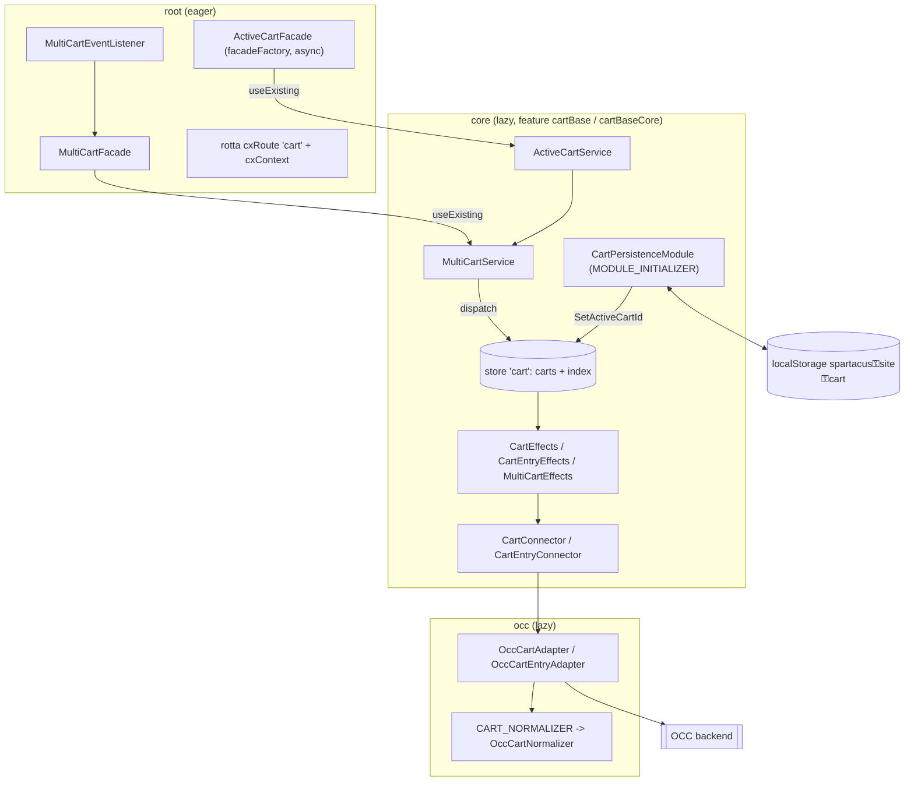
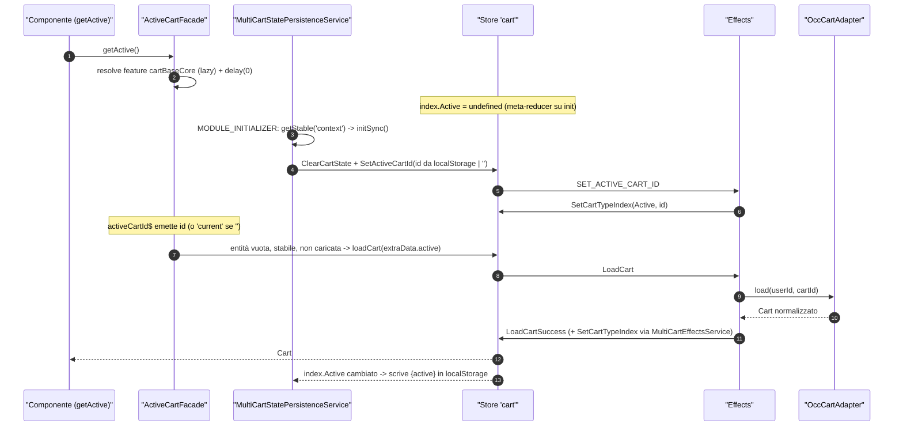
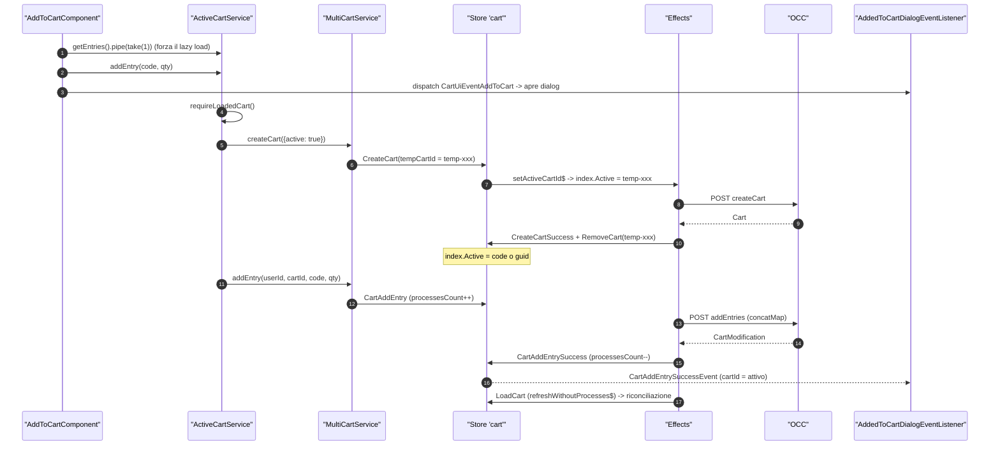
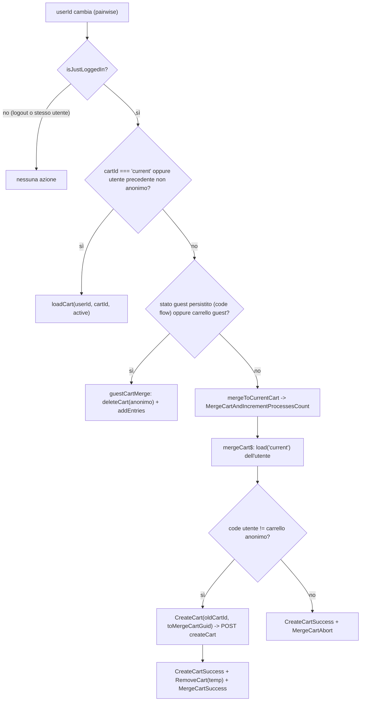

# 25 — Carrello

> Riferimenti allo SHA `5b7a1c2bf2808d7380bc20596d10f4fa710c3da1` (vedi [00-meta](../00-meta.md)).

## 1. A cosa serve e perché esiste

Il carrello è la feature più "trafficata" dello storefront: lo tocca la pagina prodotto (add to cart), l'header (mini-cart), la pagina carrello, il checkout, l'account (saved cart, wish list, quick order) e l'import/export CSV. In Spartacus vive nella libreria `@spartacus/cart`, che però **non esporta nulla dal proprio entry point principale**: tutto è esposto da *secondary entry point* — `feature-libs/cart/public_api.ts:L18-L20`:

- `@spartacus/cart/base` — il carrello vero e proprio (attivo, multi-cart, entry, voucher, validazione, guest user, access code, selective cart "save for later");
- `@spartacus/cart/saved-cart` — carrelli salvati;
- `@spartacus/cart/wish-list` — lista desideri (V1 basata su saved cart, V2 opzionale sull'API `/wishlists`);
- `@spartacus/cart/quick-order` — ordine rapido per codice prodotto;
- `@spartacus/cart/import-export` — import/export CSV di entry.

Ognuno ripete lo schema a quattro strati che il libro incontra in tutte le feature lib (capitolo [12](../parte-2/12-feature-module-lazy.md)):

| Strato | Contenuto | Caricamento |
|---|---|---|
| `root` | facade astratte, modelli, eventi, config di default, rotte, token | **eager** (nel bundle iniziale) |
| `core` | implementazioni delle facade, store NgRx, effects, connector, guard, servizi | lazy |
| `occ` | adapter OCC, endpoint, normalizer | lazy |
| `components` | componenti CMS e loro servizi | lazy |

Il problema di fondo che il codice del carrello risolve è **"quale carrello è quello attivo, e come lo identifico verso il backend"**, in presenza di:

1. utenti anonimi (il carrello si identifica con il `guid`) e loggati (con il `code`) — `feature-libs/cart/base/core/utils/utils.ts:L14-L22`;
2. creazione del carrello pigra (solo al primo add) con un id **temporaneo** lato frontend finché il backend non risponde — `feature-libs/cart/base/core/utils/utils.ts:L68-L88`;
3. persistenza dell'id del carrello anonimo tra un refresh e l'altro in `localStorage` — `feature-libs/cart/base/core/services/multi-cart-state-persistence.service.ts:L33-L62`;
4. merge del carrello anonimo con quello dell'utente al login — `feature-libs/cart/base/core/facade/active-cart.service.ts:L281-L320`;
5. più carrelli contemporaneamente nello store (attivo, wish list, selective, saved cart, carrelli appena creati) — `feature-libs/cart/base/root/models/cart.model.ts:L197-L202`;
6. caricamento lazy della libreria, che deve partire il più tardi possibile ma in tempo — `feature-libs/cart/base/root/cart-base-root.module.ts:L45-L52`.

La risposta architetturale è uno **store NgRx "multi-cart"** (entità indicizzate per id, più un indice "tipo → id") sopra cui stanno due facade: `MultiCartService` (operazioni su qualunque carrello, dato il suo id) e `ActiveCartService` (che sa qual è il carrello attivo e orchestra load/create/merge). Tutto il resto — saved cart, wish list, quick order, import — riusa queste due facade e lo stesso slice di stato.

## 2. Mappa dei file

| Path | Ruolo |
|---|---|
| `feature-libs/cart/public_api.ts` | entry principale vuoto (`export {}`) |
| `feature-libs/cart/base/cart-base.module.ts` | `CartBaseModule`: aggrega core + occ + components |
| `feature-libs/cart/base/root/cart-base-root.module.ts` | `CartBaseRootModule` (eager): rotta `cart`, `featureModules`, default config |
| `feature-libs/cart/base/root/feature-name.ts` | nomi feature `cartBase`, `cartBaseCore`, `miniCart`, `addToCart` |
| `feature-libs/cart/base/root/config/cart-config.ts` | `CartConfig` (augment di `Config`) |
| `feature-libs/cart/base/root/config/default-cart-config.ts` | default `cart.*` |
| `feature-libs/cart/base/root/config/default-cart-routing-config.ts` | rotta `cart` → `['cart']` |
| `feature-libs/cart/base/root/facade/active-cart.facade.ts` | `ActiveCartFacade` (facadeFactory, `async: true`) |
| `feature-libs/cart/base/root/facade/multi-cart.facade.ts` | `MultiCartFacade` |
| `feature-libs/cart/base/root/facade/cart-voucher.facade.ts` | `CartVoucherFacade` |
| `feature-libs/cart/base/root/facade/selective-cart.facade.ts` | `SelectiveCartFacade` |
| `feature-libs/cart/base/root/facade/cart-validation.facade.ts` | `CartValidationFacade` |
| `feature-libs/cart/base/root/facade/cart-access-code.facade.ts` | `CartAccessCodeFacade` |
| `feature-libs/cart/base/root/facade/cart-guest-user.facade.ts` | `CartGuestUserFacade` |
| `feature-libs/cart/base/root/models/cart.model.ts` | `Cart`, `OrderEntry`, `CartType`, `AbstractOrderKey`, `CartValidationStatusCode`, `PromotionLocation` |
| `feature-libs/cart/base/root/models/augmented.model.ts` | augment di `LAUNCH_CALLER` (`CLEAR_CART`, `ADDED_TO_CART`) |
| `feature-libs/cart/base/root/models/cart-outlets.model.ts` | enum `CartOutlets` |
| `feature-libs/cart/base/root/models/cart-item-context.model.ts` | `CartItemContext` astratto |
| `feature-libs/cart/base/root/tokens/converters.ts` | token `CART_NORMALIZER` & co. |
| `feature-libs/cart/base/root/events/cart.events.ts` | classi evento del carrello |
| `feature-libs/cart/base/root/events/multi-cart-event.listener.ts` | listener degli eventi "comando" `LoadCartEvent`/`RemoveCartEvent` |
| `feature-libs/cart/base/root/events/cart-base-event.module.ts` | istanzia il listener (eager) |
| `feature-libs/cart/base/root/context/order-entires.context.ts` | `ORDER_ENTRIES_CONTEXT` |
| `feature-libs/cart/base/root/utils/cart-validation.utils.ts` | parsing di `statusMessage` (min/max) |
| `feature-libs/cart/base/core/cart-base-core.module.ts` | `CartBaseCoreModule`: store, persistenza, eventi, connector, facade, error handler |
| `feature-libs/cart/base/core/cart-persistence.module.ts` | `MODULE_INITIALIZER` + meta-reducer per il ripristino da storage |
| `feature-libs/cart/base/core/facade/facade-providers.ts` | binding facade astratta → implementazione |
| `feature-libs/cart/base/core/facade/active-cart.service.ts` | `ActiveCartService` |
| `feature-libs/cart/base/core/facade/multi-cart.service.ts` | `MultiCartService` |
| `feature-libs/cart/base/core/facade/cart-validation.service.ts` | `CartValidationService` (comando) |
| `feature-libs/cart/base/core/facade/cart-voucher.service.ts` | `CartVoucherService` |
| `feature-libs/cart/base/core/facade/selective-cart.service.ts` | `SelectiveCartService` (save for later) |
| `feature-libs/cart/base/core/facade/cart-guest-user.service.ts` | `CartGuestUserService` |
| `feature-libs/cart/base/core/facade/cart-access-code.service.ts` | `CartAccessCodeService` |
| `feature-libs/cart/base/core/store/multi-cart-state.ts` | forma dello stato, `MULTI_CART_FEATURE`, `MULTI_CART_DATA` |
| `feature-libs/cart/base/core/store/multi-cart-store.module.ts` | `StoreModule.forFeature` / `EffectsModule.forFeature` |
| `feature-libs/cart/base/core/store/reducers/index.ts` | factory reducer, meta-reducer di logout |
| `feature-libs/cart/base/core/store/reducers/multi-cart.reducer.ts` | reducer indice e valori entità |
| `feature-libs/cart/base/core/store/actions/cart.action.ts` | azioni load/create/merge/delete |
| `feature-libs/cart/base/core/store/actions/cart-entry.action.ts` | azioni add/remove/update entry |
| `feature-libs/cart/base/core/store/actions/cart-voucher.action.ts` | azioni voucher |
| `feature-libs/cart/base/core/store/actions/multi-cart.action.ts` | `SetActiveCartId`, `ClearCartState`, `SetCartTypeIndex`, … |
| `feature-libs/cart/base/core/store/effects/cart.effect.ts` | `CartEffects` |
| `feature-libs/cart/base/core/store/effects/cart-entry.effect.ts` | `CartEntryEffects` |
| `feature-libs/cart/base/core/store/effects/cart-voucher.effect.ts` | `CartVoucherEffects` |
| `feature-libs/cart/base/core/store/effects/multi-cart.effect.ts` | `MultiCartEffects` (indice) |
| `feature-libs/cart/base/core/store/effects/multi-cart-effect.service.ts` | `MultiCartEffectsService` (pubblico, personalizzabile) |
| `feature-libs/cart/base/core/store/selectors/multi-cart.selector.ts` | selettori factory per cartId |
| `feature-libs/cart/base/core/services/multi-cart-state-persistence.service.ts` | sync `{active}` ↔ `localStorage` |
| `feature-libs/cart/base/core/services/active-cart-state-persistence.service.ts` | persistenza entry guest per il merge in code flow |
| `feature-libs/cart/base/core/services/cart-validation-state.service.ts` | risultati validazione tra navigazioni |
| `feature-libs/cart/base/core/services/cart-item-validation.service.ts` | messaggi min/max per riga |
| `feature-libs/cart/base/core/services/product-import-info.service.ts` | esiti add per l'import |
| `feature-libs/cart/base/core/guards/cart-validation.guard.ts` | `CartValidationGuard` |
| `feature-libs/cart/base/core/event/cart-event.builder.ts` | azioni NgRx → eventi |
| `feature-libs/cart/base/core/event/cart-page-event.builder.ts` | `CartPageEvent` |
| `feature-libs/cart/base/core/http-interceptors/handlers/bad-cart-request.handler.ts` | `BadCartRequestHandler` |
| `feature-libs/cart/base/core/http-interceptors/handlers/bad-voucher-request.handler.ts` | `BadVoucherRequestHandler` |
| `feature-libs/cart/base/core/utils/utils.ts` | `getCartIdByUserId`, `isTempCartId`, `isJustLoggedIn`, predicati di errore |
| `feature-libs/cart/base/core/connectors/cart/cart.connector.ts` | `CartConnector` |
| `feature-libs/cart/base/core/connectors/cart/cart.adapter.ts` | `CartAdapter` astratto |
| `feature-libs/cart/base/occ/cart-base-occ.module.ts` | binding adapter OCC e normalizer |
| `feature-libs/cart/base/occ/config/default-occ-cart-config-factory.ts` | endpoint OCC di default |
| `feature-libs/cart/base/occ/model/occ-cart-endpoints.model.ts` | `CartOccEndpoints` (augment `OccEndpoints`) |
| `feature-libs/cart/base/occ/adapters/occ-cart.adapter.ts` | `OccCartAdapter` |
| `feature-libs/cart/base/occ/adapters/occ-cart-entry.adapter.ts` | `OccCartEntryAdapter` |
| `feature-libs/cart/base/occ/adapters/occ-cart-voucher.adapter.ts` | `OccCartVoucherAdapter` |
| `feature-libs/cart/base/occ/adapters/occ-cart-validation.adapter.ts` | `OccCartValidationAdapter` |
| `feature-libs/cart/base/occ/adapters/converters/occ-cart-normalizer.ts` | `OccCartNormalizer` |
| `feature-libs/cart/base/occ/adapters/converters/order-entry-promotions-normalizer.ts` | `OrderEntryPromotionsNormalizer` |
| `feature-libs/cart/base/components/cart-base-components.module.ts` | aggregatore componenti, layout handler, contesto order entries |
| `feature-libs/cart/base/components/add-to-cart/add-to-cart.component.ts` | `AddToCartComponent` |
| `feature-libs/cart/base/components/added-to-cart-dialog/added-to-cart-dialog-event.listener.ts` | apertura/chiusura dialog "aggiunto al carrello" |
| `feature-libs/cart/base/components/mini-cart/mini-cart-component.service.ts` | mini-cart senza forzare il lazy load |
| `feature-libs/cart/base/components/cart-page-layout-handler.ts` | esclusione slot nella `CartPageTemplate` |
| `feature-libs/cart/base/components/page-context/active-cart-order-entries.context.ts` | `ActiveCartOrderEntriesContext` |
| `feature-libs/cart/saved-cart/root/saved-cart-root.module.ts` | rotte e feature saved cart |
| `feature-libs/cart/saved-cart/core/facade/saved-cart.service.ts` | `SavedCartService` |
| `feature-libs/cart/saved-cart/core/store/effects/saved-cart.effect.ts` | effects saved cart |
| `feature-libs/cart/saved-cart/occ/adapters/occ-saved-cart.adapter.ts` | `OccSavedCartAdapter` |
| `feature-libs/cart/wish-list/core/store/effects/wish-list.effect.ts` | effects wish list V1 |
| `feature-libs/cart/wish-list/core/facade/wish-list.service.ts` | `WishListService` (V1) |
| `feature-libs/cart/wish-list/wish-list-v2.module.ts` | `WishListV2Module` (switch a V2) |
| `feature-libs/cart/wish-list/core/facade/wish-list-v2.service.ts` | `WishListV2Service` |
| `feature-libs/cart/quick-order/root/quick-order-root.module.ts` | rotta e feature quick order |
| `feature-libs/cart/quick-order/core/services/quick-order.service.ts` | `QuickOrderService` (lista in memoria) |
| `feature-libs/cart/import-export/core/config/default-import-export-config.ts` | default import/export |
| `feature-libs/cart/import-export/components/import-to-cart/import-entries-dialog/import-entries-dialog.component.ts` | dialog di import |
| `feature-libs/cart/schematics/add-cart/index.ts` | schematic `ng add` |
| `projects/storefrontapp/src/app/spartacus/features/cart/cart-base-feature.module.ts` | configurazione lazy nell'app demo |

## 3. Come funziona passo per passo

### 3.1 Moduli e lazy loading

`CartBaseModule` è il modulo che l'app carica in lazy: importa `CartBaseCoreModule`, `CartBaseOccModule` e `CartBaseComponentsModule` — `feature-libs/cart/base/cart-base.module.ts:L7-L15`. Nell'app demo `CartBaseFeatureModule` importa il root module e configura tre feature lazy: `cartBase` → `CartBaseWrapperModule` (import dinamico), `miniCart` → `@spartacus/cart/base/components/mini-cart`, `addToCart` → `@spartacus/cart/base/components/add-to-cart` — `projects/storefrontapp/src/app/spartacus/features/cart/cart-base-feature.module.ts:L23-L55`.

I nomi delle feature sono quattro: `cartBase`, `cartBaseCore`, `miniCart`, `addToCart` — `feature-libs/cart/base/root/feature-name.ts:L7-L11`. La config `defaultCartComponentsConfig` assegna sei CMS component a `cartBase`, `MiniCartComponent` a `miniCart`, `ProductAddToCartComponent` a `addToCart`, e — dettaglio importante — dichiara `cartBaseCore` come **alias** stringa di `cartBase` — `feature-libs/cart/base/root/cart-base-root.module.ts:L26-L57`. Il commento spiega il perché: il core del carrello deve restare nello stesso chunk dei componenti, per ritardare il caricamento della libreria finché davvero serve — `feature-libs/cart/base/root/cart-base-root.module.ts:L45-L52`. Mini-cart e add-to-cart sono invece entry secondari separati, così l'header e la PDP possono renderizzare senza scaricare subito il core (vedi §3.14).

Il root module, eager, fa tre cose — `feature-libs/cart/base/root/cart-base-root.module.ts:L59-L83`:

1. importa `CartBaseEventModule`, che istanzia `MultiCartEventListener` (§3.10) — `feature-libs/cart/base/root/events/cart-base-event.module.ts:L10-L15`;
2. registra la rotta CMS con `cxRoute: 'cart'`, `CmsPageGuard`, `PageLayoutComponent` e un `cxContext` che associa `ORDER_ENTRIES_CONTEXT` al token `ActiveCartOrderEntriesContextToken`;
3. fornisce i default config (componenti, `cart.*`, routing). Il path di default della rotta `cart` è `cart` — `feature-libs/cart/base/root/config/default-cart-routing-config.ts:L9-L15`.

`CartBaseCoreModule` (lazy) importa `CartEventModule`, `MultiCartStoreModule`, `CartPersistenceModule`, `CartPageEventModule`, fornisce i sei connector, i `facadeProviders` e due `HttpErrorHandler` multi (`BadCartRequestHandler`, `BadVoucherRequestHandler`) — `feature-libs/cart/base/core/cart-base-core.module.ts:L22-L49`. `CartBaseOccModule` registra gli endpoint di default, lega i sei adapter astratti alle implementazioni `Occ…` con `useClass` e registra due normalizer multi (`CART_NORMALIZER → OccCartNormalizer`, `ORDER_ENTRY_PROMOTIONS_NORMALIZER → OrderEntryPromotionsNormalizer`) — `feature-libs/cart/base/occ/cart-base-occ.module.ts:L32-L72`. `CartBaseComponentsModule` registra `CartPageLayoutHandler` come `PAGE_LAYOUT_HANDLER` e lega `ActiveCartOrderEntriesContextToken` a `ActiveCartOrderEntriesContext` — `feature-libs/cart/base/components/cart-base-components.module.ts:L41-L51`.

### 3.2 Facade nel root, implementazioni nel core

Ogni facade del root è una classe astratta `providedIn: 'root'` con `useFactory: facadeFactory(...)`. `ActiveCartFacade` dichiara la feature `cartBaseCore`, 22 metodi proxy e `async: true` — `feature-libs/cart/base/root/facade/active-cart.facade.ts:L13-L46`. Quando un componente eager chiama un metodo della facade, `facadeFactory` risolve la feature (scaricando il chunk) e inoltra la chiamata all'istanza nel modulo lazy; con `async: true` aggiunge un `delay(0)` dopo aver ottenuto l'istanza, "required to make lazy NgRx store feature ready" — `core-libs/core/src/lazy-loading/facade-factory/facade-factory.service.ts:L49-L56`, `core-libs/core/src/lazy-loading/facade-factory/facade-descriptor.ts:L32-L36`. Il meccanismo generale è descritto nel capitolo [20](../parte-2/20-facade-command-query-eventi.md).

Lo stesso schema vale per `MultiCartFacade` (19 metodi, `async: true`) — `feature-libs/cart/base/root/facade/multi-cart.facade.ts:L13-L43`; `CartVoucherFacade` e `SelectiveCartFacade` usano `async: true`, mentre `CartAccessCodeFacade`, `CartGuestUserFacade` e `CartValidationFacade` no — `feature-libs/cart/base/root/facade/cart-voucher.facade.ts:L12-L28`, `feature-libs/cart/base/root/facade/selective-cart.facade.ts:L13-L30`, `feature-libs/cart/base/root/facade/cart-access-code.facade.ts:L12-L20`, `feature-libs/cart/base/root/facade/cart-guest-user.facade.ts:L13-L21`, `feature-libs/cart/base/root/facade/cart-validation.facade.ts:L13-L21`. La differenza è sensata: le ultime tre sono basate su `CommandService`/connector e non su store NgRx (§3.12).

Nel core, `facadeProviders` lega ogni facade astratta all'implementazione con `useExisting` (es. `ActiveCartFacade → ActiveCartService`) — `feature-libs/cart/base/core/facade/facade-providers.ts:L25-L61`. Nota che `MultiCartFacade.removeCart` rimuove il carrello solo dallo stato; per cancellarlo anche sul backend serve `deleteCart` — `feature-libs/cart/base/root/facade/multi-cart.facade.ts:L223-L239`.

### 3.3 Modello dati

`Cart` è un'interfaccia con soli campi opzionali (`code`, `guid`, `entries`, `user`, `saveTime`, `totalItems`, `quoteCode`, …) — `feature-libs/cart/base/root/models/cart.model.ts:L62-L105`. Due campi governano gran parte della logica:

- `code` vs `guid`: per l'utente anonimo l'id da usare nelle API è il `guid`, altrimenti il `code` — `feature-libs/cart/base/core/utils/utils.ts:L14-L22`;
- `saveTime`: se presente, il carrello è un saved cart e **non** può essere il carrello attivo — `feature-libs/cart/base/core/store/effects/multi-cart-effect.service.ts:L18-L34`, `feature-libs/cart/base/occ/adapters/occ-cart.adapter.ts:L46-L50`.

`CartType` elenca i tipi indicizzati nello store: `Active`, `WishList`, `Selective`, `NewCreated` — `feature-libs/cart/base/root/models/cart.model.ts:L197-L202`. `AbstractOrderKey` modella cart/order/quote/saved cart; per il tipo cart non c'è `id` perché esiste un solo carrello attivo ("current") — `feature-libs/cart/base/root/models/cart.model.ts:L124-L150`. Altri enum: `CartValidationStatusCode` (`noStock`, `lowStock`, …, `below_min_quantity`, `exceed_max_quantity`) — `feature-libs/cart/base/root/models/cart.model.ts:L208-L216`; `PromotionLocation` — `feature-libs/cart/base/root/models/cart.model.ts:L25-L31`.

Il modello estende anche tipi di altre librerie per *module augmentation*: `LAUNCH_CALLER` di storefront riceve `CLEAR_CART` e `ADDED_TO_CART` (con assegnazione esplicita del valore a runtime, perché un enum aumentato non genera codice) — `feature-libs/cart/base/root/models/augmented.model.ts:L7-L16`; `Config` di core riceve `CartConfig` — `feature-libs/cart/base/root/config/cart-config.ts:L12-L32`.

### 3.4 Lo store multi-cart

La feature NgRx si chiama `cart`. Lo stato ha due rami — `feature-libs/cart/base/core/store/multi-cart-state.ts:L10-L27`:

- `carts`: un `EntityProcessesLoaderState<Cart | undefined>`, cioè una mappa id → `{ value, loading, success, error, processesCount }` (le utility `StateUtils` sono descritte nel capitolo [19](../parte-2/19-state-management.md)); entity type `'[Multi Cart] Multi Cart Data'`;
- `index`: una mappa `CartType → cartId`.

`MultiCartStoreModule` registra `StoreModule.forFeature('cart', multiCartReducerToken, { metaReducers })` e `EffectsModule.forFeature(effects)` — `feature-libs/cart/base/core/store/multi-cart-store.module.ts:L21-L32`. La factory del reducer legge il toggle `enableCartSlowNetworkResilience` con `inject(FeatureToggles)` dentro `try/catch` (fallback `false`) e compone `carts` con `entityProcessesLoaderReducer(MULTI_CART_DATA, createCartEntitiesReducer(enabled))` e `index` con `cartTypeIndexReducer` — `feature-libs/cart/base/core/store/reducers/index.ts:L34-L53`. Il meta-reducer `clearMultiCartState` azzera l'intero slice su `AuthActions.LOGOUT` — `feature-libs/cart/base/core/store/reducers/index.ts:L17-L28`.

**Reducer dell'indice** — `feature-libs/cart/base/core/store/reducers/multi-cart.reducer.ts:L11-L40`: stato iniziale `{ Active: '' }`; `SET_CART_TYPE_INDEX` scrive l'id per tipo; `REMOVE_CART` e `DELETE_CART_SUCCESS` riportano `Active` a `''` se riguardano il carrello attivo; `CLEAR_CART_STATE` ripristina lo stato iniziale. Il valore `''` ha un significato preciso: "nessun id particolare, usa `current`" (§3.7).

**Reducer dei valori** — `feature-libs/cart/base/core/store/reducers/multi-cart.reducer.ts:L79-L87`: sostituisce il valore con `payload.cart` su `LOAD_CART_SUCCESS`, `CREATE_CART_SUCCESS`, `SET_CART_DATA`, e con `payload` su `LOAD_CARTS_SUCCESS`. Solo con il toggle attivo, `CART_ADD_ENTRY_SUCCESS` fonde l'entry restituita dal POST nel carrello (sostituendo per `entryNumber` o appendendo), così la UI la mostra prima del `LoadCart` di riconciliazione (CXSPA-10582) — `feature-libs/cart/base/core/store/reducers/multi-cart.reducer.ts:L42-L65`, `feature-libs/cart/base/core/store/reducers/multi-cart.reducer.ts:L88-L91`.

**Processi**. Il concetto chiave per capire il carrello è `processesCount`. Le azioni di entry (`CartAddEntry`, `CartRemoveEntry`, `CartUpdateEntry`) estendono `EntityProcessesIncrementAction`, i relativi Success/Fail estendono `EntityProcessesDecrementAction` sullo stesso `cartId` — `feature-libs/cart/base/core/store/actions/cart-entry.action.ts:L22-L176`. Un carrello è "stabile" quando `!processesCount && !loading`, ha "pending processes" quando `processesCount > 0` — `core-libs/core/src/state/utils/processes-loader/processes-loader.selectors.ts:L9-L17`. Altre azioni rilevanti:

- `CreateCart` è un `EntityLoadAction` sulla chiave `tempCartId` (il vero id non è ancora noto), `CreateCartSuccess` un `EntitySuccessAction` sul `cartId` reale — `feature-libs/cart/base/core/store/actions/cart.action.ts:L39-L83`;
- `MergeCart` è deprecato a favore di `MergeCartAndIncrementProcessesCount`, che usa lo stesso type ma incrementa i processi per marcare il carrello come occupato — `feature-libs/cart/base/core/store/actions/cart.action.ts:L181-L200`; `MergeCartAbort` li decrementa se il merge non avviene — `feature-libs/cart/base/core/store/actions/cart.action.ts:L222-L236`;
- `ResetCartDetails` azzera valori e flag di tutte le entità mantenendone l'elenco; `ResetCartDetailsByIds` solo per alcuni id — `feature-libs/cart/base/core/store/actions/cart.action.ts:L238-L257`;
- `DeleteCart`/`DeleteCartFail` sono `Action` semplici, `DeleteCartSuccess` è `EntityRemoveAction` — `feature-libs/cart/base/core/store/actions/cart.action.ts:L270-L288`;
- `SetActiveCartId` imposta solo l'id attivo ("then services take care of loading that cart"), `ClearCartState` è un `EntityRemoveAllAction`, `SetCartData` un `EntitySuccessAction` — `feature-libs/cart/base/core/store/actions/multi-cart.action.ts:L44-L74`;
- i voucher sono un'eccezione: `CartAddVoucher`/`Success`/`Fail` agiscono sull'entità `addVoucher` del **process store** (`PROCESS_FEATURE`), non sul carrello; `CartRemoveVoucher` invece incrementa i processi del carrello — `feature-libs/cart/base/core/store/actions/cart-voucher.action.ts:L22-L81`.

Le azioni sono esposte nel namespace `CartActions` — `feature-libs/cart/base/core/store/actions/index.ts:L7-L8` — e i selettori nel namespace `MultiCartSelectors` (factory per cartId: entity, value, isStable, hasPendingProcesses, entries, entry; più `getCartIdByTypeFactory`) — `feature-libs/cart/base/core/store/selectors/index.ts:L7-L8`, `feature-libs/cart/base/core/store/selectors/multi-cart.selector.ts:L30-L118`. `getCartEntriesSelectorFactory` restituisce `[]` se il carrello o le entry mancano; `getCartEntrySelectorFactory` restituisce la prima entry con quel product code — `feature-libs/cart/base/core/store/selectors/multi-cart.selector.ts:L73-L91`.

### 3.5 Gli effects

Gli effects registrati sono `CartEntryEffects`, `CartVoucherEffects`, `CartEffects`, `MultiCartEffects` — `feature-libs/cart/base/core/store/effects/index.ts:L12-L17`.

**`loadCart$`** è il più sofisticato — `feature-libs/cart/base/core/store/effects/cart.effect.ts:L63-L84`: raggruppa i `LoadCart` per `cartId` (`groupBy`), così carrelli diversi si caricano in parallelo; dentro ogni gruppo **scarta** i `LoadCart` mentre il carrello ha processi pendenti (un GET concorrente a POST ancora in volo restituirebbe uno stato vecchio) e usa `switchMap` per annullare un caricamento precedente dello stesso carrello. In successo emette `LoadCartSuccess` con `cartId` ricalcolato da `getCartIdByUserId` e, se si era chiesto `current`, anche `RemoveCart({ cartId: 'current' })`, perché il carrello vive ormai sotto il suo id reale; se il connector restituisce `undefined` emette `LoadCartFail` con `error: {}` — `feature-libs/cart/base/core/store/effects/cart.effect.ts:L85-L113`. In errore `handleLoadCartError` distingue tre casi: errori con `reason === 'invalid'` (coupon scaduto) → nuovo `LoadCart`; "cart not found" o `UnknownResourceError` → `RemoveCart`; altrimenti `LoadCartFail` con errore normalizzato — `feature-libs/cart/base/core/store/effects/cart.effect.ts:L124-L149`.

**`createCart$`** chiama `cartConnector.create(userId, oldCartId, toMergeCartGuid)` ed emette `CreateCartSuccess`, `RemoveCart(tempCartId)` e, se c'era `oldCartId`, `MergeCartSuccess` — `feature-libs/cart/base/core/store/effects/cart.effect.ts:L151-L199`.

**`mergeCart$`** carica il carrello `current` dell'utente appena loggato: se il suo `code` è diverso dal carrello anonimo dispatcha `CreateCart` con `oldCartId` = carrello anonimo e `toMergeCartGuid` = guid del carrello utente (il merge vero lo fa il backend); se coincidono emette `CreateCartSuccess` + `MergeCartAbort`; in errore `MergeCartAbort` + `RemoveCart` — `feature-libs/cart/base/core/store/effects/cart.effect.ts:L201-L263`.

**Riconciliazione dopo le mutazioni**. `refresh$` su `CART_ADD_VOUCHER_SUCCESS` emette `CartProcessesDecrement` e `LoadCart` — `feature-libs/cart/base/core/store/effects/cart.effect.ts:L265-L282`. `refreshWithoutProcesses$` reagisce ai Success di add/remove/update entry e remove voucher: con `enableCartSlowNetworkResilience` attende che i processi del carrello scendano a 0 e poi emette **un solo** `LoadCart`; senza toggle emette `LoadCart` subito per ogni success (che però `loadCart$` scarterà finché ci sono processi pendenti) — `feature-libs/cart/base/core/store/effects/cart.effect.ts:L304-L349`.

**Cambio contesto**. Su `CURRENCY_CHANGE`/`LANGUAGE_CHANGE` (prezzi e nomi cambiano): senza `enableCartReloadOnContextChange` emette `ResetCartDetails`; con il toggle emette `ResetCartDetailsByIds` per i carrelli non attivi e `LoadCart` del carrello attivo con `userId: 'current'` — `feature-libs/cart/base/core/store/effects/cart.effect.ts:L351-L393`. Inoltre `loadCart$`, `createCart$`, `mergeCart$`, `addEmail$` e gli effects di entry sono avvolti in `withdrawOn(contextChange$)`, che risottoscrive la sorgente abbandonando le trasformazioni in corso a ogni cambio — `feature-libs/cart/base/core/store/effects/cart.effect.ts:L120-L120`, `core-libs/core/src/util/rxjs/withdraw-on.ts:L10-L27`. Il site context è trattato nel capitolo [13](../parte-2/13-site-context-theme.md).

Altri effects di `CartEffects`: `addEmail$` emette sempre anche `LoadCart` (in successo e in errore) — `feature-libs/cart/base/core/store/effects/cart.effect.ts:L395-L434`; `deleteCart$` in errore emette `DeleteCartFail` + `LoadCart`, perché il carrello potrebbe essere stato rimosso comunque e, se il load fallisce con NotFound, interverrà `RemoveCart` — `feature-libs/cart/base/core/store/effects/cart.effect.ts:L449-L460`.

**`CartEntryEffects`** usa `concatMap` per add/remove/update, cioè **serializza** le chiamate HTTP, e in errore emette `*Fail` + `LoadCart` — `feature-libs/cart/base/core/store/effects/cart-entry.effect.ts:L37-L78`. `CartAddEntrySuccess` spalma payload e `CartModification` del backend (`deliveryModeChanged`, `entry`, `quantityAdded`, `statusCode`, `statusMessage`) — `feature-libs/cart/base/core/store/effects/cart-entry.effect.ts:L55-L61`, `feature-libs/cart/base/core/store/actions/cart-entry.action.ts:L38-L57`. `removeEntry$` mostra il messaggio `cartItems.itemRemoved` tramite un `GlobalMessageService` iniettato `optional` — `feature-libs/cart/base/core/store/effects/cart-entry.effect.ts:L33-L35`, `feature-libs/cart/base/core/store/effects/cart-entry.effect.ts:L92-L99`.

**`CartVoucherEffects`** mostra `voucher.applyVoucherSuccess` / `voucher.removeVoucherSuccess`; in errore di add emette `CartAddVoucherFail`, `CartProcessesDecrement` e `LoadCart` — `feature-libs/cart/base/core/store/effects/cart-voucher.effect.ts:L30-L109`. Il corrispondente incremento lo fa `MultiCartEffects.processesIncrement$` su `CART_ADD_VOUCHER`, perché `CartAddVoucher` agisce sul process store — `feature-libs/cart/base/core/store/effects/multi-cart.effect.ts:L20-L29`.

**`MultiCartEffects`** mantiene l'indice. `setSelectiveId$` indicizza come `Selective` un carrello il cui id inizia con `selectivecart` — `feature-libs/cart/base/core/store/effects/multi-cart.effect.ts:L31-L50`. `setActiveCartId$` aggiorna `Active` — `feature-libs/cart/base/core/store/effects/multi-cart.effect.ts:L52-L138`:

| Azione | Nuovo valore di `index.Active` |
|---|---|
| `LOAD_CART` con `cartId === 'current'` | `''` |
| `LOAD_CART_SUCCESS` con `extraData.active` | `''` se il carrello ha `saveTime`, altrimenti `meta.entityId` (via `MultiCartEffectsService`) |
| `CREATE_CART` con `extraData.active` | id temporaneo (`meta.entityId`) |
| `CREATE_CART_SUCCESS` | `meta.entityId` sotto `Active` se `extraData.active`, altrimenti sotto `NewCreated` |
| `SET_ACTIVE_CART_ID` | il payload |

La logica su `LOAD_CART_SUCCESS` è stata estratta in `MultiCartEffectsService`, pubblico, proprio per permettere la personalizzazione (CXSPA-3551) — `feature-libs/cart/base/core/store/effects/multi-cart.effect.ts:L115-L121`, `feature-libs/cart/base/core/store/effects/multi-cart-effect.service.ts:L18-L34`.

### 3.6 `MultiCartService`

`MultiCartService` è un `@Injectable()` senza `providedIn` (lo fornisce `facadeProviders`) che opera direttamente sullo `Store<StateWithMultiCart>` — `feature-libs/cart/base/core/facade/multi-cart.service.ts:L33-L40`. Punti salienti:

- `isStable(cartId)` applica un `debounce` **asimmetrico**: il passaggio a `true` è ritardato di un tick (`timer(0)`), quello a `false` è immediato, per evitare flicker quando molte azioni seguono la fine di un processo — `feature-libs/cart/base/core/facade/multi-cart.service.ts:L79-L89`;
- l'id temporaneo è `temp-<uuid>`, generato con `crypto.getRandomValues` su `nativeWindow`; il commento avverte che in SSR non funziona — `feature-libs/cart/base/core/facade/multi-cart.service.ts:L94-L100`;
- `createCart` dispatcha `CreateCart` con un nuovo `tempCartId` e restituisce il carrello indicizzato come `Active` o `NewCreated` secondo `extraData.active` — `feature-libs/cart/base/core/facade/multi-cart.service.ts:L107-L139`;
- `mergeToCurrentCart` dispatcha `MergeCartAndIncrementProcessesCount` con un nuovo `tempCartId` — `feature-libs/cart/base/core/facade/multi-cart.service.ts:L146-L166`;
- `addEntries` dispatcha un `CartAddEntry` per prodotto, nessuna chiamata bulk — `feature-libs/cart/base/core/facade/multi-cart.service.ts:L260-L275`;
- `updateEntry` con `quantity <= 0` delega a `removeEntry`; l'`entryNumber` viene convertito in stringa nelle azioni — `feature-libs/cart/base/core/facade/multi-cart.service.ts:L304-L326`;
- `reloadCart` usa `userIdService.takeUserId()` e dispatcha `LoadCart` — `feature-libs/cart/base/core/facade/multi-cart.service.ts:L387-L397`.

Il JSDoc di `isTempCartId` riassume il ciclo di vita del carrello temporaneo: è un'entità solo frontend, rappresentata dai flag di creazione, rimossa al tick successivo alla risposta — `feature-libs/cart/base/core/utils/utils.ts:L68-L88`.

### 3.7 `ActiveCartService`: il carrello attivo

`ActiveCartService` è il cervello della feature. Il suo stato derivato parte da `activeCartId$` — `feature-libs/cart/base/core/facade/active-cart.service.ts:L58-L68`:

1. attende il primo userId con `take(1)` (non vuole reagire ai cambi utente, gestiti altrove);
2. legge l'id indicizzato `Active` tramite `getCartIdByType`;
3. filtra `undefined`, che significa "non ho ancora ripristinato l'id dallo storage" (§3.8);
4. mappa `''` su `'current'`.

Il costruttore chiama `initActiveCart()`, `detectUserChange()` e, se sono attivi sia `authorizationCodeFlowByDefault` sia `mergeGuestCartOnCodeFlowLogin`, `persistGuestCartForCodeFlowMerge()` — `feature-libs/cart/base/core/facade/active-cart.service.ts:L79-L92`.

**Lettura e caricamento automatico** (`initActiveCart`). Lo stream `cartValue$` emette il carrello solo se stabile **o vuoto**: il commento descrive la sequenza `old_cart -> {} -> new_cart` durante il merge, in cui nessuno deve usare il vecchio id ormai obsoleto — `feature-libs/cart/base/core/facade/active-cart.service.ts:L96-L110`. Uno stream di side-effect `loading` chiama `load()` quando il carrello è stabile, vuoto, non ancora caricato, l'id non è temporaneo e `shouldLoadCartOnCodeFlow` è vero — `feature-libs/cart/base/core/facade/active-cart.service.ts:L112-L126`. `activeCart$` lega i due con `using()` (il side-effect vive esattamente quanto la sottoscrizione al valore), normalizza a `{}`, applica `distinctUntilChanged` e `shareReplay({ bufferSize: 1, refCount: true })` — `feature-libs/cart/base/core/facade/active-cart.service.ts:L128-L136`. Conseguenza pratica: **è sottoscrivere `getActive()` a far caricare il carrello**. `load()` non carica mai nel caso anonimo + `current` (non esiste un carrello "corrente" lato server per un anonimo) e marca sempre `extraData.active: true` — `feature-libs/cart/base/core/facade/active-cart.service.ts:L262-L275`.

**Id per le API e attese**. `getActiveCartId()` deriva l'id dal carrello attivo (`guid` per l'anonimo, `code` altrimenti) — `feature-libs/cart/base/core/facade/active-cart.service.ts:L197-L203`. `takeActive()`/`takeActiveCartId()` attendono `isStable()` e restituiscono un solo valore — `feature-libs/cart/base/core/facade/active-cart.service.ts:L185-L215`. `getPickupEntries`/`getDeliveryEntries` distinguono le entry per presenza di `deliveryPointOfService` — `feature-libs/cart/base/core/facade/active-cart.service.ts:L718-L732`.

**Mutazioni**. `addEntry` passa per `requireLoadedCart()` (che crea il carrello se serve), mentre `removeEntry`, `updateEntry`, `addEmail` usano direttamente `activeCartId$` con `take(1)` — `feature-libs/cart/base/core/facade/active-cart.service.ts:L548-L630`.

**`requireLoadedCart()`**. Con il toggle `enableCartSlowNetworkResilience` spento ricostruisce la pipeline a ogni chiamata (comportamento "pre-CXSPA-10582"); con il toggle acceso (e non in guest merge) memorizza in `loadedCart$` un observable condiviso con `shareReplay`, così più `addEntry` rapidi non creano più carrelli in parallelo; la cache si azzera dopo l'emissione o su `finalize` — `feature-libs/cart/base/core/facade/active-cart.service.ts:L413-L461`. La pipeline vera — `feature-libs/cart/base/core/facade/active-cart.service.ts:L482-L538`:

1. evita load/create se c'è già una creazione in corso (`isCartCreating`);
2. per un utente loggato con carrello vuoto prova a caricare `current` ("might have been created on another device");
3. attende un esito (successo o errore per i loggati; subito per l'anonimo);
4. se il carrello è ancora vuoto chiama `createCart({ active: true })`;
5. attende che l'id attivo punti al codice/guid reale e non più al temporaneo, poi emette il carrello.

`isCartCreating` è vero per un id `temp-` con almeno un flag di loading/success/error; tutti i flag falsi indicano un id temporaneo "sbagliato", ripristinato per esempio da un reload a metà creazione — `feature-libs/cart/base/core/facade/active-cart.service.ts:L390-L401`.

**Cambio utente e merge**. `detectUserChange` usa `pairwise()` sullo userId, quindi non scatta mai al bootstrap, e se `isJustLoggedIn` chiama `loadOrMerge` — `feature-libs/cart/base/core/facade/active-cart.service.ts:L139-L156`. `isJustLoggedIn` è vero se l'utente non è `anonymous` ed è diverso dal precedente (login o inizio emulazione ASM) — `feature-libs/cart/base/core/utils/utils.ts:L108-L119`. `loadOrMerge` — `feature-libs/cart/base/core/facade/active-cart.service.ts:L281-L320`:

- se l'id è `current` o l'utente precedente non era anonimo (es. passaggio a ASM) → `loadCart` del carrello dell'utente;
- se c'è uno stato guest persistito (toggle code flow) o il carrello è di un guest → `guestCartMerge`;
- altrimenti → `mergeToCurrentCart`.

`guestCartMerge`, marcato "TODO: Remove once backend is updated", cancella il carrello guest con userId anonimo e ri-aggiunge le sue entry al carrello utente; nel code flow usa le entry persistite e poi le cancella dallo storage — `feature-libs/cart/base/core/facade/active-cart.service.ts:L322-L348`. Un carrello è "guest" se `user.name === 'guest'` o se la parte di `uid` dopo il primo `|` è un'email — `feature-libs/cart/base/core/facade/active-cart.service.ts:L652-L659`.

**Code flow OAuth**. Con l'Authorization Code flow l'app viene ri-bootstrappata dopo il login, quindi `pairwise()` non vede alcuna transizione. Se in `localStorage` è presente la chiave `oAuthRedirectCodeFlow`, il servizio disattiva il caricamento automatico, al primo userId esegue `loadOrMerge(cartId, userId, 'anonymous')` e rimuove la chiave — `feature-libs/cart/base/core/facade/active-cart.service.ts:L158-L172`, `feature-libs/cart/base/core/facade/active-cart.service.ts:L403-L408`, `core-libs/core/src/auth/user-auth/utils/oauth-constants.ts:L7-L7`. Il flusso di autenticazione è nel capitolo [22](../parte-2/22-auth.md).

### 3.8 Persistenza del carrello attivo

`CartPersistenceModule` registra un `MODULE_INITIALIZER` che, quando il contesto è stabile (`getStable('context')`), avvia `MultiCartStatePersistenceService.initSync()`, e un `META_REDUCERS` multi — `feature-libs/cart/base/core/cart-persistence.module.ts:L19-L74`. `MODULE_INITIALIZER` è "un `APP_INITIALIZER` per moduli lazy" (se il modulo è eager si comporta come `APP_INITIALIZER`); i lazy initializer li esegue `LazyModulesService.runModuleInitializersForModule` — `core-libs/core/src/lazy-loading/tokens.ts:L12-L20`, `core-libs/core/src/lazy-loading/lazy-modules.service.ts:L142-L157`.

Il meta-reducer `uninitializeActiveCartMetaReducerFactory` su `@ngrx/store/init` imposta `index.Active = undefined`, così `ActiveCartService` non usa `current` prima che l'id sia ripristinato (ricorda il filtro su `undefined` di `activeCartId$`) — `feature-libs/cart/base/core/cart-persistence.module.ts:L33-L52`. Vedi però la trappola in §9 sul caso lazy.

`initSync` sincronizza in `localStorage`, sotto chiave `cart` e con contesto il base site, solo `{ active: index.Active ?? '' }` — `feature-libs/cart/base/core/services/multi-cart-state-persistence.service.ts:L33-L62`. La chiave effettiva è `spartacus⚿<baseSite>⚿cart` — `core-libs/core/src/state/services/state-persistence.service.ts:L24-L30`. `getCartState` scarta le prime emissioni dello store in cui lo slice `cart` non esiste ancora (modulo lazy) — `feature-libs/cart/base/core/services/multi-cart-state-persistence.service.ts:L48-L51`. In lettura (anche a ogni cambio di base site) `onRead` dispatcha `ClearCartState` e poi `SetActiveCartId(state.active)` oppure `SetActiveCartId('')` — `feature-libs/cart/base/core/services/multi-cart-state-persistence.service.ts:L64-L71`.

Si persiste **solo l'id**, mai il contenuto: dopo un refresh il carrello si ricarica dal backend tramite il meccanismo di §3.7.

Per il merge guest in code flow, `ActiveCartStatePersistenceService` persiste in `localStorage` (chiave `pendingGuestCartMerge`) le entry del carrello guest ridotte a `{ product: { code }, quantity }`; `clearGuestCartState` rimuove la chiave ricostruendola a mano come `spartacus⚿<ctx>⚿<key>` — `feature-libs/cart/base/core/services/active-cart-state-persistence.service.ts:L29-L109`. Il meccanismo generico `StatePersistenceService` è descritto nel capitolo [19](../parte-2/19-state-management.md).

### 3.9 Connector, adapter, OCC

Lo schema connector/adapter (capitolo [21](../parte-2/21-occ.md)): `CartConnector` (`providedIn: 'root'`) delega ogni metodo al `CartAdapter` astratto (`loadAll`, `load`, `create`, `delete`, `save`, `addEmail`) — `feature-libs/cart/base/core/connectors/cart/cart.connector.ts:L12-L54`, `feature-libs/cart/base/core/connectors/cart/cart.adapter.ts:L10-L69`. `CartAccessCodeConnector` e `CartGuestUserConnector` sono invece `@Injectable()` senza `providedIn` e usano `inject()` — `feature-libs/cart/base/core/connectors/access-code/cart-access-code.connector.ts:L11-L13`, `feature-libs/cart/base/core/connectors/guest-user/cart-guest-user.connector.ts:L12-L14`.

Gli endpoint OCC di default sono `carts`, `cart`, `createCart`, `addEntries`, `updateEntries`, `removeEntries`, `addEmail`, `deleteCart`, `cartVoucher`, `cartApplyVoucher`, `cartRemoveVoucher`, `saveCart`, `validate`, `cartAccessCode`, `cartGuestUser` — `feature-libs/cart/base/occ/config/default-occ-cart-config-factory.ts:L9-L39`; `CartOccEndpoints` augmenta `OccEndpoints` di core con chiavi `string | OccEndpoint` — `feature-libs/cart/base/occ/model/occ-cart-endpoints.model.ts:L9-L99`.

**`OccCartAdapter`**:

- `load` per `cartId === 'current'` scarica **tutti** i carrelli (`loadAll`) e prende il primo senza `saveTime`; altrimenti usa l'endpoint `cart`; entrambi passano per `CART_NORMALIZER` — `feature-libs/cart/base/occ/adapters/occ-cart.adapter.ts:L35-L60`;
- `create` fa POST di `{}` su `createCart` con query param opzionali `oldCartId` e `toMergeCartGuid` — `feature-libs/cart/base/occ/adapters/occ-cart.adapter.ts:L62-L87`;
- `delete` aggiunge l'header `USE_CLIENT_TOKEN` solo per l'anonimo; `addEmail` lo aggiunge sempre e invia `email` form-urlencoded con PUT — `feature-libs/cart/base/occ/adapters/occ-cart.adapter.ts:L89-L145`;
- `save` fa PATCH su `saveCart` con `saveCartName`/`saveCartDescription` ed estrae `savedCartData` dalla risposta prima della normalizzazione — `feature-libs/cart/base/occ/adapters/occ-cart.adapter.ts:L102-L127`.

**`OccCartEntryAdapter`**: `add` passa `quantity` come url param e, se l'URL generato contiene `quantity=<n>` (caso B2B), usa form-urlencoded con `code` in query; altrimenti POST JSON `{ quantity, product: { code }, deliveryPointOfService? }` — `feature-libs/cart/base/occ/adapters/occ-cart-entry.adapter.ts:L25-L64`. `update` usa PUT `{ quantity }` per passare da ritiro in negozio a consegna, altrimenti PATCH; `remove` è un DELETE — `feature-libs/cart/base/occ/adapters/occ-cart-entry.adapter.ts:L86-L125`.

**`OccCartVoucherAdapter`**: `add` usa `POST applyVoucher` con body `{ voucherId }` se `enableApplyVoucherEndpoint`, altrimenti `POST vouchers?voucherId=`; `remove` usa `POST removeVoucher` se `enableRemoveVoucherEndpoint`, altrimenti `DELETE vouchers/<id>` — `feature-libs/cart/base/occ/adapters/occ-cart-voucher.adapter.ts:L71-L124`. Usa `USE_CLIENT_TOKEN` per l'anonimo e rilancia l'errore normalizzato con `tryNormalizeHttpError` — `feature-libs/cart/base/occ/adapters/occ-cart-voucher.adapter.ts:L59-L69`, `feature-libs/cart/base/occ/adapters/occ-cart-voucher.adapter.ts:L77-L82`.

**Altri adapter**: `OccCartValidationAdapter.validate` fa POST con body `null` e normalizza con `CART_VALIDATION_NORMALIZER` — `feature-libs/cart/base/occ/adapters/occ-cart-validation.adapter.ts:L33-L44`; `OccCartAccessCodeAdapter` e `OccCartGuestUserAdapter` applicano `backOff({ shouldRetry: isServerError, maxTries: 2 })`, e il guest user adapter usa sempre `USE_CLIENT_TOKEN` — `feature-libs/cart/base/occ/adapters/occ-cart-access-code.adapter.ts:L34-L47`, `feature-libs/cart/base/occ/adapters/occ-cart-guest-user.adapter.ts:L35-L89`.

**Normalizzazione**. I token del root sono `CART_NORMALIZER`, `ORDER_ENTRY_PROMOTIONS_NORMALIZER`, `CART_MODIFICATION_NORMALIZER`, `SAVE_CART_NORMALIZER`, `CART_VOUCHER_NORMALIZER` — `feature-libs/cart/base/root/tokens/converters.ts:L17-L35`; il core aggiunge `CART_VALIDATION_NORMALIZER`, `CART_ACCESS_CODE_NORMALIZER`, `CART_GUEST_USER_NORMALIZER` — `feature-libs/cart/base/core/connectors/validation/converters.ts:L11-L13`, `feature-libs/cart/base/core/connectors/access-code/converters.ts:L10-L12`, `feature-libs/cart/base/core/connectors/guest-user/converters.ts:L11-L13`. `ConverterService.pipeable` restituisce l'observable invariato se per un token non è registrato alcun converter — `core-libs/core/src/util/converter.service.ts:L80-L89`. `OccCartNormalizer` deduplica le quattro liste di promozioni (confronto `JSON.stringify`), mappa `sapQuote` su `quoteCode`/`quotePurchaseOrderNumber` e per ogni entry normalizza `product` (`PRODUCT_NORMALIZER`) e calcola `promotions` (`ORDER_ENTRY_PROMOTIONS_NORMALIZER`) — `feature-libs/cart/base/occ/adapters/converters/occ-cart-normalizer.ts:L23-L86`. `OrderEntryPromotionsNormalizer` assegna a un'entry le promozioni il cui `consumedEntries[].orderEntryNumber` corrisponde all'entry — `feature-libs/cart/base/occ/adapters/converters/order-entry-promotions-normalizer.ts:L37-L70`.

### 3.10 Eventi

`CartEvent` (astratto) definisce `cartId` (guid per anonimi, code per loggati), `cartCode` (sempre il code) e `userId` — `feature-libs/cart/base/root/events/cart.events.ts:L11-L33`. `CartUiEventAddToCart` estende `CxEvent` (non `CartEvent`) e porta `productCode`, `quantity`, `numberOfEntriesBeforeAdd`, `pickupStoreName` e `triggerElementRef` per rifocalizzare il bottone dopo la chiusura del dialog — `feature-libs/cart/base/root/events/cart.events.ts:L122-L136`.

Gli eventi viaggiano in due direzioni:

- **azioni → eventi**: `CartEventBuilder` (istanziato da `CartEventModule`) registra create/delete/voucher via `StateEventService.register` e add/remove/update entry e merge success via `registerMapped` — `feature-libs/cart/base/core/event/cart-event.builder.ts:L60-L69`, `feature-libs/cart/base/core/event/cart-event.module.ts:L10-L15`. `registerMapped` emette l'evento solo se `payload.cartId` coincide con l'id del carrello attivo e usa `switchMap` invece di `withLatestFrom` sullo stream esterno, per non sottoscrivere il carrello (e quindi farlo caricare) finché non arriva l'azione — `feature-libs/cart/base/core/event/cart-event.builder.ts:L208-L236`. Gli eventi `DeleteCart*` impostano `cartCode = payload.cartId` — `feature-libs/cart/base/core/event/cart-event.builder.ts:L136-L166`. `CartPageEventBuilder` deriva `CartPageEvent` dai `NavigationEvent` con `semanticRoute === 'cart'` — `feature-libs/cart/base/core/event/cart-page-event.builder.ts:L26-L35`;
- **eventi → comandi**: `LoadCartEvent` e `RemoveCartEvent` sono ascoltati da `MultiCartEventListener`, che chiama `multiCartFacade.loadCart` (solo se userId e cartId presenti) e `removeCart` — `feature-libs/cart/base/root/events/multi-cart-event.listener.ts:L29-L43`. Il listener vive nel root eager, così altre feature (checkout, ordini) possono chiedere un reload del carrello senza dipendere dal core del carrello.

Il catalogo eventi è nell'[appendice A07](../appendici/A07-eventi.md).

### 3.11 Validazione del carrello

`CartValidationService` crea un comando (`CommandStrategy.CancelPrevious`) che attende il carrello stabile e chiama `cartValidationConnector.validate(cartId, userId)` — `feature-libs/cart/base/core/facade/cart-validation.service.ts:L27-L44`. `CartValidationGuard` — `feature-libs/cart/base/core/guards/cart-validation.guard.ts:L44-L102`:

1. se `cart.validation.enabled` è falso restituisce `true`;
2. altrimenti valida e salva i risultati in `CartValidationStateService`;
3. se ci sono modifiche sceglie il messaggio (`validation.cartEntryRemoved` se l'unica entry è finita fuori stock, `validation.cartQuantityLimitsViolated` se toggle `cartValidationDisplayBackendMessages` e violazioni min/max, altrimenti `validation.cartEntriesChangeDuringCheckout`) — `feature-libs/cart/base/core/guards/cart-validation.guard.ts:L60-L86`;
4. lo mostra per `GLOBAL_MESSAGE_TIMEOUT = 10000` ms, ricarica il carrello e restituisce la `UrlTree` della rotta `cart` — `feature-libs/cart/base/core/guards/cart-validation.guard.ts:L42-L42`, `feature-libs/cart/base/core/guards/cart-validation.guard.ts:L88-L99`.

Il guard è inserito nei `guards` CMS dei componenti checkout, ad esempio `guards: [CheckoutAuthGuard, CartNotEmptyGuard, CartValidationGuard]` — `feature-libs/checkout/base/components/checkout-delivery-address/checkout-delivery-address.module.ts:L39-L39` (vedi capitolo [26](../parte-2/26-checkout.md)). `CartValidationStateService` mantiene i risultati in un `ReplaySubject(1)` e li azzera dopo `NAVIGATION_SKIPS = 2` navigazioni, tranne (toggle backend messages) quando si è sulla pagina `cart` — `feature-libs/cart/base/core/services/cart-validation-state.service.ts:L16-L54`. `CartItemValidationService` è attivo solo con validazione abilitata **e** toggle `cartValidationDisplayBackendMessages`, e memorizza per codice prodotto gli observable min/max — `feature-libs/cart/base/core/services/cart-item-validation.service.ts:L26-L42`. I limiti si estraggono dal testo: `parseCartModificationQuantityInfo` cerca `Min=<n>`/`Max=<n>` nello `statusMessage` — `feature-libs/cart/base/root/utils/cart-validation.utils.ts:L29-L38`; `cartModificationMatchesCode` abbina per `entry.product.code` o, senza entry, cerca `product code <code>` con lookahead `(?!\w)` — `feature-libs/cart/base/root/utils/cart-validation.utils.ts:L51-L85`.

### 3.12 Voucher, guest user, access code, selective cart

- `CartVoucherService` senza `cartId` esplicito usa il carrello attivo e legge loading/success/error dal process `addVoucher` — `feature-libs/cart/base/core/facade/cart-voucher.service.ts:L55-L98`.
- `CartGuestUserService` e `CartAccessCodeService` sono basati su `CommandService`, senza store NgRx — `feature-libs/cart/base/core/facade/cart-guest-user.service.ts:L19-L47`, `feature-libs/cart/base/core/facade/cart-access-code.service.ts:L19-L27`.
- `SelectiveCartService` ("save for later") carica, per utente loggato con `customerId`, il carrello `selectivecart<baseSite><customerId>` e lo legge tramite l'indice `Selective` — `feature-libs/cart/base/core/facade/selective-cart.service.ts:L46-L73`; dipende da `UserProfileFacade` di `@spartacus/user/profile/root` — `feature-libs/cart/base/core/facade/selective-cart.service.ts:L20-L41`. `CartDetailsComponent.saveForLater` per utente loggato rimuove l'entry dal carrello attivo e la aggiunge al selective cart, altrimenti naviga a `login` — `feature-libs/cart/base/components/cart-details/cart-details.component.ts:L110-L120`.
- `CartConfigService` espone `isSelectiveCartEnabled()` e `isCartValidationEnabled()` — `feature-libs/cart/base/core/services/cart-config.service.ts:L13-L23`.

### 3.13 Gestione degli errori HTTP

Il carrello contribuisce due `HttpErrorHandler` al meccanismo globale (capitolo [41](../parte-2/41-errori-global-message.md)):

- `BadCartRequestHandler` (400, priorità NORMAL) fa match solo se ci sono errori di tipo `CartError`/`CartAddressError`/`CartEntryError`/`CartEntryGroupError` (ignorando `JaloObjectNoLongerValidError`); mostra `httpHandlers.cartNotFound` per i not-found e il `message` del backend (o `httpHandlers.otherCartErrors`) per gli altri — `feature-libs/cart/base/core/http-interceptors/handlers/bad-cart-request.handler.ts:L21-L74`, `feature-libs/cart/base/core/utils/utils.ts:L59-L66`. `isCartNotFoundError` esclude i selective cart, per tacere il caso di estensione disabilitata — `feature-libs/cart/base/core/utils/utils.ts:L31-L45`;
- `BadVoucherRequestHandler` fa match su `VoucherOperationError` e mostra `httpHandlers.voucherExceeded` (`coupon.already.redeemed`) o `httpHandlers.invalidCodeProvided` — `feature-libs/cart/base/core/http-interceptors/handlers/bad-voucher-request.handler.ts:L32-L70`, `feature-libs/cart/base/core/utils/utils.ts:L47-L57`.

### 3.14 Componenti: add-to-cart, dialog, mini-cart, pagina carrello

**Add to cart**. `ProductAddToCartComponent` è mappato su `AddToCartComponent` con `data.inventoryDisplay: false` — `feature-libs/cart/base/components/add-to-cart/add-to-cart.module.ts:L34-L45`. Il prodotto arriva da `@Input product`, da `productCode`, da `ProductListItemContext` o da `CurrentProductService` (con scope `UNIT` + `DETAILS` se `showRealTimeStockInPDP` è abilitato) — `feature-libs/cart/base/components/add-to-cart/add-to-cart.component.ts:L152-L188`. Lo stock viene da `ProductAvailabilityService.getRealTimeStock` (real-time stock con `sapUnit.sapCode`) o da `product.stock` — `feature-libs/cart/base/components/add-to-cart/add-to-cart.component.ts:L203-L228`. La quantità scelta viene pubblicata su `CartItemQuantityService` (BehaviorSubject, default 1) perché altre feature (es. OPF Quick Buy) possano riusarla — `feature-libs/cart/base/components/add-to-cart/add-to-cart.component.ts:L190-L201`, `feature-libs/cart/base/root/services/cart-item-quantity.service.ts:L10-L21`.

`addToCart()` legge prima le entry correnti (`getEntries().pipe(take(1))`), poi chiama `activeCartService.addEntry` e dispatcha `CartUiEventAddToCart` con `numberOfEntriesBeforeAdd`. Il commento spiega il trucco: chiamare `getEntries()` prima garantisce che la lib carrello sia già caricata e quindi che il listener del dialog esista — `feature-libs/cart/base/components/add-to-cart/add-to-cart.component.ts:L278-L302`.

**Dialog "aggiunto al carrello"**. `AddedToCartDialogEventListener` apre il dialog `LAUNCH_CALLER.ADDED_TO_CART` su `CartUiEventAddToCart` e lo chiude su `CartAddEntryFailEvent`; il risultato dell'add arriva al dialog tramite un `ReplaySubject(1)` alimentato da `race(success, fail)` — `feature-libs/cart/base/components/added-to-cart-dialog/added-to-cart-dialog-event.listener.ts:L32-L82`. Il listener è istanziato nel costruttore di `AddedToCartDialogModule` — `feature-libs/cart/base/components/added-to-cart-dialog/added-to-cart-dialog.module.ts:L50-L54`.

**Mini-cart**. `MiniCartComponentService` evita di caricare la lib carrello finché non serve: interroga `ActiveCartFacade` solo se c'è un carrello attivo in storage, l'utente è loggato o è stato emesso `CreateCartEvent`; lo stream `activeCartRequired` si completa al primo `true` (`takeWhile(..., true)`) — `feature-libs/cart/base/components/mini-cart/mini-cart-component.service.ts:L126-L149`. Per sapere se c'è un carrello in storage legge direttamente `localStorage` con `StatePersistenceService.readStateFromStorage({ key: 'cart', ... })`, senza passare dallo store — `feature-libs/cart/base/components/mini-cart/mini-cart-component.service.ts:L164-L176`. `getUpdating()` emette sempre `false` con il toggle `enableCartSlowNetworkResilience` spento, altrimenti `!isStable()` con `debounceTime(250)` — `feature-libs/cart/base/components/mini-cart/mini-cart-component.service.ts:L28-L35`, `feature-libs/cart/base/components/mini-cart/mini-cart-component.service.ts:L107-L124`.

**Pagina carrello**. `CartPageLayoutHandler`, per la `CartPageTemplate`, esclude slot secondo lo stato (carrello vuoto in caricamento, con item, solo selective cart con item, vuoto) — `feature-libs/cart/base/components/cart-page-layout-handler.ts:L28-L61`. `CartProceedToCheckoutComponent` calcola `cartUpdating$` da `!isStable()` con debounce 250 ms e una "safety valve" di 10 s — `feature-libs/cart/base/components/cart-proceed-to-checkout/cart-proceed-to-checkout.component.ts:L34-L40`, `feature-libs/cart/base/components/cart-proceed-to-checkout/cart-proceed-to-checkout.component.ts:L95-L112`. `ClearCartDialogComponentService.deleteActiveCart` chiama `multiCartFacade.deleteCart` e attende `DeleteCartSuccessEvent`/`DeleteCartFailEvent` per chiudere il dialog — `feature-libs/cart/base/components/clear-cart/clear-cart-dialog/clear-cart-dialog-component.service.ts:L40-L85`. Le righe del carrello espongono 20 outlet `CartOutlets` (es. `cx-cart-item`, `cx-order-summary`, `cx-add-to-cart-container`) — `feature-libs/cart/base/root/models/cart-outlets.model.ts:L10-L31` — e un `CartItemContext` astratto con sei stream readonly per i componenti in outlet — `feature-libs/cart/base/root/models/cart-item-context.model.ts:L17-L29`.

### 3.15 Contesti "order entries"

Import, export e quick order lavorano su "una sorgente di entry" senza sapere se è il carrello attivo, un saved cart o la lista quick order. L'astrazione è `ORDER_ENTRIES_CONTEXT` (un `Symbol`) con tipo `Partial<AddOrderEntriesContext & GetOrderEntriesContext>` — `feature-libs/cart/base/root/context/order-entires.context.ts:L10-L14`. `AddOrderEntriesContext.type` (`OrderEntriesSource`) permette di riconoscere la sorgente "meglio di instanceof", anche con servizi sovrascritti — `feature-libs/cart/base/root/context/add-order-entries.context.ts:L14-L30`. Ogni rotta dichiara il proprio token in `data.cxContext` (la rotta `cart` usa `ActiveCartOrderEntriesContextToken`, §3.1). `ActiveCartOrderEntriesContext.addEntries` chiama `activeCartFacade.addEntries` e restituisce `ProductImportInfoService.getResults(cartId)` limitato a `products.length` emissioni — `feature-libs/cart/base/components/page-context/active-cart-order-entries.context.ts:L34-L48`. `ProductImportInfoService` ascolta `ActionsSubject` per `CART_ADD_ENTRY_SUCCESS`/`FAIL` del carrello e mappa su `ProductImportInfo` (`lowStock`, `success`, `noStock`, `unknownIdentifier`, `unknownError`) — `feature-libs/cart/base/core/services/product-import-info.service.ts:L32-L90`.

### 3.16 Saved cart

Feature `cartSavedCart`/`cartSavedCartCore`; il root module dichiara 5 CMS component con dipendenza da `cartBase` e due rotte protette da `AuthGuard` + `CmsPageGuard` (`savedCartsDetails` con `SavedCartOrderEntriesContextToken`, `savedCarts` con `NewSavedCartOrderEntriesContextToken`) — `feature-libs/cart/saved-cart/root/saved-cart-root.module.ts:L31-L79`; path `my-account/saved-carts` e `my-account/saved-cart/:savedCartId` — `feature-libs/cart/saved-cart/root/saved-cart-root.module.ts:L83-L95`.

Il saved cart **non ha un proprio reducer**: `SavedCartStoreModule` registra solo effects, e i carrelli salvati vivono nello slice multi-cart (`MULTI_CART_DATA`) più process state dedicati — `feature-libs/cart/saved-cart/core/store/saved-cart-store.module.ts:L11-L14`, `feature-libs/cart/saved-cart/core/store/actions/saved-cart.action.ts:L45-L54`. I process id sono `saved-cart-list`, `saved-cart-restore-cart`, `saved-cart-save-cart`, `saved-cart-clone-cart`, ed `EditSavedCart` riusa `saved-cart-save-cart` — `feature-libs/cart/saved-cart/core/store/saved-cart-constants.ts:L7-L10`, `feature-libs/cart/saved-cart/core/store/actions/saved-cart.action.ts:L238-L249`.

- `getSavedCartList` filtra dai carrelli dello store quelli con `saveTime`, escludendo wish list (`wishlist<customerId>`) e selective — `feature-libs/cart/saved-cart/core/facade/saved-cart.service.ts:L158-L175`;
- `get` non emette dopo un `DeleteSavedCartEvent` (race) e carica il saved cart se l'entità non ha flag — `feature-libs/cart/saved-cart/core/facade/saved-cart.service.ts:L69-L95`;
- `deleteSavedCart` riusa `multiCartService.deleteCart` — `feature-libs/cart/saved-cart/core/facade/saved-cart.service.ts:L287-L296`;
- `loadSavedCarts$` emette `CartActions.LoadCartsSuccess(savedCarts)` + `LoadSavedCartsSuccess` — `feature-libs/cart/saved-cart/core/store/effects/saved-cart.effect.ts:L61-L88`;
- `restoreSavedCart$`: se il carrello attivo ha entry, non è legato a una quote e ha `code`, prima lo salva con `EditSavedCart` (nome/descrizione vuoti, per non pulire lo stato), poi chiama il restore ed emette `LoadCartSuccess` con `extraData.active: true` — `feature-libs/cart/saved-cart/core/store/effects/saved-cart.effect.ts:L102-L151`; il carrello restituito non ha `saveTime`, quindi `MultiCartEffectsService` lo rende attivo;
- `saveCart$` emette `ClearCartState` prima di `LoadCartSuccess`; `editSavedCart$` no — `feature-libs/cart/saved-cart/core/store/effects/saved-cart.effect.ts:L167-L255`;
- `cloneSavedCart$` in successo emette `CloneSavedCartSuccess`, `RestoreSavedCart({ cartId })` sul carrello d'origine e `LoadSavedCarts` — `feature-libs/cart/saved-cart/core/store/effects/saved-cart.effect.ts:L271-L283`.

Endpoint: `savedCarts` (`?savedCartsOnly=true`), `savedCart`, `restoreSavedCart`, `cloneSavedCart`, tutti con `/` iniziale — `feature-libs/cart/saved-cart/occ/config/default-occ-saved-cart-config-factory.ts:L13-L19`; `OccSavedCartAdapter` usa GET + `savedCartData`, PATCH per il restore, POST con param `name` per il clone — `feature-libs/cart/saved-cart/occ/adapters/occ-saved-cart.adapter.ts:L27-L73`. `NewSavedCartOrderEntriesContext` (import in un nuovo saved cart) crea un carrello con `extraData.active: false`, lo salva, attende la fine del process di salvataggio e poi aggiunge le entry; se tutte le righe falliscono cancella il saved cart — `feature-libs/cart/saved-cart/components/page-context/saved-carts-page/new-saved-cart-order-entries.context.ts:L45-L106`.

### 3.17 Wish list

La wish list V1 è un carrello salvato di nome `wishlist<customerId>` — `feature-libs/cart/wish-list/core/utils/utils.ts:L10-L12`. `loadWishList$` carica tutti i carrelli e cerca quello con quel nome: se c'è emette `LoadWishListSuccess`, altrimenti `CreateWishList`; poi rimuove l'entità temporanea con chiave = nome — `feature-libs/cart/wish-list/core/store/effects/wish-list.effect.ts:L79-L121`. `createWishList$` crea un carrello e lo salva subito con quel nome — `feature-libs/cart/wish-list/core/store/effects/wish-list.effect.ts:L41-L77`. Su successo la wish list viene indicizzata come `WishList` e scritta con `SetCartData`; su cambio lingua/valuta viene ricaricata — `feature-libs/cart/wish-list/core/store/effects/wish-list.effect.ts:L123-L203`. `WishListService.addEntry` aggiunge sempre quantità 1 via `MultiCartFacade` — `feature-libs/cart/wish-list/core/facade/wish-list.service.ts:L77-L81`.

`WishListV2Module`, opzionale, sovrascrive `WishListFacade` con `WishListV2Service`, che usa l'API `/wishlists` di `@spartacus/user/wishlist` — `feature-libs/cart/wish-list/wish-list-v2.module.ts:L20-L50`. `WishListV2Service` mappa la `Wishlist` in un `Cart` fittizio (`entryNumber` = indice, `quantity: 1`); `createWishList` e `loadWishList` sono no-op, `getWishListLoading` emette sempre `false` — `feature-libs/cart/wish-list/core/facade/wish-list-v2.service.ts:L82-L137`.

### 3.18 Quick order

`QuickOrderRootModule` registra la rotta `quickOrder` (`my-account/quick-order`) con contesto `QuickOrderOrderEntriesContextToken` e i CMS component `QuickOrderComponent`, `CartQuickOrderFormComponent` — `feature-libs/cart/quick-order/root/quick-order-root.module.ts:L23-L69`. La config ha default `searchForm { displayProductImages: true, maxProducts: 5, minCharactersBeforeRequest: 3 }` e `list.hardDeleteTimeout: 240_000` — `feature-libs/cart/quick-order/root/config/default-quick-order.config.ts:L9-L20`.

`QuickOrderService` tiene la lista in un `BehaviorSubject<OrderEntry[]>`, non nello store — `feature-libs/cart/quick-order/core/services/quick-order.service.ts:L39-L52`. `addToCart` raccoglie gli eventi di add parziale/fallito, chiama `activeCartService.addEntries`, svuota la lista e completa quando il carrello è stabile — `feature-libs/cart/quick-order/core/services/quick-order.service.ts:L177-L213`. Le righe eliminate sono soft-deleted e rimosse dopo `hardDeleteTimeout` — `feature-libs/cart/quick-order/core/services/quick-order.service.ts:L283-L305`. La lista è persistita in `sessionStorage` (chiave `quick-order`), con `initSync()` chiamato da `QuickOrderComponent` — `feature-libs/cart/quick-order/core/services/quick-order-state-persistance.service.ts:L33-L50`, `feature-libs/cart/quick-order/components/quick-order/quick-order.component.ts:L100-L100`. `QuickOrderOrderEntriesContext.addEntries` verifica il limite con `canAdd`, scarica il prodotto via `ProductConnector` e restituisce `LIMIT_EXCEEDED` oltre il limite — `feature-libs/cart/quick-order/components/page-context/quick-order-order-entries.context.ts:L49-L82`.

### 3.19 Import/export

`ImportExportRootModule` dichiara la feature `cartImportExport` con 3 CMS component; `ImportExportCoreModule.forRoot()` fornisce il default config — `feature-libs/cart/import-export/root/import-export-root.module.ts:L11-L26`, `feature-libs/cart/import-export/core/import-export-core.module.ts:L11-L19`. Default: separatore `,`, file max 1 MB, max entry per sorgente (100 per saved cart nuovi/esistenti, 10 per carrello attivo e quick order), export con colonne extra e file `cart.csv` — `feature-libs/cart/import-export/core/config/default-import-export-config.ts:L11-L61`.

`ImportOrderEntriesComponent` legge il contesto della pagina con `ContextService.get(ORDER_ENTRIES_CONTEXT)` e apre il dialog `IMPORT_TO_CART` passando `{ orderEntriesContext }` — `feature-libs/cart/import-export/components/import-to-cart/import-entries/import-order-entries.component.ts:L41-L50`; il dialog è registrato come launch config `inlineRoot` di tipo `DIALOG_TYPE.DIALOG` — `feature-libs/cart/import-export/components/import-to-cart/default-import-entries-layout.config.ts:L10-L18`. Il dialog invoca `context.addEntries(products, savedCartInfo)` e aggrega i `ProductImportInfo` in un riepilogo — `feature-libs/cart/import-export/components/import-to-cart/import-entries-dialog/import-entries-dialog.component.ts:L81-L114`. `ImportProductsFromCsvService` interpreta ogni riga come `[productCode, quantity]` — `feature-libs/cart/import-export/components/import-to-cart/import-products-from-csv.service.ts:L18-L28`.

### 3.20 Schematic di installazione

La schematic `add-cart` valida l'installazione Spartacus, analizza le dipendenze tra feature e aggiunge feature e peerDependencies — `feature-libs/cart/schematics/add-cart/index.ts:L25-L43`. Lo schema generale delle schematics di Spartacus è nel capitolo [43](../parte-2/43-schematics-migrazioni.md).

## 4. Diagrammi

### 4.1 Architettura a strati del carrello base



Ogni freccia corrisponde a un fatto di §3.1–§3.9: binding `useExisting` (`feature-libs/cart/base/core/facade/facade-providers.ts:L25-L61`), dispatch dallo store (`feature-libs/cart/base/core/facade/multi-cart.service.ts:L33-L40`), effects → connector (`feature-libs/cart/base/core/store/effects/cart.effect.ts:L83-L84`), connector → adapter (`feature-libs/cart/base/core/connectors/cart/cart.connector.ts:L12-L54`), persistenza (`feature-libs/cart/base/core/services/multi-cart-state-persistence.service.ts:L33-L71`).

### 4.2 Bootstrap e ripristino del carrello attivo (anonimo, refresh)



Riferimenti: `feature-libs/cart/base/core/cart-persistence.module.ts:L19-L52`, `feature-libs/cart/base/core/services/multi-cart-state-persistence.service.ts:L64-L71`, `feature-libs/cart/base/core/store/effects/multi-cart.effect.ts:L81-L85`, `feature-libs/cart/base/core/facade/active-cart.service.ts:L58-L68`, `feature-libs/cart/base/core/facade/active-cart.service.ts:L112-L126`, `feature-libs/cart/base/core/store/effects/cart.effect.ts:L63-L113`. L'ordine esatto tra il completamento del `MODULE_INITIALIZER` e la prima risoluzione della facade è ⚠️ DA VERIFICARE (dossier Q2: il collegamento tra `LazyModulesService.runModuleInitializersForModule` e la risoluzione della feature non è stato letto per questo capitolo); il filtro su `undefined` in `activeCartId$` rende comunque il flusso robusto se il meta-reducer ha effetto (vedi §9).

### 4.3 Add to cart con carrello inesistente



Riferimenti: `feature-libs/cart/base/components/add-to-cart/add-to-cart.component.ts:L278-L302`, `feature-libs/cart/base/core/facade/active-cart.service.ts:L482-L560`, `feature-libs/cart/base/core/facade/multi-cart.service.ts:L107-L139`, `feature-libs/cart/base/core/store/effects/multi-cart.effect.ts:L52-L138`, `feature-libs/cart/base/core/store/effects/cart.effect.ts:L151-L199`, `feature-libs/cart/base/core/store/effects/cart-entry.effect.ts:L37-L78`, `feature-libs/cart/base/core/event/cart-event.builder.ts:L208-L236`, `feature-libs/cart/base/core/store/effects/cart.effect.ts:L304-L349`, `feature-libs/cart/base/components/added-to-cart-dialog/added-to-cart-dialog-event.listener.ts:L32-L82`.

### 4.4 Login: decisione tra load, guest merge e merge



Riferimenti: `feature-libs/cart/base/core/facade/active-cart.service.ts:L139-L156`, `feature-libs/cart/base/core/utils/utils.ts:L108-L119`, `feature-libs/cart/base/core/facade/active-cart.service.ts:L281-L348`, `feature-libs/cart/base/core/store/effects/cart.effect.ts:L151-L263`.

## 5. Estratti di codice reale

### 5.1 Alias `cartBaseCore` e rotta `cart`

`feature-libs/cart/base/root/cart-base-root.module.ts:L39-L75`

```ts
      [MINI_CART_FEATURE]: {
        cmsComponents: ['MiniCartComponent'],
      },
      [ADD_TO_CART_FEATURE]: {
        cmsComponents: ['ProductAddToCartComponent'],
      },
      // By default core is bundled together with components.
      // The cart lib should keep using this default.
      //
      // While the lazy loading configurations make it possible to
      // split the core part and the components part, it is required that
      // they stay together for the cart lib.  This compromise is required to
      // optimize performances by delaying the moment the cart lib is loaded and
      // making sure cart lib is loaded when needed.
      [CART_BASE_CORE_FEATURE]: CART_BASE_FEATURE,
    },
  };
  return config;
}

@NgModule({
  imports: [
    CartBaseEventModule,
    RouterModule.forChild([
      {
        // @ts-ignore
        path: null,
        canActivate: [CmsPageGuard],
        component: PageLayoutComponent,
        data: {
          cxRoute: 'cart',
          cxContext: {
            [ORDER_ENTRIES_CONTEXT]: ActiveCartOrderEntriesContextToken,
          },
        },
      },
    ]),
```

### 5.2 Forma dello stato

`feature-libs/cart/base/core/store/multi-cart-state.ts:L10-L27`

```ts
export const MULTI_CART_FEATURE = 'cart';
export const MULTI_CART_DATA = '[Multi Cart] Multi Cart Data';

/**
 * Add voucher process const
 */
export const ADD_VOUCHER_PROCESS_ID = 'addVoucher';

export interface StateWithMultiCart {
  [MULTI_CART_FEATURE]: MultiCartState;
}

export interface MultiCartState {
  carts: StateUtils.EntityProcessesLoaderState<Cart | undefined>;
  index: {
    [cartType: string]: string;
  };
}
```

### 5.3 Reducer dell'indice

`feature-libs/cart/base/core/store/reducers/multi-cart.reducer.ts:L11-L40`

```ts
export const cartTypeIndexInitialState = { [CartType.ACTIVE]: '' };
export function cartTypeIndexReducer(
  state: {
    [cartType: string]: string;
  } = cartTypeIndexInitialState,
  action: CartActions.MultiCartActions | CartActions.CartAction
): {
  [cartType: string]: string;
} {
  switch (action.type) {
    case CartActions.SET_CART_TYPE_INDEX:
      return {
        ...state,
        [action.payload.cartType]: action.payload.cartId as string,
      };
    case CartActions.REMOVE_CART:
    case CartActions.DELETE_CART_SUCCESS: {
      if (action.payload?.cartId === state[CartType.ACTIVE]) {
        return {
          ...state,
          [CartType.ACTIVE]: '',
        };
      }
      return state;
    }
    case CartActions.CLEAR_CART_STATE:
      return cartTypeIndexInitialState;
  }
  return state;
}
```

### 5.4 `loadCart$`: groupBy, filtro sui processi, switchMap

`feature-libs/cart/base/core/store/effects/cart.effect.ts:L63-L84`

```ts
  > = createEffect(() =>
    this.actions$.pipe(
      ofType(CartActions.LOAD_CART),
      map((action: CartActions.LoadCart) => action.payload),
      groupBy((payload) => payload.cartId),
      mergeMap((group$) =>
        group$.pipe(
          switchMap((payload) => {
            return of(payload).pipe(
              withLatestFrom(
                this.store.pipe(
                  select(
                    getCartHasPendingProcessesSelectorFactory(payload.cartId)
                  )
                )
              )
            );
          }),
          filter(([_, hasPendingProcesses]) => !hasPendingProcesses),
          map(([payload]) => payload),
          switchMap((payload) => {
            return this.cartConnector.load(payload.userId, payload.cartId).pipe(
```

### 5.5 `activeCartId$`: l'id del carrello attivo

`feature-libs/cart/base/core/facade/active-cart.service.ts:L58-L68`

```ts
  // This stream is used for referencing carts in API calls.
  protected activeCartId$ = this.userIdService.getUserId().pipe(
    // We want to wait the initialization of cartId until the userId is initialized
    // We have take(1) to not trigger this stream, when userId changes.
    take(1),
    switchMap(() => this.multiCartFacade.getCartIdByType(CartType.ACTIVE)),
    // We also wait until we initialize cart from localStorage
    filter((cartId) => cartId !== undefined),
    // fallback to current when we don't have particular cart id
    map((cartId) => (cartId === '' ? OCC_CART_ID_CURRENT : cartId))
  );
```

### 5.6 Caricamento automatico legato alla sottoscrizione

`feature-libs/cart/base/core/facade/active-cart.service.ts:L112-L136`

```ts
    // Responsible for loading cart when it does not exist (eg. app initialization when we have only cartId)
    const loading = cartValue$.pipe(
      withLatestFrom(this.activeCartId$, this.userIdService.getUserId()),
      tap(([{ cart, loaded, isStable }, cartId, userId]) => {
        if (
          isStable &&
          isEmpty(cart) &&
          !loaded &&
          !isTempCartId(cartId) &&
          this.shouldLoadCartOnCodeFlow
        ) {
          this.load(cartId, userId);
        }
      })
    );

    this.activeCart$ = using(
      () => loading.subscribe(),
      () => cartValue$
    ).pipe(
      // Normalization for empty cart value returned as empty object.
      map(({ cart }) => (cart ? cart : {})),
      distinctUntilChanged(),
      shareReplay({ bufferSize: 1, refCount: true })
    );
```

### 5.7 `loadOrMerge`

`feature-libs/cart/base/core/facade/active-cart.service.ts:L281-L320`

```ts
  protected loadOrMerge(
    cartId: string,
    userId: string,
    previousUserId: string
  ): void {
    if (
      cartId === OCC_CART_ID_CURRENT ||
      // It covers the case when you are logged in and then asm user login, you don't want to merge, but only load emulated user cart
      // Similarly when you are logged in as asm user and you logout and want to resume previous user session
      previousUserId !== OCC_USER_ID_ANONYMOUS
    ) {
      this.multiCartFacade.loadCart({
        userId,
        cartId,
        extraData: {
          active: true,
        },
      });
    } else if (
      this.featureToggles.authorizationCodeFlowByDefault &&
      this.featureToggles.mergeGuestCartOnCodeFlowLogin &&
      this.activeCartStatePersistenceService.readGuestCartState()
    ) {
      // Authorization-code flow: the SPA was re-bootstrapped on login, so the
      // in-memory guest cart (and thus `isGuestCart()`) is gone. Fall back to
      // the entries we persisted before the redirect.
      this.guestCartMerge(cartId);
    } else if (getLastValueSync(this.isGuestCart())) {
      this.guestCartMerge(cartId);
    } else {
      // We have particular cart locally, but we logged in, so we need to combine this with current cart or make it ours.
      this.multiCartFacade.mergeToCurrentCart({
        userId,
        cartId,
        extraData: {
          active: true,
        },
      });
    }
  }
```

### 5.8 Id temporaneo e `isStable` antiflicker

`feature-libs/cart/base/core/facade/multi-cart.service.ts:L79-L100`

```ts
  isStable(cartId: string): Observable<boolean> {
    return this.store.pipe(
      select(MultiCartSelectors.getCartIsStableSelectorFactory(cartId)),
      // We dispatch a lot of actions just after finishing some process or loading, so we want this flag not to flicker.
      // This flickering should only be avoided when switching from false to true
      // Start of loading should be showed instantly (no debounce)
      // Extra actions are only dispatched after some loading
      debounce((isStable) => (isStable ? timer(0) : of(undefined))),
      distinctUntilChanged()
    );
  }

  /**
   * Simple random temp cart id generator
   */
  protected generateTempCartId(): string {
    const array = new Uint32Array(1);
    // This will not work in SSR because 'window' is only available in the browser (client-side).
    this.windowRef.nativeWindow?.crypto.getRandomValues(array);
    const pseudoUuid = array[0].toString(36).substring(2, 11);
    return `temp-${pseudoUuid}`;
  }
```

### 5.9 Persistenza: initializer e meta-reducer

`feature-libs/cart/base/core/cart-persistence.module.ts:L19-L52`

```ts
export function cartStatePersistenceFactory(
  cartStatePersistenceService: MultiCartStatePersistenceService,
  configInit: ConfigInitializerService
): () => Promise<Config> {
  return () =>
    lastValueFrom(
      configInit.getStable('context').pipe(
        tap(() => {
          cartStatePersistenceService.initSync();
        })
      )
    );
}

/**
 * Before `MultiCartStatePersistenceService` restores the active cart id `ActiveCartService`
 * will use `current` cart instead of the one saved in browser. This meta reducer
 * sets the value on store initialization to undefined cart which holds active cart loading
 * until the data from storage is restored.
 */
export function uninitializeActiveCartMetaReducerFactory(): MetaReducer<any> {
  const metaReducer =
    (reducer: ActionReducer<any>) => (state: any, action: Action) => {
      const newState = { ...state };
      if (action.type === '@ngrx/store/init') {
        newState.cart = {
          ...newState.cart,
          ...{ index: { [CartType.ACTIVE]: undefined } },
        };
      }
      return reducer(newState, action);
    };
  return metaReducer;
}
```

### 5.10 `OccCartAdapter.load` e `create`

`feature-libs/cart/base/occ/adapters/occ-cart.adapter.ts:L46-L87`

```ts
  public load(userId: string, cartId: string): Observable<Cart | undefined> {
    if (cartId === OCC_CART_ID_CURRENT) {
      return this.loadAll(userId).pipe(
        map((carts) => carts.find((cart) => cart['saveTime'] === undefined))
      );
    } else {
      return this.http
        .get<Occ.Cart>(
          this.occEndpointsService.buildUrl('cart', {
            urlParams: { userId, cartId },
          })
        )
        .pipe(this.converterService.pipeable(CART_NORMALIZER));
    }
  }

  create(
    userId: string,
    oldCartId?: string,
    toMergeCartGuid?: string
  ): Observable<Cart> {
    const toAdd = JSON.stringify({});

    const params = <any>{};

    if (oldCartId) {
      params['oldCartId'] = oldCartId;
    }
    if (toMergeCartGuid) {
      params['toMergeCartGuid'] = toMergeCartGuid;
    }
    // ...
```

### 5.11 `registerMapped`: evento solo per il carrello attivo

`feature-libs/cart/base/core/event/cart-event.builder.ts:L208-L236`

```ts
  protected registerMapped<T>(mapping: ActionToEventMapping<T>): () => void {
    const eventStream$ = this.getAction(mapping.action).pipe(
      switchMap((action) => {
        // SwitchMap was used instead of withLatestFrom, because we only want to subscribe to cart stream when action is dispatched.
        // Using withLatestFrom would trigger subscription to cart observables on event subscription and that causes side effects,
        // such as loading cart when we don't yet need it.
        return of(action).pipe(
          withLatestFrom(
            this.activeCartService.getActive(),
            this.activeCartService.getActiveCartId()
          )
        );
      }),
      filter(
        ([action, _activeCart, activeCartId]) =>
          action.payload['cartId'] === activeCartId
      ),
      map(([action, activeCart]) =>
        createFrom(mapping.event as Type<T>, {
          ...action.payload,
          cartCode: activeCart.code,
          entry: action.payload.entry
            ? action.payload.entry
            : activeCart.entries?.[Number(action.payload.entryNumber)],
        })
      )
    );
    return this.event.register(mapping.event as Type<T>, eventStream$);
  }
```

### 5.12 Mini-cart: quando serve davvero la facade

`feature-libs/cart/base/components/mini-cart/mini-cart-component.service.ts:L136-L149`

```ts
  protected activeCartRequired(): Observable<boolean> {
    return combineLatest([
      this.hasActiveCartInStorage(),
      this.authService.isUserLoggedIn(),
      this.isCartCreated(),
    ]).pipe(
      map(
        ([hasCartInStorage, isUserLoggedIn, isCartCreated]) =>
          hasCartInStorage || isUserLoggedIn || isCartCreated
      ),
      distinctUntilChanged(),
      takeWhile((hasCart) => !hasCart, true)
    );
  }
```

## 6. Configurazione

| Chiave | Tipo | Default | Definita in | Letta in |
|---|---|---|---|---|
| `cart.validation.enabled` | boolean | `false` | `feature-libs/cart/base/root/config/default-cart-config.ts:L9-L21` | `feature-libs/cart/base/core/services/cart-config.service.ts:L20-L22` → `feature-libs/cart/base/core/guards/cart-validation.guard.ts:L45-L45` |
| `cart.selectiveCart.enabled` | boolean | `false` | `feature-libs/cart/base/root/config/default-cart-config.ts:L9-L21` | `feature-libs/cart/base/core/services/cart-config.service.ts:L16-L18`; `feature-libs/cart/base/components/cart-page-layout-handler.ts:L63-L67`; `feature-libs/cart/base/components/cart-details/cart-details.component.ts:L81-L81` |
| `cart.showRealTimeStockInPDP.enabled` | boolean | `false` | `feature-libs/cart/base/root/config/default-cart-config.ts:L9-L21` | `feature-libs/cart/base/components/add-to-cart/add-to-cart.component.ts:L123-L124` |
| `routing.routes.cart.paths` | string[] | `['cart']` | `feature-libs/cart/base/root/config/default-cart-routing-config.ts:L9-L15` | rotta `cxRoute: 'cart'` `feature-libs/cart/base/root/cart-base-root.module.ts:L69-L69` |
| `featureModules.cartBase` / `miniCart` / `addToCart` / `cartBaseCore` | CmsConfig | vedi §3.1 | `feature-libs/cart/base/root/cart-base-root.module.ts:L26-L57` | `facadeFactory` (feature `cartBaseCore`) |
| `backend.occ.endpoints.{carts,cart,createCart,…}` | `string \| OccEndpoint` | vedi §3.9 | `feature-libs/cart/base/occ/config/default-occ-cart-config-factory.ts:L9-L39` | adapter OCC (`buildUrl`) |
| `backend.occ.endpoints.{savedCarts,savedCart,restoreSavedCart,cloneSavedCart}` | string | vedi §3.16 | `feature-libs/cart/saved-cart/occ/config/default-occ-saved-cart-config-factory.ts:L9-L23` | `feature-libs/cart/saved-cart/occ/adapters/occ-saved-cart.adapter.ts:L75-L102` |
| `routing.routes.savedCarts` / `savedCartsDetails` | RoutingConfig | `my-account/saved-carts`, `my-account/saved-cart/:savedCartId` | `feature-libs/cart/saved-cart/root/saved-cart-root.module.ts:L83-L95` | rotte del root module |
| `routing.routes.quickOrder` | RoutingConfig | `my-account/quick-order` | `feature-libs/cart/quick-order/root/quick-order-root.module.ts:L36-L44` | rotta `cxRoute: 'quickOrder'` |
| `quickOrder.searchForm.{displayProductImages,maxProducts,minCharactersBeforeRequest}` | bool / number / number | `true` / `5` / `3` | `feature-libs/cart/quick-order/root/config/default-quick-order.config.ts:L9-L20` | `maxProducts` in `feature-libs/cart/quick-order/core/services/quick-order.service.ts:L78-L82` (dal default statico, vedi §9); ⚠️ DA VERIFICARE la lettura degli altri campi nei componenti quick order (non letti riga per riga) |
| `quickOrder.list.hardDeleteTimeout` | number | `240_000` (fallback nel codice `7000`) | `feature-libs/cart/quick-order/root/config/default-quick-order.config.ts:L16-L18` | `feature-libs/cart/quick-order/core/services/quick-order.service.ts:L49-L50` |
| CMS `QuickOrderComponent.data.quickOrderListLimit` | number | `10` | `feature-libs/cart/quick-order/components/quick-order/quick-order-list.module.ts:L55-L58` | `feature-libs/cart/quick-order/core/models/cms.model.ts:L9-L11` |
| `cartImportExport.*` | ImportExportConfig | vedi §3.19 | `feature-libs/cart/import-export/core/config/default-import-export-config.ts:L11-L61` | componenti import/export |
| CMS `ProductAddToCartComponent.data.inventoryDisplay` | boolean | `false` | `feature-libs/cart/base/components/add-to-cart/add-to-cart.module.ts:L35-L44` | `feature-libs/cart/base/components/add-to-cart/add-to-cart.component.ts:L102-L103` |
| toggle `enableCartSlowNetworkResilience` | boolean | `false` | `core-libs/core/src/features-config/feature-toggles/config/feature-toggles.ts:L583-L583` (default `:L1084-L1084`) | `feature-libs/cart/base/core/store/reducers/index.ts:L37-L37`; `feature-libs/cart/base/core/store/effects/cart.effect.ts:L323-L323`; `feature-libs/cart/base/core/facade/active-cart.service.ts:L426-L426`; `feature-libs/cart/base/components/mini-cart/mini-cart-component.service.ts:L108-L108` |
| toggle `enableCartReloadOnContextChange` | boolean | `false` | `core-libs/core/src/features-config/feature-toggles/config/feature-toggles.ts:L475-L475` (default `:L1073-L1073`) | `feature-libs/cart/base/core/store/effects/cart.effect.ts:L46-L47` |
| toggle `authorizationCodeFlowByDefault` | boolean | `true` | `core-libs/core/src/features-config/feature-toggles/config/feature-toggles.ts:L161-L161` (default `:L1029-L1029`) | `feature-libs/cart/base/core/facade/active-cart.service.ts:L87-L87`, `:L300-L300`, `:L332-L332` |
| toggle `mergeGuestCartOnCodeFlowLogin` | boolean | `false` | `core-libs/core/src/features-config/feature-toggles/config/feature-toggles.ts:L698-L698` (default `:L1099-L1099`) | `feature-libs/cart/base/core/facade/active-cart.service.ts:L88-L88`, `:L301-L301`, `:L333-L333` |
| toggle `cartValidationDisplayBackendMessages` | boolean | `false` | `core-libs/core/src/features-config/feature-toggles/config/feature-toggles.ts:L853-L853` (default `:L1106-L1106`) | `feature-libs/cart/base/core/services/cart-item-validation.service.ts:L40-L40`; `feature-libs/cart/base/core/services/cart-validation-state.service.ts:L44-L44`; `feature-libs/cart/base/core/guards/cart-validation.guard.ts:L61-L61` |
| toggle `enableApplyVoucherEndpoint` | boolean | `false` | `core-libs/core/src/features-config/feature-toggles/config/feature-toggles.ts:L406-L406` (default `:L1068-L1068`) | `feature-libs/cart/base/occ/adapters/occ-cart-voucher.adapter.ts:L74-L74` |
| toggle `enableRemoveVoucherEndpoint` | boolean | `true` | `core-libs/core/src/features-config/feature-toggles/config/feature-toggles.ts:L413-L413` (default `:L1069-L1069`) | `feature-libs/cart/base/occ/adapters/occ-cart-voucher.adapter.ts:L102-L102` |

Chiavi di storage usate dalla feature:

| Chiave | Storage | Contenuto | Riferimento |
|---|---|---|---|
| `spartacus⚿<baseSite>⚿cart` | localStorage | `{ active: string }` | `feature-libs/cart/base/core/services/multi-cart-state-persistence.service.ts:L33-L62`, `core-libs/core/src/state/services/state-persistence.service.ts:L24-L30` |
| `spartacus⚿<baseSite>⚿pendingGuestCartMerge` | localStorage | entry guest `{ product: { code }, quantity }` | `feature-libs/cart/base/core/services/active-cart-state-persistence.service.ts:L29-L109` |
| `oAuthRedirectCodeFlow` | localStorage | marcatore di login in code flow | `core-libs/core/src/auth/user-auth/utils/oauth-constants.ts:L7-L7` |
| `quick-order` (con contesto base site) | sessionStorage | lista quick order | `feature-libs/cart/quick-order/core/services/quick-order-state-persistance.service.ts:L33-L50` |

Per i feature toggle in generale vedi il capitolo [42](../parte-2/42-feature-toggle-deprecazioni.md) e l'[appendice A09](../appendici/A09-feature-toggle.md); per gli endpoint l'[appendice A04](../appendici/A04-occ-endpoints.md).

## 7. Commenti e note notevoli dal sorgente

- `@deprecated since 221121.1` su `MergeCart`: usare `MergeCartAndIncrementProcessesCount` — `feature-libs/cart/base/core/store/actions/cart.action.ts:L181-L185`.
- `// TODO: Remove once backend is updated` su `guestCartMerge`, "Temporary method … because of backend limitation" — `feature-libs/cart/base/core/facade/active-cart.service.ts:L322-L326`. Il JSDoc del toggle `mergeGuestCartOnCodeFlowLogin` precisa che il backend rifiuta il merge nativo di un carrello guest ("Cart is not anonymous") — `core-libs/core/src/features-config/feature-toggles/config/feature-toggles.ts:L690-L698`.
- `// TODO: Make cart required param in 4.0` su `isGuestCart`: un TODO di molte major fa, mai chiuso — `feature-libs/cart/base/core/facade/active-cart.service.ts:L639-L639`.
- `// TODO(#7241)` su `refresh$` e `processesIncrement$`: il voucher come process è un debito tecnico riconosciuto — `feature-libs/cart/base/core/store/effects/cart.effect.ts:L265-L265`, `feature-libs/cart/base/core/store/effects/multi-cart.effect.ts:L20-L20`.
- Il lungo commento CXSPA-10582 su `refreshWithoutProcesses$` spiega perché il filtro di `loadCart$` da solo non basta: su 3G lento "rapid multi-product adds finished POSTing server-side but the UI showed a stale cart" — `feature-libs/cart/base/core/store/effects/cart.effect.ts:L284-L303`.
- Commento sul "pre-CXSPA-10582 codepath" in `requireLoadedCart`, mantenuto per i clienti che ne hanno fatto override — `feature-libs/cart/base/core/facade/active-cart.service.ts:L422-L425`. Il JSDoc del toggle elenca le classi impattate (ActiveCartService, CartEffects, MultiCartReducer, MiniCart, CartDetails, ProceedToCheckout, Place Order) — `core-libs/core/src/features-config/feature-toggles/config/feature-toggles.ts:L578-L583`.
- `// This will not work in SSR because 'window' is only available in the browser (client-side).` — `feature-libs/cart/base/core/facade/multi-cart.service.ts:L96-L96`.
- "Extracted small portion of private effect's logic to a public service to allow FSA for customizing it (for more, see CXSPA-3551)" — `feature-libs/cart/base/core/store/effects/multi-cart.effect.ts:L118-L119`.
- JSDoc di `AddToCartComponent.product`: "As long as we do not support #5026, we require product input" — `feature-libs/cart/base/components/add-to-cart/add-to-cart.component.ts:L84-L88`.
- `// TODO(#14059): Remove condition` in `QuickOrderService.searchProducts` — `feature-libs/cart/quick-order/core/services/quick-order.service.ts:L76-L76`.
- `// TODO: for future releases, refactor this part to thrown errors` in `SavedCartService` — `feature-libs/cart/saved-cart/core/facade/saved-cart.service.ts:L63-L65`.
- `// TODO: Inline this factory when we start releasing Ivy compiled libraries` — `feature-libs/cart/saved-cart/root/saved-cart-root.module.ts:L30-L30`.
- `// CHECK SONAR` a fine file — `feature-libs/cart/base/occ/adapters/converters/order-entry-promotions-normalizer.ts:L73-L73`.

## 8. Extension point

| Punto | Come si estende | Dove | Ricetta |
|---|---|---|---|
| Facade astratte (`ActiveCartFacade`, `MultiCartFacade`, `SelectiveCartFacade`, `CartVoucherFacade`, `CartValidationFacade`, `CartAccessCodeFacade`, `CartGuestUserFacade`) | provider custom per la facade | `feature-libs/cart/base/root/public_api.ts:L11-L11` | [Ricette: configurazione, DI, interceptor, eventi](../parte-3/50-ricette-config-di.md) |
| Implementazioni core (`ActiveCartService`, `MultiCartService`, …) con metodi `protected` | sottoclasse + `useExisting`/`useClass` sulla facade | `feature-libs/cart/base/core/public_api.ts:L11-L11` | [Ricette: feature lib, carrello/checkout](../parte-3/53-ricette-feature-cart-checkout-stili-i18n.md) |
| Adapter astratti (`CartAdapter`, `CartEntryAdapter`, `CartVoucherAdapter`, `CartValidationAdapter`, `CartAccessCodeAdapter`, `CartGuestUserAdapter`, `SavedCartAdapter`) | adapter custom per un backend non OCC | `feature-libs/cart/base/core/public_api.ts:L9-L9`, `feature-libs/cart/saved-cart/core/connectors/saved-cart.adapter.ts:L10-L35` | [Ricette: OCC, adapter, converter](../parte-3/52-ricette-occ-dati.md) |
| Adapter OCC (`OccCartAdapter`, `OccCartEntryAdapter`, `OccCartVoucherAdapter`, …) | sottoclasse con override dei metodi | `feature-libs/cart/base/occ/public_api.ts:L7-L7` | [Ricette: OCC, adapter, converter](../parte-3/52-ricette-occ-dati.md) |
| Converter multi (`CART_NORMALIZER`, `ORDER_ENTRY_PROMOTIONS_NORMALIZER`, `CART_MODIFICATION_NORMALIZER`, `SAVE_CART_NORMALIZER`, `CART_VOUCHER_NORMALIZER`, `CART_VALIDATION_NORMALIZER`, …) | `{ provide: CART_NORMALIZER, useExisting: MyNormalizer, multi: true }` | `feature-libs/cart/base/root/tokens/converters.ts:L17-L35`, `feature-libs/cart/base/root/public_api.ts:L15-L15` | [Ricette: OCC, adapter, converter](../parte-3/52-ricette-occ-dati.md) |
| Endpoint OCC (campi aggiuntivi, URL) | `provideConfig({ backend: { occ: { endpoints: { cart: … } } } })` | `feature-libs/cart/base/occ/model/occ-cart-endpoints.model.ts:L97-L99` | [Ricette: OCC, adapter, converter](../parte-3/52-ricette-occ-dati.md) |
| `CartConfig`, `QuickOrderConfig`, `ImportExportConfig` | `provideConfig` | `feature-libs/cart/base/root/config/cart-config.ts:L12-L32`, `feature-libs/cart/quick-order/root/config/quick-order-config.ts:L10-L29`, `feature-libs/cart/import-export/core/config/import-export-config.ts:L12-L26` | [Ricette: configurazione](../parte-3/50-ricette-config-di.md) |
| Outlet `CartOutlets.*` e `CartItemContext` | `provideOutlet` / template in outlet, iniettando `CartItemContext` | `feature-libs/cart/base/root/models/cart-outlets.model.ts:L10-L31`, `feature-libs/cart/base/root/models/cart-item-context.model.ts:L17-L29` | [Ricette: CMS, outlet, layout](../parte-3/51-ricette-cms-outlet-layout.md) |
| Componenti CMS del carrello (`CartComponent`, `ProductAddToCartComponent`, `MiniCartComponent`, …) | mapping `cmsComponents` | `feature-libs/cart/base/components/add-to-cart/add-to-cart.module.ts:L34-L45` | [Ricette: CMS, outlet, layout](../parte-3/51-ricette-cms-outlet-layout.md) |
| `ORDER_ENTRIES_CONTEXT` e token per pagina | nuovo contesto che implementa `AddOrderEntriesContext`/`GetOrderEntriesContext`, dichiarato in `data.cxContext` | `feature-libs/cart/base/root/context/order-entires.context.ts:L10-L14`, `feature-libs/cart/base/root/tokens/context.ts:L9-L11` | [Ricette: feature lib, carrello/checkout](../parte-3/53-ricette-feature-cart-checkout-stili-i18n.md) |
| `MultiCartEffectsService.getActiveCartTypeOnLoadSuccess` | override del servizio pubblico | `feature-libs/cart/base/core/store/effects/multi-cart-effect.service.ts:L18-L34`, `feature-libs/cart/base/core/public_api.ts:L15-L15` | [Ricette: feature lib, carrello/checkout](../parte-3/53-ricette-feature-cart-checkout-stili-i18n.md) |
| `CartActions`, `MultiCartSelectors` | effects/selettori custom sullo slice `cart` | `feature-libs/cart/base/core/public_api.ts:L14-L17` | [API pubblica vs interna](../parte-3/54-upgrade-safe.md) |
| Eventi (`CartAddEntrySuccessEvent`, `CartUiEventAddToCart`, `CartPageEvent`, comandi `LoadCartEvent`/`RemoveCartEvent`) | `EventService.get(...)` / `dispatch(...)` | `feature-libs/cart/base/root/events/cart.events.ts:L11-L136`, `feature-libs/cart/base/root/events/multi-cart-event.listener.ts:L29-L43` | [Ricette: eventi](../parte-3/50-ricette-config-di.md) |
| `HttpErrorHandler` (`BadCartRequestHandler`, `BadVoucherRequestHandler`) | handler custom multi o sottoclasse | `feature-libs/cart/base/core/cart-base-core.module.ts:L37-L46` | [Ricette: interceptor](../parte-3/50-ricette-config-di.md) |
| `PAGE_LAYOUT_HANDLER` (`CartPageLayoutHandler`) | handler multi aggiuntivo | `feature-libs/cart/base/components/cart-base-components.module.ts:L42-L46` | [Ricette: CMS, outlet, layout](../parte-3/51-ricette-cms-outlet-layout.md) |
| `LAUNCH_CALLER` augmentato (`CLEAR_CART`, `ADDED_TO_CART`, `SAVED_CART`, `IMPORT_TO_CART`) | override del `launch` layout config dei dialog | `feature-libs/cart/base/root/models/augmented.model.ts:L7-L16`, `feature-libs/cart/saved-cart/root/model/augmented-core.model.ts:L7-L15` | [Ricette: CMS, outlet, layout](../parte-3/51-ricette-cms-outlet-layout.md) |
| `WishListV2Module` | importarlo per passare all'API `/wishlists` | `feature-libs/cart/wish-list/wish-list-v2.module.ts:L35-L50` | [Ricette: feature lib, carrello/checkout](../parte-3/53-ricette-feature-cart-checkout-stili-i18n.md) |
| Tipi aumentabili `Cart`, `DeliveryMode`, `OrderEntry` | `declare module '@spartacus/cart/base/root'` | `feature-libs/cart/base/root/public_api.ts:L18-L20` | [Ricette: feature lib, carrello/checkout](../parte-3/53-ricette-feature-cart-checkout-stili-i18n.md) |

Due consigli che derivano direttamente dal codice: se si fa override di `ActiveCartService.requireLoadedCart`, ricordare che con il toggle slow-network il metodo usa una cache (`loadedCart$`) e delega a `buildRequireLoadedCartPipeline` — `feature-libs/cart/base/core/facade/active-cart.service.ts:L413-L469`; e per personalizzare l'indicizzazione del carrello attivo conviene `MultiCartEffectsService` anziché gli effects, i cui metodi rilevanti sono `private` — `feature-libs/cart/base/core/store/effects/multi-cart.effect.ts:L115-L121`. La distinzione tra API pubblica e interna è trattata in [54 — upgrade-safe](../parte-3/54-upgrade-safe.md).

## 9. Trappole, casi limite, comportamenti controintuitivi

1. **Sottoscrivere `getActive()` causa un GET.** Il side-effect di caricamento è legato alla sottoscrizione via `using()` — `feature-libs/cart/base/core/facade/active-cart.service.ts:L128-L136`. Un componente che "dà solo un'occhiata" al carrello forza il lazy load e la richiesta HTTP. Per questo `CartEventBuilder` usa `switchMap` e il mini-cart verifica prima lo storage — `feature-libs/cart/base/core/event/cart-event.builder.ts:L211-L213`, `feature-libs/cart/base/components/mini-cart/mini-cart-component.service.ts:L126-L149`.
2. **`activeCartId$` non reagisce ai cambi utente.** Il `take(1)` sullo userId è voluto; i cambi passano solo da `detectUserChange` — `feature-libs/cart/base/core/facade/active-cart.service.ts:L60-L62`.
3. **`LoadCart` scartati in silenzio.** `loadCart$` ignora i `LoadCart` mentre il carrello ha processi pendenti; senza il toggle slow-network un burst di add può lasciare il carrello non riconciliato — `feature-libs/cart/base/core/store/effects/cart.effect.ts:L81-L81`, commento `feature-libs/cart/base/core/store/effects/cart.effect.ts:L292-L296`. Un `reloadActiveCart()` lanciato durante un add non avrà effetto.
4. **Il commento cita una riga sbagliata**: `refreshWithoutProcesses$` rimanda a `cart.effect.ts:80` per il filtro, che in realtà è a riga 81 — `feature-libs/cart/base/core/store/effects/cart.effect.ts:L286-L287` vs `feature-libs/cart/base/core/store/effects/cart.effect.ts:L81-L81`.
5. **`current` non è un id.** Per un anonimo `load()` con `current` non fa nulla — `feature-libs/cart/base/core/facade/active-cart.service.ts:L266-L266`; per un loggato `OccCartAdapter.load('current')` scarica *tutti* i carrelli e sceglie il primo senza `saveTime` — `feature-libs/cart/base/occ/adapters/occ-cart.adapter.ts:L47-L50` — e poi `loadCart$` rimuove l'entità `current` — `feature-libs/cart/base/core/store/effects/cart.effect.ts:L96-L104`.
6. **Id temporaneo in SSR.** `generateTempCartId` dipende da `window.crypto`; in SSR `nativeWindow` è `undefined`, l'array resta a `0` e dal codice si deduce che l'id diventi `temp-` seguito da stringa vuota (`'0'.toString(36).substring(2, 11)` è `''`), quindi uguale per ogni creazione — `feature-libs/cart/base/core/facade/multi-cart.service.ts:L94-L100`. ⚠️ DA VERIFICARE a runtime: dedotto dal codice, non eseguito (nessun `node_modules`).
7. **Il meta-reducer di "disinizializzazione" e il lazy loading.** `uninitializeActiveCartMetaReducerFactory` scatta solo su `@ngrx/store/init` — `feature-libs/cart/base/core/cart-persistence.module.ts:L39-L52`. In NgRx `META_REDUCERS` viene combinato in `_RESOLVED_META_REDUCERS` dentro `_provideStore`, cioè nei provider dello store **root** — `deps:ngrx-store-21.0.1/package/fesm2022/ngrx-store.mjs:L1337-L1353`. Con `CartBaseCoreModule` caricato lazy il provider `META_REDUCERS` sta nell'injector del modulo lazy. ⚠️ DA VERIFICARE se il meta-reducer abbia effetto in configurazione lazy (non verificato a runtime; dossier T17/Q1). Il reducer dell'indice parte comunque da `{ Active: '' }` — `feature-libs/cart/base/core/store/reducers/multi-cart.reducer.ts:L11-L11`.
8. **Voucher e processi.** `CartAddVoucher` agisce sul process store, non sul carrello: l'incremento dei processi del carrello lo fa un effect separato e il decremento avviene in `refresh$` o in caso di errore — `feature-libs/cart/base/core/store/actions/cart-voucher.action.ts:L22-L81`, `feature-libs/cart/base/core/store/effects/multi-cart.effect.ts:L20-L29`, `feature-libs/cart/base/core/store/effects/cart.effect.ts:L265-L282`. Un effect custom che dispatcha `CartAddVoucher` senza passare dagli effects standard può lasciare `processesCount` sbilanciato.
9. **Rilevamento B2B dall'URL.** `OccCartEntryAdapter.add` decide il formato (form-urlencoded vs JSON) controllando se l'URL contiene `quantity=<n>`: funziona solo se l'endpoint `addEntries` contiene `${quantity}` in query — `feature-libs/cart/base/occ/adapters/occ-cart-entry.adapter.ts:L32-L37`. Personalizzando l'endpoint si può cambiare formato senza volerlo.
10. **`USE_CLIENT_TOKEN` non uniforme.** `delete` cart e voucher lo usano per l'anonimo, `OccCartEntryAdapter.remove` no — `feature-libs/cart/base/occ/adapters/occ-cart.adapter.ts:L89-L101`, `feature-libs/cart/base/occ/adapters/occ-cart-entry.adapter.ts:L107-L125`.
11. **Endpoint con `/` iniziale.** `saveCart` e tutti gli endpoint saved cart iniziano con `/`, a differenza degli altri — `feature-libs/cart/base/occ/config/default-occ-cart-config-factory.ts:L30-L30`, `feature-libs/cart/saved-cart/occ/config/default-occ-saved-cart-config-factory.ts:L14-L18`. ⚠️ DA VERIFICARE l'effetto su `buildUrl` (non analizzato in questo capitolo; vedi capitolo [21](../parte-2/21-occ.md)).
12. **`cloneSavedCart$` ripristina l'originale**, non il clone: dopo il clone emette `RestoreSavedCart` sul `cartId` di partenza — `feature-libs/cart/saved-cart/core/store/effects/saved-cart.effect.ts:L267-L283`. ⚠️ DA VERIFICARE la semantica backend di `clonesavedcart` (non verificabile senza backend).
13. **Process id condiviso.** `EditSavedCart` riusa il process `saved-cart-save-cart`: loading/success/error di save ed edit si sovrappongono — `feature-libs/cart/saved-cart/core/store/actions/saved-cart.action.ts:L238-L249`.
14. **`SaveCartFailEvent.type` è `'SaveCartEvent'`**, identico a quello di `SaveCartEvent` — `feature-libs/cart/saved-cart/root/events/saved-cart.events.ts:L35-L39` (cfr. `feature-libs/cart/saved-cart/root/events/saved-cart.events.ts:L20-L20`).
15. **Optional chaining mancante.** `ProductImportInfoService.mapMessages` accede a `error?.details[0]` (se `details` è `undefined` lancia `TypeError`) — `feature-libs/cart/base/core/services/product-import-info.service.ts:L76-L76`; analogamente `QuickOrderOrderEntriesContext.handleErrors` con `errors[0]` — `feature-libs/cart/quick-order/components/page-context/quick-order-order-entries.context.ts:L117-L117`.
16. **Config ignorata.** `QuickOrderService.searchProducts` usa `defaultQuickOrderConfig` statico per `maxProducts` invece della config iniettata — `feature-libs/cart/quick-order/core/services/quick-order.service.ts:L78-L82`; `hardDeleteTimeout` ha default `240_000` ma fallback nel codice `7000` — `feature-libs/cart/quick-order/core/services/quick-order.service.ts:L49-L50`.
17. **`distinctUntilChanged` inefficace.** `SelectiveCartService.getCart` (e `WishListService.getWishList`) applicano `distinctUntilChanged()` all'array prodotto da `combineLatest`, che è sempre un nuovo riferimento — `feature-libs/cart/base/core/facade/selective-cart.service.ts:L46-L54`, `feature-libs/cart/wish-list/core/facade/wish-list.service.ts:L48-L53`.
18. **Chiave di storage ricostruita a mano.** `clearGuestCartState` replica il formato `spartacus⚿…` di `StatePersistenceService`: se il formato cambiasse, la rimozione fallirebbe — `feature-libs/cart/base/core/services/active-cart-state-persistence.service.ts:L98-L109`.
19. **`WishListV2Service.wishlistV2$`** usa `shareReplay({ refCount: false })`: la sottoscrizione HTTP resta viva per tutta la vita del servizio — `feature-libs/cart/wish-list/core/facade/wish-list-v2.service.ts:L38-L53`.
20. **`getLastEntry` con ramo morto.** `filteredEntries` è sempre un array (truthy), quindi il ramo `: undefined` non è mai raggiunto; con array vuoto si ottiene comunque `undefined` — `feature-libs/cart/base/core/facade/multi-cart.service.ts:L215-L222`.
21. **Logout = slice azzerato.** Su `AuthActions.LOGOUT` sparisce anche la wish list e qualunque saved cart caricato, non solo il carrello attivo — `feature-libs/cart/base/core/store/reducers/index.ts:L17-L28`.

## 10. Come fare debug

1. **Ispezionare lo slice `cart`** dello store (ad esempio con Redux DevTools, se l'app lo integra): `cart.index.Active` dice quale id usa `ActiveCartService` (`undefined` = non ancora ripristinato, `''` = `current`, `temp-…` = creazione in corso); `cart.carts.entities[<id>]` mostra `loading`, `success`, `error`, `processesCount` — `feature-libs/cart/base/core/store/multi-cart-state.ts:L10-L27`, `feature-libs/cart/base/core/facade/active-cart.service.ts:L58-L68`. Un `processesCount` che non torna a 0 spiega un carrello "mai stabile" (e quindi `takeActive()` che non emette mai) — `feature-libs/cart/base/core/facade/active-cart.service.ts:L185-L215`.
2. **Seguire le azioni** per prefisso: `[Cart] …` e `[Cart-entry] …` — `feature-libs/cart/base/core/store/actions/cart.action.ts:L12-L37`, `feature-libs/cart/base/core/store/actions/cart-entry.action.ts:L11-L20`, `feature-libs/cart/base/core/store/actions/multi-cart.action.ts:L12-L20`. Sequenze attese: add su carrello nuovo = `Create Cart` → `Create Cart Success` + `Remove Cart` → `Add Entry` → `Add Entry Success` → `Load Cart` (§4.3); merge = `Merge Cart` → `Create Cart` → `Create Cart Success` + `Remove Cart` + `Merge Cart Success` (§4.4).
3. **Controllare il `localStorage`**: `spartacus⚿<baseSite>⚿cart` deve contenere `{"active":"…"}` con il guid per l'anonimo o il code per il loggato — `core-libs/core/src/state/services/state-persistence.service.ts:L24-L30`. Se il carrello anonimo "si perde" al refresh, verificare che la chiave esista per il base site giusto.
4. **Network**: un `GET users/<userId>/carts` (non `carts/<id>`) indica un `load('current')` — `feature-libs/cart/base/occ/adapters/occ-cart.adapter.ts:L35-L50`; un `POST …/carts?oldCartId=…&toMergeCartGuid=…` indica un merge — `feature-libs/cart/base/occ/adapters/occ-cart.adapter.ts:L62-L87`.
5. **Feature toggle**: prima di indagare su race condition o carrello "stale", verificare `enableCartSlowNetworkResilience` ed `enableCartReloadOnContextChange` (§6), perché cambiano reducer, effects e `requireLoadedCart`.
6. **Eventi**: sottoscrivere `EventService.get(CartAddEntrySuccessEvent)` / `CartAddEntryFailEvent`. Se un evento non arriva, ricordare che `registerMapped` filtra per `cartId === activeCartId` — `feature-libs/cart/base/core/event/cart-event.builder.ts:L221-L224`: un add su wish list o saved cart non emette eventi "di carrello attivo".
7. **Validazione al checkout**: se il checkout rimanda alla pagina carrello, il colpevole tipico è `CartValidationGuard`; i risultati restano in `CartValidationStateService` per due navigazioni — `feature-libs/cart/base/core/guards/cart-validation.guard.ts:L88-L99`, `feature-libs/cart/base/core/services/cart-validation-state.service.ts:L16-L54`.
8. **Test unitari**: la libreria ha un `vitest.config.ts` (`feature-libs/cart/vitest.config.ts`); il comando `nx test-vitest <library-name>` è documentato in `.claude/CLAUDE.md` del repo. Il tooling di test è trattato nel capitolo [44](../parte-2/44-test-tooling.md).

## 11. Domande di autoverifica

1. **Perché `cartBaseCore` è configurato come alias di `cartBase`?**
   Perché il core del carrello deve restare nello stesso chunk dei componenti: così la lib si carica il più tardi possibile ma sicuramente quando serve — `feature-libs/cart/base/root/cart-base-root.module.ts:L45-L53`.

2. **Che cosa significano i valori `undefined`, `''` e `temp-xxx` di `index.Active`?**
   `undefined`: id non ancora ripristinato dallo storage (`activeCartId$` attende); `''`: nessun id particolare, si usa `current`; `temp-xxx`: creazione in corso, id solo frontend — `feature-libs/cart/base/core/facade/active-cart.service.ts:L58-L68`, `feature-libs/cart/base/core/cart-persistence.module.ts:L33-L52`, `feature-libs/cart/base/core/utils/utils.ts:L68-L88`.

3. **Perché per l'utente anonimo l'id del carrello nelle API è il `guid`?**
   Perché `getCartIdByUserId` restituisce `guid` per `anonymous` e `code` altrimenti: il code di un carrello anonimo non basta a identificarlo in modo sicuro lato API — `feature-libs/cart/base/core/utils/utils.ts:L14-L22`. (Il motivo di sicurezza è un'interpretazione: ⚠️ DA VERIFICARE, non è scritto nel codice.)

4. **Due click rapidi su "aggiungi" con carrello inesistente: perché non si creano due carrelli?**
   `requireLoadedCart` scarta load/create se `isCartCreating` è vero; con il toggle slow-network, inoltre, le chiamate concorrenti condividono lo stesso observable in cache (`loadedCart$`) — `feature-libs/cart/base/core/facade/active-cart.service.ts:L482-L491`, `feature-libs/cart/base/core/facade/active-cart.service.ts:L413-L461`.

5. **Perché le chiamate di add/update/remove entry sono serializzate?**
   Perché `CartEntryEffects` usa `concatMap` — `feature-libs/cart/base/core/store/effects/cart-entry.effect.ts:L45-L45`.

6. **Al login, quando Spartacus carica invece di fare merge?**
   Quando l'id attivo è `current` (nessun carrello anonimo) o l'utente precedente non era anonimo (es. passaggio ad ASM) — `feature-libs/cart/base/core/facade/active-cart.service.ts:L286-L298`.

7. **Chi esegue davvero il merge dei carrelli?**
   Il backend: `mergeCart$` dispatcha `CreateCart` con `oldCartId` e `toMergeCartGuid`, che `OccCartAdapter.create` passa come query param del POST — `feature-libs/cart/base/core/store/effects/cart.effect.ts:L218-L227`, `feature-libs/cart/base/occ/adapters/occ-cart.adapter.ts:L71-L76`. Fa eccezione il carrello guest, unito lato frontend da `guestCartMerge` — `feature-libs/cart/base/core/facade/active-cart.service.ts:L322-L348`.

8. **Cosa viene salvato nel `localStorage` per il carrello attivo?**
   Solo `{ active: <id> }` sotto `spartacus⚿<baseSite>⚿cart`, mai il contenuto — `feature-libs/cart/base/core/services/multi-cart-state-persistence.service.ts:L33-L62`, `core-libs/core/src/state/services/state-persistence.service.ts:L24-L30`.

9. **Come fa il mini-cart a non scaricare la libreria carrello per un visitatore senza carrello?**
   Interroga `ActiveCartFacade` solo se c'è un id in storage, l'utente è loggato o è stato emesso `CreateCartEvent`, e legge lo storage direttamente con `StatePersistenceService` — `feature-libs/cart/base/components/mini-cart/mini-cart-component.service.ts:L136-L176`.

10. **Perché un saved cart caricato con `extraData.active` non diventa il carrello attivo?**
    Perché `MultiCartEffectsService.getActiveCartTypeOnLoadSuccess` imposta `Active = ''` se il carrello ha `saveTime` — `feature-libs/cart/base/core/store/effects/multi-cart-effect.service.ts:L21-L28`.
