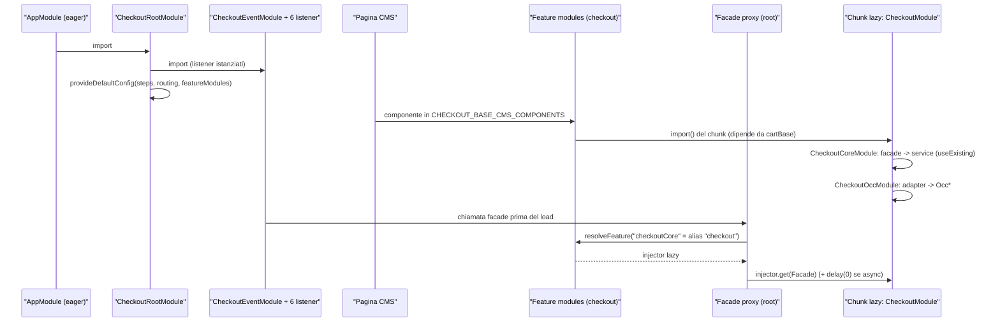
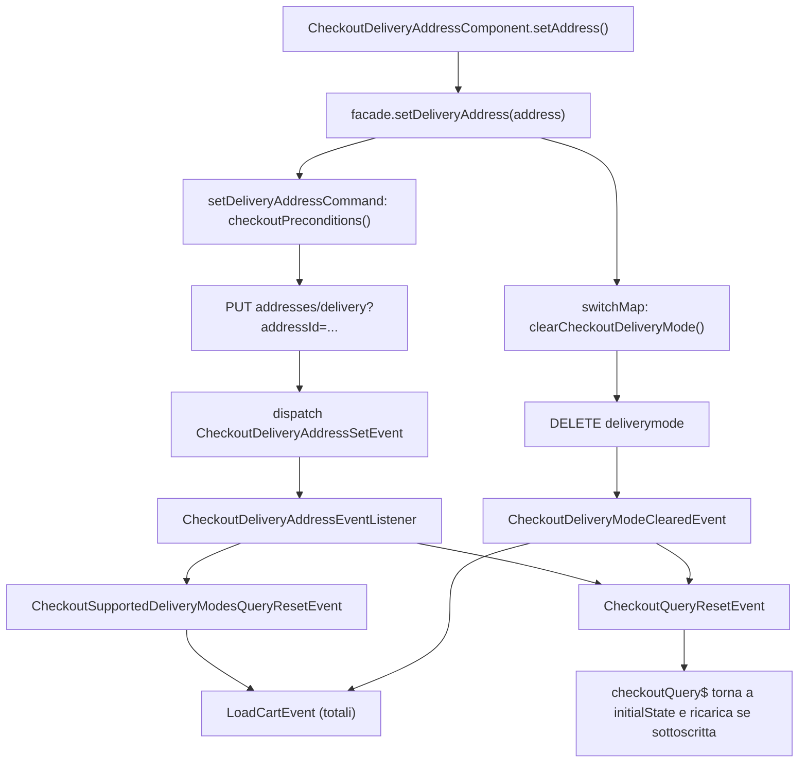
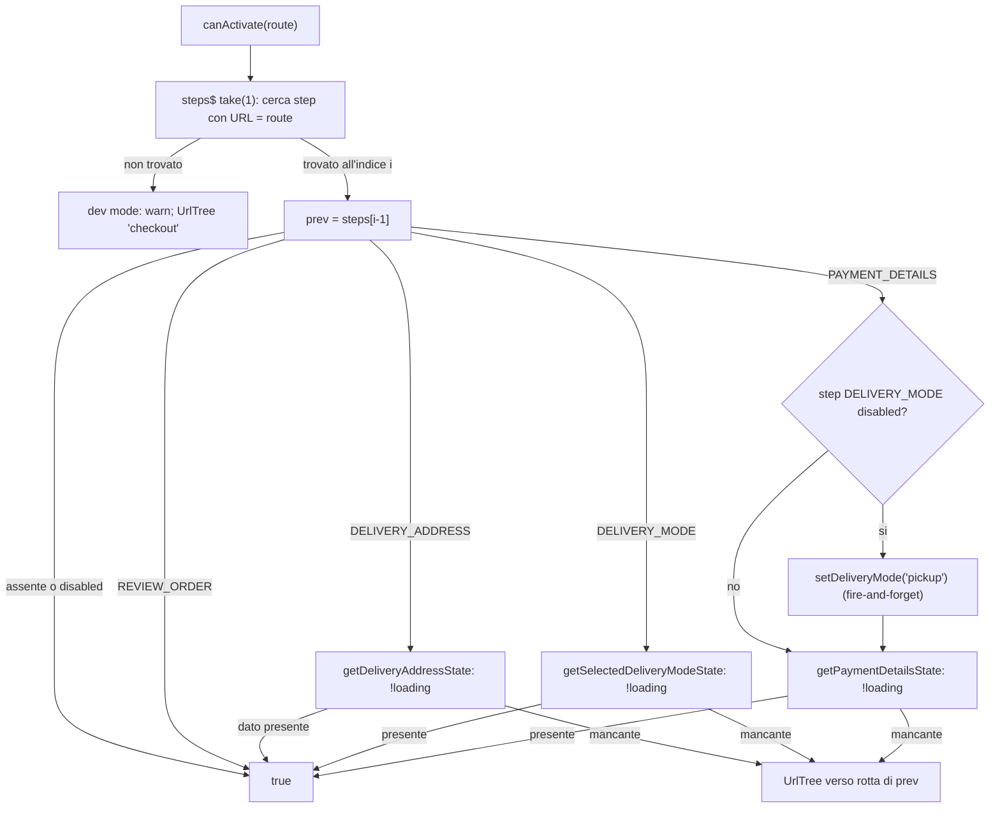
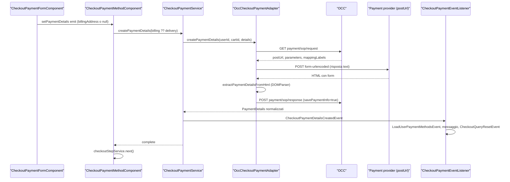

# 26 — Checkout

> Riferimenti allo SHA `5b7a1c2bf2808d7380bc20596d10f4fa710c3da1` (vedi [00-meta](../00-meta.md)).

Prerequisiti consigliati: [12 — Feature module e lazy loading in Spartacus](../parte-2/12-feature-module-lazy.md), [20 — Facade, command & query, eventi](../parte-2/20-facade-command-query-eventi.md), [21 — Livello OCC](../parte-2/21-occ.md), [14 — Routing](../parte-2/14-routing.md). Collegati: [25 — Carrello](../parte-2/25-cart.md), [27 — Ordini](../parte-2/27-order.md) (il place order vive lì), [16 — CMS rendering](../parte-2/16-cms-rendering.md) (i guard dei componenti CMS), [11 — Configurazione](../parte-2/11-configurazione.md) (merge dei config).

## 1. A cosa serve e perché esiste

Il checkout è il percorso che porta da un carrello attivo a un ordine: scelta dell'indirizzo di consegna, della modalità di consegna, del metodo di pagamento, revisione e conferma. In Spartacus vive nella libreria `@spartacus/checkout`, che ha un `public_api.ts` di radice vuoto: tutto è esposto tramite *secondary entry point* (`feature-libs/checkout/public_api.ts:L11-L11`). La libreria è divisa in tre sotto-feature:

| Sotto-feature | Modulo "pesante" (lazy) | Contenuto |
|---|---|---|
| `base` | `CheckoutModule` = componenti + core + OCC (`feature-libs/checkout/base/checkout.module.ts:L12-L15`) | checkout B2C: step, guard, facade, adapter OCC, eventi |
| `b2b` | `CheckoutB2BModule` = componenti + core + OCC B2B (`feature-libs/checkout/b2b/checkout-b2b.module.ts:L12-L19`) | payment type (account/card), cost center, PO number |
| `scheduled-replenishment` | `CheckoutScheduledReplenishmentModule`, solo componenti (`feature-libs/checkout/scheduled-replenishment/checkout-scheduled-replenishment.module.ts:L10-L13`) | ordini ricorrenti (schedule + place order esteso) |

Ogni sotto-feature ha a sua volta i livelli `root` (eager: config, facade astratte, eventi, listener), `core` (servizi command/query, connector), `occ` (adapter) e `components` (componenti CMS, guard, servizi di UI). È lo schema delle feature lib descritto nel [capitolo 12](../parte-2/12-feature-module-lazy.md).

Tre scelte progettuali dominano tutto il capitolo:

1. **Nessun NgRx per lo stato del checkout.** Il checkout usa Command & Query (capitolo [20](../parte-2/20-facade-command-query-eventi.md)): una sola query, `checkoutQuery$`, carica dal backend lo stato del carrello rilevante (indirizzo, delivery mode, payment info) (`feature-libs/checkout/base/core/facade/checkout-query.service.ts:L42-L54`); ogni scrittura è un `Command` che, al successo, dispatcha un evento di dominio (`feature-libs/checkout/base/core/facade/checkout-delivery-address.service.ts:L34-L64`). Dei listener eager trasformano quegli eventi in reset/reload della query (`feature-libs/checkout/base/root/events/checkout-delivery-address-event.listener.ts:L109-L122`). Restano solo ponti verso lo store legacy dell'utente, marcati `TODO:#deprecation-checkout` (`feature-libs/checkout/base/root/events/checkout-legacy-store-event.listener.ts:L17-L70`).
2. **Gli step sono configurazione.** La sequenza degli step è un array `checkout.steps` di `CheckoutStep` (id, chiave i18n, rotta semantica, tipo) (`feature-libs/checkout/base/root/config/default-checkout-config.ts:L10-L42`); `CheckoutStepService` ne ricava navigazione avanti/indietro e step attivo (`feature-libs/checkout/base/components/services/checkout-step.service.ts:L34-L100`). Le pagine CMS degli step sono pagine di contenuto normali: i "vincoli" del flusso stanno nei **guard dei componenti CMS** (`feature-libs/checkout/base/components/checkout-orchestrator/checkout-orchestrator.module.ts:L18-L25`).
3. **Il place order non appartiene al checkout.** Il componente di conferma chiama `OrderFacade.placeOrder(termsChecked)` di `@spartacus/order/root` (`feature-libs/checkout/base/components/checkout-place-order/checkout-place-order.component.ts:L35-L35`, `feature-libs/order/root/facade/order.facade.ts:L47-L47`); il checkout reagisce poi all'`OrderPlacedEvent` (`feature-libs/checkout/base/root/events/checkout-place-order-event.listener.ts:L24-L41`).

Infine `core-libs/core/src/checkout` è quasi vuoto: contiene solo i token converter condivisi `POINT_OF_SERVICE_NORMALIZER` e `PAYMENT_DETAILS_NORMALIZER`, riesportati da `@spartacus/core` (`core-libs/core/src/checkout/connectors/checkout/converters.ts:L11-L13`, `core-libs/core/src/checkout/connectors/payment/converters.ts:L11-L13`, `core-libs/core/public_api.ts:L13-L13`).

## 2. Mappa dei file

| Path | Ruolo |
|---|---|
| `feature-libs/checkout/public_api.ts` | Barrel di radice vuoto (`:L11-L11`). |
| `feature-libs/checkout/base/checkout.module.ts` | `CheckoutModule`: components + core + OCC (`:L12-L15`). |
| `feature-libs/checkout/base/root/feature-name.ts` | `CHECKOUT_FEATURE = 'checkout'`, `CHECKOUT_CORE_FEATURE = 'checkoutCore'` (`:L7-L8`). |
| `feature-libs/checkout/base/root/checkout-root.module.ts` | `CHECKOUT_BASE_CMS_COMPONENTS`, `defaultCheckoutComponentsConfig()`, `CheckoutRootModule` (`:L20-L60`). |
| `feature-libs/checkout/base/root/config/checkout-config.ts` | `CheckoutConfig` astratta, `DeliveryModePreferences`, augmentation di `Config` (`:L12-L55`). |
| `feature-libs/checkout/base/root/config/default-checkout-config.ts` | 4 step base, `express`, `defaultDeliveryMode`, `guest` (`:L10-L42`). |
| `feature-libs/checkout/base/root/config/default-checkout-routing-config.ts` | Rotte semantiche `checkout*` (`:L9-L20`). |
| `feature-libs/checkout/base/root/model/checkout-step.model.ts` | `CheckoutStep`, `CheckoutStepType`, `CheckoutStepState` (`:L7-L27`). |
| `feature-libs/checkout/base/root/model/checkout-flow.model.ts` | `CheckoutFlow` (`:L10-L31`). |
| `feature-libs/checkout/base/root/model/checkout-state.model.ts` | `CheckoutState` (`:L10-L14`). |
| `feature-libs/checkout/base/root/facade/*.facade.ts` | 5 facade astratte lazy (`facadeFactory`). |
| `feature-libs/checkout/base/root/events/checkout.events.ts` | Gerarchia `Checkout*Event` (`:L12-L203`). |
| `feature-libs/checkout/base/root/events/checkout-event.module.ts` | `CheckoutEventModule`: istanzia eager 6 listener (`:L15-L27`). |
| `feature-libs/checkout/base/root/events/*-event.listener.ts` | Listener: query, delivery address, delivery mode, payment, place order, legacy store. |
| `feature-libs/checkout/base/root/http-interceptors/checkout-cart.interceptor.ts` | `CheckoutCartInterceptor` ("Cart not found" durante il checkout) (`:L26-L95`). |
| `feature-libs/checkout/base/core/checkout-core.module.ts` | Facade providers, connector, `CheckoutPageMetaResolver` (`:L17-L33`). |
| `feature-libs/checkout/base/core/facade/facade-providers.ts` | Facade astratta → service concreto via `useExisting` (`:L21-L47`). |
| `feature-libs/checkout/base/core/facade/checkout-query.service.ts` | La query centrale `checkoutQuery$` (`:L28-L89`). |
| `feature-libs/checkout/base/core/facade/checkout-delivery-address.service.ts` | Command create/set/clear address (`:L30-L165`). |
| `feature-libs/checkout/base/core/facade/checkout-delivery-modes.service.ts` | Query delivery modes supportate + command set/clear. |
| `feature-libs/checkout/base/core/facade/checkout-payment.service.ts` | Query card types + command create/set/delete payment. |
| `feature-libs/checkout/base/core/facade/checkout-billing-address.service.ts` | Command set billing address (`:L28-L53`). |
| `feature-libs/checkout/base/core/connectors/**` | 5 adapter astratti + connector pass-through + token converter. |
| `feature-libs/checkout/base/core/services/checkout-page-meta.resolver.ts` | Meta resolver del template `MultiStepCheckoutSummaryPageTemplate` (`:L40-L76`). |
| `feature-libs/checkout/base/occ/checkout-occ.module.ts` | Binding adapter astratti → `Occ*` (`:L24-L50`). |
| `feature-libs/checkout/base/occ/config/default-occ-checkout-config.ts` | Endpoint OCC (`:L9-L35`). |
| `feature-libs/checkout/base/occ/adapters/occ-checkout-payment.adapter.ts` | Silent Order Post (SOP) (`:L46-L95`). |
| `feature-libs/checkout/base/components/services/checkout-step.service.ts` | `CheckoutStepService` (`:L19-L204`). |
| `feature-libs/checkout/base/components/services/checkout-flow-orchestrator.service.ts` | Scelta del flow per payment provider (`:L13-L45`). |
| `feature-libs/checkout/base/components/services/checkout-config.service.ts` | Lettura express/guest/delivery-mode preferito (`:L15-L104`). |
| `feature-libs/checkout/base/components/services/express-checkout.service.ts` | Catena express checkout (`:L27-L176`). |
| `feature-libs/checkout/base/components/guards/` | `CheckoutAuthGuard`, `CartNotEmptyGuard`, `NotCheckoutAuthGuard`, `CheckoutGuard`, `CheckoutStepsSetGuard`. |
| `feature-libs/checkout/base/components/checkout-*/` | Componenti CMS standalone: orchestrator, delivery address/mode, payment method + form, billing address, review, place order, progress, login, order summary. |
| `feature-libs/checkout/b2b/root/` | `CheckoutB2BRootModule`, `augmented-types`, step B2B, eventi e facade cost center / payment type. |
| `feature-libs/checkout/b2b/core/` | Service cost center / payment type, `BadCostCenterRequestHandler`. |
| `feature-libs/checkout/b2b/occ/` | Adapter OCC cost center / payment type, endpoint B2B. |
| `feature-libs/checkout/b2b/components/` | Override guard, componenti payment type / cost center, delivery address e review B2B. |
| `feature-libs/checkout/scheduled-replenishment/` | Root module (CMS list + listener), `CheckoutReplenishmentFormService`, place order esteso. |
| `core-libs/core/src/checkout/**` | Solo `POINT_OF_SERVICE_NORMALIZER`, `PAYMENT_DETAILS_NORMALIZER`. |
| `projects/storefrontapp/src/app/spartacus/features/checkout/checkout-feature.module.ts` | Integrazione nell'app demo (`:L41-L103`). |
| `projects/storefrontapp/src/app/spartacus/features/checkout/checkout-wrapper.module.ts` | Chunk lazy che aggrega base + estensioni (`:L18-L33`). |

## 3. Come funziona passo per passo

### 3.1 Bootstrap: root module eager, tutto il resto lazy

1. L'app importa `CheckoutRootModule` in modo eager; nell'app demo, se `environment.b2b`, anche `CheckoutB2BRootModule` e `CheckoutScheduledReplenishmentRootModule` (`projects/storefrontapp/src/app/spartacus/features/checkout/checkout-feature.module.ts:L41-L87`). La demo abilita anche il guest checkout con `provideConfig({ checkout: { guest: true } })` (`projects/storefrontapp/src/app/spartacus/features/checkout/checkout-feature.module.ts:L99-L103`).
2. `CheckoutRootModule` importa `CheckoutEventModule` e fornisce l'interceptor, la config di routing, la config del checkout e, tramite factory, la config `featureModules` (`feature-libs/checkout/base/root/checkout-root.module.ts:L51-L60`).
3. `CheckoutEventModule` è un NgModule vuoto il cui costruttore inietta i 6 listener: iniettarli basta per istanziarli (sono `providedIn: 'root'`) e quindi per far partire le loro subscription già al bootstrap (`feature-libs/checkout/base/root/events/checkout-event.module.ts:L15-L27`).
4. `defaultCheckoutComponentsConfig()` dichiara la feature `checkout` con 14 tipi CMS (`CHECKOUT_BASE_CMS_COMPONENTS`) e la dipendenza da `CART_BASE_FEATURE`; `checkoutCore` è un *alias* di `checkout` ("by default core is bundled together with components") (`feature-libs/checkout/base/root/checkout-root.module.ts:L20-L49`).
5. Quando una pagina CMS contiene uno di quei tipi, il caricatore delle feature scarica il chunk configurato: nell'app demo `CheckoutWrapperModule`, che importa `CheckoutModule` più, condizionalmente, B2B, replenishment, digital payments e S/4 service (`projects/storefrontapp/src/app/spartacus/features/checkout/checkout-wrapper.module.ts:L18-L33`).
6. Le facade del checkout sono classi astratte fornite in root via `facadeFactory` con `feature: CHECKOUT_CORE_FEATURE` (`feature-libs/checkout/base/root/facade/checkout-delivery-address.facade.ts:L12-L28`). Se qualcuno (es. un listener) chiama una facade prima che la feature sia caricata, il proxy risolve `checkoutCore` → alias `checkout` e scarica lo stesso chunk (`core-libs/core/src/lazy-loading/facade-factory/facade-factory.service.ts:L38-L57`).
7. Quattro facade base usano `async: true`, che aggiunge `delay(0)` al resolver ("Required to make lazy NgRx store feature ready", marcato `TODO:#deprecation-checkout`) (`core-libs/core/src/lazy-loading/facade-factory/facade-factory.service.ts:L53-L56`, `core-libs/core/src/lazy-loading/facade-factory/facade-descriptor.ts:L32-L36`); `CheckoutQueryFacade` e le facade B2B no (`feature-libs/checkout/base/root/facade/checkout-query.facade.ts:L13-L21`, `feature-libs/checkout/b2b/root/facade/checkout-cost-center.facade.ts:L15-L20`).
8. Nel chunk lazy, `CheckoutCoreModule` lega ogni facade astratta al service concreto con `useExisting` (`feature-libs/checkout/base/core/checkout-core.module.ts:L17-L33`, `feature-libs/checkout/base/core/facade/facade-providers.ts:L21-L47`) e `CheckoutOccModule` lega gli adapter astratti alle implementazioni `Occ*` (`feature-libs/checkout/base/occ/checkout-occ.module.ts:L24-L50`).

Una conseguenza importante: le chiamate a metodi di una facade proxy sono **eager**. `call()` costruisce un `connectable` con `ReplaySubject` e lo connette subito, quindi il metodo reale viene invocato anche se nessuno si sottoscrive al risultato (`core-libs/core/src/lazy-loading/facade-factory/facade-factory.service.ts:L70-L92`). Lo stesso vale per `Command.execute` (`core-libs/core/src/util/command-query/command.service.ts:L126-L131`). Diversi punti del checkout contano su questo (vedi §9).

### 3.2 Lo stato: una query, molte proiezioni

1. `CheckoutQueryService.checkoutQuery$` è una `Query<CheckoutState | undefined>` creata con `QueryService.create`: il loader esegue `checkoutPreconditions()` e poi `CheckoutConnector.getCheckoutDetails(userId, cartId)`; si ricarica su `CheckoutQueryReloadEvent` e si resetta su `CheckoutQueryResetEvent` (`feature-libs/checkout/base/core/facade/checkout-query.service.ts:L32-L54`).
2. `checkoutPreconditions()` legge (`take(1)`) userId, id del carrello attivo e `isGuestCart`, e lancia `Error('Checkout conditions not met')` se manca un dato o se l'utente è anonimo senza guest cart (`feature-libs/checkout/base/core/facade/checkout-query.service.ts:L66-L84`). Lo stesso metodo è duplicato identico in ogni service, base e B2B (`feature-libs/checkout/base/core/facade/checkout-delivery-address.service.ts:L133-L151`, `feature-libs/checkout/base/core/facade/checkout-delivery-modes.service.ts:L149-L167`, `feature-libs/checkout/base/core/facade/checkout-payment.service.ts:L138-L156`, `feature-libs/checkout/base/core/facade/checkout-billing-address.service.ts:L58-L76`, `feature-libs/checkout/b2b/core/facade/checkout-cost-center.service.ts:L65-L83`, `feature-libs/checkout/b2b/core/facade/checkout-payment-type.service.ts:L98-L116`).
3. L'adapter OCC esegue un GET su `users/${userId}/carts/${cartId}?fields=deliveryAddress(FULL),deliveryMode(FULL),paymentInfo(FULL)` (`feature-libs/checkout/base/occ/config/default-occ-checkout-config.ts:L29-L30`); in B2B l'endpoint include anche `costCenter(FULL),purchaseOrderNumber,paymentType(FULL)` (`feature-libs/checkout/b2b/occ/config/default-occ-checkout-b2b-config.ts:L11-L29`). Il pattern comune degli adapter è `catchError → tryNormalizeHttpError`, `backOff({ shouldRetry: isJaloError })`, converter (`feature-libs/checkout/base/occ/adapters/occ-checkout.adapter.ts:L35-L50`).
4. Lo stato della query parte da `{data: undefined, error: false, loading: true}`; in errore diventa `{loading: false, error, data: undefined}` (`core-libs/core/src/util/command-query/query.service.ts:L61-L102`). Su `reloadOn` il dato è preservato (solo `loading: true`), su `resetOn` torna a `initialState` (`core-libs/core/src/util/command-query/query.service.ts:L105-L128`). La query carica solo finché ha subscriber (`core-libs/core/src/util/command-query/query.service.ts:L130-L133`).
5. Le "selezioni" correnti non hanno query proprie: `getDeliveryAddressState()`, `getSelectedDeliveryModeState()` e `getPaymentDetailsState()` sono proiezioni `map` di `getCheckoutDetailsState()` (`feature-libs/checkout/base/core/facade/checkout-delivery-address.service.ts:L153-L160`, `feature-libs/checkout/base/core/facade/checkout-delivery-modes.service.ts:L180-L186`, `feature-libs/checkout/base/core/facade/checkout-payment.service.ts:L168-L172`). Analogamente in B2B `getCostCenterState()` proietta `state.data?.costCenter` (`feature-libs/checkout/b2b/core/facade/checkout-cost-center.service.ts:L85-L92`).
6. Due query separate esistono solo per liste che non sono "selezioni": le delivery mode supportate (`feature-libs/checkout/base/core/facade/checkout-delivery-modes.service.ts:L41-L66`) e i card type (senza precondizioni, perché non dipendono dal carrello) (`feature-libs/checkout/base/core/facade/checkout-payment.service.ts:L52-L57`); in B2B i payment type.

### 3.3 Le scritture: command + evento + listener

Ogni command segue la stessa forma: precondizioni → chiamata al connector → `tap` che dispatcha un evento. Esempi:

- `createDeliveryAddressCommand` chiama `createAddress`, ricopia nella risposta `titleCode` e `region.isocodeShort` del payload, dispatcha `CheckoutDeliveryAddressCreatedEvent`; strategia `CancelPrevious` (`feature-libs/checkout/base/core/facade/checkout-delivery-address.service.ts:L34-L64`).
- `setDeliveryAddressCommand` richiede `address.id` (altrimenti "Checkout conditions not met"), chiama `setAddress` (PUT con `addressId` in query) e dispatcha `CheckoutDeliveryAddressSetEvent` (`feature-libs/checkout/base/core/facade/checkout-delivery-address.service.ts:L66-L94`, `feature-libs/checkout/base/occ/adapters/occ-checkout-delivery-address.adapter.ts:L75-L133`).
- `setDeliveryModeCommand` dispatcha `CheckoutDeliveryModeSetEvent` con `cartCode: cartId` (`feature-libs/checkout/base/core/facade/checkout-delivery-modes.service.ts:L68-L88`); `clearDeliveryModeCommand` dispatcha `CheckoutDeliveryModeClearedEvent` o `CheckoutDeliveryModeClearedErrorEvent` (`feature-libs/checkout/base/core/facade/checkout-delivery-modes.service.ts:L90-L134`).
- `createPaymentMethodCommand` dispatcha `CheckoutPaymentDetailsCreatedEvent`; `setPaymentMethodCommand` richiede `paymentDetails.id` e dispatcha `CheckoutPaymentDetailsSetEvent` (`feature-libs/checkout/base/core/facade/checkout-payment.service.ts:L59-L110`).
- Eccezioni: `deletePaymentMethodCommand` non ha opzioni (strategia default `Queue`) e dispatcha direttamente `CheckoutQueryResetEvent` (`feature-libs/checkout/base/core/facade/checkout-payment.service.ts:L112-L123`, `core-libs/core/src/util/command-query/command.service.ts:L107-L117`); `CheckoutBillingAddressService` non dispatcha alcun evento (`feature-libs/checkout/base/core/facade/checkout-billing-address.service.ts:L28-L53`).

I listener (root, eager) chiudono il ciclo:

| Evento in ingresso | Reazione | Riferimento |
|---|---|---|
| `LanguageSetEvent`, `CurrencySetEvent` | `CheckoutQueryReloadEvent` | `feature-libs/checkout/base/root/events/checkout-query-event.listener.ts:L38-L47` |
| `LogoutEvent`, `LoginEvent`, `SaveCartSuccessEvent`, `RestoreSavedCartSuccessEvent`, `MergeCartSuccessEvent`, `OrderPlacedEvent` | `CheckoutQueryResetEvent` | `feature-libs/checkout/base/root/events/checkout-query-event.listener.ts:L49-L62` |
| `UpdateUserAddressEvent` / `DeleteUserAddressEvent` | `clearCheckoutDeliveryAddress()` (lazy-load del checkout) + reset delivery modes | `feature-libs/checkout/base/root/events/checkout-delivery-address-event.listener.ts:L57-L83` |
| `CheckoutDeliveryAddressCreatedEvent` | `LoadUserAddressesEvent` (non anonimi), messaggio globale, reset delivery modes, reset query | `feature-libs/checkout/base/root/events/checkout-delivery-address-event.listener.ts:L85-L107` |
| `CheckoutDeliveryAddressSetEvent` | reset delivery modes + reset query | `feature-libs/checkout/base/root/events/checkout-delivery-address-event.listener.ts:L109-L122` |
| `CheckoutDeliveryAddressClearedEvent`, `DeleteCartEvent` | reset query | `feature-libs/checkout/base/root/events/checkout-delivery-address-event.listener.ts:L124-L142` |
| `CheckoutDeliveryModeSetEvent`, `CheckoutDeliveryModeClearedEvent`, `CheckoutDeliveryModeClearedErrorEvent` | reset query + `LoadCartEvent` (totali carrello) | `feature-libs/checkout/base/root/events/checkout-delivery-mode-event.listener.ts:L45-L100` |
| `CheckoutSupportedDeliveryModesQueryResetEvent` | `LoadCartEvent` | `feature-libs/checkout/base/root/events/checkout-delivery-mode-event.listener.ts:L102-L154` |
| `CheckoutPaymentDetailsCreatedEvent` | `LoadUserPaymentMethodsEvent`, messaggio, reset query | `feature-libs/checkout/base/root/events/checkout-payment-event.listener.ts:L44-L82` |
| `OrderPlacedEvent` | `RemoveCartEvent` + reset query | `feature-libs/checkout/base/root/events/checkout-place-order-event.listener.ts:L24-L41` |
| `LoadUserAddressesEvent` / `LoadUserPaymentMethodsEvent` | azioni NgRx legacy `UserActions.*` | `feature-libs/checkout/base/root/events/checkout-legacy-store-event.listener.ts:L17-L70` |

La gerarchia degli eventi (`CheckoutEvent` astratto con `userId`, `cartId`, `cartCode`; sottofamiglie delivery address / delivery mode / payment; `CheckoutQueryReloadEvent` e `CheckoutQueryResetEvent` che estendono direttamente `CxEvent`) è in `feature-libs/checkout/base/root/events/checkout.events.ts:L12-L203`.

### 3.4 Gli step: configurazione, flow e `CheckoutStepService`

1. `CheckoutConfig` è una classe astratta `providedIn: 'root', useExisting: Config` con chiave `checkout` (`steps`, `express`, `defaultDeliveryMode`, `guest`, `guestUseSavedAddress`, `flows`), e augmenta `Config` di `@spartacus/core` (`feature-libs/checkout/base/root/config/checkout-config.ts:L18-L55`).
2. I default base sono 4 step — `deliveryAddress`, `deliveryMode`, `paymentDetails`, `reviewOrder` — con `express: false`, `defaultDeliveryMode: [FREE]`, `guest: false` (`feature-libs/checkout/base/root/config/default-checkout-config.ts:L10-L42`). Ogni step punta a una rotta semantica; le rotte default sono `checkoutLogin` (`checkout-login`, `authFlow: true`), `checkout`, `checkoutDeliveryAddress`, `checkoutDeliveryMode`, `checkoutPaymentDetails`, `checkoutReviewOrder` (`feature-libs/checkout/base/root/config/default-checkout-routing-config.ts:L9-L20`).
3. `CheckoutFlowOrchestratorService` (root) legge `baseSite.baseStore.paymentProvider` una volta (subscribe nel costruttore) e `getCheckoutFlow()` restituisce `checkout.flows[provider]` se esiste, altrimenti l'intero oggetto `checkout` (`feature-libs/checkout/base/components/services/checkout-flow-orchestrator.service.ts:L20-L44`). `CheckoutFlow` ripete le stesse chiavi di `checkout` tranne `flows` (`feature-libs/checkout/base/root/model/checkout-flow.model.ts:L10-L31`).
4. `CheckoutStepService` (root) nel costruttore chiama `resetSteps()`: prende gli step dal flow dell'orchestratore, scarta quelli `disabled`, li clona con `Object.assign` ed emette su `steps$` (`feature-libs/checkout/base/components/services/checkout-step.service.ts:L57-L63`, `feature-libs/checkout/base/components/services/checkout-step.service.ts:L88-L100`).
5. `activeStepIndex$` confronta `router.state.context.id` con `/${paths[0]}` di ogni step (`feature-libs/checkout/base/components/services/checkout-step.service.ts:L34-L55`). `next()`/`back()` usano invece l'`ActivatedRoute` del componente; `back()` dal primo step torna a `'cart'` (`feature-libs/checkout/base/components/services/checkout-step.service.ts:L65-L73`), e il testo del bottone è `checkout.backToCart` o `common.back` (`feature-libs/checkout/base/components/services/checkout-step.service.ts:L81-L86`).
6. `disableEnableStep(type, disabled)` muta lo step in `allSteps` e riemette su `steps$` solo quelli abilitati (`feature-libs/checkout/base/components/services/checkout-step.service.ts:L102-L113`); `getNextCheckoutStepUrl`/`getPreviousCheckoutStepUrl` saltano gli step disabilitati (`feature-libs/checkout/base/components/services/checkout-step.service.ts:L130-L166`).
7. `CheckoutConfigService` legge `express`, `guest` e `defaultDeliveryMode` dal flow (calcolato una volta alla costruzione) (`feature-libs/checkout/base/components/services/checkout-config.service.ts:L19-L37`). `getPreferredDeliveryMode()` ordina in place per costo e applica le preferenze in cascata con `findMatchingDeliveryMode` ricorsivo, con fallback `deliveryModes[0].code` (`feature-libs/checkout/base/components/services/checkout-config.service.ts:L58-L104`).

### 3.5 Navigazione a `/checkout`: i guard

I guard non sono sulle rotte Angular: sono dichiarati nei `cmsComponents` e applicati da `CmsGuardsService`, che li istanzia con `getLastValueSync(unifiedInjector.get(guardClass))`, cioè dall'ultimo injector (anche lazy) che fornisce quel token (`core-libs/storefront/cms-structure/services/cms-guards.service.ts:L36-L48`, `core-libs/core/src/lazy-loading/unified-injector.ts:L52-L67`). Il mapping è (`feature-libs/checkout/base/components/checkout-orchestrator/checkout-orchestrator.module.ts:L18-L25`, `feature-libs/checkout/base/components/checkout-delivery-address/checkout-delivery-address.module.ts:L35-L42`, `feature-libs/checkout/base/components/checkout-login/checkout-login.module.ts:L37-L44`, `feature-libs/checkout/base/components/checkout-order-summary/checkout-order-summary.module.ts:L16-L22`, `feature-libs/checkout/base/components/checkout-progress/checkout-progress.module.ts:L33-L40`):

| Componente CMS | Guard |
|---|---|
| `CheckoutOrchestrator` | `CheckoutAuthGuard`, `CartNotEmptyGuard`, `CheckoutGuard` |
| `CheckoutDeliveryAddress` | `CheckoutAuthGuard`, `CartNotEmptyGuard`, `CartValidationGuard` |
| `CheckoutDeliveryMode`, `CheckoutPaymentDetails`, `CheckoutPlaceOrder`, `CheckoutReviewOrder`, review overview/payment/shipping | `CheckoutAuthGuard`, `CartNotEmptyGuard` |
| `CheckoutProgress` (+ mobile top/bottom) | `CheckoutAuthGuard`, `CartNotEmptyGuard`, `CheckoutStepsSetGuard` |
| `GuestCheckoutLoginComponent` | `NotCheckoutAuthGuard` |
| `CheckoutOrderSummary` | nessuno |

1. **`CheckoutAuthGuard`** attende `activeCartFacade.isStable()`; utente loggato → `true`; anonimo con guest cart → `true`; altrimenti `handleAnonymousUser()` (`feature-libs/checkout/base/components/guards/checkout-auth.guard.ts:L38-L57`). Questo salva l'URL corrente e, con il toggle `authorizationCodeFlowByDefault`, scrive `IS_GUEST_USER_CHECKOUT_KEY` in localStorage (se guest abilitato) e redirige a `login`; senza toggle, se il guest è abilitato redirige a `login?forced=true` (`feature-libs/checkout/base/components/guards/checkout-auth.guard.ts:L59-L77`).
2. **`CartNotEmptyGuard`** redirige a `home` se `totalItems` è falsy (`feature-libs/checkout/base/components/guards/cart-not-empty.guard.ts:L24-L39`).
3. **`CheckoutGuard`** (solo sull'orchestrator) redirige alla prima rotta degli step; se express è attivo e il carrello non è guest, prova `ExpressCheckoutService.trySetDefaultCheckoutDetails()` e, se riesce, redirige al review order (`feature-libs/checkout/base/components/guards/checkout.guard.ts:L22-L30`, `feature-libs/checkout/base/components/guards/checkout.guard.ts:L41-L70`). Il componente `CheckoutOrchestratorComponent` ha template vuoto: esiste solo per agganciare questi guard alla pagina `/checkout` (`feature-libs/checkout/base/components/checkout-orchestrator/checkout-orchestrator.component.ts:L9-L18`).
4. **`ExpressCheckoutService`** costruisce nel costruttore una catena: indirizzo di default (o primo) → delivery mode preferita → pagamento di default (o primo); ogni anello invoca la facade e poi verifica lo stato dalla query (`feature-libs/checkout/base/components/services/express-checkout.service.ts:L35-L46`, `feature-libs/checkout/base/components/services/express-checkout.service.ts:L48-L169`).
5. **`NotCheckoutAuthGuard`** (pagina checkout-login) redirige a home se loggato e al carrello se c'è già un guest cart (`feature-libs/checkout/base/components/guards/not-checkout-auth.guard.ts:L29-L44`).

### 3.6 Ingresso in uno step: `CheckoutStepsSetGuard`

1. Nel costruttore (servizio root) sottoscrive `hasDeliveryItems()`: se il carrello non ha articoli da spedire disabilita DELIVERY_ADDRESS e DELIVERY_MODE e regola `nameMultiLine` di PAYMENT_DETAILS/REVIEW_ORDER (`feature-libs/checkout/base/components/guards/checkout-steps-set.guard.ts:L49-L70`, `feature-libs/checkout/base/components/guards/checkout-steps-set.guard.ts:L174-L182`).
2. `canActivate(route)` cerca in `steps$` (`take(1)`) lo step la cui rotta coincide con l'URL; se non lo trova, in dev mode logga `Missing step with route ...` e redirige a `checkout` (`feature-libs/checkout/base/components/guards/checkout-steps-set.guard.ts:L73-L104`).
3. Se lo trova, verifica **solo lo step immediatamente precedente** con `isStepSet(steps[currentIndex - 1])` (`feature-libs/checkout/base/components/guards/checkout-steps-set.guard.ts:L92-L93`).
4. `isStepSet` dispatcha per `step.type[0]`; per PAYMENT_DETAILS, se lo step DELIVERY_MODE è disabilitato, chiama `setDeliveryMode('pickup')` prima di verificare il pagamento (`feature-libs/checkout/base/components/guards/checkout-steps-set.guard.ts:L106-L132`).
5. Le verifiche filtrano `!state.loading` e, se il dato manca, restituiscono un `UrlTree` verso la rotta dello step mancante (`feature-libs/checkout/base/components/guards/checkout-steps-set.guard.ts:L134-L172`).

### 3.7 Gli step nei componenti

- **Indirizzo.** `ngOnInit` carica gli indirizzi utente (se non guest) (`feature-libs/checkout/base/components/checkout-delivery-address/checkout-delivery-address.component.ts:L114-L119`); `selectDefaultAddress` auto-seleziona una sola volta il `defaultAddress` (`feature-libs/checkout/base/components/checkout-delivery-address/checkout-delivery-address.component.ts:L313-L330`). `setAddress` = `setDeliveryAddress` seguito (switchMap) da `clearCheckoutDeliveryMode()` (`feature-libs/checkout/base/components/checkout-delivery-address/checkout-delivery-address.component.ts:L357-L374`); `addAddress` = `createAndSetAddress` → clear delivery mode → `next()` (`feature-libs/checkout/base/components/checkout-delivery-address/checkout-delivery-address.component.ts:L213-L246`).
- **Delivery mode.** `supportedDeliveryModes$` in un `tap` imposta sempre una modalità (quella selezionata se ancora nella lista, altrimenti la preferita) chiamando `changeMode`, e nasconde dalla lista il codice `pickup` (`feature-libs/checkout/base/components/checkout-delivery-mode/checkout-delivery-mode.component.ts:L79-L100`). Il componente ha `composition.inner: ['PickupInStoreDeliveryModeComponent']` (`feature-libs/checkout/base/components/checkout-delivery-mode/checkout-delivery-mode.module.ts:L37-L49`).
- **Pagamento.** `CheckoutPaymentMethodComponent.ngOnInit` carica i metodi di pagamento utente (se non guest) e memorizza l'indirizzo di consegna come fallback del billing (`feature-libs/checkout/base/components/checkout-payment-method/checkout-payment-method.component.ts:L131-L147`); `setPaymentDetails` usa `billingAddress ?? this.deliveryAddress`, chiama `createPaymentDetails` e al complete `next()` (`feature-libs/checkout/base/components/checkout-payment-method/checkout-payment-method.component.ts:L278-L301`). Il form carta emette `billingAddress: null` se "same as delivery" (`feature-libs/checkout/base/components/checkout-payment-method/checkout-payment-form/checkout-payment-form.component.ts:L273-L312`).
- **SOP (Silent Order Post).** `OccCheckoutPaymentAdapter.createPaymentDetails` fa GET `payment/sop/request`, POST form-urlencoded al `postUrl` del provider, parsing dell'HTML di risposta (primo `<form>`, i suoi `input`), POST `payment/sop/response`, normalizzazione con `PAYMENT_DETAILS_NORMALIZER`; forza `savePaymentInfo = true` (`feature-libs/checkout/base/occ/adapters/occ-checkout-payment.adapter.ts:L46-L95`, `feature-libs/checkout/base/occ/adapters/occ-checkout-payment.adapter.ts:L312-L330`). I parametri sono rimappati con le `mappingLabels` (`hybris_card_number`, `hybris_billTo_*`) (`feature-libs/checkout/base/occ/adapters/occ-checkout-payment.adapter.ts:L265-L310`).
- **Review.** `CheckoutReviewSubmitComponent` raggruppa gli step in "delivery" e "payment" tramite metodi protetti sovrascrivibili (`feature-libs/checkout/base/components/checkout-review-submit/checkout-review-submit.component.ts:L101-L110`).
- **Place order.** Form `termsAndConditions: [false, Validators.requiredTrue]` (`feature-libs/checkout/base/components/checkout-place-order/checkout-place-order.component.ts:L76-L78`). `submitForm()` con il toggle `enableCartSlowNetworkResilience` piazza l'ordine solo se `isStable()` è true (`feature-libs/checkout/base/components/checkout-place-order/checkout-place-order.component.ts:L124-L142`); `launchPlaceOrder()` apre lo spinner `LAUNCH_CALLER.PLACE_ORDER_SPINNER`, chiama `orderFacade.placeOrder(valid)`, al successo naviga a `orderConfirmation`, in errore chiude lo spinner (`feature-libs/checkout/base/components/checkout-place-order/checkout-place-order.component.ts:L144-L170`). Lato order, `placeOrderCommand` dispatcha `OrderPlacedEvent` con `cartCode: cartId` (`feature-libs/order/core/facade/order.service.ts:L26-L54`).
- **Guest login.** `CheckoutLoginComponent.onSubmit` chiama `activeCartFacade.addEmail(email)` e, quando il carrello diventa guest, `authRedirectService.redirect()` (`feature-libs/checkout/base/components/checkout-login/checkout-login.component.ts:L58-L73`).
- **Progress.** Stato step: `DISABLED` se indice > attivo, `SELECTED` se attivo, altrimenti `COMPLETED` (`feature-libs/checkout/base/components/checkout-progress/checkout-progress.component.ts:L67-L87`).

### 3.8 Interceptor "Cart not found"

`CheckoutCartInterceptor` legge una sola volta lo stato router e osserva solo gli errori della richiesta; se la rotta semantica inizia (case-insensitive) con `checkout` e l'errore è 400 con `errors[0].type === 'CartError'` e `reason === 'notFound'`, naviga a `cart` e ricarica il carrello indicato in `errors[0].subject` (`feature-libs/checkout/base/root/http-interceptors/checkout-cart.interceptor.ts:L37-L94`). È l'unico interceptor del checkout ed è registrato via `useExisting` (`feature-libs/checkout/base/root/http-interceptors/index.ts:L11-L17`).

### 3.9 B2B

1. `CheckoutB2BRootModule` importa per primo `./model/augmented-types` ("Import augmented types first") e ridefinisce i `cmsComponents` della **stessa** feature `checkout` (base + `CheckoutCostCenterComponent`, `CheckoutPaymentType`) (`feature-libs/checkout/b2b/root/checkout-b2b-root.module.ts:L8-L52`).
2. L'augmentation aggiunge `CheckoutStepType.PAYMENT_TYPE = 'paymentType'` sia come tipo (`declare module`) sia a runtime (assegnazione sull'enum), più `costCenter`, `purchaseOrderNumber`, `paymentType` a `CheckoutState` (`feature-libs/checkout/b2b/root/model/augmented-types.ts:L11-L23`). È possibile perché il public_api root esporta `CheckoutStepType` e `CheckoutState` nel blocco delimitato dal commento AUGMENTABLE_TYPES_START/END (`feature-libs/checkout/base/root/public_api.ts:L14-L17`).
3. I default B2B sono 5 step con `paymentType` (rotta `checkout/payment-type`) per primo (`feature-libs/checkout/b2b/root/config/default-b2b-checkout-config.ts:L13-L51`, `feature-libs/checkout/b2b/root/config/default-checkout-b2b-routing-config.ts:L9-L15`). Poiché `deepMerge` sostituisce gli array, gli step B2B **rimpiazzano** quelli base, mentre gli oggetti vengono fusi (la `dependencies` della feature base resta) (`core-libs/core/src/config/utils/deep-merge.ts:L7-L9`, `core-libs/core/src/config/utils/deep-merge.ts:L31-L46`).
4. `CheckoutB2BComponentsModule` (nel chunk lazy) sostituisce `CheckoutAuthGuard` → `CheckoutB2BAuthGuard` e `CheckoutStepsSetGuard` → `CheckoutB2BStepsSetGuard` con `useExisting` (`feature-libs/checkout/b2b/components/checkout-b2b-components.module.ts:L28-L37`); l'override ha effetto grazie a `getLastValueSync` sull'`UnifiedInjector` (§3.5).
5. `CheckoutB2BAuthGuard` richiede inoltre, per utenti con `roles`, il ruolo `B2BUserRole.CUSTOMER`, altrimenti warning `checkoutB2B.invalid.accountType` e redirect home (`feature-libs/checkout/b2b/components/guards/checkout-b2b-auth.guard.ts:L51-L88`).
6. `CheckoutB2BStepsSetGuard` disabilita PAYMENT_DETAILS quando il pagamento è ACCOUNT, poi verifica lo step precedente; per DELIVERY_ADDRESS con ACCOUNT richiede indirizzo + cost center, senza ACCOUNT richiede indirizzo e `costCenter === undefined` (`feature-libs/checkout/b2b/components/guards/checkout-b2b-steps-set.guard.ts:L57-L97`, `feature-libs/checkout/b2b/components/guards/checkout-b2b-steps-set.guard.ts:L139-L177`).
7. Componenti: `CheckoutPaymentTypeComponent` auto-imposta il primo tipo se il selezionato non è disponibile e abilita/disabilita PAYMENT_DETAILS (`feature-libs/checkout/b2b/components/checkout-payment-type/checkout-payment-type.component.ts:L85-L130`); `CheckoutCostCenterComponent` è nascosto se non ACCOUNT e imposta il primo cost center attivo se il carrello non ne ha (`feature-libs/checkout/b2b/components/checkout-cost-center/checkout-cost-center.component.ts:L44-L88`); `B2BCheckoutDeliveryAddressComponent` con ACCOUNT mostra gli indirizzi del cost center (`feature-libs/checkout/b2b/components/checkout-delivery-address/checkout-delivery-address.component.ts:L74-L93`).
8. Set di cost center o payment type → reset delivery modes + reset query (`feature-libs/checkout/b2b/root/events/checkout-cost-center-event.listener.ts:L26-L38`, `feature-libs/checkout/b2b/root/events/checkout-payment-type-event.listener.ts:L39-L51`). `BadCostCenterRequestHandler` (registrato come `HttpErrorHandler` multi) mostra `checkoutB2B.invalidCostCenter` su 400 `EntityValidationError` verso `.../costcenter` (`feature-libs/checkout/b2b/core/checkout-b2b-core.module.ts:L14-L26`, `feature-libs/checkout/b2b/core/http-interceptors/bad-request/bad-cost-center-request.handler.ts:L22-L71`).

### 3.10 Scheduled replenishment

1. `CheckoutScheduledReplenishmentRootModule` ridefinisce ancora i `cmsComponents` di `checkout` = B2B + `CheckoutScheduleReplenishmentOrder` (`feature-libs/checkout/scheduled-replenishment/root/checkout-scheduled-replenishment-root.module.ts:L13-L37`).
2. `CheckoutReplenishmentFormService` (root) tiene i dati del form (default: daily, 14 giorni, lunedì, data odierna ISO) e `orderType$` (default `PLACE_ORDER`) (`feature-libs/checkout/scheduled-replenishment/components/services/checkout-replenishment-form.service.ts:L39-L52`), che torna a `PLACE_ORDER` su qualunque set/clear di address/mode/payment, login/logout, save/restore/merge cart (`feature-libs/checkout/scheduled-replenishment/components/services/checkout-replenishment-form.service.ts:L58-L78`).
3. `CheckoutScheduledReplenishmentPlaceOrderComponent` estende il componente base e sceglie tra `orderFacade.placeOrder` e `scheduledReplenishmentOrderFacade.scheduleReplenishmentOrder(formData, termsChecked)`, navigando a `orderConfirmation` o `replenishmentConfirmation` (`feature-libs/checkout/scheduled-replenishment/components/checkout-place-order/checkout-place-order.component.ts:L105-L170`); ridefinisce `CheckoutPlaceOrder` nel CMS config (`feature-libs/checkout/scheduled-replenishment/components/checkout-place-order/checkout-place-order.module.ts:L35-L42`).
4. `ReplenishmentOrderScheduledEvent` → `RemoveCartEvent` + `CheckoutQueryResetEvent` (`feature-libs/checkout/scheduled-replenishment/root/events/checkout-scheduled-replenishment-event.listener.ts:L24-L41`).

## 4. Diagrammi

### 4.1 Bootstrap e lazy loading

Fatti: §3.1 (`feature-libs/checkout/base/root/checkout-root.module.ts:L37-L60`, `feature-libs/checkout/base/root/events/checkout-event.module.ts:L15-L27`, `core-libs/core/src/lazy-loading/facade-factory/facade-factory.service.ts:L38-L57`, `feature-libs/checkout/base/core/facade/facade-providers.ts:L21-L47`).



### 4.2 Ciclo command → evento → query (scelta indirizzo)

Fatti: §3.3, §3.7 (`feature-libs/checkout/base/components/checkout-delivery-address/checkout-delivery-address.component.ts:L357-L374`, `feature-libs/checkout/base/core/facade/checkout-delivery-address.service.ts:L66-L94`, `feature-libs/checkout/base/root/events/checkout-delivery-address-event.listener.ts:L109-L122`, `feature-libs/checkout/base/root/events/checkout-delivery-mode-event.listener.ts:L64-L126`, `core-libs/core/src/util/command-query/query.service.ts:L117-L128`).



### 4.3 Decisione di `CheckoutStepsSetGuard`

Fatti: §3.6 (`feature-libs/checkout/base/components/guards/checkout-steps-set.guard.ts:L73-L172`).



### 4.4 Silent Order Post (nuova carta)

Fatti: §3.7 (`feature-libs/checkout/base/occ/adapters/occ-checkout-payment.adapter.ts:L46-L95`, `feature-libs/checkout/base/root/events/checkout-payment-event.listener.ts:L44-L60`, `feature-libs/checkout/base/components/checkout-payment-method/checkout-payment-method.component.ts:L278-L301`).



## 5. Estratti di codice reale

### 5.1 Mapping lazy e root module

`feature-libs/checkout/base/root/checkout-root.module.ts:L37-L60`

```ts
export function defaultCheckoutComponentsConfig() {
  const config: CmsConfig = {
    featureModules: {
      [CHECKOUT_FEATURE]: {
        cmsComponents: CHECKOUT_BASE_CMS_COMPONENTS,
        dependencies: [CART_BASE_FEATURE],
      },
      // by default core is bundled together with components
      [CHECKOUT_CORE_FEATURE]: CHECKOUT_FEATURE,
    },
  };
  return config;
}

@NgModule({
  imports: [CheckoutEventModule],
  providers: [
    ...interceptors,
    provideDefaultConfig(defaultCheckoutRoutingConfig),
    provideDefaultConfig(defaultCheckoutConfig),
    provideDefaultConfigFactory(defaultCheckoutComponentsConfig),
  ],
})
export class CheckoutRootModule {}
```

### 5.2 Una facade lazy

`feature-libs/checkout/base/root/facade/checkout-delivery-address.facade.ts:L12-L28`

```ts
@Injectable({
  providedIn: 'root',
  useFactory: () =>
    facadeFactory({
      facade: CheckoutDeliveryAddressFacade,
      feature: CHECKOUT_CORE_FEATURE,
      methods: [
        'getDeliveryAddressState',
        'createAndSetAddress',
        'setDeliveryAddress',
        'clearCheckoutDeliveryAddress',
      ],
      // TODO:#deprecation-checkout - remove once we remove ngrx
      async: true,
    }),
})
export abstract class CheckoutDeliveryAddressFacade {
```

### 5.3 La query centrale e le precondizioni

`feature-libs/checkout/base/core/facade/checkout-query.service.ts:L32-L54`

```ts
  protected getCheckoutQueryReloadEvents(): QueryNotifier[] {
    return [CheckoutQueryReloadEvent];
  }
  /**
   * Returns the reset events for the checkout query.
   */
  protected getCheckoutQueryResetEvents(): QueryNotifier[] {
    return [CheckoutQueryResetEvent];
  }

  protected checkoutQuery$: Query<CheckoutState | undefined> =
    this.queryService.create<CheckoutState | undefined>(
      () =>
        this.checkoutPreconditions().pipe(
          switchMap(([userId, cartId]) =>
            this.checkoutConnector.getCheckoutDetails(userId, cartId)
          )
        ),
      {
        reloadOn: this.getCheckoutQueryReloadEvents(),
        resetOn: this.getCheckoutQueryResetEvents(),
      }
    );
```

`feature-libs/checkout/base/core/facade/checkout-query.service.ts:L66-L84`

```ts
  protected checkoutPreconditions(): Observable<[string, string]> {
    return combineLatest([
      this.userIdService.takeUserId(),
      this.activeCartFacade.takeActiveCartId(),
      this.activeCartFacade.isGuestCart(),
    ]).pipe(
      take(1),
      map(([userId, cartId, isGuestCart]) => {
        if (
          !userId ||
          !cartId ||
          (userId === OCC_USER_ID_ANONYMOUS && !isGuestCart)
        ) {
          throw new Error('Checkout conditions not met');
        }
        return [userId, cartId];
      })
    );
  }
```

### 5.4 Un command con evento e una proiezione

`feature-libs/checkout/base/core/facade/checkout-delivery-address.service.ts:L66-L94`

```ts
  protected setDeliveryAddressCommand: Command<Address, unknown> =
    this.commandService.create<Address>(
      (address) =>
        this.checkoutPreconditions().pipe(
          switchMap(([userId, cartId]) => {
            const addressId = address.id;
            if (!addressId) {
              throw new Error('Checkout conditions not met');
            }
            return this.checkoutDeliveryAddressConnector
              .setAddress(userId, cartId, addressId)
              .pipe(
                tap(() => {
                  this.eventService.dispatch(
                    {
                      userId,
                      cartId,
                      address,
                    },
                    CheckoutDeliveryAddressSetEvent
                  );
                })
              );
          })
        ),
      {
        strategy: CommandStrategy.CancelPrevious,
      }
    );
```

`feature-libs/checkout/base/core/facade/checkout-delivery-address.service.ts:L153-L160`

```ts
  getDeliveryAddressState(): Observable<QueryState<Address | undefined>> {
    return this.checkoutQueryFacade.getCheckoutDetailsState().pipe(
      map((state) => ({
        ...state,
        data: state.data?.deliveryAddress,
      }))
    );
  }
```

### 5.5 Listener che invalida la query

`feature-libs/checkout/base/root/events/checkout-delivery-address-event.listener.ts:L109-L122`

```ts
  protected onDeliveryAddressSet(): void {
    this.subscriptions.add(
      this.eventService
        .get(CheckoutDeliveryAddressSetEvent)
        .subscribe(({ userId, cartId }) => {
          this.eventService.dispatch(
            { userId, cartId },
            CheckoutSupportedDeliveryModesQueryResetEvent
          );

          this.eventService.dispatch({}, CheckoutQueryResetEvent);
        })
    );
  }
```

### 5.6 Step e flow

`feature-libs/checkout/base/components/services/checkout-step.service.ts:L88-L100`

```ts
  resetSteps(): void {
    let steps = this.checkoutConfig.checkout?.steps ?? [];

    if (this.checkoutFlowOrchestratorService) {
      steps =
        this.checkoutFlowOrchestratorService.getCheckoutFlow()?.steps ?? [];
    }

    this.allSteps = steps
      .filter((step) => !step.disabled)
      .map((checkoutStep) => Object.assign({}, checkoutStep));
    this.steps$.next(this.allSteps);
  }
```

`feature-libs/checkout/base/components/services/checkout-flow-orchestrator.service.ts:L20-L44`

```ts
  constructor() {
    this.getPaymentProvider().subscribe((paymentProvider) => {
      this.paymentProviderName = paymentProvider;
    });
  }

  protected paymentProviderName: string | undefined = undefined;

  getPaymentProvider(): Observable<string | undefined> {
    return this.baseSiteService.get().pipe(
      take(1),
      map((baseSite) => baseSite?.baseStore?.paymentProvider)
    );
  }

  getCheckoutFlow(): CheckoutFlow | undefined {
    if (this.paymentProviderName) {
      const flow =
        this.checkoutConfig.checkout?.flows?.[this.paymentProviderName];
      if (flow) {
        return flow;
      }
    }
    return this.checkoutConfig.checkout;
  }
```

### 5.7 `CheckoutGuard` ed express checkout

`feature-libs/checkout/base/components/guards/checkout.guard.ts:L41-L70`

```ts
  canActivate(): Observable<GuardResult> {
    const expressCheckout$ = this.expressCheckoutService
      .trySetDefaultCheckoutDetails()
      .pipe(
        switchMap((expressCheckoutPossible) => {
          const reviewOrderRoute =
            this.checkoutStepService.getCheckoutStepRoute(
              CheckoutStepType.REVIEW_ORDER
            );
          return expressCheckoutPossible && reviewOrderRoute
            ? of(
                this.router.parseUrl(
                  this.routingConfigService.getRouteConfig(reviewOrderRoute)
                    ?.paths?.[0] as string
                )
              )
            : this.firstStep$;
        })
      );

    return this.activeCartFacade
      .isGuestCart()
      .pipe(
        switchMap((isGuestCart) =>
          this.checkoutConfigService.isExpressCheckout() && !isGuestCart
            ? expressCheckout$
            : this.firstStep$
        )
      );
  }
```

### 5.8 Il guard degli step (cuore)

`feature-libs/checkout/base/components/guards/checkout-steps-set.guard.ts:L106-L132`

```ts
  protected isStepSet(step: CheckoutStep): Observable<GuardResult> {
    if (step && !step.disabled) {
      switch (step.type[0]) {
        case CheckoutStepType.DELIVERY_ADDRESS: {
          return this.isDeliveryAddress(step);
        }
        case CheckoutStepType.DELIVERY_MODE: {
          return this.isDeliveryModeSet(step);
        }
        case CheckoutStepType.PAYMENT_DETAILS: {
          if (
            this.checkoutStepService.getCheckoutStep(
              CheckoutStepType.DELIVERY_MODE
            )?.disabled
          ) {
            this.checkoutDeliveryModesFacade.setDeliveryMode('pickup');
          }

          return this.isPaymentDetailsSet(step);
        }
        case CheckoutStepType.REVIEW_ORDER: {
          break;
        }
      }
    }
    return of(true);
  }
```

### 5.9 Interceptor

`feature-libs/checkout/base/root/http-interceptors/checkout-cart.interceptor.ts:L37-L61`

```ts
    return this.routingService.getRouterState().pipe(
      take(1),
      switchMap((state: RouterState) => {
        return next.handle(request).pipe(
          tap({
            error: (response) => {
              if (
                response instanceof HttpErrorResponse &&
                this.isUserInCheckoutRoute(state.state?.semanticRoute)
              ) {
                if (this.isCartNotFoundError(response)) {
                  this.routingService.go({ cxRoute: 'cart' });

                  const cartCode = this.getCartIdFromError(response);
                  if (cartCode) {
                    this.multiCartFacade.reloadCart(cartCode);
                  }
                }
              }
            },
          })
        );
      })
    );
  }
```

### 5.10 SOP nell'adapter OCC

`feature-libs/checkout/base/occ/adapters/occ-checkout-payment.adapter.ts:L55-L94`

```ts
    return this.getProviderSubInfo(userId, cartId).pipe(
      map((data) => {
        const labelsMap = this.convertToMap(data.mappingLabels.entry) as {
          [key: string]: string;
        };
        return {
          url: data.postUrl,
          parameters: this.getParamsForPaymentProvider(
            paymentDetails,
            data.parameters.entry,
            labelsMap
          ),
          mappingLabels: labelsMap,
        };
      }),
      mergeMap((sub) =>
        // create a subscription directly with payment provider
        this.createSubWithProvider(sub.url, sub.parameters).pipe(
          map((response) => this.extractPaymentDetailsFromHtml(response)),
          mergeMap((fromPaymentProvider) => {
            fromPaymentProvider['defaultPayment'] =
              paymentDetails.defaultPayment ?? false;
            fromPaymentProvider['savePaymentInfo'] = true;
            return this.createDetailsWithParameters(
              userId,
              cartId,
              fromPaymentProvider
            ).pipe(
              catchError((error) => {
                throw tryNormalizeHttpError(error, this.logger);
              }),
              backOff({
                shouldRetry: isJaloError,
              }),
              this.converter.pipeable(PAYMENT_DETAILS_NORMALIZER)
            );
          })
        )
      )
    );
```

### 5.11 Place order con gate di stabilità

`feature-libs/checkout/base/components/checkout-place-order/checkout-place-order.component.ts:L124-L142`

```ts
  submitForm(): void {
    if (!this.checkoutSubmitForm.valid) {
      this.checkoutSubmitForm.markAllAsTouched();
      return;
    }
    if (!this.featureToggles.enableCartSlowNetworkResilience) {
      this.launchPlaceOrder();
      return;
    }
    this.activeCartFacade
      .isStable()
      .pipe(take(1))
      .subscribe((isStable) => {
        if (!isStable) {
          return;
        }
        this.launchPlaceOrder();
      });
  }
```

### 5.12 B2B: augmentation e override dei guard

`feature-libs/checkout/b2b/root/model/augmented-types.ts:L11-L23`

```ts
declare module '@spartacus/checkout/base/root' {
  enum CheckoutStepType {
    PAYMENT_TYPE = 'paymentType',
  }

  interface CheckoutState {
    costCenter?: CostCenter;
    purchaseOrderNumber?: string;
    paymentType?: PaymentType;
  }
}

(CheckoutStepType as any)['PAYMENT_TYPE'] = 'paymentType';
```

`feature-libs/checkout/b2b/components/checkout-b2b-components.module.ts:L28-L37`

```ts
  providers: [
    {
      provide: CheckoutAuthGuard,
      useExisting: CheckoutB2BAuthGuard,
    },
    {
      provide: CheckoutStepsSetGuard,
      useExisting: CheckoutB2BStepsSetGuard,
    },
  ],
```

## 6. Configurazione

| Chiave | Tipo | Default | Definita in | Letta in |
|---|---|---|---|---|
| `checkout.steps` | `CheckoutStep[]` | 4 step base / 5 step B2B | `feature-libs/checkout/base/root/config/default-checkout-config.ts:L12-L37`; `feature-libs/checkout/b2b/root/config/default-b2b-checkout-config.ts:L15-L46` | `feature-libs/checkout/base/components/services/checkout-step.service.ts:L88-L100` |
| `checkout.express` | `boolean` | `false` | `feature-libs/checkout/base/root/config/default-checkout-config.ts:L38-L38` | `feature-libs/checkout/base/components/services/checkout-config.service.ts:L23-L23`, `feature-libs/checkout/base/components/services/checkout-config.service.ts:L33-L33`; `feature-libs/checkout/base/components/guards/checkout.guard.ts:L65-L65` |
| `checkout.defaultDeliveryMode` | `(DeliveryModePreferences \| string)[]` | `[FREE]` | `feature-libs/checkout/base/root/config/default-checkout-config.ts:L39-L39` | `feature-libs/checkout/base/components/services/checkout-config.service.ts:L25-L26`, `feature-libs/checkout/base/components/services/checkout-config.service.ts:L35-L35` |
| `checkout.guest` | `boolean` | `false` (app demo: `true`) | `feature-libs/checkout/base/root/config/default-checkout-config.ts:L40-L40`; `projects/storefrontapp/src/app/spartacus/features/checkout/checkout-feature.module.ts:L99-L103` | `feature-libs/checkout/base/components/services/checkout-config.service.ts:L24-L24`, `feature-libs/checkout/base/components/services/checkout-config.service.ts:L34-L34`; `feature-libs/checkout/base/components/guards/checkout-auth.guard.ts:L62-L69` |
| `checkout.guestUseSavedAddress` | `boolean` | non definito | `feature-libs/checkout/base/root/config/checkout-config.ts:L43-L43` | `feature-libs/checkout/base/components/services/checkout-config.service.ts:L93-L99` |
| `checkout.flows[paymentProvider]` | `CheckoutFlow` | non definito | `feature-libs/checkout/base/root/config/checkout-config.ts:L47-L49` | `feature-libs/checkout/base/components/services/checkout-flow-orchestrator.service.ts:L35-L44` |
| `routing.routes.checkout*` | `RoutingConfig` | vedi §3.4 | `feature-libs/checkout/base/root/config/default-checkout-routing-config.ts:L9-L20`; `feature-libs/checkout/b2b/root/config/default-checkout-b2b-routing-config.ts:L9-L15` | `feature-libs/checkout/base/components/services/checkout-step.service.ts:L188-L192`, guard |
| `featureModules.checkout` / `checkoutCore` | `CmsConfig` | vedi §3.1, §3.9, §3.10 | `feature-libs/checkout/base/root/checkout-root.module.ts:L37-L49` | lazy loading CMS / `facadeFactory` |
| `backend.occ.endpoints.*` | `OccEndpoints` | 13 base + B2B | `feature-libs/checkout/base/occ/config/default-occ-checkout-config.ts:L12-L35`; `feature-libs/checkout/b2b/occ/config/default-occ-checkout-b2b-config.ts:L16-L29` | adapter OCC |
| `launch.PLACE_ORDER_SPINNER` | `LayoutConfig` | inline, `SpinnerComponent`, `POPOVER_CENTER_BACKDROP` | `feature-libs/checkout/base/components/checkout-place-order/default-place-order-spinner-layout.config.ts:L13-L21` | `feature-libs/checkout/base/components/checkout-place-order/checkout-place-order.component.ts:L145-L148` |
| `i18n.chunks` (`checkout`, `checkoutB2B`, `checkoutScheduledReplenishment`) | `TranslationChunksConfig` | 17 lingue | `feature-libs/checkout/base/assets/translations/translations.ts:L9-L36`; `feature-libs/checkout/b2b/assets/translations/translations.ts:L9-L11`; `feature-libs/checkout/scheduled-replenishment/assets/translations/translations.ts:L9-L12` | app (`provideConfig`), vedi [37 — i18n](../parte-2/37-i18n.md) |
| toggle `enableCartSlowNetworkResilience` | feature toggle | — | core (vedi [42](../parte-2/42-feature-toggle-deprecazioni.md)) | `feature-libs/checkout/base/components/checkout-place-order/checkout-place-order.component.ts:L129-L129`; `feature-libs/checkout/base/components/checkout-place-order/checkout-place-order.component.html:L36-L62` |
| toggle `authorizationCodeFlowByDefault` | feature toggle | — | core | `feature-libs/checkout/base/components/guards/checkout-auth.guard.ts:L61-L61` |
| toggle `enableFormFieldMaxLength` | feature toggle | — | core | `feature-libs/checkout/base/components/checkout-billing-address/checkout-billing-address-form.service.ts:L24-L26` |
| toggle `b2bCheckoutShippingAddressFilter` | feature toggle | — | core | `feature-libs/checkout/b2b/components/checkout-delivery-address/checkout-delivery-address.component.ts:L86-L88` |

Endpoint OCC base (`feature-libs/checkout/base/occ/config/default-occ-checkout-config.ts:L9-L35`):

| Endpoint | URL | Usato da |
|---|---|---|
| `setDeliveryAddress`, `createDeliveryAddress`, `removeDeliveryAddress` | `users/${userId}/carts/${cartId}/addresses/delivery` | `OccCheckoutDeliveryAddressAdapter` (PUT con `addressId`, POST, DELETE) (`feature-libs/checkout/base/occ/adapters/occ-checkout-delivery-address.adapter.ts:L37-L133`) |
| `setDeliveryMode`, `clearDeliveryMode`, `deliveryMode` | `.../deliverymode` | `OccCheckoutDeliveryModesAdapter` (PUT con `deliveryModeId`, DELETE) (`feature-libs/checkout/base/occ/adapters/occ-checkout-delivery-modes.adapter.ts:L38-L116`); `deliveryMode` non usato nella lib ⚠️ DA VERIFICARE (Q1 del dossier: uso in altre lib non controllato) |
| `deliveryModes` | `.../deliverymodes` | GET supportate |
| `setCartPaymentDetails` | `.../paymentdetails` | PUT (`paymentDetailsId`), DELETE (`feature-libs/checkout/base/occ/adapters/occ-checkout-payment.adapter.ts:L97-L146`) |
| `paymentProviderSubInfo`, `createPaymentDetails` | `.../payment/sop/request?responseUrl=sampleUrl`, `.../payment/sop/response` | SOP |
| `cardTypes` | `cardtypes` | GET card types (`feature-libs/checkout/base/occ/adapters/occ-checkout-payment.adapter.ts:L148-L165`) |
| `getCheckoutDetails` | `users/${userId}/carts/${cartId}?fields=deliveryAddress(FULL),deliveryMode(FULL),paymentInfo(FULL)` | `OccCheckoutAdapter` |
| `setBillingAddress` | `.../addresses/billing` | PUT con indirizzo nel body (`feature-libs/checkout/base/occ/adapters/occ-checkout-billing-address.adapter.ts:L22-L55`) |

Esempio di configurazione applicativa (il frammento `provideConfig({ checkout: { guest: true } })` è quello reale dell'app demo, `projects/storefrontapp/src/app/spartacus/features/checkout/checkout-feature.module.ts:L99-L103`). Per un flow per payment provider la forma attesa è `checkout.flows['<nome provider>'] = { steps: [...], express, guest, ... }` secondo l'interfaccia `CheckoutFlow` (`feature-libs/checkout/base/root/model/checkout-flow.model.ts:L10-L31`); nessun default ne definisce uno in questa lib.

## 7. Commenti e note notevoli dal sorgente

- `// TODO:#deprecation-checkout - remove once we remove ngrx` sull'`async: true` delle facade: il `delay(0)` è un residuo dell'era NgRx (`feature-libs/checkout/base/root/facade/checkout-delivery-address.facade.ts:L24-L25`).
- `// by default core is bundled together with components`: spiega l'alias `checkoutCore → checkout`; separare core e componenti in chunk diversi richiede di ridefinire quella chiave (`feature-libs/checkout/base/root/checkout-root.module.ts:L44-L45`).
- JSDoc dell'interceptor: "he is redirected to checkout and the cart is reloaded" — ma il codice naviga a `cart` (`feature-libs/checkout/base/root/http-interceptors/checkout-cart.interceptor.ts:L20-L25` vs `feature-libs/checkout/base/root/http-interceptors/checkout-cart.interceptor.ts:L48-L48`).
- "we want to LL the checkout (if not already loaded), in order to clear the checkout data that's potentially set on the back-end": il listener usa la facade proprio per forzare il lazy loading (`feature-libs/checkout/base/root/events/checkout-delivery-address-event.listener.ts:L74-L74`).
- "As we know the cart is not anonymous (precondition checked), we can safely use the cartId, which is actually the cart.code." (`feature-libs/checkout/base/core/facade/checkout-delivery-modes.service.ts:L104-L107`; stesso commento in `feature-libs/order/core/facade/order.service.ts:L38-L41`).
- JSDoc di `PLACE_ORDER_GATE_SAFETY_VALVE_MS` e `isCartUpdating$`: il bottone è disabilitato finché il carrello non è stabile, per evitare il "phantom cart" (CXSPA-10582), con valvola di sicurezza di 10 secondi (`feature-libs/checkout/base/components/checkout-place-order/checkout-place-order.component.ts:L47-L53`, `feature-libs/checkout/base/components/checkout-place-order/checkout-place-order.component.ts:L83-L100`).
- `TODO:#9574 - we should be able to remove the spread of CHECKOUT_BASE_CMS_COMPONENTS` in B2B e replenishment: conseguenza della sostituzione degli array nel merge (`feature-libs/checkout/b2b/root/checkout-b2b-root.module.ts:L24-L28`, `feature-libs/checkout/scheduled-replenishment/root/checkout-scheduled-replenishment-root.module.ts:L14-L18`).
- `// Import augmented types first` nel root B2B: l'assegnazione runtime su `CheckoutStepType` deve avvenire prima che le config B2B usino `PAYMENT_TYPE` (`feature-libs/checkout/b2b/root/checkout-b2b-root.module.ts:L8-L9`).
- `// TODO:#checkout - handle breaking changes in schematics` sul parametro `UnifiedInjector` di `CmsGuardsService`, introdotto proprio per gli override lazy dei guard (`core-libs/storefront/cms-structure/services/cms-guards.service.ts:L25-L26`).
- TODO CXSPA-1276: `verifyAddress()` del billing form non è usato (`feature-libs/checkout/base/components/checkout-billing-address/checkout-billing-address-form.component.ts:L165-L178`).
- Deprecazioni: `getCardRole()` `@deprecated since 221121.8` (`feature-libs/checkout/base/components/checkout-delivery-address/checkout-delivery-address.component.ts:L388-L398`); `useExtractedBillingAddressComponent` obsoleto dal 2211.42 (`feature-libs/checkout/base/components/checkout-payment-method/checkout-payment-form/checkout-payment-form.component.ts:L172-L175`).

## 8. Extension point

| Extension point | Come | Riferimento | Ricetta |
|---|---|---|---|
| Ordine/insieme degli step | `provideConfig({ checkout: { steps: [...] } })` ridefinendo **l'intero** array | `feature-libs/checkout/base/root/config/default-checkout-config.ts:L10-L42`, `core-libs/core/src/config/utils/deep-merge.ts:L31-L46` | [Parte III, cap. 53](../parte-3/53-ricette-feature-cart-checkout-stili-i18n.md) |
| Nuovo tipo di step | Augmentation di `CheckoutStepType` (tipo + assegnazione runtime, come in B2B) + rotta semantica + componente CMS | `feature-libs/checkout/b2b/root/model/augmented-types.ts:L11-L23`, `feature-libs/checkout/base/root/public_api.ts:L14-L17` | [Parte III, cap. 53](../parte-3/53-ricette-feature-cart-checkout-stili-i18n.md) |
| Flow per payment provider | `checkout.flows[provider]` | `feature-libs/checkout/base/components/services/checkout-flow-orchestrator.service.ts:L35-L44` | [Parte III, cap. 53](../parte-3/53-ricette-feature-cart-checkout-stili-i18n.md) |
| Stato aggiuntivo nel checkout | Augmentation di `CheckoutState` + override endpoint `getCheckoutDetails` (`fields`) | `feature-libs/checkout/b2b/root/model/augmented-types.ts:L16-L20`, `feature-libs/checkout/b2b/occ/config/default-occ-checkout-b2b-config.ts:L11-L29` | [Parte III, cap. 52](../parte-3/52-ricette-occ-dati.md) |
| Sostituire/estendere un guard | `{ provide: CheckoutStepsSetGuard, useExisting: MyGuard }` nel modulo (anche lazy); metodi `protected isStepSet`/`is*Set` sovrascrivibili | `feature-libs/checkout/b2b/components/checkout-b2b-components.module.ts:L28-L37`, `feature-libs/checkout/base/components/guards/checkout-steps-set.guard.ts:L106-L172` | [Parte III, cap. 53](../parte-3/53-ricette-feature-cart-checkout-stili-i18n.md) |
| Sostituire un componente di step | `cmsComponents: { CheckoutDeliveryAddress: { component: ... } }` (come fa il B2B) | `feature-libs/checkout/b2b/components/checkout-delivery-address/checkout-delivery-address.module.ts:L38-L44` | [Parte III, cap. 51](../parte-3/51-ricette-cms-outlet-layout.md) |
| Raggruppamento review | Override di `getCheckoutDeliverySteps`/`getCheckoutPaymentSteps` | `feature-libs/checkout/base/components/checkout-review-submit/checkout-review-submit.component.ts:L101-L110` | [Parte III, cap. 51](../parte-3/51-ricette-cms-outlet-layout.md) |
| Contenuto extra nel delivery mode | Outlet `CartOutlets.DELIVERY_MODE` | `feature-libs/checkout/base/components/checkout-delivery-mode/checkout-delivery-mode.component.html:L55-L56` | [Parte III, cap. 51](../parte-3/51-ricette-cms-outlet-layout.md) |
| Eventi di invalidazione della query | Sottoclasse di `CheckoutQueryService` con `getCheckoutQueryReloadEvents()`/`getCheckoutQueryResetEvents()` | `feature-libs/checkout/base/core/facade/checkout-query.service.ts:L32-L40` | [Parte III, cap. 53](../parte-3/53-ricette-feature-cart-checkout-stili-i18n.md) |
| Reagire ai passaggi del checkout | `eventService.get(CheckoutDeliveryModeSetEvent)` ecc. | `feature-libs/checkout/base/root/events/checkout.events.ts:L12-L203` | [Parte III, cap. 50](../parte-3/50-ricette-config-di.md) |
| Backend diverso da OCC | Fornire i 5 adapter astratti (`CheckoutAdapter`, `CheckoutDeliveryAddressAdapter`, `CheckoutDeliveryModesAdapter`, `CheckoutPaymentAdapter`, `CheckoutBillingAddressAdapter`) | `feature-libs/checkout/base/occ/checkout-occ.module.ts:L24-L50` | [Parte III, cap. 52](../parte-3/52-ricette-occ-dati.md) |
| Endpoint / converter | Override `backend.occ.endpoints.*`; converter su `CHECKOUT_NORMALIZER`, `DELIVERY_MODE_NORMALIZER`, `PAYMENT_DETAILS_SERIALIZER`, `PAYMENT_CARD_TYPE_NORMALIZER`, `PAYMENT_DETAILS_NORMALIZER` | `feature-libs/checkout/base/core/connectors/checkout/converters.ts:L11-L13`, `feature-libs/checkout/base/core/connectors/checkout-payment/converters.ts:L10-L16`, `core-libs/core/src/checkout/connectors/payment/converters.ts:L11-L13` | [Parte III, cap. 52](../parte-3/52-ricette-occ-dati.md) |
| Meta della pagina checkout | `CheckoutPageMetaResolver` registrato come `PageMetaResolver` multi | `feature-libs/checkout/base/core/checkout-core.module.ts:L17-L33`, `feature-libs/checkout/base/core/services/checkout-page-meta.resolver.ts:L40-L76` | [Parte III, cap. 52](../parte-3/52-ricette-occ-dati.md) |
| Separare core dai componenti | Ridefinire `featureModules.checkoutCore` come modulo autonomo | `feature-libs/checkout/base/root/checkout-root.module.ts:L44-L45` | [Parte III, cap. 53](../parte-3/53-ricette-feature-cart-checkout-stili-i18n.md) |

Simboli non pubblici (da non usare come API stabile, vedi [Parte III, cap. 54](../parte-3/54-upgrade-safe.md)): `CheckoutCartInterceptor` (`http-interceptors` non è esportato dal public_api root, `feature-libs/checkout/base/root/public_api.ts:L7-L17`), `defaultPlaceOrderSpinnerLayoutConfig`, `BadCostCenterRequestHandler`. ⚠️ DA VERIFICARE: il dossier (Q3) non ha confermato che non siano raggiungibili da altri entry point.

## 9. Trappole, casi limite, comportamenti controintuitivi

1. **Gli array di config si sostituiscono.** Chi ridefinisce `checkout.steps` deve ridefinire tutta la lista; in B2B gli step B2B rimpiazzano quelli base, e i `cmsComponents` B2B devono ri-spalmare la lista base (`core-libs/core/src/config/utils/deep-merge.ts:L7-L9`, `core-libs/core/src/config/utils/deep-merge.ts:L38-L45`, `feature-libs/checkout/b2b/root/checkout-b2b-root.module.ts:L23-L31`). Gli oggetti invece si fondono: la `dependencies` della feature base sopravvive alla ridefinizione B2B (`feature-libs/checkout/b2b/root/checkout-b2b-root.module.ts:L33-L42`).
2. **Il config "puro" non è mai letto direttamente.** `CheckoutFlowOrchestratorService` è root, quindi `if (this.checkoutFlowOrchestratorService)` è sempre vero e tutto passa da `getCheckoutFlow()` (`feature-libs/checkout/base/components/services/checkout-flow-orchestrator.service.ts:L13-L15`, `feature-libs/checkout/base/components/services/checkout-step.service.ts:L91-L94`).
3. **Race sul payment provider.** `paymentProviderName` è valorizzato in una subscribe; `CheckoutConfigService.checkoutFlow` e `CheckoutStepService.resetSteps()` leggono il flow una sola volta alla costruzione: se il base site non è ancora disponibile, si usa il flow di default (`feature-libs/checkout/base/components/services/checkout-flow-orchestrator.service.ts:L20-L26`, `feature-libs/checkout/base/components/services/checkout-config.service.ts:L28-L29`). ⚠️ DA VERIFICARE a runtime (node_modules assente; dipende da quando il base site è caricato rispetto alla prima iniezione).
4. **Solo lo step precedente è verificato.** Navigando direttamente al review, `CheckoutStepsSetGuard` controlla solo il pagamento, non indirizzo e delivery mode (`feature-libs/checkout/base/components/guards/checkout-steps-set.guard.ts:L92-L93`). Inoltre il guard è sui componenti progress, non sugli step: una pagina di step senza `CheckoutProgress` non è protetta (`feature-libs/checkout/base/components/checkout-progress/checkout-progress.module.ts:L33-L40`).
5. **Effetti collaterali nei guard.** `setDeliveryMode('pickup')` è fire-and-forget e funziona solo perché la chiamata facade e `Command.execute` sono eager (`feature-libs/checkout/base/components/guards/checkout-steps-set.guard.ts:L121-L121`, `core-libs/core/src/lazy-loading/facade-factory/facade-factory.service.ts:L75-L82`). Il guard B2B non replica questa logica (`feature-libs/checkout/b2b/components/guards/checkout-b2b-steps-set.guard.ts:L114-L116`).
6. **Il guard degli step muta lo stato globale.** La subscription su `hasDeliveryItems()` vive quanto l'app (servizio root) e muta `nameMultiLine` sugli oggetti di `allSteps` (`feature-libs/checkout/base/components/guards/checkout-steps-set.guard.ts:L49-L70`, `feature-libs/checkout/base/components/guards/checkout-steps-set.guard.ts:L174-L182`).
7. **Precondizioni fallite = "step non impostato".** Se le precondizioni lanciano, la query va in errore con `data: undefined`; i guard filtrano solo `!loading` e quindi redirigono allo step (`core-libs/core/src/util/command-query/query.service.ts:L98-L101`, `feature-libs/checkout/base/components/guards/checkout-steps-set.guard.ts:L134-L145`).
8. **Delivery mode: un PUT a ogni emissione.** Il componente chiama `changeMode` a ogni emissione di `supportedDeliveryModes$`, anche se il codice è già selezionato (`feature-libs/checkout/base/components/checkout-delivery-mode/checkout-delivery-mode.component.ts:L84-L96`).
9. **Preferenze delivery mode.** `compareDeliveryCost` restituisce 0 se uno dei costi è 0 (falsy), quindi le modalità gratuite non vengono ordinate; `FREE` guarda solo `deliveryModes[0]`; `findMatchingDeliveryMode` accede a `deliveryModes[0]` senza controllare la lunghezza; `getPreferredDeliveryMode` ordina **in place** l'array ricevuto (`feature-libs/checkout/base/components/services/checkout-config.service.ts:L39-L104`).
10. **`getCheckoutStepIndex` può restituire `-1`**, e `getCheckoutStep` legge allora `allSteps[-1]` (undefined) (`feature-libs/checkout/base/components/services/checkout-step.service.ts:L115-L120`, `feature-libs/checkout/base/components/services/checkout-step.service.ts:L194-L203`).
11. **SOP in SSR.** `DOMParser` è istanziato solo se esiste, ma `extractPaymentDetailsFromHtml` lo usa senza guard (`feature-libs/checkout/base/occ/adapters/occ-checkout-payment.adapter.ts:L39-L44`, `feature-libs/checkout/base/occ/adapters/occ-checkout-payment.adapter.ts:L315-L315`). E `street1` è `line1 + ' ' + line2`: con `line2` undefined diventa la stringa `"... undefined"` (`feature-libs/checkout/base/occ/adapters/occ-checkout-payment.adapter.ts:L295-L298`).
12. **Billing address senza eventi.** Il set del billing address non dispatcha eventi né resetta la query (`feature-libs/checkout/base/core/facade/checkout-billing-address.service.ts:L36-L53`).
13. **Strategie diverse.** `deletePaymentMethodCommand` usa `Queue`, tutti gli altri `CancelPrevious` (`feature-libs/checkout/base/core/facade/checkout-payment.service.ts:L112-L123`).
14. **Card types senza filtro `loading`.** `getPaymentCardTypes()` emette `[]` iniziale, `getSupportedDeliveryModes()` invece attende `!loading` (`feature-libs/checkout/base/core/facade/checkout-payment.service.ts:L162-L166`, `feature-libs/checkout/base/core/facade/checkout-delivery-modes.service.ts:L173-L178`).
15. **Interceptor: JSDoc fuorviante** (vedi §7) e attivo su qualunque rotta semantica che *inizi* con `checkout` (`feature-libs/checkout/base/root/http-interceptors/checkout-cart.interceptor.ts:L75-L77`).
16. **B2B senza `async`.** Le facade B2B non hanno `async: true` a differenza delle base (`feature-libs/checkout/b2b/root/facade/checkout-cost-center.facade.ts:L15-L20`). `CheckoutCostCenterComponent` accede a `costCenters[0].code` senza controllare la lista e non sottoscrive il risultato del set (`feature-libs/checkout/b2b/components/checkout-cost-center/checkout-cost-center.component.ts:L74-L88`).
17. **Replenishment.** `replenishmentStartDate` è calcolato una volta alla costruzione del servizio root con `toISOString()` (UTC) (`feature-libs/checkout/scheduled-replenishment/components/services/checkout-replenishment-form.service.ts:L39-L46`); il place order esteso non chiama `super.ngOnInit()` (`feature-libs/checkout/scheduled-replenishment/components/checkout-place-order/checkout-place-order.component.ts:L136-L155`).
18. **DOM fuori da Angular.** `CheckoutReviewOverviewComponent` sposta nodi DOM con `requestAnimationFrame` (`feature-libs/checkout/base/components/checkout-review/checkout-review-overview/checkout-review-overview.component.ts:L61-L72`); delivery mode e payment form usano `document` globale (`feature-libs/checkout/base/components/checkout-delivery-mode/checkout-delivery-mode.component.ts:L187-L191`).
19. **`@Optional()` inutile** su proprietà inizializzate con `inject()` (`feature-libs/checkout/base/components/checkout-delivery-address/checkout-delivery-address.component.ts:L100-L101`).

## 10. Come fare debug

- **Il chunk non si carica / "Feature checkoutCore is not configured properly".** Il proxy lancia questo errore se la feature non è configurata (`core-libs/core/src/lazy-loading/facade-factory/facade-factory.service.ts:L43-L47`): verificare che `CheckoutRootModule` sia importato e che `featureModules.checkout.module` sia fornito dall'app (`projects/storefrontapp/src/app/spartacus/features/checkout/checkout-feature.module.ts:L41-L87`).
- **Stato del checkout.** Non c'è uno slice NgRx da ispezionare: nella scheda Network cercare il GET con `fields=deliveryAddress(FULL),deliveryMode(FULL),paymentInfo(FULL)` (`feature-libs/checkout/base/occ/config/default-occ-checkout-config.ts:L29-L30`); ogni reset della query provoca un nuovo GET se qualcuno è sottoscritto (`core-libs/core/src/util/command-query/query.service.ts:L117-L133`).
- **Tracciare gli eventi.** In un componente o `APP_INITIALIZER` di debug, `inject(EventService).get(CheckoutEvent)` riceve tutta la famiglia (`feature-libs/checkout/base/root/events/checkout.events.ts:L32-L48`); `CheckoutQueryResetEvent` e `CheckoutQueryReloadEvent` vanno ascoltati a parte perché estendono `CxEvent` direttamente (`feature-libs/checkout/base/root/events/checkout.events.ts:L12-L203`).
- **"Checkout conditions not met".** Viene dalle precondizioni (utente anonimo senza guest cart, carrello mancante) o da `address.id`/`paymentDetails.id` assenti (`feature-libs/checkout/base/core/facade/checkout-query.service.ts:L66-L84`, `feature-libs/checkout/base/core/facade/checkout-delivery-address.service.ts:L71-L74`).
- **Redirect inattesi tra step.** Cercare in console il warning dev-mode `Missing step with route ...` (`feature-libs/checkout/base/components/guards/checkout-steps-set.guard.ts:L95-L99`); verificare quale step è disabilitato (`steps$`), quale guard è effettivamente attivo (in B2B gli override `useExisting`, `feature-libs/checkout/b2b/components/checkout-b2b-components.module.ts:L28-L37`) e lo stato della query (errore = step mancante, §9.7).
- **Flow sbagliato.** Controllare `baseSite.baseStore.paymentProvider` e la chiave in `checkout.flows` (`feature-libs/checkout/base/components/services/checkout-flow-orchestrator.service.ts:L28-L44`).
- **Bottone Place Order disabilitato.** Con `enableCartSlowNetworkResilience` dipende da `isStable()` per al massimo 10 s (`feature-libs/checkout/base/components/checkout-place-order/checkout-place-order.component.ts:L94-L100`).
- **Test.** La lib usa Vitest (jsdom, `pool: 'forks'`) (`feature-libs/checkout/vitest.config.ts:L16-L66`): `nx test-vitest checkout` o `npx vitest run --config feature-libs/checkout/vitest.config.ts <spec>` (comandi da `.claude/CLAUDE.md`; ⚠️ DA VERIFICARE il nome progetto Nx `checkout`, non eseguito perché node_modules non è installato).

## 11. Domande di autoverifica

1. **Perché un listener può far scaricare il chunk del checkout?** Perché inietta una facade proxy (`facadeFactory` con feature `checkoutCore`, alias di `checkout`) e la chiamata a un metodo risolve la feature e la carica; la chiamata è eager. — `feature-libs/checkout/base/root/checkout-root.module.ts:L44-L45`, `core-libs/core/src/lazy-loading/facade-factory/facade-factory.service.ts:L38-L92`, `feature-libs/checkout/base/root/events/checkout-delivery-address-event.listener.ts:L74-L75`
2. **Dove si trova l'indirizzo di consegna selezionato nel client?** Non in uno store: è la proiezione `state.data?.deliveryAddress` dell'unica query `checkoutQuery$`, caricata da `getCheckoutDetails`. — `feature-libs/checkout/base/core/facade/checkout-delivery-address.service.ts:L153-L160`, `feature-libs/checkout/base/core/facade/checkout-query.service.ts:L42-L54`
3. **Cosa succede dopo un `setDeliveryAddress` riuscito?** Evento `CheckoutDeliveryAddressSetEvent` → reset delivery modes supportate (→ `LoadCartEvent`) e reset della query; il componente inoltre cancella la delivery mode. — `feature-libs/checkout/base/core/facade/checkout-delivery-address.service.ts:L66-L94`, `feature-libs/checkout/base/root/events/checkout-delivery-address-event.listener.ts:L109-L122`, `feature-libs/checkout/base/components/checkout-delivery-address/checkout-delivery-address.component.ts:L357-L374`
4. **Aggiungo uno step con `provideConfig({ checkout: { steps: [nuovo] } })`: cosa ottengo?** Un checkout con il solo step nuovo, perché `deepMerge` sostituisce gli array: va ridefinita l'intera lista. — `core-libs/core/src/config/utils/deep-merge.ts:L31-L46`
5. **Perché in B2B il guard `CheckoutStepsSetGuard` viene sostituito anche se è dichiarato nel CMS config base?** `CmsGuardsService` risolve i guard con `getLastValueSync(unifiedInjector.get(...))`, cioè dall'ultimo injector (anche lazy) che fornisce il token; il modulo B2B fornisce `useExisting: CheckoutB2BStepsSetGuard`. — `core-libs/storefront/cms-structure/services/cms-guards.service.ts:L41-L46`, `feature-libs/checkout/b2b/components/checkout-b2b-components.module.ts:L28-L37`
6. **Un utente arriva direttamente al review order senza delivery mode ma con un pagamento: il guard lo blocca?** No: `CheckoutStepsSetGuard` verifica solo lo step immediatamente precedente (payment details). — `feature-libs/checkout/base/components/guards/checkout-steps-set.guard.ts:L92-L93`
7. **Quando il `CheckoutGuard` porta direttamente al review?** Se `isExpressCheckout()` è vero, il carrello non è guest e `ExpressCheckoutService` riesce a impostare indirizzo, delivery mode e pagamento di default. — `feature-libs/checkout/base/components/guards/checkout.guard.ts:L41-L70`, `feature-libs/checkout/base/components/services/express-checkout.service.ts:L48-L175`
8. **Chi piazza l'ordine e come il checkout lo viene a sapere?** `OrderFacade.placeOrder` della lib order; `OrderService` dispatcha `OrderPlacedEvent`, a cui il checkout reagisce con `RemoveCartEvent` e reset della query. — `feature-libs/checkout/base/components/checkout-place-order/checkout-place-order.component.ts:L144-L166`, `feature-libs/order/core/facade/order.service.ts:L26-L54`, `feature-libs/checkout/base/root/events/checkout-place-order-event.listener.ts:L24-L41`
9. **Come fa il B2B ad aggiungere `PAYMENT_TYPE` a un enum di un'altra libreria?** Con `declare module '@spartacus/checkout/base/root'` per il tipo e con un'assegnazione runtime sull'oggetto enum, importata per prima nel root module. — `feature-libs/checkout/b2b/root/model/augmented-types.ts:L11-L23`, `feature-libs/checkout/b2b/root/checkout-b2b-root.module.ts:L8-L9`
10. **Cosa fa il checkout se una richiesta restituisce "Cart not found" durante uno step?** L'interceptor, se la rotta semantica inizia con `checkout` e l'errore è 400 `CartError/notFound`, naviga al carrello e ricarica il carrello indicato in `subject`. — `feature-libs/checkout/base/root/http-interceptors/checkout-cart.interceptor.ts:L37-L94`
