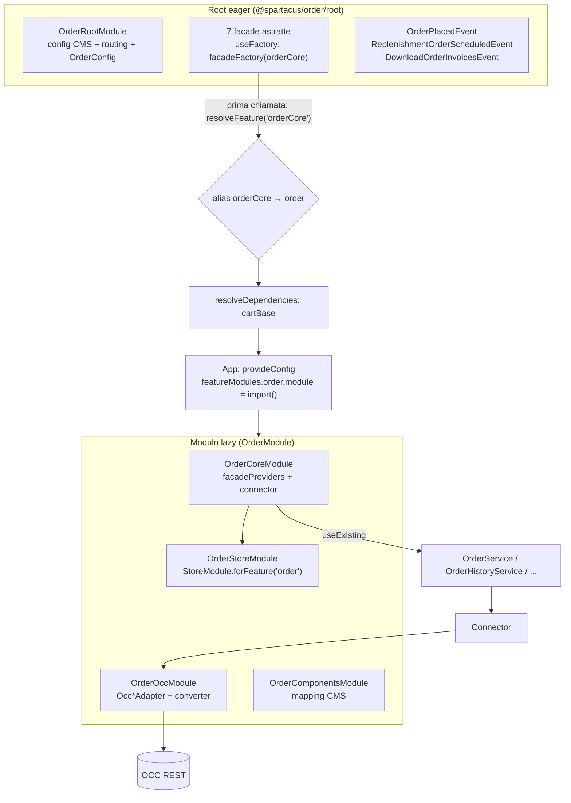
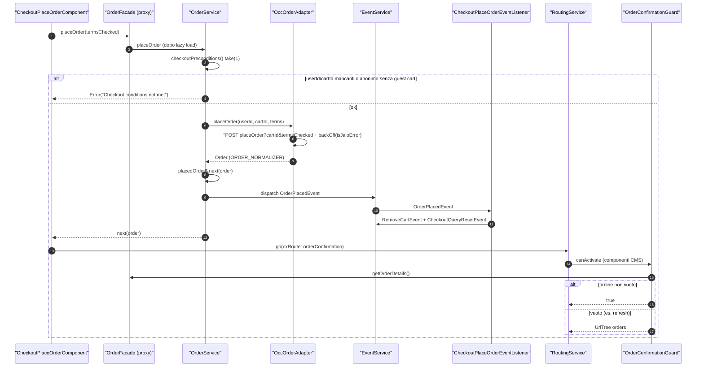
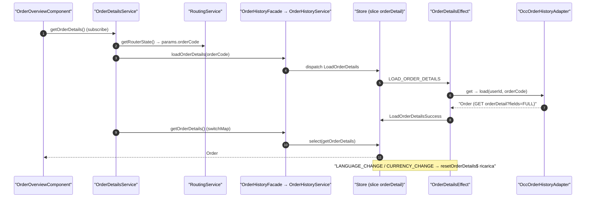
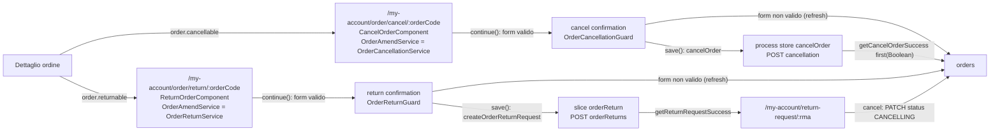
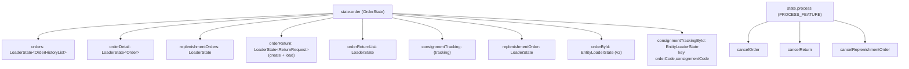

# 27 — Ordini

> Riferimenti allo SHA `5b7a1c2bf2808d7380bc20596d10f4fa710c3da1` (vedi [00-meta](../00-meta.md)).

Prerequisiti consigliati: [12 — Feature module e lazy loading in Spartacus](../parte-2/12-feature-module-lazy.md), [19 — State management](../parte-2/19-state-management.md), [20 — Facade, command & query, eventi](../parte-2/20-facade-command-query-eventi.md), [21 — Livello OCC](../parte-2/21-occ.md), [14 — Routing](../parte-2/14-routing.md). Collegati: [26 — Checkout](../parte-2/26-checkout.md) (chi chiama il place order), [25 — Carrello](../parte-2/25-cart.md) (reorder e rimozione del carrello), [16 — CMS rendering](../parte-2/16-cms-rendering.md) (guard e `providers` dei componenti CMS), [17 — Outlet](../parte-2/17-outlet.md), [18 — Layout, breakpoint, launch dialog](../parte-2/18-layout-breakpoint-a11y.md), [28 — B2B organization](../parte-2/28-organization-b2b.md) (endpoint `orgUsers`).

## 1. A cosa serve e perché esiste

La libreria `@spartacus/order` copre tutto ciò che accade **dopo** (e nell'istante in cui) il carrello diventa un ordine:

- il **place order** e la pagina di conferma (`OrderFacade`);
- la **storia ordini** e il **dettaglio ordine** in "My Account", con il tracking delle spedizioni (`OrderHistoryFacade`);
- la **cancellazione** e il **reso** (return request), con le relative liste e dettagli (`OrderReturnRequestFacade`);
- gli **ordini ricorrenti** (scheduled replenishment) (`ScheduledReplenishmentOrderFacade`, `ReplenishmentOrderHistoryFacade`);
- il **reorder** (ricrea un carrello da un ordine) (`ReorderOrderFacade`);
- gli **allegati** dell'ordine (`OrderAttachmentsFacade`);
- due estensioni "laterali": il **document flow** (`@spartacus/order/document-flow`, documenti successivi SAP) e le **fatture PDF** (libreria separata `@spartacus/pdf-invoices`).

Il punto di ingresso pesante è `OrderModule`, che importa nell'ordine core, OCC e componenti (`feature-libs/order/order.module.ts:L12-L15`). Come per le altre feature lib (vedi [capitolo 12](../parte-2/12-feature-module-lazy.md)) esiste un livello `root` eager — configurazione di default, rotte, facade astratte, eventi, token — e un livello lazy caricato alla prima necessità.

Tre scelte progettuali caratterizzano la libreria e ritornano in tutto il capitolo:

1. **Due modelli di stato convivono.** Il place order, la schedulazione di un replenishment, il reorder e gli allegati usano il pattern *Command* o chiamate dirette al connector, senza NgRx: l'ordine appena piazzato vive in un `BehaviorSubject` (`feature-libs/order/core/facade/order.service.ts:L22-L24`). Storia ordini, dettaglio, resi, replenishment e tracking usano invece uno store NgRx di feature `order` con 9 slice (6 loader, 2 entity loader e lo stato semplice `consignmentTracking`) (`feature-libs/order/core/store/order-state.ts:L37-L51`, `feature-libs/order/core/store/reducers/index.ts:L60-L60`).
2. **I componenti di dettaglio sono riusati cambiando la sorgente dati via DI.** `OrderOverviewComponent`, `OrderDetailItemsComponent` ecc. leggono da `OrderDetailsService`; la pagina di conferma ordine e quella di dettaglio replenishment sostituiscono quel servizio nei `providers` del mapping CMS con `OrderFacade` o `ReplenishmentOrderDetailsService` (`feature-libs/order/components/order-confirmation/order-confirmation.module.ts:L96-L129`, `feature-libs/order/components/replenishment-order-details/replenishment-order-details.module.ts:L51-L87`).
3. **Le rotte sono semantiche e senza path.** `OrderRootModule` registra 11 rotte con `path: null` e un `data.cxRoute`; i path reali vengono dalla routing config di default (`feature-libs/order/root/order-root.module.ts:L82-L172`, `feature-libs/order/root/config/default-order-routing-config.ts:L9-L54`), secondo il meccanismo descritto nel [capitolo 14](../parte-2/14-routing.md).

## 2. Mappa dei file

| Path | Ruolo |
|---|---|
| `feature-libs/order/order.module.ts` | `OrderModule`: core + OCC + components (`:L12-L15`). |
| `feature-libs/order/public_api.ts` | Entry `@spartacus/order`, riesporta solo il modulo (`:L7-L16`). |
| `feature-libs/order/root/feature-name.ts` | `ORDER_FEATURE = 'order'`, `ORDER_CORE_FEATURE = 'orderCore'` (`:L7-L8`). |
| `feature-libs/order/root/order-root.module.ts` | `ORDER_CMS_COMPONENTS` (36 tipi), `defaultOrderComponentsConfig()`, 11 rotte `path: null`, `OrderRootModule` (`:L28-L180`). |
| `feature-libs/order/root/config/order-config.ts` | `OrderConfig` astratta + augmentation di `Config` (`:L10-L23`). |
| `feature-libs/order/root/config/default-order-config.ts` | `previewMimeTypes` (13 MIME), `showOrderQuoteLink: false` (`:L9-L28`). |
| `feature-libs/order/root/config/default-order-routing-config.ts` | 12 rotte semantiche e `paramsMapping` (`:L9-L54`). |
| `feature-libs/order/root/facade/*.facade.ts` | 7 facade astratte lazy (`facadeFactory` su `orderCore`). |
| `feature-libs/order/root/events/order.events.ts` | `OrderEvent`, `OrderPlacedEvent`, `ReplenishmentOrderScheduledEvent`, `DownloadOrderInvoicesEvent` (`:L14-L72`). |
| `feature-libs/order/root/model/order.model.ts` | `Order`, `OrderHistory`, `ReturnRequest`, input cancel/return (`:L29-L146`). |
| `feature-libs/order/root/model/replenishment-order.model.ts` | `ReplenishmentOrder`, `Trigger` (`:L26-L81`). |
| `feature-libs/order/root/model/scheduled-replenishment.model.ts` | `ScheduleReplenishmentForm`, `recurrencePeriod`, `ORDER_TYPE` (`:L7-L35`). |
| `feature-libs/order/root/model/order-view.model.ts` | View model per My Account v2 (`:L17-L38`). |
| `feature-libs/order/root/model/order-outlets.model.ts` | `OrderOutlets` (3 outlet) (`:L10-L14`). |
| `feature-libs/order/root/model/augmented.model.ts` | Augmentation di `LAUNCH_CALLER` (`:L9-L21`). |
| `feature-libs/order/root/tokens/context.ts` | Token contesto entries + `USE_MY_ACCOUNT_V2_ORDER` (`:L9-L20`). |
| `feature-libs/order/root/tokens/converters.ts` | 10 token normalizer/serializer (`:L24-L62`). |
| `feature-libs/order/root/utils/order-card-utils.ts` | Builder di `Card` (indirizzo, delivery mode, pagamento) (`:L14-L72`). |
| `feature-libs/order/core/order-core.module.ts` | `OrderCoreModule`: store + facade providers + 6 connector (`:L17-L29`). |
| `feature-libs/order/core/facade/facade-providers.ts` | Facade astratta → service concreto via `useExisting` (`:L26-L63`). |
| `feature-libs/order/core/facade/order.service.ts` | Place order: `BehaviorSubject` + Command (`:L22-L191`). |
| `feature-libs/order/core/facade/order-history.service.ts` | Dettaglio, lista, tracking, cancel via NgRx (`:L41-L225`). |
| `feature-libs/order/core/facade/order-return-request.service.ts` | Resi via NgRx (`:L63-L79`). |
| `feature-libs/order/core/facade/replenishment-order-history.service.ts` | Replenishment via NgRx (`:L43-L160`). |
| `feature-libs/order/core/facade/scheduled-replenishment-order.service.ts` | Schedulazione (Command) (`:L32-L97`). |
| `feature-libs/order/core/facade/reorder-order.service.ts` | Reorder (Command + cancellazione carrello) (`:L24-L93`). |
| `feature-libs/order/core/facade/order-attachments.service.ts` | Allegati, direttamente sul connector (`:L16-L45`). |
| `feature-libs/order/core/facade/my-account-v2-order-history.service.ts` | Aggregazione lista + dettagli + tracking + resi (`:L36-L270`). |
| `feature-libs/order/core/store/order-state.ts` | `OrderState`, process id, entity type, key builder (`:L17-L58`). |
| `feature-libs/order/core/store/order-store.module.ts` | `StoreModule.forFeature` / `EffectsModule.forFeature` (`:L14-L21`). |
| `feature-libs/order/core/store/reducers/index.ts` | `getReducers()`, `reducerToken`, `reducerProvider` (`:L39-L85`). |
| `feature-libs/order/core/store/effects/index.ts` | Array `effects` (8 classi) (`:L16-L25`). |
| `feature-libs/order/core/connectors/*.adapter.ts` / `*.connector.ts` | 6 adapter astratti + 6 connector pass-through. |
| `feature-libs/order/occ/order-occ.module.ts` | Binding adapter → `Occ*`, 5 converter multi (`:L38-L90`). |
| `feature-libs/order/occ/config/default-occ-order-config.ts` | 17 endpoint OCC di default (`:L9-L50`). |
| `feature-libs/order/occ/adapters/occ-order.adapter.ts` | POST place order con `backOff` (`:L38-L115`). |
| `feature-libs/order/occ/adapters/occ-order-history.adapter.ts` | Dettaglio, lista, tracking, cancel, resi (`:L57-L231`). |
| `feature-libs/order/occ/adapters/converters/occ-order-normalizer.ts` | `OccOrderNormalizer` (`:L25-L81`). |
| `feature-libs/order/components/order-components.module.ts` | Aggregatore dei 10 moduli componenti (`:L23-L43`). |
| `feature-libs/order/components/order-details/order-details.service.ts` | `OrderDetailsService`: codice dal router → load → select (`:L19-L56`). |
| `feature-libs/order/components/order-details/order-details.module.ts` | Mapping CMS dettaglio, layout dialog, outlet v2 (`:L61-L190`). |
| `feature-libs/order/components/order-history/order-history.component.ts` | Lista ordini paginata (`:L58-L156`). |
| `feature-libs/order/components/amend-order/amend-order.service.ts` | `OrderAmendService` astratto (form cancel/reso) (`:L23-L153`). |
| `feature-libs/order/components/amend-order/cancellations/order-cancellation.service.ts` | Cancellazione (`:L41-L93`). |
| `feature-libs/order/components/amend-order/returns/order-return.service.ts` | Reso (`:L54-L99`). |
| `feature-libs/order/components/guards/order-confirmation.guard.ts` | `OrderConfirmationGuard` (`:L24-L36`). |
| `feature-libs/order/components/order-confirmation/order-confirmation.module.ts` | Mapping CMS conferma + outlet (`:L90-L141`). |
| `feature-libs/order/components/return-request-detail/return-request.service.ts` | Dettaglio/cancel reso (`:L35-L94`). |
| `feature-libs/order/document-flow/**` | Feature `orderDocumentFlow` (root/core/occ/components). |
| `feature-libs/pdf-invoices/**` | Feature `pdfInvoices` (root/core/occ/components). |
| `projects/storefrontapp/src/app/spartacus/features/order/order-feature.module.ts` | App demo: `module: () => import(...)` e flag v2 (`:L23-L37`). |

### File aggiuntivi

| Path | Ruolo |
|---|---|
| `feature-libs/order/schematics/add-order/index.ts` | `addOrderFeatures()`: factory degli schematics `ng-add`/`add` di `@spartacus/order` (vedi 3.10). |
| `feature-libs/order/schematics/add-order/index_spec.ts` | Test dello schematic: lazy loading, nessuna installazione delle dipendenze, scss, `angular.json`, eager loading. |
| `feature-libs/order/styles/_index.scss` | Entry SCSS degli stili order: importa `components/index`. |
| `feature-libs/order/styles/components/_index.scss` | Importa i cinque gruppi: order-history, order-overview, order-details, replenishment-order, my-account-v2. |
| `feature-libs/order/styles/components/my-account-v2/_index.scss` | Allowlist `$myaccount-view-order-allowlist` (solo `cx-my-account-v2-orders`) + `@extend` dei placeholder. |
| `feature-libs/order/styles/components/my-account-v2/_my-account-v2-order.scss` | Placeholder `%cx-my-account-v2-orders` (widget ordini My Account v2). |
| `feature-libs/order/styles/components/order-details/_index.scss` | Importa gli stili del dettaglio e definisce `$order-details-allowlist` (include anche i selettori del document flow). |
| `feature-libs/order/styles/components/order-details/_attachments-dialog.scss` | Placeholder `%cx-order-attachments-dialog`. |
| `feature-libs/order/styles/components/order-details/_my-account-v2-order-details.scss` | Placeholder v2: `%cx-my-account-v2-order-details-actions`, `%cx-my-account-v2-consignment-tracking`, `%cx-my-account-v2-download-invoices`. |
| `feature-libs/order/styles/components/order-details/_order-attachments.scss` | Placeholder `%cx-order-attachments`. |
| `feature-libs/order/styles/components/order-details/_order-detail-billing.scss` | Placeholder `%cx-order-detail-billing`. |
| `feature-libs/order/styles/components/order-details/_order-details-actions.scss` | Placeholder `%cx-order-details-actions`. |
| `feature-libs/order/styles/components/order-details/_order-details-items.scss` | Placeholder `%cx-order-details-items`. |
| `feature-libs/order/styles/components/order-details/_order-details-reorder.scss` | Placeholder `%cx-order-details-reorder`. |
| `feature-libs/order/styles/components/order-details/_order-details-shipping.scss` | Definisce di nuovo `%cx-order-overview` (stesso placeholder di `_order-overview.scss`, vedi 3.10). |
| `feature-libs/order/styles/components/order-details/_reorder-dialog.scss` | Selettore diretto `cx-reorder-dialog` (non placeholder, fuori allowlist). |
| `feature-libs/order/styles/components/order-history/_index.scss` | Importa `cart-item-list` da cart base + gli stili storico/amend/resi/tracking; `$order-history-allowlist`. |
| `feature-libs/order/styles/components/order-history/_amend-order-actions.scss` | Placeholder `%cx-amend-order-actions`. |
| `feature-libs/order/styles/components/order-history/_amend-order-items.scss` | Placeholder `%cx-amend-order-items`. |
| `feature-libs/order/styles/components/order-history/_cancel-order.scss` | Placeholder `%cx-cancel-order`. |
| `feature-libs/order/styles/components/order-history/_consignment-tracking.scss` | Placeholder `%cx-consignment-tracking` e `%cx-tracking-events`. |
| `feature-libs/order/styles/components/order-history/_my-account-v2-order-history.scss` | Mixin `draw-line` + placeholder `%cx-my-account-v2-order-history`. |
| `feature-libs/order/styles/components/order-history/_order-history.scss` | Placeholder `%cx-order-history`. |
| `feature-libs/order/styles/components/order-history/_order-return-request-list.scss` | Placeholder `%cx-order-return-request-list`. |
| `feature-libs/order/styles/components/order-history/_replenishment-order-history.scss` | Placeholder `%cx-replenishment-order-history`. |
| `feature-libs/order/styles/components/order-history/_return-request-items.scss` | Placeholder `%cx-return-request-items`. |
| `feature-libs/order/styles/components/order-history/_return-request-overview.scss` | Placeholder `%cx-return-request-overview`. |
| `feature-libs/order/styles/components/order-history/_return-request-totals.scss` | Placeholder `%cx-return-request-totals`. |
| `feature-libs/order/styles/components/order-overview/_index.scss` | Allowlist `$order-overview-allowlist` (`cx-order-overview`). |
| `feature-libs/order/styles/components/order-overview/_order-overview.scss` | Placeholder `%cx-order-overview`. |
| `feature-libs/order/styles/components/replenishment-order/_index.scss` | Allowlist `$replenishment-order-allowlist` (cancellation + dialog). |
| `feature-libs/order/styles/components/replenishment-order/_replenishment-order-cancellation.scss` | Placeholder `%cx-replenishment-order-cancellation` e `%cx-replenishment-order-cancellation-dialog`. |
| `feature-libs/pdf-invoices/_index.scss` | Entry SCSS di `@spartacus/pdf-invoices`: importa `@spartacus/styles/scss/core` e `styles/index`. |
| `feature-libs/pdf-invoices/styles/_index.scss` | Importa `_pdf-invoices.scss`. |
| `feature-libs/pdf-invoices/styles/_pdf-invoices.scss` | Stili di `cx-invoices-list` con selettore diretto (nessuna allowlist). |
| `feature-libs/pdf-invoices/assets/public_api.ts` | Entry `@spartacus/pdf-invoices/assets`: riesporta `translations/translations`. |
| `feature-libs/pdf-invoices/pdf-invoices.module.ts` | `PDFInvoicesModule` = components + core + occ (`:L12-L19`). |
| `feature-libs/pdf-invoices/public_api.ts` | Entry `@spartacus/pdf-invoices`: riesporta solo il modulo (`:L10-L10`). |
| `feature-libs/pdf-invoices/schematics/add-pdf-invoices/index.ts` | `addPDFInvoicesFeature()`: factory degli schematics di pdf-invoices (vedi 3.10). |
| `feature-libs/pdf-invoices/schematics/add-pdf-invoices/index_spec.ts` | Test dello schematic pdf-invoices (lazy, scss, `angular.json`, eager). |
| `feature-libs/pdf-invoices/vitest.config.ts` | Config Vitest della libreria: jsdom, pool `forks`, coverage v8 con soglie 85/65, report junit. |

### File aggiuntivi

| Path | Ruolo |
|---|---|
| `feature-libs/order/schematics/add-order/index.ts` | `addOrderFeatures()`: factory degli schematics `ng-add`/`add` di `@spartacus/order` (vedi 3.10). |
| `feature-libs/order/schematics/add-order/index_spec.ts` | Test dello schematic: lazy loading, nessuna installazione delle dipendenze, scss, `angular.json`, eager loading. |
| `feature-libs/order/styles/_index.scss` | Entry SCSS degli stili order: importa `components/index`. |
| `feature-libs/order/styles/components/_index.scss` | Importa i cinque gruppi: order-history, order-overview, order-details, replenishment-order, my-account-v2. |
| `feature-libs/order/styles/components/my-account-v2/_index.scss` | Allowlist `$myaccount-view-order-allowlist` (solo `cx-my-account-v2-orders`) + `@extend` dei placeholder. |
| `feature-libs/order/styles/components/my-account-v2/_my-account-v2-order.scss` | Placeholder `%cx-my-account-v2-orders` (widget ordini My Account v2). |
| `feature-libs/order/styles/components/order-details/_index.scss` | Importa gli stili del dettaglio e definisce `$order-details-allowlist` (include anche i selettori del document flow). |
| `feature-libs/order/styles/components/order-details/_attachments-dialog.scss` | Placeholder `%cx-order-attachments-dialog`. |
| `feature-libs/order/styles/components/order-details/_my-account-v2-order-details.scss` | Placeholder v2: `%cx-my-account-v2-order-details-actions`, `%cx-my-account-v2-consignment-tracking`, `%cx-my-account-v2-download-invoices`. |
| `feature-libs/order/styles/components/order-details/_order-attachments.scss` | Placeholder `%cx-order-attachments`. |
| `feature-libs/order/styles/components/order-details/_order-detail-billing.scss` | Placeholder `%cx-order-detail-billing`. |
| `feature-libs/order/styles/components/order-details/_order-details-actions.scss` | Placeholder `%cx-order-details-actions`. |
| `feature-libs/order/styles/components/order-details/_order-details-items.scss` | Placeholder `%cx-order-details-items`. |
| `feature-libs/order/styles/components/order-details/_order-details-reorder.scss` | Placeholder `%cx-order-details-reorder`. |
| `feature-libs/order/styles/components/order-details/_order-details-shipping.scss` | Definisce di nuovo `%cx-order-overview` (stesso placeholder di `_order-overview.scss`, vedi 3.10). |
| `feature-libs/order/styles/components/order-details/_reorder-dialog.scss` | Selettore diretto `cx-reorder-dialog` (non placeholder, fuori allowlist). |
| `feature-libs/order/styles/components/order-history/_index.scss` | Importa `cart-item-list` da cart base + gli stili storico/amend/resi/tracking; `$order-history-allowlist`. |
| `feature-libs/order/styles/components/order-history/_amend-order-actions.scss` | Placeholder `%cx-amend-order-actions`. |
| `feature-libs/order/styles/components/order-history/_amend-order-items.scss` | Placeholder `%cx-amend-order-items`. |
| `feature-libs/order/styles/components/order-history/_cancel-order.scss` | Placeholder `%cx-cancel-order`. |
| `feature-libs/order/styles/components/order-history/_consignment-tracking.scss` | Placeholder `%cx-consignment-tracking` e `%cx-tracking-events`. |
| `feature-libs/order/styles/components/order-history/_my-account-v2-order-history.scss` | Mixin `draw-line` + placeholder `%cx-my-account-v2-order-history`. |
| `feature-libs/order/styles/components/order-history/_order-history.scss` | Placeholder `%cx-order-history`. |
| `feature-libs/order/styles/components/order-history/_order-return-request-list.scss` | Placeholder `%cx-order-return-request-list`. |
| `feature-libs/order/styles/components/order-history/_replenishment-order-history.scss` | Placeholder `%cx-replenishment-order-history`. |
| `feature-libs/order/styles/components/order-history/_return-request-items.scss` | Placeholder `%cx-return-request-items`. |
| `feature-libs/order/styles/components/order-history/_return-request-overview.scss` | Placeholder `%cx-return-request-overview`. |
| `feature-libs/order/styles/components/order-history/_return-request-totals.scss` | Placeholder `%cx-return-request-totals`. |
| `feature-libs/order/styles/components/order-overview/_index.scss` | Allowlist `$order-overview-allowlist` (`cx-order-overview`). |
| `feature-libs/order/styles/components/order-overview/_order-overview.scss` | Placeholder `%cx-order-overview`. |
| `feature-libs/order/styles/components/replenishment-order/_index.scss` | Allowlist `$replenishment-order-allowlist` (cancellation + dialog). |
| `feature-libs/order/styles/components/replenishment-order/_replenishment-order-cancellation.scss` | Placeholder `%cx-replenishment-order-cancellation` e `%cx-replenishment-order-cancellation-dialog`. |
| `feature-libs/pdf-invoices/_index.scss` | Entry SCSS di `@spartacus/pdf-invoices`: importa `@spartacus/styles/scss/core` e `styles/index`. |
| `feature-libs/pdf-invoices/styles/_index.scss` | Importa `_pdf-invoices.scss`. |
| `feature-libs/pdf-invoices/styles/_pdf-invoices.scss` | Stili di `cx-invoices-list` con selettore diretto (nessuna allowlist). |
| `feature-libs/pdf-invoices/assets/public_api.ts` | Entry `@spartacus/pdf-invoices/assets`: riesporta `translations/translations`. |
| `feature-libs/pdf-invoices/pdf-invoices.module.ts` | `PDFInvoicesModule` = components + core + occ (`:L12-L19`). |
| `feature-libs/pdf-invoices/public_api.ts` | Entry `@spartacus/pdf-invoices`: riesporta solo il modulo (`:L10-L10`). |
| `feature-libs/pdf-invoices/schematics/add-pdf-invoices/index.ts` | `addPDFInvoicesFeature()`: factory degli schematics di pdf-invoices (vedi 3.10). |
| `feature-libs/pdf-invoices/schematics/add-pdf-invoices/index_spec.ts` | Test dello schematic pdf-invoices (lazy, scss, `angular.json`, eager). |
| `feature-libs/pdf-invoices/vitest.config.ts` | Config Vitest della libreria: jsdom, pool `forks`, coverage v8 con soglie 85/65, report junit. |

## 3. Come funziona passo per passo

### 3.1 Registrazione eager e caricamento lazy

1. **Root eager.** `OrderRootModule` fornisce tre default config: componenti (factory), routing e `defaultOrderConfig` (`feature-libs/order/root/order-root.module.ts:L174-L178`). La factory dichiara la feature `order` con i 36 tipi CMS di `ORDER_CMS_COMPONENTS` e la dipendenza da `CART_BASE_FEATURE`, e mappa `orderCore` come **alias stringa** di `order` (`feature-libs/order/root/order-root.module.ts:L67-L80`).
2. **Il `module` lo mette l'app.** Una feature è "configurata" solo se ha la proprietà `module` (`core-libs/core/src/lazy-loading/feature-modules.service.ts:L33-L35`); il root module non la fornisce. Nell'app demo `OrderFeatureModule` aggiunge `module: () => import('./order-wrapper.module')` (`projects/storefrontapp/src/app/spartacus/features/order/order-feature.module.ts:L26-L33`), e `OrderWrapperModule` importa `OrderModule` più estensioni condizionali (S/4 service, OMF, OPF) (`projects/storefrontapp/src/app/spartacus/features/order/order-wrapper.module.ts:L14-L27`).
3. **Facade proxy.** Ogni facade è una classe astratta `providedIn: 'root'` con `useFactory` → `facadeFactory({ feature: ORDER_CORE_FEATURE, methods: [...] })` (`feature-libs/order/root/facade/order.facade.ts:L14-L30`). Il proxy è un'istanza di una sottoclasse anonima a cui vengono aggiunti **solo** i metodi elencati (`core-libs/core/src/lazy-loading/facade-factory/facade-factory.service.ts:L117-L127`).
4. **Prima chiamata.** `resolveFeature('orderCore')` risolve l'alias con un ciclo `while` (`core-libs/core/src/lazy-loading/feature-modules.service.ts:L95-L100`), risolve le dipendenze (`cartBase`) e importa il modulo (`core-libs/core/src/lazy-loading/feature-modules.service.ts:L42-L73`). Il proxy prende poi la facade dall'injector del modulo lazy (`core-libs/core/src/lazy-loading/facade-factory/facade-factory.service.ts:L49-L52`), dove `facadeProviders` la lega al servizio concreto con `useExisting` (`feature-libs/order/core/facade/facade-providers.ts:L26-L63`).
5. **`async: true`.** `OrderHistoryFacade`, `OrderReturnRequestFacade` e `ReplenishmentOrderHistoryFacade` usano `async: true` (`feature-libs/order/root/facade/order-history.facade.ts:L41-L41`, `feature-libs/order/root/facade/order-return-request.facade.ts:L37-L37`, `feature-libs/order/root/facade/replenishment-order-history.facade.ts:L39-L39`), che aggiunge `delay(0)` alla risoluzione (`core-libs/core/src/lazy-loading/facade-factory/facade-factory.service.ts:L53-L56`).
6. **Metodi `void` via proxy.** `call()` collega subito un `connectable` con `ReplaySubject`: il metodo reale viene eseguito appena il modulo è risolto anche se il chiamante non si sottoscrive (`core-libs/core/src/lazy-loading/facade-factory/facade-factory.service.ts:L70-L92`). Per questo `loadOrderDetails(code)` chiamato sul proxy produce davvero il dispatch.
7. **Core.** `OrderCoreModule` importa `OrderStoreModule` e fornisce i `facadeProviders` più 6 connector (`feature-libs/order/core/order-core.module.ts:L17-L29`). Lo store è registrato con `StoreModule.forFeature(ORDER_FEATURE, reducerToken)` e `EffectsModule.forFeature(effects)` (`feature-libs/order/core/store/order-store.module.ts:L14-L21`).
8. **OCC.** `OrderOccModule` fornisce `defaultOccOrderConfig`, lega 6 adapter astratti alle implementazioni `Occ*` e registra 5 converter multi (`feature-libs/order/occ/order-occ.module.ts:L38-L90`).

### 3.2 Rotte e contesto

- Rotte di default: `orders` → `my-account/orders`, `orderDetails` → `my-account/order/:orderCode`, `orderGuest` → `guest/order/:orderCode`, cancel/return e relative conferme sotto `my-account/order/...`, `returnRequestDetails` → `my-account/return-request/:returnCode`, replenishment sotto `my-account/my-replenishment(s)`, `replenishmentConfirmation` → `replenishment/confirmation` (nessuna rotta `path: null` in `OrderRootModule`, `feature-libs/order/root/order-root.module.ts:L82-L172`), `orderConfirmation` → `order-confirmation` (`feature-libs/order/root/config/default-order-routing-config.ts:L9-L54`).
- `paramsMapping` collega i parametri URL alle proprietà del modello: `orderCode` → `code`, `returnCode` → `rma`, `replenishmentOrderCode` → `replenishmentOrderCode` (`feature-libs/order/root/config/default-order-routing-config.ts:L17-L17`, `:L41-L41`, `:L48-L48`). Per questo `OrderHistoryComponent.goToOrderDetail` può passare l'intero ordine come `params` (`feature-libs/order/components/order-history/order-history.component.ts:L119-L129`).
- Le rotte `orderGuest`, `orderDetails`, `orders`, `replenishment*`, `returnRequestDetails` hanno `[AuthGuard, CmsPageGuard]`; cancel, return, le loro conferme e `orderConfirmation` hanno solo `CmsPageGuard` (`feature-libs/order/root/order-root.module.ts:L104-L131`, `:L160-L171`). Per cancel/return l'`AuthGuard` è nel mapping CMS (`feature-libs/order/components/amend-order/cancellations/cancel-order/cancel-order.module.ts:L40-L42`).
- `orderDetails` e `orderConfirmation` impostano `cxContext[ORDER_ENTRIES_CONTEXT]` sui token `OrderDetailsOrderEntriesContextToken` / `OrderConfirmationOrderEntriesContextToken` (`feature-libs/order/root/order-root.module.ts:L97-L102`, `:L165-L170`). I token sono legati ai contesti concreti rispettivamente in `OrderComponentsModule` e `OrderConfirmationModule` (`feature-libs/order/components/order-components.module.ts:L23-L43`, `feature-libs/order/components/order-confirmation/order-confirmation.module.ts:L132-L135`); il primo legge le entry da `OrderHistoryFacade`, il secondo da `OrderFacade` (`feature-libs/order/components/page-context/order-details-order-entries.context.ts:L20-L29`, `feature-libs/order/components/page-context/order-confirmation-order-entries.context.ts:L20-L31`).

### 3.3 Place order e pagina di conferma

1. Il checkout chiama `orderFacade.placeOrder(this.checkoutSubmitForm.valid)` e su `next` naviga a `cxRoute: 'orderConfirmation'` (`feature-libs/checkout/base/components/checkout-place-order/checkout-place-order.component.ts:L149-L170`).
2. `OrderService.placeOrder` esegue `placeOrderCommand`, creato con `CommandStrategy.CancelPrevious` (`feature-libs/order/core/facade/order.service.ts:L26-L54`, `:L119-L121`).
3. `checkoutPreconditions()` prende con `take(1)` userId, id del carrello attivo e flag guest, e lancia `Error('Checkout conditions not met')` se manca uno dei due id o se l'utente è anonimo con carrello non guest (`feature-libs/order/core/facade/order.service.ts:L99-L117`).
4. `OccOrderAdapter.placeOrder` fa POST con body vuoto, `cartId`/`termsChecked` in query string, `Content-Type: application/x-www-form-urlencoded`, header `USE_CLIENT_TOKEN` per l'utente anonimo (guest) e `backOff({ shouldRetry: isJaloError })`; la risposta passa per `ORDER_NORMALIZER` (`feature-libs/order/occ/adapters/occ-order.adapter.ts:L38-L66`, `:L106-L115`).
5. `OccOrderNormalizer` converte entries, entry delle consignment e unconsigned entries con `PRODUCT_NORMALIZER` e `ORDER_ENTRY_PROMOTIONS_NORMALIZER`, aggiungendo `orderCode` (`feature-libs/order/occ/adapters/converters/occ-order-normalizer.ts:L25-L81`).
6. Al successo: `placedOrder$.next(order)` e dispatch di `OrderPlacedEvent` con `cartCode: cartId` (`feature-libs/order/core/facade/order.service.ts:L32-L46`). Il JSDoc dell'evento spiega che `cartId` è `code` per utenti loggati e `guid` per anonimi (`feature-libs/order/root/events/order.events.ts:L16-L29`).
7. `CheckoutPlaceOrderEventListener` reagisce all'evento dispatchando `RemoveCartEvent` e `CheckoutQueryResetEvent` (`feature-libs/checkout/base/root/events/checkout-place-order-event.listener.ts:L24-L40`).
8. Sulla pagina `/order-confirmation` ogni componente CMS di conferma è protetto da `OrderConfirmationGuard`, che lascia passare solo se `orderFacade.getOrderDetails()` emette un oggetto non vuoto, altrimenti reindirizza a `orders` (`feature-libs/order/components/guards/order-confirmation.guard.ts:L24-L36`).
9. Overview e Billing della conferma riusano `OrderOverviewComponent` / `OrderDetailBillingComponent` con `OrderDetailsService` sostituito da `OrderFacade` (`feature-libs/order/components/order-confirmation/order-confirmation.module.ts:L96-L129`). Poiché `OrderFacade` non ha `isOrderDetailsLoading`, i componenti verificano `typeof ... === 'function'` e altrimenti usano `of(false)` (`feature-libs/order/components/order-details/order-overview/order-overview.component.ts:L66-L70`, `feature-libs/order/components/order-details/order-detail-items/order-detail-items.component.ts:L78-L81`).
10. `OrderConfirmationModule` aggiunge `OrderConfirmationShippingComponent` all'outlet `CONSIGNMENT_DELIVERY_INFO` (`feature-libs/order/components/order-confirmation/order-confirmation.module.ts:L136-L139`).
11. Il thank-you message aggiunge un global message `MSG_TYPE_ASSISTIVE` con il codice ordine (o `replenishmentOrderCode`) per gli screen reader (`feature-libs/order/components/order-confirmation/order-confirmation-thank-you-message/order-confirmation-thank-you-message.component.ts:L65-L93`).
12. In `ngOnDestroy` thank-you message, items e totals chiamano `orderFacade.clearPlacedOrder()` (`feature-libs/order/components/order-confirmation/order-confirmation-thank-you-message/order-confirmation-thank-you-message.component.ts:L69-L71`, `feature-libs/order/components/order-confirmation/order-confirmation-items/order-confirmation-items.component.ts:L41-L43`, `feature-libs/order/components/order-confirmation/order-confirmation-totals/order-confirmation-totals.component.ts:L26-L28`).

Varianti:

- `placePaymentAuthorizedOrder(termsChecked, cartId?)`: con `cartId` esplicito salta il command e le precondizioni sul carrello attivo, controlla solo lo userId e chiama direttamente il connector (`feature-libs/order/core/facade/order.service.ts:L123-L156`). L'adapter aggiunge un secondo `backOff` su `isServerError` con `maxTries: DEFAULT_SERVER_ERROR_RETRIES_COUNT` (`feature-libs/order/occ/adapters/occ-order.adapter.ts:L91-L103`).
- **Guest:** `OrderGuestRegisterFormComponent` (host `ngSkipHydration`) registra l'ospite con `userRegisterFacade.registerGuest(guid, password)` (`feature-libs/order/components/order-confirmation/order-guest-register-form/order-guest-register-form.component.ts:L30-L91`).

### 3.4 Dettaglio ordine (My Account)

1. Rotta `my-account/order/:orderCode` con `[AuthGuard, CmsPageGuard]` (`feature-libs/order/root/order-root.module.ts:L92-L103`).
2. I componenti CMS di dettaglio (8 tipi, tutti con `guards: [AuthGuard]`) leggono da `OrderDetailsService` (`feature-libs/order/components/order-details/order-details.module.ts:L128-L172`).
3. `OrderDetailsService` (`providedIn: 'root'`) deriva `orderCode$` dal param del router con `distinctUntilChanged`; `orderLoad$` chiama `loadOrderDetails(orderCode)` o `clearOrderDetails()` ed è `shareReplay({ bufferSize: 1, refCount: true })` (`feature-libs/order/components/order-details/order-details.service.ts:L30-L44`).
4. `getOrderDetails()` fa `switchMap` da `orderLoad$` a `orderHistoryFacade.getOrderDetails()`: il caricamento parte solo quando qualcuno si sottoscrive (`feature-libs/order/components/order-details/order-details.service.ts:L51-L55`).
5. `OrderHistoryService.loadOrderDetails` prende lo userId e dispatcha `LoadOrderDetails({ userId, orderCode })` (`feature-libs/order/core/facade/order-history.service.ts:L50-L59`).
6. `OrderDetailsEffect.loadOrderDetails$` chiama `OrderHistoryConnector.get` e mappa in `LoadOrderDetailsSuccess`/`Fail` con `tryNormalizeHttpError` (`feature-libs/order/core/store/effects/order-details.effect.ts:L35-L57`).
7. `OccOrderHistoryAdapter.load` fa GET su `orderDetail` (`?fields=FULL`), con `USE_CLIENT_TOKEN` se l'utente è anonimo, e normalizza con `ORDER_NORMALIZER` (`feature-libs/order/occ/adapters/occ-order-history.adapter.ts:L57-L68`). Con `showOrderQuoteLink` attivo l'URL è la fusione degli scope `orderDetail` e `quoteCode` tramite `OccFieldsService.getOptimalUrlGroups` (`feature-libs/order/occ/adapters/occ-order-history.adapter.ts:L212-L231`).
8. Il success finisce nella slice `orderDetail` (`loaderReducer(ORDER_DETAILS, ...)`) (`feature-libs/order/core/store/reducers/index.ts:L45-L48`) e il selettore `getOrderDetails` lo restituisce (`feature-libs/order/core/store/selectors/order-details.selectors.ts:L18-L21`).
9. Al cambio di lingua o valuta `resetOrderDetails$` ricarica l'ordine corrente (codice letto dallo store con `withLatestFrom`), altrimenti `EMPTY` (`feature-libs/order/core/store/effects/order-details.effect.ts:L87-L120`).

Sopra questo flusso:

- **Azioni.** Il template mostra i link `orderCancel` se `order.cancellable` e `orderReturn` se `order.returnable` (`feature-libs/order/components/order-details/order-detail-actions/order-detail-actions.component.html:L13-L39`).
- **Consegne.** `OrderDetailItemsComponent` raggruppa consegne in pickup/delivery tramite `MyAccountV2OrderConsignmentsService` (`feature-libs/order/components/order-details/order-detail-items/order-detail-items.component.ts:L61-L72`), che ordina per stato: in lavorazione, completate (`DELIVERY_COMPLETED`, `PICKUP_COMPLETE`), cancellate (`feature-libs/order/components/order-details/my-account-v2-order-consignments.service.ts:L50-L81`, `feature-libs/order/components/order-details/order-detail-items/order-consigned-entries/order-consigned-entries.model.ts:L7-L8`).
- **Tracking.** `ConsignmentTrackingComponent.openTrackingDialog` chiama `loadConsignmentTracking(orderCode, consignment.code)` e apre il dialog `CONSIGNMENT_TRACKING` con `tracking$` e `shipDate` (`feature-libs/order/components/order-details/order-detail-items/consignment-tracking/consignment-tracking.component.ts:L61-L87`); il pulsante esiste per gli stati SHIPPED, IN_TRANSIT, DELIVERY_COMPLETED, DELIVERY_REJECTED, DELIVERING (`feature-libs/order/components/order-details/order-detail-items/consignment-tracking/consignment-tracking.component.ts:L35-L41`). Il template mostra il tracking dietro `*cxFeature="'consignmentTracking'"` (`feature-libs/order/components/order-details/order-detail-items/order-consigned-entries/order-consigned-entries.component.html:L19-L19`), con feature level `'1.2'` impostato dallo stesso modulo (`feature-libs/order/components/order-details/order-details.module.ts:L173-L175`).
- **Link al preventivo.** `OrderOverviewComponent` mostra il link a `quoteDetails` solo se `orderConfig.showOrderQuoteLink && quoteCode` (`feature-libs/order/components/order-details/order-overview/order-overview.component.html:L178-L195`).

### 3.5 Lista ordini

1. `OrderHistoryComponent.orders$ = getOrderHistoryList(5)` (`feature-libs/order/components/order-history/order-history.component.ts:L61-L71`).
2. `getOrderHistoryList` implementa "load on subscribe": se lo stato loader non è né loading né success né error chiama `loadOrderList(pageSize)`, poi mappa `value` (`feature-libs/order/core/facade/order-history.service.ts:L71-L87`).
3. `loadOrderList` richiede utente loggato (`takeUserId(true)`), legge in modo sincrono `replenishmentOrderCode` dai params del router e dispatcha `LoadUserOrders`; l'errore è inghiottito con un TODO (`feature-libs/order/core/facade/order-history.service.ts:L102-L130`). `takeUserId(true)` lancia per l'utente anonimo (`core-libs/core/src/auth/user-auth/facade/user-id.service.ts:L57-L69`).
4. `OrdersEffect.loadUserOrders$` sceglie la sorgente: con `replenishmentOrderCode` usa `loadReplenishmentDetailsHistory`, altrimenti `getHistory` (`feature-libs/order/core/store/effects/orders.effect.ts:L33-L68`).
5. `OccOrderHistoryAdapter.loadHistory` aggiunge `pageSize`, `currentPage`, `sort` in query solo se truthy (`feature-libs/order/occ/adapters/occ-order-history.adapter.ts:L70-L95`).
6. Cambio sort/pagina → `loadOrderList(PAGE_SIZE, currentPage, sortCode)`; `ngOnDestroy` → `clearOrderList()` (`feature-libs/order/components/order-history/order-history.component.ts:L98-L155`).
7. `resetUserOrders$` svuota la lista al cambio lingua (`feature-libs/order/core/store/effects/orders.effect.ts:L70-L78`).

### 3.6 Cancellazione e reso (amend order)

1. `OrderAmendService` è astratto: `getEntries()` e `save()` sono astratti; il form viene costruito per ordine e ricostruito se cambia `orderCode` (`feature-libs/order/components/amend-order/amend-order.service.ts:L34-L84`).
2. Il form ha un controllo per entry (chiave `entryNumber`) con `Validators.min(0)` e `max(getMaxAmendQuantity(entry))`; il gruppo `entries` ha il validatore `ValidateQuantityToCancel` (somma > 0, errore `cxNoSelectedItemToCancel`) (`feature-libs/order/components/amend-order/amend-order.service.ts:L23-L32`, `:L86-L108`). Il massimo è `cancellableQuantity` o `returnableQuantity` con fallback su `quantity` (`feature-libs/order/components/amend-order/amend-order.service.ts:L140-L148`).
3. Il servizio concreto entra tramite i `providers` del mapping CMS: `{ provide: OrderAmendService, useExisting: OrderCancellationService }` (`feature-libs/order/components/amend-order/cancellations/cancel-order/cancel-order.module.ts:L38-L51`).
4. `AmendOrderActionsComponent.continue` naviga a `forwardRoute` con `params: { code: orderCode }` se il form è valido, altrimenti `markAllAsTouched` (`feature-libs/order/components/amend-order/amend-order-actions/amend-order-actions.component.ts:L35-L45`).
5. Le pagine di conferma hanno guard `[AuthGuard, OrderCancellationGuard]` (o `OrderReturnGuard`); la guard reindirizza a `orders` se il form non è valido (`feature-libs/order/components/amend-order/cancellations/cancel-order-confirmation/cancel-order-confirmation.module.ts:L29-L31`, `feature-libs/order/components/amend-order/cancellations/order-cancellation.guard.ts:L24-L38`).
6. **Cancel.** `OrderCancellationService.getEntries` esclude `entryNumber === -1` e le entry senza `cancellableQuantity > 0` (`feature-libs/order/components/amend-order/cancellations/order-cancellation.service.ts:L41-L54`). `save()` costruisce gli input, resetta il form, chiama `cancelOrder`, attende `getCancelOrderSuccess()` con `first(Boolean)`, poi resetta il process state, mostra `cancelSuccess` e naviga a `orders` (`feature-libs/order/components/amend-order/cancellations/order-cancellation.service.ts:L56-L93`).
7. Il flag di successo viene dal process store: `ProcessSelectors.getProcessSuccessFactory(CANCEL_ORDER_PROCESS_ID)` (`feature-libs/order/core/facade/order-history.service.ts:L191-L204`); l'azione `CancelOrder` estende `EntityLoadAction` su `PROCESS_FEATURE` (`feature-libs/order/core/store/actions/order-details.action.ts:L60-L95`).
8. `cancelOrder$` chiama il connector (POST JSON su `cancelOrder`) e in errore aggiunge un global message per ciascun `error.error.errors[].message` (`feature-libs/order/core/store/effects/order-details.effect.ts:L59-L85`, `feature-libs/order/occ/adapters/occ-order-history.adapter.ts:L110-L127`).
9. **Reso.** `ReturnOrderComponent` tiene solo le entry con una consignment entry dello stesso codice prodotto e usa `shippedQuantity` come nuovo `returnableQuantity` solo nelle entry passate alla UI (`feature-libs/order/components/amend-order/returns/return-order/return-order.component.ts:L42-L73`); il `Validators.max` del form resta sul valore originale (`feature-libs/order/components/amend-order/amend-order.service.ts:L96-L106`). `OrderReturnService.save` chiama `createOrderReturnRequest`, attende `getReturnRequestSuccess()`, legge il `ReturnRequest` creato e naviga a `returnRequestDetails` con `params: { rma }` (`feature-libs/order/components/amend-order/returns/order-return.service.ts:L54-L99`).
10. `createReturnRequest` serializza con `ORDER_RETURN_REQUEST_INPUT_SERIALIZER` e normalizza con `ORDER_RETURN_REQUEST_NORMALIZER` (`feature-libs/order/occ/adapters/occ-order-history.adapter.ts:L129-L151`). Create e load del reso condividono l'entity type `RETURN_REQUEST_DETAILS`, quindi scrivono nella stessa slice `orderReturn` (`feature-libs/order/core/store/actions/order-return-request.action.ts:L55-L117`).
11. **Dettaglio reso.** `ReturnRequestService.getReturnRequest` legge `returnCode` dal router e carica il dettaglio se assente o con `rma` diverso e non in loading (`feature-libs/order/components/return-request-detail/return-request.service.ts:L35-L59`). La cancellazione invia `{ status: 'CANCELLING' }` (PATCH su `cancelReturn`) (`feature-libs/order/components/return-request-detail/return-request.service.ts:L65-L69`, `feature-libs/order/occ/adapters/occ-order-history.adapter.ts:L193-L210`); `backToList()` torna a `orders` con `state: { activeTab: 1 }` (`feature-libs/order/components/return-request-detail/return-request.service.ts:L85-L94`).

### 3.7 Reorder

1. `OrderDetailReorderComponent` disabilita il pulsante se nessuna entry ha un prodotto ancora in catalogo e apre il dialog `REORDER` con `{ orderCode }` (`feature-libs/order/components/order-details/order-detail-reorder/order-detail-reorder.component.ts:L46-L74`).
2. `ReorderDialogComponent.createCartFromOrder` chiama `reorderOrderFacade.reorder`, poi `multiCartFacade.reloadCart(OCC_CART_ID_CURRENT, { active: true })` e mostra le `cartModifications`; in errore aggiunge `reorder.dialog.error` e chiude (`feature-libs/order/components/order-details/order-detail-reorder/reorder-dialog/reorder-dialog.component.ts:L77-L96`).
3. `ReorderOrderService` usa un command `CancelPrevious`: prima `reorderPreconditions()`, poi `ReorderOrderConnector.reorder(orderId, userId)` (`feature-libs/order/core/facade/reorder-order.service.ts:L26-L37`).
4. Le precondizioni falliscono con `'Must be logged in to reorder'` se manca lo userId; se esiste un carrello attivo lo cancellano e attendono che l'entità non sia in loading e sia assente o in errore (`feature-libs/order/core/facade/reorder-order.service.ts:L56-L92`).
5. `OccReorderOrderAdapter` fa POST JSON con body vuoto su `reorder` con `orderCode` in query (`feature-libs/order/occ/adapters/occ-reorder-order.adapter.ts:L31-L51`). L'endpoint non ha default nella libreria order: esiste in `defaultB2bOccConfig` (`feature-libs/order/occ/model/occ-order-endpoints.model.ts:L86-L93`, `core-libs/setup/recipes/b2b/config/default-b2b-occ-config.ts:L31-L36`).

### 3.8 Replenishment

1. **Schedulazione** (dal checkout scheduled replenishment): `ScheduledReplenishmentOrderService` usa un command `CancelPrevious`, chiama il connector con `(cartId, form, termsChecked, userId)` e al successo fa `orderFacade.setPlacedOrder(replenishmentOrder)` e dispatcha `ReplenishmentOrderScheduledEvent` (`feature-libs/order/core/facade/scheduled-replenishment-order.service.ts:L32-L68`). Le precondizioni sono quelle del place order con messaggio `'Order conditions not met'` (`feature-libs/order/core/facade/scheduled-replenishment-order.service.ts:L79-L97`).
2. L'adapter serializza il form con `REPLENISHMENT_ORDER_FORM_SERIALIZER` (`feature-libs/order/occ/adapters/occ-scheduled-replenishment-order.adapter.ts:L39-L82`); il serializer trasforma `replenishmentStartDate` `YYYY-mm-dd` aggiungendo ora locale, `:00` e offset del fuso (`feature-libs/order/occ/adapters/converters/occ-scheduled-replenishment-order-form-serializer.ts:L34-L46`).
3. **Storico e dettaglio** passano per NgRx: `ReplenishmentOrderHistoryService` usa `takeUserId(true)` per caricare dettagli, lista e cancellare (`feature-libs/order/core/facade/replenishment-order-history.service.ts:L43-L57`). `ReplenishmentOrderDetailsService` replica il pattern di `OrderDetailsService` sul param `replenishmentOrderCode` (`feature-libs/order/components/replenishment-order-details/replenishment-order-details.service.ts:L25-L55`).
4. **Ordini generati.** Nella pagina di dettaglio replenishment, `ReplenishmentDetailOrderHistoryComponent` è mappato su `OrderHistoryComponent` (`feature-libs/order/components/replenishment-order-details/replenishment-order-details.module.ts:L51-L87`); `loadOrderList` trova `replenishmentOrderCode` nei params e `OrdersEffect` usa l'endpoint `replenishmentOrderDetailsHistory` (`feature-libs/order/core/facade/order-history.service.ts:L107-L123`, `feature-libs/order/core/store/effects/orders.effect.ts:L39-L47`).
5. **Cancellazione.** `ReplenishmentOrderHistoryComponent.openDialog` apre `REPLENISHMENT_ORDER` (`feature-libs/order/components/replenishment-order-history/replenishment-order-history.component.ts:L132-L144`); l'adapter fa PATCH con body `{}` (`feature-libs/order/occ/adapters/occ-replenishment-order-history.adapter.ts:L43-L87`); `CANCEL_REPLENISHMENT_ORDER_SUCCESS` aggiorna sia la lista (sostituendo l'elemento) sia il dettaglio (`feature-libs/order/core/store/reducers/replenishment-orders.reducer.ts:L30-L49`, `feature-libs/order/core/store/reducers/replenishment-order-details.reducer.ts:L16-L20`).

### 3.9 Allegati, My Account v2, document flow, PDF invoices

- **Allegati.** `OrderAttachmentsService` chiama il connector dopo `takeUserId().pipe(take(1))`, senza store (`feature-libs/order/core/facade/order-attachments.service.ts:L16-L45`). Il dialog carica `sapAttachments` (fallback `[]`) (`feature-libs/order/components/order-details/order-attachments/attachments-dialog/order-attachments-dialog.component.ts:L72-L90`); al click scarica il blob (`responseType: 'blob' as 'json'`, `feature-libs/order/occ/adapters/occ-order-attachments.adapter.ts:L31-L65`) e, se il MIME è in `previewMimeTypes`, lo apre in una nuova scheda, altrimenti forza il download (`feature-libs/order/components/order-details/order-attachments/attachments-dialog/order-attachments-dialog.component.ts:L95-L145`).
- **My Account v2.** Il token `USE_MY_ACCOUNT_V2_ORDER` (default `false`, `feature-libs/order/root/tokens/context.ts:L17-L20`) attiva tre cambiamenti: mapping di `AccountOrderDetailsActionsComponent` → `MyAccountV2OrderDetailsActionsComponent` (`feature-libs/order/components/order-details/order-details.module.ts:L80-L87`, `:L180-L182`), un `MODULE_INITIALIZER` che mette `MyAccountV2ConsignmentTrackingComponent` in `OrderOutlets.ORDER_CONSIGNMENT` con `OutletPosition.REPLACE` (`feature-libs/order/components/order-details/order-details.module.ts:L61-L78`, `:L183-L187`), e `AccountOrderHistoryComponent` → `MyAccountV2OrderHistoryComponent` (`feature-libs/order/components/order-history/order-history.module.ts:L34-L41`, `:L65-L77`). `MyAccountV2OrderHistoryService` arricchisce ogni ordine della lista con dettaglio completo (`LoadOrderById`, slice entity `orderById`), tracking delle consegne con `trackingID` e resi associati (`feature-libs/order/core/facade/my-account-v2-order-history.service.ts:L46-L174`, `:L198-L213`).
- **Download fatture v2.** È event-driven: `MyAccountV2OrderDetailsActionsComponent.showDialog` dispatcha `DownloadOrderInvoicesEvent`; `MyAccountV2DownloadInvoicesEventListener` apre il dialog `DOWNLOAD_ORDER_INVOICES` (`feature-libs/order/components/order-details/my-account-v2/order-details-actions/my-account-v2-order-details-actions.component.ts:L31-L35`, `feature-libs/order/components/order-details/my-account-v2/download-invoices/my-account-v2-download-invoices-event.listener.ts:L24-L41`), che incorpora `InvoicesListComponent` di `@spartacus/pdf-invoices` (`feature-libs/order/components/order-details/my-account-v2/download-invoices/my-account-v2-download-invoices.component.ts:L41-L65`).
- **Document flow.** Feature separata `orderDocumentFlow` con un solo tipo CMS, `AccountOrderDocumentFlowComponent`, senza `dependencies` (`feature-libs/order/document-flow/root/order-document-flow-root.module.ts:L11-L22`). `OrderDocumentFlowFacade` espone `getOrderSubsequentDocuments` e `getOrderSubsequentDocumentEntries` (`feature-libs/order/document-flow/root/facade/order-document-flow.facade.ts:L17-L45`); il componente riusa `OrderDetailsService` e apre il dialog `ORDER_DOCUMENT_FLOW` (`feature-libs/order/document-flow/components/order-document-flow/order-document-flow.component.ts:L29-L46`), che mette in cache le entry per documento (`feature-libs/order/document-flow/components/order-document-flow-dialog/order-document-flow-dialog.component.ts:L111-L177`). Gli endpoint sono `subsequentDocuments` e `subsequentDocumentsEntries` (`feature-libs/order/document-flow/occ/config/default-occ-document-flow-config-factory.ts:L10-L24`).
- **PDF invoices.** Feature `pdfInvoices` con alias `pdfInvoicesCore` e CMS `AccountOrderDetailsPDFInvoicesComponent` (`feature-libs/pdf-invoices/root/pdf-invoices-root.module.ts:L14-L33`). `PDFInvoicesFacade` è lazy sulla feature `pdfInvoices` (`feature-libs/pdf-invoices/root/facade/pdf-invoices.facade.ts:L16-L22`). `PDFInvoicesService` memorizza `userId` e `orderId` (dal param `orderCode`) nel costruttore e li usa come fallback (`feature-libs/pdf-invoices/core/services/pdf-invoices.service.ts:L25-L76`). `PDFInvoicesBadRequestHandler` (400) traduce gli `UnknownIdentifierError` su `Order`/`Invoice` in messaggi dedicati (`feature-libs/pdf-invoices/core/http-interceptors/bad-request/pdf-invoices-badrequest.handler.ts:L20-L90`). `InvoicesListComponent` usa page size 5 e forza `fields: DEFAULT` sugli aggiornamenti successivi (`feature-libs/pdf-invoices/components/invoices-list/invoices-list.component.ts:L67-L155`); il download passa per `FileDownloadService.download(url, '<invoiceId>.pdf')` (`feature-libs/pdf-invoices/components/invoices-list/invoices-list.component.ts:L171-L182`).

### 3.10 Installazione via schematics e stili

- **Schematics.** `addOrderFeatures()` legge il `package.json` dell'app, valida l'installazione Spartacus, risolve le dipendenze tra feature con `analyzeCrossFeatureDependencies` e concatena `analyzeApplication`, `addFeatures`, `addPackageJsonDependenciesForLibrary(peerDependencies, ...)` e `finalizeInstallation` (`feature-libs/order/schematics/add-order/index.ts:L25-L43`). La stessa funzione è registrata sia come `ng-add` (privato, nascosto, alias `install`) sia come `add` (`feature-libs/order/schematics/collection.json:L4-L16`). Il test verifica che i moduli feature di cart base e user **non** vengano generati (`feature-libs/order/schematics/add-order/index_spec.ts:L99-L107`). `addPDFInvoicesFeature()` ha corpo identico (`feature-libs/pdf-invoices/schematics/add-pdf-invoices/index.ts:L25-L45`), ma il suo spec non contiene il test "should NOT install the required feature dependencies" (`feature-libs/pdf-invoices/schematics/add-pdf-invoices/index_spec.ts:L79-L123`).
- **Stili.** Ogni gruppo SCSS segue lo schema allowlist + `@extend %<selettore> !optional`, saltando i selettori presenti in `$skipComponentStyles` (`feature-libs/order/styles/components/order-details/_index.scss:L11-L37`). L'allowlist del dettaglio elenca anche `cx-order-document-flow` e `cx-order-document-flow-dialog`, i cui placeholder stanno però in `feature-libs/order/document-flow/styles/_document-flow.scss:L1-L1`. Il placeholder `%cx-order-overview` è definito due volte, in `feature-libs/order/styles/components/order-overview/_order-overview.scss:L1-L1` e in `feature-libs/order/styles/components/order-details/_order-details-shipping.scss:L1-L1`: Sass unisce le regole di entrambi. `cx-reorder-dialog` (`feature-libs/order/styles/components/order-details/_reorder-dialog.scss:L1-L1`) e `cx-invoices-list` (`feature-libs/pdf-invoices/styles/_pdf-invoices.scss:L1-L1`) usano invece selettori diretti, quindi `$skipComponentStyles` non li può escludere.

### 3.10 Installazione via schematics e stili

- **Schematics.** `addOrderFeatures()` legge il `package.json` dell'app, valida l'installazione Spartacus, risolve le dipendenze tra feature con `analyzeCrossFeatureDependencies` e concatena `analyzeApplication`, `addFeatures`, `addPackageJsonDependenciesForLibrary(peerDependencies, ...)` e `finalizeInstallation` (`feature-libs/order/schematics/add-order/index.ts:L25-L43`). La stessa funzione è registrata sia come `ng-add` (privato, nascosto, alias `install`) sia come `add` (`feature-libs/order/schematics/collection.json:L4-L16`). Il test verifica che i moduli feature di cart base e user **non** vengano generati (`feature-libs/order/schematics/add-order/index_spec.ts:L99-L107`). `addPDFInvoicesFeature()` ha corpo identico (`feature-libs/pdf-invoices/schematics/add-pdf-invoices/index.ts:L25-L45`), ma il suo spec non contiene il test "should NOT install the required feature dependencies" (`feature-libs/pdf-invoices/schematics/add-pdf-invoices/index_spec.ts:L79-L123`).
- **Stili.** Ogni gruppo SCSS segue lo schema allowlist + `@extend %<selettore> !optional`, saltando i selettori presenti in `$skipComponentStyles` (`feature-libs/order/styles/components/order-details/_index.scss:L11-L37`). L'allowlist del dettaglio elenca anche `cx-order-document-flow` e `cx-order-document-flow-dialog`, i cui placeholder stanno però in `feature-libs/order/document-flow/styles/_document-flow.scss:L1-L1`. Il placeholder `%cx-order-overview` è definito due volte, in `feature-libs/order/styles/components/order-overview/_order-overview.scss:L1-L1` e in `feature-libs/order/styles/components/order-details/_order-details-shipping.scss:L1-L1`: Sass unisce le regole di entrambi. `cx-reorder-dialog` (`feature-libs/order/styles/components/order-details/_reorder-dialog.scss:L1-L1`) e `cx-invoices-list` (`feature-libs/pdf-invoices/styles/_pdf-invoices.scss:L1-L1`) usano invece selettori diretti, quindi `$skipComponentStyles` non li può escludere.

## 4. Diagrammi

### 4.1 Struttura a livelli e caricamento lazy



Riferimenti: `feature-libs/order/root/order-root.module.ts:L67-L80`, `core-libs/core/src/lazy-loading/feature-modules.service.ts:L42-L100`, `projects/storefrontapp/src/app/spartacus/features/order/order-feature.module.ts:L26-L33`, `feature-libs/order/core/order-core.module.ts:L17-L29`, `feature-libs/order/core/facade/facade-providers.ts:L26-L63`, `feature-libs/order/occ/order-occ.module.ts:L38-L90`.

### 4.2 Place order → conferma



Riferimenti: `feature-libs/checkout/base/components/checkout-place-order/checkout-place-order.component.ts:L149-L170`, `feature-libs/order/core/facade/order.service.ts:L26-L117`, `feature-libs/order/occ/adapters/occ-order.adapter.ts:L38-L66`, `feature-libs/checkout/base/root/events/checkout-place-order-event.listener.ts:L24-L40`, `feature-libs/order/components/guards/order-confirmation.guard.ts:L24-L36`.

### 4.3 Dettaglio ordine via NgRx



Riferimenti: `feature-libs/order/components/order-details/order-details.service.ts:L30-L55`, `feature-libs/order/core/facade/order-history.service.ts:L41-L59`, `feature-libs/order/core/store/effects/order-details.effect.ts:L35-L120`, `feature-libs/order/occ/adapters/occ-order-history.adapter.ts:L57-L68`, `feature-libs/order/core/store/reducers/index.ts:L45-L48`.

### 4.4 Cancellazione e reso



Riferimenti: `feature-libs/order/components/order-details/order-detail-actions/order-detail-actions.component.html:L13-L39`, `feature-libs/order/components/amend-order/cancellations/cancel-order/cancel-order.module.ts:L38-L51`, `feature-libs/order/components/amend-order/cancellations/order-cancellation.guard.ts:L24-L38`, `feature-libs/order/components/amend-order/cancellations/order-cancellation.service.ts:L56-L93`, `feature-libs/order/components/amend-order/returns/order-return.service.ts:L54-L99`, `feature-libs/order/components/return-request-detail/return-request.service.ts:L65-L83`.

### 4.5 Le slice dello store `order`



Riferimenti: `feature-libs/order/core/store/order-state.ts:L19-L58`, `feature-libs/order/core/store/reducers/index.ts:L39-L77`, `feature-libs/order/core/store/actions/order-details.action.ts:L60-L95`.

## 5. Estratti di codice reale

### 5.1 Feature, alias core e dipendenza dal carrello

`feature-libs/order/root/order-root.module.ts:L67-L80`
```ts
// TODO: Inline this factory when we start releasing Ivy compiled libraries
export function defaultOrderComponentsConfig(): CmsConfig {
  const config: CmsConfig = {
    featureModules: {
      [ORDER_FEATURE]: {
        cmsComponents: ORDER_CMS_COMPONENTS,
        dependencies: [CART_BASE_FEATURE],
      },
      // by default core is bundled together with components
      [ORDER_CORE_FEATURE]: ORDER_FEATURE,
    },
  };
  return config;
}
```

### 5.2 Rotta senza path con contesto

`feature-libs/order/root/order-root.module.ts:L92-L103`
```ts
      {
        // @ts-ignore
        path: null,
        canActivate: [AuthGuard, CmsPageGuard],
        component: PageLayoutComponent,
        data: {
          cxRoute: 'orderDetails',
          cxContext: {
            [ORDER_ENTRIES_CONTEXT]: OrderDetailsOrderEntriesContextToken,
          },
        },
      },
```

### 5.3 La facade lazy dello storico (e il metodo dimenticato)

`feature-libs/order/root/facade/order-history.facade.ts:L19-L43`
```ts
export function orderHistoryFacadeFactory() {
  return facadeFactory({
    // @ts-ignore: Deprecated methods will be removed with next major release
    facade: OrderHistoryFacade,
    feature: ORDER_CORE_FEATURE,
    methods: [
      'getOrderDetails',
      'loadOrderDetails',
      'clearOrderDetails',
      'getOrderHistoryList',
      // ...
      'getOrderDetailsLoading',
    ],
    async: true,
  });
}
```

`getQueryParams` è dichiarato `abstract` e `@deprecated` più in basso nella stessa classe ma non compare nei `methods` (`feature-libs/order/root/facade/order-history.facade.ts:L144-L148`).

### 5.4 Place order: Command e stato in memoria

`feature-libs/order/core/facade/order.service.ts:L22-L54`
```ts
@Injectable()
export class OrderService implements OrderFacade {
  protected placedOrder$ = new BehaviorSubject<Order | undefined>(undefined);

  protected placeOrderCommand: Command<boolean, Order> =
    this.commandService.create<boolean, Order>(
      (payload) =>
        this.checkoutPreconditions().pipe(
          switchMap(([userId, cartId]) =>
            this.orderConnector.placeOrder(userId, cartId, payload).pipe(
              tap((order) => {
                this.placedOrder$.next(order);
                this.eventService.dispatch(
                  {
                    userId,
                    cartId,
                    /**
                     * As we know the cart is not anonymous (precondition checked),
                     * we can safely use the cartId, which is actually the cart.code.
                     */
                    cartCode: cartId,
                    order,
                  },
                  OrderPlacedEvent
                );
              })
            )
          )
        ),
      {
        strategy: CommandStrategy.CancelPrevious,
      }
    );
```

### 5.5 Precondizioni del checkout

`feature-libs/order/core/facade/order.service.ts:L99-L117`
```ts
  protected checkoutPreconditions(): Observable<[string, string]> {
    return combineLatest([
      this.userIdService.takeUserId(),
      this.activeCartFacade.takeActiveCartId(),
      this.activeCartFacade.isGuestCart(),
    ]).pipe(
      take(1),
      map(([userId, cartId, isGuestCart]) => {
        if (
          !userId ||
          !cartId ||
          (userId === OCC_USER_ID_ANONYMOUS && !isGuestCart)
        ) {
          throw new Error('Checkout conditions not met');
        }
        return [userId, cartId];
      })
    );
  }
```

### 5.6 Adapter OCC del place order

`feature-libs/order/occ/adapters/occ-order.adapter.ts:L38-L66`
```ts
  public placeOrder(
    userId: string,
    cartId: string,
    termsChecked: boolean
  ): Observable<Order> {
    let headers = new HttpHeaders({
      'Content-Type': 'application/x-www-form-urlencoded',
    });

    if (userId === OCC_USER_ID_ANONYMOUS) {
      headers = InterceptorUtil.createHeader(USE_CLIENT_TOKEN, true, headers);
    }

    return this.http
      .post<Occ.Order>(
        this.getPlaceOrderEndpoint(userId, cartId, termsChecked.toString()),
        {},
        { headers }
      )
      .pipe(
        catchError((error) => {
          throw tryNormalizeHttpError(error, this.logger);
        }),
        backOff({
          shouldRetry: isJaloError,
        }),
        this.converter.pipeable(ORDER_NORMALIZER)
      );
  }
```

### 5.7 La guard della pagina di conferma

`feature-libs/order/components/guards/order-confirmation.guard.ts:L24-L36`
```ts
  canActivate(): Observable<GuardResult> {
    return this.orderFacade.getOrderDetails().pipe(
      map((orderDetails) => {
        if (orderDetails && Object.keys(orderDetails).length !== 0) {
          return true;
        } else {
          return this.router.parseUrl(
            this.semanticPathService.get('orders') ?? ''
          );
        }
      })
    );
  }
```

### 5.8 Riuso dei componenti di dettaglio sostituendo la sorgente dati

`feature-libs/order/components/order-confirmation/order-confirmation.module.ts:L96-L105`
```ts
        OrderConfirmationOverviewComponent: {
          component: OrderOverviewComponent,
          providers: [
            {
              provide: OrderDetailsService,
              useExisting: OrderFacade,
            },
          ],
          guards: [OrderConfirmationGuard],
        },
```

### 5.9 `OrderDetailsService`: il router guida il caricamento

`feature-libs/order/components/order-details/order-details.service.ts:L30-L55`
```ts
    this.orderCode$ = this.routingService.getRouterState().pipe(
      map((routingData) => routingData.state.params.orderCode),
      distinctUntilChanged()
    );

    this.orderLoad$ = this.orderCode$.pipe(
      tap((orderCode) => {
        if (orderCode) {
          this.orderHistoryFacade.loadOrderDetails(orderCode);
        } else {
          this.orderHistoryFacade.clearOrderDetails();
        }
      }),
      shareReplay({ bufferSize: 1, refCount: true })
    );
  }

  isOrderDetailsLoading(): Observable<boolean> {
    return this.orderHistoryFacade.getOrderDetailsLoading();
  }

  getOrderDetails(): Observable<Order> {
    return this.orderLoad$.pipe(
      switchMap(() => this.orderHistoryFacade.getOrderDetails())
    );
  }
```

### 5.10 "Load on subscribe" della lista ordini

`feature-libs/order/core/facade/order-history.service.ts:L71-L87`
```ts
  getOrderHistoryList(
    pageSize: number
  ): Observable<OrderHistoryList | undefined> {
    return this.store.pipe(
      select(OrderSelectors.getOrdersState),
      tap((orderListState) => {
        const attemptedLoad =
          orderListState.loading ||
          orderListState.success ||
          orderListState.error;
        if (!attemptedLoad) {
          this.loadOrderList(pageSize);
        }
      }),
      map((orderListState) => orderListState.value)
    );
  }
```

### 5.11 Lista ordini o ordini generati da un replenishment

`feature-libs/order/core/store/effects/orders.effect.ts:L33-L53`
```ts
  loadUserOrders$: Observable<OrderActions.UserOrdersAction> = createEffect(
    () =>
      this.actions$.pipe(
        ofType(OrderActions.LOAD_USER_ORDERS),
        map((action: OrderActions.LoadUserOrders) => action.payload),
        switchMap((payload) => {
          return (
            payload.replenishmentOrderCode
              ? this.replenishmentOrderConnector.loadReplenishmentDetailsHistory(
                  payload.userId,
                  payload.replenishmentOrderCode ?? '',
                  payload.pageSize,
                  payload.currentPage,
                  payload.sort
                )
              : this.orderConnector.getHistory(
                  payload.userId,
                  payload.pageSize,
                  payload.currentPage,
                  payload.sort
                )
```

### 5.12 Lo stato della feature

`feature-libs/order/core/store/order-state.ts:L37-L47`
```ts
export interface OrderState {
  orders: StateUtils.LoaderState<OrderHistoryList>;
  orderDetail: StateUtils.LoaderState<Order>;
  replenishmentOrders: StateUtils.LoaderState<ReplenishmentOrderList>;
  orderReturn: StateUtils.LoaderState<ReturnRequest>;
  orderReturnList: StateUtils.LoaderState<ReturnRequestList>;
  consignmentTracking: ConsignmentTrackingState;
  replenishmentOrder: StateUtils.LoaderState<ReplenishmentOrder>;
  consignmentTrackingById: StateUtils.EntityLoaderState<ConsignmentTracking>;
  orderById: StateUtils.EntityLoaderState<Order>;
}
```

### 5.13 Form di amend e prezzo calcolato lato client

`feature-libs/order/components/amend-order/amend-order.service.ts:L86-L108`
```ts
  private buildForm(order: Order): void {
    this.form = new UntypedFormGroup({});
    this.form.addControl('orderCode', new UntypedFormControl(order.code));

    const entryGroup = new UntypedFormGroup(
      {},
      { validators: [ValidateQuantityToCancel] }
    );
    this.form.addControl('entries', entryGroup);

    (order.entries || []).forEach((entry) => {
      const key = entry?.entryNumber?.toString() ?? '';
      entryGroup.addControl(
        key,
        new UntypedFormControl(0, {
          validators: [
            Validators.min(0),
            Validators.max(this.getMaxAmendQuantity(entry)),
          ],
        })
      );
    });
  }
```

`feature-libs/order/components/amend-order/amend-order.service.ts:L119-L135`
```ts
  /**
   * As discussed, this calculation is moved to SPA side.
   * The calculation and validation should be in backend facade layer.
   */
  getAmendedPrice(entry: OrderEntry): Price {
    const amendedQuantity = this.getFormControl(this.form, entry).value;
    const amendedPrice = Object.assign({}, entry.basePrice);
    amendedPrice.value =
      Math.round((entry.basePrice?.value ?? 0) * amendedQuantity * 100) / 100;

    amendedPrice.formattedValue = formatCurrency(
      amendedPrice.value,
      // TODO: user current language
      'en',
      getCurrencySymbol(amendedPrice.currencyIso ?? '', 'narrow'),
      amendedPrice.currencyIso
    );
```

### 5.14 Cancellazione: attesa sul process state

`feature-libs/order/components/amend-order/cancellations/order-cancellation.service.ts:L56-L79`
```ts
  save(): void {
    const orderCode = this.form.value.orderCode;
    const entries = this.form.value.entries;
    const inputs: CancelOrReturnRequestEntryInput[] = Object.keys(entries)
      .filter((entryNumber) => <number>entries[entryNumber] > 0)
      .map(
        (entryNumber) =>
          ({
            orderEntryNumber: Number(entryNumber),
            quantity: <number>entries[entryNumber],
          }) as CancelOrReturnRequestEntryInput
      );

    this.form.reset();

    this.orderHistoryFacade.cancelOrder(orderCode, {
      cancellationRequestEntryInputs: inputs,
    });

    this.orderHistoryFacade
      .getCancelOrderSuccess()
      .pipe(first(Boolean))
      .subscribe(() => this.afterSave(orderCode));
  }
```

### 5.15 Reorder: cancella il carrello e aspetta

`feature-libs/order/core/facade/reorder-order.service.ts:L56-L92`
```ts
  protected reorderPreconditions(): Observable<string> {
    return combineLatest([
      this.userIdService.takeUserId(),
      this.activeCartFacade.getActiveCartId(),
    ]).pipe(
      take(1),
      switchMap(([userId, cartId]) => {
        if (!userId) {
          return throwError(() => new Error('Must be logged in to reorder'));
        }

        if (cartId) {
          return this.deleteCartAndWait(cartId, userId);
        }

        return of(userId);
      })
    );
  }

  protected deleteCartAndWait(
    cartId: string,
    userId: string
  ): Observable<string> {
    this.multiCartFacade.deleteCart(cartId, userId);
    // Wait for the cart entity to be fully removed from the store
    // before proceeding with the reorder.
    return this.multiCartFacade.getCartEntity(cartId).pipe(
      filter((state) => !state.loading && (!state.value || !!state.error)),
      take(1),
      switchMap((state) =>
        state.error
          ? throwError(() => new Error('Failed to delete cart before reorder'))
          : of(userId)
      )
    );
  }
```

### 5.16 Reso: abbinamento entry ↔ consegna per codice prodotto

`feature-libs/order/components/amend-order/returns/return-order/return-order.component.ts:L42-L73`
```ts
  entries$: Observable<OrderEntry[]> = combineLatest([
    this.orderAmendService.getEntries(),
    this.consignments$,
  ]).pipe(
    map(([entries, consignments]) => {
      // Flatten all consignment entries
      const consignmentEntries = consignments.flatMap(
        (consignment) => consignment.entries ?? []
      );
      return entries
        .map<OrderEntry | null>((entry) => {
          // Find matching consignment entry by product code
          const consignmentEntry = consignmentEntries.find(
            (ce) => ce.orderEntry?.product?.code === entry.product?.code
          );
          // If found, update the max quantity with shippedQuantity
          return consignmentEntry
            ? {
                ...entry,
                returnableQuantity:
                  consignmentEntry.shippedQuantity ??
                  entry.returnableQuantity ??
                  0,
              }
            : null;
        })
        .filter(
          (entry): entry is OrderEntry =>
            !!entry && entry.returnableQuantity !== 0
        );
    })
  );
```

### 5.17 Outlet registrato condizionalmente (My Account v2)

`feature-libs/order/components/order-details/order-details.module.ts:L61-L78`
```ts
function registerOrderOutletFactory(): () => void {
  const isMyAccountV2 = inject(USE_MY_ACCOUNT_V2_ORDER);
  const outletService = inject(OutletService);
  const componentFactoryResolver = inject(ComponentFactoryResolver);
  return () => {
    const config: ProvideOutletOptions = {
      component: MyAccountV2ConsignmentTrackingComponent,
      id: OrderOutlets.ORDER_CONSIGNMENT,
      position: OutletPosition.REPLACE,
    };
    if (isMyAccountV2) {
      const template = componentFactoryResolver.resolveComponentFactory(
        config.component
      );
      outletService.add(config.id, template, config.position);
    }
  };
}
```

### 5.18 Endpoint e URL del dettaglio con quote code

`feature-libs/order/occ/adapters/occ-order-history.adapter.ts:L212-L231`
```ts
  protected getOrderDetailUrl(userId: string, orderCode: string): string {
    return this.orderConfig.showOrderQuoteLink
      ? (() => {
          const scopes = ['orderDetail', 'quoteCode'];
          const scopedDataWithUrls: ScopedDataWithUrl[] = scopes.map(
            (scope) => ({
              scopedData: { scope, userId, orderCode },
              url: this.occEndpoints.buildUrl(scope, {
                urlParams: { userId, orderId: orderCode },
              }),
            })
          );
          const mergedUrl =
            this.occFieldsService.getOptimalUrlGroups(scopedDataWithUrls);
          return Object.keys(mergedUrl)[0];
        })()
      : this.occEndpoints.buildUrl('orderDetail', {
          urlParams: { userId, orderId: orderCode },
        });
  }
```

## 6. Configurazione

| Chiave | Tipo | Default | Definita in | Letta in |
|---|---|---|---|---|
| `orderAttachments.previewMimeTypes` | `string[]` | 13 MIME (testo, JSON, XML, XHTML, 8 immagini, PDF) | `feature-libs/order/root/config/default-order-config.ts:L10-L26` | `feature-libs/order/components/order-details/order-attachments/attachments-dialog/order-attachments-dialog.component.ts:L107-L112` |
| `showOrderQuoteLink` | `boolean` | `false` | `feature-libs/order/root/config/default-order-config.ts:L27-L27` | `feature-libs/order/occ/adapters/occ-order-history.adapter.ts:L213-L213`; `feature-libs/order/components/order-details/order-overview/order-overview.component.html:L182-L182` |
| `USE_MY_ACCOUNT_V2_ORDER` (token) | `boolean` | `false` (factory) | `feature-libs/order/root/tokens/context.ts:L17-L20` | `feature-libs/order/components/order-details/order-details.module.ts:L62-L62`, `:L181-L181`; `feature-libs/order/components/order-history/order-history.module.ts:L75-L75` |
| `featureModules.order` / `orderCore` | `CmsConfig` | 36 tipi CMS + dipendenza `cartBase`; `orderCore` alias | `feature-libs/order/root/order-root.module.ts:L68-L80` | `core-libs/core/src/lazy-loading/feature-modules.service.ts:L42-L60` |
| `featureModules.order.module` | `() => Promise` | **nessuno** (lo fornisce l'app) | `projects/storefrontapp/src/app/spartacus/features/order/order-feature.module.ts:L26-L33` | `core-libs/core/src/lazy-loading/feature-modules.service.ts:L33-L35` |
| `featureModules.orderDocumentFlow` | `CmsConfig` | `AccountOrderDocumentFlowComponent` | `feature-libs/order/document-flow/root/order-document-flow-root.module.ts:L13-L19` | idem |
| `featureModules.pdfInvoices` / `pdfInvoicesCore` | `CmsConfig` | `AccountOrderDetailsPDFInvoicesComponent`; alias | `feature-libs/pdf-invoices/root/pdf-invoices-root.module.ts:L14-L26` | idem |
| `routing.routes.*` (12 rotte) | `RoutingConfig` | vedi §3.2 | `feature-libs/order/root/config/default-order-routing-config.ts:L9-L54` | rotte `cxRoute` in `feature-libs/order/root/order-root.module.ts:L82-L172` |
| `backend.occ.endpoints.*` order (17) | `string` | `users/${userId}/...` | `feature-libs/order/occ/config/default-occ-order-config.ts:L9-L50` | adapter OCC order |
| `backend.occ.endpoints.reorder`, `scheduleReplenishmentOrder` (+ override `placeOrder`) | `string` | nessuno in order; `orgUsers/...` nella recipe B2B | `core-libs/setup/recipes/b2b/config/default-b2b-occ-config.ts:L31-L36` | `feature-libs/order/occ/adapters/occ-reorder-order.adapter.ts:L31-L51`; `feature-libs/order/occ/adapters/occ-scheduled-replenishment-order.adapter.ts:L39-L82` |
| `backend.occ.endpoints.subsequentDocuments`, `subsequentDocumentsEntries` | `string` | vedi §3.9 | `feature-libs/order/document-flow/occ/config/default-occ-document-flow-config-factory.ts:L10-L24` | `feature-libs/order/document-flow/occ/adapters/occ-order-document-flow.adapter.ts:L34-L68` |
| `backend.occ.endpoints.pdfInvoicesListInvoices`, `pdfInvoicesDownloadInvoicePDF` | `string` | `users/${userId}/orders/${orderId}/invoices...` | `feature-libs/pdf-invoices/occ/config/default-occ-pdf-invoices-config.ts:L9-L19` | `feature-libs/pdf-invoices/occ/adapters/occ-pdf-invoices.adapter.ts:L36-L96` |
| `features.consignmentTracking` | feature level | `'1.2'` | `feature-libs/order/components/order-details/order-details.module.ts:L173-L175` | `feature-libs/order/components/order-details/order-detail-items/order-consigned-entries/order-consigned-entries.component.html:L19-L19` |
| `launch.CONSIGNMENT_TRACKING / REORDER / ORDER_ATTACHMENTS / REPLENISHMENT_ORDER / DOWNLOAD_ORDER_INVOICES` | `LayoutConfig` | dialog inline/inlineRoot | `feature-libs/order/components/order-details/order-detail-items/default-consignment-tracking-layout.config.ts:L10-L18`; `feature-libs/order/components/order-details/reoder-layout.config.ts:L10-L18`; `feature-libs/order/components/order-details/order-attachments/default-order-attachments-dialog-layout.config.ts:L10-L18`; `feature-libs/order/components/replenishment-order-details/default-replenishment-order-cancellation-layout.config.ts:L10-L18`; `feature-libs/order/components/order-details/my-account-v2/download-invoices/default-my-account-v2-download-invoices-layout.config.ts:L10-L18` | `LaunchDialogService` |
| `launch.ORDER_DOCUMENT_FLOW` | `LayoutConfig` | `OrderDocumentFlowDialogComponent` inlineRoot | `feature-libs/order/document-flow/components/default-order-document-flow-dialog-layout.config.ts:L10-L18` | `LaunchDialogService` |
| Toggle `addTitleToAddressCard` | FeatureToggles | — | core | `feature-libs/order/components/order-details/order-overview/order-overview.component.ts:L215-L234` |
| Toggle `useEnhancedSecurePasswordValidators`, `authorizationCodeFlowByDefault` | FeatureToggles | — | core | `feature-libs/order/components/order-confirmation/order-guest-register-form/order-guest-register-form.component.ts:L47-L53`, `:L79-L79` |
| i18n chunk `order`, `myAccountV2Order` | `TranslationChunksConfig` | 17 lingue | `feature-libs/order/assets/translations/translations.ts:L9-L42` | app (`provideConfig` i18n) |
| i18n chunk `documentFlow` | `TranslationChunksConfig` | solo `en` | `feature-libs/order/document-flow/assets/translations/translations.ts:L9-L14` | app |

Note: `OrderConfig` è una classe astratta `providedIn: 'root'` con `useExisting: Config` che augmenta `Config` di `@spartacus/core` (`feature-libs/order/root/config/order-config.ts:L10-L23`); `OrderOccEndpoints` augmenta `OccEndpoints` (`feature-libs/order/occ/model/occ-order-endpoints.model.ts:L104-L106`). L'app demo B2B applica `defaultB2bOccConfig` con `provideConfig` (`projects/storefrontapp/src/app/spartacus/spartacus-b2b-configuration.providers.ts:L10-L20`).

## 7. Commenti e note notevoli dal sorgente

- `// by default core is bundled together with components` — spiega perché `orderCore` è un alias di `order`: core e componenti stanno nello stesso chunk (`feature-libs/order/root/order-root.module.ts:L75-L75`, uguale in `feature-libs/pdf-invoices/root/pdf-invoices-root.module.ts:L20-L20`).
- `// TODO: Inline this factory when we start releasing Ivy compiled libraries` (`feature-libs/order/root/order-root.module.ts:L67-L67`).
- `// @ts-ignore: Deprecated methods will be removed with next major release` e `@deprecated: Method doesn't pass facade method's requirements (returns void or Observable)` su `getQueryParams` (`feature-libs/order/root/facade/order-history.facade.ts:L21-L21`, `:L144-L148`). L'implementazione restituisce sempre `null` (`feature-libs/order/core/facade/order-history.service.ts:L220-L225`).
- `As we know the cart is not anonymous (precondition checked), we can safely use the cartId, which is actually the cart.code.` (`feature-libs/order/core/facade/order.service.ts:L38-L41`): attenzione, la precondizione consente anche l'anonimo **con carrello guest** (`:L107-L111`).
- `// Wait for the cart entity to be fully removed from the store before proceeding with the reorder.` (`feature-libs/order/core/facade/reorder-order.service.ts:L81-L82`).
- `// TODO: for future releases, refactor this part to thrown errors` — errori inghiottiti in `loadOrderList` e nei servizi resi/replenishment (`feature-libs/order/core/facade/order-history.service.ts:L126-L128`).
- `As discussed, this calculation is moved to SPA side. The calculation and validation should be in backend facade layer.` + `// TODO: user current language` (`feature-libs/order/components/amend-order/amend-order.service.ts:L119-L132`).
- `the order code is not available in the route as long as we're inside a guard, hence we redirect to the common orders page.` (`feature-libs/order/components/amend-order/cancellations/order-cancellation.guard.ts:L28-L30`).
- `When "Order Return" feature is enabled, this component becomes one tab in TabParagraphContainerComponent.` (`feature-libs/order/components/order-history/order-history.component.ts:L88-L91`).
- `Converts 2021-10-15 to 2021-10-15T15:38:05-05:00` — JSDoc del serializer replenishment (`feature-libs/order/occ/adapters/converters/occ-scheduled-replenishment-order-form-serializer.ts:L34-L38`).
- `//guards: inherited from standard config,` — nel mapping v2 i guard non vengono ripetuti perché il merge della config li conserva (`feature-libs/order/components/order-details/order-details.module.ts:L84-L84`).
- `// Every request that doesn't specify fields should be set to DEFAULT` (`feature-libs/pdf-invoices/components/invoices-list/invoices-list.component.ts:L149-L149`).
- Typo nei nomi: costante `ClEAR_REPLENISHMENT_ORDER_DETAILS` con "l" minuscola (`feature-libs/order/core/store/actions/replenishment-order-details.action.ts:L20-L21`), file `reoder-layout.config.ts`, factory PDF chiamata `defaultRequestedDeliveryDateComponentsConfig` (`feature-libs/pdf-invoices/root/pdf-invoices-root.module.ts:L14-L14`), campo `orderAttachmentsConnector` in `OrderDocumentFlowService` (`feature-libs/order/document-flow/core/services/order-document-flow.service.ts:L18-L36`).

## 8. Extension point

| Cosa | Come | Riferimento | Ricetta |
|---|---|---|---|
| Sostituire la logica di una facade (es. place order con controlli extra) | Estendere il service concreto esportato da `@spartacus/order/core` e fornire `{ provide: OrderFacade, useClass: ... }` nel modulo lazy (accanto a `OrderModule`) | `feature-libs/order/core/facade/facade-providers.ts:L26-L63`; `feature-libs/order/core/public_api.ts:L7-L12` | [50 — Ricette: configurazione, DI, interceptor, eventi](../parte-3/50-ricette-config-di.md) |
| Reagire al place order / replenishment | `EventService.get(OrderPlacedEvent)` / `ReplenishmentOrderScheduledEvent` | `feature-libs/order/root/events/order.events.ts:L14-L72`; esempio `feature-libs/checkout/base/root/events/checkout-place-order-event.listener.ts:L24-L40` | [50](../parte-3/50-ricette-config-di.md) |
| Cambiare chiamate HTTP | Fornire un adapter (`OrderHistoryAdapter`, `OrderAdapter`, ...) o estendere un `Occ*Adapter` (metodi URL `protected`) | `feature-libs/order/core/connectors/order-history.adapter.ts:L19-L112`; `feature-libs/order/occ/order-occ.module.ts:L38-L90` | [52 — Ricette: OCC, adapter, converter, endpoint](../parte-3/52-ricette-occ-dati.md) |
| Arricchire i dati | Aggiungere un converter multi su `ORDER_NORMALIZER` & co. (alcuni token non hanno converter di default) | `feature-libs/order/root/tokens/converters.ts:L24-L62`; `core-libs/core/src/util/converter.service.ts:L80-L88` | [52](../parte-3/52-ricette-occ-dati.md) |
| Cambiare campi/endpoint | `provideConfig({ backend: { occ: { endpoints: { orderDetail: ... } } } })` | `feature-libs/order/occ/config/default-occ-order-config.ts:L9-L50`; `feature-libs/order/occ/model/occ-order-endpoints.model.ts:L104-L106` | [52](../parte-3/52-ricette-occ-dati.md) |
| Sostituire un componente CMS | `cmsComponents: { AccountOrderDetailsOverviewComponent: { component: ... } }` (i guard restano per merge) | `feature-libs/order/components/order-details/order-details.module.ts:L128-L172` | [51 — Ricette: componenti CMS, outlet, route e layout](../parte-3/51-ricette-cms-outlet-layout.md) |
| Riusare un componente di dettaglio con altra sorgente | `providers: [{ provide: OrderDetailsService, useExisting: ... }]` nel mapping CMS | `feature-libs/order/components/order-confirmation/order-confirmation.module.ts:L96-L129` | [51](../parte-3/51-ricette-cms-outlet-layout.md) |
| Inserire contenuto nelle consegne | Outlet `OrderOutlets.ORDER_CONSIGNMENT`, `CONSIGNMENT_DELIVERY_INFO`, `SERVICE_DETAILS` | `feature-libs/order/root/model/order-outlets.model.ts:L10-L14` | [51](../parte-3/51-ricette-cms-outlet-layout.md) |
| Logica di cancel/reso | Estendere `OrderAmendService` / `OrderCancellationService` / `OrderReturnService` e fornirli nel mapping | `feature-libs/order/components/amend-order/amend-order.service.ts:L34-L153`; `feature-libs/order/components/amend-order/cancellations/cancel-order/cancel-order.module.ts:L38-L51` | [51](../parte-3/51-ricette-cms-outlet-layout.md) |
| Visualizzazione delivery mode | Sostituire `OrderOverviewComponentService.shouldShowDeliveryMode` | `feature-libs/order/components/order-details/order-overview/order-overview-component.service.ts:L10-L15` | [50](../parte-3/50-ricette-config-di.md) |
| Rotte | Override di `routing.routes.orderDetails.paths` ecc. | `feature-libs/order/root/config/default-order-routing-config.ts:L9-L54` | [51](../parte-3/51-ricette-cms-outlet-layout.md) |
| Dialog | Override di `launch.REORDER` ecc. in `LayoutConfig` | `feature-libs/order/components/order-details/reoder-layout.config.ts:L10-L18` | [51](../parte-3/51-ricette-cms-outlet-layout.md) |
| UI v2 | `{ provide: USE_MY_ACCOUNT_V2_ORDER, useValue: true }` | `feature-libs/order/root/tokens/context.ts:L17-L20`; `projects/storefrontapp/src/app/spartacus/features/order/order-feature.module.ts:L34-L37` | [53 — Ricette: feature lib lazy, carrello/checkout, stili, traduzioni](../parte-3/53-ricette-feature-cart-checkout-stili-i18n.md) |
| Traduzioni e stili | Chunk `order`, `myAccountV2Order`; scss `feature-libs/order/_index.scss` | `feature-libs/order/assets/translations/translations.ts:L9-L42`; `feature-libs/order/_index.scss:L1-L5` | [53](../parte-3/53-ricette-feature-cart-checkout-stili-i18n.md) |
| Upgrade | Non usare simboli non esportati (`OccReorderOrderAdapter`, `OccReorderOrderNormalizer`, `ReturnRequestService` dei componenti, store interno) | `feature-libs/order/occ/adapters/index.ts:L7-L12`; `feature-libs/order/core/public_api.ts:L7-L12` | [54 — API pubblica vs interna, upgrade](../parte-3/54-upgrade-safe.md) |

Avvertenze specifiche:

- Un override di facade va fornito **nel modulo lazy**: il proxy root risolve la facade con `injector.get(facadeClass)` sull'injector del modulo caricato (`core-libs/core/src/lazy-loading/facade-factory/facade-factory.service.ts:L49-L52`). Nell'app demo il punto naturale è `OrderWrapperModule` (`projects/storefrontapp/src/app/spartacus/features/order/order-wrapper.module.ts:L14-L27`).
- Aggiungere un metodo a una facade richiede di aggiungerlo anche ai `methods` del factory, altrimenti il proxy non lo espone (`core-libs/core/src/lazy-loading/facade-factory/facade-factory.service.ts:L117-L127`).
- Lo store (actions, selectors, `order-state`) è esportato da `@spartacus/order/core`, ma effects e reducers no (`feature-libs/order/core/public_api.ts:L7-L12`).

## 9. Trappole, casi limite, comportamenti controintuitivi

1. **Refresh della conferma = ordine perso.** L'ordine piazzato vive solo nel `BehaviorSubject` (`feature-libs/order/core/facade/order.service.ts:L24-L24`): ricaricando `/order-confirmation` il servizio riparte vuoto e `OrderConfirmationGuard` reindirizza a `orders` (`feature-libs/order/components/guards/order-confirmation.guard.ts:L27-L32`).
2. **Il primo componente distrutto svuota l'ordine per tutti.** Tre componenti di conferma chiamano `clearPlacedOrder()` in `ngOnDestroy` (vedi §3.3, passo 12). ⚠️ DA VERIFICARE: la sequenza effettiva di distruzione a runtime e se qualche componente ancora vivo riceve `undefined` (nessun test eseguito, `node_modules` assente).
3. **`placePaymentAuthorizedOrder` con `cartId` esplicito** non usa il command (niente `CancelPrevious`) né controlla anonimo/guest (`feature-libs/order/core/facade/order.service.ts:L127-L153`).
4. **Il reorder cancella il carrello attivo** prima di creare quello nuovo (`feature-libs/order/core/facade/reorder-order.service.ts:L67-L69`, `:L76-L80`). Se la cancellazione fallisce: `'Failed to delete cart before reorder'`.
5. **Endpoint B2B-only.** `reorder` e `scheduleReplenishmentOrder` esistono solo in `defaultB2bOccConfig` (`core-libs/setup/recipes/b2b/config/default-b2b-occ-config.ts:L31-L36`). Senza, `OccEndpointsService.buildUrl` non lancia: ripiega sul **nome della chiave** come path (`|| endpoint`), quindi la richiesta parte verso `<baseUrl>/reorder?orderCode=...` e fallisce lato server (`core-libs/core/src/occ/services/occ-endpoints.service.ts:L196-L224`).
6. **`getQueryParams` assente dal proxy.** Non è nei `methods` di `OrderHistoryFacade` (`feature-libs/order/root/facade/order-history.facade.ts:L24-L40`); `OrderHistoryComponent.getQueryParams` lo chiama (`feature-libs/order/components/order-history/order-history.component.ts:L131-L133`). Funziona solo perché il componente vive nel modulo lazy e riceve il servizio reale, che restituisce `null`. ⚠️ DA VERIFICARE a runtime quale istanza riceve il componente (dedotto dal funzionamento degli injector dei moduli lazy, non osservato).
7. **Reset asimmetrici al cambio di contesto.** `resetUserOrders$` reagisce solo a `LANGUAGE_CHANGE` (`feature-libs/order/core/store/effects/orders.effect.ts:L73-L73`), `resetOrderDetails$` anche a `CURRENCY_CHANGE` (`feature-libs/order/core/store/effects/order-details.effect.ts:L91-L94`).
8. **`forEach` su undefined negli errori di cancel.** `error.error?.errors.forEach(...)` lancia se `error.error` esiste senza `errors` (`feature-libs/order/core/store/effects/order-details.effect.ts:L69-L69`; analogo `feature-libs/order/core/store/effects/replenishment-order-details.effect.ts:L72-L72`).
9. **Create e load del reso condividono la slice `orderReturn`** (`feature-libs/order/core/store/reducers/index.ts:L53-L55`): il "dettaglio" dopo la creazione è la risposta della create; `ReturnRequestService` ricarica solo se `rma` differisce (`feature-libs/order/components/return-request-detail/return-request.service.ts:L48-L53`).
10. **Cancel di un replenishment non in lista svuota la lista**: se l'indice è `-1` il reducer restituisce `initialState` (`feature-libs/order/core/store/reducers/replenishment-orders.reducer.ts:L40-L42`).
11. **N+1 richieste in My Account v2.** Un dettaglio per ogni ordine + un tracking per ogni consegna con `trackingID` (`feature-libs/order/core/facade/my-account-v2-order-history.service.ts:L54-L67`, `:L100-L118`).
12. **Emissioni ripetute v2.** In `getOrderHistoryList` lo `switchMap` restituisce un array (`orderHistory.orders.map(...)`), quindi emette lo stesso oggetto una volta per ordine (`feature-libs/order/core/facade/my-account-v2-order-history.service.ts:L159-L167`). `getOrderDetailsWithTracking` fa `push` sulle consegne dentro un `map`: emissioni ripetute del tracking possono duplicarle (`feature-libs/order/core/facade/my-account-v2-order-history.service.ts:L52-L67`) — ⚠️ DA VERIFICARE con un test.
13. **Reso abbinato per codice prodotto, non per `entryNumber`**: due entry dello stesso prodotto prendono la stessa `shippedQuantity`; le entry senza consegna spariscono (`feature-libs/order/components/amend-order/returns/return-order/return-order.component.ts:L53-L71`).
14. **La conferma reso non controlla `form.valid`**, a differenza della conferma cancel (`feature-libs/order/components/amend-order/returns/return-order-confirmation/return-order-confirmation.component.ts:L47-L50`, `feature-libs/order/components/amend-order/cancellations/cancel-order-confirmation/cancel-order-confirmation.component.ts:L42-L48`).
15. **Prezzo di amend formattato sempre con locale `'en'`** (`feature-libs/order/components/amend-order/amend-order.service.ts:L129-L135`).
16. **Refresh della conferma cancel/reso** → la guard trova il form vuoto e reindirizza a `orders` (`feature-libs/order/components/amend-order/cancellations/order-cancellation.guard.ts:L24-L38`, `feature-libs/order/components/amend-order/returns/order-return.guard.ts:L24-L38`).
17. **`OrderDetailsService` fuori dalla rotta di dettaglio**: è `providedIn: 'root'` e legge `params.orderCode`; se il param manca emette `undefined` e chiama `clearOrderDetails()` (`feature-libs/order/components/order-details/order-details.service.ts:L30-L44`). Il document flow lo riusa e quindi funziona solo sulla pagina di dettaglio (`feature-libs/order/document-flow/components/order-document-flow/order-document-flow.component.ts:L29-L46`).
18. **Document flow senza `dependencies`**, pur usando `OrderDetailsService` di `@spartacus/order/components` (`feature-libs/order/document-flow/root/order-document-flow-root.module.ts:L13-L19`).
19. **`PDFInvoicesService` legge `userId` una volta sola** nel costruttore: dopo login/logout resta il valore precedente se non si passa `userId` esplicito (`feature-libs/pdf-invoices/core/services/pdf-invoices.service.ts:L30-L34`).
20. **Stream che muoiono dopo un errore.** `invoicesList$` chiude con `EMPTY` dopo un errore e i cambi successivi di pagina/sort non ricaricano (`feature-libs/pdf-invoices/components/invoices-list/invoices-list.component.ts:L96-L117`); analogo nel dialog del document flow (`feature-libs/order/document-flow/components/order-document-flow-dialog/order-document-flow-dialog.component.ts:L92-L137`).
21. **Object URL mai revocati** per fatture e allegati (`feature-libs/pdf-invoices/components/invoices-list/invoices-list.component.ts:L177-L179`, `feature-libs/order/components/order-details/order-attachments/attachments-dialog/order-attachments-dialog.component.ts:L130-L145`).
22. **Subscription non chiuse** in `MyAccountV2ConsignmentTrackingComponent` e `MyAccountV2OrderDetailsActionsComponent` (`feature-libs/order/components/order-details/my-account-v2/consignment-tracking/my-account-v2-consignment-tracking.component.ts:L26-L33`, `feature-libs/order/components/order-details/my-account-v2/order-details-actions/my-account-v2-order-details-actions.component.ts:L26-L30`).
23. **`MyAccountV2OrdersComponent.getProduct` con `entries = []`** accede a `order.entries[0].product` (`feature-libs/order/components/my-account-v2/my-account-v2-orders.component.ts:L40-L49`).
24. **`ngAfterViewChecked` con `detectChanges()` a ogni ciclo** in `MyAccountV2DownloadInvoicesComponent` (`feature-libs/order/components/order-details/my-account-v2/download-invoices/my-account-v2-download-invoices.component.ts:L57-L65`).
25. **Dialog cancel replenishment.** `onSuccess` chiama `clearCancelReplenishmentOrderProcessState()` anche quando il valore è `false` (`feature-libs/order/components/replenishment-order-cancellation-dialog/replenishment-order-cancellation-dialog.component.ts:L88-L105`).
26. **Rotte cancel/return senza `AuthGuard` di rotta**: la protezione è nel mapping CMS (`feature-libs/order/root/order-root.module.ts:L104-L131`, `feature-libs/order/components/amend-order/cancellations/cancel-order/cancel-order.module.ts:L40-L42`). Un mapping custom che dimentica `guards` lascia la pagina accessibile agli anonimi.
27. **Chiave entità vuota.** `LoadOrderByIdSuccess` usa `payload.code ?? ''` (`feature-libs/order/core/store/actions/order-by-id.action.ts:L21-L36`).
28. **Converter assenti di default.** Per `ORDER_HISTORY_NORMALIZER`, `CONSIGNMENT_TRACKING_NORMALIZER`, `ORDER_RETURNS_NORMALIZER`, `REPLENISHMENT_ORDER_HISTORY_NORMALIZER`, `ORDER_RETURN_REQUEST_INPUT_SERIALIZER` non è registrato nulla: `pipeable` passa lo stream invariato, e per il serializer dell'input del reso, applicato con `convert`, il payload viene inviato così com'è (`feature-libs/order/occ/order-occ.module.ts:L63-L87`, `core-libs/core/src/util/converter.service.ts:L80-L88`, `:L106-L112`, `feature-libs/order/occ/adapters/occ-order-history.adapter.ts:L140-L143`). Il primo converter che aggiungete è l'unico.

## 10. Come fare debug

- **"Feature orderCore is not configured properly".** Il proxy lancia questo errore se nessuno ha fornito `featureModules.order.module` (`core-libs/core/src/lazy-loading/facade-factory/facade-factory.service.ts:L43-L47`). Verificare il modulo feature dell'app (`projects/storefrontapp/src/app/spartacus/features/order/order-feature.module.ts:L26-L33`).
- **Il modulo lazy non arriva.** Controllare nel tab Network il chunk del wrapper; la dipendenza `cartBase` viene risolta prima (`feature-libs/order/root/order-root.module.ts:L71-L74`, `core-libs/core/src/lazy-loading/feature-modules.service.ts:L54-L68`).
- **Redux DevTools.** Feature key `order`, 9 slice (§4.5). Azioni con prefisso `[Order] ...` (es. `feature-libs/order/core/store/actions/orders.action.ts:L11-L14`). Per cancel guardare `state.process` alle chiavi `cancelOrder`, `cancelReturn`, `cancelReplenishmentOrder`.
- **Dettaglio che non carica.** Verificare che `params.orderCode` sia presente (`feature-libs/order/components/order-details/order-details.service.ts:L30-L33`) e che qualcuno sia sottoscritto a `getOrderDetails()` (il caricamento è lazy, `:L51-L55`).
- **Lista vuota senza errori.** `loadOrderList` inghiotte l'errore di `takeUserId(true)` per l'anonimo (`feature-libs/order/core/facade/order-history.service.ts:L103-L129`); controllare lo stato di login. Se la slice `orders` ha già `error: true`, `getOrderHistoryList` non ritenta (`:L76-L83`) finché non arriva `clearOrderList()`.
- **Place order fallisce subito.** Messaggio `Checkout conditions not met`: manca userId/cartId o è un anonimo senza guest cart (`feature-libs/order/core/facade/order.service.ts:L107-L112`). Errori Jalo vengono ritentati da `backOff` prima di arrivare al chiamante (`feature-libs/order/occ/adapters/occ-order.adapter.ts:L61-L63`).
- **Reorder 404 / URL strano.** Se l'URL contiene `/reorder?orderCode=` senza `orgUsers`, manca la config B2B (Trappola 5).
- **URL del dettaglio con campi inattesi.** Con `showOrderQuoteLink: true` l'URL è il risultato della fusione degli scope (`feature-libs/order/occ/adapters/occ-order-history.adapter.ts:L212-L231`): stampare `getOrderDetailUrl` in un adapter esteso.
- **Breakpoint utili:** `OrderService.checkoutPreconditions` (`feature-libs/order/core/facade/order.service.ts:L99-L117`), `OrderConfirmationGuard.canActivate` (`feature-libs/order/components/guards/order-confirmation.guard.ts:L24-L36`), `OrdersEffect.loadUserOrders$` (`feature-libs/order/core/store/effects/orders.effect.ts:L38-L54`), `OrderCancellationGuard` (`feature-libs/order/components/amend-order/cancellations/order-cancellation.guard.ts:L24-L38`), `ReorderOrderService.deleteCartAndWait` (`feature-libs/order/core/facade/reorder-order.service.ts:L76-L92`).
- **Eventi.** Sottoscrivere temporaneamente `EventService.get(OrderPlacedEvent)` per vedere `userId`, `cartId`, `cartCode`, `order` (`feature-libs/order/root/events/order.events.ts:L14-L72`).
- **Test.** La libreria ha una config Vitest (`feature-libs/order/vitest.config.ts`); vedi il [capitolo 44](../parte-2/44-test-tooling.md).

## 11. Domande di autoverifica

1. **Perché `OrderRootModule` non basta da solo per usare `OrderFacade`?**
   Perché la feature è "configurata" solo se ha `module`, che il root module non fornisce; il proxy lancia `Feature ... is not configured properly`. — `core-libs/core/src/lazy-loading/feature-modules.service.ts:L33-L35`; `core-libs/core/src/lazy-loading/facade-factory/facade-factory.service.ts:L43-L47`.

2. **Dove si trova l'ordine appena piazzato e cosa succede con un refresh della pagina di conferma?**
   In un `BehaviorSubject` di `OrderService`, non nello store; al refresh è vuoto e `OrderConfirmationGuard` reindirizza a `orders`. — `feature-libs/order/core/facade/order.service.ts:L24-L24`; `feature-libs/order/components/guards/order-confirmation.guard.ts:L24-L36`.

3. **Come fa `OrderOverviewComponent` a funzionare sia nel dettaglio ordine sia nella conferma?**
   Legge da `OrderDetailsService`; il mapping CMS della conferma fornisce `{ provide: OrderDetailsService, useExisting: OrderFacade }`, e il componente gestisce l'assenza di `isOrderDetailsLoading` con un controllo `typeof`. — `feature-libs/order/components/order-confirmation/order-confirmation.module.ts:L96-L105`; `feature-libs/order/components/order-details/order-overview/order-overview.component.ts:L66-L70`.

4. **Quando parte la richiesta della lista ordini?**
   Quando qualcuno si sottoscrive a `getOrderHistoryList` e la slice `orders` non è né loading né success né error. — `feature-libs/order/core/facade/order-history.service.ts:L71-L87`.

5. **Come vengono caricati gli ordini generati da un replenishment?**
   Lo stesso `OrderHistoryComponent` è montato nella pagina di dettaglio replenishment; `loadOrderList` legge `replenishmentOrderCode` dal router e `OrdersEffect` chiama `loadReplenishmentDetailsHistory`. — `feature-libs/order/core/facade/order-history.service.ts:L107-L123`; `feature-libs/order/core/store/effects/orders.effect.ts:L39-L47`.

6. **Cosa fa il reorder al carrello attivo dell'utente?**
   Lo cancella e aspetta che l'entità sia rimossa (o in errore) prima di chiamare il backend. — `feature-libs/order/core/facade/reorder-order.service.ts:L56-L92`.

7. **Perché un reorder in uno storefront B2C senza config B2B fallisce?**
   L'endpoint `reorder` non ha default nella libreria order; `buildUrl` ripiega sul nome della chiave come path. — `feature-libs/order/occ/model/occ-order-endpoints.model.ts:L86-L93`; `core-libs/core/src/occ/services/occ-endpoints.service.ts:L220-L224`.

8. **Come sa `OrderCancellationService.save` che la cancellazione è andata a buon fine?**
   Attende `getCancelOrderSuccess()` con `first(Boolean)`, che legge il process state `cancelOrder`. — `feature-libs/order/components/amend-order/cancellations/order-cancellation.service.ts:L75-L78`; `feature-libs/order/core/facade/order-history.service.ts:L191-L204`.

9. **Qual è la quantità massima selezionabile per il reso di una entry?**
   Il validatore del form usa `returnableQuantity` (o `quantity`) dell'entry originale (`buildForm` su `order.entries`, letto da `OrderDetailsService`). `ReturnOrderComponent` sostituisce `returnableQuantity` con la `shippedQuantity` della consignment entry con lo stesso codice prodotto solo nelle entry passate alla UI: il contatore e `[max]` usano quindi `shippedQuantity`, mentre `Validators.max` resta sul valore originale. — `feature-libs/order/components/amend-order/amend-order.service.ts:L68-L70`, `:L96-L106`, `:L140-L148`; `feature-libs/order/components/amend-order/returns/return-order/return-order.component.ts:L42-L73`; `feature-libs/order/components/amend-order/amend-order-items/amend-order-items.component.html:L127-L127`.

10. **Cosa cambia attivando `USE_MY_ACCOUNT_V2_ORDER`?**
    Mapping v2 per le azioni di dettaglio e per la storia ordini, e un `MODULE_INITIALIZER` che sostituisce il contenuto dell'outlet `ORDER_CONSIGNMENT` con il tracking v2. — `feature-libs/order/components/order-details/order-details.module.ts:L61-L87`, `:L180-L187`; `feature-libs/order/components/order-history/order-history.module.ts:L65-L77`.
