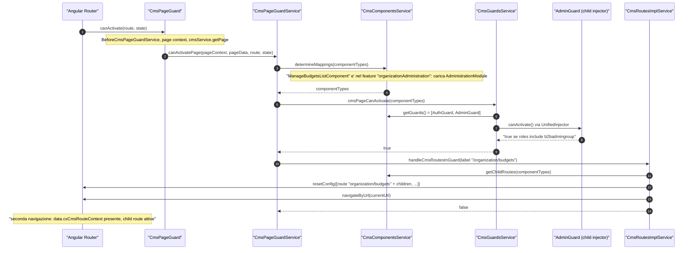
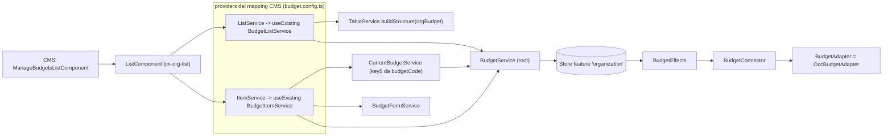
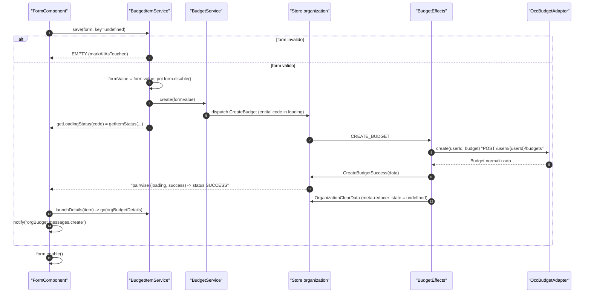
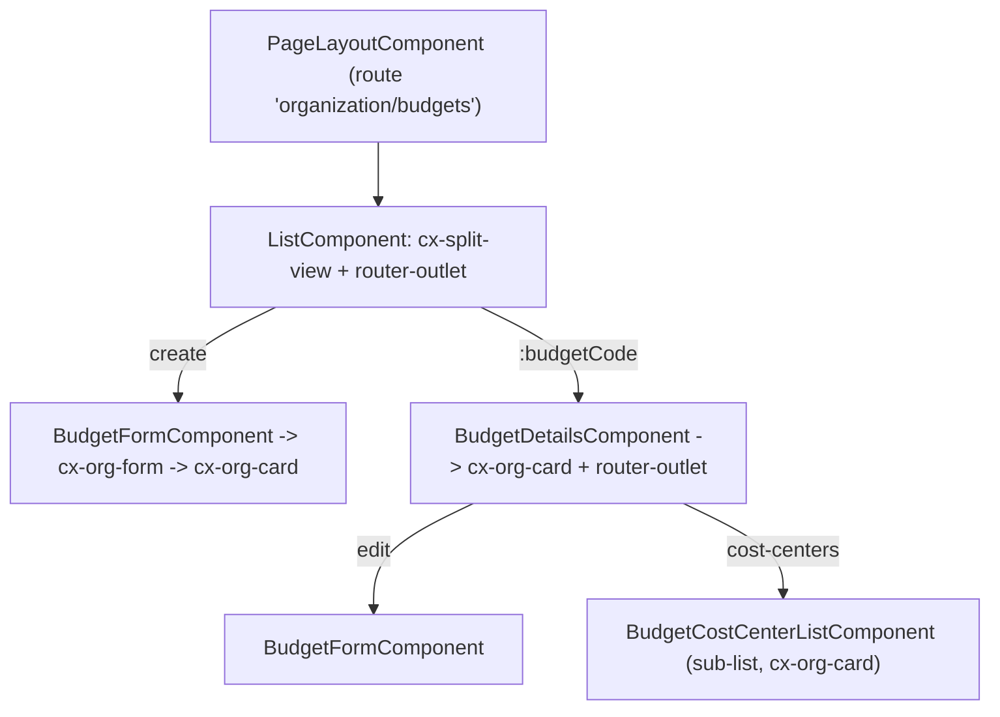

# 28 — B2B: organization

> Riferimenti allo SHA `5b7a1c2bf2808d7380bc20596d10f4fa710c3da1` (vedi [00-meta](../00-meta.md)).

## 1. A cosa serve e perché esiste

`@spartacus/organization` è la libreria B2B di Spartacus. Copre le funzioni che un acquirente aziendale si aspetta oltre al carrello e al checkout: amministrare la propria azienda (unità, utenti, gruppi di utenti, budget, cost center, limiti di acquisto), approvare ordini, vedere gli ordini dell'unità, consultare l'estratto conto e registrarsi come utente B2B. È divisa in cinque sotto-pacchetti, ciascuno con il proprio entry point `root` (eager) e il proprio modulo lazy:

| Sotto-pacchetto | Feature lazy | Cosa fa |
|---|---|---|
| `administration` | `organizationAdministration` | CRUD delle sei entità aziendali, in un framework condiviso list/form/card |
| `account-summary` | `organizationAccountSummary` | estratto conto per unità, documenti e download allegati |
| `order-approval` | `organizationOrderApproval` | dashboard e dettaglio delle approvazioni, decisione approva/rifiuta |
| `unit-order` | `organizationUnitOrder` | storico e dettaglio degli ordini a livello di unità |
| `user-registration` | `organizationUserRegistration` | form di richiesta account B2B (anche con OTP) |

L'entry point principale `@spartacus/organization` riesporta soltanto `administration` (il JSDoc parla ancora di "my-account") — `feature-libs/organization/public_api.ts:L7-L10`. A margine c'è `core-libs/core/src/cost-center`, che in `@spartacus/core` contiene solo i token dei converter dei cost center e un modulo vuoto — `core-libs/core/src/cost-center/connectors/cost-center/converters.ts:L12-L22`, `core-libs/core/src/cost-center/cost-center.module.ts:L9-L17`.

Il pezzo più interessante dal punto di vista architetturale è `administration`. Ha sei entità con UI quasi identiche: una lista paginata, un pannello di dettaglio, un form di creazione/modifica, sotto-liste di relazioni "assegna/rimuovi". Spartacus non scrive sei volte lo stesso codice. Usa **un solo componente CMS generico per la lista** (`ListComponent`) e **due servizi astratti** (`ListService`, `ItemService`) che ogni entità implementa. Il componente CMS li riceve dai `providers` del mapping CMS. La navigazione fra lista, dettaglio e form non usa pagine CMS separate: sono **child route Angular** dichiarate nel mapping CMS (`childRoutes`) e aggiunte a runtime alla configurazione del router. Il risultato è una "split view" a pannelli annidati in cui ogni livello è un `<router-outlet>` — `feature-libs/organization/administration/components/budget/budget.config.ts:L29-L81`, `core-libs/storefront/cms-structure/services/cms-routes-impl.service.ts:L69-L124`.

Questo capitolo segue soprattutto il **budget** da capo a fondo (CMS → route → componenti → servizi → NgRx → OCC). Poi mostra come le altre entità e gli altri sotto-pacchetti riusano lo stesso schema o se ne discostano.

Prerequisiti utili: il caricamento lazy dei feature CMS ([cap. 12](../parte-2/12-feature-module-lazy.md)), le `childRoutes` e le guardie dei componenti CMS ([cap. 15](../parte-2/15-cms-core.md), [cap. 16](../parte-2/16-cms-rendering.md)), lo store con `StateUtils` ([cap. 19](../parte-2/19-state-management.md)), le facade lazy ([cap. 20](../parte-2/20-facade-command-query-eventi.md)) e OCC ([cap. 21](../parte-2/21-occ.md)).

## 2. Mappa dei file

| Path | Ruolo |
|---|---|
| `feature-libs/organization/public_api.ts` | entry `@spartacus/organization`: riesporta `administration` |
| `feature-libs/organization/administration/administration.module.ts` | `AdministrationModule` (lazy): `AdministrationCoreModule.forRoot()` + OCC + componenti |
| `feature-libs/organization/administration/root/administration-root.module.ts` | `AdministrationRootModule` (eager): layout, UI config, routing config, CMS feature lazy |
| `feature-libs/organization/administration/root/feature-name.ts` | `ORGANIZATION_ADMINISTRATION_FEATURE` |
| `feature-libs/organization/administration/root/route-params.ts` | `ROUTE_PARAMS`: nomi dei parametri di route |
| `feature-libs/organization/administration/root/config/default-budget-routing.config.ts` | route semantiche `orgBudget*` (analoghi per cost center, permission, units, user, user-group) |
| `feature-libs/organization/administration/root/config/default-organization-layout.config.ts` | slot di `CompanyPageTemplate` |
| `feature-libs/organization/administration/root/config/organization-ui.config.ts` | `OrganizationUIConfig` (`listSearch`) |
| `feature-libs/organization/administration/components/administration-components.module.ts` | aggrega i sei moduli entità |
| `feature-libs/organization/administration/components/shared/item.service.ts` | `ItemService<T>`: base astratta CRUD |
| `feature-libs/organization/administration/components/shared/current-item.service.ts` | `CurrentItemService<T>`: item corrente dai parametri di route |
| `feature-libs/organization/administration/components/shared/list/list.service.ts` | `ListService<T,P>`: paginazione, ghost data, struttura tabella, ricerca |
| `feature-libs/organization/administration/components/shared/list/list.component.ts` | `ListComponent` (`cx-org-list`): componente CMS generico della lista |
| `feature-libs/organization/administration/components/shared/form/form.service.ts` | `FormService<T>`: form unico riusato |
| `feature-libs/organization/administration/components/shared/form/form.component.ts` | `FormComponent` (`cx-org-form`): salva e notifica |
| `feature-libs/organization/administration/components/shared/card/card.component.ts` | `CardComponent` (`cx-org-card`): pannello della split view, `MessageService` locale |
| `feature-libs/organization/administration/components/shared/sub-list/sub-list.service.ts` | `SubListService`: liste di relazioni con assign/unassign |
| `feature-libs/organization/administration/components/shared/sub-list/assign-cell.component.ts` | cella assign/unassign |
| `feature-libs/organization/administration/components/shared/table/cell.component.ts` | `CellComponent`: base delle celle della tabella |
| `feature-libs/organization/administration/components/shared/detail/toggle-status-action/toggle-status.component.ts` | attiva/disattiva con conferma |
| `feature-libs/organization/administration/components/shared/message/services/message.service.ts` | messaggi dentro la card |
| `feature-libs/organization/administration/components/shared/organization.model.ts` | `OrganizationTableType`, `BaseItem` |
| `feature-libs/organization/administration/components/budget/budget.config.ts` | CMS mapping (component, providers, childRoutes, guards) + table config del budget |
| `feature-libs/organization/administration/components/budget/services/budget-item.service.ts` | `BudgetItemService` |
| `feature-libs/organization/administration/components/budget/services/budget-list.service.ts` | `BudgetListService` |
| `feature-libs/organization/administration/components/budget/services/current-budget.service.ts` | `CurrentBudgetService` |
| `feature-libs/organization/administration/components/budget/form/budget-form.service.ts` | costruzione e validatori del form budget |
| `feature-libs/organization/administration/core/administration-core.module.ts` | store, guard, page meta, `HttpErrorHandler` 400/409, connector |
| `feature-libs/organization/administration/core/store/organization-store.module.ts` | feature NgRx `organization` |
| `feature-libs/organization/administration/core/store/reducers/index.ts` | reducer map e meta-reducer `clearOrganizationState` |
| `feature-libs/organization/administration/core/store/effects/budget.effect.ts` | effects del budget |
| `feature-libs/organization/administration/core/services/budget.service.ts` | `BudgetService`: servizio-facade sullo store |
| `feature-libs/organization/administration/core/utils/get-item-status.ts` | `getItemStatus`: esito della transizione loading → success/error |
| `feature-libs/organization/administration/core/guards/organization-guards.module.ts` | `AdminGuard`, `UserGuard`, `OrgUnitGuard` nel child injector |
| `feature-libs/organization/administration/core/http-interceptors/conflict/conflict.handler.ts` | gestione dei 409 |
| `feature-libs/organization/administration/occ/administration-occ.module.ts` | binding adapter/converter + endpoint |
| `feature-libs/organization/administration/occ/config/default-occ-organization-config.ts` | endpoint OCC dell'administration |
| `feature-libs/organization/administration/occ/adapters/occ-budget.adapter.ts` | `OccBudgetAdapter` |
| `feature-libs/organization/account-summary/root/account-summary-root.module.ts` | route, componenti lazy, `BlobErrorInterceptor` |
| `feature-libs/organization/account-summary/core/facade/account-summary.service.ts` | implementazione di `AccountSummaryFacade` |
| `feature-libs/organization/order-approval/root/order-approval-root.module.ts` | componenti lazy e route dell'order approval |
| `feature-libs/organization/order-approval/core/services/order-approval.service.ts` | `OrderApprovalService` |
| `feature-libs/organization/order-approval/components/details/order-approval-detail.service.ts` | sostituto di `OrderDetailsService` |
| `feature-libs/organization/unit-order/root/unit-order-root.module.ts` | componenti lazy e route degli ordini di unità |
| `feature-libs/organization/unit-order/root/facade/unit-order.facade.ts` | `UnitOrderFacade` (`async: true`) |
| `feature-libs/organization/user-registration/root/user-registration-root.module.ts` | componenti lazy della registrazione B2B |
| `feature-libs/organization/user-registration/occ/adapters/occ-user-registration.adapter.ts` | POST `/orgUsers` con client token |
| `core-libs/core/src/cost-center/connectors/cost-center/converters.ts` | token converter cost center in `@spartacus/core` |
| `projects/storefrontapp/src/app/spartacus/features/organization/organization-administration-feature.module.ts` | wiring nella demo app |

## 3. Come funziona passo per passo

### 3.1 Wiring: root eager, feature lazy

L'app importa solo il **root module**. `AdministrationRootModule` fornisce con `provideDefaultConfig` la layout config, la UI config, la route semantica `organization` (path `organization`), le sei routing config delle entità e una factory che dichiara i CMS component del feature lazy — `feature-libs/organization/administration/root/administration-root.module.ts:L44-L64`. La factory associa al feature `organizationAdministration` (costante `ORGANIZATION_ADMINISTRATION_FEATURE`, `feature-libs/organization/administration/root/feature-name.ts:L7-L7`) i sei `Manage*ListComponent`. Quando uno di questi compare in una pagina CMS, il feature viene caricato — `feature-libs/organization/administration/root/administration-root.module.ts:L24-L42`.

La demo app collega il feature al codice reale. Importa `AdministrationRootModule` e registra `module: () => import('./administration-wrapper.module')`, più le traduzioni e i chunk i18n — `projects/storefrontapp/src/app/spartacus/features/organization/organization-administration-feature.module.ts:L21-L47`. Il wrapper importa `AdministrationModule` e, se `environment.cdc` è attivo, anche `CdcAdministrationModule` — `projects/storefrontapp/src/app/spartacus/features/organization/administration-wrapper.module.ts:L12-L20`. È questo il punto in cui le integrazioni (CDC) si agganciano al feature lazy.

`AdministrationModule` porta tre strati — `feature-libs/organization/administration/administration.module.ts:L12-L19`:

- **core** (`AdministrationCoreModule.forRoot()`): page meta, store, guard, due `HttpErrorHandler` multi (`OrganizationConflictHandler`, `OrganizationBadRequestHandler`) e, in `forRoot()`, i sei connector — `feature-libs/organization/administration/core/administration-core.module.ts:L21-L54`;
- **OCC** (`AdministrationOccModule`): importa `CostCenterOccModule` di core, fornisce gli endpoint, lega gli adapter astratti alle classi `Occ*` con `useClass` e i converter con `useExisting` + `multi` — `feature-libs/organization/administration/occ/administration-occ.module.ts:L58-L80`;
- **componenti** (`AdministrationComponentsModule`): i sei moduli entità — `feature-libs/organization/administration/components/administration-components.module.ts:L15-L25`. Ognuno importa `SharedOrganizationModule` (cioè `ListModule`, `SubListModule`, `FormModule`) e fornisce come default la propria CMS config e la table config — `feature-libs/organization/administration/components/budget/budget-components.module.ts:L18-L30`, `feature-libs/organization/administration/components/shared/shared-organization.module.ts:L12-L15`.

Gli altri quattro sotto-pacchetti seguono lo stesso schema root/lazy. Le eccezioni sono annotate nelle sezioni 3.11-3.14.

### 3.2 Routing semantico e parametri

I nomi dei parametri di route stanno tutti in `ROUTE_PARAMS`. Attenzione all'indirizzo: la chiave è `addressCode` ma il valore è `'addressId'` — `feature-libs/organization/administration/root/route-params.ts:L10-L18`. Ogni entità ha una routing config che definisce le route semantiche e il `paramsMapping`, cioè quale proprietà del modello riempie il parametro. Per il budget le route sono `orgBudget`, `orgBudgetCreate`, `orgBudgetDetails`, `orgBudgetCostCenters`, `orgBudgetEdit`, con `budgetCode → code` — `feature-libs/organization/administration/root/config/default-budget-routing.config.ts:L10-L38`.

Le chiavi dei modelli non sono uniformi, e il `paramsMapping` è il punto in cui questa differenza viene assorbita:

| Entità | Parametro | Proprietà | Riferimento |
|---|---|---|---|
| Budget | `budgetCode` | `code` | `feature-libs/organization/administration/root/config/default-budget-routing.config.ts:L10-L13` |
| Unità | `unitCode` / `addressId` / `userCode` | `uid` / `id` / `customerId` | `feature-libs/organization/administration/root/config/default-units-routing.config.ts:L10-L15` |
| Utente | `userCode` | `customerId` | `feature-libs/organization/administration/root/config/default-user-routing.config.ts:L10-L13` |
| Gruppo utenti | `userGroupCode` | `uid` | `feature-libs/organization/administration/root/config/default-user-group-routing.config.ts:L10-L13` |
| Permesso | `permissionCode` | `code` (path `organization/purchase-limits`) | `feature-libs/organization/administration/root/config/default-permission-routing.config.ts:L10-L13` |

La route della lista unità si chiama `orgUnits` (al plurale). Tutte le altre route delle unità hanno il prefisso `orgUnit` — `feature-libs/organization/administration/root/config/default-units-routing.config.ts:L20-L29`. Su questo torneremo nelle trappole.

Per la meccanica di `paramsMapping` e della risoluzione `{ cxRoute, params } | cxUrl` vedi il [cap. 14](../parte-2/14-routing.md).

### 3.3 Il mapping CMS: un componente generico, provider specifici, child route

Il cuore dell'architettura è nella CMS config di ogni entità. Per il budget, `ManageBudgetsListComponent` è mappato sul generico `ListComponent`. Il mapping sostituisce `ListService` e `ItemService` con `useExisting` verso `BudgetListService` e `BudgetItemService` — `feature-libs/organization/administration/components/budget/budget.config.ts:L29-L42`. Usa poi tre proprietà di `CmsComponentMapping` (`providers`, `childRoutes`, `guards`) — `core-libs/core/src/cms/config/cms-config.ts:L60-L77`:

- `childRoutes.parent.data.cxPageMeta`: il breadcrumb `orgBudget.breadcrumbs.list` e il resolver `BudgetRoutePageMetaResolver`;
- `childRoutes.children`: `create` → `BudgetFormComponent`, `:budgetCode` → `BudgetDetailsComponent` con i figli `edit` e `cost-centers` — `feature-libs/organization/administration/components/budget/budget.config.ts:L43-L77`;
- `guards: [AuthGuard, AdminGuard]` — `feature-libs/organization/administration/components/budget/budget.config.ts:L78-L78`.

Le sotto-relazioni "assign" seguono un pattern fisso: una route (es. `budgets` sotto un cost center) con due figli, `''` per la lista degli assegnati e `'assign'` per la lista degli assegnabili — `feature-libs/organization/administration/components/cost-center/cost-center.config.ts:L70-L83`. Le unità sono l'eccezione principale. Usano un `UnitListComponent` specifico (l'albero) e applicano `canActivate: [OrgUnitGuard]` a `create`, `edit` e `children`, e `[UserGuard]` a `users/create` e `users/:userCode/roles` — `feature-libs/organization/administration/components/unit/units.config.ts:L53-L138`. Gli utenti applicano `UserGuard` a `create`, `edit` e `change-password` — `feature-libs/organization/administration/components/user/user.config.ts:L66-L85`.

### 3.4 Dal CMS al router: guardie dei componenti e child route a runtime

Alla prima apertura di `/organization/budgets`, il guard della pagina CMS fa tre cose in ordine — `core-libs/storefront/cms-structure/guards/cms-page-guard.service.ts:L65-L99`:

1. **Risolve i mapping** dei componenti della pagina (`determineMappings`). È qui che il feature lazy `organizationAdministration` viene caricato, perché la pagina contiene `ManageBudgetsListComponent`.
2. **Esegue le guardie dei componenti**. `CmsGuardsService.cmsPageCanActivate` raccoglie le classi da tutti i mapping (deduplicate con un `Set`), le istanzia attraverso `UnifiedInjector` e le compone con `GuardsComposer` — `core-libs/storefront/cms-structure/services/cms-guards.service.ts:L36-L48`, `core-libs/storefront/cms-structure/services/cms-components.service.ts:L253-L261`. Passare dallo `UnifiedInjector` è ciò che permette di trovare `AdminGuard`, che non è `providedIn: 'root'` ma vive nel child injector del modulo lazy (sez. 3.10).
3. **Se l'esito è `true`** e la route non ha già `cxCmsRouteContext`, chiama `CmsRoutesImplService.handleCmsRoutesInGuard`.

`handleCmsRoutesInGuard` controlla se esiste già una route per la label della pagina. Se non esiste, legge le `childRoutes` dei componenti e, quando ci sono figli, chiama `updateRouting`. Poi rinaviga all'URL corrente con `navigateByUrl` e ritorna `false` per annullare la navigazione in corso — `core-libs/storefront/cms-structure/services/cms-routes-impl.service.ts:L69-L91`. `updateRouting` agisce solo per **content page** con label che inizia con `/` (es. `/organization/budgets`). Crea una route `path: label.substring(1)` con `PageLayoutComponent` e i figli (le guardie avvolte ricorsivamente), unisce `parent.data` con `cxCmsRouteContext` e fa `router.resetConfig([newRoute, ...config])` — `core-libs/storefront/cms-structure/services/cms-routes-impl.service.ts:L93-L124`. La seconda navigazione trova `cxCmsRouteContext` nei data della route e salta questo passo — `core-libs/storefront/cms-structure/guards/cms-page-guard.service.ts:L88-L88`.

Da questo momento `organization/budgets/create`, `organization/budgets/:budgetCode`, `.../edit`, `.../cost-centers` sono route Angular "vere". Vengono rese nei `<router-outlet>` annidati della lista e delle card (sez. 3.6).

### 3.5 Le guardie di accesso

`AdminGuard` attende da `UserAccountFacade.get()` un utente non vuoto, legge `roles` e richiede `B2BUserRole.ADMIN` (`'b2badmingroup'`). Senza il ruolo naviga alla route `organization` e mostra un warning `organization.notification.noSufficientPermissions`. Un commento lo dichiara una soluzione temporanea, in attesa dei permessi lato backend — `feature-libs/organization/administration/core/guards/admin.guard.ts:L27-L49`. I valori dei ruoli B2B sono `b2badmingroup`, `b2bcustomergroup`, `b2bmanagergroup`, `b2bapprovergroup`, e il diritto `UNITORDERVIEWER` vale `unitorderviewergroup` — `core-libs/core/src/model/org-unit.model.ts:L18-L27`.

`OrgUnitGuard` e `UserGuard` delegano a `OrgUnitService.isUpdatingUnitAllowed()` e `B2BUserService.isUpdatingUserAllowed()`. Se ricevono `false` mostrano un warning e ritornano un `UrlTree` verso `organization` — `feature-libs/organization/administration/core/guards/org-unit.guard.ts:L25-L37`. Nel core entrambi i metodi ritornano sempre `true`: sono hook da sovrascrivere, ad esempio nelle integrazioni — `feature-libs/organization/administration/core/services/org-unit.service.ts:L501-L503`, `feature-libs/organization/administration/core/services/b2b-user.service.ts:L414-L416`.

### 3.6 La lista: `ListComponent` + `ListService`

`ListComponent` (`cx-org-list`) inietta `ListService` e `ItemService`, che il mapping CMS ha risolto nelle implementazioni del budget, e attiva gli stili della feature `a11yNavigationChevronContrast` — `feature-libs/organization/administration/components/shared/list/list.component.ts:L109-L114`. Il `viewType` del servizio diventa la classe host — `feature-libs/organization/administration/components/shared/list/list.component.ts:L116-L117`.

`ListService<T, P>` è astratto — `feature-libs/organization/administration/components/shared/list/list.service.ts:L42-L51`:

- **struttura tabella**: il default è `VERTICAL_STACKED`, e `VERTICAL` da `lg` in su. `getStructure()` delega a `TableService.buildStructure(viewType, defaultTableStructure)` — `feature-libs/organization/administration/components/shared/list/list.service.ts:L137-L142`. Quest'ultimo usa la `TableConfig` se esiste per quel tipo, altrimenti costruisce una struttura "random" — `core-libs/storefront/shared/components/table/table.service.ts:L49-L58`;
- **paginazione**: un `BehaviorSubject` che parte da `pageSize: 10`. La config è iniettata come `OrganizationUIConfig` — `feature-libs/organization/administration/components/shared/list/list.service.ts:L91-L97`;
- **getData()**: unisce `pagination$` con l'eventuale `options.pagination` della struttura, chiama `load()` ed emette prima i **ghost data** con `startWith` — `feature-libs/organization/administration/components/shared/list/list.service.ts:L117-L129`. I ghost data sono un array di 10 elementi vuoti che serve allo skeleton di caricamento — `feature-libs/organization/administration/components/shared/list/list.service.ts:L53-L59`. `hasGhostData` li riconosce per identità — `feature-libs/organization/administration/components/shared/list/list.service.ts:L147-L170`;
- **navigazione**: `view()` emette una nuova paginazione con `currentPage`, `sort()` torna a pagina 0 — `feature-libs/organization/administration/components/shared/list/list.service.ts:L147-L170`;
- **chiave**: `key()` vale `'code'` di default — `feature-libs/organization/administration/components/shared/list/list.service.ts:L103-L105`. Gli utenti la ridefiniscono in `customerId` — `feature-libs/organization/administration/components/user/services/user-list.service.ts:L52-L95`;
- **viewType/domainType**: `tableType` (astratto, con il TODO "rename to `viewType`") è esposto come `viewType`. `domainType` vale `_domainType` se impostato, altrimenti `viewType` — `feature-libs/organization/administration/components/shared/list/list.service.ts:L63-L83`. `viewType` sceglie la table config, `domainType` è la root i18n delle celle;
- **bottone di creazione**: di default è un link (`CreateButtonType.LINK`) con label `organization.add`, e `onCreateButtonClick` è vuoto — `feature-libs/organization/administration/components/shared/list/list.service.ts:L20-L23`, `feature-libs/organization/administration/components/shared/list/list.service.ts:L184-L198`;
- **ricerca**: disabilitata di default. Il minimo di caratteri viene da `organizationUI.listSearch.minCharacters`, con fallback 3. `search()` aggiunge `query` e azzera `currentPage` — `feature-libs/organization/administration/components/shared/list/list.service.ts:L204-L242`.

Il template della lista sta dentro `cx-split-view [hideMode]="false"`. Il titolo è `viewType + '.header'` e un `<router-outlet>` in fondo ospita le split view annidate delle child route — `feature-libs/organization/administration/components/shared/list/list.component.html:L1-L21`, `feature-libs/organization/administration/components/shared/list/list.component.html:L208-L211`. Il link "create" punta a `{ cxRoute: structure.type + 'Create' }` ed è disattivato finché ci sono ghost data — `feature-libs/organization/administration/components/shared/list/list.component.html:L128-L140`. La tabella evidenzia l'item corrente confrontando `key` con `currentKey$` e usa `domainType` come `i18nRoot` — `feature-libs/organization/administration/components/shared/list/list.component.html:L165-L173`.

Due dettagli di UX nel componente:

- la ricerca ha `debounceTime(300)`, accetta query lunghe almeno il minimo (o vuote) e scarta le query invariate — `feature-libs/organization/administration/components/shared/list/list.component.ts:L84-L98`;
- `listData$` tiene in cache i valori dell'ultimo caricamento reale, per mostrare una tabella semitrasparente durante i caricamenti successivi invece dello skeleton — `feature-libs/organization/administration/components/shared/list/list.component.ts:L159-L187`.

Il click su una riga va a `launchItem`, che delega a `ItemService.launchDetails` — `feature-libs/organization/administration/components/shared/list/list.component.ts:L212-L226`.

### 3.7 L'item corrente: `CurrentItemService` + `ItemService`

`CurrentItemService<T>` ricava la **chiave** dell'item dai parametri di route (inclusi quelli delle child route), con la chiave di parametro fornita dalla sottoclasse (`getParamKey()`) e `distinctUntilChanged` — `feature-libs/organization/administration/components/shared/current-item.service.ts:L18-L33`. `item$` carica l'item con `getItem(code)` solo se la chiave c'è, altrimenti emette `undefined` — `feature-libs/organization/administration/components/shared/current-item.service.ts:L40-L42`. `b2bUnit$` legge sempre `ROUTE_PARAMS.unitCode`, qualunque sia l'entità — `feature-libs/organization/administration/components/shared/current-item.service.ts:L47-L50`. Le sottoclassi implementano `getParamKey`, `getItem` e `getError` — `feature-libs/organization/administration/components/shared/current-item.service.ts:L56-L69`. Per il budget: parametro `budgetCode`, item da `BudgetService.get`, errore da `getErrorState` — `feature-libs/organization/administration/components/budget/services/current-budget.service.ts:L20-L42`.

`ItemService<T>` ("Provides CRUD operations for all organization entities") riespone `key$`, `current$`, `unit$` ed `error$` da `CurrentItemService` — `feature-libs/organization/administration/components/shared/item.service.ts:L17-L45`. Aggiunge:

- `save(form, key?)`: con form invalido marca tutto come touched, aggiorna ricorsivamente la validità e ritorna `EMPTY`. Con form valido **salva `form.value` prima di `form.disable()`**, perché la disabilitazione in alcuni casi lo svuota, poi chiama `update(key, value)` se c'è una key, altrimenti `create(value)` — `feature-libs/organization/administration/components/shared/item.service.ts:L47-L65`;
- i metodi astratti `load`, `create` (protected), `update` e `getDetailsRoute` (protected). `delete` è opzionale — `feature-libs/organization/administration/components/shared/item.service.ts:L70-L92`;
- `launchDetails(item)`: naviga con `RoutingService.go({ cxRoute, params })` solo se la route esiste e l'item ha almeno una proprietà. I `params` sono di default l'item stesso (`buildRouteParams`) — `feature-libs/organization/administration/components/shared/item.service.ts:L101-L120`;
- `setEditMode()`, che alimenta il `BehaviorSubject` `isInEditMode$` — `feature-libs/organization/administration/components/shared/item.service.ts:L126-L131`.

`BudgetItemService.load` forza un nuovo caricamento a ogni chiamata ("to ensure accurate data") e poi ritorna `get(code)` — `feature-libs/organization/administration/components/budget/services/budget-item.service.ts:L32-L41`. `update`/`create` fanno dispatch e ritornano `getLoadingStatus(value.code ?? '')`, cioè lo stato dell'entità identificata dal codice **nel valore inviato** e non dalla key di route — `feature-libs/organization/administration/components/budget/services/budget-item.service.ts:L43-L54`. La route di dettaglio è `orgBudgetDetails`, anche se il JSDoc dice ancora `'budgetDetails'` — `feature-libs/organization/administration/components/budget/services/budget-item.service.ts:L56-L62`.

Il dettaglio (`BudgetDetailsComponent`) costruisce `model$` in `ngOnInit` da `key$ → itemService.load(code)` con `startWith({})` — `feature-libs/organization/administration/components/budget/details/budget-details.component.ts:L48-L59`. Il template disabilita "edit" se il budget non è attivo o se si è già in edit mode. Include `cx-org-toggle-status` e `cx-org-disable-info` e linka la sotto-lista `orgBudgetCostCenters` — `feature-libs/organization/administration/components/budget/details/budget-details.component.html:L6-L17`, `feature-libs/organization/administration/components/budget/details/budget-details.component.html:L81-L89`.

### 3.8 Il form: `FormService` + `FormComponent`

`FormService<T>` costruisce il form **una sola volta** (`build`) e poi lo riusa. Se il form esiste e c'è un item, fa solo `patchData`. Altrimenti esegue `reset()`, `enable()` e patch, perché "while we should be able to reset with initial value, this doesn't always work" — `feature-libs/organization/administration/components/shared/form/form.service.ts:L20-L37`. `patchData` disabilita il form se `active === false`, lo riabilita se `active === true` e applica `{...defaultValue, ...item}` — `feature-libs/organization/administration/components/shared/form/form.service.ts:L39-L51`.

`BudgetFormService.build` crea questi controlli — `feature-libs/organization/administration/components/budget/form/budget-form.service.ts:L26-L80`:

- `code`: obbligatorio, senza caratteri speciali;
- `name`;
- `startDate` / `endDate`, nel formato del date picker;
- `budget`, che deve essere positivo;
- i sotto-gruppi `currency.isocode` e `orgUnit.uid`;
- un validatore `dateRange` sull'intero gruppo.

Il nome genera il codice al `blur` tramite `createCodeWithName` — `feature-libs/organization/administration/components/budget/form/budget-form.component.html:L9-L15`. La generazione avviene solo se il codice è vuoto: spazi → `-`, tutto in minuscolo — `feature-libs/organization/administration/components/shared/utility/entity-code.ts:L9-L17`. `BudgetFormComponent` fornisce localmente `ItemService → BudgetItemService` e `CurrentItemService → CurrentBudgetService`, preseleziona unità e valuta se ce n'è una sola e in `ngOnInit` chiama `unitService.loadList()` — `feature-libs/organization/administration/components/budget/form/budget-form.component.ts:L42-L95`.

`FormComponent` (`cx-org-form`) deriva `form$` da `itemService.current$`. Senza item passa `{}` a `getForm` ("we trick the form builder...") — `feature-libs/organization/administration/components/shared/form/form.component.ts:L65-L75`. `disabled$` osserva `statusChanges` e vale `true` sullo stato `'DISABLED'` — `feature-libs/organization/administration/components/shared/form/form.component.ts:L28-L83`. La chiave i18n è `i18nRoot + '.edit'` oppure `'.create'`. `ngOnInit`/`ngOnDestroy` accendono e spengono l'edit mode — `feature-libs/organization/administration/components/shared/form/form.component.ts:L125-L142`. `save()` prende la key corrente, chiama `itemService.save` e su `LoadStatus.SUCCESS` va al dettaglio e notifica `${i18nRoot}.messages.create|update`. **In ogni caso** riabilita il form — `feature-libs/organization/administration/components/shared/form/form.component.ts:L90-L123`. Il template avvolge una `cx-org-card` con `cxOrgItemActive`. Il bottone Save è disabilitato da `form.disabled || disabled$`, e il Cancel sfrutta il soft-close della split view — `feature-libs/organization/administration/components/shared/form/form.component.html:L1-L30`.

### 3.9 Card, messaggi, toggle-status, sotto-liste

**Card.** `CardComponent` (`cx-org-card`) fornisce **a livello di componente** il proprio `MessageService` e legge l'item da `itemService.current$` — `feature-libs/organization/administration/components/shared/card/card.component.ts:L29-L59`. Quando cambia l'item svuota i messaggi, confrontando `code`, `uid` o `customerId` — `feature-libs/organization/administration/components/shared/card/card.component.ts:L88-L98`. `closeView` chiude a mano la view (`view.toggle(true)`) e dopo 500 ms simula il click sul parent. Senza questo accorgimento la chiusura del router outlet sarebbe immediata e taglierebbe l'animazione — `feature-libs/organization/administration/components/shared/card/card.component.ts:L68-L82`. Il template ha tre slot di proiezione (`[actions]`, `[info]`, `[main]`), un `cx-org-message` con `aria-live="assertive"` e un `<router-outlet>` dopo la view per il livello successivo della split view — `feature-libs/organization/administration/components/shared/card/card.component.html:L36-L63`.

Poiché il `MessageService` è nei `providers` (non nei `viewProviders`), è visibile anche al contenuto proiettato. In Angular i `providers` di un componente sono accessibili al template **e** al contenuto `ng-content`, mentre i `viewProviders` arrivano solo al template — `angular:adev/src/content/guide/di/debugging-and-troubleshooting-di.md:L279-L287`, `angular:packages/core/src/render3/di.ts:L685-L704`. Per questo `cx-org-toggle-status`, proiettato in `[actions]` dal template di dettaglio, scrive nella stessa area messaggi della card.

**Messaggi.** `MessageService` è `@Injectable()` senza `providedIn`. `add()` unisce i default, crea un `Subject` di eventi e lo restituisce. I messaggi info senza timeout ricevono 3000 ms — `feature-libs/organization/administration/components/shared/message/services/message.service.ts:L12-L51`. `MessageComponent` crea il componente del messaggio in un `ViewContainerRef` figlio, con un injector che fornisce `MessageData` — `feature-libs/organization/administration/components/shared/message/message.component.ts:L30-L58`. La chiusura avviene in due fasi: prima la classe `terminated` per l'animazione CSS, poi `destroy()` dopo 500 ms — `feature-libs/organization/administration/components/shared/message/message.component.ts:L68-L79`. L'auto-hide gira solo nel browser — `feature-libs/organization/administration/components/shared/message/base-message.component.ts:L68-L75`.

**Toggle status.** La disattivazione chiede conferma con un `ConfirmationMessageComponent` nel `MessageService` della card, l'attivazione no — `feature-libs/organization/administration/components/shared/detail/toggle-status-action/toggle-status.component.ts:L70-L105`. `confirm()` emette `{ confirm: true }` sugli eventi del messaggio — `feature-libs/organization/administration/components/shared/message/confirmation/confirmation-message.component.ts:L55-L63`. L'aggiornamento invia a `itemService.update` solo un patch `{ [key]: valore, active: !active }` — `feature-libs/organization/administration/components/shared/detail/toggle-status-action/toggle-status.component.ts:L118-L138`. Se l'input `disabled` è valorizzato, è lui a decidere (anche con `false`). Altrimenti il toggle è bloccato quando il parent è disabilitato o l'item è la root unit — `feature-libs/organization/administration/components/shared/detail/toggle-status-action/toggle-status.component.ts:L110-L116`. La root unit si riconosce per esclusione: ha `uid` e `name`, non ha `orgUnit`/`unit`, e non ha `parentOrgUnit` oppure ce l'ha uguale al proprio `uid` — `feature-libs/organization/administration/components/shared/detail/disable-info/disable-info.service.ts:L19-L34`. Quando l'item corrente passa a `active === false`, `ItemActiveDirective` mostra `organization.notification.disabled` — `feature-libs/organization/administration/components/shared/item-active.directive.ts:L26-L47`. `ItemExistsDirective` mostra `organization.notification.notExist` quando `error$` emette `true` — `feature-libs/organization/administration/components/shared/item-exists.directive.ts:L24-L37`.

Solo `UserGroupItemService` e `UnitAddressItemService` implementano `delete`. Le altre entità si "eliminano" disattivandole — `feature-libs/organization/administration/components/user-group/services/user-group-item.service.ts:L45-L47`, `feature-libs/organization/administration/components/unit/links/addresses/services/unit-address-item.service.ts:L74-L74`. `DeleteItemComponent` chiede conferma e chiama l'opzionale `itemService.delete?.(...)` — `feature-libs/organization/administration/components/shared/detail/delete-item-action/delete-item.component.ts:L97-L117`.

**Sotto-liste.** `SubListService` estende `ListService`. Usa il solo layout `VERTICAL`, ghost data di 3 righe, e `assign`/`unassign` opzionali che di default ritornano `EMPTY` (con un TODO "abstract") — `feature-libs/organization/administration/components/shared/sub-list/sub-list.service.ts:L18-L44`. `filterSelected` filtra lato client perché "we can't filter with the backend API" — `feature-libs/organization/administration/components/shared/sub-list/sub-list.service.ts:L46-L63`. `SubListComponent` estende `ListComponent` e ricarica con `service.getData(key)` a ogni cambio di key — `feature-libs/organization/administration/components/shared/sub-list/sub-list.component.ts:L43-L69`. Il suo template rende una `cx-org-card` con `i18nRoot = viewType` e mostra la paginazione solo con `totalPages > 1` — `feature-libs/organization/administration/components/shared/sub-list/sub-list.component.html:L1-L5`, `feature-libs/organization/administration/components/shared/sub-list/sub-list.component.html:L23-L35`. `AssignCellComponent.toggleAssign` chiama `assign`/`unassign(key, link)` e notifica `${viewType}.assigned|unassigned`. Il `link` è `code ?? customerId ?? uid` del contesto della riga, perché "the object do not have a normalized shape" — `feature-libs/organization/administration/components/shared/sub-list/assign-cell.component.ts:L50-L109`.

**Celle.** `CellComponent` legge il contesto dall'outlet. Con il toggle `a11yCardNotificationMessage` si sottoscrive a `outlet.context$` e chiama `markForCheck` — `feature-libs/organization/administration/components/shared/table/cell.component.ts:L31-L47`. Una cella è linkabile solo se la proprietà è definita e `cellOptions.linkable` è true. La route generata è `_type + 'Details'` — `feature-libs/organization/administration/components/shared/table/cell.component.ts:L69-L87`. Le sottoclassi sono piccole: `ActiveLinkCellComponent` cambia solo `tabIndex` — `feature-libs/organization/administration/components/shared/table/active-link/active-link-cell.component.ts:L19-L23`; `AmountCellComponent` mostra `budget + ' ' + currency` — `feature-libs/organization/administration/components/shared/table/amount/amount-cell.component.ts:L19-L33`.

### 3.10 Core: NgRx, servizi-facade, esito delle operazioni

**Store.** `OrganizationStoreModule` registra la feature NgRx `organization` con reducer da token, `metaReducers` ed effects — `feature-libs/organization/administration/core/store/organization-store.module.ts:L14-L23`. Lo stato ha sei slice (`budget`, `orgUnit`, `userGroup`, `permission`, `costCenter`, `b2bUser`) — `feature-libs/organization/administration/core/store/organization-state.ts:L103-L114`. Ognuna è un `combineReducers` di `entityLoaderReducer` (`entities`, `list` e le liste di relazione) — `feature-libs/organization/administration/core/store/reducers/index.ts:L94-L105`. Il meta-reducer `clearOrganizationState` azzera **l'intero** stato organization su `CLEAR_ORGANIZATION_DATA`, `AuthActions.LOGOUT` e `SiteContextActions.LANGUAGE_CHANGE` — `feature-libs/organization/administration/core/store/reducers/index.ts:L209-L227`.

**Azioni ed effects.** Le azioni budget estendono le `StateUtils.Entity*Action`. `LoadBudgets` usa come id dell'entità lista la `serializeSearchConfig(params)` — `feature-libs/organization/administration/core/store/actions/budget.action.ts:L64-L75`. `LoadBudgetSuccess` usa i `code` come id — `feature-libs/organization/administration/core/store/actions/budget.action.ts:L51-L62`. `UpdateBudget` marca in loading `payload.budget.code`, non `payload.budgetCode` — `feature-libs/organization/administration/core/store/actions/budget.action.ts:L132-L140`. `loadBudgets$` normalizza la pagina con `StateUtils.normalizeListPage(budgets, 'code')` ed emette sia le entità sia la pagina — `feature-libs/organization/administration/core/store/effects/budget.effect.ts:L58-L72`. `createBudget$` e `updateBudget$` emettono `OrganizationClearData` sia in successo sia in errore — `feature-libs/organization/administration/core/store/effects/budget.effect.ts:L94-L109`, `feature-libs/organization/administration/core/store/effects/budget.effect.ts:L122-L139`. Gli errori passano da `tryNormalizeHttpError` — `feature-libs/organization/administration/core/store/effects/budget.effect.ts:L37-L44`.

**Servizi.** `BudgetService` è `providedIn: 'root'`. I comandi ottengono lo userId con `takeUserId(true)` e fanno dispatch. Il ramo d'errore è vuoto, con un TODO — `feature-libs/organization/administration/core/services/budget.service.ts:L28-L45`. Le query usano due schemi diversi:

- `get(code)` usa `using()`: una sottoscrizione collaterale a `loading$` (con `auditTime(0)`) innesca `loadBudget` se lo stato non è né loading né success né error. Il valore emesso è `getBudgetValue` filtrato sui valori truthy — `feature-libs/organization/administration/core/services/budget.service.ts:L63-L89`;
- `getList(params)` usa `observeOn(queueScheduler)`, innesca il load se serve ed emette solo a stato success o error — `feature-libs/organization/administration/core/services/budget.service.ts:L91-L104`.

`getCostCenters(code)` non fa chiamate dedicate: legge i `costCenters` annidati nel budget — `feature-libs/organization/administration/core/services/budget.service.ts:L106-L115`.

**Esito.** `getItemStatus` osserva lo stato dell'entità con `pairwise()` e produce un risultato solo per la transizione **da `loading` a uno stato successivo**: `SUCCESS`, `ERROR` o `null` — `feature-libs/organization/administration/core/utils/get-item-status.ts:L15-L31`. `LoadStatus` è un enum numerico (`SUCCESS = 0`, `ERROR = 1`) — `feature-libs/organization/administration/core/model/organization-item-status.ts:L7-L15`. È questo meccanismo che collega un dispatch "fire-and-forget" alla UI che aspetta un esito.

Nel create l'ordine delle azioni è `CreateBudgetSuccess` seguito da `OrganizationClearData` — `feature-libs/organization/administration/core/store/effects/budget.effect.ts:L96-L99`. `getItemStatus` vede quindi prima la coppia (loading, success) ed emette `SUCCESS`. Il reset successivo produce una coppia con stato precedente non-loading, che viene filtrata. `FormComponent` comunque prende solo il primo esito (`take(1)`) — `feature-libs/organization/administration/components/shared/form/form.component.ts:L95-L96`.

**Selettori, connector, guardie.** I selector partono da `createFeatureSelector('organization')`. La lista viene denormalizzata con `StateUtils.denormalizeSearch` — `feature-libs/organization/administration/core/store/selectors/budget.selector.ts:L51-L59`, `feature-libs/organization/administration/core/store/selectors/feature.selector.ts:L14-L17`. `BudgetConnector` delega 1:1 all'astratto `BudgetAdapter` — `feature-libs/organization/administration/core/connectors/budget/budget.connector.ts:L13-L41`, `feature-libs/organization/administration/core/connectors/budget/budget.adapter.ts:L11-L34`. Le guardie sono fornite da `OrganizationsGuardsModule` nel child injector del modulo lazy, apposta per permetterne l'override da altre librerie o dall'app — `feature-libs/organization/administration/core/guards/organization-guards.module.ts:L12-L21`. Il core aumenta inoltre via module augmentation i tipi `B2BUnit`, `B2BUser` e `CostCenter` di `@spartacus/core` — `feature-libs/organization/administration/core/model/augmented-core.model.ts:L9-L33`.

**Errori HTTP.** `OrganizationConflictHandler` gestisce i 409 con errori `AlreadyExistsError`: confronta il messaggio con regex per budget, user, userGroup, unit e cost center e mostra `organization.httpHandlers.conflict.<key>` — `feature-libs/organization/administration/core/http-interceptors/conflict/conflict.handler.ts:L20-L92`. Il suo `hasMatch` richiede sia lo status sia una regex corrispondente, così le altre risposte 409 non vengono intercettate — `feature-libs/organization/administration/core/http-interceptors/conflict/conflict.handler.ts:L29-L31`. `OrganizationBadRequestHandler` fa lo stesso con i 400 `ModelSavingError`/`DuplicateUidError` — `feature-libs/organization/administration/core/http-interceptors/bad-request/bad-request.handler.ts:L20-L29`, `feature-libs/organization/administration/core/http-interceptors/bad-request/bad-request.handler.ts:L84-L89`. Per la catena `HttpErrorHandler` vedi il [cap. 41](../parte-2/41-errori-global-message.md).

**Page meta.** `OrganizationPageMetaResolver` si applica a `CompanyPageTemplate` (content page) — `feature-libs/organization/administration/core/services/organization-page-meta.module.ts:L11-L20`, `feature-libs/organization/administration/core/services/organization-page-meta.resolver.ts:L41-L50`. Inserisce il breadcrumb "Organization" dopo "home", tranne quando la route corrente è proprio `organization` — `feature-libs/organization/administration/core/services/organization-page-meta.resolver.ts:L99-L130`. Il layout di `CompanyPageTemplate` ha il solo slot `BodyContent` — `feature-libs/organization/administration/root/config/default-organization-layout.config.ts:L9-L15`.

### 3.11 OCC

Gli endpoint budget sono `/users/${userId}/budgets` e `/users/${userId}/budgets/${budgetCode}`. Quelli dei cost center non contengono lo `userId` (`/costcenters`, `/costcentersall`) — `feature-libs/organization/administration/occ/config/default-occ-organization-config.ts:L13-L53`. `OccBudgetAdapter` usa questi metodi HTTP — `feature-libs/organization/administration/occ/adapters/occ-budget.adapter.ts:L33-L73`:

- GET per il singolo budget e per la lista;
- POST su `budgets` per create;
- PATCH su `budget` per update;
- il serializer `BUDGET_SERIALIZER` e il normalizer `BUDGET_NORMALIZER` per le conversioni.

La `SearchConfig`, compresa l'eventuale `query` della ricerca, finisce nei `queryParams` di `buildUrl` — `feature-libs/organization/administration/occ/adapters/occ-budget.adapter.ts:L81-L86`. Il normalizer converte `startDate`/`endDate` da datetime a date. Il serializer fa l'inverso e porta `endDate` a fine giornata — `feature-libs/organization/administration/occ/converters/occ-budget-normalizer.ts:L20-L26`, `feature-libs/organization/administration/occ/converters/occ-budget-serializer.ts:L22-L28`. `OccCostCenterAdapter.loadList` usa `costCentersAll`, mentre `create` usa `costCenters`. `assignBudget` fa POST con `budgetCode` come query param e body `null` — `feature-libs/organization/administration/occ/adapters/occ-cost-center.adapter.ts:L41-L92`.

Il core di Spartacus ha già i converter OCC dei cost center in `CostCenterOccModule`, che aggiunge anche l'endpoint `getActiveCostCenters`. `AdministrationOccModule` lo importa — `core-libs/core/src/occ/adapters/cost-center/cost-center-occ.module.ts:L20-L40`, `core-libs/core/src/occ/adapters/cost-center/default-occ-cost-centers-config.ts:L9-L18`.

### 3.12 Le altre entità: dove divergono dal budget

- **Unità (albero).** `UnitListService` costruisce la lista da `OrgUnitService.getTree()`, inizializza `UnitTreeService` con la key corrente e appiattisce l'albero nei nodi espansi. La ricerca è client-side su `id`/`name` (toggle `enableB2BUnitSearch`) — `feature-libs/organization/administration/components/unit/services/unit-list.service.ts:L50-L95`. `filterTree` tiene il nodo che corrisponde con tutti i figli. Per gli antenati di un match tiene solo i rami corrispondenti e li forza espansi — `feature-libs/organization/administration/components/unit/services/unit-list.service.ts:L97-L142`. I nodi ricevono `count`, `expanded`, `depthLevel` e `uid = id` (commento "tmp, should be normalized") — `feature-libs/organization/administration/components/unit/services/unit-list.service.ts:L155-L189`. L'espansione combina il toggle globale, quello del singolo nodo e `minimalExpanded = 1` — `feature-libs/organization/administration/components/unit/services/unit-tree.service.ts:L26-L91`.
- **Utenti.** La key è `customerId`. I ruoli vengono filtrati su quelli noti e la ricerca dipende da `enableB2BCustomerSearch` — `feature-libs/organization/administration/components/user/services/user-list.service.ts:L52-L95`. I ruoli disponibili sono una lista fissa di quattro, "not driven by the backend (lack of API)" — `feature-libs/organization/administration/core/services/b2b-user.service.ts:L349-L364`. Alla creazione di un utente il customerId non è noto. L'effect naviga quindi direttamente a `orgUserDetails` (workaround dichiarato), tranne quando il contesto di route è `/organization/units`. Emette poi due `CreateB2BUserSuccess`, uno con i dati reali e uno con l'id temporaneo — `feature-libs/organization/administration/core/store/effects/b2b-user.effect.ts:L85-L113`, `feature-libs/organization/administration/core/store/effects/b2b-user.effect.ts:L641-L648`. Creando un utente da un'unità, `UnitUserItemService.create` imposta `customerId = 'new'` come id temporaneo da tracciare — `feature-libs/organization/administration/components/unit/links/users/create/unit-user-item.service.ts:L49-L60`.
- **Cost center.** La ricerca dipende da `enableB2BCostCenterSearch` — `feature-libs/organization/administration/components/cost-center/services/cost-center-list.service.ts:L55-L57`. L'assegnazione dei budget osserva lo stato di loading del **budget**, perché le azioni `AssignBudget` marcano l'entità `BUDGET_ENTITIES` — `feature-libs/organization/administration/components/cost-center/budgets/cost-center-budget-list.service.ts:L46-L64`, `feature-libs/organization/administration/core/store/actions/cost-center.action.ts:L242-L254`.

I tre toggle di ricerca sono `true` nei `defaultFeatureToggles` — `core-libs/core/src/features-config/feature-toggles/config/feature-toggles.ts:L252-L265`, `core-libs/core/src/features-config/feature-toggles/config/feature-toggles.ts:L1044-L1046`.

### 3.13 Account summary

`AccountSummaryRootModule` registra quattro cose — `feature-libs/organization/account-summary/root/account-summary-root.module.ts:L37-L59`:

- una route `path: null` (con `@ts-ignore`) per `cxRoute: 'orgAccountSummaryDetails'`, protetta da `CmsPageGuard`;
- la routing config;
- i CMS component lazy;
- un `BlobErrorInterceptor` in `HTTP_INTERCEPTORS`.

Le route sono `organization/account-summary` e `organization/account-summary/details/:orgUnit` — `feature-libs/organization/account-summary/root/config/default-account-summary-routing.config.ts:L9-L23`. `AccountSummaryFacade` è una facade lazy con `getAccountSummary`, `getDocumentList` e `getDocumentAttachment` — `feature-libs/organization/account-summary/root/facade/account-summary.facade.ts:L17-L30`. `AccountSummaryService` memorizza `userId` e `orgUnitId` in campi aggiornati da sottoscrizioni nel costruttore, e restituisce le chiamate al connector con `shareReplay(1)` — `feature-libs/organization/account-summary/core/facade/account-summary.service.ts:L27-L82`.

La lista **riusa il framework administration**. `AccountSummaryModule` importa `AdministrationModule` — `feature-libs/organization/account-summary/account-summary.module.ts:L13-L21`. La CMS config sostituisce `ListService`/`ItemService` con le versioni account summary e dichiara la child route `:unitCode` — `feature-libs/organization/account-summary/components/list/account-summary-list.config.ts:L47-L84`. `OrganizationTableType` viene esteso a runtime con `ACCOUNT_SUMMARY_UNIT` — `feature-libs/organization/account-summary/components/model/augmented.model.ts:L10-L16`. `AccountSummaryUnitListService` estende `UnitListService` cambiando solo `tableType` — `feature-libs/organization/account-summary/components/services/account-summary-unit-list.service.ts:L15-L17`.

Il download degli allegati usa `responseType: 'blob'`. Per questo `BlobErrorInterceptor` riconverte in JSON i corpi d'errore `Blob` (solo nel browser) — `feature-libs/organization/account-summary/occ/adapters/occ-account-summary.adapter.ts:L71-L90`, `feature-libs/organization/account-summary/root/http-interceptors/blob-error.interceptor.ts:L31-L55`. Il componente scarica con `URL.createObjectURL` + `FileDownloadService.download` — `feature-libs/organization/account-summary/components/details/document/account-summary-document.component.ts:L133-L142`.

### 3.14 Order approval, unit order, user registration

**Order approval.** Il root dichiara 7 CMS component lazy con dipendenza `ORDER_FEATURE`, una route `path: null` per `orderApprovalDetails` con `AuthGuard, CmsPageGuard`, e le route `my-account/approval-dashboard` e `my-account/approval/:approvalCode` — `feature-libs/organization/order-approval/root/order-approval-root.module.ts:L21-L72`. Non ci sono entry point `/core` e `/occ`: il public API principale esporta tutto — `feature-libs/organization/order-approval/public_api.ts:L7-L16`. `OrderApprovalService` non ha una facade astratta. Usa lo store NgRx e il process state `orderApproval.makeDecision` — `feature-libs/organization/order-approval/core/services/order-approval.service.ts:L116-L143`, `feature-libs/organization/order-approval/core/store/order-approval-state.ts:L10-L14`. L'effect `makeDecision$` ignora gli utenti anonimi e, su successo, ricarica l'approvazione — `feature-libs/organization/order-approval/core/store/effects/order-approval.effect.ts:L97-L114`. Il dettaglio riusa i componenti di `@spartacus/order` sostituendo `OrderDetailsService` con `OrderApprovalDetailService` — `feature-libs/organization/order-approval/components/details/order-approval-details.module.ts:L45-L94`. Il servizio legge `approvalCode` dallo stato del router e chiama `loadOrderApproval` a ogni emissione — `feature-libs/organization/order-approval/components/details/order-approval-detail.service.ts:L19-L32`. `ApproverGuard` ammette approver e admin — `feature-libs/organization/order-approval/core/guards/approver.guard.ts:L29-L52`.

**Unit order.** Il root dichiara 4 CMS component lazy e due route `path: null`. Quella di dettaglio ha un `cxContext` `ORDER_ENTRIES_CONTEXT` — `feature-libs/organization/unit-order/root/unit-order-root.module.ts:L23-L82`. `UnitOrderFacade` usa `facadeFactory` con `async: true` — `feature-libs/organization/unit-order/root/facade/unit-order.facade.ts:L13-L33`. Con `async` il resolver aggiunge un `delay(0)`, "required to make lazy NgRx store feature ready" — `core-libs/core/src/lazy-loading/facade-factory/facade-descriptor.ts:L32-L36`, `core-libs/core/src/lazy-loading/facade-factory/facade-factory.service.ts:L38-L57`. Lo stato è la feature NgRx `'unit order'` (con uno spazio nel nome) — `feature-libs/organization/unit-order/core/store/unit-order-state.ts:L10-L21`. `UnitLevelOrdersViewerGuard` ammette `unitorderviewergroup` o `b2badmingroup` — `feature-libs/organization/unit-order/core/guards/unit-level-orders-viewer.guard.ts:L30-L54`.

**User registration.** Il root dichiara solo 3 CMS component lazy, senza routing config — `feature-libs/organization/user-registration/root/user-registration-root.module.ts:L11-L34`. `UserRegistrationService` implementa la facade con un `Command` — `feature-libs/organization/user-registration/core/facade/user-registration.service.ts:L16-L41`. L'adapter fa POST su `/orgUsers` con l'header `USE_CLIENT_TOKEN` — `feature-libs/organization/user-registration/occ/adapters/occ-user-registration.adapter.ts:L37-L57`. Per il client token vedi il [cap. 22](../parte-2/22-auth.md). I dati aziendali non vengono inviati come campi strutturati: finiscono nel `message` tramite la chiave i18n `userRegistrationForm.messageToApproverTemplate` — `feature-libs/organization/user-registration/components/form/user-registration-form.service.ts:L144-L200`. Dopo l'invio si reindirizza al login solo con `ResourceOwnerPasswordFlow` o con il toggle `authorizationCodeFlowByDefault` — `feature-libs/organization/user-registration/components/form/user-registration-form.service.ts:L177-L206`. I componenti sono protetti da `NotAuthGuard` — `feature-libs/organization/user-registration/components/verification-token-form/verification-token-form.module.ts:L51-L70`. Un `HttpErrorHandler` dedicato gestisce i 409 — `feature-libs/organization/user-registration/core/user-registration-core.module.ts:L14-L28`.

## 4. Diagrammi

### 4.1 Prima apertura di `/organization/budgets`: lazy loading, guardie, child route



Riferimenti: sez. 3.4 (`core-libs/storefront/cms-structure/guards/cms-page.guard.ts:L51-L70`, `core-libs/storefront/cms-structure/guards/cms-page-guard.service.ts:L65-L99`, `core-libs/storefront/cms-structure/services/cms-guards.service.ts:L36-L48`, `core-libs/storefront/cms-structure/services/cms-routes-impl.service.ts:L69-L124`) e sez. 3.5.

### 4.2 Composizione DI: un `ListComponent`, sei entità



Riferimenti: `feature-libs/organization/administration/components/budget/budget.config.ts:L29-L42`, `feature-libs/organization/administration/components/budget/services/budget-item.service.ts:L22-L30`, `feature-libs/organization/administration/components/budget/services/budget-list.service.ts:L30-L38`, `feature-libs/organization/administration/occ/administration-occ.module.ts:L58-L80`.

### 4.3 Salvataggio del form budget (create)



Riferimenti: sez. 3.7, 3.8, 3.10 (`feature-libs/organization/administration/components/shared/item.service.ts:L47-L65`, `feature-libs/organization/administration/core/store/effects/budget.effect.ts:L86-L112`, `feature-libs/organization/administration/core/utils/get-item-status.ts:L15-L31`). Nel ramo `EMPTY` la sottoscrizione di `FormComponent.save` non riceve mai un valore, quindi `form.enable()` non viene chiamato. Non serve, perché il form invalido non era stato disabilitato.

### 4.4 Split view: livelli di router-outlet



Riferimenti: `feature-libs/organization/administration/components/budget/budget.config.ts:L52-L76`, `feature-libs/organization/administration/components/shared/list/list.component.html:L208-L211`, `feature-libs/organization/administration/components/shared/card/card.component.html:L36-L63`.

## 5. Estratti di codice reale

### 5.1 Il mapping CMS del budget

`feature-libs/organization/administration/components/budget/budget.config.ts:L29-L81`

```ts
export const budgetCmsConfig: CmsConfig = {
  cmsComponents: {
    ManageBudgetsListComponent: {
      component: ListComponent,
      providers: [
        {
          provide: ListService,
          useExisting: BudgetListService,
        },
        {
          provide: ItemService,
          useExisting: BudgetItemService,
        },
      ],
      childRoutes: {
        parent: {
          data: {
            cxPageMeta: {
              breadcrumb: 'orgBudget.breadcrumbs.list',
              resolver: BudgetRoutePageMetaResolver,
            },
          },
        },
        children: [
          {
            path: 'create',
            component: BudgetFormComponent,
          },
          {
            path: `:${ROUTE_PARAMS.budgetCode}`,
            component: BudgetDetailsComponent,
            // ...
            children: [
              {
                path: `edit`,
                component: BudgetFormComponent,
              },
              {
                path: 'cost-centers',
                component: BudgetCostCenterListComponent,
              },
            ],
          },
        ],
      },
      guards: [AuthGuard, AdminGuard],
    },
  },
};
```

### 5.2 Child route aggiunte a runtime

`core-libs/storefront/cms-structure/services/cms-routes-impl.service.ts:L93-L124`

```ts
  private updateRouting(
    pageContext: PageContext,
    pageLabel: string,
    childRoutesConfig: CmsComponentChildRoutesConfig
  ): boolean {
    if (
      pageContext.type === PageType.CONTENT_PAGE &&
      pageLabel.startsWith('/') &&
      pageLabel.length > 1
    ) {
      const children = this.wrapCmsGuardsRecursively(
        childRoutesConfig.children ?? []
      );

      const newRoute: CmsRoute = {
        path: pageLabel.substring(1),
        component: PageLayoutComponent,
        children: children,
        data: deepMerge({}, childRoutesConfig?.parent?.data ?? {}, {
          cxCmsRouteContext: {
            type: pageContext.type,
            id: pageLabel,
          },
        }),
      };

      this.router.resetConfig([newRoute, ...this.router.config]);
      return true;
    }

    return false;
  }
```

### 5.3 `CurrentItemService`: la chiave viene dalla route

`feature-libs/organization/administration/components/shared/current-item.service.ts:L30-L42`

```ts
  readonly key$: Observable<string> = this.routingService.getParams().pipe(
    map((params) => params[this.getParamKey()]),
    distinctUntilChanged()
  );

  /**
   * Observes the active item.
   *
   * The active item is loaded by the active `key$`.
   */
  readonly item$: Observable<T | undefined> = this.key$.pipe(
    switchMap((code: string) => (code ? this.getItem(code) : of(undefined)))
  );
```

### 5.4 `ItemService.save`

`feature-libs/organization/administration/components/shared/item.service.ts:L47-L65`

```ts
  save(
    form: UntypedFormGroup,
    key?: string
  ): Observable<OrganizationItemStatus<T>> {
    if (form.invalid) {
      form.markAllAsTouched();
      FormUtils.deepUpdateValueAndValidity(form);
      return EMPTY;
    } else {
      /**
       * This assignment is needed to re-use form value after `form.disable()` call
       * In some cases value was converted by `form.disable()` into empty object
       */
      const formValue = form.value;
      form.disable();

      return key ? this.update(key, formValue) : this.create(formValue);
    }
  }
```

### 5.5 `FormComponent.save`

`feature-libs/organization/administration/components/shared/form/form.component.ts:L90-L112`

```ts
  save(form: UntypedFormGroup): void {
    this.itemService.key$
      .pipe(
        first(),
        switchMap((key) =>
          this.itemService.save(form, key).pipe(
            take(1),
            map((data) => ({
              item: data.item,
              status: data.status,
              action: key ? 'update' : 'create',
            }))
          )
        )
      )
      .subscribe(({ item, action, status }) => {
        if (status === LoadStatus.SUCCESS) {
          this.itemService.launchDetails(item);
          this.notify(item, action);
        }
        form.enable();
      });
  }
```

### 5.6 `ListService.getData`: ghost data prima di ogni load

`feature-libs/organization/administration/components/shared/list/list.service.ts:L117-L129`

```ts
  getData(...args: any): Observable<EntitiesModel<T> | undefined> {
    return this.pagination$.pipe(
      // we merge any configured pagination from the table structure
      switchMap((pagination) =>
        this.getStructure().pipe(
          map((config) => ({ ...pagination, ...config.options?.pagination }))
        )
      ),
      switchMap((pagination) =>
        this.load(pagination, ...args).pipe(startWith(this.ghostData))
      )
    );
  }
```

### 5.7 `BudgetService.get` e `getList`: load implicito

`feature-libs/organization/administration/core/services/budget.service.ts:L75-L104`

```ts
  get(budgetCode: string): Observable<Budget> {
    const loading$ = this.getBudgetState(budgetCode).pipe(
      auditTime(0),
      tap((state) => {
        if (!(state.loading || state.success || state.error)) {
          this.loadBudget(budgetCode);
        }
      })
    );

    return using(
      () => loading$.subscribe(),
      () => this.getBudgetValue(budgetCode)
    );
  }

  getList(params: SearchConfig): Observable<EntitiesModel<Budget> | undefined> {
    return this.getBudgetList(params).pipe(
      observeOn(queueScheduler),
      tap((process: StateUtils.LoaderState<EntitiesModel<Budget>>) => {
        if (!(process.loading || process.success || process.error)) {
          this.loadBudgets(params);
        }
      }),
      filter((process: StateUtils.LoaderState<EntitiesModel<Budget>>) =>
        Boolean(process.success || process.error)
      ),
      map((result) => result.value)
    );
  }
```

### 5.8 `getItemStatus`

`feature-libs/organization/administration/core/utils/get-item-status.ts:L15-L31`

```ts
export function getItemStatus<T>(
  itemState: Observable<StateUtils.LoaderState<T>>
): Observable<OrganizationItemStatus<T>> {
  return itemState.pipe(
    observeOn(queueScheduler),
    pairwise(),
    filter(([previousState]) => previousState.loading ?? false),
    map(([_previousState, currentState]) => ({
      status: currentState.success
        ? LoadStatus.SUCCESS
        : currentState.error
          ? LoadStatus.ERROR
          : null,
      item: currentState.value,
    }))
  );
}
```

### 5.9 Create effect e meta-reducer

`feature-libs/organization/administration/core/store/effects/budget.effect.ts:L94-L109`

```ts
      switchMap((payload) =>
        this.budgetConnector.create(payload.userId, payload.budget).pipe(
          switchMap((data) => [
            new BudgetActions.CreateBudgetSuccess(data),
            new OrganizationActions.OrganizationClearData(),
          ]),
          catchError((error: HttpErrorResponse) =>
            from([
              new BudgetActions.CreateBudgetFail({
                budgetCode: payload.budget.code ?? '',
                error: tryNormalizeHttpError(error, this.logger),
              }),
              new OrganizationActions.OrganizationClearData(),
            ])
          )
        )
```

`feature-libs/organization/administration/core/store/reducers/index.ts:L209-L227`

```ts
export function clearOrganizationState(
  reducer: ActionReducer<OrganizationState, Action>
): ActionReducer<OrganizationState, Action> {
  return function (state, action) {
    if (action.type === OrganizationActions.CLEAR_ORGANIZATION_DATA) {
      state = undefined;
    }
    if (action.type === AuthActions.LOGOUT) {
      state = undefined;
    }
    if (action.type === SiteContextActions.LANGUAGE_CHANGE) {
      state = undefined;
    }

    return reducer(state, action);
  };
}

export const metaReducers: MetaReducer<any>[] = [clearOrganizationState];
```

### 5.10 Guardie nel child injector

`feature-libs/organization/administration/core/guards/organization-guards.module.ts:L12-L21`

```ts
@NgModule({
  // To ensure effective over-providing from within the child injector of a lazy-loaded module
  // by other extension libraries or end-user customizations, it's essential to provide guards manually
  // in the child injector and not in the root injector (providedIn: 'root').
  //
  // If guards were provided in the root injector, the only place to over-provide them or their dependencies
  // would be the root injector (root module), which would break lazy loading for those guards and their dependencies.
  providers: [AdminGuard, UserGuard, OrgUnitGuard],
})
export class OrganizationsGuardsModule {}
```

### 5.11 Toggle status: conferma solo in disattivazione, patch minimo

`feature-libs/organization/administration/components/shared/detail/toggle-status-action/toggle-status.component.ts:L118-L138`

```ts
  protected update(item: T): void {
    this.itemService
      .update(
        item[this.key as keyof BaseItem] as string,
        this.getPatchedItem(item)
      )
      .pipe(
        take(1),
        filter((data) => data.status === LoadStatus.SUCCESS)
      )
      .subscribe((data) => this.notify({ ...item, ...data.item }));
  }

  protected getPatchedItem(item: T): T {
    const patch: BaseItem = {};

    Object.assign(patch, { [this.key]: item[this.key as keyof T] });

    patch.active = !item.active;
    return patch as T;
  }
```

### 5.12 Estendere un enum a runtime (account summary)

`feature-libs/organization/account-summary/components/model/augmented.model.ts:L10-L16`

```ts
declare module '@spartacus/organization/administration/components' {
  enum OrganizationTableType {
    ACCOUNT_SUMMARY_UNIT = 'orgAccountSummary',
  }
}

(OrganizationTableType as any)['ACCOUNT_SUMMARY_UNIT'] = 'orgAccountSummary';
```

## 6. Configurazione

| Chiave | Tipo | Default | Definita in | Letta in |
|---|---|---|---|---|
| `organizationUI.listSearch.minCharacters` | number | 3 | `feature-libs/organization/administration/root/config/default-organization-ui.config.ts:L9-L15` (tipo `feature-libs/organization/administration/root/config/organization-ui.config.ts:L17-L30`) | `feature-libs/organization/administration/components/shared/list/list.service.ts:L221-L223` |
| `routing.routes.organization` | RouteConfig | `paths: ['organization']` | `feature-libs/organization/administration/root/administration-root.module.ts:L49-L51` | `feature-libs/organization/administration/core/guards/admin.guard.ts:L38-L38`, `feature-libs/organization/administration/core/guards/org-unit.guard.ts:L32-L34` |
| `routing.routes.orgBudget*` (5 route) | RoutingConfig | `organization/budgets[...]`, `budgetCode → code` | `feature-libs/organization/administration/root/config/default-budget-routing.config.ts:L15-L38` | `feature-libs/organization/administration/components/budget/services/budget-item.service.ts:L60-L62`, `feature-libs/organization/administration/components/shared/list/list.component.html:L135-L135`, `feature-libs/organization/administration/components/shared/table/cell.component.ts:L85-L87` |
| `routing.routes.orgCostCenter*`, `orgPurchaseLimit*`, `orgUnit*`, `orgUser*`, `orgUserGroup*` | RoutingConfig | vedi file | `feature-libs/organization/administration/root/config/default-units-routing.config.ts:L10-L29` e analoghi | gli `ItemService` delle entità |
| `routing.routes.orgAccountSummary`, `orgAccountSummaryDetails` | RoutingConfig | `organization/account-summary[/details/:orgUnit]` | `feature-libs/organization/account-summary/root/config/default-account-summary-routing.config.ts:L11-L23` | `feature-libs/organization/account-summary/root/account-summary-root.module.ts:L45-L45` |
| `routing.routes.orderApprovals`, `orderApprovalDetails` | RoutingConfig | `my-account/approval-dashboard`, `my-account/approval/:approvalCode` | `feature-libs/organization/order-approval/root/order-approval-root.module.ts:L58-L69` | route `path: null` `feature-libs/organization/order-approval/root/order-approval-root.module.ts:L44-L51` |
| `routing.routes.unitLevelOrders`, `unitLevelOrderDetail` | RoutingConfig | `my-account/unitLevelOrders`, `my-account/unitLevelOrderDetails/:orderCode` | `feature-libs/organization/unit-order/root/unit-order-root.module.ts:L67-L79` | route `path: null` `feature-libs/organization/unit-order/root/unit-order-root.module.ts:L43-L62` |
| `layoutSlots.CompanyPageTemplate.slots` | string[] | `['BodyContent']` | `feature-libs/organization/administration/root/config/default-organization-layout.config.ts:L9-L15` | layout storefront ([cap. 16](../parte-2/16-cms-rendering.md)) |
| `featureModules.organizationAdministration.cmsComponents` | string[] | 6 `Manage*ListComponent` | `feature-libs/organization/administration/root/administration-root.module.ts:L25-L42` | caricamento feature CMS ([cap. 12](../parte-2/12-feature-module-lazy.md)) |
| `featureModules.organizationAccountSummary.cmsComponents` | string[] | 3 componenti | `feature-libs/organization/account-summary/root/account-summary-root.module.ts:L21-L35` | idem |
| `featureModules.organizationOrderApproval` | cmsComponents + `dependencies: [ORDER_FEATURE]` | 7 componenti | `feature-libs/organization/order-approval/root/order-approval-root.module.ts:L21-L40` | idem |
| `featureModules.organizationUnitOrder` | cmsComponents + `dependencies: [ORDER_FEATURE]` | 4 componenti | `feature-libs/organization/unit-order/root/unit-order-root.module.ts:L23-L39` | idem |
| `featureModules.organizationUserRegistration.cmsComponents` | string[] | 3 componenti | `feature-libs/organization/user-registration/root/user-registration-root.module.ts:L11-L25` | idem |
| `cmsComponents.Manage*ListComponent` (`component`, `providers`, `childRoutes`, `guards`) | CmsComponentMapping | per entità | `feature-libs/organization/administration/components/budget/budget.config.ts:L29-L81` e analoghi | `core-libs/storefront/cms-structure/services/cms-routes-impl.service.ts:L69-L124`, `core-libs/storefront/cms-structure/services/cms-guards.service.ts:L36-L48` |
| `table.<OrganizationTableType>` | TableConfig | budget: celle `name, active, amount, dateRange, unit` | `feature-libs/organization/administration/components/budget/budget.config.ts:L87-L127` | `feature-libs/organization/administration/components/shared/list/list.service.ts:L137-L142` |
| `table.<type>.options.pagination.pageSize` | number | 10 (ListService); `MAX_OCC_INTEGER_VALUE` per le sotto-liste "assigned" | `feature-libs/organization/administration/components/shared/list/list.service.ts:L91-L93`, `feature-libs/organization/administration/components/budget/budget.config.ts:L121-L123` | `feature-libs/organization/administration/components/shared/list/list.service.ts:L120-L124` |
| `backend.occ.endpoints.budgets`, `budget`, `costCenters*`, `orgUnits*`, `userGroups*`, `permissions*`, `b2bUsers*` | OccEndpoint | vedi file | `feature-libs/organization/administration/occ/config/default-occ-organization-config.ts:L9-L75` | adapter in `feature-libs/organization/administration/occ/adapters/occ-budget.adapter.ts:L81-L86` e analoghi |
| `backend.occ.endpoints.getActiveCostCenters` | string | `/costcenters?fields=DEFAULT,unit(BASIC,addresses(DEFAULT))` | `core-libs/core/src/occ/adapters/cost-center/default-occ-cost-centers-config.ts:L9-L18` | `core-libs/core/src/occ/adapters/user/occ-user-cost-centers.adapter.ts:L51-L54`, consumato da `core-libs/core/src/user/facade/user-cost-center.service.ts:L49-L49` |
| `backend.occ.endpoints.accountSummary*` | string | `users/${userId}/orgUnits/${orgUnitId}/...` | `feature-libs/organization/account-summary/occ/config/default-occ-account-summary-config.ts:L10-L15` | `feature-libs/organization/account-summary/occ/adapters/occ-account-summary.adapter.ts:L71-L90` |
| `backend.occ.endpoints.orderApproval*` | string | `/users/${userId}/orderapprovals[...]` | `feature-libs/organization/order-approval/occ/config/default-occ-organization-config.ts:L9-L21` | adapter order approval |
| `backend.occ.endpoints.unitLevelOrder*` | string | `/orgUsers/${userId}/orgUnits/orders[...]` | `feature-libs/organization/unit-order/occ/config/default-occ-organization-config.ts:L9-L18` | adapter unit order |
| `backend.occ.endpoints.organizationUserRegistration` | string | `/orgUsers` | `feature-libs/organization/user-registration/occ/config/default-occ-organization-config.ts:L9-L17` | `feature-libs/organization/user-registration/occ/adapters/occ-user-registration.adapter.ts:L59-L61` |
| toggle `enableB2BUnitSearch`, `enableB2BCostCenterSearch`, `enableB2BCustomerSearch` | boolean | `true` | `core-libs/core/src/features-config/feature-toggles/config/feature-toggles.ts:L1044-L1046` | `feature-libs/organization/administration/components/unit/services/unit-list.service.ts:L50-L52`, `feature-libs/organization/administration/components/cost-center/services/cost-center-list.service.ts:L55-L57`, `feature-libs/organization/administration/components/user/services/user-list.service.ts:L93-L95` |
| toggle `a11yCardNotificationMessage` | boolean | `true` | `core-libs/core/src/features-config/feature-toggles/config/feature-toggles.ts:L1040-L1040` | `feature-libs/organization/administration/components/shared/table/cell.component.ts:L39-L46` |
| toggle `a11yNavigationChevronContrast` | boolean | `false` | `core-libs/core/src/features-config/feature-toggles/config/feature-toggles.ts:L1109-L1109` | `feature-libs/organization/administration/components/shared/list/list.component.ts:L113-L113` |
| toggle `authorizationCodeFlowByDefault` | boolean | `true` | `core-libs/core/src/features-config/feature-toggles/config/feature-toggles.ts:L1029-L1029` | `feature-libs/organization/user-registration/components/form/user-registration-form.service.ts:L181-L181` |
| chunk i18n `organization` | TranslationChunksConfig | 29 namespace (`organization`, `orgBudget`, `orgUnit*`, ...) | `feature-libs/organization/administration/assets/translations/translations.ts:L9-L41` | demo `projects/storefrontapp/src/app/spartacus/features/organization/organization-administration-feature.module.ts:L35-L45` |

Tutti i valori di `OrganizationTableType`, che fanno da root i18n di liste e card, compaiono come namespace del chunk `organization`. Il chunk ne contiene anche altri (`organization`, `orgUnitAssignedRoles`, `orgUnitUserRoles`, `orgUnitAssignedUsers`) — `feature-libs/organization/administration/assets/translations/translations.ts:L9-L41`, `feature-libs/organization/administration/components/shared/organization.model.ts:L9-L50`. Per il caricamento dei chunk vedi il [cap. 37](../parte-2/37-i18n.md).

## 7. Commenti e note notevoli dal sorgente

- "Provides CRUD operations for all organization entities. This base class simplifies the various entity implementation, and ensures a consistent component implementation." — `feature-libs/organization/administration/components/shared/item.service.ts:L17-L22`. È la dichiarazione d'intenti dell'intero framework.
- "This assignment is needed to re-use form value after `form.disable()` call…" — `feature-libs/organization/administration/components/shared/item.service.ts:L56-L59`. Spiega perché l'ordine "leggi valore, poi disabilita" non va invertito.
- "while we should be able to reset with initial value, this doesn't always work hence, we're patching afterwards." — `feature-libs/organization/administration/components/shared/form/form.service.ts:L30-L31`.
- "TODO: rename to `viewType`" — `feature-libs/organization/administration/components/shared/list/list.service.ts:L66-L66`. Nelle sottoclassi la proprietà resta `tableType`.
- "// TODO: abstract" su `assign` — `feature-libs/organization/administration/components/shared/sub-list/sub-list.service.ts:L34-L34`.
- "As we can't filter with the backend API, we do this client side." — `feature-libs/organization/administration/components/shared/sub-list/sub-list.service.ts:L46-L48`.
- "// TODO: this doesn't work with lazy loaded feature" sulla routing config dei gruppi utenti — `feature-libs/organization/administration/root/config/default-user-group-routing.config.ts:L15-L15`.
- "// TODO: Inline this factory when we start releasing Ivy compiled libraries" — `feature-libs/organization/administration/root/administration-root.module.ts:L24-L24`. Lo stesso commento compare nei root module di account-summary, order-approval e unit-order (non in user-registration) — `feature-libs/organization/account-summary/root/account-summary-root.module.ts:L20-L20`, `feature-libs/organization/order-approval/root/order-approval-root.module.ts:L20-L20`, `feature-libs/organization/unit-order/root/unit-order-root.module.ts:L22-L22`, `feature-libs/organization/user-registration/root/user-registration-root.module.ts:L10-L11`.
- "routing as temporary solution until /organization won't have set up proper permission on backend" — `feature-libs/organization/administration/core/guards/admin.guard.ts:L36-L37`.
- Il commento che motiva la registrazione delle guardie nel child injector — `feature-libs/organization/administration/core/guards/organization-guards.module.ts:L13-L18`.
- "// TODO: for future releases, refactor this part to thrown errors" (gli errori di `takeUserId` vengono ignorati) — `feature-libs/organization/administration/core/services/budget.service.ts:L42-L42`.
- "// TODO Workaround for not known customerId while user creation (redireciton)" — `feature-libs/organization/administration/core/store/effects/b2b-user.effect.ts:L87-L87`.
- "Note: No id or code is provided when creating a new user so we cannot store a value in the ngrx state…" — `feature-libs/organization/administration/components/unit/links/users/create/unit-user-item.service.ts:L52-L56`.
- `@deprecated Use budgetTableConfig instead.` su `newBudgetTableConfig` — `feature-libs/organization/administration/components/budget/budget.config.ts:L129-L132`.
- "This is not for the public API" / "TODO:#my-account-architecture - Number.MAX_VALUE?" su `MAX_OCC_INTEGER_VALUE = 2147483647` — `feature-libs/organization/administration/components/constants.ts:L7-L9`.
- "The views are router based, which means if we close a view, the router outlet is cleaned immediately…" — `feature-libs/organization/administration/components/shared/card/card.component.ts:L68-L72`.
- "We use a child view container ref, as creating components will become siblings." — `feature-libs/organization/administration/components/shared/message/message.component.ts:L30-L31`.
- "// we don't want to run this logic when doing SSR" — `feature-libs/organization/administration/components/shared/message/base-message.component.ts:L70-L70`.
- Il blocco `AUGMENTABLE_TYPES_START … AUGMENTABLE_TYPES_END` attorno all'export di `OrganizationTableType` — `feature-libs/organization/administration/components/public_api.ts:L16-L18`.
- Il JSDoc `Returns 'budgetDetails'` contraddice il codice, che ritorna `'orgBudgetDetails'` — `feature-libs/organization/administration/components/budget/services/budget-item.service.ts:L56-L62`.
- "When enabled, the organization's table component will stop re-rendering its rows each data update…" (toggle `a11yCardNotificationMessage`) — `core-libs/core/src/features-config/feature-toggles/config/feature-toggles.ts:L238-L242`.

## 8. Extension point

| Extension point | Come si usa | Definizione | Ricetta |
|---|---|---|---|
| `ItemService<T>`, `CurrentItemService<T>` | sottoclasse e sostituzione nei `providers` del mapping CMS (o nei `providers` del componente form) | `feature-libs/organization/administration/components/shared/item.service.ts:L23-L132`, `feature-libs/organization/administration/components/shared/current-item.service.ts:L18-L70` | [Ricette CMS, outlet e layout](../parte-3/51-ricette-cms-outlet-layout.md) |
| `ListService<T,P>`, `SubListService<T>` | sottoclasse (`tableType`, `load`, `key`, `isSearchEnabled`, `getCreateButtonType`, `assign`/`unassign`) | `feature-libs/organization/administration/components/shared/list/list.service.ts:L20-L243`, `feature-libs/organization/administration/components/shared/sub-list/sub-list.service.ts:L18-L64` | [Ricette CMS, outlet e layout](../parte-3/51-ricette-cms-outlet-layout.md) |
| `FormService<T>` | sottoclasse (`build`, `defaultValue`) | `feature-libs/organization/administration/components/shared/form/form.service.ts:L11-L58` | [Ricette CMS, outlet e layout](../parte-3/51-ricette-cms-outlet-layout.md) |
| `CmsConfig.cmsComponents.Manage*ListComponent` | `provideConfig` con `component`, `providers`, `childRoutes`, `guards` sostitutivi | `feature-libs/organization/administration/components/budget/budget.config.ts:L29-L81` | [Ricette CMS, outlet e layout](../parte-3/51-ricette-cms-outlet-layout.md) |
| `TableConfig` per `OrganizationTableType` | `provideConfig({ table: { orgBudget: … } })` (celle, `dataComponent`, paginazione) | `feature-libs/organization/administration/components/budget/budget.config.ts:L87-L127` | [Ricette CMS, outlet e layout](../parte-3/51-ricette-cms-outlet-layout.md) |
| `CellComponent` e celle derivate | componente custom referenziato da `dataComponent` | `feature-libs/organization/administration/components/shared/table/cell.component.ts:L31-L111` | [Ricette CMS, outlet e layout](../parte-3/51-ricette-cms-outlet-layout.md) |
| `MessageService` / `MessageData.component` | messaggio custom che estende `BaseMessageComponent` | `feature-libs/organization/administration/components/shared/message/services/message.service.ts:L14-L56`, `feature-libs/organization/administration/components/shared/message/message.model.ts:L42-L47` | [Ricette CMS, outlet e layout](../parte-3/51-ricette-cms-outlet-layout.md) |
| `OrganizationTableType` | module augmentation + assegnazione runtime (vedi 5.12) | `feature-libs/organization/administration/components/shared/organization.model.ts:L9-L35`, `feature-libs/organization/administration/components/public_api.ts:L16-L18` | [Upgrade-safe](../parte-3/54-upgrade-safe.md) |
| Routing config delle entità, `ROUTE_PARAMS` | `provideConfig({ routing: { routes: { orgBudget: { paths: [...] } } } })` | `feature-libs/organization/administration/root/config/default-budget-routing.config.ts:L10-L38`, `feature-libs/organization/administration/root/route-params.ts:L10-L18` | [Ricette config e DI](../parte-3/50-ricette-config-di.md) |
| `OrganizationUIConfig` | `provideConfig({ organizationUI: { listSearch: { minCharacters } } })` | `feature-libs/organization/administration/root/config/organization-ui.config.ts:L13-L34` | [Ricette config e DI](../parte-3/50-ricette-config-di.md) |
| `AdminGuard`, `OrgUnitGuard`, `UserGuard` | override nel child injector del feature lazy (es. modulo importato nel wrapper accanto ad `AdministrationModule`) | `feature-libs/organization/administration/core/guards/organization-guards.module.ts:L12-L21` | [Ricette config e DI](../parte-3/50-ricette-config-di.md) |
| `OrgUnitService.isUpdatingUnitAllowed`, `B2BUserService.isUpdatingUserAllowed` | override del servizio per abilitare i guard | `feature-libs/organization/administration/core/services/org-unit.service.ts:L501-L503`, `feature-libs/organization/administration/core/services/b2b-user.service.ts:L414-L416` | [Ricette config e DI](../parte-3/50-ricette-config-di.md) |
| `OrganizationConflictHandler`, `OrganizationBadRequestHandler` | nuovo `HttpErrorHandler` multi o sottoclasse con regex aggiuntive | `feature-libs/organization/administration/core/http-interceptors/conflict/conflict.handler.ts:L20-L92` | [Ricette config e DI](../parte-3/50-ricette-config-di.md) |
| `BudgetAdapter` & co., token `BUDGET_NORMALIZER`/`BUDGET_SERIALIZER`, `COST_CENTER_NORMALIZER` | adapter custom (`useClass`) o converter aggiuntivi (`multi`) | `feature-libs/organization/administration/core/connectors/budget/budget.adapter.ts:L11-L34`, `feature-libs/organization/administration/core/connectors/budget/converters.ts:L11-L20`, `core-libs/core/src/cost-center/connectors/cost-center/converters.ts:L12-L22` | [Ricette OCC e dati](../parte-3/52-ricette-occ-dati.md) |
| Endpoint OCC (`backend.occ.endpoints.*`) | `provideConfig` con endpoint sostitutivi | `feature-libs/organization/administration/occ/config/default-occ-organization-config.ts:L9-L75` | [Ricette OCC e dati](../parte-3/52-ricette-occ-dati.md) |
| `OrganizationPageMetaResolver` | sottoclasse con `getScore` più alto (come fa `AccountSummaryPageMetaResolver`) | `feature-libs/organization/administration/core/services/organization-page-meta.resolver.ts:L38-L131`, `feature-libs/organization/account-summary/core/account-summary-page-meta.resolver.ts:L31-L103` | [Ricette OCC e dati](../parte-3/52-ricette-occ-dati.md) |
| `AccountSummaryFacade`, `UnitOrderFacade`, `UserRegistrationFacade` | facade lazy: override del servizio di implementazione nel feature | `feature-libs/organization/account-summary/root/facade/account-summary.facade.ts:L17-L30`, `feature-libs/organization/unit-order/root/facade/unit-order.facade.ts:L13-L33`, `feature-libs/organization/user-registration/root/facade/user-registration.facade.ts:L13-L31` | [Ricette feature lazy](../parte-3/53-ricette-feature-cart-checkout-stili-i18n.md) |
| `OrderApprovalDetailService` | servizio sostitutivo di `OrderDetailsService` nei componenti order | `feature-libs/organization/order-approval/components/details/order-approval-detail.service.ts:L15-L66` | [Ricette CMS, outlet e layout](../parte-3/51-ricette-cms-outlet-layout.md) |
| Feature module lazy (wrapper) | aggiungere estensioni accanto ad `AdministrationModule`, come fa la demo con CDC | `projects/storefrontapp/src/app/spartacus/features/organization/administration-wrapper.module.ts:L12-L20` | [Ricette feature lazy](../parte-3/53-ricette-feature-cart-checkout-stili-i18n.md) |

Due note pratiche.

**Override dei guard.** Non serve ridichiarare il mapping CMS. Basta fornire la propria classe con `{ provide: AdminGuard, useClass: … }` in un modulo caricato **dentro** il feature lazy. Il guard viene istanziato tramite `UnifiedInjector` — `core-libs/storefront/cms-structure/services/cms-guards.service.ts:L41-L45` — e il commento in `feature-libs/organization/administration/core/guards/organization-guards.module.ts:L13-L18` spiega che un override nel root injector romperebbe il lazy loading.

**Nuova entità o vista.** Il percorso più breve è quello dell'account summary:

- estendere `OrganizationTableType`;
- sottoclassare un `ListService` esistente cambiando `tableType`;
- dichiarare un CMS mapping con il componente lista adatto e i propri provider `ListService`/`ItemService`. L'account summary usa `AccountSummaryListComponent extends UnitListComponent`; per una lista piatta si usa `ListComponent` — `feature-libs/organization/account-summary/components/list/account-summary-list.config.ts:L49-L51`, `feature-libs/organization/account-summary/components/list/account-summary-list.component.ts:L18-L18`.

Riferimenti: `feature-libs/organization/account-summary/components/services/account-summary-unit-list.service.ts:L15-L17`, `feature-libs/organization/account-summary/components/list/account-summary-list.config.ts:L47-L84`.

## 9. Trappole, casi limite, comportamenti controintuitivi

1. **`LoadStatus.SUCCESS` vale `0`, cioè falsy.** `if (data.status)` non funziona. Il codice confronta sempre con `=== LoadStatus.SUCCESS` — `feature-libs/organization/administration/core/model/organization-item-status.ts:L7-L10`, `feature-libs/organization/administration/components/shared/form/form.component.ts:L106-L106`.
2. **Ogni create/update di budget azzera tutto lo stato `organization`.** Succede anche quando l'operazione fallisce, perché viene emesso `OrganizationClearData`. Liste, alberi e relazioni vengono ricaricati da zero — `feature-libs/organization/administration/core/store/effects/budget.effect.ts:L96-L107`, `feature-libs/organization/administration/core/store/reducers/index.ts:L209-L227`. Lo stesso reset avviene al cambio lingua — `feature-libs/organization/administration/core/store/reducers/index.ts:L219-L221`.
3. **`getItemStatus` vede solo la transizione.** Se ci si sottoscrive dopo che il loading è già finito, non arriva alcun esito. L'id osservato deve inoltre coincidere con l'id marcato dall'azione — `feature-libs/organization/administration/core/utils/get-item-status.ts:L19-L21`.
4. **Update con codice cambiato.** `BudgetItemService.update(code, value)` osserva `getLoadingStatus(value.code)`, e `UpdateBudget` marca `budget.code`. Se il codice nel form diverge dalla key di route, il loading viene tracciato sul nuovo codice — `feature-libs/organization/administration/components/budget/services/budget-item.service.ts:L43-L49`, `feature-libs/organization/administration/core/store/actions/budget.action.ts:L132-L140`.
5. **Create utente.** `UserItemService.create` osserva `getLoadingStatus(value.uid ?? '')`, ma il form utente non ha un controllo `uid` (ha `customerId`, vuoto in creazione), quindi l'id osservato è `''` — `feature-libs/organization/administration/components/user/services/user-item.service.ts:L45-L50`, `feature-libs/organization/administration/components/user/form/user-form.service.ts:L22-L24`. `CreateB2BUser` marca come loading `customerId ?? null`, e `entityReducer` converte un id `null` in `''` — `feature-libs/organization/administration/core/store/actions/b2b-user.action.ts:L128-L134`, `core-libs/core/src/state/utils/entity/entity.reducer.ts:L28-L33`. Entrambi gli id collassano quindi sull'entità `''`. Il secondo `CreateB2BUserSuccess`, quello con il `customerId` temporaneo, chiude la transizione, e `FormComponent` riceve `SUCCESS` — `feature-libs/organization/administration/core/store/effects/b2b-user.effect.ts:L92-L97`. La navigazione principale al dettaglio la fa comunque l'effect (`redirectToDetails`) — `feature-libs/organization/administration/core/store/effects/b2b-user.effect.ts:L88-L90`. Lo skip del redirect dipende dalla stringa hardcoded `'/organization/units'` — `feature-libs/organization/administration/core/store/effects/b2b-user.effect.ts:L641-L648`.
6. **Un solo form per entità.** I `FormService` sono `providedIn: 'root'`, quindi lo stato del form sopravvive alle navigazioni e viene resettato o patchato a ogni `getForm` — `feature-libs/organization/administration/components/shared/form/form.service.ts:L20-L37`, `feature-libs/organization/administration/components/budget/form/budget-form.service.ts:L18-L21`. `BudgetFormComponent` chiama `getForm()` senza item in un field initializer, `FormComponent.form$` lo richiama con l'item: le due chiamate condividono lo stesso `FormGroup` — `feature-libs/organization/administration/components/budget/form/budget-form.component.ts:L67-L67`, `feature-libs/organization/administration/components/shared/form/form.component.ts:L65-L75`.
7. **Entità disattivata = form disabilitato.** `patchData` disabilita il form se `active === false` — `feature-libs/organization/administration/components/shared/form/form.service.ts:L39-L51`. Visto che il form è unico (punto 6), aprire un'entità disattivata e poi una attiva riabilita il form solo perché `active === true` scatena il ramo `enable`.
8. **`orgUnits` vs `orgUnit`.** La route lista delle unità è `orgUnits`, ma `OrganizationTableType.UNIT` vale `'orgUnit'`. I link "create" (`structure.type + 'Create'` → `orgUnitCreate`) e le celle (`_type + 'Details'` → `orgUnitDetails`) funzionano perché producono nomi che esistono. Una route costruita come `type` senza suffisso non esisterebbe — `feature-libs/organization/administration/root/config/default-units-routing.config.ts:L20-L29`, `feature-libs/organization/administration/components/shared/organization.model.ts:L15-L15`, `feature-libs/organization/administration/components/shared/list/list.component.html:L135-L135`.
9. **Le child route esistono solo dopo la prima visita.** Vengono create da `handleCmsRoutesInGuard` solo per content page con label che inizia con `/` — `core-libs/storefront/cms-structure/services/cms-routes-impl.service.ts:L98-L102`. Il primo ingresso costa una navigazione annullata e una ripetuta (`navigateByUrl` + `return false`) — `core-libs/storefront/cms-structure/services/cms-routes-impl.service.ts:L83-L88`.
10. **`AdminGuard` può restare sospeso.** Filtra finché l'utente non è caricato (`Object.keys(user).length > 0`). Se `UserAccountFacade.get()` non emette mai un utente non vuoto, la navigazione non si risolve — `feature-libs/organization/administration/core/guards/admin.guard.ts:L28-L29`.
11. **`OrgUnitGuard` e `UserGuard` sono no-op** finché qualcuno non sovrascrive `isUpdating*Allowed` — `feature-libs/organization/administration/core/services/org-unit.service.ts:L501-L503`, `feature-libs/organization/administration/core/services/b2b-user.service.ts:L414-L416`.
12. **La sotto-lista "cost center del budget" filtra per `active`**, non per `selected` come il `filterSelected` di base. Mostra solo i cost center attivi annidati nel budget — `feature-libs/organization/administration/components/budget/cost-centers/budget-cost-center-list.service.ts:L46-L56`, `feature-libs/organization/administration/components/shared/sub-list/sub-list.service.ts:L49-L63`. La table config imposta `pageSize: MAX_OCC_INTEGER_VALUE` (2147483647), ma `load` ignora la paginazione: i cost center vengono dai dati annidati del budget (`getCostCenters`), senza una chiamata dedicata — `feature-libs/organization/administration/components/budget/budget.config.ts:L121-L123`, `feature-libs/organization/administration/components/budget/cost-centers/budget-cost-center-list.service.ts:L33-L40`.
13. **`cachedValues` si aggiorna anche con lista vuota.** La condizione `length >= 0` è sempre vera — `feature-libs/organization/administration/components/shared/list/list.component.ts:L178-L181`.
14. **Il `MessageService` della card è condiviso.** Sta nei `providers`, quindi i componenti proiettati (toggle-status, delete-item) e `cxOrgItemActive` sull'host usano la stessa istanza — `feature-libs/organization/administration/components/shared/card/card.component.ts:L34-L34`, `angular:adev/src/content/guide/di/debugging-and-troubleshooting-di.md:L279-L287`. Spostarlo in `viewProviders` in una sottoclasse romperebbe i messaggi delle azioni proiettate.
15. **`@ViewChild(MessageService)` in `SubListComponent` è lecito.** Sembra strano, ma `@ViewChild` accetta un provider definito nell'albero dei componenti figli. Qui trova quello della `cx-org-card` nel template — `feature-libs/organization/administration/components/shared/sub-list/sub-list.component.ts:L46-L47`, `angular:packages/core/src/metadata/di.ts:L431-L436`.
16. **Testi e nomi da sapere.** "assign"/"unassign" sono hardcoded nel template della cella e non tradotti — `feature-libs/organization/administration/components/shared/sub-list/assign-cell.component.ts:L28-L32`. La table config dei permessi si chiama `permisionTableConfig` (con il refuso) — `feature-libs/organization/administration/components/permission/permission.config.ts:L79-L79`. `CostCenterService.get` è tipato `Observable<Budget>` — `feature-libs/organization/administration/core/services/cost-center.service.ts:L87-L101`.
17. **API Angular deprecate.** `MessageRenderService` usa `ComponentFactoryResolver`/`ComponentFactory` — `feature-libs/organization/administration/components/shared/message/services/message-render.service.ts:L7-L26`.
18. **Endpoint senza slash iniziale.** `accountSummary*` e `unitLevelOrderDetail` non hanno lo slash iniziale, gli altri sì — `feature-libs/organization/account-summary/occ/config/default-occ-account-summary-config.ts:L10-L15`, `feature-libs/organization/unit-order/occ/config/default-occ-organization-config.ts:L13-L14`. È innocuo: `urlPathJoin` rimuove gli slash ai bordi di ogni parte e conserva solo quello iniziale della prima, il base URL — `core-libs/core/src/occ/utils/occ-url-util.ts:L12-L33`, `core-libs/core/src/occ/services/occ-endpoints.service.ts:L233-L238`.
19. **Campi asincroni in `AccountSummaryService`.** `userId` e `orgUnitId` vengono letti da campi impostati in modo asincrono nel costruttore. Se un metodo viene chiamato prima delle emissioni, i valori sono `undefined`. `getAccountSummary` usa `??`, gli altri due metodi usano `||` — `feature-libs/organization/account-summary/core/facade/account-summary.service.ts:L32-L73`. Il download crea un object URL senza `revokeObjectURL` nel codice letto — `feature-libs/organization/account-summary/components/details/document/account-summary-document.component.ts:L133-L142`. Il resolver usa l'etichetta hardcoded `'Account Summaries'` — `feature-libs/organization/account-summary/core/account-summary-page-meta.resolver.ts:L42-L42`.
20. **Load ripetuti nell'order approval.** `approvalCode$` deriva da `getRouterState()` senza `distinctUntilChanged`, quindi ogni emissione dello stato del router con un codice valorizzato rilancia `loadOrderApproval`, anche se il codice non cambia. Il fallback di `get()` (load se lo stato è vuoto) di solito non scatta, perché il dispatch del `tap` avviene prima della sottoscrizione a `get()` — `feature-libs/organization/order-approval/components/details/order-approval-detail.service.ts:L19-L30`, `feature-libs/organization/order-approval/core/services/order-approval.service.ts:L74-L85`.
21. **`CostCenterModule.forRoot()` di core è vuoto** e non risulta importato nelle librerie — `core-libs/core/src/cost-center/cost-center.module.ts:L9-L17`. I converter OCC dei cost center sono altrove, in `CostCenterOccModule` — `core-libs/core/src/occ/adapters/cost-center/cost-center-occ.module.ts:L20-L40`.

## 10. Come fare debug

- **"La lista non compare / redirect a organization".** Verifica i ruoli dell'utente: `AdminGuard` richiede `b2badmingroup` e reindirizza con il warning `organization.notification.noSufficientPermissions` — `feature-libs/organization/administration/core/guards/admin.guard.ts:L31-L46`. Se la pagina resta bianca senza redirect, controlla che `UserAccountFacade.get()` emetta un utente non vuoto (trappola 10).
- **Child route non attive (404 su `/organization/budgets/xyz`).** Ispeziona `router.config` dopo la prima visita: deve comparire una route `organization/budgets` con `data.cxCmsRouteContext` — `core-libs/storefront/cms-structure/services/cms-routes-impl.service.ts:L107-L119`. Se manca, la pagina CMS non è una content page con label `/organization/budgets`, oppure il mapping del componente non ha `childRoutes` (sez. 3.4).
- **Store.** In Redux DevTools apri lo slice `organization.budget`: ci sono `entities` (chiave `code`) e `list` (chiave = `serializeSearchConfig(params)`) — `feature-libs/organization/administration/core/store/reducers/index.ts:L94-L105`, `feature-libs/organization/administration/core/store/actions/budget.action.ts:L64-L75`. Dopo un salvataggio deve comparire l'azione `'[Organization] Clear Data'` (`CLEAR_ORGANIZATION_DATA`) e lo stato tornare vuoto — `feature-libs/organization/administration/core/store/actions/organization.action.ts:L9-L9`, `feature-libs/organization/administration/core/store/reducers/index.ts:L213-L215`.
- **Il form non naviga dopo Save.** Controlla in DevTools che l'entità con id = `value.code` passi da `loading: true` a `success: true`. `getItemStatus` reagisce solo a quella transizione — `feature-libs/organization/administration/core/utils/get-item-status.ts:L19-L28`. Se l'azione marcasse un id diverso da quello osservato, non arriverebbe alcun `SUCCESS`.
- **Il form resta disabilitato.** `save()` disabilita il form prima della chiamata — `feature-libs/organization/administration/components/shared/item.service.ts:L60-L61`. `FormComponent` lo riabilita solo quando arriva un esito — `feature-libs/organization/administration/components/shared/form/form.component.ts:L105-L110`. Se `getItemStatus` non emette mai, il form resta disabilitato. Un'altra causa è un item con `active === false` (trappola 7).
- **Errore 409/400 senza messaggio specifico.** Gli handler intervengono solo se il messaggio corrisponde alle loro regex — `feature-libs/organization/administration/core/http-interceptors/conflict/conflict.handler.ts:L29-L31`. Altrimenti decide la catena generica ([cap. 41](../parte-2/41-errori-global-message.md)).
- **Tabella "random" o colonne sbagliate.** `TableService.buildStructure` ricade sulla struttura random quando manca una `table.<viewType>` — `core-libs/storefront/shared/components/table/table.service.ts:L49-L58`. Verifica che `tableType` del tuo `ListService` coincida con la chiave della table config.
- **Breakpoint utili:**
  - `ListService.getData` (`feature-libs/organization/administration/components/shared/list/list.service.ts:L117-L129`);
  - `ItemService.save` (`feature-libs/organization/administration/components/shared/item.service.ts:L47-L65`);
  - `CmsRoutesImplService.handleCmsRoutesInGuard` (`core-libs/storefront/cms-structure/services/cms-routes-impl.service.ts:L69-L91`);
  - `CmsGuardsService.cmsPageCanActivate` (`core-libs/storefront/cms-structure/services/cms-guards.service.ts:L36-L48`).
- **Rete.** Una lista budget produce un GET su `/users/{userId}/budgets` con `pageSize`, `currentPage`, `sort` ed eventuale `query` come query string — `feature-libs/organization/administration/occ/adapters/occ-budget.adapter.ts:L81-L86`. Le date in uscita sono datetime con `endDate` a fine giornata — `feature-libs/organization/administration/occ/converters/occ-budget-serializer.ts:L22-L28`.

## 11. Domande di autoverifica

1. **Perché esiste un solo `ListComponent` per sei entità, e come sa quali dati caricare?**
   Il mapping CMS di ogni `Manage*ListComponent` fornisce `ListService` e `ItemService` con `useExisting` verso le implementazioni dell'entità. Il componente inietta le astrazioni — `feature-libs/organization/administration/components/budget/budget.config.ts:L31-L42`, `feature-libs/organization/administration/components/shared/list/list.component.ts:L109-L114`.

2. **In che ordine il guard CMS carica il feature, esegue `AdminGuard` e crea le child route?**
   Prima `determineMappings` (lazy loading), poi `cmsPageCanActivate` (guardie). Solo se l'esito è `true` e manca `cxCmsRouteContext` viene chiamato `handleCmsRoutesInGuard` — `core-libs/storefront/cms-structure/guards/cms-page-guard.service.ts:L65-L99`.

3. **Perché `AdminGuard` non è `providedIn: 'root'`, e come viene trovato?**
   È fornito nel child injector del modulo lazy per permetterne l'override senza rompere il lazy loading — `feature-libs/organization/administration/core/guards/organization-guards.module.ts:L13-L19`. Viene risolto tramite `UnifiedInjector` — `core-libs/storefront/cms-structure/services/cms-guards.service.ts:L41-L45`.

4. **Da dove viene la "chiave" dell'item corrente in un pannello di dettaglio?**
   Dai parametri di route, con la chiave restituita da `getParamKey()` (es. `budgetCode`) — `feature-libs/organization/administration/components/shared/current-item.service.ts:L30-L33`, `feature-libs/organization/administration/components/budget/services/current-budget.service.ts:L32-L33`.

5. **Come fa la UI a sapere che un create è riuscito, se `BudgetService.create` ritorna `void`?**
   `getLoadingStatus` usa `getItemStatus`, che con `pairwise()` intercetta la transizione da `loading` a `success`/`error` dell'entità — `feature-libs/organization/administration/core/services/budget.service.ts:L145-L149`, `feature-libs/organization/administration/core/utils/get-item-status.ts:L15-L31`.

6. **Perché `if (status)` sarebbe un bug?**
   `LoadStatus.SUCCESS` vale `0` — `feature-libs/organization/administration/core/model/organization-item-status.ts:L7-L10`.

7. **Cosa succede allo stato NgRx dopo un update di budget, anche fallito?**
   L'effect emette `OrganizationClearData`, e il meta-reducer imposta `state = undefined` per tutta la feature `organization` — `feature-libs/organization/administration/core/store/effects/budget.effect.ts:L122-L139`, `feature-libs/organization/administration/core/store/reducers/index.ts:L209-L227`.

8. **Perché `ItemService.save` legge `form.value` prima di `form.disable()`?**
   Perché in alcuni casi `disable()` trasforma il valore in un oggetto vuoto (commento nel sorgente) — `feature-libs/organization/administration/components/shared/item.service.ts:L56-L61`.

9. **Come si aggiunge una vista basata sul framework in un'altra libreria senza toccare l'enum originale?**
   Con module augmentation di `OrganizationTableType` più un'assegnazione runtime, poi una sottoclasse di `ListService` con il nuovo `tableType`, come fa l'account summary — `feature-libs/organization/account-summary/components/model/augmented.model.ts:L10-L16`, `feature-libs/organization/account-summary/components/services/account-summary-unit-list.service.ts:L15-L17`.

10. **Perché `UnitOrderFacade` usa `async: true`?**
    Il resolver aggiunge un `delay(0)` dopo aver risolto il feature, per dare tempo alla feature NgRx lazy di essere pronta — `core-libs/core/src/lazy-loading/facade-factory/facade-descriptor.ts:L32-L36`, `core-libs/core/src/lazy-loading/facade-factory/facade-factory.service.ts:L53-L55`, `feature-libs/organization/unit-order/root/facade/unit-order.facade.ts:L13-L33`.

11. **Perché un componente proiettato in `cx-org-card` vede il `MessageService` della card?**
    `CardComponent` lo dichiara nei `providers`, che in Angular sono visibili anche al contenuto proiettato (a differenza dei `viewProviders`) — `feature-libs/organization/administration/components/shared/card/card.component.ts:L34-L34`, `angular:adev/src/content/guide/di/debugging-and-troubleshooting-di.md:L285-L287`.
