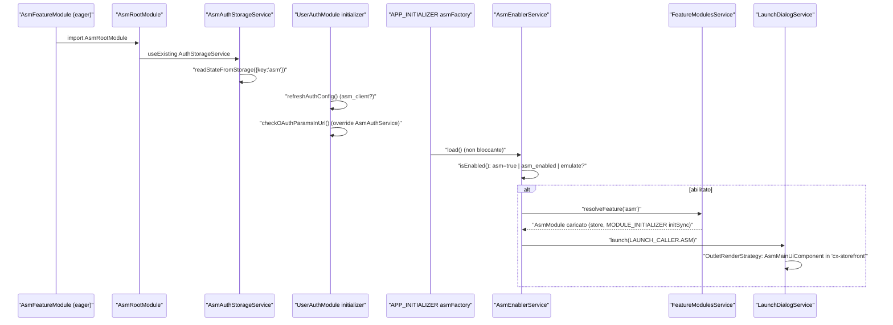
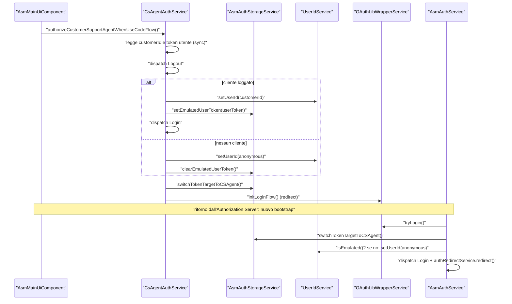
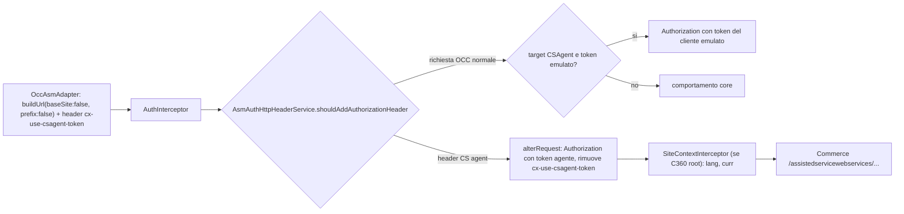
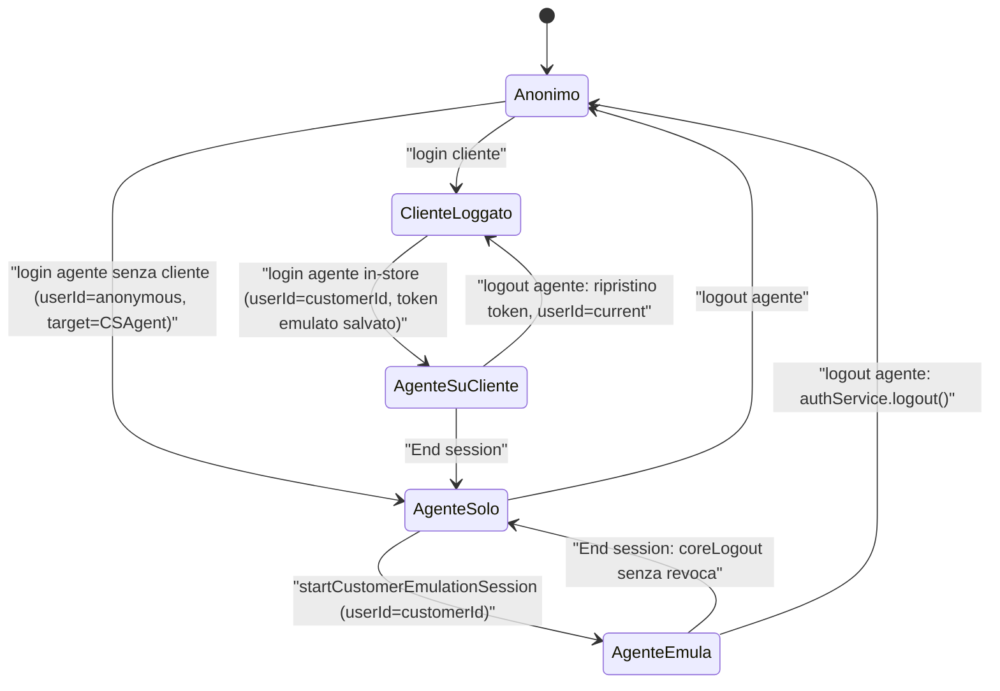
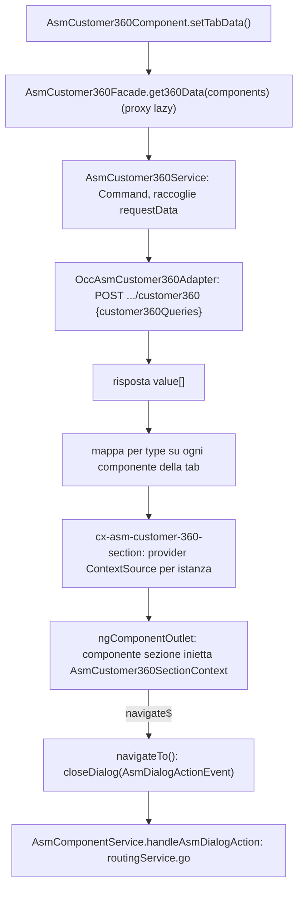

# 29 — ASM (Assisted Service Module)

> Riferimenti allo SHA `5b7a1c2bf2808d7380bc20596d10f4fa710c3da1` (vedi [00-meta](../00-meta.md)).

## 1. A cosa serve e perché esiste

L'Assisted Service Module (`@spartacus/asm`) permette a un **customer support agent** (CS agent: commesso in negozio o operatore di call center) di autenticarsi nello storefront con le proprie credenziali e di **emulare** un cliente: cercarlo, aprire una sessione "come se fosse lui", vederne e modificarne il carrello, legare un carrello anonimo al suo account, crearne l'account, consultare una vista aggregata (Customer 360). Tutto questo avviene nello stesso storefront usato dai clienti, sopra una barra ASM che si apre solo quando serve.

Dal punto di vista architetturale ASM è interessante per tre ragioni:

1. **È una feature lazy che però deve modificare il cuore dell'autenticazione.** La parte eager (`AsmRootModule`) sostituisce con `useExisting` quattro servizi del core — `AuthStorageService`, `AuthService`, `AuthHttpHeaderService`, `ProtectedRoutesService` — e aggiunge un interceptor HTTP (`feature-libs/asm/root/asm-root.module.ts:L65-L92`). Il resto (store NgRx, componenti, adapter OCC) è caricato on demand con il nome feature `'asm'` (`feature-libs/asm/root/feature-name.ts:L7-L7`, `projects/storefrontapp/src/app/spartacus/features/asm/asm-feature.module.ts:L18-L27`).
2. **Due "identità" condividono un unico slot token.** Il core ha un solo token OAuth in `AuthStorageService`; ASM aggiunge un `TokenTarget` (`CSAgent` / `User`) che dice di chi è quel token, più un secondo token "emulato" del cliente da ripristinare (`feature-libs/asm/root/services/asm-auth-storage.service.ts:L18-L21`, `feature-libs/asm/root/services/asm-auth-storage.service.ts:L37-L50`). L'emulazione OCC, invece, è ottenuta impostando lo `userId` al `customerId` del cliente invece di `current` (`feature-libs/asm/root/services/csagent-auth.service.ts:L134-L141`).
3. **Non deve pesare sull'utente normale.** Lo dice esplicitamente il sorgente: "This service is added to avoid any polution of the UI and runtime performance for the ordinary production user" (`feature-libs/asm/root/services/asm-enabler.service.ts:L13-L17`). La UI viene caricata solo se l'URL contiene `asm=true`, se ASM è stato usato prima nel browser o se si arriva da un deep link di emulazione (`feature-libs/asm/root/services/asm-enabler.service.ts:L42-L49`).

Questo capitolo presuppone il capitolo [22 — Autenticazione](../parte-2/22-auth.md) (token, `AuthInterceptor`, `AuthHttpHeaderService`, `UserIdService`) e il capitolo [12 — Feature module e lazy loading](../parte-2/12-feature-module-lazy.md) (`featureModules`, `facadeFactory`). I dialog ASM usano il launch dialog descritto in [18 — Layout, breakpoint, launch dialog](../parte-2/18-layout-breakpoint-a11y.md); lo store usa i loader di [19 — State management](../parte-2/19-state-management.md).

## 2. Mappa dei file

La libreria ha 12 entry point ng-packagr (un `ng-package.json` per cartella: radice, `root`, `core`, `occ`, `components`, `assets` e gli stessi sei sotto `customer-360/`) — `feature-libs/asm/ng-package.json:L1-L1`.

| Path | Ruolo |
|---|---|
| `feature-libs/asm/asm.module.ts` | `AsmModule` = `AsmComponentsModule` + `AsmCoreModule` + `AsmOccModule` (target del lazy load) |
| `feature-libs/asm/root/asm-root.module.ts` | eager: override servizi auth, route deep link `asmDeepLink`, interceptor, `defaultAsmConfig` |
| `feature-libs/asm/root/asm-loader.module.ts` | `APP_INITIALIZER` non bloccante → `AsmEnablerService.load()` |
| `feature-libs/asm/root/asm-constants.ts` | `ASM_ENABLED_LOCAL_STORAGE_KEY = 'asm_enabled'` |
| `feature-libs/asm/root/feature-name.ts` | `ASM_FEATURE = 'asm'` |
| `feature-libs/asm/root/config/asm-config.ts` | `AsmConfig` (abstract, `useExisting: Config`, augment di `Config`) |
| `feature-libs/asm/root/config/default-asm-config.ts` | `defaultAsmConfig` (timer, ricerca, customer list, header user id) |
| `feature-libs/asm/root/services/asm-enabler.service.ts` | decide se caricare la UI ASM |
| `feature-libs/asm/root/services/asm-auth-storage.service.ts` | `AsmAuthStorageService`, enum `TokenTarget`, token emulato |
| `feature-libs/asm/root/services/csagent-auth.service.ts` | `CsAgentAuthService`: login/logout agente, avvio emulazione |
| `feature-libs/asm/root/services/asm-auth.service.ts` | `AsmAuthService`: override di `AuthService` |
| `feature-libs/asm/root/services/asm-auth-http-header.service.ts` | `AsmAuthHttpHeaderService`: token agente sulle richieste marcate |
| `feature-libs/asm/root/services/asm-protected-routes.service.ts` | nessuna route protetta per l'agente loggato |
| `feature-libs/asm/root/services/asm-deep-link.service.ts` | parametri e navigazione del deep link |
| `feature-libs/asm/root/interceptors/user-id-http-header.interceptor.ts` | header `sap-commerce-cloud-user-id` |
| `feature-libs/asm/root/facade/*.facade.ts` | `AsmBindCartFacade`, `AsmCreateCustomerFacade`, `AsmCustomerListFacade` (proxy lazy) |
| `feature-libs/asm/root/model/augmented-core.model.ts` | augment di `LAUNCH_CALLER` con `ASM_*` |
| `feature-libs/asm/core/asm-core.module.ts` | store, connector, facade, `MODULE_INITIALIZER` di persistenza |
| `feature-libs/asm/core/store/` | stato `asm`: due loader di ricerca + `asmUi`; effects e meta-reducer |
| `feature-libs/asm/core/facade/asm.service.ts` | `AsmService` (dispatch/select sullo store) |
| `feature-libs/asm/core/services/asm-state-persistence.service.ts` | sync `{ui, emulatedUserToken, tokenTarget}` ↔ storage `asm` |
| `feature-libs/asm/core/connectors/` | `AsmAdapter`, `AsmConnector`, token normalizer |
| `feature-libs/asm/occ/adapters/occ-asm.adapter.ts` | `OccAsmAdapter` verso `/assistedservicewebservices/...` |
| `feature-libs/asm/occ/adapters/default-occ-asm-config.ts` | endpoint di default |
| `feature-libs/asm/components/asm-main-ui/asm-main-ui.component.ts` | barra ASM e orchestrazione della sessione |
| `feature-libs/asm/components/` (altri) | login form, selezione cliente, emulazione, bind cart, dialog, timer, customer list, creazione cliente |
| `feature-libs/asm/components/services/asm-component.service.ts` | servizio UI condiviso (logout, deep link, azioni dialog) |
| `feature-libs/asm/customer-360/root/asm-customer-360-root.module.ts` | feature `asmCustomer360` dipendente da `asm`, `SiteContextInterceptor` |
| `feature-libs/asm/customer-360/core/services/asm-customer-360.service.ts` | `AsmCustomer360Service` (Command che aggrega le query) |
| `feature-libs/asm/customer-360/occ/adapters/occ-asm-customer-360.adapter.ts` | POST `.../customer360` |
| `feature-libs/asm/customer-360/components/` | dialog C360, config delle tab, host di sezione, 11 sezioni |
| `projects/storefrontapp/src/app/spartacus/features/asm/asm-feature.module.ts` | wiring nell'app demo |

## 3. Come funziona passo per passo

### 3.1 Packaging: cosa è eager e cosa è lazy

L'app importa `AsmRootModule` eagerly e dichiara `featureModules[ASM_FEATURE].module: () => import('@spartacus/asm').then((m) => m.AsmModule)`; non sono dichiarati `cmsComponents`, perché la UI ASM non è un componente CMS (`projects/storefrontapp/src/app/spartacus/features/asm/asm-feature.module.ts:L18-L27`). `AsmModule` si limita a importare componenti, core e occ (`feature-libs/asm/asm.module.ts:L12-L15`).

`AsmRootModule` (`feature-libs/asm/root/asm-root.module.ts:L34-L95`) contiene tutto ciò che deve esistere **prima** che la feature sia caricata:

- importa `AsmLoaderModule` e `PageLayoutModule`;
- registra una route figlia con `path: null` (con `// @ts-ignore`), `CmsPageGuard`, `PageLayoutComponent` e `data.cxRoute: 'asmDeepLink'` nel contesto della home page CMS (`feature-libs/asm/root/asm-root.module.ts:L38-L51`); il path reale arriva dalla `RoutingConfig` di default `asmDeepLink.paths: ['assisted-service/emulate']` (`feature-libs/asm/root/asm-root.module.ts:L56-L64`) — vedi il meccanismo delle route semantiche nel capitolo [14 — Routing](../parte-2/14-routing.md);
- fornisce `defaultAsmConfig` (`feature-libs/asm/root/asm-root.module.ts:L55-L55`);
- sostituisce i servizi auth del core e aggiunge `UserIdHttpHeaderInterceptor` (`feature-libs/asm/root/asm-root.module.ts:L65-L92`).

Il token `DELEGATED_AUTH_HTTP_HEADER_SERVICE` è fornito anch'esso con `AsmAuthHttpHeaderService`, come provider di retro-compatibilità per il fix CXSPA-12514 da rimuovere quando il toggle `enableExpiredRefreshTokenHandlers` sarà completamente attivo (`feature-libs/asm/root/asm-root.module.ts:L77-L83`). Il token vive nel core senza factory ed esiste perché altre librerie (es. Punchout) possano delegare all'override ASM senza importarlo a compile-time (`core-libs/core/src/auth/user-auth/services/auth-http-header.service.ts:L72-L82`).

### 3.2 Attivazione: `AsmLoaderModule` e `AsmEnablerService`

`AsmLoaderModule` registra un `APP_INITIALIZER` la cui factory ritorna una funzione `void`: chiama `AsmEnablerService.load()` senza restituire una Promise, quindi **non blocca il bootstrap** (`feature-libs/asm/root/asm-loader.module.ts:L16-L40`). Il commento motiva la scelta: router e state "aren't available in an optimized way during the APP_INITIALIZER" (`feature-libs/asm/root/asm-loader.module.ts:L29-L34`). Per l'ordine degli initializer vedi [10 — Bootstrap](../parte-2/10-bootstrap-inizializzazione.md).

`AsmEnablerService.isEnabled()` (`feature-libs/asm/root/services/asm-enabler.service.ts:L42-L49`) restituisce vero se:

- `isLaunched()`: la query string di `Location.path()` contiene esattamente il parametro `asm=true` (`feature-libs/asm/root/services/asm-enabler.service.ts:L55-L58`);
- `isUsedBefore()`: `localStorage['asm_enabled'] === 'true'` (`feature-libs/asm/root/services/asm-enabler.service.ts:L70-L79`, costante in `feature-libs/asm/root/asm-constants.ts:L7-L7`);
- `isEmulateInURL()`: `location.path().indexOf('assisted-service/emulate?') > 0` (`feature-libs/asm/root/services/asm-enabler.service.ts:L63-L65`).

Al primo lancio via `asm=true` scrive `asm_enabled='true'`, così le visite successive riaprono la barra anche senza parametro (`feature-libs/asm/root/services/asm-enabler.service.ts:L43-L47`).

Se abilitato, `addUi()` risolve la feature `'asm'` (lazy load di `AsmModule`) e poi lancia `LAUNCH_CALLER.ASM` con il `LaunchDialogService` (`feature-libs/asm/root/services/asm-enabler.service.ts:L84-L88`). `LAUNCH_CALLER.ASM` è già nell'enum dello storefront (`core-libs/storefront/layout/launch-dialog/config/launch-config.ts:L93-L94`); la config di layout di default, fornita dai componenti, lo aggancia all'outlet `'cx-storefront'` con `AsmMainUiComponent` (`feature-libs/asm/components/default-asm-layout.config.ts:L10-L17`). `LaunchDialogService.launch()` trova la config del caller, sceglie la strategia di render e la invoca (`core-libs/storefront/layout/launch-dialog/services/launch-dialog.service.ts:L78-L97`); per una config con `outlet` è `OutletRenderStrategy`, che aggiunge il componente all'outlet in posizione `BEFORE` (default) e forza il render dell'outlet (`core-libs/storefront/layout/launch-dialog/services/outlet-render.strategy.ts:L45-L84`). Per gli outlet vedi [17 — Outlet](../parte-2/17-outlet.md).

Il lazy load di `AsmModule` porta con sé `AsmCoreModule`, che registra lo store (`AsmStoreModule`) e un `MODULE_INITIALIZER` che invoca `AsmStatePersistenceService.initSync()` (`feature-libs/asm/core/asm-core.module.ts:L15-L35`).

### 3.3 La duplicazione nel core: `AuthService.refreshAuthConfig()`

C'è un secondo punto che "sa" se ASM è attivo, e sta nel core. `AuthService` contiene una copia della logica di rilevamento (`isAsmEnabled`, `isLaunched`, `isEmulateInURL`, `isUsedBefore` con letterale `'asm_enabled'`) e la usa in `refreshAuthConfig()`: se il toggle `authorizationCodeFlowByDefault` è attivo e ASM è abilitato, il client OAuth diventa `'asm_client'` e `isUsingASMClient` passa a `true` (`core-libs/core/src/auth/user-auth/facade/auth.service.ts:L263-L327`). `refreshAuthConfig()` e `checkOAuthParamsInUrl()` sono invocati da un initializer del core, solo in browser e dopo che la config è stabile (`core-libs/core/src/auth/user-auth/user-auth.module.ts:L43-L54`). Con i default attuali `authorizationCodeFlowByDefault` vale `true` (`core-libs/core/src/features-config/feature-toggles/config/feature-toggles.ts:L1029-L1029`), quindi **il percorso normale del login agente è l'Authorization Code flow** (§3.6), non il form username/password.

### 3.4 `AsmConfig`

`AsmConfig` è una classe astratta `@Injectable({ providedIn: 'root', useExisting: Config })` con chiave `asm` e sotto-chiavi `agentSessionTimer`, `customerSearch`, `customerList`, `asmSessionSupport`, `userIdHttpHeader`, `createCustomer`; augmenta l'interfaccia `Config` di `@spartacus/core` (`feature-libs/asm/root/config/asm-config.ts:L11-L59`). I default sono in `feature-libs/asm/root/config/default-asm-config.ts:L11-L84` (dettaglio nella §6). Siccome `defaultAsmConfig` è fornito dal modulo eager, è disponibile prima del lazy load (`feature-libs/asm/root/asm-root.module.ts:L55-L55`). Il meccanismo generale è nel capitolo [11 — Configurazione](../parte-2/11-configurazione.md).

### 3.5 Il modello di stato dell'autenticazione ASM

`AsmAuthStorageService extends AuthStorageService` (`feature-libs/asm/root/services/asm-auth-storage.service.ts:L37-L139`) aggiunge due `BehaviorSubject`:

- `_tokenTarget$`, inizializzato a `TokenTarget.User`: dice se il token corrente è dell'agente o di un utente (`feature-libs/asm/root/services/asm-auth-storage.service.ts:L38-L39`);
- `emulatedUserToken$`: il token del cliente che era loggato quando l'agente ha fatto login "sopra" di lui (caso in-store), da ripristinare al logout dell'agente (`feature-libs/asm/root/services/asm-auth-storage.service.ts:L41-L50`).

Il costruttore legge **sincronicamente** lo stato persistito con chiave `'asm'` tramite `StatePersistenceService.readStateFromStorage` e ripristina token emulato e target (`feature-libs/asm/root/services/asm-auth-storage.service.ts:L52-L69`). Questo è indispensabile: la sincronizzazione completa (`initSync`) parte solo dopo il lazy load (§3.11), ma il target del token serve già al primo `AuthInterceptor`.

Combinando questi due valori con lo `userId` del core si ottengono i predicati chiave:

| Predicato | Definizione | Riferimento |
|---|---|---|
| agente loggato | token presente && target `CSAgent` && `access_token` ≠ quello del token emulato | `feature-libs/asm/root/services/csagent-auth.service.ts:L148-L164` |
| cliente emulato | `userId` ≠ `anonymous` e ≠ `current` | `feature-libs/asm/root/services/csagent-auth.service.ts:L171-L173`, `core-libs/core/src/auth/user-auth/facade/user-id.service.ts:L81-L88` |
| utente "loggato" (per il resto dello storefront) | token presente && (target `User` \|\| (target `CSAgent` && emulato)) | `feature-libs/asm/root/services/asm-auth.service.ts:L201-L214` |

L'ultima riga è il trucco centrale: durante un'emulazione il token è dell'agente, ma per guard, carrello e checkout l'utente risulta loggato e le chiamate OCC usano `/users/<customerId>/...`.

### 3.6 Login dell'agente

**Authorization Code flow (default).** Con `authorizationCodeFlowByDefault` il template mostra il link "Sign In as Agent" invece del form (`feature-libs/asm/components/asm-main-ui/asm-main-ui.component.html:L45-L63`, `feature-libs/asm/components/asm-main-ui/asm-main-ui.component.html:L116-L124`). Il click chiama `CsAgentAuthService.authorizeCustomerSupportAgentWhenUseCodeFlow()` (`feature-libs/asm/components/asm-main-ui/asm-main-ui.component.ts:L386-L388`), che:

1. legge sincronicamente `customerId` (da `UserAccountFacade.get()`) e il token utente corrente (`feature-libs/asm/root/services/csagent-auth.service.ts:L90-L101`);
2. **prima del redirect a pagina intera** persiste lo stato di emulazione: dispatch `Logout`; se c'era un cliente loggato `setUserId(customerId)` + `setEmulatedUserToken(userToken)` + `Login`, altrimenti `userId = anonymous` e token emulato pulito (`feature-libs/asm/root/services/csagent-auth.service.ts:L103-L120`). Il commento spiega che `initLoginFlow()` naviga via e ciò che segue "does not run reliably" (`feature-libs/asm/root/services/csagent-auth.service.ts:L104-L106`);
3. passa il target a `CSAgent` e chiama `initLoginFlow()`; in errore torna a `User` (`feature-libs/asm/root/services/csagent-auth.service.ts:L122-L126`).

Al ritorno dall'Authorization Server l'initializer del core chiama `refreshAuthConfig()` (che imposta di nuovo `asm_client`) e poi `checkOAuthParamsInUrl()`, che per DI è l'override di `AsmAuthService` (`feature-libs/asm/root/services/asm-auth.service.ts:L69-L95`): se non si usa il client ASM delega al core; altrimenti `tryLogin()` e, se il token è stato ricevuto, target `CSAgent`, `userId = anonymous` **solo se non c'è già un'emulazione pendente** (CXSPA-13777), dispatch `Login` e `authRedirectService.redirect()`. Il core, simmetricamente, salta l'impostazione di `userId = current` quando `isEmulated` o `isUsingASMClient` è vero (`core-libs/core/src/auth/user-auth/facade/auth.service.ts:L97-L104`).

**Password flow (toggle disattivato).** `CSAgentLoginFormComponent` emette `{userId, password}` (`feature-libs/asm/components/csagent-login-form/csagent-login-form.component.ts:L55-L64`); `AsmMainUiComponent.loginCustomerSupportAgent()` chiama `authorizeCustomerSupportAgent()` (`feature-libs/asm/components/asm-main-ui/asm-main-ui.component.ts:L376-L384`), che passa il target a `CSAgent` **prima** di `authorizeWithPasswordFlow()`, poi dispatcha `Logout` e, come nel code flow, avvia subito l'emulazione del cliente già loggato oppure imposta `anonymous` (`feature-libs/asm/root/services/csagent-auth.service.ts:L46-L84`). Il target va impostato prima perché il token restituito dal password flow viene scritto nello stesso `AuthStorageService`: il target deve già dire "CSAgent" quando arriva.

### 3.7 Che cosa vede il resto dello storefront mentre l'agente è loggato

`AsmAuthService` ritocca il comportamento di `AuthService`:

- `loginWithCredentials()` rifiuta il login cliente (messaggio `asm.auth.agentLoggedInError`) se c'è un token con target `CSAgent` (`feature-libs/asm/root/services/asm-auth.service.ts:L97-L134`);
- `loginWithRedirect()`: se l'agente è attivo ma non emula nessuno, invece dell'errore reindirizza a `'/'`, per gestire guard come `CheckoutAuthGuard` che mandano a `/login` (`feature-libs/asm/root/services/asm-auth.service.ts:L136-L156`);
- `coreLogout()` in emulazione **non revoca** i token: pulisce il token emulato, `clearUserId()` e dispatcha `Logout`; altrimenti delega al core (`feature-libs/asm/root/services/asm-auth.service.ts:L180-L196`).

`AsmProtectedRoutesService.isUrlProtected()` restituisce `false` per qualsiasi URL quando l'agente è loggato, così può navigare le pagine CMS anche senza emulare (`feature-libs/asm/root/services/asm-protected-routes.service.ts:L15-L43`).

### 3.8 Le richieste HTTP: quale token, quali header

Le chiamate ai web service ASM sono marcate dall'adapter con l'header interceptor `cx-use-csagent-token` (`USE_CUSTOMER_SUPPORT_AGENT_TOKEN`, definito nel core: `core-libs/core/src/occ/utils/interceptor-util.ts:L10-L10`) e costruite con `{ baseSite: false, prefix: false }`, cioè fuori dal prefisso `/occ/v2/{site}` (`feature-libs/asm/occ/adapters/occ-asm.adapter.ts:L99-L121`).

L'`AuthInterceptor` del core chiede a `AuthHttpHeaderService` se intercettare gli errori e se aggiungere l'header, prende il token stabile e chiama `alterRequest()` (`core-libs/core/src/auth/user-auth/http-interceptors/auth.interceptor.ts:L31-L48`). Per DI quel servizio è `AsmAuthHttpHeaderService`, che:

- estende `shouldAddAuthorizationHeader()` e `shouldCatchError()` alle richieste con `cx-use-csagent-token` (`feature-libs/asm/root/services/asm-auth-http-header.service.ts:L60-L76`);
- in `alterRequest()`, per le richieste CS agent senza `Authorization`, aggiunge l'header con il token e rimuove `cx-use-csagent-token` "to avoid problems with CORS" (`feature-libs/asm/root/services/asm-auth-http-header.service.ts:L84-L106`);
- per le richieste OCC **non** marcate, quando il target è `CSAgent` e c'è un token emulato con `access_token`, usa il token del cliente (`getTokenForRequest` / `shouldUseEmulatedUserToken`, `feature-libs/asm/root/services/asm-auth-http-header.service.ts:L108-L133`). È il caso in-store: l'agente ha fatto login sopra la sessione di un cliente, e le chiamate "normali" continuano col token di quest'ultimo;
- su refresh token scaduto, se l'agente è loggato imposta il logout in corso, esegue `logoutCustomerSupportAgent()` e mostra `asm.csagentTokenExpired`; altrimenti comportamento del core (`feature-libs/asm/root/services/asm-auth-http-header.service.ts:L149-L167`).

Altri due interceptor completano il quadro:

- `UserIdHttpHeaderInterceptor`: no-op se `asm.userIdHttpHeader.enable` è falsy; altrimenti legge `OCC_HTTP_TOKEN.sendUserIdAsHeader` dal context della richiesta: se stringa usa quel valore, se `true` usa `takeUserId()` scartando gli id costanti (`anonymous`, `current`, ...), e imposta l'header `sap-commerce-cloud-user-id` (`feature-libs/asm/root/interceptors/user-id-http-header.interceptor.ts:L44-L84`). Il context token è nel core (`core-libs/core/src/occ/utils/occ-http-token.ts:L9-L20`) e lo valorizzano, fra gli adapter core, product search e user cost centers (`core-libs/core/src/occ/adapters/product/occ-product-search.adapter.ts:L52-L52`, `core-libs/core/src/occ/adapters/user/occ-user-cost-centers.adapter.ts:L33-L33`). Il JSDoc della config avverte che l'header può rompere istanze Commerce che non lo consentono in CORS (`feature-libs/asm/root/config/asm-config.ts:L39-L50`);
- `SiteContextInterceptor` (registrato da `AsmCustomer360RootModule`, `feature-libs/asm/customer-360/root/asm-customer-360-root.module.ts:L29-L33`) aggiunge `lang` e `curr` come query param alle richieste verso il base URL OCC che contengono `/assistedservicewebservices/` (`feature-libs/asm/customer-360/root/interceptors/site-context.interceptor.ts:L54-L72`).

> ⚠️ DA VERIFICARE — L'ordine effettivo fra `UserIdHttpHeaderInterceptor`, `SiteContextInterceptor` e `AuthInterceptor` dipende dall'ordine con cui l'app importa i moduli che li registrano (multi provider `HTTP_INTERCEPTORS`); il codice ASM non lo fissa. Per il meccanismo generale vedi [06 — HttpClient e interceptor](../parte-1/06-httpclient-interceptor.md).

### 3.9 Ricerca cliente: store, effect, adapter

`CustomerSelectionComponent` cerca per nome (`searchTerm`) o per numero d'ordine (`searchOrder`) con `debounceTime(300)`, solo da 3 caratteri in su, con `pageSize = asm.customerSearch.maxResults`; i due campi si escludono (`feature-libs/asm/components/customer-selection/customer-selection.component.ts:L96-L192`). `AsmService` — servizio `providedIn: 'root'` che lavora sullo store, non una facade proxy — dispatcha `CustomerSearch` (`feature-libs/asm/core/facade/asm.service.ts:L20-L79`).

Lo stato `asm` (`feature-libs/asm/core/store/asm-state.ts:L15-L23`) contiene due `LoaderState<CustomerSearchPage>` (`customerSearchResult`, `customerListCustomersSearchResult`) e `asmUi`; `AsmStoreModule` registra la feature store con reducer, meta-reducer e gli effects `CustomerEffects` e `AsmSessionEffects` (`feature-libs/asm/core/store/asm-store.module.ts:L16-L25`). I reducer di ricerca sono `StateUtils.loaderReducer` (`feature-libs/asm/core/store/reducers/index.ts:L24-L34`).

`CustomerEffects.customerSearch$` usa `switchMap` (una nuova ricerca cancella la precedente) sul connector; un 400 con messaggio `'Wrong orderId'` è convertito in un successo vuoto, gli altri errori in `CustomerSearchFail` con l'errore normalizzato (`feature-libs/asm/core/store/effects/customer.effect.ts:L18-L43`). `OccAsmAdapter.customerSearch()` è una POST con body `{query, orderId, customerListId}` e query param `baseSite`, `sort` (default `byNameAsc` solo se non c'è `customerListId`), `pageSize`, `page` (`feature-libs/asm/occ/adapters/occ-asm.adapter.ts:L131-L186`).

### 3.10 Avvio e fine dell'emulazione

Il submit della selezione emette `{ customerId, parameters: { orderId } }` (`feature-libs/asm/components/customer-selection/customer-selection.component.ts:L221-L232`). `AsmMainUiComponent.startCustomerEmulationSession()` (`feature-libs/asm/components/asm-main-ui/asm-main-ui.component.ts:L394-L418`):

- chiama `CsAgentAuthService.startCustomerEmulationSession(customerId)`, che pulisce il token emulato, dispatcha `Logout`, imposta `userId = customerId` e dispatcha `Login` (`feature-libs/asm/root/services/csagent-auth.service.ts:L134-L141`);
- se `asm.asmSessionSupport.enabled`, crea un evento `{ eventType: 'StartSession' }` (`AsmSessionCreationAction` → `AsmSessionEffects` → POST `asmSessionEvents`: `feature-libs/asm/core/store/effects/asm-session.effect.ts:L14-L41`, `feature-libs/asm/occ/adapters/occ-asm.adapter.ts:L70-L97`);
- con parametri di deep link delega la navigazione (§3.12); senza `customerId` mostra `asm.error.noCustomerId`.

Quando `isUserLoggedIn()` diventa vero (target `CSAgent` && emulato) lo stream `customer$` chiama `handleCustomerSessionStartRedirection()`, che naviga a `'/'` se la sessione è stata appena avviata (`feature-libs/asm/components/asm-main-ui/asm-main-ui.component.ts:L166-L175`, `feature-libs/asm/components/asm-main-ui/asm-main-ui.component.ts:L363-L374`).

**Fine emulazione (l'agente resta).** "End session" in `CustomerEmulationComponent` chiama `authService.logout()` (`feature-libs/asm/components/customer-emulation/customer-emulation.component.ts:L69-L71`); il percorso standard di logout arriva a `AsmAuthService.coreLogout()` che, essendo in emulazione, pulisce solo token emulato e `userId` senza revoca (`feature-libs/asm/root/services/asm-auth.service.ts:L180-L196`).

**Logout dell'agente.** `logoutCustomerSupportAgent()` (`feature-libs/asm/root/services/csagent-auth.service.ts:L186-L209`) revoca i token, dispatcha l'azione stringa `'[Auth] Logout Customer Support Agent'`, rimette il target a `User`; se era in corso un'emulazione con token emulato (caso in-store) ripristina il token del cliente con `userId = current` e `Login`, altrimenti chiama `authService.logout()`. Il logout è attivato dal pulsante, dalla scadenza del timer di sessione (`feature-libs/asm/components/asm-session-timer/asm-session-timer.component.ts:L23-L97`) o dal refresh token scaduto (§3.8). Quando `customerSupportAgentLoggedIn$` diventa falso la barra chiude i dialog aperti (`feature-libs/asm/components/asm-main-ui/asm-main-ui.component.ts:L153-L162`).

### 3.11 Persistenza dello stato ASM

`AsmStatePersistenceService.initSync()` sincronizza con chiave `'asm'` lo stato `{ ui, emulatedUserToken, tokenTarget }` tramite `StatePersistenceService.syncWithStorage`, filtrando le emissioni finché la slice `store.asm` non esiste (la feature potrebbe essere ancora in caricamento) (`feature-libs/asm/core/services/asm-state-persistence.service.ts:L48-L87`). Il `refresh_token` del token emulato **non** viene persistito "to minimize risk of user account hijacking" (`feature-libs/asm/core/services/asm-state-persistence.service.ts:L74-L79`). `onRead()` riporta i valori nello store (`AsmUiUpdate`) e nell'`AsmAuthStorageService` (`feature-libs/asm/core/services/asm-state-persistence.service.ts:L93-L105`). La lettura anticipata nel costruttore di `AsmAuthStorageService` (§3.5) copre la finestra fra bootstrap e lazy load.

### 3.12 Deep link `assisted-service/emulate?customerId=...`

1. L'URL attiva la UI (`isEmulateInURL`, §3.2).
2. `AsmDeepLinkService` legge i parametri da `winRef.location.search` **una sola volta**, nel costruttore (`feature-libs/asm/root/services/asm-deep-link.service.ts:L18-L24`); `getParamsInUrl()` scarta le chiavi con valore falsy (`feature-libs/asm/root/services/asm-deep-link.service.ts:L69-L79`). I parametri sono `customerId`, `orderId`, `ticketId`, `cartId`, `cartType` (`feature-libs/asm/root/model/asm.models.ts:L34-L44`).
3. `AsmMainUiComponent.subscribeForDeeplink()` naviga sempre a `'/'` ("to avoid 404") e, quando l'agente è loggato e c'è `customerId`: se un cliente è già loggato e non è stato emulato via deep link apre la conferma di switch, altrimenti chiama `startSessionWithParameters` in un `setTimeout` (`feature-libs/asm/components/asm-main-ui/asm-main-ui.component.ts:L282-L316`).
4. `confirmSwitchCustomer()` carica il cliente target con `userAccountFacade.getById()` e apre `ASM_SWITCH_CUSTOMER`; se è lo stesso cliente si limita a `setEmulatedByDeepLink(true)` (`feature-libs/asm/components/asm-main-ui/asm-main-ui.component.ts:L318-L345`). Con `SWITCH` il dialog fa logout del cliente corrente, lasciando che la sottoscrizione del punto 3 avvii la nuova emulazione (`feature-libs/asm/components/asm-switch-customer-dialog/asm-switch-customer-dialog.component.ts:L61-L66`).
5. Dopo l'avvio, `AsmDeepLinkService.handleNavigation()` naviga con priorità: `cartType==='active'` → `cart`; `cartType==='saved'` + `cartId` → `my-account/saved-cart/<id>`; `orderId` → `orderDetails`; `ticketId` → `supportTicketDetails` (`feature-libs/asm/root/services/asm-deep-link.service.ts:L44-L64`).
6. `AsmBindCartComponent` reagisce a deep link con `cartType` `inactive`/`active`: nasconde il pulsante bind, mostra "save" per inactive, precompila il cart id (`feature-libs/asm/components/asm-bind-cart/asm-bind-cart.component.ts:L286-L314`).

### 3.13 La barra ASM: orchestrazione in `AsmMainUiComponent`

Oltre a quanto visto, `ngOnInit` (`feature-libs/asm/components/asm-main-ui/asm-main-ui.component.ts:L142-L254`):

- se `asmCustomer360` è configurato ne avvia subito il lazy load (`feature-libs/asm/components/asm-main-ui/asm-main-ui.component.ts:L143-L150`);
- osserva lo stato UI: con `status === 403` fa logout agente, `hideUi()` e azzera `status` (`feature-libs/asm/components/asm-main-ui/asm-main-ui.component.ts:L183-L189`);
- reagisce alla chiusura dei dialog: con `selectedUser` avvia l'emulazione (e va a `orders` per `ORDER_HISTORY`), con `customerId` (cliente appena creato) emula e torna a `'/'`, poi `ACTIVE_CART` → `cart`, `CUSTOMER_360` → apre il dialog C360; `'forbidden'` → logout + `hideUi()` (`feature-libs/asm/components/asm-main-ui/asm-main-ui.component.ts:L190-L233`);
- quando l'agente è loggato, dopo `debounceTime(500)`, lancia una ricerca fittizia `query: 'autoSearchToAvoidUnauthorizedLogin', pageSize: 1` (`feature-libs/asm/components/asm-main-ui/asm-main-ui.component.ts:L235-L251`). Lo scopo si ricostruisce dal codice: se l'utente autenticato non ha i permessi da agente, la ricerca fallisce con 403; il reducer `asmUi` fonde l'errore di `CustomerSearchFail` nello stato UI (`feature-libs/asm/core/store/reducers/asm-ui.reducer.ts:L21-L26`) e il `status: 403` fa scattare il logout descritto sopra.

`hideUi()` nasconde il componente tramite `@HostBinding('class.hidden')`, rimuove `asm_enabled` dal localStorage, chiama `oAuthLibWrapperService.refreshAuthConfig()` e `authService.updateIsUsingASMClient(false)` (`feature-libs/asm/components/asm-main-ui/asm-main-ui.component.ts:L420-L425`, `feature-libs/asm/components/asm-main-ui/asm-main-ui.component.ts:L113-L113`). Il template mostra il login agente se non loggato, `cx-customer-emulation` se c'è un cliente, `cx-customer-selection` altrimenti; tutto nascosto se `collapsed` (`feature-libs/asm/components/asm-main-ui/asm-main-ui.component.html:L83-L125`).

Gli altri componenti in breve:

- `AsmBindCartComponent` (OnPush): valida che il cart id non sia quello attivo; se il carrello attivo del cliente ha articoli apre `ASM_BIND_CART`, altrimenti fa bind diretto e ricarica il carrello corrente (`feature-libs/asm/components/asm-bind-cart/asm-bind-cart.component.ts:L77-L179`); con `REPLACE` salva il vecchio carrello come saved cart (`feature-libs/asm/components/asm-bind-cart/asm-bind-cart.component.ts:L270-L284`). Il bind passa da `AsmBindCartService`, un `Command` che usa `uid` dell'utente corrente (`feature-libs/asm/core/facade/asm-bind-cart.service.ts:L23-L45`), e da `OccAsmAdapter.bindCart()`, POST form-urlencoded (`feature-libs/asm/occ/adapters/occ-asm.adapter.ts:L188-L217`).
- `CustomerListComponent`: liste clienti via `AsmCustomerListService` (`QueryService` per le liste, store per i clienti della lista: `feature-libs/asm/core/facade/asm-customer-list.service.ts:L22-L84`); chiude con `'forbidden'` su 403 (`feature-libs/asm/components/customer-list/customer-list.component.ts:L150-L214`); `startColumnAction()` chiude con `{ actionType, selectedUser }` (`feature-libs/asm/components/customer-list/customer-list.component.ts:L305-L315`).
- `AsmCreateCustomerFormComponent`: valida i campi, chiama la facade e chiude con l'utente creato; mappa `ValidationError` e `AssistedServiceDuplicatedUidError` su chiavi i18n (`feature-libs/asm/components/asm-create-customer-form/asm-create-customer-form.component.ts:L82-L190`).
- `AsmSessionTimerComponent`: countdown al secondo, a 0 logout di agente e cliente, reset su navigazione e cambio `userId` (`feature-libs/asm/components/asm-session-timer/asm-session-timer.component.ts:L23-L97`).
- I dialog ASM sono `inlineRoot: true` + `DIALOG_TYPE.DIALOG` (`feature-libs/asm/components/default-bind-cart-layout.config.ts:L14-L22`, `feature-libs/asm/components/customer-list/default-customer-list-layout.config.ts:L10-L18`); i relativi `LAUNCH_CALLER` sono aggiunti sia a livello di tipo sia a runtime (`feature-libs/asm/root/model/augmented-core.model.ts:L9-L23`).

### 3.14 Facade root e lazy loading dei servizi

Le tre facade root (`AsmBindCartFacade`, `AsmCreateCustomerFacade`, `AsmCustomerListFacade`) sono proxy `facadeFactory` sulla feature `ASM_FEATURE` (`feature-libs/asm/root/facade/asm-bind-cart.facade.ts:L12-L26`, `feature-libs/asm/root/facade/asm-create-customer.facade.ts:L14-L25`, `feature-libs/asm/root/facade/asm-customer-list.facade.ts:L14-L39`); `facadeProviders` nel core ASM collega ciascuna facade all'implementazione con `useExisting` (`feature-libs/asm/core/facade/facade-providers.ts:L17-L33`). Il proxy connette subito il risultato (`connectable` + `ReplaySubject`), quindi il metodo viene eseguito anche senza subscribe e più sottoscrizioni non lo ripetono (`core-libs/core/src/lazy-loading/facade-factory/facade-factory.service.ts:L70-L92`). Vedi [20 — Facade, command & query](../parte-2/20-facade-command-query-eventi.md).

### 3.15 Customer 360

**Feature e dipendenze.** `AsmCustomer360RootModule` dichiara `featureModules.asmCustomer360.dependencies: [ASM_FEATURE]` e l'alias `asmCustomer360Core → asmCustomer360` (`feature-libs/asm/customer-360/root/asm-customer-360-root.module.ts:L18-L36`, nomi in `feature-libs/asm/customer-360/root/feature-name.ts:L7-L8`). L'app demo carica `@spartacus/asm/customer-360` (`projects/storefrontapp/src/app/spartacus/features/asm/asm-customer-360-feature.module.ts:L21-L33`); `AsmCustomer360Module` importa core, occ, components e fornisce `defaultAsmCustomer360Config` (`feature-libs/asm/customer-360/asm-customer-360.module.ts:L16-L24`). `AsmCustomer360CoreModule` importa `StoreFinderModule` per la sezione mappa (`feature-libs/asm/customer-360/core/asm-customer-360-core.module.ts:L12-L16`).

**Configurazione a tab.** `AsmCustomer360Config` (chiave `asmCustomer360`, `feature-libs/asm/customer-360/components/config/asm-customer-360-config.ts:L11-L21`) contiene `tabs`, `dateFormat`, `dateTimeFormat`; ogni tab ha `i18nNameKey` e `components`, ogni componente `{ component?, requestData?, config? }` (`feature-libs/asm/customer-360/root/model/asm-customer-360-tabs-config.ts:L9-L13`, `feature-libs/asm/customer-360/root/model/asm-customer-360-tab-config.ts:L11-L21`). `requestData` è un `AsmCustomer360Query` `{ type?, additionalRequestParameters? }`, dove `type` può essere un `AsmCustomer360Type` o una stringa qualsiasi (`feature-libs/asm/customer-360/root/model/asm-customer-360.model.ts:L243-L258`); i 12 tipi standard sono in `feature-libs/asm/customer-360/root/model/asm-customer-360.model.ts:L77-L90`. Il default definisce 6 tab (overview, profile, activity, feedback, promotions, store locations) (`feature-libs/asm/customer-360/components/config/default-asm-customer-360-config.ts:L21-L142`).

**Caricamento dati.** Il click su Customer 360 apre il dialog `ASM_CUSTOMER_360` passando `{ customer }` (`feature-libs/asm/components/customer-emulation/customer-emulation.component.ts:L73-L84`); il caller è aggiunto all'enum e mappato su `AsmCustomer360Component` come dialog inline root (`feature-libs/asm/customer-360/root/model/augmented-core.model.ts:L9-L15`, `feature-libs/asm/customer-360/components/default-asm-customer-360-layout.config.ts:L14-L22`). Il componente carica separatamente l'overview e i dati della tab corrente (`feature-libs/asm/customer-360/components/asm-customer-360/asm-customer-360.component.ts:L116-L164`). `setTabData()` chiama `AsmCustomer360Facade.get360Data(currentTab.components)` e mappa ogni componente della tab sull'elemento della risposta con lo stesso `type` (`feature-libs/asm/customer-360/components/asm-customer-360/asm-customer-360.component.ts:L267-L294`).

La facade è un proxy `facadeFactory` sulla feature `asmCustomer360` (`feature-libs/asm/customer-360/root/facade/asm-customer-360.facade.ts:L13-L26`). L'implementazione `AsmCustomer360Service` è un `Command` che raccoglie i `requestData` dei componenti e, se ce ne sono, invia **una sola** richiesta con `options.userId = customer.customerId`; altrimenti restituisce `{ value: [] }` (`feature-libs/asm/customer-360/core/services/asm-customer-360.service.ts:L33-L73`). L'adapter OCC fa POST su `/assistedservicewebservices/${baseSiteId}/users/${userId}/customer360` con body `{ customer360Queries }`, header CS agent e normalizer `ASM_CUSTOMER_360_NORMALIZER` (`feature-libs/asm/customer-360/occ/adapters/default-occ-asm-customer-360-config.ts:L9-L18`, `feature-libs/asm/customer-360/occ/adapters/occ-asm-customer-360.adapter.ts:L54-L89`).

**Framework delle sezioni.** Il template rende ogni componente della tab in `cx-asm-customer-360-section` passando `[component]`, `[config]`, `[data]` e ascoltando `(navigate)` (`feature-libs/asm/customer-360/components/asm-customer-360/asm-customer-360.component.html:L195-L205`). `AsmCustomer360SectionComponent` fornisce **per istanza** `AsmCustomer360SectionContextSource` (e `AsmCustomer360SectionContext` con `useExisting`), inoltra gli input nei subject della sorgente e rende il componente con `*ngComponentOutlet`; al destroy completa i subject (`feature-libs/asm/customer-360/components/sections/asm-customer-360-section/asm-customer-360-section.component.ts:L23-L75`, `feature-libs/asm/customer-360/components/sections/asm-customer-360-section/asm-customer-360-section.component.html:L1-L1`). Il componente di sezione, creato dentro quell'host, inietta il context e legge `data$`, `config$`, scrive su `navigate$` (`feature-libs/asm/customer-360/components/sections/asm-customer-360-section-context.model.ts:L14-L29`). Esempi: la sezione active cart arricchisce le entry con `ProductService.get(code, ProductScope.DETAILS)` (`feature-libs/asm/customer-360/components/sections/asm-customer-360-active-cart/asm-customer-360-active-cart.component.ts:L40-L75`); la sezione activity mappa i tipi a rotte ed emette su `navigate$` (`feature-libs/asm/customer-360/components/sections/asm-customer-360-activity/asm-customer-360-activity.component.ts:L91-L118`); la sezione mappa combina `config$` e `data$` e chiama `storeFinderService.findStoresAction(...)` (`feature-libs/asm/customer-360/components/sections/asm-customer-360-map/asm-customer-360-map.component.ts:L61-L91`).

**Navigazione dalla sezione.** `navigate$` → `(navigate)` → `navigateTo()` chiude il dialog con un `AsmDialogActionEvent { actionType: NAVIGATE, route }` (`feature-libs/asm/customer-360/components/asm-customer-360/asm-customer-360.component.ts:L218-L225`, `feature-libs/asm/customer-360/core/utils.ts:L16-L27`); `AsmMainUiComponent` lo passa ad `AsmComponentService.handleAsmDialogAction()`, che chiama `routingService.go(route)` (`feature-libs/asm/components/asm-main-ui/asm-main-ui.component.ts:L268-L274`, `feature-libs/asm/components/services/asm-component.service.ts:L111-L118`).

## 4. Diagrammi

### 4.1 Bootstrap e attivazione della UI ASM



Riferimenti: `projects/storefrontapp/src/app/spartacus/features/asm/asm-feature.module.ts:L18-L27`, `feature-libs/asm/root/asm-root.module.ts:L65-L76`, `feature-libs/asm/root/services/asm-auth-storage.service.ts:L52-L69`, `core-libs/core/src/auth/user-auth/user-auth.module.ts:L43-L54`, `feature-libs/asm/root/asm-loader.module.ts:L16-L40`, `feature-libs/asm/root/services/asm-enabler.service.ts:L42-L88`, `feature-libs/asm/core/asm-core.module.ts:L15-L35`, `core-libs/storefront/layout/launch-dialog/services/outlet-render.strategy.ts:L45-L84`.

### 4.2 Login agente con Authorization Code flow ed emulazione in-store



Riferimenti: `feature-libs/asm/root/services/csagent-auth.service.ts:L89-L127`, `feature-libs/asm/root/services/asm-auth.service.ts:L69-L95`.

### 4.3 Richiesta verso `assistedservicewebservices`



Riferimenti: `feature-libs/asm/occ/adapters/occ-asm.adapter.ts:L99-L121`, `core-libs/core/src/auth/user-auth/http-interceptors/auth.interceptor.ts:L31-L48`, `feature-libs/asm/root/services/asm-auth-http-header.service.ts:L60-L133`, `feature-libs/asm/customer-360/root/interceptors/site-context.interceptor.ts:L54-L72`. L'ordine fra interceptor nel diagramma è illustrativo (vedi ⚠️ in §3.8).

### 4.4 Stati di sessione



Riferimenti: `feature-libs/asm/root/services/csagent-auth.service.ts:L46-L84`, `feature-libs/asm/root/services/csagent-auth.service.ts:L134-L141`, `feature-libs/asm/root/services/csagent-auth.service.ts:L186-L209`, `feature-libs/asm/root/services/asm-auth.service.ts:L180-L196`. Nota: "End session" da `AgenteSuCliente` passa da `coreLogout()`, che pulisce il token emulato (`feature-libs/asm/root/services/asm-auth.service.ts:L185-L189`): dopo, il logout agente non può più ripristinare il cliente.

### 4.5 Customer 360: dalla tab alla sezione



Riferimenti: `feature-libs/asm/customer-360/components/asm-customer-360/asm-customer-360.component.ts:L267-L294`, `feature-libs/asm/customer-360/core/services/asm-customer-360.service.ts:L33-L73`, `feature-libs/asm/customer-360/occ/adapters/occ-asm-customer-360.adapter.ts:L54-L89`, `feature-libs/asm/customer-360/components/sections/asm-customer-360-section/asm-customer-360-section.component.ts:L23-L75`, `feature-libs/asm/components/services/asm-component.service.ts:L111-L118`.

## 5. Estratti di codice reale

### 5.1 Initializer non bloccante

`feature-libs/asm/root/asm-loader.module.ts:L29-L40`
```ts
/**
 *
 * We do not like to block the UI, which is why we delgate loading of ASM
 * to a real component; the router and state aren't available in an optimized
 * way during the APP_INITIALIZER.
 */
export function asmFactory(asmEnablerService: AsmEnablerService): () => void {
  const isReady = () => {
    asmEnablerService.load();
  };
  return isReady;
}
```

### 5.2 Le tre condizioni di attivazione e il caricamento della UI

`feature-libs/asm/root/services/asm-enabler.service.ts:L42-L58`
```ts
  isEnabled(): boolean {
    if (this.isLaunched() && !this.isUsedBefore()) {
      if (this.winRef.localStorage) {
        this.winRef.localStorage.setItem(ASM_ENABLED_LOCAL_STORAGE_KEY, 'true');
      }
    }
    return this.isLaunched() || this.isUsedBefore() || this.isEmulateInURL();
  }

  /**
   * Indicates whether ASM is launched through the URL,
   * using the asm flag in the URL.
   */
  protected isLaunched(): boolean {
    const params = this.location.path().split('?')[1];
    return !!params && params.split('&').includes('asm=true');
  }
```

`feature-libs/asm/root/services/asm-enabler.service.ts:L84-L88`
```ts
  protected addUi(): void {
    this.featureModules
      .resolveFeature('asm')
      .subscribe(() => this.launchDialogService.launch(LAUNCH_CALLER.ASM));
  }
```

### 5.3 Route senza path e override dei servizi auth

`feature-libs/asm/root/asm-root.module.ts:L38-L76`
```ts
    RouterModule.forChild([
      {
        // @ts-ignore
        path: null,
        canActivate: [CmsPageGuard],
        component: PageLayoutComponent,
        data: {
          cxRoute: 'asmDeepLink',
          cxCmsRouteContext: {
            id: HOME_PAGE_CONTEXT,
            type: PageType.CONTENT_PAGE,
          },
        },
      },
    ]),
  ],
  providers: [
    provideDefaultConfig(defaultAsmConfig),
    provideDefaultConfig(<RoutingConfig>{
      routing: {
        routes: {
          asmDeepLink: {
            paths: ['assisted-service/emulate'],
          },
        },
      },
    }),
    {
      provide: AuthStorageService,
      useExisting: AsmAuthStorageService,
    },
    {
      provide: AuthService,
      useExisting: AsmAuthService,
    },
    {
      provide: AuthHttpHeaderService,
      useExisting: AsmAuthHttpHeaderService,
    },
```

### 5.4 Login agente con password flow

`feature-libs/asm/root/services/csagent-auth.service.ts:L63-L83`
```ts
    this.authStorageService.switchTokenTargetToCSAgent();
    try {
      await this.oAuthLibWrapperService.authorizeWithPasswordFlow(
        userId,
        password
      );
      this.store.dispatch(new AuthActions.Logout());

      if (customerId !== undefined && userToken !== undefined) {
        // OCC specific user id handling. Customize when implementing different backend
        this.userIdService.setUserId(customerId);
        this.authStorageService.setEmulatedUserToken(userToken);
        this.store.dispatch(new AuthActions.Login());
      } else {
        // When we can't get the customerId just end all current sessions
        this.userIdService.setUserId(OCC_USER_ID_ANONYMOUS);
        this.authStorageService.clearEmulatedUserToken();
      }
    } catch {
      this.authStorageService.switchTokenTargetToUser();
    }
```

### 5.5 Emulazione e logout agente

`feature-libs/asm/root/services/csagent-auth.service.ts:L134-L141`
```ts
  public startCustomerEmulationSession(customerId: string): void {
    this.authStorageService.clearEmulatedUserToken();

    // OCC specific user id handling. Customize when implementing different backend
    this.store.dispatch(new AuthActions.Logout());
    this.userIdService.setUserId(customerId);
    this.store.dispatch(new AuthActions.Login());
  }
```

`feature-libs/asm/root/services/csagent-auth.service.ts:L195-L208`
```ts
    await this.oAuthLibWrapperService.revokeAndLogout();

    this.store.dispatch({ type: '[Auth] Logout Customer Support Agent' });
    this.authStorageService.setTokenTarget(TokenTarget.User);

    if (isCustomerEmulated && emulatedToken) {
      this.store.dispatch(new AuthActions.Logout());
      this.authStorageService.setToken(emulatedToken);
      this.userIdService.setUserId(OCC_USER_ID_CURRENT);
      this.authStorageService.clearEmulatedUserToken();
      this.store.dispatch(new AuthActions.Login());
    } else {
      this.authService.logout();
    }
```

### 5.6 Ritorno dal code flow (CXSPA-13777)

`feature-libs/asm/root/services/asm-auth.service.ts:L69-L95`
```ts
  override async checkOAuthParamsInUrl(): Promise<void> {
    const isUsingASMClient = await firstValueFrom(this.isUsingASMClient());
    if (!isUsingASMClient) {
      await super.checkOAuthParamsInUrl();
      return;
    }

    try {
      const loginResult = await this.oAuthLibWrapperService.tryLogin();
      const token = this.authStorageService.getItem('access_token');

      if (loginResult.result && token && loginResult.tokenReceived) {
        this.authStorageService.switchTokenTargetToCSAgent();
        // The customer userId is restored eagerly from storage before this handler runs
        // (AuthStatePersistenceService). Preserve an emulation started before the code-flow
        // redirect; only anonymize for a pure agent login (no emulation pending) — CXSPA-13777.
        const isEmulated = await firstValueFrom(
          this.userIdService.isEmulated()
        );
        if (!isEmulated) {
          this.userIdService.setUserId(OCC_USER_ID_ANONYMOUS);
        }
        this.store.dispatch(new AuthActions.Login());
        this.authRedirectService.redirect();
      }
    } catch {}
  }
```

### 5.7 "Loggato" per lo storefront

`feature-libs/asm/root/services/asm-auth.service.ts:L201-L214`
```ts
  isUserLoggedIn(): Observable<boolean> {
    return combineLatest([
      this.authStorageService.getToken(),
      this.userIdService.isEmulated(),
      this.authStorageService.getTokenTarget(),
    ]).pipe(
      map(
        ([token, isEmulated, tokenTarget]) =>
          Boolean(token?.access_token) &&
          (tokenTarget === TokenTarget.User ||
            (tokenTarget === TokenTarget.CSAgent && isEmulated))
      )
    );
  }
```

### 5.8 Header CS agent e token emulato

`feature-libs/asm/root/services/asm-auth-http-header.service.ts:L84-L133`
```ts
  public alterRequest(
    request: HttpRequest<any>,
    token?: AuthToken
  ): HttpRequest<any> {
    const hasAuthorizationHeader = !!this.getAuthorizationHeader(request);
    const isCSAgentRequest = this.isCSAgentTokenRequest(request);
    const tokenForRequest = this.getTokenForRequest(request, token);

    let req = super.alterRequest(request, tokenForRequest);

    if (!hasAuthorizationHeader && isCSAgentRequest) {
      req = request.clone({
        setHeaders: {
          ...this.createAuthorizationHeader(tokenForRequest),
        },
      });
      return InterceptorUtil.removeHeader(
        USE_CUSTOMER_SUPPORT_AGENT_TOKEN,
        req
      );
    }
    return req;
  }

  protected getTokenForRequest(
    request: HttpRequest<any>,
    token?: AuthToken
  ): AuthToken | undefined {
    if (this.shouldUseEmulatedUserToken(request)) {
      return this.authStorageService.getEmulatedUserToken();
    }
    return token;
  }

  protected shouldUseEmulatedUserToken(request: HttpRequest<any>): boolean {
    if (this.isCSAgentTokenRequest(request)) {
      return false;
    }

    let tokenTarget: TokenTarget | undefined;
    this.authStorageService
      .getTokenTarget()
      .subscribe((target) => (tokenTarget = target))
      .unsubscribe();

    return Boolean(
      tokenTarget === TokenTarget.CSAgent &&
        this.authStorageService.getEmulatedUserToken()?.access_token
    );
  }
```

### 5.9 Interceptor `sap-commerce-cloud-user-id`

`feature-libs/asm/root/interceptors/user-id-http-header.interceptor.ts:L48-L69`
```ts
    // Casting as <AsmConfig> to avoid circular dependencies with @spartacus/asm/core.
    if (!(<AsmConfig>this.config).asm?.userIdHttpHeader?.enable) {
      return next.handle(httpRequest);
    }

    const asmContext = httpRequest.context.get(OCC_HTTP_TOKEN);

    let userIdObservable: Observable<string | undefined>;

    if (typeof asmContext.sendUserIdAsHeader === 'string') {
      userIdObservable = of(asmContext.sendUserIdAsHeader);
    } else if (asmContext.sendUserIdAsHeader) {
      userIdObservable = this.userIdService
        .takeUserId()
        .pipe(
          map((userId) =>
            this.uniqueUserIdConstants.has(userId) ? undefined : userId
          )
        );
    } else {
      return next.handle(httpRequest);
    }
```

### 5.10 Adapter OCC: fuori dal prefisso e con marker CS agent

`feature-libs/asm/occ/adapters/occ-asm.adapter.ts:L99-L121`
```ts
  protected getHeaders(): HttpHeaders {
    return InterceptorUtil.createHeader(
      USE_CUSTOMER_SUPPORT_AGENT_TOKEN,
      true,
      new HttpHeaders()
    );
  }

  customerLists(): Observable<CustomerListsPage> {
    const headers = this.getHeaders();
    const params: HttpParams = new HttpParams().set(
      'baseSite',
      this.activeBaseSite
    );

    const url = this.occEndpointsService.buildUrl(
      'asmCustomerLists',
      {},
      {
        baseSite: false,
        prefix: false,
      }
    );
```

### 5.11 Reducer UI che assorbe l'errore e meta-reducer di logout

`feature-libs/asm/core/store/reducers/asm-ui.reducer.ts:L13-L31`
```ts
export function reducer(state: AsmUi = initialState, action: Action): AsmUi {
  switch (action.type) {
    case AsmActions.ASM_UI_UPDATE: {
      return {
        ...state,
        ...(action as AsmActions.AsmUiUpdate).payload,
      };
    }
    case AsmActions.CUSTOMER_SEARCH_FAIL: {
      return {
        ...state,
        ...(action as AsmActions.CustomerSearchFail).payload,
      };
    }
    default: {
      return state;
    }
  }
}
```

`feature-libs/asm/core/store/reducers/index.ts:L44-L56`
```ts
export function clearCustomerSupportAgentAsmState(
  reducer: ActionReducer<AsmState, Action>
): ActionReducer<AsmState, Action> {
  return function (state: AsmState | undefined, action: Action) {
    if (action.type === AsmActions.LOGOUT_CUSTOMER_SUPPORT_AGENT) {
      state = {
        ...(state as AsmState),
        customerSearchResult: {} as StateUtils.LoaderState<CustomerSearchPage>,
      };
    }
    return reducer(state, action);
  };
}
```

### 5.12 Persistenza senza `refresh_token`

`feature-libs/asm/core/services/asm-state-persistence.service.ts:L62-L87`
```ts
  protected getAsmState(): Observable<SyncedAsmState> {
    return combineLatest([
      this.store.pipe(
        // Since getAsmState() may be called while the module is lazy loaded
        // The asm state slice may not exist yet in the first store emissions.
        filter((store) => !!store.asm),
        select(AsmSelectors.getAsmUi)
      ),
      this.authStorageService.getEmulatedUserTokenState(),
      this.authStorageService.getTokenTarget(),
    ]).pipe(
      map(([ui, emulatedUserToken, tokenTarget]) => {
        let emulatedToken = emulatedUserToken;
        if (emulatedToken) {
          emulatedToken = { ...emulatedUserToken } as AuthToken;
          // To minimize risk of user account hijacking we don't persist emulated user refresh_token
          delete emulatedToken.refresh_token;
        }
        return {
          ui,
          emulatedUserToken: emulatedToken,
          tokenTarget,
        };
      })
    );
  }
```

### 5.13 Customer 360: una richiesta per tab

`feature-libs/asm/customer-360/core/services/asm-customer-360.service.ts:L33-L66`
```ts
    this.asmCustomer360Command$ = this.commandService.create(
      (tabComponents) => {
        return this.userAccountFacade.get().pipe(
          take(1),
          concatMap((customer) => {
            const queries = tabComponents.reduce(
              (requests: Array<AsmCustomer360Query>, component) => {
                if (component.requestData) {
                  return requests.concat(component.requestData);
                }
                return requests;
              },
              []
            );

            if (queries.length > 0) {
              const request: AsmCustomer360Request = {
                queries,
                options: {
                  userId: customer?.customerId ?? '',
                },
              };
              return this.asmCustomer360Connector.getAsmCustomer360Data(
                request
              );
            } else {
              return of({
                value: [],
              });
            }
          })
        );
      }
    );
```

### 5.14 Host di sezione con context per istanza

`feature-libs/asm/customer-360/components/sections/asm-customer-360-section/asm-customer-360-section.component.ts:L23-L52`
```ts
@Component({
  selector: 'cx-asm-customer-360-section',
  templateUrl: './asm-customer-360-section.component.html',
  providers: [
    AsmCustomer360SectionContextSource,
    {
      provide: AsmCustomer360SectionContext,
      useExisting: AsmCustomer360SectionContextSource,
    },
  ],
  imports: [NgComponentOutlet],
})
export class AsmCustomer360SectionComponent implements OnDestroy {
  @Input()
  component: Type<unknown>;

  @Input()
  set customer(customer: User) {
    this.source.customer$.next(customer);
  }

  @Input()
  set config(config: AsmCustomer360SectionConfig) {
    this.source.config$.next(config);
  }

  @Input()
  set data(data: Observable<unknown>) {
    this.source.data$.next(data);
  }
```

## 6. Configurazione

| Chiave | Tipo | Default | Definita in | Letta in |
|---|---|---|---|---|
| `asm.agentSessionTimer.startingDelayInSeconds` | number | 600 (max 60000) | `feature-libs/asm/root/config/asm-config.ts:L17-L19`; default `feature-libs/asm/root/config/default-asm-config.ts:L13-L15` | `feature-libs/asm/components/asm-session-timer/asm-session-timer.component.ts:L83-L97` |
| `asm.customerSearch.maxResults` | number | 20 | `feature-libs/asm/root/config/asm-config.ts:L20-L22`; `feature-libs/asm/root/config/default-asm-config.ts:L16-L18` | `feature-libs/asm/components/customer-selection/customer-selection.component.ts:L166-L170` |
| `asm.customerList.pageSize` | number | 5 (fallback 5) | `feature-libs/asm/root/config/asm-config.ts:L24-L24`; `feature-libs/asm/root/config/default-asm-config.ts:L21-L21` | `feature-libs/asm/components/customer-list/customer-list.component.ts:L154-L155` |
| `asm.customerList.showAvatar` | boolean | true | `feature-libs/asm/root/config/asm-config.ts:L25-L25`; `feature-libs/asm/root/config/default-asm-config.ts:L22-L22` | `feature-libs/asm/components/customer-list/customer-list.component.html:L289-L289` |
| `asm.customerList.columns[]` | `{headerLocalizationKey, icon?, renderer?, actionType?}[]` | 7 colonne | `feature-libs/asm/root/config/asm-config.ts:L26-L34`; `feature-libs/asm/root/config/default-asm-config.ts:L23-L75` | `feature-libs/asm/components/customer-list/customer-list.component.ts:L156-L156`, `feature-libs/asm/components/customer-list/customer-list.component.ts:L257-L279` |
| `asm.asmSessionSupport.enabled` | boolean | false | `feature-libs/asm/root/config/asm-config.ts:L36-L38`; `feature-libs/asm/root/config/default-asm-config.ts:L19-L19` | `feature-libs/asm/components/asm-main-ui/asm-main-ui.component.ts:L151-L152` |
| `asm.userIdHttpHeader.enable` | boolean | true | `feature-libs/asm/root/config/asm-config.ts:L39-L50`; `feature-libs/asm/root/config/default-asm-config.ts:L77-L79` | `feature-libs/asm/root/interceptors/user-id-http-header.interceptor.ts:L49-L51` |
| `asm.createCustomer.enable` | boolean | true | `feature-libs/asm/root/config/asm-config.ts:L51-L53`; `feature-libs/asm/root/config/default-asm-config.ts:L80-L82` | solo template: `feature-libs/asm/components/customer-list/customer-list.component.html:L487-L487`, `feature-libs/asm/components/customer-selection/customer-selection.component.html:L41-L41` |
| `routing.routes.asmDeepLink.paths` | string[] | `['assisted-service/emulate']` | `feature-libs/asm/root/asm-root.module.ts:L56-L64` | route `cxRoute: 'asmDeepLink'` in `feature-libs/asm/root/asm-root.module.ts:L38-L51` |
| `backend.occ.endpoints.asmCustomerSearch` / `asmCustomerLists` / `asmBindCart` / `asmCreateCustomer` / `asmSessionEvent` | string \| OccEndpoint | `/assistedservicewebservices/...` (vedi §5) | `feature-libs/asm/occ/adapters/default-occ-asm-config.ts:L9-L22`; tipi `feature-libs/asm/occ/model/occ-asm-endpoints.model.ts:L9-L22` | `feature-libs/asm/occ/adapters/occ-asm.adapter.ts:L78-L90`, `feature-libs/asm/occ/adapters/occ-asm.adapter.ts:L114-L121`, `feature-libs/asm/occ/adapters/occ-asm.adapter.ts:L169-L176` |
| `backend.occ.endpoints.asmCustomer360` | string \| OccEndpoint | `/assistedservicewebservices/${baseSiteId}/users/${userId}/customer360` | `feature-libs/asm/customer-360/occ/adapters/default-occ-asm-customer-360-config.ts:L9-L18` | `feature-libs/asm/customer-360/occ/adapters/occ-asm-customer-360.adapter.ts:L63-L75` |
| `launch.ASM` | LayoutConfig | outlet `cx-storefront`, `AsmMainUiComponent` | `feature-libs/asm/components/default-asm-layout.config.ts:L10-L17` | `feature-libs/asm/root/services/asm-enabler.service.ts:L84-L88` |
| `launch.ASM_CUSTOMER_LIST` / `ASM_BIND_CART` / `ASM_SAVE_CART` / `ASM_SWITCH_CUSTOMER` / `ASM_CREATE_CUSTOMER_FORM` | LayoutConfig | dialog `inlineRoot` | `feature-libs/asm/components/default-bind-cart-layout.config.ts:L14-L22`, `feature-libs/asm/components/customer-list/default-customer-list-layout.config.ts:L10-L18`, `feature-libs/asm/components/asm-create-customer-form/default-asm-create-customer-form-layout.config.ts:L10-L18` | `openDialogAndSubscribe` nei componenti |
| `launch.ASM_CUSTOMER_360` | LayoutConfig | dialog `inlineRoot` `AsmCustomer360Component` | `feature-libs/asm/customer-360/components/default-asm-customer-360-layout.config.ts:L14-L22` | `feature-libs/asm/components/asm-main-ui/asm-main-ui.component.ts:L256-L266`, `feature-libs/asm/components/customer-emulation/customer-emulation.component.ts:L73-L94` |
| `pagination` | PaginationConfig | `rangeCount: 2`, `addStart/addEnd: false`, `addFirst/addLast/addDots: true`, `dotsLabel: '···'` | `feature-libs/asm/components/default-asm-pagination.config.ts:L9-L22` | `core-libs/storefront/shared/components/list-navigation/pagination/pagination.builder.ts:L370-L375` (chiave **globale**, vedi §9) |
| `asmCustomer360.tabs` / `dateFormat` / `dateTimeFormat` | `AsmCustomer360TabsConfig` | 6 tab, `'MM-dd-yyyy'`, `'dd-MM-yy hh:mm a'` | `feature-libs/asm/customer-360/components/config/default-asm-customer-360-config.ts:L21-L142` | `feature-libs/asm/customer-360/components/asm-customer-360/asm-customer-360.component.ts:L142-L143` |
| `featureModules.asmCustomer360.dependencies` | string[] | `[ASM_FEATURE]` | `feature-libs/asm/customer-360/root/asm-customer-360-root.module.ts:L21-L28` | `core-libs/core/src/lazy-loading/feature-modules.service.ts:L42-L116` |
| toggle `authorizationCodeFlowByDefault` | boolean | true | `core-libs/core/src/features-config/feature-toggles/config/feature-toggles.ts:L161-L161`, default `core-libs/core/src/features-config/feature-toggles/config/feature-toggles.ts:L1029-L1029` | `feature-libs/asm/components/asm-main-ui/asm-main-ui.component.html:L45-L63`, `core-libs/core/src/auth/user-auth/facade/auth.service.ts:L316-L327` |
| toggle `enableExpiredRefreshTokenHandlers` | boolean | true | `core-libs/core/src/features-config/feature-toggles/config/feature-toggles.ts:L464-L464`, default `core-libs/core/src/features-config/feature-toggles/config/feature-toggles.ts:L1072-L1072` | `core-libs/core/src/auth/user-auth/services/auth-http-header.service.ts:L266-L266` |
| localStorage `asm_enabled` | `'true'` | — | `feature-libs/asm/root/asm-constants.ts:L7-L7` | `feature-libs/asm/root/services/asm-enabler.service.ts:L42-L79`, `feature-libs/asm/components/services/asm-component.service.ts:L83-L87`, `core-libs/core/src/auth/user-auth/facade/auth.service.ts:L263-L295` |
| storage `asm` (StatePersistence) | `{ui, emulatedUserToken, tokenTarget}` | — | `feature-libs/asm/core/services/asm-state-persistence.service.ts:L43-L43` | `feature-libs/asm/root/services/asm-auth-storage.service.ts:L57-L61` |
| chunk i18n `asm`, `asmCustomer360` | `TranslationChunksConfig` | `['asm']`, `['asmCustomer360']` | `feature-libs/asm/assets/translations/translations.ts:L9-L29`, `feature-libs/asm/customer-360/assets/translations/translations.ts:L9-L11` | config `i18n.chunks` dell'app (`projects/storefrontapp/src/app/spartacus/features/asm/asm-feature.module.ts:L28-L38`) |

## 7. Commenti e note notevoli dal sorgente

- "The ASM loader module takes care of loading the ASM UI only in case there's a reason to do so." e la motivazione del non-blocco del bootstrap — `feature-libs/asm/root/asm-loader.module.ts:L12-L34`.
- "This service is added to avoid any polution of the UI and runtime performance for the ordinary production user." — `feature-libs/asm/root/services/asm-enabler.service.ts:L13-L17`.
- "The providers below preserve backward compatibility for the CXSPA-12514 fix and should be removed once the enableExpiredRefreshTokenHandlers feature toggle is fully rolled out." — `feature-libs/asm/root/asm-root.module.ts:L77-L79`.
- "// OCC specific user id handling. Customize when implementing different backend" (tre occorrenze): l'emulazione è un dettaglio OCC — `feature-libs/asm/root/services/csagent-auth.service.ts:L72-L72`, `feature-libs/asm/root/services/csagent-auth.service.ts:L110-L110`, `feature-libs/asm/root/services/csagent-auth.service.ts:L137-L137`.
- "isEmulated is set to true before switchTokenTargetToCSAgent() so that isUserLoggedIn() stays true throughout and no spurious LogoutEvent fires." — `feature-libs/asm/root/services/csagent-auth.service.ts:L111-L112`.
- "// TODO(#8248): Create new loading state outside of store": `getCustomerSupportAgentTokenLoading()` ritorna sempre `of(false)` — `feature-libs/asm/root/services/csagent-auth.service.ts:L178-L181`.
- CXSPA-13777: "Preserve an emulation started before the code-flow redirect; only anonymize for a pure agent login" — `feature-libs/asm/root/services/asm-auth.service.ts:L82-L84`.
- Refuso nel JSDoc di `AsmAuthService`: "working for both user na CS agent" — `feature-libs/asm/root/services/asm-auth.service.ts:L34-L37`.
- "When we start emulation from the UI (not by ASM login) we can't restore user session on cs agent logout. Only available solution is to drop session we could restore, to avoid account hijack." — `feature-libs/asm/root/services/asm-auth-storage.service.ts:L132-L138`.
- "To minimize risk of user account hijacking we don't persist emulated user refresh_token" — `feature-libs/asm/core/services/asm-state-persistence.service.ts:L77-L77`.
- `AsmComponentService.unload()` ammette che rimuove solo lo storage e non la UI dal DOM perché "outlets currently do not support this" — `feature-libs/asm/components/services/asm-component.service.ts:L76-L82`.
- "//Always route to home page to avoid 404" — `feature-libs/asm/components/asm-main-ui/asm-main-ui.component.ts:L284-L285`.
- "// TODO(#12660): Remove default value once backend is updated" (descrizione `'-'` del saved cart creato dal bind) — `feature-libs/asm/components/asm-bind-cart/asm-bind-cart.component.ts:L279-L280`.
- Il JSDoc dell'interceptor cita "OCC_ASM_TOKEN", ma il codice usa `OCC_HTTP_TOKEN` — `feature-libs/asm/root/interceptors/user-id-http-header.interceptor.ts:L25-L28`.
- JSDoc di `AsmService.createAsmSessionEvent` copiato erroneamente ("Get the state of the ASM UI") — `feature-libs/asm/core/facade/asm.service.ts:L71-L78`.
- L'azione di logout agente dice "Used to clear store data (ui, search results)", ma il meta-reducer pulisce solo i risultati di ricerca — `feature-libs/asm/core/store/actions/logout-agent.action.ts:L12-L14`, `feature-libs/asm/core/store/reducers/index.ts:L48-L53`.

## 8. Extension point

| Extension point | Come | Export | Ricetta |
|---|---|---|---|
| `AsmConfig` (timer, ricerca, colonne customer list, header user id, session event, create customer) | `provideConfig({ asm: {...} })` | `@spartacus/asm/root` (`feature-libs/asm/root/public_api.ts:L7-L7`) | [50 — Ricette config e DI](../parte-3/50-ricette-config-di.md) |
| Servizi auth ASM (`AsmAuthService`, `AsmAuthStorageService`, `AsmAuthHttpHeaderService`, `CsAgentAuthService`, `AsmEnablerService`, `AsmDeepLinkService`, `AsmProtectedRoutesService`) | sottoclasse + provider (vedi nota sotto) | `@spartacus/asm/root` (`feature-libs/asm/root/services/index.ts:L7-L13`) | [50 — Ricette config e DI](../parte-3/50-ricette-config-di.md) |
| `AsmAdapter` / `OccAsmAdapter`, normalizer `CUSTOMER_SEARCH_PAGE_NORMALIZER`, `CUSTOMER_LISTS_NORMALIZER`, endpoint `asm*` | adapter custom, converter multi, override `backend.occ.endpoints` | `@spartacus/asm/core` (`feature-libs/asm/core/connectors/asm.adapter.ts:L18-L47`, `feature-libs/asm/core/connectors/converters.ts:L11-L17`), `@spartacus/asm/occ` | [52 — Ricette OCC](../parte-3/52-ricette-occ-dati.md) |
| Layout `launch.ASM*` (outlet/dialog dei componenti) | `provideConfig(<LayoutConfig>{ launch: {...} })` | via config | [51 — Ricette CMS, outlet, layout](../parte-3/51-ricette-cms-outlet-layout.md) |
| Componenti UI ASM e `AsmComponentService` | sostituzione del componente nella config `launch` | `@spartacus/asm/components` (`feature-libs/asm/components/public_api.ts:L7-L22`) | [51 — Ricette CMS, outlet, layout](../parte-3/51-ricette-cms-outlet-layout.md) |
| Tab e sezioni Customer 360 | `provideConfig({ asmCustomer360: { tabs: [...] } })`, `requestData.type` stringa custom | `@spartacus/asm/customer-360/root` e `/components` (`feature-libs/asm/customer-360/components/public_api.ts:L7-L11`) | [53 — Feature lazy, i18n](../parte-3/53-ricette-feature-cart-checkout-stili-i18n.md) |
| `AsmCustomer360Adapter` / `ASM_CUSTOMER_360_NORMALIZER` | adapter o converter custom | `@spartacus/asm/customer-360/core` | [52 — Ricette OCC](../parte-3/52-ricette-occ-dati.md) |
| Traduzioni `asm`, `asmCustomer360` | `i18n.resources` + chunk | `@spartacus/asm/assets`, `@spartacus/asm/customer-360/assets` | [53 — Feature lazy, i18n](../parte-3/53-ricette-feature-cart-checkout-stili-i18n.md) |
| Store (`AsmActions`, `AsmSelectors`, `StateWithAsm`) | dispatch/select | `@spartacus/asm/core` (`feature-libs/asm/core/public_api.ts:L11-L13`); effects e reducer **non** esportati | [54 — Upgrade-safe](../parte-3/54-upgrade-safe.md) |

**Override dei servizi auth.** `AsmRootModule` registra `{ provide: AuthService, useExisting: AsmAuthService }` ecc. (`feature-libs/asm/root/asm-root.module.ts:L65-L87`). Per sostituire, ad esempio, `AsmAuthService` con una sottoclasse conviene fornire il proprio servizio sul token `AsmAuthService` (così anche il `useExisting` del core lo segue) — esempio illustrativo, non presente nel repo:

```ts
// esempio (non nel repo): simboli esportati da @spartacus/asm/root
@Injectable({ providedIn: 'root' })
export class MyAsmAuthService extends AsmAuthService { /* ... */ }

providers: [{ provide: AsmAuthService, useExisting: MyAsmAuthService }]
```

> ⚠️ DA VERIFICARE — L'effetto dipende dall'ordine dei provider nell'injector root (il proprio provider deve vincere su quello `providedIn: 'root'` di `AsmAuthService`); non è stato verificato in un'app in esecuzione (`node_modules` assente).

**Colonne della customer list.** `asm.customerList.columns` è un array: per il merge profondo della config gli array sono sostituiti, non concatenati (vedi [11 — Configurazione](../parte-2/11-configurazione.md)); i tipi di azione disponibili sono quelli di `CustomerListColumnActionType` (`feature-libs/asm/root/model/customer-list.model.ts:L28-L33`), interpretati in `AsmMainUiComponent` (`feature-libs/asm/components/asm-main-ui/asm-main-ui.component.ts:L190-L233`).

**Sezioni Customer 360 custom: limite.** Una sezione custom dovrebbe iniettare `AsmCustomer360SectionContext`, ma la classe **non è esportata**: `sections/index.ts` esporta solo le 11 sezioni (`feature-libs/asm/customer-360/components/sections/index.ts:L7-L17`). Si può configurare una tab che riusa le sezioni standard, oppure un componente che non usa il context (ricevendo però i dati solo tramite il context, cioè di fatto nulla). Questo è un vincolo di API pubblica: vedi [54 — API pubblica vs interna](../parte-3/54-upgrade-safe.md).

**Interceptor non esportati.** `UserIdHttpHeaderInterceptor` e `SiteContextInterceptor` non sono esportati dai rispettivi `public_api.ts` (`feature-libs/asm/root/public_api.ts:L7-L14`, `feature-libs/asm/customer-360/root/public_api.ts:L7-L10`): per disattivare l'header user id si usa la config `asm.userIdHttpHeader.enable: false`.

## 9. Trappole, casi limite, comportamenti controintuitivi

1. **Due copie della logica "ASM abilitato".** `AsmEnablerService` (root) e `AuthService` (core) duplicano letterali `'asm_enabled'`, `'asm=true'`, `'assisted-service/emulate?'`: cambiarne una non cambia l'altra — `feature-libs/asm/root/services/asm-enabler.service.ts:L42-L79`, `core-libs/core/src/auth/user-auth/facade/auth.service.ts:L263-L295`.
2. **`asm=true` esatto.** `asm=TRUE` o `?asm` non attivano — `feature-libs/asm/root/services/asm-enabler.service.ts:L55-L58`.
3. **La route del deep link ha `path: null`.** Il path vero viene dalla `RoutingConfig` `asmDeepLink`: cercarlo nella definizione Angular è inutile — `feature-libs/asm/root/asm-root.module.ts:L38-L51`.
4. **Il 403 arriva alla UI passando per il reducer `asmUi`.** `CustomerSearchFail` fonde l'intero errore nello stato UI; `AsmMainUiComponent` vede `status: 403`, fa logout e lo azzera — `feature-libs/asm/core/store/reducers/asm-ui.reducer.ts:L21-L26`, `feature-libs/asm/components/asm-main-ui/asm-main-ui.component.ts:L183-L188`. Insieme alla ricerca fittizia `autoSearchToAvoidUnauthorizedLogin` è il meccanismo che espelle chi non è agente (§3.13).
5. **Default `pagination` globale.** `AsmComponentsModule` fornisce `defaultAsmPaginationConfig` con `provideDefaultConfig` (`feature-libs/asm/components/asm-components.module.ts:L97-L105`), cioè un `DefaultConfigChunk` (`core-libs/core/src/config/config-providers.ts:L55-L61`). Al lazy load, `ConfigurationService` lo fonde nella config ambient e poi in-place nella config globale, sopra i default root e sotto la config dell'app (`core-libs/core/src/config/services/configuration.service.ts:L76-L106`). Il default storefront ha `addStart: true, addEnd: true` (`core-libs/storefront/shared/components/list-navigation/pagination/config/default-pagination.config.ts:L9-L14`), ASM `false`; `PaginationConfig` è `useExisting: Config` e il builder rilegge la config a ogni accesso (`core-libs/storefront/shared/components/list-navigation/pagination/config/pagination.config.ts:L11-L17`, `core-libs/storefront/shared/components/list-navigation/pagination/pagination.builder.ts:L370-L375`). Dedotto dal codice: dopo l'apertura della barra ASM anche le paginazioni non-ASM cambiano aspetto, a meno che l'app configuri `pagination` esplicitamente. ⚠️ DA VERIFICARE a runtime (dipende anche da `disableConfigUpdates`, `core-libs/core/src/config/services/configuration.service.ts:L102-L105`).
6. **Meta-reducer parziale.** Il logout agente azzera solo `customerSearchResult`, non la lista clienti né `asmUi`, malgrado il JSDoc — `feature-libs/asm/core/store/reducers/index.ts:L44-L56`, `feature-libs/asm/core/store/actions/logout-agent.action.ts:L12-L14`.
7. **Azione come oggetto letterale.** `CsAgentAuthService` dispatcha `{ type: '[Auth] Logout Customer Support Agent' }` invece della classe `LogoutCustomerSupportAgent`, perché il root non può importare il core ASM; il meta-reducer confronta solo `type` — `feature-libs/asm/root/services/csagent-auth.service.ts:L197-L197`, `feature-libs/asm/core/store/actions/logout-agent.action.ts:L9-L17`.
8. **Bind cart con `uid`, non `customerId`** — `feature-libs/asm/core/facade/asm-bind-cart.service.ts:L26-L38`. E `AsmBindCartService` non è esportato da `@spartacus/asm/core` — `feature-libs/asm/core/facade/index.ts:L7-L9`.
9. **`OccAsmAdapter` ignora `currentPage`** (usa solo `page`) e non usa la `AsmConfig` iniettata — `feature-libs/asm/occ/adapters/occ-asm.adapter.ts:L131-L176`, `feature-libs/asm/occ/adapters/occ-asm.adapter.ts:L54-L60`.
10. **Base site e user id "ultimo noto".** `OccAsmAdapter` e `OccAsmCustomer360Adapter` memorizzano `activeBaseSite`/`currentUserId` da sottoscrizioni aperte nel costruttore e mai chiuse — `feature-libs/asm/occ/adapters/occ-asm.adapter.ts:L61-L67`, `feature-libs/asm/customer-360/occ/adapters/occ-asm-customer-360.adapter.ts:L41-L43`.
11. **Endpoint senza slash.** `asmSessionEvent` non inizia con `/`, a differenza degli altri — `feature-libs/asm/occ/adapters/default-occ-asm-config.ts:L13-L18`.
12. **Mutazione della config globale.** `CustomerListComponent.updateCustomerListColumns()` modifica in-place gli oggetti colonna (`headerLocalizationKey = 'hideHeaders'`), e la modifica persiste fra aperture del dialog — `feature-libs/asm/components/customer-list/customer-list.component.ts:L257-L279`.
13. **Context C360 mai alimentato in parte.** Il padre non lega l'input `customer` della sezione, quindi `context.customer$` non emette; `savedCarts$`, `activeCart$`, `orderHistory$` non sono mai alimentati — `feature-libs/asm/customer-360/components/asm-customer-360/asm-customer-360.component.html:L198-L204`, `feature-libs/asm/customer-360/components/sections/asm-customer-360-section-context-source.model.ts:L20-L32`. Inoltre `data` è tipato `Observable<unknown>` ma riceve un oggetto — `feature-libs/asm/customer-360/components/sections/asm-customer-360-section/asm-customer-360-section.component.ts:L49-L52`.
14. **Chiave i18n con case diverso.** Il template usa `asmCustomer360.header.newSubtitle`, il JSON en ha `newSubTitle` — `feature-libs/asm/customer-360/components/asm-customer-360/asm-customer-360.component.html:L15-L19`, `feature-libs/asm/customer-360/assets/translations/en/asmCustomer360.json:L8-L10`.
15. **Letture sincrone con `subscribe().unsubscribe()`.** Funzionano solo perché le sorgenti sono `BehaviorSubject`/store sincroni; un override che le rende asincrone rompe login e logout — `feature-libs/asm/root/services/csagent-auth.service.ts:L53-L61`, `feature-libs/asm/root/services/asm-auth.service.ts:L98-L111`.
16. **Errori inghiottiti.** `AsmAuthService.checkOAuthParamsInUrl()` ha un `catch {}` vuoto: un fallimento del ritorno dal code flow ASM non lascia traccia — `feature-libs/asm/root/services/asm-auth.service.ts:L76-L94`.
17. **"End session" dopo un login in-store perde il cliente.** `coreLogout()` in emulazione pulisce il token emulato, per cui il successivo logout agente non può più ripristinare la sessione del cliente — `feature-libs/asm/root/services/asm-auth.service.ts:L185-L189`, `feature-libs/asm/root/services/csagent-auth.service.ts:L200-L208`.
18. **Sottoscrizioni che si accumulano.** `showC360Dialog()` aggiunge una nuova sottoscrizione a `dialogClose` a ogni apertura; la sottoscrizione al 403 in `ngOnInit` non è mai chiusa — `feature-libs/asm/components/asm-main-ui/asm-main-ui.component.ts:L256-L275`, `feature-libs/asm/components/asm-main-ui/asm-main-ui.component.ts:L183-L189`.
19. **Timer che non riparte.** Il reset del timer di sessione avviene solo se `timeLeft > 0` — `feature-libs/asm/components/asm-session-timer/asm-session-timer.component.ts:L77-L81`.
20. **La UI non sparisce davvero.** `hideUi()` aggiunge la classe `hidden` e rimuove lo storage, ma il componente resta nell'outlet — `feature-libs/asm/components/asm-main-ui/asm-main-ui.component.ts:L420-L425`, `feature-libs/asm/components/services/asm-component.service.ts:L76-L82`.
21. **Versione nel `package.json`.** `feature-libs/asm/package.json` dichiara `221121.22.0`, non `2612.0.0` — `feature-libs/asm/package.json:L3-L3`.

## 10. Come fare debug

- **La barra non compare.** Controlla le tre condizioni (§3.2): `asm=true` esatto nella query, `localStorage.asm_enabled`, URL di deep link. Verifica che la feature `asm` sia configurata in `featureModules` (`projects/storefrontapp/src/app/spartacus/features/asm/asm-feature.module.ts:L21-L27`) e che esista `launch.ASM` (in dev mode `LaunchDialogService` logga "No configuration provided for caller", `core-libs/storefront/layout/launch-dialog/services/launch-dialog.service.ts:L94-L96`). Per "dimenticare" ASM: rimuovi `asm_enabled` e la chiave `asm` dallo storage.
- **Il login agente porta al login cliente (o viceversa).** Verifica il valore di `authorizationCodeFlowByDefault` e se, dopo il redirect, `isUsingASMClient` è vero: lo imposta `refreshAuthConfig()` solo se il core rileva ASM con la propria logica (`core-libs/core/src/auth/user-auth/facade/auth.service.ts:L263-L327`). Con il client ASM, `AsmAuthService.checkOAuthParamsInUrl()` è l'unico che processa il callback e inghiotte gli errori (`feature-libs/asm/root/services/asm-auth.service.ts:L76-L94`): un breakpoint lì è il primo passo.
- **Lo stato della sessione.** Con un breakpoint in `AsmAuthStorageService` leggi `_tokenTarget$.value` e `getEmulatedUserToken()`; in `UserIdService` lo `userId` (`anonymous`/`current`/customerId). La tabella della §3.5 dice cosa ci si deve aspettare in ogni stato.
- **Richieste ASM 401/CORS.** Nel tab Network le chiamate a `/assistedservicewebservices/` devono avere `Authorization` e **non** avere `cx-use-csagent-token` (rimosso in `feature-libs/asm/root/services/asm-auth-http-header.service.ts:L94-L104`). Se compare `sap-commerce-cloud-user-id` e il backend lo rifiuta in CORS, disattiva `asm.userIdHttpHeader.enable` (`feature-libs/asm/root/config/asm-config.ts:L39-L50`). Con C360 configurato le stesse richieste hanno `lang` e `curr` in query.
- **Logout "inspiegabile" subito dopo il login.** Probabile 403 sulla ricerca fittizia (`autoSearchToAvoidUnauthorizedLogin`, `feature-libs/asm/components/asm-main-ui/asm-main-ui.component.ts:L235-L251`): l'utente non ha il gruppo agente in Commerce. Con Redux DevTools cerca `[Asm] Customer Search Fail` seguito dall'aggiornamento di `asm.asmUi.status`.
- **Store.** Slice `asm` (`customerSearchResult`, `customerListCustomersSearchResult`, `asmUi`), azioni `[Asm] ...` e `'[Auth] Logout Customer Support Agent'` (`feature-libs/asm/core/store/actions/customer.action.ts:L14-L99`). La slice esiste solo dopo il lazy load.
- **Customer 360 vuoto.** Verifica che la feature `asmCustomer360` sia configurata (altrimenti il pulsante non appare e la colonna è nascosta: `feature-libs/asm/components/customer-list/customer-list.component.ts:L234-L279`), che il body della POST `.../customer360` contenga i `type` attesi e che la risposta li restituisca con lo stesso `type` (il match è per uguaglianza, `feature-libs/asm/customer-360/components/asm-customer-360/asm-customer-360.component.ts:L282-L291`).

## 11. Domande di autoverifica

1. **Perché `AsmRootModule` è eager se tutta la UI è lazy?**
   Perché deve sostituire i servizi auth del core (`AuthStorageService`, `AuthService`, `AuthHttpHeaderService`, `ProtectedRoutesService`) e registrare l'interceptor prima di qualsiasi richiesta, oltre a fornire config di default e route del deep link — `feature-libs/asm/root/asm-root.module.ts:L34-L95`.

2. **Quali sono le tre condizioni che attivano la barra ASM?**
   `asm=true` come parametro esatto, `localStorage.asm_enabled === 'true'`, URL contenente `assisted-service/emulate?` — `feature-libs/asm/root/services/asm-enabler.service.ts:L42-L79`.

3. **Come fa lo storefront a considerare "loggato" un cliente mentre il token è dell'agente?**
   `AsmAuthService.isUserLoggedIn()` è vero anche con target `CSAgent` se lo `userId` è emulato (né `anonymous` né `current`) — `feature-libs/asm/root/services/asm-auth.service.ts:L201-L214`, `core-libs/core/src/auth/user-auth/facade/user-id.service.ts:L81-L88`.

4. **Che cosa succede alle richieste OCC "normali" se l'agente fa login mentre un cliente è già loggato?**
   Con target `CSAgent` e un token emulato con `access_token`, `AsmAuthHttpHeaderService` usa il token del cliente per le richieste non marcate CS agent — `feature-libs/asm/root/services/asm-auth-http-header.service.ts:L108-L133`.

5. **Perché nel code flow lo stato di emulazione è persistito prima di `initLoginFlow()`?**
   Perché `initLoginFlow()` fa un redirect a pagina intera e il codice successivo non gira in modo affidabile; il token agente arriva poi in `AsmAuthService.checkOAuthParamsInUrl()`, che non anonimizza se un'emulazione è pendente — `feature-libs/asm/root/services/csagent-auth.service.ts:L103-L123`, `feature-libs/asm/root/services/asm-auth.service.ts:L80-L91`.

6. **Come viene espulso dalla barra un utente autenticato che non è un agente?**
   Dopo il login la barra lancia una ricerca fittizia; il 403 produce `CustomerSearchFail`, il reducer `asmUi` fonde `status: 403` nello stato UI e `AsmMainUiComponent` fa logout e `hideUi()` — `feature-libs/asm/components/asm-main-ui/asm-main-ui.component.ts:L235-L251`, `feature-libs/asm/core/store/reducers/asm-ui.reducer.ts:L21-L26`, `feature-libs/asm/components/asm-main-ui/asm-main-ui.component.ts:L183-L189`.

7. **Perché il `refresh_token` del cliente emulato non sopravvive a un reload?**
   `AsmStatePersistenceService` lo cancella prima di persistere, per ridurre il rischio di account hijacking — `feature-libs/asm/core/services/asm-state-persistence.service.ts:L74-L79`.

8. **Quante richieste HTTP fa Customer 360 per una tab con tre sezioni?**
   Una: `AsmCustomer360Service` aggrega i `requestData` di tutti i componenti della tab in un'unica POST `customer360Queries` (l'overview è caricata a parte) — `feature-libs/asm/customer-360/core/services/asm-customer-360.service.ts:L33-L73`, `feature-libs/asm/customer-360/components/asm-customer-360/asm-customer-360.component.ts:L116-L164`.

9. **Come riceve i dati un componente di sezione C360 e perché è difficile scriverne uno custom?**
   L'host `cx-asm-customer-360-section` fornisce per istanza un `AsmCustomer360SectionContextSource` registrato anche come `AsmCustomer360SectionContext`; la sezione lo inietta. Ma `AsmCustomer360SectionContext` non è esportato dall'API pubblica — `feature-libs/asm/customer-360/components/sections/asm-customer-360-section/asm-customer-360-section.component.ts:L23-L52`, `feature-libs/asm/customer-360/components/sections/index.ts:L7-L17`.

10. **Perché le URL ASM non contengono `/occ/v2/<site>`?**
    L'adapter le costruisce con `{ baseSite: false, prefix: false }` e passa `baseSite` come query param; gli endpoint di default iniziano con `/assistedservicewebservices/` — `feature-libs/asm/occ/adapters/occ-asm.adapter.ts:L107-L121`, `feature-libs/asm/occ/adapters/default-occ-asm-config.ts:L9-L22`.
