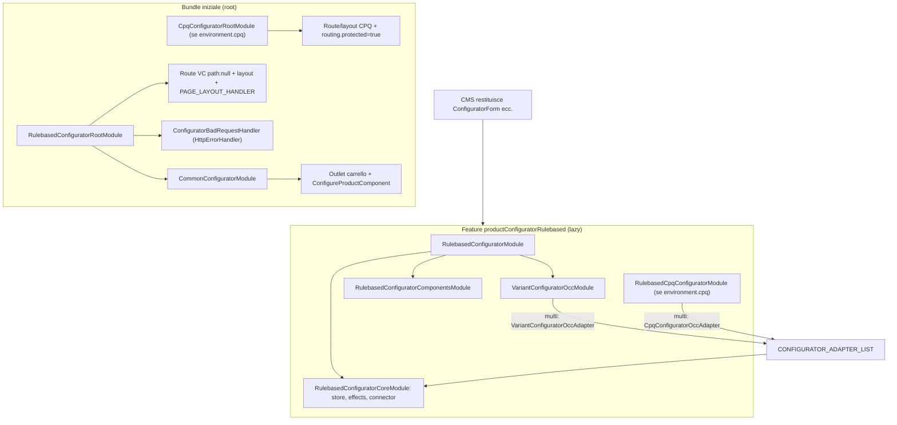
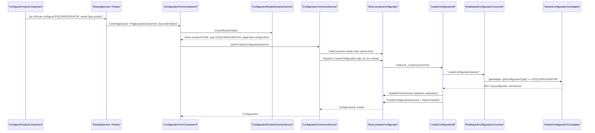
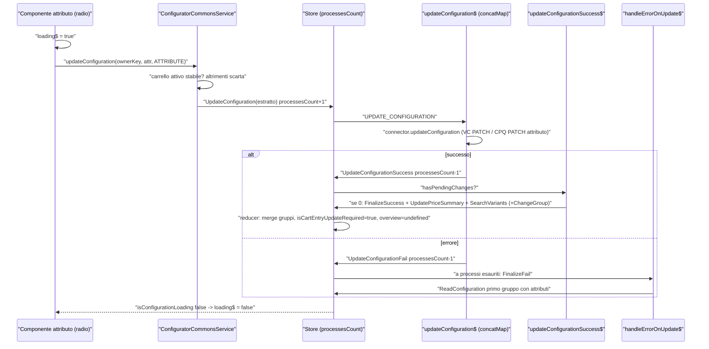
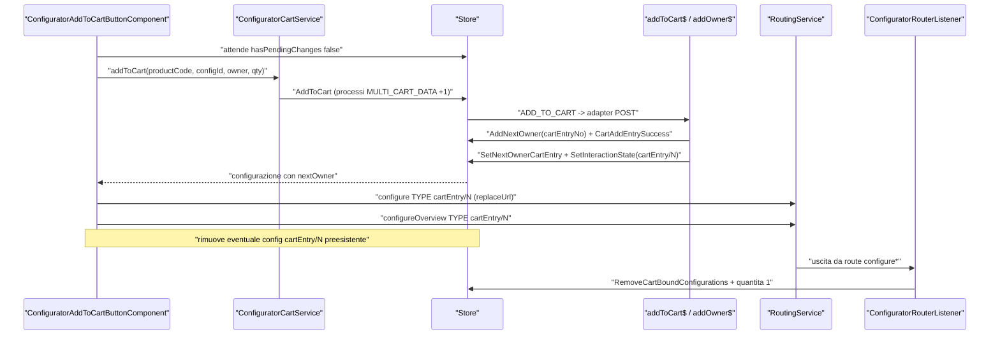
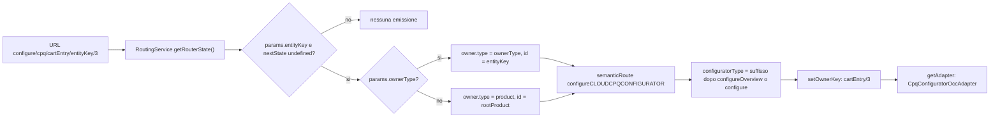

# 30 — Product configurator

> Riferimenti allo SHA `5b7a1c2bf2808d7380bc20596d10f4fa710c3da1` (vedi [00-meta](../00-meta.md)).

## 1. A cosa serve e perché esiste

Un prodotto *configurabile* è un prodotto il cui contenuto non è fissato a catalogo: il cliente sceglie valori di attributi (colore, potenza, accessori, quantità di componenti) e un motore di regole lato backend verifica la consistenza, calcola i prezzi e segnala conflitti. La libreria `@spartacus/product-configurator` porta questo flusso nello storefront: bottone "Configure" su PDP/PLP, pagina di configurazione interattiva a gruppi/tab, overview riepilogativa, add-to-cart della configurazione, modifica dal carrello e visualizzazione read-only da ordini, quote e saved cart.

Il codice deve risolvere quattro problemi che lo distinguono da quasi tutte le altre feature lib.

1. **Più motori di configurazione dietro la stessa UI.** Il repo supporta il *Variant Configurator* (VC, tipo `CPQCONFIGURATOR`), SAP CPQ cloud (tipo `CLOUDCPQCONFIGURATOR`) e un configuratore minimale *textfield* (tipo `TEXTFIELD`) — `feature-libs/product-configurator/common/core/model/common-configurator.model.ts:L60-L70`. VC e CPQ condividono store, facade e componenti ("rulebased"), e si distinguono solo nell'adapter scelto a runtime — `feature-libs/product-configurator/rulebased/core/connectors/rulebased-configurator.connector.ts:L160-L190`.
2. **Una configurazione appartiene a un "owner" che cambia nel tempo.** Prima dell'add-to-cart la configurazione è legata a un prodotto; dopo, a una entry di carrello; in un ordine, a una entry d'ordine. Il modello `CommonConfigurator.Owner` e la chiave `ownerType/ownerId` sono il filo conduttore di tutto — `feature-libs/product-configurator/common/core/model/common-configurator.model.ts:L11-L29`, `feature-libs/product-configurator/common/shared/utils/configurator-model-utils.ts:L19-L27`.
3. **Lo stato vive nell'URL.** Tipo di configuratore, owner e modalità (configurazione/overview, display-only, resolve issues, expert mode…) sono codificati in route e query param e riletti da un unico servizio, `ConfiguratorRouterExtractorService` — `feature-libs/product-configurator/common/components/service/configurator-router-extractor.service.ts:L28-L64`.
4. **Update incrementali e serializzati.** Ogni modifica di attributo invia al backend **un solo attributo cambiato**; gli update sono messi in coda con `concatMap` e il risultato finale è "consolidato" solo quando non ci sono più richieste pendenti — `feature-libs/product-configurator/rulebased/core/state/effects/configurator-basic.effect.ts:L171-L207`, `:L403-L514`.

La libreria segue lo schema root (eager) / lazy delle feature lib (capitolo [12](../parte-2/12-feature-module-lazy.md)): un modulo root statico porta route, layout, nomi CMS che scatenano il lazy loading e un error handler HTTP; il resto (store NgRx, effects, adapter OCC, ~70 componenti) è caricato quando il CMS chiede uno dei componenti configuratore.

## 2. Mappa dei file

Tutti i path sono relativi a `feature-libs/product-configurator/` salvo dove indicato in forma completa.

| Path | Ruolo |
|---|---|
| `feature-libs/product-configurator/public_api.ts` | entry point principale vuoto (`export {}`) |
| `feature-libs/product-configurator/package.json` | versione e peerDependencies (cart, checkout, order, storefront, `@ng-select/ng-select`, `@ngrx/*`) |
| `common/common-configurator.module.ts` | `CommonConfiguratorModule` = OCC common + componenti carrello/PDP |
| `common/core/model/common-configurator.model.ts` | namespace `CommonConfigurator` (`Owner`, `OwnerType`), enum `ConfiguratorType`, `ReadOnlyPostfix` |
| `common/core/model/augmented-core.model.ts` | augmentation di `Product` e `OrderEntry` |
| `common/core/model/product-configurator.config.ts` | `ProductConfiguratorConfig` e augmentation di `Config` |
| `common/shared/utils/configurator-model-utils.ts` | `ConfiguratorModelUtils` (owner key, owner iniziale, `createOwner`) |
| `common/shared/utils/common-configurator-utils.service.ts` | `CommonConfiguratorUtilsService` (owner id composti, cart id, issue count) |
| `common/components/service/configurator-router-data.ts` | namespace `ConfiguratorRouter` (`PageType`, `Data`) |
| `common/components/service/configurator-router-extractor.service.ts` | `ConfiguratorRouterExtractorService` |
| `common/occ/default-occ-configurator-product-config.ts` | endpoint/scope prodotto `configurator`, `configuratorProductCard` |
| `common/components/configure-product/*` | bottone "Configure" (CMS + outlet `ProductListOutlets.ITEM_ACTIONS`) |
| `common/components/configure-cart-entry/*` | link edit/display/resolve issues su entry carrello/ordine/quote/saved cart |
| `common/components/configurator-cart-entry-info/*` | info configurazione in `CartOutlets.ITEM_DETAILS` |
| `common/components/configurator-issues-notification/*` | notifica issue in `CartOutlets.ITEM_CONFIGURATOR_ISSUES` |
| `common/components/configurator-cart-entry-bundle-info/*` | line item CPQ in `CartOutlets.ITEM_BUNDLE_DETAILS` |
| `common/assets/translations/*` | chunk i18n `configurator` (17 lingue) |
| `rulebased/root/rulebased-configurator-root.module.ts` | `RulebasedConfiguratorRootModule` (eager) |
| `rulebased/root/rulebased-configurator-root-feature.module.ts` | 18 nomi CMS che triggerano la feature lazy |
| `rulebased/root/default-rulebased-routing-config.ts` | route VC |
| `rulebased/root/variant/*` | route + layout VC interattivo/overview, `VariantConfiguratorPageLayoutHandler` |
| `rulebased/root/cpq/*` | `CpqConfiguratorRootModule`, route/layout CPQ, `CpqConfiguratorPageLayoutHandler` |
| `rulebased/root/http-interceptors/configurator-bad-request.handler.ts` | `ConfiguratorBadRequestHandler` |
| `rulebased/rulebased-configurator.module.ts` | `RulebasedConfiguratorModule` (lazy) |
| `rulebased/core/rulebased-configurator-core.module.ts` | core: state, router listener, connector, listener logout/lingua |
| `rulebased/core/connectors/*` | `RulebasedConfiguratorAdapter`, `RulebasedConfiguratorConnector` |
| `rulebased/core/model/configurator.model.ts` | namespace `Configurator` |
| `rulebased/core/state/*` | feature `productConfigurator`: actions, reducer, effects (basic/cart/variant), selectors |
| `rulebased/core/facade/*` | `ConfiguratorCommonsService`, `ConfiguratorCartService`, `ConfiguratorGroupsService`, routing listener |
| `rulebased/core/events/*` | listener `LogoutEvent`/`LanguageSetEvent` |
| `rulebased/core/services/*` | `ConfiguratorExpertModeService`, `ConfiguratorQuantityService` |
| `rulebased/occ/variant/*` | `VariantConfiguratorOccModule`, adapter VC, converter, endpoint `ccpconfigurator` |
| `rulebased/cpq/*` | entry `rulebased/cpq`: `RulebasedCpqConfiguratorModule`, converter, `CpqConfiguratorOccAdapter`, `CpqConfiguratorOccService` |
| `rulebased/components/attribute/composition/*` | direttiva `cxConfiguratorAttributeComponent`, contesto, config `assignment` |
| `rulebased/components/attribute/types/*` | un componente per ogni `UiType` + classi base |
| `rulebased/components/{form,group,add-to-cart-button,overview-*,conflict-*,…}` | componenti di pagina |
| `textfield/*` | entry `textfield`: root, core (store a singola configurazione), occ, 4 componenti |
| `projects/storefrontapp/src/app/spartacus/features/product-configurator/*.ts` | wiring nella demo app |

## 3. Come funziona passo per passo

### 3.1 Packaging e wiring: entry point, root eager, feature lazy

L'entry principale non esporta nulla — `feature-libs/product-configurator/public_api.ts:L16-L19`. Gli entry point secondari sono `common`, `common/assets`, `rulebased`, `rulebased/root`, `rulebased/cpq`, `textfield`, `textfield/root`, mappati in `tsconfig.json:L181-L197`. Il `package.json` dichiara `221121.22.0` — `feature-libs/product-configurator/package.json:L2-L3` — che è lo stesso valore di `@spartacus/core` e `@spartacus/cart` allo SHA (`core-libs/core/package.json:L3-L3`, `feature-libs/cart/package.json:L3-L3`).

Nella demo app il wiring rulebased è in due pezzi:

- **statico**: `ProductConfiguratorRulebasedFeatureModule` importa `RulebasedConfiguratorRootModule` e, solo se `environment.cpq`, `CpqConfiguratorRootModule`; registra la feature lazy `productConfiguratorRulebased` che punta a `RulebasedConfiguratorWrapperModule` — `projects/storefrontapp/src/app/spartacus/features/product-configurator/product-configurator-rulebased-feature.module.ts:L22-L40`;
- **lazy**: il wrapper importa `RulebasedConfiguratorModule` e, con `environment.cpq`, `RulebasedCpqConfiguratorModule` — `projects/storefrontapp/src/app/spartacus/features/product-configurator/rulebased-configurator-wrapper.module.ts:L12-L21`.

Il textfield è analogo: statico `TextfieldConfiguratorRootModule`, lazy `TextfieldConfiguratorModule` sotto `PRODUCT_CONFIGURATOR_TEXTFIELD_FEATURE` — `projects/storefrontapp/src/app/spartacus/features/product-configurator/product-configurator-textfield-feature.module.ts:L21-L33`. L'installazione via schematics passa per `addProductConfiguratorFeatures` — `feature-libs/product-configurator/schematics/add-product-configurator/index.ts:L25-L44` (capitolo [43](../parte-2/43-schematics-migrazioni.md)).

**Root rulebased.** `RulebasedConfiguratorRootModule` importa `CommonConfiguratorModule`, il root-feature module, i moduli di routing VC interattivo/overview, `RulebasedConfiguratorRoutingModule.forRoot()` e registra `ConfiguratorBadRequestHandler` come `HttpErrorHandler` multi — `feature-libs/product-configurator/rulebased/root/rulebased-configurator-root.module.ts:L21-L37`. Il nome feature è `'productConfiguratorRulebased'` — `feature-libs/product-configurator/rulebased/root/feature-name.ts:L7-L8` — e i 18 tipi CMS che ne scatenano il caricamento (da `ConfiguratorForm` a `ConfiguratorOverviewSidebar`) sono in `feature-libs/product-configurator/rulebased/root/rulebased-configurator-root-feature.module.ts:L11-L55`. Il meccanismo `featureModules` + `cmsComponents` è descritto nel capitolo [12](../parte-2/12-feature-module-lazy.md).

**Root CPQ.** `CpqConfiguratorRootModule` aggiunge i moduli route/layout CPQ e forza `routing.protected: true` ("force early login") — `feature-libs/product-configurator/rulebased/root/cpq/cpq-configurator-root.module.ts:L16-L21`. Conseguenza: importarlo rende protetto l'intero storefront, non solo le pagine CPQ (vedi §9).

**Common.** `CommonConfiguratorModule` = `CommonConfiguratorOccModule` + `CommonConfiguratorComponentsModule` — `feature-libs/product-configurator/common/common-configurator.module.ts:L11-L14`. È importato dai root module, quindi è eager: aggiunge gli endpoint prodotto `configurator` (`fields=code,configurable,configuratorType`) e `configuratorProductCard`, e inserisce lo scope `configurator` nello scope `list` dei prodotti — `feature-libs/product-configurator/common/occ/default-occ-configurator-product-config.ts:L10-L30`. Augmenta inoltre `Product` (`configurable`, `configuratorType`) e `OrderEntry` (`statusSummaryList`, `configurationInfos`) — `feature-libs/product-configurator/common/core/model/augmented-core.model.ts:L8-L19` — e `Config` con `productConfigurator?: ProductConfiguratorConfig` — `feature-libs/product-configurator/common/core/model/product-configurator.config.ts:L9-L15`.

**Lazy rulebased.** `RulebasedConfiguratorModule` = `VariantConfiguratorOccModule` + `RulebasedConfiguratorCoreModule` + `RulebasedConfiguratorComponentsModule` — `feature-libs/product-configurator/rulebased/rulebased-configurator.module.ts:L12-L19`. Il core fornisce esplicitamente `RulebasedConfiguratorConnector` ("otherwise lazy loading does not work"), la config core di default e istanzia nel costruttore i listener di logout e cambio lingua — `feature-libs/product-configurator/rulebased/core/rulebased-configurator-core.module.ts:L16-L34`. Il CPQ lazy è `RulebasedCpqConfiguratorModule` = `CpqConfiguratorCommonModule` + `CpqConfiguratorOccModule` — `feature-libs/product-configurator/rulebased/cpq/rulebased-cpq-configurator.module.ts:L14-L17`.

### 3.2 Owner e tipi: il modello comune

`CommonConfigurator.Owner` ha `type`, `key` ("used as key in the configuration store"), `id` (codice prodotto, numero di entry, oppure documento+entry) e `configuratorType` ("Derived from the cxRoute") — `feature-libs/product-configurator/common/core/model/common-configurator.model.ts:L11-L29`. `OwnerType` ammette `product`, `cartEntry`, `orderEntry`, `quoteEntry`, `savedCartEntry` — `feature-libs/product-configurator/common/core/model/common-configurator.model.ts:L48-L54`.

- La chiave è `ownerType + '/' + ownerId`, con errore se manca una delle parti — `feature-libs/product-configurator/common/shared/utils/configurator-model-utils.ts:L19-L27`; viene assegnata da `setOwnerKey` — `feature-libs/product-configurator/common/shared/utils/common-configurator-utils.service.ts:L47-L49`.
- L'owner "iniziale" ha tutti i campi a `'INITIAL'` e `isInitialOwner` guarda solo `configuratorType` — `feature-libs/product-configurator/common/shared/utils/configurator-model-utils.ts:L12-L48`.
- `createOwner` ha come default `ConfiguratorType.VARIANT` — `feature-libs/product-configurator/common/shared/utils/configurator-model-utils.ts:L57-L68`.
- Per entry di documenti (ordine, quote, saved cart) l'id è `documentId + '+' + entryNumber`; `decomposeOwnerId` lancia se le parti non sono esattamente 2 — `feature-libs/product-configurator/common/shared/utils/common-configurator-utils.service.ts:L57-L75`.
- `getCartId` usa il `guid` per l'utente anonimo, altrimenti `code` — `feature-libs/product-configurator/common/shared/utils/common-configurator-utils.service.ts:L81-L88` (stessa regola del carrello, capitolo [25](../parte-2/25-cart.md)).
- VARIANT e TEXTFIELD sono "attribute based", CPQ è "bundle based" — `feature-libs/product-configurator/common/shared/utils/common-configurator-utils.service.ts:L125-L146`.

Il postfisso `_READ_ONLY` marca un tipo view-only (es. la route `configureCPQCONFIGURATOR_READ_ONLY`) — `feature-libs/product-configurator/common/core/model/common-configurator.model.ts:L60-L70`, `feature-libs/product-configurator/rulebased/root/default-rulebased-routing-config.ts:L9-L28`.

### 3.3 Route e `ConfiguratorRouterExtractorService`

Le route semantiche seguono la convenzione `configure<TYPE>` / `configureOverview<TYPE>`:

| cxRoute | Path | Definito in |
|---|---|---|
| `configureCPQCONFIGURATOR` | `configure/vc/:ownerType/entityKey/:entityKey` | `feature-libs/product-configurator/rulebased/root/default-rulebased-routing-config.ts:L9-L28` |
| `configureOverviewCPQCONFIGURATOR` | `configure-overview/vc/…/displayOnly/:displayOnly` e senza `displayOnly` | idem |
| `configureCLOUDCPQCONFIGURATOR` | `configure/cpq/:ownerType/entityKey/:entityKey` | `feature-libs/product-configurator/rulebased/root/cpq/default-cpq-interactive-routing-config.ts:L9-L17` |
| `configureOverviewCLOUDCPQCONFIGURATOR` | `configure-overview/cpq/…` (due path) | `feature-libs/product-configurator/rulebased/root/cpq/default-cpq-overview-routing-config.ts:L9-L20` |
| `configureTEXTFIELD` / `configureOverviewTEXTFIELD` | `configure/textfield/:ownerType/entityKey/:entityKey` … | `feature-libs/product-configurator/textfield/root/default-textfield-routing-config.ts:L9-L23` |

Le route Angular sono registrate con un trucco: `path: null` (con `@ts-ignore`), `data.cxRoute`, `PageLayoutComponent` e `CmsPageGuard` — `feature-libs/product-configurator/rulebased/root/variant/variant-configurator-interactive.module.ts:L20-L38`. Il path reale viene poi iniettato dal meccanismo `RoutingConfig` di Spartacus a partire da `cxRoute` (capitolo [14](../parte-2/14-routing.md)); la pagina è una normale pagina CMS (capitolo [15](../parte-2/15-cms-core.md)).

`extractRouterData()` trasforma lo stato del router NgRx in un `ConfiguratorRouter.Data` — `feature-libs/product-configurator/common/components/service/configurator-router-extractor.service.ts:L28-L64`:

1. emette solo se esiste il parametro `entityKey`, e solo per stati senza `nextState` (navigazione completata) — `:L28-L34`;
2. i flag di query (`resolveIssues`, `skipConflicts`, `forceReload`, `expMode`, `displayRestartDialog`, `navigateToCheckout`, `isBundleOverview`) sono veri solo se uguali alla stringa `'true'` — `:L38-L64`;
3. `pageType` è `OVERVIEW` se il semanticRoute contiene `configureOverview`, altrimenti `CONFIGURATION` — `:L38-L64`, costanti in `:L21-L22`;
4. l'owner nasce da `ownerType`/`entityKey` (fallback: tipo `product` con `rootProduct`), il `configuratorType` è il suffisso del semanticRoute dopo `configureOverview` o `configure`, altrimenti `Error('Not able to determine configurator type')` — `:L71-L113`.

La forma completa di `ConfiguratorRouter.Data` è in `feature-libs/product-configurator/common/components/service/configurator-router-data.ts:L8-L30`. È questo il punto in cui **il tipo di configuratore entra nel sistema**: tutto ciò che segue (scelta dell'adapter, layout, comportamento CPQ vs VC) dipende da `owner.configuratorType` ricavato qui.

### 3.4 Gli ingressi: PDP/PLP e carrello

**Bottone "Configure".** `ConfigureProductModule` registra `ConfigureProductComponent` come componente CMS e lo inserisce anche nell'outlet `ProductListOutlets.ITEM_ACTIONS` in posizione AFTER — `feature-libs/product-configurator/common/components/configure-product/configure-product.module.ts:L24-L42` (outlet: capitolo [17](../parte-2/17-outlet.md)). Il componente legge il prodotto dal `ProductListItemContext` (PLP) oppure da `CurrentProductService` con scope DETAILS + `configurator` (PDP) — `feature-libs/product-configurator/common/components/configure-product/configure-product.component.ts:L51-L62`. È visibile solo se `product.configurable` e non è un base product read-only — `feature-libs/product-configurator/common/components/configure-product/configure-product.component.html:L1-L2`. Al click naviga a `cxRoute: 'configure' + product.configuratorType` con `ownerType: product`, `entityKey` = codice, e query `displayRestartDialog` e `productCode` — `feature-libs/product-configurator/common/components/configure-product/configure-product.component.ts:L130-L148`.

**Componenti carrello.** `CommonConfiguratorComponentsModule` importa i moduli carrello e fornisce la config UI comune — `feature-libs/product-configurator/common/components/common-configurator-components.module.ts:L16-L26`:

- `ConfiguratorCartEntryInfoComponent` in `CartOutlets.ITEM_DETAILS` (AFTER) — `feature-libs/product-configurator/common/components/configurator-cart-entry-info/configurator-cart-entry-info.module.ts:L30-L36`;
- `ConfiguratorIssuesNotificationComponent` **sostituisce** (REPLACE) `CartOutlets.ITEM_CONFIGURATOR_ISSUES` — `feature-libs/product-configurator/common/components/configurator-issues-notification/configurator-issues-notification.module.ts:L28-L34`; con il toggle `configuratorIssuesNotificationForConfigurableOnly` la notifica è nascosta per entry non configurabili — `feature-libs/product-configurator/common/components/configurator-issues-notification/configurator-issues-notification.component.ts:L66-L76`;
- `ConfiguratorCartEntryBundleInfoComponent` in `CartOutlets.ITEM_BUNDLE_DETAILS` (AFTER) — `feature-libs/product-configurator/common/components/configurator-cart-entry-bundle-info/configurator-cart-entry-bundle-info.module.ts:L22-L28`.

Il conteggio delle issue legge solo gli status summary `ERROR` — `feature-libs/product-configurator/common/shared/utils/common-configurator-utils.service.ts:L106-L117`. Le line item CPQ sono ricavate dai `configurationInfos` in formato legacy o versionato (`CI#@#VERSION` ≥ 2) — `feature-libs/product-configurator/common/components/configurator-cart-entry-bundle-info/configurator-cart-entry-bundle-info.service.ts:L49-L76`; i prodotti delle line item (per i link PDP) si caricano con lo scope `configuratorProductCard` solo dopo la prima espansione della lista — `feature-libs/product-configurator/common/components/configurator-cart-entry-bundle-info/configurator-cart-entry-bundle-info.component.ts:L99-L143`. Oltre `cartEntryBundleLineItemsThreshold` (default 10) e con toggle CPQ container, invece di espandere si naviga all'overview — `feature-libs/product-configurator/common/components/configurator-cart-entry-bundle-info/configurator-cart-entry-bundle-info.component.ts:L225-L246`, `feature-libs/product-configurator/common/components/config/default-common-configurator-ui-settings.config.ts:L9-L14`.

**Link edit/display.** `ConfigureCartEntryComponent` mappa il tipo di abstract order sull'owner type (ORDER→`orderEntry`, QUOTE→`quoteEntry`, SAVED_CART→`savedCartEntry`, default `cartEntry`) e, senza `AbstractOrderContext`, assume il carrello attivo — `feature-libs/product-configurator/common/components/configure-cart-entry/configure-cart-entry.component.ts:L84-L88`, `:L145-L162`. L'entityKey è il numero di entry per il carrello, altrimenti `documentId+entryNumber`; il route è `configureOverview<type>` se read-only e il tipo non è già `_READ_ONLY` — `:L170-L193`, `:L331-L334`. Le query params includono sempre `forceReload: true`, `resolveIssues`, `navigateToCheckout` (se si è in `checkoutReviewOrder`) e `productCode` — `:L91-L103`, `:L336-L342`.

### 3.5 Lo store NgRx rulebased

Feature key `productConfigurator`, entity type `[Configurator] Configuration Data`; lo stato è `configurations: EntityProcessesLoaderState<Configuration>` indicizzato per owner key — `feature-libs/product-configurator/rulebased/core/state/configurator-state.ts:L10-L19`. Lo state module registra `StoreModule.forFeature` (reducer via token) ed `EffectsModule.forFeature(ConfiguratorEffects)` con gli effect basic, cart e variant — `feature-libs/product-configurator/rulebased/core/state/rulebased-configurator-state.module.ts:L19-L29`, `feature-libs/product-configurator/rulebased/core/state/effects/index.ts:L11-L15`.

Il reducer è `StateUtils.entityProcessesLoaderReducer(CONFIGURATOR_DATA, configuratorReducer)` — `feature-libs/product-configurator/rulebased/core/state/reducers/index.ts:L14-L24` — cioè un'entità con loader **e** contatore di processi (capitolo [19](../parte-2/19-state-management.md)). Il reducer interno usa una `Map` lazy action-type → handler — `feature-libs/product-configurator/rulebased/core/state/reducers/configurator.reducer.ts:L30-L45`.

Punti chiave della semantica:

- `UpdateConfiguration` (e Add/Copy/RemoveContainerRow) sono `EntityProcessesIncrementAction` che impostano anche `meta.loader.load = true`; i Success/Fail sono `EntityProcessesDecrementAction` — `feature-libs/product-configurator/rulebased/core/state/actions/configurator.action.ts:L161-L175`, `:L178-L209`.
- `hasPendingChanges` = `processesCount > 0` sull'entità — `feature-libs/product-configurator/rulebased/core/state/selectors/configurator.selector.ts:L44-L50`, `core-libs/core/src/state/utils/processes-loader/processes-loader.selectors.ts:L13-L17`.
- `AddToCart` e `UpdateCartEntry` del configuratore incrementano invece i processi dell'entità **carrello** (`MULTI_CART_DATA`, cartId), decrementati da `CartAddEntrySuccess/Fail` e `CartUpdateEntrySuccess/Fail` della cart lib — `feature-libs/product-configurator/rulebased/core/state/actions/configurator-cart.action.ts:L91-L105`, `feature-libs/cart/base/core/store/actions/cart-entry.action.ts:L38-L39`. Così il carrello risulta "non stabile" durante l'add-to-cart di una configurazione.
- `takeOverChanges` fonde i gruppi nuovi con quelli già in store solo se il payload ne contiene, preserva `showConflictSolverDialog`, imposta `issueNavigationDone: true` e azzera i `priceSupplements` — `feature-libs/product-configurator/rulebased/core/state/reducers/configurator.reducer.ts:L436-L478`.
- `UPDATE_CONFIGURATION_FINALIZE_SUCCESS` porta `isCartEntryUpdateRequired = true`, azzera `overview` e porta `newConfiguration` a `false` se definito — `feature-libs/product-configurator/rulebased/core/state/reducers/configurator.reducer.ts:L122-L134`; il dialog conflitti si apre se `immediateConflictResolution && !consistent` — `:L136-L144`.
- `UPDATE_CART_ENTRY` riporta `isCartEntryUpdateRequired = false` — `:L175-L181`.
- Il gruppo corrente iniziale è il primo di `flatGroups`, saltando i conflitti se `immediateConflictResolution` — `:L406-L434`.
- `SET_NEXT_OWNER_CART_ENTRY` imposta `nextOwner` = owner cartEntry con il numero di entry restituito dall'add-to-cart — `:L290-L305`.
- `RemoveConfiguration` è un `EntityLoaderResetAction` che accetta una chiave o un array — `feature-libs/product-configurator/rulebased/core/state/actions/configurator.action.ts:L375-L380`.

Action e selector sono esportati come namespace `ConfiguratorActions` e `ConfiguratorSelectors` — `feature-libs/product-configurator/rulebased/core/state/actions/index.ts:L7-L8`, `feature-libs/product-configurator/rulebased/core/state/selectors/index.ts:L7-L8`.

### 3.6 Il modello `Configurator`

`Configurator.Configuration` contiene `configId`, `groups` e `flatGroups`, prezzi, `overview`, `owner`/`nextOwner`, `isCartEntryUpdateRequired`, `interactionState`, `pricingEnabled`, `immediateConflictResolution`, `newConfiguration`, `isPricingAsync` — `feature-libs/product-configurator/rulebased/core/model/configurator.model.ts:L135-L171`. Lo stato puramente UI (gruppo corrente, parent del menu, gruppi visitati, modalità risoluzione conflitti, dialog) sta in `InteractionState` — `:L177-L187` — **dentro** l'entità, non in uno slice separato: per questo va copiato quando l'owner cambia (§3.10).

`GroupType` distingue gruppi di attributi, sub-item, header conflitti, conflitti e righe container — `:L295-L302`. `UiType` elenca i tipi di attributo, inclusi quelli introdotti con CPQ (`checkBoxListProduct`, `dropdownProduct`, `radioGroupProduct`, `container`) — `:L317-L343`. `UpdateType` è `Attribute` / `AttributeQuantity` / `ValueQuantity` — `:L364-L368`. Costanti: `ConflictIdPrefix`, `ConflictHeaderId`, `ContainerRowGroupIdPrefix`, `CustomUiTypeIndicator = '___'`, `RetractValueCode` — `:L386-L390`.

### 3.7 Facade

`ConfiguratorCommonsService.getOrCreateConfiguration` smista per owner type — `feature-libs/product-configurator/rulebased/core/facade/configurator-commons.service.ts:L98-L119`:

- `cartEntry` → `ConfiguratorCartService.readConfigurationForCartEntry`;
- `orderEntry`/`quoteEntry`/`savedCartEntry` → `readConfigurationForOrderEntry`;
- default (prodotto) → `getOrCreateConfigurationForProduct`, che dispatcha `CreateConfiguration` come side-effect (`tap`) se la configurazione non è "creata" e non è in loading né in errore, ed emette solo configurazioni create — `:L457-L496`. "Creata" significa `configId` non vuoto e `flatGroups` non vuoti, oppure un `overview` — `feature-libs/product-configurator/rulebased/core/facade/utils/configurator-utils.service.ts:L120-L129`.

`updateConfiguration` non fa nulla (solo warning in dev mode) se il carrello attivo ha un `code` e non è stabile; altrimenti dispatcha `UpdateConfiguration` con un **estratto** della configurazione — `feature-libs/product-configurator/rulebased/core/facade/configurator-commons.service.ts:L127-L172`. L'estratto contiene solo il percorso di gruppi fino al gruppo dell'attributo e l'unico attributo cambiato, e richiede `changedAttribute.groupId` — `feature-libs/product-configurator/rulebased/core/facade/utils/configurator-utils.service.ts:L139-L201`.

Altri metodi notevoli: `getConfigurationWithOverview` (dispatcha `GetConfigurationOverview` se manca) — `feature-libs/product-configurator/rulebased/core/facade/configurator-commons.service.ts:L326-L356`; `forceNewConfiguration` (`RemoveConfiguration` + `CreateConfiguration` con `forceReset: true`) — `:L442-L455`; `hasConflicts` (vero solo con `immediateConflictResolution === false` e primo gruppo CONFLICT_HEADER) — `:L426-L436`; `readAttributeDomain` (`attributeKey = attribute.key ?? attribute.name`) — `:L519-L538`.

`ConfiguratorCartService`:

- `readConfigurationForCartEntry` ritarda la lettura finché il carrello è stabile e il checkout non sta caricando, "this can lead to cache issues with promotions" — `feature-libs/product-configurator/rulebased/core/facade/configurator-cart.service.ts:L41-L99`;
- `readConfigurationForOrderEntry` scompone l'owner id e dispatcha `ReadOrderEntryConfiguration` (anche per quote e saved cart) — `:L108-L153`;
- `addToCart` usa `requireLoadedCart`, l'userId e quantità di default 1 — `:L163-L190`;
- `updateCartEntry` usa `configuration.owner.id` come numero di entry — `:L199-L221`.

`ConfiguratorGroupsService.navigateToGroup` marca visitato il gruppo corrente e dispatcha `ChangeGroup` — `feature-libs/product-configurator/rulebased/core/facade/configurator-groups.service.ts:L281-L311`; `navigateToContainerRow` attende i gruppi, trova la riga per `rowId` e naviga — `:L126-L161`; il gruppo conflitto da mostrare nel dialog è il primo `CONFLICT_GROUP` quando `showConflictSolverDialog` — `:L231-L246`. Il pattern facade/servizio è quello generale del capitolo [20](../parte-2/20-facade-command-query-eventi.md), con una differenza: qui le facade sono classi concrete del core, non facade astratte con `facadeFactory` nel root.

### 3.8 Connector multi-adapter: come si sceglie VC o CPQ

`RulebasedConfiguratorConnector` **non** è `providedIn: 'root'` ("this would break lazy loading") e riceve gli adapter dal token statico multi `CONFIGURATOR_ADAPTER_LIST` — `feature-libs/product-configurator/rulebased/core/connectors/rulebased-configurator.connector.ts:L18-L30`. Ogni metodo sceglie l'adapter il cui `getConfiguratorType()` coincide con `owner.configuratorType`; se nessuno combacia lancia `No adapter found for configurator type: …` — `:L160-L190`. VC dichiara `ConfiguratorType.VARIANT`, CPQ `ConfiguratorType.CPQ` — `feature-libs/product-configurator/rulebased/occ/variant/variant-configurator-occ.adapter.ts:L50-L52`, `feature-libs/product-configurator/rulebased/cpq/occ/cpq-configurator-occ.adapter.ts:L26-L28`.

Il token riceve `VariantConfiguratorOccAdapter` da `VariantConfiguratorOccModule` (sempre, nel lazy rulebased) — `feature-libs/product-configurator/rulebased/occ/variant/variant-configurator-occ.module.ts:L32-L85` — e `CpqConfiguratorOccAdapter` da `CpqConfiguratorOccModule` (solo se è caricato il modulo CPQ) — `feature-libs/product-configurator/rulebased/cpq/occ/cpq-configurator-occ.module.ts:L20-L41`.

Il contratto astratto è `RulebasedConfiguratorAdapter` (create/read/update, overview get/update, addToCart, read/update cart entry, read order entry, readPriceSummary, getConfiguratorType, searchVariants) — `feature-libs/product-configurator/rulebased/core/connectors/rulebased-configurator.adapter.ts:L12-L161`. I metodi container row sono **opzionali**: se l'adapter non li implementa il connector restituisce `throwError("… is not supported for configurator type …")` — `feature-libs/product-configurator/rulebased/core/connectors/rulebased-configurator.adapter.ts:L58-L80`, `feature-libs/product-configurator/rulebased/core/connectors/rulebased-configurator.connector.ts:L63-L70`, `:L173-L183`. `updateConfigurationOverview` del connector chiama l'update se c'è un `overview`, altrimenti il get — `:L138-L150`.

### 3.9 Adapter OCC Variant Configurator

`VariantConfiguratorOccModule` registra l'adapter e 8 converter multi (normalizer, serializer, prezzi, add-to-cart, update cart entry, overview) — `feature-libs/product-configurator/rulebased/occ/variant/variant-configurator-occ.module.ts:L32-L85`. Gli endpoint sono sotto `ccpconfigurator` — `feature-libs/product-configurator/rulebased/occ/variant/default-occ-configurator-variant-config.ts:L9-L50`.

| Operazione | HTTP | Riferimento |
|---|---|---|
| create | GET con `expMode`, `forceReset` (+ `configIdTemplate`) | `feature-libs/product-configurator/rulebased/occ/variant/variant-configurator-occ.adapter.ts:L67-L96` |
| read | GET con `groupId`, `expMode`, `attributeKeyRequiresDomain`; forza `newConfiguration: false` | `:L98-L127` |
| update | PATCH del payload serializzato | `:L129-L162` |
| add to cart | POST, risposta via `CART_MODIFICATION_NORMALIZER` | `:L164-L184` |
| update cart entry | PUT | `:L239-L241` |
| read order/quote/saved cart entry | GET overview; configurazione con soli `overview` e gruppi vuoti | `:L244-L305` |
| price summary | GET `pricing` con `groupId = interactionState.currentGroup` | `:L307-L331` |

Dopo la create, l'adapter attiva l'expert mode se `kbKey` è presente e riassegna l'owner — `:L67-L96`. Molte chiamate usano `HttpContext` con `OCC_HTTP_TOKEN.sendUserIdAsHeader: true` per l'emulazione ASM — `:L392-L406` (capitolo [29](../parte-2/29-asm.md)).

Il normalizer imposta `pricingEnabled ?? true`, `immediateConflictResolution ?? false`, `isPricingAsync: true` e mantiene `newConfiguration` tri-stato — `feature-libs/product-configurator/rulebased/occ/variant/converters/occ-configurator-variant-normalizer.ts:L30-L47`; il tipo UI è derivato troncando tutto ciò che segue `___` prima del mapping (UI type custom) — `:L440-L461`. Il serializer invia `configId`, `rootProduct`, `complete` e i gruppi — `feature-libs/product-configurator/rulebased/occ/variant/converters/occ-configurator-variant-serializer.ts:L13-L32`. Pattern adapter/converter: capitolo [21](../parte-2/21-occ.md).

### 3.10 Adapter CPQ

Gli endpoint CPQ sono sotto `cpqconfigurator`, organizzati per tab, attributi, quantità valore, container rows e letture "Full" — `feature-libs/product-configurator/rulebased/cpq/occ/default-occ-configurator-cpq-config.ts:L13-L45`. L'adapter delega a `CpqConfiguratorOccService` e per l'update sceglie `updateValueQuantity` se `updateType === VALUE_QUANTITY`, altrimenti `updateAttribute` — `feature-libs/product-configurator/rulebased/cpq/occ/cpq-configurator-occ.adapter.ts:L58-L71`.

- Update: un PATCH per singolo attributo con `tabId` e, se presente, `rowId` — `feature-libs/product-configurator/rulebased/cpq/occ/cpq-configurator-occ.service.ts:L315-L354`. Il serializer prende il primo attributo seguendo il primo figlio lungo l'estratto — `feature-libs/product-configurator/rulebased/cpq/rest/cpq-configurator-utils.ts:L67-L78`; quantità valore di default 1 — `feature-libs/product-configurator/rulebased/cpq/common/converters/cpq-configurator-value-serializer.ts:L30-L34`.
- Container rows: POST `rows`, POST `copyRow`, DELETE — `feature-libs/product-configurator/rulebased/cpq/occ/cpq-configurator-occ.service.ts:L356-L396`. I tab annidati hanno groupId `CONTAINER_ROW@…@<tabId>` e solo il tabId finale va al backend — `feature-libs/product-configurator/rulebased/cpq/rest/cpq-configurator-utils.ts:L52-L56`, `feature-libs/product-configurator/rulebased/cpq/common/converters/cpq-configurator-normalizer.ts:L259-L261`.
- Lettura entry documenti: ORDER_ENTRY, QUOTE_ENTRY, altrimenti saved cart — `feature-libs/product-configurator/rulebased/cpq/occ/cpq-configurator-occ.service.ts:L414-L454`.
- Non supportati: `readPriceSummary` restituisce la configurazione invariata ("so that UI does not run into exception"); `updateConfigurationOverview` e `searchVariants` lanciano errori **sincroni** — `feature-libs/product-configurator/rulebased/cpq/occ/cpq-configurator-occ.adapter.ts:L106-L110`, `:L146-L160`.

Il normalizer CPQ calcola `complete`/`consistent` dalle liste di messaggi, imposta `pricingEnabled: true` e trasforma ogni tab in un gruppo — `feature-libs/product-configurator/rulebased/cpq/common/converters/cpq-configurator-normalizer.ts:L58-L95`. Senza `hasFullConfigurationState`, solo il tab selezionato riceve gli attributi — `:L1188-L1196`; con il toggle `productConfiguratorCPQContainer` spento gli attributi container diventano `NOT_IMPLEMENTED` — `:L670-L674`, `:L965-L975`. L'add-to-cart serializza `{userId, cartId, product: {code}, quantity, configId}` — `feature-libs/product-configurator/rulebased/cpq/occ/converters/occ-configurator-cpq-add-to-cart-serializer.ts:L24-L31`.

### 3.11 Effects: create, update, cambio gruppo, errori

**Create.** `createConfiguration$` chiama il connector, dispatcha imperativamente `UpdatePriceSummary` (con il primo gruppo con attributi) ed emette `CreateConfigurationSuccess` + `SearchVariants` — `feature-libs/product-configurator/rulebased/core/state/effects/configurator-basic.effect.ts:L62-L105`. `getFirstGroupWithAttributes` lancia se nessun gruppo ha attributi — `feature-libs/product-configurator/rulebased/core/state/effects/configurator-basic-effect.service.ts:L112-L125`.

**Update.** `updateConfiguration$` usa `concatMap`: gli update sono processati uno dopo l'altro senza cancellare quelli in volo — `feature-libs/product-configurator/rulebased/core/state/effects/configurator-basic.effect.ts:L171-L207`. Le container row hanno effect dedicati, sempre con `concatMap` — `:L209-L238`. `updateConfigurationSuccess$` agisce solo quando non ci sono più processi pendenti, ed emette `UpdateConfigurationFinalizeSuccess`, `UpdatePriceSummary`, `SearchVariants` e, se il gruppo applicabile differisce da quello del payload, `ChangeGroup` — `:L403-L514`. Dopo `ADD_CONTAINER_ROW_SUCCESS` si naviga nel primo tab della nuova riga — `:L447-L459`. `updatePriceSummary$` lavora solo con `pricingEnabled === true` — `:L302-L313`.

**Errori.** Un update fallito, a processi esauriti, produce `UpdateConfigurationFinalizeFail`, che `handleErrorOnUpdate$` converte in `ReadConfiguration` del primo gruppo con attributi: lo stato viene riallineato rileggendo dal backend — `:L516-L585`.

**Cambio gruppo.** `groupChange$` (switchMap) attende l'assenza di processi pendenti, legge il gruppo ed emette `SetCurrentGroup`, `SetMenuParentGroup`, `ReadConfigurationSuccess`, `UpdatePriceSummary` — `:L587-L654`. Per CPQ un tab già caricato è servito dallo store senza chiamata backend — `:L693-L721`, `feature-libs/product-configurator/rulebased/core/state/effects/configurator-basic-effect.service.ts:L34-L61`.

**Varianti.** La ricerca varianti parte solo con `enableVariantSearch === true` e tipo VARIANT; altrimenti un secondo effect emette `SearchVariantsSuccess` vuoto per resettare il loading — `feature-libs/product-configurator/rulebased/core/state/effects/configurator-variant.effect.ts:L25-L82`.

**Pulizia.** `removeProductBoundConfigurations$` rimuove le entità la cui chiave contiene `product` — `feature-libs/product-configurator/rulebased/core/state/effects/configurator-basic.effect.ts:L656-L681`; `removeCartBoundConfigurations$` quelle `cartEntry` e quelle `product` con `nextOwner` — `feature-libs/product-configurator/rulebased/core/state/effects/configurator-cart.effect.ts:L210-L248`.

### 3.12 Add to cart, cambio di owner e overview

`ConfiguratorAddToCartButtonComponent.onAddToCart` marca visitato il gruppo corrente, attende che non ci siano processi pendenti e poi aggiorna l'entry (owner `cartEntry`) o aggiunge al carrello (owner `product`) — `feature-libs/product-configurator/rulebased/components/add-to-cart-button/configurator-add-to-cart-button.component.ts:L348-L393`.

Per un owner prodotto:

1. disabilita il bottone e chiama `ConfiguratorCartService.addToCart` — `:L395-L413`;
2. `addToCart$` chiama l'adapter ed emette `AddNextOwner` (con l'entryNumber) e `CartAddEntrySuccess`; senza `entryNumber` lancia `Entry number is required in addToCart response`, catturato come `CartAddEntryFail` — `feature-libs/product-configurator/rulebased/core/state/effects/configurator-cart.effect.ts:L34-L94`;
3. `addOwner$` emette `SetNextOwnerCartEntry` e `SetInteractionState`, che copia l'`interactionState` della configurazione prodotto sull'entità con la nuova chiave `cartEntry/<n>` — `:L250-L285`;
4. il componente attende `nextOwner !== undefined` e naviga; sulla pagina di configurazione rimuove l'eventuale configurazione cartEntry preesistente con lo stesso numero, mentre la product-bound resta fino all'uscita dalle route `configure*` — `feature-libs/product-configurator/rulebased/components/add-to-cart-button/configurator-add-to-cart-button.component.ts:L395-L461`;
5. dalla pagina di configurazione la navigazione passa prima per `configure<type>` con owner `cartEntry` e `replaceUrl: true` (così il tasto back torna alla configurazione), poi a `configureOverview<type>` — `:L172-L202`, commento in `:L177-L180`; dall'overview si va direttamente al carrello — `:L261-L281`.

Per un owner cartEntry l'update del carrello avviene solo se `isCartEntryUpdateRequired` — `:L463-L482`. `updateCartEntry$` emette `CartUpdateEntrySuccess` e solo dopo `RemoveConfiguration`, perché il backend CPQ può aver scartato la bozza — `feature-libs/product-configurator/rulebased/core/state/effects/configurator-cart.effect.ts:L96-L139`. La lettura della configurazione della entry emette success + `UpdatePriceSummary` + `SearchVariants` — `:L141-L180`.

In display-only l'uscita dall'overview porta a dettaglio ordine, dettaglio quote, quote del saved cart, carrello, PDP o review checkout a seconda dell'owner — `feature-libs/product-configurator/rulebased/components/add-to-cart-button/configurator-add-to-cart-button.component.ts:L484-L518`.

### 3.13 Listener e servizi con stato

- `ConfiguratorRouterListener` (istanziato da `ConfiguratorRouterModule`) rimuove le configurazioni legate al carrello e riporta la quantità a 1 quando il semanticRoute non contiene `configure` — `feature-libs/product-configurator/rulebased/core/facade/routing/configurator-router.listener.ts:L25-L38`, `feature-libs/product-configurator/rulebased/core/facade/routing/configurator-router.module.ts:L10-L15`.
- Al `LogoutEvent` si azzerano expert mode e configurazioni product-bound — `feature-libs/product-configurator/rulebased/core/events/configurator-logout-event.listener.ts:L27-L35`; al `LanguageSetEvent` si rimuovono le product-bound — `feature-libs/product-configurator/rulebased/core/events/configurator-language-set-event.listener.ts:L25-L31`.
- `ConfiguratorExpertModeService` tiene due `ReplaySubject(1)` ed è documentato come OCC-specifico e sostituibile — `feature-libs/product-configurator/rulebased/core/services/configurator-expert-mode.service.ts:L10-L22`; `ConfiguratorQuantityService` è un `BehaviorSubject<number>(1)` — `feature-libs/product-configurator/rulebased/core/services/configurator-quantity.service.ts:L16-L35`.

### 3.14 La pagina: form, gruppo e composizione dinamica degli attributi

`ConfiguratorFormComponent` (CMS `ConfiguratorForm`) ottiene la configurazione con `getOrCreateConfiguration(owner, configIdTemplate)` solo sulle pagine CONFIGURATION — `feature-libs/product-configurator/rulebased/components/form/configurator-form.component.ts:L58-L70`. In `ngOnInit` controlla il dialog conflitti, apre il restart dialog se richiesto e la configurazione non è nuova, gestisce `resolveIssues`, `rowId` (con toggle CPQ container) ed `expMode` — `:L113-L192`.

`ConfiguratorGroupComponent` calcola per ogni attributo la chiave `AttributeType_` + `uiTypeVariation` (se contiene `___`) oppure + `uiType` — `feature-libs/product-configurator/rulebased/components/group/configurator-group.component.ts:L121-L127`. Il template rende per ogni attributo tre slot con la direttiva `cxConfiguratorAttributeComponent`: `Header`, il tipo, `Footer` — `feature-libs/product-configurator/rulebased/components/group/configurator-group.component.html:L25-L59`.

La direttiva è un piccolo "CMS mapping" interno:

1. legge la mappa `productConfigurator.assignment` da `ConfiguratorAttributeCompositionConfig` (`useExisting: Config`) — `feature-libs/product-configurator/rulebased/components/attribute/composition/configurator-attribute-composition.config.ts:L10-L24`, `feature-libs/product-configurator/rulebased/components/attribute/composition/configurator-attribute-composition.directive.ts:L37-L39`;
2. in `ngOnChanges` ricrea il componente solo se l'attributo cambia (deep equal) o cambia il gruppo — `:L59-L72`;
3. crea il componente con `vcr.createComponent` e un injector figlio che fornisce `ConfiguratorAttributeCompositionContext` (useValue); se manca l'assignment, warning in dev mode — `:L74-L101`.

Il contesto contiene componentKey, attribute, owner, group, language, expMode, flag di navigazione e `isPricingAsync` — `feature-libs/product-configurator/rulebased/components/attribute/composition/configurator-attribute-composition.model.ts:L11-L21`. Ogni modulo di tipo registra il proprio componente con `provideDefaultConfig({productConfigurator:{assignment:{…}}})` — `feature-libs/product-configurator/rulebased/components/attribute/types/radio-button/configurator-attribute-radio-button.module.ts:L33-L43`; Header e Footer usano le chiavi `Header`/`Footer` — `feature-libs/product-configurator/rulebased/components/attribute/header/configurator-attribute-header.module.ts:L35-L35`, `feature-libs/product-configurator/rulebased/components/attribute/footer/configurator-attribute-footer.module.ts:L27-L27`.

Gerarchia delle classi base: `ConfiguratorAttributeBaseComponent` (senza decorator, usa `inject`) → `ConfiguratorAttributeSelectionBaseComponent` (`@Directive()` astratta, `loading$`) → single/multi selection base — `feature-libs/product-configurator/rulebased/components/attribute/types/base/configurator-attribute-base.component.ts:L20-L37`, `feature-libs/product-configurator/rulebased/components/attribute/types/base/configurator-attribute-selection-base.component.ts:L23-L28`. `loading$` torna a false quando il loading della configurazione finisce, perché con CPQ API V2 un round-trip può non cambiare l'attributo e il componente non verrebbe ricreato — `:L42-L56`. La single selection chiama `updateConfiguration` con `selectedSingleValue` e `UpdateType.ATTRIBUTE` — `feature-libs/product-configurator/rulebased/components/attribute/types/base/configurator-attribute-single-selection-base.component.ts:L92-L130`. Chi usa `ConfiguratorAttributePriceChangeService` deve fornirlo a livello di componente — `feature-libs/product-configurator/rulebased/components/attribute/types/base/configurator-attribute-base.component.ts:L24-L34`, `feature-libs/product-configurator/rulebased/components/attribute/types/radio-button/configurator-attribute-radio-button.component.ts:L29-L33`.

`RulebasedConfiguratorComponentsModule` aggrega 24 moduli (price summary, add-to-cart, menu, form, overview, conflitti, restart dialog…) — `feature-libs/product-configurator/rulebased/components/rulebased-configurator-components.module.ts:L32-L60`.

### 3.15 Layout e page layout handler

Il layout interattivo VC (`VariantConfigurationTemplate`) ha header con `VariantConfigExitButton`, navigation `VariantConfigMenu` (vuota su lg) e slot di contenuto dedicati — `feature-libs/product-configurator/rulebased/root/variant/variant-configurator-interactive-layout.module.ts:L16-L66`. L'overview VC aggiunge la sezione non standard `headerDisplayOnly` e registra `VariantConfiguratorPageLayoutHandler` come `PAGE_LAYOUT_HANDLER` multi — `feature-libs/product-configurator/rulebased/root/variant/variant-configurator-overview-layout.module.ts:L22-L66`. L'handler, se `routerData.displayOnly`, sostituisce gli slot dell'header con quelli di `headerDisplayOnly` (lg o xs via `BreakpointService.isUp`) — `feature-libs/product-configurator/rulebased/root/variant/variant-configurator-page-layout-handler.ts:L32-L71`.

CPQ usa un unico `CpqConfigurationTemplate` per pagina interattiva e overview, con sezioni extra `headerDisplayOnly` e `navigationDisplayOnly` — `feature-libs/product-configurator/rulebased/root/cpq/cpq-configurator-layout.module.ts:L18-L92`; `CpqConfiguratorPageLayoutHandler` antepone `PreHeader` sulla pagina di configurazione, usa gli slot display-only sull'overview read-only e toglie `CpqConfigOverviewNavigation` col toggle CPQ container spento — `feature-libs/product-configurator/rulebased/root/cpq/cpq-configurator-page-layout-handler.ts:L97-L160`. `PAGE_LAYOUT_HANDLER` e `LayoutConfig` sono trattati nel capitolo [18](../parte-2/18-layout-breakpoint-a11y.md).

### 3.16 Conflitti e dialog

`LAUNCH_CALLER` dello storefront è aumentato con `CONFLICT_SOLVER`, `CONFIGURATOR_OV_FILTER`, `CONFIGURATOR_RESTART_DIALOG`, assegnando i valori anche a runtime — `feature-libs/product-configurator/rulebased/components/config/augmented-config.model.ts:L14-L33`. Il conflict solver è un dialog `inlineRoot` — `feature-libs/product-configurator/rulebased/components/conflict-solver-dialog/default-configurator-conflict-solver-layout.config.ts:L10-L18` — lanciato da `ConfiguratorConflictSolverDialogLauncherService` (istanziato dal costruttore del modulo, `feature-libs/product-configurator/rulebased/components/conflict-solver-dialog/configurator-conflict-solver-dialog.module.ts:L35-L41`), che apre il dialog quando c'è un gruppo conflitto, ignora riemissioni con stesso gruppo e stesso `navigationId`, e lo chiude con `CLOSE_NO_CONFLICTS_EXIST` — `feature-libs/product-configurator/rulebased/components/conflict-solver-dialog/configurator-conflict-solver-dialog-launcher.service.ts:L66-L92`.

### 3.17 Error handler HTTP

`ConfiguratorBadRequestHandler` (400, priorità NORMAL) intercetta solo `IllegalStateError` con messaggio "base product is defined as 'make-to-stock'" e mostra `configurator.httpHandlers.makeToStockBaseProductIssue` — `feature-libs/product-configurator/rulebased/root/http-interceptors/configurator-bad-request.handler.ts:L22-L82`. Con il toggle `productConfiguratorCPQContainer` fa match anche sui 400 `UnknownIdentifierError` delle richieste product card, ma in quel caso `handleError` non aggiunge messaggi: il 400 viene "inghiottito" — `:L84-L125`, `:L42-L48`. Il meccanismo `HttpErrorHandler` è nel capitolo [41](../parte-2/41-errori-global-message.md).

### 3.18 Textfield: un configuratore "template"

Il textfield è descritto come configuratore minimale (3 attributi senza dipendenze) che "serves as a template for other configurator implementations" — `feature-libs/product-configurator/textfield/textfield-configurator.module.ts:L12-L23`. Differenze rispetto al rulebased:

- root con CMS `TextfieldConfigurationForm`, due route `path: null` e template a slot unico — `feature-libs/product-configurator/textfield/root/textfield-configurator-root.module.ts:L19-L57`, `feature-libs/product-configurator/textfield/root/textfield-configurator-root-feature.module.ts:L11-L11`; feature `productConfiguratorTextfield` — `feature-libs/product-configurator/textfield/root/feature-name.ts:L7-L8`;
- connector a singolo adapter (classe astratta `ConfiguratorTextfieldAdapter`), fornito esplicitamente dal core — `feature-libs/product-configurator/textfield/core/textfield-configurator-core.module.ts:L15-L19`, `feature-libs/product-configurator/textfield/core/connectors/configurator-textfield.connector.ts:L14-L16`;
- store `productConfigurationTextfield` con un singolo `LoaderState` (una configurazione alla volta) — `feature-libs/product-configurator/textfield/core/state/configuration-textfield-state.ts:L10-L20`, `feature-libs/product-configurator/textfield/core/state/reducers/index.ts:L17-L25`;
- update **solo locale**: nessun effect chiama il backend per `UPDATE_CONFIGURATION` — `feature-libs/product-configurator/textfield/core/facade/configurator-textfield.service.ts:L81-L101`, `:L253-L271`;
- dopo add-to-cart/update entry, `RemoveConfiguration` + `CartActions.LoadCart` (ricarica intera del carrello) — `feature-libs/product-configurator/textfield/core/state/effects/configurator-textfield.effect.ts:L55-L84`;
- endpoint `configurator/textfield`, update entry via POST — `feature-libs/product-configurator/textfield/occ/default-occ-configurator-textfield-config.ts:L13-L28`, `feature-libs/product-configurator/textfield/occ/occ-configurator-textfield.adapter.ts:L154-L156`.

### 3.19 Stili e traduzioni

Le traduzioni sono nel chunk `configurator`, esportate come `configuratorTranslationsXx` — `feature-libs/product-configurator/common/assets/translations/translations.ts:L9-L15` (capitolo [37](../parte-2/37-i18n.md)). Ogni `_index.scss` applica `@extend %<selector>` su una lista `!default` di selettori e su `cx-page-layout.<Template>` per i template — `feature-libs/product-configurator/rulebased/_index.scss:L38-L59` (capitolo [38](../parte-2/38-stili-theming.md)).

## 4. Diagrammi

### 4.1 Moduli eager e lazy



Riferimenti: `feature-libs/product-configurator/rulebased/root/rulebased-configurator-root.module.ts:L21-L37`, `feature-libs/product-configurator/rulebased/root/cpq/cpq-configurator-root.module.ts:L16-L21`, `feature-libs/product-configurator/rulebased/rulebased-configurator.module.ts:L12-L19`, `feature-libs/product-configurator/rulebased/occ/variant/variant-configurator-occ.module.ts:L32-L85`, `feature-libs/product-configurator/rulebased/cpq/occ/cpq-configurator-occ.module.ts:L20-L41`.

### 4.2 Dal PDP alla configurazione creata (VC)



Riferimenti: `feature-libs/product-configurator/common/components/configure-product/configure-product.component.ts:L130-L148`, `feature-libs/product-configurator/rulebased/root/variant/variant-configurator-interactive.module.ts:L20-L38`, `feature-libs/product-configurator/rulebased/components/form/configurator-form.component.ts:L58-L70`, `feature-libs/product-configurator/rulebased/core/facade/configurator-commons.service.ts:L457-L496`, `feature-libs/product-configurator/rulebased/core/state/effects/configurator-basic.effect.ts:L62-L105`, `feature-libs/product-configurator/rulebased/occ/variant/variant-configurator-occ.adapter.ts:L67-L96`.

### 4.3 Modifica di un attributo



Riferimenti: `feature-libs/product-configurator/rulebased/components/attribute/types/base/configurator-attribute-single-selection-base.component.ts:L92-L130`, `feature-libs/product-configurator/rulebased/core/facade/configurator-commons.service.ts:L127-L172`, `feature-libs/product-configurator/rulebased/core/state/effects/configurator-basic.effect.ts:L171-L207`, `:L403-L514`, `:L516-L585`, `feature-libs/product-configurator/rulebased/core/state/reducers/configurator.reducer.ts:L122-L144`, `feature-libs/product-configurator/rulebased/components/attribute/types/base/configurator-attribute-selection-base.component.ts:L42-L56`.

### 4.4 Add to cart e cambio di owner



Riferimenti: `feature-libs/product-configurator/rulebased/components/add-to-cart-button/configurator-add-to-cart-button.component.ts:L348-L461`, `:L172-L202`, `feature-libs/product-configurator/rulebased/core/facade/configurator-cart.service.ts:L163-L190`, `feature-libs/product-configurator/rulebased/core/state/effects/configurator-cart.effect.ts:L34-L94`, `:L250-L285`, `feature-libs/product-configurator/rulebased/core/facade/routing/configurator-router.listener.ts:L25-L38`.

### 4.5 Risoluzione dell'owner e del tipo dall'URL



Riferimenti: `feature-libs/product-configurator/common/components/service/configurator-router-extractor.service.ts:L28-L34`, `:L71-L113`, `feature-libs/product-configurator/common/shared/utils/common-configurator-utils.service.ts:L47-L49`, `feature-libs/product-configurator/rulebased/core/connectors/rulebased-configurator.connector.ts:L160-L190`.

## 5. Estratti di codice reale

### 5.1 Selezione dell'adapter

`feature-libs/product-configurator/rulebased/core/connectors/rulebased-configurator.connector.ts:L18-L30`

```ts
//Not provided in root, as this would break lazy loading
@Injectable()
export class RulebasedConfiguratorConnector {
  static CONFIGURATOR_ADAPTER_LIST = new InjectionToken<
    RulebasedConfiguratorAdapter[]
  >('ConfiguratorAdapterList');

  constructor(
    @Inject(RulebasedConfiguratorConnector.CONFIGURATOR_ADAPTER_LIST)
    protected adapters: RulebasedConfiguratorAdapter[],
    protected configUtilsService: CommonConfiguratorUtilsService,
    protected config: ConfiguratorCoreConfig
  ) {}
```

`feature-libs/product-configurator/rulebased/core/connectors/rulebased-configurator.connector.ts:L160-L190`

```ts
  protected getAdapter(configuratorType: string): RulebasedConfiguratorAdapter {
    const adapterResult = this.adapters.find((adapter) =>
      this.isAdapterMatching(adapter, configuratorType)
    );
    if (adapterResult) {
      return adapterResult;
    } else {
      throw new Error(
        'No adapter found for configurator type: ' + configuratorType
      );
    }
  }
  // ...
  protected isAdapterMatching(
    adapter: RulebasedConfiguratorAdapter,
    configuratorType: string
  ): boolean {
    return adapter.getConfiguratorType() === configuratorType;
  }
```

### 5.2 Registrazione dell'adapter CPQ nel token multi

`feature-libs/product-configurator/rulebased/cpq/occ/cpq-configurator-occ.module.ts:L20-L41`

```ts
@NgModule({
  imports: [CommonModule],
  providers: [
    provideDefaultConfigFactory(defaultOccCpqConfiguratorConfigFactory),
    // ...
    {
      provide: RulebasedConfiguratorConnector.CONFIGURATOR_ADAPTER_LIST,
      useClass: CpqConfiguratorOccAdapter,
      multi: true,
    },
  ],
})
export class CpqConfiguratorOccModule {}
```

### 5.3 Owner e tipo dal router

`feature-libs/product-configurator/common/components/service/configurator-router-extractor.service.ts:L71-L113`

```ts
  createOwnerFromRouterState(
    routerState: RouterState
  ): CommonConfigurator.Owner {
    const owner: CommonConfigurator.Owner =
      ConfiguratorModelUtils.createInitialOwner();
    const params = routerState.state.params;
    if (params.ownerType) {
      const entityKey = params.entityKey;
      owner.type = params.ownerType;

      owner.id = entityKey;
    } else {
      owner.type = CommonConfigurator.OwnerType.PRODUCT;
      owner.id = params.rootProduct;
    }
    const semanticRoute = routerState.state.semanticRoute;
    if (semanticRoute) {
      const configuratorType =
        this.getConfiguratorTypeFromSemanticRoute(semanticRoute);
      owner.configuratorType = configuratorType;
    }
    this.configUtilsService.setOwnerKey(owner);
    return owner;
  }
  // ...
  protected getConfiguratorTypeFromSemanticRoute(
    semanticRoute: string
  ): string {
    if (semanticRoute.startsWith(this.ROUTE_FRAGMENT_OVERVIEW)) {
      return semanticRoute.split(this.ROUTE_FRAGMENT_OVERVIEW)[1];
    } else if (semanticRoute.startsWith(this.ROUTE_FRAGMENT_CONFIGURE)) {
      return semanticRoute.split(this.ROUTE_FRAGMENT_CONFIGURE)[1];
    } else {
      throw new Error('Not able to determine configurator type');
    }
  }
```

### 5.4 Create "lazy" dalla facade

`feature-libs/product-configurator/rulebased/core/facade/configurator-commons.service.ts:L457-L496`

```ts
  protected getOrCreateConfigurationForProduct(
    owner: CommonConfigurator.Owner,
    configIdTemplate?: string
  ): Observable<Configurator.Configuration> {
    return this.store.pipe(
      select(
        ConfiguratorSelectors.getConfigurationProcessLoaderStateFactory(
          owner.key
        )
      ),
      tap((configurationState) => {
        if (
          (configurationState.value === undefined ||
            !this.configuratorUtils.isConfigurationCreated(
              configurationState.value
            )) &&
          configurationState.loading !== true &&
          configurationState.error !== true
        ) {
          this.store.dispatch(
            new ConfiguratorActions.CreateConfiguration({
              owner,
              configIdTemplate,
            })
          );
        }
      }),
      filter(
        (configurationState) =>
          configurationState.value !== undefined &&
          this.configuratorUtils.isConfigurationCreated(
            configurationState.value
          )
      ),
      // ...
```

### 5.5 Update serializzati con `concatMap`

`feature-libs/product-configurator/rulebased/core/state/effects/configurator-basic.effect.ts:L171-L207`

```ts
  updateConfiguration$: Observable<
    | ConfiguratorActions.UpdateConfigurationSuccess
    | ConfiguratorActions.UpdateConfigurationFail
  > = createEffect(() =>
    this.actions$.pipe(
      ofType(ConfiguratorActions.UPDATE_CONFIGURATION),
      map((action: ConfiguratorActions.UpdateConfiguration) => action.payload),
      //concatMap (not mergeMap) so that updates are processed strictly one after
      //another: concatMap queues the updates without cancelling in-flight
      //emissions (switchMap would cancel and lose changes; each update only sends
      //one changed attribute at a time).
      concatMap((payload: Configurator.Configuration) => {
        return this.configuratorCommonsConnector
          .updateConfiguration(payload)
          .pipe(
            map((configuration: Configurator.Configuration) => {
              return new ConfiguratorActions.UpdateConfigurationSuccess({
                ...configuration,
                interactionState: {
                  isConflictResolutionMode:
                    payload.interactionState.isConflictResolutionMode,
                },
              });
            }),
            catchError((error) => {
              const errorPayload = tryNormalizeHttpError(error, this.logger);
              return [
                new ConfiguratorActions.UpdateConfigurationFail({
                  configuration: payload,
                  error: errorPayload,
                }),
              ];
            })
          );
      })
    )
  );
```

### 5.6 Reducer di finalize

`feature-libs/product-configurator/rulebased/core/state/reducers/configurator.reducer.ts:L122-L144`

```ts
function handleActionUpdateConfigurationFinalizeSuccess(
  state: Configurator.Configuration,
  action: ConfiguratorActions.UpdateConfigurationFinalizeSuccess
): Configurator.Configuration | undefined {
  const result: Configurator.Configuration = takeOverChanges(action, state);
  checkConflictSolverDialog(result);
  result.isCartEntryUpdateRequired = true;
  result.overview = undefined;
  if (state.interactionState.newConfiguration !== undefined) {
    result.interactionState.newConfiguration = false;
  }
  return result;
}

function checkConflictSolverDialog(
  configuration: Configurator.Configuration
): void {
  configuration.interactionState.showConflictSolverDialog =
    configuration.immediateConflictResolution && !configuration.consistent;
  if (configuration.interactionState.showConflictSolverDialog) {
    configuration.interactionState.issueNavigationDone = true;
  }
}
```

### 5.7 Update cart entry e rimozione della bozza

`feature-libs/product-configurator/rulebased/core/state/effects/configurator-cart.effect.ts:L109-L124`

```ts
              switchMap((cartModification: CartModification) => {
                return [
                  new CartActions.CartUpdateEntrySuccess({
                    userId: payload.userId,
                    cartId: payload.cartId,
                    entryNumber: payload.cartEntryNumber,
                    quantity: cartModification.quantity,
                  }),
                  // The backend might have discarded the draft configuration (CPQ), so it needs
                  // to be re-read from the cart entry. Must not happen before the update has
                  // succeeded, as pending configuration success actions would re-create it.
                  new ConfiguratorActions.RemoveConfiguration({
                    ownerKey: payload.configuration.owner.key,
                  }),
                ];
              }),
```

### 5.8 Composizione dinamica degli attributi

`feature-libs/product-configurator/rulebased/components/attribute/composition/configurator-attribute-composition.directive.ts:L59-L101`

```ts
  ngOnChanges(): void {
    const attributeChanged = !ObjectComparisonUtils.deepEqualObjects(
      this.lastRenderedAttribute,
      this.context.attribute
    );
    const groupChanged = this.lastRenderedGroupId !== this.context.group.id;
    // attribute can occur with same content twice in different groups
    // for example this happens for conflicts. An attribute is rendered differently (link from/to conflict) based on
    // if it is part of conflict group or of ordinary group
    if (attributeChanged || groupChanged) {
      const key = this.context.componentKey;
      this.renderComponent(this.attrComponentAssignment[key], key);
    }
  }

  protected renderComponent(component: any, componentKey: string) {
    if (component) {
      this.lastRenderedAttribute = this.context.attribute;
      this.lastRenderedGroupId = this.context.group.id;
      this.vcr.clear();
      this.vcr.createComponent(component, {
        injector: this.getComponentInjector(),
      });
    } else {
      if (isDevMode()) {
        this.logger.warn(
          'No attribute type component available for: ' + componentKey
        );
      }
    }
  }
  // ...
```

`feature-libs/product-configurator/rulebased/components/attribute/types/radio-button/configurator-attribute-radio-button.module.ts:L33-L43`

```ts
  providers: [
    provideDefaultConfig({
      productConfigurator: {
        assignment: {
          AttributeType_radioGroup: ConfiguratorAttributeRadioButtonComponent,
          AttributeType_radioGroup_add:
            ConfiguratorAttributeRadioButtonComponent,
        },
      },
    }),
  ],
```

### 5.9 Navigazione verso l'overview con history riscritta

`feature-libs/product-configurator/rulebased/components/add-to-cart-button/configurator-add-to-cart-button.component.ts:L172-L202`

```ts
  protected navigateToOverview(
    configuratorType: string,
    owner: CommonConfigurator.Owner,
    productCode?: string
  ): void {
    // When navigating to the overview page, we change the browser history,
    // by changing the owner type and entity key (cart entry) in the configure URL.
    // With that the user can return to the configuration page
    // by using the browser back button.
    this.routingService
      .go(
        {
          cxRoute: 'configure' + configuratorType,
          params: { ownerType: 'cartEntry', entityKey: owner.id },
        },
        { replaceUrl: true }
      )
      .then(() => {
        this.routingService
          .go(
            {
              cxRoute: 'configureOverview' + configuratorType,
              params: { ownerType: 'cartEntry', entityKey: owner.id },
            },
            { queryParams: { productCode: productCode } }
          )
          // ...
```

## 6. Configurazione

| Chiave | Tipo | Default | Definita in | Letta in |
|---|---|---|---|---|
| `productConfigurator.enableVariantSearch` | boolean | `false` | `feature-libs/product-configurator/rulebased/core/config/default-configurator-core.config.ts:L9-L13` | `feature-libs/product-configurator/rulebased/core/state/effects/configurator-variant.effect.ts:L31-L35`, `:L68-L73` |
| `productConfigurator.cartEntryBundleLineItemsThreshold` | number | `10` | `feature-libs/product-configurator/common/components/config/default-common-configurator-ui-settings.config.ts:L9-L14` | `feature-libs/product-configurator/common/components/configurator-cart-entry-bundle-info/configurator-cart-entry-bundle-info.component.ts:L268-L272` |
| `productConfigurator.updateDebounceTime.{quantity,input,date}` | number | 750 / 500 / 1500 | `feature-libs/product-configurator/rulebased/components/config/default-configurator-ui-settings.config.ts:L13-L17` | componenti attributo — ⚠️ DA VERIFICARE: righe di lettura non censite nel dossier |
| `productConfigurator.addRetractOption` | boolean | `false` | `feature-libs/product-configurator/rulebased/components/config/default-configurator-ui-settings.config.ts:L18-L18` | ⚠️ DA VERIFICARE: punto di lettura non censito |
| `productConfigurator.descriptions.*` | number | 100 / 70 | `feature-libs/product-configurator/rulebased/components/config/default-configurator-ui-settings.config.ts:L19-L22` | `feature-libs/product-configurator/rulebased/components/attribute/types/base/configurator-attribute-base.component.ts:L487-L487` |
| `productConfigurator.cpqContainerDropDownListThreshold` | number | `10` | `feature-libs/product-configurator/rulebased/components/config/default-configurator-ui-settings.config.ts:L23-L23` | componente container |
| `productConfigurator.cpqHideBasePriceAndSelectedOptions` | boolean | `false` | `feature-libs/product-configurator/rulebased/components/config/default-configurator-ui-settings.config.ts:L24-L24` | `feature-libs/product-configurator/rulebased/components/service/configurator-storefront-utils.service.ts:L731-L731` |
| `productConfigurator.overviewHeaderSelectors` | string[] | `.VariantConfigOverviewHeader`, `.CpqConfigHeader` | `feature-libs/product-configurator/rulebased/components/config/default-configurator-ui-settings.config.ts:L25-L28` | overview menu |
| `productConfigurator.overviewMenuFilterTabVisible` | Record<string, boolean> | `{CPQCONFIGURATOR: true}` | `feature-libs/product-configurator/rulebased/components/config/default-configurator-ui-settings.config.ts:L29-L31` | `feature-libs/product-configurator/rulebased/components/service/configurator-storefront-utils.service.ts:L713-L713` |
| `productConfigurator.updateConfigurationMessage.waitingTime` | number | `1000` | `feature-libs/product-configurator/rulebased/components/config/default-configurator-message.config.ts:L9-L15` | `feature-libs/product-configurator/rulebased/components/update-message/configurator-update-message.component.ts:L36-L37` |
| `productConfigurator.assignment` | `{[key]: component}` | registrato dai moduli tipo | `feature-libs/product-configurator/rulebased/components/attribute/composition/configurator-attribute-composition.config.ts:L10-L24` | `feature-libs/product-configurator/rulebased/components/attribute/composition/configurator-attribute-composition.directive.ts:L37-L39` |
| `routing.routes.configure*` / `configureOverview*` | RoutingConfig | vedi §3.3 | `feature-libs/product-configurator/rulebased/root/default-rulebased-routing-config.ts:L9-L28` (e CPQ/textfield) | `ConfiguratorRouterExtractorService` via semanticRoute |
| `routing.protected` | boolean | `true` solo con CPQ root | `feature-libs/product-configurator/rulebased/root/cpq/cpq-configurator-root.module.ts:L19-L19` | routing core (capitolo [22](../parte-2/22-auth.md)) |
| `backend.occ.endpoints.*` | string | `ccpconfigurator/…`, `cpqconfigurator/…`, `configurator/textfield`, `products/${productCode}?fields=…` | `feature-libs/product-configurator/rulebased/occ/variant/default-occ-configurator-variant-config.ts:L9-L50`, `feature-libs/product-configurator/rulebased/cpq/occ/default-occ-configurator-cpq-config.ts:L13-L45`, `feature-libs/product-configurator/textfield/occ/default-occ-configurator-textfield-config.ts:L13-L28`, `feature-libs/product-configurator/common/occ/default-occ-configurator-product-config.ts:L10-L30` | adapter via `OccEndpointsService.buildUrl` |
| `backend.loadingScopes.product.list.include` | string[] | `['configurator']` | `feature-libs/product-configurator/common/occ/default-occ-configurator-product-config.ts:L22-L28` | product loading core (capitolo [24](../parte-2/24-product-search.md)) |
| `layoutSlots.{Variant,Cpq,Textfield}*Template` | LayoutConfig | vedi §3.15 | moduli layout root | `PageLayoutService` + handler |
| `launch.CONFLICT_SOLVER` (e OV filter, restart) | LayoutConfig | dialog inline | `feature-libs/product-configurator/rulebased/components/conflict-solver-dialog/default-configurator-conflict-solver-layout.config.ts:L10-L18` | `LaunchDialogService` |
| toggle `productConfiguratorCPQContainer` | boolean | `false` | `core-libs/core/src/features-config/feature-toggles/config/feature-toggles.ts:L788-L788`, `:L1098-L1098` | handler 400, layout handler CPQ, bundle info, normalizer CPQ, form |
| toggle `configuratorIssuesNotificationForConfigurableOnly` | boolean | `false` | `core-libs/core/src/features-config/feature-toggles/config/feature-toggles.ts:L862-L862`, `:L1107-L1107` | `feature-libs/product-configurator/common/components/configurator-issues-notification/configurator-issues-notification.component.ts:L66-L76` |
| toggle `productConfiguratorConsolidatedButtonDisabling` | boolean | ⚠️ DA VERIFICARE: default non letto nel dossier | `core-libs/core/src/features-config/feature-toggles/config/feature-toggles.ts:L721-L721` | `feature-libs/product-configurator/rulebased/components/attribute/types/multi-selection-bundle/configurator-attribute-multi-selection-bundle.component.html:L19-L19` |

Le abstract class di config sono `ConfiguratorCoreConfig` (`feature-libs/product-configurator/rulebased/core/config/configurator-core.config.ts:L10-L20`), `ConfiguratorUISettingsConfig` (`feature-libs/product-configurator/rulebased/components/config/configurator-ui-settings.config.ts:L10-L57`), `ConfiguratorMessageConfig` e `CommonConfiguratorUISettingsConfig`; tutte si iniettano con `useExisting: Config` (capitolo [11](../parte-2/11-configurazione.md)).

## 7. Commenti e note notevoli dal sorgente

- "Not provided in root, as this would break lazy loading" — `feature-libs/product-configurator/rulebased/core/connectors/rulebased-configurator.connector.ts:L18-L18`.
- "Explicit providing of connector because otherwise lazy loading does not work" — `feature-libs/product-configurator/rulebased/core/rulebased-configurator-core.module.ts:L16-L19`; idem nel textfield — `feature-libs/product-configurator/textfield/core/textfield-configurator-core.module.ts:L11-L14`.
- "// TODO: Inline this factory when we start releasing Ivy compiled libraries" — `feature-libs/product-configurator/rulebased/root/rulebased-configurator-root-feature.module.ts:L32-L32`, `feature-libs/product-configurator/textfield/root/textfield-configurator-root-feature.module.ts:L13-L13`.
- "We can neither omit the path nor set to undefined" + `@ts-ignore` su `path: null` — `feature-libs/product-configurator/rulebased/root/variant/variant-configurator-interactive.module.ts:L24-L26`.
- "//force early login" — `feature-libs/product-configurator/rulebased/root/cpq/cpq-configurator-root.module.ts:L18-L18`.
- `@ts-ignore TODO (#12620)` sul reducer entity — `feature-libs/product-configurator/rulebased/core/state/reducers/index.ts:L16-L20`.
- "TODO: remove the logic below when configurable products support "Saved Cart" and "Save For Later"" — `feature-libs/product-configurator/common/components/configurator-cart-entry-info/configurator-cart-entry-info.component.ts:L41-L41`, `feature-libs/product-configurator/common/components/configurator-issues-notification/configurator-issues-notification.component.ts:L56-L56`.
- "Requires default change detection strategy, as the disabled state of the quantity form control may change" — `feature-libs/product-configurator/common/components/configurator-cart-entry-info/configurator-cart-entry-info.component.ts:L16-L25`.
- Il commento su `concatMap` vs `switchMap` degli update — `feature-libs/product-configurator/rulebased/core/state/effects/configurator-basic.effect.ts:L178-L181`.
- "we need a trinary state true, false, undefined!" — `feature-libs/product-configurator/rulebased/occ/variant/converters/occ-configurator-variant-normalizer.ts:L45-L45`.
- Il commento sul cleanup posticipato della configurazione product-bound ("existing observables would instantly trigger a re-create") — `feature-libs/product-configurator/rulebased/components/add-to-cart-button/configurator-add-to-cart-button.component.ts:L448-L458`.
- "We don't need this method but cannot remove it due to backward compatibility" (`ngOnInit` della direttiva) — `feature-libs/product-configurator/rulebased/components/attribute/composition/configurator-attribute-composition.directive.ts:L46-L52`.
- JSDoc di `ConfiguratorExpertModeService`: "This implementation is OCC specific" — `feature-libs/product-configurator/rulebased/core/services/configurator-expert-mode.service.ts:L10-L14`.
- JSDoc del toggle `productConfiguratorCPQContainer` con l'elenco delle classi coinvolte — `core-libs/core/src/features-config/feature-toggles/config/feature-toggles.ts:L760-L788`.
- JSDoc di `getCpqContainerFragment` sulle assunzioni `anchorScrolling: 'enabled'` e assenza di id uguali al rowId — `feature-libs/product-configurator/common/components/configure-cart-entry/configure-cart-entry.component.ts:L195-L216`.
- Il JSDoc del normalizer textfield dice "Converts addToCart parameters into the generic format" ma converte una configurazione — `feature-libs/product-configurator/textfield/occ/converters/occ-configurator-textfield-normalizer.ts:L23-L28`.

## 8. Extension point

| Extension point | Come si usa | Riferimento | Ricetta |
|---|---|---|---|
| `RulebasedConfiguratorConnector.CONFIGURATOR_ADAPTER_LIST` | aggiungere un adapter `multi: true` per un nuovo `configuratorType` (o sostituirne uno) | `feature-libs/product-configurator/rulebased/core/connectors/rulebased-configurator.connector.ts:L21-L23` | [52 — OCC, adapter, converter](../parte-3/52-ricette-occ-dati.md) |
| `RulebasedConfiguratorAdapter` | classe astratta da implementare; container row opzionali | `feature-libs/product-configurator/rulebased/core/connectors/rulebased-configurator.adapter.ts:L12-L161` | [52](../parte-3/52-ricette-occ-dati.md) |
| Token converter VC (`VARIANT_CONFIGURATOR_NORMALIZER`, `VARIANT_CONFIGURATOR_SERIALIZER`, …) e CPQ (`CPQ_CONFIGURATOR_NORMALIZER`, …) | aggiungere normalizer/serializer `multi: true` per campi custom | `feature-libs/product-configurator/rulebased/occ/variant/variant-configurator-occ.converters.ts:L12-L49`, `feature-libs/product-configurator/rulebased/cpq/common/converters/cpq-configurator.converters.ts:L12-L26` | [52](../parte-3/52-ricette-occ-dati.md) |
| Endpoint `backend.occ.endpoints.*` | override di URL/fields via `provideConfig` | §6 | [52](../parte-3/52-ricette-occ-dati.md) |
| `productConfigurator.assignment` | mappare un `AttributeType_<uiType>` (anche custom con `___`) su un componente proprio | `feature-libs/product-configurator/rulebased/components/attribute/composition/configurator-attribute-composition.config.ts:L10-L24` | [51 — componenti CMS, outlet, layout](../parte-3/51-ricette-cms-outlet-layout.md) |
| `ConfiguratorAttributeCompositionContext` + classi base | il componente custom inietta il contesto ed estende `ConfiguratorAttributeSingleSelectionBaseComponent` ecc. | `feature-libs/product-configurator/rulebased/components/attribute/composition/configurator-attribute-composition.model.ts:L11-L21`, `feature-libs/product-configurator/rulebased/components/attribute/types/base/configurator-attribute-selection-base.component.ts:L23-L28` | [51](../parte-3/51-ricette-cms-outlet-layout.md) |
| `cmsComponents` (18 nomi rulebased, `TextfieldConfigurationForm`, `ConfigureProductComponent`) | sostituire un componente di pagina | `feature-libs/product-configurator/rulebased/root/rulebased-configurator-root-feature.module.ts:L11-L55` | [51](../parte-3/51-ricette-cms-outlet-layout.md) |
| Outlet `ProductListOutlets.ITEM_ACTIONS`, `CartOutlets.ITEM_DETAILS`, `ITEM_CONFIGURATOR_ISSUES`, `ITEM_BUNDLE_DETAILS` | aggiungere/sostituire contenuti nel carrello e nella PLP | §3.4 | [51](../parte-3/51-ricette-cms-outlet-layout.md) |
| `layoutSlots` + `PAGE_LAYOUT_HANDLER` | cambiare slot dei template `VariantConfigurationTemplate`/`CpqConfigurationTemplate` o aggiungere un handler | `feature-libs/product-configurator/rulebased/root/variant/variant-configurator-overview-layout.module.ts:L22-L66` | [51](../parte-3/51-ricette-cms-outlet-layout.md) |
| `ConfiguratorUISettingsConfig`, `ConfiguratorCoreConfig`, `CommonConfiguratorUISettingsConfig` | override di debounce, soglie, variant search | §6 | [50 — config e DI](../parte-3/50-ricette-config-di.md) |
| Facade e servizi (`ConfiguratorCommonsService`, `ConfiguratorCartService`, `ConfiguratorGroupsService`, `ConfiguratorExpertModeService`, `ConfiguratorQuantityService`) | sostituzione via DI (`useClass`/`useExisting`) | `feature-libs/product-configurator/rulebased/core/facade/configurator-commons.service.ts:L98-L119`, `feature-libs/product-configurator/rulebased/core/services/configurator-expert-mode.service.ts:L10-L22` | [50](../parte-3/50-ricette-config-di.md) |
| `ConfiguratorBasicEffectService` | helper "to enhance effects without new effects" | `feature-libs/product-configurator/rulebased/core/state/effects/configurator-basic-effect.service.ts:L12-L17` | [50](../parte-3/50-ricette-config-di.md) |
| `HttpErrorHandler` | affiancare/sostituire `ConfiguratorBadRequestHandler` | `feature-libs/product-configurator/rulebased/root/http-interceptors/configurator-bad-request.handler.ts:L22-L82` | [50](../parte-3/50-ricette-config-di.md) |
| Augmentation `Configurator`, `ProductConfiguratorConfig`, `LAUNCH_CALLER` | estendere modello e config in modo type-safe | `feature-libs/product-configurator/common/core/model/product-configurator.config.ts:L9-L15`, `feature-libs/product-configurator/rulebased/components/config/augmented-config.model.ts:L14-L33` | [54 — upgrade-safe](../parte-3/54-upgrade-safe.md) |
| Stili (`$configurator-rulebased-pages` e liste componenti `!default`) e chunk i18n `configurator` | escludere/riscrivere stili, tradurre | `feature-libs/product-configurator/rulebased/_index.scss:L38-L59`, `feature-libs/product-configurator/common/assets/translations/translations.ts:L9-L15` | [53 — feature, cart, stili, i18n](../parte-3/53-ricette-feature-cart-checkout-stili-i18n.md) |

Limiti dell'estendibilità:

- Il textfield **non** esporta adapter, connector, facade, state e token converter: `feature-libs/product-configurator/textfield/core/index.ts:L7-L7` esporta solo il core module, e `feature-libs/product-configurator/textfield/public_api.ts:L7-L10` solo core module, componenti e occ. Usarlo come "template" significa copiarlo, non estenderlo.
- `CpqConfiguratorPageLayoutHandler` non è esportato da `rulebased/root/cpq` (l'index esporta solo i moduli) — ⚠️ DA VERIFICARE: il dossier riporta `cpq/index.ts:L7-L10` senza l'elenco completo.
- Un nuovo configuratore rulebased richiede in pratica: un `configuratorType` nuovo, route `configure<TYPE>`/`configureOverview<TYPE>` con route Angular `path: null` + `cxRoute`, un adapter nel token multi, un layout per il template CMS. Tutti questi pezzi esistono come pattern nel codice VC/CPQ (§3.1–§3.10); una guida passo-passo non esiste nel repo.

## 9. Trappole, casi limite, comportamenti controintuitivi

1. **`CpqConfiguratorRootModule` protegge tutto lo storefront.** Fornisce `routing: { protected: true }` come default config globale — `feature-libs/product-configurator/rulebased/root/cpq/cpq-configurator-root.module.ts:L16-L21` — quindi ogni pagina richiede login, non solo quelle CPQ.
2. **Update scartati in silenzio.** Se il carrello attivo ha un `code` e non è stabile, `updateConfiguration` (e le container row) non dispatchano nulla; c'è solo un warning in dev mode — `feature-libs/product-configurator/rulebased/core/facade/configurator-commons.service.ts:L139-L151`. Poiché l'add-to-cart del configuratore incrementa i processi del carrello (`feature-libs/product-configurator/rulebased/core/state/actions/configurator-cart.action.ts:L91-L105`), un click su un attributo durante l'add-to-cart viene perso.
3. **`loading` resta true fino al finalize.** `UpdateConfigurationSuccess` non ha meta loader: il flag impostato da `setPendingLoader` resta true fino a `UpdateConfigurationFinalizeSuccess`, emessa solo a processi esauriti — `feature-libs/product-configurator/rulebased/core/state/actions/configurator.action.ts:L203-L209`, `core-libs/core/src/state/utils/loader/loader.reducer.ts:L39-L60`.
4. **CPQ: errori sincroni negli adapter.** `updateConfigurationOverview` e `searchVariants` del CPQ lanciano in modo sincrono; in `updateOverview$` l'eccezione nasce nella project di `mergeMap`, fuori dal `catchError` interno, quindi l'effect va in errore e viene risottoscritto dal `defaultEffectsErrorHandler` di NgRx (max 10 volte) — `feature-libs/product-configurator/rulebased/cpq/occ/cpq-configurator-occ.adapter.ts:L106-L110`, `feature-libs/product-configurator/rulebased/core/state/effects/configurator-basic.effect.ts:L377-L380`, `deps:ngrx-effects-21.0.1/package/fesm2022/ngrx-effects.mjs:L174-L185`. `searchVariants` è invece protetto dal filtro tipo VARIANT — `feature-libs/product-configurator/rulebased/core/state/effects/configurator-variant.effect.ts:L25-L82`.
5. **`enableVariantSearch` undefined.** Se si sovrascrive `productConfigurator` senza la chiave e il tipo è VARIANT, nessuno dei due effect variant emette (uno vuole `=== true`, l'altro gestisce il caso "non attivo"), e `SearchVariants` resta senza success — `feature-libs/product-configurator/rulebased/core/state/effects/configurator-variant.effect.ts:L31-L35`, `:L68-L73`.
6. **Placeholder letterale nell'URL CPQ.** `readCpqConfiguration` contiene `?tabId=${tabId}` nel template, ma `tabId` non è passato come urlParam: se è falsy il placeholder resta nell'URL — `feature-libs/product-configurator/rulebased/cpq/occ/default-occ-configurator-cpq-config.ts:L25-L26`, `feature-libs/product-configurator/rulebased/cpq/occ/cpq-configurator-occ.service.ts:L292-L297`, `core-libs/core/src/occ/services/occ-endpoints.service.ts:L121-L146`.
7. **Match per substring delle chiavi.** La pulizia riconosce le entità con `ownerKey.includes('product')` / `'cartEntry'`: un id contenente "product" farebbe match — `feature-libs/product-configurator/rulebased/core/state/effects/configurator-basic.effect.ts:L668-L670`, `feature-libs/product-configurator/rulebased/core/state/effects/configurator-cart.effect.ts:L223-L232`.
8. **`displayOnly` è una stringa.** L'extractor copia `params.displayOnly` (stringa) in un campo tipizzato boolean: `'false'` sarebbe truthy — `feature-libs/product-configurator/common/components/service/configurator-router-extractor.service.ts:L42-L42`, `feature-libs/product-configurator/common/components/service/configurator-router-data.ts:L17-L17`. I link generati dal codice usano `displayOnly` solo con valore true.
9. **Due mapping per `ConfiguratorForm`.** `ConfiguratorGroupModule` registra `cmsComponents.ConfiguratorForm → ConfiguratorGroupComponent` e `ConfiguratorFormModule` lo rimappa su `ConfiguratorFormComponent` — `feature-libs/product-configurator/rulebased/components/group/configurator-group.module.ts:L61-L68`, `feature-libs/product-configurator/rulebased/components/form/configurator-form.module.ts:L22-L29`. Prevale il form: `ConfiguratorFormModule` importa `ConfiguratorGroupModule` (`:L19-L19`), Angular raccoglie i provider degli import prima dei propri (`angular:packages/core/src/di/provider_collection.ts:L293-L346`) e i `DefaultConfigChunk` sono fusi con `deepMerge` in ordine, l'ultimo vince (`core-libs/core/src/config/utils/deep-merge.ts:L18-L49`, `core-libs/core/src/config/services/configuration.service.ts:L56-L89`). Se si importa solo `ConfiguratorGroupModule` in un modulo custom, `ConfiguratorForm` diventa il gruppo.
10. **Nomi CMS senza mapping.** `ConfiguratorOverviewMenu` e `ConfiguratorOverviewFilter` stanno nei `cmsComponents` della root feature ma nessun modulo del repo registra un mapping con quelle chiavi — `feature-libs/product-configurator/rulebased/root/rulebased-configurator-root-feature.module.ts:L14-L14`, `:L28-L28`. ⚠️ DA VERIFICARE dove siano renderizzati (probabilmente annidati nella sidebar; non letto).
11. **Typo nelle stringhe action.** `'[Configurator] Create Configuration Sucess'`, `'… Read Configuration Sucess'`, doppio spazio in `SEARCH_VARIANTS_FAIL`, classi `DissmissConflictDialoge`/`CheckConflictDialoge` — `feature-libs/product-configurator/rulebased/core/state/actions/configurator.action.ts:L16-L21`, `feature-libs/product-configurator/rulebased/core/state/actions/configurator-variant.action.ts:L12-L12`, `feature-libs/product-configurator/rulebased/core/state/actions/configurator.action.ts:L496-L504`. Chi filtra le action per stringa (DevTools, meta-reducer) deve usare quelle esatte.
12. **`UPDATE_CART_ENTRY_SUCCESS` morta.** Definita ma mai usata — `feature-libs/product-configurator/rulebased/core/state/actions/configurator-cart.action.ts:L29-L29`.
13. **Configurazione senza attributi.** `getFirstGroupWithAttributes` lancia `Configuration does not have any attributes`, ed è chiamato in create, cart read ed errore update — `feature-libs/product-configurator/rulebased/core/state/effects/configurator-basic-effect.service.ts:L112-L125`.
14. **Assignment mancante = niente render.** `assignment ?? []` usa un array come mappa; una chiave assente produce solo un warning in dev mode — `feature-libs/product-configurator/rulebased/components/attribute/composition/configurator-attribute-composition.directive.ts:L37-L39`, `:L82-L88`.
15. **Connector non in root.** `RulebasedConfiguratorConnector` e `ConfiguratorTextfieldConnector` non sono `providedIn: 'root'`: iniettarli fuori dal modulo lazy dà `NullInjectorError` — `feature-libs/product-configurator/rulebased/core/connectors/rulebased-configurator.connector.ts:L18-L20`, `feature-libs/product-configurator/textfield/core/connectors/configurator-textfield.connector.ts:L14-L16`.
16. **Handler 400 che inghiotte.** Con toggle CPQ container, `hasMatch` fa match sui 400 product-card ma `handleError` non mostra nulla — `feature-libs/product-configurator/rulebased/root/http-interceptors/configurator-bad-request.handler.ts:L35-L48`, `:L84-L94`. ⚠️ DA VERIFICARE la priorità rispetto agli altri handler 400 del core (non letta nel dossier).
17. **Page layout handler e sincronia.** Gli handler VC/CPQ riassegnano `slots$` dentro una `subscribe` con `take(1)`: la sostituzione funziona solo se `extractRouterData()` emette sincronamente — `feature-libs/product-configurator/rulebased/root/cpq/cpq-configurator-page-layout-handler.ts:L57-L63`, `feature-libs/product-configurator/rulebased/root/variant/variant-configurator-page-layout-handler.ts:L41-L67`. ⚠️ DA VERIFICARE: dipende dal replay dello stato router.
18. **Textfield: incoerenze.** `UpdateConfiguration` è un `LoaderLoadAction` senza success, quindi `loading` resta true dopo un update locale — `feature-libs/product-configurator/textfield/core/state/actions/configurator-textfield.action.ts:L71-L76`; `readConfigurationForCartEntry` dispatcha a ogni emissione di `requireLoadedCart()` — `feature-libs/product-configurator/textfield/core/facade/configurator-textfield.service.ts:L180-L201`; la lettura order entry usa sempre `OCC_USER_ID_CURRENT` e l'endpoint ordine anche per le quote — `:L228-L234`, `feature-libs/product-configurator/textfield/occ/occ-configurator-textfield.adapter.ts:L108-L120`; il bottone ha `routerLink` al carrello **e** `(click)`, quindi naviga senza attendere l'add-to-cart — `feature-libs/product-configurator/textfield/components/add-to-cart-button/configurator-textfield-add-to-cart-button.component.html:L1-L5`.
19. **Verbi HTTP diversi.** Update cart entry: VC = PUT, textfield = POST — `feature-libs/product-configurator/rulebased/occ/variant/variant-configurator-occ.adapter.ts:L239-L241`, `feature-libs/product-configurator/textfield/occ/occ-configurator-textfield.adapter.ts:L154-L156`.
20. **Codice CPQ non usato.** `getCpqAccessData`, `getConfigIdForCartEntry`, `getConfigIdForOrderEntry` non sono usati altrove nel repo — `feature-libs/product-configurator/rulebased/cpq/occ/default-occ-configurator-cpq-config.ts:L14-L14`, `feature-libs/product-configurator/rulebased/cpq/occ/cpq-configurator-occ.service.ts:L82-L122`.

## 10. Come fare debug

- **Owner e tipo.** Quasi ogni bug parte da un `owner` sbagliato. Iscriversi a `ConfiguratorRouterExtractorService.extractRouterData()` e verificare `owner.key`, `configuratorType` e `pageType`; ricordare che non emette senza `entityKey` né durante navigazioni in corso — `feature-libs/product-configurator/common/components/service/configurator-router-extractor.service.ts:L28-L34`. Un `Not able to determine configurator type` indica un `cxRoute` che non inizia con `configure` — `:L101-L113`.
- **"No adapter found for configurator type".** Il tipo dall'URL non ha un adapter nel token: tipicamente si è aperta una route CPQ senza aver caricato `RulebasedCpqConfiguratorModule` nel modulo lazy — `feature-libs/product-configurator/rulebased/core/connectors/rulebased-configurator.connector.ts:L160-L190`, `projects/storefrontapp/src/app/spartacus/features/product-configurator/rulebased-configurator-wrapper.module.ts:L12-L21`.
- **Redux DevTools.** Nello slice `productConfigurator.configurations.entities[<ownerKey>]` controllare `processesCount` (update in volo), `loading`, `error` e `value.interactionState`. Sequenza attesa per un update: `Update Configuration` → `… Success` → `… Finalize Success` + `Update Price Summary` (capitolo [19](../parte-2/19-state-management.md)). Per un add-to-cart: `Add To Cart` → `Add Next Owner` + `CartAddEntrySuccess` → `Set Next Owner Cart Entry` + `Set Interaction State`.
- **Click ignorati.** Cercare in console (dev mode) il warning `CART_BUSY_NO_UPDATES_MSG` — `feature-libs/product-configurator/rulebased/core/facade/configurator-commons.service.ts:L139-L151`.
- **Attributo non renderizzato.** Warning dev mode "No attribute type component available for: …" della direttiva — `feature-libs/product-configurator/rulebased/components/attribute/composition/configurator-attribute-composition.directive.ts:L82-L88`; controllare la chiave calcolata (`AttributeType_` + `uiType` o `uiTypeVariation`) — `feature-libs/product-configurator/rulebased/components/group/configurator-group.component.ts:L121-L127` — e il valore normalizzato di `uiType` — `feature-libs/product-configurator/rulebased/occ/variant/converters/occ-configurator-variant-normalizer.ts:L440-L461`.
- **Network.** VC: `ccpconfigurator/…` (GET create, PATCH update, GET pricing); CPQ: `cpqconfigurator/…` con `tabId` e un PATCH per attributo. Un `${tabId}` letterale nell'URL è la trappola 6 di §9.
- **Configurazione "che si ricrea".** Se dopo un'azione si vede un nuovo `Create Configuration`, una `RemoveConfiguration` sulla chiave product-bound è avvenuta mentre `getOrCreateConfiguration` era ancora sottoscritto (§3.7 e commento in `feature-libs/product-configurator/rulebased/components/add-to-cart-button/configurator-add-to-cart-button.component.ts:L448-L458`).
- **Messaggio 400 mancante.** Verificare il toggle `productConfiguratorCPQContainer` e la URL della richiesta (product card) — trappola 16.

## 11. Domande di autoverifica

1. **Come decide il connector se usare l'adapter VC o quello CPQ?**
   Confronta `owner.configuratorType` (ricavato dal suffisso del semanticRoute) con `getConfiguratorType()` di ogni adapter del token multi `CONFIGURATOR_ADAPTER_LIST`; se nessuno combacia lancia errore. — `feature-libs/product-configurator/rulebased/core/connectors/rulebased-configurator.connector.ts:L160-L190`, `feature-libs/product-configurator/common/components/service/configurator-router-extractor.service.ts:L101-L113`.

2. **Perché `RulebasedConfiguratorConnector` non è `providedIn: 'root'`?**
   Perché gli adapter sono registrati nel modulo lazy: un connector in root verrebbe creato nell'injector root e non vedrebbe gli adapter lazy. Il core lo fornisce esplicitamente. — `feature-libs/product-configurator/rulebased/core/connectors/rulebased-configurator.connector.ts:L18-L18`, `feature-libs/product-configurator/rulebased/core/rulebased-configurator-core.module.ts:L16-L34`.

3. **Che chiave ha nello store la configurazione di un prodotto `ABC` dopo l'add-to-cart come entry 2?**
   Prima `product/ABC`; dopo l'add-to-cart il reducer imposta `nextOwner` = `cartEntry/2` e `addOwner$` copia l'`interactionState` sull'entità `cartEntry/2`. — `feature-libs/product-configurator/common/shared/utils/configurator-model-utils.ts:L19-L27`, `feature-libs/product-configurator/rulebased/core/state/reducers/configurator.reducer.ts:L290-L305`, `feature-libs/product-configurator/rulebased/core/state/effects/configurator-cart.effect.ts:L250-L285`.

4. **Perché gli update usano `concatMap` e non `switchMap`?**
   Ogni update invia un solo attributo cambiato; `switchMap` cancellerebbe richieste in volo perdendo modifiche. `concatMap` le mette in coda. — `feature-libs/product-configurator/rulebased/core/state/effects/configurator-basic.effect.ts:L178-L181`.

5. **Quando viene impostato `isCartEntryUpdateRequired` e a cosa serve?**
   A `true` nel finalize di un update, a `false` su `UPDATE_CART_ENTRY`; il bottone "update cart" chiama `updateCartEntry` solo se è true. — `feature-libs/product-configurator/rulebased/core/state/reducers/configurator.reducer.ts:L122-L134`, `:L175-L181`, `feature-libs/product-configurator/rulebased/components/add-to-cart-button/configurator-add-to-cart-button.component.ts:L463-L482`.

6. **Cosa succede se un update fallisce?**
   `UpdateConfigurationFail` decrementa i processi; a processi esauriti si emette `UpdateConfigurationFinalizeFail`, che `handleErrorOnUpdate$` trasforma in una `ReadConfiguration` del primo gruppo con attributi. — `feature-libs/product-configurator/rulebased/core/state/effects/configurator-basic.effect.ts:L516-L585`.

7. **Come si aggiunge un componente per un nuovo tipo di attributo?**
   Registrando in un modulo `provideDefaultConfig({productConfigurator: {assignment: {AttributeType_<tipo>: MioComponente}}})`; il componente riceve `ConfiguratorAttributeCompositionContext` dall'injector creato dalla direttiva. — `feature-libs/product-configurator/rulebased/components/attribute/types/radio-button/configurator-attribute-radio-button.module.ts:L33-L43`, `feature-libs/product-configurator/rulebased/components/attribute/composition/configurator-attribute-composition.directive.ts:L74-L101`.

8. **Perché, passando all'overview dopo l'add-to-cart, il codice fa due navigazioni?**
   La prima, con `replaceUrl: true`, riscrive la voce di history della pagina di configurazione con owner `cartEntry`, così il tasto back torna alla configurazione della entry; la seconda va all'overview. — `feature-libs/product-configurator/rulebased/components/add-to-cart-button/configurator-add-to-cart-button.component.ts:L172-L202`.

9. **Che effetto collaterale globale ha importare `CpqConfiguratorRootModule`?**
   Imposta `routing.protected: true` per l'intera applicazione ("force early login"). — `feature-libs/product-configurator/rulebased/root/cpq/cpq-configurator-root.module.ts:L16-L21`.

10. **In cosa differisce lo store del textfield da quello rulebased?**
    Il textfield ha un singolo `LoaderState` (una configurazione alla volta) e l'update è solo locale; il rulebased ha un `EntityProcessesLoaderState` indicizzato per owner key con update inviati al backend. — `feature-libs/product-configurator/textfield/core/state/configuration-textfield-state.ts:L10-L20`, `feature-libs/product-configurator/textfield/core/facade/configurator-textfield.service.ts:L81-L101`, `feature-libs/product-configurator/rulebased/core/state/configurator-state.ts:L10-L19`.
