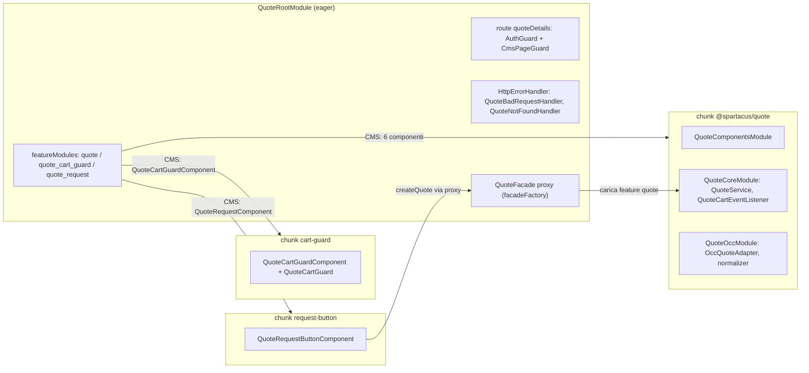
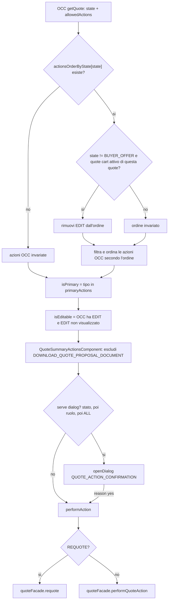
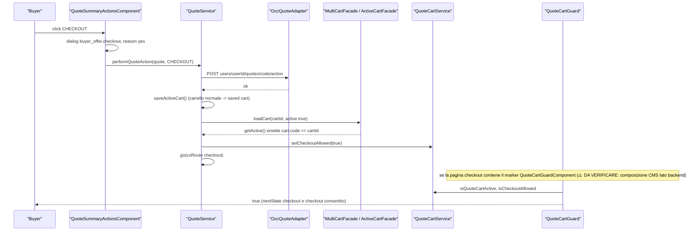
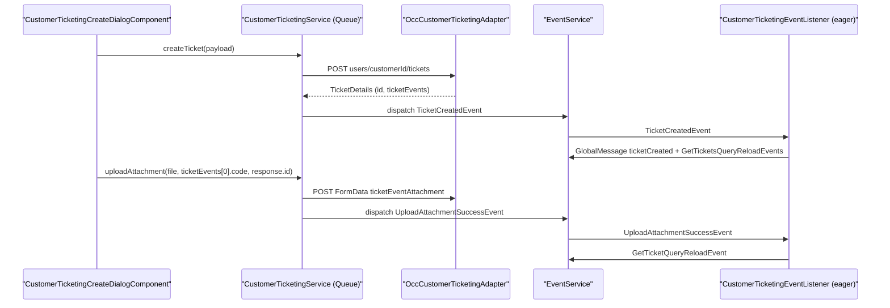
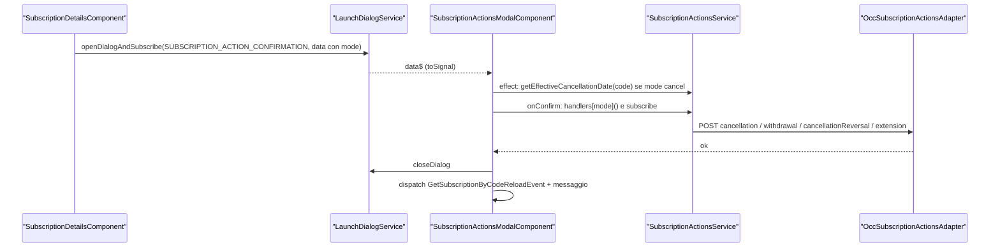

# 31 — Quote, customer ticketing, subscription billing

> Riferimenti allo SHA `5b7a1c2bf2808d7380bc20596d10f4fa710c3da1` (vedi [00-meta](../00-meta.md)).

## 1. A cosa serve e perché esiste

Questo capitolo copre tre feature library "di account" che vivono sotto `feature-libs/` e che condividono la stessa architettura a quattro strati (`root` eager, `core`, `occ`, `components` lazy), ma la usano in modi molto diversi:

| Libreria | Pacchetto | Cosa fa per l'utente | Tratto architetturale distintivo |
|---|---|---|---|
| Quote | `@spartacus/quote` | negoziazione B2B di un preventivo tra buyer e seller (richiesta dal carrello, commenti, sconti, scadenza, checkout della quote) | macchina a stati guidata dal backend (`allowedActions`), "quote cart" che sostituisce il carrello attivo, guard CMS che blocca la navigazione, tre chunk lazy distinti |
| Customer ticketing | `@spartacus/customer-ticketing` | ticket di assistenza in My Account: lista, creazione, messaggi, allegati, chiusura e riapertura | `Command` con strategia `Queue`, orchestrazione tramite eventi (`CxEvent`) ascoltati da un listener eager |
| Subscription billing | `@spartacus/subscription-billing` | elenco e dettaglio degli abbonamenti, azioni (cancel/withdraw/resubscribe/extend), fatture, prezzi "a piano" in PDP e carrello | componenti standalone con signals, facade che restituiscono Observable freddi, outlet del carrello forniti dal modulo root eager |

Tutte e tre le librerie seguono il pattern descritto in [12 — Feature module e lazy loading](../parte-2/12-feature-module-lazy.md): il modulo `*RootModule` viene importato eagerly e dichiara `featureModules` (componenti CMS → nome feature), route e facade proxy; il resto (`*Module` = components + core + occ) viene caricato on demand. La facade lazy (`facadeFactory`) e il pattern Command/Query sono quelli di [20 — Facade, Command/Query, eventi](../parte-2/20-facade-command-query-eventi.md); gli adapter OCC seguono [21 — OCC](../parte-2/21-occ.md).

Quote è la più complessa e la più interessante: lo stato di una quote (17 valori di `QuoteState`, `feature-libs/quote/root/model/quote.model.ts:L75-L93`) e le azioni possibili (`allowedActions`) arrivano dal backend, ma Spartacus le **filtra, riordina e classifica** lato client con configurazione (`feature-libs/quote/occ/converters/occ-quote-action-normalizer.ts:L30-L53`) e collega la quote al carrello: quando il buyer modifica o compra una quote, il carrello attivo diventa il "quote cart" e un guard CMS impedisce di uscire dal flusso (`feature-libs/quote/components/cart-guard/quote-cart.guard.ts:L34-L57`). Per questo il capitolo dedica la maggior parte dello spazio a quote, e tratta ticketing e subscription billing per le differenze.

Prerequisiti utili: [25 — Cart](../parte-2/25-cart.md) (active cart, multi-cart, saved cart), [26 — Checkout](../parte-2/26-checkout.md), [18 — Layout, breakpoint, launch dialog](../parte-2/18-layout-breakpoint-a11y.md) (i dialog `LAUNCH_CALLER`), [17 — Outlet](../parte-2/17-outlet.md), [41 — Errori e global message](../parte-2/41-errori-global-message.md) (`HttpErrorHandler`).

## 2. Mappa dei file

### 2.1 `feature-libs/quote`

| Path | Ruolo |
|---|---|
| `feature-libs/quote/quote.module.ts` | `QuoteModule` = `QuoteComponentsModule` + `QuoteCoreModule` + `QuoteOccModule` (target del lazy load feature `quote`) |
| `feature-libs/quote/root/feature-name.ts` | tre nomi feature: `quote`, `quote_cart_guard`, `quote_request` |
| `feature-libs/quote/root/quote-root.module.ts` | eager: mapping CMS → feature, route `quotes`/`quoteDetails`, layout `QuoteDetailsPageTemplate`, ng-route con `AuthGuard`+`CmsPageGuard`, due `HttpErrorHandler` |
| `feature-libs/quote/root/facade/quote.facade.ts` | `QuoteFacade` astratta + proxy lazy (8 metodi proxati) |
| `feature-libs/quote/root/model/quote.model.ts` | `Quote`, `QuoteAction`, `QuoteActionType`, `QuoteState`, `QuoteRoleType`, `QuoteDiscountType`, `QuoteMetadata`, `QuoteStarter` |
| `feature-libs/quote/root/model/augmented-types.ts` | augment di `OrderEntry.comments` e di `LAUNCH_CALLER.QUOTE_ACTION_CONFIRMATION` |
| `feature-libs/quote/root/http-interceptors/quote-bad-request.handler.ts` | `QuoteBadRequestHandler` (400 legati alle quote) |
| `feature-libs/quote/root/http-interceptors/quote-not-found.handler.ts` | `QuoteNotFoundHandler` (404 `Quote not found` → redirect a `quotes`) |
| `feature-libs/quote/root/config/quote.config.ts` | `QuoteConfig` vuota agganciata a `Config.quote` |
| `feature-libs/quote/core/quote-core.module.ts` | facade provider, `QuoteConnector`, `defaultQuoteCoreConfig`, istanzia `QuoteCartEventListener` |
| `feature-libs/quote/core/facade/quote.service.ts` | `QuoteService`: tutti i command e le query |
| `feature-libs/quote/core/facade/facade-providers.ts` | `QuoteFacade` → `useExisting: QuoteService` |
| `feature-libs/quote/core/config/quote-core.config.ts`, `default-quote.core.config.ts` | `QuoteCoreConfig.quote.actions` (primarie e ordine per stato) |
| `feature-libs/quote/core/connectors/quote.adapter.ts`, `quote.connector.ts`, `converters.ts` | adapter astratto (9 operazioni), connector 1:1, 7 token di conversione |
| `feature-libs/quote/core/event/quote.events.ts`, `quote-cart-event.listener.ts` | `QuoteDetailsReloadQueryEvent` e traduzione eventi carrello → reload |
| `feature-libs/quote/core/services/quote-cart.service.ts` | `QuoteCartService`: "il carrello attivo è un quote cart?", `checkoutAllowed` |
| `feature-libs/quote/core/services/cart-utils.service.ts` | `CartUtilsService.handleCartAndGoToQuoteList` |
| `feature-libs/quote/core/services/quote-storefront-utils.service.ts` | accesso DOM SSR-safe |
| `feature-libs/quote/occ/quote-occ.module.ts` | `QuoteAdapter → OccQuoteAdapter`, normalizer multi su `QUOTE_NORMALIZER` |
| `feature-libs/quote/occ/adapters/occ-quote.adapter.ts` | chiamate HTTP verso `users/${userId}/quotes...` |
| `feature-libs/quote/occ/config/default-occ-quote-config.ts` | 10 endpoint di default |
| `feature-libs/quote/occ/converters/occ-quote-action-normalizer.ts` | filtro/ordine/primarietà delle azioni, calcolo `isEditable` |
| `feature-libs/quote/occ/converters/occ-quote-entry-normalizer.ts` | `quoteCode` sulle entry, `PRODUCT_NORMALIZER` sui prodotti |
| `feature-libs/quote/components/quote-components.module.ts` | aggregatore di 12 moduli UI + `defaultQuoteUIConfig` |
| `feature-libs/quote/components/config/quote-ui.config.ts`, `default-quote-ui.config.ts` | `QuoteUIConfig` (commenti, troncamento, dialog di conferma, sconto, debounce) |
| `feature-libs/quote/components/summary/actions/quote-summary-actions.component.ts` | bottoni azione, logica dialog di conferma |
| `feature-libs/quote/components/summary/seller-edit/*` | sconto e scadenza (lato seller) |
| `feature-libs/quote/components/header/*` | testata, form buyer (nome, descrizione) |
| `feature-libs/quote/components/items/*` | entry: da quote, saved cart read-only o active cart |
| `feature-libs/quote/components/list/*` | lista quote (`AccountMyQuotesComponent`) |
| `feature-libs/quote/components/links/*` | link: nuovo carrello, download PDF proposta, ordine |
| `feature-libs/quote/components/comments/*` | messaggistica buyer/seller |
| `feature-libs/quote/components/confirm-dialog/*` | `QuoteConfirmDialogComponent` + layout `QUOTE_ACTION_CONFIRMATION` |
| `feature-libs/quote/components/cart-guard/*` | entry point secondario: `QuoteCartGuardComponent` marker + `QuoteCartGuard` |
| `feature-libs/quote/components/request-button/*` | entry point secondario: `QuoteRequestButtonComponent` (componente CMS `QuoteRequestComponent`) |
| `projects/storefrontapp/src/app/spartacus/features/quote-feature.module.ts` | wiring demo: tre `import()` distinti |
| `core-libs/schematics/src/shared/lib-configs/quote-schematics-config.ts` | configurazione schematics (b2b, dipendenza da cart base) |

### 2.2 `feature-libs/customer-ticketing`

| Path | Ruolo |
|---|---|
| `feature-libs/customer-ticketing/customer-ticketing.module.ts` | `CustomerTicketingModule` = components + core + occ |
| `feature-libs/customer-ticketing/root/customer-ticketing-root.module.ts` | 6 componenti CMS, alias feature core, due ng-route, `CustomerTicketingEventModule` |
| `feature-libs/customer-ticketing/root/customer-ticketing-constants.ts` | limiti (5000/255 caratteri, 10 MB, 1 allegato, page size 5) |
| `feature-libs/customer-ticketing/root/config/*` | `CustomerTicketingConfig`, default, routing |
| `feature-libs/customer-ticketing/root/events/customer-ticketing.events.ts` | eventi reset/reload query ed eventi di dominio |
| `feature-libs/customer-ticketing/root/events/customer-ticketing-event.listener.ts` | listener eager: messaggi e reload/reset |
| `feature-libs/customer-ticketing/root/facade/customer-ticketing.facade.ts` | facade lazy (12 metodi) |
| `feature-libs/customer-ticketing/root/model/customer-ticketing.model.ts` | `STATUS`, `STATUS_NAME`, `TicketDetails`, `TicketEvent` |
| `feature-libs/customer-ticketing/root/model/augmented-core.model.ts` | `LAUNCH_CALLER.CUSTOMER_TICKETING_*` |
| `feature-libs/customer-ticketing/core/customer-ticketing-core.module.ts` | facade, connector, `NotFoundTicketRequestHandler`, `CustomerTicketingPageMetaResolver` |
| `feature-libs/customer-ticketing/core/facade/customer-ticketing.service.ts` | `CustomerTicketingService` (command `Queue`, query) |
| `feature-libs/customer-ticketing/core/http-interceptors/handlers/not-found-ticket-request.handler.ts` | 404 sul dettaglio → lista |
| `feature-libs/customer-ticketing/core/services/customer-ticketing-page-meta.resolver.ts` | heading e breadcrumb del dettaglio |
| `feature-libs/customer-ticketing/occ/adapters/occ-customer-ticketing.adapter.ts` | HTTP, `FormData` per upload |
| `feature-libs/customer-ticketing/occ/config/default-occ-customer-ticketing-config.ts` | endpoint |
| `feature-libs/customer-ticketing/components/shared/customer-ticketing-dialog/*` | `CustomerTicketingDialogComponent` astratta + layout dei tre dialog |
| `feature-libs/customer-ticketing/components/details/*` | dettagli, messaggi, close, reopen |
| `feature-libs/customer-ticketing/components/list/*` | lista e create |
| `feature-libs/customer-ticketing/components/my-account-v2/*` | widget "ultimo ticket" |
| `projects/storefrontapp/src/app/spartacus/features/customer-ticketing/customer-ticketing-wrapper.module.ts` | wrapper demo che aggiunge CDP se `environment.cdp` |

### 2.3 `feature-libs/subscription-billing`

| Path | Ruolo |
|---|---|
| `feature-libs/subscription-billing/subscription-billing.module.ts` | `SubscriptionBillingModule` = components + core + occ |
| `feature-libs/subscription-billing/root/subscription-billing-root.module.ts` | 5 componenti CMS, alias core, routing, **due outlet del carrello** (eager) |
| `feature-libs/subscription-billing/root/components/cart/*` | `SubscriptionCartPriceHeadingComponent`, `SubscriptionCartPriceBodyComponent` (standalone, eager) |
| `feature-libs/subscription-billing/root/services/subscription-product.service.ts` | `SubscriptionProductService`: riconosce i prodotti subscription |
| `feature-libs/subscription-billing/root/model/subscription-product.model.ts` | augment di `Product` e `ProductScope.SUBSCRIPTION` |
| `feature-libs/subscription-billing/root/model/subscription.model.ts` | `SubscriptionDetail`, `SubscriptionActionMode`, `LAUNCH_CALLER` aggiuntivi |
| `feature-libs/subscription-billing/root/facade/*` | `SubscriptionFacade`, `SubscriptionBillingFacade`, `SubscriptionActionsFacade` |
| `feature-libs/subscription-billing/root/config/extend-subscription-dropdown-options-config.ts` | `ExtendSubscriptionFrequencyDropdownOptionsConfig` |
| `feature-libs/subscription-billing/root/events/subscription-billing-event.listener.ts` | reload su cambio lingua/valuta |
| `feature-libs/subscription-billing/core/facade/*` | `SubscriptionService`, `SubscriptionBillingService`, `SubscriptionActionsService`, facade provider |
| `feature-libs/subscription-billing/core/connector/*` | tre coppie adapter/connector |
| `feature-libs/subscription-billing/core/services/*` | due page meta resolver |
| `feature-libs/subscription-billing/occ/adapters/*` | tre adapter OCC (senza converter) |
| `feature-libs/subscription-billing/occ/config/default-occ-subscription-billing-config.ts` | endpoint + scope prodotto `subscription` |
| `feature-libs/subscription-billing/components/actions-modal/*` | dialog azioni (signals, `effect`) |
| `feature-libs/subscription-billing/components/list/*` | lista subscription, lista bill, `DateRangeModalComponent` |
| `feature-libs/subscription-billing/components/product/*` | prezzo e usage charge in PDP |

### File aggiuntivi

| Path | Ruolo |
|---|---|
| `feature-libs/quote/public_api.ts` | Entry `@spartacus/quote`: riferimento triple-slash a `types.d.ts` (per `@HostListener` con eventi tipo `keydown.Escape`) + riesportazione di `quote.module` (`:L14-L19`). |
| `feature-libs/quote/schematics/add-quote/index.ts` | `addQuoteFeatures()`: factory degli schematics `ng-add`/`add` di `@spartacus/quote` (vedi 3.12). |
| `feature-libs/quote/schematics/add-quote/index_spec.ts` | Test dello schematic, incluso il controllo che la configurazione b2b venga aggiunta. |
| `feature-libs/quote/schematics/constants.ts` | Costanti schematics (`QUOTE_FOLDER_NAME`, `QUOTE_TRANSLATIONS`, ...), duplicate di quelle in core-libs schematics (vedi 3.12). |
| `feature-libs/quote/vitest.config.ts` | Config Vitest: jsdom, pool `forks`, alias per mock feature directive e `url-testing.module`, coverage 85/65. |
| `feature-libs/quote/_index.scss` | Entry SCSS: core + app Spartacus, mixin locale `visible-focus`, poi `styles/index`. |
| `feature-libs/quote/styles/_index.scss` | Importa mixin, 12 file componente e layout; `$quote-components-allowlist` con `@extend`. |
| `feature-libs/quote/styles/_quote-comments.scss` | Placeholder `%cx-quote-comments`. |
| `feature-libs/quote/styles/_quote-confirm-dialog.scss` | Placeholder `%cx-quote-confirm-dialog`. |
| `feature-libs/quote/styles/_quote-header-buyer-edit.scss` | Placeholder `%cx-quote-header-buyer-edit` (importa lo stile card). |
| `feature-libs/quote/styles/_quote-header-overview.scss` | Placeholder `%cx-quote-header-overview` + regole RTL. |
| `feature-libs/quote/styles/_quote-items.scss` | Placeholder `%cx-quote-items`. |
| `feature-libs/quote/styles/_quote-links.scss` | Placeholder `%cx-quote-links` + regole LTR/RTL. |
| `feature-libs/quote/styles/_quote-list.scss` | Placeholder `%cx-quote-list` + regole LTR/RTL. |
| `feature-libs/quote/styles/_quote-request-button.scss` | Placeholder `%cx-quote-request-button`. |
| `feature-libs/quote/styles/_quote-summary-actions.scss` | Placeholder `%cx-quote-summary-actions`. |
| `feature-libs/quote/styles/_quote-summary-prices.scss` | Placeholder `%cx-quote-summary-prices`. |
| `feature-libs/quote/styles/_quote-summary-seller-edit.scss` | Placeholder `%cx-quote-summary-seller-edit`. |
| `feature-libs/quote/styles/_quote-summary.scss` | Placeholder `%cx-quote-summary`. |
| `feature-libs/quote/styles/layout/_index.scss` | Allowlist/blocklist del page template `QuoteDetailsPageTemplate` (variabili con suffisso `-store-finder`, vedi 3.12). |
| `feature-libs/quote/styles/layout/_quote-details-page.scss` | Placeholder `%QuoteDetailsPageTemplate`: flex 70/30 tra `BodyContent` e `CenterRightContent`. |
| `feature-libs/quote/styles/mixins/_mixins.scss` | Importa i due mixin sotto. |
| `feature-libs/quote/styles/mixins/_ghost-bar.scss` | Mixin `cx-ghost-bar`. |
| `feature-libs/quote/styles/mixins/_quote-toggle.scss` | Mixin `cx-quote-toggle`. |
| `feature-libs/customer-ticketing/_index.scss` | Entry SCSS: core + blocco `modal` di cxbase + `styles/index`. |
| `feature-libs/customer-ticketing/vitest.config.ts` | Config Vitest: alias `@spartacus/core/testing/mock-feature-toggles`, coverage 85/65. |
| `feature-libs/subscription-billing/public_api.ts` | Entry `@spartacus/subscription-billing`: riesporta `subscription-billing.module` (il commento dice "segment", residuo di copia). |
| `feature-libs/subscription-billing/assets/public_api.ts` | Entry assets: riesporta `translations/translations`. |
| `feature-libs/subscription-billing/vitest.config.ts` | Config Vitest senza alias, coverage 85/65. |
| `feature-libs/subscription-billing/_index.scss` | Entry SCSS: importa solo `styles/index`. |
| `feature-libs/subscription-billing/styles/_index.scss` | Importa core + 10 file componente; `$subscription-billing-components-allowlist` con `@extend`. |
| `feature-libs/subscription-billing/styles/billing-details/_subscription-billing-details.scss` | Placeholder `%cx-subscription-billing-details`. |
| `feature-libs/subscription-billing/styles/cart/_subscription-cart-item-list.scss` | Placeholder `%cx-subscription-cart-item-list`. |
| `feature-libs/subscription-billing/styles/cart/_subscription-cart-price-body.scss` | Placeholder `%cx-subscription-cart-price-body` (outlet carrello eager). |
| `feature-libs/subscription-billing/styles/details/_subscription-details.scss` | Placeholder `%cx-subscription-details`. |
| `feature-libs/subscription-billing/styles/list/_billing-list.scss` | Placeholder `%cx-billing-list`. |
| `feature-libs/subscription-billing/styles/list/_date-range-modal.scss` | Placeholder `%cx-date-range-modal`. |
| `feature-libs/subscription-billing/styles/list/_subscription-list.scss` | Placeholder `%cx-subscription-list` (e regole condivise con `%cx-subscription-details`). |
| `feature-libs/subscription-billing/styles/modal/_subscription-modal.scss` | Placeholder `%cx-subscription-actions-modal`. |
| `feature-libs/subscription-billing/styles/product/_subscription-product-price.scss` | Placeholder `%cx-subscription-product-price`. |
| `feature-libs/subscription-billing/styles/product/_subscription-product-usage-charge.scss` | Placeholder `%cx-subscription-product-usage-charge`. |

### File aggiuntivi

| Path | Ruolo |
|---|---|
| `feature-libs/quote/public_api.ts` | Entry `@spartacus/quote`: riferimento triple-slash a `types.d.ts` (per `@HostListener` con eventi tipo `keydown.Escape`) + riesportazione di `quote.module` (`:L14-L19`). |
| `feature-libs/quote/schematics/add-quote/index.ts` | `addQuoteFeatures()`: factory degli schematics `ng-add`/`add` di `@spartacus/quote` (vedi 3.12). |
| `feature-libs/quote/schematics/add-quote/index_spec.ts` | Test dello schematic, incluso il controllo che la configurazione b2b venga aggiunta. |
| `feature-libs/quote/schematics/constants.ts` | Costanti schematics (`QUOTE_FOLDER_NAME`, `QUOTE_TRANSLATIONS`, ...), duplicate di quelle in core-libs schematics (vedi 3.12). |
| `feature-libs/quote/vitest.config.ts` | Config Vitest: jsdom, pool `forks`, alias per mock feature directive e `url-testing.module`, coverage 85/65. |
| `feature-libs/quote/_index.scss` | Entry SCSS: core + app Spartacus, mixin locale `visible-focus`, poi `styles/index`. |
| `feature-libs/quote/styles/_index.scss` | Importa mixin, 12 file componente e layout; `$quote-components-allowlist` con `@extend`. |
| `feature-libs/quote/styles/_quote-comments.scss` | Placeholder `%cx-quote-comments`. |
| `feature-libs/quote/styles/_quote-confirm-dialog.scss` | Placeholder `%cx-quote-confirm-dialog`. |
| `feature-libs/quote/styles/_quote-header-buyer-edit.scss` | Placeholder `%cx-quote-header-buyer-edit` (importa lo stile card). |
| `feature-libs/quote/styles/_quote-header-overview.scss` | Placeholder `%cx-quote-header-overview` + regole RTL. |
| `feature-libs/quote/styles/_quote-items.scss` | Placeholder `%cx-quote-items`. |
| `feature-libs/quote/styles/_quote-links.scss` | Placeholder `%cx-quote-links` + regole LTR/RTL. |
| `feature-libs/quote/styles/_quote-list.scss` | Placeholder `%cx-quote-list` + regole LTR/RTL. |
| `feature-libs/quote/styles/_quote-request-button.scss` | Placeholder `%cx-quote-request-button`. |
| `feature-libs/quote/styles/_quote-summary-actions.scss` | Placeholder `%cx-quote-summary-actions`. |
| `feature-libs/quote/styles/_quote-summary-prices.scss` | Placeholder `%cx-quote-summary-prices`. |
| `feature-libs/quote/styles/_quote-summary-seller-edit.scss` | Placeholder `%cx-quote-summary-seller-edit`. |
| `feature-libs/quote/styles/_quote-summary.scss` | Placeholder `%cx-quote-summary`. |
| `feature-libs/quote/styles/layout/_index.scss` | Allowlist/blocklist del page template `QuoteDetailsPageTemplate` (variabili con suffisso `-store-finder`, vedi 3.12). |
| `feature-libs/quote/styles/layout/_quote-details-page.scss` | Placeholder `%QuoteDetailsPageTemplate`: flex 70/30 tra `BodyContent` e `CenterRightContent`. |
| `feature-libs/quote/styles/mixins/_mixins.scss` | Importa i due mixin sotto. |
| `feature-libs/quote/styles/mixins/_ghost-bar.scss` | Mixin `cx-ghost-bar`. |
| `feature-libs/quote/styles/mixins/_quote-toggle.scss` | Mixin `cx-quote-toggle`. |
| `feature-libs/customer-ticketing/_index.scss` | Entry SCSS: core + blocco `modal` di cxbase + `styles/index`. |
| `feature-libs/customer-ticketing/vitest.config.ts` | Config Vitest: alias `@spartacus/core/testing/mock-feature-toggles`, coverage 85/65. |
| `feature-libs/subscription-billing/public_api.ts` | Entry `@spartacus/subscription-billing`: riesporta `subscription-billing.module` (il commento dice "segment", residuo di copia). |
| `feature-libs/subscription-billing/assets/public_api.ts` | Entry assets: riesporta `translations/translations`. |
| `feature-libs/subscription-billing/vitest.config.ts` | Config Vitest senza alias, coverage 85/65. |
| `feature-libs/subscription-billing/_index.scss` | Entry SCSS: importa solo `styles/index`. |
| `feature-libs/subscription-billing/styles/_index.scss` | Importa core + 10 file componente; `$subscription-billing-components-allowlist` con `@extend`. |
| `feature-libs/subscription-billing/styles/billing-details/_subscription-billing-details.scss` | Placeholder `%cx-subscription-billing-details`. |
| `feature-libs/subscription-billing/styles/cart/_subscription-cart-item-list.scss` | Placeholder `%cx-subscription-cart-item-list`. |
| `feature-libs/subscription-billing/styles/cart/_subscription-cart-price-body.scss` | Placeholder `%cx-subscription-cart-price-body` (outlet carrello eager). |
| `feature-libs/subscription-billing/styles/details/_subscription-details.scss` | Placeholder `%cx-subscription-details`. |
| `feature-libs/subscription-billing/styles/list/_billing-list.scss` | Placeholder `%cx-billing-list`. |
| `feature-libs/subscription-billing/styles/list/_date-range-modal.scss` | Placeholder `%cx-date-range-modal`. |
| `feature-libs/subscription-billing/styles/list/_subscription-list.scss` | Placeholder `%cx-subscription-list` (e regole condivise con `%cx-subscription-details`). |
| `feature-libs/subscription-billing/styles/modal/_subscription-modal.scss` | Placeholder `%cx-subscription-actions-modal`. |
| `feature-libs/subscription-billing/styles/product/_subscription-product-price.scss` | Placeholder `%cx-subscription-product-price`. |
| `feature-libs/subscription-billing/styles/product/_subscription-product-usage-charge.scss` | Placeholder `%cx-subscription-product-usage-charge`. |

## 3. Come funziona passo per passo

### 3.1 Quote: packaging in tre chunk

La lib quote ha **tre** nomi feature (`feature-libs/quote/root/feature-name.ts:L7-L9`). `defaultQuoteComponentsConfig` assegna sei componenti CMS (lista, link, commenti, testata, entry, summary) alla feature `quote` (`feature-libs/quote/root/quote-root.module.ts:L29-L44`), mentre `QuoteCartGuardComponent` e `QuoteRequestComponent` vanno su feature separate (`feature-libs/quote/root/quote-root.module.ts:L46-L64`). Il motivo è il peso: il bottone "Request quote" sta nella pagina carrello e il marker del guard sta (presumibilmente) in carrello e checkout; caricarli non deve trascinare tutto il chunk quote.

Nell'app demo le tre feature corrispondono a tre `import()` distinti: `@spartacus/quote`, `@spartacus/quote/components/cart-guard`, `@spartacus/quote/components/request-button` (`projects/storefrontapp/src/app/spartacus/features/quote-feature.module.ts:L26-L63`). I due chunk piccoli sono entry point ng-packagr secondari e infatti `components/public_api.ts` non li riesporta (`feature-libs/quote/components/public_api.ts:L7-L15`).

`QuoteModule` importa solo components, core e occ (`feature-libs/quote/quote.module.ts:L12-L15`). Lo schematics marca la lib come `b2b` e dipendente da cart base (`core-libs/schematics/src/shared/lib-configs/quote-schematics-config.ts:L36-L84`).

### 3.2 Quote: root eager (route, layout, error handler)

- Route semantiche: `quotes` → `my-account/quotes` e `quoteDetails` → `my-account/quote/:quoteId` (`feature-libs/quote/root/quote-root.module.ts:L66-L78`).
- Layout: `QuoteDetailsPageTemplate` con slot `BodyContent` e `CenterRightContent` (`feature-libs/quote/root/quote-root.module.ts:L80-L86`).
- Solo `quoteDetails` ha una ng-route esplicita (`path: null`, risolta dalla config di routing come spiegato in [14 — Routing](../parte-2/14-routing.md)), protetta da `AuthGuard` e `CmsPageGuard`; `quotes` è una content page CMS (`feature-libs/quote/root/quote-root.module.ts:L88-L106`).
- Due `HttpErrorHandler` multi: `QuoteBadRequestHandler` e `QuoteNotFoundHandler` (`feature-libs/quote/root/quote-root.module.ts:L108-L118`).

Gli handler sono registrati nel root perché devono esistere anche prima del caricamento lazy. Comunque `HttpErrorInterceptor` li raccoglie con `UnifiedInjector.getMulti(HttpErrorHandler)`, quindi vedrebbe anche provider di moduli lazy (`core-libs/core/src/global-message/http-interceptors/http-error.interceptor.ts:L26-L28`). Il `hasMatch` base confronta solo lo status (`core-libs/core/src/global-message/http-interceptors/handlers/http-error.handler.ts:L42-L44`); i due handler quote lo restringono:

- `QuoteBadRequestHandler` (400) fa match solo se l'errore è "legato alle quote" (`feature-libs/quote/root/http-interceptors/quote-bad-request.handler.ts:L28-L32`): tipi OCC `QuoteUnderThresholdError`, `CartValidationError`, `CartQuoteAccessError` (`feature-libs/quote/root/http-interceptors/quote-bad-request.handler.ts:L83-L101`), oppure `IllegalArgumentError` con messaggio che corrisponde a `/Discount type is absolute/` o `/Invalid quote expiration time/` (`feature-libs/quote/root/http-interceptors/quote-bad-request.handler.ts:L121-L133`). `handleError` aggiunge un global message per ogni categoria presente (`feature-libs/quote/root/http-interceptors/quote-bad-request.handler.ts:L34-L52`). Priorità `Priority.NORMAL` (`feature-libs/quote/root/http-interceptors/quote-bad-request.handler.ts:L54-L56`).
- `QuoteNotFoundHandler` (404) fa match solo per `NotFoundError` con messaggio esatto `'Quote not found'` e naviga a `quotes` (`feature-libs/quote/root/http-interceptors/quote-not-found.handler.ts:L29-L60`). Il JSDoc spiega lo scenario: fine di un'emulazione ASM mentre si guarda una quote, poi emulazione di un altro utente (`feature-libs/quote/root/http-interceptors/quote-not-found.handler.ts:L44-L50`).

### 3.3 Quote: la facade e il suo proxy

`QuoteFacade` è `providedIn: 'root'` con `useFactory: () => facadeFactory({...})`, feature `quote`, otto metodi proxati (`feature-libs/quote/root/facade/quote.facade.ts:L21-L38`). La classe astratta dichiara però anche `requote` e `downloadAttachment` (`feature-libs/quote/root/facade/quote.facade.ts:L99-L134`), che **non** sono nella lista `methods`. `FacadeFactoryService.create` costruisce il proxy come istanza di una sottoclasse vuota e definisce solo i metodi elencati (`core-libs/core/src/lazy-loading/facade-factory/facade-factory.service.ts:L110-L131`): sul proxy `requote` è quindi il metodo astratto, cioè `undefined` a runtime (vedi §9).

Nel chunk lazy, `QuoteCoreModule` fornisce `QuoteFacade` con `useExisting: QuoteService` (`feature-libs/quote/core/facade/facade-providers.ts:L11-L17`), registra `QuoteConnector` e `defaultQuoteCoreConfig`, e istanzia nel costruttore `QuoteCartEventListener` (`feature-libs/quote/core/quote-core.module.ts:L14-L25`). I componenti dichiarati nel chunk `quote` ricevono quindi `QuoteService` direttamente; quelli dei chunk `cart-guard` e `request-button` passano dal proxy.

### 3.4 Quote: modello di dominio

`Quote` è derivato da `OccQuote`: `allowedActions` passa da array di tipi a `QuoteAction[]` (`{type, isPrimary}`) e si aggiunge `isEditable` (`feature-libs/quote/root/model/quote.model.ts:L41-L49`). Le azioni sono 14 (`QuoteActionType`, `feature-libs/quote/root/model/quote.model.ts:L58-L73`); gli stati 17 con prefisso di ruolo (BUYER\_, SELLER\_, SELLERAPPROVER\_) più `CREATED`, `CANCELLED`, `EXPIRED` (`feature-libs/quote/root/model/quote.model.ts:L75-L93`). `QuoteRoleType` ha `ALL`, `BUYER`, `SELLER`, `SELLERAPPROVER`; `QuoteDiscountType` ha `PERCENT` e `ABSOLUTE` (`feature-libs/quote/root/model/quote.model.ts:L95-L105`).

Dettagli notevoli:
- `QuoteMetadata.expirationTime` è `string` di proposito, per inviare l'offset locale (`+02:00`) invece di UTC (`feature-libs/quote/root/model/quote.model.ts:L120-L128`).
- `QuoteStarter` contiene `cartId` (creazione dal carrello) o `quoteCode` (requote) (`feature-libs/quote/root/model/quote.model.ts:L130-L133`).
- `QuotesStateParams` passa pagina e sort come Observable (`feature-libs/quote/root/model/quote.model.ts:L137-L140`).
- `augmented-types.ts` aggiunge `comments` a `OrderEntry` e il valore `QUOTE_ACTION_CONFIRMATION` a `LAUNCH_CALLER`, sia nel tipo sia a runtime (`feature-libs/quote/root/model/augmented-types.ts:L10-L23`).

### 3.5 Quote: normalizzazione delle azioni (il cuore della "macchina a stati")

Il backend decide quali azioni sono possibili; il client decide **quali mostrare, in che ordine e con che enfasi**. `QuoteOccModule` registra due normalizer multi su `QUOTE_NORMALIZER`: `OccQuoteActionNormalizer` e `OccQuoteEntryNormalizer` (`feature-libs/quote/occ/quote-occ.module.ts:L17-L37`).

`OccQuoteActionNormalizer.convert` (`feature-libs/quote/occ/converters/occ-quote-action-normalizer.ts:L30-L53`):

1. Se esiste un ordine configurato per lo stato (`quote.actions.actionsOrderByState[state]`), clona la lista; se lo stato non è `BUYER_OFFER` e il carrello attivo è il quote cart **di questa quote**, toglie `EDIT` dalla lista clonata (`feature-libs/quote/occ/converters/occ-quote-action-normalizer.ts:L60-L81`).
2. Filtra le azioni OCC tenendo solo quelle presenti nell'ordine e le ordina di conseguenza; se non c'è ordine per lo stato restituisce la lista OCC invariata (`feature-libs/quote/occ/converters/occ-quote-action-normalizer.ts:L82-L89`).
3. Marca `isPrimary` se il tipo è in `quote.actions.primaryActions` (`feature-libs/quote/occ/converters/occ-quote-action-normalizer.ts:L46-L53`).
4. Calcola `isEditable = OCC permette EDIT && EDIT non è più tra le azioni visualizzate` (`feature-libs/quote/occ/converters/occ-quote-action-normalizer.ts:L37-L43`). Tradotto: `isEditable` è vero quando OCC permette `EDIT` ma `EDIT` non è tra le azioni normalizzate. Il caso tipico è la quote già nel quote cart attivo (EDIT rimosso dal normalizer); vale però anche per gli stati il cui ordine configurato non contiene `EDIT` (con i default `EXPIRED` e `CANCELLED`), dove `EDIT` viene filtrato via (`feature-libs/quote/occ/converters/occ-quote-action-normalizer.ts:L82-L83`, `feature-libs/quote/core/config/default-quote.core.config.ts:L30-L31`). Che OCC mandi `EDIT` per `EXPIRED` è previsto dalla UI config, che ha un dialog `EXPIRED.EDIT` (`feature-libs/quote/components/config/default-quote-ui.config.ts:L41-L43`).

I default (`feature-libs/quote/core/config/default-quote.core.config.ts:L10-L37`): primarie `APPROVE`, `CHECKOUT`, `SUBMIT`, `REQUOTE`; ordine per sei stati: `BUYER_DRAFT` [SUBMIT, EDIT, CANCEL], `BUYER_OFFER` [CHECKOUT, EDIT, CANCEL], `CANCELLED` [REQUOTE], `EXPIRED` [REQUOTE, CANCEL], `SELLER_REQUEST` e `SELLER_DRAFT` [SUBMIT, EDIT].

`OccQuoteEntryNormalizer` aggiunge `quoteCode` a ogni entry e normalizza il prodotto con `PRODUCT_NORMALIZER` (`feature-libs/quote/occ/converters/occ-quote-entry-normalizer.ts:L24-L33`).

### 3.6 Quote: `QuoteService`, command e query

Tutti i command usano `CommandStrategy.CancelPrevious` (`feature-libs/quote/core/facade/quote.service.ts:L127-L129`), che processa via `switchMap` e completa il notifier del comando cancellato (`core-libs/core/src/util/command-query/command.service.ts:L73-L92`). `Command.execute` è eager: accoda il comando e ritorna un `ReplaySubject`, quindi la richiesta parte anche se il chiamante non si sottoscrive (`core-libs/core/src/util/command-query/command.service.ts:L120-L131`).

Un `BehaviorSubject` `isActionPerforming$` (`feature-libs/quote/core/facade/quote.service.ts:L82-L85`) viene OR-ato con `loading` della query dettagli in `getQuoteDetailsQueryState`, così la UI mostra lo spinner durante le azioni; `getQuoteDetails` emette solo quote caricate e definite (`feature-libs/quote/core/facade/quote.service.ts:L535-L554`).

**Creazione** (`createQuoteCommand`, `feature-libs/quote/core/facade/quote.service.ts:L90-L125`): prende `userId` e l'id del carrello attivo, POST `createQuote` con `{ cartId }`, poi PATCH `editQuote` con i metadata, carica il quote cart come attivo (`multiCartFacade.loadCart` con `extraData: { active: true }`) e dispatcha `QuoteDetailsReloadQueryEvent`.

**Azione** (`performQuoteActionCommand`, `feature-libs/quote/core/facade/quote.service.ts:L230-L298`): imposta `isActionPerforming$`, POST `/action`, poi dirama:
- `SUBMIT`/`CANCEL` → `cartUtilsService.handleCartAndGoToQuoteList(isEditable)` (`feature-libs/quote/core/facade/quote.service.ts:L244-L251`), che se la quote era in edit crea un nuovo carrello prima di navigare a `quotes` (`feature-libs/quote/core/services/cart-utils.service.ts:L52-L62`);
- `REJECT`/`APPROVE` → `go({ cxRoute: 'quotes' })` (`feature-libs/quote/core/facade/quote.service.ts:L252-L259`);
- `EDIT`/`CHECKOUT` → `saveActiveCart()`, poi `loadQuoteCartAndProceed`; se la quote non ha ancora `cartId` la rilegge dal backend (`feature-libs/quote/core/facade/quote.service.ts:L260-L292`);
- errore → `triggerReloadAndCompleteAction` + `handleError` (`feature-libs/quote/core/facade/quote.service.ts:L295-L298`). `handleError` trasforma `CommerceQuoteExpirationTimeError` in messaggio `quote.httpHandlers.expired` + `EMPTY`, altrimenti rilancia (`feature-libs/quote/core/facade/quote.service.ts:L306-L315`).

`saveActiveCart` salva come saved cart il carrello attivo solo se non vuoto e non già quote cart, avvisando l'utente (`feature-libs/quote/core/facade/quote.service.ts:L461-L487`): entrare in una quote non distrugge il carrello normale.

`loadQuoteCartAndProceed` (`feature-libs/quote/core/facade/quote.service.ts:L330-L354`) carica il cart come attivo, attende che `activeCartFacade.getActive()` emetta quel codice, poi: per `CHECKOUT` chiama `quoteCartService.setCheckoutAllowed(true)` e va a `checkout`; per `REQUOTE` va a `quoteDetails` con il nuovo id.

**Requote** (`requoteCommand`, `feature-libs/quote/core/facade/quote.service.ts:L362-L386`): POST `createQuote` con `{ quoteCode }`, salva il carrello attivo e procede con il flusso `REQUOTE`.

**Commenti e sconti**: `addQuoteCommentCommand` sceglie commento di entry o di testata in base a `entryNumber` e non ricarica (lo fa il componente) (`feature-libs/quote/core/facade/quote.service.ts:L171-L186`); `addDiscountCommand` ricarica in successo e in errore (`feature-libs/quote/core/facade/quote.service.ts:L203-L216`). `downloadAttachment` non è un command ma una pipe `takeUserId` + `mergeMap` (`feature-libs/quote/core/facade/quote.service.ts:L556-L569`).

**Query dettagli** (`feature-libs/quote/core/facade/quote.service.ts:L388-L421`): attende una prima emissione del carrello attivo (serve al normalizer per sapere se la quote è collegata al quote cart), poi legge `quoteId` dai parametri router solo quando `nextState === undefined` e l'utente è loggato; si ricarica su `QuoteDetailsReloadQueryEvent` e `LoginEvent`.

**Query lista** (`feature-libs/quote/core/facade/quote.service.ts:L423-L449`): reagisce a `currentPage$`/`sort$` dentro il loader, usa `viewConfig.view.defaultPageSize`, `reloadOn: []`, `resetOn: [LoginEvent]`.

**Reload da carrello**: `QuoteCartEventListener` traduce `CartAddEntrySuccessEvent`, `CartUpdateEntrySuccessEvent`, `CartRemoveEntrySuccessEvent` in `QuoteDetailsReloadQueryEvent` (`feature-libs/quote/core/event/quote-cart-event.listener.ts:L29-L49`), l'unico evento della lib (`feature-libs/quote/core/event/quote.events.ts:L9-L14`): modificare il quote cart aggiorna subito i totali della quote.

### 3.7 Quote: quote cart e guard

`QuoteCartService` deriva "il carrello attivo è un quote cart" da `cart.quoteCode !== undefined` e tiene `checkoutAllowed` in un `ReplaySubject(1)` inizializzato a `false` (`feature-libs/quote/core/services/quote-cart.service.ts:L18-L45`).

`QuoteCartGuardComponent` è un **marker** con template vuoto (`feature-libs/quote/components/cart-guard/quote-cart-guard.component.ts:L10-L17`); il suo mapping CMS dichiara `guards: [QuoteCartGuard]` (`feature-libs/quote/components/cart-guard/quote-cart-guard.component.module.ts:L16-L23`). Così ogni pagina CMS che contiene il marker eredita il guard tramite `CmsPageGuard` (meccanismo dei guard di componente in [15 — CMS core](../parte-2/15-cms-core.md)). `QuoteCartGuard.canActivate` restituisce un `UrlTree` verso `quoteDetails` se il quote cart è attivo e la navigazione non è un checkout consentito (`feature-libs/quote/components/cart-guard/quote-cart.guard.ts:L34-L57`). "Checkout consentito" = (prossima route semantica che inizia con `checkout` OPPURE route corrente di checkout senza prossima route) E `isCheckoutAllowed` (`feature-libs/quote/components/cart-guard/quote-cart.guard.ts:L67-L80`). In quali pagine sia posizionato il marker dipende dai dati CMS del backend: ⚠️ DA VERIFICARE (non presente nel repo).

### 3.8 Quote: componenti principali

**Request button** — `QuoteRequestButtonComponent` (componente CMS `QuoteRequestComponent`, `feature-libs/quote/components/request-button/quote-request-button.module.ts:L16-L22`) mostra il bottone solo agli utenti loggati: non usa `AuthGuard` per non proteggere l'intera pagina carrello (`feature-libs/quote/components/request-button/quote-request-button.component.ts:L32-L37`). Il click chiama `quoteFacade.createQuote({})` e naviga a `quoteDetails` con il codice ottenuto (`feature-libs/quote/components/request-button/quote-request-button.component.ts:L43-L57`).

**Summary actions** — `QuoteSummaryActionsComponent`:
- filtra via `DOWNLOAD_QUOTE_PROPOSAL_DOCUMENT` (diventa un link) (`feature-libs/quote/components/summary/actions/quote-summary-actions.component.ts:L421-L425`);
- rende un bottone per azione con label `quote.summary.actions.<TYPE>` e `[disabled]` (`feature-libs/quote/components/summary/actions/quote-summary-actions.component.html:L8-L14`);
- disabilita `SUBMIT` (e `REQUOTE` se il toggle `showWarningMessageOnRequoteButtonClick` è attivo) quando `totalPrice.value` è sotto la soglia (`feature-libs/quote/components/summary/actions/quote-summary-actions.component.ts:L219-L232`); all'init mostra il warning `quote.commons.minRequestInitiationNote` se un'azione va disabilitata (`feature-libs/quote/components/summary/actions/quote-summary-actions.component.ts:L99-L117`);
- stile: `btn-primary` se `isPrimary`; con più di due bottoni `CANCEL` diventa `btn-tertiary` (`feature-libs/quote/components/summary/actions/quote-summary-actions.component.ts:L330-L343`);
- `onClick` esegue subito se non serve conferma, altrimenti apre il dialog e attende la chiusura (`feature-libs/quote/components/summary/actions/quote-summary-actions.component.ts:L241-L257`). Il config del dialog si cerca per stato → ruolo (derivato dal prefisso dello stato) → `ALL` (`feature-libs/quote/components/summary/actions/quote-summary-actions.component.ts:L349-L363`, `feature-libs/quote/components/summary/actions/quote-summary-actions.component.ts:L411-L419`). Il dialog è `LAUNCH_CALLER.QUOTE_ACTION_CONFIRMATION`; l'azione parte solo se il reason di chiusura è `'yes'` (`feature-libs/quote/components/summary/actions/quote-summary-actions.component.ts:L267-L299`). `REQUOTE` passa da `quoteFacade.requote`, tutte le altre da `performQuoteAction` (`feature-libs/quote/components/summary/actions/quote-summary-actions.component.ts:L259-L265`).

Il layout del dialog è `inline`, `DIALOG_TYPE.DIALOG`, con `QuoteConfirmDialogComponent` (`feature-libs/quote/components/confirm-dialog/default-quote-confirm-dialog.config.ts:L10-L18`), che legge il context da `launchDialogService.data$` e chiude con un reason (`feature-libs/quote/components/confirm-dialog/quote-confirm-dialog.component.ts:L60-L74`). Le chiavi i18n del dialog sono costruite dal prefisso configurato: `.title`, `.confirmNote`, `.a11y.close`, opzionali `.warningNote` e `.successMessage` (`feature-libs/quote/components/summary/actions/quote-summary-actions.component.ts:L365-L390`).

**Seller edit** — attivo solo se stato `SELLER_REQUEST`/`SELLER_DRAFT` e `isEditable` (`feature-libs/quote/components/summary/seller-edit/quote-summary-seller-edit.component.service.ts:L133-L140`). Lo sconto viene sempre inviato come `PERCENT`; la scadenza passa da un `Subject` con `debounceTime(updateDebounceTime.expiryDate ?? 500)` prima di `editQuote` (`feature-libs/quote/components/summary/seller-edit/quote-summary-seller-edit.component.ts:L129-L184`). La data viene composta con ora locale e offset di fuso (`feature-libs/quote/components/summary/seller-edit/quote-summary-seller-edit.component.service.ts:L108-L115`). La validazione rifiuta >100 o troppi decimali (`feature-libs/quote/components/summary/seller-edit/quote-summary-seller-edit.component.service.ts:L234-L256`).

**Header** — il buyer modifica nome/descrizione solo se `isEditable` e stato `BUYER_DRAFT`/`BUYER_OFFER` (`feature-libs/quote/components/header/overview/quote-header-overview.component.ts:L89-L95`); la label totale è "Total" se tra le azioni c'è `CHECKOUT`, altrimenti "Estimated total" (`feature-libs/quote/components/header/overview/quote-header-overview.component.ts:L304-L311`).

**Items** — `QuoteItemsComponentService.retrieveQuoteEntries` sceglie la fonte: le entry della quote (nessun `cartId`), il carrello read-only (con `cartId`, non editabile) o il carrello attivo editabile (`feature-libs/quote/components/items/quote-items.component.service.ts:L80-L91`); nel secondo caso il cart viene caricato con `extraData: { active: false }` (`feature-libs/quote/components/items/quote-items.component.service.ts:L130-L138`). Il rendering riusa l'outlet `CART_ITEM_LIST` di cart base con `readonly` nel contesto (`feature-libs/quote/components/items/quote-items.component.html:L27-L30`).

**Lista** — `QuoteListModule` mappa `AccountMyQuotesComponent` e fornisce `view.defaultPageSize: 5` come default config (`feature-libs/quote/components/list/quote-list.module.ts:L35-L49`); sort di default `byCode` con opzioni hard-coded sostituite da `data.sorts` quando presenti (`feature-libs/quote/components/list/quote-list-component.service.ts:L17-L44`).

**Link e commenti** — `QuoteLinksComponent` forza il reload all'init perché la pagina dettagli è in cache (`feature-libs/quote/components/links/quote-links.component.ts:L47-L50`); scarica il primo allegato come `<filename>.pdf` (`feature-libs/quote/components/links/quote-links.component.ts:L68-L83`); mostra il link all'ordine solo con `orderConfig.showOrderQuoteLink` e `sapOrderCode` (`feature-libs/quote/components/links/quote-links.component.html:L38-L46`). `QuoteCommentsComponent.onSend` invia, resetta il form comunque e ricarica in successo (`feature-libs/quote/components/comments/quote-comments.component.ts:L62-L86`).

### 3.9 Quote: OCC

Dieci endpoint di default; `getQuote` chiede `FULL,expirationTime`, i prezzi formattati e `entries(FULL)` (`feature-libs/quote/occ/config/default-occ-quote-config.ts:L9-L31`), fusi in `OccEndpoints` via module augmentation (`feature-libs/quote/occ/model/occ-quote-endpoints.model.ts:L61-L63`). Con `orderConfig.showOrderQuoteLink` (default `false`, `feature-libs/order/root/config/default-order-config.ts:L27-L27`) l'adapter fonde i field di `getQuote` e `getOrderCode` con `OccFieldsService.getOptimalUrlGroups` (`feature-libs/quote/occ/adapters/occ-quote.adapter.ts:L107-L124`). `editQuote` è PATCH, `performQuoteAction` POST con `{ action }` (`feature-libs/quote/occ/adapters/occ-quote.adapter.ts:L136-L167`); il download usa `responseType: 'blob' as 'json'` (`feature-libs/quote/occ/adapters/occ-quote.adapter.ts:L253-L264`); tutte le chiamate normalizzano gli errori con `tryNormalizeHttpError` (`feature-libs/quote/occ/adapters/occ-quote.adapter.ts:L276-L284`).

### 3.10 Customer ticketing

**Root.** Sei componenti CMS sulla feature `customerTicketing`; `customerTicketingCore` è un alias della stessa feature ("by default core is bundled together with components") (`feature-libs/customer-ticketing/root/customer-ticketing-root.module.ts:L24-L43`). Il root importa `CustomerTicketingEventModule` e definisce due ng-route `path: null` per `supportTicketDetails` e `supportTickets` (`feature-libs/customer-ticketing/root/customer-ticketing-root.module.ts:L44-L74`), mappate su `my-account/support-tickets` e `my-account/support-ticket/:ticketCode` (`feature-libs/customer-ticketing/root/config/default-customer-ticketing-routing-config.ts:L9-L21`). Nell'app demo il chunk lazy è un wrapper che aggiunge `CdpCustomerTicketingModule` se `environment.cdp` (`projects/storefrontapp/src/app/spartacus/features/customer-ticketing/customer-ticketing-wrapper.module.ts:L13-L22`).

**Modello.** Stati `OPEN`, `CLOSED`, `INPROCESS` (`feature-libs/customer-ticketing/root/model/customer-ticketing.model.ts:L14-L24`); `TicketDetails` porta `availableStatusTransitions` e `ticketEvents`, `TicketEvent` porta `toStatus`, `addedByAgent`, `ticketEventAttachments` (`feature-libs/customer-ticketing/root/model/customer-ticketing.model.ts:L26-L69`). Tre `LAUNCH_CALLER` aggiunti a runtime (`feature-libs/customer-ticketing/root/model/augmented-core.model.ts:L9-L21`).

**Facade e servizio.** `CustomerTicketingFacade` è lazy con 12 metodi (`feature-libs/customer-ticketing/root/facade/customer-ticketing.facade.ts:L19-L40`). I command di `CustomerTicketingService` usano `CommandStrategy.Queue` (`feature-libs/customer-ticketing/core/facade/customer-ticketing.service.ts:L100-L102`), cioè `concatMap`: i comandi si accodano (`core-libs/core/src/util/command-query/command.service.ts:L105-L116`). Le precondizioni prendono `userId` e `ticketCode` dalla route con `take(1)` e lanciano un errore se manca l'utente (`feature-libs/customer-ticketing/core/facade/customer-ticketing.service.ts:L254-L270`).

**Orchestrazione a eventi.** Il servizio non ricarica direttamente: dispatcha eventi di dominio e un listener eager li traduce.
- `createTicketCommand` → POST → `TicketCreatedEvent` (`feature-libs/customer-ticketing/core/facade/customer-ticketing.service.ts:L86-L103`).
- `createTicketEventCommand`: `toStatus` CLOSED → `TicketClosedEvent`; altrimenti, se non c'è allegato, OPEN/INPROCESS → `TicketReopenedEvent`, altro → `NewMessageEvent` (`feature-libs/customer-ticketing/core/facade/customer-ticketing.service.ts:L118-L130`).
- `uploadAttachmentCommand` usa `payload.ticketId ?? ticketId` e dispatcha `UploadAttachmentSuccessEvent` (`feature-libs/customer-ticketing/core/facade/customer-ticketing.service.ts:L151-L163`).
- Listener: `TicketCreatedEvent` → messaggio + reload lista (`feature-libs/customer-ticketing/root/events/customer-ticketing-event.listener.ts:L50-L62`); lingua/valuta → reload lista e dettaglio; login/logout → reset delle quattro query (`feature-libs/customer-ticketing/root/events/customer-ticketing-event.listener.ts:L64-L91`); Closed → reset ticket + `requestClosed`; Reopened → reload + `requestReopened`; NewMessage/UploadAttachmentSuccess → reload ticket (`feature-libs/customer-ticketing/root/events/customer-ticketing-event.listener.ts:L93-L135`).

**Error handler e SEO.** Il core lazy registra `NotFoundTicketRequestHandler` e `CustomerTicketingPageMetaResolver` (`feature-libs/customer-ticketing/core/customer-ticketing-core.module.ts:L14-L31`). L'handler fa match solo per 404 sulla route `supportTicketDetails` con errori notFound e reindirizza a `supportTickets` (`feature-libs/customer-ticketing/core/http-interceptors/handlers/not-found-ticket-request.handler.ts:L38-L70`); `isNotFoundError` richiede sia `reason` sia `type` NOT_FOUND (`feature-libs/customer-ticketing/core/utils/utils.ts:L16-L21`). Il resolver (pageUid `support-ticket-details`) usa il `subject` come heading e aggiunge un breadcrumb "customer service" (`feature-libs/customer-ticketing/core/services/customer-ticketing-page-meta.resolver.ts:L53-L101`). Per i page meta resolver in generale vedi [40 — SEO e PWA](../parte-2/40-seo-pwa.md).

**OCC.** `getTicket` inverte in place `ticketEvents` prima della normalizzazione (`feature-libs/customer-ticketing/occ/adapters/occ-customer-ticketing.adapter.ts:L92-L101`); l'upload è un `FormData` con campo `ticketEventAttachment` (`feature-libs/customer-ticketing/occ/adapters/occ-customer-ticketing.adapter.ts:L212-L219`); associated objects e categorie vengono estratti dai wrapper e normalizzati con `pipeableMany` (`feature-libs/customer-ticketing/occ/adapters/occ-customer-ticketing.adapter.ts:L58-L85`). Alcuni endpoint hanno lo slash iniziale (`/ticketCategories`, `/users/...`) (`feature-libs/customer-ticketing/occ/config/default-occ-customer-ticketing-config.ts:L13-L23`): è innocuo perché `buildUrl` compone con `urlPathJoin`, che ripulisce gli slash di ogni parte (`core-libs/core/src/occ/services/occ-endpoints.service.ts:L233-L238`, `core-libs/core/src/occ/utils/occ-url-util.ts:L12-L33`).

**Componenti.** I tre dialog (REOPEN, CLOSE, CREATE) sono `inline` di tipo DIALOG (`feature-libs/customer-ticketing/components/shared/customer-ticketing-dialog/default-customer-ticketing-form-layout.config.ts:L12-L32`) e derivano da `CustomerTicketingDialogComponent`, una `@Directive()` astratta che chiude al click sull'host e costruisce il form con validatori dell'allegato (`feature-libs/customer-ticketing/components/shared/customer-ticketing-dialog/customer-ticketing-dialog.component.ts:L82-L118`). "Close" è abilitato con stato OPEN/INPROCESS e transizione verso CLOSED (`feature-libs/customer-ticketing/components/details/customer-ticketing-close/customer-ticketing-close-component.service.ts:L17-L30`); "Reopen" con stato CLOSED e transizione verso INPROCESS/OPEN (`feature-libs/customer-ticketing/components/details/customer-ticketing-reopen/customer-ticketing-reopen-component.service.ts:L17-L31`). Il reopen invia `toStatus INPROCESS` e, se c'è un file, passa `containsAttachment=true` e carica l'allegato sull'evento creato (`feature-libs/customer-ticketing/components/details/customer-ticketing-reopen/customer-ticketing-reopen-dialog/customer-ticketing-reopen-dialog.component.ts:L58-L98`). Il create dialog carica l'allegato sul primo evento del ticket, passando `response.id` esplicitamente (`feature-libs/customer-ticketing/components/list/customer-ticketing-create/customer-ticketing-create-dialog/customer-ticketing-create-dialog.component.ts:L161-L172`). Il dettaglio dispatcha `GetTicketQueryReloadEvent` se il ticket in cache non corrisponde al `ticketCode` della route (`feature-libs/customer-ticketing/components/details/customer-ticketing-details/customer-ticketing-details.component.ts:L83-L97`).

### 3.11 Subscription billing

**Root eager con outlet.** Cinque componenti CMS sulla feature `subscriptionBilling` e alias `subscriptionBillingCore` (`feature-libs/subscription-billing/root/subscription-billing-root.module.ts:L24-L40`). Il root fornisce inoltre due outlet del carrello in posizione `AFTER`: `SUBSCRIPTION_PRICE_HEADING` e `SUBSCRIPTION_PRICE_BODY` (`feature-libs/subscription-billing/root/subscription-billing-root.module.ts:L42-L59`), i cui id sono definiti in cart base (`feature-libs/cart/base/root/models/cart-outlets.model.ts:L28-L29`) e resi dalla cart item list (`feature-libs/cart/base/components/cart-shared/cart-item-list/cart-item-list.component.html:L14-L14`). I componenti outlet sono standalone e leggono il contesto con `toSignal(OutletContextData.context$)` (`feature-libs/subscription-billing/root/components/cart/price-heading/subscription-cart-price-heading.component.ts:L22-L31`). I componenti outlet esistono quindi anche senza il chunk lazy. Il prezzo compare però solo se le entry del carrello contengono `sapSubscriptionTerm` e `sapPricePlan` (`feature-libs/subscription-billing/root/services/subscription-product.service.ts:L18-L20`), che i field di default dell'endpoint `cart` non richiedono esplicitamente (`feature-libs/cart/base/occ/config/default-occ-cart-config-factory.ts:L17-L17`); la config OCC di subscription-billing arriva solo dal modulo OCC lazy (`feature-libs/subscription-billing/occ/subscription-billing-occ.module.ts:L23-L23`). ⚠️ DA VERIFICARE: dipende dal livello `DEFAULT` del backend.

**Prodotti subscription.** Un prodotto è subscription se ha sia `sapSubscriptionTerm` sia `sapPricePlan`; i dati si caricano con lo scope `SUBSCRIPTION` (`feature-libs/subscription-billing/root/services/subscription-product.service.ts:L18-L28`). Il model augmenta `Product` e aggiunge `ProductScope.SUBSCRIPTION = 'subscription'` anche a runtime (`feature-libs/subscription-billing/root/model/subscription-product.model.ts:L98-L110`); l'endpoint `product.subscription` chiede `fields=sapPricePlan,sapSubscriptionTerm` (`feature-libs/subscription-billing/occ/config/default-occ-subscription-billing-config.ts:L10-L43`). Gli scope prodotto sono trattati in [24 — Product e search](../parte-2/24-product-search.md).

**Facade.** Tre facade lazy: `SubscriptionFacade`, `SubscriptionBillingFacade`, `SubscriptionActionsFacade` (6 metodi) (`feature-libs/subscription-billing/root/facade/subscription-actions.facade.ts:L17-L32`). Il core registra tre coppie facade/servizio e due `PageMetaResolver` (`feature-libs/subscription-billing/core/facade/facade-provider.ts:L20-L46`).

**Codice dall'URL.** Il codice della subscription è estratto con la regex `/subscription/<id>` dall'URL, non dai parametri di route (`feature-libs/subscription-billing/core/facade/subscription.service.ts:L126-L134`); idem per i bill con `/subscription-bill/<id>` (`feature-libs/subscription-billing/core/facade/subscription-billing.service.ts:L157-L165`). Le precondizioni del dettaglio non hanno `take(1)` e lanciano se manca codice o utente (`feature-libs/subscription-billing/core/facade/subscription.service.ts:L111-L123`); la query ha solo `reloadOn` (il `resetOn` è commentato) (`feature-libs/subscription-billing/core/facade/subscription.service.ts:L53-L56`).

**Azioni senza Command.** `SubscriptionActionsService` restituisce Observable freddi (`combineLatest` + `take(1)` + `switchMap`) (`feature-libs/subscription-billing/core/facade/subscription-actions.service.ts:L55-L77`): senza subscribe non parte nulla. `getExtensionEffectiveDate` è l'unico senza `take(1)` (`feature-libs/subscription-billing/core/facade/subscription-actions.service.ts:L123-L138`). Né lui né `extendSubscription` controllano `userId`/codice (`feature-libs/subscription-billing/core/facade/subscription-actions.service.ts:L145-L157`); gli altri quattro metodi lanciano un errore se mancano (`feature-libs/subscription-billing/core/facade/subscription-actions.service.ts:L35-L121`).

**OCC.** Gli adapter non usano converter: restituiscono il JSON tipizzato normalizzando solo gli errori (`feature-libs/subscription-billing/occ/adapters/occ-subscription.adapter.ts:L36-L40`). L'estensione invia `{ numberOfBillingCycles, unlimited }` (`feature-libs/subscription-billing/occ/adapters/occ-subscription-actions.adapter.ts:L120-L153`); `reverseCancellation` fa POST con body `null` e Content-Type JSON (`feature-libs/subscription-billing/occ/adapters/occ-subscription-actions.adapter.ts:L98-L101`); il filtro bill va nel query param `filters` (`feature-libs/subscription-billing/occ/adapters/occ-subscription-billing.adapter.ts:L37-L47`).

**Componenti.** `SubscriptionDetailsComponent` forza il reload all'init e apre il dialog con `openDialogAndSubscribe(SUBSCRIPTION_ACTION_CONFIRMATION, ...)` passando subscription, `code` e `mode` (`feature-libs/subscription-billing/components/details/subscription-details.component.ts:L51-L73`); il dialog è `inlineRoot` (`feature-libs/subscription-billing/components/actions-modal/subscription-actions-popup.config.ts:L12-L20`). `SubscriptionActionsModalComponent` usa signals (`mode` default `'cancel'`, `feature-libs/subscription-billing/components/actions-modal/subscription-actions-modal.component.ts:L67-L92`), un `effect` che in modalità cancel richiede subito la data effettiva (`feature-libs/subscription-billing/components/actions-modal/subscription-actions-modal.component.ts:L120-L140`) e una mappa di handler per mode in `onConfirm` (`feature-libs/subscription-billing/components/actions-modal/subscription-actions-modal.component.ts:L174-L254`). Successo: close + `GetSubscriptionByCodeReloadEvent` + conferma; errore: close(`'error'`) + `subscriptionActions.unknownError` (`feature-libs/subscription-billing/components/actions-modal/subscription-actions-modal-component.service.ts:L23-L59`). La lista bill riceve il range date dal `dialogClose` del `DateRangeModalComponent` (`feature-libs/subscription-billing/components/list/billing/subscription-billing-list.component.ts:L77-L90`, `feature-libs/subscription-billing/components/list/billing/date-range-modal/date-range-modal.component.ts:L85-L94`) e lo serializza come `startAt:%s:endAt:%s` (`feature-libs/subscription-billing/components/list/billing/subscription-billing-list.component.ts:L64-L64`).

### 3.12 Installazione via schematics, costanti e stili

`addQuoteFeatures()` valida l'installazione, risolve le dipendenze tra feature ed esegue in catena `analyzeApplication`, `addFeatures`, `addPackageJsonDependenciesForLibrary(peerDependencies, ...)` e `finalizeInstallation` (`feature-libs/quote/schematics/add-quote/index.ts:L25-L43`), registrata come `ng-add` e `add` (`feature-libs/quote/schematics/collection.json:L4-L16`). Lo spec controlla con snapshot che il modulo di configurazione riceva le feature b2b (`feature-libs/quote/schematics/add-quote/index_spec.ts:L115-L122`), coerente con la config schematics della quote. Le costanti di `feature-libs/quote/schematics/constants.ts:L9-L17` replicano nomi già definiti in core-libs (`core-libs/schematics/src/shared/lib-configs/quote-schematics-config.ts:L21-L33`, `core-libs/schematics/src/shared/libs-constants.ts:L237-L238`), e nessun file di `feature-libs/quote` le importa: la fonte effettiva è quella di core-libs.

Negli stili quote, il page template usa variabili chiamate `$page-template-allowlist-store-finder` / `$page-template-blocklist-store-finder` pur riferendosi a `QuoteDetailsPageTemplate` (`feature-libs/quote/styles/layout/_index.scss:L5-L17`): per escludere il template va sovrascritta la variabile con suffisso `-store-finder`. Il mixin `visible-focus` è definito localmente nell'entry SCSS prima di importare gli stili (`feature-libs/quote/_index.scss:L4-L12`). Le tre `vitest.config.ts` hanno la stessa struttura (jsdom, pool `forks`, coverage v8 con soglie 85/85/65/85) e differiscono solo negli alias (`feature-libs/quote/vitest.config.ts:L16-L21`, `feature-libs/customer-ticketing/vitest.config.ts:L16-L20`, `feature-libs/subscription-billing/vitest.config.ts:L11-L23`).

### 3.12 Installazione via schematics, costanti e stili

`addQuoteFeatures()` valida l'installazione, risolve le dipendenze tra feature ed esegue in catena `analyzeApplication`, `addFeatures`, `addPackageJsonDependenciesForLibrary(peerDependencies, ...)` e `finalizeInstallation` (`feature-libs/quote/schematics/add-quote/index.ts:L25-L43`), registrata come `ng-add` e `add` (`feature-libs/quote/schematics/collection.json:L4-L16`). Lo spec controlla con snapshot che il modulo di configurazione riceva le feature b2b (`feature-libs/quote/schematics/add-quote/index_spec.ts:L115-L122`), coerente con la config schematics della quote. Le costanti di `feature-libs/quote/schematics/constants.ts:L9-L17` replicano nomi già definiti in core-libs (`core-libs/schematics/src/shared/lib-configs/quote-schematics-config.ts:L21-L33`, `core-libs/schematics/src/shared/libs-constants.ts:L237-L238`), e nessun file di `feature-libs/quote` le importa: la fonte effettiva è quella di core-libs.

Negli stili quote, il page template usa variabili chiamate `$page-template-allowlist-store-finder` / `$page-template-blocklist-store-finder` pur riferendosi a `QuoteDetailsPageTemplate` (`feature-libs/quote/styles/layout/_index.scss:L5-L17`): per escludere il template va sovrascritta la variabile con suffisso `-store-finder`. Il mixin `visible-focus` è definito localmente nell'entry SCSS prima di importare gli stili (`feature-libs/quote/_index.scss:L4-L12`). Le tre `vitest.config.ts` hanno la stessa struttura (jsdom, pool `forks`, coverage v8 con soglie 85/85/65/85) e differiscono solo negli alias (`feature-libs/quote/vitest.config.ts:L16-L21`, `feature-libs/customer-ticketing/vitest.config.ts:L16-L20`, `feature-libs/subscription-billing/vitest.config.ts:L11-L23`).

## 4. Diagrammi

### 4.1 Quote: cosa è eager e cosa è lazy



Riferimenti: `feature-libs/quote/root/quote-root.module.ts:L29-L64`, `feature-libs/quote/root/quote-root.module.ts:L88-L118`, `feature-libs/quote/root/facade/quote.facade.ts:L21-L38`, `projects/storefrontapp/src/app/spartacus/features/quote-feature.module.ts:L26-L63`, `feature-libs/quote/core/quote-core.module.ts:L14-L25`.

### 4.2 Quote: dalla risposta OCC ai bottoni



Riferimenti: `feature-libs/quote/occ/converters/occ-quote-action-normalizer.ts:L30-L89`, `feature-libs/quote/components/summary/actions/quote-summary-actions.component.ts:L241-L299`, `feature-libs/quote/components/summary/actions/quote-summary-actions.component.ts:L349-L363`, `feature-libs/quote/components/summary/actions/quote-summary-actions.component.ts:L421-L425`.

### 4.3 Quote: CHECKOUT di una quote in BUYER_OFFER



Riferimenti: `feature-libs/quote/components/config/default-quote-ui.config.ts:L22-L102`, `feature-libs/quote/core/facade/quote.service.ts:L230-L292`, `feature-libs/quote/core/facade/quote.service.ts:L330-L354`, `feature-libs/quote/core/facade/quote.service.ts:L461-L487`, `feature-libs/quote/components/cart-guard/quote-cart.guard.ts:L34-L80`.

### 4.4 Customer ticketing: creazione con allegato



Riferimenti: `feature-libs/customer-ticketing/core/facade/customer-ticketing.service.ts:L86-L103`, `feature-libs/customer-ticketing/core/facade/customer-ticketing.service.ts:L151-L163`, `feature-libs/customer-ticketing/components/list/customer-ticketing-create/customer-ticketing-create-dialog/customer-ticketing-create-dialog.component.ts:L161-L172`, `feature-libs/customer-ticketing/occ/adapters/occ-customer-ticketing.adapter.ts:L212-L219`, `feature-libs/customer-ticketing/root/events/customer-ticketing-event.listener.ts:L50-L62`, `feature-libs/customer-ticketing/root/events/customer-ticketing-event.listener.ts:L93-L135`.

### 4.5 Subscription billing: azione sul dettaglio



Riferimenti: `feature-libs/subscription-billing/components/details/subscription-details.component.ts:L51-L73`, `feature-libs/subscription-billing/components/actions-modal/subscription-actions-modal.component.ts:L67-L92`, `feature-libs/subscription-billing/components/actions-modal/subscription-actions-modal.component.ts:L120-L140`, `feature-libs/subscription-billing/components/actions-modal/subscription-actions-modal.component.ts:L174-L254`, `feature-libs/subscription-billing/core/facade/subscription-actions.service.ts:L55-L77`, `feature-libs/subscription-billing/components/actions-modal/subscription-actions-modal-component.service.ts:L23-L59`.

## 5. Estratti di codice reale

### 5.1 Facade proxy con metodi mancanti

`feature-libs/quote/root/facade/quote.facade.ts:L21-L38`
```ts
@Injectable({
  providedIn: 'root',
  useFactory: () =>
    facadeFactory({
      facade: QuoteFacade,
      feature: QUOTE_FEATURE,
      methods: [
        'getQuotesState',
        'getQuoteDetailsQueryState',
        'getQuoteDetails',
        'createQuote',
        'editQuote',
        'performQuoteAction',
        'addQuoteComment',
        'addDiscount',
      ],
    }),
})
```

`core-libs/core/src/lazy-loading/facade-factory/facade-factory.service.ts:L119-L123`
```ts
    const result: any = new (class extends (facade as any) {})();
    (methods ?? []).forEach((method) => {
      result[method] = (...args: any[]) =>
        this.call(resolver$, method as string, args);
    });
```

### 5.2 Normalizer delle azioni

`feature-libs/quote/occ/converters/occ-quote-action-normalizer.ts:L30-L44`
```ts
    if (source.allowedActions && source.state) {
      target.allowedActions = this.getOrderedActions(
        source.state,
        source.allowedActions,
        source.code
      ).map((action) => this.getActionCategory(action));
    }
    const switchToEditModeRequired = target.allowedActions?.find(
      (quoteAction) => quoteAction.type === QuoteActionType.EDIT
    );

    target.isEditable =
      !!source.allowedActions?.includes(QuoteActionType.EDIT) &&
      !switchToEditModeRequired;
```

`feature-libs/quote/occ/converters/occ-quote-action-normalizer.ts:L60-L89`
```ts
    const order =
      this.quoteCoreConfig.quote?.actions?.actionsOrderByState?.[state];
    if (order) {
      //deep copy order list
      const clonedActionList = structuredClone(order);
      combineLatest([
        this.quoteCartService.isQuoteCartActive(),
        this.quoteCartService.getQuoteId(),
      ])
        .pipe(take(1))
        .subscribe(([isQuoteCartActive, cartQuoteId]) => {
          if (
            state !== QuoteState.BUYER_OFFER &&
            isQuoteCartActive &&
            cartQuoteId === quoteId
          ) {
            const editIndex = clonedActionList.indexOf(QuoteActionType.EDIT);
            if (editIndex > -1) {
              clonedActionList.splice(editIndex, 1);
            }
          }
        });
      return list
        .filter((item) => clonedActionList.includes(item))
        .sort(
          (a, b) => clonedActionList.indexOf(a) - clonedActionList.indexOf(b)
        );
    } else {
      return list;
    }
```

### 5.3 Diramazione delle azioni in `QuoteService`

`feature-libs/quote/core/facade/quote.service.ts:L245-L266`
```ts
          if (
            payload.quoteAction === QuoteActionType.SUBMIT ||
            payload.quoteAction === QuoteActionType.CANCEL
          ) {
            this.cartUtilsService.handleCartAndGoToQuoteList(
              payload.quote.isEditable
            );
            this.isActionPerforming$.next(false);
          }
          if (
            payload.quoteAction === QuoteActionType.REJECT ||
            payload.quoteAction === QuoteActionType.APPROVE
          ) {
            this.routingService.go({ cxRoute: 'quotes' });
          }
          if (
            payload.quoteAction === QuoteActionType.EDIT ||
            payload.quoteAction === QuoteActionType.CHECKOUT
          ) {
            this.saveActiveCart();
            //no cartId present: ensure that we re-fetch quote cart id from quote
            const cartId = payload.quote.cartId;
```

`feature-libs/quote/core/facade/quote.service.ts:L337-L354`
```ts
    this.activeCartFacade
      .getActive()
      .pipe(
        filter((cart) => cart.code === cartId),
        take(1)
      )
      .subscribe(() => {
        this.triggerReloadAndCompleteAction();
        if (actionType === QuoteActionType.CHECKOUT) {
          this.quoteCartService.setCheckoutAllowed(true);
          this.routingService.go({ cxRoute: 'checkout' });
        } else if (actionType === QuoteActionType.REQUOTE) {
          this.routingService.go({
            cxRoute: 'quoteDetails',
            params: { quoteId: quoteId },
          });
        }
      });
```

### 5.4 Query dei dettagli guidata dal router

`feature-libs/quote/core/facade/quote.service.ts:L396-L420`
```ts
            combineLatest([
              this.routingService.getRouterState(),
              this.authService.isUserLoggedIn(),
            ]).pipe(
              //we don't need to cover the intermediate router states where a future route is already known.
              //only changes to the URL are relevant. Otherwise we get unneeded hits when e.g. navigating back from quotes.
              //In addition we check is the user is logged in as otherwise we would get (failing) calls after logout
              filter(
                ([routerState, isLoggedIn]) =>
                  routerState.nextState === undefined && isLoggedIn
              ),
              withLatestFrom(this.userIdService.takeUserId()),
              switchMap(([[routerState, _isLoggedIn], userId]) => {
                return this.quoteConnector.getQuote(
                  userId,
                  routerState.state.params.quoteId
                );
              })
            )
          )
        ),

      {
        reloadOn: [QuoteDetailsReloadQueryEvent, LoginEvent],
      }
```

### 5.5 Guard del quote cart

`feature-libs/quote/components/cart-guard/quote-cart.guard.ts:L67-L80`
```ts
  protected checkAllowedCheckoutNavigation(
    routerState: RouterState,
    isCheckoutAllowed: boolean
  ) {
    const nextStateIsCheckout =
      routerState.nextState?.semanticRoute?.startsWith('checkout');
    const currentStateIsCheckout =
      routerState.state.semanticRoute?.startsWith('checkout');
    const noNextState = routerState.nextState === undefined;
    return (
      (nextStateIsCheckout || (currentStateIsCheckout && noNextState)) &&
      isCheckoutAllowed
    );
  }
```

### 5.6 Ricerca del dialog di conferma

`feature-libs/quote/components/summary/actions/quote-summary-actions.component.ts:L349-L363`
```ts
  protected isConfirmationDialogRequired(
    action: QuoteActionType,
    state: QuoteState,
    cartIsEmptyOrQuoteCart: boolean
  ): boolean {
    const mappingConfig = this.quoteUIConfig.quote?.confirmActionDialogMapping;
    const dialogConfig =
      mappingConfig?.[state]?.[action] ??
      mappingConfig?.[this.stateToRoleTypeForDialogConfig(state)]?.[action] ??
      mappingConfig?.[QuoteRoleType.ALL]?.[action];
    return (
      !!dialogConfig &&
      (!cartIsEmptyOrQuoteCart || !dialogConfig.showOnlyWhenCartIsNotEmpty)
    );
  }
```

### 5.7 Ticketing: evento scelto in base a `toStatus`

`feature-libs/customer-ticketing/core/facade/customer-ticketing.service.ts:L115-L132`
```ts
          this.customerTicketingConnector
            .createTicketEvent(customerId, ticketId, payload.ticketEvent)
            .pipe(
              tap(() => {
                if (payload.ticketEvent.toStatus?.id === STATUS.CLOSED) {
                  this.eventService.dispatch({}, TicketClosedEvent);
                } else if (!payload.containsAttachment) {
                  if (
                    payload.ticketEvent.toStatus?.id === STATUS.OPEN ||
                    payload.ticketEvent.toStatus?.id === STATUS.INPROCESS
                  ) {
                    this.eventService.dispatch({}, TicketReopenedEvent);
                  } else {
                    this.eventService.dispatch({}, NewMessageEvent);
                  }
                }
              })
            )
```

### 5.8 Subscription: outlet eager e azioni fredde

`feature-libs/subscription-billing/root/subscription-billing-root.module.ts:L47-L56`
```ts
    provideOutlet({
      id: CartOutlets.SUBSCRIPTION_PRICE_HEADING,
      position: OutletPosition.AFTER,
      component: SubscriptionCartPriceHeadingComponent,
    }),
    provideOutlet({
      id: CartOutlets.SUBSCRIPTION_PRICE_BODY,
      position: OutletPosition.AFTER,
      component: SubscriptionCartPriceBodyComponent,
    }),
```

`feature-libs/subscription-billing/core/facade/subscription-actions.service.ts:L55-L77`
```ts
  cancelSubscription(
    cancellationDetails: SubscriptionCancellationDetails,
    subscriptionCode?: string
  ): Observable<unknown> {
    return combineLatest([
      this.userIdService.getUserId(),
      of(subscriptionCode),
    ]).pipe(
      take(1),
      switchMap(([userId, code]) => {
        if (!userId || !code) {
          throw new Error(
            'Cannot cancel subscription: missing user ID or subscription code.'
          );
        }
        return this.subscriptionActionsConnector.cancelSubscription(
          userId,
          code,
          cancellationDetails
        );
      })
    );
  }
```

## 6. Configurazione

### 6.1 Quote

| Chiave | Tipo | Default | Definita in | Letta in |
|---|---|---|---|---|
| `quote.actions.primaryActions` | `QuoteActionType[]` | APPROVE, CHECKOUT, SUBMIT, REQUOTE | `feature-libs/quote/core/config/default-quote.core.config.ts:L13-L18` | `feature-libs/quote/occ/converters/occ-quote-action-normalizer.ts:L49-L50` |
| `quote.actions.actionsOrderByState` | `Partial<QuoteActionsByState>` | 6 stati (v. §3.5) | `feature-libs/quote/core/config/default-quote.core.config.ts:L19-L34` | `feature-libs/quote/occ/converters/occ-quote-action-normalizer.ts:L60-L61` |
| `quote.maxCharsForComments` | number | 1000 | `feature-libs/quote/components/config/default-quote-ui.config.ts:L106-L106` | `feature-libs/quote/components/comments/quote-comments.component.ts:L131-L133` |
| `quote.truncateCardTileContentAfterNumChars` | number | 100 | `feature-libs/quote/components/config/default-quote-ui.config.ts:L107-L107` | `feature-libs/quote/components/header/overview/quote-header-overview.component.ts:L279-L284` |
| `quote.updateDebounceTime.expiryDate` | number (ms) | 500 | `feature-libs/quote/components/config/default-quote-ui.config.ts:L108-L110` | `feature-libs/quote/components/summary/seller-edit/quote-summary-seller-edit.component.ts:L133-L135` |
| `quote.confirmActionDialogMapping` | `ConfirmActionDialogMappingConfig` | `defaultDialogMappings` | `feature-libs/quote/components/config/default-quote-ui.config.ts:L22-L102` | `feature-libs/quote/components/summary/actions/quote-summary-actions.component.ts:L354-L358` |
| `quote.maximumDecimalsForPercentageDiscount` | number | 8 | `feature-libs/quote/components/config/default-quote-ui.config.ts:L112-L112` | `feature-libs/quote/components/summary/seller-edit/quote-summary-seller-edit.component.service.ts:L227-L232` |
| `quote.showSubtotalBeforeDiscounts` | boolean | true | `feature-libs/quote/components/config/default-quote-ui.config.ts:L113-L113` | `feature-libs/quote/components/summary/prices/quote-summary-prices.component.ts:L24-L26` |
| `view.defaultPageSize` | number | 5 (default di `QuoteListModule`) | `feature-libs/quote/components/list/quote-list.module.ts:L36-L40` | `feature-libs/quote/core/facade/quote.service.ts:L438-L438` |
| `showOrderQuoteLink` (`OrderConfig`) | boolean | false | `feature-libs/order/root/config/default-order-config.ts:L27-L27` | `feature-libs/quote/occ/adapters/occ-quote.adapter.ts:L108-L108`, `feature-libs/quote/components/links/quote-links.component.html:L38-L38` |
| feature toggle `showWarningMessageOnRequoteButtonClick` | boolean | `false` (core); `true` nell'app demo | `core-libs/core/src/features-config/feature-toggles/config/feature-toggles.ts:L1110-L1110` | `feature-libs/quote/components/summary/actions/quote-summary-actions.component.ts:L220-L220` |
| `backend.occ.endpoints.getQuote` ecc. | string | v. §3.9 | `feature-libs/quote/occ/config/default-occ-quote-config.ts:L12-L34` | `feature-libs/quote/occ/adapters/occ-quote.adapter.ts:L75-L78` |
| `routing.routes.quotes` / `quoteDetails` | `RoutingConfig` | `my-account/quotes`, `my-account/quote/:quoteId` | `feature-libs/quote/root/quote-root.module.ts:L66-L78` | navigazioni `cxRoute` (es. `feature-libs/quote/core/facade/quote.service.ts:L252-L259`) |

`QuoteConfig` (in root) è un'interfaccia vuota agganciata a `Config.quote` (`feature-libs/quote/root/config/quote.config.ts:L9-L15`); le chiavi concrete arrivano da `QuoteCoreConfig` (`feature-libs/quote/core/config/quote-core.config.ts:L11-L29`) e `QuoteUIConfig` (`feature-libs/quote/components/config/quote-ui.config.ts:L15-L24`). Il mapping dei dialog è indicizzato per stato **o** per ruolo; vince sempre quello per stato (`feature-libs/quote/components/config/quote-ui.config.ts:L34-L45`).

Nota sui default forniti dai chunk lazy (es. `view.defaultPageSize` o `defaultQuoteCoreConfig`): `ConfigurationService` raccoglie via `UnifiedInjector` i `DefaultConfigChunk`/`ConfigChunk` dei moduli caricati, li fonde con priorità default < ambient default < ambient < root e, salvo il toggle `disableConfigUpdates`, li fonde anche nel `Config` globale (`core-libs/core/src/config/services/configuration.service.ts:L76-L106`). Una `provideConfig` dell'app vince quindi sempre sui default lazy. Dettagli in [11 — Configurazione](../parte-2/11-configurazione.md).

### 6.2 Customer ticketing

| Chiave | Tipo | Default | Definita in | Letta in |
|---|---|---|---|---|
| `customerTicketing.attachmentRestrictions.maxSize` | number (MB) | 10 | `feature-libs/customer-ticketing/root/config/default-customer-ticketing-config.ts:L18-L18` | `feature-libs/customer-ticketing/components/shared/customer-ticketing-dialog/customer-ticketing-dialog.component.ts:L75-L80` |
| `customerTicketing.attachmentRestrictions.allowedTypes` | string[] | 11 estensioni (pdf, txt, png, jpg, jpeg, gif, doc, docx, html, htm, zip) | `feature-libs/customer-ticketing/root/config/default-customer-ticketing-config.ts:L19-L31` | `feature-libs/customer-ticketing/components/shared/customer-ticketing-dialog/customer-ticketing-dialog.component.ts:L56-L59` |
| `customerTicketing.inputCharactersLimit` | number | 5000 | `feature-libs/customer-ticketing/root/config/default-customer-ticketing-config.ts:L33-L33` | `feature-libs/customer-ticketing/components/shared/customer-ticketing-dialog/customer-ticketing-dialog.component.ts:L61-L66`, `feature-libs/customer-ticketing/components/details/customer-ticketing-messages/customer-ticketing-messages.component.ts:L110-L111` |
| `customerTicketing.inputCharactersLimitForSubject` | number | 255 | `feature-libs/customer-ticketing/root/config/default-customer-ticketing-config.ts:L34-L34` | `feature-libs/customer-ticketing/components/shared/customer-ticketing-dialog/customer-ticketing-dialog.component.ts:L68-L73` |
| `customerTicketing.listViewPageSize` | number | 5 | `feature-libs/customer-ticketing/root/config/default-customer-ticketing-config.ts:L35-L35` | `feature-libs/customer-ticketing/components/list/customer-ticketing-list/customer-ticketing-list.component.ts:L62-L63` |
| `customerTicketing.agentSessionTimer.startingDelayInSeconds` | number | nessuno | `feature-libs/customer-ticketing/root/config/customer-ticketing-config.ts:L16-L18` | mai letta nella lib |
| `backend.occ.endpoints.getTicket` ecc. | string | v. §3.10 | `feature-libs/customer-ticketing/occ/config/default-occ-customer-ticketing-config.ts:L9-L27` | `feature-libs/customer-ticketing/occ/adapters/occ-customer-ticketing.adapter.ts:L104-L111` |
| `routing.routes.supportTickets` / `supportTicketDetails` | `RoutingConfig` | `my-account/support-tickets`, `my-account/support-ticket/:ticketCode` | `feature-libs/customer-ticketing/root/config/default-customer-ticketing-routing-config.ts:L9-L21` | handler e dialog |

`CustomerTicketingConfig` è una classe astratta con `useExisting: Config` (`feature-libs/customer-ticketing/root/config/customer-ticketing-config.ts:L10-L27`); le costanti di fallback sono in `feature-libs/customer-ticketing/root/customer-ticketing-constants.ts:L7-L12`.

### 6.3 Subscription billing

| Chiave | Tipo | Default | Definita in | Letta in |
|---|---|---|---|---|
| `Months` / `Years` / `Days` / `Weeks` (top-level `Config`) | number | 12 / 5 / 30 / 4 (costante) | `feature-libs/subscription-billing/root/config/default-extend-subscription-dropdown-options-config.ts:L9-L15` | costante importata direttamente: `feature-libs/subscription-billing/components/actions-modal/subscription-actions-modal.component.ts:L84-L85` |
| `backend.occ.endpoints.product.subscription` | string | `products/${productCode}?fields=sapPricePlan,sapSubscriptionTerm` | `feature-libs/subscription-billing/occ/config/default-occ-subscription-billing-config.ts:L36-L39` | `ProductService.get(..., [ProductScope.SUBSCRIPTION])` in `feature-libs/subscription-billing/root/services/subscription-product.service.ts:L26-L27` |
| `backend.occ.endpoints.subscription*` | string | 10 endpoint | `feature-libs/subscription-billing/occ/config/default-occ-subscription-billing-config.ts:L10-L29` | adapter OCC |
| `routing.routes.subscriptions` ecc. | `RoutingConfig` | `my-account/subscriptions`, ... | `feature-libs/subscription-billing/root/config/default-subscription-billing-routing-config.ts:L11-L26` | componenti |

Nell'app demo la feature subscription carica solo l'inglese con `fallbackLang: 'en'` (`projects/storefrontapp/src/app/spartacus/features/subscription-billing/subscription-billing-feature.module.ts:L30-L36`).

## 7. Commenti e note notevoli dal sorgente

- **Perché `expirationTime` è una stringa**: "we cannot use date here, as this would result in a format 2023-08-26T07:13:00.000Z sent to commerce while it expects (for the same time) 2023-08-26T09:13:00+02:00" (`feature-libs/quote/root/model/quote.model.ts:L120-L128`).
- **Filtro del router state** nella query dettagli: "we don't need to cover the intermediate router states where a future route is already known. [...] In addition we check is the user is logged in as otherwise we would get (failing) calls after logout" (`feature-libs/quote/core/facade/quote.service.ts:L400-L402`).
- **`reloadOn: []` nella lista**: "Changes to currentPage$/sort$ are now handled reactively within the factory itself, so reloadOn is no longer needed." (`feature-libs/quote/core/facade/quote.service.ts:L446-L446`).
- **Route `quotes` dal CMS**: "The ng route corresponding to the cxRoute 'quotes' is not defined here as it is provided via CMS." (`feature-libs/quote/root/quote-root.module.ts:L88-L93`).
- **Marker component**: "This component is used as a marker. In case it is present in the CMS composition of a page, this page can be navigated to only if the QuoteCartGuard [...] allows it." (`feature-libs/quote/components/cart-guard/quote-cart-guard.component.ts:L10-L17`) e il JSDoc del guard sui due casi di redirect (`feature-libs/quote/components/cart-guard/quote-cart.guard.ts:L19-L24`).
- **Niente `AuthGuard` sul request button**: "We cannot enforce that via an authGuard here because otheriwise the entire cart page would need an authenticated user." (`feature-libs/quote/components/request-button/quote-request-button.component.ts:L32-L37`).
- **cartBase sempre caricato** perché `getQuoteDetails()` interroga sempre `activeCartFacade` (`feature-libs/quote/components/items/quote-items.component.ts:L29-L33`).
- **Scenario ASM del 404** (`feature-libs/quote/root/http-interceptors/quote-not-found.handler.ts:L44-L50`).
- **TODO sort hard-coded** per gap API, CXEC-31715 (`feature-libs/quote/components/list/quote-list-component.service.ts:L22-L23`).
- **Deprecazioni**: `isShowDownloadProposalButtonFeatureEnabled` obsoleto dal 2211.41, ritorna sempre `true` (`feature-libs/quote/components/links/quote-links.component.ts:L95-L103`); tre metodi della lista bill spostati in `DateRangeModalComponent` (`feature-libs/subscription-billing/components/list/billing/subscription-billing-list.component.ts:L117-L158`).
- **Altezza fissa 226 px** dei bottoni azione, da tenere allineata con `_quote-summary-actions.scss` (`feature-libs/quote/components/summary/actions/quote-summary-actions.component.ts:L76-L80`).
- **`resetOn` commentato** nella query subscription, residuo copiato dal ticketing (`feature-libs/subscription-billing/core/facade/subscription.service.ts:L55-L55`).
- **Core bundled con components** per ticketing (`feature-libs/customer-ticketing/root/customer-ticketing-root.module.ts:L38-L39`).
- **Triple-slash reference** ai tipi globali nel `public_api` del ticketing (`feature-libs/customer-ticketing/public_api.ts:L7-L14`).

## 8. Extension point

| Extension point | Come | Riferimento | Ricetta |
|---|---|---|---|
| Ordine e primarietà delle azioni quote | `provideConfig({ quote: { actions: { primaryActions, actionsOrderByState } } })` | `feature-libs/quote/core/config/quote-core.config.ts:L11-L29` | [50 — Ricette config/DI](../parte-3/50-ricette-config-di.md) |
| Dialog di conferma per stato/ruolo | `quote.confirmActionDialogMapping` (`i18nKeyPrefix`, `showOnlyWhenCartIsNotEmpty`, ...) | `feature-libs/quote/components/config/quote-ui.config.ts:L34-L57` | [50 — Ricette config/DI](../parte-3/50-ricette-config-di.md) |
| Sostituire la logica della facade | `{ provide: QuoteFacade, useExisting: MyQuoteService }` nel chunk, oppure estendere `QuoteService` | `feature-libs/quote/core/facade/facade-providers.ts:L11-L17` | [53 — Ricette feature lazy](../parte-3/53-ricette-feature-cart-checkout-stili-i18n.md) |
| Adapter/converter OCC | `QuoteAdapter`, `QUOTE_NORMALIZER` (multi), 5 serializer; ticketing ha 7 token; subscription ha solo adapter (nessun converter) | `feature-libs/quote/core/connectors/converters.ts:L20-L46`, `feature-libs/customer-ticketing/core/connectors/converters.ts:L18-L45`, `feature-libs/subscription-billing/occ/adapters/occ-subscription.adapter.ts:L36-L40` | [52 — Ricette OCC](../parte-3/52-ricette-occ-dati.md) |
| Endpoint | `backend.occ.endpoints.*` (augment di `OccEndpoints`) | `feature-libs/quote/occ/model/occ-quote-endpoints.model.ts:L61-L63` | [52 — Ricette OCC](../parte-3/52-ricette-occ-dati.md) |
| Componenti CMS | sovrascrivere `cmsComponents` (es. `QuoteSummaryComponent`, `SupportTicketDetailsComponent`, `SubscriptionDetailsComponent`) | `feature-libs/quote/components/summary/quote-summary.module.ts:L30-L37` | [51 — Ricette CMS/outlet/layout](../parte-3/51-ricette-cms-outlet-layout.md) |
| Guard del quote cart | estendere `QuoteCartGuard` (`checkAllowedCheckoutNavigation` è `protected`) e rimappare `QuoteCartGuardComponent.guards` | `feature-libs/quote/components/cart-guard/quote-cart.guard.ts:L67-L80` | [51 — Ricette CMS/outlet/layout](../parte-3/51-ricette-cms-outlet-layout.md) |
| Outlet del carrello per subscription | `provideOutlet` su `CartOutlets.SUBSCRIPTION_PRICE_*` (REPLACE/BEFORE/AFTER) | `feature-libs/subscription-billing/root/subscription-billing-root.module.ts:L47-L56` | [51 — Ricette CMS/outlet/layout](../parte-3/51-ricette-cms-outlet-layout.md) |
| Error handler | estendere `QuoteBadRequestHandler`/`QuoteNotFoundHandler`/`NotFoundTicketRequestHandler` (metodi protected) e registrarli come `HttpErrorHandler` multi | `feature-libs/quote/root/quote-root.module.ts:L108-L118` | [50 — Ricette config/DI](../parte-3/50-ricette-config-di.md) |
| Eventi di reload | dispatch di `QuoteDetailsReloadQueryEvent`, `GetTicketQueryReloadEvent`, `GetSubscriptionByCodeReloadEvent`; override dei metodi protected `get*QueryReloadEvents` e `get*QueryResetEvents` di `CustomerTicketingService` | `feature-libs/quote/core/event/quote.events.ts:L9-L14`, `feature-libs/customer-ticketing/core/facade/customer-ticketing.service.ts:L57-L84` | [50 — Ricette config/DI](../parte-3/50-ricette-config-di.md) |
| Dialog | `LAUNCH_CALLER.QUOTE_ACTION_CONFIRMATION`, `CUSTOMER_TICKETING_*`, `SUBSCRIPTION_ACTION_CONFIRMATION`, `DATE_RANGE_MODAL` con `launch` config | `feature-libs/quote/components/confirm-dialog/default-quote-confirm-dialog.config.ts:L10-L18` | [51 — Ricette CMS/outlet/layout](../parte-3/51-ricette-cms-outlet-layout.md) |
| Page meta | `PageMetaResolver` multi (ticket, subscription) | `feature-libs/customer-ticketing/core/customer-ticketing-core.module.ts:L14-L31` | [52 — Ricette OCC/meta resolver](../parte-3/52-ricette-occ-dati.md) |
| Traduzioni | chunk `quote`, `customerTicketing`, `myAccountV2CustomerTicketing` | `feature-libs/quote/assets/translations/translations.ts:L9-L11`, `feature-libs/customer-ticketing/assets/translations/translations.ts:L9-L18` | [53 — Ricette traduzioni](../parte-3/53-ricette-feature-cart-checkout-stili-i18n.md) |

Attenzione all'API pubblica: `OccQuoteActionNormalizer` e `OccQuoteEntryNormalizer` non sono esportati da `occ/public_api.ts` (`feature-libs/quote/occ/public_api.ts:L7-L9`); per estenderli bisogna importare da path interni. `SubscriptionDetailsPageMetaResolver` e `SubscriptionBillingDetailsPageMetaResolver` invece sono pubblici in `@spartacus/subscription-billing/core` (`feature-libs/subscription-billing/core/services/index.ts:L6-L7`, `feature-libs/subscription-billing/core/public_api.ts:L10-L10`). Vedi [54 — API pubblica e upgrade](../parte-3/54-upgrade-safe.md).

## 9. Trappole, casi limite, comportamenti controintuitivi

**Quote**

1. **`requote` e `downloadAttachment` non sono proxati.** Fuori dal chunk `quote` (dove `QuoteFacade` è ancora il proxy) chiamarli dà un metodo non definito (`feature-libs/quote/root/facade/quote.facade.ts:L27-L36`, `core-libs/core/src/lazy-loading/facade-factory/facade-factory.service.ts:L119-L123`). Il chunk `request-button` usa sempre il proxy, ma chiama solo `createQuote`, che è proxato (`feature-libs/quote/components/request-button/quote-request-button.component.ts:L43-L57`).
2. **Il componente ignora l'Observable di `requote`**: funziona solo perché `Command.execute` è eager (`feature-libs/quote/components/summary/actions/quote-summary-actions.component.ts:L309-L311`, `core-libs/core/src/util/command-query/command.service.ts:L126-L131`).
3. **`isEditable` significa "OCC permette EDIT ma EDIT non è un bottone"**: è `false` finché `EDIT` è offerta come bottone; tipicamente indica "già in edit", ma è `true` anche per gli stati il cui ordine configurato filtra via `EDIT` (con i default `EXPIRED`, `CANCELLED`) (`feature-libs/quote/occ/converters/occ-quote-action-normalizer.ts:L37-L43`, `feature-libs/quote/occ/converters/occ-quote-action-normalizer.ts:L82-L83`, `feature-libs/quote/core/config/default-quote.core.config.ts:L30-L31`).
4. **Azioni OCC scartate silenziosamente**: per gli stati con ordine configurato, le azioni non elencate spariscono; per gli altri passano tutte senza ordine (`feature-libs/quote/occ/converters/occ-quote-action-normalizer.ts:L82-L89`). Se aggiungi un'azione lato backend, aggiungila anche in `actionsOrderByState`.
5. **Lettura sincrona dello stato carrello nel converter**: `take(1)` dentro `subscribe` in `convert`; se il cart non ha ancora emesso, `EDIT` non viene rimosso (`feature-libs/quote/occ/converters/occ-quote-action-normalizer.ts:L65-L81`). La query dettagli mitiga attendendo una prima emissione del carrello (`feature-libs/quote/core/facade/quote.service.ts:L388-L397`).
6. **`currentPage = 0` non inviato** (test di truthiness) (`feature-libs/quote/occ/adapters/occ-quote.adapter.ts:L59-L61`).
7. **`view.defaultPageSize: 5` globale**: fornito come default config da `QuoteListModule` (`feature-libs/quote/components/list/quote-list.module.ts:L36-L40`); dopo il caricamento del chunk viene fuso nel `Config` globale (salvo `disableConfigUpdates`) e può influenzare altri consumer di `ViewConfig` che non impostano il valore (`core-libs/core/src/config/services/configuration.service.ts:L92-L106`).
8. **Campo PO incoerente**: `defineQuoteMetaData` invia `sapPurchaseOrderNumber` mentre `QuoteMetadata` dichiara `purchaseOrderNumber` (`feature-libs/quote/components/header/overview/quote-header-overview.component.ts:L71-L78`, `feature-libs/quote/root/model/quote.model.ts:L120-L128`).
9. **Proprietà non enumerabili**: il buyer edit usa `Object.defineProperty` senza `enumerable`, per questo il consumer usa `Object.getOwnPropertyNames` (`feature-libs/quote/components/header/buyer-edit/quote-header-buyer-edit.component.ts:L65-L78`, `feature-libs/quote/components/header/overview/quote-header-overview.component.ts:L68-L68`).
10. **Validatori che si accumulano**: `fillFormAttributes` chiama `addValidators` a ogni emissione della quote (`feature-libs/quote/components/summary/seller-edit/quote-summary-seller-edit.component.ts:L105-L110`).
11. **Sconti ABSOLUTE impostati dal backend** non sono mostrati nel campo; il client invia sempre `PERCENT` (`feature-libs/quote/components/summary/seller-edit/quote-summary-seller-edit.component.ts:L112-L121`, `feature-libs/quote/components/summary/seller-edit/quote-summary-seller-edit.component.ts:L129-L184`).
12. **Eccezione con locale senza `%`**: `getLocalizationElements` lancia `No percentage sign present` (`feature-libs/quote/components/summary/seller-edit/quote-summary-seller-edit.component.service.ts:L142-L152`).
13. **Listener di chiusura dialog**: `handleConfirmationDialogClose` ricrea la subscription a ogni click; una chiusura senza `'yes'` lascia il listener attivo fino al click successivo o al destroy (`feature-libs/quote/components/summary/actions/quote-summary-actions.component.ts:L283-L299`).
14. **Download proposta**: solo `attachments[0]`, estensione `.pdf` forzata (`feature-libs/quote/components/links/quote-links.component.ts:L69-L74`).
15. **Dipendenza dal testo backend** `'Quote not found'` (`feature-libs/quote/root/http-interceptors/quote-not-found.handler.ts:L54-L54`) e dalle regex dei messaggi `IllegalArgumentError` (`feature-libs/quote/root/http-interceptors/quote-bad-request.handler.ts:L121-L133`): una localizzazione dei messaggi lato backend rompe il matching.
16. **Toggle requote**: con il default core (`false`) `REQUOTE` non viene disabilitato sotto soglia; l'app demo lo attiva (`core-libs/core/src/features-config/feature-toggles/config/feature-toggles.ts:L1110-L1110`, `projects/storefrontapp/src/app/spartacus/spartacus-features.module.ts:L394-L394`). Vedi [42 — Feature toggle](../parte-2/42-feature-toggle-deprecazioni.md).

**Customer ticketing**

17. **`ticketCode` letto una volta**: le precondizioni usano `take(1)`; cambiare ticket richiede un reload esplicito, che il dettaglio fa quando il ticket in cache non corrisponde alla route (`feature-libs/customer-ticketing/core/facade/customer-ticketing.service.ts:L254-L270`, `feature-libs/customer-ticketing/components/details/customer-ticketing-details/customer-ticketing-details.component.ts:L83-L97`).
18. **Con allegato niente Reopened/NewMessage**: non compare `requestReopened`; il reload arriva solo da `UploadAttachmentSuccessEvent` (`feature-libs/customer-ticketing/core/facade/customer-ticketing.service.ts:L121-L130`).
19. **`reverse()` in place** sulla risposta di `getTicket` (`feature-libs/customer-ticketing/occ/adapters/occ-customer-ticketing.adapter.ts:L99-L99`).
20. **Tipo di ritorno di `createTicket`**: tipato `Observable<TicketStarter>` nell'adapter ma consumato come `TicketDetails` (`feature-libs/customer-ticketing/core/connectors/customer-ticketing.adapter.ts:L36-L39`, `feature-libs/customer-ticketing/core/facade/customer-ticketing.service.ts:L325-L329`).
21. **Config morta**: `agentSessionTimer` non è letto da nessun file della lib (`feature-libs/customer-ticketing/root/config/customer-ticketing-config.ts:L16-L18`).
22. **`window`/`document` globali** nel download allegato (non `WindowRef`): eseguibile solo nel browser, dove il click avviene (`feature-libs/customer-ticketing/components/details/customer-ticketing-messages/customer-ticketing-messages.component.ts:L77-L86`).
23. **Messaggi backend raw**: gli errori `HttpErrorModel` della creazione sono mostrati con `{ raw: err.message }` (`feature-libs/customer-ticketing/components/list/customer-ticketing-create/customer-ticketing-create-dialog/customer-ticketing-create-dialog.component.ts:L184-L206`).

**Subscription billing**

24. **`productCode` letto troppo presto**: `SubscriptionProductPriceComponent` usa l'`@Input()` in un field initializer, prima dell'assegnazione degli input, quindi in pratica usa sempre `currentProductService` (`feature-libs/subscription-billing/components/product/price/subscription-product-price.component.ts:L30-L35`, `feature-libs/subscription-billing/root/services/subscription-product.service.ts:L18-L28`).
25. **Config di estensione non personalizzabile**: `ExtendSubscriptionFrequencyDropdownOptionsConfig` augmenta `Config` ma il modal usa la costante `defaultExtendDropdownOptions` (`feature-libs/subscription-billing/components/actions-modal/subscription-actions-modal.component.ts:L84-L85`, `feature-libs/subscription-billing/root/config/extend-subscription-dropdown-options-config.ts:L10-L23`).
26. **Precondizioni senza `take(1)`**: navigare fuori da `/subscription/` fa lanciare l'errore delle precondizioni → stato `error` della query (`feature-libs/subscription-billing/core/facade/subscription.service.ts:L111-L123`).
27. **Azioni fredde**: senza subscribe nessuna richiesta parte (diverso da quote/ticketing con `Command`) (`feature-libs/subscription-billing/core/facade/subscription-actions.service.ts:L55-L77`); `getExtensionEffectiveDate` senza `take(1)` rifà la POST a ogni cambio di userId (`feature-libs/subscription-billing/core/facade/subscription-actions.service.ts:L123-L138`).
28. **`dialogClose` globale**: la lista bill si sottoscrive nel costruttore senza unsubscribe e reagisce a qualunque dialog chiuso con un oggetto (`feature-libs/subscription-billing/components/list/billing/subscription-billing-list.component.ts:L77-L90`).
29. **`?fields=FULL` + queryParams**: l'endpoint `subscriptionBillsList` contiene già `?fields=FULL`, ma `buildUrl` separa la query dell'endpoint e la unisce ai `queryParams` con `fromString`, quindi non si producono due `?` (`feature-libs/subscription-billing/occ/config/default-occ-subscription-billing-config.ts:L10-L43`, `core-libs/core/src/occ/services/occ-endpoints.service.ts:L125-L146`).
30. **Nomi schematics asimmetrici**: `addCustomerTicketingFeatures` (plurale) vs `addSubscriptionBillingFeature` (singolare) (`feature-libs/customer-ticketing/schematics/add-customer-ticketing/index.ts:L25-L25`, `feature-libs/subscription-billing/schematics/add-subscription-billing/index.ts:L25-L25`).

## 10. Come fare debug

- **"Il bottone X non compare"**: confronta `allowedActions` nella risposta di rete di `getQuote` con `actionsOrderByState[state]` effettivo (`ConfigurationService.config.quote`); ricorda che EDIT sparisce se il quote cart attivo è proprio quella quote (`feature-libs/quote/occ/converters/occ-quote-action-normalizer.ts:L60-L89`). Un breakpoint in `OccQuoteActionNormalizer.convert` mostra input e output.
- **"Il bottone è disabilitato"**: controlla `quote.threshold` e `totalPrice.value` e il toggle per REQUOTE (`feature-libs/quote/components/summary/actions/quote-summary-actions.component.ts:L219-L232`).
- **"Vengo rimbalzato sulla pagina della quote"**: è `QuoteCartGuard`. Verifica se il carrello attivo ha `quoteCode` (`feature-libs/quote/core/services/quote-cart.service.ts:L18-L45`) e il valore di `checkoutAllowed` (diventa `true` solo da `loadQuoteCartAndProceed` per CHECKOUT, `feature-libs/quote/core/facade/quote.service.ts:L345-L347`). Nello store NgRx del router controlla `nextState.semanticRoute` (`feature-libs/quote/components/cart-guard/quote-cart.guard.ts:L67-L80`).
- **"La quote non si aggiorna"**: la query dettagli si ricarica solo su `QuoteDetailsReloadQueryEvent` e `LoginEvent` (`feature-libs/quote/core/facade/quote.service.ts:L418-L420`); osserva `EventService.get(QuoteDetailsReloadQueryEvent)` per capire se l'evento parte (cart listener, link, commenti).
- **Spinner infinito**: `isActionPerforming$` torna a `false` solo nei rami previsti (`feature-libs/quote/core/facade/quote.service.ts:L244-L292`, `feature-libs/quote/core/facade/quote.service.ts:L356-L360`); per EDIT/CHECKOUT dipende dall'arrivo del cart atteso in `getActive()`.
- **Messaggi d'errore inattesi**: verifica quale `HttpErrorHandler` vince (priorità `NORMAL` degli handler quote, `feature-libs/quote/root/http-interceptors/quote-bad-request.handler.ts:L54-L56`) e se il payload OCC corrisponde ai tipi/regex attesi.
- **Ticketing**: per lista o dettaglio "vecchi", segui la catena evento → listener (`feature-libs/customer-ticketing/root/events/customer-ticketing-event.listener.ts:L64-L135`); un errore "Customer ticketing pre conditions not met" indica utente anonimo (`feature-libs/customer-ticketing/core/facade/customer-ticketing.service.ts:L254-L270`).
- **Subscription**: se il dettaglio va in errore controlla che l'URL contenga `/subscription/<id>` (regex, `feature-libs/subscription-billing/core/facade/subscription.service.ts:L126-L134`); se un'azione "non fa nulla", verifica che qualcuno sottoscriva l'Observable restituito dalla facade.
- **Chunk caricati**: nel pannello Network deve comparire il chunk di `@spartacus/quote/components/cart-guard` sulle pagine con il marker, quello di `request-button` sul carrello e quello principale solo quando serve `QuoteService` (`projects/storefrontapp/src/app/spartacus/features/quote-feature.module.ts:L26-L63`). Vedi anche [12 — Feature module e lazy loading](../parte-2/12-feature-module-lazy.md).

## 11. Domande di autoverifica

1. **Perché la lib quote definisce tre nomi feature invece di uno?**
   Per caricare marker del guard e bottone "Request quote" senza il chunk completo: sono mappati su `quote_cart_guard` e `quote_request`, con `import()` separati. — `feature-libs/quote/root/quote-root.module.ts:L46-L64`, `projects/storefrontapp/src/app/spartacus/features/quote-feature.module.ts:L26-L63`

2. **Cosa succede se un componente fuori dal chunk `quote` chiama `quoteFacade.requote(code)`?**
   Sul proxy `requote` non è definito, perché non è in `methods`; il proxy definisce solo i metodi elencati. — `feature-libs/quote/root/facade/quote.facade.ts:L27-L36`, `core-libs/core/src/lazy-loading/facade-factory/facade-factory.service.ts:L119-L123`

3. **Quando `Quote.isEditable` è `true`?**
   Quando OCC permette EDIT ma EDIT è stato rimosso dalle azioni visualizzate, tipicamente quando la quote (non in `BUYER_OFFER`) è già nel quote cart attivo, ma anche negli stati il cui ordine configurato non contiene `EDIT` (con i default `EXPIRED` e `CANCELLED`), dove il filtro lo scarta. — `feature-libs/quote/occ/converters/occ-quote-action-normalizer.ts:L37-L43`, `feature-libs/quote/occ/converters/occ-quote-action-normalizer.ts:L70-L80`, `feature-libs/quote/occ/converters/occ-quote-action-normalizer.ts:L82-L83`, `feature-libs/quote/core/config/default-quote.core.config.ts:L30-L31`

4. **Come fa `QuoteCartGuard` a lasciar passare il checkout di una quote?**
   `loadQuoteCartAndProceed` imposta `setCheckoutAllowed(true)` prima di navigare; il guard consente se la prossima route semantica inizia con `checkout` (o si è già in checkout senza nextState) e il checkout è consentito. — `feature-libs/quote/core/facade/quote.service.ts:L345-L347`, `feature-libs/quote/components/cart-guard/quote-cart.guard.ts:L67-L80`

5. **In che ordine viene cercato il config del dialog di conferma?**
   Stato → ruolo derivato dal prefisso dello stato → `ALL`; serve il dialog se il config esiste e il carrello non è vuoto/quote cart oppure `showOnlyWhenCartIsNotEmpty` è falso. — `feature-libs/quote/components/summary/actions/quote-summary-actions.component.ts:L349-L363`, `feature-libs/quote/components/summary/actions/quote-summary-actions.component.ts:L411-L419`

6. **Perché entrare in modalità EDIT non fa perdere il carrello normale?**
   `saveActiveCart` salva come saved cart il carrello attivo non vuoto e non quote cart prima di caricare il quote cart. — `feature-libs/quote/core/facade/quote.service.ts:L461-L487`

7. **Perché dopo aver aggiunto un prodotto al quote cart i totali della quote si aggiornano?**
   `QuoteCartEventListener` trasforma gli eventi di successo del carrello in `QuoteDetailsReloadQueryEvent`, che è nel `reloadOn` della query dettagli. — `feature-libs/quote/core/event/quote-cart-event.listener.ts:L29-L49`, `feature-libs/quote/core/facade/quote.service.ts:L418-L420`

8. **Che differenza c'è tra le strategie dei command quote e ticketing?**
   Quote usa `CancelPrevious` (`switchMap`, il comando nuovo cancella il precedente); ticketing usa `Queue` (`concatMap`, i comandi si accodano). — `feature-libs/quote/core/facade/quote.service.ts:L127-L129`, `feature-libs/customer-ticketing/core/facade/customer-ticketing.service.ts:L100-L102`, `core-libs/core/src/util/command-query/command.service.ts:L73-L116`

9. **Quale evento parte quando si riapre un ticket con un allegato?**
   Nessun `TicketReopenedEvent`: con `containsAttachment` il servizio non dispatcha Reopened/NewMessage; il reload arriva da `UploadAttachmentSuccessEvent`. — `feature-libs/customer-ticketing/core/facade/customer-ticketing.service.ts:L118-L130`, `feature-libs/customer-ticketing/core/facade/customer-ticketing.service.ts:L151-L163`

10. **Perché i componenti del prezzo di abbonamento in carrello esistono anche se il chunk `subscriptionBilling` non è stato caricato, e perché `cancelSubscription()` senza subscribe non fa nulla?**
    Gli outlet `SUBSCRIPTION_PRICE_*` sono forniti dal root module eager con componenti standalone (il prezzo appare però solo se le entry hanno `sapSubscriptionTerm`/`sapPricePlan`: ⚠️ DA VERIFICARE, dipende dal livello `DEFAULT` del backend); le azioni di `SubscriptionActionsService` sono Observable freddi, non `Command`. — `feature-libs/subscription-billing/root/subscription-billing-root.module.ts:L42-L59`, `feature-libs/subscription-billing/core/facade/subscription-actions.service.ts:L55-L77`
