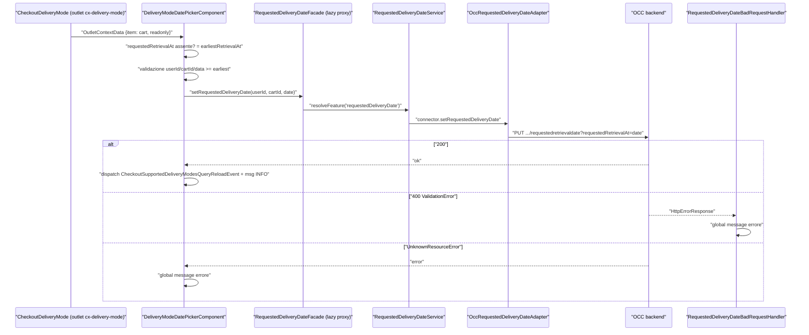
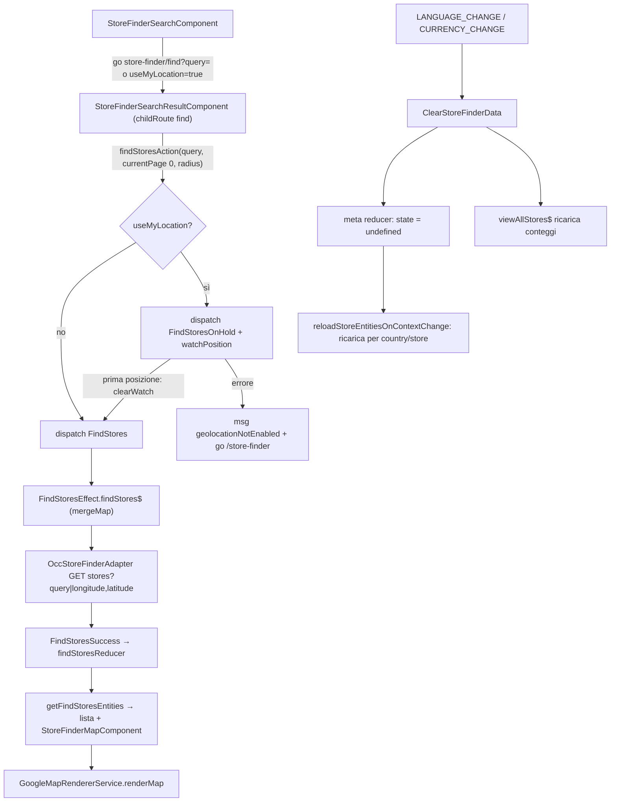

# 32 — Pickup in store, store finder, delivery date

> Riferimenti allo SHA `5b7a1c2bf2808d7380bc20596d10f4fa710c3da1` (vedi [00-meta](../00-meta.md)).

Prerequisiti consigliati: [12 — Feature module e lazy loading](../parte-2/12-feature-module-lazy.md), [17 — Outlet](../parte-2/17-outlet.md), [19 — State management](../parte-2/19-state-management.md), [20 — Facade, command & query, eventi](../parte-2/20-facade-command-query-eventi.md), [21 — Livello OCC](../parte-2/21-occ.md). Collegati: [25 — Carrello](../parte-2/25-cart.md), [26 — Checkout](../parte-2/26-checkout.md), [27 — Ordini](../parte-2/27-order.md), [11 — Configurazione](../parte-2/11-configurazione.md), [41 — Errori e global message](../parte-2/41-errori-global-message.md).

## 1. A cosa serve e perché esiste

Questo capitolo raccoglie quattro feature library che hanno in comune il tema "dove e quando arriva la merce":

| Libreria | Pacchetto | Cosa fa | Stato |
|---|---|---|---|
| `requested-delivery-date` (RDD) | `@spartacus/requested-delivery-date` | Permette di scegliere una data di consegna richiesta durante il checkout (step delivery mode) e la mostra nel riepilogo ordine | nessun NgRx, facade lazy + chiamata OCC diretta |
| `estimated-delivery-date` (EDD) | `@spartacus/estimated-delivery-date` | Mostra la data stimata di arrivo (arrival slots) sulle righe del carrello / ordine | nessun NgRx, solo un componente + un override degli endpoint carrello |
| `storefinder` | `@spartacus/storefinder` | Pagina "trova negozio": ricerca testuale o per geolocalizzazione, conteggi per paese/regione, dettaglio negozio, mappa Google | NgRx (`stores`) + facade lazy |
| `pickup-in-store` | `@spartacus/pickup-in-store` | "Ritiro in negozio" (BOPIS): scelta del negozio dal PDP e dal carrello, stock per negozio, negozio preferito, riepiloghi in checkout/conferma | NgRx (3 feature) + 4 facade lazy |

Le quattro librerie seguono lo schema classico delle feature lib descritto nel [capitolo 12](../parte-2/12-feature-module-lazy.md): un entry point `root` caricato eager (nomi feature, config CMS lazy, outlet, facade astratte, modelli augmentati) e un modulo "pesante" (core + occ + componenti) caricato on demand.

Il tratto comune più interessante è che **nessuna delle quattro modifica il codice del carrello o del checkout**: si agganciano tramite *outlet* esposti da cart/checkout/order (`CartOutlets.DELIVERY_MODE`, `CartOutlets.ORDER_OVERVIEW`, `CartOutlets.ITEM_DETAILS`, `CartOutlets.ITEM_DELIVERY_DETAILS`, `CartOutlets.ADD_TO_CART_PICKUP_OPTION`, …) (`feature-libs/cart/base/root/models/cart-outlets.model.ts:L10-L31`), tramite *module augmentation* dei modelli (`Cart`, `Order`, `OrderEntry`, `Consignment`) e tramite *override di configurazione* (endpoint OCC, dipendenze tra feature). Sono quindi un ottimo catalogo di tecniche di estensione "non invasive", e allo stesso tempo contengono parecchi casi limite che vale la pena conoscere (sezione 9).

In sintesi:

- **RDD**: un componente in outlet AFTER sul delivery mode del checkout chiama `RequestedDeliveryDateFacade.setRequestedDeliveryDate` → `PUT users/${userId}/carts/${cartId}/requestedretrievaldate?requestedRetrievalAt=…` (`feature-libs/requested-delivery-date/root/requested-delivery-date-root.module.ts:L35-L50`, `feature-libs/requested-delivery-date/occ/config/default-occ-requested-delivery-date-config.ts:L9-L18`).
- **EDD**: un componente in outlet AFTER su `CartOutlets.ITEM_DETAILS` legge `arrivalSlots` dall'entry; perché il backend li restituisca, la lib ridefinisce gli endpoint `carts`/`cart`/`createCart` aggiungendo `arrivalSlots` ai `fields` (`feature-libs/estimated-delivery-date/show-estimated-delivery-date/show-estimated-delivery-date.module.ts:L28-L35`, `feature-libs/estimated-delivery-date/show-estimated-delivery-date/config/default-occ-cart-with-edd.config.ts:L10-L28`).
- **Store finder**: un solo componente CMS (`StoreFinderComponent`) con *child routes* che montano i sotto-componenti; stato NgRx `stores` con due slice loader; rendering mappa via `GoogleMapRendererService` (`feature-libs/storefinder/components/store-finder-components.module.ts:L66-L99`, `feature-libs/storefinder/core/store/store-finder-state.ts:L10-L29`).
- **Pickup in store**: si dichiara dipendenza di `addToCart` e `cartBase` così da essere caricato prima di loro, sostituisce (REPLACE) gli outlet di "opzione di consegna" del PDP e del carrello, e apre un dialog di selezione negozio basato su stock (`feature-libs/pickup-in-store/root/pickup-in-store-root.module.ts:L39-L60`).

## 2. Mappa dei file

| Path | Ruolo |
|---|---|
| `feature-libs/requested-delivery-date/requested-delivery-date.module.ts` | `RequestedDeliveryDateModule` = Core + Occ (`:L11-L14`); i componenti stanno in `root`. |
| `feature-libs/requested-delivery-date/root/feature-name.ts` | `requestedDeliveryDate`, `requestedDeliveryDateCore` (`:L7-L8`). |
| `feature-libs/requested-delivery-date/root/requested-delivery-date-root.module.ts` | CMS config lazy + due `provideOutlet` AFTER (`:L18-L50`). |
| `feature-libs/requested-delivery-date/root/facade/requested-delivery-date.facade.ts` | Facade lazy con un solo metodo (`:L12-L32`). |
| `feature-libs/requested-delivery-date/root/model/augmented-core.model.ts` | Augmentation `Cart`/`Order` (`:L10-L21`). |
| `feature-libs/requested-delivery-date/root/components/delivery-mode-date-picker/delivery-mode-date-picker.component.ts` | Date picker nel delivery mode (`:L38-L180`). |
| `feature-libs/requested-delivery-date/root/components/order-overview-delivery-date/order-overview-delivery-date.component.ts` | Card read-only nell'order overview (`:L31-L61`). |
| `feature-libs/requested-delivery-date/root/components/shared/date-validation.service.ts` | Parsing/validazione date (`:L9-L52`). |
| `feature-libs/requested-delivery-date/core/requested-delivery-date-core.module.ts` | Service, alias facade, `HttpErrorHandler` multi, connector (`:L14-L29`). |
| `feature-libs/requested-delivery-date/core/http-interceptors/bad-request/requested-delivery-date-badrequest.handler.ts` | Handler 400 `ValidationError` (`:L17-L49`). |
| `feature-libs/requested-delivery-date/occ/adapters/occ-requested-delivery-date.adapter.ts` | `PUT` OCC (`:L25-L44`). |
| `feature-libs/estimated-delivery-date/estimated-delivery-date.module.ts` | Importa solo `ShowEstimatedDeliveryDateModule` (`:L10-L13`). |
| `feature-libs/estimated-delivery-date/root/estimated-delivery-date-root.module.ts` | Root module vuoto (`:L9-L10`). |
| `feature-libs/estimated-delivery-date/root/model/augmented-core.model.ts` | `OrderEntry.arrivalSlots`, `Consignment.arrivalSlot` (`:L11-L21`). |
| `feature-libs/estimated-delivery-date/show-estimated-delivery-date/show-estimated-delivery-date.module.ts` | Override endpoint + outlet `ITEM_DETAILS` (`:L28-L35`). |
| `feature-libs/estimated-delivery-date/show-estimated-delivery-date/config/default-occ-cart-with-edd.config.ts` | Endpoint carrello con `arrivalSlots` (`:L10-L28`). |
| `feature-libs/estimated-delivery-date/show-estimated-delivery-date/components/estimated-delivery-date.component.ts` | Componente EDD (`:L19-L74`). |
| `feature-libs/storefinder/root/store-finder-root.module.ts` | Layout, routing, CMS config lazy (`:L17-L38`). |
| `feature-libs/storefinder/root/config/default-store-finder-routing-config.ts` | Rotte semantiche `storeFinder*` (`:L9-L35`). |
| `feature-libs/storefinder/root/facade/store-finder.facade.ts` | Facade lazy `async: true` (`:L21-L73`). |
| `feature-libs/storefinder/root/model/store-entities.model.ts` | `StoreFinderOutlets.PREFERRED_STORE`, `StoreEntities` (`:L9-L15`). |
| `feature-libs/storefinder/core/config/default-store-finder-config.ts` | Default `googleMaps` (`:L9-L21`). |
| `feature-libs/storefinder/core/facade/store-finder.service.ts` | Service concreto, geolocalizzazione, reload su cambio contesto (`:L26-L259`). |
| `feature-libs/storefinder/core/service/google-map-renderer.service.ts` | Caricamento script Google Maps e marker (`:L44-L275`). |
| `feature-libs/storefinder/core/service/store-location.service.ts` | Lat/lng e link direzioni (`:L10-L41`). |
| `feature-libs/storefinder/core/store/**` | Azioni, effetti, reducer, selettori, stato `stores`. |
| `feature-libs/storefinder/occ/adapters/occ-store-finder.adapter.ts` | Adapter OCC (`:L36-L103`). |
| `feature-libs/storefinder/components/store-finder-components.module.ts` | Mapping CMS con `childRoutes` (`:L38-L99`). |
| `feature-libs/storefinder/components/**` | 13 componenti (search, result/list, grid, map, store, stores-count, …). |
| `feature-libs/pickup-in-store/root/pickup-in-store-root.module.ts` | CMS lazy + dipendenze di `addToCart`/`cartBase` (`:L23-L60`). |
| `feature-libs/pickup-in-store/root/facade/*.facade.ts` | 4 facade lazy (`IntendedPickupLocationFacade`, `PickupLocationsSearchFacade`, `PickupOptionFacade`, `PreferredStoreFacade`). |
| `feature-libs/pickup-in-store/root/model/augmented-core.model.ts` | `LAUNCH_CALLER.PICKUP_IN_STORE` (`:L9-L15`). |
| `feature-libs/pickup-in-store/core/pickup-in-store-core.module.ts` | Config, connector, facade providers, store (`:L14-L23`). |
| `feature-libs/pickup-in-store/core/store/**` | 3 feature NgRx: `pickup-locations`, `pickup-option`, `stock`. |
| `feature-libs/pickup-in-store/core/services/preferred-store.service.ts` | Negozio preferito (`:L32-L97`). |
| `feature-libs/pickup-in-store/occ/adapters/occ-stock.adapter.ts` | Stock per prodotto / per negozio (`:L35-L51`). |
| `feature-libs/pickup-in-store/components/container/**` | Container: PDP, carrello, dialog, store list/search, preferred store, riepiloghi. |
| `feature-libs/pickup-in-store/components/services/delivery-points.service.ts` | Raggruppa le entry pickup per negozio (`:L66-L160`). |
| `feature-libs/cart/base/components/add-to-cart/add-to-cart.component.ts` | Legge la scelta pickup al momento dell'add (`:L267-L287`). |
| `feature-libs/cart/base/occ/adapters/occ-cart-entry.adapter.ts` | `PUT` vs `PATCH` per pickup ↔ delivery (`:L86-L104`). |

### File aggiuntivi

| Path | Ruolo |
|---|---|
| `feature-libs/estimated-delivery-date/public_api.ts` | Entry point principale: riesporta `EstimatedDeliveryDateModule` e la public API di `show-estimated-delivery-date` (`:L10-L11`). |
| `feature-libs/estimated-delivery-date/assets/public_api.ts` | Entry point `assets`: riesporta le traduzioni (`:L7-L7`). |
| `feature-libs/estimated-delivery-date/_index.scss` | Entry Sass della lib: importa il core styles e `styles/index` (`:L1-L2`). |
| `feature-libs/estimated-delivery-date/styles/_index.scss` | Importa `_estimated-delivery-date.scss` (`:L1-L1`). |
| `feature-libs/estimated-delivery-date/styles/_estimated-delivery-date.scss` | Regole globali (non placeholder) per `cx-estimated-delivery-date` e `.cx-estimated-delivery-date-info` (`:L1-L23`). |
| `feature-libs/estimated-delivery-date/schematics/add-estimated-delivery-date/index.ts` | Factory `ng-add` `addEstimatedDeliveryDateFeature` (`:L25-L45`). |
| `feature-libs/estimated-delivery-date/schematics/add-estimated-delivery-date/index_spec.ts` | Test Jest dello schematic: lazy loading nel wrapper cart-base, nessuna feature user/order installata (`:L110-L126`). |
| `feature-libs/estimated-delivery-date/vitest.config.ts` | Config Vitest (jsdom, coverage v8, soglie 85/85/65/85) (`:L14-L47`). |
| `feature-libs/pickup-in-store/pickup-in-store.module.ts` | `PickupInStoreModule` = Components + Core + Occ (`:L12-L19`). |
| `feature-libs/pickup-in-store/public_api.ts` | Entry point principale: riferimento a `types.d.ts` e riesportazione del module (`:L14-L19`). |
| `feature-libs/pickup-in-store/_index.scss` | Entry Sass: definisce `$cx-color-link-primary` e importa core, modal, table e `styles/index` (`:L1-L7`). |
| `feature-libs/pickup-in-store/schematics/add-pickup-in-store/index.ts` | Factory `ng-add` `addPickupInStoreFeatures` (`:L25-L45`). |
| `feature-libs/pickup-in-store/schematics/add-pickup-in-store/index_spec.ts` | Test Jest dello schematic (senza feature, lazy, styling, eager) (`:L25-L144`). |
| `feature-libs/requested-delivery-date/public_api.ts` | Entry point principale: riesporta solo `RequestedDeliveryDateModule` (`:L10-L10`). |
| `feature-libs/requested-delivery-date/_index.scss` | Entry Sass: core + `styles/index` (`:L1-L2`). |
| `feature-libs/requested-delivery-date/styles/_index.scss` | Importa `_requested-delivery-date.scss` (`:L1-L1`). |
| `feature-libs/requested-delivery-date/styles/_requested-delivery-date.scss` | Regole globali per `cx-request-delivery-date` e per `.cx-review-card-shipping` del checkout (`:L1-L25`). |
| `feature-libs/requested-delivery-date/schematics/add-requested-delivery-date/index.ts` | Factory `ng-add` `addRequestedDeliveryDateFeature` (`:L25-L45`). |
| `feature-libs/requested-delivery-date/schematics/add-requested-delivery-date/index_spec.ts` | Test Jest dello schematic (`:L21-L131`). |
| `feature-libs/requested-delivery-date/vitest.config.ts` | Config Vitest (`:L14-L58`). |
| `feature-libs/storefinder/public_api.ts` | Entry point principale: riesporta `store-finder.module` (`:L10-L10`). |
| `feature-libs/storefinder/_index.scss` | Entry Sass: core + `styles/index` (`:L1-L2`). |
| `feature-libs/storefinder/schematics/add-storefinder/index.ts` | Factory `ng-add` `addStorefinderFeatures` (`:L25-L45`). |
| `feature-libs/storefinder/schematics/add-storefinder/index_spec.ts` | Test Jest dello schematic (`:L21-L125`). |
| `feature-libs/storefinder/vitest.config.ts` | Config Vitest con `resolve.alias` verso helper di test di core/storefront (`:L16-L22`). |

## 3. Come funziona passo per passo

### 3.1 Requested Delivery Date

**Wiring.** Il root module fa due cose: dichiara la config CMS lazy della feature `requestedDeliveryDate` (componenti `DeliveryModeDatePickerComponent` e `OrderOverviewDeliveryDateComponent`) mappando la feature core sulla principale — "by default core is bundled together with components" — e registra **eagerly** due outlet AFTER (`feature-libs/requested-delivery-date/root/requested-delivery-date-root.module.ts:L18-L50`). Gli outlet hanno id `cx-delivery-mode` e `cx-order-overview` (`feature-libs/cart/base/root/models/cart-outlets.model.ts:L23-L24`): il primo è renderizzato dal componente delivery mode del checkout (`feature-libs/checkout/base/components/checkout-delivery-mode/checkout-delivery-mode.component.html:L55-L55`), il secondo dall'order overview (`feature-libs/order/components/order-details/order-overview/order-overview.component.html:L43-L43`).

Particolarità: i componenti vivono nell'entry point `root` ("Make components available without being CMS driven") (`feature-libs/requested-delivery-date/root/public_api.ts:L7-L11`). Questo è necessario perché `provideOutlet` riceve direttamente la classe del componente, quindi il componente deve essere disponibile già nel bundle eager. Il modulo "pesante" `RequestedDeliveryDateModule` contiene solo core + OCC (`feature-libs/requested-delivery-date/requested-delivery-date.module.ts:L11-L14`).

**Facade.** `RequestedDeliveryDateFacade` è un facade lazy (`facadeFactory`) con un solo metodo, `setRequestedDeliveryDate(userId, cartId, requestedDate): Observable<{}>`, senza `async` (`feature-libs/requested-delivery-date/root/facade/requested-delivery-date.facade.ts:L12-L32`). Al primo uso il facade risolve la feature `requestedDeliveryDate`, il cui modulo core lega `RequestedDeliveryDateFacade → useExisting: RequestedDeliveryDateService` e registra un `HttpErrorHandler` multi (`feature-libs/requested-delivery-date/core/requested-delivery-date-core.module.ts:L14-L29`). Il service delega direttamente al connector, il connector all'adapter astratto (`feature-libs/requested-delivery-date/core/services/requested-delivery-date.service.ts:L19-L29`, `feature-libs/requested-delivery-date/core/connectors/requested-delivery-date.connector.ts:L17-L23`). Nessun NgRx, nessuna `Command`: la chiamata HTTP parte alla subscribe.

**Modello.** La lib augmenta `Cart` con `earliestRetrievalAt` e `requestedRetrievalAt` e `Order` con `requestedRetrievalAt` (stringhe) (`feature-libs/requested-delivery-date/root/model/augmented-core.model.ts:L10-L21`). La data minima arriva dal backend dentro il carrello.

**Componente picker.** `DeliveryModeDatePickerComponent` (selector `cx-request-delivery-date`) inietta facade, `DateValidationService`, `EventService`, `GlobalMessageService` e, opzionalmente, `OutletContextData` (`feature-libs/requested-delivery-date/root/components/delivery-mode-date-picker/delivery-mode-date-picker.component.ts:L38-L62`). Passi di `ngOnInit`:

1. si sottoscrive a `context$` dell'outlet e legge `context.item` (il cart) e `context.readonly` (`feature-libs/requested-delivery-date/root/components/delivery-mode-date-picker/delivery-mode-date-picker.component.ts:L74-L82`);
2. se c'è `earliestRetrievalAt` valido lo memorizza; se il cart ha già `requestedRetrievalAt` lo usa, altrimenti imposta `requestedRetrievalAt = earliestRetrievalAt` e chiama **subito** `setRequestedDeliveryDate()` — cioè apre la pagina e scrive sul backend (`feature-libs/requested-delivery-date/root/components/delivery-mode-date-picker/delivery-mode-date-picker.component.ts:L84-L99`).

`setRequestedDeliveryDate()` esce senza fare nulla se mancano userId, cartId o data, se la data non è valida o è precedente a `earliestRetrievalAt` (`feature-libs/requested-delivery-date/root/components/delivery-mode-date-picker/delivery-mode-date-picker.component.ts:L129-L145`). Altrimenti chiama il facade; al successo dispatcha `CheckoutSupportedDeliveryModesQueryReloadEvent` (la lista dei delivery mode può dipendere dalla data) e un global message INFO; in errore mostra un messaggio solo se nella risposta ci sono errori `UnknownResourceError` (`feature-libs/requested-delivery-date/root/components/delivery-mode-date-picker/delivery-mode-date-picker.component.ts:L146-L176`).

Il template mostra il picker solo se esiste `earliestRetrievalAt`; in modalità readonly mostra una `cx-card`, altrimenti `cx-date-picker` con `[min]="earliestRetrievalAt"` e `(update)="setRequestedDeliveryDate()"` (`feature-libs/requested-delivery-date/root/components/delivery-mode-date-picker/delivery-mode-date-picker.component.html:L1-L23`).

**Adapter OCC.** L'endpoint di default è `requestedDeliveryDate: 'users/${userId}/carts/${cartId}/requestedretrievaldate'` (`feature-libs/requested-delivery-date/occ/config/default-occ-requested-delivery-date-config.ts:L9-L18`), aggiunto a `OccEndpoints` via augmentation (`feature-libs/requested-delivery-date/occ/model/occ-requested-delivery-date-endpoints.model.ts:L9-L17`). `OccRequestedDeliveryDateAdapter` costruisce header form-urlencoded con `USE_CLIENT_TOKEN`, mette la data in query string (`requestedRetrievalAt`) e chiama `this.http.put(url, { headers })` (`feature-libs/requested-delivery-date/occ/adapters/occ-requested-delivery-date.adapter.ts:L25-L44`). Attenzione: in `HttpClient.put` il secondo argomento è il **body** (`angular:packages/common/http/src/client.ts:L4451-L4454`) — vedi trappola T1 in sezione 9.

**Errori.** Due percorsi distinti: `RequestedDeliveryDateBadRequestHandler` (globale, registrato come `HttpErrorHandler` multi) intercetta solo i 400 con errore `ValidationError` + messaggio `checkout.multi.requestedretrievaldatevalid.error`, priorità `NORMAL` (`feature-libs/requested-delivery-date/core/http-interceptors/bad-request/requested-delivery-date-badrequest.handler.ts:L20-L48`); il componente gestisce gli `UnknownResourceError`. Il meccanismo degli `HttpErrorHandler` è descritto nel [capitolo 41](../parte-2/41-errori-global-message.md).

**Order overview.** `OrderOverviewDeliveryDateComponent` legge l'ordine da `context.item` dell'outlet e mostra una card intitolata `requestedDeliveryDate.readOnlyTextLabel` (`feature-libs/requested-delivery-date/root/components/order-overview-delivery-date/order-overview-delivery-date.component.ts:L31-L61`).

**Date.** `DateValidationService` presume il formato `dd-mm-yyyy` e lo converte in `mm/dd/yyyy` con una regex prima di `new Date` (`feature-libs/requested-delivery-date/root/components/shared/date-validation.service.ts:L33-L35`); `isDateGreaterOrEqual` restituisce `false` se una delle due stringhe è vuota (`feature-libs/requested-delivery-date/root/components/shared/date-validation.service.ts:L43-L51`).

### 3.2 Estimated Delivery Date

**Wiring.** `EstimatedDeliveryDateRootModule` è un `@NgModule({})` vuoto (`feature-libs/estimated-delivery-date/root/estimated-delivery-date-root.module.ts:L9-L10`). La costante `estimatedDeliveryDate` esiste (`feature-libs/estimated-delivery-date/root/feature-name.ts:L7-L7`) ma la demo non la usa come feature lazy. Se la variabile `CX_ESTIMATED_DELIVERY_DATE` è attiva (`environment.estimatedDeliveryDate`, default `false`: `projects/storefrontapp/src/environments/environment.ts:L39-L39`), la demo aggiunge `EstimatedDeliveryDateModule` alle `extensions` di `CartBaseWrapperModule`, quindi l'EDD **viaggia nello stesso chunk del carrello** (`projects/storefrontapp/src/app/spartacus/features/cart/cart-base-wrapper.module.ts:L16-L18`); altrimenti non viene caricato. La stessa condizione governa `EstimatedDeliveryDateFeatureModule` (`projects/storefrontapp/src/app/spartacus/spartacus-features.module.ts:L167-L169`). Il feature module EDD della demo importa solo il root module vuoto e la config i18n (`projects/storefrontapp/src/app/spartacus/features/estimated-delivery-date/estimated-delivery-date-feature.module.ts:L18-L35`).

`EstimatedDeliveryDateModule` importa solo `ShowEstimatedDeliveryDateModule` (`feature-libs/estimated-delivery-date/estimated-delivery-date.module.ts:L10-L13`), che fa due cose (`feature-libs/estimated-delivery-date/show-estimated-delivery-date/show-estimated-delivery-date.module.ts:L28-L35`):

1. `provideDefaultConfig(defaultOccCartWithEddConfig)`: ridefinisce gli endpoint `carts`, `cart`, `createCart` aggiungendo `arrivalSlots` dentro `entries(...)` (`feature-libs/estimated-delivery-date/show-estimated-delivery-date/config/default-occ-cart-with-edd.config.ts:L10-L28`). L'endpoint `cart` di default della cart lib è identico tranne per l'assenza di `arrivalSlots` (`feature-libs/cart/base/occ/config/default-occ-cart-config-factory.ts:L17-L17`).
2. `provideOutlet` AFTER su `CartOutlets.ITEM_DETAILS` (`cx-cart-item.details`), renderizzato da `cart-item` e `cart-item-list-row` (`feature-libs/cart/base/components/cart-shared/cart-item-list-row/cart-item-list-row.component.html:L54-L54`, `feature-libs/cart/base/root/models/cart-outlets.model.ts:L13-L13`).

**Chi vince sugli endpoint?** Nel chunk lazy le `DefaultConfigChunk` vengono fuse in ordine con `deepMerge` dentro `ambientDefaultConfig`; la config unificata è poi `defaultConfig` < `ambientDefaultConfig` < `ambientConfig` < `rootConfig` (`core-libs/core/src/config/services/configuration.service.ts:L76-L100`). `deepMerge` sostituisce le stringhe (`core-libs/core/src/config/utils/deep-merge.ts:L31-L48`). Nella demo `CartBaseModule` (che tramite `CartBaseOccModule` fornisce `defaultOccCartConfigFactory`) è importato prima dell'EDD (`projects/storefrontapp/src/app/spartacus/features/cart/cart-base-wrapper.module.ts:L22-L25`, `feature-libs/cart/base/cart-base.module.ts:L12-L15`, `feature-libs/cart/base/occ/cart-base-occ.module.ts:L35-L35`), quindi la chunk EDD è più avanti nella lista e vince. ⚠️ DA VERIFICARE: che l'ordine dei provider `multi` nel module injector segua sempre l'ordine degli `imports` è un comportamento di Angular non riverificato qui per questo caso; e una `provideConfig` applicativa sugli stessi endpoint (rootConfig/ambientConfig) prevale comunque sull'EDD.

**Modello.** `ArrivalSlots {at?: Date; quantity?: number}`, `ArrivalSlot {at?: Date}` (`feature-libs/estimated-delivery-date/root/model/estimated-delivery-date.model.ts:L7-L13`); augmentation `OrderEntry.arrivalSlots?: ArrivalSlots[]` e `Consignment.arrivalSlot?: ArrivalSlot` (`feature-libs/estimated-delivery-date/root/model/augmented-core.model.ts:L11-L21`).

**Componente.** `EstimatedDeliveryDateComponent` usa `inject()`: `orderEntry$` è `cartItemContext?.item$ ?? EMPTY` (`feature-libs/estimated-delivery-date/show-estimated-delivery-date/components/estimated-delivery-date.component.ts:L25-L32`); `consignments$` appiattisce le consignment dell'ordine corrente (da `OrderHistoryFacade.getOrderDetails()`) con `switchMap` su array, emettendo una consignment alla volta (`feature-libs/estimated-delivery-date/show-estimated-delivery-date/components/estimated-delivery-date.component.ts:L34-L37`).

Il template (`feature-libs/estimated-delivery-date/show-estimated-delivery-date/components/estimated-delivery-date.component.html:L1-L56`):

- per ogni arrival slot dell'entry crea un testo `cx-visually-hidden` collegato con `aria-describedby` e i valori visibili `aria-hidden` (`:L4-L29`);
- se lo slot 0 non ha `quantity` mostra un riepilogo ETA con la data del primo slot (`:L30-L37`);
- in fallback mostra l'ETA della consignment solo se la consignment ha uno slot **e** l'entry non ne ha (`:L42-L56`);
- le date sono formattate con `cxDate: 'M/d/yyyy'`, formato fisso (`:L19-L22`).

### 3.3 Store finder — wiring e routing

`StoreFinderRootModule` fornisce layout config, routing config e la CMS config lazy con il solo `StoreFinderComponent` per la feature `storeFinder` (`feature-libs/storefinder/root/store-finder-root.module.ts:L17-L38`, `feature-libs/storefinder/root/feature-name.ts:L7-L7`). Il layout `StoreFinderPageTemplate` usa gli slot `MiddleContent`, `SideContent` (`feature-libs/storefinder/root/config/default-store-finder-layout-config.ts:L9-L15`). Le rotte semantiche sono `storeFinder`, `storeFinderFind`, `storeFinderViewAll`, `storeFinderCountry`, `storeFinderRegion`, `storeFinderStore` (quest'ultima con due path) (`feature-libs/storefinder/root/config/default-store-finder-routing-config.ts:L9-L35`).

La navigazione interna non passa da pagine CMS diverse: il componente CMS `StoreFinderComponent` dichiara `childRoutes` che montano i sotto-componenti (`find` → `StoreFinderSearchResultComponent`, `view-all` → `StoreFinderStoresCountComponent`, `country/:country` e `country/:country/region/:region` → `StoreFinderGridComponent`, i due path con `:store` → `StoreFinderStoreComponent`) (`feature-libs/storefinder/components/store-finder-components.module.ts:L66-L99`). Il componente stesso è solo un guscio con header e `<router-outlet />` (`feature-libs/storefinder/components/store-finder/store-finder.component.html:L1-L4`). Il meccanismo `childRoutes` è spiegato nel [capitolo 16](../parte-2/16-cms-rendering.md) e nel [capitolo 14](../parte-2/14-routing.md).

`StoreFinderComponentsModule` importa **di nuovo** `StoreFinderCoreModule` (`feature-libs/storefinder/components/store-finder-components.module.ts:L38-L65`), oltre a `StoreFinderModule` che importa Core, Occ e Components (`feature-libs/storefinder/store-finder.module.ts:L12-L19`): nessun danno (NgModule deduplica), ma è utile saperlo se si compone il modulo a mano.

### 3.4 Store finder — facade, service, NgRx

**Facade.** `StoreFinderFacade` è `async: true` e proxa 10 metodi; i tre deprecati (`getStoreLatitude`, `getStoreLongitude`, `getDirections`) sono dichiarati astratti ma **non** compaiono nella lista `methods` (`feature-libs/storefinder/root/facade/store-finder.facade.ts:L21-L72`). `FacadeFactoryService` crea proprietà solo per i metodi elencati, e con `async` aggiunge un `delay(0)` alla risoluzione (`core-libs/core/src/lazy-loading/facade-factory/facade-factory.service.ts:L53-L55`, `core-libs/core/src/lazy-loading/facade-factory/facade-factory.service.ts:L109-L125`). Il core lega `StoreFinderFacade → useExisting: StoreFinderService` (`feature-libs/storefinder/core/facade/facade-providers.ts:L11-L14`).

**Stato.** Chiave NgRx `stores`, entity type loader `'[StoreFinder] Store Finder Data'`, stato `{findStores, viewAllStores}` entrambi `LoaderState` (`feature-libs/storefinder/core/store/store-finder-state.ts:L10-L29`). `StoreFinderStoreModule` registra `StoreModule.forFeature('stores', reducerToken, {metaReducers})` ed `EffectsModule.forFeature(effects)` (`feature-libs/storefinder/core/store/store-finder-store.module.ts:L17-L27`). Entrambi i sotto-reducer sono avvolti in `loaderReducer` con **lo stesso** entity type (`feature-libs/storefinder/core/store/reducers/index.ts:L21-L29`); `loaderReducer` reagisce a ogni azione con `meta.entityType` uguale (`core-libs/core/src/state/utils/loader/loader.reducer.ts:L32-L60`) — vedi T9.

**Ricerca.** `StoreFinderService.findStoresAction(...)` (`feature-libs/storefinder/core/facade/store-finder.service.ts:L106-L153`):

- senza `useMyLocation` dispatcha direttamente `FindStores` (azione loader "load");
- con `useMyLocation` dispatcha `FindStoresOnHold` (stato loading), avvia `navigator.geolocation.watchPosition` e alla prima posizione dispatcha `FindStores` con `longitudeLatitude`; in errore mostra il global message `storeFinder.geolocationNotEnabled` e naviga a `/store-finder`.

Tutte le dispatch passano da `clearWatchGeolocation`, che chiude l'eventuale watch attivo (`feature-libs/storefinder/core/facade/store-finder.service.ts:L172-L180`).

`FindStoresEffect.findStores$` usa `mergeMap`, chiama il connector e, se c'è `countryIsoCode`, filtra gli store per paese **lato client** e li ordina per `name` (`feature-libs/storefinder/core/store/effects/find-stores.effect.ts:L24-L62`); `findStoreById$` usa `switchMap` (`feature-libs/storefinder/core/store/effects/find-stores.effect.ts:L64-L84`). Il reducer salva il payload di `FIND_STORES_SUCCESS` in `findStoresEntities` e quello di `FIND_STORE_BY_ID_SUCCESS` in `findStoreEntityById` (`feature-libs/storefinder/core/store/reducers/find-stores.reducer.ts:L10-L33`).

**Conteggi.** `viewAllStores$` reagisce a `VIEW_ALL_STORES` **e** a `CLEAR_STORE_FINDER_DATA`, carica i conteggi e li ordina per nome (`feature-libs/storefinder/core/store/effects/view-all-stores.effect.ts:L28-L55`).

**Cambio contesto.** `clearStoreFinderData$` mappa `LANGUAGE_CHANGE` e `CURRENCY_CHANGE` in `ClearStoreFinderData` (`feature-libs/storefinder/core/store/effects/view-all-stores.effect.ts:L57-L68`); il meta reducer `clearStoreFinderState` azzera lo stato su `LANGUAGE_CHANGE` e `CLEAR_STORE_FINDER_DATA` (`feature-libs/storefinder/core/store/reducers/index.ts:L39-L53`). A quel punto `StoreFinderService.reloadStoreEntitiesOnContextChange()` — avviato nel costruttore, solo in browser o senza `platformId` — vede entità vuote e non in caricamento, e ricarica per `country` o per `store` leggendo i route params (`feature-libs/storefinder/core/facade/store-finder.service.ts:L191-L213`). `callFindStoresAction` cerca con query vuota, `pageSize: -1` e il paese dai route params (`feature-libs/storefinder/core/facade/store-finder.service.ts:L215-L224`).

**OCC.** Endpoint: `store: 'stores/${storeId}?fields=FULL'`, `stores: 'stores?fields=stores(...),pagination(DEFAULT),sorts(DEFAULT)'`, `storescounts: 'stores/storescounts'` (`feature-libs/storefinder/occ/adapters/default-occ-store-finder-config.ts:L9-L20`). `callOccFindStores` invia `longitude`/`latitude` **al posto** di `query` se c'è una posizione, e aggiunge `radius`, `pageSize`, `currentPage`, `sort` solo se truthy (`feature-libs/storefinder/occ/adapters/occ-store-finder.adapter.ts:L71-L103`). `search` converte con `STORE_FINDER_SEARCH_PAGE_NORMALIZER`, `loadCounts` estrae `countriesAndRegionsStoreCount` e applica `STORE_COUNT_NORMALIZER`, `load` usa `POINT_OF_SERVICE_NORMALIZER` del core (`feature-libs/storefinder/occ/adapters/occ-store-finder.adapter.ts:L36-L69`). Il connector rinomina `getCounts()` → `loadCounts()` e `get(id)` → `load(id)` (`feature-libs/storefinder/core/connectors/store-finder.connector.ts:L26-L32`).

### 3.5 Store finder — componenti e Google Maps

- `StoreFinderSearchComponent` naviga a `store-finder/find` con query param `query` o `useMyLocation: true` (`feature-libs/storefinder/components/store-finder-search/store-finder-search.component.ts:L47-L61`); il template ha due varianti governate da `*cxFeature="'a11yStoreFinderLabel'"` (`feature-libs/storefinder/components/store-finder-search/store-finder-search.component.html:L2-L2`).
- `StoreFinderSearchResultComponent` a ogni cambio di `queryParams` ricalcola la ricerca con `currentPage: 0` e `radius = googleMaps.radius`, chiamando `findStoresAction` (`feature-libs/storefinder/components/store-finder-search-result/store-finder-search-result.component.ts:L52-L92`); `viewPage` riesegue con la nuova pagina (`feature-libs/storefinder/components/store-finder-search-result/store-finder-search-result.component.ts:L64-L74`).
- `StoreFinderListComponent` alterna lista/mappa, centra la mappa sullo store cliccato, scrolla all'item selezionato dalla mappa (`feature-libs/storefinder/components/store-finder-search-result/store-finder-list/store-finder-list.component.ts:L85-L122`); con toggle `a11yStoreFinderFocusOnBackButton` un `effect()` sul signal `viewChild` sposta il focus sul back button (`feature-libs/storefinder/components/store-finder-search-result/store-finder-list/store-finder-list.component.ts:L68-L83`).
- `StoreFinderMapComponent` chiama il renderer a ogni `ngOnChanges` di `locations` e riemette l'indice del marker cliccato (`feature-libs/storefinder/components/store-finder-map/store-finder-map.component.ts:L33-L60`).
- `StoreFinderGridComponent` (OnPush) su init chiama `callFindStoresAction(route.snapshot.params)` se c'è `country` (`feature-libs/storefinder/components/store-finder-grid/store-finder-grid.component.ts:L41-L52`); `StoreFinderStoreComponent` carica lo store da `route.snapshot.params.store` se non riceve `@Input() location` (`feature-libs/storefinder/components/store-finder-store/store-finder-store.component.ts:L46-L56`); `StoreFinderStoresCountComponent` dispatcha `viewAllStores()` (`feature-libs/storefinder/components/store-finder-stores-count/store-finder-stores-count.component.ts:L41-L50`).
- `StoreFinderListItemComponent` espone l'outlet `StoreFinderOutlets.PREFERRED_STORE` (`cx-pick-up-in-store-make-my-store`) con contesto `{displayName, name}` (`feature-libs/storefinder/components/store-finder-list-item/store-finder-list-item.component.html:L41-L47`, `feature-libs/storefinder/root/model/store-entities.model.ts:L9-L15`): è il punto in cui pickup-in-store inietta il bottone "imposta come negozio preferito".

**`GoogleMapRendererService.renderMap`** (`feature-libs/storefinder/core/service/google-map-renderer.service.ts:L44-L68`):

1. senza `googleMaps.apiKey` esce (con `warn` solo in dev mode);
2. esce se `locations[0]` è un oggetto vuoto;
3. se la mappa non esiste ancora carica lo script (`embedMapScript`), altrimenti ridisegna.

`embedMapScript` invia la chiave vuota se è il valore speciale `'cx-development'` (`GOOGLE_MAPS_DEVELOPMENT_KEY_CONFIG`, `feature-libs/storefinder/root/config/constants.ts:L7-L7`), e carica lo script con `ScriptLoader.embedScript` (`feature-libs/storefinder/core/service/google-map-renderer.service.ts:L82-L116`). Con il toggle `useGoogleMapsAsyncLoading` aggiunge `loading: 'async'` + un `callback` globale; con `useAdvancedGoogleMarkers` aggiunge `libraries: 'marker'` (`feature-libs/storefinder/core/service/google-map-renderer.service.ts:L87-L108`). Il callback globale ha nome univoco `__spartacusGoogleMapsInit_<n>`, si auto-cancella e non viene registrato se `document.defaultView` è null (SSR) (`feature-libs/storefinder/core/service/google-map-renderer.service.ts:L125-L142`). `initMap` usa `gestureHandling: 'greedy'`, `zoom = googleMaps.scale` e `mapId` solo con advanced markers (`feature-libs/storefinder/core/service/google-map-renderer.service.ts:L175-L193`). Advanced markers: `PinElement` con `glyphText` numerico, evento `gmp-click`, store senza geolocazione saltati (`feature-libs/storefinder/core/service/google-map-renderer.service.ts:L204-L250`); il ramo legacy usa `google.maps.Marker` e i metodi deprecati di `StoreFinderService` (`feature-libs/storefinder/core/service/google-map-renderer.service.ts:L251-L275`).

La demo usa la chiave speciale per mostrare la mappa senza chiave ("for development or demo purposes") (`projects/storefrontapp/src/app/private/private.providers.ts:L46-L49`).

### 3.6 Pickup in store — wiring

`PickupInStoreRootModule` (`feature-libs/pickup-in-store/root/pickup-in-store-root.module.ts:L23-L60`):

1. CMS lazy per la feature `pickupInStore`: `CheckoutReviewPickup`, `MyPreferredStoreComponent`, `OrderConfirmationPickUpComponent`, `PickupInStoreDeliveryModeComponent`; `pickupInStoreCore` → `pickupInStore`;
2. aggiunge `pickupInStore` alle `dependencies` delle feature `ADD_TO_CART_FEATURE` e `CART_BASE_FEATURE` ("make pickup lib loaded before add-to-cart" / "before cart base"). Così, quando la feature add-to-cart o cart-base viene caricata, il chunk pickup è già caricato e i suoi `provideOutlet` (REPLACE) sono registrati.

Inoltre il root augmenta **a runtime** l'enum `LAUNCH_CALLER` con `PICKUP_IN_STORE` (dichiarazione TypeScript + assegnazione) (`feature-libs/pickup-in-store/root/model/augmented-core.model.ts:L9-L15`). I modelli principali: `PickupOption = 'delivery' | 'pickup'`, `AugmentedPointOfService = PointOfService & {pickupOption}` (`feature-libs/pickup-in-store/root/model/pickup-option.model.ts:L9-L15`); `StockLocationSearchParams = {productCode} & ({latitude, longitude} | {location})` (`feature-libs/pickup-in-store/root/model/stock-location-search-params.model.ts:L7-L26`). La chiave localStorage del negozio preferito è `preferred_store` (`feature-libs/pickup-in-store/root/pickup-in-store-constants.ts:L7-L8`).

Quattro facade lazy `async: true` sulla feature `pickupInStoreCore` (`feature-libs/pickup-in-store/root/facade/intended-pickup-location.facade.ts:L19-L34`, `feature-libs/pickup-in-store/root/facade/pickup-locations-search.facade.ts:L22-L45`, `feature-libs/pickup-in-store/root/facade/pickup-option.facade.ts:L13-L27`, `feature-libs/pickup-in-store/root/facade/preferred-store.facade.ts:L16-L30`), legate ai service via `useExisting` (`feature-libs/pickup-in-store/core/facade/facade-providers.ts:L19-L37`). `PickupInStoreCoreModule` fornisce config, `StockConnector`, `PickupLocationConnector`, facade providers e lo store module (`feature-libs/pickup-in-store/core/pickup-in-store-core.module.ts:L14-L23`).

### 3.7 Pickup in store — stato NgRx

Tre feature NgRx: `pickup-locations`, `pickup-option`, `stock` (`feature-libs/pickup-in-store/core/store/pickup-in-store-store.module.ts:L29-L53`).

| Feature | Forma | Riferimento |
|---|---|---|
| `pickup-locations` | `{defaultPointOfService, intendedPickupLocations (per productCode), storeDetails (per nome)}` | `feature-libs/pickup-in-store/core/store/pickup-location-state.ts:L19-L27` |
| `pickup-option` | `{pageContext: string, pickupOption: {entryNumber, pickupOption}[]}` | `feature-libs/pickup-in-store/core/store/pickup-option-state.ts:L15-L23` |
| `stock` | `{browserLocation, hideOutOfStock, stockLevel: LoaderState<Record<productCode, …>>, stockLevelAtStore}` | `feature-libs/pickup-in-store/core/store/stock-state.ts:L21-L28` |

Punti salienti:

- `intendedPickupLocationsReducer`: `AddLocation` sostituisce, `RemoveLocation` scrive `{pickupOption: 'delivery'}` invece di cancellare, `SetPickupOption` fonde il pickupOption (`feature-libs/pickup-in-store/core/store/reducers/pickup-locations/pickup-locations.reducer.ts:L14-L31`).
- `pickupOptionReducer`: `RemovePickupOption` rimuove e decrementa gli `entryNumber` successivi, rispecchiando la rinumerazione delle entry del carrello (`feature-libs/pickup-in-store/core/store/reducers/pickup-option/pickup-option.reducer.ts:L13-L42`).
- Il meta reducer `clearStockState`, su `CLEAR_STOCK_DATA`, passa `undefined` al reducer, che quindi riporta tutta la feature `stock` allo stato iniziale (`feature-libs/pickup-in-store/core/store/reducers/stock/index.ts:L42-L54`).
- `stockAtStoreReducer` scrive `[productCode]: { [storeName]: stockLevel }`, sostituendo l'intero oggetto del prodotto (`feature-libs/pickup-in-store/core/store/reducers/stock/stock-level.reducer.ts:L45-L51`).
- `getPickupOptionByProductCode` restituisce `'delivery'` come default (`feature-libs/pickup-in-store/core/store/selectors/pickup-locations.selectors.ts:L48-L55`); `getStoresWithStockForProductCode` filtra con `storeHasStock` solo se `hideOutOfStock` è true (`feature-libs/pickup-in-store/core/store/selectors/stock.selectors.ts:L61-L71`); `isInStock` considera non disponibili sia `outOfStock` sia `lowStock` (`feature-libs/pickup-in-store/core/utils/utils.ts:L9-L19`).

Effetti:

- `StockEffect.loadStockLevels$` (`switchMap`): separa `productCode` dal resto dei parametri, chiama `GET products/${productCode}/stock` con `location` o `latitude/longitude` + `fields: 'FULL'`, errore → `StockLevelFail` (`feature-libs/pickup-in-store/core/store/effects/stock.effect.ts:L26-L49`, `feature-libs/pickup-in-store/occ/adapters/occ-stock.adapter.ts:L35-L51`).
- `loadStockLevelAtStore$` (`concatMap`) **senza** `catchError` (`feature-libs/pickup-in-store/core/store/effects/stock.effect.ts:L51-L65`).
- `PickupLocationEffect.storeDetails$` (`mergeMap`) → `SetStoreDetailsSuccess`/`SetStoreDetailsFailure` (`feature-libs/pickup-in-store/core/store/effects/pickup-location.effect.ts:L26-L51`); `SetStoreDetailsFailure` è un wrapper che aggiunge all'azione la proprietà `error` (uguale a `payload`) per farsi riconoscere da `CxErrorHandlerEffect` (`feature-libs/pickup-in-store/core/store/actions/pickup-location.action.ts:L83-L102`).
- `loadDefaultPointOfService$`: se il profilo utente ha `defaultPointOfServiceName` usa quello (con `displayName: ''`), altrimenti legge `preferred_store` dal localStorage; in errore emette uno store vuoto (`feature-libs/pickup-in-store/core/store/effects/default-point-of-service-name.effect.ts:L39-L81`).
- `setDefaultPointOfService$`: salva in localStorage, aggiorna il profilo (`defaultPointOfServiceName`), e termina sempre con `LoadDefaultPointOfService()` (`feature-libs/pickup-in-store/core/store/effects/default-point-of-service-name.effect.ts:L83-L107`).

### 3.8 Pickup in store — flussi UI

**Outlet registrati** (`feature-libs/pickup-in-store/components/container/cart-pickup-options-container/cart-pickup-options-container.module.ts:L23-L27`, `feature-libs/pickup-in-store/components/container/pdp-pickup-options-container/pdp-pickup-options-container.module.ts:L23-L27`, `feature-libs/pickup-in-store/components/container/pickup-info-container/pickup-info-container.module.ts:L19-L23`, `feature-libs/pickup-in-store/components/container/pickup-in-store-order-consignment/pickup-in-store-order-consignment-container.module.ts:L22-L26`, `feature-libs/pickup-in-store/components/container/set-preferred-store/set-preferred-store.module.ts:L28-L32`):

| Outlet | Posizione | Componente |
|---|---|---|
| `CartOutlets.ITEM_DELIVERY_DETAILS` | REPLACE | `CartPickupOptionsContainerComponent` |
| `CartOutlets.ADD_TO_CART_PICKUP_OPTION` | REPLACE | `PdpPickupOptionsContainerComponent` |
| `CartOutlets.PICKUP_INFO` | REPLACE | `PickupInfoContainerComponent` |
| `OrderOutlets.ORDER_CONSIGNMENT` | AFTER | container consignment |
| `StoreFinderOutlets.PREFERRED_STORE` | REPLACE | `SetPreferredStoreComponent` |

Il dialog è registrato nella layout config: `PICKUP_IN_STORE` → `PickupOptionDialogComponent`, `inlineRoot: true`, `DIALOG_TYPE.DIALOG` (`feature-libs/pickup-in-store/components/container/pickup-option-dialog/pickup-option-dialog-layout.config.ts:L10-L18`).

**PDP + add to cart.** `AddToCartComponent` rende l'outlet `ADD_TO_CART_PICKUP_OPTION` con `cxComponentRef` e, al click, legge `intendedPickupLocation$` dell'istanza del componente PDP: se `pickupOption === 'pickup'` passa il nome del negozio come `pickupStore` ad `addEntry` (`feature-libs/cart/base/components/add-to-cart/add-to-cart.component.html:L23-L28`, `feature-libs/cart/base/components/add-to-cart/add-to-cart.component.ts:L267-L287`). L'add to cart viene disabilitato se l'opzione è pickup ma manca `displayName` (`feature-libs/cart/base/components/add-to-cart/add-to-cart.component.ts:L321-L335`). Il container PDP imposta il pageContext `'PDP'` e, se non c'è un'intended location con `displayName`, propone il negozio preferito con stock come `pickupOption: 'delivery'` (`feature-libs/pickup-in-store/components/container/pdp-pickup-options-container/pdp-pickup-options-container.component.ts:L85-L173`). Sul PDP il cambio opzione aggiorna solo lo stato intended (`feature-libs/pickup-in-store/components/container/pdp-pickup-options-container/pdp-pickup-options-container.component.ts:L188-L196`).

**Dialog.** Entrambi i container aprono il dialog con `LAUNCH_CALLER.PICKUP_IN_STORE` passando productCode (e entryNumber/quantity nel carrello) (`feature-libs/pickup-in-store/components/container/cart-pickup-options-container/cart-pickup-options-container.component.ts:L295-L310`). Nel dialog la ricerca chiama `startSearch` (→ `StockLevel`) (`feature-libs/pickup-in-store/components/container/pickup-option-dialog/pickup-option-dialog.component.ts:L140-L145`); `StoreListComponent.onSelectStore` toglie `stockInfo` e imposta l'intended location con `pickupOption: 'pickup'` (`feature-libs/pickup-in-store/components/container/store-list/store-list.component.ts:L67-L76`). La chiusura con selezione, **solo fuori dal PDP**, aggiorna l'entry con `updateEntry(entryNumber, quantity, name, false)` (`feature-libs/pickup-in-store/components/container/pickup-option-dialog/pickup-option-dialog.component.ts:L171-L192`). Click sull'host chiude senza selezione (`feature-libs/pickup-in-store/components/container/pickup-option-dialog/pickup-option-dialog.component.ts:L93-L100`).

**Carrello.** Il container carrello imposta il pageContext dall'id della pagina CMS e l'opzione corrente dall'esistenza di `deliveryPointOfService` sull'entry (`feature-libs/pickup-in-store/components/container/cart-pickup-options-container/cart-pickup-options-container.component.ts:L128-L163`). Cambio opzione: `delivery` → `updateEntry(entry, qty, undefined, true)`; `pickup` → `updateEntry(entry, qty, name, true)` con il nome da `storeDetails$` (`feature-libs/pickup-in-store/components/container/cart-pickup-options-container/cart-pickup-options-container.component.ts:L255-L289`). Nell'adapter OCC del carrello `pickupStore === undefined && pickupToDelivery` produce un `PUT` con sola quantity; altrimenti un `PATCH` con `deliveryPointOfService` (`feature-libs/cart/base/occ/adapters/occ-cart-entry.adapter.ts:L86-L104`). Il container è nascosto per entry di un ordine e per `CartType.SELECTIVE` (`feature-libs/pickup-in-store/components/container/cart-pickup-options-container/cart-pickup-options-container.component.html:L1-L7`), e i controlli sono disabilitati se lo stesso prodotto compare in più entry (`feature-libs/pickup-in-store/components/container/cart-pickup-options-container/cart-pickup-options-container.component.ts:L165-L177`).

**Riepiloghi.** Le tre CMS component di riepilogo (`CheckoutReviewPickup`, `OrderConfirmationPickUpComponent`, `PickupInStoreDeliveryModeComponent`) sono tutte `PickUpItemsDetailsComponent` con `data` diversa (`feature-libs/pickup-in-store/components/container/pickup-items-details/pickup-items-details.module.ts:L33-L57`); il componente sceglie ordine o carrello in base a `data.context === 'order'` (`feature-libs/pickup-in-store/components/container/pickup-items-details/pickup-items-details.component.ts:L58-L72`). `DeliveryPointsService` raggruppa le entry pickup per negozio, carica i dettagli di ogni negozio e combina i risultati (`feature-libs/pickup-in-store/components/services/delivery-points.service.ts:L66-L160`).

**Negozio preferito.** `SetPreferredStoreComponent` riceve i nomi dal contesto outlet e chiama `setPreferredStore` (`feature-libs/pickup-in-store/components/container/set-preferred-store/set-preferred-store.component.ts:L42-L57`). `PreferredStoreService` dispatcha `LoadDefaultPointOfService()` nel costruttore (`feature-libs/pickup-in-store/core/services/preferred-store.service.ts:L32-L41`); `getPreferredStoreWithProductInStock` richiede lo stock al negozio preferito ed emette solo se `isInStock` (`feature-libs/pickup-in-store/core/services/preferred-store.service.ts:L73-L97`). `MyPreferredStoreComponent` carica i dettagli del preferito e sulla pagina `storefinderPage` mostra solo l'azione "Get Directions" (`feature-libs/pickup-in-store/components/container/my-preferred-store/my-preferred-store.component.ts:L100-L164`).

Nella demo il pickup-in-store è aggiunto solo nel ramo non-B2B (`projects/storefrontapp/src/app/spartacus/spartacus-features.module.ts:L117-L129`).

### 3.9 Packaging: schematics, stili, test

**Schematics `ng-add`.** Le quattro factory sono identiche salvo il nome: validano l'installazione Spartacus da `package.json`, espandono le feature richieste con `analyzeCrossFeatureDependencies` e concatenano `analyzeApplication` → `addFeatures` → `addPackageJsonDependenciesForLibrary(peerDependencies)` → `finalizeInstallation` (`feature-libs/estimated-delivery-date/schematics/add-estimated-delivery-date/index.ts:L25-L45`, `feature-libs/pickup-in-store/schematics/add-pickup-in-store/index.ts:L25-L45`, `feature-libs/requested-delivery-date/schematics/add-requested-delivery-date/index.ts:L25-L45`, `feature-libs/storefinder/schematics/add-storefinder/index.ts:L25-L45`). Il test EDD verifica che il modulo lazy finisca nel wrapper `cart-base` e che **non** vengano creati i feature module user/order (`feature-libs/estimated-delivery-date/schematics/add-estimated-delivery-date/index_spec.ts:L110-L126`), coerente con la T10 (EDD viaggia col chunk del carrello).

**Stili globali vs allowlist.** Pickup-in-store e storefinder usano placeholder + allowlist (vedi sezione 8), mentre RDD ed EDD scrivono regole dirette sui selettori: `$skipComponentStyles` non ha effetto su di esse (`feature-libs/requested-delivery-date/styles/_requested-delivery-date.scss:L1-L25`, `feature-libs/estimated-delivery-date/styles/_estimated-delivery-date.scss:L1-L23`). In particolare RDD azzera il `padding-bottom` delle card dentro `.cx-review-card-shipping`, classe del riepilogo checkout definita fuori dalla lib (`feature-libs/requested-delivery-date/styles/_requested-delivery-date.scss:L15-L25`, `feature-libs/checkout/base/components/checkout-review-submit/checkout-review-submit.component.html:L58-L58`): importare gli stili RDD cambia la review anche quando il date picker non è presente. Il root `_index.scss` del pickup assegna `$cx-color-link-primary: #1672b7` senza `!default` prima degli import, quindi un valore impostato prima dall'app viene sovrascritto (`feature-libs/pickup-in-store/_index.scss:L1-L7`, `feature-libs/pickup-in-store/styles/_store.scss:L29-L29`).

**Test.** Le tre config Vitest condividono forks/jsdom/`setup-vitest.ts` e soglie 85/85/65/85; storefinder aggiunge alias di path per gli helper di test importati con path relativi alla root (`feature-libs/storefinder/vitest.config.ts:L16-L22`, `feature-libs/storefinder/vitest.config.ts:L51-L56`, `feature-libs/requested-delivery-date/vitest.config.ts:L42-L47`, `feature-libs/estimated-delivery-date/vitest.config.ts:L41-L46`).

## 4. Diagrammi

### 4.1 RDD: dal delivery mode al backend



### 4.2 Store finder: ricerca e cambio contesto



### 4.3 Pickup: dal PDP al carrello

```mermaid
sequenceDiagram
    participant ATC as "AddToCartComponent"
    participant PDP as "PdpPickupOptionsContainerComponent (outlet REPLACE)"
    participant DLG as "PickupOptionDialogComponent"
    participant ST as "Store NgRx (stock, pickup-locations)"
    participant CART as "ActiveCartFacade"
    ATC->>PDP: "cxOutlet ADD_TO_CART_PICKUP_OPTION (cxComponentRef)"
    PDP->>ST: "setPageContext('PDP'); preferito con stock → intended 'delivery'"
    PDP->>DLG: "openDialog(LAUNCH_CALLER.PICKUP_IN_STORE, {productCode})"
    DLG->>ST: "startSearch → StockLevel → GET products/{code}/stock"
    ST-->>DLG: "getStoresWithStockForProductCode"
    DLG->>ST: "onSelectStore → setIntendedLocation(..., 'pickup')"
    DLG->>DLG: "close(LOCATION_SELECTED): isPDP → nessun updateEntry"
    ATC->>PDP: "intendedPickupLocation$ take(1)"
    ATC->>CART: "addEntry(productCode, qty, pickupStore)"
```

## 5. Estratti di codice reale

### 5.1 RDD: outlet eager e CMS lazy

`feature-libs/requested-delivery-date/root/requested-delivery-date-root.module.ts:L18-L50`

```ts
export function defaultRequestedDeliveryDateComponentsConfig(): CmsConfig {
  const config: CmsConfig = {
    featureModules: {
      [REQUESTED_DELIVERY_DATE_FEATURE]: {
        cmsComponents: [
          'DeliveryModeDatePickerComponent',
          'OrderOverviewDeliveryDateComponent',
        ],
      },
      // by default core is bundled together with components
      [REQUESTED_DELIVERY_DATE_CORE_FEATURE]: REQUESTED_DELIVERY_DATE_FEATURE,
    },
  };

  return config;
}

@NgModule({
  providers: [
    provideOutlet({
      id: CartOutlets.DELIVERY_MODE,
      position: OutletPosition.AFTER,
      component: DeliveryModeDatePickerComponent,
    }),
    provideOutlet({
      id: CartOutlets.ORDER_OVERVIEW,
      position: OutletPosition.AFTER,
      component: OrderOverviewDeliveryDateComponent,
    }),
    provideDefaultConfigFactory(defaultRequestedDeliveryDateComponentsConfig),
  ],
})
export class RequestedDeliveryDateRootModule {}
```

### 5.2 RDD: adapter OCC

`feature-libs/requested-delivery-date/occ/adapters/occ-requested-delivery-date.adapter.ts:L25-L44`

```ts
  setRequestedDeliveryDate(
    userId: string,
    cartId: string,
    requestedRetrievalAt: string
  ) {
    let headers = new HttpHeaders({
      'Content-Type': 'application/x-www-form-urlencoded',
    });
    headers = InterceptorUtil.createHeader(USE_CLIENT_TOKEN, true, headers);

    const url = this.occEndpoints.buildUrl('requestedDeliveryDate', {
      urlParams: {
        userId,
        cartId,
      },
      queryParams: { requestedRetrievalAt },
    });

    return this.http.put(url, { headers });
  }
```

### 5.3 RDD: scrittura automatica all'init

`feature-libs/requested-delivery-date/root/components/delivery-mode-date-picker/delivery-mode-date-picker.component.ts:L74-L99`

```ts
  ngOnInit(): void {
    if (this.deliveryOutlet?.context$) {
      this.subscription.add(
        this.deliveryOutlet.context$.subscribe((context) => {
          this.cartEntry = context?.item;
          this.isDatePickerReadOnly = context?.readonly || false;
        })
      );
    }

    if (this.isEarliestRetrievalDatePresent()) {
      this.earliestRetrievalAt = this.cartEntry.earliestRetrievalAt;
    }
    if (this.isRequestedDeliveryDatePresent()) {
      this.requestedRetrievalAt = this.cartEntry.requestedRetrievalAt;
    } else {
      //set the value of requestedRetrievalAt as earliestRetrievalAt and update occ.
      this.requestedRetrievalAt = this.earliestRetrievalAt;
      this.form.patchValue({
        requestDeliveryDate: this.requestedRetrievalAt,
      });
      this.setRequestedDeliveryDate();
    }
    this.form.patchValue({
      requestDeliveryDate: this.requestedRetrievalAt,
    });
```

### 5.4 RDD: handler degli errori 400

`feature-libs/requested-delivery-date/core/http-interceptors/bad-request/requested-delivery-date-badrequest.handler.ts:L20-L48`

```ts
export class RequestedDeliveryDateBadRequestHandler extends HttpErrorHandler {
  responseStatus = HttpResponseStatus.BAD_REQUEST;

  hasMatch(errorResponse: HttpErrorResponse): boolean {
    return (
      super.hasMatch(errorResponse) && this.getErrors(errorResponse)?.length > 0
    );
  }
  // ...
  protected getErrors(response: HttpErrorResponse): ErrorModel[] {
    return (response.error?.errors ?? []).filter(
      (error: any) =>
        error?.type === 'ValidationError' &&
        error?.message === 'checkout.multi.requestedretrievaldatevalid.error'
    );
  }

  getPriority(): Priority {
    return Priority.NORMAL;
  }
```

### 5.5 EDD: componente

`feature-libs/estimated-delivery-date/show-estimated-delivery-date/components/estimated-delivery-date.component.ts:L25-L37`

```ts
export class EstimatedDeliveryDateComponent {
  @Optional() protected cartItemContext = inject(CartItemContext);
  protected orderHistoryFacade = inject(OrderHistoryFacade);
  protected translationService = inject(TranslationService);
  protected datePipe = inject(CxDatePipe);

  readonly orderEntry$: Observable<OrderEntry> =
    this.cartItemContext?.item$ ?? EMPTY;

  readonly consignments$: Observable<Consignment> = this.orderHistoryFacade
    .getOrderDetails()
    .pipe(map((order: Order) => order?.consignments ?? []))
    .pipe(switchMap((consignments: Consignment[]) => consignments));
```

### 5.6 Store finder: child routes CMS

`feature-libs/storefinder/components/store-finder-components.module.ts:L67-L99`

```ts
    provideDefaultConfig({
      cmsComponents: {
        StoreFinderComponent: {
          component: StoreFinderComponent,
          childRoutes: [
            {
              path: 'find',
              component: StoreFinderSearchResultComponent,
            },
            {
              path: 'view-all',
              component: StoreFinderStoresCountComponent,
            },
            {
              path: 'country/:country',
              component: StoreFinderGridComponent,
            },
            // ...
            {
              path: 'country/:country/:store',
              component: StoreFinderStoreComponent,
            },
          ],
        },
      },
    }),
```

### 5.7 Store finder: facade senza i metodi deprecati

`feature-libs/storefinder/root/facade/store-finder.facade.ts:L21-L42`

```ts
@Injectable({
  providedIn: 'root',
  useFactory: () =>
    facadeFactory({
      // @ts-ignore: Deprecated methods will be removed with next major release
      facade: StoreFinderFacade,
      feature: STORE_FINDER_FEATURE,
      methods: [
        'getStoresLoading',
        'getStoresLoaded',
        'getFindStoresEntities',
        'getViewAllStoresLoading',
        'getViewAllStoresEntities',
        'findStoresAction',
        'viewAllStores',
        'viewStoreById',
        'callFindStoresAction',
        'getFindStoreEntityById',
      ],
      async: true,
    }),
})
```

### 5.8 Store finder: due loader sullo stesso entity type + meta reducer

`feature-libs/storefinder/core/store/reducers/index.ts:L21-L51`

```ts
export function getReducers(): ActionReducerMap<StoresState> {
  return {
    findStores: StateUtils.loaderReducer(STORE_FINDER_DATA, findStoresReducer),
    viewAllStores: StateUtils.loaderReducer(
      STORE_FINDER_DATA,
      viewAllStoresReducer
    ),
  };
}
// ...
export function clearStoreFinderState(
  reducer: ActionReducer<StoresState, Action>
): ActionReducer<StoresState, Action> {
  return function (state, action) {
    if (action.type === SiteContextActions.LANGUAGE_CHANGE) {
      state = undefined;
    }
    if (action.type === StoreFinderActions.CLEAR_STORE_FINDER_DATA) {
      state = undefined;
    }
    return reducer(state, action);
  };
}
```

### 5.9 Store finder: parametri OCC

`feature-libs/storefinder/occ/adapters/occ-store-finder.adapter.ts:L77-L102`

```ts
    const params: any = {};

    if (longitudeLatitude) {
      params['longitude'] = String(longitudeLatitude.longitude);
      params['latitude'] = String(longitudeLatitude.latitude);
    } else {
      params['query'] = query;
    }

    if (radius) {
      params['radius'] = String(radius);
    }

    if (searchConfig?.pageSize) {
      params['pageSize'] = String(searchConfig.pageSize);
    }
    if (searchConfig?.currentPage) {
      params['currentPage'] = String(searchConfig.currentPage);
    }
    if (searchConfig?.sort) {
      params['sort'] = searchConfig.sort;
    }

    return this.http.get<Occ.StoreFinderSearchPage>(
      this.occEndpointsService.buildUrl('stores', { queryParams: params })
    );
```

### 5.10 Google Maps: chiave di sviluppo e toggle

`feature-libs/storefinder/core/service/google-map-renderer.service.ts:L82-L108`

```ts
    const apiKey =
      this.config.googleMaps?.apiKey === GOOGLE_MAPS_DEVELOPMENT_KEY_CONFIG
        ? ''
        : this.config.googleMaps?.apiKey;

    const useAsyncLoading = this.featureToggles.useGoogleMapsAsyncLoading;

    // With `loading=async`, Google invokes a global `callback` function once
    // the API is ready instead of firing the script `load` event.
    const callbackName = useAsyncLoading
      ? this.registerMapCallback(mapElement, locations, selectMarkerHandler)
      : undefined;

    this.scriptLoader.embedScript({
      src: this.config.googleMaps?.apiUrl ?? '',
      params: {
        key: apiKey,
        // Opt into async loading to avoid Google's "loaded directly without
        // loading=async" performance warning.
        ...(useAsyncLoading
          ? { loading: 'async', callback: callbackName }
          : {}),
        // Advanced markers require the optional `marker` library.
        ...(this.featureToggles.useAdvancedGoogleMarkers
          ? { libraries: 'marker' }
          : {}),
```

### 5.11 Pickup: dipendenze di feature

`feature-libs/pickup-in-store/root/pickup-in-store-root.module.ts:L39-L60`

```ts
@NgModule({
  providers: [
    provideDefaultConfigFactory(defaultPickupInStoreComponentsConfig),
    // make pickup lib loaded before add-to-cart
    provideDefaultConfig({
      featureModules: {
        [ADD_TO_CART_FEATURE]: {
          dependencies: [PICKUP_IN_STORE_FEATURE],
        },
      },
    }),
    // make pickup lib loaded before cart base
    provideDefaultConfig({
      featureModules: {
        [CART_BASE_FEATURE]: {
          dependencies: [PICKUP_IN_STORE_FEATURE],
        },
      },
    }),
  ],
})
export class PickupInStoreRootModule {}
```

### 5.12 Pickup: effetto stock per negozio senza `catchError`

`feature-libs/pickup-in-store/core/store/effects/stock.effect.ts:L51-L65`

```ts
  loadStockLevelAtStore$ = createEffect(() =>
    this.actions$.pipe(
      ofType(StockLevelActions.STOCK_LEVEL_AT_STORE),
      map(({ payload }: StockLevelActions.StockLevelAtStoreAction) => payload),
      concatMap(({ productCode, storeName }) =>
        this.stockConnector.loadStockLevelAtStore(productCode, storeName).pipe(
          map((stockLevel) =>
            StockLevelActions.StockLevelAtStoreSuccess({
              payload: { productCode, storeName, stockLevel },
            })
          )
        )
      )
    )
  );
```

### 5.13 Pickup ↔ delivery nell'adapter del carrello

`feature-libs/cart/base/occ/adapters/occ-cart-entry.adapter.ts:L86-L104`

```ts
    // switch from pickup to delivery mode
    if (pickupStore === undefined && pickupToDelivery) {
      return this.http
        .put<CartModification>(url, { quantity: qty }, { headers })
        .pipe(this.converterService.pipeable(CART_MODIFICATION_NORMALIZER));
    }

    let params = {};
    if (pickupStore) {
      params = {
        deliveryPointOfService: {
          name: pickupStore,
        },
      };
    }

    return this.http
      .patch<CartModification>(url, { quantity: qty, ...params }, { headers })
      .pipe(this.converterService.pipeable(CART_MODIFICATION_NORMALIZER));
```

### 5.14 Pickup: negozio preferito (bug mascherato)

`feature-libs/pickup-in-store/core/store/effects/default-point-of-service-name.effect.ts:L93-L106`

```ts
      switchMap((preferredStore: PointOfServiceNames) =>
        this.userProfileService
          .update({
            defaultPointOfServiceName: preferredStore.name,
          })
          .pipe(
            map(() => DefaultPointOfServiceActions.LoadDefaultPointOfService()),
            catchError((_error) =>
              of(DefaultPointOfServiceActions.LoadDefaultPointOfService)
            )
          )
      ),
      map(() => DefaultPointOfServiceActions.LoadDefaultPointOfService())
```

## 6. Configurazione

| Chiave | Tipo | Default | Definita in | Letta in |
|---|---|---|---|---|
| `googleMaps.apiUrl` | string | `https://maps.googleapis.com/maps/api/js` | `feature-libs/storefinder/core/config/default-store-finder-config.ts:L11-L11` | `feature-libs/storefinder/core/service/google-map-renderer.service.ts:L96-L96` |
| `googleMaps.apiKey` | string | `''` (`'cx-development'` = senza chiave) | `feature-libs/storefinder/core/config/default-store-finder-config.ts:L12-L12` | `feature-libs/storefinder/core/service/google-map-renderer.service.ts:L49-L49`, `feature-libs/storefinder/core/service/google-map-renderer.service.ts:L82-L85` |
| `googleMaps.scale` | number | `5` | `feature-libs/storefinder/core/config/default-store-finder-config.ts:L13-L13` | `feature-libs/storefinder/core/service/google-map-renderer.service.ts:L184-L184` |
| `googleMaps.selectedMarkerScale` | number | `17` | `feature-libs/storefinder/core/config/default-store-finder-config.ts:L14-L14` | `feature-libs/storefinder/core/service/google-map-renderer.service.ts:L151-L154` |
| `googleMaps.radius` | number | `50000` | `feature-libs/storefinder/core/config/default-store-finder-config.ts:L15-L15` | `feature-libs/storefinder/components/store-finder-search-result/store-finder-search-result.component.ts:L80-L80` |
| `googleMaps.mapId` | string | `'DEMO_MAP_ID'` | `feature-libs/storefinder/core/config/default-store-finder-config.ts:L19-L19` | `feature-libs/storefinder/core/service/google-map-renderer.service.ts:L188-L190` |
| toggle `useAdvancedGoogleMarkers` | boolean | `false` | `core-libs/core/src/features-config/feature-toggles/config/feature-toggles.ts:L1014-L1014` | `feature-libs/storefinder/core/service/google-map-renderer.service.ts:L105-L105`, `feature-libs/storefinder/core/service/google-map-renderer.service.ts:L204-L204` |
| toggle `useGoogleMapsAsyncLoading` | boolean | `false` | `core-libs/core/src/features-config/feature-toggles/config/feature-toggles.ts:L1015-L1015` | `feature-libs/storefinder/core/service/google-map-renderer.service.ts:L87-L87` |
| toggle `a11yStoreFinderLabel` | boolean | `true` | `core-libs/core/src/features-config/feature-toggles/config/feature-toggles.ts:L1019-L1019` | `feature-libs/storefinder/components/store-finder-search/store-finder-search.component.html:L2-L2` |
| toggle `a11yStoreFinderFocusOnBackButton` | boolean | `false` | `core-libs/core/src/features-config/feature-toggles/config/feature-toggles.ts:L1020-L1020` | `feature-libs/storefinder/components/store-finder-search-result/store-finder-list/store-finder-list.component.ts:L77-L77` |
| `pickupInStore.consentTemplateId` | string | `'STORE_USER_INFORMATION'` | `feature-libs/pickup-in-store/core/config/default-pickup-in-store-config.ts:L10-L12` | nessun lettore trovato (grep) |
| endpoint `requestedDeliveryDate` | string | `users/${userId}/carts/${cartId}/requestedretrievaldate` | `feature-libs/requested-delivery-date/occ/config/default-occ-requested-delivery-date-config.ts:L13-L14` | `feature-libs/requested-delivery-date/occ/adapters/occ-requested-delivery-date.adapter.ts:L35-L41` |
| endpoint `store` / `stores` / `storescounts` | string | `stores/${storeId}?fields=FULL`, `stores?fields=…`, `stores/storescounts` | `feature-libs/storefinder/occ/adapters/default-occ-store-finder-config.ts:L13-L16` | `feature-libs/storefinder/occ/adapters/occ-store-finder.adapter.ts:L53-L66`, `feature-libs/storefinder/occ/adapters/occ-store-finder.adapter.ts:L100-L102` |
| endpoint `storeDetails` | string | `stores/${storeName}` | `feature-libs/pickup-in-store/occ/adapters/default-occ-pickup-location-config.ts:L16-L16` | `feature-libs/pickup-in-store/occ/adapters/occ-pickup-location.adapter.ts:L33-L36` |
| endpoint `stock` / `stockAtStore` | string | `products/${productCode}/stock`, `products/${productCode}/stock/${storeName}` | `feature-libs/pickup-in-store/occ/adapters/default-occ-stock-config.ts:L16-L17` | `feature-libs/pickup-in-store/occ/adapters/occ-stock.adapter.ts:L41-L44`, `feature-libs/pickup-in-store/occ/adapters/occ-stock.adapter.ts:L59-L61` |
| endpoint `carts` / `cart` / `createCart` (EDD) | string | come cart lib + `arrivalSlots` | `feature-libs/estimated-delivery-date/show-estimated-delivery-date/config/default-occ-cart-with-edd.config.ts:L10-L16` | adapter OCC del cart lib (merge: vedi 3.2) |
| `featureModules[ADD_TO_CART_FEATURE / CART_BASE_FEATURE].dependencies` | string[] | `[pickupInStore]` | `feature-libs/pickup-in-store/root/pickup-in-store-root.module.ts:L42-L57` | feature modules core ([capitolo 12](../parte-2/12-feature-module-lazy.md)) |
| localStorage `preferred_store` | JSON `PointOfServiceNames` | — | `feature-libs/pickup-in-store/root/pickup-in-store-constants.ts:L8-L8` | `feature-libs/pickup-in-store/core/store/effects/default-point-of-service-name.effect.ts:L53-L58`, `feature-libs/pickup-in-store/core/store/effects/default-point-of-service-name.effect.ts:L87-L91` |
| Layout `StoreFinderPageTemplate` | slots | `MiddleContent`, `SideContent` | `feature-libs/storefinder/root/config/default-store-finder-layout-config.ts:L11-L13` | layout engine ([capitolo 18](../parte-2/18-layout-breakpoint-a11y.md)) |
| `launch.PICKUP_IN_STORE` | `LayoutConfig` | `PickupOptionDialogComponent`, inline, dialog | `feature-libs/pickup-in-store/components/container/pickup-option-dialog/pickup-option-dialog-layout.config.ts:L10-L18` | `LaunchDialogService` |

Chunk i18n: `requestedDeliveryDate: ['requestedDeliveryDate']` (`feature-libs/requested-delivery-date/assets/translations/translations.ts:L9-L12`), `storeFinder: ['storeFinder']` (`feature-libs/storefinder/assets/translations/translations.ts:L9-L11`), 13 chiavi sotto `pickupInStore` (`feature-libs/pickup-in-store/assets/translations/translations.ts:L9-L25`).

Esempio (solo illustrativo, simboli esportati da `@spartacus/storefinder/root` e `@spartacus/core`): come la demo, per abilitare la mappa in sviluppo.

```ts
// projects/storefrontapp/src/app/private/private.providers.ts:L46-L49 (estratto reale)
      // Using special key value 'cx-development' allows google maps to display
      // without a key, for development or demo purposes:
      googleMaps: { apiKey: GOOGLE_MAPS_DEVELOPMENT_KEY_CONFIG },
```

## 7. Commenti e note notevoli dal sorgente

- `// by default core is bundled together with components` — `feature-libs/requested-delivery-date/root/requested-delivery-date-root.module.ts:L27-L27`. Lo stesso schema (core → feature principale) vale per pickup (`feature-libs/pickup-in-store/root/pickup-in-store-root.module.ts:L34-L34`).
- `//Make components available without being CMS driven` — `feature-libs/requested-delivery-date/root/public_api.ts:L7-L7`: spiega perché i componenti RDD stanno nell'entry eager.
- `//set the value of requestedRetrievalAt as earliestRetrievalAt and update occ.` — `feature-libs/requested-delivery-date/root/components/delivery-mode-date-picker/delivery-mode-date-picker.component.ts:L90-L90`: la scrittura all'init è voluta.
- JSDoc `Date string in the format 'dd-mm-yyy'` (sic) — `feature-libs/requested-delivery-date/root/components/shared/date-validation.service.ts:L13-L16`.
- `// TODO: Inline this factory when we start releasing Ivy compiled libraries` — `feature-libs/storefinder/root/store-finder-root.module.ts:L17-L17`.
- `// @ts-ignore: Deprecated methods will be removed with next major release` — `feature-libs/storefinder/root/facade/store-finder.facade.ts:L25-L25`.
- Il JSDoc di `StoreFinderFacade` ("Store the Point of Service a user wants to collect a product from before it is added to the cart.") è copiato da `IntendedPickupLocationFacade` — `feature-libs/storefinder/root/facade/store-finder.facade.ts:L18-L20`, `feature-libs/pickup-in-store/root/facade/intended-pickup-location.facade.ts:L16-L18`.
- `@deprecated Please use StoreLocationService instead,` (×3 facade, ×3 service) — `feature-libs/storefinder/root/facade/store-finder.facade.ts:L60-L71`, `feature-libs/storefinder/core/facade/store-finder.service.ts:L230-L253`.
- `CXSPA-4871: The return value of this method signature is wrong, should be StoreFinderSearchPage.` — `feature-libs/storefinder/core/facade/store-finder.service.ts:L59-L59`.
- Commenti su advanced markers, `glyphText` non nei types pinnati, `gmp-click` — `feature-libs/storefinder/core/service/google-map-renderer.service.ts:L213-L245`.
- `// Fires when backButton enters the DOM (signal goes undefined → ElementRef), moving focus to it.` — `feature-libs/storefinder/components/store-finder-search-result/store-finder-list/store-finder-list.component.ts:L78-L78`.
- `// TODO jsdoc` / `// TODO split this service` — `feature-libs/pickup-in-store/root/facade/pickup-locations-search.facade.ts:L18-L20`.
- Commento su `SetStoreDetailsFailure` e `CxErrorHandlerEffect` ("The `error` property was added later to the return type, to be recognizable by `CxErrorHandlerEffect`") — `feature-libs/pickup-in-store/core/store/actions/pickup-location.action.ts:L83-L87`.
- JSDoc di `StockLevelAtStore` copiato: "Add a proposed pickup location for a product code." — `feature-libs/pickup-in-store/core/store/actions/stock.action.ts:L84-L86`.
- `// make pickup lib loaded before add-to-cart` / `before cart base` — `feature-libs/pickup-in-store/root/pickup-in-store-root.module.ts:L42-L50`.
- Lungo commento esplicativo su `deliveryPointsOfService$` — `feature-libs/pickup-in-store/components/services/delivery-points.service.ts:L32-L47`.
- `// Return false to stop \`onPickupOptionChange\` being called after this` — `feature-libs/pickup-in-store/components/presentational/pickup-options/pickup-options.component.ts:L134-L134`.
- `/* istanbul ignore else */` posizionato prima di una chiamata non condizionale — `feature-libs/pickup-in-store/components/container/cart-pickup-options-container/cart-pickup-options-container.component.ts:L259-L259`.

## 8. Extension point

| Simbolo | Tipo | Definizione | Public API | Ricetta |
|---|---|---|---|---|
| `RequestedDeliveryDateFacade` | facade astratto | `feature-libs/requested-delivery-date/root/facade/requested-delivery-date.facade.ts:L24-L33` | `@spartacus/requested-delivery-date/root` | [50 — override facade via DI](../parte-3/50-ricette-config-di.md) |
| `RequestedDeliveryDateAdapter` | classe astratta | `feature-libs/requested-delivery-date/core/connectors/requested-delivery-date.adapter.ts:L9-L18` | `@spartacus/requested-delivery-date/core` | [52 — adapter custom](../parte-3/52-ricette-occ-dati.md) |
| `RequestedDeliveryDateBadRequestHandler` | `HttpErrorHandler` | `feature-libs/requested-delivery-date/core/http-interceptors/bad-request/requested-delivery-date-badrequest.handler.ts:L17-L49` | ⚠️ non esportato (`feature-libs/requested-delivery-date/core/public_api.ts:L7-L9`) | [54 — API pubblica vs interna](../parte-3/54-upgrade-safe.md) |
| `DateValidationService` | service root | `feature-libs/requested-delivery-date/root/components/shared/date-validation.service.ts:L9-L52` | non esportato (`feature-libs/requested-delivery-date/root/components/index.ts:L7-L9`) | [54](../parte-3/54-upgrade-safe.md) |
| Outlet `CartOutlets.DELIVERY_MODE` / `ORDER_OVERVIEW` / `ITEM_DETAILS` | outlet | `feature-libs/cart/base/root/models/cart-outlets.model.ts:L13-L24` | `@spartacus/cart/base/root` | [51 — outlet](../parte-3/51-ricette-cms-outlet-layout.md) |
| `defaultOccCartWithEddConfig` | `OccConfig` | `feature-libs/estimated-delivery-date/show-estimated-delivery-date/config/default-occ-cart-with-edd.config.ts:L18-L28` | non esportato (`feature-libs/estimated-delivery-date/show-estimated-delivery-date/public_api.ts:L7-L8`) | [52 — campi OCC aggiuntivi](../parte-3/52-ricette-occ-dati.md) |
| `EstimatedDeliveryDateComponent` | componente | `feature-libs/estimated-delivery-date/show-estimated-delivery-date/components/estimated-delivery-date.component.ts:L19-L74` | `@spartacus/estimated-delivery-date` | [51 — sostituire componente in outlet](../parte-3/51-ricette-cms-outlet-layout.md) |
| `StoreFinderFacade` | facade astratto | `feature-libs/storefinder/root/facade/store-finder.facade.ts:L43-L73` | `@spartacus/storefinder/root` | [50](../parte-3/50-ricette-config-di.md) |
| `StoreFinderAdapter`, `STORE_FINDER_SEARCH_PAGE_NORMALIZER`, `STORE_COUNT_NORMALIZER` | adapter / token | `feature-libs/storefinder/core/connectors/store-finder.adapter.ts:L11-L22`, `feature-libs/storefinder/core/connectors/converters.ts:L11-L17` | `@spartacus/storefinder/core` | [52 — adapter e converter](../parte-3/52-ricette-occ-dati.md) |
| `StoreFinderConfig` (`googleMaps`) | config astratta | `feature-libs/storefinder/core/config/store-finder-config.ts:L10-L27` | `@spartacus/storefinder/core` | [50 — override config](../parte-3/50-ricette-config-di.md) |
| `GoogleMapRendererService`, `StoreLocationService` | service root | `feature-libs/storefinder/core/service/google-map-renderer.service.ts:L44-L68`, `feature-libs/storefinder/core/service/store-location.service.ts:L10-L41` | `@spartacus/storefinder/core` | [50 — override service](../parte-3/50-ricette-config-di.md) |
| `StoreFinderActions`, `StoreFinderSelectors` | NgRx | `feature-libs/storefinder/core/store/actions/index.ts:L7-L8`, `feature-libs/storefinder/core/store/selectors/index.ts:L7-L8` | `@spartacus/storefinder/core` (effetti/reducer non esportati) | [54](../parte-3/54-upgrade-safe.md) |
| `StoreFinderOutlets.PREFERRED_STORE` | outlet | `feature-libs/storefinder/root/model/store-entities.model.ts:L9-L11` | `@spartacus/storefinder/root` | [51 — outlet](../parte-3/51-ricette-cms-outlet-layout.md) |
| `StoreFinderComponent` + `childRoutes` | componente CMS | `feature-libs/storefinder/components/store-finder-components.module.ts:L66-L99` | `@spartacus/storefinder/components` | [51 — sostituire componente CMS, route custom](../parte-3/51-ricette-cms-outlet-layout.md) |
| `AbstractStoreItemComponent` | directive base | `feature-libs/storefinder/components/abstract-store-item/abstract-store-item.component.ts:L11-L24` | `@spartacus/storefinder/components` | [51 — estendere un componente](../parte-3/51-ricette-cms-outlet-layout.md) |
| 4 facade pickup | facade astratti | `feature-libs/pickup-in-store/root/facade/intended-pickup-location.facade.ts:L19-L34` e simili | `@spartacus/pickup-in-store/root` | [50](../parte-3/50-ricette-config-di.md) |
| `StockAdapter`, `PickupLocationAdapter` | adapter | `feature-libs/pickup-in-store/occ/pickup-in-store-occ.module.ts:L21-L29` (binding) | `@spartacus/pickup-in-store/core` | [52](../parte-3/52-ricette-occ-dati.md) |
| NgRx pickup (azioni, effetti, reducer, selettori) | NgRx | `feature-libs/pickup-in-store/core/store/index.ts:L7-L14` | `@spartacus/pickup-in-store/core` (effetti e reducer inclusi) | [54](../parte-3/54-upgrade-safe.md) |
| `LAUNCH_CALLER.PICKUP_IN_STORE` + `defaultPickupOptionsDialogLayoutConfig` | launch dialog | `feature-libs/pickup-in-store/root/model/augmented-core.model.ts:L9-L15`, `feature-libs/pickup-in-store/components/container/pickup-option-dialog/pickup-option-dialog-layout.config.ts:L10-L18` | `/root`, `/components` | [51 — layout config](../parte-3/51-ricette-cms-outlet-layout.md) |
| `featureModules[...].dependencies` | config | `feature-libs/pickup-in-store/root/pickup-in-store-root.module.ts:L39-L60` | config | [53 — feature lib lazy](../parte-3/53-ricette-feature-cart-checkout-stili-i18n.md) |
| `DeliveryPointsService`, `CurrentLocationService` | service root | `feature-libs/pickup-in-store/components/services/delivery-points.service.ts:L66-L160` | ⚠️ non esportati da `feature-libs/pickup-in-store/components/public_api.ts:L7-L9` | [54](../parte-3/54-upgrade-safe.md) |
| Allowlist SCSS (`$skipComponentStyles`) | Sass | `feature-libs/pickup-in-store/styles/_index.scss:L12-L36`, `feature-libs/storefinder/styles/components/_index.scss:L13-L37` | stili | [53 — stili](../parte-3/53-ricette-feature-cart-checkout-stili-i18n.md) |
| Traduzioni `requestedDeliveryDate`, `storeFinder`, `pickupInStore` | i18n chunk | `feature-libs/pickup-in-store/assets/translations/translations.ts:L9-L25` | `/assets` | [53 — traduzioni](../parte-3/53-ricette-feature-cart-checkout-stili-i18n.md) |

Note pratiche:

- **Aggiungere campi al carrello senza perdere EDD.** Se l'app ridefinisce `backend.occ.endpoints.cart` con `provideConfig`, la sua stringa sostituisce sia quella della cart lib sia quella EDD (`core-libs/core/src/config/services/configuration.service.ts:L92-L100`): va incluso `arrivalSlots` a mano (stringa di riferimento in `feature-libs/estimated-delivery-date/show-estimated-delivery-date/config/default-occ-cart-with-edd.config.ts:L10-L28`). Ricetta: [52](../parte-3/52-ricette-occ-dati.md).
- **Componenti in outlet**: RDD/EDD/pickup usano `provideOutlet`. Per sostituire, ad esempio, il date picker si può registrare un altro `provideOutlet` sullo stesso id con `OutletPosition.REPLACE` o AFTER, come descritto nel [capitolo 17](../parte-2/17-outlet.md) e in [51](../parte-3/51-ricette-cms-outlet-layout.md).
- **Store finder con un altro provider di mappe**: `GoogleMapRendererService` è `providedIn: 'root'` ed esportato; può essere sostituito via DI (`{ provide: GoogleMapRendererService, useClass: … }`), ricetta [50](../parte-3/50-ricette-config-di.md). `StoreFinderMapComponent` chiama solo `renderMap` e `centerMap` (`feature-libs/storefinder/components/store-finder-map/store-finder-map.component.ts:L45-L49`).

## 9. Trappole, casi limite, comportamenti controintuitivi

**Requested delivery date**

- **T1 — header passati come body.** `this.http.put(url, { headers })` passa l'oggetto `{headers}` come **body** (il secondo parametro di `put` è `body`), quindi `Content-Type: application/x-www-form-urlencoded` e l'header `USE_CLIENT_TOKEN` non vengono applicati come opzioni; il valore utile viaggia comunque in query string (`feature-libs/requested-delivery-date/occ/adapters/occ-requested-delivery-date.adapter.ts:L43-L43`, `angular:packages/common/http/src/client.ts:L4451-L4454`). ⚠️ DA VERIFICARE il comportamento del backend OCC con un body JSON `{"headers":{…}}`: nessun backend disponibile.
- **T2 — contesto sincrono.** `ngOnInit` legge `cartEntry` subito dopo la `subscribe` a `context$`: funziona solo se l'outlet emette sincronamente (`feature-libs/requested-delivery-date/root/components/delivery-mode-date-picker/delivery-mode-date-picker.component.ts:L75-L88`).
- **T3 — scrittura all'apertura.** Se il cart non ha `requestedRetrievalAt`, la sola visualizzazione dello step delivery mode genera un `PUT` (`feature-libs/requested-delivery-date/root/components/delivery-mode-date-picker/delivery-mode-date-picker.component.ts:L89-L96`).
- **T4 — due gestori d'errore** con lo stesso messaggio: componente (`UnknownResourceError`) e `HttpErrorHandler` globale (`ValidationError`) (`feature-libs/requested-delivery-date/root/components/delivery-mode-date-picker/delivery-mode-date-picker.component.ts:L172-L176`, `feature-libs/requested-delivery-date/core/http-interceptors/bad-request/requested-delivery-date-badrequest.handler.ts:L38-L44`).
- **T5 — formato data.** `DateValidationService` presume `dd-mm-yyyy`; stringhe ISO non matchano la regex e passano invariate a `new Date` (`feature-libs/requested-delivery-date/root/components/shared/date-validation.service.ts:L33-L35`).

**Estimated delivery date**

- **T6 — `@Optional()` inutile.** Il decoratore è su un campo inizializzato con `inject(CartItemContext)` senza `{optional: true}`: non rende opzionale l'iniezione, e il fallback `?? EMPTY` non scatta se il token manca (`feature-libs/estimated-delivery-date/show-estimated-delivery-date/components/estimated-delivery-date.component.ts:L26-L32`).
- **T7 — `consignments$` al singolare.** È tipato `Observable<Consignment>` e il template lo usa come singola consignment; con più consignment emette in sequenza e il template mostra l'ultima (`feature-libs/estimated-delivery-date/show-estimated-delivery-date/components/estimated-delivery-date.component.ts:L34-L37`, `feature-libs/estimated-delivery-date/show-estimated-delivery-date/components/estimated-delivery-date.component.html:L42-L52`).
- **T8 — endpoint sostituiti interamente.** L'override EDD rimpiazza le stringhe `carts`/`cart`/`createCart` della cart lib; una personalizzazione applicativa le rimpiazza a sua volta (sezione 3.2; `core-libs/core/src/config/services/configuration.service.ts:L76-L100`).
- **T9 — data non localizzata.** Formato `M/d/yyyy` cablato nel template (`feature-libs/estimated-delivery-date/show-estimated-delivery-date/components/estimated-delivery-date.component.html:L21-L21`).
- **T10 — non è lazy nella demo.** Con `CX_ESTIMATED_DELIVERY_DATE` attiva, EDD arriva col chunk del carrello; con la build di default (`false`) non è presente affatto. Il root module è vuoto (`projects/storefrontapp/src/app/spartacus/features/cart/cart-base-wrapper.module.ts:L16-L18`, `projects/storefrontapp/src/environments/environment.ts:L39-L39`).

**Store finder**

- **T11 — loader condiviso.** `findStores` e `viewAllStores` usano lo stesso entity type: un `FindStores` mette `loading: true` anche in `viewAllStores`, e un `ViewAllStoresSuccess` imposta `success: true` anche in `findStores` (il cui `value` resta quello calcolato da `findStoresReducer`, che ignora l'azione) (`feature-libs/storefinder/core/store/reducers/index.ts:L21-L29`, `core-libs/core/src/state/utils/loader/loader.reducer.ts:L32-L60`, `core-libs/core/src/state/utils/loader/loader.reducer.ts:L80-L84`).
- **T12 — due `STORE_FINDER_FEATURE`.** `'storeFinder'` (root, nome feature lazy) e `'stores'` (core, chiave NgRx) (`feature-libs/storefinder/root/feature-name.ts:L7-L7`, `feature-libs/storefinder/core/store/store-finder-state.ts:L10-L10`).
- **T13 — metodi deprecati assenti dal proxy.** `getStoreLatitude`/`getStoreLongitude`/`getDirections` non sono in `methods`: chiamati sul facade lazy non esistono (`feature-libs/storefinder/root/facade/store-finder.facade.ts:L28-L39`, `core-libs/core/src/lazy-loading/facade-factory/facade-factory.service.ts:L120-L123`). Il ramo legacy dei marker, `AbstractStoreItemComponent` e `StoreFinderListComponent` li usano ancora tramite `StoreFinderService` (`feature-libs/storefinder/core/service/google-map-renderer.service.ts:L255-L258`, `feature-libs/storefinder/components/abstract-store-item/abstract-store-item.component.ts:L17-L19`, `feature-libs/storefinder/components/store-finder-search-result/store-finder-list/store-finder-list.component.ts:L89-L92`).
- **T14 — array vuoto.** `renderMap` accede a `locations[0]` senza controllo: `Object.entries(undefined)` lancia (`feature-libs/storefinder/core/service/google-map-renderer.service.ts:L58-L60`).
- **T15 — due `#storeMap`.** Il template della lista ha una mappa desktop e una mobile con lo stesso riferimento; `@ViewChild('storeMap')` ne prende una sola (`feature-libs/storefinder/components/store-finder-search-result/store-finder-list/store-finder-list.component.html:L59-L59`, `feature-libs/storefinder/components/store-finder-search-result/store-finder-list/store-finder-list.component.html:L141-L141`, `feature-libs/storefinder/components/store-finder-search-result/store-finder-list/store-finder-list.component.ts:L58-L59`).
- **T16 — subscription sovrascritta.** `reloadStoreEntitiesOnContextChange` assegna `this.subscription =` sopra l'istanza del field initializer (`feature-libs/storefinder/core/facade/store-finder.service.ts:L31-L31`, `feature-libs/storefinder/core/facade/store-finder.service.ts:L193-L193`).
- **T17 — filtro per paese lato client** dopo una ricerca con `pageSize: -1` (`feature-libs/storefinder/core/store/effects/find-stores.effect.ts:L40-L48`, `feature-libs/storefinder/core/facade/store-finder.service.ts:L215-L224`).
- **T18 — `currentPage: 0` non inviato** perché falsy (`feature-libs/storefinder/occ/adapters/occ-store-finder.adapter.ts:L93-L95`).
- **T19 — SSR.** `reloadStoreEntitiesOnContextChange` gira solo in browser (`feature-libs/storefinder/core/facade/store-finder.service.ts:L192-L192`); il callback Google async non viene registrato senza `defaultView` (`feature-libs/storefinder/core/service/google-map-renderer.service.ts:L132-L140`).
- **T20 — stile schedule.** Placeholder/allowlist `cx-store-finder-schedule`, ma il componente ha selector `cx-schedule` (`feature-libs/storefinder/styles/components/_store-finder-schedule.scss:L1-L1`, `feature-libs/storefinder/components/schedule-component/schedule.component.ts:L16-L16`).

**Pickup in store**

- **T21 — selector duplicato.** `PdpPickupOptionsContainerComponent` ha lo stesso selector `cx-cart-pickup-options-container` del container carrello (`feature-libs/pickup-in-store/components/container/pdp-pickup-options-container/pdp-pickup-options-container.component.ts:L57-L57`, `feature-libs/pickup-in-store/components/container/cart-pickup-options-container/cart-pickup-options-container.component.ts:L79-L79`).
- **T22 — `pickupOption$` assegnato in un `tap`**: esiste solo dopo che la subscription combinata ha emesso (`feature-libs/pickup-in-store/components/container/pdp-pickup-options-container/pdp-pickup-options-container.component.ts:L94-L98`, `feature-libs/pickup-in-store/components/container/pdp-pickup-options-container/pdp-pickup-options-container.component.ts:L131-L145`).
- **T23 — `catchError` che restituisce il creator.** In `setDefaultPointOfService$` il `catchError` emette `LoadDefaultPointOfService` non invocato; il `map` finale maschera il bug emettendo sempre `LoadDefaultPointOfService()` (`feature-libs/pickup-in-store/core/store/effects/default-point-of-service-name.effect.ts:L100-L105`).
- **T24 — `tap` no-op** che restituisce un oggetto (`feature-libs/pickup-in-store/core/services/preferred-store.service.ts:L90-L93`).
- **T25 — `clearPreferredStore`** rimuove solo la chiave localStorage, non lo stato NgRx né il profilo (`feature-libs/pickup-in-store/core/services/preferred-store.service.ts:L64-L66`).
- **T26 — `lowStock` = non disponibile**: "nascondi esauriti" nasconde anche i negozi con stock basso (`feature-libs/pickup-in-store/core/utils/utils.ts:L9-L15`).
- **T27 — un solo negozio per prodotto** in `stockLevelAtStore` (`feature-libs/pickup-in-store/core/store/reducers/stock/stock-level.reducer.ts:L47-L50`).
- **T28 — effetto senza `catchError`.** Un errore HTTP in `loadStockLevelAtStore$` arriva al default error handler di NgRx, che risottoscrive l'effetto fino a 10 volte e poi lo lascia terminare (`feature-libs/pickup-in-store/core/store/effects/stock.effect.ts:L51-L65`, `deps:ngrx-effects-21.0.1/package/fesm2022/ngrx-effects.mjs:L174-L184`).
- **T29 — `ClearStockData` azzera tutto**, compresi `hideOutOfStock` e `browserLocation` (`feature-libs/pickup-in-store/core/store/reducers/stock/index.ts:L42-L52`).
- **T30 — codice morto.** Azioni definite ma non usate fuori dal file (`SET_PICKUP_OPTION_TO_DELIVERY*`, `SET_PICKUP_OPTION_TO_PICKUP_IN_STORE*`, `StockLevelOnHold`, …) e config `pickupInStore.consentTemplateId` senza lettori (`feature-libs/pickup-in-store/core/store/actions/pickup-location.action.ts:L22-L33`, `feature-libs/pickup-in-store/core/store/actions/stock.action.ts:L35-L41`, `feature-libs/pickup-in-store/core/config/default-pickup-in-store-config.ts:L10-L12`).
- **T31 — geolocalizzazione negata** nel dialog: `useMyLocation` non passa una error callback, lo spinner resta attivo (`feature-libs/pickup-in-store/components/container/store-search/store-search.component.ts:L49-L57`, `feature-libs/pickup-in-store/components/services/current-location.service.ts:L28-L38`).
- **T32 — subscription accumulate.** Ogni `onPickupOptionChange('pickup')` aggiunge una subscription a `storeDetails$` attiva fino al destroy (possibili `updateEntry` ripetuti) (`feature-libs/pickup-in-store/components/container/cart-pickup-options-container/cart-pickup-options-container.component.ts:L270-L288`); analogamente `MyPreferredStoreComponent` sottoscrive senza unsubscribe (`feature-libs/pickup-in-store/components/container/my-preferred-store/my-preferred-store.component.ts:L118-L163`).
- **T33 — `take(1)` dopo `combineLatest`** con `filter(!!details)` in `PickupInfoContainerComponent`: se un negozio non carica mai, non emette nulla (`feature-libs/pickup-in-store/components/container/pickup-info-container/pickup-info-container.component.ts:L45-L66`).
- **T34 — outlet `PICKUP_INFO` mai renderizzato.** Il pickup registra un REPLACE su `CartOutlets.PICKUP_INFO`, ma nessun template del repo lo rende con `cxOutlet` (grep): il container non compare a meno che l'app non aggiunga l'outlet (`feature-libs/cart/base/root/models/cart-outlets.model.ts:L21-L21`, `feature-libs/pickup-in-store/components/container/pickup-info-container/pickup-info-container.module.ts:L19-L23`).
- **T35 — `RemoveLocation`** non cancella la chiave ma la imposta a `{pickupOption: 'delivery'}` (`feature-libs/pickup-in-store/core/store/reducers/pickup-locations/pickup-locations.reducer.ts:L20-L23`).
- **T36 — profilo utente anonimo.** `loadDefaultPointOfService$` ricade sul localStorage se `userProfileService.get()` non ha `defaultPointOfServiceName` (`feature-libs/pickup-in-store/core/store/effects/default-point-of-service-name.effect.ts:L42-L60`). ⚠️ DA VERIFICARE cosa emetta `get()` per l'utente anonimo: non verificato in `@spartacus/user/profile`.

## 10. Come fare debug

1. **Redux DevTools**: cercare le chiavi `stores`, `pickup-locations`, `pickup-option`, `stock` (`feature-libs/storefinder/core/store/store-finder-state.ts:L10-L10`, `feature-libs/pickup-in-store/core/store/pickup-in-store-store.module.ts:L29-L53`). Per lo store finder controllare `findStores.loading/success` *e* `viewAllStores.loading/success` insieme (T11). Le azioni hanno prefisso `[StoreFinder]` (`feature-libs/storefinder/core/store/store-finder-state.ts:L11-L11`).
2. **La feature è caricata?** RDD/pickup/storefinder sono lazy: i facade risolvono la feature al primo metodo chiamato (`core-libs/core/src/lazy-loading/facade-factory/facade-factory.service.ts:L49-L56`). Nel tab Network si vede il chunk; per pickup deve comparire *prima* del chunk add-to-cart/cart (dipendenze in `feature-libs/pickup-in-store/root/pickup-in-store-root.module.ts:L42-L57`).
3. **L'outlet appare?** Verificare che il template ospite renda l'id (`cx-delivery-mode`, `cx-order-overview`, `cx-cart-item.details`, `cx-cart-item.delivery-details`, `cx-add-to-cart-pickup-option`) (`feature-libs/cart/base/root/models/cart-outlets.model.ts:L10-L31`). Ricordare T34 per `cx-pickup-info`.
4. **EDD non mostra nulla**: nel Network la risposta del cart deve contenere `arrivalSlots` dentro `entries`; se manca, l'endpoint effettivo non è quello EDD (sezione 3.2, T8). Si può ispezionare la config con `inject(OccConfig)`/`Config` dal debugger.
5. **RDD**: nel Network la richiesta `PUT …/requestedretrievaldate?requestedRetrievalAt=…`; il body conterrà `{"headers":…}` (T1). Breakpoint in `setRequestedDeliveryDate` del componente per vedere quale guard la fa uscire (`feature-libs/requested-delivery-date/root/components/delivery-mode-date-picker/delivery-mode-date-picker.component.ts:L134-L145`).
6. **Mappa vuota**: in dev mode compare il warning "A Google Maps api key is required…" se manca la chiave (`feature-libs/storefinder/core/service/google-map-renderer.service.ts:L49-L56`); con il toggle async cercare su `window` la funzione `__spartacusGoogleMapsInit_<n>` (`feature-libs/storefinder/core/service/google-map-renderer.service.ts:L130-L139`).
7. **Negozio preferito**: in DevTools → Application → Local Storage la chiave `preferred_store` (`feature-libs/pickup-in-store/root/pickup-in-store-constants.ts:L7-L8`); nello stato `pickup-locations.defaultPointOfService`.
8. **Pickup ↔ delivery nel carrello**: osservare se parte un `PUT` (verso delivery) o un `PATCH` con `deliveryPointOfService` (verso pickup) su `updateEntries` (`feature-libs/cart/base/occ/adapters/occ-cart-entry.adapter.ts:L86-L104`).
9. **Test unitari** delle lib: `nx test-vitest <library>` o `npx vitest run --config feature-libs/pickup-in-store/vitest.config.ts <spec>` (le lib hanno `vitest.config.ts`, vedi mappa nel dossier; `node_modules` non è installato in questo ambiente, quindi non eseguito qui).

## 11. Domande di autoverifica

1. **Perché i componenti RDD stanno nell'entry point `root` e non nel modulo lazy?**
   Perché sono registrati con `provideOutlet` nel root module eager, che richiede la classe del componente; il modulo lazy contiene solo core + OCC. — `feature-libs/requested-delivery-date/root/requested-delivery-date-root.module.ts:L35-L50`, `feature-libs/requested-delivery-date/root/public_api.ts:L7-L11`, `feature-libs/requested-delivery-date/requested-delivery-date.module.ts:L11-L14`.

2. **Cosa succede quando l'utente apre lo step delivery mode con un carrello senza data richiesta?**
   Il picker imposta la data a `earliestRetrievalAt` e chiama subito il backend con un `PUT`; al successo ricarica i delivery mode supportati. — `feature-libs/requested-delivery-date/root/components/delivery-mode-date-picker/delivery-mode-date-picker.component.ts:L84-L99`, `feature-libs/requested-delivery-date/root/components/delivery-mode-date-picker/delivery-mode-date-picker.component.ts:L146-L158`.

3. **Perché l'header `USE_CLIENT_TOKEN` dell'adapter RDD non ha effetto?**
   Perché gli header sono passati come secondo argomento di `put`, che è il body. — `feature-libs/requested-delivery-date/occ/adapters/occ-requested-delivery-date.adapter.ts:L43-L43`, `angular:packages/common/http/src/client.ts:L4451-L4454`.

4. **Come fa EDD a ottenere `arrivalSlots` dal backend senza toccare la cart lib?**
   Fornisce una default config che ridefinisce gli endpoint `carts`/`cart`/`createCart` con `arrivalSlots` nei fields; le default chunk sono fuse in ordine con `deepMerge`. — `feature-libs/estimated-delivery-date/show-estimated-delivery-date/show-estimated-delivery-date.module.ts:L28-L29`, `feature-libs/estimated-delivery-date/show-estimated-delivery-date/config/default-occ-cart-with-edd.config.ts:L10-L28`, `core-libs/core/src/config/services/configuration.service.ts:L76-L100`.

5. **Perché nello store finder una ricerca può far apparire "in caricamento" anche la vista dei conteggi?**
   Perché i due sotto-stati usano `loaderReducer` con lo stesso entity type `STORE_FINDER_DATA`. — `feature-libs/storefinder/core/store/reducers/index.ts:L21-L29`, `core-libs/core/src/state/utils/loader/loader.reducer.ts:L32-L44`.

6. **Cosa succede ai risultati dello store finder dopo un cambio lingua?**
   L'effetto emette `ClearStoreFinderData`, il meta reducer azzera lo stato, `viewAllStores$` ricarica i conteggi e `StoreFinderService` ricarica per country/store dai route params. — `feature-libs/storefinder/core/store/effects/view-all-stores.effect.ts:L28-L68`, `feature-libs/storefinder/core/store/reducers/index.ts:L39-L53`, `feature-libs/storefinder/core/facade/store-finder.service.ts:L191-L213`.

7. **Che valore usare per vedere la mappa senza chiave Google in sviluppo, e cosa viene inviato?**
   `GOOGLE_MAPS_DEVELOPMENT_KEY_CONFIG` (`'cx-development'`); al caricamento lo script riceve `key` vuota. — `feature-libs/storefinder/root/config/constants.ts:L7-L7`, `feature-libs/storefinder/core/service/google-map-renderer.service.ts:L82-L85`, `projects/storefrontapp/src/app/private/private.providers.ts:L46-L49`.

8. **Come garantisce pickup-in-store che i suoi outlet REPLACE siano registrati quando si apre il PDP o il carrello?**
   Si dichiara dipendenza delle feature `ADD_TO_CART_FEATURE` e `CART_BASE_FEATURE`, così viene caricato prima di esse. — `feature-libs/pickup-in-store/root/pickup-in-store-root.module.ts:L39-L60`.

9. **Come arriva il negozio scelto sul PDP fino alla richiesta di add to cart?**
   La selezione nel dialog imposta l'intended location con `pickupOption: 'pickup'`; `AddToCartComponent` legge `intendedPickupLocation$` dal componente in outlet (via `cxComponentRef`) e passa il nome a `addEntry`. — `feature-libs/pickup-in-store/components/container/store-list/store-list.component.ts:L67-L76`, `feature-libs/cart/base/components/add-to-cart/add-to-cart.component.ts:L267-L287`.

10. **Quale chiamata HTTP parte quando nel carrello si passa da pickup a delivery, e viceversa?**
    Verso delivery: `PUT` con sola `quantity`; verso pickup: `PATCH` con `deliveryPointOfService.name`. — `feature-libs/pickup-in-store/components/container/cart-pickup-options-container/cart-pickup-options-container.component.ts:L255-L289`, `feature-libs/cart/base/occ/adapters/occ-cart-entry.adapter.ts:L86-L104`.
