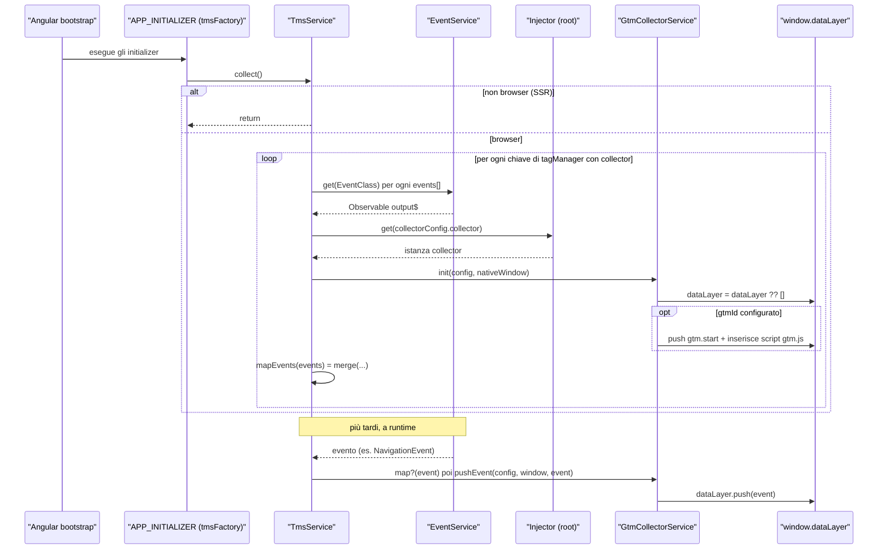
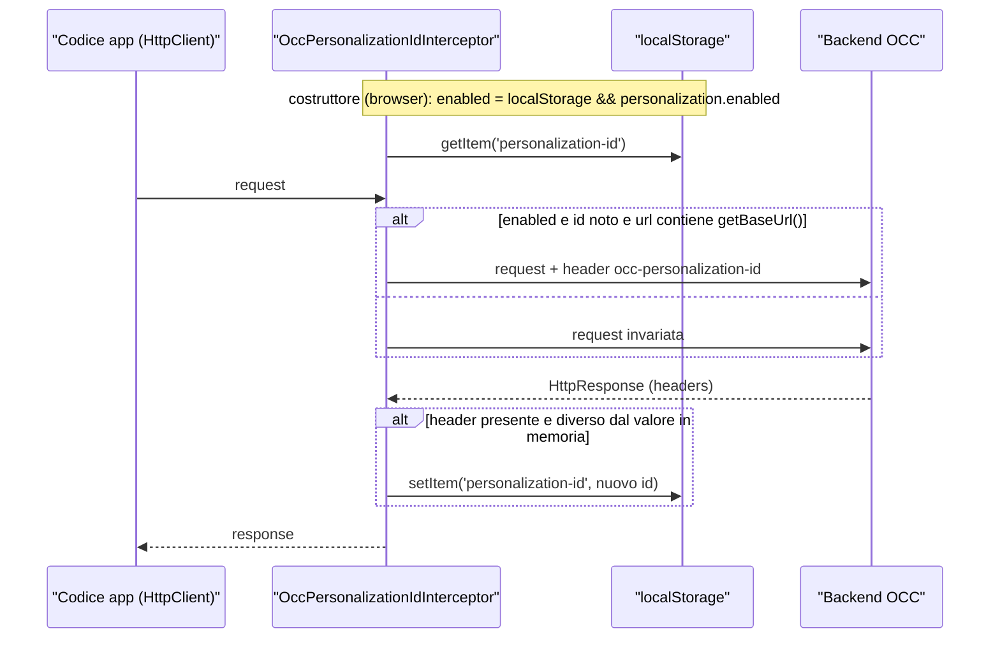
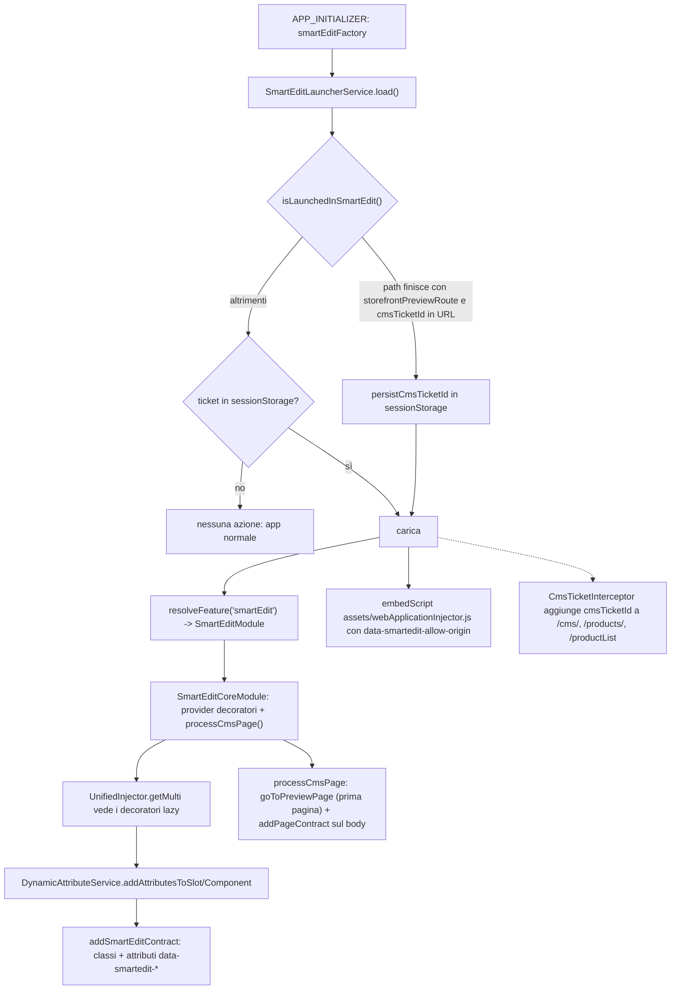
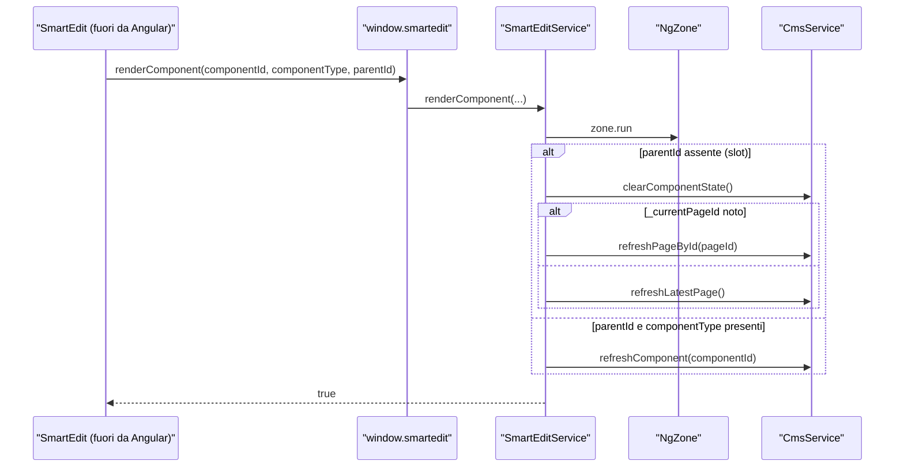
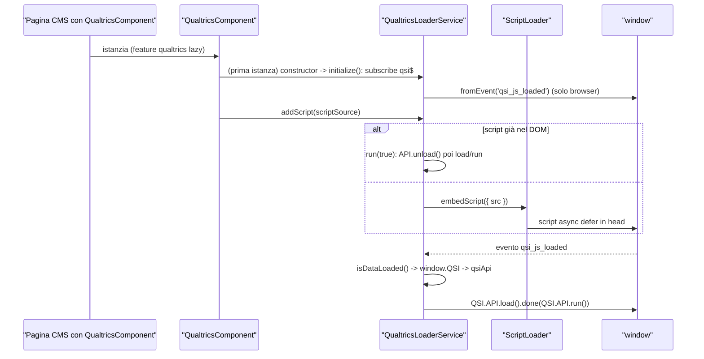

# 33 — Tracking, SmartEdit, Qualtrics

> Riferimenti allo SHA `5b7a1c2bf2808d7380bc20596d10f4fa710c3da1` (vedi [00-meta](../00-meta.md)).

## 1. A cosa serve e perché esiste

Questo capitolo raccoglie tre librerie opzionali di `feature-libs/` che hanno una cosa in comune: **non aggiungono funzionalità di commercio**, ma collegano lo storefront a sistemi esterni che osservano o modificano la pagina dall'esterno. Sono:

| Libreria | Entry point | Sistema esterno | Meccanismo Spartacus usato |
|---|---|---|---|
| `@spartacus/tracking` | `tms/core`, `tms/gtm`, `tms/aep`, `personalization`, `personalization/root`, `personalization/core` | Google Tag Manager, Adobe Experience Platform Launch, personalizzazione SAP Commerce | `EventService`, `APP_INITIALIZER`, `HTTP_INTERCEPTORS`, feature CMS lazy |
| `@spartacus/smartedit` | `smartedit`, `smartedit/root`, `smartedit/core` | SAP SmartEdit (editor WYSIWYG del CMS) | `APP_INITIALIZER`, `HTTP_INTERCEPTORS`, `ComponentDecorator`/`SlotDecorator`, `FeatureModulesService` |
| `@spartacus/qualtrics` | `qualtrics`, `qualtrics/root`, `qualtrics/components` | Qualtrics Site Intercept (QSI) | componente CMS lazy + `ScriptLoader` |

Le tre librerie riusano in modo esemplare i meccanismi descritti nei capitoli precedenti, ed è per questo che vale la pena leggerle anche se non si usa nessuno dei prodotti esterni:

- **Tracking/TMS** è il consumatore "canonico" del bus eventi: un servizio root si sottoscrive, all'avvio dell'app, a un elenco di classi `CxEvent` scelto in configurazione e inoltra ogni evento a un *collector* che scrive nel data layer della pagina (`feature-libs/tracking/tms/core/services/tms.service.ts:L46-L96`). Il bus eventi è descritto in [20 — Facade, command & query, eventi](../parte-2/20-facade-command-query-eventi.md).
- **Personalization** lavora a livello HTTP: due interceptor fanno da "cookie applicativo", rimandando al backend OCC gli header `Occ-Personalization-Id` / `Occ-Personalization-Time` che il backend stesso ha restituito, persistiti in `localStorage` (`feature-libs/tracking/personalization/root/http-interceptors/occ-personalization-id.interceptor.ts:L66-L97`). Un servizio separato decodifica il *contesto di personalizzazione* (segmenti e azioni) da un componente CMS nascosto (`feature-libs/tracking/personalization/core/services/personalization-context.service.ts:L30-L69`).
- **SmartEdit** è l'esempio più completo di integrazione "a strati": un root module sempre caricato decide all'avvio se l'app gira dentro l'iframe di SmartEdit (`feature-libs/smartedit/root/services/smart-edit-launcher.service.ts:L61-L72`), e solo in quel caso carica lazy il modulo che **decora** ogni slot e componente CMS con il "contratto" HTML richiesto da SmartEdit (`feature-libs/smartedit/core/services/smart-edit.service.ts:L158-L191`) ed espone su `window.smartedit` le callback di re-render (`feature-libs/smartedit/core/services/smart-edit.service.ts:L38-L52`).
- **Qualtrics** è la più piccola: un componente CMS senza template che inserisce lo script di deployment Qualtrics e un servizio che, all'evento `qsi_js_loaded`, invoca l'API QSI (`feature-libs/qualtrics/components/qualtrics-loader/qualtrics-loader.service.ts:L55-L139`).

Tutte e tre seguono la convenzione root/lazy di Spartacus spiegata in [12 — Feature module e lazy loading](../parte-2/12-feature-module-lazy.md): un `*RootModule` piccolo importato eagerly che registra configurazione di default, interceptor o `featureModules`, e un modulo pesante caricato on demand tramite `featureModules.<nome>.module`. La demo app le importa tutte e tre incondizionatamente (`projects/storefrontapp/src/app/spartacus/spartacus-features.module.ts:L263-L272`).

## 2. Mappa dei file

### 2.1 `feature-libs/tracking`

| Path | Ruolo |
|---|---|
| `feature-libs/tracking/public_api.ts` | entry radice vuota (`export {};`) |
| `feature-libs/tracking/tms/public_api.ts` | entry `tms` vuota |
| `feature-libs/tracking/tms/core/base-tms.module.ts` | `BaseTmsModule.forRoot()` + `tmsFactory` (`APP_INITIALIZER`) |
| `feature-libs/tracking/tms/core/config/tms-config.ts` | `TmsConfig`, `TmsCollectorConfig`, `TmsCollectors` + augmentation di `Config` |
| `feature-libs/tracking/tms/core/model/tms.model.ts` | interfacce `TmsCollector`, `WindowObject` |
| `feature-libs/tracking/tms/core/services/tms.service.ts` | `TmsService`: sottoscrive gli eventi e invoca i collector |
| `feature-libs/tracking/tms/core/public_api.ts` | API `@spartacus/tracking/tms/core` (+ `TmsCollectors` augmentabile) |
| `feature-libs/tracking/tms/gtm/gtm.module.ts` | `GtmModule`: solo default config |
| `feature-libs/tracking/tms/gtm/config/default-gtm.config.ts` | `GtmCollectorConfig`, `defaultGoogleTagManagerConfig`, augmentation `gtm` |
| `feature-libs/tracking/tms/gtm/services/gtm-collector.service.ts` | `GtmCollectorService`: snippet GTM, push su array |
| `feature-libs/tracking/tms/aep/aep.module.ts` | `AepModule`: solo default config |
| `feature-libs/tracking/tms/aep/config/default-aep.config.ts` | `AepCollectorConfig`, `defaultAdobeExperiencePlatformConfig`, augmentation `aep` |
| `feature-libs/tracking/tms/aep/services/aep-collector.service.ts` | `AepCollectorService`: script Launch, merge su oggetto |
| `feature-libs/tracking/personalization/root/personalization-root.module.ts` | interceptor + default config + feature CMS `personalization` |
| `feature-libs/tracking/personalization/root/config/personalization-config.ts` | `PersonalizationConfig` |
| `feature-libs/tracking/personalization/root/config/default-personalization-config.ts` | default (disabilitata, nomi header, contesto) |
| `feature-libs/tracking/personalization/root/feature-name.ts` | `PERSONALIZATION_FEATURE` |
| `feature-libs/tracking/personalization/root/http-interceptors/index.ts` | array `interceptors` (Id, poi Time) |
| `feature-libs/tracking/personalization/root/http-interceptors/occ-personalization-id.interceptor.ts` | header + localStorage `personalization-id` |
| `feature-libs/tracking/personalization/root/http-interceptors/occ-personalization-time.interceptor.ts` | header + localStorage `personalization-time` |
| `feature-libs/tracking/personalization/root/public_api.ts` | API `.../personalization/root` |
| `feature-libs/tracking/personalization/personalization.module.ts` | `PersonalizationModule` (entry lazy) → importa `PersonalizationCoreModule` |
| `feature-libs/tracking/personalization/core/personalization-core.module.ts` | `PersonalizationCoreModule`: `@NgModule({})` vuoto |
| `feature-libs/tracking/personalization/core/services/personalization-context.service.ts` | `PersonalizationContextService`: decodifica il contesto dal CMS |
| `feature-libs/tracking/personalization/core/model/personalization-context.model.ts` | `PersonalizationContext`, `PersonalizationAction` |
| `feature-libs/tracking/schematics/add-tracking/index.ts` | `addTrackingFeatures` (ng-add) |
| `feature-libs/tracking/vitest.config.ts` | configurazione Vitest e soglie di coverage |

### 2.2 `feature-libs/smartedit`

| Path | Ruolo |
|---|---|
| `feature-libs/smartedit/smart-edit.module.ts` | `SmartEditModule` (entry lazy `@spartacus/smartedit`) |
| `feature-libs/smartedit/root/smart-edit-root.module.ts` | interceptor + default config + `APP_INITIALIZER` (`smartEditFactory`) |
| `feature-libs/smartedit/root/config/smart-edit-config.ts` | `SmartEditConfig` |
| `feature-libs/smartedit/root/config/default-smart-edit-config.ts` | default `cx-preview` / `localhost:9002` |
| `feature-libs/smartedit/root/feature-name.ts` | `SMART_EDIT_FEATURE` |
| `feature-libs/smartedit/root/services/smart-edit-launcher.service.ts` | `SmartEditLauncherService`: rileva SmartEdit, gestisce `cmsTicketId`, carica injector e feature |
| `feature-libs/smartedit/root/http-interceptors/cms-ticket.interceptor.ts` | `CmsTicketInterceptor`: aggiunge `cmsTicketId` alle chiamate OCC |
| `feature-libs/smartedit/root/http-interceptors/index.ts` | provider `HTTP_INTERCEPTORS` |
| `feature-libs/smartedit/core/smart-edit-core.module.ts` | `SmartEditCoreModule`: decoratori + avvio `processCmsPage()` |
| `feature-libs/smartedit/core/services/smart-edit.service.ts` | `SmartEditService`: contratto HTML, preview page, re-render |
| `feature-libs/smartedit/core/decorators/index.ts` | `smartEditDecorators` (multi provider) |
| `feature-libs/smartedit/core/decorators/smart-edit-component-decorator.ts` | `SmartEditComponentDecorator` |
| `feature-libs/smartedit/core/decorators/smart-edit-slot-decorator.ts` | `SmartEditSlotDecorator` |
| `feature-libs/smartedit/assets/webApplicationInjector.js` | script SmartEdit minificato ("Version: 0.0.5"), pubblicato come asset |
| `feature-libs/smartedit/schematics/add-smartedit/index.ts` | `addSmartEditFeatures` (ng-add) |

### 2.3 `feature-libs/qualtrics`

| Path | Ruolo |
|---|---|
| `feature-libs/qualtrics/qualtrics.module.ts` | `QualtricsModule` (entry lazy `@spartacus/qualtrics`) |
| `feature-libs/qualtrics/root/qualtrics-root.module.ts` | feature CMS `qualtrics` → `QualtricsComponent` |
| `feature-libs/qualtrics/root/feature-name.ts` | `QUALTRICS_FEATURE` |
| `feature-libs/qualtrics/components/qualtrics-components.module.ts` | mapping CMS dei due componenti + `defaultQualtricsConfig` |
| `feature-libs/qualtrics/components/qualtrics-loader/qualtrics.component.ts` | `cx-qualtrics`: inserisce lo script di deployment |
| `feature-libs/qualtrics/components/qualtrics-loader/qualtrics-loader.service.ts` | `QualtricsLoaderService`: integrazione QSI |
| `feature-libs/qualtrics/components/qualtrics-loader/config/qualtrics-config.ts` | `QualtricsConfig` |
| `feature-libs/qualtrics/components/qualtrics-loader/config/default-qualtrics-config.ts` | `{ qualtrics: {} }` |
| `feature-libs/qualtrics/components/qualtrics-embedded-feedback/qualtrics-embedded-feedback.component.ts` | `cx-qualtrics-embedded-feedback`: componente vuoto |
| `feature-libs/qualtrics/styles/_qualtrics-embedded-feedback.scss` | stile placeholder |
| `feature-libs/qualtrics/schematics/add-qualtrics/index.ts` | `addQualtricsFeatures` (ng-add) |

### 2.4 Codice di core usato dalle tre librerie

| Path | Ruolo nel capitolo |
|---|---|
| `core-libs/core/src/event/event.service.ts` | `EventService.get()` fornisce gli stream che il TMS sottoscrive |
| `core-libs/core/src/util/script-loader.service.ts` | `ScriptLoader.embedScript()` usato da AEP, SmartEdit e Qualtrics |
| `core-libs/core/src/cms/decorators/component-decorator.ts`, `core-libs/core/src/cms/decorators/slot-decorator.ts` | classi astratte implementate da SmartEdit |
| `core-libs/core/src/cms/services/dynamic-attribute.service.ts` | applica tutti i decoratori a slot e componenti |
| `core-libs/core/src/lazy-loading/unified-injector.ts` | trova i decoratori anche nei moduli lazy |
| `core-libs/core/src/lazy-loading/feature-modules.service.ts` | `resolveFeature()` usato dal launcher SmartEdit |
| `core-libs/core/src/cms/facade/cms.service.ts` | `clearComponentState`, `refreshPageById`, `refreshLatestPage`, `refreshComponent` |
| `core-libs/storefront/cms-structure/services/cms-features.service.ts` | mappa componente CMS → feature lazy (Personalization, Qualtrics) |
| `projects/storefrontapp/src/app/spartacus/features/tracking/personalization-feature.module.ts` | configurazione demo di TMS e personalization |
| `projects/storefrontapp/src/app/spartacus/features/smartedit/smartedit-feature.module.ts` | configurazione demo SmartEdit |
| `projects/storefrontapp/src/app/spartacus/features/qualtrics/qualtrics-feature.module.ts` | configurazione demo Qualtrics |

## 3. Come funziona passo per passo

### 3.1 TMS: dalla configurazione all'avvio

1. **Import.** L'app importa `BaseTmsModule.forRoot()` più uno o più moduli vendor (`GtmModule`, `AepModule`) e fornisce un `TmsConfig` con gli eventi da tracciare. La demo lo fa in un unico `PersonalizationFeatureModule` (`projects/storefrontapp/src/app/spartacus/features/tracking/personalization-feature.module.ts:L22-L39`).
2. **Default del collector.** `GtmModule` e `AepModule` non hanno logica: forniscono solo una default config (`feature-libs/tracking/tms/gtm/gtm.module.ts:L11-L14`, `feature-libs/tracking/tms/aep/aep.module.ts:L11-L14`) che imposta `tagManager.gtm.collector = GtmCollectorService` (`feature-libs/tracking/tms/gtm/config/default-gtm.config.ts:L20-L26`) e `tagManager.aep.collector = AepCollectorService` (`feature-libs/tracking/tms/aep/config/default-aep.config.ts:L20-L26`). Nessun evento è attivo di default: gli `events` li decide l'app. Poiché default config e config dell'app vengono fuse (vedi [11 — Configurazione](../parte-2/11-configurazione.md)), nella config finale la voce `gtm` contiene sia il `collector` del default sia gli `events` dell'app.
3. **Tipi augmentabili.** `TmsConfig` è un `abstract class` con `useExisting: Config` e una sola proprietà `tagManager?: TmsCollectors` (`feature-libs/tracking/tms/core/config/tms-config.ts:L38-L47`), fusa nell'interfaccia `Config` di core per module augmentation (`feature-libs/tracking/tms/core/config/tms-config.ts:L49-L51`). `TmsCollectors` è un dizionario `[tms: string]: TmsCollectorConfig | undefined` (`feature-libs/tracking/tms/core/config/tms-config.ts:L31-L33`) che i pacchetti vendor estendono a loro volta: GTM aggiunge `gtm?: GtmCollectorConfig` con `gtmId` (`feature-libs/tracking/tms/gtm/config/default-gtm.config.ts:L10-L18`), AEP aggiunge `aep?: AepCollectorConfig` con `scriptUrl` (`feature-libs/tracking/tms/aep/config/default-aep.config.ts:L10-L18`). Per questo `TmsCollectors` è esportato dentro il blocco `AUGMENTABLE_TYPES` del public API (`feature-libs/tracking/tms/core/public_api.ts:L12-L14`).
4. **`APP_INITIALIZER`.** `BaseTmsModule.forRoot()` registra un `APP_INITIALIZER` multi con factory `tmsFactory` e dipendenza `TmsService` (`feature-libs/tracking/tms/core/base-tms.module.ts:L18-L33`); la factory restituisce `() => service.collect()` (`feature-libs/tracking/tms/core/base-tms.module.ts:L10-L16`). Senza `forRoot()` il modulo è un `@NgModule({})` vuoto (`feature-libs/tracking/tms/core/base-tms.module.ts:L18-L19`): importare `BaseTmsModule` "nudo" non attiva nulla. Il token `APP_INITIALIZER` è deprecato da Angular v19 a favore di `provideAppInitializer` (`angular:packages/core/src/application/application_init.ts:L38-L38`); l'ordine degli initializer è trattato in [10 — Bootstrap e inizializzazione](../parte-2/10-bootstrap-inizializzazione.md).
5. **Guardia SSR.** `collect()` esce subito se non si è nel browser (`feature-libs/tracking/tms/core/services/tms.service.ts:L46-L49`): in SSR nessun data layer è creato e nessuno script vendor inserito.
6. **Iterazione sui TMS.** `collect()` scorre con `for...in` le chiavi di `tagManager`, saltando le proprietà non proprie (`feature-libs/tracking/tms/core/services/tms.service.ts:L51-L54`). Una voce senza `collector` viene saltata con warning in dev mode (`feature-libs/tracking/tms/core/services/tms.service.ts:L59-L66`).
7. **Stream eventi.** Per ogni classe in `events` ottiene lo stream con `eventsService.get(event)`; senza `events` la lista è vuota (`feature-libs/tracking/tms/core/services/tms.service.ts:L68-L70`). `EventService.get` restituisce l'`output$` del *merging subject* del tipo, validato in dev mode (`core-libs/core/src/event/event.service.ts:L90-L96`).
8. **Istanza e `init`.** Il collector è ottenuto con `this.injector.get(collectorConfig.collector)` — l'`Injector` iniettato in `TmsService`, che è `providedIn: 'root'` (`feature-libs/tracking/tms/core/services/tms.service.ts:L27-L41`) — e `init` è chiamato subito con `nativeWindow!` (`feature-libs/tracking/tms/core/services/tms.service.ts:L71-L75`).
9. **Push.** Gli stream sono uniti da `mapEvents` (protected) con `merge(...events)` (`feature-libs/tracking/tms/core/services/tms.service.ts:L104-L108`). A ogni evento: log con emoji 🎤 se `debug`, poi `collector.map?.(event) ?? event`, poi `collector.pushEvent(config, window, event)`; la subscription è accumulata in `this.subscription` (`feature-libs/tracking/tms/core/services/tms.service.ts:L77-L94`) e chiusa in `ngOnDestroy` (`feature-libs/tracking/tms/core/services/tms.service.ts:L113-L115`).

### 3.2 I due collector: GTM e AEP a confronto

| Aspetto | `GtmCollectorService` | `AepCollectorService` |
|---|---|---|
| Dipendenza iniettata | `WindowRef` (`feature-libs/tracking/tms/gtm/services/gtm-collector.service.ts:L19-L21`) | `ScriptLoader` (`feature-libs/tracking/tms/aep/services/aep-collector.service.ts:L19-L21`) |
| Nome data layer di default | `'dataLayer'` (`feature-libs/tracking/tms/gtm/services/gtm-collector.service.ts:L26-L26`) | `'digitalData'` (`feature-libs/tracking/tms/aep/services/aep-collector.service.ts:L26-L26`) |
| Tipo del data layer | array, `?? []` (`feature-libs/tracking/tms/gtm/services/gtm-collector.service.ts:L27-L27`) | oggetto, `?? {}` (`feature-libs/tracking/tms/aep/services/aep-collector.service.ts:L27-L27`) |
| Caricamento script vendor | solo con `gtmId`: snippet GTM inline che inserisce `gtm.js` prima del primo `<script>` (`feature-libs/tracking/tms/gtm/services/gtm-collector.service.ts:L29-L51`) | solo con `scriptUrl`: `scriptLoader.embedScript({ src })` (`feature-libs/tracking/tms/aep/services/aep-collector.service.ts:L29-L31`) |
| `pushEvent` | `window[dataLayer].push(event)` (`feature-libs/tracking/tms/gtm/services/gtm-collector.service.ts:L55-L62`) | sostituzione con spread shallow `{ ...precedente, ...event }` (`feature-libs/tracking/tms/aep/services/aep-collector.service.ts:L34-L44`) |
| `map` | non implementato | non implementato |

Dettagli dello snippet GTM: prima pusha `{ 'gtm.start': <timestamp>, event: 'gtm.js' }` nel data layer (`feature-libs/tracking/tms/gtm/services/gtm-collector.service.ts:L38-L38`), poi crea un `<script async>` con `src = 'https://www.googletagmanager.com/gtm.js?id=' + gtmId` e, se il data layer non si chiama `dataLayer`, aggiunge `&l=<nome>` (`feature-libs/tracking/tms/gtm/services/gtm-collector.service.ts:L41-L43`), infine lo inserisce prima del primo `<script>` del documento (`feature-libs/tracking/tms/gtm/services/gtm-collector.service.ts:L39-L44`).

Per AEP, `ScriptLoader.embedScript` crea un `<script async defer>`, non duplica uno script già presente (controllo fatto solo nel browser) e lo appende a `head` per default (`core-libs/core/src/util/script-loader.service.ts:L55-L68`, `core-libs/core/src/util/script-loader.service.ts:L91-L93`).

### 3.3 Personalization: gli interceptor degli header OCC

1. **Registrazione.** `PersonalizationRootModule` aggiunge l'array `interceptors`, la default config e una default config factory per la feature CMS (`feature-libs/tracking/personalization/root/personalization-root.module.ts:L30-L37`). Gli interceptor sono provider `HTTP_INTERCEPTORS` multi con `useExisting`, nell'ordine Id → Time (`feature-libs/tracking/personalization/root/http-interceptors/index.ts:L13-L24`). Angular costruisce la catena con `reduceRight`, quindi il primo registrato è il più esterno (`angular:packages/common/http/src/interceptor.ts:L233-L240`; vedi [06 — HttpClient e interceptor](../parte-1/06-httpclient-interceptor.md)).
2. **Default.** `personalization.enabled` è `false`, gli header sono `Occ-Personalization-Id` e `Occ-Personalization-Time`, il contesto si trova nello slot `PlaceholderContentSlot` nel componente `PersonalizationScriptComponent` (`feature-libs/tracking/personalization/root/config/default-personalization-config.ts:L9-L21`). La forma della config è definita in `PersonalizationConfig` (`feature-libs/tracking/personalization/root/config/personalization-config.ts:L10-L30`).
3. **Costruzione dell'interceptor (solo browser).** `enabled = (localStorage && personalization.enabled) || false` (`feature-libs/tracking/personalization/root/http-interceptors/occ-personalization-id.interceptor.ts:L34-L37`). Se abilitato, il nome header è messo in minuscolo e l'id iniziale letto dalla chiave `personalization-id` di `localStorage` (`feature-libs/tracking/personalization/root/http-interceptors/occ-personalization-id.interceptor.ts:L39-L49`, chiave a `feature-libs/tracking/personalization/root/http-interceptors/occ-personalization-id.interceptor.ts:L25-L25`). Se disabilitato e c'è un id residuo, viene **rimosso** (`feature-libs/tracking/personalization/root/http-interceptors/occ-personalization-id.interceptor.ts:L50-L54`): spegnere la feature pulisce lo storage al successivo avvio.
4. **Richiesta.** Se disabilitato, la richiesta passa invariata (`feature-libs/tracking/personalization/root/http-interceptors/occ-personalization-id.interceptor.ts:L62-L64`). Altrimenti l'header è aggiunto solo se nome e valore sono noti e l'URL contiene `occEndpoints.getBaseUrl()` (`feature-libs/tracking/personalization/root/http-interceptors/occ-personalization-id.interceptor.ts:L66-L76`).
5. **Risposta.** Su `HttpResponse`, se l'header compare fra `event.headers.keys()` e differisce dal valore in memoria, il nuovo valore è salvato in memoria e in `localStorage` (`feature-libs/tracking/personalization/root/http-interceptors/occ-personalization-id.interceptor.ts:L78-L97`).
6. **Timestamp.** `OccPersonalizationTimeInterceptor` è identico ma usa la chiave `personalization-time` e `httpHeaderName.timestamp` (`feature-libs/tracking/personalization/root/http-interceptors/occ-personalization-time.interceptor.ts:L25-L25`, `feature-libs/tracking/personalization/root/http-interceptors/occ-personalization-time.interceptor.ts:L45-L49`).

In pratica il backend assegna un id di personalizzazione alla prima risposta; lo storefront lo memorizza e lo rimanda a ogni chiamata OCC successiva, così il backend può riconoscere l'utente anonimo e applicare le stesse *customization*. ⚠️ DA VERIFICARE: che il backend emetta davvero questi header ed esponga il CORS `Access-Control-Expose-Headers` non è verificabile nel repo (dossier Q3).

### 3.4 Personalization: il contesto (segmenti e azioni)

1. **Feature CMS.** La default config factory associa la feature `personalization` al solo componente CMS `PersonalizationScriptComponent`, senza `module` (`feature-libs/tracking/personalization/root/personalization-root.module.ts:L17-L28`). Il `module` lo fornisce l'app: la demo punta a `import('@spartacus/tracking/personalization')` → `PersonalizationModule` (`projects/storefrontapp/src/app/spartacus/features/tracking/personalization-feature.module.ts:L40-L48`). `CmsFeaturesService` considera un componente "gestito da una feature" solo se la feature ha sia `module` sia `cmsComponents` (`core-libs/storefront/cms-structure/services/cms-features.service.ts:L56-L76`).
2. **Modulo lazy vuoto.** `PersonalizationModule` importa soltanto `PersonalizationCoreModule`, che è un `@NgModule({})` vuoto (`feature-libs/tracking/personalization/personalization.module.ts:L10-L13`, `feature-libs/tracking/personalization/core/personalization-core.module.ts:L9-L10`). Il vero codice di `core` è il servizio `PersonalizationContextService`, `providedIn: 'root'` (`feature-libs/tracking/personalization/core/services/personalization-context.service.ts:L19-L28`): viene istanziato da chi lo inietta, non dal caricamento del modulo.
3. **Lettura del contesto.** Senza `personalization.context`, `getPersonalizationContext()` restituisce `EMPTY` con warning in dev (`feature-libs/tracking/personalization/core/services/personalization-context.service.ts:L30-L35`). Altrimenti: pagina corrente → slot `context.slotPosition` → componente con `uid === context.componentId` → `properties.script.data` (`feature-libs/tracking/personalization/core/services/personalization-context.service.ts:L37-L50`).
4. **Decodifica.** Il payload è `JSON.parse(atob(data))`; poi ogni valore di ogni action e ogni segment è a sua volta decodificato base64 (`feature-libs/tracking/personalization/core/services/personalization-context.service.ts:L54-L69`). Il risultato ha la forma `{ actions: PersonalizationAction[]; segments: string[] }` (`feature-libs/tracking/personalization/core/model/personalization-context.model.ts:L7-L19`).
5. **Consumatore.** L'unico consumatore nel repo è `ProfileTagPushEventsService` di CDS, che combina ogni push event con `withLatestFrom(merge(of({segments: undefined, actions: undefined}), getPersonalizationContext()))` e scrive `segments`/`actions` in `item.data` (`integration-libs/cds/src/profiletag/services/profile-tag-push-events.service.ts:L98-L112`). CDS è trattato in [34 — Integration libs: CDC, CDP, CDS](../parte-2/34-integration-cdc-cdp-cds.md).

### 3.5 SmartEdit: avvio e rilevamento

1. **Root module.** `SmartEditRootModule` registra `CmsTicketInterceptor`, la default config e un `APP_INITIALIZER` (`smartEditFactory`) che chiama `SmartEditLauncherService.load()` (`feature-libs/smartedit/root/smart-edit-root.module.ts:L13-L34`). Default: `storefrontPreviewRoute: 'cx-preview'`, `allowOrigin: 'localhost:9002'` (`feature-libs/smartedit/root/config/default-smart-edit-config.ts:L9-L14`).
2. **Parse dell'URL.** `isLaunchedInSmartEdit()` separa `location.path()` su `?`, cerca il parametro che inizia con `cmsTicketId=` e ne prende il valore con `split('=')[1]` (`feature-libs/smartedit/root/services/smart-edit-launcher.service.ts:L61-L72`).
3. **Pagina iniziale.** Se l'ultimo segmento del path è `storefrontPreviewRoute` **e** c'è un `cmsTicketId`, il ticket è persistito in `sessionStorage` (chiave `smartedit.cmsTicketId`) e memorizzato (`feature-libs/smartedit/root/services/smart-edit-launcher.service.ts:L74-L89`, chiave a `feature-libs/smartedit/root/services/smart-edit-launcher.service.ts:L27-L32`).
4. **Fallback da sessionStorage.** Altrimenti il ticket viene ripristinato da `sessionStorage` e la sua sola presenza basta per considerarsi "in SmartEdit" — il caso d'uso dichiarato sono i redirect full-page, ad esempio il flusso OIDC di CDC (`feature-libs/smartedit/root/services/smart-edit-launcher.service.ts:L91-L96`). Persistenza e ripristino sono saltati fuori dal browser, per evitare il `SecurityError` in SSR (`feature-libs/smartedit/root/services/smart-edit-launcher.service.ts:L98-L118`).
5. **Caricamento.** Se in SmartEdit, `load()` risolve la feature `smartEdit` (lazy load di `SmartEditModule`) e inserisce `assets/webApplicationInjector.js` con `id: 'text/smartedit-injector'` e `data-smartedit-allow-origin` preso dalla config (`feature-libs/smartedit/root/services/smart-edit-launcher.service.ts:L43-L56`). `ScriptLoader` mette in `setAttribute` solo le chiavi che iniziano con `data-`; le altre (qui `id`) diventano proprietà del DOM element (`core-libs/core/src/util/script-loader.service.ts:L70-L82`). Il file `webApplicationInjector.js` è minificato ("Version: 0.0.5") e fa parte degli asset pubblicati da ng-packagr (`feature-libs/smartedit/assets/webApplicationInjector.js:L1-L2`, `feature-libs/smartedit/ng-package.json:L7-L11`).
6. **`resolveFeature`.** `FeatureModulesService.resolveFeature` restituisce un errore "No module defined for Feature Module ..." se la feature non ha `module`; altrimenti risolve dipendenze e modulo con `shareReplay()` (`core-libs/core/src/lazy-loading/feature-modules.service.ts:L42-L73`). La demo configura `featureModules.smartEdit` con `import('@spartacus/smartedit')` → `SmartEditModule` (`projects/storefrontapp/src/app/spartacus/features/smartedit/smartedit-feature.module.ts:L14-L27`).

⚠️ DA VERIFICARE: l'URL esatto con cui SmartEdit apre lo storefront (`.../cx-preview?cmsTicketId=...`) è dedotto dal parsing in `feature-libs/smartedit/root/services/smart-edit-launcher.service.ts:L74-L89`; il protocollo di `webApplicationInjector.js` non è leggibile (file minificato di terze parti).

### 3.6 SmartEdit: il `cmsTicketId` sulle chiamate OCC

`CmsTicketInterceptor` legge `service.cmsTicketId` dal launcher; se assente la richiesta passa invariata (`feature-libs/smartedit/root/http-interceptors/cms-ticket.interceptor.ts:L29-L32`). Altrimenti decide per sottostringa dell'URL:

- `/productList` → legge il `PageContext` corrente con `take(1)` e aggiunge `cmsTicketId` più `categoryCode = pageContext.id` se presente (`feature-libs/smartedit/root/http-interceptors/cms-ticket.interceptor.ts:L33-L35`, `feature-libs/smartedit/root/http-interceptors/cms-ticket.interceptor.ts:L47-L72`);
- `/cms/` o `/products/` → aggiunge il query param `cmsTicketId` (`feature-libs/smartedit/root/http-interceptors/cms-ticket.interceptor.ts:L36-L42`).

Il ticket permette al backend di restituire la versione *in anteprima* (staged) dei contenuti. L'interceptor è registrato multi con `useExisting` (`feature-libs/smartedit/root/http-interceptors/index.ts:L11-L17`). Poiché il root module è eager, l'interceptor è sempre nella catena, ma è un pass-through quando non c'è ticket.

### 3.7 SmartEdit: modulo lazy, decoratori e contratto HTML

1. **Lazy load.** `SmartEditModule` importa `SmartEditCoreModule` (`feature-libs/smartedit/smart-edit.module.ts:L10-L13`), che fornisce `smartEditDecorators` e nel costruttore chiama `smartEditService.processCmsPage()` (`feature-libs/smartedit/core/smart-edit-core.module.ts:L11-L18`).
2. **Decoratori multi.** `smartEditDecorators` registra `SmartEditComponentDecorator` su `ComponentDecorator` e `SmartEditSlotDecorator` su `SlotDecorator` (multi, `useExisting`) (`feature-libs/smartedit/core/decorators/index.ts:L12-L23`). Sono classi astratte di core con il solo metodo `decorate(element, renderer, data?)` (`core-libs/core/src/cms/decorators/component-decorator.ts:L10-L23`, `core-libs/core/src/cms/decorators/slot-decorator.ts:L10-L23`).
3. **Come i decoratori lazy arrivano al rendering.** `DynamicAttributeService` raccoglie i decoratori con `unifiedInjector.getMulti(...)` + `shareReplay(1)` (`core-libs/core/src/cms/services/dynamic-attribute.service.ts:L24-L32`). `UnifiedInjector.injectors$` parte dal root injector e aggiunge l'injector di ogni modulo lazy caricato, mentre `getMulti` accumula le istanze con `scan` (`core-libs/core/src/lazy-loading/unified-injector.ts:L32-L35`, `core-libs/core/src/lazy-loading/unified-injector.ts:L79-L93`). Così i provider di `SmartEditCoreModule` — che vive in un injector figlio — diventano visibili a un servizio root.
4. **Applicazione.** `PageSlotComponent` chiama `addAttributesToSlot` quando lo slot è presente (`core-libs/storefront/cms-structure/page/slot/page-slot.component.ts:L157-L163`); `ComponentWrapperDirective.decorate` chiama `addAttributesToComponent` (`core-libs/storefront/cms-structure/page/component/component-wrapper.directive.ts:L138-L144`). Entrambi i metodi leggono in modo sincrono (`getLastValueSync`) l'elenco dei decoratori e li invocano tutti (`core-libs/core/src/cms/services/dynamic-attribute.service.ts:L40-L64`). Il rendering CMS è descritto in [16 — CMS (storefront): rendering dinamico](../parte-2/16-cms-rendering.md).
5. **Contratto.** Entrambi i decoratori passano `properties` del componente/slot a `addSmartEditContract` (`feature-libs/smartedit/core/decorators/smart-edit-component-decorator.ts:L19-L31`, `feature-libs/smartedit/core/decorators/smart-edit-slot-decorator.ts:L19-L27`). Il metodo itera i gruppi di `properties` (tipicamente `smartedit`): `classes` è splittata su spazi e applicata con `addClass`; ogni altra proprietà diventa un attributo `data-<gruppo>-<prop-in-kebab-case>` (`feature-libs/smartedit/core/services/smart-edit.service.ts:L158-L191`). Per esempio una proprietà `componentId` nel gruppo `smartedit` diventa `data-smartedit-component-id` (trasformazione `split(/(?=[A-Z])/).join('-').toLowerCase()` a `feature-libs/smartedit/core/services/smart-edit.service.ts:L178-L186`).
6. **Contratto di pagina.** `processCmsPage()` attende il primo `BaseSite` non nullo, ne legge `defaultPreviewCategoryCode`/`defaultPreviewProductCode` (campi dichiarati in `core-libs/core/src/model/misc.model.ts:L116-L121`), poi per ogni pagina CMS corrente salva `pageId`, chiama `goToPreviewPage` e `addPageContract` (`feature-libs/smartedit/core/services/smart-edit.service.ts:L55-L76`). `addPageContract` crea un renderer per `body`, rimuove **tutte** le classi presenti sul `<body>` e applica il contratto da `cmsPage.properties` (`feature-libs/smartedit/core/services/smart-edit.service.ts:L78-L94`).
7. **Preview page.** `goToPreviewPage` agisce solo sulla prima pagina: se è `PRODUCT_PAGE` con `defaultPreviewProductCode` naviga a `cxRoute: 'product'`, se è `CATEGORY_PAGE` con `defaultPreviewCategoryCode` naviga a `cxRoute: 'category'` (`feature-libs/smartedit/core/services/smart-edit.service.ts:L96-L121`). Serve quando SmartEdit apre un *template* di pagina prodotto/categoria: lo storefront ha bisogno di un prodotto/categoria reale da mostrare.

### 3.8 SmartEdit: re-render dopo un edit

1. Il costruttore di `SmartEditService`, se esiste `nativeWindow`, crea `window.smartedit` ed espone `renderComponent` (delegato al metodo protected) e `reprocessPage` (`feature-libs/smartedit/core/services/smart-edit.service.ts:L38-L52`).
2. `renderComponent(componentId, componentType?, parentId?)` gira dentro `zone.run` — chiamato da codice esterno ad Angular, deve rientrare in zona per far scattare la change detection (vedi [04 — Change detection, zone e signals](../parte-1/04-change-detection-zone-signals.md)). Senza `parentId` si tratta di uno slot: svuota tutta la cache dei componenti e ricarica la pagina per `pageId` (o l'ultima pagina); con `parentId` e `componentType` ricarica il singolo componente. Restituisce sempre `true` (`feature-libs/smartedit/core/services/smart-edit.service.ts:L126-L149`).
3. Lato core: `clearComponentState()` senza argomenti cancella tutti i componenti in cache e dispatcha `ClearCmsComponent` per ciascuno, e il JSDoc cita proprio SmartEdit (`core-libs/core/src/cms/facade/cms.service.ts:L296-L309`); `refreshPageById` dispatcha `LoadCmsPageData({ id })`, `refreshLatestPage` usa il page context corrente, `refreshComponent` dispatcha `LoadCmsComponent` (`core-libs/core/src/cms/facade/cms.service.ts:L197-L223`). Lo store CMS è descritto in [15 — CMS (core)](../parte-2/15-cms-core.md).
4. `reprocessPage()` è vuoto con un `TODO: reprocess page API` (`feature-libs/smartedit/core/services/smart-edit.service.ts:L151-L153`).

### 3.9 Qualtrics

1. **Root.** `QualtricsRootModule` fornisce solo la default config factory che mappa la feature `qualtrics` sul componente CMS `QualtricsComponent` (`feature-libs/qualtrics/root/qualtrics-root.module.ts:L11-L27`). La demo aggiunge `module: () => import('@spartacus/qualtrics')` → `QualtricsModule` (`projects/storefrontapp/src/app/spartacus/features/qualtrics/qualtrics-feature.module.ts:L14-L27`).
2. **Lazy.** `QualtricsModule` importa `QualtricsComponentsModule` (`feature-libs/qualtrics/qualtrics.module.ts:L10-L13`), che importa i due componenti standalone, li mappa in `cmsComponents` e fornisce `defaultQualtricsConfig` (`feature-libs/qualtrics/components/qualtrics-components.module.ts:L14-L35`). Il default è `{ qualtrics: {} }`, cioè nessuno `scriptSource` (`feature-libs/qualtrics/components/qualtrics-loader/config/default-qualtrics-config.ts:L9-L11`).
3. **Componente.** `QualtricsComponent` (`cx-qualtrics`, template vuoto) nel **costruttore** chiama `qualtricsLoader.addScript(scriptSource)` se configurato, altrimenti warning in dev (`feature-libs/qualtrics/components/qualtrics-loader/qualtrics.component.ts:L15-L33`). Il JSDoc di `QualtricsConfig` suggerisce di tenere lo script di deployment negli asset locali (`feature-libs/qualtrics/components/qualtrics-loader/config/qualtrics-config.ts:L10-L34`).
4. **Service.** `QualtricsLoaderService` nel costruttore chiama `initialize()`, che sottoscrive `qsi$` e invoca `run()` a ogni emissione (`feature-libs/qualtrics/components/qualtrics-loader/qualtrics-loader.service.ts:L77-L83`, `feature-libs/qualtrics/components/qualtrics-loader/qualtrics-loader.service.ts:L113-L115`). `qsiLoaded$` è `fromEvent(window, 'qsi_js_loaded')` solo nel browser, altrimenti `EMPTY` (`feature-libs/qualtrics/components/qualtrics-loader/qualtrics-loader.service.ts:L55-L58`); `qsi$` passa per l'hook `isDataLoaded()`, prende `window.QSI`, filtra i falsy e salva in `qsiApi` (`feature-libs/qualtrics/components/qualtrics-loader/qualtrics-loader.service.ts:L66-L71`).
5. **`addScript`.** Se lo script è già nel DOM (`script[src="..."]`) chiama `run(true)`, altrimenti lo inserisce con `scriptLoader.embedScript({ src })` (`feature-libs/qualtrics/components/qualtrics-loader/qualtrics-loader.service.ts:L91-L106`). Il secondo ramo copre la navigazione SPA: tornando su una pagina con il componente, lo script c'è già e serve solo rivalutare gli intercept.
6. **`run`.** Esce (log in dev) se `qsiApi.API` non c'è; con `reload` chiama `API.unload()`; poi `API.load().done(API.run())` (`feature-libs/qualtrics/components/qualtrics-loader/qualtrics-loader.service.ts:L123-L139`).
7. **Hook.** `isDataLoaded()` è protected e di default `of(true)` (`feature-libs/qualtrics/components/qualtrics-loader/qualtrics-loader.service.ts:L141-L149`).
8. **Componente embedded.** `QualtricsEmbeddedFeedbackComponent` (`cx-qualtrics-embedded-feedback`) ha template vuoto e nessuna logica (`feature-libs/qualtrics/components/qualtrics-embedded-feedback/qualtrics-embedded-feedback.component.ts:L9-L13`): è solo un segnaposto nel DOM in cui un intercept Qualtrics "embedded" può renderizzarsi. Anche il suo stile è un placeholder (`feature-libs/qualtrics/styles/_qualtrics-embedded-feedback.scss:L1-L4`).

### 3.10 Installazione con gli schematics

`addTrackingFeatures`, `addSmartEditFeatures` e `addQualtricsFeatures` hanno la stessa sequenza: `validateSpartacusInstallation`, `analyzeCrossFeatureDependencies`, poi `chain([analyzeApplication, addFeatures, addPackageJsonDependenciesForLibrary(peerDependencies), finalizeInstallation])` (`feature-libs/tracking/schematics/add-tracking/index.ts:L25-L43`, `feature-libs/smartedit/schematics/add-smartedit/index.ts:L25-L43`, `feature-libs/qualtrics/schematics/add-qualtrics/index.ts:L25-L43`). I nomi delle feature selezionabili sono `Personalization`, `TMS-GTM`, `TMS-AEPL`, `SmartEdit`, `Qualtrics` (`core-libs/schematics/src/shared/libs-constants.ts:L352-L364`).

- **Personalization**: feature module `PersonalizationModule`, root `PersonalizationRootModule`, chunk lazy con `PERSONALIZATION_FEATURE`, dipendenza da User Profile (`core-libs/schematics/src/shared/lib-configs/tracking-schematics-config.ts:L29-L50`).
- **GTM / AEP**: root module `BaseTmsModule.forRoot()` e una `customConfig` che genera `<TmsConfig>{ tagManager: { gtm|aep: { events: [] } } }` forzando `lazy: false` (`core-libs/schematics/src/shared/lib-configs/tracking-schematics-config.ts:L57-L103`, `core-libs/schematics/src/shared/lib-configs/tracking-schematics-config.ts:L107-L154`); anche queste dichiarano la dipendenza da User Profile (`core-libs/schematics/src/shared/lib-configs/tracking-schematics-config.ts:L75-L75`, `core-libs/schematics/src/shared/lib-configs/tracking-schematics-config.ts:L125-L125`).
- **SmartEdit**: genera `<SmartEditConfig>` con `storefrontPreviewRoute`/`allowOrigin` presi dalle opzioni o dai placeholder `STOREFRONT_PREVIEW_ROUTE_PLACEHOLDER`/`ALLOWED_ORIGIN_PLACEHOLDER` (`core-libs/schematics/src/shared/lib-configs/smartedit-schematics-config.ts:L54-L75`) e aggiunge l'asset `smartedit/assets` (`glob: '**/*'`) ad `angular.json` (`core-libs/schematics/src/shared/lib-configs/smartedit-schematics-config.ts:L48-L51`).
- **Qualtrics**: crea `qualtrics-embedded-feedback.scss` con gli import delle funzioni/variabili/mixin bootstrap (`core-libs/schematics/src/shared/lib-configs/qualtrics-schematics-config.ts:L45-L53`).

Gli schematics in generale sono in [43 — Schematics e migrazioni](../parte-2/43-schematics-migrazioni.md).

## 4. Diagrammi

### 4.1 TMS: bootstrap e flusso di un evento



Riferimenti: initializer `feature-libs/tracking/tms/core/base-tms.module.ts:L13-L29`; guardia SSR `feature-libs/tracking/tms/core/services/tms.service.ts:L46-L49`; loop e `init` `feature-libs/tracking/tms/core/services/tms.service.ts:L51-L75`; push `feature-libs/tracking/tms/core/services/tms.service.ts:L77-L94`; GTM `feature-libs/tracking/tms/gtm/services/gtm-collector.service.ts:L25-L62`.

### 4.2 Personalization: ciclo dell'header id



Riferimenti: `feature-libs/tracking/personalization/root/http-interceptors/occ-personalization-id.interceptor.ts:L34-L49` (costruttore), `:L66-L76` dello stesso file (richiesta), `feature-libs/tracking/personalization/root/http-interceptors/occ-personalization-id.interceptor.ts:L78-L97` (risposta).

### 4.3 SmartEdit: avvio, lazy load e decorazione



Riferimenti: `feature-libs/smartedit/root/smart-edit-root.module.ts:L13-L34`; `feature-libs/smartedit/root/services/smart-edit-launcher.service.ts:L43-L96`; `feature-libs/smartedit/core/smart-edit-core.module.ts:L11-L18`; `core-libs/core/src/cms/services/dynamic-attribute.service.ts:L24-L64`; `feature-libs/smartedit/core/services/smart-edit.service.ts:L55-L191`; `feature-libs/smartedit/root/http-interceptors/cms-ticket.interceptor.ts:L25-L72`.

### 4.4 SmartEdit: re-render dopo un edit



Riferimenti: `feature-libs/smartedit/core/services/smart-edit.service.ts:L38-L52`, `feature-libs/smartedit/core/services/smart-edit.service.ts:L126-L149`, `core-libs/core/src/cms/facade/cms.service.ts:L197-L223`, `core-libs/core/src/cms/facade/cms.service.ts:L302-L309`.

### 4.5 Qualtrics: script e API QSI



Riferimenti: `feature-libs/qualtrics/components/qualtrics-loader/qualtrics.component.ts:L22-L33`, `feature-libs/qualtrics/components/qualtrics-loader/qualtrics-loader.service.ts:L55-L139`, `core-libs/core/src/util/script-loader.service.ts:L55-L93`.

## 5. Estratti di codice reale

### 5.1 `BaseTmsModule` e `tmsFactory`

```ts
// feature-libs/tracking/tms/core/base-tms.module.ts:L10-L33
/**
 * The factory that conditionally (based on the configuration) starts collecting events
 */
export function tmsFactory(service: TmsService): () => void {
  const result = () => service.collect();
  return result;
}

@NgModule({})
export class BaseTmsModule {
  static forRoot(): ModuleWithProviders<BaseTmsModule> {
    return {
      ngModule: BaseTmsModule,
      providers: [
        {
          provide: APP_INITIALIZER,
          useFactory: tmsFactory,
          deps: [TmsService],
          multi: true,
        },
      ],
    };
  }
}
```

### 5.2 `TmsConfig` e i tipi di configurazione

```ts
// feature-libs/tracking/tms/core/config/tms-config.ts:L14-L51
export interface TmsCollectorConfig {
  /** Should be enabled in development mode only */
  debug?: boolean;
  /**
   * The name for the data layer object.
   */
  dataLayerProperty?: string;
  /**
   * Events to send to the configured TMS.
   */
  events?: AbstractType<CxEvent>[];
  /**
   * The collector service implementation.
   */
  collector?: Type<TmsCollector>;
}

export interface TmsCollectors {
  [tms: string]: TmsCollectorConfig | undefined;
}

/**
 * TMS configuration
 */
@Injectable({
  providedIn: 'root',
  useExisting: Config,
})
export abstract class TmsConfig {
  /**
   * Tag manager config
   */
  tagManager?: TmsCollectors;
}

declare module '@spartacus/core' {
  interface Config extends TmsConfig {}
}
```

### 5.3 Il contratto `TmsCollector`

```ts
// feature-libs/tracking/tms/core/model/tms.model.ts:L14-L40
export interface WindowObject extends Window {
  [prop: string]: any;
}

/**
 * Interface that a class can implement in order to be recognized as a TMS collector.
 */
export interface TmsCollector {
  /**
   * Initializes the data layer.
   */
  init(config: TmsCollectorConfig, windowObject: WindowObject): void;

  /**
   * Pushes the provided event to the data layer.
   */
  pushEvent<T extends CxEvent>(
    config: TmsCollectorConfig,
    windowObject: WindowObject,
    event: T | any
  ): void;

  /**
   * Maps the Spartacus event to another object.
   */
  map?<T extends CxEvent>(event: T): T | object;
}
```

### 5.4 `TmsService.collect()` (cuore del TMS)

```ts
// feature-libs/tracking/tms/core/services/tms.service.ts:L46-L108
  collect(): void {
    if (!this.windowRef.isBrowser()) {
      return;
    }

    for (const tmsCollectorConfig in this.tmsConfig.tagManager) {
      if (!this.tmsConfig.tagManager?.hasOwnProperty(tmsCollectorConfig)) {
        continue;
      }

      const collectorConfig =
        this.tmsConfig.tagManager[tmsCollectorConfig] ?? {};

      if (!collectorConfig.collector) {
        if (isDevMode()) {
          this.logger.warn(
            `Skipping the '${tmsCollectorConfig}', as the collector is not defined.`
          );
        }
        continue;
      }

      const events =
        collectorConfig.events?.map((event) => this.eventsService.get(event)) ||
        [];
      const collector = this.injector.get<TmsCollector>(
        collectorConfig.collector
      );
      // eslint-disable-next-line @typescript-eslint/no-non-null-assertion
      collector.init(collectorConfig, this.windowRef.nativeWindow!);

      this.subscription.add(
        this.mapEvents(events).subscribe((event) => {
          if (collectorConfig.debug) {
            this.logger.log(
              `🎤 Pushing the following event to ${tmsCollectorConfig}: `,
              event
            );
          }

          event = collector.map?.(event) ?? event;
          collector.pushEvent(
            collectorConfig,
            // eslint-disable-next-line @typescript-eslint/no-non-null-assertion
            this.windowRef.nativeWindow!,
            event
          );
        })
      );
    }
  }
  // ...
  protected mapEvents<T extends CxEvent>(
    events: Observable<T>[]
  ): Observable<T> {
    return merge(...events);
  }
```

### 5.5 `GtmCollectorService`

```ts
// feature-libs/tracking/tms/gtm/services/gtm-collector.service.ts:L25-L62
  init(config: GtmCollectorConfig, windowObject: WindowObject): void {
    const dataLayerProperty = config.dataLayerProperty ?? 'dataLayer';
    windowObject[dataLayerProperty] = windowObject[dataLayerProperty] ?? [];

    if (config.gtmId) {
      (function (
        w: WindowObject,
        d: Document,
        s: string,
        l: string,
        i: string
      ) {
        w[l] = w[l] || [];
        w[l].push({ 'gtm.start': new Date().getTime(), event: 'gtm.js' });
        const f = d.getElementsByTagName(s)[0];
        const j = d.createElement(s) as HTMLScriptElement;
        const dl = l !== 'dataLayer' ? '&l=' + l : '';
        j.async = true;
        j.src = 'https://www.googletagmanager.com/gtm.js?id=' + i + dl;
        f.parentNode?.insertBefore(j, f);
      })(
        windowObject,
        this.winRef.document,
        'script',
        dataLayerProperty,
        config.gtmId
      );
    }
  }

  pushEvent<T extends CxEvent>(
    config: TmsCollectorConfig,
    windowObject: WindowObject,
    event: T | any
  ): void {
    const dataLayerProperty = config.dataLayerProperty ?? 'dataLayer';
    windowObject[dataLayerProperty].push(event);
  }
```

### 5.6 `AepCollectorService`

```ts
// feature-libs/tracking/tms/aep/services/aep-collector.service.ts:L25-L44
  init(config: AepCollectorConfig, windowObject: WindowObject): void {
    const dataLayerProperty = config.dataLayerProperty ?? 'digitalData';
    windowObject[dataLayerProperty] = windowObject[dataLayerProperty] ?? {};

    if (config.scriptUrl) {
      this.scriptLoader.embedScript({ src: config.scriptUrl });
    }
  }

  pushEvent<T extends CxEvent>(
    config: TmsCollectorConfig,
    windowObject: WindowObject,
    event: T | any
  ): void {
    const dataLayerProperty = config.dataLayerProperty ?? 'digitalData';
    windowObject[dataLayerProperty] = {
      ...windowObject[dataLayerProperty],
      ...event,
    };
  }
```

### 5.7 Configurazione TMS della demo

```ts
// projects/storefrontapp/src/app/spartacus/features/tracking/personalization-feature.module.ts:L22-L48
@NgModule({
  imports: [
    BaseTmsModule.forRoot(),
    GtmModule,
    AepModule,
    PersonalizationRootModule,
  ],
  providers: [
    provideConfig(<TmsConfig>{
      tagManager: {
        gtm: {
          events: [NavigationEvent, CartAddEntrySuccessEvent],
        },
        aep: {
          events: [NavigationEvent, CartRemoveEntrySuccessEvent],
        },
      },
    }),
    provideConfig(<CmsConfig>{
      featureModules: {
        [PERSONALIZATION_FEATURE]: {
          module: () =>
            import('@spartacus/tracking/personalization').then(
              (m) => m.PersonalizationModule
            ),
        },
      },
    }),
  ],
})
```

### 5.8 `OccPersonalizationIdInterceptor`

```ts
// feature-libs/tracking/personalization/root/http-interceptors/occ-personalization-id.interceptor.ts:L29-L97
  constructor(
    private config: PersonalizationConfig,
    private occEndpoints: OccEndpointsService,
    private winRef: WindowRef
  ) {
    if (this.winRef.isBrowser()) {
      this.enabled =
        (this.winRef.localStorage && this.config.personalization?.enabled) ||
        false;

      if (this.enabled) {
        if (!this.config.personalization?.httpHeaderName && isDevMode()) {
          this.logger.warn(
            `There is no httpHeaderName configured in Personalization`
          );
        }
        this.requestHeader =
          this.config.personalization?.httpHeaderName?.id.toLowerCase();
        this.personalizationId = this.winRef.localStorage?.getItem(
          this.PERSONALIZATION_ID_KEY
        );
      } else if (
        this.winRef.localStorage?.getItem(this.PERSONALIZATION_ID_KEY)
      ) {
        this.winRef.localStorage.removeItem(this.PERSONALIZATION_ID_KEY);
      }
    }
  }

  intercept(
    request: HttpRequest<any>,
    next: HttpHandler
  ): Observable<HttpEvent<any>> {
    if (!this.enabled) {
      return next.handle(request);
    }

    if (
      this.requestHeader &&
      this.personalizationId &&
      request.url.includes(this.occEndpoints.getBaseUrl())
    ) {
      request = request.clone({
        setHeaders: {
          [this.requestHeader]: this.personalizationId,
        },
      });
    }

    return next.handle(request).pipe(
      tap((event) => {
        if (
          event instanceof HttpResponse &&
          this.requestHeader &&
          event.headers.keys().includes(this.requestHeader)
        ) {
          const receivedId = event.headers.get(this.requestHeader);
          if (this.personalizationId !== receivedId) {
            this.personalizationId = receivedId;
            if (this.personalizationId) {
              this.winRef.localStorage?.setItem(
                this.PERSONALIZATION_ID_KEY,
                this.personalizationId
              );
            }
          }
        }
      })
    );
  }
```

### 5.9 `PersonalizationContextService`

```ts
// feature-libs/tracking/personalization/core/services/personalization-context.service.ts:L30-L69
  getPersonalizationContext(): Observable<PersonalizationContext | undefined> {
    if (!this.config.personalization?.context) {
      if (isDevMode()) {
        this.logger.warn(`There is no context configured in Personalization.`);
      }
      return EMPTY;
    } else {
      const context = this.config.personalization.context;
      return this.cmsService.getCurrentPage().pipe(
        filter<Page>(Boolean),
        map((page: Page) => page.slots?.[context.slotPosition]),
        filter<any>(Boolean),
        map((slot) => {
          const scriptComponent = slot.components?.find(
            (i: ContentSlotComponentData) => i.uid === context.componentId
          );
          return this.buildPersonalizationContext(
            scriptComponent?.properties?.script?.data
          );
        })
      );
    }
  }

  private buildPersonalizationContext(
    data: string
  ): PersonalizationContext | undefined {
    if (data) {
      const context = JSON.parse(atob(data));
      context.actions.forEach((action: any) => {
        Object.keys(action).forEach((key) => {
          action[key] = atob(action[key]);
        });
      });
      for (let i = 0; i < context.segments.length; i++) {
        context.segments[i] = atob(context.segments[i]);
      }
      return context;
    }
  }
```

### 5.10 `SmartEditRootModule`

```ts
// feature-libs/smartedit/root/smart-edit-root.module.ts:L13-L34
export function smartEditFactory(
  smartEditLauncherService: SmartEditLauncherService
): () => void {
  const isReady = () => {
    smartEditLauncherService.load();
  };
  return isReady;
}

@NgModule({
  providers: [
    ...interceptors,
    provideDefaultConfig(defaultSmartEditConfig),
    {
      provide: APP_INITIALIZER,
      useFactory: smartEditFactory,
      deps: [SmartEditLauncherService],
      multi: true,
    },
  ],
})
export class SmartEditRootModule {}
```

### 5.11 `SmartEditLauncherService`: `load` e rilevamento

```ts
// feature-libs/smartedit/root/services/smart-edit-launcher.service.ts:L43-L96
  load(): void {
    if (this.isLaunchedInSmartEdit()) {
      this.featureModulesService.resolveFeature(SMART_EDIT_FEATURE).subscribe();

      this.scriptLoader?.embedScript({
        src: 'assets/webApplicationInjector.js',
        params: undefined,
        attributes: {
          id: 'text/smartedit-injector',
          'data-smartedit-allow-origin': this.config.smartEdit?.allowOrigin,
        },
      });
    }
  }

  /**
   * Indicates whether Spartacus is launched in SmartEdit
   */
  isLaunchedInSmartEdit(): boolean {
    const [path, params] = this.location.path().split('?');
    const cmsToken = params
      ?.split('&')
      .find((param) => param.startsWith('cmsTicketId='));
    const cmsTicketId = cmsToken?.split('=')[1];

    return (
      this.isInitialSmartEditPage(path, cmsTicketId) ||
      this.isFullPageRedirectInSmartEdit()
    );
  }

  private isInitialSmartEditPage(
    path: string,
    cmsTicketId: string | undefined
  ): boolean {
    // When both the SmartEdit cmsTicketId and the storefrontPreviewRoute values are found in the URL, store the cmsTicketId in sessionStorage.
    // so it survives full-page navigation (e.g. CDC OIDC redirect flow).
    if (
      path.split('/').pop() === this.config.smartEdit?.storefrontPreviewRoute &&
      !!cmsTicketId
    ) {
      this.persistCmsTicketId(cmsTicketId);
      this._cmsTicketId = cmsTicketId;
      return true;
    }
    return false;
  }

  private isFullPageRedirectInSmartEdit(): boolean {
    // Fall back to sessionStorage for scenarios where a full-page redirect
    // drops the cmsTicketId and other SmartEdit context from the URL.
    this._cmsTicketId = this.restoreCmsTicketId();
    return !!this._cmsTicketId;
  }
```

### 5.12 `CmsTicketInterceptor.intercept`

```ts
// feature-libs/smartedit/root/http-interceptors/cms-ticket.interceptor.ts:L25-L45
  intercept(
    request: HttpRequest<any>,
    next: HttpHandler
  ): Observable<HttpEvent<any>> {
    const cmsTicketId = this.service.cmsTicketId;
    if (!cmsTicketId) {
      return next.handle(request);
    }
    if (request.url.includes('/productList')) {
      return this.setRequestForProductListPage(request, next, cmsTicketId);
    }
    if (request.url.includes('/cms/') || request.url.includes('/products/')) {
      request = request.clone({
        setParams: {
          cmsTicketId,
        },
      });
    }

    return next.handle(request);
  }
```

### 5.13 `SmartEditCoreModule` e i decoratori

```ts
// feature-libs/smartedit/core/smart-edit-core.module.ts:L11-L18
@NgModule({
  providers: [...smartEditDecorators],
})
export class SmartEditCoreModule {
  constructor(private smartEditService: SmartEditService) {
    this.smartEditService.processCmsPage();
  }
}
```

```ts
// feature-libs/smartedit/core/decorators/index.ts:L12-L23
export const smartEditDecorators: Provider[] = [
  {
    provide: ComponentDecorator,
    useExisting: SmartEditComponentDecorator,
    multi: true,
  },
  {
    provide: SlotDecorator,
    useExisting: SmartEditSlotDecorator,
    multi: true,
  },
];
```

```ts
// core-libs/core/src/cms/services/dynamic-attribute.service.ts:L24-L48
  private componentDecorators$ = this.unifiedInjector
    .getMulti(ComponentDecorator)
    .pipe(shareReplay(1));

  private slotDecorators$ = this.unifiedInjector
    .getMulti(SlotDecorator)
    .pipe(shareReplay(1));

  constructor(protected unifiedInjector: UnifiedInjector) {}
  // ...
  addAttributesToComponent(
    element: Element,
    renderer: Renderer2,
    componentData?: ContentSlotComponentData
  ) {
    (getLastValueSync(this.componentDecorators$) || []).forEach((decorator) =>
      decorator.decorate(element, renderer, componentData)
    );
  }
```

### 5.14 `SmartEditService`: contratto e re-render

```ts
// feature-libs/smartedit/core/services/smart-edit.service.ts:L126-L191
  protected renderComponent(
    componentId: string,
    componentType?: string,
    parentId?: string
  ): boolean {
    if (componentId) {
      this.zone.run(() => {
        // without parentId, it is slot
        if (!parentId) {
          // Clear all cached component data to ensure child components are also refreshed
          this.cmsService.clearComponentState();
          if (this._currentPageId) {
            this.cmsService.refreshPageById(this._currentPageId);
          } else {
            this.cmsService.refreshLatestPage();
          }
        } else if (componentType) {
          this.cmsService.refreshComponent(componentId);
        }
      });
    }

    return true;
  }

  protected reprocessPage() {
    // TODO: reprocess page API
  }

  /**
   * add smartedit HTML markup contract
   */
  public addSmartEditContract(
    element: Element,
    renderer: Renderer2,
    properties: any
  ): void {
    if (properties) {
      // check each group of properties, e.g. smartedit
      Object.keys(properties).forEach((group) => {
        const name = 'data-' + group + '-';
        const groupProps = properties[group];

        // check each property in the group
        Object.keys(groupProps).forEach((propName) => {
          const propValue = groupProps[propName];
          if (propName === 'classes') {
            const classes = propValue.split(' ');
            classes.forEach((classItem: string) => {
              renderer.addClass(element, classItem);
            });
          } else {
            renderer.setAttribute(
              element,
              name +
                propName
                  .split(/(?=[A-Z])/)
                  .join('-')
                  .toLowerCase(),
              propValue
            );
          }
        });
      });
    }
  }
```

### 5.15 `QualtricsLoaderService`

```ts
// feature-libs/qualtrics/components/qualtrics-loader/qualtrics-loader.service.ts:L55-L71
  private qsiLoaded$: Observable<any> =
    isPlatformBrowser(this.platformId) && this.window
      ? fromEvent(this.window, QUALTRICS_EVENT_NAME)
      : EMPTY;

  /**
   * Emits the Qualtrics Site Intercept (QSI) JavaScript API whenever available.
   *
   * The API is emitted when the JavaScript resource holding this API is fully loaded.
   * The API is also stored locally in the service, in case it's required later on.
   */
  protected qsi$: Observable<any> = this.qsiLoaded$.pipe(
    switchMap(() => this.isDataLoaded()),
    map((dataLoaded: boolean) => (dataLoaded ? this.window?.QSI : EMPTY)),
    filter((qsi: any) => Boolean(qsi)),
    tap((qsi: any) => (this.qsiApi = qsi))
  );
```

```ts
// feature-libs/qualtrics/components/qualtrics-loader/qualtrics-loader.service.ts:L123-L149
  protected run(reload = false): void {
    if (!this.qsiApi?.API) {
      if (isDevMode()) {
        this.logger.log('The QSI api is not available');
      }
      return;
    }

    if (reload) {
      // Removes any currently displaying creatives
      this.qsiApi.API.unload();
    }

    // Starts the intercept code evaluation right after loading the Site Intercept
    // code for any defined intercepts or creatives
    this.qsiApi.API.load().done(this.qsiApi.API.run());
  }

  /**
   * This logic exist in order to let the client(s) add their own logic to wait for any kind of page data.
   * You can observe any data in this method.
   *
   * Defaults to true.
   */
  protected isDataLoaded(): Observable<boolean> {
    return of(true);
  }
```

## 6. Configurazione

| Chiave | Tipo | Default | Definita in | Letta in |
|---|---|---|---|---|
| `tagManager` | `TmsCollectors` (dizionario) | voci `gtm`/`aep` dai moduli vendor | `feature-libs/tracking/tms/core/config/tms-config.ts:L42-L47` | `feature-libs/tracking/tms/core/services/tms.service.ts:L51-L57` |
| `tagManager.<tms>.collector` | `Type<TmsCollector>` | `GtmCollectorService` / `AepCollectorService` | `feature-libs/tracking/tms/core/config/tms-config.ts:L28-L28`; default `feature-libs/tracking/tms/gtm/config/default-gtm.config.ts:L20-L26`, `feature-libs/tracking/tms/aep/config/default-aep.config.ts:L20-L26` | `feature-libs/tracking/tms/core/services/tms.service.ts:L59-L73` |
| `tagManager.<tms>.events` | `AbstractType<CxEvent>[]` | nessuno (`[]` dallo schematic) | `feature-libs/tracking/tms/core/config/tms-config.ts:L24-L24` | `feature-libs/tracking/tms/core/services/tms.service.ts:L68-L70` |
| `tagManager.<tms>.debug` | `boolean` | undefined | `feature-libs/tracking/tms/core/config/tms-config.ts:L16-L16` | `feature-libs/tracking/tms/core/services/tms.service.ts:L79-L84` |
| `tagManager.<tms>.dataLayerProperty` | `string` | `'dataLayer'` (GTM) / `'digitalData'` (AEP) | `feature-libs/tracking/tms/core/config/tms-config.ts:L20-L20` | `feature-libs/tracking/tms/gtm/services/gtm-collector.service.ts:L26-L26`, `feature-libs/tracking/tms/aep/services/aep-collector.service.ts:L26-L26` |
| `tagManager.gtm.gtmId` | `string` | undefined | `feature-libs/tracking/tms/gtm/config/default-gtm.config.ts:L10-L12` | `feature-libs/tracking/tms/gtm/services/gtm-collector.service.ts:L29-L51` |
| `tagManager.aep.scriptUrl` | `string` | undefined | `feature-libs/tracking/tms/aep/config/default-aep.config.ts:L10-L12` | `feature-libs/tracking/tms/aep/services/aep-collector.service.ts:L29-L31` |
| `personalization.enabled` | `boolean` | `false` | `feature-libs/tracking/personalization/root/config/personalization-config.ts:L16-L16`; default `feature-libs/tracking/personalization/root/config/default-personalization-config.ts:L11-L11` | `feature-libs/tracking/personalization/root/http-interceptors/occ-personalization-id.interceptor.ts:L35-L37` (idem nel Time interceptor) |
| `personalization.httpHeaderName.id` | `string` | `'Occ-Personalization-Id'` | `feature-libs/tracking/personalization/root/config/personalization-config.ts:L17-L20`; `feature-libs/tracking/personalization/root/config/default-personalization-config.ts:L13-L13` | `feature-libs/tracking/personalization/root/http-interceptors/occ-personalization-id.interceptor.ts:L45-L46` |
| `personalization.httpHeaderName.timestamp` | `string` | `'Occ-Personalization-Time'` | idem; `feature-libs/tracking/personalization/root/config/default-personalization-config.ts:L14-L14` | `feature-libs/tracking/personalization/root/http-interceptors/occ-personalization-time.interceptor.ts:L45-L46` |
| `personalization.context.slotPosition` | `string` | `'PlaceholderContentSlot'` | `feature-libs/tracking/personalization/root/config/personalization-config.ts:L21-L24`; `feature-libs/tracking/personalization/root/config/default-personalization-config.ts:L17-L17` | `feature-libs/tracking/personalization/core/services/personalization-context.service.ts:L40-L40` |
| `personalization.context.componentId` | `string` | `'PersonalizationScriptComponent'` | idem; `feature-libs/tracking/personalization/root/config/default-personalization-config.ts:L18-L18` | `feature-libs/tracking/personalization/core/services/personalization-context.service.ts:L44-L44` |
| `featureModules.personalization.cmsComponents` | `string[]` | `['PersonalizationScriptComponent']` | `feature-libs/tracking/personalization/root/personalization-root.module.ts:L18-L28` | `core-libs/storefront/cms-structure/services/cms-features.service.ts:L56-L76` |
| `featureModules.personalization.module` | `() => Promise<any>` | nessun default (solo app) | demo `projects/storefrontapp/src/app/spartacus/features/tracking/personalization-feature.module.ts:L40-L48` | `core-libs/storefront/cms-structure/services/cms-features.service.ts:L65-L68` |
| `smartEdit.storefrontPreviewRoute` | `string` | `'cx-preview'` | `feature-libs/smartedit/root/config/smart-edit-config.ts:L15-L18`; `feature-libs/smartedit/root/config/default-smart-edit-config.ts:L11-L11` | `feature-libs/smartedit/root/services/smart-edit-launcher.service.ts:L81-L81` |
| `smartEdit.allowOrigin` | `string` | `'localhost:9002'` | idem; `feature-libs/smartedit/root/config/default-smart-edit-config.ts:L12-L12` | `feature-libs/smartedit/root/services/smart-edit-launcher.service.ts:L52-L52` |
| `featureModules.smartEdit` | `FeatureModuleConfig` | nessun default (solo app) | demo `projects/storefrontapp/src/app/spartacus/features/smartedit/smartedit-feature.module.ts:L17-L24` | `feature-libs/smartedit/root/services/smart-edit-launcher.service.ts:L45-L45` |
| `qualtrics.scriptSource` | `string` | undefined (`qualtrics: {}`) | `feature-libs/qualtrics/components/qualtrics-loader/config/qualtrics-config.ts:L22-L29`; `feature-libs/qualtrics/components/qualtrics-loader/config/default-qualtrics-config.ts:L9-L11` | `feature-libs/qualtrics/components/qualtrics-loader/qualtrics.component.ts:L26-L27` |
| `featureModules.qualtrics.cmsComponents` | `string[]` | `['QualtricsComponent']` | `feature-libs/qualtrics/root/qualtrics-root.module.ts:L12-L22` | `core-libs/storefront/cms-structure/services/cms-features.service.ts:L56-L76` |

Chiavi di storage del browser:

| Chiave | Storage | Scritta/letta in |
|---|---|---|
| `personalization-id` | `localStorage` | `feature-libs/tracking/personalization/root/http-interceptors/occ-personalization-id.interceptor.ts:L25-L25` |
| `personalization-time` | `localStorage` | `feature-libs/tracking/personalization/root/http-interceptors/occ-personalization-time.interceptor.ts:L25-L25` |
| `smartedit.cmsTicketId` | `sessionStorage` | `feature-libs/smartedit/root/services/smart-edit-launcher.service.ts:L28-L28` |

Variabili globali su `window`:

| Proprietà | Scritta da |
|---|---|
| `window.dataLayer` (o `dataLayerProperty`) | `feature-libs/tracking/tms/gtm/services/gtm-collector.service.ts:L26-L27` |
| `window.digitalData` (o `dataLayerProperty`) | `feature-libs/tracking/tms/aep/services/aep-collector.service.ts:L26-L27` |
| `window.smartedit.renderComponent`, `window.smartedit.reprocessPage` | `feature-libs/smartedit/core/services/smart-edit.service.ts:L41-L51` |
| `window.QSI` (letta, scritta dallo script Qualtrics) | `feature-libs/qualtrics/components/qualtrics-loader/qualtrics-loader.service.ts:L68-L68` |

## 7. Commenti e note notevoli dal sorgente

- `/** Should be enabled in development mode only */` sul flag `debug` del collector (`feature-libs/tracking/tms/core/config/tms-config.ts:L15-L16`): il log con emoji 🎤 stampa l'oggetto evento completo a ogni push.
- `/** Called only once to start collecting and dispatching events */` (`feature-libs/tracking/tms/core/services/tms.service.ts:L43-L46`): non c'è protezione contro chiamate ripetute; è l'`APP_INITIALIZER` a garantire che avvenga una volta.
- Il JSDoc di `mapEvents` documenta un parametro `@param collector` che la firma non ha più (`feature-libs/tracking/tms/core/services/tms.service.ts:L98-L106`): segno che in passato il mapping era per-collector; oggi è un semplice `merge` e il mapping per-collector si fa con `TmsCollector.map`.
- `// TODO: Inline this factory when we start releasing Ivy compiled libraries` (`feature-libs/tracking/personalization/root/personalization-root.module.ts:L17-L17`, identico in `feature-libs/qualtrics/root/qualtrics-root.module.ts:L11-L11`): residuo dell'era View Engine, quando le factory dovevano essere funzioni esportate per l'AOT.
- `// CHECK SONAR` a fine file (`feature-libs/tracking/personalization/root/http-interceptors/occ-personalization-time.interceptor.ts:L101-L101`), probabilmente legato alla duplicazione quasi totale con l'interceptor Id.
- `* Public API Surface of personalizatiion` (refuso) (`feature-libs/tracking/personalization/public_api.ts:L8-L8`).
- `// before adding contract to page, we need redirect to that page` (`feature-libs/smartedit/core/services/smart-edit.service.ts:L71-L71`) e `// only the first page is the smartedit preview page` (`feature-libs/smartedit/core/services/smart-edit.service.ts:L100-L100`).
- `// Clear all cached component data to ensure child components are also refreshed` (`feature-libs/smartedit/core/services/smart-edit.service.ts:L135-L135`): spiega perché un edit su uno slot svuota l'intera cache componenti invece dei soli figli.
- `// TODO: reprocess page API` (`feature-libs/smartedit/core/services/smart-edit.service.ts:L152-L152`).
- I commenti sul `sessionStorage` per i redirect full-page (CDC OIDC) e sul `SecurityError` in SSR (`feature-libs/smartedit/root/services/smart-edit-launcher.service.ts:L78-L79`, `feature-libs/smartedit/root/services/smart-edit-launcher.service.ts:L92-L93`, `feature-libs/smartedit/root/services/smart-edit-launcher.service.ts:L99-L99`).
- `// Starts the intercept code evaluation right after loading the Site Intercept code for any defined intercepts or creatives` (`feature-libs/qualtrics/components/qualtrics-loader/qualtrics-loader.service.ts:L136-L138`): l'intento è chiaro, l'implementazione però passa il *risultato* di `run()` a `done` (vedi trappola T-Q2).
- Nessun `@deprecated`/`FIXME` nei file del capitolo; il token `APP_INITIALIZER` usato da `BaseTmsModule` e `SmartEditRootModule` è però deprecato in Angular (`angular:packages/core/src/application/application_init.ts:L38-L38`).

## 8. Extension point

| Extension point | Tipo | Definizione | Export |
|---|---|---|---|
| `TmsConfig` / `tagManager` | config astratta | `feature-libs/tracking/tms/core/config/tms-config.ts:L38-L47` | `feature-libs/tracking/tms/core/public_api.ts:L8-L8` |
| `TmsCollectors` | interfaccia augmentabile (nuovi TMS) | `feature-libs/tracking/tms/core/config/tms-config.ts:L31-L33` | `feature-libs/tracking/tms/core/public_api.ts:L12-L14` |
| `TmsCollector` | interfaccia per collector custom (`init`, `pushEvent`, `map?`) | `feature-libs/tracking/tms/core/model/tms.model.ts:L21-L40` | `feature-libs/tracking/tms/core/public_api.ts:L9-L9` |
| `TmsCollectorConfig.collector` | sostituzione del collector di un TMS esistente | `feature-libs/tracking/tms/core/config/tms-config.ts:L28-L28` | idem |
| `TmsService.mapEvents` | metodo protected | `feature-libs/tracking/tms/core/services/tms.service.ts:L104-L108` | `feature-libs/tracking/tms/core/public_api.ts:L10-L10` |
| `GtmCollectorService` / `AepCollectorService` | servizi estendibili (dipendenze protected) | `feature-libs/tracking/tms/gtm/services/gtm-collector.service.ts:L19-L21`, `feature-libs/tracking/tms/aep/services/aep-collector.service.ts:L19-L21` | `feature-libs/tracking/tms/gtm/public_api.ts:L8-L8`, `feature-libs/tracking/tms/aep/public_api.ts:L8-L8` |
| `PersonalizationConfig` | config astratta | `feature-libs/tracking/personalization/root/config/personalization-config.ts:L10-L26` | `feature-libs/tracking/personalization/root/public_api.ts:L7-L7` |
| `OccPersonalizationIdInterceptor` / `OccPersonalizationTimeInterceptor` | classi esportate (stato `private`, chiave e logger `protected`) | `feature-libs/tracking/personalization/root/http-interceptors/occ-personalization-id.interceptor.ts:L20-L27` | `feature-libs/tracking/personalization/root/public_api.ts:L10-L11` |
| `PersonalizationContextService` | servizio root (decodifica `private`) | `feature-libs/tracking/personalization/core/services/personalization-context.service.ts:L19-L70` | `feature-libs/tracking/personalization/core/public_api.ts:L9-L9` |
| `SmartEditConfig` | config astratta | `feature-libs/smartedit/root/config/smart-edit-config.ts:L10-L19` | `feature-libs/smartedit/root/public_api.ts:L7-L7` |
| `SmartEditLauncherService` | servizio (`isLaunchedInSmartEdit` pubblico, helper `private`) | `feature-libs/smartedit/root/services/smart-edit-launcher.service.ts:L21-L119` | `feature-libs/smartedit/root/public_api.ts:L9-L9` |
| `CmsTicketInterceptor.setRequestForProductListPage` | metodo protected | `feature-libs/smartedit/root/http-interceptors/cms-ticket.interceptor.ts:L47-L72` | `feature-libs/smartedit/root/public_api.ts:L11-L11` |
| `SmartEditService` | protected `addPageContract`, `goToPreviewPage`, `renderComponent`, `reprocessPage`; pubblici `processCmsPage`, `addSmartEditContract` | `feature-libs/smartedit/core/services/smart-edit.service.ts:L55-L191` | `feature-libs/smartedit/core/public_api.ts:L7-L7` |
| `ComponentDecorator` / `SlotDecorator` | classi astratte multi-provider di core | `core-libs/core/src/cms/decorators/component-decorator.ts:L10-L23`, `core-libs/core/src/cms/decorators/slot-decorator.ts:L10-L23` | `core-libs/core/src/cms/index.ts:L10-L10` |
| `QualtricsConfig` | config astratta | `feature-libs/qualtrics/components/qualtrics-loader/config/qualtrics-config.ts:L14-L30` | `feature-libs/qualtrics/components/qualtrics-loader/index.ts:L7-L7` |
| `QualtricsLoaderService.isDataLoaded()` | hook protected (default `of(true)`) | `feature-libs/qualtrics/components/qualtrics-loader/qualtrics-loader.service.ts:L147-L149` | `feature-libs/qualtrics/components/qualtrics-loader/index.ts:L8-L8` |
| Mapping CMS `QualtricsComponent` / `QualtricsEmbeddedFeedbackComponent` | `cmsComponents` sovrascrivibili | `feature-libs/qualtrics/components/qualtrics-components.module.ts:L21-L30` | `feature-libs/qualtrics/components/public_api.ts:L7-L8` |
| `PERSONALIZATION_FEATURE`, `SMART_EDIT_FEATURE`, `QUALTRICS_FEATURE` | costanti per `featureModules` | `feature-libs/tracking/personalization/root/feature-name.ts:L7-L7`, `feature-libs/smartedit/root/feature-name.ts:L7-L7`, `feature-libs/qualtrics/root/feature-name.ts:L7-L7` | public_api dei rispettivi `root` |

Nota: `GtmCollectorConfig` e `AepCollectorConfig` (con `gtmId`/`scriptUrl`) **non** sono esportate dai public API di `tms/gtm` e `tms/aep`, che esportano solo module e services (`feature-libs/tracking/tms/gtm/public_api.ts:L7-L8`); le chiavi sono comunque tipizzate grazie all'augmentation di `TmsCollectors` dichiarata nel file di default config (`feature-libs/tracking/tms/gtm/config/default-gtm.config.ts:L14-L18`).

### 8.1 Schema: un collector per un TMS custom

Esempio illustrativo (non presente nel repo), che usa solo simboli esportati da `@spartacus/tracking/tms/core` (`TmsCollector`, `TmsCollectorConfig`, `WindowObject`, `TmsConfig`) e dall'event bus di core:

```ts
// esempio — non nel repo
@Injectable({ providedIn: 'root' }) // obbligatorio: TmsService usa l'injector root (T3)
export class MyTmsCollector implements TmsCollector {
  init(config: TmsCollectorConfig, w: WindowObject): void {
    const name = config.dataLayerProperty ?? 'myLayer';
    w[name] = w[name] ?? [];
  }
  map<T extends CxEvent>(event: T): object {
    return { name: (event.constructor as any).type, payload: event };
  }
  pushEvent<T extends CxEvent>(config: TmsCollectorConfig, w: WindowObject, event: T | any): void {
    w[config.dataLayerProperty ?? 'myLayer'].push(event);
  }
}

// nel modulo dell'app, insieme a BaseTmsModule.forRoot()
provideConfig(<TmsConfig>{
  tagManager: { myTms: { collector: MyTmsCollector, events: [NavigationEvent] } },
});
```

Il funzionamento poggia su `feature-libs/tracking/tms/core/services/tms.service.ts:L51-L94` (qualsiasi chiave di `tagManager` con un `collector` viene considerata). Per sostituire solo la trasformazione degli eventi di GTM basta estendere `GtmCollectorService` aggiungendo `map` e impostarla come `tagManager.gtm.collector`.

### 8.2 Schema: attendere dati applicativi prima di Qualtrics

```ts
// esempio — non nel repo
@Injectable({ providedIn: 'root' })
export class MyQualtricsLoaderService extends QualtricsLoaderService {
  protected isDataLoaded(): Observable<boolean> {
    return inject(ActiveCartFacade).isStable(); // qualsiasi Observable<boolean>
  }
}
// providers: [{ provide: QualtricsLoaderService, useClass: MyQualtricsLoaderService }]
```

Hook documentato a `feature-libs/qualtrics/components/qualtrics-loader/qualtrics-loader.service.ts:L141-L149`. Attenzione alla trappola T-Q1: se l'Observable emette `false`, il servizio finisce per memorizzare `EMPTY` come API.

### 8.3 Ricette correlate (Parte III)

- Override di config (`provideConfig`), sostituzione di servizi via DI (`useClass`), interceptor ed eventi custom: [50 — Ricette: configurazione, DI, interceptor, eventi](../parte-3/50-ricette-config-di.md).
- Sostituire il mapping CMS di `QualtricsComponent`/`QualtricsEmbeddedFeedbackComponent` o creare un componente CMS che faccia da contenitore: [51 — Ricette: componenti CMS, outlet, route e layout](../parte-3/51-ricette-cms-outlet-layout.md).
- Aggiungere/organizzare feature lazy (`featureModules`) come fanno Personalization, SmartEdit e Qualtrics: [53 — Ricette: feature, cart, checkout, stili, i18n](../parte-3/53-ricette-feature-cart-checkout-stili-i18n.md).
- Estendere i servizi protetti (`SmartEditService`, `QualtricsLoaderService`, collector) in modo robusto agli upgrade: [54 — Upgrade-safe](../parte-3/54-upgrade-safe.md).

## 9. Trappole, casi limite, comportamenti controintuitivi

### Tracking / TMS

- **T1 — Config letta una sola volta.** `collect()` legge `tagManager` una volta, nell'`APP_INITIALIZER`: collector o eventi aggiunti dopo (ad esempio config fornita da un modulo lazy) non vengono considerati (`feature-libs/tracking/tms/core/base-tms.module.ts:L13-L16`, `feature-libs/tracking/tms/core/services/tms.service.ts:L46-L51`).
- **T2 — Collector senza eventi.** Senza `events`, il collector viene comunque inizializzato (data layer creato, script GTM/AEP caricato) ma non riceve nulla; lo schematic genera proprio `events: []` (`feature-libs/tracking/tms/core/services/tms.service.ts:L68-L75`, `core-libs/schematics/src/shared/lib-configs/tracking-schematics-config.ts:L89-L95`).
- **T3 — Collector nell'injector root.** `this.injector.get(collector)` usa l'injector di `TmsService` (root): un collector non disponibile nel root injector (es. fornito solo in un modulo lazy) genera un errore di DI (`feature-libs/tracking/tms/core/services/tms.service.ts:L71-L73`).
- **T4 — AEP sovrascrive.** `pushEvent` di AEP fa un merge shallow sull'oggetto: proprietà omonime di eventi diversi si sovrascrivono e la storia non è conservata, a differenza dell'array GTM (`feature-libs/tracking/tms/aep/services/aep-collector.service.ts:L39-L43` vs `feature-libs/tracking/tms/gtm/services/gtm-collector.service.ts:L60-L61`). Inoltre, essendo un nuovo oggetto, chi conserva un riferimento al vecchio `digitalData` non vede gli aggiornamenti.
- **T5 — Data layer GTM non-array.** `pushEvent` assume che `window[dataLayerProperty]` sia un array (creato in `init`); se un altro script lo sostituisce con un non-array, `push` fallisce (`feature-libs/tracking/tms/gtm/services/gtm-collector.service.ts:L27-L27`, `feature-libs/tracking/tms/gtm/services/gtm-collector.service.ts:L61-L61`).
- **T6 — Nessun `<script>` nel documento.** Lo snippet GTM inserisce lo script prima di `getElementsByTagName('script')[0]`; se non esiste nessun `<script>`, `f` è undefined e `f.parentNode` lancia — l'optional chaining è solo su `parentNode` (`feature-libs/tracking/tms/gtm/services/gtm-collector.service.ts:L39-L44`). In un'app Angular buildata gli script del bundle ci sono, quindi è un caso essenzialmente teorico (test o ambienti particolari).
- **T7 — Demo senza vendor.** Nella demo GTM/AEP sono configurati senza `gtmId`/`scriptUrl`: i data layer si popolano ma nessuno script vendor è caricato (`projects/storefrontapp/src/app/spartacus/features/tracking/personalization-feature.module.ts:L30-L39`). È utile per ispezionare `window.dataLayer` in console, non per vedere dati in GTM.
- **T8 — Eventi interi nel data layer.** Senza `map`, nel data layer finisce l'istanza `CxEvent` così com'è (es. `NavigationEvent` con `context`, `semanticRoute`, `url`: `core-libs/storefront/events/navigation/navigation.event.ts:L13-L29`). Un evento carrello può contenere dati che non si vogliono inviare a un TMS: valutare un `map` che selezioni i campi (`feature-libs/tracking/tms/core/services/tms.service.ts:L86-L86`).

### Personalization

- **T9 — Niente header in SSR.** `enabled` resta `false` fuori dal browser, quindi le richieste OCC lato server non portano gli header di personalizzazione (`feature-libs/tracking/personalization/root/http-interceptors/occ-personalization-id.interceptor.ts:L24-L24`, `feature-libs/tracking/personalization/root/http-interceptors/occ-personalization-id.interceptor.ts:L34-L37`). La pagina renderizzata dal server è quindi non personalizzata.
- **T10 — `httpHeaderName` parziale.** `httpHeaderName?.id.toLowerCase()` ha l'optional chaining solo fino a `httpHeaderName?.`: se `httpHeaderName` c'è ma `id` manca, `TypeError` nel costruttore; il warning in dev copre solo l'assenza di `httpHeaderName` (`feature-libs/tracking/personalization/root/http-interceptors/occ-personalization-id.interceptor.ts:L40-L46`). Poiché `id` e `timestamp` sono tipizzati come obbligatori (`feature-libs/tracking/personalization/root/config/personalization-config.ts:L17-L20`), TypeScript protegge solo se la config è tipizzata.
- **T11 — Casing degli header.** Il controllo `event.headers.keys().includes(this.requestHeader)` confronta col nome minuscolo, mentre `HttpHeaders.keys()` restituisce i nomi nel casing originale (`feature-libs/tracking/personalization/root/http-interceptors/occ-personalization-id.interceptor.ts:L83-L83`, `angular:packages/common/http/src/headers.ts:L115-L119`, `angular:packages/common/http/src/headers.ts:L172-L176`). Funziona perché XHR/fetch espongono gli header di risposta in minuscolo. ⚠️ DA VERIFICARE per backend/proxy e backend HTTP specifici (non verificabile nel repo).
- **T12 — Filtro URL per sottostringa.** `request.url.includes(occEndpoints.getBaseUrl())`: richieste non-OCC il cui URL contiene la base URL riceverebbero gli header (`feature-libs/tracking/personalization/root/http-interceptors/occ-personalization-id.interceptor.ts:L69-L69`).
- **T13 — Payload malformato.** `buildPersonalizationContext` usa `JSON.parse(atob(...))` senza try/catch: un payload malformato genera un errore nello stream, che termina (`feature-libs/tracking/personalization/core/services/personalization-context.service.ts:L57-L66`).
- **T14 — Feature lazy senza mapping.** `PersonalizationModule`/`PersonalizationCoreModule` non mappano `PersonalizationScriptComponent` in `cmsComponents` (`feature-libs/tracking/personalization/core/personalization-core.module.ts:L9-L10`). Quando una pagina contiene quel componente, `CmsFeaturesService.getCmsMapping` risolve la feature e restituisce `componentsMappings?.[type]`, cioè undefined (`core-libs/storefront/cms-structure/services/cms-features.service.ts:L89-L103`); `CmsComponentsService` scarta gli undefined con `filter(isNotUndefined)` e unisce i resolver con `forkJoin` (`core-libs/storefront/cms-structure/services/cms-components.service.ts:L109-L110`, `core-libs/storefront/cms-structure/services/cms-components.service.ts:L117-L141`). In RxJS un `forkJoin` con una sorgente che completa senza emettere completa senza emettere (`deps:rxjs-7.8.2/package/src/internal/observable/forkJoin.ts:L77-L80`). `determineMappings` è sottoscritto da `ComponentWrapperDirective.ngOnInit` (che lancia il componente solo nella callback `next`) e da `CmsPageGuardService.canActivatePage` (`core-libs/storefront/cms-structure/page/component/component-wrapper.directive.ts:L67-L79`, `core-libs/storefront/cms-structure/guards/cms-page-guard.service.ts:L71-L75`); le guard del router applicano `first()` al risultato (`angular:packages/router/src/operators/check_guards.ts:L168-L168`). ⚠️ DA VERIFICARE l'effetto concreto a runtime (componente semplicemente non renderizzato, warning "No component implementation found" da `core-libs/storefront/cms-structure/services/cms-components.service.ts:L165-L181`, o impatto sulla guard di pagina): richiede una pagina CMS reale con `PersonalizationScriptComponent` e non è osservabile senza backend.
- **T15 — Contesto iniziale vuoto per CDS.** CDS parte da `{ segments: undefined, actions: undefined }` e usa `withLatestFrom`: i push event emessi prima che la pagina corrente contenga il componente script portano segmenti/azioni undefined (`integration-libs/cds/src/profiletag/services/profile-tag-push-events.service.ts:L98-L112`).

### SmartEdit

- **T16 — `resolveFeature` senza error handler.** `load()` sottoscrive `resolveFeature('smartEdit')` senza gestione errori: se l'app non configura `featureModules.smartEdit.module`, l'errore "No module defined for Feature Module smartEdit" non è gestito (`feature-libs/smartedit/root/services/smart-edit-launcher.service.ts:L45-L45`, `core-libs/core/src/lazy-loading/feature-modules.service.ts:L47-L52`).
- **T17 — Ticket "appiccicoso".** Il ticket salvato in `sessionStorage` non viene mai rimosso nel codice: per tutta la vita del tab, ogni reload è considerato "in SmartEdit" (fallback), con script injector caricato e `cmsTicketId` aggiunto alle chiamate (`feature-libs/smartedit/root/services/smart-edit-launcher.service.ts:L91-L96`, `feature-libs/smartedit/root/services/smart-edit-launcher.service.ts:L109-L118`). In sviluppo, aprire lo storefront nello stesso tab dopo averlo usato in SmartEdit dà comportamenti inattesi: chiudere il tab o cancellare la chiave.
- **T18 — Parsing semplificato.** `isInitialSmartEditPage` confronta solo l'ultimo segmento del path con `storefrontPreviewRoute`, e il valore di `cmsTicketId` non è URL-decoded (`split('=')[1]`) (`feature-libs/smartedit/root/services/smart-edit-launcher.service.ts:L66-L66`, `feature-libs/smartedit/root/services/smart-edit-launcher.service.ts:L80-L83`).
- **T19 — Path dell'injector hardcoded.** Lo script è sempre `assets/webApplicationInjector.js` (path relativo): l'app deve copiare l'asset — lo fa lo schematic in `angular.json` (`feature-libs/smartedit/root/services/smart-edit-launcher.service.ts:L47-L48`, `core-libs/schematics/src/shared/lib-configs/smartedit-schematics-config.ts:L48-L51`).
- **T20 — SSR.** In SSR `isLaunchedInSmartEdit` può essere vero solo per la pagina iniziale (il fallback da `sessionStorage` è saltato): in quel caso `load()` risolve comunque la feature e chiama `embedScript`, che senza callback non è bloccato in SSR e non controlla i duplicati lato server (`feature-libs/smartedit/root/services/smart-edit-launcher.service.ts:L43-L55`, `core-libs/core/src/util/script-loader.service.ts:L55-L63`).
- **T21 — `id` come proprietà.** `id: 'text/smartedit-injector'` non inizia con `data-`, quindi `ScriptLoader` lo assegna come proprietà `script.id` (`feature-libs/smartedit/root/services/smart-edit-launcher.service.ts:L50-L53`, `core-libs/core/src/util/script-loader.service.ts:L73-L80`).
- **T22 — Decisione per sottostringa.** `CmsTicketInterceptor` decide su `/cms/`, `/products/`, `/productList` nell'URL, non sugli endpoint configurati: endpoint OCC personalizzati con path diversi non ricevono il ticket (`feature-libs/smartedit/root/http-interceptors/cms-ticket.interceptor.ts:L33-L42`).
- **T23 — Classi del `<body>` cancellate.** `addPageContract` rimuove tutte le classi del `<body>`, comprese quelle aggiunte dall'app o da altre librerie (`feature-libs/smartedit/core/services/smart-edit.service.ts:L85-L90`). Accade a ogni cambio pagina, ma solo in SmartEdit.
- **T24 — `reprocessPage` non legato.** `window.smartedit.reprocessPage = this.reprocessPage` assegna il metodo senza `bind` ed è comunque un no-op (`feature-libs/smartedit/core/services/smart-edit.service.ts:L51-L51`, `feature-libs/smartedit/core/services/smart-edit.service.ts:L151-L153`). Chi lo sovrascrive in una sottoclasse non può usare `this`.
- **T25 — `renderComponent` silenzioso.** Con `parentId` ma senza `componentType` non accade nulla, e il metodo restituisce sempre `true` (`feature-libs/smartedit/core/services/smart-edit.service.ts:L131-L148`).
- **T26 — Subscription annidata.** `processCmsPage` contiene una subscribe annidata senza unsubscribe su `getCurrentPage()` che vive quanto l'app (`feature-libs/smartedit/core/services/smart-edit.service.ts:L66-L74`).
- **T27 — Preview solo con codici del BaseSite.** `goToPreviewPage` naviga solo per la prima pagina e solo se il BaseSite definisce i codici di preview; la route `product` riceve `name: ''` (`feature-libs/smartedit/core/services/smart-edit.service.ts:L101-L119`).

### Qualtrics

- **T-Q1 — `EMPTY` scambiato per l'API.** Se `isDataLoaded()` emette `false`, `map` restituisce `EMPTY` (un Observable, quindi truthy), che supera `filter(Boolean)` e diventa `qsiApi`; `run()` trova `qsiApi.API` undefined e logga "The QSI api is not available" (`feature-libs/qualtrics/components/qualtrics-loader/qualtrics-loader.service.ts:L68-L70`, `feature-libs/qualtrics/components/qualtrics-loader/qualtrics-loader.service.ts:L124-L129`). Un successivo `addScript` → `run(true)` userebbe lo stesso `qsiApi` errato finché non arriva un nuovo `qsi_js_loaded` con dati pronti.
- **T-Q2 — `done(run())`.** `this.qsiApi.API.load().done(this.qsiApi.API.run())` invoca `run()` immediatamente e passa il suo valore di ritorno a `done`, invece di una callback (`feature-libs/qualtrics/components/qualtrics-loader/qualtrics-loader.service.ts:L138-L138`): `run` parte prima che `load` abbia finito.
- **T-Q3 — Script anche in SSR.** `QualtricsComponent` agisce nel costruttore: anche in SSR chiama `addScript` → `embedScript`, e lo script Qualtrics finisce nell'HTML generato dal server (`feature-libs/qualtrics/components/qualtrics-loader/qualtrics.component.ts:L22-L28`, `core-libs/core/src/util/script-loader.service.ts:L55-L63`). Nel browser, durante l'idratazione, `hasScript` trova lo script già presente e `addScript` passa al ramo `run(true)` (`feature-libs/qualtrics/components/qualtrics-loader/qualtrics-loader.service.ts:L91-L94`).
- **T-Q4 — Componente embedded senza feature.** `QualtricsEmbeddedFeedbackComponent` non è nella lista `cmsComponents` della feature `qualtrics` (`feature-libs/qualtrics/root/qualtrics-root.module.ts:L14-L18`) pur essendo mappato in `QualtricsComponentsModule` (`feature-libs/qualtrics/components/qualtrics-components.module.ts:L21-L30`). Poiché `CmsFeaturesService` associa a una feature solo i componenti elencati in `cmsComponents` (`core-libs/storefront/cms-structure/services/cms-features.service.ts:L65-L72`), una pagina che contenga solo il componente embedded non provoca il caricamento lazy. ⚠️ DA VERIFICARE: se un'altra parte dell'app (o una pagina precedente con `QualtricsComponent`) ha già caricato la feature, il mapping potrebbe essere comunque disponibile tramite la config fusa; dipende dall'ordine di navigazione.
- **T-Q5 — Evento perso.** Il listener `qsi_js_loaded` è registrato solo alla prima istanziazione di `QualtricsLoaderService` (root): se l'evento è già scattato prima (script inserito da altri, es. in `index.html`), non viene intercettato, e serve un `addScript` che passi per `run(true)` — che però a sua volta esce perché `qsiApi` non è stato valorizzato (`feature-libs/qualtrics/components/qualtrics-loader/qualtrics-loader.service.ts:L77-L83`, `feature-libs/qualtrics/components/qualtrics-loader/qualtrics-loader.service.ts:L123-L129`).

## 10. Come fare debug

**TMS.**
- Impostare `debug: true` sulla voce di `tagManager`: ogni push viene loggato con `🎤 Pushing the following event to <tms>` (`feature-libs/tracking/tms/core/services/tms.service.ts:L79-L84`). Il logger è `LoggerService`, quindi segue eventuali override del logger (vedi [41 — Errori HTTP, error handling, logger](../parte-2/41-errori-global-message.md)).
- In console del browser: `window.dataLayer` (GTM) o `window.digitalData` (AEP), o il nome configurato in `dataLayerProperty`.
- Nessun evento? Controllare: (a) che `BaseTmsModule.forRoot()` sia importato (senza `forRoot` non c'è initializer: `feature-libs/tracking/tms/core/base-tms.module.ts:L18-L19`); (b) che la voce abbia un `collector` (altrimenti warning "Skipping the '...'", `feature-libs/tracking/tms/core/services/tms.service.ts:L59-L66`); (c) che la classe evento in `events` sia esattamente quella emessa — `EventService.get` è per tipo (`core-libs/core/src/event/event.service.ts:L90-L96`).
- Breakpoint utili: `TmsService.collect` e `GtmCollectorService.pushEvent`.

**Personalization.**
- DevTools → Application → Local Storage: chiavi `personalization-id` e `personalization-time`. DevTools → Network: header `occ-personalization-id`/`occ-personalization-time` sulle richieste OCC.
- Se le chiavi spariscono a ogni avvio, `personalization.enabled` è false (pulizia a `feature-libs/tracking/personalization/root/http-interceptors/occ-personalization-id.interceptor.ts:L50-L54`).
- Warning in dev "There is no httpHeaderName configured in Personalization" e "There is no context configured in Personalization." indicano config mancanti (`feature-libs/tracking/personalization/root/http-interceptors/occ-personalization-id.interceptor.ts:L40-L44`, `feature-libs/tracking/personalization/core/services/personalization-context.service.ts:L31-L35`).
- Per il contesto: ispezionare nello store CMS la pagina corrente, slot `PlaceholderContentSlot`, componente `PersonalizationScriptComponent`, `properties.script.data`, e decodificarlo a mano con `JSON.parse(atob(...))`.

**SmartEdit.**
- Simulare SmartEdit fuori dall'editor aprendo `/<...>/cx-preview?cmsTicketId=<qualsiasi>`: il launcher persiste il ticket e carica la feature (`feature-libs/smartedit/root/services/smart-edit-launcher.service.ts:L80-L87`). Verificare in Network che il chunk `@spartacus/smartedit` e `assets/webApplicationInjector.js` vengano scaricati, e che le chiamate `/cms/` portino `cmsTicketId`.
- DevTools → Application → Session Storage: chiave `smartedit.cmsTicketId`. Cancellarla per "uscire" da SmartEdit (T17).
- Ispezionare il DOM: slot e componenti dovrebbero avere attributi `data-smartedit-*` e classi dal contratto (`feature-libs/smartedit/core/services/smart-edit.service.ts:L158-L191`); se mancano, `properties` dal backend è vuoto (senza ticket valido il backend non le fornisce — ⚠️ DA VERIFICARE lato backend).
- In console: `window.smartedit.renderComponent('<uid>', '<type>', '<parentUid>')` forza il refresh di un componente; senza terzo argomento ricarica la pagina (`feature-libs/smartedit/core/services/smart-edit.service.ts:L126-L149`).
- Errore "No module defined for Feature Module smartEdit" in console → manca `featureModules.smartEdit.module` (T16).

**Qualtrics.**
- Warning "We're unable to add the Qualtrics deployment code..." → manca `qualtrics.scriptSource` (`feature-libs/qualtrics/components/qualtrics-loader/qualtrics.component.ts:L28-L31`).
- Log "The QSI api is not available" → `window.QSI.API` assente al momento di `run` (T-Q1, T-Q5).
- In console: `window.QSI`, e `dispatchEvent(new Event('qsi_js_loaded'))` per simulare l'evento di caricamento letto da `fromEvent` (`feature-libs/qualtrics/components/qualtrics-loader/qualtrics-loader.service.ts:L55-L58`).
- Ricordare che la feature si carica solo se la pagina CMS contiene `QualtricsComponent` (`feature-libs/qualtrics/root/qualtrics-root.module.ts:L11-L27`).

**Test.** Le tre librerie hanno `vitest.config.ts` con ambiente `jsdom`, pool `forks` e coverage v8 con soglie 85% (statements/lines/functions) e 65% (branches) (`feature-libs/tracking/vitest.config.ts:L21-L55`): `nx test-vitest tracking`, `nx test-vitest smartedit`, `nx test-vitest qualtrics` (vedi [44 — Strategia di test e tooling](../parte-2/44-test-tooling.md)).

## 11. Domande di autoverifica

1. **Perché importare `BaseTmsModule` senza `forRoot()` non attiva il tracking?**
   Perché `@NgModule({})` è vuoto: è `forRoot()` a registrare l'`APP_INITIALIZER` con `tmsFactory` che chiama `TmsService.collect()` (`feature-libs/tracking/tms/core/base-tms.module.ts:L18-L33`).

2. **Ho importato `GtmModule` e messo `gtmId`, ma `window.dataLayer` resta con il solo `gtm.js`. Perché?**
   Probabilmente manca `events`: il collector è inizializzato comunque (snippet GTM eseguito), ma senza eventi non riceve push (`feature-libs/tracking/tms/core/services/tms.service.ts:L68-L75`). `GtmModule` non definisce eventi di default (`feature-libs/tracking/tms/gtm/config/default-gtm.config.ts:L20-L26`).

3. **Qual è la differenza osservabile fra il data layer GTM e quello AEP dopo tre eventi?**
   GTM: array con tre elementi aggiunti con `push` (`feature-libs/tracking/tms/gtm/services/gtm-collector.service.ts:L60-L61`). AEP: un solo oggetto, ricreato a ogni evento con merge shallow, in cui le proprietà omonime sono sovrascritte dall'ultimo evento (`feature-libs/tracking/tms/aep/services/aep-collector.service.ts:L39-L43`).

4. **Perché un collector custom deve essere disponibile nel root injector?**
   Perché `TmsService` (`providedIn: 'root'`) lo risolve con il proprio `Injector` (`feature-libs/tracking/tms/core/services/tms.service.ts:L27-L41`, `feature-libs/tracking/tms/core/services/tms.service.ts:L71-L73`).

5. **Le richieste OCC fatte durante l'SSR portano l'header `occ-personalization-id`?**
   No: l'interceptor si abilita solo nel browser (`feature-libs/tracking/personalization/root/http-interceptors/occ-personalization-id.interceptor.ts:L34-L37`), quindi in SSR `enabled` resta `false` e la richiesta passa invariata (`feature-libs/tracking/personalization/root/http-interceptors/occ-personalization-id.interceptor.ts:L62-L64`).

6. **Da dove legge Spartacus segmenti e azioni di personalizzazione, e in che formato?**
   Dalla pagina CMS corrente, slot `PlaceholderContentSlot`, componente `PersonalizationScriptComponent`, `properties.script.data`: JSON in base64 con valori di actions e segments a loro volta in base64 (`feature-libs/tracking/personalization/core/services/personalization-context.service.ts:L37-L69`, default a `feature-libs/tracking/personalization/root/config/default-personalization-config.ts:L16-L19`).

7. **Come fa Spartacus a sapere di essere dentro SmartEdit dopo un redirect full-page che ha perso i parametri dell'URL?**
   Il ticket viene salvato in `sessionStorage` alla prima pagina (`cx-preview` + `cmsTicketId`) e, se l'URL non porta più il contesto, è ripristinato da lì; la sua presenza basta (`feature-libs/smartedit/root/services/smart-edit-launcher.service.ts:L74-L96`).

8. **Come arrivano i decoratori di `SmartEditCoreModule`, fornito in un modulo lazy, a `DynamicAttributeService` che è un servizio root?**
   Tramite `UnifiedInjector.getMulti`, che osserva il root injector più gli injector dei moduli lazy caricati e accumula le istanze multi (`core-libs/core/src/lazy-loading/unified-injector.ts:L32-L35`, `core-libs/core/src/lazy-loading/unified-injector.ts:L79-L93`, `core-libs/core/src/cms/services/dynamic-attribute.service.ts:L24-L32`).

9. **Una proprietà `catalogVersionUuid` nel gruppo `smartedit` di un componente: quale attributo HTML produce?**
   `data-smartedit-catalog-version-uuid`: prefisso `data-<gruppo>-` più nome spezzato sulle maiuscole, unito con `-` e messo in minuscolo (`feature-libs/smartedit/core/services/smart-edit.service.ts:L166-L186`).

10. **Perché `renderComponent` usa `zone.run`, e cosa fa se viene chiamato senza `parentId`?**
    Perché è invocato da SmartEdit tramite `window.smartedit`, fuori dalla zona Angular; senza `parentId` tratta l'oggetto come slot: `clearComponentState()` e ricarica della pagina per id o dell'ultima pagina (`feature-libs/smartedit/core/services/smart-edit.service.ts:L126-L149`).

11. **Cosa c'è di sbagliato in `this.qsiApi.API.load().done(this.qsiApi.API.run())`?**
    `run()` viene eseguito subito e a `done` viene passato il suo valore di ritorno, non una callback: la valutazione non attende il completamento di `load()` (`feature-libs/qualtrics/components/qualtrics-loader/qualtrics-loader.service.ts:L138-L138`).

12. **Come si fa attendere a Qualtrics che certi dati applicativi siano pronti?**
    Estendendo `QualtricsLoaderService` e sovrascrivendo l'hook protected `isDataLoaded()` (default `of(true)`), che `qsi$` attraversa con `switchMap` prima di leggere `window.QSI` (`feature-libs/qualtrics/components/qualtrics-loader/qualtrics-loader.service.ts:L66-L71`, `feature-libs/qualtrics/components/qualtrics-loader/qualtrics-loader.service.ts:L141-L149`).
