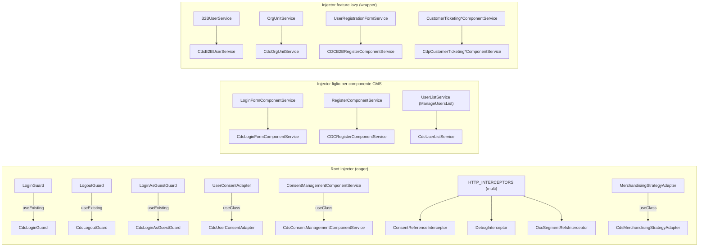
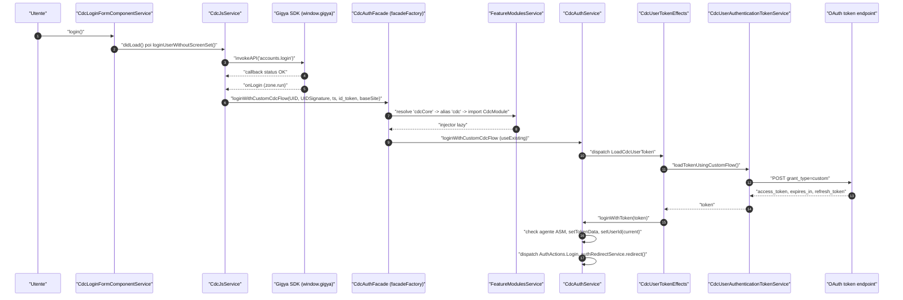
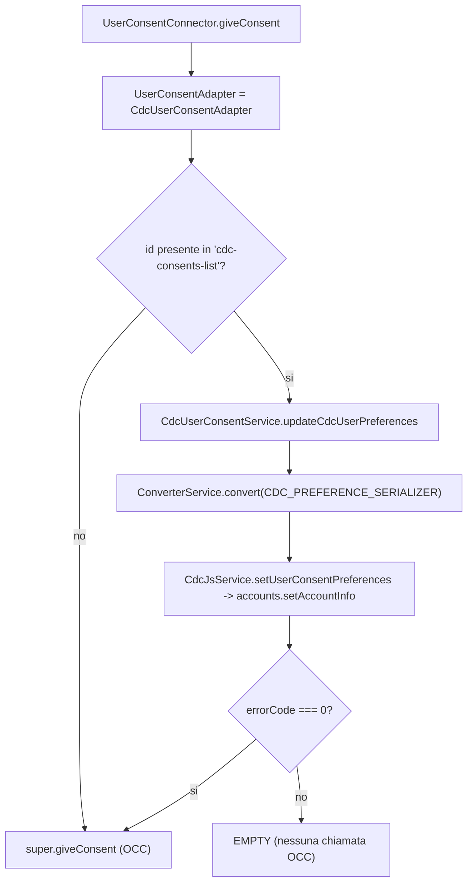
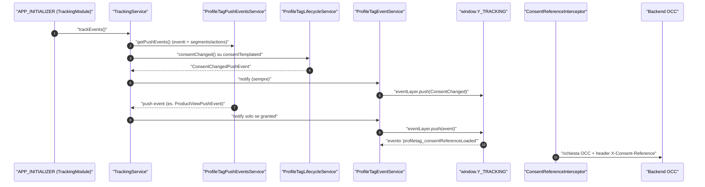

# 34 — Integration libs: CDC, CDP, CDS, segment-refs

> Riferimenti allo SHA `5b7a1c2bf2808d7380bc20596d10f4fa710c3da1` (vedi [00-meta](../00-meta.md)).

## 1. A cosa serve e perché esiste

Le librerie di `integration-libs/` collegano lo storefront a prodotti SAP che **non** fanno parte del backend Commerce standard e che richiedono addon o servizi cloud dedicati. Questo capitolo copre quattro di esse:

| Libreria | Sistema esterno | Cosa fa nello storefront | Meccanismo dominante |
|---|---|---|---|
| `@spartacus/cdc` | SAP Customer Data Cloud (ex Gigya) | Sostituisce login, registrazione, logout, gestione profilo, consensi e (in B2B) amministrazione utenti/unità con le API del Gigya JS SDK; poi ottiene un token OAuth Commerce con `grant_type=custom` | override via DI di guard, adapter, component service; `APP_INITIALIZER`; feature lazy con facade |
| `@spartacus/cdp` | SAP Customer Data Platform | Rende read-only il customer ticketing (niente chiusura, riapertura, invio messaggi) | override via DI di 3 component service |
| `@spartacus/cds` | SAP Context-Driven Services (Emarsys/ProfileTag) | Carousel di merchandising da strategie CDS, tracciamento comportamentale con lo script ProfileTag, recent/trending searches | adapter/connector, componenti CMS, `HTTP_INTERCEPTORS`, `APP_INITIALIZER`, outlet |
| `@spartacus/segment-refs` | segmenti esterni (riferimenti a segmenti per la personalizzazione OCC) | Inoltra all'OCC un header con il riferimento di segmento letto da query param/localStorage | un solo `HTTP_INTERCEPTORS` |

Il filo conduttore — e la ragione per cui conviene leggere queste librerie anche se non si usano i prodotti — è che **quasi tutta l'integrazione è fatta sostituendo servizi di core e delle feature lib via Dependency Injection**, senza modificare una riga delle librerie originali. In CDC si trovano tutti gli stili di override che Spartacus offre:

1. **override di un token nel root injector** con `useExisting`/`useClass` (guard di login/logout, `UserConsentAdapter`): `integration-libs/cdc/root/cdc-root.module.ts:L53-L69`, `integration-libs/cdc/root/consent-management/cdc-consent.module.ts:L16-L31`;
2. **override "scoped" nell'injector di un singolo componente CMS** tramite `cmsComponents.<Tipo>.providers` (login form, registrazione, profilo): `integration-libs/cdc/user-account/login-form/cdc-login-form.module.ts:L44-L68`, meccanismo in `core-libs/storefront/cms-structure/page/component/services/cms-injector.service.ts:L28-L50`;
3. **override nell'injector di una feature lazy** importando il modulo di estensione *dopo* quello originale nel wrapper lazy (`CdcAdministrationModule`, `CdpCustomerTicketingModule`): `projects/storefrontapp/src/app/spartacus/features/organization/administration-wrapper.module.ts:L12-L20`, `projects/storefrontapp/src/app/spartacus/features/customer-ticketing/customer-ticketing-wrapper.module.ts:L13-L22`;
4. **override di configurazione** (route semantiche, `authentication.customLoginPage`): `integration-libs/cdc/root/config/default-cdc-routing-config.ts:L9-L35`, `integration-libs/cdc/user-account/login-form/cdc-login-form.module.ts:L44-L48`;
5. **estensione per sottoclasse** di classi core con metodi `protected` sovrascritti (`CdcLoginGuard extends LoginGuard`, `CdcUserConsentAdapter extends OccUserConsentAdapter`): `integration-libs/cdc/root/guards/cdc-login.guard.ts:L12-L32`, `integration-libs/cdc/root/consent-management/cdc-user-consent.adapter.ts:L35-L65`.

CDS, al contrario, è soprattutto **additivo**: aggiunge interceptor, initializer, componenti CMS e outlet (`integration-libs/cds/src/profiletag/profile-tag.module.ts:L16-L32`, `integration-libs/cds/src/cds.module.ts:L26-L47`), e sostituisce un solo token astratto che è suo (`MerchandisingStrategyAdapter`, `integration-libs/cds/src/merchandising/merchandising.module.ts:L12-L21`). CDP e segment-refs sono librerie minime, utili come esempi "da una pagina" di override (`integration-libs/cdp/customer-ticketing/cdp-customer-ticketing.module.ts:L17-L35`) e di interceptor (`integration-libs/segment-refs/root/http-interceptors/occ-segment-refs.interceptor.ts:L69-L86`).

Prerequisiti utili: [01 — Dependency Injection](../parte-1/01-dependency-injection.md), [12 — Feature module e lazy loading](../parte-2/12-feature-module-lazy.md), [11 — Configurazione](../parte-2/11-configurazione.md), [20 — Facade, command & query, eventi](../parte-2/20-facade-command-query-eventi.md), [22 — Autenticazione](../parte-2/22-auth.md), [16 — CMS rendering](../parte-2/16-cms-rendering.md).

## 2. Mappa dei file

### 2.1 `integration-libs/cdc`

Entry point secondari: `@spartacus/cdc` (lazy), `/root` (eager), `/core`, `/components`, `/user-account`, `/user-profile`, `/organization/administration`, `/organization/user-registration`.

| Path | Ruolo |
|---|---|
| `integration-libs/cdc/public_api.ts` | esporta solo `CdcModule` (`L7-L7`) |
| `integration-libs/cdc/cdc.module.ts` | `CdcModule` = `CdcComponentsModule` + `CdcCoreModule`, target del lazy load di `CDC_FEATURE` |
| `integration-libs/cdc/root/public_api.ts` | entry `@spartacus/cdc/root` |
| `integration-libs/cdc/root/cdc-root.module.ts` | `CdcRootModule` eager: override dei 3 guard, `APP_INITIALIZER` Gigya, `featureModules`, routing |
| `integration-libs/cdc/root/feature-name.ts` | `CDC_FEATURE = 'cdc'`, `CDC_CORE_FEATURE = 'cdcCore'` |
| `integration-libs/cdc/root/config/cdc-config.ts` | `CdcConfig` (array `cdc[]` per base site) |
| `integration-libs/cdc/root/config/default-cdc-routing-config.ts` | route `cdcLogin`, `cdcCheckoutLogin`, `cdcOrgRegistration`, ridefinizione `login`/`loginForm` |
| `integration-libs/cdc/root/facade/cdc-auth.facade.ts` | `CdcAuthFacade` (facade lazy su `cdcCore`) |
| `integration-libs/cdc/root/events/cdc-event.ts` | `CdcLoadUserTokenFailEvent`, `CdcReConsentEvent` |
| `integration-libs/cdc/root/guards/cdc-login.guard.ts` | `CdcLoginGuard extends LoginGuard` |
| `integration-libs/cdc/root/guards/cdc-logout.guard.ts` | `CdcLogoutGuard extends LogoutGuard` |
| `integration-libs/cdc/root/guards/cdc-login-as-guest.guard.ts` | `CdcLoginAsGuestGuard extends LoginAsGuestGuard` |
| `integration-libs/cdc/root/service/cdc-js.service.ts` | `CdcJsService`: carica lo script Gigya e avvolge le sue API callback in Observable |
| `integration-libs/cdc/root/consent-management/cdc-consent.module.ts` | override `UserConsentAdapter`, `ConsentManagementComponentService`, serializer |
| `integration-libs/cdc/root/consent-management/cdc-user-consent.adapter.ts` | `CdcUserConsentAdapter extends OccUserConsentAdapter` |
| `integration-libs/cdc/root/consent-management/converters/cdc-preference.serializer.ts` | `CdcPreferenceSerializer` (consensi → `preferences` annidate) |
| `integration-libs/cdc/root/consent-management/converters/converter.ts` | token multi `CDC_PREFERENCE_SERIALIZER` |
| `integration-libs/cdc/root/consent-management/model/cdc-consent-management.model.ts` | augmentation di `LAUNCH_CALLER` e `UserSignUp` |
| `integration-libs/cdc/root/consent-management/services/cdc-consents-local-storage.service.ts` | persistenza `cdc-consents-list` |
| `integration-libs/cdc/root/consent-management/services/cdc-consent-management-component.service.ts` | consensi obbligatori CDC + core |
| `integration-libs/cdc/root/consent-management/services/cdc-user-consent.service.ts` | `updateCdcUserPreferences` |
| `integration-libs/cdc/core/public_api.ts` | entry `@spartacus/cdc/core` (store non esportato) |
| `integration-libs/cdc/core/cdc-core.module.ts` | `CdcCoreModule`: auth + eventi + store + `facadeProviders` |
| `integration-libs/cdc/core/auth/facade/facade-providers.ts` | `CdcAuthFacade → CdcAuthService` |
| `integration-libs/cdc/core/auth/facade/cdc-auth.service.ts` | `CdcAuthService`: dispatch, check ASM, scrittura token |
| `integration-libs/cdc/core/auth/services/user-authentication/cdc-user-authentication-token.service.ts` | POST token endpoint `grant_type=custom` |
| `integration-libs/cdc/core/store/actions/cdc-user-token.action.ts` | `LOAD_CDC_USER_TOKEN(_FAIL)` |
| `integration-libs/cdc/core/store/effects/cdc-user-token.effect.ts` | effect token |
| `integration-libs/cdc/core/store/effects/cdc-user-addresses.effect.ts` | sincronizzazione indirizzo di default verso CDC |
| `integration-libs/cdc/core/events/cdc-event.builder.ts` | azione `LOAD_CDC_USER_TOKEN_FAIL` → evento |
| `integration-libs/cdc/core/models/cms.model.ts` | `GigyaRaasComponentData` |
| `integration-libs/cdc/components/gigya-raas/gigya-raas.module.ts` | mapping CMS `GigyaRaasComponent` + layout `GigyaLoginPageTemplate` |
| `integration-libs/cdc/components/gigya-raas/gigya-raas.component.ts` | componente che mostra gli screen-set Gigya |
| `integration-libs/cdc/components/gigya-raas/gigya-raas.guard.ts` | guard CMS (auth/not-auth per componente) |
| `integration-libs/cdc/user-account/login-form/cdc-login-form.module.ts` | override scoped del login form + `customLoginPage: undefined` |
| `integration-libs/cdc/user-account/login-form/cdc-login-form-component.service.ts` | login via `accounts.login` |
| `integration-libs/cdc/user-account/login-form/reconsent/*` | dialog di reconsent (`CDC_RECONSENT`) |
| `integration-libs/cdc/user-profile/cdc-user-profile.module.ts` | aggregatore degli override profilo |
| `integration-libs/cdc/user-profile/register/cdc-register.module.ts` | override scoped `RegisterComponentService` |
| `integration-libs/cdc/user-profile/register/cdc-register-component.service.ts` | registrazione via CDC + consensi aggiuntivi |
| `integration-libs/cdc/user-profile/{forgot-password,update-email,update-password,update-profile}/*` | override scoped dei rispettivi component service |
| `integration-libs/cdc/organization/administration/cdc-administration.module.ts` | override `B2BUserService`, `OrgUnitService`, `UserListService` |
| `integration-libs/cdc/organization/administration/cdc-user-list.service.ts` | apre il Delegated Admin CDC |
| `integration-libs/cdc/organization/user-registration/cdc-b2b-register.module.ts` | override `UserRegistrationFormService` |
| `integration-libs/cdc/assets/translations/translations.ts` | chunk i18n `cdc: ['reconsent','cdcProfile']` |

### 2.2 `integration-libs/cds`

| Path | Ruolo |
|---|---|
| `integration-libs/cds/public_api.ts` | entry `@spartacus/cds` (no `recent-searches`, no `services`, no `utils`) |
| `integration-libs/cds/src/cds.module.ts` | `CdsModule` eager + `forRoot(config?)` |
| `integration-libs/cds/src/config/cds-config.ts` | `CdsConfig` |
| `integration-libs/cds/src/config/default-cds-config.ts` | default (`tenant: ''`, `consentTemplateId: 'PROFILE'`, soglia 80) |
| `integration-libs/cds/src/config/cds-config-validator.ts` | `cdsConfigValidator` |
| `integration-libs/cds/src/config/profile-tag.config.ts` | `ProfileTagConfig` |
| `integration-libs/cds/src/cds-models/cds-endpoints.model.ts` | `CdsEndpoints` (`strategyProducts`, `searchIntelligence`) |
| `integration-libs/cds/src/services/cds-endpoints.service.ts` | costruzione URL CDS |
| `integration-libs/cds/src/utils/dynamic-template.ts` | sostituzione `${placeholder}` |
| `integration-libs/cds/src/merchandising/merchandising.module.ts` | `MerchandisingStrategyAdapter → CdsMerchandisingStrategyAdapter` |
| `integration-libs/cds/src/merchandising/connectors/strategy/merchandising-strategy.adapter.ts` | adapter astratto |
| `integration-libs/cds/src/merchandising/connectors/strategy/merchandising-strategy.connector.ts` | connector |
| `integration-libs/cds/src/merchandising/adapters/strategy/cds-merchandising-strategy.adapter.ts` | GET strategy products |
| `integration-libs/cds/src/merchandising/facade/cds-merchandising-product.service.ts` | composizione `StrategyRequest` |
| `integration-libs/cds/src/merchandising/facade/cds-merchandising-user-context.service.ts` | contesto utente (consenso, pagina, facet, ricerca) |
| `integration-libs/cds/src/merchandising/facade/cds-merchandising-site-context.service.ts` | contesto sito |
| `integration-libs/cds/src/merchandising/cms-components/merchandising-carousel-cms.module.ts` | mapping CMS `MerchandisingCarouselComponent` |
| `integration-libs/cds/src/merchandising/cms-components/merchandising-carousel/merchandising-carousel.component.ts` | componente carousel |
| `integration-libs/cds/src/merchandising/cms-components/merchandising-carousel/merchandising-carousel.component.service.ts` | modello, soglia viewport, eventi |
| `integration-libs/cds/src/merchandising/cms-components/directives/attributes/attributes.directive.ts` | `cxAttributes` |
| `integration-libs/cds/src/profiletag/profile-tag.module.ts` | interceptor, adapter notifica login, `provideLoginEventsTracking()` |
| `integration-libs/cds/src/profiletag/http-interceptors/consent-reference-interceptor.ts` | header `X-Consent-Reference` |
| `integration-libs/cds/src/profiletag/http-interceptors/debug-interceptor.ts` | header `X-Profile-Tag-Debug` |
| `integration-libs/cds/src/profiletag/cms-components/profile-tag.component.ts` | componente CMS senza UI |
| `integration-libs/cds/src/profiletag/services/profiletag-event.service.ts` | script ProfileTag, `Y_TRACKING`, consent reference |
| `integration-libs/cds/src/profiletag/services/profile-tag-push-events.service.ts` | eventi Spartacus → push event |
| `integration-libs/cds/src/profiletag/services/profile-tag-lifecycle.service.ts` | consenso e login |
| `integration-libs/cds/src/profiletag/services/profile-tag.injector.service.ts` | `track()` |
| `integration-libs/cds/src/profiletag/providers/login-events.provider.ts` | `LOGIN_EVENTS` + `provideAppInitializer` |
| `integration-libs/cds/src/profiletag/adapters/occ-backend-notification-adapter.ts` | POST `/users/{id}/loginnotification` |
| `integration-libs/cds/src/profiletag/tracking/tracking.module.ts` | `APP_INITIALIZER` del tracking |
| `integration-libs/cds/src/profiletag/tracking/tracking.service.ts` | filtro per consenso e inoltro |
| `integration-libs/cds/src/recent-searches/recent-searches.module.ts` | outlet recent searches |
| `integration-libs/cds/src/trending-searches/trending-searches.module.ts` | outlet trending searches |
| `integration-libs/cds/src/trending-searches/trending-searches.service.ts` | polling `searchIntelligence` |

### 2.3 `integration-libs/cdp` e `integration-libs/segment-refs`

| Path | Ruolo |
|---|---|
| `integration-libs/cdp/public_api.ts` | entry `@spartacus/cdp` → solo `customer-ticketing` |
| `integration-libs/cdp/customer-ticketing/cdp-customer-ticketing.module.ts` | override di 3 component service |
| `integration-libs/cdp/customer-ticketing/cdp-customer-ticketing-close-component.service.ts` | `enableCloseButton → of(false)` |
| `integration-libs/cdp/customer-ticketing/cdp-customer-ticketing-reopen-component.service.ts` | `enableReopenButton → of(false)` |
| `integration-libs/cdp/customer-ticketing/cdp-customer-ticketing-messages-component.service.ts` | `displayAddMessageSection → false` |
| `integration-libs/segment-refs/public_api.ts` | entry `@spartacus/segment-refs` |
| `integration-libs/segment-refs/root/segment-refs-root.module.ts` | interceptor + default config |
| `integration-libs/segment-refs/root/config/segment-refs-config.ts` | `SegmentRefsConfig` (non esportato) |
| `integration-libs/segment-refs/root/config/default-segment-refs-config.ts` | `httpHeaderName: 'Segmentrefs'` |
| `integration-libs/segment-refs/root/http-interceptors/occ-segment-refs.interceptor.ts` | `OccSegmentRefsInterceptor` |
| `integration-libs/segment-refs/root/feature-name.ts` | `SEGMENT_REFS_FEATURE` (inutilizzata) |

### 2.4 Wiring (schematics e demo app)

| Path | Ruolo |
|---|---|
| `core-libs/schematics/src/shared/lib-configs/integration-libs/cdc-schematics-config.ts` | root module eager, chunk lazy, `importAfter` per user/organization |
| `core-libs/schematics/src/shared/lib-configs/integration-libs/cds-schematics-config.ts` | `CdsModule.forRoot()`, endpoint generati, `lazy: false` |
| `core-libs/schematics/src/shared/lib-configs/integration-libs/cdp-schematics-config.ts` | `importAfter` su `CustomerTicketingModule` |
| `core-libs/schematics/src/shared/lib-configs/integration-libs/segment-refs-schematics-config.ts` | dipendenza da personalization |
| `projects/storefrontapp/src/app/spartacus/features/cdc/cdc-feature.module.ts` | `CdcRootModule` + lazy `CdcModule` |
| `projects/storefrontapp/src/app/spartacus/features/cds/cds-feature.module.ts` | factory config CDS per base site |
| `projects/storefrontapp/src/app/spartacus/features/user/user-account-wrapper.module.ts` | `CDCUserAccountModule` dopo `UserAccountModule` |
| `projects/storefrontapp/src/app/spartacus/features/organization/administration-wrapper.module.ts` | `CdcAdministrationModule` dopo `AdministrationModule` |
| `projects/storefrontapp/src/app/spartacus/features/customer-ticketing/customer-ticketing-wrapper.module.ts` | `CdpCustomerTicketingModule` nel wrapper lazy |

## 3. Come funziona passo per passo

### 3.1 CDC: struttura root/lazy

CDC segue la convenzione root/lazy descritta in [12 — Feature module e lazy loading](../parte-2/12-feature-module-lazy.md), con una particolarità: il root module non è affatto "leggero".

1. **Nomi delle feature.** `CDC_FEATURE = 'cdc'` e `CDC_CORE_FEATURE = 'cdcCore'` — `integration-libs/cdc/root/feature-name.ts:L7-L8`.
2. **Config CMS di default.** `defaultCdcComponentsConfig` dichiara che la feature `cdc` possiede il componente CMS `GigyaRaasComponent` e che `cdcCore` è un **alias stringa** di `cdc` ("by default core is bundled together with components") — `integration-libs/cdc/root/cdc-root.module.ts:L40-L51`. L'alias è risolto da `FeatureModulesService.resolveFeatureAlias`, che segue la catena finché il valore è una stringa — `core-libs/core/src/lazy-loading/feature-modules.service.ts:L95-L100`.
3. **Modulo lazy.** `CdcModule` importa `CdcComponentsModule` e `CdcCoreModule` — `integration-libs/cdc/cdc.module.ts:L7-L14`. Nella demo app `CdcFeatureModule` importa `CdcRootModule` e registra `module: () => import('@spartacus/cdc').then((m) => m.CdcModule)` — `projects/storefrontapp/src/app/spartacus/features/cdc/cdc-feature.module.ts:L17-L40`.
4. **Root module eager.** `CdcRootModule` importa `CdcConsentManagementModule` e fornisce: config CMS, tre override di guard con `useExisting`, un `APP_INITIALIZER` e la routing config — `integration-libs/cdc/root/cdc-root.module.ts:L53-L69`.
5. **Facade lazy.** `CdcAuthFacade` è una classe astratta `providedIn: 'root'` con `useFactory: () => facadeFactory({ facade, feature: CDC_CORE_FEATURE, methods: ['loginWithCustomCdcFlow','loginWithToken'], async: true })` — `integration-libs/cdc/root/facade/cdc-auth.facade.ts:L11-L33`. Con `async: true` il resolver aggiunge `delay(0)` e ogni chiamata di metodo è resa *eager* con `connectable(...).connect()` su `ReplaySubject`: il metodo reale viene invocato anche se il chiamante non si sottoscrive — `core-libs/core/src/lazy-loading/facade-factory/facade-factory.service.ts:L53-L56`, `core-libs/core/src/lazy-loading/facade-factory/facade-factory.service.ts:L70-L82`. Quando il modulo lazy è caricato, `facadeProviders` lega la facade a `CdcAuthService` con `useExisting` — `integration-libs/cdc/core/auth/facade/facade-providers.ts:L11-L17`.
6. **Core lazy.** `CdcCoreModule` importa `CdcAuthModule`, `CdcEventModule`, `CdcStoreModule` — `integration-libs/cdc/core/cdc-core.module.ts:L13-L17`; lo store registra `EffectsModule.forFeature(effects)` — `integration-libs/cdc/core/store/cdc-store.module.ts:L14-L18` — con `CdcUserTokenEffects` e `CdcUserAddressesEffects` — `integration-libs/cdc/core/store/effects/index.ts:L10-L10`.

Conseguenza: tutto ciò che deve esistere **prima** del primo login (guard, script Gigya, consensi, `CdcJsService`) sta nel root; la parte NgRx che produce il token Commerce è lazy e viene scaricata alla prima chiamata della facade.

### 3.2 CDC: bootstrap dello script Gigya

1. `cdcJsFactory` restituisce una funzione che ritorna `lastValueFrom(configInit.getStable('context', 'cdc').pipe(tap(() => cdcJsService.initialize())))` — `integration-libs/cdc/root/cdc-root.module.ts:L26-L38`. Il token `APP_INITIALIZER` è deprecato da Angular v19 a favore di `provideAppInitializer` — `angular:packages/core/src/application/application_init.ts:L38-L38`.
2. `getStable(...scopes)` emette subito se la config è già stabile, altrimenti attende che nessuno scope in corso si sovrapponga a quelli richiesti — `core-libs/core/src/config/config-initializer/config-initializer.service.ts:L58-L70`. Tra gli initializer di core con scope dichiarati ci sono quelli di site context (`['context']`), i18n (`['i18n.fallbackLang']`), auth (`['authentication.OAuthLibConfig.redirectUri', 'authentication.client_id']`) e secure portal (`['routing']`); nessuno si sovrappone a `'cdc'` — `core-libs/core/src/site-context/config/config-loader/site-context-config-initializer.ts:L26-L26`, `core-libs/core/src/i18n/config/i18n-config-initializer.ts:L16-L16`, `core-libs/core/src/auth/user-auth/config/auth-config-initializer.ts:L20-L23`, `core-libs/core/src/routing/configurable-routes/secure-portal-config/secure-portal-config-initializer.ts:L18-L18`; `scopesOverlap` usa il confronto per prefisso puntato — `core-libs/core/src/config/config-initializer/config-initializer.service.ts:L117-L122`. Quindi lo scope `'cdc'` serve solo se l'applicazione registra un proprio initializer con quello scope (nessuno nel repo: vedi §9).
3. `loadCdcJavascript` agisce **solo in browser** (`isPlatformBrowser`), prende il primo valore di base site e lingua attivi (`take(1)`) — `integration-libs/cdc/root/service/cdc-js.service.ts:L94-L103`.
4. La config per base site si sceglie filtrando `cdcConfig.cdc` per `baseSite` e prendendo il primo elemento; senza corrispondenza ritorna `''` e nessuno script viene caricato — `integration-libs/cdc/root/service/cdc-js.service.ts:L141-L149`.
5. L'URL è `javascriptUrl&lang=<lingua>`, iniettato con `ScriptLoader.embedScript`. Al `load` registra gli handler Gigya, scarica i consensi del sito persistendoli in local storage ed emette `loaded$ = true`; all'errore `errorLoading$ = true` — `integration-libs/cdc/root/service/cdc-js.service.ts:L104-L122`. Poi imposta `window.__gigyaConf = { include: 'id_token, missing-required-fields, preferences' }` — `integration-libs/cdc/root/service/cdc-js.service.ts:L123-L129`.
6. `ScriptLoader.embedScript` in SSR non accetta callback, e in browser non reinserisce uno script già presente — `core-libs/core/src/util/script-loader.service.ts:L55-L61`, `core-libs/core/src/util/script-loader.service.ts:L84-L89`.
7. `addCdcEventHandlers` legge `window.gigya` e registra `onLogin`, eseguito dentro `zone.run` (le callback del SDK arrivano fuori dalla zona Angular) — `integration-libs/cdc/root/service/cdc-js.service.ts:L165-L173`.

`CdcJsService` conserva `loaded$` ed `errorLoading$` come `ReplaySubject(1)` — `integration-libs/cdc/root/service/cdc-js.service.ts:L43-L52` — esposti come `didLoad()` / `didScriptFailToLoad()` e consumati da componenti e component service (es. `integration-libs/cdc/components/gigya-raas/gigya-raas.component.ts:L27-L59`).

### 3.3 CDC: il ponte `invokeAPI` verso il Gigya SDK

Tutte le operazioni "without screen-set" passano per un unico metodo:

1. `getSdkFunctionFromName` scende in `gigyaSDK` lungo i segmenti del nome puntato (`accounts.setAccountInfo`) con `hasOwnProperty`; un segmento mancante viene saltato — `integration-libs/cdc/root/service/cdc-js.service.ts:L713-L726`.
2. `invokeAPI` crea un Observable **cold** (`new Observable`), chiama `actualAPI({...payload, callback})` e nella callback, dentro `zone.run`, emette `next + complete` se `status === 'OK'`, altrimenti `error(response)` — `integration-libs/cdc/root/service/cdc-js.service.ts:L734-L755`.

Su questo ponte sono costruiti:

| Metodo di `CdcJsService` | API Gigya | Riferimento |
|---|---|---|
| `registerUserWithoutScreenSet` | `accounts.initRegistration` → `accounts.register` (`finalizeRegistration: true`) | `integration-libs/cdc/root/service/cdc-js.service.ts:L199-L243` |
| `loginUserWithoutScreenSet` | `accounts.login` (`ignoreInterruptions` solo se canale `B2C`, `sessionExpiry`) | `integration-libs/cdc/root/service/cdc-js.service.ts:L252-L292` |
| `registerOrganisationWithoutScreenSet` | `accounts.b2b.registerOrganization` | `integration-libs/cdc/root/service/cdc-js.service.ts:L299-L344` |
| `getOrganizationContext` | `accounts.b2b.getOrganizationContext` | `integration-libs/cdc/root/service/cdc-js.service.ts:L350-L352` |
| `openDelegatedAdminLogin` (chiamata diretta al SDK dentro `zone.run`, **non** via `invokeAPI`) | `accounts.b2b.openDelegatedAdminLogin` | `integration-libs/cdc/root/service/cdc-js.service.ts:L359-L365` |
| `resetPasswordWithoutScreenSet` | `accounts.resetPassword` | `integration-libs/cdc/root/service/cdc-js.service.ts:L460-L494` |
| `updateProfileWithoutScreenSet` | `accounts.setAccountInfo` (+ update Commerce) | `integration-libs/cdc/root/service/cdc-js.service.ts:L502-L528` |
| `updateUserPasswordWithoutScreenSet` | `accounts.setAccountInfo` (`password`, `newPassword`) | `integration-libs/cdc/root/service/cdc-js.service.ts:L536-L557` |
| `updateUserEmailWithoutScreenSet` | `accounts.login` con `skipOccAuth` + `setAccountInfo` | `integration-libs/cdc/root/service/cdc-js.service.ts:L635-L650` |
| `updateAddressWithoutScreenSet` | `accounts.setAccountInfo` (`profile.address`, ...) | `integration-libs/cdc/root/service/cdc-js.service.ts:L687-L706` |
| `getSiteConsentDetails` | `accounts.getSiteConsentDetails` (apikey dalla query di `javascriptUrl`) | `integration-libs/cdc/root/service/cdc-js.service.ts:L762-L782` |
| `setUserConsentPreferences` | `accounts.setAccountInfo` (`preferences`, `regToken`) | `integration-libs/cdc/root/service/cdc-js.service.ts:L792-L812` |

Il caso più curioso è l'update email: "CDC doesn't have any specific api, for verifying a password", quindi il codice chiama `loginUserWithoutScreenSet(email, password, { skipOccAuth: true })` come verifica e poi `setAccountInfo` — `integration-libs/cdc/root/service/cdc-js.service.ts:L635-L650`. Il flag `skipOccAuth` arriva nel `context` della risposta `onLogin` ed evita il ri-login su Commerce — `integration-libs/cdc/root/service/cdc-js.service.ts:L181-L192`.

### 3.4 CDC: dal login Gigya al token OAuth Commerce

1. **Origine del login.** O lo screen-set Gigya (`GigyaRaasComponent.showScreenSet` → `gigya.accounts.showScreenSet`, `integration-libs/cdc/components/gigya-raas/gigya-raas.component.ts:L80-L105`) o il form Spartacus (`CdcLoginFormComponentService.login` → `loginUserWithoutScreenSet`, `integration-libs/cdc/user-account/login-form/cdc-login-form-component.service.ts:L34-L66`).
2. **`onLogin` di Gigya** → `onLoginEventHandler` chiama `cdcAuth.loginWithCustomCdcFlow(UID, UIDSignature, signatureTimestamp, id_token || '', baseSite)` salvo `skipOccAuth` — `integration-libs/cdc/root/service/cdc-js.service.ts:L181-L192`.
3. **Facade → lazy load.** La facade risolve `cdcCore` → alias `cdc` → carica `CdcModule` — `integration-libs/cdc/root/facade/cdc-auth.facade.ts:L11-L33`, `core-libs/core/src/lazy-loading/feature-modules.service.ts:L95-L100`.
4. **Dispatch.** `CdcAuthService.loginWithCustomCdcFlow` dispatcha `LoadCdcUserToken` — `integration-libs/cdc/core/auth/facade/cdc-auth.service.ts:L47-L63`; azione `'[Auth] Load CDC User Token'` — `integration-libs/cdc/core/store/actions/cdc-user-token.action.ts:L10-L41`.
5. **Effect.** `CdcUserTokenEffects.loadCdcUserToken$` chiama `loadTokenUsingCustomFlow` — `integration-libs/cdc/core/store/effects/cdc-user-token.effect.ts:L25-L59` — che fa POST al token endpoint OAuth con `grant_type=custom`, `client_id`, `client_secret` e i campi CDC URL-encoded — `integration-libs/cdc/core/auth/services/user-authentication/cdc-user-authentication-token.service.ts:L43-L60`.
6. **Successo.** L'effect chiama `cdcAuthService.loginWithToken(token)` e ritorna `EMPTY` — `integration-libs/cdc/core/store/effects/cdc-user-token.effect.ts:L40-L43`. `loginWithToken` verifica prima che non ci sia un agente ASM loggato (se lo storage è un `AsmAuthStorageService` con token di tipo `CSAgent`, mostra `asm.auth.agentLoggedInError`) — `integration-libs/cdc/core/auth/facade/cdc-auth.service.ts:L68-L104`; poi `setTokenData`, `setUserId(OCC_USER_ID_CURRENT)`, `AuthActions.Login()`, rimozione errori globali e `authRedirectService.redirect()` — `integration-libs/cdc/core/auth/facade/cdc-auth.service.ts:L106-L120`.
7. **Formato token.** `setTokenData` scrive nello `AuthStorageService` le stesse chiavi che userebbe la libreria OAuth: `access_token`, `granted_scopes`, `access_token_stored_at`, `expires_at`, `refresh_token` — `integration-libs/cdc/core/auth/facade/cdc-auth.service.ts:L123-L145`. Da qui in poi il resto dello storefront (interceptor, refresh) vede un utente normalmente autenticato: vedi [22 — Autenticazione](../parte-2/22-auth.md).
8. **Errore.** Messaggio `httpHandlers.badGateway` e azione `LoadCdcUserTokenFail` — `integration-libs/cdc/core/store/effects/cdc-user-token.effect.ts:L44-L55` — che `CdcEventBuilder` trasforma in `CdcLoadUserTokenFailEvent` via `StateEventService.register` — `integration-libs/cdc/core/events/cdc-event.builder.ts:L33-L38`.

⚠️ DA VERIFICARE: quale estensione lato Commerce accetti `grant_type=custom` con questi parametri; il codice Spartacus non lo dichiara (dossier Q1).

### 3.5 CDC: override dei guard di login/logout

| Guard core | Override CDC | Cosa cambia | Riferimento |
|---|---|---|---|
| `LoginGuard` (storefront) | `CdcLoginGuard` | `shouldRenderCMSPage()` → sempre `of(true)`: la pagina CMS di login è sempre mostrata e non si fa mai `loginWithRedirect()` verso il server OAuth | `integration-libs/cdc/root/guards/cdc-login.guard.ts:L12-L32`; base `core-libs/storefront/cms-components/user/login-route/login.guard.ts:L34-L65` |
| `LogoutGuard` (storefront) | `CdcLogoutGuard` | `logout()` esegue in parallelo `super.logout()` (`auth.coreLogout()`) e `gigya.accounts.logout()` | `integration-libs/cdc/root/guards/cdc-logout.guard.ts:L43-L55`; base `core-libs/storefront/cms-components/user/logout/logout.guard.ts:L87-L89` |
| `LoginAsGuestGuard` (user/account/components) | `CdcLoginAsGuestGuard` | `getPath()` usa la route `login` invece di `loginForm` | `integration-libs/cdc/root/guards/cdc-login-as-guest.guard.ts:L10-L17`; base `feature-libs/user/account/components/guards/login-as-guest.guard.ts:L26-L28` |

Gli override funzionano perché le route non referenziano la classe concreta ma il token: `canActivate: [LoginGuard]` — `core-libs/storefront/cms-components/user/login-route/login-route.module.ts:L29-L29`; `canActivate: [LogoutGuard, CmsPageGuard]` — `core-libs/storefront/cms-components/user/logout/logout.module.ts:L25-L25`; `guards: [NotAuthGuard, LoginAsGuestGuard]` nel componente login-register — `feature-libs/user/account/components/login-register/login-register.module.ts:L37-L37`. Il cambio di path in `CdcLoginAsGuestGuard` è coerente con la routing config CDC, che svuota `loginForm.paths` "to avoid same path in different routes" — `integration-libs/cdc/root/config/default-cdc-routing-config.ts:L9-L35`.

### 3.6 CDC: override "scoped" dei component service

I moduli `CDCLoginFormModule`, `CDCRegisterModule`, `CDCForgotPasswordModule`, `CDCUpdateProfileModule`, `CDCUpdatePasswordModule`, `CDCUpdateEmailModule` non toccano il root injector: aggiungono `providers` alla mappatura CMS del componente.

1. `CDCLoginFormModule` imposta `authentication.customLoginPage: undefined` e ridefinisce `ReturningCustomerLoginComponent` con `guards: [NotAuthGuard]` e il provider `LoginFormComponentService → CdcLoginFormComponentService` con `deps` espliciti — `integration-libs/cdc/user-account/login-form/cdc-login-form.module.ts:L44-L68`.
2. `CmsInjectorService.getInjector` crea per ogni istanza di componente un `Injector.create` figlio con quei provider (parent = injector del modulo/feature) — `core-libs/storefront/cms-structure/page/component/services/cms-injector.service.ts:L28-L50`. L'override vale **solo** nell'albero di quel componente.
3. Il default di user/account per lo stesso componente ha `guards: [NotAuthGuard, CustomLoginGuard]` — `feature-libs/user/account/components/login-form/login-form.module.ts:L52-L59`. Siccome `deepMerge` sostituisce gli array (ramo `else`) — `core-libs/core/src/config/utils/deep-merge.ts:L36-L45` — l'override CDC rimuove `CustomLoginGuard`. Allo stesso modo `customLoginPage: undefined` sovrascrive il default `{ csrfEndpoint: '/csrf', loginFormEndpoint: '/login' }` e fa ritornare `false` a `customLoginEnabled()` — `core-libs/core/src/auth/user-auth/config/default-auth-config.ts:L65-L68`, `core-libs/core/src/auth/user-auth/services/auth-config.service.ts:L105-L107`.
4. `CdcLoginFormComponentService.login()` attende `didLoad()`, poi `loginUserWithoutScreenSet(userId.toLowerCase(), password)`; se lo script non c'è mostra `errorHandlers.scriptFailedToLoad` — `integration-libs/cdc/user-account/login-form/cdc-login-form-component.service.ts:L34-L66`. `initCustomLogin()` è sovrascritto vuoto "so csrf token is not initialized in case of CDC" — `integration-libs/cdc/user-account/login-form/cdc-login-form-component.service.ts:L68-L70`; nel servizio base è invocato dal costruttore con `authorizationCodeFlowByDefault` — `feature-libs/user/account/components/login-form/login-form-component.service.ts:L89-L91`.
5. `CDCRegisterModule` aggiunge a `RegisterCustomerComponent` solo `providers: [RegisterComponentService → CDCRegisterComponentService]`, lasciando `component`/`guards` del default — `integration-libs/cdc/user-profile/register/cdc-register.module.ts:L38-L51`. Lo stesso schema per `ForgotPasswordComponent`, `UpdateProfileComponent`, `UpdatePasswordComponent`, `UpdateEmailComponent` — `integration-libs/cdc/user-profile/forgot-password/cdc-forgot-password.module.ts:L35-L47`, `integration-libs/cdc/user-profile/update-profile/cdc-update-profile.module.ts:L39-L52`, `integration-libs/cdc/user-profile/update-password/cdc-update-password.module.ts:L37-L50`, `integration-libs/cdc/user-profile/update-email/cdc-update-email.module.ts:L37-L50`.
6. `CDCRegisterComponentService.register` attende il load di CDC, esegue un `Command` che chiama `registerUserWithoutScreenSet`, attende `merge(loadUserTokenFailed$, isLoggedIn$)` e poi aggiorna il profilo Commerce — `integration-libs/cdc/user-profile/register/cdc-register-component.service.ts:L43-L123`. Il form di registrazione aggiunge i consensi CDC attivi (con `Validators.requiredTrue` per gli obbligatori) e li serializza in `preferences` — `integration-libs/cdc/user-profile/register/cdc-register-component.service.ts:L134-L215`. `postRegisterMessage()` è svuotato — `integration-libs/cdc/user-profile/register/cdc-register-component.service.ts:L125-L128`.

### 3.7 CDC: consensi

1. `CdcConsentManagementModule` (importato dal root, quindi eager) sostituisce `UserConsentAdapter` con `CdcUserConsentAdapter`, `ConsentManagementComponentService` con `CdcConsentManagementComponentService` e registra `CdcPreferenceSerializer` nel token multi `CDC_PREFERENCE_SERIALIZER` — `integration-libs/cdc/root/consent-management/cdc-consent.module.ts:L16-L31`. Il default è `OccUserConsentAdapter` in `UserOccModule` — `core-libs/core/src/occ/adapters/user/user-occ.module.ts:L39-L39`.
2. All'avvio dello script, `getSiteConsentDetails(true)` persiste i consensi del sito: `CdcConsentsLocalStorageService` salva in `StatePersistenceService` (chiave `cdc-consents-list`) solo quelli `isActive === true`, con `required = isMandatory` — `integration-libs/cdc/root/consent-management/services/cdc-consents-local-storage.service.ts:L15-L51`.
3. `CdcUserConsentAdapter.giveConsent`: delega a OCC se la lista CDC in storage esiste e non contiene l'id; se la lista non è mai stata persistita, `readFromStorage` ritorna `undefined` e `checkIfConsentExists` lancia `TypeError` (né OCC né CDC vengono chiamati) — `integration-libs/cdc/root/consent-management/services/cdc-consents-local-storage.service.ts:L57-L76`, `core-libs/core/src/state/utils/browser-storage.ts:L65-L68`; altrimenti aggiorna prima le preferenze CDC e chiama l'OCC solo con `errorCode === 0`, altrimenti `EMPTY` — `integration-libs/cdc/root/consent-management/cdc-user-consent.adapter.ts:L35-L65`. `withdrawConsent` usa il terzo parametro `consentId` — `integration-libs/cdc/root/consent-management/cdc-user-consent.adapter.ts:L67-L89` — che il connector core passa già, anche se `OccUserConsentAdapter.withdrawConsent` ne dichiara solo due — `core-libs/core/src/user/connectors/consent/user-consent.connector.ts:L39-L39`, `core-libs/core/src/occ/adapters/user/occ-user-consent.adapter.ts:L69-L69`.
4. `CdcUserConsentService.updateCdcUserPreferences` serializza con `CDC_PREFERENCE_SERIALIZER`, usa uid e lingua attivi, e chiama `setUserConsentPreferences` — `integration-libs/cdc/root/consent-management/services/cdc-user-consent.service.ts:L34-L65`. Il serializer trasforma `[{id:'terms.marketing', isConsentGranted:true}]` in `{ terms: { marketing: { isConsentGranted: true } } }` con `reduceRight` + `deepMerge` — `integration-libs/cdc/root/consent-management/converters/cdc-preference.serializer.ts:L18-L38`; `ConverterService.convert` applica in catena tutti i converter del token — `core-libs/core/src/util/converter.service.ts:L106-L112`, `core-libs/core/src/util/converter.service.ts:L130-L137`.
5. `CdcConsentManagementComponentService.getRequiredConsents` unisce gli obbligatori core con quelli CDC — `integration-libs/cdc/root/consent-management/services/cdc-consent-management-component.service.ts:L20-L52`.

**Reconsent al login.** Se `accounts.login` risponde con errore `206001`, `loginUserWithoutScreenSet` non mostra un errore ma chiama `raiseCdcReconsentEvent` — `integration-libs/cdc/root/service/cdc-js.service.ts:L252-L292` — che normalizza gli id (`preferences.X.isConsentGranted` → `X`) e dispatcha `CdcReConsentEvent` — `integration-libs/cdc/root/service/cdc-js.service.ts:L823-L848`. `CdcReconsentModule` istanzia nel costruttore `CdcReconsentDialogEventListener` — `integration-libs/cdc/user-account/login-form/reconsent/cdc-reconsent.module.ts:L21-L41` — che apre il dialog `LAUNCH_CALLER.CDC_RECONSENT` — `integration-libs/cdc/user-account/login-form/reconsent/cdc-reconsent-dialogue-event.listener.ts:L25-L51`. Il valore dell'enum è aggiunto per augmentation e assegnazione runtime — `integration-libs/cdc/root/consent-management/model/cdc-consent-management.model.ts:L9-L26` — e configurato come `DIALOG_TYPE.DIALOG` con `inlineRoot: true` — `integration-libs/cdc/user-account/login-form/reconsent/default-cdc-reconsent-layout.config.ts:L10-L18`. Alla conferma, `savePreferencesAndLogin` aggiorna le preferenze con `regToken` e, se `errorCode === 0`, ripete il login e chiude il dialog — `integration-libs/cdc/user-account/login-form/reconsent/cdc-reconsent-component.service.ts:L32-L75`.

### 3.8 CDC: componente GigyaRaas e guard

1. `GigyaRaasModule` mappa `GigyaRaasComponent` con `guards: [GigyaRaasGuard]` e definisce il layout `GigyaLoginPageTemplate` (`BodyContent`, `BottomContent`) — `integration-libs/cdc/components/gigya-raas/gigya-raas.module.ts:L14-L35`.
2. Il componente ri-renderizza lo screen-set ad ogni cambio lingua (`distinctUntilChanged` + `renderScreenSet = true`) — `integration-libs/cdc/components/gigya-raas/gigya-raas.component.ts:L27-L59`. In modalità embed (`embed === 'true'` e `containerID` non vuoto) mostra lo screen-set inline, altrimenti un link popup — `integration-libs/cdc/components/gigya-raas/gigya-raas.component.ts:L141-L147`, `integration-libs/cdc/components/gigya-raas/gigya-raas.component.html:L1-L24`.
3. `showScreenSet` passa `sessionExpiration` per gli screen-set di login, e per quelli di profile edit aggancia `onSubmit` (che calcola `isPasswordReset`) e `onAfterSubmit`, che passa i parametri a `onProfileUpdateEventHandler` aggiungendo in coda l'**oggetto** `{ passwordReset }` — `integration-libs/cdc/components/gigya-raas/gigya-raas.component.ts:L80-L105`, `integration-libs/cdc/components/gigya-raas/gigya-raas.component.ts:L97-L101`. `onProfileUpdateEventHandler` aggiorna l'utente Commerce e fa logout se `currentEmail !== userDetails.uid || isPasswordReset` — `integration-libs/cdc/root/service/cdc-js.service.ts:L564-L609`. Siccome il secondo parametro è tipizzato `boolean` ma riceve un oggetto (sempre truthy), con un evento a un solo argomento il logout scatta a ogni profile edit, non solo quando cambia l'email o si resetta la password. ⚠️ DA VERIFICARE: il numero di argomenti passati da Gigya a `onAfterSubmit` dipende dal Gigya SDK, che non è nel repo (con più argomenti il secondo parametro sarebbe comunque un argomento Gigya, non il flag).
4. `GigyaRaasGuard` legge la prossima page context, trova i componenti `GigyaRaasComponent` della pagina e applica `AuthGuard` se `showAnonymous === 'false'` o `NotAuthGuard` se `showLoggedIn === 'false'` — `integration-libs/cdc/components/gigya-raas/gigya-raas.guard.ts:L38-L78`, `integration-libs/cdc/components/gigya-raas/gigya-raas.guard.ts:L80-L122`.

### 3.9 CDC: B2B (organization)

1. `CdcAdministrationModule` sostituisce `B2BUserService` e `OrgUnitService` sia come provider di modulo (`useClass`) sia nei provider CMS di `ManageUsersListComponent` (+ `UserListService → CdcUserListService`) e `ManageUnitsListComponent`, **riaccodando** i provider originali — `integration-libs/cdc/organization/administration/cdc-administration.module.ts:L23-L62`. Il riaccodamento serve perché l'array `providers` sostituirebbe quello di default (`ListService`, `ItemService`) — `feature-libs/organization/administration/components/user/user.config.ts:L42-L53`.
2. `CdcB2BUserService.isUpdatingUserAllowed()` e `CdcOrgUnitService.isUpdatingUnitAllowed()` ritornano `false` — `integration-libs/cdc/organization/administration/cdc-b2b-user.service.ts:L12-L16`, `integration-libs/cdc/organization/administration/cdc-org-unit.service.ts:L12-L16` — e il flag è letto da `UserGuard` e `UserDetailsComponent` — `feature-libs/organization/administration/core/guards/user.guard.ts:L26-L27`, `feature-libs/organization/administration/components/user/details/user-details.component.ts:L62-L62`.
3. `CdcUserListService.onCreateButtonClick` legge l'organizzazione con `getOrganizationContext` e apre il Delegated Admin CDC; il pulsante diventa `CreateButtonType.BUTTON` — `integration-libs/cdc/organization/administration/cdc-user-list.service.ts:L39-L75`.
4. `CDCB2BRegisterModule` sostituisce `UserRegistrationFormService` con `CDCB2BRegisterComponentService` — `integration-libs/cdc/organization/user-registration/cdc-b2b-register.module.ts:L33-L38` — che registra l'organizzazione via CDC, mostra il messaggio, redirige al login e resetta il form — `integration-libs/cdc/organization/user-registration/cdc-b2b-register-component.service.ts:L110-L131`. Per il dominio B2B vedi [28 — B2B: organization](../parte-2/28-organization-b2b.md).

### 3.10 CDC: wiring

Lo schematic installa `CdcRootModule` eager, usa `CDC_FEATURE` come chunk lazy e inserisce `CDCUserAccountModule`/`CDCUserProfileModule` (più `CdcAdministrationModule`/`CDCB2BRegisterModule` in B2B) con `importAfter` rispetto ai moduli originali — `core-libs/schematics/src/shared/lib-configs/integration-libs/cdc-schematics-config.ts:L55-L101`, `core-libs/schematics/src/shared/lib-configs/integration-libs/cdc-schematics-config.ts:L126-L136`; la config generata ha placeholder `BASE_SITE_PLACEHOLDER`, `JS_SDK_URL_PLACEHOLDER` e `sessionExpiration` 3600 — `core-libs/schematics/src/shared/lib-configs/integration-libs/cdc-schematics-config.ts:L161-L171`. Nella demo app le estensioni sono importate nei wrapper lazy *dopo* il modulo originale, condizionate da `environment.cdc` — `projects/storefrontapp/src/app/spartacus/features/user/user-account-wrapper.module.ts:L13-L22`, `projects/storefrontapp/src/app/spartacus/features/organization/administration-wrapper.module.ts:L12-L20`.

### 3.11 CDP: customer ticketing in sola lettura

1. Il pacchetto esporta solo `customer-ticketing` (tre servizi e un modulo; niente config/adapter) — `integration-libs/cdp/public_api.ts:L7-L7`, `integration-libs/cdp/customer-ticketing/public_api.ts:L7-L10`.
2. `CdpCustomerTicketingModule` sostituisce a livello di modulo `CustomerTicketingCloseComponentService`, `CustomerTicketingReopenComponentService`, `CustomerTicketingMessagesComponentService` — `integration-libs/cdp/customer-ticketing/cdp-customer-ticketing.module.ts:L17-L35`.
3. Le varianti ritornano `of(false)` / `false` — `integration-libs/cdp/customer-ticketing/cdp-customer-ticketing-close-component.service.ts:L12-L16`, `integration-libs/cdp/customer-ticketing/cdp-customer-ticketing-reopen-component.service.ts:L12-L16`, `integration-libs/cdp/customer-ticketing/cdp-customer-ticketing-messages-component.service.ts:L12-L16`.
4. I servizi base sono `@Injectable()` forniti nei moduli dei componenti — `feature-libs/customer-ticketing/components/details/customer-ticketing-close/customer-ticketing-close.module.ts:L44-L45` — e consumati dai componenti — `feature-libs/customer-ticketing/components/details/customer-ticketing-close/customer-ticketing-close.component.ts:L36-L37`.
5. Lo schematic importa `CdpCustomerTicketingModule` dopo `CustomerTicketingModule` (`importAfter`) — `core-libs/schematics/src/shared/lib-configs/integration-libs/cdp-schematics-config.ts:L28-L40`; nella demo app avviene nel wrapper lazy — `projects/storefrontapp/src/app/spartacus/features/customer-ticketing/customer-ticketing-wrapper.module.ts:L13-L22`. Per la feature base vedi [31 — Quote, customer ticketing, subscription billing](../parte-2/31-quote-ticketing-subscription.md).

### 3.12 CDS: modulo, configurazione, endpoint

1. `CdsModule` importa **eager** `ProfileTagModule`, `TrackingModule`, `MerchandisingModule`, `RecentSearchesModule`, `TrendingSearchesModule`; `forRoot(config?)` aggiunge default config factory, la config passata, il validator e `ProfileTagPushEventsService`. Non esiste root module né feature lazy — `integration-libs/cds/src/cds.module.ts:L26-L47`. Lo schematic importa `CdsModule.forRoot()` e forza `lazy: false` — `core-libs/schematics/src/shared/lib-configs/integration-libs/cds-schematics-config.ts:L46-L46`, `core-libs/schematics/src/shared/lib-configs/integration-libs/cds-schematics-config.ts:L120-L120`.
2. `CdsConfig.cds` ha `baseSite?`, `tenant`, `baseUrl`, `consentTemplateId`, `endpoints`, `merchandising`, `profileTag` — `integration-libs/cds/src/config/cds-config.ts:L13-L31`; i default **non** includono `endpoints` — `integration-libs/cds/src/config/default-cds-config.ts:L9-L23`.
3. `cdsConfigValidator` richiede `tenant`, `baseUrl`, `endpoints.strategyProducts` e, se c'è `profileTag`, `configUrl`/`javascriptUrl` — `integration-libs/cds/src/config/cds-config-validator.ts:L9-L44`; i validator girano solo in dev mode e producono solo `logger.warn` — `core-libs/core/src/config/config-validator/config-validator.module.ts:L29-L33`, `core-libs/core/src/config/config-validator/config-validator.ts:L43-L45`.
4. `CdsEndpointsService.getUrl` risolve la chiave in `cds.endpoints`, aggiunge `tenant` se assente, URL-encoda, sostituisce `${...}` con `DynamicTemplate`, gestisce i query param ed infine prefissa `baseUrl` — `integration-libs/cds/src/services/cds-endpoints.service.ts:L18-L65`, senza duplicarlo — `integration-libs/cds/src/services/cds-endpoints.service.ts:L67-L81`. `DynamicTemplate.resolve` usa una RegExp globale per variabile — `integration-libs/cds/src/utils/dynamic-template.ts:L7-L18`.
5. Lo schematic genera `strategyProducts` (`/strategy/${tenant}/strategies/${strategyId}/products` o, con `sciEnabled`, `/strategy/v1/sites/${baseSite}/strategies/${strategyId}/products`) e `searchIntelligence` — `core-libs/schematics/src/shared/lib-configs/integration-libs/cds-schematics-config.ts:L73-L79`.

### 3.13 CDS: merchandising carousel

1. `MerchandisingModule` lega `MerchandisingStrategyAdapter → CdsMerchandisingStrategyAdapter` e importa il modulo CMS del carousel — `integration-libs/cds/src/merchandising/merchandising.module.ts:L12-L21`. L'adapter astratto (senza `@Injectable`) e il connector `providedIn: 'root'` seguono lo schema descritto in [21 — Livello OCC](../parte-2/21-occ.md) — `integration-libs/cds/src/merchandising/connectors/strategy/merchandising-strategy.adapter.ts:L11-L21`, `integration-libs/cds/src/merchandising/connectors/strategy/merchandising-strategy.connector.ts:L13-L28`.
2. Il componente CMS `MerchandisingCarouselComponent` — `integration-libs/cds/src/merchandising/cms-components/merchandising-carousel-cms.module.ts:L25-L33` — carica i prodotti al cambio di `strategy`, imposta le CSS custom property di colore e con `using()` attiva il flusso di intersection — `integration-libs/cds/src/merchandising/cms-components/merchandising-carousel/merchandising-carousel.component.ts:L68-L133`.
3. `CdsMerchandisingProductService.loadProductsForStrategy` combina site context e user context (`debounceTime(0)`) in una `StrategyRequest` — `integration-libs/cds/src/merchandising/facade/cds-merchandising-product.service.ts:L29-L66`. Il site context è `{site, language}` — `integration-libs/cds/src/merchandising/facade/cds-merchandising-site-context.service.ts:L22-L35`; lo user context unisce consent reference (se consenso dato), prodotto (PDP) o categoria (PLP), facet e testo di ricerca — `integration-libs/cds/src/merchandising/facade/cds-merchandising-user-context.service.ts:L40-L122`.
4. L'adapter in SSR ritorna `{ products: [] }`; in browser fa GET su `strategyProducts` con header `consent-reference` — `integration-libs/cds/src/merchandising/adapters/strategy/cds-merchandising-strategy.adapter.ts:L30-L61`.
5. Ogni prodotto è caricato con `ProductService.get(id, [DETAILS, PRICE])` e arricchito con metadata `slot`/`id` — `integration-libs/cds/src/merchandising/cms-components/merchandising-carousel/merchandising-carousel.component.service.ts:L152-L170`, `integration-libs/cds/src/merchandising/cms-components/merchandising-carousel/merchandising-carousel.component.service.ts:L193-L203`.
6. La soglia di visibilità è `viewportPercentage` del CMS, poi `cds.merchandising.defaultCarouselViewportThreshold`, poi `80` — `integration-libs/cds/src/merchandising/cms-components/merchandising-carousel/merchandising-carousel.component.service.ts:L44-L53`. `CarouselViewed` (deduplicato per id modello) e `CarouselClicked` sono push event per ProfileTag — `integration-libs/cds/src/merchandising/cms-components/merchandising-carousel/merchandising-carousel.component.service.ts:L93-L133`, `integration-libs/cds/src/merchandising/cms-components/merchandising-carousel/model/merchandising-carousel-events.model.ts:L17-L44`.
7. I metadata finiscono nel DOM come `data-cx-merchandising-*` tramite `AttributesDirective` — `integration-libs/cds/src/merchandising/cms-components/merchandising-carousel/merchandising-carousel.component.html:L4-L21`, `integration-libs/cds/src/merchandising/cms-components/directives/attributes/attributes.directive.ts:L29-L47`.

### 3.14 CDS: ProfileTag e tracking

1. `ProfileTagModule` aggiunge due `HTTP_INTERCEPTORS` (`ConsentReferenceInterceptor`, `DebugInterceptor`), lega `CdsBackendNotificationAdapter → OccBackendNotification` e include `provideLoginEventsTracking()` — `integration-libs/cds/src/profiletag/profile-tag.module.ts:L16-L32`.
2. `TrackingModule` registra un `APP_INITIALIZER` che chiama `TrackingService.trackEvents()` — `integration-libs/cds/src/profiletag/tracking/tracking.module.ts:L10-L20`, `integration-libs/cds/src/profiletag/tracking/tracking.service.ts:L22-L27`. `trackEvents` inoltra **sempre** i cambi di consenso e gli altri eventi solo se l'ultimo consenso è `granted` — `integration-libs/cds/src/profiletag/tracking/tracking.service.ts:L28-L48`. Il consenso osservato è `cds.consentTemplateId` (default `PROFILE`) — `integration-libs/cds/src/profiletag/services/profile-tag-lifecycle.service.ts:L28-L54`.
3. `ProfileTagPushEventsService` converte eventi Spartacus (pagine categoria/prodotto/ricerca/home/carrello, `OrderPlacedEvent`, modifiche al carrello, merge) in push event — `integration-libs/cds/src/profiletag/services/profile-tag-push-events.service.ts:L72-L84` — arricchiti con `segments`/`actions` dell'ultimo `PersonalizationContext` — `integration-libs/cds/src/profiletag/services/profile-tag-push-events.service.ts:L98-L113`. La personalizzazione è descritta in [33 — Tracking, SmartEdit, Qualtrics](../parte-2/33-tracking-smartedit-qualtrics.md); lo schematic CDS ne dichiara la dipendenza — `core-libs/schematics/src/shared/lib-configs/integration-libs/cds-schematics-config.ts:L49-L49`.
4. Il componente CMS `ProfileTagComponent` (`deferLoading: INSTANT`) non ha UI: sottoscrive `profileTagInjector.track()` con `async` — `integration-libs/cds/src/profiletag/cms-components/profile-tag-cms.module.ts:L19-L26`, `integration-libs/cds/src/profiletag/cms-components/profile-tag.component.ts:L12-L21`.
5. `track()` aggiunge il tracker e unisce gli eventi interni di ProfileTag con la notifica di login — `integration-libs/cds/src/profiletag/services/profile-tag.injector.service.ts:L24-L45`. `addTracker` (solo browser, base site truthy e distinto) inietta `profileTag.javascriptUrl` in `<head>` e scrive la config in `window.Y_TRACKING.q` una sola volta — `integration-libs/cds/src/profiletag/services/profiletag-event.service.ts:L111-L119`, `integration-libs/cds/src/profiletag/services/profiletag-event.service.ts:L154-L211`.
6. Gli eventi sono consegnati con `window.Y_TRACKING.eventLayer.push(event)` in try/catch — `integration-libs/cds/src/profiletag/services/profiletag-event.service.ts:L121-L129`.
7. Il consent reference iniziale si legge da `localStorage['profiletag']`; i successivi arrivano dall'evento window `profiletag_consentReferenceLoaded`; il debug da `profiletag_debugFlagChanged` — `integration-libs/cds/src/profiletag/services/profiletag-event.service.ts:L68-L105`, `integration-libs/cds/src/profiletag/services/profiletag-event.service.ts:L142-L152`, `integration-libs/cds/src/profiletag/model/profile-tag.model.ts:L50-L53`.
8. `ConsentReferenceInterceptor` aggiunge `X-Consent-Reference` alle sole richieste OCC — `integration-libs/cds/src/profiletag/http-interceptors/consent-reference-interceptor.ts:L24-L45`; `DebugInterceptor` aggiunge `X-Profile-Tag-Debug` — `integration-libs/cds/src/profiletag/http-interceptors/debug-interceptor.ts:L24-L37`.
9. **Login.** `provideLoginEventsTracking` crea un `ReplaySubject(1)` esposto con `LOGIN_EVENTS` e, con `provideAppInitializer`, ascolta `ActionsSubject` emettendo un envelope `{action, timestamp}` per ogni `AuthActions.LOGIN` — `integration-libs/cds/src/profiletag/providers/login-events.provider.ts:L20-L48`. `loginSuccessful()` deduplica per timestamp — `integration-libs/cds/src/profiletag/services/profile-tag-lifecycle.service.ts:L28-L54` — e `OccBackendNotification` fa POST `/users/{userId}/loginnotification` — `integration-libs/cds/src/profiletag/adapters/occ-backend-notification-adapter.ts:L22-L35`. Poiché anche CDC dispatcha `AuthActions.Login()` (§3.4), un login CDC con CDS installato genera la stessa notifica.

### 3.15 CDS: recent e trending searches

1. `RecentSearchesModule` registra con `provideOutlet` `RecentSearchesComponent` (AFTER su `SearchBoxOutlets.RECENT_SEARCHES`) e `RecentSearchesHeaderComponent` (REPLACE su `RECENT_SEARCHES_HEADER`) — `integration-libs/cds/src/recent-searches/recent-searches.module.ts:L34-L45`. Per gli outlet vedi [17 — Outlet](../parte-2/17-outlet.md).
2. `RecentSearchesService` (solo browser) controlla ogni 250 ms fino a 100 volte se esiste `window.Y_TRACKING.recentSearches` — `integration-libs/cds/src/recent-searches/recent-searches.service.ts:L17-L55`. Il componente filtra e limita a `maxRecentSearches ?? 5` — `integration-libs/cds/src/recent-searches/recent-searches.component.ts:L40-L90`. Rimozione singola e "Clear" sono dietro il toggle `searchBoxRecentSearchesRemoval`, applicato nel template con `*cxFeature` (header con "Clear" e bottone di rimozione che chiama `removeFromRecentSearch`) — `integration-libs/cds/src/recent-searches/recent-searches.component.html:L4-L9`, `integration-libs/cds/src/recent-searches/recent-searches.component.html:L40-L42`, `integration-libs/cds/src/recent-searches/recent-searches.component.ts:L124-L129`; il toggle decide anche quali eventi inoltrare alla search box — `integration-libs/cds/src/recent-searches/recent-searches.component.ts:L105-L108` — il cui default è `false` — `core-libs/core/src/features-config/feature-toggles/config/feature-toggles.ts:L1041-L1041`.
3. `TrendingSearchesModule` registra `TrendingSearchesComponent` AFTER su `TRENDING_SEARCHES` — `integration-libs/cds/src/trending-searches/trending-searches.module.ts:L29-L35`. `TrendingSearchesService` attende `Y_TRACKING.config.cdsSiteId`, costruisce l'URL `searchIntelligence` e ripete la GET ogni 15 minuti con `shareReplay(1)` — `integration-libs/cds/src/trending-searches/trending-searches.service.ts:L29-L89`.

### 3.16 segment-refs

1. Il public API espone solo `SegmentRefsRootModule` — `integration-libs/segment-refs/public_api.ts:L10-L10`, `integration-libs/segment-refs/root/public_api.ts:L7-L7` — che fornisce l'interceptor e la config di default — `integration-libs/segment-refs/root/segment-refs-root.module.ts:L12-L20`, `integration-libs/segment-refs/root/http-interceptors/index.ts:L11-L17`.
2. `segmentRefs.httpHeaderName` ha default `'Segmentrefs'` — `integration-libs/segment-refs/root/config/default-segment-refs-config.ts:L9-L13`.
3. Nel costruttore l'interceptor legge `?segmentrefs=` da `winRef.location.href` e lo salva in localStorage (`segment-refs`), oppure lo rilegge; in browser calcola il nome dell'header in minuscolo — `integration-libs/segment-refs/root/http-interceptors/occ-segment-refs.interceptor.ts:L39-L60`.
4. `intercept` aggiunge l'header solo in browser, con header e valore presenti, per URL OCC — `integration-libs/segment-refs/root/http-interceptors/occ-segment-refs.interceptor.ts:L69-L86`.
5. Lo schematic aggiunge la dipendenza da personalization perché "backend occ api of Segment-refs requires Personalization to be enabled" — `core-libs/schematics/src/shared/lib-configs/integration-libs/segment-refs-schematics-config.ts:L36-L39`.

## 4. Diagrammi

### 4.1 Mappa degli override DI



Riferimenti: `integration-libs/cdc/root/cdc-root.module.ts:L57-L59`, `integration-libs/cdc/root/consent-management/cdc-consent.module.ts:L16-L31`, `integration-libs/cds/src/profiletag/profile-tag.module.ts:L16-L32`, `integration-libs/segment-refs/root/http-interceptors/index.ts:L11-L17`, `integration-libs/cds/src/merchandising/merchandising.module.ts:L12-L21`, `integration-libs/cdc/user-account/login-form/cdc-login-form.module.ts:L49-L68`, `integration-libs/cdc/user-profile/register/cdc-register.module.ts:L38-L51`, `integration-libs/cdc/organization/administration/cdc-administration.module.ts:L23-L62`, `integration-libs/cdc/organization/user-registration/cdc-b2b-register.module.ts:L33-L38`, `integration-libs/cdp/customer-ticketing/cdp-customer-ticketing.module.ts:L17-L35`.

### 4.2 Login CDC → token Commerce



Riferimenti: `integration-libs/cdc/user-account/login-form/cdc-login-form-component.service.ts:L34-L66`, `integration-libs/cdc/root/service/cdc-js.service.ts:L252-L292`, `integration-libs/cdc/root/service/cdc-js.service.ts:L165-L192`, `integration-libs/cdc/root/facade/cdc-auth.facade.ts:L11-L33`, `core-libs/core/src/lazy-loading/feature-modules.service.ts:L95-L100`, `integration-libs/cdc/core/auth/facade/facade-providers.ts:L11-L17`, `integration-libs/cdc/core/store/effects/cdc-user-token.effect.ts:L25-L59`, `integration-libs/cdc/core/auth/services/user-authentication/cdc-user-authentication-token.service.ts:L43-L60`, `integration-libs/cdc/core/auth/facade/cdc-auth.service.ts:L68-L145`.

### 4.3 Give consent con CDC



Riferimenti: `core-libs/core/src/user/connectors/consent/user-consent.connector.ts:L39-L39`, `integration-libs/cdc/root/consent-management/cdc-consent.module.ts:L16-L31`, `integration-libs/cdc/root/consent-management/cdc-user-consent.adapter.ts:L35-L65`, `integration-libs/cdc/root/consent-management/services/cdc-user-consent.service.ts:L34-L65`, `integration-libs/cdc/root/service/cdc-js.service.ts:L792-L812`.

### 4.4 ProfileTag: tracking e consent reference



Riferimenti: `integration-libs/cds/src/profiletag/tracking/tracking.module.ts:L10-L20`, `integration-libs/cds/src/profiletag/tracking/tracking.service.ts:L28-L48`, `integration-libs/cds/src/profiletag/services/profile-tag-push-events.service.ts:L98-L113`, `integration-libs/cds/src/profiletag/services/profile-tag-lifecycle.service.ts:L28-L54`, `integration-libs/cds/src/profiletag/services/profiletag-event.service.ts:L121-L152`, `integration-libs/cds/src/profiletag/http-interceptors/consent-reference-interceptor.ts:L24-L45`.

## 5. Estratti di codice reale

### 5.1 `CdcRootModule`: initializer e override dei guard

`integration-libs/cdc/root/cdc-root.module.ts:L26-L69`

```ts
export function cdcJsFactory(
  cdcJsService: CdcJsService,
  configInit: ConfigInitializerService
): () => Promise<Config> {
  return () =>
    lastValueFrom(
      configInit.getStable('context', 'cdc').pipe(
        tap(() => {
          cdcJsService.initialize();
        })
      )
    );
}
// ...
@NgModule({
  imports: [CdcConsentManagementModule],
  providers: [
    provideDefaultConfigFactory(defaultCdcComponentsConfig),
    { provide: LogoutGuard, useExisting: CdcLogoutGuard },
    { provide: LoginGuard, useExisting: CdcLoginGuard },
    { provide: LoginAsGuestGuard, useExisting: CdcLoginAsGuestGuard },
    {
      provide: APP_INITIALIZER,
      useFactory: cdcJsFactory,
      deps: [CdcJsService, ConfigInitializerService],
      multi: true,
    },
    provideDefaultConfig(defaultCdcRoutingConfig),
  ],
})
export class CdcRootModule {}
```

### 5.2 Caricamento dello script Gigya

`integration-libs/cdc/root/service/cdc-js.service.ts:L94-L122`

```ts
  loadCdcJavascript(): void {
    // Only load the script on client side (no SSR)
    if (isPlatformBrowser(this.platform)) {
      this.subscription.add(
        combineLatest([
          this.baseSiteService.getActive(),
          this.languageService.getActive(),
        ])
          .pipe(take(1))
          .subscribe(([baseSite, language]) => {
            const scriptForBaseSite =
              this.getJavascriptUrlForCurrentSite(baseSite);
            if (scriptForBaseSite) {
              const javascriptUrl = `${scriptForBaseSite}&lang=${language}`;
              this.scriptLoader.embedScript({
                src: javascriptUrl,
                params: undefined,
                attributes: { type: 'text/javascript' },
                callback: () => {
                  this.registerEventListeners(baseSite);
                  this.getSiteConsentDetails(true).subscribe(); //fetch CDC consents and persist to local storage
                  this.loaded$.next(true);
                  this.errorLoading$.next(false);
                },
                errorCallback: () => {
                  this.errorLoading$.next(true);
                  this.loaded$.next(false);
                },
              });
```

### 5.3 `onLogin` e il ponte callback → Observable

`integration-libs/cdc/root/service/cdc-js.service.ts:L181-L192`

```ts
  protected onLoginEventHandler(baseSite: string, response?: any) {
    if (response && !response?.context?.skipOccAuth) {
      //skip re-authentication during reset email
      this.cdcAuth.loginWithCustomCdcFlow(
        response.UID,
        response.UIDSignature,
        response.signatureTimestamp,
        response.id_token !== undefined ? response.id_token : '',
        baseSite
      );
    }
  }
```

`integration-libs/cdc/root/service/cdc-js.service.ts:L734-L755`

```ts
  protected invokeAPI(methodName: string, payload: Object): Observable<any> {
    return new Observable<any>((result) => {
      const actualAPI = this.getSdkFunctionFromName(methodName);
      if (typeof actualAPI != 'function') {
        result.error('CDC API name is incorrect');
        return;
      }
      actualAPI({
        ...payload,
        callback: (response: any) => {
          this.zone.run(() => {
            if (response?.status === 'OK') {
              result.next(response);
              result.complete();
            } else {
              result.error(response);
            }
          });
        },
      });
    });
  }
```

### 5.4 La facade lazy

`integration-libs/cdc/root/facade/cdc-auth.facade.ts:L11-L33`

```ts
@Injectable({
  providedIn: 'root',
  useFactory: () =>
    facadeFactory({
      facade: CdcAuthFacade,
      feature: CDC_CORE_FEATURE,
      methods: ['loginWithCustomCdcFlow', 'loginWithToken'],
      async: true,
    }),
})
export abstract class CdcAuthFacade {
  abstract loginWithCustomCdcFlow(
    UID: string,
    UIDSignature: string,
    signatureTimestamp: string,
    idToken: string,
    baseSite: string
  ): void;

  abstract loginWithToken(
    token: Partial<AuthToken> & { expires_in?: number }
  ): void;
}
```

### 5.5 Token con `grant_type=custom`

`integration-libs/cdc/core/auth/services/user-authentication/cdc-user-authentication-token.service.ts:L43-L60`

```ts
    const url = this.authConfigService.getTokenEndpoint();
    const params = new HttpParams()
      .set('client_id', this.authConfigService.getClientId())
      .set('client_secret', this.authConfigService.getClientSecret())
      .set('grant_type', 'custom')
      .set('UID', encodeURIComponent(UID))
      .set('UIDSignature', encodeURIComponent(UIDSignature))
      .set('signatureTimestamp', encodeURIComponent(signatureTimestamp))
      .set('id_token', encodeURIComponent(idToken))
      .set('baseSite', encodeURIComponent(baseSite));

    return this.http
      .post<Partial<AuthToken> & { expires_in?: number }>(url, params)
      .pipe(
        catchError((error: any) => {
          throw tryNormalizeHttpError(error, this.logger);
        })
      );
```

### 5.6 Scrittura del token e login "a mano"

`integration-libs/cdc/core/auth/facade/cdc-auth.service.ts:L106-L120`

```ts
    stream$.pipe(take(1)).subscribe((canLogin) => {
      if (canLogin) {
        // Code mostly based on auth lib we use and the way it handles token properties
        this.setTokenData(token);

        // OCC specific code
        this.userIdService.setUserId(OCC_USER_ID_CURRENT);

        this.store.dispatch(new AuthActions.Login());

        // Remove any global errors and redirect user on successful login
        this.globalMessageService.remove(GlobalMessageType.MSG_TYPE_ERROR);
        this.authRedirectService.redirect();
      }
    });
```

### 5.7 Override per sottoclasse: guard

`integration-libs/cdc/root/guards/cdc-login.guard.ts:L20-L32`

```ts
export class CdcLoginGuard extends LoginGuard {
  constructor(
    protected authService: AuthService,
    protected authConfigService: AuthConfigService,
    protected cmsPageGuard: CmsPageGuard
  ) {
    super(authService, authConfigService, cmsPageGuard);
  }

  protected shouldRenderCMSPage(): Observable<boolean> {
    return of(true); // always load CMS Login Page
  }
}
```

`integration-libs/cdc/root/guards/cdc-logout.guard.ts:L43-L55`

```ts
  protected logoutFromCdc(): void {
    (this.winRef.nativeWindow as { [key: string]: any })?.[
      'gigya'
    ]?.accounts?.logout();
  }

  /**
   * @override
   * @returns promise to resolve after complete logout
   */
  protected logout(): Promise<any> {
    return Promise.all([super.logout(), Promise.resolve(this.logoutFromCdc())]);
  }
```

### 5.8 Override scoped del login form

`integration-libs/cdc/user-account/login-form/cdc-login-form.module.ts:L44-L68`

```ts
    provideDefaultConfig(<AuthConfig>{
      authentication: {
        customLoginPage: undefined,
      },
    }),
    provideDefaultConfig(<CmsConfig>{
      cmsComponents: {
        ReturningCustomerLoginComponent: {
          component: LoginFormComponent,
          guards: [NotAuthGuard],
          providers: [
            {
              provide: LoginFormComponentService,
              useClass: CdcLoginFormComponentService,
              deps: [
                AuthService,
                GlobalMessageService,
                WindowRef,
                CdcJsService,
              ],
            },
          ],
        },
      },
    }),
```

E il meccanismo che lo rende possibile, `core-libs/storefront/cms-structure/page/component/services/cms-injector.service.ts:L28-L50`:

```ts
  public getInjector(
    type: string,
    uid: string,
    parentInjector?: Injector
  ): Injector {
    const configProviders =
      this.cmsComponentsService.getMapping(type)?.providers ?? [];
    return Injector.create({
      providers: [
        {
          provide: CmsComponentData,
          useFactory: (dataProvider: ComponentDataProvider) => ({
            uid,
            data$: dataProvider.get(uid, type),
          }),
          deps: [ComponentDataProvider],
        },
        provideLcpPresenceForCmsComponent(),
        ...configProviders,
      ],
      parent: parentInjector ?? this.injector,
    });
  }
```

### 5.9 Override con riaccodamento dei provider originali

`integration-libs/cdc/organization/administration/cdc-administration.module.ts:L23-L43`

```ts
@NgModule({
  providers: [
    //to override UserListService in ListComponent
    provideDefaultConfig(<CmsConfig>{
      cmsComponents: {
        ManageUsersListComponent: {
          providers: [
            {
              provide: UserListService,
              useExisting: CdcUserListService,
            },
            { provide: B2BUserService, useClass: CdcB2BUserService },
            userCmsConfig.cmsComponents?.ManageUsersListComponent?.providers ||
              [],
          ],
        },
      },
    }),
    //to override B2BUserService in UserDetailsComponent, UnitUserListComponent
    { provide: B2BUserService, useClass: CdcB2BUserService },
    //to override B2BUserService in UnitUserRolesCellComponent
```

### 5.10 Adapter consensi ibrido CDC/OCC

`integration-libs/cdc/root/consent-management/cdc-user-consent.adapter.ts:L35-L65`

```ts
  giveConsent(
    userId: string,
    consentTemplateId: string,
    consentTemplateVersion: number
  ): Observable<ConsentTemplate> {
    if (!this.cdcConsentsStorage.checkIfConsentExists(consentTemplateId)) {
      return super.giveConsent(
        userId,
        consentTemplateId,
        consentTemplateVersion
      );
    } else {
      return this.cdcUserConsentService
        .updateCdcUserPreferences([
          { id: consentTemplateId, isConsentGranted: true },
        ])
        .pipe(
          catchError((error: any) => throwError(error)),
          switchMap((result) => {
            if (result?.errorCode === 0) {
              return super.giveConsent(
                userId,
                consentTemplateId,
                consentTemplateVersion
              );
            }
            return EMPTY;
          })
        );
    }
  }
```

### 5.11 CDP: tre righe di override

`integration-libs/cdp/customer-ticketing/cdp-customer-ticketing.module.ts:L17-L35`

```ts
@NgModule({
  imports: [],
  providers: [
    {
      provide: CustomerTicketingCloseComponentService,
      useClass: CdpCustomerTicketingCloseComponentService,
    },
    {
      provide: CustomerTicketingReopenComponentService,
      useClass: CdpCustomerTicketingReopenComponentService,
    },
    {
      provide: CustomerTicketingMessagesComponentService,
      useClass: CdpCustomerTicketingMessagesComponentService,
    },
  ],
  declarations: [],
})
export class CdpCustomerTicketingModule {}
```

### 5.12 CDS: `forRoot` e validazione

`integration-libs/cds/src/cds.module.ts:L26-L47`

```ts
@NgModule({
  imports: [
    ProfileTagModule,
    TrackingModule,
    MerchandisingModule,
    RecentSearchesModule,
    TrendingSearchesModule,
  ],
})
export class CdsModule {
  static forRoot(config?: CdsConfig): ModuleWithProviders<CdsModule> {
    return {
      ngModule: CdsModule,
      providers: [
        provideDefaultConfigFactory(defaultCdsConfigFactory),
        provideDefaultConfig(config),
        provideConfigValidator(cdsConfigValidator),
        ProfileTagPushEventsService,
      ],
    };
  }
}
```

### 5.13 CDS: strategy adapter (SSR-safe)

`integration-libs/cds/src/merchandising/adapters/strategy/cds-merchandising-strategy.adapter.ts:L30-L61`

```ts
  loadProductsForStrategy(
    strategyId: string,
    strategyRequest: StrategyRequest = {}
  ): Observable<StrategyProducts> {
    if (!this.windowRef.isBrowser()) {
      return of({ products: [] });
    }

    let headers: HttpHeaders = new HttpHeaders();
    if (strategyRequest.headers && strategyRequest.headers.consentReference) {
      headers = headers.set(
        'consent-reference',
        strategyRequest.headers.consentReference
      );
    }
    return this.baseSiteService.getActive().pipe(
      take(1),
      switchMap((baseSite) =>
        this.http.get(
          this.cdsEndpointsService.getUrl(
            STRATEGY_PRODUCTS_ENDPOINT_KEY,
            {
              baseSite,
              strategyId,
            },
            strategyRequest.queryParams
          ),
          { headers }
        )
      )
    );
  }
```

### 5.14 CDS: filtro per consenso

`integration-libs/cds/src/profiletag/tracking/tracking.service.ts:L28-L48`

```ts
  trackEvents(): void {
    this.profileTagPushEventsService
      .getPushEvents()
      .pipe(
        withLatestFrom(
          this.profileTagLifecycleService.consentChanged().pipe(
            tap((event) => {
              // always notify of consent changes
              this.profileTagEventTracker.notifyProfileTagOfEventOccurrence(
                event
              );
            })
          )
        ),
        filter(([_event, consentChanged]) => consentChanged.data.granted), //don't notify other events until consent is granted
        tap(([event]) => {
          this.profileTagEventTracker.notifyProfileTagOfEventOccurrence(event);
        })
      )
      .subscribe();
  }
```

### 5.15 CDS: login events con `provideAppInitializer`

`integration-libs/cds/src/profiletag/providers/login-events.provider.ts:L20-L48`

```ts
export function provideLoginEventsTracking() {
  const loginEvents$ = new ReplaySubject<LoginEventEnvelope>(1);

  return [
    {
      provide: LOGIN_EVENTS,
      useValue: loginEvents$.asObservable(),
    },
    provideAppInitializer(() => {
      const actionsSubject = inject(ActionsSubject);
      actionsSubject
        .pipe(
          filter(
            (action): action is AuthActions.Login =>
              action.type === AuthActions.LOGIN
          ),
          tap((action) => {
            const envelope: LoginEventEnvelope = {
              action,
              timestamp: Date.now(),
            };
            loginEvents$.next(envelope);
          }),
          takeUntilDestroyed()
        )
        .subscribe();
    }),
  ];
}
```

### 5.16 segment-refs: interceptor completo

`integration-libs/segment-refs/root/http-interceptors/occ-segment-refs.interceptor.ts:L39-L60`

```ts
  protected initialize() {
    const url = this.winRef.location.href ?? '';
    const queryParams = new URLSearchParams(url.substring(url.indexOf('?')));
    this.segmentRefs = queryParams.get(this.SEGMENT_REFS_QUERY_PARAM);
    if (this.segmentRefs) {
      this.winRef.localStorage?.setItem(
        this.SEGMENT_REFS_KEY,
        this.segmentRefs
      );
    } else {
      this.segmentRefs = this.winRef.localStorage?.getItem(
        this.SEGMENT_REFS_KEY
      );
    }
    if (this.winRef.isBrowser()) {
      if (!this.config.segmentRefs?.httpHeaderName && isDevMode()) {
        this.logger.warn(`There is no httpHeaderName configured in Segment`);
      }
      this.requestHeader =
        this.config.segmentRefs?.httpHeaderName?.toLowerCase?.();
    }
  }
```

`integration-libs/segment-refs/root/http-interceptors/occ-segment-refs.interceptor.ts:L69-L86`

```ts
  intercept(
    request: HttpRequest<any>,
    next: HttpHandler
  ): Observable<HttpEvent<any>> {
    if (
      this.winRef.isBrowser() &&
      this.requestHeader &&
      this.segmentRefs &&
      request.url.includes(this.occEndpoints.getBaseUrl())
    ) {
      request = request.clone({
        setHeaders: {
          [this.requestHeader]: this.segmentRefs,
        },
      });
    }
    return next.handle(request);
  }
```

## 6. Configurazione

| Chiave | Tipo | Default | Definita in | Letta in |
|---|---|---|---|---|
| `cdc[].baseSite` | `string` | nessuno (schematic: `BASE_SITE_PLACEHOLDER`) | `integration-libs/cdc/root/config/cdc-config.ts:L10-L24` | `integration-libs/cdc/root/service/cdc-js.service.ts:L141-L149`, `integration-libs/cdc/root/service/cdc-js.service.ts:L406-L417` |
| `cdc[].javascriptUrl` | `string` (deve contenere `?apikey=`) | nessuno (schematic: `JS_SDK_URL_PLACEHOLDER`) | `integration-libs/cdc/root/config/cdc-config.ts:L10-L24` | `integration-libs/cdc/root/service/cdc-js.service.ts:L104-L107`, `integration-libs/cdc/root/service/cdc-js.service.ts:L762-L782` |
| `cdc[].sessionExpiration` | `number` (secondi) | fallback `3600` | `integration-libs/cdc/root/config/cdc-config.ts:L10-L24` | `integration-libs/cdc/root/service/cdc-js.service.ts:L406-L417` |
| `featureModules.cdc.cmsComponents` | `string[]` | `['GigyaRaasComponent']` | `integration-libs/cdc/root/cdc-root.module.ts:L40-L51` | `core-libs/storefront/cms-structure/services/cms-features.service.ts:L62-L74` |
| `featureModules.cdcCore` | alias `string` | `'cdc'` | `integration-libs/cdc/root/cdc-root.module.ts:L40-L51` | `core-libs/core/src/lazy-loading/feature-modules.service.ts:L95-L100` |
| `routing.routes.{cdcLogin,cdcCheckoutLogin,cdcOrgRegistration,login,loginForm}` | `RoutesConfig` | `/cdc/login`, `/cdc/checkout-login`, `/cdc/register-org`, `login`, `loginForm.paths: []` | `integration-libs/cdc/root/config/default-cdc-routing-config.ts:L9-L35` | routing core ([14 — Routing](../parte-2/14-routing.md)) |
| `authentication.customLoginPage` | oggetto / `undefined` | core `{csrfEndpoint:'/csrf', loginFormEndpoint:'/login'}`; CDC `undefined` | `integration-libs/cdc/user-account/login-form/cdc-login-form.module.ts:L44-L48` | `core-libs/core/src/auth/user-auth/services/auth-config.service.ts:L105-L107` |
| `cmsComponents.{ReturningCustomerLogin,RegisterCustomer,ForgotPassword,UpdateProfile,UpdatePassword,UpdateEmail}Component.providers` | `Provider[]` | override CDC | `integration-libs/cdc/user-account/login-form/cdc-login-form.module.ts:L49-L68`, `integration-libs/cdc/user-profile/register/cdc-register.module.ts:L38-L51` | `core-libs/storefront/cms-structure/page/component/services/cms-injector.service.ts:L28-L50` |
| `cmsComponents.{ManageUsersList,ManageUnitsList}Component.providers` | `Provider[]` | override CDC + originali | `integration-libs/cdc/organization/administration/cdc-administration.module.ts:L23-L62` | idem |
| `layoutSlots.GigyaLoginPageTemplate` | slot | `['BodyContent','BottomContent']` | `integration-libs/cdc/components/gigya-raas/gigya-raas.module.ts:L14-L35` | layout storefront ([18](../parte-2/18-layout-breakpoint-a11y.md)) |
| `launch.CDC_RECONSENT` | `LaunchDialog` | `inlineRoot: true`, `DIALOG` | `integration-libs/cdc/user-account/login-form/reconsent/default-cdc-reconsent-layout.config.ts:L10-L18` | `LaunchDialogService` |
| `i18n.chunks.cdc` | `string[]` | `['reconsent','cdcProfile']` | `integration-libs/cdc/assets/translations/translations.ts:L9-L11` | i18n ([37](../parte-2/37-i18n.md)) |
| `cds.baseSite` | `string[]` | — | `integration-libs/cds/src/config/cds-config.ts:L13-L31` | solo demo app `projects/storefrontapp/src/app/spartacus/features/cds/cds-feature.module.ts:L70-L82` |
| `cds.tenant` | `string` | `''` | `integration-libs/cds/src/config/default-cds-config.ts:L9-L23` | `integration-libs/cds/src/services/cds-endpoints.service.ts:L18-L65`, `integration-libs/cds/src/profiletag/services/profiletag-event.service.ts:L154-L211` |
| `cds.baseUrl` | `string` | `''` | `integration-libs/cds/src/config/default-cds-config.ts:L9-L23` | `integration-libs/cds/src/services/cds-endpoints.service.ts:L67-L81` |
| `cds.consentTemplateId` | `string` | `'PROFILE'` | `integration-libs/cds/src/config/default-cds-config.ts:L9-L23` | `integration-libs/cds/src/profiletag/services/profile-tag-lifecycle.service.ts:L28-L54` |
| `cds.endpoints.strategyProducts` | template `string` | nessuno (schematic: §3.12) | `integration-libs/cds/src/cds-models/cds-endpoints.model.ts:L7-L15` | `integration-libs/cds/src/merchandising/adapters/strategy/cds-merchandising-strategy.adapter.ts:L30-L61` |
| `cds.endpoints.searchIntelligence` | template con `${cdsSiteId}` | nessuno | `integration-libs/cds/src/cds-models/cds-endpoints.model.ts:L7-L15` | `integration-libs/cds/src/trending-searches/trending-searches.service.ts:L29-L89` |
| `cds.merchandising.defaultCarouselViewportThreshold` | `number` (%) | `80` | `integration-libs/cds/src/config/default-cds-config.ts:L9-L23` | `integration-libs/cds/src/merchandising/cms-components/merchandising-carousel/merchandising-carousel.component.service.ts:L44-L53` |
| `cds.profileTag.javascriptUrl` | `string` | — | `integration-libs/cds/src/config/profile-tag.config.ts:L7-L14` | `integration-libs/cds/src/profiletag/services/profiletag-event.service.ts:L154-L211` |
| `cds.profileTag.{configUrl,cdsSiteId,allowInsecureCookies,gtmId,sciEnabled}` | vari | `allowInsecureCookies: false` | `integration-libs/cds/src/config/profile-tag.config.ts:L7-L14` | copiati in `Y_TRACKING.q`: `integration-libs/cds/src/profiletag/services/profiletag-event.service.ts:L154-L211` |
| `i18n.chunks.cds` | `string[]` | `['cdsRecentSearches','cdsTrendingSearches']` | `integration-libs/cds/assets/translations/translations.ts:L9-L11` | i18n |
| `features.searchBoxRecentSearchesRemoval` | `boolean` | `false` | `core-libs/core/src/features-config/feature-toggles/config/feature-toggles.ts:L1041-L1041` | `integration-libs/cds/src/recent-searches/recent-searches.component.html:L4-L9`, `integration-libs/cds/src/recent-searches/recent-searches.component.html:L40-L42`, `integration-libs/cds/src/recent-searches/recent-searches.component.ts:L105-L108` |
| `segmentRefs.httpHeaderName` | `string` | `'Segmentrefs'` | `integration-libs/segment-refs/root/config/default-segment-refs-config.ts:L9-L13` | `integration-libs/segment-refs/root/http-interceptors/occ-segment-refs.interceptor.ts:L39-L60` |
| query param `segmentrefs` / localStorage `segment-refs` | — | — | `integration-libs/segment-refs/root/http-interceptors/occ-segment-refs.interceptor.ts:L18-L33` | `integration-libs/segment-refs/root/http-interceptors/occ-segment-refs.interceptor.ts:L39-L60` |
| localStorage `spartacus⚿⚿cdc-consents-list` (key `cdc-consents-list` di `StatePersistenceService`, contesto vuoto; `core-libs/core/src/state/services/state-persistence.service.ts:L105-L109`, `core-libs/core/src/state/services/state-persistence.service.ts:L124-L131`) | lista consensi | — | `integration-libs/cdc/root/consent-management/services/cdc-consents-local-storage.service.ts:L15-L51` | idem |
| localStorage `profiletag` | JSON `{cr:{...}}` | `{"cr":{}}` | scritto dallo script ProfileTag (esterno) | `integration-libs/cds/src/profiletag/services/profiletag-event.service.ts:L68-L105` |

Esempio minimo (forma derivata dai default e dallo schematic, `core-libs/schematics/src/shared/lib-configs/integration-libs/cdc-schematics-config.ts:L161-L171`):

```ts
provideConfig(<CdcConfig>{
  cdc: [
    {
      baseSite: 'electronics-cdc',
      javascriptUrl: 'https://cdns.<region>.gigya.com/JS/gigya.js?apikey=<KEY>',
      sessionExpiration: 3600,
    },
  ],
});
```

⚠️ DA VERIFICARE: l'URL di esempio è illustrativo (il dominio Gigya non è nel repo); il codice richiede solo che contenga `?apikey=` e accetti l'aggiunta di `&lang=` (`integration-libs/cdc/root/service/cdc-js.service.ts:L104-L107`, `integration-libs/cdc/root/service/cdc-js.service.ts:L762-L782`).

## 7. Commenti e note notevoli dal sorgente

- "@override CDC version of logout guard. In addition to token revocation we invoke logout method from CDC JS lib." — `integration-libs/cdc/root/guards/cdc-logout.guard.ts:L18-L22`. Il parametro `cms` del costruttore è `@deprecated since 2611`, usato solo nel percorso legacy quando `useConfigurableLogoutRedirect` è disabilitato — `integration-libs/cdc/root/guards/cdc-logout.guard.ts:L29-L30`.
- "// by default core is bundled together with components" — `integration-libs/cdc/root/cdc-root.module.ts:L46-L46`: spiega l'alias `cdcCore → cdc`; un'app può separare i chunk ridefinendo `featureModules.cdcCore`.
- "//overriding to avoid same path in different routes" — `integration-libs/cdc/root/config/default-cdc-routing-config.ts:L31-L31`.
- "// Only load the script on client side (no SSR)" — `integration-libs/cdc/root/service/cdc-js.service.ts:L95-L95`.
- Il workaround della verifica password con `skipOccAuth` è documentato estesamente — `integration-libs/cdc/root/service/cdc-js.service.ts:L635-L640`; "//skip re-authentication during reset email" — `integration-libs/cdc/root/service/cdc-js.service.ts:L183-L183`.
- "// Code mostly based on auth lib we use and the way it handles token properties" — `integration-libs/cdc/core/auth/facade/cdc-auth.service.ts:L108-L108`: CDC replica il formato di storage della libreria OAuth invece di passare da essa.
- "// Intentional empty method , so csrf token is not initialized in case of CDC" — `integration-libs/cdc/user-account/login-form/cdc-login-form-component.service.ts:L69-L69`.
- `selector: 'cx-anonymous-consent-dialog', //reusing existing selector` — `integration-libs/cdc/user-account/login-form/reconsent/cdc-reconsent.component.ts:L38-L39`.
- I commenti di `CdcAdministrationModule` dicono esattamente quale componente ogni override deve raggiungere (`ListComponent`, `UserDetailsComponent`, `UnitUserListComponent`, `UnitUserRolesCellComponent`) — `integration-libs/cdc/organization/administration/cdc-administration.module.ts:L25-L25`, `integration-libs/cdc/organization/administration/cdc-administration.module.ts:L41-L43`.
- `// TODO:#cds - check the class name and the name property` su `BrandPageVisitedEvent` — `integration-libs/cds/src/profiletag/model/profile-tag.model.ts:L111-L111`.
- `startWith(<PageEvent>null), // https://github.com/ReactiveX/rxjs/issues/4772` — `integration-libs/cds/src/profiletag/services/profile-tag-push-events.service.ts:L137-L137`.
- "Uses ReplaySubject to ensure no login events are missed. Provides timestamp to deduplicate login events." — `integration-libs/cds/src/profiletag/providers/login-events.provider.ts:L15-L19`.
- "If the endpoint to get the url for already has the configured base url appended, do not try and append it again" — `integration-libs/cds/src/services/cds-endpoints.service.ts:L68-L71`.
- Schematic segment-refs: "Through Spartacus Segment-refs code doesnot have a dependency on Personalization, backend occ api of Segment-refs requires Personalization to be enabled" — `core-libs/schematics/src/shared/lib-configs/integration-libs/segment-refs-schematics-config.ts:L36-L39`.

## 8. Extension point

| Extension point | Come usarlo | Riferimento | Ricetta |
|---|---|---|---|
| `CdcConfig` | config per base site (`cdc[]`) | `integration-libs/cdc/root/config/cdc-config.ts:L10-L24` | [50 — Ricette config/DI](../parte-3/50-ricette-config-di.md) |
| `CdcJsService` (metodi `protected`: `onLoginEventHandler`, `invokeAPI`, `handleLoginError`...) | sottoclasse + `{ provide: CdcJsService, useClass: MyCdcJsService }` nel root | `integration-libs/cdc/root/service/cdc-js.service.ts:L43-L52`, `integration-libs/cdc/root/service/cdc-js.service.ts:L181-L192` | [50](../parte-3/50-ricette-config-di.md) |
| `CdcLoginGuard`, `CdcLogoutGuard`, `CdcLoginAsGuestGuard` | ulteriore sottoclasse e override del token core (`LoginGuard`...) | `integration-libs/cdc/root/cdc-root.module.ts:L57-L59` | [50](../parte-3/50-ricette-config-di.md), [51 — Ricette CMS/route](../parte-3/51-ricette-cms-outlet-layout.md) |
| `CdcAuthFacade` / feature `cdcCore` | separare il chunk core ridefinendo `featureModules.cdcCore` | `integration-libs/cdc/root/facade/cdc-auth.facade.ts:L11-L33`, `integration-libs/cdc/root/cdc-root.module.ts:L40-L51` | [53 — Ricette feature lazy](../parte-3/53-ricette-feature-cart-checkout-stili-i18n.md) |
| `CdcLoadUserTokenFailEvent`, `CdcReConsentEvent` | `EventService.get(...)` | `integration-libs/cdc/root/events/cdc-event.ts:L13-L31` | [50](../parte-3/50-ricette-config-di.md) |
| `CDC_PREFERENCE_SERIALIZER` | aggiungere un converter multi (attenzione all'ordine, §9) | `integration-libs/cdc/root/consent-management/converters/converter.ts:L11-L13` | [52 — Ricette OCC/converter](../parte-3/52-ricette-occ-dati.md) |
| `cmsComponents.<Tipo>.providers` | override scoped di component service (schema CDC) | `core-libs/storefront/cms-structure/page/component/services/cms-injector.service.ts:L28-L50` | [51](../parte-3/51-ricette-cms-outlet-layout.md) |
| `MerchandisingStrategyAdapter` | sostituire la sorgente delle strategie | `integration-libs/cds/src/merchandising/connectors/strategy/merchandising-strategy.adapter.ts:L11-L21` | [52](../parte-3/52-ricette-occ-dati.md) |
| `CdsBackendNotificationAdapter` | sostituire la notifica di login | `integration-libs/cds/src/profiletag/profile-tag.module.ts:L16-L32` | [52](../parte-3/52-ricette-occ-dati.md) |
| `ProfileTagPushEventsService.addPushEvent(event$)` | aggiungere eventi custom a ProfileTag (prima di `trackEvents`, §9) | `integration-libs/cds/src/profiletag/services/profile-tag-push-events.service.ts:L121-L123` | [50](../parte-3/50-ricette-config-di.md) |
| `CdsModule.forRoot(config?)` / `CdsConfig` | config CDS (anche via factory, come la demo app) | `integration-libs/cds/src/cds.module.ts:L26-L47`, `projects/storefrontapp/src/app/spartacus/features/cds/cds-feature.module.ts:L70-L82` | [50](../parte-3/50-ricette-config-di.md) |
| Outlet `SearchBoxOutlets.RECENT_SEARCHES`, `RECENT_SEARCHES_HEADER`, `TRENDING_SEARCHES` | `provideOutlet` con componenti propri | `integration-libs/cds/src/recent-searches/recent-searches.module.ts:L34-L45`, `integration-libs/cds/src/trending-searches/trending-searches.module.ts:L29-L35` | [51](../parte-3/51-ricette-cms-outlet-layout.md) |
| `CdpCustomerTicketingModule` | esempio di override di component service in feature lazy | `integration-libs/cdp/customer-ticketing/cdp-customer-ticketing.module.ts:L17-L35` | [53](../parte-3/53-ricette-feature-cart-checkout-stili-i18n.md) |
| `segmentRefs.httpHeaderName` | rinominare l'header | `integration-libs/segment-refs/root/config/default-segment-refs-config.ts:L9-L13` | [50](../parte-3/50-ricette-config-di.md) |

Cosa **non** è API pubblica (e quindi a rischio negli upgrade, vedi [54 — API pubblica vs interna](../parte-3/54-upgrade-safe.md)): lo store CDC (`integration-libs/cdc/core/public_api.ts:L7-L10`), `CdsEndpointsService` e `recent-searches` (`integration-libs/cds/public_api.ts:L10-L15`), il token `LOGIN_EVENTS` (`integration-libs/cds/src/profiletag/tokens/login-events.token.ts:L20-L22`), `SegmentRefsConfig` e `OccSegmentRefsInterceptor` (`integration-libs/segment-refs/root/public_api.ts:L7-L7`), e i moduli/servizi update-email/password/profile di `@spartacus/cdc/user-profile` (`integration-libs/cdc/user-profile/public_api.ts:L7-L9`).

## 9. Trappole, casi limite, comportamenti controintuitivi

1. **Logout Gigya mai eseguito da `logoutUser()`.** `invokeAPI` ritorna un Observable cold e `logoutUser` non si sottoscrive: `accounts.logout` non parte da questo percorso (il logout via route usa invece `CdcLogoutGuard`, che chiama direttamente `gigya.accounts.logout()`) — `integration-libs/cdc/root/service/cdc-js.service.ts:L850-L853`, `integration-libs/cdc/root/service/cdc-js.service.ts:L734-L755`, `integration-libs/cdc/root/guards/cdc-logout.guard.ts:L43-L55`.
2. **Update email senza logout.** In `updateUserEmailWithoutScreenSet` l'Observable con `tap({complete: logoutUser})` non viene sottoscritto: l'update Commerce parte comunque (facade eager) ma il logout no — `integration-libs/cdc/root/service/cdc-js.service.ts:L651-L661`, `core-libs/core/src/lazy-loading/facade-factory/facade-factory.service.ts:L70-L82`.
3. **Messaggio di reset password irraggiungibile.** `handleResetPassResponse` gestisce anche `status === 'OK'`, ma è agganciato solo al ramo `error` del `tap` — `integration-libs/cdc/root/service/cdc-js.service.ts:L466-L494`. Il messaggio di successo arriva dal component service (`onSuccess()` se `status === 'OK'`) — `integration-libs/cdc/user-profile/forgot-password/cdc-forgot-password-component.service.ts:L44-L79`.
4. **Letture "sincrone" di stream.** `getCurrentBaseSite`, `getCurrentBaseSiteChannel`, `getUserID` sottoscrivono e ritornano subito: se il valore non è già emesso ottieni `''`/`undefined` (es. `ignoreInterruptions` resta `false`); `getUserID` non fa unsubscribe — `integration-libs/cdc/root/service/cdc-js.service.ts:L436-L453`, `integration-libs/cdc/root/consent-management/services/cdc-user-consent.service.ts:L71-L77`.
5. **Base site non configurato = attesa infinita.** Senza voce `cdc[]` per il sito (o in SSR) lo script non viene caricato e `loaded$` non emette mai: chi attende `didLoad()` resta bloccato (spinner del login) — `integration-libs/cdc/root/service/cdc-js.service.ts:L94-L106`, `integration-libs/cdc/user-account/login-form/cdc-login-form-component.service.ts:L34-L66`.
6. **`apikey` obbligatorio nell'URL.** `getSiteConsentDetails` estrae `apikey` dalla query di `javascriptUrl`; se manca invia `apiKey: null` — `integration-libs/cdc/root/service/cdc-js.service.ts:L762-L782`.
7. **Nomi API errati risolti "a metà".** `getSdkFunctionFromName` salta i segmenti mancanti; il nome sbagliato è scartato solo dal controllo `typeof != 'function'` — `integration-libs/cdc/root/service/cdc-js.service.ts:L713-L726`, `integration-libs/cdc/root/service/cdc-js.service.ts:L734-L740`.
8. **Side effect nel template.** `GigyaRaasComponent` chiama `displayScreenSet` da un'interpolazione `{{ }}`, protetto solo dal flag `renderScreenSet` — `integration-libs/cdc/components/gigya-raas/gigya-raas.component.html:L8-L8`, `integration-libs/cdc/components/gigya-raas/gigya-raas.component.ts:L27-L59`. Vedi [04 — Change detection](../parte-1/04-change-detection-zone-signals.md).
9. **`GigyaRaasGuard` nega l'accesso se non riesce a leggere i dati del componente.** È un guard di componente CMS: `CmsPageGuardService` esegue solo i guard dei tipi di componente presenti nella pagina, quindi gira solo dove c'è `GigyaRaasComponent` — `core-libs/storefront/cms-structure/guards/cms-page-guard.service.ts:L71-L80`, `core-libs/storefront/cms-structure/services/cms-guards.service.ts:L41-L41`. Lì restituisce `false` se la lookup dei componenti o dei loro dati fallisce o torna vuota (`!componentData.length`, `catchError → of([])`/`of(false)`, dati `{}`) — `integration-libs/cdc/components/gigya-raas/gigya-raas.guard.ts:L41-L43`, `integration-libs/cdc/components/gigya-raas/gigya-raas.guard.ts:L66-L68`, `integration-libs/cdc/components/gigya-raas/gigya-raas.guard.ts:L95-L95`.
10. **Gli array di config si sostituiscono, non si uniscono.** `deepMerge` assegna gli array così come sono: l'override CDC di `ReturningCustomerLoginComponent` elimina `CustomLoginGuard`, e `CdcAdministrationModule` deve riaccodare a mano i provider originali di `ManageUsersListComponent`. Chi aggiunge un proprio override sopra CDC deve fare lo stesso, e l'esito dipende dall'ordine dei chunk di default config (gli schematic usano `importAfter`) — `core-libs/core/src/config/utils/deep-merge.ts:L36-L45`, `feature-libs/user/account/components/login-form/login-form.module.ts:L52-L59`, `integration-libs/cdc/organization/administration/cdc-administration.module.ts:L23-L62`. Vedi [11 — Configurazione](../parte-2/11-configurazione.md).
11. **Override "globali" che non sono globali.** `CdcAdministrationModule`, `CDCB2BRegisterModule` e `CdpCustomerTicketingModule` forniscono provider di NgModule: importati nel wrapper lazy valgono solo nell'injector della feature, e solo se importati **dopo** il modulo originale — `projects/storefrontapp/src/app/spartacus/features/organization/administration-wrapper.module.ts:L12-L20`, `projects/storefrontapp/src/app/spartacus/features/customer-ticketing/customer-ticketing-wrapper.module.ts:L13-L22`. Importarli nel root non basterebbe se il modulo lazy rifornisce lo stesso token (il provider più vicino vince): ⚠️ DA VERIFICARE caso per caso nei moduli feature, perché dipende da dove la feature fornisce il servizio base (per customer ticketing è nel modulo componente, `feature-libs/customer-ticketing/components/details/customer-ticketing-close/customer-ticketing-close.module.ts:L44-L45`).
12. **Root "pesante".** `CdcRootModule` (eager) importa `LoginAsGuestGuard` da `@spartacus/user/account/components`, e `CdcJsService` dipende da `@spartacus/user/profile/root` e `@spartacus/organization/user-registration/root`: questi entry point finiscono nel bundle iniziale — `integration-libs/cdc/root/cdc-root.module.ts:L24-L24`, `integration-libs/cdc/root/service/cdc-js.service.ts:L26-L27`.
13. **Due provider di `CdcAuthService`.** È fornito sia da `CdcCoreModule` (`facadeProviders`) sia da `CdcStoreModule`; stessi injector lazy → un'istanza, ma l'effect inietta la classe concreta e non la facade: un override di `CdcAuthFacade` non intercetta `loginWithToken` chiamato dall'effect — `integration-libs/cdc/core/cdc-core.module.ts:L13-L17`, `integration-libs/cdc/core/store/cdc-store.module.ts:L14-L18`, `integration-libs/cdc/core/store/effects/cdc-user-token.effect.ts:L61-L65`.
14. **Effect indirizzi che può terminare.** In `CdcUserAddressesEffects` il `tap({error})` sta dopo `mergeMap` sul flusso principale: un errore CDC si propaga nello stream dell'effect — `integration-libs/cdc/core/store/effects/cdc-user-addresses.effect.ts:L27-L61`. NgRx lo ri-sottoscrive (default `useEffectsErrorHandler: true`; Spartacus non ridefinisce `EFFECTS_ERROR_HANDLER`) fino a 10 volte, passando ogni errore all'`ErrorHandler`; dopo, un ulteriore errore lo termina definitivamente — `deps:ngrx-effects-21.0.1/package/fesm2022/ngrx-effects.mjs:L9-L13`, `deps:ngrx-effects-21.0.1/package/fesm2022/ngrx-effects.mjs:L174-L185`, `deps:ngrx-effects-21.0.1/package/fesm2022/ngrx-effects.mjs:L262-L262`.
15. **Errore di update email sempre "password non valida"** — `integration-libs/cdc/user-profile/update-email/cdc-update-email-component.service.ts:L38-L64`.
16. **Serializer multi che ignora il target.** `ConverterService` passa a ogni converter il `target` del precedente (`reduce`), ma `CdcPreferenceSerializer.convert(source, _target)` ignora `_target` e riparte da `{}`: un serializer custom registrato **prima** di quello CDC viene di fatto scartato; uno registrato **dopo** riceve il risultato CDC — `core-libs/core/src/util/converter.service.ts:L130-L137`, `integration-libs/cdc/root/consent-management/converters/cdc-preference.serializer.ts:L18-L38`.
17. **`ConsentManagementComponentService` fornito due volte.** Sia da `ConsentManagementModule` (storefront) sia da `CdcConsentManagementModule`: se il modulo storefront è nell'injector più vicino al componente, il suo provider vince — `core-libs/storefront/cms-components/myaccount/consent-management/consent-management.module.ts:L47-L48`, `integration-libs/cdc/root/consent-management/cdc-consent.module.ts:L16-L31`. ⚠️ DA VERIFICARE per app non generate dagli schematic (dipende da dove è importato `ConsentManagementModule`).
18. **Scope `'cdc'` fantasma.** Nessun initializer nel repo dichiara lo scope `cdc`, e `'cdc'` non si sovrappone a `'context'`: l'attesa di `cdcJsFactory` dipende dal solo scope `context`. Se un'app carica la config `cdc[]` da remoto con un `ConfigInitializer`, deve dichiarare `scopes: ['cdc']` perché l'initializer CDC la aspetti — `integration-libs/cdc/root/cdc-root.module.ts:L26-L38`, `core-libs/core/src/site-context/config/config-loader/site-context-config-initializer.ts:L26-L26`, `core-libs/core/src/config/config-initializer/config-initializer.service.ts:L117-L122`.
19. **CDS senza `endpoints` lancia `TypeError`.** `getUrl` accede a `this.cdsConfig?.cds?.endpoints[endpoint]` senza optional chaining su `endpoints`, e i default non lo definiscono; il validator avvisa solo in dev mode — `integration-libs/cds/src/services/cds-endpoints.service.ts:L18-L25`, `integration-libs/cds/src/config/default-cds-config.ts:L9-L23`, `core-libs/core/src/config/config-validator/config-validator.module.ts:L29-L33`.
20. **Messaggio del validator fuorviante.** Se manca `profileTag.javascriptUrl` il messaggio parla di `configUrl` (copy-paste) — `integration-libs/cds/src/config/cds-config-validator.ts:L20-L25`.
21. **`getConsentReference()` può essere `null`.** Senza `nativeWindow` ritorna `null`, ma lo user context di merchandising chiama `.pipe` senza controllo quando il consenso è dato — `integration-libs/cds/src/profiletag/services/profiletag-event.service.ts:L92-L105`, `integration-libs/cds/src/merchandising/facade/cds-merchandising-user-context.service.ts:L40-L122`.
22. **Prodotti senza categorie.** `categoriesToIds(categories)` non gestisce `undefined` — `integration-libs/cds/src/profiletag/services/profile-tag-push-events.service.ts:L203-L209`, `integration-libs/cds/src/profiletag/services/profile-tag-push-events.service.ts:L406-L408`.
23. **`addPushEvent` troppo tardi non ha effetto.** `getPushEvents()` cattura `pushEvents$` al momento della chiamata, cioè nell'`APP_INITIALIZER` di `TrackingModule`: eventi aggiunti dopo non vengono tracciati — `integration-libs/cds/src/profiletag/services/profile-tag-push-events.service.ts:L98-L123`, `integration-libs/cds/src/profiletag/tracking/tracking.service.ts:L28-L31`.
24. **`ProfileTagPushEventsService` doppio provider.** È `providedIn: 'root'` e fornito anche da `CdsModule.forRoot` — `integration-libs/cds/src/profiletag/services/profile-tag-push-events.service.ts:L68-L70`, `integration-libs/cds/src/cds.module.ts:L26-L47`.
25. **Interceptor per sottostringa.** I due interceptor CDS e quello segment-refs agiscono su ogni URL che *contiene* `occEndpoints.getBaseUrl()`; `DebugInterceptor` aggiunge l'header anche con valore `false` — `integration-libs/cds/src/profiletag/http-interceptors/consent-reference-interceptor.ts:L24-L45`, `integration-libs/cds/src/profiletag/http-interceptors/debug-interceptor.ts:L24-L37`, `integration-libs/segment-refs/root/http-interceptors/occ-segment-refs.interceptor.ts:L69-L86`.
26. **Config ProfileTag scritta una volta sola.** `exposeConfig` scrive in `Y_TRACKING.q` solo se vuoto: un cambio di base site non aggiorna la config — `integration-libs/cds/src/profiletag/services/profiletag-event.service.ts:L154-L211`.
27. **Polling su oggetti globali.** Recent/trending searches controllano ogni 250 ms fino a 100 volte (~25 s) e trending ripete la GET ogni 15 minuti finché il servizio root vive — `integration-libs/cds/src/recent-searches/recent-searches.service.ts:L17-L55`, `integration-libs/cds/src/trending-searches/trending-searches.service.ts:L29-L89`.
28. **Refuso nell'API pubblica:** `getMerchandisingCaourselViewportThreshold` — `integration-libs/cds/src/merchandising/cms-components/merchandising-carousel/merchandising-carousel.component.service.ts:L44-L53`.
29. **`cds.baseSite` non è letto dalla libreria**, solo dalla factory della demo app — `integration-libs/cds/src/config/cds-config.ts:L13-L31`, `projects/storefrontapp/src/app/spartacus/features/cds/cds-feature.module.ts:L70-L82`.
30. **segment-refs in SSR.** L'interceptor legge `winRef.location.href` nel costruttore; in SSR senza `SERVER_REQUEST_URL` `WindowRef.location` lancia un errore — `integration-libs/segment-refs/root/http-interceptors/occ-segment-refs.interceptor.ts:L39-L42`, `core-libs/core/src/window/window-ref.ts:L70-L82`. Inoltre `SegmentRefsConfig` non è esportato: la config va scritta senza tipo — `integration-libs/segment-refs/root/public_api.ts:L7-L7`.
31. **Doppio sistema di login con ASM.** `loginWithToken` rifiuta il login cliente se un agente CS è già loggato — `integration-libs/cdc/core/auth/facade/cdc-auth.service.ts:L68-L104`; vedi [29 — ASM](../parte-2/29-asm.md).
32. **Consensi senza lista CDC persistita → `TypeError`.** Se `cdc-consents-list` non è mai stata scritta (script Gigya non caricato, trappola 5, o callback di `getSiteConsentDetails(true)` non ancora arrivato), `readStateFromStorage` ritorna `undefined` e `checkIfConsentExists` chiama `undefined.forEach`: `giveConsent` e `withdrawConsent` lanciano `TypeError` senza chiamare né OCC né CDC — `integration-libs/cdc/root/consent-management/services/cdc-consents-local-storage.service.ts:L57-L76`, `core-libs/core/src/state/utils/browser-storage.ts:L65-L68`, `integration-libs/cdc/root/consent-management/cdc-user-consent.adapter.ts:L67-L75`.

## 10. Come fare debug

- **Lo script Gigya è caricato?** In DevTools verificare che esista `window.gigya` e uno `<script>` con l'URL `javascriptUrl&lang=...` — `integration-libs/cdc/root/service/cdc-js.service.ts:L104-L122`. Se manca: controllare che `cdc[].baseSite` coincida con il base site attivo — `integration-libs/cdc/root/service/cdc-js.service.ts:L141-L149` — e che si sia in browser (non SSR) — `integration-libs/cdc/root/service/cdc-js.service.ts:L94-L96`.
- **`didLoad()` non emette.** Sottoscrivere `CdcJsService.didLoad()` e `didScriptFailToLoad()` (es. da un componente di debug): `errorLoading$ = true` indica errore di rete, nessuna emissione indica che lo script non è mai stato richiesto (trappola 5).
- **Login CDC non produce sessione Commerce.** Nel tab Network cercare la POST al token endpoint con `grant_type=custom` — `integration-libs/cdc/core/auth/services/user-authentication/cdc-user-authentication-token.service.ts:L43-L60`. Assente: la facade non ha caricato il chunk (verificare `featureModules.cdc.module`) — `projects/storefrontapp/src/app/spartacus/features/cdc/cdc-feature.module.ts:L17-L40`. Presente con errore: compare `httpHandlers.badGateway` e viene emesso `CdcLoadUserTokenFailEvent` — `integration-libs/cdc/core/store/effects/cdc-user-token.effect.ts:L44-L55`. Con NgRx DevTools osservare `[Auth] Load CDC User Token` seguita (in caso di successo) da `AuthActions.Login` — `integration-libs/cdc/core/store/actions/cdc-user-token.action.ts:L10-L41`.
- **Successo token ma nessun login.** Verificare se c'è un agente ASM loggato (`asm.auth.agentLoggedInError`) — `integration-libs/cdc/core/auth/facade/cdc-auth.service.ts:L68-L104`.
- **Quale servizio è attivo?** Per gli override scoped, ispezionare l'injector del componente CMS (Angular DevTools → Injector tree): `LoginFormComponentService` deve risolvere a `CdcLoginFormComponentService` — `core-libs/storefront/cms-structure/page/component/services/cms-injector.service.ts:L28-L50`. Per gli override nelle feature lazy, verificare l'ordine degli import nel wrapper — `projects/storefrontapp/src/app/spartacus/features/user/user-account-wrapper.module.ts:L13-L22`.
- **Consensi.** Leggere in localStorage la chiave `spartacus⚿⚿cdc-consents-list` (prefisso `spartacus⚿`, contesto vuoto, separatore `⚿` — `core-libs/core/src/state/services/state-persistence.service.ts:L124-L131`): se un consenso manca lì, l'adapter usa solo OCC; se la chiave manca del tutto, `giveConsent`/`withdrawConsent` lanciano `TypeError` (§9) — `integration-libs/cdc/root/consent-management/cdc-user-consent.adapter.ts:L35-L65`, `integration-libs/cdc/root/consent-management/services/cdc-consents-local-storage.service.ts:L15-L51`.
- **CDS, config.** In dev mode la console mostra i warning del validator (`Please configure cds.tenant...`) — `integration-libs/cds/src/config/cds-config-validator.ts:L9-L44`. Un `TypeError` in `getUrl` indica `cds.endpoints` mancante (trappola 19).
- **CDS, eventi.** Ispezionare `window.Y_TRACKING.eventLayer` e `window.Y_TRACKING.q` — `integration-libs/cds/src/profiletag/services/profiletag-event.service.ts:L121-L129`, `integration-libs/cds/src/profiletag/services/profiletag-event.service.ts:L154-L211`. Se compaiono solo eventi `ConsentChanged`, il consenso `PROFILE` non è dato (filtro di `trackEvents`) — `integration-libs/cds/src/profiletag/tracking/tracking.service.ts:L28-L48`.
- **CDS, header.** Sulle chiamate OCC controllare `X-Consent-Reference` e `X-Profile-Tag-Debug` — `integration-libs/cds/src/profiletag/http-interceptors/consent-reference-interceptor.ts:L24-L45`, `integration-libs/cds/src/profiletag/http-interceptors/debug-interceptor.ts:L24-L37`; il carousel in SSR è sempre vuoto per design — `integration-libs/cds/src/merchandising/adapters/strategy/cds-merchandising-strategy.adapter.ts:L30-L36`.
- **segment-refs.** Aprire una pagina con `?segmentrefs=XYZ`, verificare la chiave `segment-refs` in localStorage e l'header `segmentrefs` (minuscolo) sulle chiamate OCC — `integration-libs/segment-refs/root/http-interceptors/occ-segment-refs.interceptor.ts:L39-L60`, `integration-libs/segment-refs/root/http-interceptors/occ-segment-refs.interceptor.ts:L69-L86`.
- **CDP.** Se i pulsanti di chiusura/riapertura sono ancora visibili, `CdpCustomerTicketingModule` non è nell'injector della feature o è importato prima di `CustomerTicketingModule` — `core-libs/schematics/src/shared/lib-configs/integration-libs/cdp-schematics-config.ts:L28-L40`.

Per gli interceptor HTTP in generale vedi [06 — HttpClient e interceptor](../parte-1/06-httpclient-interceptor.md).

## 11. Domande di autoverifica

1. **Perché un login fatto con il form Spartacus in un'app CDC non chiama mai `AuthService.loginWithCredentials`?**
   Perché `CDCLoginFormModule` sostituisce, nell'injector del componente `ReturningCustomerLoginComponent`, `LoginFormComponentService` con `CdcLoginFormComponentService`, il cui `login()` usa `loginUserWithoutScreenSet` (Gigya `accounts.login`); la sessione Commerce nasce poi dall'evento `onLogin`. — `integration-libs/cdc/user-account/login-form/cdc-login-form.module.ts:L49-L68`, `integration-libs/cdc/user-account/login-form/cdc-login-form-component.service.ts:L34-L66`, `integration-libs/cdc/root/service/cdc-js.service.ts:L181-L192`.

2. **Come fa CDC a ottenere un token OAuth Commerce senza passare da `angular-oauth2-oidc`?**
   Con una POST al token endpoint con `grant_type=custom` e i dati firmati di Gigya, poi scrivendo direttamente le chiavi (`access_token`, `expires_at`, ...) nell'`AuthStorageService` e dispatchando `AuthActions.Login()`. — `integration-libs/cdc/core/auth/services/user-authentication/cdc-user-authentication-token.service.ts:L43-L60`, `integration-libs/cdc/core/auth/facade/cdc-auth.service.ts:L106-L145`.

3. **Che cosa carica la prima chiamata a `CdcAuthFacade.loginWithCustomCdcFlow` e perché funziona anche senza `subscribe`?**
   Risolve la feature `cdcCore`, alias di `cdc`, e carica `CdcModule`; `facadeFactory` rende la chiamata eager con `connectable(...).connect()`. — `integration-libs/cdc/root/facade/cdc-auth.facade.ts:L11-L33`, `integration-libs/cdc/root/cdc-root.module.ts:L40-L51`, `core-libs/core/src/lazy-loading/facade-factory/facade-factory.service.ts:L70-L82`.

4. **Perché in un'app CDC la route di login non reindirizza mai al server OAuth anche con Authorization Code Flow?**
   Perché `LoginGuard` è sovrascritto con `CdcLoginGuard`, il cui `shouldRenderCMSPage()` ritorna sempre `true`, quindi il ramo `loginWithRedirect()` del guard base non si attiva. — `integration-libs/cdc/root/cdc-root.module.ts:L57-L59`, `integration-libs/cdc/root/guards/cdc-login.guard.ts:L20-L32`, `core-libs/storefront/cms-components/user/login-route/login.guard.ts:L34-L65`.

5. **Dare un consenso che esiste solo in OCC fa chiamate a CDC?**
   No: `CdcUserConsentAdapter.giveConsent` verifica la presenza dell'id in `cdc-consents-list` e, se la lista esiste e non lo contiene, delega a `super.giveConsent` (OCC); se la lista non è mai stata persistita, `checkIfConsentExists` lancia `TypeError` e nessuna delle due chiamate parte (`integration-libs/cdc/root/consent-management/services/cdc-consents-local-storage.service.ts:L69-L76`). Se presente, chiama prima CDC e poi OCC solo con `errorCode === 0`. — `integration-libs/cdc/root/consent-management/cdc-user-consent.adapter.ts:L35-L65`.

6. **Perché `CdcAdministrationModule` include `userCmsConfig.cmsComponents?.ManageUsersListComponent?.providers` nel proprio array?**
   Perché `deepMerge` sostituisce gli array: senza riaccodarli si perderebbero i provider originali `ListService → UserListService` e `ItemService → UserItemService`. — `integration-libs/cdc/organization/administration/cdc-administration.module.ts:L23-L43`, `feature-libs/organization/administration/components/user/user.config.ts:L42-L53`, `core-libs/core/src/config/utils/deep-merge.ts:L36-L45`.

7. **Un evento di navigazione su PDP viene inviato a ProfileTag se l'utente non ha dato il consenso `PROFILE`?**
   No: `trackEvents` inoltra sempre `ConsentChanged`, ma gli altri eventi passano il `filter` solo se l'ultimo consenso è `granted`. — `integration-libs/cds/src/profiletag/tracking/tracking.service.ts:L28-L48`, `integration-libs/cds/src/profiletag/services/profile-tag-lifecycle.service.ts:L28-L54`.

8. **Perché il merchandising carousel è vuoto nell'HTML renderizzato lato server?**
   Perché `CdsMerchandisingStrategyAdapter.loadProductsForStrategy` ritorna `{ products: [] }` quando `windowRef.isBrowser()` è falso. — `integration-libs/cds/src/merchandising/adapters/strategy/cds-merchandising-strategy.adapter.ts:L30-L36`.

9. **Come arriva l'header `Segmentrefs` alle chiamate OCC e quale nome ha realmente?**
   `OccSegmentRefsInterceptor` legge `?segmentrefs=` (o localStorage `segment-refs`) nel costruttore e, solo in browser e per URL OCC, aggiunge l'header col nome `segmentRefs.httpHeaderName` in minuscolo (`segmentrefs`). — `integration-libs/segment-refs/root/http-interceptors/occ-segment-refs.interceptor.ts:L39-L60`, `integration-libs/segment-refs/root/http-interceptors/occ-segment-refs.interceptor.ts:L69-L86`, `integration-libs/segment-refs/root/config/default-segment-refs-config.ts:L9-L13`.

10. **Che cosa cambia CDP nel customer ticketing e con quale meccanismo?**
    Sostituisce tre component service con varianti che disabilitano chiusura, riapertura e invio messaggi, tramite provider di NgModule importato dopo `CustomerTicketingModule`. — `integration-libs/cdp/customer-ticketing/cdp-customer-ticketing.module.ts:L17-L35`, `integration-libs/cdp/customer-ticketing/cdp-customer-ticketing-close-component.service.ts:L12-L16`, `core-libs/schematics/src/shared/lib-configs/integration-libs/cdp-schematics-config.ts:L28-L40`.
