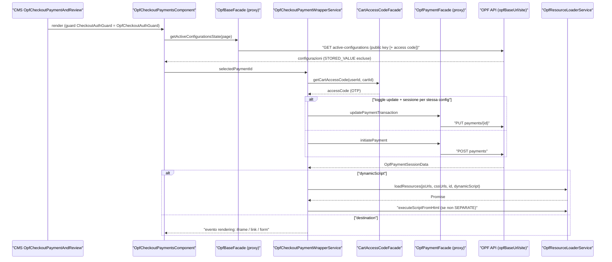
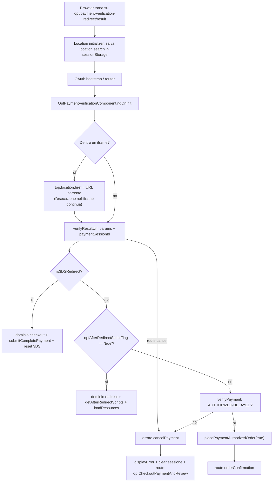
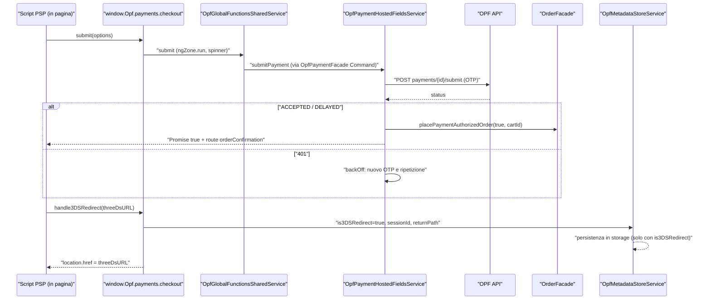

# 35 — Integration libs: OPF, digital payments, OPPS

> Riferimenti allo SHA `5b7a1c2bf2808d7380bc20596d10f4fa710c3da1` (vedi [00-meta](../00-meta.md)).

Prerequisiti consigliati: [12 — Feature module e lazy loading](../parte-2/12-feature-module-lazy.md) (featureModules, `facadeFactory`), [20 — Facade, command & query, eventi](../parte-2/20-facade-command-query-eventi.md), [26 — Checkout](../parte-2/26-checkout.md) (flow, step, guard: OPF li sostituisce), [21 — Livello OCC](../parte-2/21-occ.md) (adapter, converter, endpoint). Collegati: [25 — Carrello](../parte-2/25-cart.md), [27 — Ordini](../parte-2/27-order.md) (`placePaymentAuthorizedOrder`), [17 — Outlet](../parte-2/17-outlet.md), [41 — Errori e global message](../parte-2/41-errori-global-message.md), [42 — Feature toggle](../parte-2/42-feature-toggle-deprecazioni.md), [01 — Dependency injection](../parte-1/01-dependency-injection.md).

## 1. A cosa serve e perché esiste

Questo capitolo copre tre librerie di `integration-libs/`, cioè funzionalità che richiedono un backend o un add-on specifico oltre a SAP Commerce standard:

| Libreria | Cos'è (dal README) | Forma nel codice |
|---|---|---|
| `@spartacus/opf` | integrazione del "SAP Commerce Open Payment Framework" (`integration-libs/opf/README.md:L1-L3`) | 10 sotto-cartelle (base, payment, checkout, b2b-checkout, cta, global-functions, quick-buy, gift-card, tokenisation, order), ciascuna con secondary entry point; il `public_api.ts` radice è vuoto (`integration-libs/opf/public_api.ts:L14-L16`) |
| `@spartacus/digital-payments` | integrazione di "SAP Digital payments" (`integration-libs/digital-payments/README.md:L1-L3`) | un solo modulo che si innesta nel checkout standard (`integration-libs/digital-payments/src/digital-payments.module.ts:L10-L13`) |
| `@spartacus/opps` | "Omnichannel Promotion Pricing Service", estensione di Personalization (`integration-libs/opps/README.md:L1-L4`) | solo un root module eager: coupon da URL + guard di login (`integration-libs/opps/root/opps-root.module.ts:L13-L17`) |

OPF è di gran lunga la parte più grande ed è il cuore del capitolo. Il suo problema di fondo: il pagamento non passa da OCC ma da un servizio esterno (il "commerce cloud adapter" OPF, a cui si arriva via `opf.opfBaseUrl`, `projects/storefrontapp/src/app/spartacus/features/opf/opf-feature.module.ts:L186-L193`), che restituisce le **configurazioni di pagamento attive** e, per ciascuna, uno di tre *render pattern*: `IFRAME`, `FULL_PAGE`, `HOSTED_FIELDS` (`integration-libs/opf/payment/root/model/opf-payment.model.ts:L250-L254`). Lo storefront deve quindi:

1. leggere le configurazioni attive e mostrarle come opzioni di pagamento (`integration-libs/opf/base/opf-api/adapters/opf-api-base.adapter.ts:L65-L80`);
2. "iniziare" una sessione di pagamento sul servizio OPF e renderizzare quello che il PSP restituisce: un iframe, un redirect/form a pagina intera, oppure script e HTML del PSP (`integration-libs/opf/checkout/components/opf-checkout-payment-wrapper/opf-checkout-payment-wrapper.service.ts:L284-L331`);
3. esporre agli script del PSP un'**API JavaScript globale** (`window.Opf.payments[domain]`) per fare submit, mostrare spinner, ricevere il 3DS (`integration-libs/opf/global-functions/core/facade/opf-global-functions.service.ts:L73-L88`);
4. gestire il **ritorno dal PSP** su una route dedicata che verifica il pagamento e piazza l'ordine (`integration-libs/opf/payment/root/opf-payment-root.module.ts:L18-L39`);
5. piazzare l'ordine con `OrderFacade.placePaymentAuthorizedOrder` invece del place order classico (`integration-libs/opf/payment/core/services/opf-payment-hosted-fields.service.ts:L229-L231`).

Tre scelte progettuali dominano tutto OPF:

- **Ogni sotto-feature è una mini feature lib.** Root module eager + modulo lazy registrato in `featureModules`; facade astratte in `root` con `facadeFactory`, implementazioni in `core` legate con `useExisting` (`integration-libs/opf/base/root/facade/opf-base.facade.ts:L16-L25`, `integration-libs/opf/base/core/facade/facade-providers.ts:L11-L17`). È lo schema del [capitolo 12](../parte-2/12-feature-module-lazy.md).
- **Override via DI di pezzi di core e di altre feature.** OPF sostituisce `GlobalMessageService`, `CheckoutAuthGuard`, `CheckoutB2BStepsSetGuard`, `CheckoutPaymentTypeFacade`, `UserPaymentAdapter`, e aggiunge normalizer e interceptor multi-provider (tabella in §8). È il tema "override via DI" richiesto dall'outline e lo trattiamo con attenzione perché ogni override ha uno *scope* (root o lazy) diverso.
- **Stato senza NgRx.** Lo stato OPF è un `BehaviorSubject` (`OpfMetadataStoreService`) sincronizzato in storage (`integration-libs/opf/base/root/services/opf-metadata-store.service.ts:L11-L39`, `integration-libs/opf/base/root/services/opf-metadata-state-persistence.service.ts:L34-L47`); le chiamate backend sono `Query`/`Command` (`integration-libs/opf/payment/core/facade/opf-payment.service.ts:L36-L117`).

Digital Payments e OPPS sono molto più piccoli e li trattiamo in fondo a §3.

## 2. Mappa dei file

### OPF (radice `integration-libs/opf/`)

| Path | Ruolo |
|---|---|
| `integration-libs/opf/public_api.ts` | Barrel vuoto: solo `types.d.ts` + `export {}` (`:L14-L16`). |
| `integration-libs/opf/_index.scss` | Importa gli SCSS delle sotto-feature con stili (base, checkout, b2b-checkout, cta, payment, quick-buy, gift-card, tokenisation; non `global-functions` né `order`) e definisce `$opf-components-allowlist` (`:L1-L24`). |
| `integration-libs/opf/base/opf-base.module.ts` | Modulo lazy `OpfBaseModule` = api + core + components (`:L12-L15`). |
| `integration-libs/opf/base/root/opf-base-root.module.ts` | App initializer di persistenza, override `GlobalMessageService`, `defaultOpfConfig` (`:L16-L32`). |
| `integration-libs/opf/base/root/config/opf-config.ts` | `OpfConfig` (abstract, `useExisting: Config`) + augmentation di `Config` (`:L10-L94`). |
| `integration-libs/opf/base/root/config/constants.ts` | Header `sap-commerce-cloud-public-key` / `sap-commerce-cloud-access-code` (`:L7-L8`). |
| `integration-libs/opf/base/root/services/opf-metadata-store.service.ts` | Stato OPF in un `BehaviorSubject` (`:L11-L39`). |
| `integration-libs/opf/base/root/services/opf-metadata-state-persistence.service.ts` | Sync con storage, chiave `'opf'` (`:L34-L93`). |
| `integration-libs/opf/base/root/services/opf-resource-loader.service.ts` | Caricamento script/CSS del PSP, esecuzione HTML/JS (`:L100-L436`). |
| `integration-libs/opf/base/root/services/opf-global-message.service.ts` | `GlobalMessageService` con chiavi silenziabili (`:L19-L60`). |
| `integration-libs/opf/base/root/events/opf-event.listener.ts` | Reset metadata su login/ordine/nuovo carrello (`:L27-L35`). |
| `integration-libs/opf/base/core/services/opf-endpoints.service.ts` | Costruzione URL OPF API (`:L40-L96`). |
| `integration-libs/opf/base/opf-api/adapters/opf-api-base.adapter.ts` | GET active configurations (`:L65-L118`). |
| `integration-libs/opf/payment/root/opf-payment-root.module.ts` | Route di verifica + location initializer (`:L18-L49`). |
| `integration-libs/opf/payment/root/facade/opf-payment.facade.ts` | `OpfPaymentFacade` (7 metodi, feature `opfPayment`) (`:L22-L39`). |
| `integration-libs/opf/payment/root/components/opf-payment-verification/*` | Componente e servizio della pagina di ritorno dal PSP. |
| `integration-libs/opf/payment/core/services/opf-payment-hosted-fields.service.ts` | Submit / submit-complete e gestione dello status (`:L62-L235`). |
| `integration-libs/opf/payment/opf-api/adapters/opf-api-payment.adapter.ts` | verify/submit/submitComplete/afterRedirect/initiate/update (`:L85-L308`). |
| `integration-libs/opf/payment/occ/adapters/occ-opf-payment.adapter.ts` | PUT `paymentOption` sul carrello OCC (`:L29-L71`). |
| `integration-libs/opf/checkout/root/opf-checkout-root.module.ts` | Override `CheckoutAuthGuard`, flow `OPF`, routing, app initializer orchestratore (`:L26-L63`). |
| `integration-libs/opf/checkout/components/opf-checkout-payments/*` | Lista opzioni di pagamento. |
| `integration-libs/opf/checkout/components/opf-checkout-payment-wrapper/*` | Iniziazione pagamento e rendering PSP (service, component, directive sandbox). |
| `integration-libs/opf/b2b-checkout/root/opf-b2b-checkout-root.module.ts` | Override `CheckoutB2BStepsSetGuard`, flow `OPF` B2B (`:L19-L48`). |
| `integration-libs/opf/b2b-checkout/core/facade/facade-providers.ts` | Override `CheckoutPaymentTypeFacade` (`:L11-L17`). |
| `integration-libs/opf/cta/**` | Script "call to action" del PSP su PDP/carrello/ordine. |
| `integration-libs/opf/global-functions/core/facade/opf-global-functions.service.ts` | Registrazione `window.Opf.payments[domain]` (`:L32-L102`). |
| `integration-libs/opf/global-functions/core/services/**` | Implementazione delle funzioni per i domini checkout/global/redirect. |
| `integration-libs/opf/quick-buy/**` | Google Pay / Apple Pay "quick buy" (anche da PDP con carrello dedicato). |
| `integration-libs/opf/gift-card/**` | Gift card come metodo `STORED_VALUE_PAYMENT`, normalizer e interceptor. |
| `integration-libs/opf/tokenisation/**` | Carte salvate, override `UserPaymentAdapter`. |
| `integration-libs/opf/order/opf-order.module.ts` | Normalizer ordine (billing address) (`:L11-L20`). |

### Digital Payments e OPPS

| Path | Ruolo |
|---|---|
| `integration-libs/digital-payments/public_api.ts` | Esporta `src/checkout/index` e `DigitalPaymentsModule` (`:L10-L11`). |
| `integration-libs/digital-payments/src/checkout/dp-checkout.module.ts` | Adapter, normalizer, endpoint, `DpCheckoutPaymentService` (`:L21-L42`). |
| `integration-libs/digital-payments/src/checkout/adapters/occ-digital-payments.adapter.ts` | POST request/response con query param `sid`/`sign` (`:L36-L95`). |
| `integration-libs/digital-payments/src/checkout/cms-components/dp-payment-method/dp-payment-method.module.ts` | Rimappa il CMS `CheckoutPaymentDetails` (`:L23-L45`). |
| `integration-libs/digital-payments/src/checkout/facade/dp-checkout-payment.service.ts` | Query request + Command details (`:L36-L114`). |
| `integration-libs/opps/root/opps-root.module.ts` | `OppsRootModule` (`:L13-L17`). |
| `integration-libs/opps/root/config/default-opps-config.ts` | Default nomi header/param/storage (`:L9-L20`). |
| `integration-libs/opps/root/coupon-codes/**` | Location initializer + interceptor coupon. |
| `integration-libs/opps/root/login-required/*` | `OppsLoginRequiredGuard` su `BEFORE_CMS_PAGE_GUARD`. |

### Wiring nell'app demo

| Path | Ruolo |
|---|---|
| `projects/storefrontapp/src/app/spartacus/features/opf/opf-feature.module.ts` | 9 root module eager, 9 `featureModules`, config OPF, scelta B2B/B2C (`:L73-L197`). |
| `projects/storefrontapp/src/app/spartacus/features/order/order-wrapper.module.ts` | `OpfOrderModule` dentro il chunk order (`:L21-L26`). |
| `projects/storefrontapp/src/app/spartacus/features/checkout/checkout-wrapper.module.ts` | `DigitalPaymentsModule` dentro il chunk checkout (`:L22-L33`). |
| `projects/storefrontapp/src/app/spartacus/features/opps/opps-feature.module.ts` | Import eager di `OppsRootModule` (`:L10-L13`). |

## 3. Come funziona passo per passo

### 3.1 Wiring: root module eager, moduli lazy, scelta B2B/B2C

1. **Nove root module eager.** L'app importa `OpfBaseRootModule`, `OpfPaymentRootModule`, `OpfCheckoutRootModule`, `OpfB2bCheckoutRootModule`, `OpfCtaRootModule`, `OpfGlobalFunctionsRootModule`, `OpfQuickBuyRootModule`, `OpfGiftCardRootModule`, `OpfTokenisationRootModule` (`projects/storefrontapp/src/app/spartacus/features/opf/opf-feature.module.ts:L92-L103`). Questi contengono solo config di default, facade proxy, route, override DI e i componenti che devono esistere subito.
2. **Nove moduli lazy.** Ogni feature name punta a un `import()` dinamico in `featureModules`; per `OPF_QUICK_BUY_FEATURE` l'app carica la variante `@spartacus/opf/quick-buy/pickup-in-store` (`OpfQuickBuyPickupInStoreModule`) e non `OpfQuickBuyModule` (`projects/storefrontapp/src/app/spartacus/features/opf/opf-feature.module.ts:L105-L152`).
3. **Facade proxy.** Una facade OPF è una classe astratta `providedIn: 'root'` con `useFactory: () => facadeFactory({facade, feature, methods})` (`integration-libs/opf/base/root/facade/opf-base.facade.ts:L16-L25`). `facadeFactory` delega a `FacadeFactoryService.create`, che restituisce un proxy che carica la feature "at first method call" (`core-libs/core/src/lazy-loading/facade-factory/facade-factory.ts:L10-L23`). Dentro il modulo lazy, `facadeProviders` lega la facade al servizio concreto con `useExisting` (`integration-libs/opf/base/core/facade/facade-providers.ts:L11-L17`).
4. **Config di base.** `defaultOpfConfig` mette `opfBaseUrl: ''` e `paymentOption.enableInfoMessage: true` (`integration-libs/opf/base/root/config/default-opf-config.ts:L9-L16`); l'app fornisce URL reale, una public key segnaposto e `enableGetActiveConfigurationsAccessCodeHeader: true` (`projects/storefrontapp/src/app/spartacus/features/opf/opf-feature.module.ts:L186-L193`).
5. **B2B o B2C a build time.** Sia `OpfCheckoutRootModule` sia `OpfB2bCheckoutRootModule` forniscono come *default* un `checkout.flows.OPF` (3 step il primo, 5 il secondo) (`integration-libs/opf/checkout/root/opf-checkout-root.module.ts:L56-L56`, `integration-libs/opf/b2b-checkout/root/opf-b2b-checkout-root.module.ts:L43-L43`). Poiché `deepMerge` sostituisce i valori non oggetto, array di step compresi (`core-libs/core/src/config/utils/deep-merge.ts:L31-L46`), i due default si sovrascrivono; l'app decide esplicitamente con `provideConfig` in base a `environment.b2b` (`projects/storefrontapp/src/app/spartacus/features/opf/opf-feature.module.ts:L73-L81`). Allo stesso modo le config gift card sono aggiunte solo se `!environment.b2b && environment.opf` (`projects/storefrontapp/src/app/spartacus/features/opf/opf-feature.module.ts:L85-L91`).
6. **Order fuori da OPF lazy.** `OpfOrderModule` non è una feature: l'app lo mette accanto a `OrderModule` dentro `OrderWrapperModule` (`projects/storefrontapp/src/app/spartacus/features/order/order-wrapper.module.ts:L21-L26`), e il modulo aggiunge `OpfOccOrderNormalizer` a `ORDER_NORMALIZER`, che copia `sapBillingAddress` in `paymentInfo.billingAddress` se assente (`integration-libs/opf/order/opf-order.module.ts:L11-L20`, `integration-libs/opf/order/opf-occ-order-normalizer.ts:L13-L28`).
7. **Feature toggle.** Tre toggle di core, default `false`, cambiano il comportamento OPF: `opfPaymentVerificationCheckProcessingCartOnErrorOnly`, `opfUseDestroyRef`, `opfCheckoutUseUpdatePaymentTransaction`; l'app demo li abilita tutti (`core-libs/core/src/features-config/feature-toggles/config/feature-toggles.ts:L1074-L1083`, `projects/storefrontapp/src/app/spartacus/spartacus-features.module.ts:L364-L371`).

### 3.2 OPF base: stato, persistenza, URL, active configurations

1. **All'avvio** `OpfBaseRootModule` registra con `provideAppInitializer` una funzione che chiama `OpfMetadataStatePersistanceService.initSync()` (`integration-libs/opf/base/root/opf-base-root.module.ts:L19-L24`); in Angular `provideAppInitializer` è solo un valore del multi-token `APP_INITIALIZER` (`angular:packages/core/src/application/application_init.ts:L192-L202`).
2. **`initSync`** collega lo stato a `StatePersistenceService.syncWithStorage` con chiave `'opf'`; alla lettura chiama `updateOpfMetadata` (`integration-libs/opf/base/root/services/opf-metadata-state-persistence.service.ts:L34-L47`, `integration-libs/opf/base/root/services/opf-metadata-state-persistence.service.ts:L89-L93`).
3. **Cosa viene persistito.** Tutto il metadata tranne `opfPaymentSessionId` e `opfPaymentSessionConfigurationId`, che sono salvati solo se `is3DSRedirect` è vero, perché devono sopravvivere al reload della pagina del PSP (`integration-libs/opf/base/root/services/opf-metadata-state-persistence.service.ts:L62-L83`).
4. **Lo stato** è un `BehaviorSubject<OpfMetadataModel>` con stato iniziale congelato (`termsAndConditionsChecked`, `selectedPaymentOptionId`, `isPaymentInProgress`, `opfPaymentSessionId`, `is3DSRedirect`, `opf3DSRedirectReturnPath`, ...) e tre operazioni: get, update parziale, clear (`integration-libs/opf/base/root/services/opf-metadata-store.service.ts:L11-L39`).
5. **Reset.** `OpfEventListenerService` azzera lo stato su `LoginEvent`, `OrderPlacedEvent`, `CreateCartEvent`; viene istanziato perché `OpfEventModule` lo inietta nel costruttore (`integration-libs/opf/base/root/events/opf-event.listener.ts:L27-L35`, `integration-libs/opf/base/root/events/opf-event.module.ts:L10-L15`).
6. **Override di `GlobalMessageService`.** Lo stesso root module fornisce `{ provide: GlobalMessageService, useExisting: OpfGlobalMessageService }` (`integration-libs/opf/base/root/opf-base-root.module.ts:L25-L28`). `OpfGlobalMessageService` estende il servizio di core e scarta i messaggi la cui `key` è in `disabledKeys` mentre il blocco è attivo; `disableGlobalMessage(keys, timeout)` lo attiva per `timeout ?? 2000` ms (`integration-libs/opf/base/root/services/opf-global-message.service.ts:L19-L60`). Effetto: **tutta l'app** (non solo OPF) usa questa sottoclasse.
7. **URL OPF.** `OpfEndpointsService.buildUrl` compone `${opfBaseUrl}/${activeBaseSite}/${endpoint}`, risolvendo `urlParams` con `StringTemplate.resolve` e aggiungendo `queryParams` con `HttpParamsURIEncoder` (`integration-libs/opf/base/core/services/opf-endpoints.service.ts:L40-L75`). L'endpoint viene da `backend.opfApi.endpoints`, che `OpfApiConfig` aggiunge a `BackendConfig` per augmentation (`integration-libs/opf/base/core/services/opf-endpoints.service.ts:L77-L88`, `integration-libs/opf/base/root/config/opf-api-config.ts:L11-L21`). L'interfaccia `OpfApiEndpoints` è vuota e ogni sotto-feature la estende (`integration-libs/opf/base/root/model/opf-api-endpoints.model.ts:L7-L7`, `integration-libs/opf/base/opf-api/model/opf-api-base-endpoints.model.ts:L9-L16`).
8. **Base site.** `_activeBaseSite` è riempito in modo asincrono dal costruttore con `baseSiteService.getActive().subscribe(...)` (`integration-libs/opf/base/core/services/opf-endpoints.service.ts:L26-L38`).
9. **Active configurations.** `OpfBaseService.getActiveConfigurationsState(query)` crea **a ogni chiamata** una nuova `Query` su `OpfBaseConnector.getActiveConfigurations(query)` e ne restituisce `getState()` (`integration-libs/opf/base/core/facade/opf-base.service.ts:L23-L34`). L'adapter fa GET con header JSON + `Accept-Language`, la public key e, se `enableGetActiveConfigurationsAccessCodeHeader`, l'access code del carrello ottenuto da `CartAccessCodeFacade.getCartAccessCode(userId, cartId)`; normalizza l'errore con `tryNormalizeHttpError` e applica `OPF_ACTIVE_CONFIGURATIONS_NORMALIZER` (`integration-libs/opf/base/opf-api/adapters/opf-api-base.adapter.ts:L65-L118`). Endpoint di default: `active-configurations` (`integration-libs/opf/base/opf-api/config/default-opf-api-base-config.ts:L9-L17`).
10. **Modello.** Una `OpfActiveConfiguration` ha `id`, `providerType`, `paymentType`, `displayName`, `logoUrl`, `dynamicScript`...; `OpfPaymentProviderType` = `PAYMENT_GATEWAY` | `PAYMENT_METHOD` | `STORED_VALUE_PAYMENT` (`integration-libs/opf/base/root/model/opf-base.model.ts:L12-L23`, `integration-libs/opf/base/root/model/opf-base.model.ts:L84-L88`).

### 3.3 Il resource loader: come arriva il codice del PSP nella pagina

`OpfResourceLoaderService` è il punto in cui codice di terze parti entra nello storefront.

1. **SSR: niente.** `loadResources` in server risolve subito, con il commento "SSR mode not supported for security concerns" (`integration-libs/opf/base/root/services/opf-resource-loader.service.ts:L397-L406`).
2. **Locale o esterno.** Se `opf.localPspResources[paymentOptionId]` esiste si usano quei file JS/CSS, altrimenti gli URL ricevuti dal backend (`integration-libs/opf/base/root/services/opf-resource-loader.service.ts:L408-L416`, `integration-libs/opf/base/root/services/opf-resource-loader.service.ts:L316-L345`).
3. **Script.** Iniettati con `ScriptLoader.embedScript` e `disableKeyRestriction: true`; con `sri` si impostano `integrity` e `crossOrigin` (default `'anonymous'`) (`integration-libs/opf/base/root/services/opf-resource-loader.service.ts:L124-L149`).
4. **Marcatura per la pulizia.** Ogni risorsa riceve `data-opf-resource="true"`, salvo attributo `opf-load-once: 'true'`; `clearAllResources` rimuove tutti i nodi marcati (`integration-libs/opf/base/root/services/opf-resource-loader.service.ts:L100-L115`, `integration-libs/opf/base/root/services/opf-resource-loader.service.ts:L186-L194`).
5. **Modalità `SEPARATE`.** Se `dynamicScript.htmlContentMode === SEPARATE`, il JS arriva in `jsContent` e il contesto in `jsContext` (JSON); il CSS `cssUrl`+`cssHash` è aggiunto agli stili con SRI (`integration-libs/opf/base/root/services/opf-resource-loader.service.ts:L277-L311`). Dopo il caricamento, `executeScriptWithContext` imposta `window.OpfContext`, inserisce uno `<script data-opf-script>` **fuori dalla zone** e lo rimuove dopo 100 ms (`integration-libs/opf/base/root/services/opf-resource-loader.service.ts:L232-L261`, `integration-libs/opf/base/root/services/opf-resource-loader.service.ts:L429-L435`).
6. **Modalità HTML classica.** `executeScriptFromHtml` (solo browser) estrae il primo `<script>` dall'HTML con `DOMParser` ed esegue il contenuto con `Function(...)()` (`integration-libs/opf/base/root/services/opf-resource-loader.service.ts:L174-L184`).

### 3.4 Checkout OPF B2C: dal flow alla scelta dell'opzione

1. **Flow per payment provider.** `CheckoutFlowOrchestratorService` (lib checkout) legge `baseSite.baseStore.paymentProvider` e, se esiste `checkout.flows[paymentProvider]`, restituisce quel flow invece della config standard (`feature-libs/checkout/base/components/services/checkout-flow-orchestrator.service.ts:L20-L44`); `CheckoutStepService.resetSteps` usa gli step di quel flow (`feature-libs/checkout/base/components/services/checkout-step.service.ts:L88-L94`). OPF definisce il flow `OPF` (`integration-libs/opf/checkout/root/model/opf-checkout.model.ts:L13-L13`).
2. **Istanziazione precoce.** `OpfCheckoutRootModule` forza la creazione dell'orchestratore con `provideAppInitializer(() => { inject(CheckoutFlowOrchestratorService); })` (`integration-libs/opf/checkout/root/opf-checkout-root.module.ts:L58-L60`): il costruttore sottoscrive `getPaymentProvider()` (con `take(1)`) e memorizza il nome (`feature-libs/checkout/base/components/services/checkout-flow-orchestrator.service.ts:L20-L33`).
3. **Step B2C.** `deliveryAddress` (route standard `checkoutDeliveryAddress`), `deliveryMode`, `opfPaymentAndReview` (route `opfCheckoutPaymentAndReview`, tipo `PAYMENT_DETAILS`) con `guest: false` (`integration-libs/opf/checkout/root/config/default-opf-checkout-config.ts:L12-L45`). Route semantiche OPF: `checkout/opf-payment-type`, `checkout/opf-delivery-address`, `checkout/opf-payment-and-review`, `checkout/opf-review`, `opf-checkout-email` (`integration-libs/opf/checkout/root/config/default-opf-checkout-routing-config.ts:L9-L29`).
4. **Guard sostituito.** Il root module fornisce `{ provide: CheckoutAuthGuard, useClass: OpfCheckoutAuthGuard }` (`integration-libs/opf/checkout/root/opf-checkout-root.module.ts:L44-L47`). `OpfCheckoutAuthGuard` estende il guard standard: carrello non guest → `super.canActivate()`; carrello guest → verifica via OCC (`users/${userId}/carts/${cartId}?fields=sapCustomerEmail`) che il guest abbia un'email, altrimenti `UrlTree` verso `opfCheckoutEmail` (`integration-libs/opf/checkout/root/checkout-guard/opf-checkout-auth.guard.ts:L33-L62`, `integration-libs/opf/checkout/root/config/default-occ-opf-checkout-config.ts:L9-L18`). La pagina email aggiorna il guest con `CartGuestUserFacade.updateCartGuestUser`, ricarica il carrello e va a `checkoutDeliveryAddress` (`integration-libs/opf/checkout/components/opf-checkout-email-update/opf-checkout-email-update.component.ts:L75-L91`).
5. **Componente CMS.** `OpfCheckoutPaymentAndReview` (feature lazy `opfCheckout`) è mappato su `OpfCheckoutPaymentAndReviewComponent` con guard `[CheckoutAuthGuard, CartNotEmptyGuard]` (`integration-libs/opf/checkout/root/opf-checkout-root.module.ts:L26-L40`, `integration-libs/opf/checkout/components/opf-checkout-payment-and-review/opf-checkout-payment-and-review.module.ts:L57-L66`). Il componente estende `CheckoutReviewSubmitComponent`, gestisce il form T&C con `Validators.requiredTrue` e scrive `termsAndConditionsChecked` nel metadata store (`integration-libs/opf/checkout/components/opf-checkout-payment-and-review/opf-checkout-payment-and-review.component.ts:L74-L141`).
6. **T&C esplicito.** È attivo se il JSON della pagina CMS contiene la stringa `OpfExplicitTermsAndConditionsComponent` (`integration-libs/opf/checkout/components/opf-checkout-payment-and-review/opf-checkout-payment-and-review.component.ts:L103-L131`, `integration-libs/opf/checkout/root/model/opf-checkout.model.ts:L10-L11`). Con T&C esplicito non accettato la preselezione dell'opzione di pagamento viene azzerata (`integration-libs/opf/checkout/components/opf-checkout-payments/opf-checkout-payments.component.ts:L266-L322`).
7. **Carrello solo pickup.** Se non ci sono delivery items il componente cancella l'indirizzo di consegna e imposta delivery mode `'pickup'` (`integration-libs/opf/checkout/components/opf-checkout-payment-and-review/opf-checkout-payment-and-review.component.ts:L147-L161`).
8. **Lista opzioni.** `OpfCheckoutPaymentsComponent` chiede le configurazioni paginando (`pageSize`, `pageNumber: index+1`), esclude `STORED_VALUE_PAYMENT` (gestite dalla gift card) e, in modalità "solo wrapper", tiene solo quella selezionata (`integration-libs/opf/checkout/components/opf-checkout-payments/opf-checkout-payments.component.ts:L199-L238`). Il messaggio informativo viene da `opf.paymentOption.paymentInfoMessagesMap[paymentId]` con fallback `opfCheckout.defaultPaymentInfoMessage` (`integration-libs/opf/checkout/components/opf-checkout-payments/opf-checkout-payments.component.ts:L244-L260`). La selezione scrive `selectedPaymentOptionId` nel metadata store (`integration-libs/opf/checkout/components/opf-checkout-payments/opf-checkout-payments.component.ts:L350-L357`).

### 3.5 Iniziazione del pagamento e rendering del PSP

1. **Iniziazione.** `OpfCheckoutPaymentWrapperService.initiatePayment(paymentOptionId)` emette lo stato "loading", pulisce le risorse, imposta `isPaymentInProgress: true`, ottiene l'OTP con `CartAccessCodeFacade.getCartAccessCode` e chiama `OpfPaymentFacade.initiatePayment` (`integration-libs/opf/checkout/components/opf-checkout-payment-wrapper/opf-checkout-payment-wrapper.service.ts:L103-L168`).
2. **Config di iniziazione.** `configurationId = String(paymentOptionId)`, `channel: BROWSER`, `browserInfo`, e `resultURL`/`cancelURL` calcolati con `routingService.getFullUrl` sulle route di verifica (`integration-libs/opf/checkout/components/opf-checkout-payment-wrapper/opf-checkout-payment-wrapper.service.ts:L399-L418`). `getBrowserInfo` raccoglie colorDepth, lingua, schermo, userAgent, origin e timezone (`integration-libs/opf/payment/core/utils/opf-payment-utils.ts:L9-L24`).
3. **Update invece di initiate.** Con il toggle `opfCheckoutUseUpdatePaymentTransaction` e una sessione salvata per la *stessa* configurazione, si chiama `updatePaymentTransaction`; un 409 ricade su `initiatePayment` (`integration-libs/opf/checkout/components/opf-checkout-payment-wrapper/opf-checkout-payment-wrapper.service.ts:L137-L168`, `integration-libs/opf/checkout/components/opf-checkout-payment-wrapper/opf-checkout-payment-wrapper.service.ts:L239-L255`). La sessione viene salvata solo con il toggle o per pattern `FULL_PAGE` (`integration-libs/opf/checkout/components/opf-checkout-payment-wrapper/opf-checkout-payment-wrapper.service.ts:L192-L208`).
4. **HTTP.** `OpfApiPaymentAdapter.initiatePayment` passa la config per `OPF_PAYMENT_CONFIG_SERIALIZER` e fa POST di `paymentConfig.config` su `payments`, con public key e `otpKey` nell'header access code; `updatePaymentTransaction` fa PUT su `payments/${paymentSessionId}` (`integration-libs/opf/payment/opf-api/adapters/opf-api-payment.adapter.ts:L196-L256`, `integration-libs/opf/payment/opf-api/config/default-opf-api-payment-config.ts:L9-L23`).
5. **Rendering.** `renderPaymentGateway`: se c'è `dynamicScript` carica le risorse (vedi §3.3), emette l'evento di rendering e, salvo `SEPARATE`, esegue l'HTML; altrimenti se c'è `destination` emette l'evento con l'URL; altrimenti errore generico. `dynamicScript` ha la precedenza (`integration-libs/opf/checkout/components/opf-checkout-payment-wrapper/opf-checkout-payment-wrapper.service.ts:L275-L331`). L'HTML viene eseguito solo se l'utente è ancora sulla route `opfCheckoutPaymentAndReview` (`integration-libs/opf/checkout/components/opf-checkout-payment-wrapper/opf-checkout-payment-wrapper.service.ts:L74-L93`).
6. **Template.** `FULL_PAGE` diventa link o form `_self`, `IFRAME` un `<iframe>` (eventualmente alimentato da un form POST con target `cx-payment-iframe`) con direttiva `cxOpfSandbox` (`integration-libs/opf/checkout/components/opf-checkout-payment-wrapper/opf-checkout-payment-wrapper.component.html:L15-L69`). La direttiva imposta o rimuove `sandbox`; il valore viene da `opf.paymentOption.iframeSandboxMap[paymentOptionId]` (`integration-libs/opf/checkout/components/opf-checkout-payment-wrapper/opf-iframe-sandbox.directive.ts:L9-L25`, `integration-libs/opf/checkout/components/opf-checkout-payment-wrapper/opf-checkout-payment-wrapper.component.ts:L111-L117`).
7. **Hosted fields.** Se la risposta ha `paymentSessionId` e pattern `HOSTED_FIELDS`, il componente registra le global functions del dominio `checkout`, altrimenti le rimuove; in `ngOnDestroy` le rimuove e pulisce le risorse (`integration-libs/opf/checkout/components/opf-checkout-payment-wrapper/opf-checkout-payment-wrapper.component.ts:L208-L253`, `integration-libs/opf/checkout/components/opf-checkout-payment-wrapper/opf-checkout-payment-wrapper.component.ts:L125-L131`).
8. **Re-iniziazione.** Al cambio di lingua o valuta (saltato il valore iniziale, atteso il carrello stabile) il wrapper emette `reinitiatePaymentEvent$` (`integration-libs/opf/checkout/components/opf-checkout-payment-wrapper/opf-checkout-payment-wrapper.component.ts:L164-L199`). Lo stesso canale è usato dalla gift card e dallo script PSP (`reinitiatePaymentForm`) (`integration-libs/opf/payment/root/services/opf-payment-events.service.ts:L14-L50`).
9. **409 all'iniziazione** = "pagamento già fatto": si piazza l'ordine e si va a conferma (`integration-libs/opf/checkout/components/opf-checkout-payment-wrapper/opf-checkout-payment-wrapper.service.ts:L333-L367`).

### 3.6 Global functions: l'API JavaScript per gli script del PSP

1. **Domini.** `OpfGlobalFunctionsDomain` = `checkout` | `global` | `redirect` (`integration-libs/opf/global-functions/root/model/opf-global-functions.model.ts:L10-L14`).
2. **Registrazione.** `OpfGlobalFunctionsService.registerGlobalFunctions` (solo browser) crea se serve `window.Opf.payments[domain]` e delega al servizio di registrazione del dominio; `unregisterGlobalFunctions` imposta il contenitore a `undefined` (`integration-libs/opf/global-functions/core/facade/opf-global-functions.service.ts:L32-L102`).
3. **Dominio `checkout`** (wrapper hosted fields e ritorno 3DS): `submit`, `submitComplete`, `throwPaymentError`, start/stop load indicator, `reinitiatePaymentForm`, `handle3DSRedirect`, `updatePaymentTransaction` (`integration-libs/opf/global-functions/core/services/domains/checkout/opf-global-functions-checkout-domain-registrations.service.ts:L21-L45`).
4. **Dominio `redirect`** (pagina di verifica, pattern after-redirect): registra solo se c'è `paymentSessionId`: `submit`, `submitCompleteRedirect` (con returnPath `opfCheckoutPaymentAndReview`), `getRedirectParams` (`integration-libs/opf/global-functions/core/services/domains/redirect/opf-global-functions-redirect-domain-registrations.service.ts:L24-L38`, `integration-libs/opf/global-functions/core/services/domains/redirect/opf-global-functions-redirect-domain.service.ts:L22-L42`).
5. **Dominio `global`** (CTA e quick buy): `scriptReady`, `getCart`, indirizzi, delivery mode, guest user, `initiatePayment`, `verifyPayment`, `getApplePayWebSession`, ecc. (`integration-libs/opf/global-functions/core/services/domains/global/opf-global-functions-global-domain-registrations.service.ts:L33-L69`). Le funzioni di carrello delegano a `OpfQuickBuyTransactionService` (`integration-libs/opf/global-functions/core/services/domains/global/opf-global-functions-global-domain.service.ts:L179-L266`).
6. **Promise + zone.** Ogni funzione restituisce una Promise e gira in `ngZone.run`; `submit` converte l'Observable con `lastValueFrom(... last(() => true, true))` e mostra lo spinner `PLACE_ORDER_SPINNER` se ha un `ViewContainerRef` (`integration-libs/opf/global-functions/core/services/opf-global-functions-shared.service.ts:L106-L170`, `integration-libs/opf/global-functions/core/services/opf-global-functions-shared.service.ts:L268-L291`). Il `paymentSessionId` è quello passato o quello del metadata store, altrimenti eccezione `'paymentSessionId is required'` (`integration-libs/opf/global-functions/core/services/opf-global-functions-shared.service.ts:L86-L104`).
7. **3DS.** `handle3DSRedirect(url)` salva `opfPaymentSessionId`, `is3DSRedirect: true` e `opf3DSRedirectReturnPath` (URL completo della route result), poi naviga a `threeDsURL` (`integration-libs/opf/global-functions/core/services/domains/checkout/opf-global-functions-checkout-domain.service.ts:L91-L118`). Grazie alla regola di persistenza di §3.2 la sessione sopravvive al reload.

### 3.7 Submit hosted fields e place order

1. Lo script PSP chiama `window.Opf.payments.checkout.submit(options)` (`integration-libs/opf/global-functions/core/services/opf-global-functions-shared-registrations.service.ts:L23-L32`) → `OpfGlobalFunctionsSharedService.submit` → `OpfPaymentFacade.submitPayment` (`integration-libs/opf/global-functions/core/services/opf-global-functions-shared.service.ts:L150-L168`).
2. `OpfPaymentService` incapsula ogni metodo in un `Command`; submit e submit-complete delegano a `OpfPaymentHostedFieldsService` (`integration-libs/opf/payment/core/facade/opf-payment.service.ts:L49-L69`).
3. `submitPayment` costruisce la richiesta (`channel: BROWSER`, `browserInfo`, `encryptedToken` svuotato se il metodo non è `CREDIT_CARD`), ottiene l'OTP e chiama il connector (`integration-libs/opf/payment/core/services/opf-payment-hosted-fields.service.ts:L62-L93`); l'adapter fa POST su `payments/${paymentSessionId}/submit` con public key, access code e `Accept-Language`, retry su errori 5xx e errori normalizzati con il body copiato (`integration-libs/opf/payment/opf-api/adapters/opf-api-payment.adapter.ts:L114-L140`, `integration-libs/opf/payment/opf-api/adapters/opf-api-payment.adapter.ts:L296-L308`).
4. `paymentResponseHandler`: `ACCEPTED`/`DELAYED` → callback `onSuccess` poi `placePaymentAuthorizedOrder(true, cartId)`; `CANCELLED` con `onCancel` e `PENDING` → `EMPTY`; `REJECTED` → errore `PAYMENT_REJECTED`; altro → `STATUS_NOT_RECOGNIZED` (`integration-libs/opf/payment/core/services/opf-payment-hosted-fields.service.ts:L180-L227`). Con l'ordine piazzato si naviga a `orderConfirmation` (`integration-libs/opf/payment/core/services/opf-payment-hosted-fields.service.ts:L233-L235`).
5. Errori: `OpfPaymentErrorHandlerService` traduce gli errori 400 per tipo (scaduta, fondi insufficienti, carta/CVV non validi, carta smarrita) in chiavi `opfPayment.errors.*`, chiama `onFailure` e naviga a `returnPath` se presente (`integration-libs/opf/payment/core/services/opf-payment-error-handler.service.ts:L36-L77`). Un 401 (OTP scaduto) fa ripetere **l'intera sequenza**, OTP compreso, con `backOff({ shouldRetry: isAuthorizationError, maxTries: DEFAULT_AUTHORIZATION_ERROR_RETRIES_COUNT })` (`integration-libs/opf/payment/core/services/opf-payment-hosted-fields.service.ts:L115-L122`, `core-libs/core/src/util/occ-http-error-handlers.ts:L26-L31`).

### 3.8 Ritorno dal PSP: la pagina di verifica

1. **Route senza path.** `OpfPaymentRootModule` registra due route figlie con `path: null` (con `@ts-ignore`) e `data.cxRoute` `paymentVerificationResult`/`paymentVerificationCancel`, entrambe su `OpfPaymentVerificationComponent`; il path reale viene dalla config di routing semantico, di default `opf/payment-verification-redirect/result|cancel` (`integration-libs/opf/payment/root/opf-payment-root.module.ts:L18-L39`, `integration-libs/opf/payment/root/config/default-opf-payment-routing-config.ts:L9-L20`).
2. **Cattura della query prima di OAuth.** Un location initializer salva `location.search` in `sessionStorage` (chiave `opfPaymentVerificationQuerySearch`) se il pathname termina con uno dei path di verifica, "before OAuth bootstrap mutates `location.search`" (`integration-libs/opf/payment/root/opf-payment-root.module.ts:L42-L46`, `integration-libs/opf/payment/root/components/opf-payment-verification/opf-payment-verification.service.ts:L71-L98`). `provideLocationInitializerFactory` contribuisce al multi-token `LOCATION_INITIALIZED_MULTI`, i cui initializer sono eseguiti in parallelo (`core-libs/core/src/routing/location-initialized-multi/location-initialized-multi.ts:L43-L51`, `core-libs/core/src/routing/routing.module.ts:L66-L71`). La lettura successiva rimuove la chiave (`integration-libs/opf/payment/root/components/opf-payment-verification/opf-payment-verification.service.ts:L169-L193`).
3. **Uscita dall'iframe.** `ngOnInit` per prima cosa, se la pagina è dentro un iframe, ricarica l'URL nella finestra top (`integration-libs/opf/payment/root/components/opf-payment-verification/opf-payment-verification.component.ts:L85-L101`).
4. **Carrello in elaborazione.** Senza il toggle `opfPaymentVerificationCheckProcessingCartOnErrorOnly` chiama subito `checkIfProcessingCartIdExist()`; con il toggle solo in caso di errore (`integration-libs/opf/payment/root/components/opf-payment-verification/opf-payment-verification.component.ts:L45-L76`). Se `isPaymentInProgress === false`, va al carrello con l'errore `httpHandlers.cartNotFound` (`integration-libs/opf/payment/root/components/opf-payment-verification/opf-payment-verification.service.ts:L266-L283`).
5. **`verifyResultUrl`.** Accetta solo la route result (sulla cancel lancia `opfPayment.errors.cancelPayment`); il `paymentSessionId` viene, in ordine, dallo stato 3DS persistito, dal parametro `opfPaymentSessionId` dell'URL, dal metadata store (`integration-libs/opf/payment/root/components/opf-payment-verification/opf-payment-verification.service.ts:L117-L167`, `integration-libs/opf/payment/root/components/opf-payment-verification/opf-payment-verification.service.ts:L195-L215`).
6. **Scelta del pattern** (`integration-libs/opf/payment/root/components/opf-payment-verification/opf-payment-verification.component.ts:L103-L137`):
   - `is3DSRedirect` → `run3DSRedirectPattern`: registra il dominio `checkout`, chiama `submitCompletePayment` con i parametri dell'URL e il `returnPath` salvato, in `finalize` azzera lo stato 3DS (`integration-libs/opf/payment/root/components/opf-payment-verification/opf-payment-verification.service.ts:L377-L406`);
   - `opfAfterRedirectScriptFlag === 'true'` → `runHostedFieldsPattern`: registra il dominio `redirect`, scarica gli after-redirect scripts ed esegue con il resource loader (`integration-libs/opf/payment/root/components/opf-payment-verification/opf-payment-verification.service.ts:L299-L341`);
   - altrimenti `runHostedPagePattern`: `verifyPayment` (successo = `AUTHORIZED`/`DELAYED`) → `placePaymentAuthorizedOrder(true)` → conferma ordine (`integration-libs/opf/payment/root/components/opf-payment-verification/opf-payment-verification.service.ts:L236-L252`, `integration-libs/opf/payment/root/components/opf-payment-verification/opf-payment-verification.service.ts:L285-L297`).
7. **Errore.** Messaggio globale, cancellazione della sessione per la reiniziazione, ritorno a `opfCheckoutPaymentAndReview` (`integration-libs/opf/payment/root/components/opf-payment-verification/opf-payment-verification.component.ts:L139-L143`).

### 3.9 B2B checkout OPF

1. Flow `OPF` B2B a 5 step (paymentType, deliveryAddress, deliveryMode, paymentAndReview, review) (`integration-libs/opf/b2b-checkout/root/config/default-opf-b2b-checkout-config.ts:L13-L55`); in B2B l'endpoint `placePaymentAuthorizedOrder` diventa `orgUsers/${userId}/orders?fields=FULL` (`integration-libs/opf/b2b-checkout/root/config/default-opf-b2b-checkout-occ-endpoints-config.ts:L10-L22`).
2. `OpfB2bCheckoutRootModule` sostituisce `CheckoutB2BStepsSetGuard` con `OpfB2bCheckoutStepsSetGuard` e dichiara 4 componenti CMS lazy (`integration-libs/opf/b2b-checkout/root/opf-b2b-checkout-root.module.ts:L19-L48`). Il guard disabilita `PAYMENT_DETAILS` per l'account payment e, solo se il provider è `OPF`, `REVIEW_ORDER` per i non-account (`integration-libs/opf/b2b-checkout/root/guards/opf-b2b-checkout-steps-set.guard.ts:L70-L117`).
3. Nel modulo lazy, `CheckoutPaymentTypeFacade` di `@spartacus/checkout/b2b/root` è rilegata a `OpfB2bCheckoutPaymentTypeService` (`integration-libs/opf/b2b-checkout/core/facade/facade-providers.ts:L11-L17`), che imposta il tipo di pagamento con `OpfPaymentFacade.setCartPaymentOption` (codice = `sapPaymentOptionId`), `CommandStrategy.CancelPrevious`, e dispatcha `CheckoutPaymentTypeSetEvent` (`integration-libs/opf/b2b-checkout/core/facade/opf-b2b-checkout-payment-type.service.ts:L37-L72`). L'OCC adapter fa PUT `users/${userId}/carts/${cartId}/paymentOption?fields=DEFAULT` (`integration-libs/opf/payment/occ/adapters/occ-opf-payment.adapter.ts:L29-L71`).
4. Il componente payment type usa l'`id` della configurazione OPF come codice payment type e abilita/disabilita gli step in base a `ACCOUNT_PAYMENT`: `handlePaymentChange` chiama `adaptCheckoutSteps`, che abilita/disabilita `PAYMENT_DETAILS` e `REVIEW_ORDER` (`integration-libs/opf/b2b-checkout/components/opf-b2b-checkout-payment-type/opf-b2b-checkout-payment-type.component.ts:L164-L179`, `integration-libs/opf/b2b-checkout/components/opf-b2b-checkout-payment-type/opf-b2b-checkout-payment-type.component.ts:L110-L121`). Gli altri componenti B2B estendono quelli standard (cost center, delivery address, place order) o quello OPF B2C (`integration-libs/opf/b2b-checkout/components/opf-b2b-checkout-payment-and-review/opf-b2b-checkout-payment-and-review.component.ts:L45-L46`).

### 3.10 CTA, quick buy, gift card, tokenisation

- **CTA.** `OpfCtaRootModule` dichiara lazy `OpfCtaScriptsComponent` e `OpfCtaQuickBuyButtons` (`integration-libs/opf/cta/root/opf-cta-root.module.ts:L11-L25`). `OpfCtaScriptsService` mappa il `pageId` CMS a una location (`order`, `orderConfirmationPage`, `productDetails`, `cartPage`) e chiede gli script con POST `payments/cta-scripts-rendering` (`integration-libs/opf/cta/components/opf-cta-scripts/opf-cta-scripts.service.ts:L215-L254`, `integration-libs/opf/cta/opf-api/config/default-opf-api-cta-config.ts:L9-L17`). Per le location dinamiche registra il dominio `global` e avvia eventi `CustomEvent` (`opfCartChanged`, `opfProductAmountChanged`) sulla window (`integration-libs/opf/cta/components/opf-cta-scripts/opf-cta-scripts.service.ts:L70-L93`, `integration-libs/opf/cta/core/services/opf-dynamic-cta.service.ts:L180-L234`). `OpfCtaElementComponent` toglie i tag `<script>` dall'HTML prima di renderlo (`integration-libs/opf/cta/components/opf-cta-element/opf-cta-element.component.ts:L36-L50`).
- **Quick buy.** `OpfQuickBuyConfig.providers` contiene `googlePay` e `applePay` con gli URL degli SDK (`integration-libs/opf/quick-buy/root/config/default-opf-quick-buy-config.ts:L10-L63`). I bottoni appaiono per le configurazioni `PAYMENT_GATEWAY` con `digitalWalletQuickBuy` abilitato (`integration-libs/opf/quick-buy/components/opf-quick-buy-buttons/opf-quick-buy-buttons.service.ts:L37-L101`). `OpfQuickBuyTransactionService` sceglie il contesto (PDP = singolo prodotto, altrimenti carrello attivo) dalla route semantica (`integration-libs/opf/quick-buy/core/services/opf-quick-buy-transaction.service.ts:L36-L47`, `integration-libs/opf/quick-buy/core/services/opf-quick-buy-transaction.service.ts:L173-L197`); sul PDP crea un nuovo carrello non attivo con il solo prodotto (`integration-libs/opf/quick-buy/core/services/context/opf-quick-buy-single-product-transaction.service.ts:L307-L341`). Il pagamento passa per `OpfPaymentFacade.submitPayment` con `paymentSessionId: ''` e token `btoa` (`integration-libs/opf/quick-buy/components/opf-quick-buy-buttons/google-pay/google-pay.service.ts:L497-L516`). La variante pickup-in-store rilega `OpfQuickBuySingleProductCartOptionsFacade` per aggiungere `pickupStore` (`integration-libs/opf/quick-buy/pickup-in-store/opf-quick-buy-pickup-in-store.module.ts:L12-L22`).
- **Gift card.** Il root module aggiunge `OpfGiftCardOrderOccNormalizer` a `ORDER_NORMALIZER`, `OpfGiftCardCartOccNormalizer` a `CART_NORMALIZER` e `OpfGiftCardPaymentApiInterceptor` a `HTTP_INTERCEPTORS` (`integration-libs/opf/gift-card/root/opf-gift-card-root.module.ts:L46-L63`). L'interceptor agisce solo su `/orders/paymentAuthorizedOrderPlacement`: in errore ricarica il carrello e, se il tipo è `SAPCartStoredValueAuthorizationError`, azzera la sessione e reinizializza il pagamento (`integration-libs/opf/gift-card/root/http-interceptors/opf-gift-card-payment-api.interceptor.ts:L38-L65`). La gift card è una configurazione `STORED_VALUE_PAYMENT`; la copertura totale è `cart.opfGiftCardSummary.giftCardsCoverFullAmount` (`integration-libs/opf/gift-card/core/facade/opf-gift-card.service.ts:L38-L62`).
- **Tokenisation.** `OpfTokenisationRootModule` sostituisce `UserPaymentAdapter` di core con `OccOpfTokenisationUserPaymentAdapter` e mette tre componenti nell'outlet `OPF_CHECKOUT_BEFORE_PAYMENT_OPTIONS` (`integration-libs/opf/tokenisation/root/opf-tokenisation-root.module.ts:L33-L58`). L'adapter carica solo i metodi `saved: true` e in `setDefault` fa PATCH dell'intero dettaglio (`integration-libs/opf/tokenisation/root/adapters/occ-opf-tokenisation-user-payment.adapter.ts:L40-L127`).

### 3.11 Digital Payments

1. `DigitalPaymentsModule` importa `DpCheckoutModule` (`integration-libs/digital-payments/src/digital-payments.module.ts:L10-L13`); l'app lo aggiunge a `CheckoutWrapperModule`, il modulo lazy del checkout, se `environment.digitalPayments` (`projects/storefrontapp/src/app/spartacus/features/checkout/checkout-wrapper.module.ts:L22-L33`). `DigitalPaymentsFeatureModule` fornisce solo le traduzioni (`projects/storefrontapp/src/app/spartacus/features/digital-payments/digital-payments-feature.module.ts:L17-L33`).
2. `DpCheckoutModule` lega `DigitalPaymentsAdapter → OccDigitalPaymentsAdapter`, registra `DP_DETAILS_NORMALIZER`/`DP_REQUEST_NORMALIZER` e gli endpoint `users/${userId}/carts/${cartId}/payment/digitalPayments/request|response` (`integration-libs/digital-payments/src/checkout/dp-checkout.module.ts:L21-L42`, `integration-libs/digital-payments/src/checkout/adapters/config/occ-digital-payments-endpoint.config.ts:L11-L25`).
3. `DpPaymentMethodModule` estende `CheckoutPaymentMethodModule` e sostituisce il componente CMS `CheckoutPaymentDetails` con `ConfigModule.withConfig`, cioè `provideConfig` e non un default (`integration-libs/digital-payments/src/checkout/cms-components/dp-payment-method/dp-payment-method.module.ts:L23-L45`, `core-libs/core/src/config/config.module.ts:L28-L34`).
4. Flusso: `DpPaymentFormComponent` chiede i dati di registrazione carta (POST `.../request`), li salva in storage con chiave `digital-payment.checkout.request` e reindirizza al PSP (`integration-libs/digital-payments/src/checkout/cms-components/dp-payment-method/dp-payment-form/dp-payment-form.component.ts:L34-L57`, `integration-libs/digital-payments/src/checkout/facade/dp-local-storage.service.ts:L12-L46`). `OccDpRequestNormalizer` estrae `postUrl`, `session_id` e `signature` (`integration-libs/digital-payments/src/checkout/adapters/occ-digital-payment-request.normalizer.ts:L18-L33`).
5. Al ritorno, con il query param `x-card-registration-status`, `DpPaymentMethodComponent` mostra il callback (`integration-libs/digital-payments/src/checkout/cms-components/dp-payment-method/dp-payment-method.component.ts:L46-L93`); se lo status è `successful` si chiede l'indirizzo e si chiama `createPaymentDetails`, che fa POST con body `null` e `sid`/`sign`/indirizzo come query param (`integration-libs/digital-payments/src/checkout/cms-components/dp-payment-method/dp-payment-callback/dp-payment-callback.component.ts:L57-L131`, `integration-libs/digital-payments/src/checkout/adapters/occ-digital-payments.adapter.ts:L48-L84`). I nomi dei parametri vengono da `digitalPayments.occQueryParams` (`integration-libs/digital-payments/src/checkout/adapters/config/default-digital-payments-endpoint.config.ts:L9-L25`).

### 3.12 OPPS

1. `OppsRootModule` importa `OppsCouponCodesModule` e `OppsLoginRequiredModule` e fornisce `defaultOppsConfig` (`integration-libs/opps/root/opps-root.module.ts:L13-L17`); default: header e parametro `couponcodes`, storage `opps-couponcodes`, parametro login `loginRequired` (`integration-libs/opps/root/config/default-opps-config.ts:L9-L20`).
2. **Coupon.** Un location initializer legge `couponcodes` dall'URL e lo salva in `localStorage` (`integration-libs/opps/root/coupon-codes/opps-coupon-codes.module.ts:L12-L29`, `integration-libs/opps/root/coupon-codes/opps-coupon-codes.service.ts:L18-L31`). `OccOppsCouponCodesInterceptor` (registrato con `useExisting`) legge il coupon nel costruttore e, nel browser, aggiunge l'header alle richieste verso la base URL OCC (`integration-libs/opps/root/coupon-codes/http-interceptors/index.ts:L11-L17`, `integration-libs/opps/root/coupon-codes/http-interceptors/occ-opps-coupon-codes.interceptor.ts:L28-L64`).
3. **Login richiesto.** `OppsLoginRequiredGuard` è aggiunto al multi-token `BEFORE_CMS_PAGE_GUARD` (root, factory `[]`): se l'utente è anonimo e c'è `?loginRequired=true`, salva l'URL di redirect e rimanda alla pagina di login (`integration-libs/opps/root/login-required/opps-login-required.module.ts:L11-L20`, `integration-libs/opps/root/login-required/opps-login-required.guard.ts:L29-L61`, `core-libs/storefront/cms-structure/guards/before-cms-page-guard.token.ts:L22-L24`).

## 4. Diagrammi

### 4.1 Checkout OPF: dalla lista opzioni al rendering del PSP



Fonti: §3.4 e §3.5 (`integration-libs/opf/checkout/components/opf-checkout-payments/opf-checkout-payments.component.ts:L199-L238`, `integration-libs/opf/checkout/components/opf-checkout-payment-wrapper/opf-checkout-payment-wrapper.service.ts:L103-L190`, `integration-libs/opf/checkout/components/opf-checkout-payment-wrapper/opf-checkout-payment-wrapper.service.ts:L284-L331`).

### 4.2 Ritorno dal PSP: scelta del pattern



Fonti: §3.8 (`integration-libs/opf/payment/root/components/opf-payment-verification/opf-payment-verification.component.ts:L42-L143`, `integration-libs/opf/payment/root/components/opf-payment-verification/opf-payment-verification.service.ts:L71-L406`).

### 4.3 Hosted fields e 3DS: lo script PSP pilota Spartacus



Fonti: §3.6 e §3.7 (`integration-libs/opf/global-functions/core/services/opf-global-functions-shared.service.ts:L106-L170`, `integration-libs/opf/payment/core/services/opf-payment-hosted-fields.service.ts:L62-L235`, `integration-libs/opf/global-functions/core/services/domains/checkout/opf-global-functions-checkout-domain.service.ts:L91-L118`, `integration-libs/opf/base/root/services/opf-metadata-state-persistence.service.ts:L62-L83`).

## 5. Estratti di codice reale

**Facade proxy in `root`, implementazione in `core`** — `integration-libs/opf/base/root/facade/opf-base.facade.ts:L16-L25` e `integration-libs/opf/base/core/facade/facade-providers.ts:L11-L17`:

```ts
@Injectable({
  providedIn: 'root',
  useFactory: () =>
    facadeFactory({
      facade: OpfBaseFacade,
      feature: OPF_BASE_FEATURE,
      methods: ['getActiveConfigurationsState'],
    }),
})
export abstract class OpfBaseFacade {
```

```ts
export const facadeProviders: Provider[] = [
  OpfBaseService,
  {
    provide: OpfBaseFacade,
    useExisting: OpfBaseService,
  },
];
```

**Override eager di un servizio di core** — `integration-libs/opf/base/root/opf-base-root.module.ts:L16-L32`:

```ts
@NgModule({
  imports: [OpfEventModule],
  providers: [
    provideAppInitializer(() => {
      const opfStatePersistenceService = inject(
        OpfMetadataStatePersistanceService
      );
      opfStatePersistenceService.initSync();
    }),
    {
      provide: GlobalMessageService,
      useExisting: OpfGlobalMessageService,
    },
    provideDefaultConfig(defaultOpfConfig),
  ],
})
export class OpfBaseRootModule {}
```

**Persistenza selettiva della sessione** — `integration-libs/opf/base/root/services/opf-metadata-state-persistence.service.ts:L62-L83`:

```ts
  protected getOpfState(): Observable<SyncedOpfState> {
    return this.opfMetadataStoreService.getOpfMetadataState().pipe(
      map((metadata: OpfMetadataModel) => {
        const {
          opfPaymentSessionId,
          opfPaymentSessionConfigurationId,
          ...persistedMetadata
        } = metadata;
        return {
          metadata: {
            ...persistedMetadata,
            // Persist session ID only for 3DS redirect — it must survive the PSP page reload.
            // For other patterns, keeping it in-memory only prevents stale sessions from being reused after a page refresh.
            ...(metadata.is3DSRedirect && {
              opfPaymentSessionId,
              opfPaymentSessionConfigurationId,
            }),
          } as OpfMetadataModel,
        };
      })
    );
  }
```

**Override del guard del checkout e istanziazione dell'orchestratore** — `integration-libs/opf/checkout/root/opf-checkout-root.module.ts:L42-L63`:

```ts
@NgModule({
  providers: [
    {
      provide: CheckoutAuthGuard,
      useClass: OpfCheckoutAuthGuard,
    },
    {
      provide: OpfCheckoutAdapter,
      useClass: OpfApiCheckoutAdapter,
    },
    OpfCheckoutConnector,
    OpfCartUserEmailCheckerService,
    provideDefaultConfig(defaultOpfCheckoutRoutingConfig),
    provideDefaultConfig(defaultOccOpfCheckoutConfig),
    provideDefaultConfig(defaultOpfCheckoutConfig),
    provideDefaultConfigFactory(defaultOpfCheckoutComponentsConfig),
    provideAppInitializer(() => {
      inject(CheckoutFlowOrchestratorService);
    }),
  ],
})
export class OpfCheckoutRootModule {}
```

**Scelta del flow per payment provider** (lib checkout) — `feature-libs/checkout/base/components/services/checkout-flow-orchestrator.service.ts:L35-L44`:

```ts
  getCheckoutFlow(): CheckoutFlow | undefined {
    if (this.paymentProviderName) {
      const flow =
        this.checkoutConfig.checkout?.flows?.[this.paymentProviderName];
      if (flow) {
        return flow;
      }
    }
    return this.checkoutConfig.checkout;
  }
```

**URL OPF** — `integration-libs/opf/base/core/services/opf-endpoints.service.ts:L40-L48` e `:L74-L74`:

```ts
  buildUrl(endpoint: string, attributes?: DynamicAttributes): string {
    const baseUrl = this.getBaseEndpoint();
    let opfEndpoint = this.getEndpointFromContext(endpoint);
    if (attributes) {
      const { urlParams, queryParams } = attributes;

      if (urlParams && opfEndpoint) {
        opfEndpoint = StringTemplate.resolve(opfEndpoint, urlParams, true);
      }
      // ...
    return `${baseUrl}/${this._activeBaseSite}/${opfEndpoint}`;
```

**Gestione dello status di submit** — `integration-libs/opf/payment/core/services/opf-payment-hosted-fields.service.ts:L190-L207`:

```ts
    if (
      response.status === OpfPaymentSubmitStatus.ACCEPTED ||
      response.status === OpfPaymentSubmitStatus.DELAYED
    ) {
      return from(Promise.resolve(callbacks.onSuccess(response))).pipe(
        concatMap(() => this.placeOrder(cartId))
      );
    } else if (
      callbacks?.onCancel &&
      response.status === OpfPaymentSubmitStatus.CANCELLED
    ) {
      return from(Promise.resolve(callbacks.onCancel(response))).pipe(
        concatMap(() => EMPTY)
      );
    } else if (response.status === OpfPaymentSubmitStatus.PENDING) {
      return from(Promise.resolve(callbacks.onPending(response))).pipe(
        concatMap(() => EMPTY)
      );
```

**Il contenitore globale per gli script del PSP** — `integration-libs/opf/global-functions/core/facade/opf-global-functions.service.ts:L73-L88`:

```ts
  protected getContainer(
    domain: OpfGlobalFunctionsDomain
  ): OpfPaymentGlobalMethods {
    const window = this.winRef.nativeWindow as any;
    if (!window) {
      return {};
    }

    if (!window.Opf?.payments?.[domain]) {
      window.Opf = window?.Opf ?? {};
      window.Opf.payments = window.Opf.payments ?? {};
      window.Opf.payments[domain] = {};
    }

    return window.Opf.payments[domain];
  }
```

**Route di verifica senza path e location initializer** — `integration-libs/opf/payment/root/opf-payment-root.module.ts:L21-L46`:

```ts
    RouterModule.forChild([
      {
        // @ts-ignore
        path: null,
        component: OpfPaymentVerificationComponent,
        data: {
          cxRoute: 'paymentVerificationResult',
        },
      },
      // ...
    ]),
  ],
  providers: [
    provideDefaultConfig(defaultOpfPaymentRoutingConfig),
    provideLocationInitializerFactory(() => {
      // convert incorrect type `() => void` to `() => Promise<void>`
      const locationInitializer = captureOpfPaymentVerificationQueryFactory();
      return () => Promise.resolve(locationInitializer());
    }),
  ],
```

**Esecuzione di script PSP fuori dalla zone** — `integration-libs/opf/base/root/services/opf-resource-loader.service.ts:L237-L259`:

```ts
    this.ngZone.runOutsideAngular(() => {
      if (this.windowRef.isBrowser() && this.windowRef.nativeWindow) {
        const nativeWindow = this.windowRef.nativeWindow as any;
        if (nativeWindow.OpfContext) {
          delete nativeWindow.OpfContext;
        }

        nativeWindow.OpfContext = contextData ?? {};
        nativeWindow.OpfContext.additionalData ??= {};
      }

      const scriptElement = this.document.createElement('script');
      scriptElement.type = 'text/javascript';
      scriptElement.textContent = originalScript;
      scriptElement.setAttribute('data-opf-script', 'true');
      this.document.head.appendChild(scriptElement);

      // Clean up after execution
      setTimeout(() => {
        if (scriptElement.parentNode) {
          scriptElement.parentNode.removeChild(scriptElement);
        }
      }, 100);
```

**Multi-provider della gift card** — `integration-libs/opf/gift-card/root/opf-gift-card-root.module.ts:L46-L61`:

```ts
  providers: [
    {
      provide: ORDER_NORMALIZER,
      useExisting: OpfGiftCardOrderOccNormalizer,
      multi: true,
    },
    {
      provide: CART_NORMALIZER,
      useExisting: OpfGiftCardCartOccNormalizer,
      multi: true,
    },
    {
      provide: HTTP_INTERCEPTORS,
      useClass: OpfGiftCardPaymentApiInterceptor,
      multi: true,
    },
```

**Digital Payments: override CMS con `withConfig`** — `integration-libs/digital-payments/src/checkout/cms-components/dp-payment-method/dp-payment-method.module.ts:L32-L45`:

```ts
    ConfigModule.withConfig({
      cmsComponents: {
        CheckoutPaymentDetails: {
          component: DpPaymentMethodComponent,
        },
      },
    }),
    FeaturesConfigModule,
    DpPaymentMethodComponent,
  ],
  exports: [DpPaymentMethodComponent],
  providers: [provideDefaultConfig(defaultDigitalPaymentsConfig)],
})
export class DpPaymentMethodModule extends CorePaymentMethodModule {}
```

**OPPS: interceptor del coupon** — `integration-libs/opps/root/coupon-codes/http-interceptors/occ-opps-coupon-codes.interceptor.ts:L28-L38` e `:L51-L63`:

```ts
  constructor() {
    this.initialize();
  }

  protected initialize() {
    this.oppsCoupon = this.service.getCouponCodes();
    if (this.winRef.isBrowser()) {
      this.requestHeader =
        this.config.opps?.couponcodes?.httpHeaderName?.toLowerCase?.();
    }
  }
  // ...
    if (
      this.winRef.isBrowser() &&
      this.requestHeader &&
      this.oppsCoupon &&
      request.url.includes(this.occEndpoints.getBaseUrl())
    ) {
      request = request.clone({
        setHeaders: {
          [this.requestHeader]: this.oppsCoupon,
        },
      });
    }
```

## 6. Configurazione

| Chiave | Tipo | Default | Definita in | Letta in |
|---|---|---|---|---|
| `opf.opfBaseUrl` | string | `''` | `integration-libs/opf/base/root/config/default-opf-config.ts:L11-L11` | `integration-libs/opf/base/core/services/opf-endpoints.service.ts:L90-L96` |
| `opf.commerceCloudPublicKey` | string | — | `integration-libs/opf/base/root/config/opf-config.ts:L17-L17` | `integration-libs/opf/payment/opf-api/adapters/opf-api-payment.adapter.ts:L89-L92`, `integration-libs/opf/base/opf-api/adapters/opf-api-base.adapter.ts:L90-L94` |
| `opf.paymentOption.enableInfoMessage` | boolean | `true` | `integration-libs/opf/base/root/config/default-opf-config.ts:L12-L14` | `integration-libs/opf/checkout/components/opf-checkout-payments/opf-checkout-payments.component.ts:L255-L260` |
| `opf.paymentOption.paymentInfoMessagesMap` | `Record<number, string>` | — | `integration-libs/opf/base/root/config/opf-config.ts:L32-L32` | `integration-libs/opf/checkout/components/opf-checkout-payments/opf-checkout-payments.component.ts:L244-L253` |
| `opf.paymentOption.iframeSandboxMap` | `Record<number, string>` | — | `integration-libs/opf/base/root/config/opf-config.ts:L54-L54` | `integration-libs/opf/checkout/components/opf-checkout-payment-wrapper/opf-checkout-payment-wrapper.component.ts:L111-L117` |
| `opf.localPspResources` | `Record<number, {jsFiles, cssFiles}>` | — | `integration-libs/opf/base/root/config/opf-config.ts:L76-L82` | `integration-libs/opf/base/root/services/opf-resource-loader.service.ts:L266-L345` |
| `opf.enableGetActiveConfigurationsAccessCodeHeader` | boolean | — (app: `true`) | `integration-libs/opf/base/root/config/opf-config.ts:L88-L88` | `integration-libs/opf/base/opf-api/adapters/opf-api-base.adapter.ts:L96-L100` |
| `backend.opfApi.endpoints.*` | string | per sotto-feature (es. `active-configurations`, `payments/${paymentSessionId}/submit`) | `integration-libs/opf/base/opf-api/config/default-opf-api-base-config.ts:L9-L17`, `integration-libs/opf/payment/opf-api/config/default-opf-api-payment-config.ts:L9-L23` | `integration-libs/opf/base/core/services/opf-endpoints.service.ts:L77-L88` |
| `backend.occ.endpoints.setCartPaymentOption` | string | `users/${userId}/carts/${cartId}/paymentOption` | `integration-libs/opf/payment/occ/config/default-occ-opf-payment-config.ts:L13-L13` | `integration-libs/opf/payment/occ/adapters/occ-opf-payment.adapter.ts:L58-L71` |
| `backend.occ.endpoints.cartUserEmail` | string | `...?fields=sapCustomerEmail` | `integration-libs/opf/checkout/root/config/default-occ-opf-checkout-config.ts:L13-L14` | `integration-libs/opf/checkout/root/adapters/opf-api-checkout.adapter.ts:L42-L44` |
| `backend.occ.endpoints.cart` (OPF) | string | campi estesi + `sapBillingAddress(FULL)` | `integration-libs/opf/global-functions/root/config/default-occ-opf-cart-config.ts:L10-L12` | adapter OCC del carrello ([25](../parte-2/25-cart.md)) |
| `backend.occ.endpoints.placePaymentAuthorizedOrder` | string | B2B `orgUsers/${userId}/orders?fields=FULL`; gift card con campi propri | `integration-libs/opf/b2b-checkout/root/config/default-opf-b2b-checkout-occ-endpoints-config.ts:L10-L12`, `integration-libs/opf/gift-card/root/config/default-occ-opf-gift-card-order-config.ts:L13-L14` | adapter OCC ordini ([27](../parte-2/27-order.md)) |
| `backend.occ.endpoints.applyGiftCard` / `removeGiftCard` | string | `.../giftCards[/${giftCardId}]` | `integration-libs/opf/gift-card/occ/config/default-occ-opf-gift-card-config.ts:L13-L15` | `integration-libs/opf/gift-card/occ/adapters/occ-opf-gift-card.adapter.ts:L68-L82` |
| `backend.occ.endpoints.quickBuy*` | string | 5 endpoint | `integration-libs/opf/quick-buy/occ/config/default-occ-opf-quick-buy-cart-config.ts:L13-L20` | `integration-libs/opf/quick-buy/occ/adapters/occ-opf-quick-buy-cart.adapter.ts:L143-L190` |
| `checkout.flows.OPF` | `CheckoutFlow` | B2C 3 step / B2B 5 step | `integration-libs/opf/checkout/root/config/default-opf-checkout-config.ts:L36-L45`, `integration-libs/opf/b2b-checkout/root/config/default-opf-b2b-checkout-config.ts:L46-L55` | `feature-libs/checkout/base/components/services/checkout-flow-orchestrator.service.ts:L35-L44` |
| `routing.routes.paymentVerificationResult` / `Cancel` | `RoutingConfig` | `opf/payment-verification-redirect/result` / `cancel` | `integration-libs/opf/payment/root/config/default-opf-payment-routing-config.ts:L9-L20` | `integration-libs/opf/payment/root/components/opf-payment-verification/opf-payment-verification.service.ts:L80-L85` |
| `routing.routes.opfCheckout*` | `RoutingConfig` | 5 route | `integration-libs/opf/checkout/root/config/default-opf-checkout-routing-config.ts:L9-L29` | route semantiche |
| `providers.googlePay` / `providers.applePay` | config provider | URL SDK Google (`TEST`) e Apple | `integration-libs/opf/quick-buy/root/config/default-opf-quick-buy-config.ts:L10-L63` | `integration-libs/opf/quick-buy/components/opf-quick-buy-buttons/google-pay/google-pay.service.ts:L134-L148` |
| `cart.validation` / `selectiveCart` / `showRealTimeStockInPDP` (gift card) | `CartConfig` | `true` / `false` / `false` | `integration-libs/opf/gift-card/root/config/default-gift-card-cart-config.ts:L9-L21` | lib cart |
| `features.opfUseDestroyRef`, `features.opfPaymentVerificationCheckProcessingCartOnErrorOnly`, `features.opfCheckoutUseUpdatePaymentTransaction` | boolean | `false` | `core-libs/core/src/features-config/feature-toggles/config/feature-toggles.ts:L1074-L1083` | `integration-libs/opf/checkout/components/opf-checkout-payment-wrapper/opf-checkout-payment-wrapper.component.ts:L147-L161`, `integration-libs/opf/payment/root/components/opf-payment-verification/opf-payment-verification.component.ts:L45-L50`, `integration-libs/opf/checkout/components/opf-checkout-payment-wrapper/opf-checkout-payment-wrapper.service.ts:L106-L107` |
| `digitalPayments.occQueryParams.*` | string | `sid`, `sign`, campi indirizzo | `integration-libs/digital-payments/src/checkout/adapters/config/default-digital-payments-endpoint.config.ts:L9-L25` | `integration-libs/digital-payments/src/checkout/adapters/occ-digital-payments.adapter.ts:L64-L84` |
| `backend.occ.endpoints.paymentRequest` / `paymentDetails` | string | `.../digitalPayments/request` / `response` | `integration-libs/digital-payments/src/checkout/adapters/config/occ-digital-payments-endpoint.config.ts:L11-L16` | `integration-libs/digital-payments/src/checkout/adapters/occ-digital-payments.adapter.ts:L40-L58` |
| `opps.couponcodes.{httpHeaderName, urlParameter, localStorageKey}` | string | `couponcodes` / `couponcodes` / `opps-couponcodes` | `integration-libs/opps/root/config/default-opps-config.ts:L11-L15` | `integration-libs/opps/root/coupon-codes/opps-coupon-codes.service.ts:L15-L31`, `integration-libs/opps/root/coupon-codes/http-interceptors/occ-opps-coupon-codes.interceptor.ts:L32-L38` |
| `opps.loginRequired.urlParameter` | string | `loginRequired` | `integration-libs/opps/root/config/default-opps-config.ts:L16-L18` | `integration-libs/opps/root/login-required/opps-login-required.guard.ts:L38-L48` |

Note: la chiave dei toggle va in `features` della config (vedi [42](../parte-2/42-feature-toggle-deprecazioni.md)); l'app li imposta a `true` (`projects/storefrontapp/src/app/spartacus/spartacus-features.module.ts:L364-L371`).

## 7. Commenti e note notevoli dal sorgente

- **"SSR mode not supported for security concerns"** — ripetuto in `executeScriptFromHtml` e `loadResources` (`integration-libs/opf/base/root/services/opf-resource-loader.service.ts:L175-L175`, `integration-libs/opf/base/root/services/opf-resource-loader.service.ts:L403-L403`). Il codice del PSP non gira mai lato server.
- **Persistenza della sessione solo per 3DS**: "Persist session ID only for 3DS redirect — it must survive the PSP page reload. For other patterns, keeping it in-memory only prevents stale sessions from being reused after a page refresh." (`integration-libs/opf/base/root/services/opf-metadata-state-persistence.service.ts:L73-L74`).
- **"Stores the redirect query string before OAuth bootstrap mutates `location.search`."** — motivo del location initializer di payment (`integration-libs/opf/payment/root/components/opf-payment-verification/opf-payment-verification.service.ts:L71-L73`).
- **Location initializer**: "convert incorrect type `() => void` to `() => Promise<void>`", identico in OPF e OPPS (`integration-libs/opf/payment/root/opf-payment-root.module.ts:L43-L43`, `integration-libs/opps/root/coupon-codes/opps-coupon-codes.module.ts:L23-L23`).
- **Saferpay e iframe**: "Some PSPs render verification/success pages inside an iframe; in such cases we reload the current URL in the top window to preserve full-page UX." con link alla documentazione Saferpay (`integration-libs/opf/payment/root/components/opf-payment-verification/opf-payment-verification.component.ts:L85-L91`).
- **Retry su OTP**: "It means that `accessCode` (OTP signature) is not valid or expired and we need to refresh it." (`integration-libs/opf/payment/core/services/opf-payment-hosted-fields.service.ts:L116-L119`).
- **`cartId` deprecato**: "@deprecated Property no longer used. Cart ID is currently derived from the OTP access code header." (`integration-libs/opf/global-functions/core/services/opf-global-functions-shared.service.ts:L46-L46`; anche `integration-libs/opf/payment/root/model/opf-payment.model.ts:L26-L27`).
- **Precedenza `dynamicScript`**: "if `dynamicScript` and `destination` are present in same config, dynamicScript takes precendence." (`integration-libs/opf/checkout/components/opf-checkout-payment-wrapper/opf-checkout-payment-wrapper.service.ts:L275-L283`).
- **JSDoc contraddittorio** di `loadResources`: "The returned Promise is also resolved (not rejected!) immediately when any loading error occurs." (`integration-libs/opf/base/root/services/opf-resource-loader.service.ts:L395-L395`) — vedi §9.
- **TODO tokenisation**: "TO DO: Unify this adapter with Core once Core fixes the paymentDetail PATCH request payload handling." (`integration-libs/opf/tokenisation/root/adapters/occ-opf-tokenisation-user-payment.adapter.ts:L67-L67`); e i segnaposto "Currently unused as all payment operations are delegated to the core UserPaymentService" (`integration-libs/opf/tokenisation/core/connectors/opf-tokenisation.adapter.ts:L9-L16`).
- **Workaround CTA**: "Removing script tags on FE until BE fix: CXSPA-8572" (`integration-libs/opf/cta/components/opf-cta-element/opf-cta-element.component.ts:L43-L43`).
- **Commento sul carrello quick buy**: "`createCart` initially replays the previously created (NEW_CREATED) cart from the store. Skip it so we operate on the freshly created..." (`integration-libs/opf/quick-buy/core/services/context/opf-quick-buy-single-product-transaction.service.ts:L307-L341`).
- **Deprecazione in B2C**: `@deprecated since 221121.21. No longer used internally.` su `opfBaseFacade` di `OpfCheckoutPaymentAndReviewComponent` (`integration-libs/opf/checkout/components/opf-checkout-payment-and-review/opf-checkout-payment-and-review.component.ts:L82-L86`).
- **Digital Payments**: `// TODO:#checkout - handle breaking changes` (`integration-libs/digital-payments/src/checkout/cms-components/dp-payment-method/dp-payment-method.component.ts:L70-L70`).
- **`BEFORE_CMS_PAGE_GUARD`**: "**CAUTION**: Suitable for global guards ONLY!" (`core-libs/storefront/cms-structure/guards/before-cms-page-guard.token.ts:L10-L21`) — OPPS lo usa correttamente per un controllo globale.

## 8. Extension point

### 8.1 Override via DI fatti da OPF (e da imitare)

| Token sostituito | Con | Tipo provider | Scope | Dove |
|---|---|---|---|---|
| `GlobalMessageService` (core) | `OpfGlobalMessageService` | `useExisting` | root (eager) | `integration-libs/opf/base/root/opf-base-root.module.ts:L25-L28` |
| `CheckoutAuthGuard` (checkout) | `OpfCheckoutAuthGuard` | `useClass` | root (eager) | `integration-libs/opf/checkout/root/opf-checkout-root.module.ts:L44-L47` |
| `CheckoutB2BStepsSetGuard` (checkout b2b) | `OpfB2bCheckoutStepsSetGuard` | `useClass` | root (eager) | `integration-libs/opf/b2b-checkout/root/opf-b2b-checkout-root.module.ts:L39-L42` |
| `CheckoutPaymentTypeFacade` (checkout b2b) | `OpfB2bCheckoutPaymentTypeService` | `useExisting` | modulo lazy OPF B2B | `integration-libs/opf/b2b-checkout/core/facade/facade-providers.ts:L11-L17` |
| `UserPaymentAdapter` (core) | `OccOpfTokenisationUserPaymentAdapter` | `useClass` | root (eager) | `integration-libs/opf/tokenisation/root/opf-tokenisation-root.module.ts:L37-L40` |
| `ORDER_NORMALIZER`, `CART_NORMALIZER`, `HTTP_INTERCEPTORS` | normalizer/interceptor gift card | `multi: true` | root (eager) | `integration-libs/opf/gift-card/root/opf-gift-card-root.module.ts:L46-L61` |
| `ORDER_NORMALIZER` | `OpfOccOrderNormalizer` | `multi: true` | chunk order | `integration-libs/opf/order/opf-order.module.ts:L11-L20` |
| `OpfQuickBuySingleProductCartOptionsFacade` | servizio pickup-in-store | provider | modulo lazy quick buy | `integration-libs/opf/quick-buy/pickup-in-store/opf-quick-buy-pickup-in-store.module.ts:L12-L22` |
| `cmsComponents.CheckoutPaymentDetails` (DP) | `DpPaymentMethodComponent` | `provideConfig` | chunk checkout | `integration-libs/digital-payments/src/checkout/cms-components/dp-payment-method/dp-payment-method.module.ts:L32-L38` |
| `HTTP_INTERCEPTORS`, `BEFORE_CMS_PAGE_GUARD` (OPPS) | interceptor coupon, guard login | `multi: true` | root (eager) | `integration-libs/opps/root/coupon-codes/http-interceptors/index.ts:L11-L17`, `integration-libs/opps/root/login-required/opps-login-required.module.ts:L11-L20` |

Regola pratica che emerge: OPF mette nel **root module** gli override di guard, adapter di core e interceptor, che così valgono nell'injector root per tutta l'app indipendentemente da quali chunk sono stati caricati; nel **modulo lazy** mette solo gli override consumati dentro lo stesso chunk (con il rischio di scope descritto in §9.17). Per ricette generiche di override di servizi, facade e guard: [50 — Ricette: configurazione, DI, interceptor, eventi](../parte-3/50-ricette-config-di.md).

### 8.2 Punti di estensione esportati da OPF

| Punto | Tipo | Dove | Entry point |
|---|---|---|---|
| `OpfConfig`, `OpfApiConfig`, `OpfApiEndpoints` | config / augmentation | `integration-libs/opf/base/root/config/opf-config.ts:L14-L14`, `integration-libs/opf/base/root/config/opf-api-config.ts:L15-L17`, `integration-libs/opf/base/root/model/opf-api-endpoints.model.ts:L7-L7` | `@spartacus/opf/base/root` (`integration-libs/opf/base/root/public_api.ts:L7-L13`) |
| `OpfBaseFacade`, `OpfBaseAdapter`, `OPF_ACTIVE_CONFIGURATIONS_NORMALIZER`, `OpfEndpointsService` | facade / adapter / token | `integration-libs/opf/base/core/connectors/opf-base.adapter.ts:L13-L13`, `integration-libs/opf/base/core/tokens/tokens.ts:L11-L13` | `@spartacus/opf/base/root`, `@spartacus/opf/base/core` |
| `OpfPaymentFacade`, `OpfPaymentAdapter`, normalizer `OPF_PAYMENT_*`, `OPF_PAYMENT_CONFIG_SERIALIZER` | facade / adapter / token | `integration-libs/opf/payment/core/connectors/opf-payment.adapter.ts:L20-L20`, `integration-libs/opf/payment/core/tokens/tokens.ts:L16-L30`, `integration-libs/opf/payment/core/connectors/converters.ts:L11-L13` | `@spartacus/opf/payment/root` (`integration-libs/opf/payment/root/public_api.ts:L7-L13`), `/core` |
| `OpfCheckoutOutlets` (3 outlet) e `CartOutlets.OPF_CHECKOUT_PICKUP_ITEMS` | outlet | `integration-libs/opf/checkout/root/model/opf-checkout-outlets.model.ts:L7-L11`, `integration-libs/opf/checkout/root/model/augmented-cart-outlets.model.ts:L9-L16` | `@spartacus/opf/checkout/root` |
| `OpfCtaFacade`, `OpfCtaAdapter`, `OPF_CTA_SCRIPTS_NORMALIZER` | facade / adapter / token | `integration-libs/opf/cta/root/facade/opf-cta.facade.ts:L26-L26`, `integration-libs/opf/cta/core/connectors/opf-cta.adapter.ts:L13-L13` | `@spartacus/opf/cta/root`, `/core` |
| `OpfGlobalFunctionsFacade`, `window.Opf.payments[domain]` | facade / API JS | `integration-libs/opf/global-functions/root/facade/opf-global-functions.facade.ts:L24-L24` | `@spartacus/opf/global-functions/root` (`integration-libs/opf/global-functions/root/public_api.ts:L7-L11`) |
| `OpfQuickBuyConfig`, `OpfQuickBuySingleProductCartOptionsFacade`, `OpfQuickBuyCartAdapter` | config / facade / adapter | `integration-libs/opf/quick-buy/root/config/opf-quick-buy-config.ts:L18-L18`, `integration-libs/opf/quick-buy/root/facade/opf-quick-buy-single-product-cart-options.facade.ts:L22-L22`, `integration-libs/opf/quick-buy/core/connectors/opf-quick-buy-cart.adapter.ts:L11-L11` | `@spartacus/opf/quick-buy/root`, `/core`, `/pickup-in-store` |
| `LAUNCH_CALLER.OPF_ERROR` | enum augmentation + assegnazione runtime | `integration-libs/opf/base/root/model/augmented-core.model.ts:L9-L15` | `@spartacus/opf/base/root` |
| `DigitalPaymentsModule`, `DpCheckoutModule`, `DpCheckoutPaymentService` | modulo / facade | `integration-libs/digital-payments/public_api.ts:L10-L11`, `integration-libs/digital-payments/src/checkout/index.ts:L7-L9`, `integration-libs/digital-payments/src/checkout/facade/index.ts:L7-L7` | `@spartacus/digital-payments` (adapter, token e config **non** sono esportati da quel barrel) |
| `OppsConfig`, `OccOppsCouponCodesInterceptor`, `OppsLoginRequiredGuard` | config / interceptor / guard | `integration-libs/opps/root/public_api.ts:L7-L10` | `@spartacus/opps/root` |

### 8.3 Come estendere (con le ricette di Parte III)

- **Aggiungere un endpoint OPF API o cambiarne il path**: estendere `OpfApiEndpoints` per augmentation (come `integration-libs/opf/base/opf-api/model/opf-api-base-endpoints.model.ts:L9-L16`) e fornire `backend.opfApi.endpoints` con `provideConfig`; costruire l'URL con `OpfEndpointsService.buildUrl`. Il pattern è quello di OCC: [52 — Ricette: OCC, adapter, converter, endpoint](../parte-3/52-ricette-occ-dati.md).
- **Trasformare le risposte OPF**: i token `OPF_*_NORMALIZER` non hanno converter di default, quindi un normalizer aggiunto con `multi: true` è l'unico a operare (`core-libs/core/src/util/converter.service.ts:L106-L111`). Vedi [52](../parte-3/52-ricette-occ-dati.md).
- **Sostituire un componente OPF** (es. `OpfCheckoutPaymentAndReview`) o aggiungere contenuto negli outlet `OpfCheckoutOutlets`: [51 — Ricette: componenti CMS, outlet, route e layout](../parte-3/51-ricette-cms-outlet-layout.md). Esempio reale: la tokenisation usa `provideOutlet` su `OPF_CHECKOUT_BEFORE_PAYMENT_OPTIONS` (`integration-libs/opf/tokenisation/root/opf-tokenisation-root.module.ts:L41-L55`).
- **Flow di checkout per payment provider**: definire `checkout.flows[<paymentProvider>]` (con l'intera lista di step, perché gli array si sostituiscono): [53 — Ricette: feature lib lazy, carrello/checkout](../parte-3/53-ricette-feature-cart-checkout-stili-i18n.md).
- **Override di facade/guard/adapter**: [50 — Ricette: configurazione, DI, interceptor, eventi](../parte-3/50-ricette-config-di.md).
- **Importare solo dagli entry point pubblici** (`@spartacus/opf/<feature>/root|core|...`) e non da path interni: [54 — API pubblica vs interna, upgrade](../parte-3/54-upgrade-safe.md).

## 9. Trappole, casi limite, comportamenti controintuitivi

1. **`GlobalMessageService` cambia per tutta l'app.** Importare `OpfBaseRootModule` sostituisce il servizio globale con la sottoclasse OPF, che può silenziare chiavi per 2 s (`integration-libs/opf/base/root/opf-base-root.module.ts:L25-L28`, `integration-libs/opf/base/root/services/opf-global-message.service.ts:L51-L60`). Un vostro override di `GlobalMessageService` entra in conflitto con questo.
2. **Due default per `checkout.flows.OPF`.** B2C e B2B root module forniscono entrambi il flow come default; con entrambi importati (come nell'app) bisogna scegliere esplicitamente con `provideConfig` (`integration-libs/opf/checkout/root/opf-checkout-root.module.ts:L56-L56`, `integration-libs/opf/b2b-checkout/root/opf-b2b-checkout-root.module.ts:L43-L43`, `projects/storefrontapp/src/app/spartacus/features/opf/opf-feature.module.ts:L73-L81`).
3. **Il flow dipende dal backend.** Il flow `OPF` si attiva solo se `baseStore.paymentProvider === 'OPF'`, letto una volta con `take(1)` (`feature-libs/checkout/base/components/services/checkout-flow-orchestrator.service.ts:L20-L44`). `BaseSiteService.get()` non emette prima del caricamento dei base site: passa da `getActive()`, che filtra i valori falsy, e da `getAll()`, che filtra `null` e lancia `LoadBaseSites` (`core-libs/core/src/site-context/facade/base-site.service.ts:L31-L35`, `core-libs/core/src/site-context/facade/base-site.service.ts:L41-L50`, `core-libs/core/src/site-context/facade/base-site.service.ts:L63-L69`). Il nome resta `undefined` solo se il base site caricato non contiene `baseStore.paymentProvider`.
4. **URL con `undefined`.** `_activeBaseSite` è riempito in modo asincrono: un `buildUrl` chiamato prima della prima emissione produce `.../undefined/...` (`integration-libs/opf/base/core/services/opf-endpoints.service.ts:L26-L38`, `integration-libs/opf/base/core/services/opf-endpoints.service.ts:L74-L74`).
5. **Endpoint come oggetto.** `getEndpointFromContext` restituisce il valore di config così com'è e `buildUrl` lo tratta come stringa (`opfEndpoint.includes('?')`): un `OpfApiEndpoint` oggetto, ammesso dal tipo, non viene risolto (`integration-libs/opf/base/core/services/opf-endpoints.service.ts:L53-L53`, `integration-libs/opf/base/core/services/opf-endpoints.service.ts:L77-L88`, `integration-libs/opf/base/root/model/opf-api-endpoint.model.ts:L7-L10`).
6. **Header di lingua congelati.** `OpfApiBaseAdapter` e `OpfApiCtaAdapter` calcolano `Accept-Language` una volta, come campi; `OpfApiQuickBuyAdapter` fa lo stesso con `Content-Language`; `OpfApiPaymentAdapter` usa getter (`integration-libs/opf/base/opf-api/adapters/opf-api-base.adapter.ts:L53-L63`, `integration-libs/opf/cta/opf-api/adapters/opf-api-cta.adapter.ts:L50-L54`, `integration-libs/opf/quick-buy/opf-api/adapters/opf-api-quick-buy.adapter.ts:L49-L53`, `integration-libs/opf/payment/opf-api/adapters/opf-api-payment.adapter.ts:L62-L83`).
7. **Nessuna cache delle active configurations.** Ogni chiamata a `getActiveConfigurationsState` crea una nuova Query (`integration-libs/opf/base/core/facade/opf-base.service.ts:L23-L34`); inoltre `OpfCheckoutPaymentsComponent` filtra **in place** `state.data.value` (`integration-libs/opf/checkout/components/opf-checkout-payments/opf-checkout-payments.component.ts:L219-L228`).
8. **`CANCELLED` senza `onCancel` diventa "status non riconosciuto".** Il ramo cancel richiede `callbacks?.onCancel`; senza, uno status `CANCELLED` cade nel ramo finale con `STATUS_NOT_RECOGNIZED` (`integration-libs/opf/payment/core/services/opf-payment-hosted-fields.service.ts:L197-L226`). Le global functions `submit`/`submitComplete` forniscono un `submitCancel` di default (`integration-libs/opf/global-functions/core/services/opf-global-functions-shared.service.ts:L121-L148`), ma il ritorno 3DS e Google Pay quick buy chiamano la facade senza `onCancel`, quindi per loro un `CANCELLED` diventa `STATUS_NOT_RECOGNIZED` (`integration-libs/opf/payment/root/components/opf-payment-verification/opf-payment-verification.service.ts:L390-L400`, `integration-libs/opf/quick-buy/components/opf-quick-buy-buttons/google-pay/google-pay.service.ts:L34-L38`, `integration-libs/opf/quick-buy/components/opf-quick-buy-buttons/google-pay/google-pay.service.ts:L506-L513`). Lo stesso vale per chi chiama `OpfPaymentFacade.submitPayment` direttamente.
9. **Il retry su 401 del wrapper non scatta.** In `initiatePayment` il `catchError(handlePaymentInitiationError)` precede il `backOff`; per un 401 restituisce `throwError(() => 'Payment failed')`, una stringa, mentre `isAuthorizationError` controlla `err.status === 401` (`integration-libs/opf/checkout/components/opf-checkout-payment-wrapper/opf-checkout-payment-wrapper.service.ts:L179-L188`, `integration-libs/opf/checkout/components/opf-checkout-payment-wrapper/opf-checkout-payment-wrapper.service.ts:L333-L343`, `integration-libs/opf/checkout/components/opf-checkout-payment-wrapper/opf-checkout-payment-wrapper.service.ts:L379-L388`, `core-libs/core/src/util/occ-http-error-handlers.ts:L26-L28`). Nel submit hosted fields invece l'errore originale viene rilanciato, il retry funziona, ma `handlePaymentError` viene invocato a ogni tentativo (`integration-libs/opf/payment/core/services/opf-payment-hosted-fields.service.ts:L107-L122`).
10. **409 non gestito se il place order fallisce.** In `handlePaymentAlreadyDoneError`, se il place order fallisce `catchError` restituisce `of()`, che completa senza emettere: lo `switchMap` successivo non parte (`integration-libs/opf/checkout/components/opf-checkout-payment-wrapper/opf-checkout-payment-wrapper.service.ts:L345-L359`).
11. **Verifica che parte "carrello non trovato".** Senza il toggle, `checkIfProcessingCartIdExist` è chiamato subito: se `isPaymentInProgress === false` (ad esempio perché il metadata è stato azzerato) si va al carrello con errore anche se la verifica riuscirebbe (`integration-libs/opf/payment/root/components/opf-payment-verification/opf-payment-verification.component.ts:L45-L50`, `integration-libs/opf/payment/root/components/opf-payment-verification/opf-payment-verification.service.ts:L266-L283`).
12. **La sessione non sopravvive al refresh** (salvo 3DS): è un comportamento voluto (§7), ma significa che con `opfCheckoutUseUpdatePaymentTransaction` dopo un reload si torna a `initiatePayment` (`integration-libs/opf/base/root/services/opf-metadata-state-persistence.service.ts:L62-L83`, `integration-libs/opf/checkout/components/opf-checkout-payment-wrapper/opf-checkout-payment-wrapper.service.ts:L239-L255`).
13. **CSP.** `executeScriptFromHtml` usa `Function()` (equivalente a eval) e i template usano `bypassSecurityTrustHtml`/`bypassSecurityTrustResourceUrl`: una Content Security Policy restrittiva rompe i PSP (`integration-libs/opf/base/root/services/opf-resource-loader.service.ts:L182-L182`, `integration-libs/opf/checkout/components/opf-checkout-payment-wrapper/opf-checkout-payment-wrapper.component.ts:L103-L109`).
14. **`loadResources` rifiuta, nonostante il JSDoc.** Il commento dice che la Promise è risolta anche in errore, ma `loadScript`/`loadStyles` chiamano `reject()` e `Promise.all` rifiuta; i chiamanti infatti hanno `.catch` (`integration-libs/opf/base/root/services/opf-resource-loader.service.ts:L395-L395`, `integration-libs/opf/base/root/services/opf-resource-loader.service.ts:L141-L142`, `integration-libs/opf/base/root/services/opf-resource-loader.service.ts:L429-L435`).
15. **Risorse locali e CSS `SEPARATE`.** Con `localPspResources` configurato per quell'opzione, il CSS `SEPARATE` aggiunto a `styles` viene ignorato perché le risorse locali sostituiscono quelle esterne (`integration-libs/opf/base/root/services/opf-resource-loader.service.ts:L408-L416`).
16. **`OPF_ERROR` configurato due volte**, `inline` nel modulo error modal e `inlineRoot` nel core delle global functions, entrambi come default (`integration-libs/opf/base/components/opf-error-modal/default-opf-error-modal.layout.config.ts:L10-L18`, `integration-libs/opf/global-functions/core/config/default-opf-global-layout.config.ts:L14-L27`). ⚠️ DA VERIFICARE quale prevale: dipende dall'ordine con cui i due moduli lazy vengono caricati e i default fusi.
17. **Override con scope lazy.** `CheckoutPaymentTypeFacade` è rilegata solo nel modulo lazy OPF B2B, mentre la facade standard è una `facadeFactory` di `CHECKOUT_CORE_FEATURE`; consumatori fuori da quell'injector (es. il guard root `OpfB2bCheckoutStepsSetGuard`) potrebbero ricevere l'implementazione standard (`integration-libs/opf/b2b-checkout/core/facade/facade-providers.ts:L11-L17`, `feature-libs/checkout/b2b/root/facade/checkout-payment-type.facade.ts:L17-L18`, `integration-libs/opf/b2b-checkout/root/guards/opf-b2b-checkout-steps-set.guard.ts:L39-L56`). ⚠️ DA VERIFICARE a runtime (risoluzione proxy vs injector lazy). Inoltre `getPaymentTypesState()` restituisce `of()` e `getPaymentTypes()` non emette mai (`integration-libs/opf/b2b-checkout/core/facade/opf-b2b-checkout-payment-type.service.ts:L103-L109`).
18. **Il B2C OPF dipende dal pacchetto checkout B2B**: `OpfCheckoutPaymentAndReviewComponent` inietta `CheckoutPaymentTypeFacade` di `@spartacus/checkout/b2b/root` (`integration-libs/opf/checkout/components/opf-checkout-payment-and-review/opf-checkout-payment-and-review.component.ts:L23-L23`, `integration-libs/opf/checkout/components/opf-checkout-payment-and-review/opf-checkout-payment-and-review.component.ts:L81-L81`).
19. **T&C esplicito per sottostringa**: `JSON.stringify(page).includes(uid)` attiva il T&C con qualunque occorrenza della stringa nella pagina (`integration-libs/opf/checkout/components/opf-checkout-payment-and-review/opf-checkout-payment-and-review.component.ts:L129-L131`).
20. **Moduli lazy che reimportano il root.** `OpfGiftCardModule` e `OpfTokenisationModule` reimportano i rispettivi root module: interceptor, normalizer e override vengono registrati anche nell'injector lazy (`integration-libs/opf/gift-card/opf-gift-card.module.ts:L13-L21`, `integration-libs/opf/tokenisation/opf-tokenisation.module.ts:L11-L18`). ⚠️ DA VERIFICARE l'effetto della doppia registrazione degli `HTTP_INTERCEPTORS` (l'`HttpClient` root dovrebbe usare quelli root, non confermato a runtime).
21. **Interceptor gift card su ogni errore di place order**: ricarica il carrello per qualunque errore di `paymentAuthorizedOrderPlacement`, non solo gift card, ed è registrato eager anche quando la gift card non è configurata (`integration-libs/opf/gift-card/root/http-interceptors/opf-gift-card-payment-api.interceptor.ts:L43-L50`, `projects/storefrontapp/src/app/spartacus/features/opf/opf-feature.module.ts:L85-L103`).
22. **Doppio slash corretto a posteriori**: con `paymentSessionId` vuoto (quick buy) il path diventa `payments//submit`, poi corretto con `.replace('//submit', '/submit')` (`integration-libs/opf/payment/opf-api/adapters/opf-api-payment.adapter.ts:L264-L270`).
23. **Stato condiviso nel quick buy.** `OpfQuickBuyTransactionService` memorizza `transactionContext` e non lo azzera (`integration-libs/opf/quick-buy/core/services/opf-quick-buy-transaction.service.ts:L34-L47`, `integration-libs/opf/quick-buy/core/services/opf-quick-buy-transaction.service.ts:L173-L179`); `OpfDynamicCtaService` è condiviso tra CTA scripts e CTA quick buy nello stesso injector lazy: è `@Injectable()` senza `providedIn` ed è fornito da due NgModule importati entrambi da `OpfCtaComponentsModule`, quindi finisce in un unico module injector (`integration-libs/opf/cta/core/services/opf-dynamic-cta.service.ts:L46-L47`, `integration-libs/opf/cta/components/opf-cta-scripts/opf-cta-scripts.module.ts:L20-L22`, `integration-libs/opf/cta/components/opf-cta-quick-buy-buttons/opf-cta-quick-buy-buttons.module.ts:L19-L21`, `integration-libs/opf/cta/components/opf-cta-components.module.ts:L13-L16`); lo stato interno condiviso è in `integration-libs/opf/cta/core/services/opf-dynamic-cta.service.ts:L57-L60`.
24. **Digital Payments richiede il chunk del checkout.** `DpPaymentMethodComponent` inietta le classi concrete `CheckoutDeliveryAddressService`/`CheckoutPaymentService` di `checkout/base/core`, non le facade: funziona solo nello stesso injector lazy del checkout core, come in `CheckoutWrapperModule` (`integration-libs/digital-payments/src/checkout/cms-components/dp-payment-method/dp-payment-method.component.ts:L15-L18`, `integration-libs/digital-payments/src/checkout/cms-components/dp-payment-method/dp-payment-method.component.ts:L71-L80`). E `defaultDigitalPaymentsConfig` è fornito dal modulo CMS, non da `DpCheckoutModule`: senza di esso `sid`/`sign` non vengono aggiunti (`integration-libs/digital-payments/src/checkout/cms-components/dp-payment-method/dp-payment-method.module.ts:L43-L43`, `integration-libs/digital-payments/src/checkout/adapters/occ-digital-payments.adapter.ts:L86-L95`).
25. **`getCardRegistrationDetails` lancia dentro `map`** se la query è in errore, rompendo lo stream (`integration-libs/digital-payments/src/checkout/facade/dp-checkout-payment.service.ts:L44-L54`).
26. **OPPS legge il coupon una sola volta.** L'interceptor lo legge nel costruttore: un coupon salvato dopo l'istanziazione non viene inviato fino a nuova istanza (`integration-libs/opps/root/coupon-codes/http-interceptors/occ-opps-coupon-codes.interceptor.ts:L28-L38`). ⚠️ DA VERIFICARE l'ordine reale tra il location initializer e la prima istanza dell'interceptor (richiede esecuzione). Inoltre, con un URL senza `?`, `url.substring(url.indexOf('?'))` passa l'URL intero a `URLSearchParams` e il coupon risulta `null` (`integration-libs/opps/root/coupon-codes/opps-coupon-codes.service.ts:L18-L26`).

## 10. Come fare debug

- **La feature OPF non si carica / "Feature ... is not configured properly".** Il proxy `facadeFactory` richiede che la feature sia in `featureModules` (`core-libs/core/src/lazy-loading/facade-factory/facade-factory.ts:L10-L23`): controllare la mappa nell'app (`projects/storefrontapp/src/app/spartacus/features/opf/opf-feature.module.ts:L105-L152`) e il nome della feature nella facade (es. `OPF_BASE_FEATURE`, `integration-libs/opf/base/root/facade/opf-base.facade.ts:L21-L21`).
- **Il checkout non usa gli step OPF.** Controllare `baseSite.baseStore.paymentProvider` (deve essere `OPF`) e che `checkout.flows.OPF` sia quello atteso (B2C/B2B) (`feature-libs/checkout/base/components/services/checkout-flow-orchestrator.service.ts:L28-L44`, `projects/storefrontapp/src/app/spartacus/features/opf/opf-feature.module.ts:L73-L81`).
- **Network.** Le chiamate OPF vanno a `${opfBaseUrl}/${baseSite}/...` (§3.2); verificare gli header `sap-commerce-cloud-public-key` e `sap-commerce-cloud-access-code` (`integration-libs/opf/base/root/config/constants.ts:L7-L8`). Un `.../undefined/...` nell'URL indica il problema di §9.4. Un 401 su submit indica OTP scaduto (retry automatico, §3.7).
- **Stato OPF.** Non c'è NgRx: in DevTools ispezionare in `localStorage` la chiave `spartacus⚿⚿opf` (default di `StatePersistenceService`: `storageType = LOCAL_STORAGE`, `context$ = of('')`, prefisso `spartacus⚿<context>⚿`; OPF passa solo `key`, `state$` e `onRead`) (`integration-libs/opf/base/root/services/opf-metadata-state-persistence.service.ts:L34-L47`, `integration-libs/opf/base/root/services/opf-metadata-state-persistence.service.ts:L41-L45`, `core-libs/core/src/state/services/state-persistence.service.ts:L44-L48`, `core-libs/core/src/state/services/state-persistence.service.ts:L124-L130`) e, durante il ritorno dal PSP, `sessionStorage['opfPaymentVerificationQuerySearch']` (`integration-libs/opf/payment/root/components/opf-payment-verification/opf-payment-verification.service.ts:L40-L41`). Vedi anche [19](../parte-2/19-state-management.md).
- **Script PSP.** In console: `window.Opf.payments` mostra i domini registrati (`integration-libs/opf/global-functions/core/facade/opf-global-functions.service.ts:L81-L87`); `window.OpfContext` il contesto della modalità `SEPARATE` (`integration-libs/opf/base/root/services/opf-resource-loader.service.ts:L244-L245`); `document.querySelectorAll('[data-opf-resource]')` le risorse caricate (`integration-libs/opf/base/root/services/opf-resource-loader.service.ts:L186-L194`). In SSR nulla di tutto questo esiste (§7).
- **Messaggi globali che "spariscono".** Possono essere stati silenziati da `OpfGlobalMessageService.disableGlobalMessage` (`integration-libs/opf/base/root/services/opf-global-message.service.ts:L51-L60`).
- **Ritorno dal PSP che finisce sul carrello.** Verificare il toggle `opfPaymentVerificationCheckProcessingCartOnErrorOnly` e `isPaymentInProgress` (§9.11).
- **OPPS.** Verificare in `localStorage` la chiave `opps-couponcodes` e l'header `couponcodes` sulle richieste OCC (`integration-libs/opps/root/config/default-opps-config.ts:L11-L15`).
- **Test.** OPF ha un `karma.conf.js` e un `test.ts` (Jasmine) (`integration-libs/opf/test.ts`), mentre digital-payments e opps hanno `vitest.config.ts` (`integration-libs/digital-payments/vitest.config.ts`, `integration-libs/opps/vitest.config.ts`). Comandi da `.claude/CLAUDE.md`: `nx run <library-name>:test` (Jasmine) e `nx test-vitest <library-name>`. I nomi dei progetti Nx sono `opf` (target `test`, Jasmine), `digital-payments` e `opps` (target `test-vitest`) (`integration-libs/opf/project.json:L2-L2`, `integration-libs/opf/project.json:L20-L20`, `integration-libs/digital-payments/project.json:L2-L2`, `integration-libs/digital-payments/project.json:L20-L20`, `integration-libs/opps/project.json:L2-L2`, `integration-libs/opps/project.json:L23-L23`): quindi `nx run opf:test`, `nx test-vitest digital-payments`, `nx test-vitest opps`.

## 11. Domande di autoverifica

1. **Perché il `public_api.ts` di `@spartacus/opf` è vuoto e come si importano i simboli?** Perché ogni sotto-feature ha i propri secondary entry point (`@spartacus/opf/base/root`, `/payment/root`, ...); il barrel radice esporta solo `{}`. — `integration-libs/opf/public_api.ts:L14-L16`, `projects/storefrontapp/src/app/spartacus/features/opf/opf-feature.module.ts:L105-L152`
2. **Come fa il checkout standard a usare gli step OPF senza che OPF modifichi `checkout.steps`?** `CheckoutFlowOrchestratorService` sceglie `checkout.flows[paymentProvider]` in base al base store; OPF fornisce `checkout.flows.OPF` e forza l'istanziazione dell'orchestratore con un app initializer. — `feature-libs/checkout/base/components/services/checkout-flow-orchestrator.service.ts:L20-L44`, `integration-libs/opf/checkout/root/opf-checkout-root.module.ts:L58-L60`, `integration-libs/opf/checkout/root/config/default-opf-checkout-config.ts:L36-L45`
3. **Perché l'app usa `provideConfig` per il flow OPF anziché affidarsi ai default?** Perché B2C e B2B root module forniscono entrambi un default per `checkout.flows.OPF` e gli array di step si sostituiscono nel merge. — `integration-libs/opf/checkout/root/opf-checkout-root.module.ts:L56-L56`, `integration-libs/opf/b2b-checkout/root/opf-b2b-checkout-root.module.ts:L43-L43`, `core-libs/core/src/config/utils/deep-merge.ts:L31-L46`, `projects/storefrontapp/src/app/spartacus/features/opf/opf-feature.module.ts:L73-L81`
4. **Quali sono i tre render pattern e come vengono resi?** `IFRAME` (iframe con sandbox configurabile), `FULL_PAGE` (link o form `_self`), `HOSTED_FIELDS` (script/HTML del PSP + global functions). `dynamicScript` ha la precedenza su `destination`. — `integration-libs/opf/payment/root/model/opf-payment.model.ts:L250-L254`, `integration-libs/opf/checkout/components/opf-checkout-payment-wrapper/opf-checkout-payment-wrapper.component.html:L15-L69`, `integration-libs/opf/checkout/components/opf-checkout-payment-wrapper/opf-checkout-payment-wrapper.service.ts:L275-L331`
5. **Perché esiste un location initializer in `OpfPaymentRootModule`?** Per salvare in `sessionStorage` la query string del redirect del PSP prima che il bootstrap OAuth modifichi `location.search`. — `integration-libs/opf/payment/root/opf-payment-root.module.ts:L42-L46`, `integration-libs/opf/payment/root/components/opf-payment-verification/opf-payment-verification.service.ts:L71-L98`
6. **Come sopravvive la sessione di pagamento al redirect 3DS se non viene persistita normalmente?** `handle3DSRedirect` imposta `is3DSRedirect: true`; la persistenza include `opfPaymentSessionId` solo in quel caso; al reload `initSync` ripristina lo stato e la pagina di verifica esegue `run3DSRedirectPattern`. — `integration-libs/opf/global-functions/core/services/domains/checkout/opf-global-functions-checkout-domain.service.ts:L91-L118`, `integration-libs/opf/base/root/services/opf-metadata-state-persistence.service.ts:L62-L83`, `integration-libs/opf/payment/root/components/opf-payment-verification/opf-payment-verification.component.ts:L114-L122`
7. **Cosa succede se il servizio OPF risponde 401 a un submit hosted fields?** Il `backOff` con `isAuthorizationError` ripete l'intera sequenza, ottenendo un nuovo OTP, fino a `DEFAULT_AUTHORIZATION_ERROR_RETRIES_COUNT` volte. — `integration-libs/opf/payment/core/services/opf-payment-hosted-fields.service.ts:L115-L122`, `core-libs/core/src/util/occ-http-error-handlers.ts:L26-L31`, `core-libs/core/src/util/rxjs/back-off.ts:L39-L61`
8. **Dove viene sostituito `CheckoutAuthGuard` e con quale effetto?** Nel root module eager `OpfCheckoutRootModule`, con `useClass: OpfCheckoutAuthGuard`: l'override vale nell'injector root, quindi per ogni componente CMS che dichiara `CheckoutAuthGuard` (incluso `OpfCheckoutPaymentAndReview`), a differenza dell'override lazy di `CheckoutPaymentTypeFacade` (§9.17). — `integration-libs/opf/checkout/root/opf-checkout-root.module.ts:L44-L47`, `integration-libs/opf/checkout/components/opf-checkout-payment-and-review/opf-checkout-payment-and-review.module.ts:L57-L66`, `integration-libs/opf/b2b-checkout/core/facade/facade-providers.ts:L11-L17`
9. **Perché il codice del PSP non viene mai eseguito in SSR?** `loadResources` ed `executeScriptFromHtml` controllano `isPlatformServer` ("SSR mode not supported for security concerns"); anche la registrazione delle global functions è solo browser. — `integration-libs/opf/base/root/services/opf-resource-loader.service.ts:L174-L184`, `integration-libs/opf/base/root/services/opf-resource-loader.service.ts:L397-L406`, `integration-libs/opf/global-functions/core/facade/opf-global-functions.service.ts:L38-L41`
10. **Come si aggiunge Digital Payments al checkout e cosa cambia nel CMS?** L'app importa `DigitalPaymentsModule` nel chunk del checkout; `DpPaymentMethodModule` sostituisce il componente `CheckoutPaymentDetails` con `provideConfig` (via `ConfigModule.withConfig`). — `projects/storefrontapp/src/app/spartacus/features/checkout/checkout-wrapper.module.ts:L22-L33`, `integration-libs/digital-payments/src/checkout/cms-components/dp-payment-method/dp-payment-method.module.ts:L32-L38`, `core-libs/core/src/config/config.module.ts:L28-L34`
11. **Come fa OPPS a imporre il login prima di una pagina CMS?** Registra `OppsLoginRequiredGuard` nel multi-token `BEFORE_CMS_PAGE_GUARD`; per utenti anonimi con `?loginRequired=true` salva l'URL di redirect e restituisce l'`UrlTree` della pagina di login. — `integration-libs/opps/root/login-required/opps-login-required.module.ts:L11-L20`, `integration-libs/opps/root/login-required/opps-login-required.guard.ts:L29-L61`
