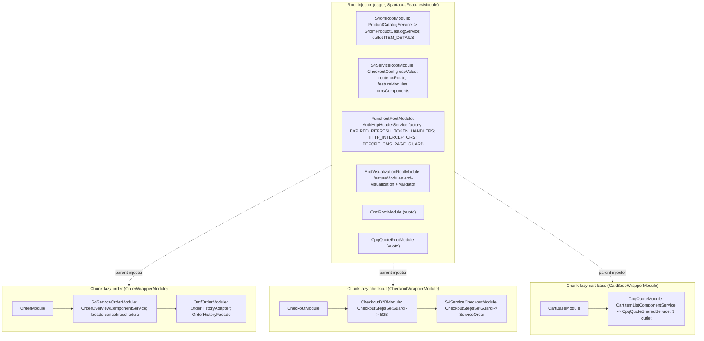
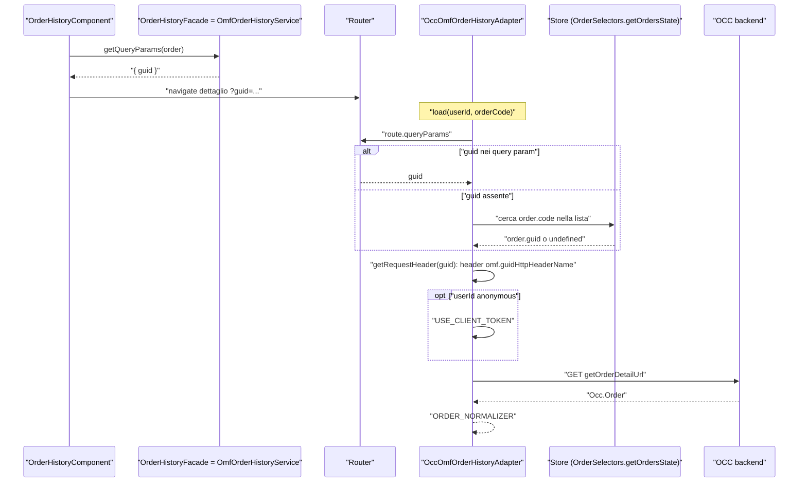
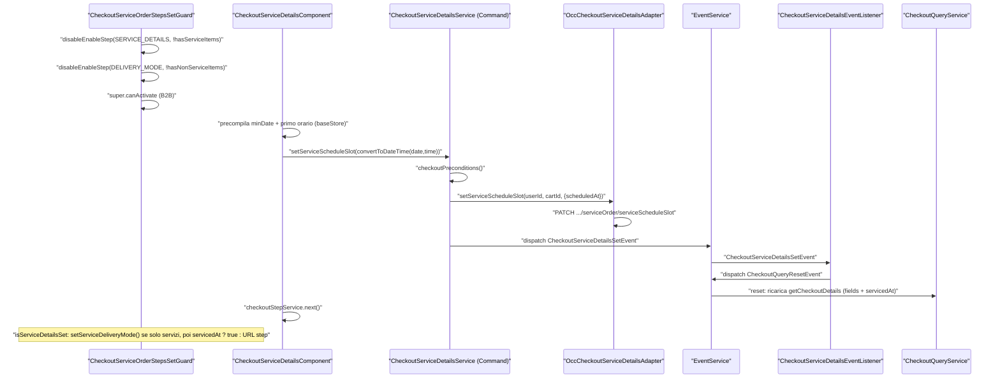
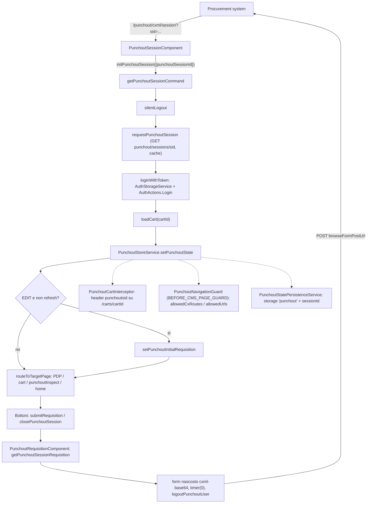
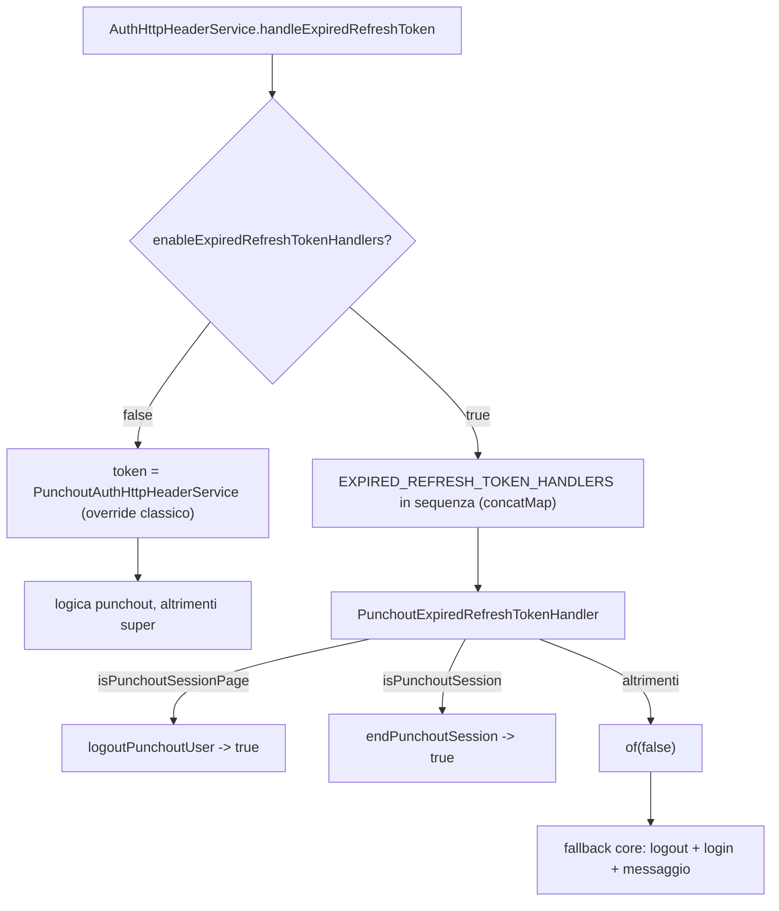
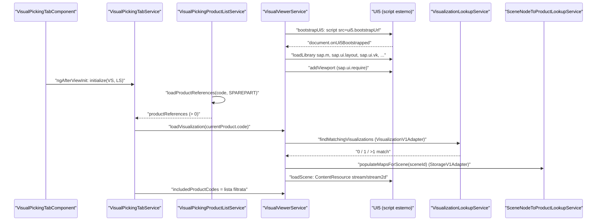

# 36 — Integration libs: S/4, OMF, CPQ quote, punchout, EPD

> Riferimenti allo SHA `5b7a1c2bf2808d7380bc20596d10f4fa710c3da1` (vedi [00-meta](../00-meta.md)).

## 1. A cosa serve e perché esiste

Sotto `integration-libs/` vivono librerie che funzionano solo con un backend Commerce arricchito da addon o da sistemi esterni SAP. Questo capitolo ne copre sei:

| Libreria | Pacchetto | Cosa aggiunge allo storefront |
|---|---|---|
| S/4HANA Service | `@spartacus/s4-service` | prodotti di tipo *servizio*: step di checkout "service details" (data/ora dell'intervento), cancel e reschedule del servizio dal dettaglio ordine |
| S/4HANA Order Management | `@spartacus/s4om` | *schedule lines* (date/quantità confermate) sotto ogni riga di carrello; prodotti "non in catalogo" restituiti da S/4 |
| Order Management Foundation | `@spartacus/omf` | dettaglio ordine richiesto con un header `guid` aggiuntivo |
| CPQ quote | `@spartacus/cpq-quote` | colonna sconti CPQ nella tabella delle righe di carrello/quote |
| Punchout | `@spartacus/punchout` | sessioni cXML punchout avviate da un sistema di procurement esterno, con navigazione limitata e ritorno della *requisition* |
| EPD Visualization | `@spartacus/epd-visualization` | *visual picking* 3D/2D dei ricambi tramite SAP EPD e UI5 (libreria **deprecata**) |

Le integration libs dichiarano la propria versione `"version": "221121.22.0"`, non la 2612.0.0 delle core libs (`integration-libs/omf/package.json:L3-L3`).

La ragione per studiarle insieme è architetturale: **quasi nessuna di queste librerie porta una feature "propria"**. Invece di definire un nuovo dominio con store, facade lazy e componenti CMS, le librerie si **innestano** su feature esistenti (order, checkout, cart, auth, product) sostituendo token DI già esistenti con `useClass`/`useExisting`, aggiungendo componenti tramite outlet, estendendo con *module augmentation* modelli e enum del core e, in un caso, sostituendo un intero token di configurazione. Sono quindi il miglior catalogo "dal vero" di come si estende Spartacus via DI, e insieme il miglior catalogo dei rischi di farlo:

- quando il token sostituito è fornito da un modulo del chunk lazy, l'override deve stare **nello stesso injector** del binding originale e **dopo** di esso: per questo l'app demo importa `OmfOrderModule`, `S4ServiceOrderModule` e `S4ServiceCheckoutModule` dentro i *wrapper module* lazy delle feature order/checkout, dopo il modulo feature (`projects/storefrontapp/src/app/spartacus/features/order/order-wrapper.module.ts:L14-L27`, `projects/storefrontapp/src/app/spartacus/features/checkout/checkout-wrapper.module.ts:L16-L33`). Anche `CpqQuoteModule` sta nel wrapper del carrello dopo `CartBaseModule` (`projects/storefrontapp/src/app/spartacus/features/cart/cart-base-wrapper.module.ts:L14-L25`), ma lì è una scelta dell'app demo e degli schematics, non un vincolo DI: il servizio core che sostituisce, `CartItemListComponentService`, esiste solo come `providedIn: 'root'` e nessun modulo del core lo fornisce (`feature-libs/cart/base/components/cart-shared/cart-item-list-row/cart-item-list-row.component.service.ts:L9-L16`);
- due librerie che sovrascrivono lo stesso token (es. B2B e s4-service su `CheckoutStepsSetGuard`) entrano in competizione e vince l'ultima registrata (`feature-libs/checkout/b2b/components/checkout-b2b-components.module.ts:L33-L36`, `integration-libs/s4-service/checkout/components/s4-service-checkout-component.module.ts:L14-L27`);
- il core stesso ha introdotto nuovi extension point (es. `EXPIRED_REFRESH_TOKEN_HANDLERS`) proprio per evitare che due librerie (Punchout e ASM) si contendano `AuthHttpHeaderService` (`core-libs/core/src/auth/user-auth/services/auth-http-header.service.ts:L311-L316`).

Prerequisiti: [01 — Dependency Injection](../parte-1/01-dependency-injection.md) (gerarchia degli injector, `useClass`/`useExisting`, multi provider), [12 — Feature module e lazy loading](../parte-2/12-feature-module-lazy.md) (`featureModules`, `facadeFactory`), [17 — Outlet](../parte-2/17-outlet.md), [26 — Checkout](../parte-2/26-checkout.md), [27 — Ordini](../parte-2/27-order.md), [22 — Autenticazione](../parte-2/22-auth.md).

## 2. Mappa dei file

### Wiring nell'app demo

| Path | Ruolo |
|---|---|
| `projects/storefrontapp/src/environments/environment.ts` | flag `cpq`, `epdVisualization`, `s4om`, `omf`, `s4Service`, `punchout` da variabili `CX_*` (default `false`) |
| `projects/storefrontapp/src/app/spartacus/spartacus-features.module.ts` | aggiunge i feature module "root" eager in base ai flag |
| `projects/storefrontapp/src/app/spartacus/features/order/order-wrapper.module.ts` | `OrderModule` + `S4ServiceOrderModule` + `OmfOrderModule` (chunk lazy order) |
| `projects/storefrontapp/src/app/spartacus/features/checkout/checkout-wrapper.module.ts` | `CheckoutModule` + B2B + `S4ServiceCheckoutModule` |
| `projects/storefrontapp/src/app/spartacus/features/cart/cart-base-wrapper.module.ts` | `CartBaseModule` + `CpqQuoteModule` |
| `projects/storefrontapp/src/app/spartacus/features/s4-service/s4-service-feature.module.ts` | feature `s4-service` (lazy, modulo vuoto) |
| `projects/storefrontapp/src/app/spartacus/features/punchout/punchout-feature.module.ts` | loader `import('@spartacus/punchout')` |
| `projects/storefrontapp/src/app/spartacus/features/epd-visualization/epd-visualization-feature.module.ts` | `apis.baseUrl`, `ui5.bootstrapUrl` |
| `core-libs/schematics/src/shared/lib-configs/integration-libs/*-schematics-config.ts` | `importAfter` che codifica l'ordine degli import |

### `@spartacus/omf`

| Path | Ruolo |
|---|---|
| `integration-libs/omf/root/omf-root.module.ts` | `OmfRootModule` vuoto |
| `integration-libs/omf/order/omf-order.module.ts` | override DI `OrderHistoryAdapter` + `OrderHistoryFacade`, default config |
| `integration-libs/omf/order/occ-omf-order-history.adapter.ts` | `OccOmfOrderHistoryAdapter`: header `guid` sul dettaglio ordine |
| `integration-libs/omf/order/omf-order-history.service.ts` | `OmfOrderHistoryService`: `getQueryParams` → `{ guid }` |
| `integration-libs/omf/order/config/default-omf-config.ts` | `guidHttpHeaderName: 'guid'` |
| `integration-libs/omf/order/config/omf-config.ts` | token `OmfConfig` |

### `@spartacus/s4om`

| Path | Ruolo |
|---|---|
| `integration-libs/s4om/root/s4om-root.module.ts` | outlet `ITEM_DETAILS` + override `ProductCatalogService` |
| `integration-libs/s4om/root/services/s4om-product-catalog.service.ts` | `isProductInCatalog` con `notOrderable` |
| `integration-libs/s4om/root/components/schedule-lines/schedule-lines.component.ts` | UI schedule lines |
| `integration-libs/s4om/root/model/augmented-core.model.ts` | augmentation `OrderEntry.scheduleLines` |
| `integration-libs/s4om/s4om.module.ts` | entry primario vuoto |

### `@spartacus/cpq-quote`

| Path | Ruolo |
|---|---|
| `integration-libs/cpq-quote/cpq-quote-discount/cpq-discount.module.ts` | 3 outlet + override `CartItemListComponentService` |
| `integration-libs/cpq-quote/cpq-quote-discount/cpq-qute.service.ts` | `CpqQuoteService`: flag in `BehaviorSubject` (default `true`) |
| `integration-libs/cpq-quote/cpq-quote-discount/cpq-qute-shared.service.ts` | `CpqQuoteSharedService` sottoclasse del servizio core |
| `integration-libs/cpq-quote/cpq-quote-discount/components/cpq-quote-heading/cpq-quote-heading.component.ts` | header colonna e set del flag |
| `integration-libs/cpq-quote/cpq-quote-discount/components/cpq-quote-discount-tbody/cpq-quote.component.ts` | cella prezzo scontato |
| `integration-libs/cpq-quote/cpq-quote-discount/components/cpq-quote/cpq-quote-offer.component.ts` | percentuale di sconto |
| `integration-libs/cpq-quote/root/model/augmented-core.model.ts` | augmentation `OrderEntry.cpqDiscounts` |

### `@spartacus/s4-service`

| Path | Ruolo |
|---|---|
| `integration-libs/s4-service/root/s4-service-root.module.ts` | route figlie, override `CheckoutConfig`, estensione `cmsComponents` di checkout/order |
| `integration-libs/s4-service/root/config/default-service-details-checkout-config.ts` | 6 step di checkout con `serviceDetails` |
| `integration-libs/s4-service/root/config/default-service-orders-routing-config.ts` | path `checkout/service-details`, `cancelservice`, `rescheduleservice` |
| `integration-libs/s4-service/root/config/default-service-delivery-mode-config.ts` | delivery mode `service-delivery` |
| `integration-libs/s4-service/root/model/augmented-types.model.ts` | augmentation `Order`, `CheckoutState`, `BaseStore`, `CheckoutStepType`, `OccEndpoints` |
| `integration-libs/s4-service/root/facade/checkout-service-details.facade.ts` | facade lazy |
| `integration-libs/s4-service/root/facade/cancel-service-order.facade.ts`, `integration-libs/s4-service/root/facade/reschedule-service-order.facade.ts` | facade astratte senza factory |
| `integration-libs/s4-service/root/facade/checkout-service-schedule-picker.service.ts` | utility date/ora |
| `integration-libs/s4-service/root/events/checkout-service-details-event.listener.ts` | evento → `CheckoutQueryResetEvent` |
| `integration-libs/s4-service/checkout/components/guards/checkout-service-order-steps-set.guard.ts` | guard degli step (estende quello B2B) |
| `integration-libs/s4-service/checkout/components/checkout-service-details/checkout-service-details.component.ts` | nuovo componente CMS `CheckoutServiceDetails` |
| `integration-libs/s4-service/checkout/components/checkout-delivery-mode/service-checkout-delivery-mode.component.ts` | override CMS `CheckoutDeliveryMode` |
| `integration-libs/s4-service/checkout/components/checkout-review-submit/service-checkout-review-submit.component.ts` | override CMS `CheckoutReviewOrder` |
| `integration-libs/s4-service/checkout/core/facade/checkout-service-details.service.ts` | Command `setServiceScheduleSlot` |
| `integration-libs/s4-service/checkout/occ/adapter/occ-checkout-service-details.adapter.ts` | `PATCH .../serviceScheduleSlot` |
| `integration-libs/s4-service/order/core/s4-service-order-core.module.ts` | binding facade cancel/reschedule |
| `integration-libs/s4-service/order/occ/adapters/occ-cancel-service-order.adapter.ts`, `integration-libs/s4-service/order/occ/adapters/occ-reschedule-service-order.adapter.ts` | POST cancel / PATCH reschedule |
| `integration-libs/s4-service/order/components/` | detail actions, cancel, reschedule, card servizio, guard |

### `@spartacus/punchout`

| Path | Ruolo |
|---|---|
| `integration-libs/punchout/root/punchout.root.module.ts` | initializer persistenza, interceptor, override `AuthHttpHeaderService`, handler refresh token, bootstrap listener |
| `integration-libs/punchout/root/guards/punchout-navigation.guard.ts` | `BEFORE_CMS_PAGE_GUARD` che limita la navigazione |
| `integration-libs/punchout/root/interceptors/punchout-cart.interceptor.ts` | header `punchoutsid` |
| `integration-libs/punchout/root/services/punchout-store.service.ts` | stato in `BehaviorSubject` |
| `integration-libs/punchout/root/services/punchout-state-persistence.service.ts` | persistenza del session id |
| `integration-libs/punchout/root/services/punchout-expired-refresh-token-handler.service.ts` | handler `EXPIRED_REFRESH_TOKEN_HANDLERS` |
| `integration-libs/punchout/root/services/punchout-auth-http-header.service.ts` | override legacy di `AuthHttpHeaderService` |
| `integration-libs/punchout/root/config/default-punchout-guard-config.ts` | rotte ammesse per operazione |
| `integration-libs/punchout/root/facade/punchout.facade.ts` | facade lazy |
| `integration-libs/punchout/core/facade/punchout.service.ts` | Command di sessione/requisition |
| `integration-libs/punchout/core/services/punchout-auth.service.ts` | login con token, logout, fine sessione |
| `integration-libs/punchout/occ/adapters/occ-punchout.adapter.ts` | `punchout/sessions/...` |
| `integration-libs/punchout/components/` | session, requisition, buttons, close-session, inspect-cart, error |

### `@spartacus/epd-visualization`

| Path | Ruolo |
|---|---|
| `integration-libs/epd-visualization/root/epd-visualization-root.module.ts` | feature mapping, default config, validator |
| `integration-libs/epd-visualization/root/config/epd-visualization-config.ts` | `EpdVisualizationConfig` |
| `integration-libs/epd-visualization/root/config/epd-visualization-config-validator.ts` | validator |
| `integration-libs/epd-visualization/epd-visualization-api/epd-visualization-api.module.ts` | binding adapter → REST v1 |
| `integration-libs/epd-visualization/epd-visualization-api/adapters/storage-v1/storage-v1.adapter.ts` | nodi della scena |
| `integration-libs/epd-visualization/epd-visualization-api/adapters/visualization-v1/visualization-v1.adapter.ts` | lookup visualizzazioni |
| `integration-libs/epd-visualization/core/services/visualization-lookup/visualization-lookup.service.ts` | ricerca per usage id prodotto |
| `integration-libs/epd-visualization/core/services/scene-node-to-product-lookup/scene-node-to-product-lookup.service.ts` | mappe nodo ↔ prodotto |
| `integration-libs/epd-visualization/components/visual-viewer/visual-viewer.service.ts` | bootstrap UI5, viewport, caricamento scena |
| `integration-libs/epd-visualization/components/visual-picking/visual-picking-tab/visual-picking-tab.service.ts` | collega lista prodotti e viewer |

### File aggiuntivi

| Path | Ruolo |
|---|---|
| `integration-libs/omf/public_api.ts` | Entry point principale: riesporta solo `root/public_api` (`:L7-L7`). |
| `integration-libs/omf/schematics/add-omf/index.ts` | Factory `ng-add` `addOmfFeature` (`:L25-L43`). |
| `integration-libs/omf/schematics/add-omf/index_spec.ts` | Test Jest dello schematic OMF (con feature order) (`:L24-L145`). |
| `integration-libs/omf/vitest.config.ts` | Config Vitest con coverage sempre attiva e soglie 90/90/75/90 (`:L24-L46`). |
| `integration-libs/s4om/public_api.ts` | Entry point principale (dichiarato in `ng-package.json`): riesporta `s4om.module` (`:L10-L10`). |
| `integration-libs/s4om/index.ts` | Doppione di `public_api.ts` con lo stesso export (`:L7-L7`). |
| `integration-libs/s4om/_index.scss` | Entry Sass: core + `styles/index` (`:L1-L3`). |
| `integration-libs/s4om/styles/_index.scss` | Importa `schedule-lines` (`:L1-L1`). |
| `integration-libs/s4om/styles/schedule-lines.scss` | Regole globali per `cx-schedule-lines` e `.cx-schedule-line-info` (`:L1-L27`). |
| `integration-libs/s4om/schematics/add-s4om/index.ts` | Factory `ng-add` `addS4OMFeature` (`:L25-L43`). |
| `integration-libs/s4om/schematics/add-s4om/index_spec.ts` | Test Jest dello schematic S4OM (`:L21-L114`). |
| `integration-libs/s4om/schematics/constants.ts` | Costanti di nomi (cartella, modulo, traduzioni) non importate da nessun file (`:L9-L17`). |
| `integration-libs/s4om/vitest.config.ts` | Config Vitest (soglie 90) (`:L42-L47`). |
| `integration-libs/cpq-quote/schematics/add-cpq-quote/index.ts` | Factory `ng-add` `addCpqQuoteFeature` (`:L25-L43`). |
| `integration-libs/cpq-quote/schematics/add-cpq-quote/index_spec.ts` | Test Jest dello schematic CPQ (con feature cart-base) (`:L25-L151`). |
| `integration-libs/cpq-quote/vitest.config.ts` | Config Vitest: coverage solo `lcov`, senza `enabled` (`:L26-L42`). |
| `integration-libs/s4-service/public_api.ts` | Entry point principale: riesporta `s4-service.module` (`:L7-L7`). |
| `integration-libs/s4-service/styles/_index.scss` | Importa i cinque partial dei componenti (`:L1-L5`). |
| `integration-libs/s4-service/styles/components/_checkout-service-details.scss` | Placeholder `%cx-service-details` (`:L1-L29`). |
| `integration-libs/s4-service/styles/components/_cancel-service-order.scss` | Placeholder `%cx-cancel-service-order` (form motivo) (`:L1-L42`). |
| `integration-libs/s4-service/styles/components/_cancel-service-order-headline.scss` | Placeholder `%cx-cancel-service-order-headline` (tabella) (`:L1-L38`). |
| `integration-libs/s4-service/styles/components/_reschedule-service-order.scss` | Classi globali `.cx-reschedule-service-*`, `.cx-section-*` (`:L1-L34`). |
| `integration-libs/s4-service/styles/components/_s4-service-order-detail-actions.scss` | Classe globale `.cx-order-details-actions` (`:L1-L7`). |
| `integration-libs/s4-service/vitest.config.ts` | Config Vitest con alias verso helper di test del core (`:L16-L22`). |
| `integration-libs/punchout/public_api.ts` | Entry point principale: riesporta `punchout.module` (`:L10-L10`). |
| `integration-libs/punchout/_index.scss` | Entry Sass: allowlist componenti, `__body` e allowlist page template `PunchoutTemplate` (`:L7-L40`). |
| `integration-libs/punchout/schematics/add-punchout/index.ts` | Factory `ng-add` `addPunchoutFeatures` (`:L25-L43`). |
| `integration-libs/punchout/schematics/add-punchout/index_spec.ts` | Test Jest: solo il caso "senza feature" (`:L31-L45`). |
| `integration-libs/punchout/test.ts` | Bootstrap Karma con `provideZoneChangeDetection()` (`:L14-L30`). |
| `integration-libs/epd-visualization/public_api.ts` | Entry point principale: riesporta `epd-visualization.module` (`:L7-L7`). |
| `integration-libs/epd-visualization/schematics/add-epd-visualization/index.ts` | Factory `ng-add` `addEpdVisualizationFeature`, deprecata (`:L25-L48`). |
| `integration-libs/epd-visualization/schematics/add-epd-visualization/index_spec.ts` | Test Jest, anche con tsconfig senza `compilerOptions` (`:L132-L189`). |
| `integration-libs/epd-visualization/test.ts` | Bootstrap Karma con `provideZoneChangeDetection()` (`:L16-L32`). |
| `integration-libs/epd-visualization/styles/_index.scss` | Importa `components/index` (`:L1-L1`). |
| `integration-libs/epd-visualization/styles/components/_index.scss` | Importa visual-picking e visual-viewer (`:L1-L2`). |
| `integration-libs/epd-visualization/styles/components/visual-picking/_index.scss` | Importa i 4 partial del visual picking (`:L1-L4`). |
| `integration-libs/epd-visualization/styles/components/visual-picking/paged-list.component.scss` | Placeholder `%cx-epd-visualization-paged-list` (carosello a slide) (`:L1-L110`). |
| `integration-libs/epd-visualization/styles/components/visual-picking/visual-picking-product-filter.component.scss` | Placeholder `%cx-epd-visualization-product-filter` (`:L1-L49`). |
| `integration-libs/epd-visualization/styles/components/visual-picking/visual-picking-product-list.component.scss` | Placeholder `%cx-epd-visualization-product-list` (thumbnail, highlight) (`:L1-L242`). |
| `integration-libs/epd-visualization/styles/components/visual-picking/visual-picking-tab.component.scss` | Placeholder `%cx-epd-visualization-visual-picking-tab` (viewer + lista affiancati da `md`) (`:L1-L66`). |
| `integration-libs/epd-visualization/styles/components/visual-viewer/_index.scss` | Importa i 3 partial del viewer (`:L1-L3`). |
| `integration-libs/epd-visualization/styles/components/visual-viewer/visual-viewer-animation-slider.component.scss` | Placeholder `%cx-epd-visualization-animation-slider` (`:L1-L73`). |
| `integration-libs/epd-visualization/styles/components/visual-viewer/visual-viewer-toolbar-button.component.scss` | Placeholder `%cx-epd-visualization-viewer-toolbar-button` (`:L1-L79`). |
| `integration-libs/epd-visualization/styles/components/visual-viewer/visual-viewer.component.scss` | Placeholder `%cx-epd-visualization-viewer` (griglia, viewport UI5) (`:L1-L155`). |

## 3. Come funziona passo per passo

### 3.1 Il pattern comune: "root eager + estensione nel wrapper lazy"

Ogni libreria è attivata nell'app demo da un flag d'ambiente con default `false` (`projects/storefrontapp/src/environments/environment.ts:L30-L43`). Quando il flag è attivo, il feature module "root" della libreria entra nei `featureModules` eager di `SpartacusFeaturesModule` (`projects/storefrontapp/src/app/spartacus/spartacus-features.module.ts:L133-L175`).

Le parti che **sovrascrivono** binding di altre feature non sono però caricate come feature lazy proprie:

- `S4ServiceOrderModule` e `OmfOrderModule` sono importati **dopo** `OrderModule` dentro `OrderWrapperModule` (`projects/storefrontapp/src/app/spartacus/features/order/order-wrapper.module.ts:L14-L27`), che è proprio il modulo caricato lazy dalla feature order (`projects/storefrontapp/src/app/spartacus/features/order/order-feature.module.ts:L29-L30`);
- `S4ServiceCheckoutModule` è importato in `CheckoutWrapperModule` **dopo** `CheckoutB2BModule` (che entra solo con `environment.b2b`) (`projects/storefrontapp/src/app/spartacus/features/checkout/checkout-wrapper.module.ts:L16-L33`);
- `CpqQuoteModule` è importato dopo `CartBaseModule` in `CartBaseWrapperModule` (`projects/storefrontapp/src/app/spartacus/features/cart/cart-base-wrapper.module.ts:L14-L25`).

Il motivo è la gerarchia degli injector (vedi [03 — Lazy loading](../parte-1/03-lazy-loading.md)): i provider di `OrderModule` vivono nell'injector del chunk lazy; un override nell'AppModule sarebbe "più in alto" e quindi oscurato dal binding originale. Nello stesso injector, a parità di token, vince il provider registrato per ultimo, quindi l'ordine `[OrderModule, ...extensions]` è essenziale. ⚠️ DA VERIFICARE a runtime che un override in AppModule venga effettivamente oscurato (deduzione dalla gerarchia degli injector lazy, `node_modules` assente).

Gli schematics codificano lo stesso vincolo con `importAfter` (coppie *marker module* → *feature module*): s4-service va dopo `CHECKOUT_B2B_MODULE` e `ORDER_MODULE` (`core-libs/schematics/src/shared/lib-configs/integration-libs/s4-service-schematics-config.ts:L74-L83`), `OMF_ORDER_MODULE` dopo `ORDER_MODULE` con dipendenza dalla feature order (`core-libs/schematics/src/shared/lib-configs/integration-libs/omf-schematics-config.ts:L29-L50`), `CPQ_QUOTE_MODULE` dopo `CART_BASE_MODULE` (`core-libs/schematics/src/shared/lib-configs/integration-libs/cpq-quote-schematics-config.ts:L45-L51`). Gli schematic `add-*` delle librerie sono tutti uguali: analizzano le dipendenze cross-feature, chiamano `addFeatures` e aggiungono le peer dependencies (`integration-libs/s4-service/schematics/add-s4-service/index.ts:L25-L42`). Per i dettagli vedi [43 — Schematics e migrazioni](../parte-2/43-schematics-migrazioni.md).

### 3.2 OMF: un header `guid` sul dettaglio ordine

`OmfRootModule` è un `@NgModule()` vuoto e la costante `OMF_FEATURE = 'OMF'` non è usata da alcun `featureModules` (`integration-libs/omf/root/omf-root.module.ts:L9-L10`, `integration-libs/omf/root/feature-name.ts:L7-L7`). Tutto il lavoro è in `OmfOrderModule`, che sostituisce **due** token della feature order (`integration-libs/omf/order/omf-order.module.ts:L15-L26`):

- `OrderHistoryAdapter` → `OccOmfOrderHistoryAdapter` (`useClass`), al posto di `OccOrderHistoryAdapter` (`feature-libs/order/occ/order-occ.module.ts:L42-L42`);
- `OrderHistoryFacade` → `OmfOrderHistoryService` (`useClass`), al posto di `useExisting: OrderHistoryService` (`feature-libs/order/core/facade/facade-providers.ts:L33-L37`).

Il flusso:

1. Lo storico ordini usa `orderHistoryFacade.getQueryParams(order)` come `queryParams` dei link verso il dettaglio (`feature-libs/order/components/order-history/order-history.component.ts:L126-L133`). Nel core il metodo restituisce `null` ed è `@deprecated` (`feature-libs/order/core/facade/order-history.service.ts:L220-L225`).
2. `OmfOrderHistoryService` estende `OrderHistoryService` e sovrascrive solo `getQueryParams`, restituendo `{ guid }` se l'ordine lo possiede (`integration-libs/omf/order/omf-order-history.service.ts:L12-L24`). Il campo `guid?: string` è già nel modello `Order` del core (`feature-libs/order/root/model/order.model.ts:L86-L86`).
3. Il dettaglio ordine invoca `OrderHistoryAdapter.load`, che ora è `OccOmfOrderHistoryAdapter.load` (`integration-libs/omf/order/occ-omf-order-history.adapter.ts:L69-L86`).
4. `getOrderGuid` legge `guid` dai query param della rotta attiva; se manca (caso "My-Account-V2") lo cerca nella lista ordini dello store NgRx tramite `OrderSelectors.getOrdersState` (`integration-libs/omf/order/occ-omf-order-history.adapter.ts:L31-L53`).
5. `getRequestHeader` mette il guid in un header il cui nome è `omf.guidHttpHeaderName` convertito in minuscolo; se la chiave manca e si è in dev mode logga un warning (`integration-libs/omf/order/occ-omf-order-history.adapter.ts:L55-L67`). Il default è `'guid'` (`integration-libs/omf/order/config/default-omf-config.ts:L9-L13`).
6. Per l'utente anonimo aggiunge anche l'header `USE_CLIENT_TOKEN`, poi fa la GET verso `getOrderDetailUrl` e normalizza con `ORDER_NORMALIZER` (`integration-libs/omf/order/occ-omf-order-history.adapter.ts:L69-L86`). `logger` e `getOrderDetailUrl` sono membri `protected` della superclasse (`feature-libs/order/occ/adapters/occ-order-history.adapter.ts:L47-L47`, `feature-libs/order/occ/adapters/occ-order-history.adapter.ts:L212-L212`).

`OmfConfig` è il classico config token astratto risolto `useExisting: Config`, con il tipo `OmfConfiguration` preso dall'entry primario `@spartacus/omf` (`integration-libs/omf/order/config/omf-config.ts:L7-L21`).

### 3.3 S/4HANA Order Management: schedule lines e prodotti fuori catalogo

`S4omRootModule` (eager) fa due cose (`integration-libs/s4om/root/s4om-root.module.ts:L17-L35`):

- registra `ScheduleLinesComponent` nell'outlet `CartOutlets.ITEM_DETAILS` in posizione `AFTER`;
- sostituisce `ProductCatalogService` con `useExisting: S4omProductCatalogService`.

Importa inoltre `RequestedDeliveryDateComponentsModule` e `PDFInvoicesComponentsModule` solo per forzare l'installazione di quelle librerie insieme a S4OM, come dice il commento in linea (`integration-libs/s4om/root/s4om-root.module.ts:L18-L22`). L'entry primario `S4omModule` è vuoto (`integration-libs/s4om/s4om.module.ts:L8-L12`).

**Prodotti fuori catalogo.** Il `ProductCatalogService` core considera "in catalogo" qualunque prodotto non nullo (`core-libs/core/src/product/services/product-catalog.service.ts:L20-L22`). La versione S4OM ritorna `false` se `stock.stockLevelStatus === 'notOrderable'` (prodotto arrivato da S/4 ma assente in Commerce) e `true` se lo status manca (`integration-libs/s4om/root/services/s4om-product-catalog.service.ts:L13-L37`). Il metodo è consumato dal carrello (link disabilitato nella lista item, add-to-cart "unavailable") e dall'ordine (reorder) (`feature-libs/cart/base/components/cart-shared/cart-item-list/cart-item-list.component.ts:L395-L398`, `feature-libs/cart/base/components/add-to-cart/add-to-cart.component.ts:L158-L160`, `feature-libs/order/components/order-details/order-detail-reorder/order-detail-reorder.component.ts:L53-L53`). Poiché il binding è nel root module eager, vale per tutto l'albero.

**Schedule lines.** `OrderEntry` è aumentato con `scheduleLines?: ScheduleLine[]`, dove `ScheduleLine = { confirmedAt?: Date; confirmedQuantity?: number }` (`integration-libs/s4om/root/model/augmented-core.model.ts:L10-L14`, `integration-libs/s4om/root/model/schedule-line.model.ts:L7-L10`); l'augmentation è importata per side effect dall'index del model (`integration-libs/s4om/root/model/index.ts:L7-L9`). `ScheduleLinesComponent` legge l'entry da `CartItemContext` (opzionale, fallback `EMPTY`) e fornisce localmente `CxDatePipe` (`integration-libs/s4om/root/components/schedule-lines/schedule-lines.component.ts:L13-L27`). Il template mostra le righe solo se `hasScheduleLines`, con il testo visivo `aria-hidden` e un testo `cx-visually-hidden` collegato da `aria-describedby` (`integration-libs/s4om/root/components/schedule-lines/schedule-lines.component.html:L1-L20`).

### 3.4 CPQ quote: sconti nella tabella delle righe

`CpqQuoteRootModule` è vuoto; tutta la logica è in `CpqDiscountModule`, importato da `CpqQuoteModule` (`integration-libs/cpq-quote/root/cpq-quote-root.module.ts:L9-L10`, `integration-libs/cpq-quote/cpq-quote.module.ts:L10-L13`). `CpqDiscountModule` (`integration-libs/cpq-quote/cpq-quote-discount/cpq-discount.module.ts:L39-L57`):

- sostituisce `CartItemListComponentService` con `useClass: CpqQuoteSharedService`;
- registra tre componenti negli outlet `CPQ_QUOTE_MODULE`, `CPQ_QUOTE_HEADING`, `CPQ_QUOTE` (tutti `AFTER`).

Gli id degli outlet sono definiti nel **core cart** (`cx-cpq-quote`, `cx-cpq-quote-heading`, `cx-cpq-quote-offer`) (`feature-libs/cart/base/root/models/cart-outlets.model.ts:L25-L27`) e piazzati nei template core: `CPQ_QUOTE_HEADING` nell'intestazione della tabella con context `items`, `CPQ_QUOTE` e `CPQ_QUOTE_MODULE` nella riga con context `{ items: item }` (`feature-libs/cart/base/components/cart-shared/cart-item-list/cart-item-list.component.html:L21-L24`, `feature-libs/cart/base/components/cart-shared/cart-item-list-row/cart-item-list-row.component.html:L44-L49`, `feature-libs/cart/base/components/cart-shared/cart-item-list-row/cart-item-list-row.component.html:L106-L112`). È un caso esemplare di "hook predisposto nel core per un'integrazione".

Il meccanismo del flag:

1. Il `CartItemListComponentService` core è `providedIn: 'root'` e ha un solo metodo `showBasePriceWithDiscount()` che ritorna `true` (`feature-libs/cart/base/components/cart-shared/cart-item-list-row/cart-item-list-row.component.service.ts:L9-L16`).
2. `CartItemListRowComponent` lo legge **una volta**, inizializzando il campo `isFlagQuote`, e lo usa in `*ngIf` per il prezzo base standard (`feature-libs/cart/base/components/cart-shared/cart-item-list-row/cart-item-list-row.component.ts:L48-L49`, `feature-libs/cart/base/components/cart-shared/cart-item-list-row/cart-item-list-row.component.html:L37-L37`).
3. `CpqQuoteSharedService` estende il servizio core e delega a `CpqQuoteService.getFlag$()`, che nonostante il `$` ritorna un `boolean` sincrono dal `BehaviorSubject` (default `true`) (`integration-libs/cpq-quote/cpq-quote-discount/cpq-qute-shared.service.ts:L16-L23`, `integration-libs/cpq-quote/cpq-quote-discount/cpq-qute.service.ts:L13-L22`).
4. `CpqQuoteHeadingComponent` riceve dal context outlet l'array di entry e imposta il flag a `!hasDiscounts`: se almeno un item ha `cpqDiscounts`, il prezzo base standard va nascosto e compare la colonna sconto (`integration-libs/cpq-quote/cpq-quote-discount/components/cpq-quote-heading/cpq-quote-heading.component.ts:L55-L72`).
5. `CpqQuoteDiscountComponent.getDiscountedPrice` calcola il prezzo unitario scontato come `(basePrice*quantity - appliedDiscount)/quantity` (`integration-libs/cpq-quote/cpq-quote-discount/components/cpq-quote-discount-tbody/cpq-quote.component.ts:L55-L71`), formattato con `number: '1.2-2' : 'en-US'` e con il prezzo base barrato se ci sono sconti (`integration-libs/cpq-quote/cpq-quote-discount/components/cpq-quote-discount-tbody/cpq-quote.component.html:L12-L31`).
6. `CpqQuoteOfferComponent` mostra la percentuale `appliedDiscount/(basePrice*quantity)*100`, senza decimali se intera, altrimenti con 2 (`integration-libs/cpq-quote/cpq-quote-discount/components/cpq-quote/cpq-quote-offer.component.ts:L52-L74`).

Il dato arriva dal backend: `OrderEntry` è aumentato con `cpqDiscounts?: CpqDiscounts[]` (campi `appliedValue`, `isoCode`, `value` tipati `any`) (`integration-libs/cpq-quote/root/model/augmented-core.model.ts:L10-L14`, `integration-libs/cpq-quote/root/model/cpqDiscounts.model.ts:L7-L11`).

### 3.5 S/4HANA Service — parte root (eager)

`S4ServiceRootModule` (`integration-libs/s4-service/root/s4-service-root.module.ts:L56-L83`):

- importa `CheckoutServiceDetailsEventModule`;
- registra due route figlie `path: ''` identificate da `data.cxRoute` (`cancelServiceDetails`, `rescheduleServiceDetails`) con `CmsPageGuard` + `PageLayoutComponent` (`integration-libs/s4-service/root/s4-service-root.module.ts:L59-L72`). I path reali arrivano dalla routing config: `my-account/order/cancelservice/:orderCode` e `my-account/order/rescheduleservice/:orderCode` (con `paramsMapping orderCode → code`), più `checkout/service-details` (`integration-libs/s4-service/root/config/default-service-orders-routing-config.ts:L9-L23`). È il meccanismo generale per cui Spartacus identifica il nome di una route da `data.cxRoute` (`core-libs/core/src/routing/configurable-routes/configurable-routes.service.ts:L146-L150`; vedi [14 — Routing](../parte-2/14-routing.md));
- **sostituisce il token** `CheckoutConfig` con `useValue: defaultServiceDetailsCheckoutConfig` (`integration-libs/s4-service/root/s4-service-root.module.ts:L75-L75`). Normalmente `CheckoutConfig` è un token astratto `useExisting: Config` che espone la configurazione globale fusa (`feature-libs/checkout/base/root/config/checkout-config.ts:L18-L22`): qui invece chi inietta `CheckoutConfig` riceve un oggetto fisso;
- fornisce default config per routing, delivery mode di servizio e `cmsComponents`, più `CxDatePipe` e `CheckoutServiceSchedulePickerService` (`integration-libs/s4-service/root/s4-service-root.module.ts:L76-L80`).

`defaultServiceDetailsCheckoutConfig` definisce 6 step (paymentType, deliveryAddress, deliveryMode, paymentDetails, **serviceDetails**, reviewOrder), `express: false`, `guest: false`, `defaultDeliveryMode: [FREE]` (`integration-libs/s4-service/root/config/default-service-details-checkout-config.ts:L13-L57`).

**Estendere un enum del core.** `CheckoutStepType.SERVICE_DETAILS` viene aggiunto sia per il type checker (augmentation di `enum`) sia a runtime con un'assegnazione diretta all'oggetto enum (`integration-libs/s4-service/root/model/augmented-types.model.ts:L38-L47`). Altre augmentation: `Order` riceve `servicedAt`, `serviceCancellable`, `serviceReschedulable`; `CheckoutState` riceve `servicedAt`; `BaseStore` riceve `serviceOrderConfiguration { leadDays, serviceScheduleTimes }`; `OccEndpoints` riceve `setServiceScheduleSlot` (`integration-libs/s4-service/root/model/augmented-types.model.ts:L16-L52`). `S4ServiceDeliveryModeConfig` è un config token con `s4ServiceDeliveryMode?: DeliveryMode` (`integration-libs/s4-service/root/model/augmented-types.model.ts:L54-L64`), di default `code: 'service-delivery'`, costo `USD0.00` (`integration-libs/s4-service/root/config/default-service-delivery-mode-config.ts:L10-L22`).

**Nessuna feature lazy propria (di fatto).** s4-service non mappa i suoi componenti CMS su una feature sua: estende `featureModules[CHECKOUT_FEATURE].cmsComponents` (B2B + `CheckoutServiceDetails`) e `featureModules[ORDER_FEATURE].cmsComponents` (order + 3 componenti service) (`integration-libs/s4-service/root/s4-service-root.module.ts:L31-L55`). Siccome `deepMerge` **sostituisce** gli array invece di concatenarli (`isObject` esclude gli array, quindi l'ultimo valore vince) (`core-libs/core/src/config/utils/deep-merge.ts:L7-L9`, `core-libs/core/src/config/utils/deep-merge.ts:L36-L45`), la libreria deve ripetere gli elenchi B2B/order completi. L'app demo registra comunque una feature `S4_SERVICE_FEATURE` (`'s4-service'`) che carica `S4ServiceModule`, il quale però è vuoto (`projects/storefrontapp/src/app/spartacus/features/s4-service/s4-service-feature.module.ts:L26-L29`, `integration-libs/s4-service/s4-service.module.ts:L9-L12`).

**Facade.** `CheckoutServiceDetailsFacade` è una facade lazy (`facadeFactory`) legata a `CHECKOUT_CORE_FEATURE` con 5 metodi (`integration-libs/s4-service/root/facade/checkout-service-details.facade.ts:L13-L27`); `CHECKOUT_CORE_FEATURE` è alias di `CHECKOUT_FEATURE` (`feature-libs/checkout/base/root/checkout-root.module.ts:L44-L45`), quindi il proxy carica il chunk checkout. Al contrario `CancelServiceOrderFacade` e `RescheduleServiceOrderFacade` sono classi astratte `providedIn: 'root'` **senza** factory: risolvibili solo dove `S4ServiceOrderCoreModule` le ha fornite (`integration-libs/s4-service/root/facade/cancel-service-order.facade.ts:L12-L30`, `integration-libs/s4-service/root/facade/reschedule-service-order.facade.ts:L11-L24`).

**Utility date.** `CheckoutServiceSchedulePickerService` legge `leadDays` e `serviceScheduleTimes` dal `baseSite.baseStore.serviceOrderConfiguration` (default 0 / `[]`) (`integration-libs/s4-service/root/facade/checkout-service-schedule-picker.service.ts:L48-L61`); la data minima è oggi + `leadDays` + 1, formattata `yyyy-MM-dd` (`integration-libs/s4-service/root/facade/checkout-service-schedule-picker.service.ts:L24-L32`); `convertToDateTime` produce `YYYY-MM-DDTHH:MM:00` + offset del fuso locale (`integration-libs/s4-service/root/facade/checkout-service-schedule-picker.service.ts:L70-L74`); `convertDateTimeToReadableString` usa `Date.toLocaleString()` (`integration-libs/s4-service/root/facade/checkout-service-schedule-picker.service.ts:L82-L85`).

**Evento.** `CheckoutServiceDetailsEventListener` traduce ogni `CheckoutServiceDetailsSetEvent` in un `CheckoutQueryResetEvent` (`integration-libs/s4-service/root/events/checkout-service-details-event.listener.ts:L23-L29`), che è tra i notifier di reset della query dei dettagli checkout (`feature-libs/checkout/base/core/facade/checkout-query.service.ts:L38-L39`). Il listener è istanziato eagerly iniettandolo nel costruttore di `CheckoutServiceDetailsEventModule` (`integration-libs/s4-service/root/events/checkout-service-details-event.module.ts:L10-L17`). Per il pattern vedi [20 — Facade, command & query, eventi](../parte-2/20-facade-command-query-eventi.md).

### 3.6 S/4HANA Service — checkout

`S4ServiceCheckoutModule` = components + core + occ (`integration-libs/s4-service/checkout/s4-service-checkout.module.ts:L12-L19`).

- **Core**: `CheckoutServiceDetailsFacade → useExisting CheckoutServiceDetailsService`, più il connector (`integration-libs/s4-service/checkout/core/s4-service-checkout-core.module.ts:L13-L24`). Il Command `setServiceScheduleSlotCommand` (strategia `CancelPrevious`) verifica le precondizioni, chiama il connector con `{ scheduledAt }` e a successo emette `CheckoutServiceDetailsSetEvent` (`integration-libs/s4-service/checkout/core/facade/checkout-service-details.service.ts:L39-L65`). Precondizioni: `userId` e `cartId` presenti, utente anonimo ammesso solo con guest cart, altrimenti `Error('Checkout conditions not met')` (`integration-libs/s4-service/checkout/core/facade/checkout-service-details.service.ts:L67-L85`). Lo stato della data servizio è derivato dalla query dei dettagli checkout (`state.data?.servicedAt`), senza store dedicato (`integration-libs/s4-service/checkout/core/facade/checkout-service-details.service.ts:L91-L97`). `getServiceProducts` filtra le entry con `productTypes === ProductTypes.SERVICE`; `hasNonServiceItems` confronta il numero di entry in consegna (`getDeliveryEntries()`, il pickup non si applica ai servizi) con quello dei servizi (`integration-libs/s4-service/checkout/core/facade/checkout-service-details.service.ts:L99-L131`).
- **OCC**: `CheckoutServiceDetailsAdapter → OccCheckoutServiceDetailsAdapter` e default config degli endpoint (`integration-libs/s4-service/checkout/occ/s4-service-checkout-occ.module.ts:L13-L22`). La config ridefinisce `getCheckoutDetails` aggiungendo `servicedAt` ai fields e introduce `setServiceScheduleSlot` (`integration-libs/s4-service/checkout/occ/config/default-occ-checkout-s4-service-config.ts:L10-L25`). L'adapter fa una `PATCH` del body e normalizza gli errori con `tryNormalizeHttpError` (`integration-libs/s4-service/checkout/occ/adapter/occ-checkout-service-details.adapter.ts:L27-L44`).
- **Components**:
  - `CheckoutStepsSetGuard` è sostituito con `useExisting: CheckoutServiceOrderStepsSetGuard` (`integration-libs/s4-service/checkout/components/s4-service-checkout-component.module.ts:L14-L27`). È il guard dichiarato dai componenti CMS di checkout progress (`feature-libs/checkout/base/components/checkout-progress/checkout-progress.module.ts:L37-L37`); anche il checkout B2B sostituisce lo stesso token (`feature-libs/checkout/b2b/components/checkout-b2b-components.module.ts:L33-L36`), quindi conta l'ordine di import nel wrapper (§3.1).
  - `CheckoutServiceOrderStepsSetGuard` estende `CheckoutB2BStepsSetGuard`; in `canActivate` disabilita SERVICE_DETAILS se il carrello non ha servizi e DELIVERY_MODE se ha solo servizi, poi delega a `super.canActivate` (`integration-libs/s4-service/checkout/components/guards/checkout-service-order-steps-set.guard.ts:L21-L43`). Sovrascrive `isB2BStepSet` aggiungendo il caso `SERVICE_DETAILS → isServiceDetailsSet` (`integration-libs/s4-service/checkout/components/guards/checkout-service-order-steps-set.guard.ts:L78-L99`). `isServiceDetailsSet` prima chiama `setServiceDeliveryMode()` — che, se il carrello ha SOLO servizi, imposta il delivery mode `s4ServiceDeliveryMode.code` — poi ritorna `true` o l'URL dello step (`integration-libs/s4-service/checkout/components/guards/checkout-service-order-steps-set.guard.ts:L45-L76`).
  - Override CMS `CheckoutDeliveryMode → ServiceCheckoutDeliveryModeComponent` (estende `CheckoutDeliveryModeComponent`) (`integration-libs/s4-service/checkout/components/checkout-delivery-mode/service-checkout-delivery-mode.module.ts:L34-L42`, `integration-libs/s4-service/checkout/components/checkout-delivery-mode/service-checkout-delivery-mode.component.ts:L40-L47`); il template mostra prima, se ci sono servizi, l'opzione "service delivery" presa dalla config (`integration-libs/s4-service/checkout/components/checkout-delivery-mode/service-checkout-delivery-mode.component.html:L1-L5`, `integration-libs/s4-service/checkout/components/checkout-delivery-mode/service-checkout-delivery-mode.component.html:L133-L149`).
  - Override CMS `CheckoutReviewOrder → ServiceCheckoutReviewSubmitComponent` (estende `B2BCheckoutReviewSubmitComponent`) con guard `CheckoutAuthGuard, CartNotEmptyGuard` (`integration-libs/s4-service/checkout/components/checkout-review-submit/service-checkout-review-submit.module.ts:L40-L49`); aggiunge SERVICE_DETAILS ai "delivery steps" e nasconde la card delivery mode quando il mode è quello di servizio (`integration-libs/s4-service/checkout/components/checkout-review-submit/service-checkout-review-submit.component.ts:L116-L126`).
  - Nuovo componente CMS `CheckoutServiceDetails` (`cx-service-details`) (`integration-libs/s4-service/checkout/components/checkout-service-details/checkout-service-details.module.ts:L32-L41`). Il form è precompilato con la data salvata o con data minima e primo orario disponibile (`integration-libs/s4-service/checkout/components/checkout-service-details/checkout-service-details.component.ts:L85-L109`); `next()` converte data+ora, chiama `setServiceScheduleSlot` e a successo `checkoutStepService.next`, a errore mostra `serviceOrderCheckout.unknownError` (`integration-libs/s4-service/checkout/components/checkout-service-details/checkout-service-details.component.ts:L129-L164`).

### 3.7 S/4HANA Service — order

- **Core**: `CancelServiceOrderFacade → CancelServiceOrderService` e `RescheduleServiceOrderFacade → RescheduleServiceOrderService` (`useExisting`), più i due connector (`integration-libs/s4-service/order/core/s4-service-order-core.module.ts:L22-L39`). `cancelService` prende lo userId e chiama il connector; `loadOrderDetails` delega a `OrderHistoryFacade.getOrderDetails()` (`integration-libs/s4-service/order/core/facade/cancel-service-order.service.ts:L20-L38`).
- **OCC**: `cancelServiceOrder` → `users/${userId}/orders/${code}/serviceOrder/cancellation`, `rescheduleService` → `.../serviceOrder/serviceScheduleSlot` (`integration-libs/s4-service/order/occ/config/default-occ-s4-service-config.ts:L10-L15`). Cancel è una `POST` senza normalizzazione errori; reschedule è una `PATCH` con `tryNormalizeHttpError` (`integration-libs/s4-service/order/occ/adapters/occ-cancel-service-order.adapter.ts:L20-L32`, `integration-libs/s4-service/order/occ/adapters/occ-reschedule-service-order.adapter.ts:L26-L42`).
- **Components**:
  - `ServiceDetailsCardModule` sostituisce `OrderOverviewComponentService` con `ServiceOrderOverviewComponentService` e mette `ServiceDetailsCardComponent` nell'outlet `OrderOutlets.SERVICE_DETAILS` (`integration-libs/s4-service/order/components/order-summary/service-details-card.module.ts:L16-L31`). Il servizio nasconde il delivery mode di servizio, altrimenti delega a `super` (`integration-libs/s4-service/order/components/order-summary/service-order-overview-component.service.ts:L12-L20`, `feature-libs/order/components/order-details/order-overview/order-overview-component.service.ts:L12-L14`). L'outlet `cx-service-details-card` è già nel template core dell'order overview con context `{ item: order, readonly: true }` (`feature-libs/order/root/model/order-outlets.model.ts:L13-L13`, `feature-libs/order/components/order-details/order-overview/order-overview.component.html:L112-L115`).
  - Override CMS `AccountOrderDetailsActionsComponent → S4ServiceOrderDetailActionsComponent` (`integration-libs/s4-service/order/components/s4-service-order-detail-actions/s4-service-order-detail-actions.module.ts:L28-L37`); il template mostra i bottoni cancel/reschedule in base ai flag API `order.serviceCancellable`/`serviceReschedulable` e linka le cxRoute `cancelServiceDetails`/`rescheduleServiceDetails` (`integration-libs/s4-service/order/components/s4-service-order-detail-actions/s4-service-order-detail-actions.component.html:L42-L57`).
  - Nuovi componenti CMS `CancelServiceOrder` (guard `AuthGuard, CancelServiceOrderGuard`), `CancelServiceOrderHeadline` (`AuthGuard`), `RescheduleServiceOrder` (`AuthGuard, ServiceOrderGuard`) (`integration-libs/s4-service/order/components/cancel-service-order/cancel-service-order.module.ts:L34-L41`, `integration-libs/s4-service/order/components/cancel-service-order-headline/cancel-service-order-headline.module.ts:L38-L45`, `integration-libs/s4-service/order/components/reschedule-service-order/reschedule-service-order.module.ts:L45-L52`).
  - `CancelServiceOrderGuard` passa solo se l'ordine ha `serviceCancellable`, altrimenti `UrlTree` verso la route `orders` (`integration-libs/s4-service/order/components/guards/cancel-service-order.guard.ts:L21-L37`); `ServiceOrderGuard` passa solo se `serviceReschedulable`, altrimenti messaggio `rescheduleService.serviceNotReschedulable` e `false` (`integration-libs/s4-service/order/components/guards/service-order.guard.ts:L20-L34`).
  - `CancelServiceOrderComponent` invia **tutte** le entry dell'ordine (`orderEntryNumber`, `quantity`) più il motivo, poi rinaviga ai dettagli con un messaggio (`integration-libs/s4-service/order/components/cancel-service-order/cancel-service-order.component.ts:L59-L102`); `RescheduleServiceOrderComponent` filtra le entry ai soli prodotti SERVICE e chiama `rescheduleService(orderCode, dateTime)` (`integration-libs/s4-service/order/components/reschedule-service-order/reschedule-service-order.component.ts:L77-L85`, `integration-libs/s4-service/order/components/reschedule-service-order/reschedule-service-order.component.ts:L136-L163`).

L'entry point `@spartacus/s4-service/order` esporta solo module e components (non core/occ), mentre `@spartacus/s4-service/checkout` esporta anche core e occ (`integration-libs/s4-service/order/public_api.ts:L7-L8`, `integration-libs/s4-service/checkout/public_api.ts:L7-L10`).

### 3.8 Punchout — parte root (eager)

Punchout è l'unica libreria del gruppo con una feature lazy "vera" (`punchout`) e con una parte eager corposa. `PunchoutRootModule` (`integration-libs/punchout/root/punchout.root.module.ts:L36-L84`):

1. importa `PunchoutNavigationModule`, che contribuisce `PunchoutNavigationGuard` al multi-token `BEFORE_CMS_PAGE_GUARD` (`integration-libs/punchout/root/guards/punchout-navigation.module.ts:L12-L21`);
2. fornisce tre default config (componenti CMS, routing, guard) e un `provideAppInitializer` che chiama `PunchoutStatePersistenceService.initSync()` (`integration-libs/punchout/root/punchout.root.module.ts:L39-L47`);
3. registra `PunchoutCartInterceptor` con `useExisting` nel multi-token `HTTP_INTERCEPTORS` (`integration-libs/punchout/root/interceptors/index.ts:L11-L17`);
4. sostituisce `AuthHttpHeaderService` con una **factory** dipendente dal feature toggle (§3.10) (`integration-libs/punchout/root/punchout.root.module.ts:L49-L66`);
5. contribuisce `PunchoutExpiredRefreshTokenHandler` a `EXPIRED_REFRESH_TOKEN_HANDLERS` (`integration-libs/punchout/root/punchout.root.module.ts:L67-L71`);
6. fornisce `PunchoutUiRestrictionService` e lo aggancia al componente root via `APP_BOOTSTRAP_LISTENER` (`integration-libs/punchout/root/punchout.root.module.ts:L72-L81`).

**Stato.** `PunchoutStoreService` è uno store minimale su `BehaviorSubject<PunchoutState>`: `setPunchoutState` sostituisce, `updatePunchoutState` fonde, `clearPunchoutState` ripristina lo stato iniziale (`integration-libs/punchout/root/services/punchout-store.service.ts:L11-L49`). Niente NgRx.

**Persistenza.** `initSync` sincronizza con `localStorage` (default di `syncWithStorage`), sotto la chiave `spartacus⚿⚿punchout` (key `punchout`, contesto vuoto), **solo** il `punchoutSessionId` (`integration-libs/punchout/root/services/punchout-state-persistence.service.ts:L23-L36`, `core-libs/core/src/state/services/state-persistence.service.ts:L44-L48`, `core-libs/core/src/state/services/state-persistence.service.ts:L124-L130`). Dopo l'avvio, un id assente è scritto come `''` e non `undefined`, perché `StatePersistenceService` non permette di cancellare una chiave già creata (`integration-libs/punchout/root/services/punchout-state-persistence.service.ts:L42-L53`). Al refresh, `onRead` ripristina l'id e richiama `initPunchoutSession({ isPageRefresh: true })`, salvo che si sia già sulla pagina di sessione (`integration-libs/punchout/root/services/punchout-state-persistence.service.ts:L62-L76`).

**Rilevamento.** `isPunchoutSessionPage` è vero se il path corrente (prima di `?`) contiene il path semantico `punchoutSession` **e** c'è una query string (`integration-libs/punchout/root/services/punchout-detection.service.ts:L23-L34`). Le route `punchout/cxml/session` e `punchout/cxml/error` sono `protected: false` e `authFlow: true` (`integration-libs/punchout/root/config/default-punchout-routing-config.ts:L9-L30`).

**Interceptor.** `PunchoutCartInterceptor` aggiunge l'header `punchoutsid` a ogni richiesta il cui URL contiene `/carts/{punchoutCartId}` (`integration-libs/punchout/root/interceptors/punchout-cart.interceptor.ts:L17-L49`).

**Guard di navigazione.** `PunchoutNavigationGuard.canActivate` calcola `cxRoute` (da `route.data.cxRoute` o dal path con `RoutingConfigService.getRouteName`), ricava l'operazione punchout e, se la route non è ammessa né per cxRoute né per URL, mostra un warning e naviga a `redirectPage` (`integration-libs/punchout/root/guards/punchout-navigation.guard.ts:L36-L61`). L'operazione è determinata solo per utente loggato con `punchoutSessionId`; se la sessione non è in stato la richiede via facade; ogni errore → `undefined`, cioè nessuna restrizione (`integration-libs/punchout/root/guards/punchout-navigation.guard.ts:L96-L131`). In `isAllowedUrls`, `'/'` significa "solo home" (route con `url.length === 0`), gli altri URL sono confrontati con `includes` sul path relativo (`integration-libs/punchout/root/guards/punchout-navigation.guard.ts:L63-L82`). Default: INSPECT ammette solo session/requisition/inspect e rimanda a `punchoutInspect`; EDIT/CREATE ammettono home + category, brand, quickOrder, product, cart, search, punchoutError e rimandano a `home` (`integration-libs/punchout/root/config/default-punchout-guard-config.ts:L10-L46`).

**UI restriction.** `PunchoutUiRestrictionService.isPunchoutSessionActive` aggiunge/rimuove la classe CSS `cxPunchoutSessionActive` sull'elemento root (`integration-libs/punchout/root/services/punchout-ui-restriction.service.ts:L24-L58`); gli stili con quella classe nascondono il bottone secondario del dialog "added to cart" e il bottone recensioni (`integration-libs/punchout/styles/_punchout-template.scss:L49-L59`).

### 3.9 Punchout — sessione e requisition (lazy)

`PunchoutFacade` è una facade lazy (`facadeFactory`, feature `punchout`) con 7 metodi (`integration-libs/punchout/root/facade/punchout.facade.ts:L17-L37`); la feature è mappata ai 6 componenti CMS punchout (`integration-libs/punchout/root/config/default-punchout-cms-component-config.ts:L10-L23`) e l'app demo aggiunge il loader (`projects/storefrontapp/src/app/spartacus/features/punchout/punchout-feature.module.ts:L33-L40`). `PunchoutModule` = components + core + occ; core lega `PunchoutFacade → useExisting PunchoutService`; occ lega `PunchoutAdapter → OccPunchoutAdapter` (`integration-libs/punchout/punchout.module.ts:L12-L15`, `integration-libs/punchout/core/facade/facade-providers.ts:L11-L17`, `integration-libs/punchout/occ/punchout-occ.module.ts:L15-L25`). Endpoint: `punchout/sessions/${sessionId}` e `.../requisition`, quest'ultimo con `discardCartEntries=true` se richiesto (`integration-libs/punchout/occ/config/default-occ-punchout-config.ts:L10-L13`, `integration-libs/punchout/occ/adapters/occ-punchout.adapter.ts:L49-L69`).

Avvio sessione:

1. `PunchoutSessionComponent` (template vuoto) legge il query param `sid` e chiama `initPunchoutSession` (`integration-libs/punchout/components/punchout-session/punchout-session.component.ts:L17-L51`).
2. `getPunchoutSessionCommand`: senza id termina la sessione; altrimenti logout silenzioso → richiesta sessione OCC → login con il token ricevuto → load del carrello → stato → (solo EDIT, non refresh) snapshot della requisition iniziale → (non refresh) routing alla pagina target (`integration-libs/punchout/core/facade/punchout.service.ts:L69-L109`).
3. `requestPunchoutSessionCommand` mette in cache in memoria la prima risposta valida e la riusa; senza `accessToken`, `customerId` o `cartId` lancia `Error('Punchout login info missing')` (`integration-libs/punchout/core/facade/punchout.service.ts:L241-L261`).
4. `PunchoutAuthService.loginWithToken` scrive direttamente `access_token`, `access_token_stored_at`, `token_type` in `AuthStorageService`, imposta `OCC_USER_ID_CURRENT` e dispatcha `AuthActions.Login` (`integration-libs/punchout/core/services/punchout-auth.service.ts:L64-L75`). Non passa quindi per il flusso OAuth descritto in [22 — Autenticazione](../parte-2/22-auth.md).
5. `routeToTargetPage`: CREATE/EDIT a livello PRODUCT con `selectedItem` → PDP; EDIT → cart; INSPECT → `punchoutInspect`; altrimenti `/` (`integration-libs/punchout/core/facade/punchout.service.ts:L298-L320`).

Ritorno al procurement:

1. I bottoni chiamano `submitRequisition(cancel)` o `closePunchoutSession()` (`integration-libs/punchout/components/punchout-buttons/punchout-buttons.component.ts:L36-L38`, `integration-libs/punchout/components/punchout-close-session/punchout-close-session.component.ts:L29-L31`).
2. `closePunchoutSessionCommand`: CREATE → `cancelRequisition: true` (si invia un carrello vuoto); EDIT → `closePunchoutSession: true` (si invia lo snapshot iniziale); poi apre la pagina requisition (`integration-libs/punchout/core/facade/punchout.service.ts:L194-L232`).
3. `getPunchoutRequisitionCommand` blocca la navigazione manuale alla pagina requisition (nessun flag in stato → warning + home), restituisce lo snapshot iniziale se si chiude una sessione EDIT, altrimenti chiama OCC (`integration-libs/punchout/core/facade/punchout.service.ts:L120-L171`).
4. `PunchoutRequisitionComponent` riempie un form nascosto `cxml-base64` con `orderAsCXML`, attende un tick (`timer(0)`), fa logout del punchout user e invia il form in POST a `browseFormPostUrl`, cioè al sistema di procurement (`integration-libs/punchout/components/punchout-requisition/punchout-requisition.component.ts:L42-L95`, `integration-libs/punchout/components/punchout-requisition/punchout-requisition.component.html:L1-L14`).

`endPunchoutSession` (auth service) pulisce lo stato, mostra `httpHandlers.unauthorized.common`, fa `coreLogout` e naviga a `punchoutError` (`integration-libs/punchout/core/services/punchout-auth.service.ts:L81-L97`).

### 3.10 Punchout e il refresh token scaduto: da override a handler

Questo è l'esempio più istruttivo del capitolo su come il core sia evoluto per **ridurre** gli override DI concorrenti.

- **Percorso legacy (toggle spento).** `PunchoutAuthHttpHeaderService` estende `AuthHttpHeaderService` e sovrascrive `handleExpiredRefreshToken`: sulla pagina di sessione fa logout silenzioso, con sessione attiva la termina, altrimenti `super` (`integration-libs/punchout/root/services/punchout-auth-http-header.service.ts:L24-L66`). Il problema: anche ASM sostituisce `AuthHttpHeaderService` (`feature-libs/asm/root/asm-root.module.ts:L73-L83`), e un token può avere un solo vincitore.
- **Percorso nuovo (toggle acceso).** `AuthHttpHeaderService.handleExpiredRefreshToken` interroga in sequenza gli handler del multi-token `EXPIRED_REFRESH_TOKEN_HANDLERS` e usa il fallback (logout + login + messaggio) solo se nessuno ha gestito il caso (`core-libs/core/src/auth/user-auth/services/auth-http-header.service.ts:L265-L285`). Il commento core lo motiva esplicitamente: evitare di sovrascrivere l'intero servizio, "which would create a conflict with other service overrides (e.g., ASM)" (`core-libs/core/src/auth/user-auth/services/auth-http-header.service.ts:L311-L316`). `PunchoutExpiredRefreshTokenHandler` riproduce la logica punchout e ritorna `of(false)` se non applicabile (`integration-libs/punchout/root/services/punchout-expired-refresh-token-handler.service.ts:L31-L45`).
- **Ponte di compatibilità.** Il provider factory di Punchout per `AuthHttpHeaderService` sceglie: con toggle attivo `DELEGATED_AUTH_HTTP_HEADER_SERVICE` (fornito da ASM) o, in sua assenza, `DEFAULT_AUTH_HTTP_HEADER_SERVICE`; con toggle spento `PunchoutAuthHttpHeaderService` (`integration-libs/punchout/root/punchout.root.module.ts:L49-L66`). `DEFAULT_AUTH_HTTP_HEADER_SERVICE` crea un `AuthHttpHeaderService` "pulito" con `new`; entrambi i token sono dichiarati temporanei (fix CXPSA-12514) (`core-libs/core/src/auth/user-auth/services/auth-http-header.service.ts:L50-L70`); `DELEGATED_AUTH_HTTP_HEADER_SERVICE` è un hook senza factory perché Punchout possa delegare all'override ASM senza importarlo (`core-libs/core/src/auth/user-auth/services/auth-http-header.service.ts:L72-L82`). ASM fornisce entrambi i token (`feature-libs/asm/root/asm-root.module.ts:L73-L83`).
- Il toggle `enableExpiredRefreshTokenHandlers` vale `true` nei default ed è attivo anche nell'app demo (`core-libs/core/src/features-config/feature-toggles/config/feature-toggles.ts:L1072-L1072`, `projects/storefrontapp/src/app/spartacus/spartacus-features.module.ts:L360-L360`). Vedi [42 — Feature toggle](../parte-2/42-feature-toggle-deprecazioni.md).

### 3.11 EPD Visualization (deprecata)

Tutta la libreria è `@deprecated since v221121.5.0` (`integration-libs/epd-visualization/epd-visualization.module.ts:L12-L22`). `EpdVisualizationRootModule` mappa la feature `epd-visualization` al componente CMS `VisualPickingTabComponent`, fornisce la default config e un config validator (`integration-libs/epd-visualization/root/epd-visualization-root.module.ts:L17-L38`).

**Config.** `EpdVisualizationConfig.epdVisualization` contiene `ui5.bootstrapUrl`, `apis.baseUrl`, `usageIds` (folder/product) e `visualPicking.productReferenceType` (`integration-libs/epd-visualization/root/config/epd-visualization-config.ts:L19-L104`). I default coprono solo usage id (`CommerceCloud-Folder`, `CommerceCloud-SparePart`/`ProductCode`) e `productReferenceType: 'SPAREPART'`, **non** `apis` né `ui5` (`integration-libs/epd-visualization/root/config/epd-visualization-default-config.ts:L12-L35`); l'app demo li fornisce (`projects/storefrontapp/src/app/spartacus/features/epd-visualization/epd-visualization-feature.module.ts:L24-L31`). Il validator controlla presenza e protocollo http/https delle URL, gli usage id e `productReferenceType` (`integration-libs/epd-visualization/root/config/epd-visualization-config-validator.ts:L16-L39`), ma i validator girano solo in dev mode e producono soltanto `logger.warn` (`core-libs/core/src/config/config-validator/config-validator.module.ts:L28-L35`, `core-libs/core/src/config/config-validator/config-validator.ts:L42-L47`).

**API.** `EpdVisualizationApiModule` lega gli adapter astratti core a implementazioni REST v1 (`SceneAdapter → StorageV1Adapter`, `VisualizationAdapter → VisualizationV1Adapter`), che non sono nella public API (`integration-libs/epd-visualization/epd-visualization-api/epd-visualization-api.module.ts:L18-L24`, `integration-libs/epd-visualization/epd-visualization-api/public_api.ts:L7-L10`). `StorageV1Adapter.getNodes` chiama `${baseUrl}/vis/public/storage/v1/scenes/{sceneId}/nodes` (`integration-libs/epd-visualization/epd-visualization-api/adapters/storage-v1/storage-v1.adapter.ts:L49-L108`); `VisualizationV1Adapter.lookupVisualization` chiama `.../visualization/v1/lookup/visualization?usage=…&folderUsageId=…` con usage id serializzati in JSON e URI-encoded (`integration-libs/epd-visualization/epd-visualization-api/adapters/visualization-v1/visualization-v1.adapter.ts:L50-L68`).

**Core.** `VisualizationLookupService.findMatchingVisualizations` costruisce lo usage id del prodotto e tiene solo visualizzazioni `3DModel` o `2DDrawing` (`integration-libs/epd-visualization/core/services/visualization-lookup/visualization-lookup.service.ts:L39-L69`). `SceneNodeToProductLookupService.populateMapsForScene` scarica i nodi della scena e popola due mappe bidirezionali nodeId ↔ productCodes in `BehaviorSubject` (`integration-libs/epd-visualization/core/services/scene-node-to-product-lookup/scene-node-to-product-lookup.service.ts:L52-L102`), con varianti sincrone che ritornano `[]` finché le mappe non sono popolate (`integration-libs/epd-visualization/core/services/scene-node-to-product-lookup/scene-node-to-product-lookup.service.ts:L184-L234`).

**Componenti e UI5.**

1. `VisualPickingTabComponent` ottiene `VisualViewerService` e `VisualPickingProductListService` dai figli con `@ViewChild(..., { read: Service })` e li passa a `VisualPickingTabService.initialize` in `ngAfterViewInit` (`integration-libs/epd-visualization/components/visual-picking/visual-picking-tab/visual-picking-tab.component.ts:L36-L59`).
2. `initialize` (solo browser) collega la lista filtrata a `includedProductCodes` del viewer e, quando arrivano le product references, chiama `loadVisualization(currentProduct.code)` (`integration-libs/epd-visualization/components/visual-picking/visual-picking-tab/visual-picking-tab.service.ts:L46-L89`).
3. Le references sono caricate per il tipo `visualPicking.productReferenceType` via `ProductReferenceService` (`integration-libs/epd-visualization/components/visual-picking/visual-picking-tab/product-list/visual-picking-product-list.service.ts:L109-L128`).
4. `VisualViewerComponent` fornisce un'istanza propria di `VisualViewerService` e tutti i suoi `@Input/@Output` sono proxy verso il servizio (`integration-libs/epd-visualization/components/visual-viewer/visual-viewer.component.ts:L27-L50`).
5. Il costruttore di `VisualViewerService` in SSR non fa nulla; in browser concatena bootstrap UI5 → init librerie → creazione viewport (`shareReplay`) (`integration-libs/epd-visualization/components/visual-viewer/visual-viewer.service.ts:L78-L99`). `bootstrapUi5` inietta uno `<script>` in `<head>` con `src = ui5.bootstrapUrl` e callback globale `document.onUi5Bootstrapped`, saltando se UI5 è già presente (`integration-libs/epd-visualization/components/visual-viewer/visual-viewer.service.ts:L1105-L1140`); `initializeUi5` carica `sap.m`, `sap.ui.layout`, `sap.ui.vk`, `sap.ui.richtexteditor` (`integration-libs/epd-visualization/components/visual-viewer/visual-viewer.service.ts:L1142-L1158`); `addViewport` crea Viewport e collaboratori via `sap.ui.require` e lo piazza sull'elemento host (`integration-libs/epd-visualization/components/visual-viewer/visual-viewer.service.ts:L1304-L1389`).
6. `loadVisualization` risolve la visualizzazione (0 / 1 / >1 match → `NoMatchFound`, `UniqueMatchFound`, `MultipleMatchesFound`), popola le mappe nodi-prodotti e carica la scena; in SSR ritorna subito un `UnexpectedError` (`integration-libs/epd-visualization/components/visual-viewer/visual-viewer.service.ts:L1032-L1092`, `integration-libs/epd-visualization/components/visual-viewer/visual-viewer.service.ts:L1402-L1449`). `loadScene` crea un `ContentResource` con `source: ${baseUrl}/vis/public/storage/v1` e `useSecureConnection: false` (`integration-libs/epd-visualization/components/visual-viewer/visual-viewer.service.ts:L1549-L1565`).

`CompactAddToCartComponent` estende `AddToCartComponent` del secondary entry `@spartacus/cart/base/components/add-to-cart` cambiando solo il template (`integration-libs/epd-visualization/components/visual-picking/visual-picking-tab/product-list/compact-add-to-cart/compact-add-to-cart.component.ts:L10-L29`).

### 3.12 Packaging: schematics, stili, test

**Schematics `ng-add`.** Le sei factory hanno lo stesso corpo: `validateSpartacusInstallation`, `analyzeCrossFeatureDependencies`, poi la catena `analyzeApplication` → `addFeatures` → `addPackageJsonDependenciesForLibrary(peerDependencies)` → `finalizeInstallation` (`integration-libs/omf/schematics/add-omf/index.ts:L25-L43`, `integration-libs/s4om/schematics/add-s4om/index.ts:L25-L43`, `integration-libs/cpq-quote/schematics/add-cpq-quote/index.ts:L25-L43`, `integration-libs/punchout/schematics/add-punchout/index.ts:L25-L43`, `integration-libs/epd-visualization/schematics/add-epd-visualization/index.ts:L25-L48`). La conoscenza specifica (dipendenze, root module, `importAfter`) sta in `core-libs/schematics`, ad es. `S4OM_SCHEMATICS_CONFIG` (`core-libs/schematics/src/shared/lib-configs/integration-libs/s4om-schematics-config.ts:L28-L59`); per questo `integration-libs/s4om/schematics/constants.ts` è un doppione inerte, con nomi che divergono (`S4OM_MODULE_NAME` vs `S4OM_FEATURE_MODULE_NAME`) (`integration-libs/s4om/schematics/constants.ts:L9-L17`, `core-libs/schematics/src/shared/lib-configs/integration-libs/s4om-schematics-config.ts:L19-L26`). Lo spec punchout copre solo il caso senza feature (`integration-libs/punchout/schematics/add-punchout/index_spec.ts:L31-L45`).

**Stili.** OMF e CPQ non hanno Sass. Punchout, s4-service ed EPD seguono lo schema placeholder + allowlist + `$skipComponentStyles`; punchout aggiunge un'allowlist di page template che estende `%PunchoutTemplate` su `cx-page-layout.PunchoutTemplate` (`integration-libs/punchout/_index.scss:L7-L40`, `integration-libs/epd-visualization/_index.scss:L5-L29`). In s4-service i partial di reschedule e detail actions definiscono classi globali anziché placeholder, quindi sono sempre applicati e non disattivabili via allowlist (`integration-libs/s4-service/styles/components/_reschedule-service-order.scss:L1-L34`, `integration-libs/s4-service/styles/components/_s4-service-order-detail-actions.scss:L1-L7`); lo stesso vale per `integration-libs/s4om/styles/schedule-lines.scss:L1-L27`.

**Test.** OMF, S4OM, CPQ e s4-service usano Vitest; punchout ed EPD restano su Karma (`integration-libs/punchout/project.json:L20-L26`) con un `test.ts` custom che aggiunge `provideZoneChangeDetection()` per evitare gli NG0100 introdotti da Angular 21 (`integration-libs/punchout/test.ts:L14-L30`, `integration-libs/epd-visualization/test.ts:L16-L32`). Le soglie di coverage differiscono: 90/90/75/90 per OMF e S4OM, 85/85/65/85 per CPQ e s4-service; in CPQ la coverage non ha `enabled: true` e la costante `root` è dichiarata ma non usata (`integration-libs/omf/vitest.config.ts:L24-L46`, `integration-libs/s4om/vitest.config.ts:L42-L47`, `integration-libs/cpq-quote/vitest.config.ts:L11-L11`, `integration-libs/cpq-quote/vitest.config.ts:L26-L42`, `integration-libs/s4-service/vitest.config.ts:L43-L48`).

## 4. Diagrammi

### 4.1 Dove vive ogni override (injector root vs chunk lazy)



Le frecce dentro i chunk rappresentano l'ordine di import nel wrapper (`projects/storefrontapp/src/app/spartacus/features/order/order-wrapper.module.ts:L14-L27`, `projects/storefrontapp/src/app/spartacus/features/checkout/checkout-wrapper.module.ts:L16-L33`, `projects/storefrontapp/src/app/spartacus/features/cart/cart-base-wrapper.module.ts:L14-L25`): a parità di token vince il modulo più a destra/in basso.

### 4.2 OMF: dal link dello storico al dettaglio con header guid



### 4.3 S/4 Service: step "service details" del checkout



### 4.4 Punchout: ciclo di vita della sessione



### 4.5 Refresh token scaduto: handler vs override



### 4.6 EPD: visual picking



## 5. Estratti di codice reale

### 5.1 Ordine degli import nel wrapper lazy order

`projects/storefrontapp/src/app/spartacus/features/order/order-wrapper.module.ts:L14-L27`

```ts
const extensions: Type<any>[] = [];
if (environment.s4Service) {
  extensions.push(S4ServiceOrderModule);
}
if (environment.omf) {
  extensions.push(OmfOrderModule);
}
if (environment.opf) {
  extensions.push(OpfOrderModule);
}
@NgModule({
  imports: [OrderModule, ...extensions],
})
export class OrderWrapperModule {}
```

### 5.2 OMF: doppio override DI

`integration-libs/omf/order/omf-order.module.ts:L15-L26`

```ts
@NgModule({
  providers: [
    OmfOrderHistoryService,
    provideDefaultConfig(defaultOmfConfig),
    { provide: OrderHistoryAdapter, useClass: OccOmfOrderHistoryAdapter },
    {
      provide: OrderHistoryFacade,
      useClass: OmfOrderHistoryService,
    },
  ],
})
export class OmfOrderModule {}
```

### 5.3 OMF: guid da query param o dallo store, e header

`integration-libs/omf/order/occ-omf-order-history.adapter.ts:L39-L67`

```ts
  getOrderGuid(orderCode: string): Observable<string | undefined> {
    return this.route.queryParams.pipe(
      switchMap((queryParams) => {
        if (queryParams.guid) {
          // when navigating from Order History to Order Details page
          return of(queryParams.guid);
        } else {
          // when loading Order History page in case of My-Account-V2
          return this.getOrderDetailsValue(orderCode).pipe(
            map((order) => (order ? order.guid : undefined))
          );
        }
      })
    );
  }

  getRequestHeader(guid: string | undefined): HttpHeaders {
    let headers = new HttpHeaders();
    if (!this.config.omf?.guidHttpHeaderName && isDevMode()) {
      this.logger.warn(
        `There is no guidHttpHeaderName configured in OMF configuration`
      );
    }
    const guidHeader = this.config.omf?.guidHttpHeaderName?.toLowerCase?.();
    if (guid && guidHeader) {
      headers = headers.set(guidHeader, guid);
    }
    return headers;
  }
```

### 5.4 S4OM: outlet + override di servizio core

`integration-libs/s4om/root/s4om-root.module.ts:L17-L35`

```ts
@NgModule({
  imports: [
    ScheduleLinesModule,
    RequestedDeliveryDateComponentsModule, //Adding dependency with Requested Delivery Date so that the library gets installed along with S4OM
    PDFInvoicesComponentsModule, //Adding dependency with PDF Invoices so that the library gets installed along with S4OM
  ],
  providers: [
    provideOutlet({
      id: CartOutlets.ITEM_DETAILS,
      position: OutletPosition.AFTER,
      component: ScheduleLinesComponent,
    }),
    {
      provide: ProductCatalogService,
      useExisting: S4omProductCatalogService,
    },
  ],
})
export class S4omRootModule {}
```

`integration-libs/s4om/root/services/s4om-product-catalog.service.ts:L23-L37`

```ts
  isProductInCatalog(product?: Product): boolean {
    if (!product) {
      return false;
    }

    const stockLevelStatus = product?.stock?.stockLevelStatus;

    if (!stockLevelStatus) {
      return true;
    }

    return (
      stockLevelStatus !== this.PRODUCT_NOT_IN_CATALOGUE_STOCK_LEVEL_STATUS
    );
  }
```

### 5.5 CPQ: il flag condiviso

`integration-libs/cpq-quote/cpq-quote-discount/cpq-qute.service.ts:L13-L23`

```ts
export class CpqQuoteService {
  private isFlagSubject = new BehaviorSubject<boolean>(true); // Default value is true
  isFlag$ = this.isFlagSubject.asObservable();

  setFlag(value: boolean) {
    this.isFlagSubject.next(value);
  }
  getFlag$() {
    return this.isFlagSubject.getValue();
  }
}
```

`integration-libs/cpq-quote/cpq-quote-discount/components/cpq-quote-heading/cpq-quote-heading.component.ts:L55-L63`

```ts
    if (this.outlet?.context$) {
      this.subscription.add(
        this.outlet.context$.subscribe((context) => {
          this.datacheck = context;
          const hasDiscounts = this.datacheck.some(
            (item: any) => item.cpqDiscounts && item.cpqDiscounts.length > 0
          );
          // Set flag based on the existence of cpqDiscounts in any item
          this.cpqQuoteService.setFlag(!hasDiscounts);
```

`integration-libs/cpq-quote/cpq-quote-discount/cpq-discount.module.ts:L39-L46`

```ts
  providers: [
    CpqQuoteService,
    { provide: CartItemListComponentService, useClass: CpqQuoteSharedService },
    provideOutlet({
      id: CartOutlets.CPQ_QUOTE_MODULE,
      position: OutletPosition.AFTER,
      component: CpqQuoteDiscountComponent,
    }),
```

### 5.6 s4-service: estensione dei `cmsComponents` e sostituzione di `CheckoutConfig`

`integration-libs/s4-service/root/s4-service-root.module.ts:L31-L55`

```ts
export const S4_SERVICE_CMS_COMPONENTS: string[] = [
  ...CHECKOUT_B2B_CMS_COMPONENTS,
  'CheckoutServiceDetails',
];
export const S4_SERVICE_ORDER_CMS_COMPONENTS: string[] = [
  'RescheduleServiceOrder',
  'CancelServiceOrderHeadline',
  'CancelServiceOrder',
];
export function defaultS4ServiceComponentsConfig() {
  const config: CmsConfig = {
    featureModules: {
      [CHECKOUT_FEATURE]: {
        cmsComponents: S4_SERVICE_CMS_COMPONENTS,
      },
      [ORDER_FEATURE]: {
        cmsComponents: [
          ...ORDER_CMS_COMPONENTS,
          ...S4_SERVICE_ORDER_CMS_COMPONENTS,
        ],
      },
    },
  };
  return config;
}
```

`integration-libs/s4-service/root/s4-service-root.module.ts:L74-L81`

```ts
  providers: [
    { provide: CheckoutConfig, useValue: defaultServiceDetailsCheckoutConfig },
    provideDefaultConfig(defaultServiceOrdersRoutingConfig),
    provideDefaultConfig(defaultServiceDeliveryModeConfig),
    provideDefaultConfigFactory(defaultS4ServiceComponentsConfig),
    CxDatePipe,
    CheckoutServiceSchedulePickerService,
  ],
```

### 5.7 s4-service: estendere un enum del core anche a runtime

`integration-libs/s4-service/root/model/augmented-types.model.ts:L38-L47`

```ts
declare module '@spartacus/checkout/base/root' {
  enum CheckoutStepType {
    SERVICE_DETAILS = 'serviceDetails',
  }
  interface CheckoutState {
    servicedAt?: ServiceDateTime; //response property name
  }
}

(CheckoutStepType as any)['SERVICE_DETAILS'] = 'serviceDetails';
```

### 5.8 s4-service: guard degli step

`integration-libs/s4-service/checkout/components/guards/checkout-service-order-steps-set.guard.ts:L26-L43`

```ts
  canActivate(route: ActivatedRouteSnapshot): Observable<GuardResult> {
    return combineLatest(
      this.checkoutServiceDetailsFacade.hasServiceItems(),
      this.checkoutServiceDetailsFacade.hasNonServiceItems()
    ).pipe(
      switchMap(([hasServiceItems, hasNonServiceItems]) => {
        this.checkoutStepService.disableEnableStep(
          CheckoutStepType.SERVICE_DETAILS,
          !hasServiceItems
        );
        this.checkoutStepService.disableEnableStep(
          CheckoutStepType.DELIVERY_MODE,
          !hasNonServiceItems
        );
        return super.canActivate(route);
      })
    );
  }
```

`integration-libs/s4-service/checkout/components/guards/checkout-service-order-steps-set.guard.ts:L62-L76`

```ts
  setServiceDeliveryMode(): Observable<unknown> {
    return combineLatest([
      this.checkoutServiceDetailsFacade.hasServiceItems(),
      this.checkoutServiceDetailsFacade.hasNonServiceItems(),
    ]).pipe(
      switchMap(([hasServiceItems, hasNonServiceItems]) => {
        if (!hasNonServiceItems && hasServiceItems) {
          return this.checkoutDeliveryModesFacade.setDeliveryMode(
            this.config.s4ServiceDeliveryMode?.code ?? ''
          );
        }
        return of(undefined);
      })
    );
  }
```

### 5.9 s4-service: Command e precondizioni

`integration-libs/s4-service/checkout/core/facade/checkout-service-details.service.ts:L39-L85`

```ts
  protected setServiceScheduleSlotCommand: Command<ServiceDateTime> =
    this.commandService.create<ServiceDateTime>(
      (scheduledAt) =>
        this.checkoutPreconditions().pipe(
          switchMap(([userId, cartId]) =>
            this.serviceDetailsConnector
              .setServiceScheduleSlot(userId, cartId, {
                scheduledAt,
              })
              .pipe(
                tap(() =>
                  this.eventService.dispatch(
                    {
                      userId,
                      cartId,
                      scheduledAt,
                    },
                    CheckoutServiceDetailsSetEvent
                  )
                )
              )
          )
        ),
      {
        strategy: CommandStrategy.CancelPrevious,
      }
    );

  protected checkoutPreconditions(): Observable<[string, string]> {
    return combineLatest([
      this.userIdService.takeUserId(),
      this.activeCartFacade.takeActiveCartId(),
      this.activeCartFacade.isGuestCart(),
    ]).pipe(
      take(1),
      map(([userId, cartId, isGuestCart]) => {
        if (
          !userId ||
          !cartId ||
          (userId === OCC_USER_ID_ANONYMOUS && !isGuestCart)
        ) {
          throw new Error('Checkout conditions not met');
        }
        return [userId, cartId];
      })
    );
  }
```

### 5.10 Punchout: provider del root module

`integration-libs/punchout/root/punchout.root.module.ts:L42-L81`

```ts
    provideAppInitializer(() => {
      const punchoutPersistenceService = inject(
        PunchoutStatePersistenceService
      );
      punchoutPersistenceService.initSync();
    }),
    ...interceptors,
    // below provider should be removed after enableExpiredRefreshTokenHandlers is fully rolled out
    {
      provide: AuthHttpHeaderService,
      useFactory: () => {
        const featureToggles = inject(FeatureToggles);
        const delegatedAuthHttpHeaderService = inject(
          DELEGATED_AUTH_HTTP_HEADER_SERVICE,
          {
            optional: true,
          }
        );
        // delegatedService is expected to be used by ASM to address breaking changes of CXSPA-12514
        return featureToggles.enableExpiredRefreshTokenHandlers
          ? (delegatedAuthHttpHeaderService ??
              inject(DEFAULT_AUTH_HTTP_HEADER_SERVICE))
          : inject(PunchoutAuthHttpHeaderService);
      },
    },
    {
      provide: EXPIRED_REFRESH_TOKEN_HANDLERS,
      useExisting: PunchoutExpiredRefreshTokenHandler,
      multi: true,
    },
    PunchoutUiRestrictionService,
    {
      provide: APP_BOOTSTRAP_LISTENER,
      multi: true,
      useFactory: (): ((compRef: ComponentRef<any>) => void) => {
        const punchoutComponentsService = inject(PunchoutUiRestrictionService);
        return (compRef: ComponentRef<any>) =>
          punchoutComponentsService.init(compRef);
      },
    },
```

### 5.11 Punchout: handler del refresh token

`integration-libs/punchout/root/services/punchout-expired-refresh-token-handler.service.ts:L31-L45`

```ts
  public handleExpiredRefreshTokenIfApplicable(): Observable<boolean> {
    if (this.punchoutDetectionService.isPunchoutSessionPage()) {
      return this.punchoutFacade.logoutPunchoutUser().pipe(
        map(() => true),
        defaultIfEmpty(true)
      );
    }
    if (this.punchoutDetectionService.isPunchoutSession()) {
      return this.punchoutFacade.endPunchoutSession().pipe(
        map(() => true),
        defaultIfEmpty(true)
      );
    }
    return of(false);
  }
```

### 5.12 Punchout: interceptor del carrello

`integration-libs/punchout/root/interceptors/punchout-cart.interceptor.ts:L27-L49`

```ts
  intercept(
    request: HttpRequest<any>,
    next: HttpHandler
  ): Observable<HttpEvent<any>> {
    return this.punchoutStoreService.getPunchoutState().pipe(
      take(1),
      switchMap((punchoutState) => {
        if (
          punchoutState?.punchoutSessionId &&
          punchoutState?.punchoutSession?.cartId &&
          request.url.includes(`/carts/${punchoutState.punchoutSession.cartId}`)
        ) {
          request = request.clone({
            headers: request.headers.append(
              this.PUNCHOUT_SESSION_ID_HEADER_KEY,
              punchoutState.punchoutSessionId
            ),
          });
        }
        return next.handle(request);
      })
    );
  }
```

### 5.13 Punchout: guard di navigazione

`integration-libs/punchout/root/guards/punchout-navigation.guard.ts:L36-L61`

```ts
  canActivate(
    route: CmsActivatedRouteSnapshot,
    _state: RouterStateSnapshot
  ): Observable<GuardResult> {
    const relativeUrl = `${route.url.map((u) => u.path).join('/')}`;
    const cxRoute =
      route?.data?.cxRoute ??
      this.routingConfigService.getRouteName(relativeUrl);
    return this.getPunchoutOperation(cxRoute).pipe(
      map((punchoutOperation: PunchOutOperation | undefined) => {
        if (
          punchoutOperation &&
          !this.isAllowedCxRoute(cxRoute, punchoutOperation) &&
          !this.isAllowedUrls(route, punchoutOperation, relativeUrl)
        ) {
          this.handleWarning();
          this.routingService.go(
            this.config.punchoutNavigation?.[punchoutOperation]?.redirectPage
          );
          return false;
        }

        return true;
      })
    );
  }
```

### 5.14 Punchout: cache della sessione

`integration-libs/punchout/core/facade/punchout.service.ts:L241-L261`

```ts
  protected requestPunchoutSessionCommand: Command<string, PunchoutSession> =
    this.commandService.create((punchoutSessionId: string) => {
      return this.cachedPunchoutSessionResponse
        ? of(this.cachedPunchoutSessionResponse)
        : this.punchoutConnector.getPunchoutSession(punchoutSessionId).pipe(
            map((punchoutSession) => {
              if (
                !punchoutSession?.token?.accessToken ||
                !punchoutSession?.customerId ||
                !punchoutSession?.cartId
              ) {
                throw new Error('Punchout login info missing');
              }
              this.cachedPunchoutSessionResponse = {
                ...punchoutSession,
                token: { ...punchoutSession.token },
              };
              return punchoutSession;
            })
          );
    });
```

### 5.15 EPD: bootstrap di UI5 solo in browser

`integration-libs/epd-visualization/components/visual-viewer/visual-viewer.service.ts:L86-L98`

```ts
    if (!this.windowRef.isBrowser()) {
      return;
    }
    const ui5BootStrapped$: Observable<void> =
      this.bootstrapUi5('ui5bootstrap');
    const ui5Initialized$: Observable<void> = ui5BootStrapped$.pipe(
      mergeMap(this.initializeUi5.bind(this))
    );
    this.viewportAdded$ = ui5Initialized$.pipe(
      mergeMap(this.addViewport.bind(this)),
      shareReplay()
    );
    this.executeWhenSceneLoaded(this.setInitialPropertyValues.bind(this));
```

`integration-libs/epd-visualization/components/visual-viewer/visual-viewer.service.ts:L1117-L1138`

```ts
      const script = this.windowRef.document.createElement('script');
      script.setAttribute('id', scriptElementId);
      this.windowRef.document
        .getElementsByTagName('head')[0]
        .appendChild(script);

      (this.windowRef.document as any).onUi5Bootstrapped = () => {
        subscriber.next();
        subscriber.complete();
      };

      script.onerror = (error: any) => {
        subscriber.error(error);
        subscriber.complete();
      };

      script.id = 'sap-ui-bootstrap';
      script.type = 'text/javascript';
      script.setAttribute('data-sap-ui-compatVersion', 'edge');
      script.setAttribute('data-sap-ui-async', 'true');
      script.setAttribute('data-sap-ui-onInit', 'document.onUi5Bootstrapped()');
      script.src = ui5Config.bootstrapUrl;
```

## 6. Configurazione

| Chiave | Tipo | Default | Definita in | Letta in |
|---|---|---|---|---|
| `omf.guidHttpHeaderName` | `string` | `'guid'` | `integration-libs/omf/order/config/default-omf-config.ts:L9-L13` | `integration-libs/omf/order/occ-omf-order-history.adapter.ts:L57-L62` |
| `checkout` (intero, via token `CheckoutConfig`) | `CheckoutConfig` | 6 step con `serviceDetails`, `express: false`, `guest: false` — **sostituisce** il token | `integration-libs/s4-service/root/config/default-service-details-checkout-config.ts:L13-L57` | provider `integration-libs/s4-service/root/s4-service-root.module.ts:L75-L75` |
| `s4ServiceDeliveryMode` | `DeliveryMode` | code `service-delivery`, `USD0.00` | `integration-libs/s4-service/root/config/default-service-delivery-mode-config.ts:L10-L22` | `integration-libs/s4-service/checkout/components/guards/checkout-service-order-steps-set.guard.ts:L69-L71`, `integration-libs/s4-service/checkout/components/checkout-review-submit/service-checkout-review-submit.component.ts:L124-L126`, `integration-libs/s4-service/order/components/order-summary/service-order-overview-component.service.ts:L15-L19` |
| `routing.routes.checkoutServiceDetails` / `cancelServiceDetails` / `rescheduleServiceDetails` | `RoutingConfig` | `checkout/service-details`, `my-account/order/{cancel,reschedule}service/:orderCode` | `integration-libs/s4-service/root/config/default-service-orders-routing-config.ts:L9-L23` | `integration-libs/s4-service/root/s4-service-root.module.ts:L59-L72` |
| `backend.occ.endpoints.setServiceScheduleSlot` / `getCheckoutDetails` | `string` | `users/${userId}/carts/${cartId}/serviceOrder/serviceScheduleSlot`; fields con `servicedAt` | `integration-libs/s4-service/checkout/occ/config/default-occ-checkout-s4-service-config.ts:L10-L25` | `integration-libs/s4-service/checkout/occ/adapter/occ-checkout-service-details.adapter.ts:L32-L34` |
| `backend.occ.endpoints.cancelServiceOrder` / `rescheduleService` | `string` | `users/${userId}/orders/${code}/serviceOrder/{cancellation,serviceScheduleSlot}` | `integration-libs/s4-service/order/occ/config/default-occ-s4-service-config.ts:L10-L15` | `integration-libs/s4-service/order/occ/adapters/occ-cancel-service-order.adapter.ts:L25-L27`, `integration-libs/s4-service/order/occ/adapters/occ-reschedule-service-order.adapter.ts:L31-L33` |
| `BaseStore.serviceOrderConfiguration.{leadDays,serviceScheduleTimes}` | dato backend (base site) | `0` / `[]` | augmentation `integration-libs/s4-service/root/model/augmented-types.model.ts:L16-L21` | `integration-libs/s4-service/root/facade/checkout-service-schedule-picker.service.ts:L48-L61` |
| `featureModules[CHECKOUT_FEATURE/ORDER_FEATURE].cmsComponents` | `string[]` | B2B + `CheckoutServiceDetails`; order + 3 | `integration-libs/s4-service/root/s4-service-root.module.ts:L40-L55` | lazy loading CMS ([12](../parte-2/12-feature-module-lazy.md)) |
| `punchoutNavigation[CREATE/EDIT/INSPECT].{allowedUrls,allowedCxRoutes,redirectPage}` | `PunchoutNavigationGuardConfig` | vedi §3.8 | `integration-libs/punchout/root/config/default-punchout-guard-config.ts:L22-L46` | `integration-libs/punchout/root/guards/punchout-navigation.guard.ts:L53-L93` |
| `routing.routes.punchout{Session,Requisition,Inspect,Error}` | `RoutingConfig` | `punchout/cxml/*` | `integration-libs/punchout/root/config/default-punchout-routing-config.ts:L9-L30` | `integration-libs/punchout/root/services/punchout-detection.service.ts:L28-L28` |
| `backend.occ.endpoints.punchoutSession` / `punchoutSessionRequisition` | `string` | `punchout/sessions/${sessionId}[/requisition]` | `integration-libs/punchout/occ/config/default-occ-punchout-config.ts:L10-L13` | `integration-libs/punchout/occ/adapters/occ-punchout.adapter.ts:L37-L59` |
| `featureModules.punchout.cmsComponents` | `string[]` | 6 componenti | `integration-libs/punchout/root/config/default-punchout-cms-component-config.ts:L10-L23` | lazy loading |
| feature toggle `enableExpiredRefreshTokenHandlers` | `boolean` | `true` | `core-libs/core/src/features-config/feature-toggles/config/feature-toggles.ts:L1072-L1072` | `integration-libs/punchout/root/punchout.root.module.ts:L61-L64`, `core-libs/core/src/auth/user-auth/services/auth-http-header.service.ts:L265-L268` |
| `epdVisualization.ui5.bootstrapUrl` | `string` | nessuno (obbligatorio) | `integration-libs/epd-visualization/root/config/epd-visualization-config.ts:L51-L60` | `integration-libs/epd-visualization/components/visual-viewer/visual-viewer.service.ts:L1105-L1138` |
| `epdVisualization.apis.baseUrl` | `string` | nessuno | `integration-libs/epd-visualization/root/config/epd-visualization-config.ts:L65-L72` | `integration-libs/epd-visualization/epd-visualization-api/adapters/storage-v1/storage-v1.adapter.ts:L49-L56`, `integration-libs/epd-visualization/epd-visualization-api/adapters/visualization-v1/visualization-v1.adapter.ts:L50-L57`, `integration-libs/epd-visualization/components/visual-viewer/visual-viewer.service.ts:L1557-L1563` |
| `epdVisualization.usageIds.{folderUsageId,productUsageId}` | `UsageIdConfig` | `CommerceCloud-Folder`; `CommerceCloud-SparePart`/`ProductCode` | `integration-libs/epd-visualization/root/config/epd-visualization-default-config.ts:L15-L29` | `integration-libs/epd-visualization/core/services/visualization-lookup/visualization-lookup.service.ts:L42-L46`, `integration-libs/epd-visualization/core/services/scene-node-to-product-lookup/scene-node-to-product-lookup.service.ts:L39-L43` |
| `epdVisualization.visualPicking.productReferenceType` | `string` | `'SPAREPART'` | `integration-libs/epd-visualization/root/config/epd-visualization-default-config.ts:L30-L32` | `integration-libs/epd-visualization/components/visual-picking/visual-picking-tab/product-list/visual-picking-product-list.service.ts:L83-L89` |
| chunk i18n | `TranslationChunksConfig` | `s4Service`, `s4omScheduleLines`, `cpqQuote`, `punchout` | `integration-libs/s4-service/assets/translations/translations.ts:L9-L11`, `integration-libs/s4om/assets/translations/translations.ts:L9-L11`, `integration-libs/cpq-quote/assets/translations/translations.ts:L9-L11`, `integration-libs/punchout/assets/translations/translations.ts:L9-L11` | feature module dell'app ([37](../parte-2/37-i18n.md)) |
| flag app demo `CX_CPQ`, `CX_EPD_VISUALIZATION`, `CX_S4OM`, `CX_OMF`, `CX_S4_SERVICE`, `CX_PUNCHOUT` | `boolean` (env) | `false` | `projects/storefrontapp/src/environments/environment.ts:L30-L43` | `projects/storefrontapp/src/app/spartacus/spartacus-features.module.ts:L133-L175` e wrapper module |

Contenuto dei chunk: s4-service `['serviceOrderCheckout', 'cancelService', 'rescheduleService']` (`integration-libs/s4-service/assets/translations/translations.ts:L9-L11`), s4om `['s4omScheduleLines']` (`integration-libs/s4om/assets/translations/translations.ts:L9-L11`), cpq-quote `['cpqQuoteHeading', 'discountCaption']` (`integration-libs/cpq-quote/assets/translations/translations.ts:L9-L11`), punchout `['punchout']` (`integration-libs/punchout/assets/translations/translations.ts:L9-L11`).

## 7. Commenti e note notevoli dal sorgente

- *"below provider should be removed after enableExpiredRefreshTokenHandlers is fully rolled out"* — il provider factory di `AuthHttpHeaderService` di Punchout è dichiaratamente transitorio (`integration-libs/punchout/root/punchout.root.module.ts:L49-L49`).
- *"delegatedService is expected to be used by ASM to address breaking changes of CXSPA-12514"* (`integration-libs/punchout/root/punchout.root.module.ts:L60-L60`).
- *"This approach allows features like Punchout to handle expired tokens without needing to override the entire AuthHttpHeaderService via DI, which would create a conflict with other service overrides (e.g., ASM)."* — la motivazione degli handler nel core (`core-libs/core/src/auth/user-auth/services/auth-http-header.service.ts:L311-L316`).
- *"It is a workaround to address CXSPA-9608 - Public pages not displayed when token is invalid. To be removed once CXSPA-9608 is closed."* — sull'handler punchout (`integration-libs/punchout/root/services/punchout-expired-refresh-token-handler.service.ts:L28-L29`) e identico sul servizio legacy (`integration-libs/punchout/root/services/punchout-auth-http-header.service.ts:L53-L54`).
- *"Note that StatePersistenceService does not allow to delete key/value once it has been created."* (`integration-libs/punchout/root/services/punchout-state-persistence.service.ts:L50-L50`).
- *"handle race condition with logout guard, it needs to be assessed before punchout session is requested"* (`integration-libs/punchout/root/guards/punchout-navigation.guard.ts:L110-L110`).
- *"punchoutSession ajax request will always return same response during a punchout session."* — giustificazione della cache in memoria (`integration-libs/punchout/core/facade/punchout.service.ts:L53-L57`).
- *"timer(0) wait for next Javascript event loop, this way DOM native elements becomes accessible."* (`integration-libs/punchout/components/punchout-requisition/punchout-requisition.component.ts:L85-L85`).
- *"@deprecated since 221121.1 - Displaying the individual action buttons will depend on their boolean flags from API response."* — su `displayActions$` e `checkServiceStatus` (`integration-libs/s4-service/order/components/s4-service-order-detail-actions/s4-service-order-detail-actions.component.ts:L49-L52`, `integration-libs/s4-service/order/components/s4-service-order-detail-actions/s4-service-order-detail-actions.component.ts:L60-L63`).
- *"//check if we need to add serializer and normalizer."* — l'adapter checkout s4-service non converte il payload (`integration-libs/s4-service/checkout/occ/adapter/occ-checkout-service-details.adapter.ts:L38-L38`).
- *"//guards: inherited from standard config,"* — l'override CMS delle detail actions non ridichiara i guard (`integration-libs/s4-service/order/components/s4-service-order-detail-actions/s4-service-order-detail-actions.module.ts:L33-L33`).
- *"TODO:#9574 - we should be able to remove the spread of `CHECKOUT_BASE_CMS_COMPONENTS`."* — ereditato da `CHECKOUT_B2B_CMS_COMPONENTS`, usato da s4-service (`feature-libs/checkout/b2b/root/checkout-b2b-root.module.ts:L24-L27`).
- *"Adding dependency with Requested Delivery Date so that the library gets installed along with S4OM"* (`integration-libs/s4om/root/s4om-root.module.ts:L20-L21`).
- *"@deprecated: Method doesn't pass facade method's requirements (returns void or Observable)"* — su `getQueryParams`, proprio il metodo su cui si appoggia OMF (`feature-libs/order/root/facade/order-history.facade.ts:L145-L148`).
- *"@deprecated since v221121.5.0 - The epd-visualization integration library will be removed in the future."* (`integration-libs/epd-visualization/root/epd-visualization-root.module.ts:L28-L30`).
- *"Not in Spartacus public API since the /storage/v1 prefix will be deprecated and relocated"* (`integration-libs/epd-visualization/epd-visualization-api/public_api.ts:L9-L10`) e analogo nell'adapter (`integration-libs/epd-visualization/epd-visualization-api/adapters/storage-v1/storage-v1.adapter.ts:L28-L31`).
- *"Important: Please check the End of Cloud Provisioning column…"* su `ui5.bootstrapUrl`: la versione UI5 va scelta tra quelle ancora servite (`integration-libs/epd-visualization/root/config/epd-visualization-config.ts:L52-L58`).
- *"add $filter when usageId filtering available in backend"* (`integration-libs/epd-visualization/core/services/scene-node-to-product-lookup/scene-node-to-product-lookup.service.ts:L80-L80`).
- Commento di file errato *"Public API Surface of estimated-delivery-date"* nella public API di cpq-quote (`integration-libs/cpq-quote/public_api.ts:L7-L9`).

## 8. Extension point

| Extension point | Come si usa | Export | Ricetta |
|---|---|---|---|
| `OmfConfig` / `OmfConfiguration` (`guidHttpHeaderName`) | `provideConfig({ omf: { guidHttpHeaderName: '...' } })` | `OmfConfiguration` da `@spartacus/omf/root` (`integration-libs/omf/root/public_api.ts:L7-L8`); `OmfConfig` **non** è esportato da `integration-libs/omf/order/public_api.ts:L7-L9` | [50 — Ricette config e DI](../parte-3/50-ricette-config-di.md) |
| `OccOmfOrderHistoryAdapter`, `OmfOrderHistoryService` | sottoclasse + provider nel wrapper order, dopo `OmfOrderModule` | `@spartacus/omf/order` (`integration-libs/omf/order/public_api.ts:L7-L9`) | [52 — Ricette OCC](../parte-3/52-ricette-occ-dati.md) |
| `S4omProductCatalogService` (override di `ProductCatalogService`) | sottoclasse e `useExisting` | `@spartacus/s4om/root` (`integration-libs/s4om/root/public_api.ts:L7-L12`) | [50 — Ricette config e DI](../parte-3/50-ricette-config-di.md) |
| `ScheduleLinesComponent` / outlet `CartOutlets.ITEM_DETAILS` | `provideOutlet` con altro componente | `@spartacus/s4om/root` | [51 — Ricette CMS, outlet, layout](../parte-3/51-ricette-cms-outlet-layout.md) |
| `CpqQuoteService`, `CpqQuoteSharedService`, componenti CPQ; outlet `CPQ_QUOTE_MODULE/HEADING/CPQ_QUOTE` | override servizi, `provideOutlet` | `@spartacus/cpq-quote` (`integration-libs/cpq-quote/cpq-quote-discount/public_api.ts:L7-L12`); outlet in `@spartacus/cart/base/root` (`feature-libs/cart/base/root/models/cart-outlets.model.ts:L25-L27`) | [51 — Ricette CMS, outlet, layout](../parte-3/51-ricette-cms-outlet-layout.md) |
| `CheckoutServiceDetailsFacade` (lazy) | iniettare per leggere/scrivere lo slot | `@spartacus/s4-service/root` (`integration-libs/s4-service/root/public_api.ts:L7-L12`) | [53 — Feature, cart/checkout](../parte-3/53-ricette-feature-cart-checkout-stili-i18n.md) |
| `CancelServiceOrderFacade`, `RescheduleServiceOrderFacade` | iniettabili solo nel chunk order | `@spartacus/s4-service/root` | [50 — Ricette config e DI](../parte-3/50-ricette-config-di.md) |
| `CheckoutServiceSchedulePickerService` | sottoclasse per formati data | `@spartacus/s4-service/root` | [50 — Ricette config e DI](../parte-3/50-ricette-config-di.md) |
| `S4ServiceDeliveryModeConfig` | `provideConfig({ s4ServiceDeliveryMode: {...} })` | `@spartacus/s4-service/root` | [50 — Ricette config e DI](../parte-3/50-ricette-config-di.md) |
| `CheckoutServiceDetailsSetEvent` | `EventService.get(...)` | `@spartacus/s4-service/root` (`integration-libs/s4-service/root/events/checkout-service-details.events.ts:L18-L28`) | [50 — Ricette eventi](../parte-3/50-ricette-config-di.md) |
| `CheckoutServiceDetailsAdapter` / `OccCheckoutServiceDetailsAdapter` | adapter custom | `@spartacus/s4-service/checkout` (`integration-libs/s4-service/checkout/public_api.ts:L7-L10`) | [52 — Ricette OCC](../parte-3/52-ricette-occ-dati.md) |
| `CheckoutServiceOrderStepsSetGuard` | sottoclasse + `useExisting` su `CheckoutStepsSetGuard` nel wrapper checkout, dopo s4-service | `@spartacus/s4-service/checkout` | [53 — Checkout step e guard](../parte-3/53-ricette-feature-cart-checkout-stili-i18n.md) |
| `Cancel/RescheduleServiceOrderAdapter` | **non esportati** (`integration-libs/s4-service/order/public_api.ts:L7-L8`) | — | [54 — API pubblica vs interna](../parte-3/54-upgrade-safe.md) |
| `ServiceOrderOverviewComponentService`, guard e componenti order | override servizio / mapping CMS | `@spartacus/s4-service/order` | [51 — Ricette CMS, outlet, layout](../parte-3/51-ricette-cms-outlet-layout.md) |
| `S4_SERVICE_CMS_COMPONENTS`, `S4_SERVICE_ORDER_CMS_COMPONENTS` | riuso quando si estendono di nuovo i `cmsComponents` di checkout/order | `@spartacus/s4-service/root` | [53 — Feature lazy](../parte-3/53-ricette-feature-cart-checkout-stili-i18n.md) |
| `PunchoutNavigationGuardConfig` | `provideConfig({ punchoutNavigation: {...} })` | `@spartacus/punchout/root` (`integration-libs/punchout/root/config/index.ts:L7-L10`) | [50 — Ricette config e DI](../parte-3/50-ricette-config-di.md) |
| `PunchoutFacade` | facade lazy | `@spartacus/punchout/root` | [50 — Ricette config e DI](../parte-3/50-ricette-config-di.md) |
| Servizi punchout root (`PunchoutStoreService`, `PunchoutDetectionService`, `PunchoutUiRestrictionService`, `PunchoutStatePersistenceService`, `PunchoutExpiredRefreshTokenHandler`, `PunchoutAuthHttpHeaderService`) | sottoclasse + provider | `@spartacus/punchout/root` (`integration-libs/punchout/root/public_api.ts:L7-L13`) | [50 — Ricette config e DI](../parte-3/50-ricette-config-di.md) |
| `PunchoutNavigationGuard` (`BEFORE_CMS_PAGE_GUARD`) | multi provider aggiuntivo | `@spartacus/punchout/root`; `PunchoutCartInterceptor` **non** esportato | [50 — Ricette interceptor](../parte-3/50-ricette-config-di.md) |
| `PunchoutAdapter`, `PunchoutConnector`, `PUNCHOUT_SESSION_NORMALIZER`, `PUNCHOUT_REQUISITION_NORMALIZER`, `PunchoutService`, `PunchoutAuthService` | adapter/converter custom | `@spartacus/punchout/core` | [52 — Ricette OCC](../parte-3/52-ricette-occ-dati.md) |
| `EXPIRED_REFRESH_TOKEN_HANDLERS` | multi provider di un handler | `@spartacus/core` (`core-libs/core/src/auth/user-auth/services/auth-http-header-handler.ts:L21-L23`) | [50 — Ricette config e DI](../parte-3/50-ricette-config-di.md) |
| `EpdVisualizationConfig` | `provideConfig({ epdVisualization: {...} })` | `@spartacus/epd-visualization/root` | [50 — Ricette config e DI](../parte-3/50-ricette-config-di.md) |
| `SceneAdapter`, `VisualizationAdapter`, `NODES_RESPONSE_NORMALIZER`, `LOOKUP_VISUALIZATIONS_RESPONSE_NORMALIZER` | adapter/converter custom (libreria deprecata) | `@spartacus/epd-visualization/core` | [52 — Ricette OCC](../parte-3/52-ricette-occ-dati.md) |

### 8.1 Esempio: cambiare il nome dell'header OMF

Solo config, nessun codice: `OmfConfig` legge da `Config` (`integration-libs/omf/order/config/omf-config.ts:L11-L17`), quindi basta un `provideConfig` in qualunque injector che contribuisca alla config globale (vedi [11 — Configurazione](../parte-2/11-configurazione.md)).

```ts
// esempio illustrativo (simboli: provideConfig da @spartacus/core)
provideConfig({
  omf: { guidHttpHeaderName: 'X-Order-Guid' },
});
```

L'adapter convertirà comunque il nome in minuscolo (`integration-libs/omf/order/occ-omf-order-history.adapter.ts:L62-L62`).

### 8.2 Esempio: aggiungere una route ammessa durante il punchout

`punchoutNavigation` è letto tramite `PunchoutNavigationGuardConfig`, `useExisting: Config` (`integration-libs/punchout/root/config/punchout-guard-config.ts:L12-L34`). Poiché `deepMerge` sostituisce gli array (`core-libs/core/src/config/utils/deep-merge.ts:L36-L45`), una `allowedCxRoutes` custom deve **ripetere** tutte le route di default, non solo aggiungere la nuova.

```ts
// esempio illustrativo: tutte le route di default di EDIT + 'myCustomRoute'
provideConfig({
  punchoutNavigation: {
    [PunchOutOperation.EDIT]: {
      allowedUrls: ['/'],
      allowedCxRoutes: [
        'punchoutSession', 'punchoutRequisition',
        'category', 'brand', 'quickOrder', 'product', 'cart', 'search', 'punchoutError',
        'myCustomRoute',
      ],
      redirectPage: { cxRoute: 'home' },
    },
  },
});
```

⚠️ DA VERIFICARE: il tipo `PunchoutNavigationGuardConfig.punchoutNavigation` dichiara obbligatorie tutte e tre le chiavi di operazione (`integration-libs/punchout/root/config/punchout-guard-config.ts:L17-L33`); se `provideConfig` richieda un cast per una config parziale non è verificabile senza compilare (`node_modules` assente).

### 8.3 Esempio: personalizzare il guard degli step s4-service

Il guard va registrato **nello stesso injector** e **dopo** `S4ServiceCheckoutModule` (cioè in coda alle `extensions` di `CheckoutWrapperModule`), altrimenti verrà sovrascritto (`projects/storefrontapp/src/app/spartacus/features/checkout/checkout-wrapper.module.ts:L16-L33`).

```ts
// esempio illustrativo
@Injectable({ providedIn: 'root' })
export class MyStepsSetGuard extends CheckoutServiceOrderStepsSetGuard {
  // override di canActivate / isB2BStepSet ...
}

@NgModule({
  providers: [{ provide: CheckoutStepsSetGuard, useExisting: MyStepsSetGuard }],
})
export class MyCheckoutExtensionModule {}
// CheckoutWrapperModule: imports: [CheckoutModule, ...extensions, MyCheckoutExtensionModule]
```

## 9. Trappole, casi limite, comportamenti controintuitivi

1. **`CheckoutConfig` sostituito, non fuso.** `{ provide: CheckoutConfig, useValue: defaultServiceDetailsCheckoutConfig }` nel root module eager: chi inietta `CheckoutConfig` ottiene SOLO quell'oggetto, quindi un `provideConfig({ checkout: ... })` dell'app non è visibile tramite quel token (lo è via `Config`) (`integration-libs/s4-service/root/s4-service-root.module.ts:L75-L75` vs `feature-libs/checkout/base/root/config/checkout-config.ts:L18-L22`). Per personalizzare gli step con s4-service attivo bisogna ri-sostituire il token.
2. **Competizione su `CheckoutStepsSetGuard`.** B2B e s4-service lo sostituiscono nello stesso injector lazy: vince l'ultimo modulo importato. Se s4-service fosse importato prima di `CheckoutB2BModule`, il guard s4 verrebbe perso e lo step SERVICE_DETAILS non sarebbe mai verificato (`feature-libs/checkout/b2b/components/checkout-b2b-components.module.ts:L33-L36`, `projects/storefrontapp/src/app/spartacus/features/checkout/checkout-wrapper.module.ts:L16-L31`).
3. **Gli array `cmsComponents` non si fondono.** Se un'altra libreria registra `featureModules[CHECKOUT_FEATURE].cmsComponents` dopo s4-service senza includere `CheckoutServiceDetails`, quel componente non viene più caricato lazy (`core-libs/core/src/config/utils/deep-merge.ts:L36-L45`).
4. **Override fuori dal wrapper.** `OmfOrderModule` (e gli override s4-service di token forniti dal chunk, come `OrderOverviewComponentService` e `CheckoutStepsSetGuard`) funzionano solo se importati nello stesso injector (wrapper lazy) e dopo il modulo feature; importarli nell'AppModule non sovrascriverebbe i provider del chunk lazy (`projects/storefrontapp/src/app/spartacus/features/order/order-wrapper.module.ts:L24-L26`, `feature-libs/order/components/order-details/order-details.module.ts:L127-L127`). ⚠️ DA VERIFICARE a runtime (deduzione dalla gerarchia degli injector lazy). `CpqQuoteModule` non rientra in questa trappola: `CartItemListComponentService` ha solo `providedIn: 'root'` e il suo unico consumatore lo inietta con `inject(CartItemListComponentService)`, quindi non c'è un binding nel chunk da oscurare e un provider registrato nell'injector root avrebbe comunque la precedenza sul fallback `providedIn: 'root'` (`feature-libs/cart/base/components/cart-shared/cart-item-list-row/cart-item-list-row.component.service.ts:L9-L16`, `feature-libs/cart/base/components/cart-shared/cart-item-list-row/cart-item-list-row.component.ts:L48-L48`).
5. **Più istanze di facade order con OMF.** `OmfOrderModule` fornisce `OmfOrderHistoryService` e, separatamente, `OrderHistoryFacade` con `useClass: OmfOrderHistoryService`: i due token producono istanze diverse, quindi chi inietta `OmfOrderHistoryService` per estenderlo non riceve l'oggetto usato come facade. Resta anche l'istanza core di `OrderHistoryService` (lo stato è comunque nello store NgRx). Con `useExisting` ce ne sarebbe una sola (`integration-libs/omf/order/omf-order.module.ts:L17-L23`, `feature-libs/order/core/facade/facade-providers.ts:L33-L37`).
6. **`getQueryParams` non è un metodo proxy.** Non è nella lista `methods` della `facadeFactory` di `OrderHistoryFacade`: chiamato sul proxy prima del caricamento della feature non esisterebbe; OMF funziona perché lo storico ordini vive nel chunk order (`feature-libs/order/root/facade/order-history.facade.ts:L22-L40`, `feature-libs/order/root/facade/order-history.facade.ts:L148-L148`).
7. **Deep link al dettaglio OMF senza guid.** `getOrderGuid` cerca il guid nello stato della LISTA ordini: aprendo direttamente l'URL del dettaglio senza `?guid` e senza lista caricata, l'header non viene inviato (`integration-libs/omf/order/occ-omf-order-history.adapter.ts:L31-L53`).
8. **CPQ: lettura one-shot del flag.** `isFlagQuote` è letto una volta alla costruzione della riga, mentre il flag è impostato dall'heading in una subscription; l'esito dipende dall'ordine di creazione dei componenti. `CpqQuoteService` è inoltre uno stato globale condiviso fra tutte le tabelle (`feature-libs/cart/base/components/cart-shared/cart-item-list-row/cart-item-list-row.component.ts:L49-L49`, `integration-libs/cpq-quote/cpq-quote-discount/components/cpq-quote-heading/cpq-quote-heading.component.ts:L63-L63`). ⚠️ DA VERIFICARE a runtime.
9. **CPQ: subscription persa.** `CpqQuoteDiscountComponent` sovrascrive `this.subscription` in `ngOnInit`, perdendo la subscription a `isFlag$` creata nel costruttore (leak) (`integration-libs/cpq-quote/cpq-quote-discount/components/cpq-quote-discount-tbody/cpq-quote.component.ts:L35-L44`).
10. **CPQ: locale fisso.** I prezzi scontati sono formattati con `'en-US'` ignorando la lingua attiva (`integration-libs/cpq-quote/cpq-quote-discount/components/cpq-quote-discount-tbody/cpq-quote.component.html:L18-L18`).
11. **s4-service: pipe mai sottoscritta.** `S4ServiceOrderDetailActionsComponent.ngOnInit` crea `this.order$.pipe(tap(...))` senza `subscribe`: `displayServiceMessage` non viene mai eseguito (`integration-libs/s4-service/order/components/s4-service-order-detail-actions/s4-service-order-detail-actions.component.ts:L56-L58`).
12. **s4-service: dipendenza dal formato di `toLocaleString()`.** `getServiceDetailsCard` divide la stringa su `','` e chiama `.trim()` sul secondo pezzo: in locali senza virgola `split(',')[1]` è `undefined` → TypeError (`integration-libs/s4-service/checkout/components/checkout-review-submit/service-checkout-review-submit.component.ts:L141-L145`, `integration-libs/s4-service/order/components/order-summary/service-details-card.component.ts:L70-L74`).
13. **`@Optional()` inefficace.** Il decoratore su una proprietà inizializzata con `inject(OutletContextData)` non ha effetto: `inject` senza `{ optional: true }` lancia se il token manca (`integration-libs/s4-service/order/components/order-summary/service-details-card.component.ts:L29-L29`).
14. **Subscription annidate non gestite** in `CheckoutServiceDetailsComponent` e `RescheduleServiceOrderComponent` (`integration-libs/s4-service/checkout/components/checkout-service-details/checkout-service-details.component.ts:L98-L105`, `integration-libs/s4-service/order/components/reschedule-service-order/reschedule-service-order.component.ts:L117-L124`).
15. **Errori cancel non normalizzati.** `OccCancelServiceOrderAdapter` non usa `tryNormalizeHttpError`, a differenza degli altri adapter (`integration-libs/s4-service/order/occ/adapters/occ-cancel-service-order.adapter.ts:L31-L31`).
16. **Facade s4-service order senza factory.** Iniettare `CancelServiceOrderFacade`/`RescheduleServiceOrderFacade` fuori dal chunk order fallisce (`integration-libs/s4-service/root/facade/cancel-service-order.facade.ts:L12-L15`).
17. **Feature `s4-service` vuota.** La feature lazy registrata nell'app non porta codice; il lavoro vero è nei wrapper checkout/order (`integration-libs/s4-service/s4-service.module.ts:L9-L12`).
18. **Stili s4-service.** L'allowlist SCSS non include `cx-reschedule-service-order` né le detail actions (`integration-libs/s4-service/_index.scss:L5-L6`). Vedi [38 — Stili](../parte-2/38-stili-theming.md).
19. **Command eager in punchout.** I Command sono eseguiti subito (`execute` fa `commands$.next`): chiamate senza `subscribe`, come `endPunchoutSession()` nell'error handler della requisition, vengono comunque eseguite (`core-libs/core/src/util/command-query/command.service.ts:L126-L131`, `integration-libs/punchout/components/punchout-requisition/punchout-requisition.component.ts:L50-L52`).
20. **Cache di sessione mai azzerata.** `cachedPunchoutSessionResponse` vive per tutta la vita del `PunchoutService` e non viene mai resettata, nemmeno a fine sessione (`integration-libs/punchout/core/facade/punchout.service.ts:L57-L57`, `integration-libs/punchout/core/facade/punchout.service.ts:L254-L257`). ⚠️ DA VERIFICARE se il servizio viene ricreato tra due sessioni nella stessa tab.
21. **Il guard punchout fallisce "aperto".** `catchError(() => of(undefined))` inghiotte ogni errore e in quel caso non applica restrizioni (`integration-libs/punchout/root/guards/punchout-navigation.guard.ts:L129-L129`).
22. **`allowedUrls` per sottostringa.** `isAllowedUrls` usa `includes` sul path relativo: un URL ammesso parziale autorizza qualsiasi path che lo contenga (`integration-libs/punchout/root/guards/punchout-navigation.guard.ts:L77-L81`).
23. **Interceptor su ogni richiesta.** `PunchoutCartInterceptor` legge lo stato su OGNI richiesta HTTP (anche non-OCC) e confronta con `url.includes('/carts/{id}')` (`integration-libs/punchout/root/interceptors/punchout-cart.interceptor.ts:L31-L46`).
24. **Refuso nel selettore** `cx-punchout-requsition` (`integration-libs/punchout/components/punchout-requisition/punchout-requisition.component.ts:L26-L26`).
25. **EPD: servizi `providedIn: 'root'` che iniettano `ElementRef`/`ChangeDetectorRef`.** `VisualPickingTabService`, `VisualViewerService` e altri funzionano solo perché i componenti li ridichiarano in `providers` (`integration-libs/epd-visualization/components/visual-picking/visual-picking-tab/visual-picking-tab.service.ts:L30-L39`, `integration-libs/epd-visualization/components/visual-picking/visual-picking-tab/visual-picking-tab.component.ts:L27-L27`, `integration-libs/epd-visualization/components/visual-viewer/visual-viewer.component.ts:L30-L30`).
26. **EPD: id dello script e callback globale.** Lo script UI5 riceve prima l'id `ui5bootstrap`, poi viene sovrascritto con `sap-ui-bootstrap`; la callback è una proprietà globale su `document` (`integration-libs/epd-visualization/components/visual-viewer/visual-viewer.service.ts:L1118-L1133`).
27. **EPD: accesso diretto a `document`.** `getCSSPropertyValue` usa il global `document` e `cx-storefront` invece di `WindowRef` (`integration-libs/epd-visualization/components/visual-viewer/visual-viewer.service.ts:L1391-L1396`).
28. **EPD: `useSecureConnection: false`** nel `ContentResource` (`integration-libs/epd-visualization/components/visual-viewer/visual-viewer.service.ts:L1561-L1561`).
29. **EPD: config mancante non bloccante.** Senza `apis`/`ui5` il validator dà solo un warning in dev. Adapter e viewer fanno cast non nulli: se manca l'oggetto si ottiene un `TypeError` su `.baseUrl`/`.bootstrapUrl`; se manca solo la proprietà, un URL `undefined/vis/public/...` (`integration-libs/epd-visualization/epd-visualization-api/adapters/storage-v1/storage-v1.adapter.ts:L49-L56`, `integration-libs/epd-visualization/components/visual-viewer/visual-viewer.service.ts:L1108-L1108`, `integration-libs/epd-visualization/components/visual-viewer/visual-viewer.service.ts:L1138-L1138`).
30. **EPD: documentazione invertita** in `SelectionDisplayMode` (Highlight descritto come outline e viceversa) (`integration-libs/epd-visualization/components/visual-viewer/models/selection-display-mode.ts:L12-L22`).
31. **EPD: config letta nel costruttore.** `SceneNodeToProductLookupService` legge `usageIds` nel costruttore con cast: se la config non è completa al momento dell'istanza fallisce (`integration-libs/epd-visualization/core/services/scene-node-to-product-lookup/scene-node-to-product-lookup.service.ts:L35-L43`).
32. **Collection punchout con factory sbagliata.** Lo schematic `add` punta a `./add-punchout/index#addCustomerTicketingFeatures`, funzione che `add-punchout/index.ts` non esporta (copia da customer-ticketing): solo `ng-add` funziona (`integration-libs/punchout/schematics/collection.json:L12-L16`, `integration-libs/punchout/schematics/add-punchout/index.ts:L25-L25`).
33. **Collection s4om con factory mancante.** `add-spartacus-library` punta a `./add-library/index#addSpartacusLibrary`, ma `integration-libs/s4om/schematics/` contiene solo `add-s4om`, `collection.json` e `constants.ts` (`integration-libs/s4om/schematics/collection.json:L12-L17`).
34. **Due entry file in s4om.** `index.ts` e `public_api.ts` esportano lo stesso modulo, ma sia ng-packagr sia il path mapping `@spartacus/s4om` usano solo `public_api.ts`: `index.ts` non è referenziato (`integration-libs/s4om/index.ts:L7-L7`, `integration-libs/s4om/public_api.ts:L10-L10`, `integration-libs/s4om/ng-package.json:L4-L6`, `tsconfig.json:L612-L612`).

## 10. Come fare debug

- **Quale implementazione ha vinto?** Nel chunk lazy, da un componente della feature (es. order history) ispezionare l'injector con Angular DevTools e verificare che `OrderHistoryFacade` sia un `OmfOrderHistoryService` e `OrderHistoryAdapter` un `OccOmfOrderHistoryAdapter` (`integration-libs/omf/order/omf-order.module.ts:L19-L23`). Lo stesso per `CheckoutStepsSetGuard` → `CheckoutServiceOrderStepsSetGuard` (`integration-libs/s4-service/checkout/components/s4-service-checkout-component.module.ts:L20-L25`) e per `CartItemListComponentService` → `CpqQuoteSharedService` (`integration-libs/cpq-quote/cpq-quote-discount/cpq-discount.module.ts:L41-L41`). Se vince l'originale, controllare l'ordine nel wrapper (§3.1).
- **OMF: header assente.** In DevTools Network, sulla GET del dettaglio ordine, cercare l'header con il nome configurato (minuscolo). Se manca: verificare `?guid=` nell'URL (§3.2 passo 4) o che la lista ordini sia nello store; in dev mode cercare in console il warning *"There is no guidHttpHeaderName configured in OMF configuration"* (`integration-libs/omf/order/occ-omf-order-history.adapter.ts:L57-L61`).
- **S4OM: link prodotto disabilitato in carrello.** Controllare `product.stock.stockLevelStatus` nella risposta OCC: `notOrderable` → fuori catalogo (`integration-libs/s4om/root/services/s4om-product-catalog.service.ts:L28-L36`).
- **CPQ: colonna sconto non visibile.** Verificare che le entry abbiano `cpqDiscounts` non vuoto e inserire un breakpoint su `setFlag` in `CpqQuoteHeadingComponent` e su `showBasePriceWithDiscount` in `CpqQuoteSharedService` per osservare l'ordine (§9.8) (`integration-libs/cpq-quote/cpq-quote-discount/components/cpq-quote-heading/cpq-quote-heading.component.ts:L63-L63`, `integration-libs/cpq-quote/cpq-quote-discount/cpq-qute-shared.service.ts:L21-L23`).
- **s4-service: step mancante.** Lo step `serviceDetails` si vede solo se il carrello contiene entry con `productTypes === SERVICE` (`integration-libs/s4-service/checkout/core/facade/checkout-service-details.service.ts:L99-L131`) e se nessun altro ha ri-sostituito `CheckoutConfig` (§9.1). Dopo il submit verificare la `PATCH .../serviceScheduleSlot` e la successiva GET dei dettagli checkout con `servicedAt` nei fields (`integration-libs/s4-service/checkout/occ/config/default-occ-checkout-s4-service-config.ts:L10-L25`).
- **s4-service: componente CMS non renderizzato.** Controllare in config finale `featureModules.checkout.cmsComponents` / `featureModules.order.cmsComponents` (§9.3).
- **Punchout.** Ispezionare `localStorage` (chiave `spartacus⚿⚿punchout`, solo il session id; vedi §3.8) (`integration-libs/punchout/root/services/punchout-state-persistence.service.ts:L23-L36`); la classe `cxPunchoutSessionActive` sull'elemento root; l'header `punchoutsid` sulle chiamate `/carts/{id}` (`integration-libs/punchout/root/interceptors/punchout-cart.interceptor.ts:L34-L44`). Per redirect inattesi, breakpoint in `PunchoutNavigationGuard.canActivate` su `cxRoute` e `punchoutOperation` (`integration-libs/punchout/root/guards/punchout-navigation.guard.ts:L40-L50`). Per il refresh token, verificare il valore del toggle `enableExpiredRefreshTokenHandlers` (§3.10).
- **EPD.** Verificare in `<head>` la presenza dello script `sap-ui-bootstrap` e `window.sap`; in dev mode cercare i warning del config validator (`core-libs/core/src/config/config-validator/config-validator.ts:L42-L47`); controllare le chiamate `.../vis/public/visualization/v1/lookup/visualization` e `.../storage/v1/scenes/{id}/nodes` (`integration-libs/epd-visualization/epd-visualization-api/adapters/visualization-v1/visualization-v1.adapter.ts:L50-L68`, `integration-libs/epd-visualization/epd-visualization-api/adapters/storage-v1/storage-v1.adapter.ts:L49-L108`). In SSR il viewer non fa nulla per costruzione (`integration-libs/epd-visualization/components/visual-viewer/visual-viewer.service.ts:L86-L88`).
- **Backend.** Quali addon Commerce espongano `serviceOrder/*`, `punchout/sessions/*`, `cpqDiscounts`, `scheduleLines`, `guid` non è deducibile dal frontend. ⚠️ DA VERIFICARE nella documentazione backend.

## 11. Domande di autoverifica

1. **Perché `OmfOrderModule` è importato in `OrderWrapperModule` e non nell'AppModule?**
   Perché sostituisce `OrderHistoryAdapter` e `OrderHistoryFacade`, i cui binding originali sono forniti dal chunk lazy order; l'override deve stare nello stesso injector e dopo `OrderModule` (`projects/storefrontapp/src/app/spartacus/features/order/order-wrapper.module.ts:L14-L27`, `integration-libs/omf/order/omf-order.module.ts:L15-L26`).

2. **Da dove prende OMF il guid quando l'URL del dettaglio non ha `?guid`?**
   Dalla lista ordini nello store NgRx (`OrderSelectors.getOrdersState`), cercando l'ordine per `code` (`integration-libs/omf/order/occ-omf-order-history.adapter.ts:L31-L53`).

3. **Cosa cambia S4OM nel concetto di "prodotto in catalogo"?**
   Un prodotto con `stock.stockLevelStatus === 'notOrderable'` non è considerato in catalogo; senza status lo è (`integration-libs/s4om/root/services/s4om-product-catalog.service.ts:L23-L37`), contro il `!!product` del core (`core-libs/core/src/product/services/product-catalog.service.ts:L20-L22`).

4. **Come fa CPQ a nascondere il prezzo base standard nelle righe del carrello?**
   Sostituisce `CartItemListComponentService` con `CpqQuoteSharedService`, il cui `showBasePriceWithDiscount()` ritorna il flag impostato dall'heading a `!hasDiscounts` (`integration-libs/cpq-quote/cpq-quote-discount/cpq-discount.module.ts:L41-L41`, `integration-libs/cpq-quote/cpq-quote-discount/components/cpq-quote-heading/cpq-quote-heading.component.ts:L55-L63`).

5. **Perché con s4-service attivo un `provideConfig({ checkout: { steps: [...] } })` può non avere effetto?**
   Perché `S4ServiceRootModule` fornisce `CheckoutConfig` con `useValue`, scavalcando il normale `useExisting: Config` (`integration-libs/s4-service/root/s4-service-root.module.ts:L75-L75`, `feature-libs/checkout/base/root/config/checkout-config.ts:L18-L22`).

6. **Come viene aggiunto `SERVICE_DETAILS` a un enum definito in un'altra libreria?**
   Con una module augmentation per i tipi e con un'assegnazione `(CheckoutStepType as any)['SERVICE_DETAILS'] = 'serviceDetails'` per il runtime (`integration-libs/s4-service/root/model/augmented-types.model.ts:L38-L47`).

7. **Perché s4-service ripete l'intera lista `CHECKOUT_B2B_CMS_COMPONENTS` invece di aggiungere solo `CheckoutServiceDetails`?**
   Perché `deepMerge` sostituisce gli array: l'ultima `cmsComponents` fusa vince (`integration-libs/s4-service/root/s4-service-root.module.ts:L31-L34`, `core-libs/core/src/config/utils/deep-merge.ts:L36-L45`).

8. **Cosa succede dopo che lo slot di servizio è stato salvato con successo?**
   Il Command emette `CheckoutServiceDetailsSetEvent`; il listener lo trasforma in `CheckoutQueryResetEvent`, che ricarica i dettagli checkout (con `servicedAt` nei fields) (`integration-libs/s4-service/checkout/core/facade/checkout-service-details.service.ts:L48-L58`, `integration-libs/s4-service/root/events/checkout-service-details-event.listener.ts:L23-L29`, `feature-libs/checkout/base/core/facade/checkout-query.service.ts:L38-L39`).

9. **Come gestisce Punchout un refresh token scaduto quando `enableExpiredRefreshTokenHandlers` è attivo, e perché non sovrascrive più `AuthHttpHeaderService`?**
   Contribuisce `PunchoutExpiredRefreshTokenHandler` a `EXPIRED_REFRESH_TOKEN_HANDLERS`; il core interroga gli handler in sequenza e usa il fallback solo se nessuno gestisce il caso. Si evita così il conflitto con l'override ASM (`integration-libs/punchout/root/punchout.root.module.ts:L67-L71`, `core-libs/core/src/auth/user-auth/services/auth-http-header.service.ts:L265-L285`, `core-libs/core/src/auth/user-auth/services/auth-http-header.service.ts:L311-L316`).

10. **Che cosa persiste Punchout nello storage del browser e perché un id assente diventa `''`?**
    Solo il `punchoutSessionId`, in `localStorage` sotto la chiave `spartacus⚿⚿punchout` (key `punchout` con prefisso e contesto vuoto aggiunti da `StatePersistenceService`, `core-libs/core/src/state/services/state-persistence.service.ts:L124-L130`); dopo l'avvio un id assente è scritto come `''` perché `StatePersistenceService` non permette di cancellare la chiave (`integration-libs/punchout/root/services/punchout-state-persistence.service.ts:L23-L53`).

11. **Perché il visual viewer EPD non fa nulla durante l'SSR?**
    Il costruttore di `VisualViewerService` esce subito se `!windowRef.isBrowser()`, e `loadVisualization` lato server ritorna un `UnexpectedError`; UI5 è caricato iniettando uno script nel DOM del browser (`integration-libs/epd-visualization/components/visual-viewer/visual-viewer.service.ts:L86-L88`, `integration-libs/epd-visualization/components/visual-viewer/visual-viewer.service.ts:L1032-L1092`, `integration-libs/epd-visualization/components/visual-viewer/visual-viewer.service.ts:L1105-L1140`).
