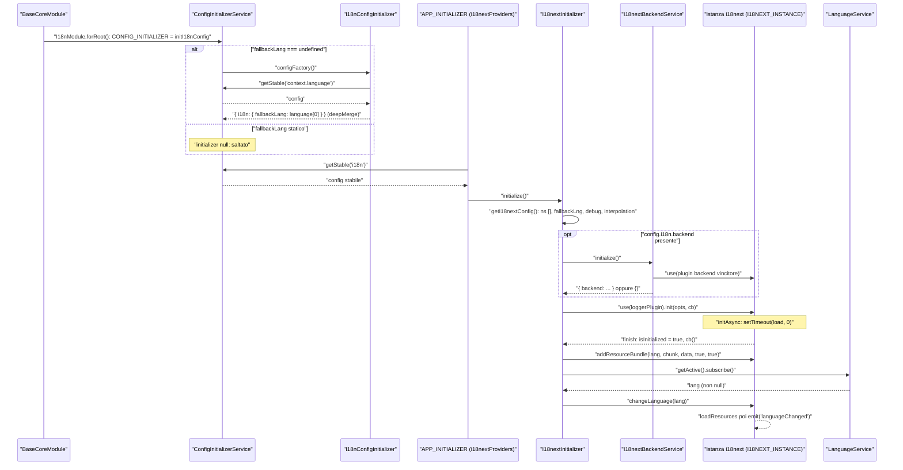
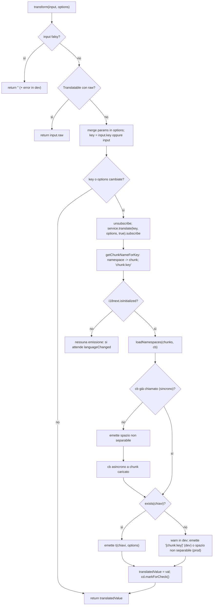
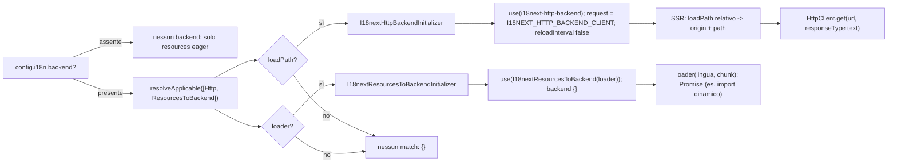

# 37 — Internazionalizzazione (i18n)

> Riferimenti allo SHA `5b7a1c2bf2808d7380bc20596d10f4fa710c3da1` (vedi [00-meta](../00-meta.md)).

## 1. A cosa serve e perché esiste

Spartacus non usa il sistema i18n di Angular (`@angular/localize`, `$localize`, build per lingua). Tutti i testi dello storefront passano a runtime da **chiavi di traduzione** come `'common.back'` o `'orderDetails.orderNumber'`, risolte da un servizio astratto, `TranslationService`. L'implementazione di default è un adattatore su **i18next**. Questa scelta ha tre conseguenze, che ritornano in tutto il capitolo:

1. **Un solo bundle per tutte le lingue.** La lingua attiva è quella del site context (`LanguageService.getActive()`, `core-libs/core/src/site-context/facade/language.service.ts:L49-L54`), e il cambio lingua avviene senza ricaricare la pagina: `I18nextInitializer` si sottoscrive alla lingua attiva e chiama `i18next.changeLanguage(lang)` (`core-libs/core/src/i18n/i18next/i18next-initializer.ts:L100-L106`).
2. **Le traduzioni sono dati di configurazione.** Si forniscono con `provideConfig({ i18n: { resources, chunks, ... } })` e si fondono con il deep merge della configurazione globale (vedi [11 — Configurazione](../parte-2/11-configurazione.md)). `I18nConfig` è un alias del `Config` globale (`core-libs/core/src/i18n/config/i18n-config.ts:L14-L18`), esteso tramite module augmentation (`core-libs/core/src/i18n/config/i18n-config.ts:L94-L96`).
3. **Le traduzioni sono divise in *chunk*.** Un chunk è un namespace i18next che raggruppa più "namespace logici" (la prima parte della chiave, prima del punto). La mappa `i18n.chunks` dice quali namespace stanno in quale chunk (`core-libs/core/src/i18n/config/i18n-config.ts:L85-L90`). Un chunk si può caricare in modo eager (`i18n.resources`) oppure lazy tramite un *backend* (`i18n.backend.loadPath` per HTTP, `i18n.backend.loader` per un `import()` dinamico) (`core-libs/core/src/i18n/config/i18n-config.ts:L30-L78`).

Accanto alle traduzioni testuali ci sono due pipe di formattazione legate alla lingua attiva: `cxDate` (`CxDatePipe`, estende il `DatePipe` di Angular) e `cxNumeric` (`CxNumericPipe`, estende `DecimalPipe`). Entrambe passano ad Angular come locale la lingua del site context (`core-libs/core/src/i18n/date.pipe.ts:L25-L27`, `core-libs/core/src/i18n/numeric.pipe.ts:L22-L24`).

Le traduzioni "di prodotto" stanno nel pacchetto `@spartacus/assets` (`core-libs/assets/`) per il core, e nel secondary entry point `assets` di ogni feature lib (es. `feature-libs/order/assets/public_api.ts:L7-L7`). Il pacchetto assets ha anche alcuni script di generazione (JSON per il lazy loading, `.properties` per i traduttori), di cui vedremo che due sono rimasti indietro rispetto al codice.

Infine c'è un aspetto meno visibile ma fondamentale: in SSR ogni richiesta deve avere **la propria istanza di i18next**, altrimenti richieste concorrenti in lingue diverse si pesterebbero i piedi. Per questo l'istanza non è l'import globale di `i18next` ma un `InjectionToken` con factory `i18next.createInstance()` (`core-libs/core/src/i18n/i18next/i18next-instance.ts:L10-L22`).

Capitoli collegati: il site context e `LanguageService` sono in [13 — Site context e theme](../parte-2/13-site-context-theme.md); `CONFIG_INITIALIZER` e `ConfigInitializerService` in [10 — Bootstrap e inizializzazione](../parte-2/10-bootstrap-inizializzazione.md) e [11 — Configurazione](../parte-2/11-configurazione.md); il precaricamento dei chunk dal CMS in [16 — Rendering CMS](../parte-2/16-cms-rendering.md); il `LoggerService` in [41 — Errori e global message](../parte-2/41-errori-global-message.md).

## 2. Mappa dei file

| Path | Ruolo |
|---|---|
| `core-libs/core/src/i18n/config/i18n-config.ts` | classe astratta `I18nConfig` (`useExisting: Config`) e augmentation di `Config` |
| `core-libs/core/src/i18n/config/default-i18n-config.ts` | `defaultI18nConfig`: `fallbackLang: undefined`, `debug: false` (non pubblico) |
| `core-libs/core/src/i18n/config/i18n-config-initializer.ts` | `I18nConfigInitializer`: risolve `i18n.fallbackLang` da `context.language[0]` |
| `core-libs/core/src/i18n/i18n.module.ts` | `I18nModule` (pipe) + `forRoot()` (provider) + `initI18nConfig` |
| `core-libs/core/src/i18n/translation.service.ts` | classe astratta `TranslationService` (`translate`, `loadChunks`) |
| `core-libs/core/src/i18n/translation-chunk.service.ts` | `TranslationChunkService`: namespace → chunk, avviso sui duplicati |
| `core-libs/core/src/i18n/translation-resources.ts` | tipi `TranslationResourceKey`, `TranslationResources`, `TranslationChunksConfig` |
| `core-libs/core/src/i18n/translatable.ts` | interfaccia `Translatable` e guard `isTranslatable` |
| `core-libs/core/src/i18n/translate.pipe.ts` | `TranslatePipe` (`cxTranslate`, impura) |
| `core-libs/core/src/i18n/date.pipe.ts` | `CxDatePipe` (`cxDate`) |
| `core-libs/core/src/i18n/numeric.pipe.ts` | `CxNumericPipe` (`cxNumeric`) |
| `core-libs/core/src/i18n/index.ts` | barrel pubblico di i18n |
| `core-libs/core/src/i18n/i18next/i18next-instance.ts` | token `I18NEXT_INSTANCE` (un'istanza per root injector) |
| `core-libs/core/src/i18n/i18next/i18next-providers.ts` | `i18nextProviders`: `APP_INITIALIZER` + provider dei backend (non pubblico) |
| `core-libs/core/src/i18n/i18next/i18next-initializer.ts` | `I18nextInitializer`: opzioni di init, risorse statiche, sincronizzazione lingua |
| `core-libs/core/src/i18n/i18next/i18next-translation.service.ts` | `I18nextTranslationService`: implementazione di default di `TranslationService` |
| `core-libs/core/src/i18n/i18next/i18next-plugins/i18next-logger-plugin.ts` | token `I18NEXT_LOGGER_PLUGIN`: logger i18next → `LoggerService` (non pubblico) |
| `core-libs/core/src/i18n/i18next/i18next-backend/i18next-backend.initializer.ts` | classe astratta `I18nextBackendInitializer` (`Applicable`) |
| `core-libs/core/src/i18n/i18next/i18next-backend/i18next-backend.providers.ts` | `i18nextBackendProviders`: multi provider HTTP + resources-to-backend |
| `core-libs/core/src/i18n/i18next/i18next-backend/i18next-backend.service.ts` | `I18nextBackendService`: sceglie il backend con `resolveApplicable` |
| `core-libs/core/src/i18n/i18next/i18next-backend/i18next-http-backend.initializer.ts` | `I18nextHttpBackendInitializer` (`loadPath`, URL assoluto in SSR) |
| `core-libs/core/src/i18n/i18next/i18next-backend/i18next-http-backend-client.ts` | token `I18NEXT_HTTP_BACKEND_CLIENT` (richieste via `HttpClient`) |
| `core-libs/core/src/i18n/i18next/i18next-backend/i18next-resources-to-backend.initializer.ts` | `I18nextResourcesToBackendInitializer` (`loader`) |
| `core-libs/core/src/i18n/testing/*.ts` | `I18nTestingModule`, `MockTranslatePipe`, `MockDatePipe`, `MockTranslationService`, `mockTranslate` |
| `core-libs/storefront/cms-structure/services/cms-i18n.service.ts` | `CmsI18nService`: precarica i chunk dichiarati dai componenti CMS |
| `core-libs/storefront/shared/components/form/date-picker/date-picker.service.ts` | `DatePickerService`: placeholder fisso `yyyy-mm-dd` |
| `core-libs/assets/src/public_api.ts` | entry di `@spartacus/assets` |
| `core-libs/assets/src/translations/translations.ts` | `translationChunksConfig` + alias `translationsXx` per 17 lingue |
| `core-libs/assets/src/translations/translation-chunks-config.ts` | copia dell'interfaccia `TranslationChunksConfig` |
| `core-libs/assets/src/translations/<lang>/index.ts` | per ogni lingua: 12 JSON (uno per chunk) esposti come oggetto |
| `core-libs/assets/generate-translations-ts-2-json.ts` | genera `dist/assets/i18n-assets/en/<chunk>.json` |
| `core-libs/assets/generate-translations-ts-2-properties.ts` | esporta verso `lang/properties/*.properties` (non compila più, vedi §9) |
| `core-libs/assets/generate-translations-properties-2-ts.ts` | reimporta i `.properties` (non compila più, vedi §9) |
| `feature-libs/*/assets/translations/translations.ts` | chunk config e traduzioni di ogni feature lib (44 file tra feature e integration) |
| `scripts/i18n/validate-translations-json-files.ts` | validatore dei JSON eseguito da `build:libs` |

## 3. Come funziona passo per passo

### 3.1 Registrazione dei provider

`BaseCoreModule` importa `I18nModule.forRoot()` (`core-libs/core/src/base-core.module.ts:L33-L33`), quindi ogni app Spartacus ha i provider i18n senza doverli dichiarare. `forRoot()` registra quattro cose (`core-libs/core/src/i18n/i18n.module.ts:L41-L56`):

- la config di default `defaultI18nConfig`, con `fallbackLang: undefined` e `debug: false` (`core-libs/core/src/i18n/config/default-i18n-config.ts:L9-L14`);
- l'alias `TranslationService` → `I18nextTranslationService` con `useExisting` (`core-libs/core/src/i18n/i18n.module.ts:L46-L46`);
- `i18nextProviders`, cioè un `APP_INITIALIZER` più i provider dei backend (`core-libs/core/src/i18n/i18next/i18next-providers.ts:L13-L28`);
- un `CONFIG_INITIALIZER` multi la cui factory è `initI18nConfig` (`core-libs/core/src/i18n/i18n.module.ts:L48-L53`).

`I18nModule` senza `forRoot()` importa ed esporta solo le tre pipe standalone `TranslatePipe`, `CxDatePipe`, `CxNumericPipe` (`core-libs/core/src/i18n/i18n.module.ts:L36-L39`): è quello che i moduli feature importano per usare `cxTranslate` nei template.

### 3.2 Il fallback dinamico: `I18nConfigInitializer`

`initI18nConfig` decide se serve calcolare la lingua di fallback a runtime: se `config.i18n.fallbackLang` è diverso da `undefined` (anche `false`) restituisce `null`, altrimenti restituisce l'initializer (`core-libs/core/src/i18n/i18n.module.ts:L23-L34`). `ConfigInitializerService.initialize` salta semplicemente gli initializer `null` (`core-libs/core/src/config/config-initializer/config-initializer.service.ts:L140-L143`).

Se l'initializer è attivo, dichiara lo scope `i18n.fallbackLang` (`core-libs/core/src/i18n/config/i18n-config-initializer.ts:L14-L17`) e il suo `resolveConfig` aspetta che lo scope `context.language` sia stabile, poi usa il primo elemento dell'array come fallback (`core-libs/core/src/i18n/config/i18n-config-initializer.ts:L24-L33`). Lo scope `context` è prodotto da `SiteContextConfigInitializer` (`core-libs/core/src/site-context/config/config-loader/site-context-config-initializer.ts:L26-L26`). `getStable(...scopes)` emette subito se il config è già stabile, altrimenti aspetta che nessuno scope in corso si sovrapponga a quelli richiesti (`core-libs/core/src/config/config-initializer/config-initializer.service.ts:L58-L70`). Il risultato viene unito con deep merge sia nel root config sia nel config globale, poi lo scope viene chiuso (`core-libs/core/src/config/config-initializer/config-initializer.service.ts:L158-L166`).

In pratica: se non configuri `fallbackLang`, la lingua di fallback diventa la lingua di default del sito (la prima di `context.language`), che può arrivare anche dal backend tramite il caricamento dinamico del site context.

### 3.3 Inizializzazione di i18next (`APP_INITIALIZER`)

L'`APP_INITIALIZER` di `i18nextProviders` aspetta `getStable('i18n')` (cioè anche il fallback dinamico appena descritto) e poi chiama `I18nextInitializer.initialize()` (`core-libs/core/src/i18n/i18next/i18next-providers.ts:L14-L25`).

`initialize()` costruisce le opzioni con `getI18nextConfig()`, registra il plugin logger e chiama `init(config, callback)` (`core-libs/core/src/i18n/i18next/i18next-initializer.ts:L36-L44`). Le opzioni base sono (`core-libs/core/src/i18n/i18next/i18next-initializer.ts:L49-L61`):

- `ns: []`: nessun namespace precaricato (il default di i18next sarebbe `['translation']`, `deps:i18next-25.7.4/package/dist/esm/i18next.js:L1619-L1622`);
- `fallbackLng` e `debug` dalla config;
- `interpolation.escapeValue: false` e `interpolation.skipOnVariables: false`, entrambi `true` per default in i18next (`deps:i18next-25.7.4/package/dist/esm/i18next.js:L1665-L1676`);
- `showSupportNotice: false`, con un `@ts-ignore` perché l'opzione non esiste nei tipi della versione installata (in i18next 25.7.4 la stringa `showSupportNotice` non compare nel sorgente ESM).

Se esiste `config.i18n.backend`, alle opzioni si aggiunge quanto restituito da `I18nextBackendService.initialize()` (`core-libs/core/src/i18n/i18next/i18next-initializer.ts:L63-L68`), vedi §3.6.

Nel **callback** di `init`, e non come opzione `resources` di i18next, Spartacus aggiunge le risorse statiche e avvia la sincronizzazione della lingua (`core-libs/core/src/i18n/i18next/i18next-initializer.ts:L38-L43`). Il commento spiega perché: passare `resources` a i18next disattiverebbe il caricamento dei chunk dal backend. Infatti in i18next `loadResources` usa il backend solo se `!this.options.resources || this.options.partialBundledLanguages` (`deps:i18next-25.7.4/package/dist/esm/i18next.js:L1853-L1857`).

`addTranslationResources` itera su lingua e chunk di `config.i18n.resources` e chiama `addResourceBundle(lang, chunk, data, true, true)`, cioè con `deep` e `overwrite` (`core-libs/core/src/i18n/i18next/i18next-initializer.ts:L79-L92`). Con `deep` i18next fa un `deepExtend` sul bundle esistente, dopo aver copiato i dati con `JSON.parse(JSON.stringify(...))` (`deps:i18next-25.7.4/package/dist/esm/i18next.js:L369-L385`).

`synchronizeLanguage` si sottoscrive una sola volta (grazie a `??`) a `LanguageService.getActive()` e chiama `changeLanguage(lang)` a ogni emissione; la subscription si chiude in `ngOnDestroy` (`core-libs/core/src/i18n/i18next/i18next-initializer.ts:L100-L110`). `getActive()` filtra i valori nulli, quindi non emette finché lo store non ha una lingua attiva (`core-libs/core/src/site-context/facade/language.service.ts:L49-L54`).

Quando si risolve la Promise dell'`APP_INITIALIZER`? In i18next 25.7.4 il default è `initAsync: true` (`deps:i18next-25.7.4/package/dist/esm/i18next.js:L1619-L1622`) e, poiché Spartacus non passa `resources`, il caricamento viene rimandato con `setTimeout(load, 0)` (`deps:i18next-25.7.4/package/dist/esm/i18next.js:L1846-L1850`). Il deferred restituito da `init` si risolve in `finish`, dopo `changeLanguage(this.options.lng, finish)`: lì `isInitialized` diventa `true` e viene chiamato il callback (`deps:i18next-25.7.4/package/dist/esm/i18next.js:L1834-L1844`). Spartacus non passa `lng`, quindi la lingua "vera" arriva solo con la prima emissione di `getActive()` dentro `synchronizeLanguage`. ⚠️ DA VERIFICARE: il comportamento interno di `changeLanguage(undefined)` (rilevamento lingua, uso di `fallbackLng`) non è stato letto riga per riga.

`changeLanguage` emette l'evento `languageChanged` solo dopo `loadResources`, e solo se nel frattempo non è stata richiesta un'altra lingua (`isLanguageChangingTo === lng`) (`deps:i18next-25.7.4/package/dist/esm/i18next.js:L1955-L1962`).

### 3.4 Istanza e logger

`I18NEXT_INSTANCE` è un `InjectionToken` `providedIn: 'root'` con factory `i18next.createInstance()` (`core-libs/core/src/i18n/i18next/i18next-instance.ts:L19-L22`). In i18next `createInstance` costruisce un nuovo oggetto i18n (`deps:i18next-25.7.4/package/dist/esm/i18next.js:L2122-L2126`). Poiché in SSR ogni richiesta ha il proprio platform/root injector, ognuna riceve la propria istanza (vedi [07 — SSR, hydration e TransferState](../parte-1/07-ssr-hydration-transferstate.md)). Tutte le classi che toccano i18next la iniettano con `@Inject(I18NEXT_INSTANCE)` (`core-libs/core/src/i18n/i18next/i18next-initializer.ts:L24-L29`, `core-libs/core/src/i18n/i18next/i18next-translation.service.ts:L23-L28`).

`I18NEXT_LOGGER_PLUGIN` è un altro token root: la factory restituisce un modulo i18next `type: 'logger'` che inoltra `log`/`warn`/`error` al `LoggerService` (`core-libs/core/src/i18n/i18next/i18next-plugins/i18next-logger-plugin.ts:L17-L40`). Il logger interno di i18next scarta `log` e `warn` quando `debug` è false; `error` passa sempre (`deps:i18next-25.7.4/package/dist/esm/i18next.js:L219-L231`). Quindi `i18n.debug: true` serve a vedere nei log Spartacus gli eventi di caricamento.

### 3.5 Dalla chiave al chunk: `TranslationChunkService`

Nel costruttore, `TranslationChunkService` inverte `config.i18n.chunks` in una mappa namespace → chunk. Se un namespace compare in più chunk vince il primo, e i doppioni finiscono in `duplicates` (`core-libs/core/src/i18n/translation-chunk.service.ts:L20-L33`); in dev mode viene emesso un `warn` che indica quale chunk è stato usato (`core-libs/core/src/i18n/translation-chunk.service.ts:L34-L36`, `core-libs/core/src/i18n/translation-chunk.service.ts:L51-L65`).

`getChunkNameForKey(key)` prende il segmento prima del primo `.` e lo cerca nella mappa; se non lo trova usa il namespace stesso come nome del chunk (`core-libs/core/src/i18n/translation-chunk.service.ts:L39-L49`). Con la config di `@spartacus/assets`, per esempio, `'searchBox.placeholder'` → namespace `searchBox` → chunk `common`, perché `searchBox` è tra i namespace del chunk `common` (`core-libs/assets/src/translations/translations.ts:L7-L27`).

### 3.6 Scelta del backend

`i18nextBackendProviders` registra in multi provider, nell'ordine, `I18nextHttpBackendInitializer` e `I18nextResourcesToBackendInitializer`, entrambi con `useExisting` (`core-libs/core/src/i18n/i18next/i18next-backend/i18next-backend.providers.ts:L12-L23`). `I18nextBackendService.initialize()` sceglie il vincitore con `resolveApplicable` e ne restituisce `initialize()`, oppure `{}` (`core-libs/core/src/i18n/i18next/i18next-backend/i18next-backend.service.ts:L20-L38`).

- `I18nextHttpBackendInitializer.hasMatch()` è true se c'è `i18n.backend.loadPath` (`core-libs/core/src/i18n/i18next/i18next-backend/i18next-http-backend.initializer.ts:L38-L40`). `initialize()` registra `i18next-http-backend` e restituisce `{ backend: getBackendConfig() }` (`core-libs/core/src/i18n/i18next/i18next-backend/i18next-http-backend.initializer.ts:L47-L50`). La config usa come `request` la funzione del token `I18NEXT_HTTP_BACKEND_CLIENT` e imposta `reloadInterval: false` per non lasciare un `setInterval` che impedirebbe all'SSR di terminare (`core-libs/core/src/i18n/i18next/i18next-backend/i18next-http-backend.initializer.ts:L55-L71`). In SSR un `loadPath` relativo diventa assoluto premettendo `windowRef.location.origin` (`core-libs/core/src/i18n/i18next/i18next-backend/i18next-http-backend.initializer.ts:L79-L91`).
- `I18NEXT_HTTP_BACKEND_CLIENT` restituisce una funzione `(options, url, payload, callback)` che usa l'`HttpClient` di Angular con `responseType: 'text'`; in caso di errore passa `data: null` e lo status (`core-libs/core/src/i18n/i18next/i18next-backend/i18next-http-backend-client.ts:L16-L44`). Il commento della factory lo motiva così: "It uses Angular HttpClient under the hood, so it works in SSR" (`core-libs/core/src/i18n/i18next/i18next-backend/i18next-http-backend-client.ts:L23-L26`). Per come `HttpClient` passa la richiesta alla catena di interceptor vedi [06 — HttpClient e interceptor](../parte-1/06-httpclient-interceptor.md).
- `I18nextResourcesToBackendInitializer.hasMatch()` è true se c'è `i18n.backend.loader` (`core-libs/core/src/i18n/i18next/i18next-backend/i18next-resources-to-backend.initializer.ts:L23-L25`); `initialize()` registra `I18nextResourcesToBackend(loader)` e restituisce `{ backend: {} }` (`core-libs/core/src/i18n/i18next/i18next-backend/i18next-resources-to-backend.initializer.ts:L27-L37`). ⚠️ DA VERIFICARE: il modo in cui il plugin `i18next-resources-to-backend` chiama `loader(lng, ns)` non è verificabile, il pacchetto non è in `/tmp/deps`.

Le dipendenze dichiarate da `@spartacus/core` sono `i18next ^25.7.4`, `i18next-http-backend ^3.0.6` e `i18next-resources-to-backend ^1.2.2` (`core-libs/core/package.json:L26-L28`).

### 3.7 Tradurre una chiave: `I18nextTranslationService.translate`

1. Per ogni chiave (stringa o array) calcola il chunk e la chiave con namespace `chunk:key`, e le salva in un array e in una `Map` chiave → chunk (`core-libs/core/src/i18n/i18next/i18next-translation.service.ts:L42-L53`, `core-libs/core/src/i18n/i18next/i18next-translation.service.ts:L121-L123`). Il separatore `:` coincide con il default `nsSeparator` di i18next (`deps:i18next-25.7.4/package/dist/esm/i18next.js:L1631-L1632`).
2. Restituisce un Observable "freddo": a ogni subscribe, se `i18next.isInitialized` è false non fa nulla (`core-libs/core/src/i18n/i18next/i18next-translation.service.ts:L55-L59`).
3. Chiama `loadNamespaces(chunks, cb)`; nel callback, se `exists(namespacedKeys)` emette `t(namespacedKeys, options)`, altrimenti segnala la chiave mancante ed emette il valore di fallback (`core-libs/core/src/i18n/i18next/i18next-translation.service.ts:L61-L79`). Passare un array di chiavi a `t` attiva la catena di fallback di i18next: vince la prima chiave risolvibile, come dice il JSDoc di `TranslationService` (`core-libs/core/src/i18n/translation.service.ts:L11-L21`).
4. Se, al ritorno da `loadNamespaces`, il callback non è ancora stato chiamato e `whitespaceUntilLoaded` è true, emette subito uno spazio non separabile (carattere 160) (`core-libs/core/src/i18n/i18next/i18next-translation.service.ts:L81-L84`).
5. Si registra su `languageChanged` per ritradurre e si deregistra all'unsubscribe; l'Observable non completa mai (`core-libs/core/src/i18n/i18next/i18next-translation.service.ts:L87-L89`).

Il punto 3 regge sulla sincronia del callback: i commenti in testa al metodo chiedono di emettere **in modo sincrono** quando il chunk è già caricato, perché un'emissione differita innescherebbe change detection aggiuntive che, insieme a `switchMap`, possono creare loop infiniti (`core-libs/core/src/i18n/i18next/i18next-translation.service.ts:L35-L40`). In i18next, `loadNamespaces` aggiunge i namespace mancanti a `options.ns` e chiama `loadResources` (`deps:i18next-25.7.4/package/dist/esm/i18next.js:L2075-L2089`). Il callback è sincrono in due casi: senza backend registrato (il connettore emette un warn e chiama subito il callback, `deps:i18next-25.7.4/package/dist/esm/i18next.js:L1548-L1552`) e quando non c'è nulla da caricare né in sospeso (`deps:i18next-25.7.4/package/dist/esm/i18next.js:L1555-L1559`). È questa la "cache under the hood" citata nel commento.

Il valore di fallback è `[chunk:key, ...]` in dev mode e uno spazio non separabile in produzione (`core-libs/core/src/i18n/i18next/i18next-translation.service.ts:L100-L106`); il warn sulle chiavi mancanti compare solo in dev mode ed elenca i chunk che si è tentato di caricare (`core-libs/core/src/i18n/i18next/i18next-translation.service.ts:L108-L119`).

`loadChunks(chunkNames)` delega direttamente a `i18next.loadNamespaces(chunkNames)` (`core-libs/core/src/i18n/i18next/i18next-translation.service.ts:L93-L95`).

### 3.8 La pipe `cxTranslate`

`TranslatePipe` si chiama `cxTranslate` ed è `pure: false` (`core-libs/core/src/i18n/translate.pipe.ts:L25-L29`): Angular la chiama a ogni change detection, e la pipe deve quindi decidere da sola quando risottoscriversi.

- Input falsy → `''`, con un `error` in dev mode (`core-libs/core/src/i18n/translate.pipe.ts:L46-L53`).
- Un `Translatable` con `raw` restituisce il testo così com'è; con `params` i parametri si uniscono alle options, e a parità di nome prevalgono i `params`; la chiave è `input.key` oppure l'input stesso (`core-libs/core/src/i18n/translate.pipe.ts:L55-L63`). `Translatable` ha `key?: string | string[]`, `params?`, `raw?`, e `isTranslatable` controlla che sia un oggetto non null con `key` o `raw` (`core-libs/core/src/i18n/translatable.ts:L7-L23`).
- La pipe si risottoscrive solo se cambia la chiave (confronto per riferimento) o se le options non sono shallow-equal; chiama `service.translate(key, options, true)`, quindi sempre con `whitespaceUntilLoaded`, e a ogni valore salva il risultato e chiama `cd.markForCheck()` (`core-libs/core/src/i18n/translate.pipe.ts:L69-L89`).
- `ngOnDestroy` chiude la subscription (`core-libs/core/src/i18n/translate.pipe.ts:L91-L95`).

Siccome la subscribe avviene dentro `transform` e il valore sincrono viene salvato prima del `return this.translatedValue` (`core-libs/core/src/i18n/translate.pipe.ts:L65-L66`), con un chunk già caricato il testo è disponibile già al primo passaggio di change detection.

### 3.9 Precaricamento dei chunk per i componenti CMS

Un mapping di componente CMS può dichiarare `i18nKeys?: string[]` (`core-libs/core/src/cms/config/cms-config.ts:L76-L76`). Quando le guard CMS di una pagina restituiscono `true`, `CmsPageGuardService` chiama `cmsI18n.loadForComponents(componentTypes)` (`core-libs/storefront/cms-structure/guards/cms-page-guard.service.ts:L81-L85`). `CmsComponentsService.getI18nKeys` raccoglie le chiavi dei soli componenti che devono essere renderizzati (`core-libs/storefront/cms-structure/services/cms-components.service.ts:L266-L276`), e `CmsI18nService` le converte in un `Set` di chunk e chiama `translation.loadChunks` (`core-libs/storefront/cms-structure/services/cms-i18n.service.ts:L21-L28`). Così i chunk lazy partono durante la navigazione, prima che i componenti vengano creati. A questo SHA, però, nessun mapping di componente del repo imposta `i18nKeys`: il meccanismo esiste ma è usato solo dalle app che lo configurano (grep su `*.ts`).

### 3.10 `cxDate` e `cxNumeric`

`CxDatePipe` (`cxDate`) estende `DatePipe` e chiama `super('')`, cioè con un `LOCALE_ID` vuoto (`core-libs/core/src/i18n/date.pipe.ts:L12-L19`). `transform` passa a `super.transform` come quarto argomento la lingua attiva (`core-libs/core/src/i18n/date.pipe.ts:L25-L27`); nel `DatePipe` di Angular prevale il locale passato, `locale || this.locale` (`angular:packages/common/src/pipes/date_pipe.ts:L263-L275`).

`getLang()` legge la lingua attiva in modo sincrono (subscribe seguita subito da unsubscribe, `''` se lo store non ha ancora emesso) e la valida con `getLocaleId(lang)`. Se Angular non ha i locale data per quella lingua, `getLocaleId` lancia, la pipe emette un warn (solo in dev mode) e ripiega su `'en'` (`core-libs/core/src/i18n/date.pipe.ts:L29-L55`). In Angular `findLocaleData` normalizza il codice (minuscolo, `_` → `-`), prova il locale padre, ricade su `localeEn` se il padre è `en` e altrimenti lancia `MISSING_LOCALE_DATA` (`angular:packages/core/src/i18n/locale_data_api.ts:L49-L72`, `angular:packages/core/src/i18n/locale_data_api.ts:L181-L183`).

`CxNumericPipe` (`cxNumeric`) fa la stessa cosa sopra `DecimalPipe` (`core-libs/core/src/i18n/numeric.pipe.ts:L12-L53`), che in Angular usa `locale ||= this._locale` (`angular:packages/common/src/pipes/number_pipe.ts:L109-L120`). Una differenza: in `CxNumericPipe` i metodi di supporto sono `protected` (quindi estendibili), in `CxDatePipe` sono `private`.

Nessuna delle due dichiara `pure`, quindi sono pipe pure: il default di `@Pipe` è `{pure: true, ...p}` (`angular:packages/core/src/metadata/directives.ts:L752-L752`).

L'app demo registra i locale `de`, `ja`, `zh` con `registerLocaleData` (`projects/storefrontapp/src/app/spartacus/spartacus-configuration.module.ts:L29-L31`); `en` è già incluso in Angular.

**Date picker.** Nelle librerie a questo SHA non esiste alcun componente DateTimePicker. Il selettore `cx-date-time-picker` sopravvive solo in un helper E2E Cypress (`fillDateTimePicker`), un residuo che non trova corrispondenza nel codice delle librerie (`projects/storefrontapp-e2e-cypress/cypress/helpers/b2b/my-company/features/utils/form.ts:L85-L90`). Il componente data dello storefront è `DatePickerComponent` (`cx-date-picker`), che importa `TranslatePipe` e `CxDatePipe` (`core-libs/storefront/shared/components/form/date-picker/date-picker.component.ts:L27-L58`). Il suo template usa un `<input type="date">` con placeholder e pattern presi da `DatePickerService`, e passa a `cx-form-errors` i limiti `min`/`max` formattati con `cxDate` e la label tradotta con `cxTranslate` (`core-libs/storefront/shared/components/form/date-picker/date-picker.component.html:L1-L25`). Il placeholder è fisso, `yyyy-mm-dd`, e non dipende dalla lingua attiva (`core-libs/storefront/shared/components/form/date-picker/date-picker.service.ts:L24-L37`). Il componente è trattato in [45 — Componenti storefront](../parte-2/45-componenti-storefront.md).

### 3.11 Da dove arrivano le traduzioni: `@spartacus/assets` e le feature lib

`@spartacus/assets` esporta `translationChunksConfig` e le traduzioni (`core-libs/assets/src/public_api.ts:L11-L12`). `translationChunksConfig` definisce 12 chunk core: `common` (18 namespace), `deliveryMode`, `myAccountV2Consent`, `myAccountV2NotificationPreference`, `myAccount`, `payment`, `pdf`, `product`, `pwa`, `siteThemeSwitcher`, `user`, `video` (`core-libs/assets/src/translations/translations.ts:L7-L66`). Lo stesso file riesporta 17 lingue con alias `translationsXx`: cs, de, en, es, es_CO, fr, hi, hu, id, it, ja, ko, pl, pt, ru, zh, zh_TW (`core-libs/assets/src/translations/translations.ts:L68-L84`). Ogni `index.ts` di lingua importa 12 JSON, uno per chunk, e li espone come oggetto `{ chunk: json }` (`core-libs/assets/src/translations/en/index.ts:L7-L32`).

L'app demo carica in modo eager en, ja, de e zh, passa `chunks: translationChunksConfig` e fissa `fallbackLang: 'en'` (`projects/storefrontapp/src/app/spartacus/spartacus-configuration.module.ts:L55-L67`). Ogni modulo feature dell'app aggiunge le proprie risorse e i propri chunk con un altro `provideConfig(<I18nConfig>{ i18n: ... })`, che si fonde con deep merge (`projects/storefrontapp/src/app/spartacus/features/order/order-feature.module.ts:L38-L48`). Le traduzioni della feature sono fornite eager, nel modulo root della feature, anche se il codice della feature è lazy (`featureModules` + `import()`, `projects/storefrontapp/src/app/spartacus/features/order/order-feature.module.ts:L26-L33`).

Ogni feature lib ha un secondary entry point `assets` (`feature-libs/order/assets/public_api.ts:L7-L7`) con una chunk config tipizzata `TranslationChunksConfig` di `@spartacus/core` e le 17 lingue riesportate con prefisso, es. `orderTranslationsEn` (`feature-libs/order/assets/translations/translations.ts:L7-L42`). Tra `feature-libs/` e `integration-libs/` ci sono 44 file `assets/translations/translations.ts`.

### 3.12 Generazione e validazione

- Lo script `build` di assets esegue `nx build assets` e poi `generate:translations:ts-2-json`; ci sono anche `properties-2-ts` (seguito da prettier) e `ts-2-properties` (`core-libs/assets/package.json:L6-L11`).
- `generate-translations-ts-2-json.ts` svuota e riscrive `dist/assets/i18n-assets/<lang>/<chunk>.json`, ma solo per `en`; se `dist/assets/` non esiste stampa un messaggio ed esce (`core-libs/assets/generate-translations-ts-2-json.ts:L10-L43`). Sono i file pensati per `loadPath: 'assets/i18n-assets/{{lng}}/{{ns}}.json'`, l'esempio del JSDoc (`core-libs/core/src/i18n/config/i18n-config.ts:L37-L40`). ⚠️ DA VERIFICARE: come un'app copi `dist/assets/i18n-assets` tra i propri asset; non è stata letta nessuna config `assets` di build che lo faccia.
- `build:libs` del repo esegue prima `scripts/i18n/validate-translations-json-files.ts` (`package.json:L35-L35`). Il validatore impone un limite di 50 KB per file e rifiuta valori, e chiavi delle sole foglie (stringhe), che contengono `<script`, `onerror`, `onload`, `onclick`, `javascript:`, `__proto__`, `constructor`, `eval` (`scripts/i18n/validate-translations-json-files.ts:L9-L19`). Le chiavi che puntano a oggetti annidati vengono attraversate senza controllo (`scripts/i18n/validate-translations-json-files.ts:L39-L64`). Ogni foglia deve essere una stringa e non deve avere la forma di un JSON (oggetto o array) (`scripts/i18n/validate-translations-json-files.ts:L20-L73`). Scansiona solo `feature-libs`, `integration-libs` e `projects` (`scripts/i18n/validate-translations-json-files.ts:L97-L105`).

## 4. Diagrammi

### 4.1 Bootstrap: dalla config all'istanza i18next pronta



Riferimenti: `core-libs/core/src/i18n/i18n.module.ts:L23-L56`, `core-libs/core/src/i18n/config/i18n-config-initializer.ts:L24-L33`, `core-libs/core/src/config/config-initializer/config-initializer.service.ts:L140-L166`, `core-libs/core/src/i18n/i18next/i18next-providers.ts:L14-L25`, `core-libs/core/src/i18n/i18next/i18next-initializer.ts:L36-L106`, `deps:i18next-25.7.4/package/dist/esm/i18next.js:L1834-L1850`, `deps:i18next-25.7.4/package/dist/esm/i18next.js:L1955-L1962`.

### 4.2 `{{ 'key' | cxTranslate }}`: dal template al testo



Riferimenti: `core-libs/core/src/i18n/translate.pipe.ts:L42-L89`, `core-libs/core/src/i18n/translation-chunk.service.ts:L39-L49`, `core-libs/core/src/i18n/i18next/i18next-translation.service.ts:L42-L119`.

### 4.3 Scelta del backend e lazy loading di un chunk



Se `loadPath` e `loader` sono entrambi presenti, entrambi corrispondono con pari priorità e vince il provider registrato per ultimo, cioè resources-to-backend (§9). Riferimenti: `core-libs/core/src/i18n/i18next/i18next-backend/i18next-backend.providers.ts:L12-L23`, `core-libs/core/src/util/applicable.ts:L63-L86`, `core-libs/core/src/i18n/i18next/i18next-backend/i18next-http-backend.initializer.ts:L38-L91`, `core-libs/core/src/i18n/i18next/i18next-backend/i18next-http-backend-client.ts:L27-L42`, `core-libs/core/src/i18n/i18next/i18next-backend/i18next-resources-to-backend.initializer.ts:L23-L37`. Il passaggio finale del ramo `loader` dipende dal plugin esterno (⚠️ DA VERIFICARE, §3.6).

## 5. Estratti di codice reale

**Il fallback dinamico viene attivato solo se `fallbackLang` non è configurato** — `core-libs/core/src/i18n/i18n.module.ts:L23-L56`

```ts
export function initI18nConfig(
  configInitializer: I18nConfigInitializer,
  config: I18nConfig
): ConfigInitializer | null {
  /**
   * If `fallbackLang` was already configured statically
   */
  if (config?.i18n?.fallbackLang !== undefined) {
    return null;
  }
  return configInitializer;
}

@NgModule({
  imports: [TranslatePipe, CxDatePipe, CxNumericPipe],
  exports: [TranslatePipe, CxDatePipe, CxNumericPipe],
})
export class I18nModule {
  static forRoot(): ModuleWithProviders<I18nModule> {
    return {
      ngModule: I18nModule,
      providers: [
        provideDefaultConfig(defaultI18nConfig),
        { provide: TranslationService, useExisting: I18nextTranslationService },
        ...i18nextProviders,
        {
          provide: CONFIG_INITIALIZER,
          useFactory: initI18nConfig,
          deps: [I18nConfigInitializer, I18nConfig],
          multi: true,
        },
      ],
    };
  }
}
```

**L'`APP_INITIALIZER` aspetta lo scope `i18n`** — `core-libs/core/src/i18n/i18next/i18next-providers.ts:L13-L28`

```ts
export const i18nextProviders: Provider[] = [
  {
    provide: APP_INITIALIZER,
    useFactory: () => {
      const configInitializerService = inject(ConfigInitializerService);
      const i18nextInitializer = inject(I18nextInitializer);
      return () =>
        lastValueFrom(configInitializerService.getStable('i18n')).then(() =>
          i18nextInitializer.initialize()
        );
    },
    multi: true,
  },

  ...i18nextBackendProviders,
];
```

**Init di i18next: risorse statiche aggiunte nel callback** — `core-libs/core/src/i18n/i18next/i18next-initializer.ts:L36-L71`

```ts
  initialize(): Promise<any> {
    const i18nextConfig = this.getI18nextConfig();
    return this.i18next.use(this.loggerPlugin).init(i18nextConfig, () => {
      // Don't use i18next's 'resources' config key for adding static translations,
      // because it will disable loading chunks from backend. We add resources here, in the init's callback.
      this.addTranslationResources();
      this.synchronizeLanguage();
    });
  }

  /**
   * Returns the configuration for initializing an i18next instance.
   */
  protected getI18nextConfig(): InitOptions {
    let i18nextConfig: InitOptions = {
      ns: [], // don't preload any namespaces
      fallbackLng: this.config.i18n?.fallbackLang,
      debug: this.config.i18n?.debug,
      interpolation: {
        escapeValue: false,
        skipOnVariables: false,
      },

      // @ts-ignore -- In CXSPA-12377 we'll remove this @ts-ignore, after we upgrade to the latest i18next version
      showSupportNotice: false,
    };

    if (this.config.i18n?.backend) {
      i18nextConfig = {
        ...i18nextConfig,
        ...this.i18nextBackendService.initialize(),
      };
    }

    return i18nextConfig;
  }
```

**Il cuore di `translate`: emissione sincrona, spazio non separabile in attesa, ritraduzione al cambio lingua** — `core-libs/core/src/i18n/i18next/i18next-translation.service.ts:L55-L90`

```ts
    return new Observable<string>((subscriber) => {
      const translate = () => {
        if (!this.i18next.isInitialized) {
          return;
        }

        // make sure chunks are loaded
        let namespacesLoaded = false;

        // loadNamespaces has cache under the hood, so it won't load the same chunk twice
        // when namespaces are already loaded, the callback will be called synchronously:
        this.i18next.loadNamespaces(
          Array.from(chunkNamesByKeys.values()),
          () => {
            namespacesLoaded = true;
            if (this.i18next.exists(namespacedKeys, options)) {
              subscriber.next(
                this.i18next.t(namespacedKeys, options) as string
              );
            } else {
              this.reportMissingKey(chunkNamesByKeys);
              subscriber.next(this.getFallbackValue(namespacedKeys));
            }
          }
        );

        // if namespaces are not loaded yet, we can emit a non-breaking space
        if (!namespacesLoaded && whitespaceUntilLoaded) {
          subscriber.next(this.NON_BREAKING_SPACE);
        }
      };

      translate();
      this.i18next.on('languageChanged', translate);
      return () => this.i18next.off('languageChanged', translate);
    });
```

**Chiave → chunk, con ripiego sul namespace** — `core-libs/core/src/i18n/translation-chunk.service.ts:L39-L49`

```ts
  protected readonly KEY_SEPARATOR = '.';

  getChunkNameForKey(key: string): string {
    const mainKey = (key || '').split(this.KEY_SEPARATOR)[0];
    const chunk = this.chunks && this.chunks[mainKey];

    if (!chunk) {
      return mainKey; // fallback to main key as a chunk
    }
    return chunk;
  }
```

**La pipe impura che si risottoscrive solo quando serve** — `core-libs/core/src/i18n/translate.pipe.ts:L69-L89`

```ts
  private translate(key: any, options: object) {
    if (
      key !== this.lastKey ||
      !ObjectComparisonUtils.shallowEqualObjects(options, this.lastOptions)
    ) {
      this.lastKey = key;
      this.lastOptions = options;

      if (this.sub) {
        this.sub.unsubscribe();
      }
      this.sub = this.service
        .translate(key, options, true)
        .subscribe((val) => this.markForCheck(val));
    }
  }

  private markForCheck(value: string) {
    this.translatedValue = value;
    this.cd.markForCheck();
  }
```

**HTTP backend: niente `setInterval` e URL assoluti in SSR** — `core-libs/core/src/i18n/i18next/i18next-backend/i18next-http-backend.initializer.ts:L55-L91`

```ts
  protected getBackendConfig(): HttpBackendOptions {
    if (!this.config.i18n?.backend?.loadPath) {
      throw new Error('Missing config `i18n.backend.loadPath`.');
    }

    const loadPath = this.getLoadPath(this.config.i18n.backend.loadPath);

    const backend: HttpBackendOptions = {
      loadPath,
      request: this.i18nextHttpClient,

      // Disable the periodical reloading. Otherwise SSR would not finish due to the pending task `setInterval()`
      // ...
      reloadInterval: false,
    };
    return backend;
  }
  // ...
  protected getLoadPath(path: string): string {
    if (!this.windowRef.isBrowser() && !path.match(/^http(s)?:\/\//)) {
      if (path.startsWith('/')) {
        path = path.slice('/'.length);
      }
      if (path.startsWith('./')) {
        path = path.slice('./'.length);
      }
      const serverRequestOrigin = this.windowRef.location.origin;
      return `${serverRequestOrigin}/${path}`;
    }
    return path;
  }
```

**Il client HTTP usato da i18next è l'`HttpClient` di Angular** — `core-libs/core/src/i18n/i18next/i18next-backend/i18next-http-backend-client.ts:L27-L42`

```ts
    return (
      _options: HttpBackendOptions,
      url: string,
      _payload: string | object,
      callback: RequestCallback
    ) => {
      httpClient.get(url, { responseType: 'text' }).subscribe({
        next: (data) => callback(null, { status: 200, data }),
        error: (error) =>
          callback(error, {
            // a workaround for https://github.com/i18next/i18next-http-backend/issues/82
            data: null as any,
            status: error.status,
          }),
      });
    };
```

**`cxDate`: lingua attiva come locale, ripiego su `en`** — `core-libs/core/src/i18n/date.pipe.ts:L25-L47`

```ts
  transform(value: any, format?: string, timezone?: string): string | null {
    return super.transform(value, format, timezone, this.getLang());
  }

  private getLang() {
    const lang = this.getActiveLang();
    try {
      getLocaleId(lang);
      return lang;
    } catch {
      this.reportMissingLocaleData(lang);
      return 'en';
    }
  }

  private getActiveLang(): string {
    let result = '';
    this.language
      .getActive()
      .subscribe((lang) => (result = lang))
      .unsubscribe();
    return result;
  }
```

**Configurazione dell'app demo** — `projects/storefrontapp/src/app/spartacus/spartacus-configuration.module.ts:L55-L67`

```ts
    provideConfig({
      // we bring in static translations to be up and running soon right away
      i18n: {
        resources: {
          en: translationsEn,
          ja: translationsJa,
          de: translationsDe,
          zh: translationsZh,
        },
        chunks: translationChunksConfig,
        fallbackLang: 'en',
      },
    }),
```

## 6. Configurazione

| Chiave | Tipo | Default | Definita in | Letta in |
|---|---|---|---|---|
| `i18n.fallbackLang` | `string \| false` | `undefined` (`core-libs/core/src/i18n/config/default-i18n-config.ts:L9-L14`); se resta `undefined` diventa `context.language[0]` | `core-libs/core/src/i18n/config/i18n-config.ts:L20-L23` | `core-libs/core/src/i18n/i18n.module.ts:L30-L32`, `core-libs/core/src/i18n/config/i18n-config-initializer.ts:L24-L33`, `core-libs/core/src/i18n/i18next/i18next-initializer.ts:L52-L52` |
| `i18n.backend.loadPath` | `string` con `{{lng}}` e `{{ns}}` | assente | `core-libs/core/src/i18n/config/i18n-config.ts:L31-L51` | `core-libs/core/src/i18n/i18next/i18next-initializer.ts:L63-L63`, `core-libs/core/src/i18n/i18next/i18next-backend/i18next-http-backend.initializer.ts:L38-L40`, `core-libs/core/src/i18n/i18next/i18next-backend/i18next-http-backend.initializer.ts:L55-L60` |
| `i18n.backend.loader` | `(language, chunkName) => Promise<TranslationResourceKey>` | assente | `core-libs/core/src/i18n/config/i18n-config.ts:L53-L71` | `core-libs/core/src/i18n/i18next/i18next-backend/i18next-resources-to-backend.initializer.ts:L23-L34` |
| `i18n.resources` | `TranslationResources` (lingua → chunk → oggetto) | assente (`?? {}`) | `core-libs/core/src/i18n/config/i18n-config.ts:L74-L78`, tipo in `core-libs/core/src/i18n/translation-resources.ts:L7-L18` | `core-libs/core/src/i18n/i18next/i18next-initializer.ts:L79-L92` |
| `i18n.debug` | `boolean` | `false` (`core-libs/core/src/i18n/config/default-i18n-config.ts:L12-L12`) | `core-libs/core/src/i18n/config/i18n-config.ts:L80-L83` | `core-libs/core/src/i18n/i18next/i18next-initializer.ts:L53-L53` (opzione `debug` di i18next, che sblocca `log`/`warn` del logger) |
| `i18n.chunks` | `{ [chunk: string]: string[] }` | assente (`\|\| {}`) | `core-libs/core/src/i18n/config/i18n-config.ts:L85-L90` | `core-libs/core/src/i18n/translation-chunk.service.ts:L21-L21` |
| `context.language` (esterna, site context) | `string[]` | — | site context ([13](../parte-2/13-site-context-theme.md)) | `core-libs/core/src/i18n/config/i18n-config-initializer.ts:L25-L29` |
| `CmsComponentMapping.i18nKeys` (esterna, CMS) | `string[]` | assente | `core-libs/core/src/cms/config/cms-config.ts:L76-L76` | `core-libs/storefront/cms-structure/services/cms-components.service.ts:L266-L276` |

Opzioni i18next imposte da Spartacus e non configurabili via `I18nConfig` (si cambiano solo estendendo `I18nextInitializer.getI18nextConfig`): `ns: []`, `interpolation.escapeValue: false`, `interpolation.skipOnVariables: false`, `showSupportNotice: false` (`core-libs/core/src/i18n/i18next/i18next-initializer.ts:L50-L61`); per il backend HTTP `reloadInterval: false` (`core-libs/core/src/i18n/i18next/i18next-backend/i18next-http-backend.initializer.ts:L68-L68`).

Esempio di config lazy, citato letteralmente dai JSDoc: `loadPath: 'assets/i18n-assets/{{lng}}/{{ns}}.json'` (`core-libs/core/src/i18n/config/i18n-config.ts:L37-L40`) e ``loader: (language, chunkName) => import(`../../assets/i18n-assets/${language}/${chunkName}.json`)`` (`core-libs/core/src/i18n/config/i18n-config.ts:L63-L66`). Il JSDoc di `loadPath` lo sconsiglia per gli asset locali e raccomanda `loader`, "more performant (especially in SSR)" (`core-libs/core/src/i18n/config/i18n-config.ts:L42-L48`).

## 7. Commenti e note notevoli dal sorgente

- *"Each SSR request gets its own instance of i18next. … The reference to the static global instance of `i18next` … should not be used anywhere else, because otherwise it would be shared in between all SSR requests and can cause concurrency issues."* — `core-libs/core/src/i18n/i18next/i18next-instance.ts:L10-L18`. È la regola d'oro per chi scrive estensioni: mai `import i18next from 'i18next'` per usare l'istanza globale, sempre `inject(I18NEXT_INSTANCE)`.
- *"Don't use i18next's 'resources' config key for adding static translations, because it will disable loading chunks from backend."* — `core-libs/core/src/i18n/i18next/i18next-initializer.ts:L39-L40`.
- *"@ts-ignore -- In CXSPA-12377 we'll remove this @ts-ignore, after we upgrade to the latest i18next version"* — `core-libs/core/src/i18n/i18next/i18next-initializer.ts:L59-L60`. In i18next 25.7.4 l'opzione `showSupportNotice` non esiste nel sorgente ESM, quindi oggi viene semplicemente ignorata. ⚠️ DA VERIFICARE: a quale versione di i18next si riferisca CXSPA-12377 non si può verificare qui.
- *"Moreover, we SHOULD emit a value (or a fallback value) synchronously (not in a promise/setTimeout). Otherwise, we the will trigger additional deferred change detection … which together with `switchMap` operator may lead to an infinite loop."* — `core-libs/core/src/i18n/i18next/i18next-translation.service.ts:L38-L40`.
- *"Required param added in 3.0.x as a critical bug fix, not subject to the breaking changes policy"* — `core-libs/core/src/i18n/i18next/i18next-translation.service.ts:L26-L27`. È il parametro `I18NEXT_INSTANCE`. Con ogni probabilità il bug è la condivisione dell'istanza globale tra richieste SSR descritta nel JSDoc del token (`core-libs/core/src/i18n/i18next/i18next-instance.ts:L10-L18`); è un'inferenza, il commento non lo dice.
- *"Disable the periodical reloading. Otherwise SSR would not finish due to the pending task `setInterval()`"* — `core-libs/core/src/i18n/i18next/i18next-backend/i18next-http-backend.initializer.ts:L66-L68`.
- *"It's needed, because Angular Universal doesn't support relative URLs in HttpClient."* — `core-libs/core/src/i18n/i18next/i18next-backend/i18next-http-backend.initializer.ts:L73-L78`, con i link alle issue angular#19224 e universal#858.
- *"a workaround for https://github.com/i18next/i18next-http-backend/issues/82"* — `core-libs/core/src/i18n/i18next/i18next-backend/i18next-http-backend-client.ts:L37-L37`.
- *"By default it configures and uses the `I18nextHttpBackendService`."* — `core-libs/core/src/i18n/i18next/i18next-backend/i18next-backend.service.ts:L15-L15`. Il nome è sbagliato: la classe reale si chiama `I18nextHttpBackendInitializer`.
- *"type CxDatePipe, not DatePipe, due to conflict with Angular's DatePipe - problem occurs for the backward compatibility compiler of Ivy"* — `core-libs/core/src/i18n/date.pipe.ts:L12-L12`.
- *"TODO: Replace `any` to match strict types from angular in 4.0"* — `core-libs/core/src/i18n/date.pipe.ts:L21-L22`: un TODO rimasto da molte major.
- *"the first language in the array is the default one"* — `core-libs/core/src/i18n/config/i18n-config-initializer.ts:L28-L28`.
- *"fallback to main key as a chunk"* — `core-libs/core/src/i18n/translation-chunk.service.ts:L46-L46`.
- *"Only returns the date if we have a valid format. We do this to avoid loads of console errors coming from the datePipe while the user is typing"* — `core-libs/storefront/shared/components/form/date-picker/date-picker.component.ts:L60-L68`.

## 8. Extension point

| Extension point | Come si usa | Riferimento | Pubblico? |
|---|---|---|---|
| `provideConfig({ i18n: { resources, chunks } })` | aggiungere o sovrascrivere traduzioni (deep merge, `addResourceBundle` con overwrite) | `core-libs/core/src/i18n/i18next/i18next-initializer.ts:L79-L92` | sì (`I18nConfig` in `core-libs/core/src/i18n/index.ts:L7-L7`) |
| `i18n.backend.loadPath` / `loader` | lazy loading via HTTP o `import()` | `core-libs/core/src/i18n/config/i18n-config.ts:L30-L72` | sì |
| `TranslationService` | sostituire l'intero motore (es. un altro framework i18n) con `{ provide: TranslationService, useClass: ... }` | `core-libs/core/src/i18n/translation.service.ts:L9-L35`; binding `core-libs/core/src/i18n/i18n.module.ts:L46-L46` | sì |
| `I18nextTranslationService` | estendere, es. `protected getFallbackValue` per cambiare il testo delle chiavi mancanti | `core-libs/core/src/i18n/i18next/i18next-translation.service.ts:L100-L106` | sì |
| `TranslationChunkService` | cambiare la regola chiave → chunk (`getChunkNameForKey`) | `core-libs/core/src/i18n/translation-chunk.service.ts:L41-L49` | sì |
| `I18nextInitializer` | cambiare le opzioni di i18next (`protected getI18nextConfig`) o la sincronizzazione della lingua | `core-libs/core/src/i18n/i18next/i18next-initializer.ts:L49-L106` | sì |
| `I18nConfigInitializer` | cambiare la regola del fallback dinamico (`protected resolveConfig`) | `core-libs/core/src/i18n/config/i18n-config-initializer.ts:L24-L33` | sì |
| `I18nextBackendInitializer` (multi) | aggiungere un altro plugin backend di i18next con `hasMatch` (dichiarato nella classe) e `getPriority` (opzionale, ereditato dall'interfaccia `Applicable`) | `core-libs/core/src/i18n/i18next/i18next-backend/i18next-backend.initializer.ts:L15-L26`, `core-libs/core/src/util/applicable.ts:L44-L44`; selezione `core-libs/core/src/util/applicable.ts:L63-L86` | sì |
| `I18NEXT_HTTP_BACKEND_CLIENT` | sostituire la funzione `request` (header, cache, retry) | `core-libs/core/src/i18n/i18next/i18next-backend/i18next-http-backend-client.ts:L16-L44` | sì |
| `I18nextHttpBackendInitializer` | estendere `protected getBackendConfig`/`getLoadPath` (es. altre opzioni del plugin) | `core-libs/core/src/i18n/i18next/i18next-backend/i18next-http-backend.initializer.ts:L55-L91` | sì |
| `I18NEXT_INSTANCE` | accedere all'istanza per richiesta (mai all'import globale) | `core-libs/core/src/i18n/i18next/i18next-instance.ts:L19-L22` | sì |
| `CmsComponentMapping.i18nKeys` | precaricare i chunk dei componenti CMS di una pagina | `core-libs/core/src/cms/config/cms-config.ts:L76-L76` | sì (cms) |
| `CxNumericPipe` | estendere (metodi `protected`) | `core-libs/core/src/i18n/numeric.pipe.ts:L26-L52` | sì |
| `I18nTestingModule` e mock | test di componenti con chiavi "parlanti" | `core-libs/core/src/i18n/testing/i18n-testing.module.ts:L13-L20` | sì |

Non pubblici, quindi da non usare: `I18NEXT_LOGGER_PLUGIN` e `i18nextProviders` (non esportati da `core-libs/core/src/i18n/i18next/index.ts:L7-L10`), `initI18nConfig` (di `i18n.module` si esporta solo `I18nModule`, `core-libs/core/src/i18n/index.ts:L7-L18`), `defaultI18nConfig`, `mockTranslate` (`core-libs/core/src/i18n/testing/index.ts:L7-L10`).

**Esempio: un backend personalizzato.** Lo schema che segue usa solo i simboli pubblici visti sopra. È uno schema illustrativo, non codice del repo:

```ts
// Schema illustrativo (non presente nel repo)
@Injectable({ providedIn: 'root' })
export class MyBackendInitializer implements I18nextBackendInitializer {
  protected i18next = inject(I18NEXT_INSTANCE);
  protected config = inject(I18nConfig);
  hasMatch() { return !!this.config.i18n?.backend; }
  getPriority() { return Priority.HIGH; } // batte i due backend di default
  initialize(): InitOptions {
    this.i18next.use(/* plugin backend i18next */);
    return { backend: { /* opzioni del plugin */ } };
  }
}
// provider: { provide: I18nextBackendInitializer, useExisting: MyBackendInitializer, multi: true }
```

Ricette in Parte III:
- traduzioni, override delle chiavi, chunk per una feature custom: [53 — Ricette: feature lib, carrello/checkout, stili, traduzioni](../parte-3/53-ricette-feature-cart-checkout-stili-i18n.md);
- override di servizi via DI e config: [50 — Ricette: configurazione, DI, interceptor, eventi](../parte-3/50-ricette-config-di.md);
- cosa è API pubblica e cosa no: [54 — API pubblica vs interna, upgrade](../parte-3/54-upgrade-safe.md).

## 9. Trappole, casi limite, comportamenti controintuitivi

1. **`loadPath` e `loader` insieme: vince `loader`.** Entrambi i backend corrispondono e nessuno dei due ha `getPriority`. `resolveApplicable` fa vincere, a parità di priorità, il provider registrato per ultimo, che è `I18nextResourcesToBackendInitializer`; `loadPath` viene ignorato senza avvisi (`core-libs/core/src/i18n/i18next/i18next-backend/i18next-backend.providers.ts:L12-L23`, `core-libs/core/src/util/applicable.ts:L72-L86`).
2. **`i18n.backend: {}` senza `loadPath` né `loader`.** Nessun initializer corrisponde e `I18nextBackendService` restituisce `{}`: niente backend e niente errore (`core-libs/core/src/i18n/i18next/i18next-initializer.ts:L63-L68`, `core-libs/core/src/i18n/i18next/i18next-backend/i18next-backend.service.ts:L33-L38`).
3. **Le traduzioni eager non disattivano il lazy loading.** Proprio perché vengono aggiunte nel callback di init e non come opzione `resources` di i18next, risorse eager e chunk lazy convivono (`core-libs/core/src/i18n/i18next/i18next-initializer.ts:L38-L43`, `deps:i18next-25.7.4/package/dist/esm/i18next.js:L1853-L1857`).
4. **`fallbackLang: false`.** Impostato staticamente disattiva il fallback dinamico (il test è `!== undefined`) e arriva a i18next come `fallbackLng: false`, quindi nessuna lingua di ripiego (`core-libs/core/src/i18n/i18n.module.ts:L30-L32`, `core-libs/core/src/i18n/i18next/i18next-initializer.ts:L52-L52`).
5. **Namespace dimenticato in `chunks`.** Il chunk diventa il namespace stesso. Con un backend HTTP si vedrà una richiesta a `.../<namespace>.json`, probabilmente in 404, invece del chunk previsto (`core-libs/core/src/i18n/translation-chunk.service.ts:L41-L49`). Al contrario, le risorse eager sono indicizzate per *chunk*: se in `resources` metti `{ en: { order: {...} } }` ma la chiave `orderDetails.x` è mappata al chunk `order`, la chiave risolta è `order:orderDetails.x`, che cerca `orderDetails.x` dentro il bundle `order`.
6. **Namespace duplicati tra chunk.** Vince il primo in ordine di `Object.keys`, e l'avviso compare solo in dev mode (`core-libs/core/src/i18n/translation-chunk.service.ts:L22-L36`).
7. **Chiavi mancanti silenziose in produzione.** In produzione la chiave mancante diventa uno spazio non separabile, senza log; solo in dev mode si vede `[chunk:key]` con un warn (`core-libs/core/src/i18n/i18next/i18next-translation.service.ts:L100-L119`).
8. **Prima dell'init non arriva nulla.** Se ci si sottoscrive a `translate()` prima che i18next sia inizializzato, l'Observable non emette e si "risveglia" solo al primo `languageChanged`; `TranslatePipe` restituisce `translatedValue` non ancora assegnato (`core-libs/core/src/i18n/i18next/i18next-translation.service.ts:L57-L59`, `core-libs/core/src/i18n/i18next/i18next-translation.service.ts:L87-L89`, `core-libs/core/src/i18n/translate.pipe.ts:L65-L66`). Dato che la Promise dell'`APP_INITIALIZER` si risolve solo a init completato (§3.3), il caso riguarda soprattutto codice che si sottoscrive durante l'inizializzazione dell'app.
9. **`translate()` non completa mai.** Chi lo usa nel codice TypeScript deve gestire l'unsubscribe, oppure usare `take(1)` o `firstValueFrom` quando basta un valore. La pipe lo fa in `ngOnDestroy` (`core-libs/core/src/i18n/i18next/i18next-translation.service.ts:L87-L89`, `core-libs/core/src/i18n/translate.pipe.ts:L91-L95`). Attenzione: con `whitespaceUntilLoaded = true` e un chunk non ancora caricato, il primo valore è lo spazio non separabile (`core-libs/core/src/i18n/i18next/i18next-translation.service.ts:L81-L84`).
10. **Array letterali nella pipe.** `{{ ['a.b', 'c.d'] | cxTranslate }}`: la chiave array è confrontata per riferimento, quindi se il template produce un array nuovo a ogni ciclo la pipe si risottoscrive a ogni change detection (`core-libs/core/src/i18n/translate.pipe.ts:L70-L72`). ⚠️ DA VERIFICARE: se il compilatore Angular memoizzi gli array letterali costanti nei template (pure function) non è stato verificato qui; il rischio concreto riguarda gli array costruiti nel componente con un getter.
11. **`escapeValue: false`.** i18next non esegue l'escaping dei valori interpolati (`core-libs/core/src/i18n/i18next/i18next-initializer.ts:L54-L57`). Con il binding di testo `{{ }}` l'escaping lo fa Angular; con `[innerHTML]="'x' | cxTranslate: { name }"` un parametro controllato dall'utente finisce nell'HTML, sanificato solo dal sanitizer di Angular.
12. **`cxDate` e `cxNumeric` non reagiscono al cambio lingua.** Sono pipe pure: se cambi lingua e la data non cambia, il testo resta formattato nella lingua precedente finché l'input non cambia (`core-libs/core/src/i18n/date.pipe.ts:L13-L13`, `core-libs/core/src/i18n/numeric.pipe.ts:L12-L12`, `angular:packages/core/src/metadata/directives.ts:L752-L752`).
13. **Lingua non ancora nello store.** `getActiveLang()` restituisce `''`; in Angular `getLocaleData('')` non trova nulla, il padre `''` neanche, e poiché `'' !== 'en'` `findLocaleData` lancia. La pipe ripiega quindi su `'en'` e in dev mode emette un warn con locale `''` (`core-libs/core/src/i18n/date.pipe.ts:L40-L47`, `angular:packages/core/src/i18n/locale_data_api.ts:L105-L123`, `angular:packages/core/src/i18n/locale_data_api.ts:L49-L72`).
14. **Locale non registrati.** Senza `registerLocaleData` della lingua, `cxDate` e `cxNumeric` usano `'en'`. L'app demo registra solo de, ja, zh (`core-libs/core/src/i18n/date.pipe.ts:L29-L38`, `projects/storefrontapp/src/app/spartacus/spartacus-configuration.module.ts:L29-L31`). I codici con underscore (`es_CO`, `zh_TW`) vengono normalizzati da Angular in `es-co` / `zh-tw`, e si prova anche il padre (`angular:packages/core/src/i18n/locale_data_api.ts:L181-L183`).
15. **Il placeholder del date picker non è localizzato.** È sempre `yyyy-mm-dd` (`core-libs/storefront/shared/components/form/date-picker/date-picker.service.ts:L24-L37`).
16. **`I18nTestingModule` non ha `cxNumeric`.** I test di componenti che usano `cxNumeric` devono dichiararlo a parte (`core-libs/core/src/i18n/testing/i18n-testing.module.ts:L13-L20`). Inoltre `MockTranslationService` completa dopo il primo valore, a differenza dell'implementazione reale (`core-libs/core/src/i18n/testing/mock-translation.service.ts:L14-L28`).
17. **Il warn "No backend was added…".** Senza backend, ogni `loadNamespaces` passa dal connettore, che registra `'No backend was added via i18next.use. Will not load resources.'`; si vede solo con `debug: true`, perché `warn` del logger i18next è riservato al debug (`deps:i18next-25.7.4/package/dist/esm/i18next.js:L1548-L1552`, `deps:i18next-25.7.4/package/dist/esm/i18next.js:L219-L231`).
18. **HTTP backend in SSR e origine.** Un `loadPath` relativo viene reso assoluto con `windowRef.location.origin`: se l'origine vista dal server è sbagliata (proxy, host interno) le richieste vanno all'host sbagliato (`core-libs/core/src/i18n/i18next/i18next-backend/i18next-http-backend.initializer.ts:L79-L91`). ⚠️ DA VERIFICARE: come venga popolato `location.origin` lato server è materia di [39 — SSR ottimizzato](../parte-2/39-ssr-ottimizzato.md).
19. **Cambi di lingua rapidi.** `changeLanguage` notifica `languageChanged` solo per l'ultima lingua richiesta (`deps:i18next-25.7.4/package/dist/esm/i18next.js:L1955-L1962`).
20. **Traduzioni delle feature lazy caricate eager.** Nell'app demo le risorse di una feature lazy sono fornite nel modulo root della feature, quindi finiscono nel bundle iniziale anche se il codice della feature è lazy (`projects/storefrontapp/src/app/spartacus/features/order/order-feature.module.ts:L26-L48`). Per evitarlo serve un backend lazy.
21. **Script di assets rotti.** `generate-translations-ts-2-properties.ts` e `generate-translations-properties-2-ts.ts` importano `{ translations }` da `./src/translations/translations` (`core-libs/assets/generate-translations-ts-2-properties.ts:L8-L8`, `core-libs/assets/generate-translations-properties-2-ts.ts:L8-L8`), ma quel file esporta solo `translationChunksConfig` e `translationsXx` (`core-libs/assets/src/translations/translations.ts:L7-L84`): così non compilano. `properties-2-ts`, inoltre, presuppone file di chunk `.ts` della forma `export const x = {...}` (`core-libs/assets/generate-translations-properties-2-ts.ts:L56-L71`), mentre le cartelle lingua contengono JSON importati da `index.ts` (`core-libs/assets/src/translations/en/index.ts:L7-L18`). Anche il README di assets cita `import { translations } from '@spartacus/assets';` (`core-libs/assets/README.md:L1-L5`), un export che non esiste. La cartella `lang/properties` contiene solo `dummy.txt`.
22. **Piccoli bug negli script.** In `ts-2-properties`, `_prefix + '=' + jsonObj[key] || ''` applica `|| ''` all'intera stringa concatenata, quindi il fallback non ha mai effetto (`core-libs/assets/generate-translations-ts-2-properties.ts:L28-L28`). In `properties-2-ts`, `property.split('=')[1]` tronca i valori che contengono `=` (`core-libs/assets/generate-translations-properties-2-ts.ts:L14-L15`).
23. **JSON lazy solo per `en`.** `ts-2-json` produce gli asset solo per l'inglese (`core-libs/assets/generate-translations-ts-2-json.ts:L32-L40`): chi vuole il lazy loading HTTP per altre lingue deve generarli da sé.
24. **Il validatore non guarda `core-libs`.** Le traduzioni core in `core-libs/assets/src/translations/**` non vengono validate da `build:libs` (`scripts/i18n/validate-translations-json-files.ts:L97-L105`).
25. **Tipi duplicati.** `TranslationChunksConfig` è definita sia in core sia in assets (`core-libs/core/src/i18n/translation-resources.ts:L16-L18`, `core-libs/assets/src/translations/translation-chunks-config.ts:L7-L9`), e `translationChunksConfig` del core non è tipizzato, mentre quelli delle feature lib sì (`core-libs/assets/src/translations/translations.ts:L7-L7`, `feature-libs/order/assets/translations/translations.ts:L7-L9`).

## 10. Come fare debug

- **Vedere cosa fa i18next.** Imposta `provideConfig({ i18n: { debug: true } })`: l'opzione arriva a i18next (`core-libs/core/src/i18n/i18next/i18next-initializer.ts:L53-L53`) e sblocca `log`/`warn` del logger, che passano dal plugin a `LoggerService` (`core-libs/core/src/i18n/i18next/i18next-plugins/i18next-logger-plugin.ts:L17-L40`). Vedrai `initialized`, `languageChanged` (`deps:i18next-25.7.4/package/dist/esm/i18next.js:L1834-L1840`, `deps:i18next-25.7.4/package/dist/esm/i18next.js:L1955-L1963`) e i warn del connettore. Il JSDoc avverte: "Don't use in production!" (`core-libs/core/src/i18n/config/i18n-config.ts:L80-L83`).
- **Chiavi mancanti.** In dev mode compaiono come `[chunk:key]` nella UI, con un warn `Translation keys missing [...] Attempted to load 'key' from chunk 'chunk'` (`core-libs/core/src/i18n/i18next/i18next-translation.service.ts:L108-L119`). Se il chunk indicato non è quello atteso, controlla `i18n.chunks` e cerca nei log l'avviso sui duplicati (`core-libs/core/src/i18n/translation-chunk.service.ts:L51-L65`).
- **Ispezionare l'istanza.** Da un componente o servizio di debug, `inject(I18NEXT_INSTANCE)` restituisce l'istanza per root injector (`core-libs/core/src/i18n/i18next/i18next-instance.ts:L19-L22`); proprietà come `isInitialized` sono quelle che il servizio di traduzione controlla (`core-libs/core/src/i18n/i18next/i18next-translation.service.ts:L57-L57`).
- **Testo vuoto o "spazio" persistente.** Se resta uno spazio non separabile: in produzione può essere una chiave mancante (§9.7); in qualunque modalità può essere un chunk che non arriva (backend che fallisce: con l'HTTP backend l'errore passa da `HttpClient`, `core-libs/core/src/i18n/i18next/i18next-backend/i18next-http-backend-client.ts:L33-L41`, ed è quindi visibile nel tab Network).
- **Backend HTTP in SSR.** Controlla che l'URL calcolato sia assoluto e con l'origine giusta (`core-libs/core/src/i18n/i18next/i18next-backend/i18next-http-backend.initializer.ts:L79-L91`); se il rendering SSR non termina, verifica di non aver sovrascritto `reloadInterval` (`core-libs/core/src/i18n/i18next/i18next-backend/i18next-http-backend.initializer.ts:L66-L68`).
- **Date in inglese inattese.** Cerca in dev mode il warn `cxDate pipe: No locale data registered for '<lang>'` (`core-libs/core/src/i18n/date.pipe.ts:L49-L55`) e aggiungi `registerLocaleData` per quella lingua.
- **Backend sbagliato.** Se hai sia `loadPath` sia `loader`, ricorda §9.1. Per capire quale vince, metti un breakpoint in `I18nextBackendService.initialize` (`core-libs/core/src/i18n/i18next/i18next-backend/i18next-backend.service.ts:L33-L38`).
- **Nei test** usa `I18nTestingModule`: le chiavi diventano stringhe leggibili come `key name:value` (`core-libs/core/src/i18n/testing/mock-translate.ts:L7-L18`), comode da cercare nel DOM. Vedi [44 — Test e tooling](../parte-2/44-test-tooling.md).

## 11. Domande di autoverifica

1. **Perché `I18NEXT_INSTANCE` usa `createInstance()` invece dell'import di default di i18next?**
   Perché in SSR ogni richiesta ha il proprio root injector e quindi la propria istanza; l'istanza globale sarebbe condivisa tra richieste concorrenti. — `core-libs/core/src/i18n/i18next/i18next-instance.ts:L10-L22`

2. **Se non configuro `i18n.fallbackLang`, quale lingua di fallback userà i18next?**
   La prima lingua di `context.language`, calcolata da `I18nConfigInitializer` dopo che lo scope `context.language` è stabile. — `core-libs/core/src/i18n/i18n.module.ts:L23-L34`, `core-libs/core/src/i18n/config/i18n-config-initializer.ts:L24-L33`

3. **Perché Spartacus non passa le traduzioni statiche nell'opzione `resources` di `init`?**
   Perché con `resources` i18next non userebbe più il backend per i chunk lazy; Spartacus le aggiunge con `addResourceBundle` nel callback di init. — `core-libs/core/src/i18n/i18next/i18next-initializer.ts:L38-L43`, `deps:i18next-25.7.4/package/dist/esm/i18next.js:L1853-L1857`

4. **Come viene risolta la chiave `searchBox.placeholder` con la config di `@spartacus/assets`?**
   Il namespace è `searchBox`, mappato al chunk `common`; la chiave passata a i18next è `common:searchBox.placeholder`. — `core-libs/core/src/i18n/translation-chunk.service.ts:L41-L49`, `core-libs/assets/src/translations/translations.ts:L7-L27`, `core-libs/core/src/i18n/i18next/i18next-translation.service.ts:L121-L123`

5. **Perché `translate()` deve emettere in modo sincrono quando il chunk è già caricato, e come ci riesce?**
   Un'emissione differita innescherebbe change detection aggiuntive che, con `switchMap`, possono causare loop infiniti. Ci riesce perché `loadNamespaces` chiama il callback in modo sincrono quando non c'è nulla da caricare. — `core-libs/core/src/i18n/i18next/i18next-translation.service.ts:L35-L40`, `deps:i18next-25.7.4/package/dist/esm/i18next.js:L1555-L1559`

6. **Cosa mostra `cxTranslate` per una chiave mancante, in dev e in produzione?**
   In dev `[chunk:key]` più un warn; in produzione uno spazio non separabile, senza log. — `core-libs/core/src/i18n/i18next/i18next-translation.service.ts:L100-L119`

7. **Configuro sia `backend.loadPath` sia `backend.loader`: quale backend viene usato?**
   `I18nextResourcesToBackendInitializer` (il `loader`): entrambi corrispondono con pari priorità e vince il provider registrato per ultimo. — `core-libs/core/src/i18n/i18next/i18next-backend/i18next-backend.providers.ts:L12-L23`, `core-libs/core/src/util/applicable.ts:L72-L86`

8. **Perché il backend HTTP imposta `reloadInterval: false`?**
   Per non lasciare un `setInterval` pendente, che impedirebbe all'SSR di terminare. — `core-libs/core/src/i18n/i18next/i18next-backend/i18next-http-backend.initializer.ts:L66-L68`

9. **Cambio lingua da `en` a `de`: perché i testi cambiano ma le date formattate con `cxDate` possono restare in inglese?**
   `cxTranslate` è impura e il servizio ritraduce a ogni `languageChanged`; `cxDate` è pura e si ricalcola solo se cambia l'input. Inoltre senza `registerLocaleData` per `de` ripiega comunque su `en`. — `core-libs/core/src/i18n/translate.pipe.ts:L25-L29`, `core-libs/core/src/i18n/i18next/i18next-translation.service.ts:L87-L89`, `angular:packages/core/src/metadata/directives.ts:L752-L752`, `core-libs/core/src/i18n/date.pipe.ts:L29-L38`

10. **Come si fa a far partire il download dei chunk di una pagina CMS prima che i componenti vengano creati?**
    Dichiarando `i18nKeys` nel mapping del componente CMS: quando le guard della pagina passano, `CmsPageGuardService` chiama `CmsI18nService.loadForComponents`, che chiama `TranslationService.loadChunks`. — `core-libs/core/src/cms/config/cms-config.ts:L76-L76`, `core-libs/storefront/cms-structure/guards/cms-page-guard.service.ts:L81-L85`, `core-libs/storefront/cms-structure/services/cms-i18n.service.ts:L21-L28`
