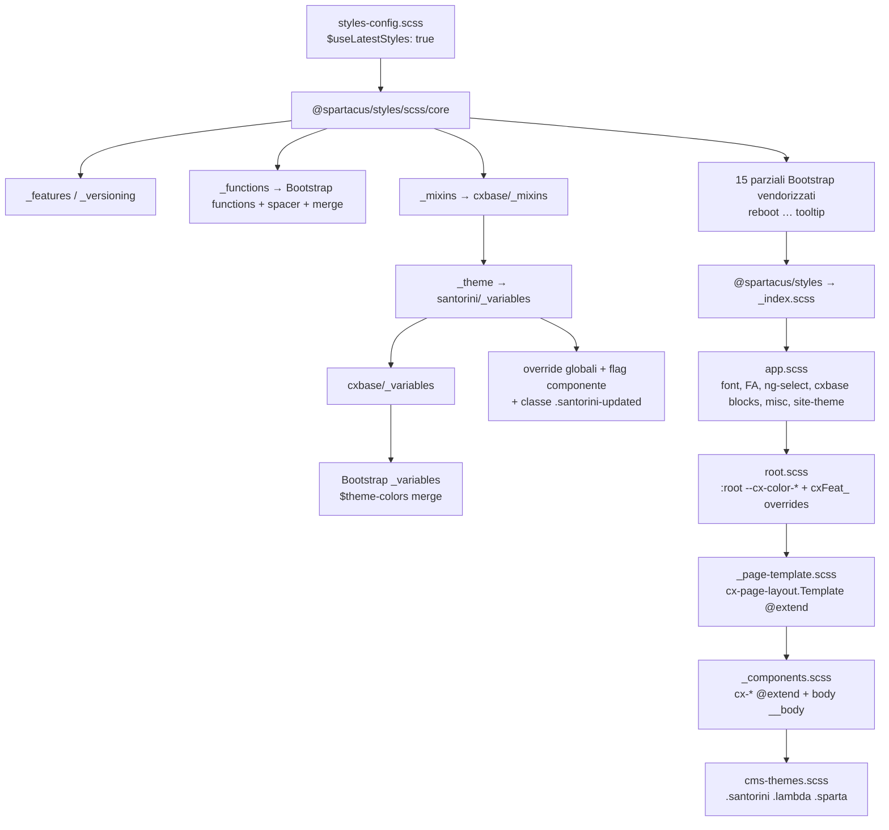
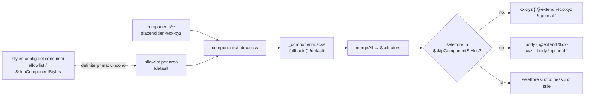
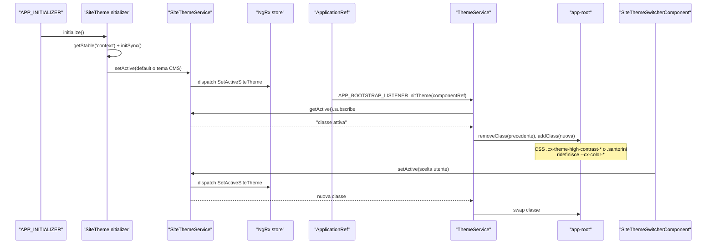
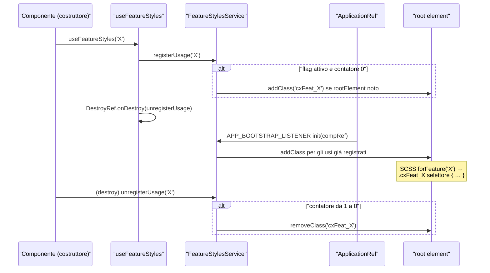
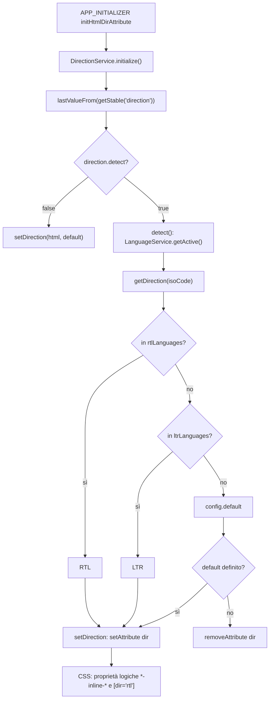

# 38 — Stili e theming

> Riferimenti allo SHA `5b7a1c2bf2808d7380bc20596d10f4fa710c3da1` (vedi [00-meta](../00-meta.md)).

## 1. A cosa serve e perché esiste

Spartacus separa nettamente la logica (librerie Angular in `@spartacus/core`, `@spartacus/storefront` e nelle feature lib) dall'aspetto grafico, che vive quasi per intero in un pacchetto a sé: **`@spartacus/styles`**, sorgente in `core-libs/styles/`. Il pacchetto non contiene TypeScript né CSS precompilato: è una libreria **Sass** distribuita come sorgente. Il `package.json` dichiara come entry Sass `./_index.scss` (campo `"sass"`) — `core-libs/styles/package.json:L2-L3`, `core-libs/styles/package.json:L31-L31` — il progetto Nx `storefrontstyles` ha solo un target di test e nessun target di build — `core-libs/styles/project.json:L2-L14` — e in fase di release i file vengono copiati tali e quali (`cp -r core-libs/styles/* ../.`) — `ci-scripts/release-packer.sh:L42-L43`. La compilazione avviene quindi **nell'applicazione consumer**, dentro la pipeline di build Angular, che vede tutte le variabili Sass e può modificarle prima che il CSS venga emesso.

Questa scelta abilita il modello di personalizzazione di Spartacus, che lavora su tre livelli:

1. **Compile time (Sass)**: variabili `!default` del tema (colori, tipografia, flag di componente come `$useTabsOnPDP`), liste di selettori da emettere (`$<area>-components-allowlist`, `$skipComponentStyles`, `$page-template-allowlist`) e placeholder `%cx-*` ridefinibili — `core-libs/styles/scss/theme/santorini/_variables.scss:L1-L9`, `core-libs/styles/scss/_components.scss:L1-L53`.
2. **Runtime (CSS custom property)**: `root.scss` traduce la mappa Sass `$theme-colors` in proprietà `--cx-color-*` su `:root`, che i componenti leggono con `var(...)`; basta ridefinirle su una classe per ottenere un tema diverso senza ricompilare — `core-libs/styles/scss/root.scss:L1-L6`.
3. **Runtime (classi sul DOM gestite da TypeScript)**: `ThemeService` mette sul root component la classe del *site theme* attivo (per esempio `cx-theme-high-contrast-dark`) — `core-libs/storefront/layout/theme/theme.service.ts:L52-L61` —, `FeatureStylesService` aggiunge classi `cxFeat_<flag>` per gli stili condizionati da feature toggle — `core-libs/core/src/features-config/services/feature-styles.service.ts:L89-L95` — e `DirectionService` imposta l'attributo `dir` su `<html>` in base alla lingua — `core-libs/storefront/layout/direction/direction.service.ts:L89-L95`.

Sotto tutto c'è una copia **vendorizzata di Bootstrap 4.6.2** (`core-libs/styles/vendor/bootstrap/`) — `core-libs/styles/vendor/bootstrap/scss/bootstrap.scss:L1-L7` — di cui Spartacus riusa funzioni, mixin, variabili e una selezione di parziali (reboot, grid, utilities, buttons, forms, modal…), personalizzandoli nei blocchi `cxbase`.

Il capitolo copre: struttura e ordine di import del pacchetto Sass, il meccanismo placeholder/allowlist, temi compilati (santorini, santorini-updated, sparta, lambda) e temi runtime (classi CMS e high-contrast), feature flag e versioning in SCSS, integrazione nell'app e nelle feature lib, e i servizi TypeScript che collegano il DOM al CSS (`ThemeService`, `FeatureStylesService`, `DirectionService`). Il lato "dati" del site theme (store NgRx, persistenza, precedenza CMS) è trattato in [13 — Site context e site theme](13-site-context-theme.md); i breakpoint TypeScript in [18 — Layout, breakpoint, launch dialog e accessibilità](18-layout-breakpoint-a11y.md); i feature toggle in generale in [42 — Feature toggle e deprecazioni](42-feature-toggle-deprecazioni.md).

## 2. Mappa dei file

| Path | Ruolo |
|---|---|
| `core-libs/styles/package.json` | Pacchetto `@spartacus/styles`, entry Sass `./_index.scss`, peer dependency Font Awesome / Open Sans / ng-select |
| `core-libs/styles/_index.scss` | Entry di default: `app` → `root` → `page-template` → `components` |
| `core-libs/styles/theme-santorini.scss`, `core-libs/styles/theme-sparta.scss`, `core-libs/styles/theme-lambda.scss` | Entry alternativi: variabili di un tema + `./index` |
| `core-libs/styles/scss/_core.scss` | Solo strumenti (features, versioning, functions, mixins, theme): da importare in ogni bundle |
| `core-libs/styles/scss/_theme.scss` | Seleziona il tema compilato (santorini) |
| `core-libs/styles/scss/app.scss` | Stili globali: font, Font Awesome, ng-select, blocchi cxbase, layout, misc, site theme |
| `core-libs/styles/scss/root.scss` | Custom property su `:root` e override a11y via classi `cxFeat_*` |
| `core-libs/styles/scss/_components.scss` | Allowlist, `$skipComponentStyles`, cicli `@extend %<selettore>` e `%<selettore>__body` |
| `core-libs/styles/scss/_page-template.scss` | Allowlist/blocklist dei page template e regole `cx-page-layout.<Template>` |
| `core-libs/styles/scss/_features.scss` | `getFeatureCssClass`, mixin `forFeature` |
| `core-libs/styles/scss/_versioning.scss` | Mixin `forVersion` (deprecato) e funzioni di versione |
| `core-libs/styles/scss/_site-theme.scss` | Import dei temi high-contrast |
| `core-libs/styles/scss/cxbase/_variables.scss` | Variabili aggiuntive rispetto a Bootstrap ("NOT a theme") |
| `core-libs/styles/scss/cxbase/_mixins.scss` | Mixin Bootstrap + mixin Spartacus (`type`, `weight`, `visible-focus`, …) |
| `core-libs/styles/scss/cxbase/functions/merge.scss`, `core-libs/styles/scss/cxbase/functions/spacer.scss` | Funzioni `mergeAll` e `spacer` |
| `core-libs/styles/scss/cxbase/blocks/buttons.scss` (e gli altri `blocks/*`) | Personalizzazione globale di `.btn`, form, modal, alert, … |
| `core-libs/styles/scss/components/index.scss` | Importa le nove aree di componenti (placeholder `%cx-*` + allowlist) |
| `core-libs/styles/scss/layout/_index.scss` | page-fold, ghost, screen-reader, placeholder dei page template |
| `core-libs/styles/scss/theme/santorini/_variables.scss` | Tema di default (+ classe `.santorini-updated`) |
| `core-libs/styles/scss/theme/santorini-updated/_variables.scss` | Tema aggiornato, non attivo di default |
| `core-libs/styles/scss/theme/sparta/_variables.scss`, `core-libs/styles/scss/theme/lambda/_variables.scss` | Temi alternativi (Lambda è un tema di test) |
| `core-libs/styles/scss/theme/high-contrast/high-contrast.scss` + `dark/`, `light/`, `mixins/` | Temi runtime ad alto contrasto e mixin `cx-highContrastTheme*` |
| `core-libs/styles/vendor/bootstrap/scss/` | Bootstrap 4.6.2 vendorizzato |
| `core-libs/styles/test/scss.spec.js` | Runner Jest + `sass-true` per i test `*.spec.scss` |
| `core-libs/storefront/layout/theme/theme.service.ts`, `core-libs/storefront/layout/theme/theme.module.ts` | Classe del site theme sul root component (`APP_BOOTSTRAP_LISTENER`) |
| `core-libs/storefront/layout/direction/direction.service.ts`, `core-libs/storefront/layout/direction/direction.module.ts` | Attributo `dir` su `<html>` (`APP_INITIALIZER`) |
| `core-libs/storefront/layout/direction/config/direction.model.ts`, `core-libs/storefront/layout/direction/config/default-direction.config.ts` | `DirectionMode`, `Direction`, default `detect`/`rtlLanguages` |
| `core-libs/core/src/features-config/services/feature-styles.service.ts`, `core-libs/core/src/features-config/utils/use-feature-styles.ts` | Classi `cxFeat_<flag>` sul root element |
| `core-libs/storefront/layout/main/storefront.component.ts` | Registra gli stili feature-flag globali; caso speciale su `<html>` |
| `projects/storefrontapp/src/styles.scss`, `projects/storefrontapp/src/styles-config.scss`, `projects/storefrontapp/src/cms-themes.scss` | Integrazione nell'app demo |
| `core-libs/schematics/src/add-spartacus/index.ts` | Schematic che genera `styles-config.scss` e gli import nel foglio principale |

## 3. Come funziona passo per passo

### 3.1 Packaging e test

`@spartacus/styles` dichiara come dipendenza runtime soltanto `hamburgers` e come peer dependency `@fontsource/open-sans`, `@fortawesome/fontawesome-free` 7.1.0 e `@ng-select/ng-select` — `core-libs/styles/package.json:L16-L24`. Il pacchetto si porta dietro i sorgenti `scss/` (189 file tracciati) e `vendor/` (91 file) — `core-libs/styles/scss/`, `core-libs/styles/vendor/`. I test sono scritti in Sass con `sass-true`: un unico spec Jest cerca tutti i `test/**/*.spec.scss` e li esegue con `sassTrue.runSass` — `core-libs/styles/test/scss.spec.js:L1-L15`.

⚠️ DA VERIFICARE: il modo in cui la build Angular risolve `@import '@spartacus/styles'` attraverso il campo `"sass"` del `package.json` non è verificabile qui (i sorgenti di Angular CLI non sono in `/tmp/angular`, che contiene solo il framework).

### 3.2 Entry point e ordine di import

L'entry di default `core-libs/styles/_index.scss` è composto da quattro import, in quest'ordine: `scss/app`, `scss/root`, `scss/page-template`, `scss/components` — `core-libs/styles/_index.scss:L1-L4`. Ciascuno ha un compito preciso:

- `app.scss` carica font, il CSS di Font Awesome, il tema di default di ng-select, `cxbase/index`, i blocchi cxbase (buttons, forms, modal, alert, message, tooltip, tables, card, accordion, tabs, carousel, link, dropdown), i layout cxbase, paragraph, animations, `misc/*` e per ultimo `site-theme` — `core-libs/styles/scss/app.scss:L1-L39`.
- `root.scss` emette le custom property su `:root` (vedi §3.5) — `core-libs/styles/scss/root.scss:L1-L45`.
- `_page-template.scss` emette le regole `cx-page-layout.<Template>` (vedi §3.7) — `core-libs/styles/scss/_page-template.scss:L21-L27`.
- `_components.scss` emette le regole per ogni elemento `cx-*` (vedi §3.6) — `core-libs/styles/scss/_components.scss:L37-L53`.

Esistono tre entry alternativi che antepongono le variabili di un tema: `theme-sparta.scss` (font + variabili Sparta, poi `./index`) — `core-libs/styles/theme-sparta.scss:L1-L4` —, `theme-santorini.scss` (font Santorini **prima** delle variabili, poi `./index`) — `core-libs/styles/theme-santorini.scss:L1-L4` — e `theme-lambda.scss` (solo variabili, nessun font) — `core-libs/styles/theme-lambda.scss:L1-L3`. Nessun file del repo li referenzia (vedi §9).

### 3.3 Il "core" Sass: strumenti senza output

`scss/_core.scss` importa features, versioning, functions, mixins e theme — `core-libs/styles/scss/_core.scss:L1-L5`. È ciò che ogni bundle (app o feature lib) importa per primo, perché porta variabili, funzioni e mixin senza emettere (in teoria) regole CSS:

- `_functions.scss` → `cxbase/functions`, che carica le functions del Bootstrap vendorizzato più `spacer` e `merge` — `core-libs/styles/scss/_functions.scss:L1-L1`, `core-libs/styles/scss/cxbase/_functions.scss:L1-L3`.
- `_mixins.scss` → `cxbase/mixins` + mixin high-contrast — `core-libs/styles/scss/_mixins.scss:L1-L2`. `cxbase/_mixins.scss` importa a sua volta `../theme`, "because of some lower level bootstrap variables", poi i mixin di Bootstrap e quelli Spartacus (reset, weight, type, button-reset, placeholder, transformations, visible-focus) — `core-libs/styles/scss/cxbase/_mixins.scss:L1-L15`.
- `_theme.scss` punta al tema compilato. Di default è attivo `theme/santorini/variables`; `santorini-updated` è commentato ("to uncomment on next major or with impex"), sparta e lambda pure — `core-libs/styles/scss/_theme.scss:L5-L12`.

In realtà il file di variabili santorini emette anche CSS (la classe `.santorini-updated`, §3.4), quindi "senza output" va preso con cautela (vedi §9).

### 3.4 Tema, cxbase e Bootstrap: chi vince sulle variabili

La catena delle variabili è la parte più delicata. L'ordine reale, a partire da `_theme.scss`, è:

1. **Variabili del tema** (`santorini/_variables.scss`). Il file dichiara il contratto: si possono ridefinire variabili Bootstrap, cxbase e di componente, ma non aggiungerne di nuove — `core-libs/styles/scss/theme/santorini/_variables.scss:L1-L9`. I colori base usano `!default` (`$primary: #1f7bc0`, `$text: #14293a`, `$visual-focus: #6d9df7`, …) — `core-libs/styles/scss/theme/santorini/_variables.scss:L31-L50`; `$disabled` e `$disabled-accent` sono separati per superfici chiare e riempimenti, per consentire il 7:1 nei temi high-contrast — `core-libs/styles/scss/theme/santorini/_variables.scss:L53-L58`. Le mappe `$theme-colors` (24 chiavi) e `$type` (scala tipografica 1–8 come coppie dimensione/peso) sono invece assegnate **senza** `!default` — `core-libs/styles/scss/theme/santorini/_variables.scss:L60-L85`, `core-libs/styles/scss/theme/santorini/_variables.scss:L102-L112`.
2. **cxbase** (`@import '../../cxbase/variables'`, "bring in variable defaults") — `core-libs/styles/scss/theme/santorini/_variables.scss:L114-L115`. `cxbase/_variables.scss` si autodefinisce "NOT a theme": carica le variabili Bootstrap e aggiunge solo ciò che Bootstrap non ha — `core-libs/styles/scss/cxbase/_variables.scss:L1-L13`. Fonde in `$theme-colors` le chiavi `background`, `text`, `inverse`, `transparent` (mettendo le chiavi del tema per seconde, quindi vincenti) e definisce `$font-weight-semi`, `$btn-text-transform`, `$direction: ltr`, `$header-height: 67px` — `core-libs/styles/scss/cxbase/_variables.scss:L15-L50`.
3. **Bootstrap** inizializza `$theme-colors: () !default` e poi la fonde con i propri colori, quindi le chiavi del tema già definite prevalgono — `core-libs/styles/vendor/bootstrap/scss/_variables.scss:L85-L86`.
4. **Override globali del tema**, scritti dopo l'import di cxbase: `$grid-gutter-width: 30px`, `$input-height: 48px`, `$body-color: $text`, `$body-bg: $inverse`, … — `core-libs/styles/scss/theme/santorini/_variables.scss:L114-L145`. Il tema poi rimuove da `$colors` i colori nominali di Bootstrap (indigo, purple, …, white) — `core-libs/styles/scss/theme/santorini/_variables.scss:L147-L163`.
5. **Flag di componente**: il tema imposta `$spinWhileLoading`, `$spinWhileWaiting`, `$zoomThumbOnHover`, `$overlayWhileLoading`, `$useTabsOnPDP`, `$useAccordionOnly` a `true !default` — `core-libs/styles/scss/theme/santorini/_variables.scss:L169-L174` — mentre i file dei componenti dichiarano gli stessi flag con default `false` — `core-libs/styles/scss/components/product/details/_product-images.scss:L1-L4`, `core-libs/styles/scss/components/content/tab-paragraph-container/_tab-paragraph-container.scss:L1-L2`. Poiché il tema viene valutato per primo, l'assegnazione `false !default` del componente non ha effetto. `$useTabsOnPDP` decide a compile time se `%cx-tab-paragraph-container` estende `%pdpTabs` o `%pdpFlat` — `core-libs/styles/scss/components/content/tab-paragraph-container/_tab-paragraph-container.scss:L221-L227` — e `$useAccordionOnly` se includere il mixin `accordion()` — `core-libs/styles/scss/components/content/tab-paragraph-container/_tab-paragraph-container.scss:L140-L142`.
6. **Classe `.santorini-updated`**: in coda al file di variabili santorini c'è un blocco CSS vero e proprio con tutte le custom property del tema aggiornato ("for impex file, remove on next major") — `core-libs/styles/scss/theme/santorini/_variables.scss:L176-L215`.

Gli altri temi seguono lo stesso schema con palette diverse: `santorini-updated` usa `$primary: #055f9f`, `$visual-focus: #1f3a93` e una scala tipografica ridotta (h1 = 2rem, h2 = 1.5rem) — `core-libs/styles/scss/theme/santorini-updated/_variables.scss:L31-L50`, `core-libs/styles/scss/theme/santorini-updated/_variables.scss:L80-L86`; Sparta usa `$primary: #fe5757` e `$text: #212738`, e la sua `$theme-colors` non contiene `disabled`/`disabled-accent` — `core-libs/styles/scss/theme/sparta/_variables.scss:L27-L73`; Lambda è un "test theme" in Comic Sans MS con `$theme-colors` limitata a `brand`/`accent` e `$cx-hamburger-type: arrow-r` — `core-libs/styles/scss/theme/lambda/_variables.scss:L1-L3`, `core-libs/styles/scss/theme/lambda/_variables.scss:L16-L16`, `core-libs/styles/scss/theme/lambda/_variables.scss:L32-L52`.

**Font.** `_fonts.scss` punta ai font Sparta, che importano i CSS di `@fontsource/open-sans` (pesi 300/400/600/700, font self-hosted) — `core-libs/styles/scss/_fonts.scss:L1-L2`, `core-libs/styles/scss/theme/sparta/_fonts.scss:L1-L4`. I font Santorini invece fanno `@import url('#{$font-url}')` verso Google Fonts — `core-libs/styles/scss/theme/santorini/_fonts.scss:L1-L1`, `core-libs/styles/scss/theme/santorini/_variables.scss:L26-L28`. Poiché `app.scss` importa `fonts` (cioè Sparta) — `core-libs/styles/scss/app.scss:L2-L2` —, l'entry di default usa i font self-hosted pur compilando le variabili santorini.

### 3.5 Custom property su `:root`

`root.scss` è il ponte fra Sass e runtime. Per ogni voce di `$theme-colors` emette `--cx-color-<nome>` — `core-libs/styles/scss/root.scss:L1-L6` — e aggiunge costanti: `--cx-page-width-max: 1140px`, i pesi `--cx-font-weight-*`, `--cx-text-transform`, `--cx-direction`, durate di transizione/animazione, border radius e `--cx-border-style` — `core-libs/styles/scss/root.scss:L7-L25`. `--fa-width: auto` ripristina la larghezza automatica delle icone dopo il breaking change di Font Awesome 7 — `core-libs/styles/scss/root.scss:L27-L30`.

Tre blocchi sono condizionati da feature flag:

- `forFeature('a11yPreventWindowsHighContrastOverride', 'currentSelector')` annidato in `:root` applica `forced-color-adjust: none` sotto `forced-colors: active` — `core-libs/styles/scss/root.scss:L36-L44`. Essendo `currentSelector`, il selettore risultante è `:root.cxFeat_…`, cioè la classe deve stare su `<html>` — `core-libs/styles/scss/_features.scss:L57-L61`.
- `.cxFeat_a11yFocusIndicatorContrast:not(.cx-theme-high-contrast-dark):not(.cx-theme-high-contrast-light)` porta `--cx-color-visual-focus` a `#1f3a93 !important` — `core-libs/styles/scss/root.scss:L47-L64`.
- `.cxFeat_a11yPrimaryColorContrast:not(...)` porta `--cx-color-primary` a `#055f9f !important` — `core-libs/styles/scss/root.scss:L66-L70`.

Altre custom property globali nascono altrove: `--cx-spatial-*` (base 0.5rem) — `core-libs/styles/scss/cxbase/_spatial.scss:L1-L8` —, `--btf-delay`/`--btf-min-height`/`--btf-margin-top` per le slot sotto la piega — `core-libs/styles/scss/layout/_page-fold.scss:L3-L43` —, `--cx-spinner-size` con il keyframe `spin` e il placeholder `%spinner` — `core-libs/styles/scss/cxbase/_animations.scss:L1-L25` —, `--cx-color-ghost*` per lo skeleton `.ghost` — `core-libs/styles/scss/layout/_ghost.scss:L1-L24`.

### 3.6 Componenti: placeholder `%cx-*`, allowlist e `@extend`

Gli stili di un componente non sono scritti sul suo selettore, ma su un **placeholder** Sass con lo stesso nome preceduto da `%`: per esempio `%cx-site-theme-switcher` o `%cx-storefront` — `core-libs/styles/scss/components/misc/site-theme-switcher/_site-theme-switcher.scss:L3-L8`, `core-libs/styles/scss/components/layout/_storefront.scss:L3-L10`. Un placeholder non produce CSS finché qualcuno non lo estende.

`components/index.scss` importa nove aree: content, product, misc, myaccount, layout, pwa, cds, digital-payments, cpq-quote — `core-libs/styles/scss/components/index.scss:L1-L9`. Ogni area, oltre ai placeholder, definisce una **allowlist** `!default` di selettori:

- `$content-components-allowlist` (cx-banner, cx-link, cx-media, cx-carousel, …, cx-tab) — `core-libs/styles/scss/components/content/_index.scss:L10-L14`;
- `$misc-components-allowlist` (cx-table, cx-icon, cx-spinner, …, cx-site-theme-switcher, cx-read-more) — `core-libs/styles/scss/components/misc/_index.scss:L13-L16`;
- `$layout-components-allowlist`, che include anche l'elemento HTML `header` (placeholder `%header`) — `core-libs/styles/scss/components/layout/_index.scss:L6-L7`, `core-libs/styles/scss/components/layout/header/_header.scss:L3-L5`;
- `$product-components-allowlist`, costruita con `mergeAll` a partire da `$product-list-allowlist` — `core-libs/styles/scss/components/product/index.scss:L7-L24`, `core-libs/styles/scss/components/product/list/_index.scss:L11-L14`;
- `$myaccount-components-allowlist` (14 selettori) — `core-libs/styles/scss/components/myaccount/_index.scss:L16-L22`;
- le aree minori pwa, cds, digital-payments, cpq-quote — `core-libs/styles/scss/components/pwa/add-to-home-screen-banner/_index.scss:L3-L3`, `core-libs/styles/scss/components/cds/index.scss:L3-L3`, `core-libs/styles/scss/components/digital-payments/index.scss:L3-L3`, `core-libs/styles/scss/components/cpq-quote/index.scss:L3-L3`.

`_components.scss` mette tutto insieme:

1. importa `components/index` (placeholder e allowlist reali) — `core-libs/styles/scss/_components.scss:L1-L2`;
2. **dopo**, ridichiara `$skipComponentStyles` e tutte le 11 allowlist come `() !default`: sono fallback per le liste non definite da nessuna area (per esempio `$user-components-allowlist` o `$epd-visualization-components-allowlist`, che appartengono a feature lib) — `core-libs/styles/scss/_components.scss:L4-L19`;
3. unisce le 11 liste in `$selectors` con `mergeAll`, che concatena con `join` — `core-libs/styles/scss/_components.scss:L21-L35`, `core-libs/styles/scss/cxbase/functions/merge.scss:L1-L7`;
4. per ogni selettore emette `<selettore> { @extend %<selettore> !optional; }` a meno che il selettore sia in `$skipComponentStyles` — `core-libs/styles/scss/_components.scss:L37-L44`;
5. per lo stesso elenco fa estendere a `body` i placeholder `%<selettore>__body` — `core-libs/styles/scss/_components.scss:L46-L53`.

Il secondo ciclo è il canale per gli stili che un componente deve applicare **fuori da sé**, a livello di pagina. Nel core styles l'unico placeholder `__body` è `%cx-searchbox__body`, che reagisce alla classe `searchbox-is-active` messa sul body dal componente di ricerca — `core-libs/styles/scss/components/product/search/_searchbox.scss:L3-L21`, `core-libs/storefront/cms-components/navigation/search-box/search-box.component.ts:L73-L73`.

Il `!optional` rende innocuo un selettore senza placeholder corrispondente. Alcuni componenti offrono anche una classe che estende direttamente il placeholder (es. `.cx-icon { @extend %cx-icon; }`), usabile fuori dall'elemento `cx-icon` — `core-libs/styles/scss/components/misc/_icons.scss:L9-L13`.

Le feature lib replicano lo schema nel proprio bundle: epd-visualization importa `@spartacus/styles/scss/core`, definisce `$epd-visualization-components-allowlist` e ripete i due cicli — `integration-libs/epd-visualization/_index.scss:L1-L29`.

### 3.7 Page template

`_page-template.scss` funziona come `_components.scss`, ma per i layout di pagina: definisce `$page-template-blocklist: () !default` e `$page-template-allowlist` con 14 template — `core-libs/styles/scss/_page-template.scss:L7-L19` — e per ogni template non blocklistato emette `cx-page-layout.<Template> { @extend %<Template> !optional; }` — `core-libs/styles/scss/_page-template.scss:L21-L27`. La classe `<Template>` su `cx-page-layout` è quella del template CMS della pagina (vedi [16 — CMS (storefront): rendering dinamico delle pagine](16-cms-rendering.md)).

I placeholder stanno in `layout/page-templates/`: `layout/_index.scss` importa page-fold, ghost, screen-reader e 13 file di template, e definisce `%CheckoutLoginPageTemplate` come estensione di `%LoginPageTemplate` — `core-libs/styles/scss/layout/_index.scss:L1-L21`. Le slot di base sono flex container in cui `--cx-flex-basis` (default 100%) regola la larghezza dei figli; `%LandingPage2Template` la porta al 50% per `Section2A`/`Section2B` — `core-libs/styles/scss/layout/page-templates/_common-template.scss:L12-L20`, `core-libs/styles/scss/layout/page-templates/_landing-page-2.scss:L35-L38`. `%ProductDetailsPageTemplate` usa un grid a due colonne da `lg` per la slot `Summary` — `core-libs/styles/scss/layout/page-templates/_product-detail.scss:L1-L26`. Le feature lib aggiungono allowlist dedicate, per esempio checkout con `$page-template-allowlist-multistep-checkout` — `feature-libs/checkout/base/styles/layout/_index.scss:L5-L12`.

### 3.8 Mixin e funzioni di base

- `spacer($key: 3)` restituisce `map-get($spacers, $key)` — `core-libs/styles/scss/cxbase/functions/spacer.scss:L1-L3`.
- `type($size, $weight)` legge la coppia dimensione/peso da `$type` ed emette `font-size: var(--cx-font-size, …)` e `line-height: var(--cx-line-height, …)`, delegando il peso a `weight` — `core-libs/styles/scss/cxbase/mixins/_type.scss:L3-L29`. `weight` traduce `light`/`semi`/`normal`/`bold` nelle custom property `--cx-font-weight-*` ed emette tale e quale un valore non stringa — `core-libs/styles/scss/cxbase/mixins/_weight.scss:L1-L15`. Il risultato è che ogni testo tipizzato con `type()` è sovrascrivibile a runtime con `--cx-font-size`/`--cx-line-height`.
- `visible-focus` disegna un outline `var(--cx-color-visual-focus)` di larghezza `var(--cx-visual-focus-width, 2px)` con offset 2px (−2px sotto `md`, salvo eccezioni) — `core-libs/styles/scss/cxbase/mixins/_visible-focus.scss:L1-L24`; `button` e `.btn` lo applicano su `:focus` — `core-libs/styles/scss/cxbase/blocks/buttons.scss:L356-L361`; quando l'utente usa il mouse, `%cx-storefront .mouse-focus` azzera `--cx-visual-focus-width` — `core-libs/styles/scss/components/layout/_storefront.scss:L32-L44`.
- Altri mixin: `button-reset`, `placeholder`, `reset($display)`, `cx-lighten`/`cx-darken` (filtro brightness) — `core-libs/styles/scss/cxbase/mixins/_button-reset.scss:L1-L15`, `core-libs/styles/scss/cxbase/mixins/_placeholder.scss:L1-L14`, `core-libs/styles/scss/cxbase/mixins/_reset.scss:L1-L3`, `core-libs/styles/scss/cxbase/mixins/_transformations.scss:L1-L9`.
- `.btn` usa `--cx-buttons-border-radius`, `--cx-text-transform`, `min-height: 48px` e `type('4')` — `core-libs/styles/scss/cxbase/blocks/buttons.scss:L23-L32`.
- L'hamburger usa la lib npm `hamburgers`: `$cx-hamburger-type` (default `squeeze`) seleziona il tipo e `.cx-hamburger` estende `.hamburger` e `.hamburger--<tipo>` — `core-libs/styles/scss/misc/_hamburger.scss:L1-L20`.

### 3.9 Feature flag in SCSS: `forFeature` + `FeatureStylesService`

Le modifiche stilistiche potenzialmente "breaking" sono protette da feature toggle. Il lato Sass è in `_features.scss`: `$CSS_FEATURE_FLAG_PREFIX: 'cxFeat_'` ("The same as the one used in the TS service FeatureStylesService") e `getFeatureCssClass` che lo antepone al nome — `core-libs/styles/scss/_features.scss:L3-L14`. Il mixin `forFeature($feature, $classTarget: 'ancestorSelector')` valida i parametri con `@error` e genera, con `@at-root`, `.cxFeat_<flag> &` (classe su un antenato) oppure, solo con `'currentSelector'`, `&.cxFeat_<flag>` (classe sull'elemento stesso, riservato al root element) — `core-libs/styles/scss/_features.scss:L38-L61`. Un test Sass verifica la prima forma — `core-libs/styles/test/features.spec.scss:L1-L30`. Nel core ci sono 39 `@include forFeature` in 19 file — `core-libs/styles/scss/` (grep).

Il lato TypeScript deve mettere la classe sul DOM. `FeatureStylesService` usa lo stesso prefisso — `core-libs/core/src/features-config/services/feature-styles.service.ts:L31-L36` — e un contatore per flag:

1. `useFeatureStyles(feature)` va chiamato nel costruttore del componente: richiede un injection context, chiama `registerUsage` e registra `unregisterUsage` su `DestroyRef.onDestroy` — `core-libs/core/src/features-config/utils/use-feature-styles.ts:L32-L40`.
2. `registerUsage` aggiunge la classe al primo utilizzo se il flag è attivo — `core-libs/core/src/features-config/services/feature-styles.service.ts:L89-L95`; `addClass` non fa nulla se il root element non è ancora noto — `core-libs/core/src/features-config/services/feature-styles.service.ts:L130-L136`.
3. Al bootstrap, `FeaturesConfigModule.forRoot` registra un `APP_BOOTSTRAP_LISTENER` che chiama `init(compRef)` — `core-libs/core/src/features-config/features-config.module.ts:L41-L49`; `init` memorizza l'elemento nativo del root component e aggiunge le classi già registrate (tipicamente dal costruttore del root component, che gira prima del listener) — `core-libs/core/src/features-config/services/feature-styles.service.ts:L65-L77`.
4. `unregisterUsage` rimuove la classe quando il contatore passa da 1 a 0 — `core-libs/core/src/features-config/services/feature-styles.service.ts:L103-L115`.

Angular invoca i listener `APP_BOOTSTRAP_LISTENER` con il `ComponentRef` del componente bootstrappato dopo `attachView` e un primo `tick()` — `angular:packages/core/src/application/application_ref.ts:L775-L795`. Nell'app demo il root component è `app-root` — `projects/storefrontapp/src/app/app.component.ts:L15-L15`, `projects/storefrontapp/src/main.ts:L17-L17` —, quindi le classi `cxFeat_*` finiscono su `<app-root>`.

`StorefrontComponent` registra nel costruttore i flag stilistici globali (`a11yPreventWindowsHighContrastOverride`, `alignNavigationMenuWithHeader`, `cdsBottomHeaderSlotAdjustPosition`, `a11yFocusIndicatorContrast`, `a11yDisabledButtonContrast`, `a11yPrimaryColorContrast`) — `core-libs/storefront/layout/main/storefront.component.ts:L117-L124` — e, per l'unico blocco su `:root`, aggiunge a mano `cxFeat_a11yPreventWindowsHighContrastOverride` su `document.documentElement` — `core-libs/storefront/layout/main/storefront.component.ts:L141-L147`. Un esempio d'uso a livello di componente è il bottone primario disabilitato, che con `a11yDisabledButtonContrast` usa `--cx-color-disabled-accent` — `core-libs/styles/scss/cxbase/blocks/buttons.scss:L73-L84`.

### 3.10 Versioning SCSS (`forVersion`, deprecato)

Prima dei feature flag nominati, Spartacus usava un versioning degli stili. `_versioning.scss` si apre con un avviso: `forVersion($level)` è deprecato e superato da `forFeature` — `core-libs/styles/scss/_versioning.scss:L1-L3`. La versione corrente è `$_fullVersion: (major: 221121, minor: 22, patch: 0)` con `$_majorVersion: 2211` — `core-libs/styles/scss/_versioning.scss:L29-L37`; il consumer può impostare `$styleVersion` (default `$_majorVersion`) e `$useLatestStyles` (default `false`) — `core-libs/styles/scss/_versioning.scss:L39-L46`. `forVersion($from, $to: 0)` (`@deprecated since 2211.20`) emette il contenuto solo se `$from` non supera la versione corrente e la versione è "stabile e valida" o è un breaking change richiesto — `core-libs/styles/scss/_versioning.scss:L63-L77`; i breaking change sono richiesti se `$useLatestStyles` è vero o `$styleVersion` supera `$_majorVersion` — `core-libs/styles/scss/_versioning.scss:L228-L231`. Nel core, `@include forVersion` compare solo nel commento d'esempio; il meccanismo resta coperto dai test — `core-libs/styles/scss/_versioning.scss:L18-L18`, `core-libs/styles/test/versioning-test-util.scss:L1-L10`.

### 3.11 Integrazione nell'applicazione

Il foglio principale dell'app demo importa, con commenti "ORDER IMPORTANT": `styles-config`, `@spartacus/styles/scss/core`, 15 parziali del Bootstrap vendorizzato, `@spartacus/styles` e infine `cms-themes` — `projects/storefrontapp/src/styles.scss:L1-L29`. L'ordine conta:

- `styles-config` viene prima di tutto perché contiene le variabili del consumer, che devono precedere le assegnazioni `!default` della libreria; nell'app demo imposta `$useLatestStyles: true` — `projects/storefrontapp/src/styles-config.scss:L1-L2`.
- `scss/core` prima di Bootstrap, perché i parziali Bootstrap leggono le variabili già personalizzate dal tema.
- `cms-themes` per ultimo, perché le classi `.santorini`, `.lambda`, `.sparta` ridefiniscono le custom property `--cx-color-*` e devono vincere sui default di `:root` — `projects/storefrontapp/src/styles.scss:L27-L29`, `projects/storefrontapp/src/cms-themes.scss:L1-L60`. L'app demo abilita `applyBaseSiteThemeFromCms`, quindi la classe arriva dal campo `theme` del base site — `projects/storefrontapp/src/app/spartacus/spartacus-features.module.ts:L378-L385`.

Ogni feature lib ha un bundle CSS separato in `project.json` (es. `lib-asm.scss` → bundle `asm`) e l'app silenzia la deprecazione Sass di `@import` — `projects/storefrontapp/project.json:L43-L54`, `projects/storefrontapp/project.json:L137-L141`. Ogni bundle riparte da `styles-config` e dall'entry della lib — `projects/storefrontapp/src/styles/lib-cart.scss:L1-L2` —, che a sua volta reimporta `@spartacus/styles/scss/core` più eventuali blocchi cxbase — `feature-libs/cart/_index.scss:L1-L3`. Ogni bundle è quindi una compilazione Sass indipendente: le variabili impostate nel foglio principale non arrivano nei bundle delle lib, a meno di stare in `styles-config`.

Nelle app nuove, lo schematic `add-spartacus` crea `styles-config.scss` con `$styleVersion: <featureLevel>` (default: major.minor della versione corrente) — `core-libs/schematics/src/add-spartacus/index.ts:L70-L86`, `core-libs/schematics/src/shared/utils/package-utils.ts:L147-L149` — e inserisce nel foglio principale la stessa sequenza (config, core, Bootstrap, `@spartacus/styles/index`); con `--theme` aggiunge `@import '@spartacus/styles/scss/theme/${options.theme}'` — `core-libs/schematics/src/add-spartacus/index.ts:L146-L173`. L'opzione `theme` è una stringa libera ("E.g: santorini") — `core-libs/schematics/src/add-spartacus/schema.json:L386-L389`. Per gli schematics in generale vedi [43 — Schematics e migrazioni di Spartacus](43-schematics-migrazioni.md).

### 3.12 Site theme lato CSS: temi high-contrast

`app.scss` include per ultimo `_site-theme.scss`, che carica le variabili dei due temi ad alto contrasto e `high-contrast.scss` — `core-libs/styles/scss/_site-theme.scss:L1-L3`. `.cx-theme-high-contrast-dark` ridefinisce le custom property (`--cx-color-text: #ffffff`, `--cx-color-background: #000000`, `--cx-color-primary: #6bd3ff`, …) — `core-libs/styles/scss/theme/high-contrast/dark/_variables.scss:L1-L27` —, `.cx-theme-high-contrast-light` usa testo nero su bianco con `--cx-color-primary: #004ccb` — `core-libs/styles/scss/theme/high-contrast/light/_variables.scss:L1-L26` — e `high-contrast.scss` applica `color` e `background-color` a entrambe le classi — `core-libs/styles/scss/theme/high-contrast/high-contrast.scss:L1-L5`.

Dove le sole custom property non bastano, i componenti usano `cx-highContrastTheme($feature: null)`: senza flag genera `.cx-theme-high-contrast-dark &, .cx-theme-high-contrast-light &` annidato; con un flag usa `@at-root` per la forma combinata `.cx-theme-high-contrast-dark.cxFeat_<flag> &`; esistono varianti `-dark` e `-light` — `core-libs/styles/scss/theme/high-contrast/mixins/_mixins.scss:L1-L40`. Compare 67 volte nel core — `core-libs/styles/scss/` (grep). `%cx-storefront` disattiva i forced colors di Windows quando porta una delle classi high-contrast — `core-libs/styles/scss/components/layout/_storefront.scss:L52-L59`.

### 3.13 Site theme lato TypeScript: `ThemeService`

La catena che porta la classe sul DOM:

1. `BaseCoreModule` importa `SiteThemeModule.forRoot()`, che fornisce `SiteThemeService`, la config di default e un `APP_INITIALIZER` che chiama `SiteThemeInitializer.initialize()` — `core-libs/core/src/base-core.module.ts:L43-L43`, `core-libs/core/src/site-theme/site-theme.module.ts:L18-L29`, `core-libs/core/src/site-theme/providers/site-theme-initializer-providers.ts:L10-L23`.
2. `initialize` attende la config `context` stabile, ripristina il valore persistito e imposta il default se non inizializzato; con `applyBaseSiteThemeFromCms` segue anche `BaseSite.theme` — `core-libs/core/src/site-theme/services/site-theme-initializer.ts:L36-L50` — con precedenza: `config.context.theme` statico, poi tema opzionale scelto dall'utente, poi tema CMS — `core-libs/core/src/site-theme/services/site-theme-initializer.ts:L93-L127`. Il default arriva da `getDefaultClassName` — `core-libs/core/src/site-theme/facade/site-theme.service.ts:L46-L63` — e i temi opzionali di default sono i due high-contrast — `core-libs/core/src/site-theme/config/default-site-theme-config.ts:L9-L22`.
3. `setActive` fa dispatch di `SetActiveSiteTheme` solo se la classe cambia ed è valida — `core-libs/core/src/site-theme/facade/site-theme.service.ts:L109-L119`; `getActive()` legge `getActiveSiteTheme` dallo store filtrando i null — `core-libs/core/src/site-theme/facade/site-theme.service.ts:L99-L104`.
4. `LayoutModule` (importato da `BaseStorefrontModule`) importa `ThemeModule` — `core-libs/storefront/layout/layout.module.ts:L15-L25`, `core-libs/storefront/base-storefront.module.ts:L40-L47` —, che registra `initTheme` come `APP_BOOTSTRAP_LISTENER` — `core-libs/storefront/layout/theme/theme.module.ts:L10-L25`.
5. `ThemeService.init` crea un `Renderer2`, memorizza il root component e sottoscrive `getActive()` — `core-libs/storefront/layout/theme/theme.service.ts:L35-L46`; `setTheme` rimuove la classe precedente e aggiunge la nuova se non vuota — `core-libs/storefront/layout/theme/theme.service.ts:L52-L61`.
6. L'utente può cambiare tema da `SiteThemeSwitcherComponent`, che scrive la scelta con `setActive` e registra `useFeatureStyles('a11ySiteContextCaretClick')` — `core-libs/storefront/cms-components/misc/site-theme-switcher/site-theme-switcher.component.ts:L42-L58`, `core-libs/storefront/cms-components/misc/site-theme-switcher/site-theme-switcher.component.service.ts:L14-L25`.

Il risultato è che il root component porta contemporaneamente la classe del tema (es. `santorini` o `cx-theme-high-contrast-dark`) e le classi `cxFeat_*`. È per questo che `root.scss` deve usare `!important` per battere `.santorini`, caricata dopo con la stessa specificità, e le guardie `:not(.cx-theme-high-contrast-*)` per non toccare i temi high-contrast — `core-libs/styles/scss/root.scss:L47-L64`.

### 3.14 Direzione (RTL)

`DirectionMode` ha solo `LTR = 'ltr'` e `RTL = 'rtl'`; il valore HTML5 `auto` non è supportato perché "too fragile" — `core-libs/storefront/layout/direction/config/direction.model.ts:L7-L23`. La config `direction` (`default`, `detect`, `rtlLanguages`, `ltrLanguages`, tutte opzionali) — `core-libs/storefront/layout/direction/config/direction.model.ts:L29-L56` — è esposta da `DirectionConfig`, classe astratta `useExisting: Config` con module augmentation — `core-libs/storefront/layout/direction/config/direction.config.ts:L25-L35`. Il default è `detect: true`, `default: LTR`, `rtlLanguages: ['he', 'ar']` — `core-libs/storefront/layout/direction/config/default-direction.config.ts:L10-L19`.

Flusso:

1. `LayoutModule` importa `DirectionModule` — `core-libs/storefront/layout/layout.module.ts:L15-L25` —, che registra un `APP_INITIALIZER` (`initHtmlDirAttribute`) che restituisce la Promise di `DirectionService.initialize()` — `core-libs/storefront/layout/direction/direction.module.ts:L12-L35`. `APP_INITIALIZER` è deprecato in Angular dalla v19 a favore di `provideAppInitializer` — `angular:packages/core/src/application/application_init.ts:L36-L42`.
2. `initialize()` converte con `lastValueFrom` la config stabile `direction`: se `detect` chiama `detect()`, altrimenti imposta `config.default` su `document.documentElement` — `core-libs/storefront/layout/direction/direction.service.ts:L46-L62`.
3. `detect()` (protetto da `startsDetecting`) sottoscrive `LanguageService.getActive()` e a ogni lingua imposta `dir` — `core-libs/storefront/layout/direction/direction.service.ts:L68-L83`.
4. `getDirection` controlla `rtlLanguages`, poi `ltrLanguages`, poi `default` — `core-libs/storefront/layout/direction/direction.service.ts:L104-L112`; `setDirection` imposta l'attributo o lo rimuove se `undefined` — `core-libs/storefront/layout/direction/direction.service.ts:L89-L95`.
5. `ngOnDestroy` disiscrive "to avoid memory leaks in SSR" — `core-libs/storefront/layout/direction/direction.service.ts:L114-L117`.

Il CSS reagisce soprattutto con proprietà logiche (`*-inline-start`/`*-inline-end`, 216 righe contro 3 con `margin|padding-left|right`) — `core-libs/styles/scss/` (grep) — e, dove serve, con selettori `[dir='rtl']`: icone con `flip-at-rtl`/`flip-at-ltr`, separatore del breadcrumb, verso delle stelle di rating — `core-libs/styles/scss/components/misc/_icons.scss:L1-L7`, `core-libs/styles/scss/components/content/navigation/_breadcrumb.scss:L1-L3`, `core-libs/styles/scss/components/product/_star-rating.scss:L35-L38`. `IconComponent` espone le due classi come `@HostBinding` "for the style layer" — `core-libs/storefront/cms-components/misc/icon/icon.component.ts:L69-L77`. La lingua attiva è descritta in [13 — Site context e site theme](13-site-context-theme.md) e in [37 — Internazionalizzazione (i18n)](37-i18n.md).

### 3.15 Breakpoint: Sass vs TypeScript

I breakpoint Sass di Bootstrap sono valori **minimi**: xs 0, sm 576px, md 768px, lg 992px, xl 1200px — `core-libs/styles/vendor/bootstrap/scss/_variables.scss:L207-L213`. Il `defaultLayoutConfig` TypeScript usa numeri xs 576, sm 768, md 992, lg 1200, xl `{min: 1200}`, e `BreakpointService` tratta i numeri come larghezza **massima** — `core-libs/storefront/layout/config/default-layout.config.ts:L9-L19`, `core-libs/storefront/layout/breakpoint/breakpoint.service.ts:L161-L176`. Le due scale coincidono come confini ma sono sfalsate di un nome (vedi §9 e [18 — Layout, breakpoint, launch dialog e accessibilità](18-layout-breakpoint-a11y.md)).

## 4. Diagrammi

### 4.1 Ordine di compilazione del bundle principale (app demo)



Riferimenti: `projects/storefrontapp/src/styles.scss:L1-L29`, `core-libs/styles/scss/_core.scss:L1-L5`, `core-libs/styles/scss/cxbase/_mixins.scss:L1-L15`, `core-libs/styles/scss/theme/santorini/_variables.scss:L114-L215`, `core-libs/styles/_index.scss:L1-L4`.

### 4.2 Dalla allowlist al CSS emesso



Riferimenti: `core-libs/styles/scss/_components.scss:L1-L53`, `core-libs/styles/scss/cxbase/functions/merge.scss:L1-L7`.

### 4.3 Site theme: dallo store alla classe sul root component



Riferimenti: `core-libs/core/src/site-theme/services/site-theme-initializer.ts:L36-L127`, `core-libs/core/src/site-theme/facade/site-theme.service.ts:L99-L119`, `angular:packages/core/src/application/application_ref.ts:L775-L795`, `core-libs/storefront/layout/theme/theme.service.ts:L35-L61`.

### 4.4 Stili condizionati da feature flag



Riferimenti: `core-libs/core/src/features-config/utils/use-feature-styles.ts:L32-L40`, `core-libs/core/src/features-config/services/feature-styles.service.ts:L65-L136`, `core-libs/core/src/features-config/features-config.module.ts:L41-L49`, `core-libs/styles/scss/_features.scss:L41-L62`.

### 4.5 Direzione al bootstrap e al cambio lingua



Riferimenti: `core-libs/storefront/layout/direction/direction.module.ts:L12-L35`, `core-libs/storefront/layout/direction/direction.service.ts:L46-L112`.

## 5. Estratti di codice reale

### 5.1 Emissione dei componenti

`core-libs/styles/scss/_components.scss:L1-L19` (estratto)

```scss
@import './functions';
@import './components/index';

// the $skipComponentStyles is used as a list of component styles that can be ignore
// during the sass compilation. Whenever the list contains a component selector, the
// selector is not used.
$skipComponentStyles: () !default;

$layout-components-allowlist: () !default;
$product-components-allowlist: () !default;
// ...
$cpq-quote-allowlist: () !default;
```

`core-libs/styles/scss/_components.scss:L37-L53`

```scss
@each $selector in $selectors {
  #{$selector} {
    // skip selectors if they're added to the $skipComponentStyles list
    @if (index($skipComponentStyles, $selector) ==null) {
      @extend %#{$selector} !optional;
    }
  }
}

// add body specific selectors
body {
  @each $selector in $selectors {
    @if (index($skipComponentStyles, $selector) ==null) {
      @extend %#{$selector}__body !optional;
    }
  }
}
```

### 5.2 Page template

`core-libs/styles/scss/_page-template.scss:L7-L27`

```scss
// The $page-template-blocklist can be used to prevent template CSS
// being generated.
$page-template-blocklist: () !default;

// allowlisted page template selectors are processed
// unless (some) that are blocklisted using `$page-template-blocklist`
$page-template-allowlist:
  LandingPage2Template, ContentPage1Template, CategoryPageTemplate,
  ProductListPageTemplate, ProductGridPageTemplate,
  SearchResultsListPageTemplate, ProductDetailsPageTemplate, LoginPageTemplate,
  MultiStepCheckoutSummaryPageTemplate, ErrorPageTemplate,
  CheckoutLoginPageTemplate, AccountPageTemplate, OrderConfirmationPageTemplate,
  MyAccountViewPageTemplate !default;

@each $selector in $page-template-allowlist {
  cx-page-layout.#{$selector} {
    @if (index($page-template-blocklist, $selector) == null) {
      @extend %#{$selector} !optional;
    }
  }
}
```

### 5.3 `:root` e gli override a11y

`core-libs/styles/scss/root.scss:L1-L16` (estratto)

```scss
@import 'theme';

:root {
  @each $color, $value in $theme-colors {
    --cx-color-#{$color}: #{$value};
  }
  --cx-page-width-max: 1140px;

  --cx-font-weight-light: 300;
  // ...
  --cx-direction: #{$direction};
```

`core-libs/styles/scss/root.scss:L55-L70`

```scss
// `!important` is required because CMS theme classes (e.g. `.santorini`) also
// set this property on the same element with equal specificity and are loaded
// afterwards, so they would otherwise win. The `:not()` guards exclude the
// high-contrast themes, which define their own compliant focus colors that
// must not be overridden.
.#{getFeatureCssClass('a11yFocusIndicatorContrast')}:not(
    .cx-theme-high-contrast-dark
  ):not(.cx-theme-high-contrast-light) {
  --cx-color-visual-focus: #1f3a93 !important;
}

.#{getFeatureCssClass('a11yPrimaryColorContrast')}:not(
    .cx-theme-high-contrast-dark
  ):not(.cx-theme-high-contrast-light) {
  --cx-color-primary: #055f9f !important;
}
```

### 5.4 Il mixin `forFeature`

`core-libs/styles/scss/_features.scss:L41-L62`

```scss
@mixin forFeature($feature, $classTarget: 'ancestorSelector') {
  // Validate params
  @if (type-of($feature) != 'string') {
    @error "forFeature: $feature param must be a string, but #{type-of($feature)} was provided.";
  }
  @if (not index(('ancestorSelector', 'currentSelector'), $classTarget)) {
    @error "forFeature: $classTarget must be either 'ancestorSelector' or 'currentSelector', but #{$classTarget} was provided.";
  }
  // Validate params end

  $featureClass: getFeatureCssClass($feature);
  @if ($classTarget == 'ancestorSelector') {
    @at-root .#{$featureClass} & {
      @content;
    }
  }
  @if ($classTarget == 'currentSelector') {
    @at-root &.#{$featureClass} {
      @content;
    }
  }
}
```

### 5.5 Il contatore di `FeatureStylesService`

`core-libs/core/src/features-config/services/feature-styles.service.ts:L89-L115`

```ts
  registerUsage(feature: FeatureToggleKey): void {
    const currentCounter = this.usagesCounter.get(feature) ?? 0;
    if (this.isEnabled(feature) && currentCounter === 0) {
      this.addClass(feature);
    }
    this.usagesCounter.set(feature, currentCounter + 1);
  }

  /**
   * Unregisters the usage of a feature flag.
   *
   * If the feature flag is enabled, this method removes the feature's CSS class
   * from the root element (unless there are other registered usages of the same feature yet).
   */
  unregisterUsage(feature: FeatureToggleKey): void {
    const currentCounter = this.usagesCounter.get(feature) ?? 0;
    if (currentCounter === 0 && isDevMode()) {
      this.logger.warn(
        `Feature flag CSS: "${feature}" is already not used, so it cannot be unregistered.`
      );
    }

    if (this.isEnabled(feature) && currentCounter === 1) {
      this.removeClass(feature);
    }
    this.usagesCounter.set(feature, Math.max(currentCounter - 1, 0));
  }
```

### 5.6 `ThemeService`

`core-libs/storefront/layout/theme/theme.service.ts:L35-L61`

```ts
  init(rootComponent: ComponentRef<any>): void {
    this.renderer = this.rendererFactory.createRenderer(null, null);
    this.rootComponent = rootComponent;
    // Theme value is a string. It is put in the generic multi-value
    // property of the SiteContextConfig. So the array's first item
    // is the theme value.
    this.subscription.add(
      this.siteThemeService
        .getActive()
        .subscribe((activeTheme) => this.setTheme(activeTheme))
    );
  }

  ngOnDestroy(): void {
    this.subscription.unsubscribe();
  }

  setTheme(theme: string | undefined): void {
    const element = this.rootComponent.location.nativeElement;
    if (this.existingTheme) {
      this.renderer.removeClass(element, this.existingTheme);
    }
    if (theme) {
      this.renderer.addClass(element, theme);
      this.existingTheme = theme;
    }
  }
```

### 5.7 `DirectionService`

`core-libs/storefront/layout/direction/direction.service.ts:L46-L62`

```ts
  initialize(): Promise<any> {
    return lastValueFrom(
      this.configInit.getStable('direction').pipe(
        tap((config: DirectionConfig) => {
          this.config = config?.direction;
          if (this.config?.detect) {
            this.detect();
          } else {
            this.setDirection(
              this.winRef.document.documentElement,
              this.config?.default
            );
          }
        })
      )
    );
  }
```

`core-libs/storefront/layout/direction/direction.service.ts:L104-L112`

```ts
  getDirection(language?: string): DirectionMode | undefined {
    if (language && this.config?.rtlLanguages?.includes(language)) {
      return DirectionMode.RTL;
    }
    if (language && this.config?.ltrLanguages?.includes(language)) {
      return DirectionMode.LTR;
    }
    return this.config?.default;
  }
```

### 5.8 Integrazione nell'app demo

`projects/storefrontapp/src/styles.scss:L1-L29` (estratto)

```scss
@import 'styles-config';

// ORDER IMPORTANT: Spartacus core first
@import '@spartacus/styles/scss/core';

// ORDER IMPORTANT: Bootstrap next

@import '@spartacus/styles/vendor/bootstrap/scss/reboot';
// ...
@import '@spartacus/styles/vendor/bootstrap/scss/tooltip';

// ORDER IMPORTANT: Spartacus styles last
@import '@spartacus/styles';

// CMS-driven base-site theme rules (must come after Spartacus styles so
// the CSS custom properties override the defaults in `:root`).
@import 'cms-themes';
```

### 5.9 Il tema compilato e i suoi flag

`core-libs/styles/scss/_theme.scss:L5-L12`

```scss
//point to the theme variables
//@import 'theme/sparta/variables';
//@import "theme/lambda/variables";

//old theme to be commented out on next major or with impex
@import 'theme/santorini/variables';
// new theme below to uncomment on next major or with impex
// @import 'theme/santorini-updated/variables';
```

`core-libs/styles/scss/components/content/tab-paragraph-container/_tab-paragraph-container.scss:L221-L227`

```scss
%cx-tab-paragraph-container {
  @if $useTabsOnPDP == true {
    @extend %pdpTabs !optional;
  } @else {
    @extend %pdpFlat !optional;
  }
  @extend %cx-tab !optional;
```

### 5.10 Ridefinizione di un mixin in una feature lib

`feature-libs/cart/_index.scss:L1-L11`

```scss
@import '@spartacus/styles/scss/core';
@import '@spartacus/styles/scss/cxbase/blocks/modal';
@import '@spartacus/styles/scss/misc/table';

@mixin visible-focus {
  outline-style: solid;
  outline-color: var(--cx-color-visual-focus);
  outline-width: var(--cx-visual-focus-width, 2px);
  outline-offset: 4px;
  transition: none;
}
```

## 6. Configurazione

| Chiave | Tipo | Default | Definita in | Letta in |
|---|---|---|---|---|
| `direction.detect` | boolean | `true` | `core-libs/storefront/layout/direction/config/default-direction.config.ts:L12-L12` | `core-libs/storefront/layout/direction/direction.service.ts:L51-L51` |
| `direction.default` | `DirectionMode` | `LTR` | `core-libs/storefront/layout/direction/config/default-direction.config.ts:L13-L13` | `core-libs/storefront/layout/direction/direction.service.ts:L54-L57`, `core-libs/storefront/layout/direction/direction.service.ts:L111-L111` |
| `direction.rtlLanguages` | string[] | `['he','ar']` | `core-libs/storefront/layout/direction/config/default-direction.config.ts:L17-L17` | `core-libs/storefront/layout/direction/direction.service.ts:L105-L105` |
| `direction.ltrLanguages` | string[] | — | `core-libs/storefront/layout/direction/config/direction.model.ts:L52-L55` | `core-libs/storefront/layout/direction/direction.service.ts:L108-L108` |
| `siteTheme.optionalThemes` | `SiteTheme[]` | high-contrast dark/light | `core-libs/core/src/site-theme/config/default-site-theme-config.ts:L9-L22` | `core-libs/core/src/site-theme/facade/site-theme.service.ts:L86-L89` |
| `context.theme` | string[] | — | `core-libs/core/src/site-context/providers/context-ids.ts:L10-L10` (`THEME_CONTEXT_ID`) | `core-libs/core/src/site-theme/facade/site-theme.service.ts:L46-L63` |
| feature `applyBaseSiteThemeFromCms` | boolean | `false` (demo: `true`) | `core-libs/core/src/features-config/feature-toggles/config/feature-toggles.ts:L1092-L1092` | `core-libs/core/src/site-theme/services/site-theme-initializer.ts:L36-L50` |
| feature `a11yFocusIndicatorContrast` / `a11yPrimaryColorContrast` / `a11yDisabledButtonContrast` | boolean | `false` | `core-libs/core/src/features-config/feature-toggles/config/feature-toggles.ts:L1101-L1103` | `core-libs/styles/scss/root.scss:L60-L70`, `core-libs/styles/scss/cxbase/blocks/buttons.scss:L77-L84` |
| `breakpoints` | per screen | xs 576, sm 768, md 992, lg 1200, xl `{min:1200}` | `core-libs/storefront/layout/config/default-layout.config.ts:L9-L19` | `core-libs/storefront/layout/breakpoint/breakpoint.service.ts:L161-L176` |
| Sass `$styleVersion` | number | `$_majorVersion` (2211) | `core-libs/styles/scss/_versioning.scss:L41-L41` | `core-libs/styles/scss/_versioning.scss:L213-L231` |
| Sass `$useLatestStyles` | bool | `false` (demo: `true`) | `core-libs/styles/scss/_versioning.scss:L46-L46`; `projects/storefrontapp/src/styles-config.scss:L2-L2` | `core-libs/styles/scss/_versioning.scss:L213-L231` |
| Sass `$skipComponentStyles` | list | `()` | `core-libs/styles/scss/_components.scss:L7-L7` | `core-libs/styles/scss/_components.scss:L40-L49` |
| Sass `$<area>-components-allowlist` (11) | list | per area | `core-libs/styles/scss/components/content/_index.scss:L10-L14` (e analoghi); fallback `core-libs/styles/scss/_components.scss:L9-L19` | `core-libs/styles/scss/_components.scss:L21-L53` |
| Sass `$page-template-allowlist` / `$page-template-blocklist` | list | 14 template / `()` | `core-libs/styles/scss/_page-template.scss:L9-L19` | `core-libs/styles/scss/_page-template.scss:L21-L27` |
| Sass `$theme-colors` | map | santorini (24 chiavi) | `core-libs/styles/scss/theme/santorini/_variables.scss:L60-L85` | `core-libs/styles/scss/root.scss:L4-L6` |
| Sass `$type` | map | scala 1–8 | `core-libs/styles/scss/theme/santorini/_variables.scss:L102-L112` | `core-libs/styles/scss/cxbase/mixins/_type.scss:L3-L29` |
| Sass `$direction` | `ltr`/`rtl` | `ltr` | `core-libs/styles/scss/cxbase/_variables.scss:L32-L32` | `core-libs/styles/scss/root.scss:L16-L16` |
| Sass `$useTabsOnPDP`, `$useAccordionOnly` | bool | `true` (tema) / `false` (componente) | `core-libs/styles/scss/theme/santorini/_variables.scss:L173-L174` | `core-libs/styles/scss/components/content/tab-paragraph-container/_tab-paragraph-container.scss:L140-L140`, `core-libs/styles/scss/components/content/tab-paragraph-container/_tab-paragraph-container.scss:L222-L222` |
| Sass `$spinWhileLoading`, `$spinWhileWaiting`, `$zoomThumbOnHover`, `$overlayWhileLoading` | bool | `true` (tema) | `core-libs/styles/scss/theme/santorini/_variables.scss:L169-L172` | `core-libs/styles/scss/components/product/details/_product-images.scss:L44-L64` |
| Sass `$cx-hamburger-type` | string | `squeeze` | `core-libs/styles/scss/misc/_hamburger.scss:L6-L6` | `core-libs/styles/scss/misc/_hamburger.scss:L8-L19` |
| Sass `$font-url` | string | Google Fonts Open Sans | `core-libs/styles/scss/theme/santorini/_variables.scss:L28-L28` | `core-libs/styles/scss/theme/santorini/_fonts.scss:L1-L1` |
| CSS `--cx-color-*`, `--cx-font-weight-*`, `--cx-page-width-max`, `--cx-buttons-border-radius`, … | custom property | da `$theme-colors` / costanti | `core-libs/styles/scss/root.scss:L3-L45` | componenti via `var(...)` |
| CSS `--cx-visual-focus-width` | length | `2px` (fallback) | `core-libs/styles/scss/cxbase/mixins/_visible-focus.scss:L4-L4` | `core-libs/styles/scss/components/layout/_storefront.scss:L36-L42` |
| CSS `--cx-flex-basis` | length | `100%` (fallback) | `core-libs/styles/scss/layout/page-templates/_common-template.scss:L12-L20` | idem |

## 7. Commenti e note notevoli dal sorgente

- "🚨 CAUTION. The approach of using `forVersion($level)` in this file is deprecated and superseded by the recommendation of using named feature flags with mixin `forFeature($featureName)`." — `core-libs/styles/scss/_versioning.scss:L1-L3`; e `@deprecated since 2211.20, use forFeature($feature) mixin instead` — `core-libs/styles/scss/_versioning.scss:L63-L63`. Il versioning numerico è ancora nel pacchetto (e nei test) ma non va usato per nuovi stili.
- "IMPORTANT: Please mind to call `useFeatureStyles(feature)` from `@spartacus/core` in the constructor of your styled component. Otherwise the feature-flagged styles MIGHT NOT be activated EVEN if the flag is enabled" — `core-libs/styles/scss/_features.scss:L16-L31`. È il punto di contatto obbligatorio fra SCSS e TypeScript.
- "The second argument with value `'currentSelector'` should be passed ONLY in one edge case, when the feature-flagged styles are defined for the Angular root element, i.e. `app-root`." — `core-libs/styles/scss/_features.scss:L38-L40`.
- "TODO: Required to use feature flag with root styles. Remove this entire block once the a11yPreventWindowsHighContrastOverride feature flag is removed" — `core-libs/storefront/layout/main/storefront.component.ts:L141-L142`.
- Commento sul `!important` di `--cx-color-visual-focus`: spiega WCAG 1.4.11 (≥3:1) e la competizione con `.santorini` caricata dopo — `core-libs/styles/scss/root.scss:L47-L59`.
- "This is NOT a theme. This file should include ONLY new variables that Bootstrap does not provide." — `core-libs/styles/scss/cxbase/_variables.scss:L1-L13`.
- "You can: 1) Set new values for Bootstrap variables … You cannot: 1) Add new variables" — `core-libs/styles/scss/theme/santorini/_variables.scss:L1-L9`.
- "old theme to be commented out on next major or with impex" / "new theme below to uncomment on next major or with impex" — `core-libs/styles/scss/_theme.scss:L9-L12`; e "santorini-updated variables for impex file, remove on next major" — `core-libs/styles/scss/theme/santorini/_variables.scss:L176-L176`. Il passaggio a santorini-updated è pianificato ma non ancora fatto.
- "TODO: Replace `$font-url` with swap url in 5.0 to use swap strategy by default." — `core-libs/styles/scss/theme/santorini/_variables.scss:L26-L26`: TODO storico mai chiuso.
- `// TODO (#11607) remove LoginPageTemplate from allowlist` — `core-libs/styles/scss/_page-template.scss:L5-L5`.
- "this change is not kicking-in, minor issue, it does work work when unwraping, unwrap in next major" — `core-libs/styles/scss/components/layout/_storefront.scss:L37-L37`, accanto alla regola `.mouse-focus`.
- "Font Awesome breaking change on v7: Fixed Width is now default for icons." — `core-libs/styles/scss/root.scss:L27-L29`.
- "The HTML5 "auto" value is not supported in Spartacus, as it's considered to be too fragile" — `core-libs/storefront/layout/direction/config/direction.model.ts:L11-L12`.
- "we don't export the factory to avoid a breaking change when we drop the initHtmlDirAttribute" — `core-libs/storefront/layout/direction/index.ts:L9-L9`.
- "Cleans up the subscription, to avoid memory leaks in SSR." — `core-libs/storefront/layout/direction/direction.service.ts:L115-L115`.
- "Note: The default Site Theme can be driven by the CMS, but additional possible selectable themes (like a11y high contrast themes) can be configured only in the separate Spartacus configuration `config.siteTheme.optionalThemes`." — `core-libs/core/src/site-context/config/config-loader/site-context-config-initializer.ts:L90-L93`.

## 8. Extension point

| Extension point | Livello | Come si usa | Riferimento |
|---|---|---|---|
| Variabili tema (`$primary`, `$theme-colors`, `$type`, `$font-url`, flag di componente) | Sass, compile time | Assegnarle in `styles-config.scss` (prima di `scss/core`) per le `!default`; per le mappe senza `!default` vedi §9 | `core-libs/styles/scss/theme/santorini/_variables.scss:L28-L174` |
| `$skipComponentStyles` | Sass | Lista di selettori `cx-*` per cui non emettere lo stile di libreria (per riscriverlo da zero) | `core-libs/styles/scss/_components.scss:L4-L7` |
| `$<area>-components-allowlist` | Sass | Ridefinire la lista prima dell'import per restringere o ampliare i selettori emessi | `core-libs/styles/scss/components/content/_index.scss:L10-L14`, `core-libs/styles/scss/_components.scss:L9-L19` |
| `$page-template-allowlist` / `$page-template-blocklist` | Sass | Escludere o aggiungere page template; un template nuovo richiede anche il suo placeholder `%<Template>` | `core-libs/styles/scss/_page-template.scss:L7-L27` |
| Placeholder `%cx-*`, `%cx-*__body`, `%<Template>` | Sass | Aggiungere regole al placeholder dopo l'import di `scss/core`, oppure creare il placeholder di un componente custom e aggiungerne il selettore alla allowlist | `core-libs/styles/scss/_components.scss:L37-L53` |
| Custom property `--cx-*` | CSS runtime | Ridefinirle su `:root` o su una classe tema (pattern di `cms-themes.scss`) | `core-libs/styles/scss/root.scss:L3-L45`, `projects/storefrontapp/src/cms-themes.scss:L1-L60` |
| Classi tema (`.santorini`, `.cx-theme-high-contrast-*`, temi custom) | CSS + config | Aggiungere un tema a `siteTheme.optionalThemes` e la classe CSS corrispondente; oppure `context.theme` / `BaseSite.theme` | `core-libs/core/src/site-theme/config/default-site-theme-config.ts:L9-L22` |
| Mixin `forFeature`, `cx-highContrastTheme*`, `visible-focus`, `type`, `weight` | Sass | Riusarli negli stili custom; ridefinirli dopo `scss/core` (come fa cart con `visible-focus`) | `core-libs/styles/scss/_features.scss:L41-L62`, `core-libs/styles/scss/theme/high-contrast/mixins/_mixins.scss:L1-L40`, `feature-libs/cart/_index.scss:L5-L11` |
| `useFeatureStyles`, `FeatureStylesService` | TS (`@spartacus/core`) | Chiamare `useFeatureStyles` nel costruttore dei componenti custom con stili `forFeature` | `core-libs/core/src/features-config/utils/use-feature-styles.ts:L32-L40` |
| `ThemeService` (`init`, `setTheme`), `ThemeModule` | TS (`@spartacus/storefront`) | Sostituire il servizio via DI per mettere la classe su un altro elemento | `core-libs/storefront/layout/theme/theme.service.ts:L18-L62` |
| `DirectionConfig`, `DirectionService` (`setDirection`, `getDirection`, `detect`) | TS (`@spartacus/storefront`) | `provideConfig({ direction: { … } })` o sostituzione del servizio (es. match su prefisso lingua) | `core-libs/storefront/layout/direction/config/direction.config.ts:L25-L35`, `core-libs/storefront/layout/direction/direction.service.ts:L28-L118` |
| `$styleVersion`, `$useLatestStyles` | Sass (deprecato) | Solo per stili legacy con `forVersion` | `core-libs/styles/scss/_versioning.scss:L39-L46` |

Ricette pratiche (Parte III):

- Override SCSS, placeholder, allowlist/skip e temi custom: [53 — Ricette: feature lib lazy, carrello/checkout, stili, traduzioni](../parte-3/53-ricette-feature-cart-checkout-stili-i18n.md).
- Configurazione `direction` e `siteTheme` con `provideConfig`, sostituzione di servizi come `ThemeService`/`DirectionService` via DI: [50 — Ricette: configurazione, DI, interceptor, eventi](../parte-3/50-ricette-config-di.md).
- Stili di un componente CMS custom e di nuovi page template/layout: [51 — Ricette: componenti CMS, outlet, route e layout](../parte-3/51-ricette-cms-outlet-layout.md).
- Cosa è API pubblica (custom property, variabili `!default`) e cosa è dettaglio interno (struttura dei file SCSS) in vista degli upgrade: [54 — API pubblica vs interna, upgrade, anti-pattern, checklist](../parte-3/54-upgrade-safe.md).

## 9. Trappole, casi limite, comportamenti controintuitivi

1. **Le allowlist vanno ridefinite PRIMA dell'import.** In `_components.scss` le dichiarazioni `() !default` vengono dopo `@import './components/index'`, quindi sono solo fallback; e le allowlist delle aree sono `!default`. Per cambiarne una bisogna assegnarla prima di importare `@spartacus/styles` (es. in `styles-config`) — `core-libs/styles/scss/_components.scss:L1-L19`, `core-libs/styles/scss/components/content/_index.scss:L10-L14`.
2. **`$skipComponentStyles` non elimina tutto.** Filtra solo l'`@extend` sull'elemento: classi che estendono direttamente il placeholder (es. `.cx-icon`) restano emesse — `core-libs/styles/scss/_components.scss:L37-L44`, `core-libs/styles/scss/components/misc/_icons.scss:L9-L11`.
3. **Template senza CSS.** `%SearchResultsGridPageTemplate` esiste ma `SearchResultsGridPageTemplate` non è in `$page-template-allowlist`, quindi il suo CSS non viene generato di default, pur esistendo il template nel layout TS — `core-libs/styles/scss/layout/page-templates/_search-results-grid.scss:L1-L1`, `core-libs/styles/scss/_page-template.scss:L13-L19`, `core-libs/storefront/recipes/config/layout-config.ts:L88-L88`.
4. **Selettori in allowlist senza placeholder.** `cx-page-header` è in `$content-components-allowlist` ma esiste solo la classe `.cx-page-header`; `!optional` evita l'errore — `core-libs/styles/scss/components/content/_index.scss:L13-L13`, `core-libs/styles/scss/cxbase/layout/page.scss:L7-L11`. Analogamente `MultiStepCheckoutSummaryPageTemplate` è nell'allowlist core ma il placeholder sta nel bundle della lib checkout — `core-libs/styles/scss/_page-template.scss:L17-L17`, `feature-libs/checkout/base/styles/layout/_index.scss:L9-L12`.
5. **Bundle indipendenti.** Ogni bundle di feature lib è una compilazione separata che riparte da `styles-config` e `scss/core`: una variabile impostata solo nel foglio principale non arriva nei bundle delle lib — `projects/storefrontapp/src/styles/lib-cart.scss:L1-L2`, `feature-libs/cart/_index.scss:L1-L3`. Inoltre le lib possono ridefinire mixin core: cart ridefinisce `visible-focus` con `outline-offset: 4px`, quindi il focus nel bundle cart differisce da quello core — `feature-libs/cart/_index.scss:L5-L11`, `core-libs/styles/scss/cxbase/mixins/_visible-focus.scss:L1-L7`.
6. **Mappe senza `!default`.** `$theme-colors` e `$type` nei temi sono assegnate senza `!default`; poiché `_theme.scss` viene reimportato da molti file (circa 20 file sotto `scss/` importano `../../theme` o simili), un valore del consumer per queste mappe impostato in `styles-config` verrebbe sovrascritto dal reimport. ⚠️ DA VERIFICARE con una compilazione reale (con `@import` Sass non deduplica i file) — `core-libs/styles/scss/theme/santorini/_variables.scss:L60-L112`, `core-libs/styles/scss/cxbase/layout/app.scss:L1-L1`. Per lo stesso motivo la classe `.santorini-updated` potrebbe essere emessa più volte — `core-libs/styles/scss/theme/santorini/_variables.scss:L177-L215`.
7. **Entry `theme-*.scss` probabilmente inefficaci.** Caricano le variabili del tema e poi `./index`, che reimporta `_theme` → santorini: le `!default` del primo tema restano, ma le assegnazioni senza `!default` di santorini (`$theme-colors`, `$type`, …) le sovrascrivono; per Lambda la mappa `brand`/`accent` andrebbe persa, per Sparta mancherebbero comunque `disabled`/`disabled-accent` nella sua mappa. ⚠️ DA VERIFICARE con compilazione — `core-libs/styles/theme-lambda.scss:L1-L3`, `core-libs/styles/scss/root.scss:L1-L1`, `core-libs/styles/scss/theme/sparta/_variables.scss:L50-L73`. Nessun file del repo referenzia questi entry.
8. **Ordine font/variabili in `theme-santorini.scss`.** Il file dei font (che usa `$font-url`) è importato prima delle variabili che lo definiscono. ⚠️ DA VERIFICARE: senza compilazione non è confermato se Sass segnali variabile non definita quando il consumer non la imposta prima — `core-libs/styles/theme-santorini.scss:L1-L2`, `core-libs/styles/scss/theme/santorini/_fonts.scss:L1-L1`, `core-libs/styles/scss/theme/santorini/_variables.scss:L28-L28`.
9. **`--theme` dello schematic.** Con `--theme=<x>` lo schematic aggiunge `@import '@spartacus/styles/scss/theme/<x>'`, ma `scss/theme/santorini/` contiene solo `_fonts.scss` e `_variables.scss`, nessun `_index.scss`. ⚠️ DA VERIFICARE se l'import si risolve — `core-libs/schematics/src/add-spartacus/index.ts:L170-L172`.
10. **`$styleVersion` dello schematic.** Il default generato è nel formato `221121.22`, mentre `$_majorVersion` è `2211`: `compareVersion` lo considera maggiore, quindi `useBreakingChanges()` risulta vero. Effetto pratico nullo nel core, dove `forVersion` non è più usato. ⚠️ DA VERIFICARE con compilazione — `core-libs/schematics/src/add-spartacus/index.ts:L74-L76`, `core-libs/styles/scss/_versioning.scss:L228-L231`.
11. **`forFeature` senza `useFeatureStyles` non fa nulla.** Anche con il flag attivo, la classe `cxFeat_<flag>` compare solo se un componente vivo ha registrato l'uso; e per i selettori su `:root` serve la gestione manuale come in `StorefrontComponent` — `core-libs/styles/scss/_features.scss:L18-L21`, `core-libs/storefront/layout/main/storefront.component.ts:L141-L147`. `unregisterUsage` con contatore già a 0 in dev mode produce solo un warning — `core-libs/core/src/features-config/services/feature-styles.service.ts:L103-L109`.
12. **La classe tema sta su `app-root`, non su `cx-storefront`.** La regola `%cx-storefront { &.cx-theme-high-contrast-* { … } }` scatta solo se la classe è su `cx-storefront` stesso, mentre `ThemeService` la mette sul root component. ⚠️ DA VERIFICARE: non trovato altro `addClass` della classe tema in `core-libs/storefront`; potrebbe essere efficace solo nelle app che bootstrappano direttamente `cx-storefront` — `core-libs/styles/scss/components/layout/_storefront.scss:L52-L59`, `core-libs/storefront/layout/theme/theme.service.ts:L52-L61`.
13. **Dettagli di `ThemeService`.** `setTheme('')`/`undefined` rimuove la classe precedente ma non azzera `existingTheme` (alla chiamata successiva prova di nuovo a rimuoverla, innocuo); `setTheme` usa `rootComponent` senza guard, quindi va in errore se chiamato prima di `init`; il costruttore inietta `SiteContextConfig` senza usarlo e il commento in `init` descrive una vecchia logica — `core-libs/storefront/layout/theme/theme.service.ts:L25-L61`.
14. **Direzione: match esatto e rimozione di `dir`.** Il confronto è `includes(isocode)`: `ar_SA` non corrisponde ad `ar` — `core-libs/storefront/layout/direction/direction.service.ts:L105-L108`. Con lingua non mappata e senza `default`, `getDirection` restituisce `undefined` e l'attributo `dir` viene rimosso — `core-libs/storefront/layout/direction/direction.service.ts:L89-L112`. Una seconda chiamata a `initialize()` aggiorna `this.config` ma non riavvia la subscription (guardia `startsDetecting`) — `core-libs/storefront/layout/direction/direction.service.ts:L46-L83`.
15. **Direzione Sass statica.** `$direction` è `ltr` a compile time e indipendente da `DirectionService`; anche `--cx-direction` non è letta da nessuna regola — `core-libs/styles/scss/cxbase/_variables.scss:L32-L32`, `core-libs/styles/scss/root.scss:L16-L16`. Altre variabili mai lette: `$featureMessagingItems` e le variabili header/footer di Lambda — `core-libs/styles/scss/_features.scss:L1-L1`, `core-libs/styles/scss/theme/lambda/_variables.scss:L46-L49`.
16. **Breakpoint sfalsati.** In TS `md: 992` è il massimo di md; in Bootstrap `media-breakpoint-up(md)` parte da 768px. Confondere le due semantiche sposta di uno step — `core-libs/storefront/layout/config/default-layout.config.ts:L10-L18`, `core-libs/styles/vendor/bootstrap/scss/_variables.scss:L207-L213`.
17. **SSR.** `ThemeService` e `FeatureStylesService` aggiungono classi via `Renderer2` sul root component; `DirectionService` usa `WindowRef.document`. ⚠️ DA VERIFICARE che classi e `dir` compaiano nell'HTML generato dal server prima dell'idratazione (non verificato sul codice di rendering) — `core-libs/storefront/layout/theme/theme.service.ts:L35-L46`, `core-libs/core/src/features-config/services/feature-styles.service.ts:L130-L136`, `core-libs/storefront/layout/direction/direction.service.ts:L54-L57`. Vedi [07 — SSR, hydration e TransferState](../parte-1/07-ssr-hydration-transferstate.md) e [39 — SSR ottimizzato](39-ssr-ottimizzato.md).

## 10. Come fare debug

- **Il CSS di un componente non c'è.** Ispezionare il CSS compilato (DevTools → Sources sul bundle `styles`): cercare il selettore `cx-xyz`. Se manca, verificare che sia nell'allowlist della sua area e non in `$skipComponentStyles` — `core-libs/styles/scss/_components.scss:L37-L44`. Se il componente appartiene a una feature lib, cercarlo nel bundle della lib (es. `cart`), non in `styles` — `projects/storefrontapp/project.json:L43-L54`.
- **Un page template non ha layout.** Controllare la classe su `cx-page-layout` nel DOM e confrontarla con `$page-template-allowlist` — `core-libs/styles/scss/_page-template.scss:L13-L19` (caso tipico: `SearchResultsGridPageTemplate`, §9 punto 3).
- **Colori sbagliati.** In DevTools selezionare `<app-root>` (o il root component) e guardare il pannello "Computed" per `--cx-color-primary`: si vede quale regola vince fra `:root` (`root.scss`), la classe tema (`.santorini`, `.cx-theme-high-contrast-*`) e gli override `cxFeat_*` con `!important` — `core-libs/styles/scss/root.scss:L3-L70`, `projects/storefrontapp/src/cms-themes.scss:L1-L60`.
- **Quale tema è attivo.** Leggere la classe sul root component; in parallelo controllare lo stato NgRx del site theme (Redux DevTools, selettore `getActiveSiteTheme`) — `core-libs/core/src/site-theme/facade/site-theme.service.ts:L99-L104`. Se la classe manca, verificare che `ThemeModule` sia caricato tramite `BaseStorefrontModule` → `LayoutModule` — `core-libs/storefront/layout/layout.module.ts:L15-L25`.
- **Stili `forFeature` che non si attivano.** Verificare (1) il flag nei feature toggle, (2) la presenza di `cxFeat_<flag>` sul root component, (3) che il componente chiami `useFeatureStyles('<flag>')` nel costruttore. Un breakpoint in `FeatureStylesService.registerUsage`/`addClass` mostra se `rootElement` è già impostato — `core-libs/core/src/features-config/services/feature-styles.service.ts:L89-L136`. In dev mode il warning "Feature flag CSS: … is already not used" segnala unregister sbilanciati — `core-libs/core/src/features-config/services/feature-styles.service.ts:L105-L109`.
- **Direzione.** Ispezionare `document.documentElement.getAttribute('dir')`; se manca, controllare `direction.default` e il codice lingua esatto restituito da `LanguageService.getActive()` (match esatto) — `core-libs/storefront/layout/direction/direction.service.ts:L104-L112`.
- **Ordine e override di variabili Sass.** Inserire temporaneamente `@debug $theme-colors;` o `@debug $useTabsOnPDP;` subito dopo `@import '@spartacus/styles/scss/core'` nel foglio dell'app per vedere il valore effettivo durante la build (tecnica generica di Sass, non specifica di Spartacus). I test `sass-true` (`npm run test` in `core-libs/styles`) sono un buon modello per isolare il comportamento di un mixin — `core-libs/styles/project.json:L2-L14`, `core-libs/styles/test/features.spec.scss:L1-L30`.

## 11. Domande di autoverifica

1. **Perché `@spartacus/styles` non viene compilato in fase di build della libreria?**
   Perché è distribuito come sorgente Sass (nessun target di build, copia tale e quale in release): la compilazione avviene nell'app consumer, che può così impostare le variabili `!default` prima dell'import. — `core-libs/styles/project.json:L2-L14`, `ci-scripts/release-packer.sh:L42-L43`.

2. **Come fa un elemento `cx-banner` a ricevere i suoi stili?**
   Lo stile è nel placeholder `%cx-banner`; `cx-banner` è nella `$content-components-allowlist`, che confluisce in `$selectors`; il ciclo di `_components.scss` emette `cx-banner { @extend %cx-banner !optional; }`. — `core-libs/styles/scss/components/content/_index.scss:L10-L14`, `core-libs/styles/scss/_components.scss:L21-L44`.

3. **A cosa servono i placeholder `%<selettore>__body`?**
   A permettere a un componente di applicare regole a livello di `body`, che estende `%<selettore>__body` per ogni selettore in allowlist; nel core l'unico è `%cx-searchbox__body`, legato alla classe `searchbox-is-active`. — `core-libs/styles/scss/_components.scss:L46-L53`, `core-libs/styles/scss/components/product/search/_searchbox.scss:L3-L21`.

4. **Perché, pur dichiarando `$useTabsOnPDP: false !default` nel componente, i tab del PDP sono attivi di default?**
   Perché il tema santorini, valutato prima, assegna `$useTabsOnPDP: true !default`; la successiva assegnazione `!default` del componente non ha effetto. — `core-libs/styles/scss/theme/santorini/_variables.scss:L169-L174`, `core-libs/styles/scss/components/content/tab-paragraph-container/_tab-paragraph-container.scss:L1-L2`.

5. **Cosa succede se uso `@include forFeature('myFlag')` ma non chiamo `useFeatureStyles('myFlag')`?**
   La classe `cxFeat_myFlag` non viene aggiunta al root element (il contatore resta a 0), quindi gli stili non si attivano anche con il flag abilitato. — `core-libs/styles/scss/_features.scss:L16-L31`, `core-libs/core/src/features-config/services/feature-styles.service.ts:L89-L95`.

6. **Su quale elemento finisce la classe del site theme e chi la mette?**
   Sul root component bootstrappato (nell'app demo `app-root`), aggiunta da `ThemeService.setTheme`, avviato da `ThemeModule` come `APP_BOOTSTRAP_LISTENER`. — `core-libs/storefront/layout/theme/theme.module.ts:L10-L25`, `core-libs/storefront/layout/theme/theme.service.ts:L52-L61`, `projects/storefrontapp/src/app/app.component.ts:L15-L15`.

7. **Perché in `root.scss` gli override `a11yFocusIndicatorContrast` usano `!important` e `:not(.cx-theme-high-contrast-*)`?**
   `!important` serve a battere le classi tema CMS (es. `.santorini`) che stanno sullo stesso elemento con pari specificità e sono caricate dopo; le guardie `:not` evitano di toccare i temi high-contrast, che hanno colori di focus propri. — `core-libs/styles/scss/root.scss:L47-L64`.

8. **Con la config di default, che `dir` ottiene `<html>` per la lingua `ar_SA`?**
   `ltr`: `rtlLanguages` è `['he','ar']` e il confronto è esatto, quindi `ar_SA` non corrisponde e si ricade su `default: LTR`. — `core-libs/storefront/layout/direction/config/default-direction.config.ts:L10-L19`, `core-libs/storefront/layout/direction/direction.service.ts:L104-L112`.

9. **Perché le variabili Sass impostate solo in `styles.scss` non influenzano il bundle CSS di `@spartacus/cart`?**
   Perché ogni feature lib ha un bundle separato, compilato a partire da `styles-config` e dall'entry della lib che reimporta `scss/core`: è una compilazione indipendente. — `projects/storefrontapp/project.json:L43-L54`, `projects/storefrontapp/src/styles/lib-cart.scss:L1-L2`, `feature-libs/cart/_index.scss:L1-L3`.

10. **Il breakpoint `md` vale 992 in TypeScript e 768px in Bootstrap: è un bug?**
    No: in `BreakpointService` i numeri sono larghezze massime (md termina a 992), in Bootstrap sono minimi (md parte da 768px). I confini coincidono, la semantica è diversa. — `core-libs/storefront/layout/breakpoint/breakpoint.service.ts:L161-L176`, `core-libs/styles/vendor/bootstrap/scss/_variables.scss:L207-L213`.
