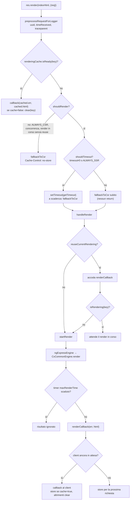
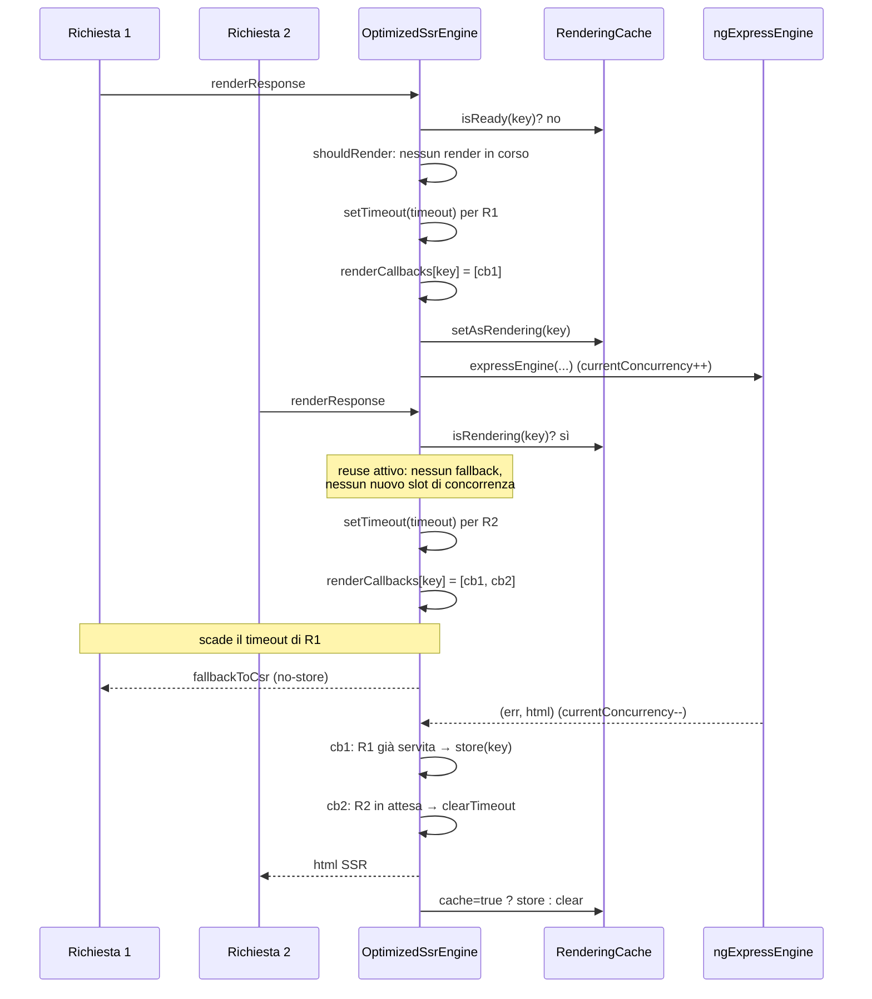
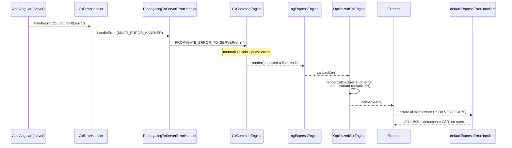
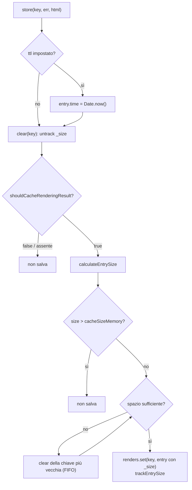

# 39 — SSR ottimizzato

> Riferimenti allo SHA `5b7a1c2bf2808d7380bc20596d10f4fa710c3da1` (vedi [00-meta](../00-meta.md)).
> Angular @ `v21.2.23` (prefisso `angular:`); `@angular/ssr` 21.2.23 dal pacchetto npm pubblicato (prefisso `deps:`, path relativi a `/tmp/deps`).

## 1. A cosa serve e perché esiste

Il [capitolo 07](../parte-1/07-ssr-hydration-transferstate.md) spiega **come** Angular e Spartacus producono HTML sul server: `CommonEngine`, la catena `ngExpressEngine` → `CxCommonEngine`, i token di richiesta, TransferState e hydration. Qui ci occupiamo di **cosa succede attorno a quel render** quando il server riceve traffico reale:

- un render SSR di Spartacus può durare secondi (chiamate OCC, CMS, lazy loading) e Angular **non permette di abortirlo** (`core-libs/setup/ssr/optimized-engine/optimized-ssr-engine.ts:L380-L388`);
- molte richieste contemporanee possono saturare CPU e memoria del processo Node;
- alcune pagine (checkout, my-account, ASM, SmartEdit) non hanno senso, o sono dannose, se renderizzate sul server;
- gli errori avvenuti dentro l'app Angular devono diventare **status HTTP corretti** (404/500) per Express e per le cache esterne;
- i log devono essere correlabili per richiesta e leggibili da strumenti di monitoring.

La risposta di Spartacus è un insieme di componenti dell'entry point `@spartacus/setup/ssr` (`core-libs/setup/ssr/public_api.ts:L7-L16`):

1. **`OptimizedSsrEngine`**: un wrapper attorno alla funzione view-engine Express che aggiunge timeout con **fallback CSR**, limite di **concorrenza**, **cache in memoria** dei render, **rendering strategy** per richiesta, condivisione di un render tra richieste identiche (`reuseCurrentRendering`) e protezione dai render "appesi" (`maxRenderTime`) (`core-libs/setup/ssr/optimized-engine/optimized-ssr-engine.ts:L37-L57`, `core-libs/setup/ssr/optimized-engine/ssr-optimization-options.ts:L220-L237`).
2. **`SsrOptimizationOptions`** e i suoi default (`core-libs/setup/ssr/optimized-engine/ssr-optimization-options.ts:L18-L181`).
3. **Logger SSR**: `ExpressServerLogger`/`DefaultExpressServerLogger` (log JSON a riga singola in prod), `ExpressLoggerService` che collega il `LoggerService` dell'app al logger del server, contesto di richiesta con UUID e W3C `traceparent` (`core-libs/setup/ssr/logger/loggers/default-express-server-logger.ts:L28-L133`, `core-libs/setup/ssr/optimized-engine/request-context.ts:L42-L51`).
4. **Error handling verso Express**: `PROPAGATE_ERROR_TO_SERVER`, `PropagatingToServerErrorHandler`, `defaultExpressErrorHandlers` (`core-libs/setup/ssr/error-handling/express-error-handlers/express-error-handlers.ts:L21-L32`).
5. **Express utils**: calcolo dell'origin (con `X-Forwarded-Host` fidato) e middleware di validazione dell'origin contro Host header injection e cache poisoning (`core-libs/setup/ssr/express-utils/express-request-origin.ts:L9-L26`, `core-libs/setup/ssr/express-utils/express-origin-validation-middleware.ts:L14-L67`).

Tutto questo è codice **solo-Node**: `optimized-ssr-engine.ts` importa `fs` ed `express` con `/* webpackIgnore: true */` (`core-libs/setup/ssr/optimized-engine/optimized-ssr-engine.ts:L7-L9`). La gestione errori lato `@spartacus/core` (interceptor HTTP, `CxErrorHandler`, global message) è in [41 — Errori HTTP, error handling, logger e global message](41-errori-global-message.md); qui ne vediamo solo l'aggancio al server.

## 2. Mappa dei file

| Path | Ruolo |
|---|---|
| `core-libs/setup/ssr/public_api.ts` | Barrel di `@spartacus/setup/ssr` |
| `core-libs/setup/ssr/engine-decorator/ng-express-engine-decorator.ts` | `NgExpressEngineDecorator`, `decorateExpressEngine`, tipi `NgExpressEngine`/`NgExpressEngineInstance` |
| `core-libs/setup/ssr/engine-decorator/index.ts` | Esporta solo `NgExpressEngineDecorator` |
| `core-libs/setup/ssr/engine/ng-express-engine.ts` | `ngExpressEngine` (porting da Angular Universal) — vedi cap. 07 |
| `core-libs/setup/ssr/engine/cx-common-engine.ts` | `CxCommonEngine`: `CommonEngine` + `PROPAGATE_ERROR_TO_SERVER` — vedi cap. 07 |
| `core-libs/setup/ssr/optimized-engine/optimized-ssr-engine.ts` | `OptimizedSsrEngine`, `SsrCallbackFn` |
| `core-libs/setup/ssr/optimized-engine/ssr-optimization-options.ts` | `SsrOptimizationOptions`, `RenderingStrategy`, `defaultSsrOptimizationOptions`, `getDefaultRenderKey` |
| `core-libs/setup/ssr/optimized-engine/get-loggable-ssr-optimization-options.ts` | Serializza le opzioni per il log di avvio (non esportato) |
| `core-libs/setup/ssr/optimized-engine/rendering-strategy-resolver.ts` | `defaultRenderingStrategyResolver` |
| `core-libs/setup/ssr/optimized-engine/rendering-strategy-resolver-options.ts` | `RenderingStrategyResolverOptions`, `defaultRenderingStrategyResolverOptions` |
| `core-libs/setup/ssr/optimized-engine/request-context.ts` | `RequestContext` (uuid, timeReceived, traceContext) in `res.locals.cx.request` |
| `core-libs/setup/ssr/optimized-engine/rendering-cache/rendering-cache.ts` | `RenderingCache`: Map FIFO con limite in byte e TTL |
| `core-libs/setup/ssr/optimized-engine/rendering-cache/rendering-cache-size-manager.ts` | `RenderingCacheSizeManager`: contabilità dei byte |
| `core-libs/setup/ssr/optimized-engine/rendering-cache/default-cache-entry-size-calculator.ts` | `DefaultCacheEntrySizeCalculator` (2 byte/carattere) |
| `core-libs/setup/ssr/optimized-engine/rendering-cache/rendering-cache.model.ts` | `RenderingEntry`, `CacheEntrySizeCalculator` |
| `core-libs/setup/ssr/optimized-engine/index.ts`, `core-libs/setup/ssr/optimized-engine/rendering-cache/index.ts` | Barrel |
| `core-libs/setup/ssr/logger/loggers/express-server-logger.ts` | Interfaccia `ExpressServerLogger`, token `EXPRESS_SERVER_LOGGER` |
| `core-libs/setup/ssr/logger/loggers/default-express-server-logger.ts` | `DefaultExpressServerLogger` (JSON in prod, `inspect` in dev) |
| `core-libs/setup/ssr/logger/get-logger-inspect-options.ts` | Opzioni `util.inspect` per dev/prod |
| `core-libs/setup/ssr/logger/loggers/w3c-trace-context/parse-traceparent.ts` | Parsing header `traceparent` |
| `core-libs/setup/ssr/logger/loggers/w3c-trace-context/w3c-trace-context.model.ts` | `W3cTraceContext` |
| `core-libs/setup/ssr/logger/loggers/w3c-trace-context/errors/invalid-traceparent-format-error.ts`, `core-libs/setup/ssr/logger/loggers/w3c-trace-context/errors/invalid-traceparent-length-error.ts` | Errori di parsing del `traceparent` |
| `core-libs/setup/ssr/logger/services/express-logger.service.ts` | `ExpressLoggerService` (il `LoggerService` in SSR) |
| `core-libs/setup/ssr/logger/services/prerendering-logger.service.ts` | `PrerenderingLoggerService` (console) |
| `core-libs/setup/ssr/logger/services/server-logger-service-factory.ts` | Scelta Express vs prerendering |
| `core-libs/setup/ssr/error-handling/error-response/propagate-error-to-server.ts` | Token `PROPAGATE_ERROR_TO_SERVER` |
| `core-libs/setup/ssr/error-handling/multi-error-handlers/propagating-to-server-error-handler.ts` | `PropagatingToServerErrorHandler` |
| `core-libs/setup/ssr/error-handling/express-error-handlers/express-error-handlers.ts` | `defaultExpressErrorHandlers` (404/500 + documento CSR) |
| `core-libs/setup/ssr/express-utils/express-request-origin.ts` | `getRequestOrigin` (trust proxy / `X-Forwarded-Host`) |
| `core-libs/setup/ssr/express-utils/express-request-url.ts` | `getRequestUrl` (= chiave di rendering di default) |
| `core-libs/setup/ssr/express-utils/express-origin-validation-middleware.ts` | `getOriginValidationMiddleware`, `OriginValidationOptions` |
| `core-libs/setup/ssr/providers/ssr-providers.ts` | `provideServer`, `getServerRequestProviders` — vedi cap. 07 |
| `core-libs/setup/ssr/providers/model.ts`, `core-libs/setup/ssr/providers/server-request-origin.ts`, `core-libs/setup/ssr/providers/server-request-url.ts` | `ServerOptions` e factory dei token di richiesta — vedi cap. 07 |
| `core-libs/setup/ssr/tokens/express.tokens.ts` | Token `REQUEST`, `RESPONSE` (Express) |
| `core-libs/setup/ssr/testing/test-config-server.module.ts` | `TestConfigServerModule` (solo e2e) |
| `core-libs/storefront/utils/directive-state-transfer.service.ts` | `DirectiveStateTransferService` — vedi cap. 07 |
| `projects/storefrontapp/src/server.ts` | Server Express della demo: uso di riferimento di tutto quanto sopra |

## 3. Come funziona passo per passo

### 3.1 Bootstrap: dal `server.ts` all'engine ottimizzato

1. La demo costruisce `ssrOptions` da variabili d'ambiente: `timeout` da `SSR_TIMEOUT` (default `defaultSsrOptimizationOptions.timeout`) e `cache` da `SSR_CACHE === 'true'` (`projects/storefrontapp/src/server.ts:L22-L27`).
2. `NgExpressEngineDecorator.get(engine, ssrOptions)` delega a `decorateExpressEngine` (`projects/storefrontapp/src/server.ts:L29-L29`, `core-libs/setup/ssr/engine-decorator/ng-express-engine-decorator.ts:L43-L48`). Il secondo argomento accetta `null`: con `undefined` scatta il valore di default del parametro (`defaultSsrOptimizationOptions`, quindi ottimizzazione attiva), con `null` l'ottimizzazione è disattivata (`core-libs/setup/ssr/engine-decorator/ng-express-engine-decorator.ts:L51-L57`, `core-libs/setup/ssr/engine-decorator/ng-express-engine-decorator.ts:L69-L72`).
3. Quando Express registra il view engine (`server.engine('html', ngExpressEngine({ bootstrap }))`) la funzione decorata crea l'istanza di `ngExpressEngine` anteponendo `getServerRequestProviders()` ai provider di setup (`core-libs/setup/ssr/engine-decorator/ng-express-engine-decorator.ts:L58-L66`, `projects/storefrontapp/src/server.ts:L51-L56`). `ngExpressEngine` crea un unico `CxCommonEngine` (`core-libs/setup/ssr/engine/ng-express-engine.ts:L82-L88`), il cui costruttore legge **NG_ALLOWED_HOSTS** (`deps:angular-ssr-21.2.23/package/fesm2022/node.mjs:L108-L112`). I dettagli della catena sono nel [cap. 07 §3.3](../parte-1/07-ssr-hydration-transferstate.md).
4. Con opzioni truthy si istanzia `new OptimizedSsrEngine(engineInstance, optimizationOptions)` e si restituisce a Express il suo `engineInstance` (`core-libs/setup/ssr/engine-decorator/ng-express-engine-decorator.ts:L69-L72`), cioè `renderResponse` legato all'istanza (`core-libs/setup/ssr/optimized-engine/optimized-ssr-engine.ts:L55-L57`).
5. Il costruttore fonde **in modo shallow** i default con le opzioni utente, fondendo a parte `ssrFeatureToggles` (`core-libs/setup/ssr/optimized-engine/optimized-ssr-engine.ts:L63-L74`); se dopo il merge manca `logger` lancia `'`SsrOptimizationOptions.logger` is not defined'`; poi crea la `RenderingCache` e logga le opzioni (`core-libs/setup/ssr/optimized-engine/optimized-ssr-engine.ts:L76-L81`).
6. `logOptions()` scrive "[spartacus] SSR optimization engine initialized" con le opzioni rese stampabili da `getLoggableSsrOptimizationOptions` (`core-libs/setup/ssr/optimized-engine/optimized-ssr-engine.ts:L84-L96`), che sostituisce le istanze di classe con il nome del costruttore e le funzioni con il loro `toString()` (`core-libs/setup/ssr/optimized-engine/get-loggable-ssr-optimization-options.ts:L16-L29`). "Istanza di classe" significa `typeof value === 'object' && value.constructor !== Object` (`core-libs/setup/ssr/optimized-engine/get-loggable-ssr-optimization-options.ts:L37-L39`). Il tipo `DefaultSsrOptimizationOptions` rende obbligatorie tutte le chiavi proprio per poterle stampare tutte all'avvio (`core-libs/setup/ssr/optimized-engine/ssr-optimization-options.ts:L201-L218`).

Il resto della demo: `trust proxy` = `loopback` e middleware di validazione dell'origin **prima** dell'engine (`projects/storefrontapp/src/server.ts:L39-L49`), statici con `maxAge: '1y'` per i path con estensione, tutte le altre rotte renderizzate con `res.render(indexHtml, { req, providers: [APP_BASE_HREF] })` (`projects/storefrontapp/src/server.ts:L61-L75`), e infine `defaultExpressErrorHandlers(indexHtmlContent)` come ultimo middleware (`projects/storefrontapp/src/server.ts:L77-L77`). `indexHtml` è `index.server.html` nella cartella server di `dist` (`projects/storefrontapp/src/server.ts:L34-L37`): lo stesso file è il template del render **e** il documento del fallback CSR.

### 3.2 `renderResponse`: la pipeline di ogni richiesta

`renderResponse(filePath, options, callback)` produce uno di tre esiti: fallback CSR con `index.html`, render dell'engine Angular, risultato dalla cache in memoria (`core-libs/setup/ssr/optimized-engine/optimized-ssr-engine.ts:L232-L239`).

1. **Contesto di log.** `preprocessRequestForLogger(options.req, this.logger)` assegna alla richiesta UUID, timestamp e trace context; poi legge `request = options.req` e `response = options.req.res` (`core-libs/setup/ssr/optimized-engine/optimized-ssr-engine.ts:L245-L248`). Dettagli in §3.8.
2. **Cache.** `returnCachedRender` calcola la chiave e, se `renderingCache.isReady(key)`, chiama `callback(cached.err, cached.html)`; con `cache` disabilitata cancella subito l'entry (consumo singolo). Se ha risposto, `renderResponse` logga "Render from cache" e termina (`core-libs/setup/ssr/optimized-engine/optimized-ssr-engine.ts:L212-L230`, `core-libs/setup/ssr/optimized-engine/optimized-ssr-engine.ts:L250-L255`).
3. **Si deve renderizzare?** Se `shouldRender(request)` è falso si risponde con `fallbackToCsr` e si termina (`core-libs/setup/ssr/optimized-engine/optimized-ssr-engine.ts:L256-L259`). Nessun render parte in background: lo spec lo verifica per `ALWAYS_CSR` anche con `cache: true` (`core-libs/setup/ssr/optimized-engine/optimized-ssr-engine.spec.ts:L731-L749`).
4. **Timeout o CSR immediato.**
   - Se `shouldTimeout(request)` è vero, si arma un `setTimeout` di `getTimeout(request)` ms che, a scadenza, azzera `requestTimeout`, invia il fallback CSR e logga "SSR rendering exceeded timeout …" (`core-libs/setup/ssr/optimized-engine/optimized-ssr-engine.ts:L261-L272`).
   - Altrimenti si risponde **subito** con il CSR ma **senza `return`**: il render prosegue in background per riempire la cache (`core-libs/setup/ssr/optimized-engine/optimized-ssr-engine.ts:L273-L279`).
5. **Callback del render.** Si costruisce `renderCallback(err, html)` (`core-libs/setup/ssr/optimized-engine/optimized-ssr-engine.ts:L281-L300`):
   - se `requestTimeout` è ancora attivo (il client attende): `clearTimeout`, `callback(err, html)` al client, log del risultato, poi `store` solo con `cache: true`, altrimenti `clear` della chiave;
   - se la richiesta ha già ricevuto il CSR: `store` **sempre**, "for future use".
6. **Delega.** `handleRender({ filePath, options, renderCallback, request })` (`core-libs/setup/ssr/optimized-engine/optimized-ssr-engine.ts:L302-L307`), che a sua volta usa `startRender` (§3.5, §3.6).

Il fallback CSR imposta `Cache-Control: no-store` (così le cache esterne non riusano la pagina CSR) e invia il documento letto da `filePath` (`core-libs/setup/ssr/optimized-engine/optimized-ssr-engine.ts:L98-L110`). `getDocument` legge il file con `fs.readFileSync` solo la prima volta e lo memorizza in `templateCache` (`core-libs/setup/ssr/optimized-engine/optimized-ssr-engine.ts:L310-L320`).

### 3.3 Le decisioni: chiave, strategia, concorrenza, timeout

- **Chiave di rendering.** `getRenderingKey` usa `renderKeyResolver` se presente, altrimenti `getDefaultRenderKey` (`core-libs/setup/ssr/optimized-engine/optimized-ssr-engine.ts:L112-L116`). `getDefaultRenderKey` è un alias di `getRequestUrl` (`core-libs/setup/ssr/optimized-engine/ssr-optimization-options.ts:L196-L199`), cioè `getRequestOrigin(req) + req.originalUrl` (`core-libs/setup/ssr/express-utils/express-request-url.ts:L10-L12`): **include host e query string**.
- **Strategia.** `getRenderingStrategy` usa `renderingStrategyResolver` se presente, altrimenti `RenderingStrategy.DEFAULT` (`core-libs/setup/ssr/optimized-engine/optimized-ssr-engine.ts:L118-L122`). L'enum è numerico: `ALWAYS_CSR = -1`, `DEFAULT = 0`, `ALWAYS_SSR = 1` (`core-libs/setup/ssr/optimized-engine/ssr-optimization-options.ts:L183-L187`).
- **`shouldRender`.** Calcola `fallBack` (render già in corso per la chiave **e** `reuseCurrentRendering` disattivo) e `concurrencyLimitExceeded`, logga la causa (`core-libs/setup/ssr/optimized-engine/optimized-ssr-engine.ts:L133-L151`), e restituisce: render se nessun impedimento e strategia ≠ `ALWAYS_CSR`, **oppure sempre** se la strategia è `ALWAYS_SSR` (`core-libs/setup/ssr/optimized-engine/optimized-ssr-engine.ts:L153-L158`).
- **Concorrenza.** `isConcurrencyLimitExceeded` restituisce `false` se con `reuseCurrentRendering` esiste già un render per la chiave (la richiesta non occupa un nuovo slot); altrimenti confronta `currentConcurrency >= concurrency`, e con `concurrency` falsy non c'è limite (`core-libs/setup/ssr/optimized-engine/optimized-ssr-engine.ts:L166-L180`).
- **Timeout.** `shouldTimeout` è vero se `timeout` è non zero **o** la strategia è `ALWAYS_SSR` (`core-libs/setup/ssr/optimized-engine/optimized-ssr-engine.ts:L187-L192`); `getTimeout` restituisce `forcedSsrTimeout ?? 60000` per `ALWAYS_SSR`, altrimenti `timeout ?? 0` (`core-libs/setup/ssr/optimized-engine/optimized-ssr-engine.ts:L200-L204`).

Con `timeout: 0` si ottiene quindi "CSR sempre, SSR per la prossima": lo spec verifica che la prima risposta sia il CSR, che il render resti in corso (`currentConcurrency: 1`) e che la seconda richiesta allo stesso URL riceva l'HTML (`core-libs/setup/ssr/optimized-engine/optimized-ssr-engine.spec.ts:L292-L316`).

### 3.4 Rendering strategy resolver di default

`defaultRenderingStrategyResolver(options)` è una factory che restituisce `(request) => RenderingStrategy` (`core-libs/setup/ssr/optimized-engine/rendering-strategy-resolver.ts:L62-L72`):

1. se l'URL contiene una voce della lista fissa interna `defaultAlwaysCsrOptions.excludedUrls = ['cx-preview']` → `ALWAYS_CSR` (`core-libs/setup/ssr/optimized-engine/rendering-strategy-resolver.ts:L11-L13`, `core-libs/setup/ssr/optimized-engine/rendering-strategy-resolver.ts:L65-L67`);
2. altrimenti, se `shouldFallbackToCsr` (parametri query o URL esclusi) → `ALWAYS_CSR`, altrimenti `DEFAULT` (`core-libs/setup/ssr/optimized-engine/rendering-strategy-resolver.ts:L41-L49`, `core-libs/setup/ssr/optimized-engine/rendering-strategy-resolver.ts:L69-L71`).

Non restituisce mai `ALWAYS_SSR`. `hasExcludedParams` confronta i **nomi** delle proprietà di `request.query` con `excludedParams` (match esatto) (`core-libs/setup/ssr/optimized-engine/rendering-strategy-resolver.ts:L15-L30`); `hasExcludedUrl` usa `request.url.search(url) > -1`, quindi ogni voce è una **espressione regolare** cercata come sottostringa (`core-libs/setup/ssr/optimized-engine/rendering-strategy-resolver.ts:L32-L39`). I default escludono gli URL `checkout`, `my-account`, `punchout`, `opf` e il parametro `asm` (`core-libs/setup/ssr/optimized-engine/rendering-strategy-resolver-options.ts:L12-L16`).

### 3.5 `handleRender` e `reuseCurrentRendering`

- Senza `reuseCurrentRendering`, `handleRender` chiama direttamente `startRender` (`core-libs/setup/ssr/optimized-engine/optimized-ssr-engine.ts:L340-L348`).
- Con `reuseCurrentRendering` (default `true`, `core-libs/setup/ssr/optimized-engine/ssr-optimization-options.ts:L229-L229`), il `renderCallback` della richiesta viene accodato in `renderCallbacks[renderingKey]` (`core-libs/setup/ssr/optimized-engine/optimized-ssr-engine.ts:L350-L354`). Solo se non c'è già un render in corso si chiama `startRender` con un callback che, a fine render, **rilegge la Map** (non una copia locale, perché `maxRenderTime` può averla svuotata nel frattempo), invoca tutte le callback con lo stesso `(err, html)` e cancella la voce (`core-libs/setup/ssr/optimized-engine/optimized-ssr-engine.ts:L356-L372`).
- In questo ramo viene sempre loggato "Request is waiting for the SSR rendering to complete", anche per la richiesta che ha avviato il render (`core-libs/setup/ssr/optimized-engine/optimized-ssr-engine.ts:L374-L377`).

Ogni richiesta in attesa mantiene **il proprio** timer di timeout (§3.2 passo 4): il JSDoc fa l'esempio di timeout 3 s, render 4 s, seconda richiesta arrivata dopo 2 s che quindi riceve l'SSR (`core-libs/setup/ssr/optimized-engine/ssr-optimization-options.ts:L110-L132`). `renderCallbacks` è usata solo in questa modalità (`core-libs/setup/ssr/optimized-engine/optimized-ssr-engine.ts:L43-L53`).

### 3.6 `startRender` e `maxRenderTime`

1. Arma un timer `maxRenderTime` (default 300000 ms) che, a scadenza, libera la chiave in cache, azzera il timer, decrementa `currentConcurrency`, elimina le callback in attesa (con `reuseCurrentRendering`) e logga "… This might cause memory leaks!" (`core-libs/setup/ssr/optimized-engine/optimized-ssr-engine.ts:L402-L417`). Il JSDoc ammette che non esiste modo di abortire il render: superato il limite, il task è considerato "hanging" e il suo esito sarà ignorato (`core-libs/setup/ssr/optimized-engine/optimized-ssr-engine.ts:L380-L388`).
2. Logga "Rendering started", marca la chiave come `rendering` e incrementa `currentConcurrency` (`core-libs/setup/ssr/optimized-engine/optimized-ssr-engine.ts:L419-L421`).
3. Antepone ai `providers` del render un provider `EXPRESS_SERVER_LOGGER` con il logger dell'engine (`core-libs/setup/ssr/optimized-engine/optimized-ssr-engine.ts:L423-L432`). È l'**unico** provider di quel token nel codice non-spec del repo (`core-libs/setup/ssr/optimized-engine/optimized-ssr-engine.ts:L426-L429`).
4. Chiama `this.expressEngine(filePath, options, cb)`, cioè la funzione di `ngExpressEngine`. Al completamento: se il timer `maxRenderTime` è già scaduto, logga "completed after the specified maxRenderTime, therefore it was ignored" ed esce; altrimenti `clearTimeout`, log "Rendering completed", `currentConcurrency--`, `renderCallback(err, html)` (`core-libs/setup/ssr/optimized-engine/optimized-ssr-engine.ts:L434-L451`).

`ngExpressEngine` calcola l'URL da `req.protocol`, header `host`, `req.baseUrl`, `req.url`, aggiunge `REQUEST`/`RESPONSE` e chiama `CxCommonEngine.render`; il risultato arriva come `callback(null, html)` o `.catch(callback)`, e gli errori sincroni sono passati solo se `instanceof Error` (`core-libs/setup/ssr/engine/ng-express-engine.ts:L101-L126`). Tutti i provider del render (compreso `EXPRESS_SERVER_LOGGER`) finiscono nel platform injector di `CommonEngine` (`deps:angular-ssr-21.2.23/package/fesm2022/node.mjs:L185-L210`; vedi [cap. 07 §3.2](../parte-1/07-ssr-hydration-transferstate.md)).

`logForRenderResult` usa `log` se c'è HTML ed `error` (con `error: err` nel contesto) se c'è un errore (`core-libs/setup/ssr/optimized-engine/optimized-ssr-engine.ts:L457-L474`).

### 3.7 `RenderingCache` e dimensionamento

`RenderingCache` è una `Map<string, RenderingEntry>` con un `RenderingCacheSizeManager` creato pigramente (`core-libs/setup/ssr/optimized-engine/rendering-cache/rendering-cache.ts:L11-L23`). `RenderingEntry` ha `html?`, `err?`, `time?`, `rendering?`, `_size?` (`core-libs/setup/ssr/optimized-engine/rendering-cache/rendering-cache.model.ts:L10-L20`).

- `setAsRendering(key)`: prima `clear(key)` (per rilasciare la dimensione dell'entry precedente), poi il placeholder `{ rendering: true }` (`core-libs/setup/ssr/optimized-engine/rendering-cache/rendering-cache.ts:L25-L32`). Lo spec verifica che sovrascrivere una chiave rilasci la dimensione, altrimenti `usedSize` "drifts upward forever" (`core-libs/setup/ssr/optimized-engine/rendering-cache/rendering-cache.spec.ts:L178-L190`).
- `isRendering(key)`: entry con `rendering` truthy (`core-libs/setup/ssr/optimized-engine/rendering-cache/rendering-cache.ts:L34-L36`).
- `store(key, err, html)`: crea `{ err, html }`, aggiunge `time` solo se `ttl` è impostato, chiama `clear(key)`, e se `shouldCacheRenderingResult` restituisce falso (o manca) **non salva**; altrimenti `storeUsingMemoryLimit` (`core-libs/setup/ssr/optimized-engine/rendering-cache/rendering-cache.ts:L41-L64`).
- `storeUsingMemoryLimit`: calcola la dimensione, scarta l'entry se più grande dell'intero limite, libera le entry più vecchie finché c'è spazio, salva con `_size` e traccia (`core-libs/setup/ssr/optimized-engine/rendering-cache/rendering-cache.ts:L71-L83`). La liberazione rimuove la **prima chiave in ordine di inserimento** (FIFO) (`core-libs/setup/ssr/optimized-engine/rendering-cache/rendering-cache.ts:L88-L103`); `get` non riordina, quindi non è LRU (`core-libs/setup/ssr/optimized-engine/rendering-cache/rendering-cache.ts:L105-L107`).
- `clear(key)`: elimina e sottrae `entry?._size ?? 0` (`core-libs/setup/ssr/optimized-engine/rendering-cache/rendering-cache.ts:L109-L114`).
- `isReady(key)`: entry con `html` o `err` truthy **e** fresca; `isFresh` è sempre vero senza `ttl`, altrimenti `Date.now() - time < ttl` (`core-libs/setup/ssr/optimized-engine/rendering-cache/rendering-cache.ts:L116-L127`).

`RenderingCacheSizeManager` tiene `usedSize` e `CACHE_SIZE_LIMIT = options?.cacheSizeMemory ?? 0` (`core-libs/setup/ssr/optimized-engine/rendering-cache/rendering-cache-size-manager.ts:L14-L29`); valida le opzioni **loggando** (non lanciando) se il calculator non ha `calculateSize` o se `cacheSizeMemory` non è un numero > 0 (`core-libs/setup/ssr/optimized-engine/rendering-cache/rendering-cache-size-manager.ts:L35-L54`). `hasSpaceForEntrySize(n)` è `n <= LIMIT - usedSize`, `isEntryLargerThanCacheLimit(n)` è `n > LIMIT` (`core-libs/setup/ssr/optimized-engine/rendering-cache/rendering-cache-size-manager.ts:L66-L76`); `trackEntrySize` satura a `Number.MAX_SAFE_INTEGER` e `untrackEntrySize` riporta a 0 i valori negativi, loggando in entrambi i casi (`core-libs/setup/ssr/optimized-engine/rendering-cache/rendering-cache-size-manager.ts:L81-L109`).

`DefaultCacheEntrySizeCalculator.calculateSize` usa la dimensione dell'HTML, altrimenti dell'errore, altrimenti 0 (`core-libs/setup/ssr/optimized-engine/rendering-cache/default-cache-entry-size-calculator.ts:L27-L36`); per gli errori somma solo `name`, `message`, `stack` e avverte della sottostima (`core-libs/setup/ssr/optimized-engine/rendering-cache/default-cache-entry-size-calculator.ts:L18-L23`, `core-libs/setup/ssr/optimized-engine/rendering-cache/default-cache-entry-size-calculator.ts:L51-L60`); le stringhe valgono `2 * str.length` byte, scelta motivata da heap snapshot che mostrano `SeqTwoByteString` (`core-libs/setup/ssr/optimized-engine/rendering-cache/default-cache-entry-size-calculator.ts:L62-L74`).

### 3.8 Contesto di richiesta e trace

- `RequestContext` = `{ uuid, timeReceived, traceContext? }` (`core-libs/setup/ssr/optimized-engine/request-context.ts:L17-L21`), letto da `getRequestContext(request)` in `request.res?.locals?.cx?.request` (`core-libs/setup/ssr/optimized-engine/request-context.ts:L28-L30`).
- `preprocessRequestForLogger` crea il contesto con `randomUUID()` e timestamp ISO più il trace context e lo scrive in `res.locals.cx.request` (`core-libs/setup/ssr/optimized-engine/request-context.ts:L42-L51`, `core-libs/setup/ssr/optimized-engine/request-context.ts:L75-L81`); `setRequestContext` scrive solo se `request.res` esiste (`core-libs/setup/ssr/optimized-engine/request-context.ts:L58-L68`). Il tipo `Locals` di Express è esteso per module augmentation (`core-libs/setup/ssr/optimized-engine/request-context.ts:L105-L111`).
- `getTraceContext` chiama `parseTraceparent(request.get('traceparent'))`; un'eccezione viene loggata con `logger.error` e il contesto resta senza trace (`core-libs/setup/ssr/optimized-engine/request-context.ts:L90-L103`).
- `parseTraceparent` restituisce `undefined` se l'header non è stringa, lancia `InvalidTraceparentLengthError` se la lunghezza ≠ 55, `InvalidTraceparentFormatError` se non rispetta il pattern esadecimale, altrimenti `{ version, traceId, parentId, traceFlags }` (`core-libs/setup/ssr/logger/loggers/w3c-trace-context/parse-traceparent.ts:L11-L47`, `core-libs/setup/ssr/logger/loggers/w3c-trace-context/w3c-trace-context.model.ts:L18-L23`). I messaggi sono "Traceparent header has invalid format." e "Traceparent header has invalid length: N. Expected 55 characters." (`core-libs/setup/ssr/logger/loggers/w3c-trace-context/errors/invalid-traceparent-format-error.ts:L10-L14`, `core-libs/setup/ssr/logger/loggers/w3c-trace-context/errors/invalid-traceparent-length-error.ts:L11-L17`).

### 3.9 Logger SSR

Due livelli distinti:

**Logger del server (`ExpressServerLogger`).** Interfaccia con `log/warn/error/info/debug(message, context)`, dove `ExpressServerLoggerContext` ha `request?` e chiavi libere (`core-libs/setup/ssr/logger/loggers/express-server-logger.ts:L14-L36`). `DefaultExpressServerLogger` instrada ogni livello al `console.*` corrispondente (`core-libs/setup/ssr/logger/loggers/default-express-server-logger.ts:L28-L48`). `stringifyWithContext` produce, in dev mode, un output `formatWithOptions` multi-linea; in prod un **JSON a riga singola** con le `Error` convertite da `stringifyError` (`core-libs/setup/ssr/logger/loggers/default-express-server-logger.ts:L63-L86`). `mapContext` aggiunge `timestamp` e sostituisce `request` con `mapRequest`, che produce `{ url: request.originalUrl, ...getRequestContext(request) }` (`core-libs/setup/ssr/logger/loggers/default-express-server-logger.ts:L95-L122`). `getLoggerInspectOptions` usa `depth: 10` e in prod `breakLength: Infinity`, per evitare che strumenti come Kibana interpretino più righe come log diversi (`core-libs/setup/ssr/logger/get-logger-inspect-options.ts:L16-L58`). La modalità dipende da `isDevMode()` di Angular, vero se `ngDevMode` è `undefined` o truthy (`angular:packages/core/src/util/is_dev_mode.ts:L20-L22`).

**Logger dell'app (`LoggerService`).** `provideServer` registra `LoggerService` con `useFactory: serverLoggerServiceFactory` (`core-libs/setup/ssr/providers/ssr-providers.ts:L37-L40`). La factory sceglie `ExpressLoggerService` se `REQUEST` è iniettabile, altrimenti `PrerenderingLoggerService` (`core-libs/setup/ssr/logger/services/server-logger-service-factory.ts:L12-L17`). `ExpressLoggerService` inietta `REQUEST` ed `EXPRESS_SERVER_LOGGER`, formatta gli argomenti e passa `{ request }` come contesto (`core-libs/setup/ssr/logger/services/express-logger.service.ts:L24-L61`); `PrerenderingLoggerService` inoltra a `console.*` (`core-libs/setup/ssr/logger/services/prerendering-logger.service.ts:L15-L39`). Il ponte tra i due livelli è il provider `EXPRESS_SERVER_LOGGER` iniettato da `startRender` (§3.6).

### 3.10 Errori: dall'app Angular allo status HTTP

1. Sul server, `HttpErrorHandlerInterceptor` passa all'`ErrorHandler` gli errori HTTP, incapsulati in `CmsPageNotFoundOutboundHttpError` (404 su endpoint `pages`) o `OutboundHttpError` (`core-libs/core/src/error-handling/http-error-handler/http-error-handler.interceptor.ts:L48-L98`).
2. `CxErrorHandler` inoltra a tutti i `MULTI_ERROR_HANDLER` (`core-libs/core/src/error-handling/cx-error-handler.ts:L18-L30`); `provideServer` registra tra questi `PropagatingToServerErrorHandler` via `useExisting` (`core-libs/setup/ssr/providers/ssr-providers.ts:L41-L45`), che chiama `PROPAGATE_ERROR_TO_SERVER` o un no-op se assente (`core-libs/setup/ssr/error-handling/multi-error-handlers/propagating-to-server-error-handler.ts:L26-L38`). Il token è fornito OOTB solo da `CxCommonEngine` (`core-libs/setup/ssr/error-handling/error-response/propagate-error-to-server.ts:L9-L22`).
3. `CxCommonEngine.render` memorizza il **primo** errore e rigetta la promise solo a render completato (`core-libs/setup/ssr/engine/cx-common-engine.ts:L41-L66`).
4. `ngExpressEngine` → `.catch(callback)` → `startRender` → `renderCallback(err, undefined)` (`core-libs/setup/ssr/engine/ng-express-engine.ts:L120-L123`, `core-libs/setup/ssr/optimized-engine/optimized-ssr-engine.ts:L450-L450`).
5. Se il client attende ancora: `callback(err)` e log `error`; `store` scarta l'errore con il default `shouldCacheRenderingResult` (`core-libs/setup/ssr/optimized-engine/optimized-ssr-engine.ts:L283-L295`, `core-libs/setup/ssr/optimized-engine/rendering-cache/rendering-cache.ts:L54-L61`).
6. Express inoltra l'errore al middleware d'errore. ⚠️ DA VERIFICARE: è il comportamento di `res.render` senza callback in Express, i cui sorgenti non sono disponibili in `/tmp/deps`. `defaultExpressErrorHandlers` — se gli header non sono già inviati — imposta `Cache-Control: no-store` e invia il documento CSR con 404 per `CmsPageNotFoundOutboundHttpError`, 500 per ogni altro errore (`core-libs/setup/ssr/error-handling/express-error-handlers/express-error-handlers.ts:L21-L32`).

I test SSR E2E verificano proprio 404 per pagina inesistente e per errore su `cms/pages`, 500 per altri errori HTTP e per timeout del backend (`projects/ssr-tests/src/ssr-testing.spec.ts:L19-L92`). Il resto della catena lato `@spartacus/core` è descritto in [41](41-errori-global-message.md).

### 3.11 Express utils: origin e sua validazione

`getRequestOrigin` usa `X-Forwarded-Host` (prima voce se CSV) solo se la `trust proxy fn` di Express si fida dell'indirizzo remoto, altrimenti l'header `host` (`core-libs/setup/ssr/express-utils/express-request-origin.ts:L9-L26`). Poiché l'origin entra nella chiave di cache (§3.3), un Host header manipolato potrebbe creare o avvelenare entry: da qui `getOriginValidationMiddleware`, che restituisce un middleware no-op se la allowlist è vuota e altrimenti risponde `400 Bad Request` con `Cache-Control: no-store` quando l'origin non è ammesso (`core-libs/setup/ssr/express-utils/express-origin-validation-middleware.ts:L51-L67`). La allowlist accetta array o CSV (tipicamente `SSR_ALLOWED_ORIGINS`), origin completi senza slash finale, confronto case-insensitive, e `*` che copre **esattamente un'etichetta** e mai l'apex (`core-libs/setup/ssr/express-utils/express-origin-validation-middleware.ts:L14-L50`, `core-libs/setup/ssr/express-utils/express-origin-validation-middleware.ts:L69-L99`).

A un livello diverso opera `allowedHosts` di `CommonEngine` (variabile **NG_ALLOWED_HOSTS** con precedenza sull'opzione): se l'hostname non è ammesso e nessuna lista è configurata, `CommonEngine.render` logga un errore e **restituisce il documento non renderizzato come successo**; se una lista è configurata, lancia (`deps:angular-ssr-21.2.23/package/fesm2022/node.mjs:L108-L135`). Gli script `serve:ssr*` impostano `NG_ALLOWED_HOSTS=localhost` (`package.json:L152-L155`).

## 4. Diagrammi

### 4.1 Decisioni di `renderResponse`



Ogni nodo corrisponde a §3.2–§3.6: cache (`core-libs/setup/ssr/optimized-engine/optimized-ssr-engine.ts:L212-L230`), `shouldRender` (`core-libs/setup/ssr/optimized-engine/optimized-ssr-engine.ts:L133-L158`), timeout (`core-libs/setup/ssr/optimized-engine/optimized-ssr-engine.ts:L261-L279`), callback (`core-libs/setup/ssr/optimized-engine/optimized-ssr-engine.ts:L281-L300`), reuse (`core-libs/setup/ssr/optimized-engine/optimized-ssr-engine.ts:L340-L372`), `startRender` (`core-libs/setup/ssr/optimized-engine/optimized-ssr-engine.ts:L400-L451`).

### 4.2 `reuseCurrentRendering` con timeout (due richieste, stessa chiave)



Fondamento: `core-libs/setup/ssr/optimized-engine/optimized-ssr-engine.ts:L137-L139`, `core-libs/setup/ssr/optimized-engine/optimized-ssr-engine.ts:L170-L175`, `core-libs/setup/ssr/optimized-engine/optimized-ssr-engine.ts:L261-L272`, `core-libs/setup/ssr/optimized-engine/optimized-ssr-engine.ts:L282-L300`, `core-libs/setup/ssr/optimized-engine/optimized-ssr-engine.ts:L350-L372`. Si noti l'ultimo passo: con `cache: false`, la `clear` di cb2 cancella l'entry appena salvata da cb1 (vedi §9, trappola 13).

### 4.3 Errore applicativo → risposta HTTP



Fondamento: §3.10.

### 4.4 Inserimento in `RenderingCache`



Fondamento: `core-libs/setup/ssr/optimized-engine/rendering-cache/rendering-cache.ts:L41-L103`.

## 5. Estratti di codice reale

### 5.1 Merge delle opzioni e logger obbligatorio

`core-libs/setup/ssr/optimized-engine/optimized-ssr-engine.ts:L59-L82`
```ts
  constructor(
    protected expressEngine: NgExpressEngineInstance,
    protected ssrOptions?: SsrOptimizationOptions
  ) {
    this.ssrOptions = ssrOptions
      ? {
          ...defaultSsrOptimizationOptions,
          // overrides the default options
          ...ssrOptions,
          // merge feature toggles
          ssrFeatureToggles: {
            ...defaultSsrOptimizationOptions.ssrFeatureToggles,
            ...ssrOptions.ssrFeatureToggles,
          },
        }
      : undefined;

    if (!this.ssrOptions?.logger) {
      throw new Error('`SsrOptimizationOptions.logger` is not defined');
    }
    this.logger = this.ssrOptions?.logger;
    this.renderingCache = new RenderingCache(this.ssrOptions);
    this.logOptions();
  }
```

### 5.2 Il cuore di `renderResponse`

`core-libs/setup/ssr/optimized-engine/optimized-ssr-engine.ts:L250-L300`
```ts
    if (this.returnCachedRender(request, callback)) {
      this.logger.log(`Render from cache (${request?.originalUrl})`, {
        request,
      });
      return;
    }
    if (!this.shouldRender(request)) {
      this.fallbackToCsr(response, filePath, callback);
      return;
    }

    let requestTimeout: ReturnType<typeof setTimeout> | undefined;
    if (this.shouldTimeout(request)) {
      // establish timeout for rendering
      const timeout = this.getTimeout(request);
      requestTimeout = setTimeout(() => {
        requestTimeout = undefined;
        this.fallbackToCsr(response, filePath, callback);
        // ...
      }, timeout);
    } else {
      // Here we respond with the fallback to CSR, but we don't `return`.
      // We let the actual rendering task to happen in the background

      // to eventually store the rendered result in the cache.
      this.fallbackToCsr(response, filePath, callback);
    }

    const renderingKey = this.getRenderingKey(request);
    const renderCallback: SsrCallbackFn = (err, html): void => {
      if (requestTimeout) {
        // if request is still waiting for render, return it
        clearTimeout(requestTimeout);
        callback(err, html);

        this.logForRenderResult(err, html, request);

        // store the render only if caching is enabled
        if (this.ssrOptions?.cache) {
          this.renderingCache.store(renderingKey, err, html);
        } else {
          this.renderingCache.clear(renderingKey);
        }
      } else {
        // store the render for future use
        this.renderingCache.store(renderingKey, err, html);
      }
    };
```

### 5.3 `shouldRender`: `ALWAYS_SSR` scavalca tutto

`core-libs/setup/ssr/optimized-engine/optimized-ssr-engine.ts:L153-L158`
```ts
    return (
      (!fallBack &&
        !concurrencyLimitExceeded &&
        this.getRenderingStrategy(request) !== RenderingStrategy.ALWAYS_CSR) ||
      this.getRenderingStrategy(request) === RenderingStrategy.ALWAYS_SSR
    );
```

### 5.4 Fallback CSR

`core-libs/setup/ssr/optimized-engine/optimized-ssr-engine.ts:L98-L110`
```ts
  /**
   * When SSR page can not be returned in time, we're returning index.html of
   * the CSR application.
   * The CSR application is returned with the "Cache-Control: no-store" response-header. This notifies external cache systems to not use the CSR application for the subsequent request.
   */
  protected fallbackToCsr(
    response: Response,
    filePath: string,
    callback: SsrCallbackFn
  ): void {
    response.set('Cache-Control', 'no-store');
    callback(undefined, this.getDocument(filePath));
  }
```

### 5.5 Condivisione del render

`core-libs/setup/ssr/optimized-engine/optimized-ssr-engine.ts:L350-L372`
```ts
    const renderingKey = this.getRenderingKey(request);
    if (!this.renderCallbacks.has(renderingKey)) {
      this.renderCallbacks.set(renderingKey, []);
    }
    this.renderCallbacks.get(renderingKey)?.push(renderCallback);

    if (!this.renderingCache.isRendering(renderingKey)) {
      this.startRender({
        filePath,
        options,
        request,
        renderCallback: (err, html) => {
          // Share the result of the render with all awaiting requests for the same key:

          // Note: we access the Map at the moment of the render finished (don't store value in a local variable),
          //       because in the meantime something might have deleted the value (i.e. when `maxRenderTime` passed).
          this.renderCallbacks
            .get(renderingKey)
            ?.forEach((cb) => cb(err, html)); // pass the shared result to all waiting rendering callbacks
          this.renderCallbacks.delete(renderingKey);
        },
      });
    }
```

### 5.6 `maxRenderTime` e iniezione del logger

`core-libs/setup/ssr/optimized-engine/optimized-ssr-engine.ts:L405-L432`
```ts
    let maxRenderTimeout: ReturnType<typeof setTimeout> | undefined =
      setTimeout(() => {
        this.renderingCache.clear(renderingKey);
        maxRenderTimeout = undefined;
        this.currentConcurrency--;
        if (this.ssrOptions?.reuseCurrentRendering) {
          this.renderCallbacks.delete(renderingKey);
        }
        this.logger.log(
          `Rendering of ${request?.originalUrl} was not able to complete. This might cause memory leaks!`,
          { request }
        );
      }, this.ssrOptions?.maxRenderTime ?? 300000); // 300000ms == 5 minutes

    this.logger.log(`Rendering started (${request?.originalUrl})`, { request });
    this.renderingCache.setAsRendering(renderingKey);
    this.currentConcurrency++;

    options = {
      ...options,
      providers: [
        {
          provide: EXPRESS_SERVER_LOGGER,
          useValue: this.logger,
        },
        ...(options?.providers ?? []),
      ],
    };
```

### 5.7 Default delle opzioni

`core-libs/setup/ssr/optimized-engine/ssr-optimization-options.ts:L220-L237`
```ts
export const defaultSsrOptimizationOptions: DefaultSsrOptimizationOptions = {
  cache: false,
  cacheSizeMemory: 800_000_000,
  cacheEntrySizeCalculator: new DefaultCacheEntrySizeCalculator(),
  ttl: undefined,
  concurrency: 10,
  timeout: 3_000,
  forcedSsrTimeout: 60_000,
  maxRenderTime: 300_000,
  reuseCurrentRendering: true,
  renderingStrategyResolver: defaultRenderingStrategyResolver(
    defaultRenderingStrategyResolverOptions
  ),
  logger: new DefaultExpressServerLogger(),
  shouldCacheRenderingResult: ({ entry: { err } }) => !err,
  renderKeyResolver: getDefaultRenderKey,
  ssrFeatureToggles: {},
};
```

### 5.8 Resolver di strategia

`core-libs/setup/ssr/optimized-engine/rendering-strategy-resolver.ts:L32-L39` e `core-libs/setup/ssr/optimized-engine/rendering-strategy-resolver.ts:L62-L72`
```ts
const hasExcludedUrl = (
  request: Request,
  excludedUrls: string[] | undefined
) => {
  return request.url && excludedUrls
    ? excludedUrls.some((url) => request.url.search(url) > -1)
    : false;
};
// ...
export const defaultRenderingStrategyResolver =
  (options: RenderingStrategyResolverOptions) =>
  (request: Request): RenderingStrategy => {
    if (hasExcludedUrl(request, defaultAlwaysCsrOptions.excludedUrls)) {
      return RenderingStrategy.ALWAYS_CSR;
    }

    return shouldFallbackToCsr(request, options)
      ? RenderingStrategy.ALWAYS_CSR
      : RenderingStrategy.DEFAULT;
  };
```

### 5.9 Eviction FIFO

`core-libs/setup/ssr/optimized-engine/rendering-cache/rendering-cache.ts:L88-L103`
```ts
  private clearOldestEntriesForSize(requiredSize: number): void {
    while (
      !this.sizeManager.hasSpaceForEntrySize(requiredSize) &&
      this.renders.size > 0
    ) {
      const oldestKey = this.renders.keys().next().value;
      if (oldestKey === undefined) {
        // Still not enough space, but no more entries to clear.
        // In practice this case should never happen, because initially we checked `isEntryLargerThanCacheLimit` -
        // we validated whether the new entry's size is not bigger than the total cache size limit.
        break;
      }

      this.clear(oldestKey);
    }
  }
```

### 5.10 Log JSON in prod

`core-libs/setup/ssr/logger/loggers/default-express-server-logger.ts:L63-L86`
```ts
  protected stringifyWithContext(
    message: string,
    context: ExpressServerLoggerContext
  ): string {
    const logObject = { message, context: this.mapContext(context) };

    if (isDevMode()) {
      // In dev mode, we want a *human-readable* string representation of the log object
      // that can be printed in the console.
      return formatWithOptions(getLoggerInspectOptions(), logObject);
    }

    // In prod mode, we want a *single-line* JSON which is machine-readable - easy to parse for monitoring tools.
    // The monitoring tools can then decide how to display in their UI the JSON's properties.
    return JSON.stringify(
      logObject,
      /**
       * Replaces Error instances with their stringified representation.
       */
      (_key: string, value: any) => {
        return value instanceof Error ? this.stringifyError(value) : value;
      }
    );
  }
```

### 5.11 Scelta del `LoggerService` lato server

`core-libs/setup/ssr/logger/services/server-logger-service-factory.ts:L12-L17`
```ts
export const serverLoggerServiceFactory = () => {
  const isExpress = inject(REQUEST, { optional: true }) !== null;
  return isExpress
    ? inject(ExpressLoggerService)
    : inject(PrerenderingLoggerService);
};
```

### 5.12 Middleware d'errore Express

`core-libs/setup/ssr/error-handling/express-error-handlers/express-error-handlers.ts:L21-L32`
```ts
export const defaultExpressErrorHandlers =
  (documentContent: string): ErrorRequestHandler =>
  (err, _req, res, _next) => {
    if (!res.headersSent) {
      res.set('Cache-Control', 'no-store');
      const statusCode =
        err instanceof CmsPageNotFoundOutboundHttpError
          ? HttpResponseStatus.NOT_FOUND
          : HttpResponseStatus.INTERNAL_SERVER_ERROR;
      res.status(statusCode).send(documentContent);
    }
  };
```

### 5.13 Validazione dell'origin

`core-libs/setup/ssr/express-utils/express-origin-validation-middleware.ts:L51-L67`
```ts
export function getOriginValidationMiddleware(
  options: OriginValidationOptions
): RequestHandler {
  const allowedOrigins = parseAllowedOrigins(options.allowedOrigins);
  if (!allowedOrigins.length) {
    return (_req, _res, next) => next();
  }
  return (req, res, next) => {
    const origin = getRequestOrigin(req);
    if (!isAllowedOrigin(origin, allowedOrigins)) {
      res.setHeader('Cache-Control', 'no-store');
      res.status(400).send('Bad Request');
      return;
    }
    next();
  };
}
```

### 5.14 Configurazione della demo

`projects/storefrontapp/src/server.ts:L22-L29`
```ts
const ssrOptions: SsrOptimizationOptions = {
  timeout: Number(
    process.env['SSR_TIMEOUT'] ?? defaultSsrOptimizationOptions.timeout
  ),
  cache: process.env['SSR_CACHE'] === 'true',
};

const ngExpressEngine = NgExpressEngineDecorator.get(engine, ssrOptions);
```

## 6. Configurazione

Chiavi di `SsrOptimizationOptions` (definite in `core-libs/setup/ssr/optimized-engine/ssr-optimization-options.ts`, default in `core-libs/setup/ssr/optimized-engine/ssr-optimization-options.ts:L220-L237`):

| Chiave | Tipo | Default | Definita in | Letta in |
|---|---|---|---|---|
| `timeout` | `number` (ms) | `3_000` | `core-libs/setup/ssr/optimized-engine/ssr-optimization-options.ts:L19-L22` | `core-libs/setup/ssr/optimized-engine/optimized-ssr-engine.ts:L187-L204` |
| `cache` | `boolean` | `false` | `core-libs/setup/ssr/optimized-engine/ssr-optimization-options.ts:L24-L31` | `core-libs/setup/ssr/optimized-engine/optimized-ssr-engine.ts:L223-L226`, `core-libs/setup/ssr/optimized-engine/optimized-ssr-engine.ts:L291-L295` |
| `cacheSizeMemory` | `number` (byte) | `800_000_000` | `core-libs/setup/ssr/optimized-engine/ssr-optimization-options.ts:L33-L49` | `core-libs/setup/ssr/optimized-engine/rendering-cache/rendering-cache-size-manager.ts:L14-L29` |
| `cacheEntrySizeCalculator` | `CacheEntrySizeCalculator` | `new DefaultCacheEntrySizeCalculator()` | `core-libs/setup/ssr/optimized-engine/ssr-optimization-options.ts:L51-L57` | `core-libs/setup/ssr/optimized-engine/rendering-cache/rendering-cache-size-manager.ts:L59-L61` |
| `concurrency` | `number` | `10` | `core-libs/setup/ssr/optimized-engine/ssr-optimization-options.ts:L59-L62` | `core-libs/setup/ssr/optimized-engine/optimized-ssr-engine.ts:L177-L179` |
| `ttl` | `number \| undefined` (ms) | `undefined` | `core-libs/setup/ssr/optimized-engine/ssr-optimization-options.ts:L64-L68` | `core-libs/setup/ssr/optimized-engine/rendering-cache/rendering-cache.ts:L43-L45`, `core-libs/setup/ssr/optimized-engine/rendering-cache/rendering-cache.ts:L122-L127` |
| `renderKeyResolver` | `(req) => string` | `getDefaultRenderKey` (= `getRequestUrl`) | `core-libs/setup/ssr/optimized-engine/ssr-optimization-options.ts:L70-L76` | `core-libs/setup/ssr/optimized-engine/optimized-ssr-engine.ts:L112-L116` |
| `renderingStrategyResolver` | `(req) => RenderingStrategy` | `defaultRenderingStrategyResolver(defaultRenderingStrategyResolverOptions)` | `core-libs/setup/ssr/optimized-engine/ssr-optimization-options.ts:L78-L86` | `core-libs/setup/ssr/optimized-engine/optimized-ssr-engine.ts:L118-L122` |
| `forcedSsrTimeout` | `number` (ms) | `60_000` (fallback interno 60000) | `core-libs/setup/ssr/optimized-engine/ssr-optimization-options.ts:L88-L92` | `core-libs/setup/ssr/optimized-engine/optimized-ssr-engine.ts:L200-L203` |
| `maxRenderTime` | `number` (ms) | `300_000` (fallback interno 300000) | `core-libs/setup/ssr/optimized-engine/ssr-optimization-options.ts:L94-L108` | `core-libs/setup/ssr/optimized-engine/optimized-ssr-engine.ts:L417-L417` |
| `reuseCurrentRendering` | `boolean` | `true` | `core-libs/setup/ssr/optimized-engine/ssr-optimization-options.ts:L110-L132` | `core-libs/setup/ssr/optimized-engine/optimized-ssr-engine.ts:L139-L139`, `core-libs/setup/ssr/optimized-engine/optimized-ssr-engine.ts:L171-L171`, `core-libs/setup/ssr/optimized-engine/optimized-ssr-engine.ts:L340-L340`, `core-libs/setup/ssr/optimized-engine/optimized-ssr-engine.ts:L410-L410` |
| `debug` | `boolean` (`@deprecated`) | — (escluso dal tipo dei default) | `core-libs/setup/ssr/optimized-engine/ssr-optimization-options.ts:L134-L143` | nessuna lettura |
| `logger` | `ExpressServerLogger` | `new DefaultExpressServerLogger()` | `core-libs/setup/ssr/optimized-engine/ssr-optimization-options.ts:L145-L156` | `core-libs/setup/ssr/optimized-engine/optimized-ssr-engine.ts:L76-L79`, `core-libs/setup/ssr/optimized-engine/rendering-cache/rendering-cache-size-manager.ts:L35-L54` |
| `shouldCacheRenderingResult` | `({options, entry}) => boolean` | `({ entry: { err } }) => !err` | `core-libs/setup/ssr/optimized-engine/ssr-optimization-options.ts:L158-L170` | `core-libs/setup/ssr/optimized-engine/rendering-cache/rendering-cache.ts:L54-L61` |
| `ssrFeatureToggles` | `{}` | `{}` | `core-libs/setup/ssr/optimized-engine/ssr-optimization-options.ts:L172-L180` | merge in `core-libs/setup/ssr/optimized-engine/optimized-ssr-engine.ts:L69-L72` |

Altre chiavi e variabili coinvolte:

| Chiave | Tipo | Default | Definita in | Letta in |
|---|---|---|---|---|
| `RenderingStrategyResolverOptions.excludedUrls` | `string[]` (RegExp) | `['checkout', 'my-account', 'punchout', 'opf']` (+ fisso `cx-preview`) | `core-libs/setup/ssr/optimized-engine/rendering-strategy-resolver-options.ts:L7-L16`, `core-libs/setup/ssr/optimized-engine/rendering-strategy-resolver.ts:L11-L13` | `core-libs/setup/ssr/optimized-engine/rendering-strategy-resolver.ts:L32-L39` |
| `RenderingStrategyResolverOptions.excludedParams` | `string[]` | `['asm']` | `core-libs/setup/ssr/optimized-engine/rendering-strategy-resolver-options.ts:L7-L16` | `core-libs/setup/ssr/optimized-engine/rendering-strategy-resolver.ts:L15-L30` |
| `OriginValidationOptions.allowedOrigins` | `string[] \| string` | assente → no-op | `core-libs/setup/ssr/express-utils/express-origin-validation-middleware.ts:L10-L12` | `core-libs/setup/ssr/express-utils/express-origin-validation-middleware.ts:L54-L57` |
| `optimizationOptions` di `NgExpressEngineDecorator.get` | `SsrOptimizationOptions \| null` | `defaultSsrOptimizationOptions`; `null` = nessuna ottimizzazione | `core-libs/setup/ssr/engine-decorator/ng-express-engine-decorator.ts:L43-L57` | `core-libs/setup/ssr/engine-decorator/ng-express-engine-decorator.ts:L69-L72` |
| env `SSR_TIMEOUT` / `SSR_CACHE` (demo) | stringa | `3000` / `false` | `projects/storefrontapp/src/server.ts:L22-L27` | idem |
| env `SSR_ALLOWED_ORIGINS` (demo) | CSV | non impostata → no-op | `projects/storefrontapp/src/server.ts:L45-L49` | idem |
| env **NG_ALLOWED_HOSTS** (`@angular/ssr`) | CSV | non impostata → opzione `allowedHosts` o insieme vuoto | `deps:angular-ssr-21.2.23/package/fesm2022/node.mjs:L10-L29` | `deps:angular-ssr-21.2.23/package/fesm2022/node.mjs:L108-L112`; script in `package.json:L152-L155` |
| env `SERVER_REQUEST_ORIGIN` (demo) | stringa | — | `projects/storefrontapp/src/app/app.module.server.ts:L12-L14` | `core-libs/setup/ssr/providers/server-request-origin.ts:L22-L24` (vedi cap. 07) |

Nella pipeline npm: gli script `serve:ssr*` impostano `NG_ALLOWED_HOSTS=localhost`; `serve:ssr:ci` usa `SSR_TIMEOUT=0`, i `:dev`/`:watch` `SSR_TIMEOUT=30000` (`package.json:L152-L155`). I test SSR E2E avviano il server con `SSR_CACHE` e `SSR_TIMEOUT` (default 20000) tramite `npm run serve:ssr` (`projects/ssr-tests/src/utils/ssr.utils.ts:L17-L17`, `projects/ssr-tests/src/utils/ssr.utils.ts:L47-L56`).

## 7. Commenti e note notevoli dal sorgente

- "If the `cache` is set to `false`, the response is evicted as soon as the first successful response is successfully returned." — `core-libs/setup/ssr/optimized-engine/optimized-ssr-engine.ts:L33-L36`. Descrive il consumo singolo dell'entry (§3.2 passo 2).
- Il CSR è restituito con "Cache-Control: no-store" per impedire alle cache esterne di riusarlo — `core-libs/setup/ssr/optimized-engine/optimized-ssr-engine.ts:L98-L102`.
- "Here we respond with the fallback to CSR, but we don't `return`." — `core-libs/setup/ssr/optimized-engine/optimized-ssr-engine.ts:L274-L277`.
- Accesso alla Map al momento del completamento "because in the meantime something might have deleted the value (i.e. when `maxRenderTime` passed)" — `core-libs/setup/ssr/optimized-engine/optimized-ssr-engine.ts:L364-L365`.
- "There is no way to abort the running render of Angular Universal … (note: it's a potential memory leak!)" — `core-libs/setup/ssr/optimized-engine/optimized-ssr-engine.ts:L383-L387`.
- **IMPORTANT**: il server deve avere molta più memoria di `cacheSizeMemory`, perché serve anche al rendering — `core-libs/setup/ssr/optimized-engine/ssr-optimization-options.ts:L41-L45`.
- `maxRenderTime` "should always be higher than `timeout` and `forcedSsrTimeout`" — `core-libs/setup/ssr/optimized-engine/ssr-optimization-options.ts:L104-L104`.
- `debug` è `@deprecated` dalla 2211.27: ora tutto viene loggato incondizionatamente — `core-libs/setup/ssr/optimized-engine/ssr-optimization-options.ts:L134-L143`.
- `ssrFeatureToggles` "are temporary and will be removed in the future" e sono distinti dai feature toggle dell'app — `core-libs/setup/ssr/optimized-engine/ssr-optimization-options.ts:L173-L178`.
- **CAUTION** sulla stima della dimensione degli errori: "It's not recommended to cache error objects." — `core-libs/setup/ssr/optimized-engine/rendering-cache/default-cache-entry-size-calculator.ts:L20-L22`.
- 2 byte per carattere "verified through heap snapshots and memory measurements" — `core-libs/setup/ssr/optimized-engine/rendering-cache/default-cache-entry-size-calculator.ts:L66-L70`.
- "This should never happen. MAX_SAFE_INTEGER is 7.9 Petabytes" — `core-libs/setup/ssr/optimized-engine/rendering-cache/rendering-cache-size-manager.ts:L84-L85`.
- Il ramo `oldestKey === undefined` "should never happen" — `core-libs/setup/ssr/optimized-engine/rendering-cache/rendering-cache.ts:L94-L98`.
- Commento lungo in `setAsRendering`/`store` sul perché passare da `clear()` e non da `renders.delete()` (per non "orfanare" `_size`) — `core-libs/setup/ssr/optimized-engine/rendering-cache/rendering-cache.ts:L26-L29`, `core-libs/setup/ssr/optimized-engine/rendering-cache/rendering-cache.ts:L47-L51`.
- `PROPAGATE_ERROR_TO_SERVER`: "We need it until Angular implements a proper propagation of async errors" — `core-libs/setup/ssr/error-handling/error-response/propagate-error-to-server.ts:L16-L18`.
- `breakLength: Infinity` per evitare che Kibana interpreti righe separate come log diversi — `core-libs/setup/ssr/logger/get-logger-inspect-options.ts:L34-L40`.
- "X-Forwarded-Host is normally only ever a single value, but this is to be safe." — `core-libs/setup/ssr/express-utils/express-request-origin.ts:L16-L17`.
- `TestConfigServerModule`: "CAUTION: DON'T USE IT IN PRODUCTION! IT HASN'T BEEN REVIEWED FOR SECURITY ISSUES." — `core-libs/setup/ssr/testing/test-config-server.module.ts:L34-L34`; nella demo "DO NOT USE IN CUSTOMERS APPS" — `projects/storefrontapp/src/app/app.config.server.ts:L23-L26`. Il modulo legge un cookie dalla `REQUEST` e lo parsa come JSON per fornire `TEST_CONFIG` (`core-libs/setup/ssr/testing/test-config-server.module.ts:L11-L58`), e `testing/index.ts` esporta solo il modulo (`core-libs/setup/ssr/testing/index.ts:L7-L10`).

## 8. Extension point

| Extension point | Come | Definito | Export |
|---|---|---|---|
| Attivare/disattivare l'ottimizzazione | `NgExpressEngineDecorator.get(engine, options)`; `null` la disattiva | `core-libs/setup/ssr/engine-decorator/ng-express-engine-decorator.ts:L36-L57` | `core-libs/setup/ssr/public_api.ts:L7-L7` |
| Tarare timeout, cache, concorrenza, TTL, limiti | chiavi di `SsrOptimizationOptions` (§6) | `core-libs/setup/ssr/optimized-engine/ssr-optimization-options.ts:L18-L181` | `core-libs/setup/ssr/optimized-engine/index.ts:L12-L12` |
| Chiave di cache custom (es. ignorare parametri di tracking) | `renderKeyResolver: (req) => string` | `core-libs/setup/ssr/optimized-engine/ssr-optimization-options.ts:L70-L76` | idem |
| Strategia per richiesta (forzare SSR/CSR) | `renderingStrategyResolver`, eventualmente componendo `defaultRenderingStrategyResolver` con opzioni proprie | `core-libs/setup/ssr/optimized-engine/rendering-strategy-resolver.ts:L62-L72`, `core-libs/setup/ssr/optimized-engine/rendering-strategy-resolver-options.ts:L12-L16` | `core-libs/setup/ssr/optimized-engine/index.ts:L9-L10` |
| Cosa mettere in cache | `shouldCacheRenderingResult({ options, entry })` | `core-libs/setup/ssr/optimized-engine/ssr-optimization-options.ts:L158-L170` | `core-libs/setup/ssr/optimized-engine/index.ts:L12-L12` |
| Stima della dimensione | `cacheEntrySizeCalculator` (implementare `CacheEntrySizeCalculator` o estendere `DefaultCacheEntrySizeCalculator`, metodi `protected` `calculateHtmlSize`, `calculateErrorSize`, `getStringSize`) | `core-libs/setup/ssr/optimized-engine/rendering-cache/rendering-cache.model.ts:L26-L28`, `core-libs/setup/ssr/optimized-engine/rendering-cache/default-cache-entry-size-calculator.ts:L24-L75` | `core-libs/setup/ssr/optimized-engine/rendering-cache/index.ts:L7-L10` |
| Logger del server | `logger`: implementare `ExpressServerLogger` o estendere `DefaultExpressServerLogger` (metodi `protected` `stringifyWithContext`, `mapContext`, `mapRequest`, `stringifyError`) | `core-libs/setup/ssr/logger/loggers/express-server-logger.ts:L14-L48`, `core-libs/setup/ssr/logger/loggers/default-express-server-logger.ts:L28-L133` | `core-libs/setup/ssr/logger/loggers/index.ts:L7-L8` |
| Formattazione dei messaggi dell'app | estendere `ExpressLoggerService` (`protected formatLogMessage`) | `core-libs/setup/ssr/logger/services/express-logger.service.ts:L55-L61` | `core-libs/setup/ssr/logger/services/index.ts:L7-L9` |
| Leggere il contesto di richiesta (uuid, trace) | `getRequestContext(request)` | `core-libs/setup/ssr/optimized-engine/request-context.ts:L28-L30` | `core-libs/setup/ssr/optimized-engine/index.ts:L11-L11` |
| Comportamento dell'engine | sottoclasse di `OptimizedSsrEngine` sovrascrivendo i metodi `protected` (`fallbackToCsr`, `getRenderingKey`, `getRenderingStrategy`, `shouldRender`, `shouldTimeout`, `getTimeout`, `returnCachedRender`, `renderResponse`, `getDocument`, `logOptions`); `handleRender`, `startRender` e `isConcurrencyLimitExceeded` sono `private` | `core-libs/setup/ssr/optimized-engine/optimized-ssr-engine.ts:L84-L320`, `core-libs/setup/ssr/optimized-engine/optimized-ssr-engine.ts:L166-L166`, `core-libs/setup/ssr/optimized-engine/optimized-ssr-engine.ts:L329-L329`, `core-libs/setup/ssr/optimized-engine/optimized-ssr-engine.ts:L389-L389` | `core-libs/setup/ssr/optimized-engine/index.ts:L7-L7` |
| Status/documento per gli errori | sostituire o affiancare `defaultExpressErrorHandlers(document)` con un proprio `ErrorRequestHandler` | `core-libs/setup/ssr/error-handling/express-error-handlers/express-error-handlers.ts:L21-L32` | `core-libs/setup/ssr/error-handling/index.ts:L8-L8` |
| Propagare errori custom al server | `inject(PROPAGATE_ERROR_TO_SERVER, { optional: true })` o un `MULTI_ERROR_HANDLER` proprio | `core-libs/setup/ssr/error-handling/error-response/propagate-error-to-server.ts:L20-L22` | `core-libs/setup/ssr/error-handling/index.ts:L7-L9` |
| Allowlist di origin | `getOriginValidationMiddleware({ allowedOrigins })` | `core-libs/setup/ssr/express-utils/express-origin-validation-middleware.ts:L10-L67` | `core-libs/setup/ssr/public_api.ts:L8-L8` |

Esempio (illustrativo, non presente nel repo; usa solo simboli esportati da `@spartacus/setup/ssr` secondo `core-libs/setup/ssr/optimized-engine/index.ts:L7-L12` e `core-libs/setup/ssr/public_api.ts:L7-L16`): forzare l'SSR per una sezione, escludere `/cart` dall'SSR mantenendo i default, e ignorare un parametro di tracking nella chiave.

```ts
// server.ts — esempio illustrativo
import {
  NgExpressEngineDecorator,
  RenderingStrategy,
  SsrOptimizationOptions,
  defaultRenderingStrategyResolver,
  defaultRenderingStrategyResolverOptions,
  getDefaultRenderKey,
  ngExpressEngine as engine,
} from '@spartacus/setup/ssr';

const baseResolver = defaultRenderingStrategyResolver({
  ...defaultRenderingStrategyResolverOptions,
  excludedUrls: [
    ...(defaultRenderingStrategyResolverOptions.excludedUrls ?? []),
    '/cart', // NB: RegExp/sottostringa su request.url (§9)
  ],
});

const ssrOptions: SsrOptimizationOptions = {
  timeout: 3000,
  cache: true,
  ttl: 10 * 60_000,
  renderingStrategyResolver: (req) =>
    req.url.startsWith('/campaign/')
      ? RenderingStrategy.ALWAYS_SSR // ignora concurrency (§9)
      : baseResolver(req),
  renderKeyResolver: (req) =>
    getDefaultRenderKey(req).replace(/([?&])utm_[^&]*&?/g, '$1'),
};

const ngExpressEngine = NgExpressEngineDecorator.get(engine, ssrOptions);
```

Ricette pertinenti in Parte III:
- override di configurazione e provider via DI (es. registrare un `LoggerService`/`MULTI_ERROR_HANDLER` custom solo lato server): [50 — Ricette: configurazione, DI, interceptor, eventi](../parte-3/50-ricette-config-di.md);
- cosa è API pubblica in `@spartacus/setup/ssr` e cosa no (`decorateExpressEngine`, `getRequestOrigin`, `getRequestUrl`, `parseTraceparent`, `preprocessRequestForLogger` non sono esportati; i metodi `private` dell'engine non sono un contratto): [54 — API pubblica vs interna, upgrade, anti-pattern, checklist](../parte-3/54-upgrade-safe.md).

Simboli non esportati dal public_api: `decorateExpressEngine` e i tipi `NgExpressEngine`/`NgExpressEngineInstance` (`core-libs/setup/ssr/engine-decorator/index.ts:L7-L7`), `getLoggableSsrOptimizationOptions` e `preprocessRequestForLogger` (`core-libs/setup/ssr/optimized-engine/index.ts:L7-L12`), `getRequestOrigin`/`getRequestUrl` (`core-libs/setup/ssr/public_api.ts:L7-L16`; `getDefaultRenderKey` invece sì), `parseTraceparent`, `W3cTraceContext` e gli errori traceparent (nessun barrel riesporta `w3c-trace-context/*`: `core-libs/setup/ssr/logger/loggers/index.ts:L7-L8`).

## 9. Trappole, casi limite, comportamenti controintuitivi

1. **`timeout: 0` = CSR immediato + render in background.** Con strategia `DEFAULT` e `timeout` falsy `shouldTimeout` è falso: ogni prima richiesta riceve CSR e l'SSR serve la successiva (anche con `cache: false`, una volta). È la modalità di `serve:ssr:ci` (`core-libs/setup/ssr/optimized-engine/optimized-ssr-engine.ts:L187-L192`, `core-libs/setup/ssr/optimized-engine/optimized-ssr-engine.ts:L273-L279`, `core-libs/setup/ssr/optimized-engine/optimized-ssr-engine.ts:L296-L299`, `package.json:L154-L154`).
2. **`cache: false` non significa "nessuna memoria".** I render terminati dopo il fallback sono salvati comunque (soggetti a `cacheSizeMemory` e `shouldCacheRenderingResult`) finché una richiesta non li consuma; se nessuno richiede più quell'URL restano in memoria (`core-libs/setup/ssr/optimized-engine/optimized-ssr-engine.ts:L296-L299`, `core-libs/setup/ssr/optimized-engine/optimized-ssr-engine.ts:L223-L226`, `core-libs/setup/ssr/optimized-engine/ssr-optimization-options.ts:L24-L31`).
3. **`ALWAYS_SSR` ignora concorrenza e render in corso.** Può superare `concurrency` e, senza `reuseCurrentRendering`, avviare un secondo render per la stessa chiave: lo spec lo verifica (`currentConcurrency: 2`) (`core-libs/setup/ssr/optimized-engine/optimized-ssr-engine.ts:L153-L158`, `core-libs/setup/ssr/optimized-engine/optimized-ssr-engine.spec.ts:L681-L713`). Il resolver di default non restituisce mai `ALWAYS_SSR`: serve un resolver custom (`core-libs/setup/ssr/optimized-engine/rendering-strategy-resolver.ts:L62-L72`).
4. **`excludedUrls` sono RegExp/sottostringhe su `request.url`.** `'checkout'` esclude qualunque URL che contenga "checkout" (anche un prodotto con quello slug); caratteri speciali regex cambiano il significato (`core-libs/setup/ssr/optimized-engine/rendering-strategy-resolver.ts:L36-L38`).
5. **`cx-preview` è sempre CSR** (SmartEdit), non disattivabile tramite le opzioni del resolver di default (`core-libs/setup/ssr/optimized-engine/rendering-strategy-resolver.ts:L11-L13`, `core-libs/setup/ssr/optimized-engine/rendering-strategy-resolver.ts:L65-L67`).
6. **Chiave = origin + `originalUrl`.** Varianti di query string o host diversi creano entry distinte; Host header manipolati possono avvelenare la cache, motivo di `getOriginValidationMiddleware` (`core-libs/setup/ssr/express-utils/express-request-url.ts:L10-L12`, `core-libs/setup/ssr/express-utils/express-origin-validation-middleware.ts:L14-L17`).
7. **Merge shallow delle opzioni.** Passare `logger: undefined` esplicito fa lanciare il costruttore; `renderingStrategyResolver: undefined` riporta la strategia a `DEFAULT`, quindi checkout/my-account vengono renderizzati in SSR (`core-libs/setup/ssr/optimized-engine/optimized-ssr-engine.ts:L63-L78`, `core-libs/setup/ssr/optimized-engine/optimized-ssr-engine.ts:L118-L122`).
8. **Opzione `null` e log di avvio.** `typeof null === 'object'`, e `isClassInstance` accede a `value.constructor`: un'opzione impostata a `null` farebbe fallire il costruttore in `logOptions` con un `TypeError`. Analisi statica (`core-libs/setup/ssr/optimized-engine/get-loggable-ssr-optimization-options.ts:L16-L29`, `core-libs/setup/ssr/optimized-engine/get-loggable-ssr-optimization-options.ts:L37-L39`).
9. **`get(engine)` ≠ `get(engine, null)`.** Senza secondo argomento l'ottimizzazione è attiva con i default; solo `null` la disattiva (`core-libs/setup/ssr/engine-decorator/ng-express-engine-decorator.ts:L51-L57`, `core-libs/setup/ssr/engine-decorator/ng-express-engine-decorator.ts:L69-L72`).
10. **Senza `OptimizedSsrEngine` manca `EXPRESS_SERVER_LOGGER`.** L'unico provider è in `startRender`; con `null`, `ExpressLoggerService` (scelto perché `REQUEST` esiste) fa un `inject(EXPRESS_SERVER_LOGGER)` non opzionale → probabile `NullInjectorError` alla prima risoluzione di `LoggerService`. ⚠️ DA VERIFICARE a runtime (manca `node_modules`) (`core-libs/setup/ssr/logger/services/express-logger.service.ts:L26-L27`, `core-libs/setup/ssr/logger/services/server-logger-service-factory.ts:L12-L17`, `core-libs/setup/ssr/optimized-engine/optimized-ssr-engine.ts:L426-L429`).
11. **`allowedHosts` non configurato → finto SSR, potenzialmente in cache.** Senza **NG_ALLOWED_HOSTS** né `allowedHosts`, `CommonEngine.render` restituisce il documento grezzo come successo; per `OptimizedSsrEngine` è HTML valido e, con `cache: true`, viene salvato e servito con 200 senza `no-store`. La demo non passa `allowedHosts` e conta sulla variabile negli script npm (`deps:angular-ssr-21.2.23/package/fesm2022/node.mjs:L117-L135`, `projects/storefrontapp/src/server.ts:L51-L56`, `package.json:L152-L155`). ⚠️ DA VERIFICARE il caso di URL non parsabile, per cui la validazione viene saltata (`deps:angular-ssr-21.2.23/package/fesm2022/node.mjs:L117-L117`).
12. **Origin incoerente.** `ngExpressEngine` costruisce l'URL con `req.get('host')`, mentre la chiave di cache e `SERVER_REQUEST_ORIGIN` usano `getRequestOrigin`, che può preferire `X-Forwarded-Host` (`core-libs/setup/ssr/engine/ng-express-engine.ts:L104-L106`, `core-libs/setup/ssr/express-utils/express-request-origin.ts:L12-L25`).
13. **`reuseCurrentRendering` + `cache: false`: `store`/`clear` multipli sulla stessa chiave.** Le callback condivise vengono eseguite in sequenza: una richiesta già servita in CSR fa `store`, una ancora in attesa fa `clear`; l'esito finale in cache dipende dall'ordine d'arrivo. Analisi statica (`core-libs/setup/ssr/optimized-engine/optimized-ssr-engine.ts:L282-L300`, `core-libs/setup/ssr/optimized-engine/optimized-ssr-engine.ts:L366-L368`).
14. **L'eviction FIFO può rimuovere un placeholder `rendering`.** `clearOldestEntriesForSize` non distingue i placeholder `{ rendering: true }` (dimensione 0): rimuoverne uno non libera spazio, ma rende falso `isRendering` per un render ancora in corso (possibile render duplicato o fallback diverso). Analisi statica; ⚠️ DA VERIFICARE con un test, non coperto dagli spec letti (`core-libs/setup/ssr/optimized-engine/rendering-cache/rendering-cache.ts:L25-L32`, `core-libs/setup/ssr/optimized-engine/rendering-cache/rendering-cache.ts:L88-L103`).
15. **Nessun LRU, TTL pigro.** `get` non riordina; le entry scadute non vengono rimosse finché non sono sovrascritte o sfrattate e continuano a occupare `usedSize` (`core-libs/setup/ssr/optimized-engine/rendering-cache/rendering-cache.ts:L105-L107`, `core-libs/setup/ssr/optimized-engine/rendering-cache/rendering-cache.ts:L116-L127`).
16. **Errori non cachati, neppure "one-shot".** Con il default `!err` un render tardivo in errore non viene conservato: la richiesta successiva rifà il render (`core-libs/setup/ssr/optimized-engine/ssr-optimization-options.ts:L234-L234`, `core-libs/setup/ssr/optimized-engine/rendering-cache/rendering-cache.ts:L54-L61`).
17. **Opzioni di cache invalide solo loggate.** `cacheSizeMemory` ≤ 0 o calculator mancante producono un log d'errore; con limite 0 nessuna entry con dimensione > 0 viene mai salvata, neppure il one-shot di §3.2 (`core-libs/setup/ssr/optimized-engine/rendering-cache/rendering-cache-size-manager.ts:L35-L54`, `core-libs/setup/ssr/optimized-engine/rendering-cache/rendering-cache-size-manager.ts:L66-L76`).
18. **Errori sincroni non-`Error` inghiottiti.** In `ngExpressEngine` un `throw` di un valore che non è `Error` non chiama il callback: il render resta "in corso" fino a `maxRenderTime` (`core-libs/setup/ssr/engine/ng-express-engine.ts:L124-L126`).
19. **Concorrenza per-processo e senza abort.** `currentConcurrency` è un contatore in memoria per istanza; dopo `maxRenderTime` lo slot è liberato ma il render continua a consumare CPU/memoria (`core-libs/setup/ssr/optimized-engine/optimized-ssr-engine.ts:L37-L41`, `core-libs/setup/ssr/optimized-engine/optimized-ssr-engine.ts:L405-L417`).
20. **`maxRenderTime` < `timeout`.** Vietato dal JSDoc: il render verrebbe dichiarato "hanging" prima del timeout e il suo esito ignorato, così il client riceve CSR solo allo scadere del proprio timeout (`core-libs/setup/ssr/optimized-engine/ssr-optimization-options.ts:L104-L104`, `core-libs/setup/ssr/optimized-engine/optimized-ssr-engine.ts:L435-L442`).
21. **Log "waiting" fuorviante.** Con reuse attivo anche la richiesta che avvia il render logga "Request is waiting…", e i log "Rendering started/completed" portano il contesto della sola prima richiesta (`core-libs/setup/ssr/optimized-engine/optimized-ssr-engine.ts:L374-L377`, `core-libs/setup/ssr/optimized-engine/optimized-ssr-engine.ts:L419-L419`).
22. **`traceparent` malformato → un log `error` per richiesta**, senza bloccare il render (`core-libs/setup/ssr/optimized-engine/request-context.ts:L94-L102`).
23. **Template letto una sola volta.** `getDocument` usa `readFileSync` al primo accesso e poi la `templateCache`: nessuna invalidazione se il file cambia a caldo (`core-libs/setup/ssr/optimized-engine/optimized-ssr-engine.ts:L311-L320`).
24. **`defaultExpressErrorHandlers` non chiama `next` e non logga**: se gli header sono già inviati l'errore sparisce (`core-libs/setup/ssr/error-handling/express-error-handlers/express-error-handlers.ts:L23-L31`).
25. **Wildcard di origin.** `*` non copre l'apex né più livelli: `https://*.my.domain.com` non ammette `a.b.my.domain.com` (`core-libs/setup/ssr/express-utils/express-origin-validation-middleware.ts:L32-L36`, `core-libs/setup/ssr/express-utils/express-origin-validation-middleware.ts:L89-L95`).
26. **Formato dei log deciso da `ngDevMode` del processo.** Nel bundle server ottimizzato i log sono JSON a riga singola. ⚠️ DA VERIFICARE che il build server definisca `ngDevMode` falso: dipende dalla configurazione del builder, non letta (`core-libs/setup/ssr/logger/loggers/default-express-server-logger.ts:L69-L73`, `angular:packages/core/src/util/is_dev_mode.ts:L20-L22`).
27. **Istanze di default condivise.** `DefaultCacheEntrySizeCalculator` e `DefaultExpressServerLogger` dei default sono create una volta al caricamento del modulo e condivise da tutti gli engine che usano i default (`core-libs/setup/ssr/optimized-engine/ssr-optimization-options.ts:L223-L233`).

## 10. Come fare debug

- **Leggere il log di avvio.** "[spartacus] SSR optimization engine initialized" elenca tutte le opzioni effettive dopo il merge, con resolver e funzioni stampati come sorgente (`core-libs/setup/ssr/optimized-engine/optimized-ssr-engine.ts:L84-L96`, `core-libs/setup/ssr/optimized-engine/get-loggable-ssr-optimization-options.ts:L16-L29`). È il primo posto dove verificare un override "perso" (§9 trappola 7).
- **Seguire una richiesta per UUID.** Ogni log del server porta `context.request.uuid`, `timeReceived`, `url` ed eventuale `traceContext` (`core-libs/setup/ssr/logger/loggers/default-express-server-logger.ts:L117-L122`). Messaggi tipici: "Render from cache", "CSR fallback: rendering in progress", "CSR fallback: Concurrency limit exceeded", "SSR rendering exceeded timeout", "Rendering started/completed", "Request is resolved with the SSR rendering result/error", "… This might cause memory leaks!", "… completed after the specified maxRenderTime, therefore it was ignored." (`core-libs/setup/ssr/optimized-engine/optimized-ssr-engine.ts:L142-L150`, `core-libs/setup/ssr/optimized-engine/optimized-ssr-engine.ts:L251-L253`, `core-libs/setup/ssr/optimized-engine/optimized-ssr-engine.ts:L268-L271`, `core-libs/setup/ssr/optimized-engine/optimized-ssr-engine.ts:L413-L416`, `core-libs/setup/ssr/optimized-engine/optimized-ssr-engine.ts:L437-L440`, `core-libs/setup/ssr/optimized-engine/optimized-ssr-engine.ts:L462-L473`).
- **Correlare con il tracing distribuito.** Inviare un header `traceparent` valido (55 caratteri) e cercare `traceId` nei log (`core-libs/setup/ssr/logger/loggers/w3c-trace-context/parse-traceparent.ts:L11-L47`).
- **Riconoscere un CSR.** La risposta CSR (fallback o errore) ha `Cache-Control: no-store` (`core-libs/setup/ssr/optimized-engine/optimized-ssr-engine.ts:L108-L108`, `core-libs/setup/ssr/error-handling/express-error-handlers/express-error-handlers.ts:L25-L25`). Una pagina "SSR" senza contenuto, con 200 e senza `no-store`, fa pensare a §9 trappola 11 (`allowedHosts`): cercare nell'output "Falling back to client side rendering" (`deps:angular-ssr-21.2.23/package/fesm2022/node.mjs:L117-L135`).
- **Isolare l'ottimizzazione.** Per escludere effetti di cache/timeout: `SSR_TIMEOUT` alto (gli script `:dev` usano 30000) e `SSR_CACHE` non impostato (`package.json:L152-L155`, `projects/storefrontapp/src/server.ts:L22-L27`); per vedere sempre il render "fresco", `timeout: 0` mostra CSR + SSR alla seconda richiesta (§3.3).
- **Log leggibili in locale.** In dev mode `DefaultExpressServerLogger` usa `formatWithOptions` multi-linea (`core-libs/setup/ssr/logger/loggers/default-express-server-logger.ts:L69-L73`).
- **Test di riferimento.** Gli scenari di `OptimizedSsrEngine` sono coperti da `core-libs/setup/ssr/optimized-engine/optimized-ssr-engine.spec.ts` (timeout, cache, concurrency, ttl, strategie, `maxRenderTime`, reuse: `core-libs/setup/ssr/optimized-engine/optimized-ssr-engine.spec.ts:L267-L1413`); gli scenari end-to-end di status HTTP da `projects/ssr-tests/src/ssr-testing.spec.ts:L19-L92`. Per lanciare questi ultimi usare la skill `ssr` del progetto.

## 11. Domande di autoverifica

1. **Con le opzioni di default, cosa riceve il client se il render dura 5 secondi?**
   Il fallback CSR allo scadere di `timeout` (3000 ms), con `Cache-Control: no-store`; il render continua e il suo HTML viene salvato per la richiesta successiva alla stessa chiave, che lo consuma una sola volta perché `cache` è `false` (`core-libs/setup/ssr/optimized-engine/ssr-optimization-options.ts:L220-L229`, `core-libs/setup/ssr/optimized-engine/optimized-ssr-engine.ts:L261-L272`, `core-libs/setup/ssr/optimized-engine/optimized-ssr-engine.ts:L296-L299`, `core-libs/setup/ssr/optimized-engine/optimized-ssr-engine.ts:L223-L226`).

2. **Che differenza c'è tra `NgExpressEngineDecorator.get(engine)` e `NgExpressEngineDecorator.get(engine, null)`?**
   Nel primo caso `optimizationOptions` è `undefined`, scatta il default `defaultSsrOptimizationOptions` e si usa `OptimizedSsrEngine`; nel secondo l'istanza di `ngExpressEngine` è restituita così com'è (`core-libs/setup/ssr/engine-decorator/ng-express-engine-decorator.ts:L51-L57`, `core-libs/setup/ssr/engine-decorator/ng-express-engine-decorator.ts:L69-L72`).

3. **Perché una seconda richiesta per lo stesso URL, durante un render in corso, non ottiene un CSR immediato con i default?**
   Perché `reuseCurrentRendering` è `true`: `fallBack` è falso, `isConcurrencyLimitExceeded` restituisce `false` senza occupare uno slot e la callback viene accodata al render esistente, con il proprio timeout (`core-libs/setup/ssr/optimized-engine/optimized-ssr-engine.ts:L137-L139`, `core-libs/setup/ssr/optimized-engine/optimized-ssr-engine.ts:L170-L175`, `core-libs/setup/ssr/optimized-engine/optimized-ssr-engine.ts:L350-L372`).

4. **Come si ottiene che una pagina venga sempre servita in SSR, anche oltre il limite di concorrenza?**
   Con un `renderingStrategyResolver` custom che restituisce `RenderingStrategy.ALWAYS_SSR`: `shouldRender` è sempre vero e il timeout usato è `forcedSsrTimeout` (default 60 s). Il resolver di default non lo fa mai (`core-libs/setup/ssr/optimized-engine/optimized-ssr-engine.ts:L153-L158`, `core-libs/setup/ssr/optimized-engine/optimized-ssr-engine.ts:L200-L204`, `core-libs/setup/ssr/optimized-engine/rendering-strategy-resolver.ts:L62-L72`).

5. **Un URL di prodotto contiene la parola `checkout` nello slug: che succede?**
   Con il resolver di default viene servito in CSR, perché `excludedUrls` è valutato con `request.url.search(url) > -1` (`core-libs/setup/ssr/optimized-engine/rendering-strategy-resolver.ts:L32-L39`, `core-libs/setup/ssr/optimized-engine/rendering-strategy-resolver-options.ts:L12-L16`).

6. **Come arriva un 404 CMS al browser come status HTTP 404?**
   L'interceptor crea `CmsPageNotFoundOutboundHttpError`, `CxErrorHandler` lo passa a `PropagatingToServerErrorHandler`, che chiama `PROPAGATE_ERROR_TO_SERVER`; `CxCommonEngine` rigetta a fine render, l'errore passa da `OptimizedSsrEngine` a Express e `defaultExpressErrorHandlers` risponde 404 con il documento CSR (`core-libs/core/src/error-handling/http-error-handler/http-error-handler.interceptor.ts:L48-L98`, `core-libs/setup/ssr/providers/ssr-providers.ts:L41-L45`, `core-libs/setup/ssr/engine/cx-common-engine.ts:L41-L66`, `core-libs/setup/ssr/error-handling/express-error-handlers/express-error-handlers.ts:L21-L32`).

7. **Perché la cache può sfrattare una pagina molto visitata prima di una mai riletta?**
   Perché l'eviction rimuove la prima chiave in ordine di inserimento e `get` non riordina la Map: è FIFO, non LRU (`core-libs/setup/ssr/optimized-engine/rendering-cache/rendering-cache.ts:L88-L107`).

8. **Quanta memoria "costa" alla cache una pagina HTML di 500.000 caratteri?**
   1.000.000 di byte secondo `DefaultCacheEntrySizeCalculator`, che stima 2 byte per carattere (`core-libs/setup/ssr/optimized-engine/rendering-cache/default-cache-entry-size-calculator.ts:L62-L74`).

9. **Da dove viene il logger che `ExpressLoggerService` usa dentro l'app Angular?**
   Dal provider `EXPRESS_SERVER_LOGGER` che `startRender` antepone ai provider di ogni render, con il `logger` delle opzioni (`core-libs/setup/ssr/optimized-engine/optimized-ssr-engine.ts:L423-L432`, `core-libs/setup/ssr/logger/services/express-logger.service.ts:L24-L27`).

10. **Cosa succede a un render che non termina mai?**
    Dopo `maxRenderTime` (default 5 minuti) la chiave viene liberata, lo slot di concorrenza restituito, le callback in attesa dimenticate e viene loggato un possibile memory leak; se il render finisce più tardi, il suo esito è ignorato. Il render non viene abortito (`core-libs/setup/ssr/optimized-engine/optimized-ssr-engine.ts:L380-L388`, `core-libs/setup/ssr/optimized-engine/optimized-ssr-engine.ts:L405-L417`, `core-libs/setup/ssr/optimized-engine/optimized-ssr-engine.ts:L434-L442`).
