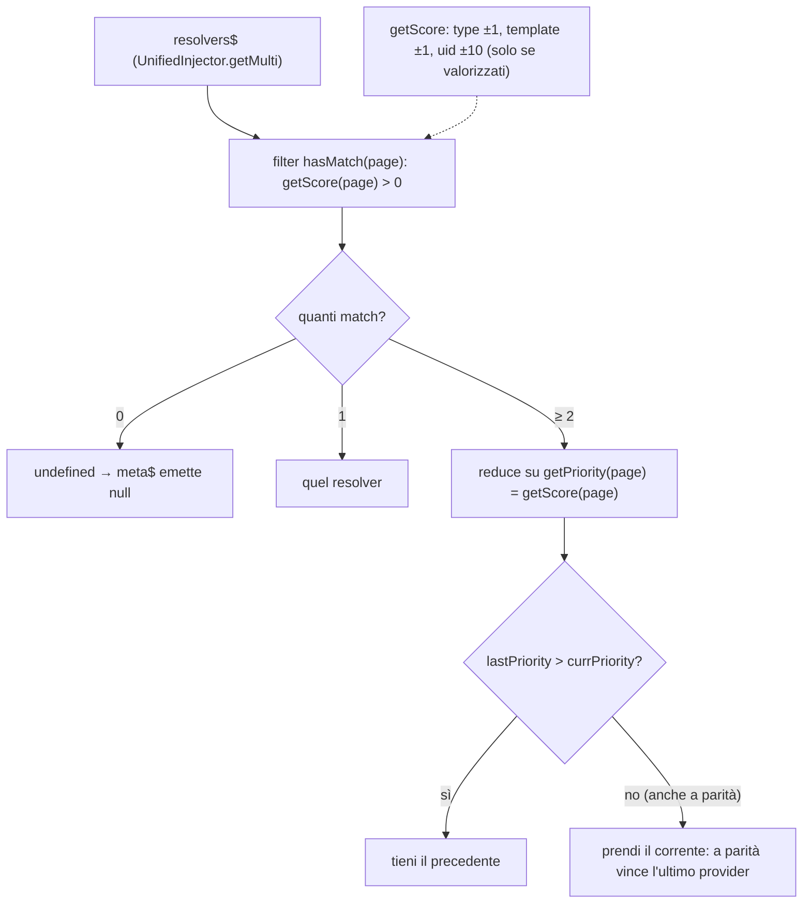
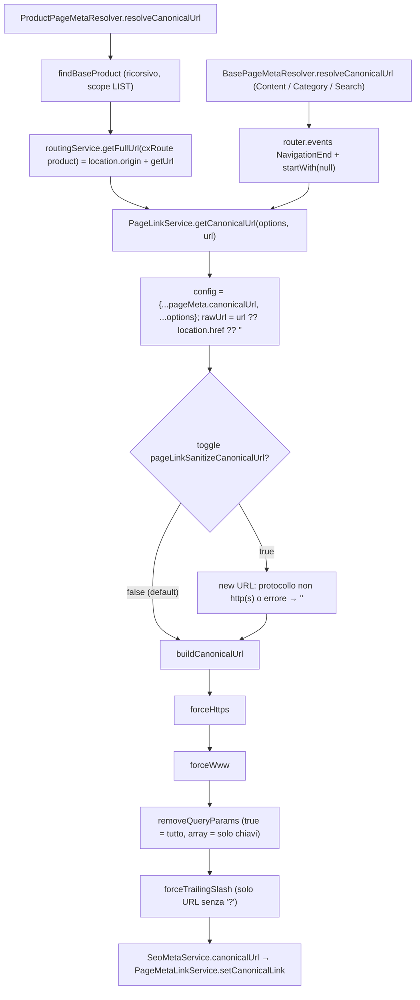
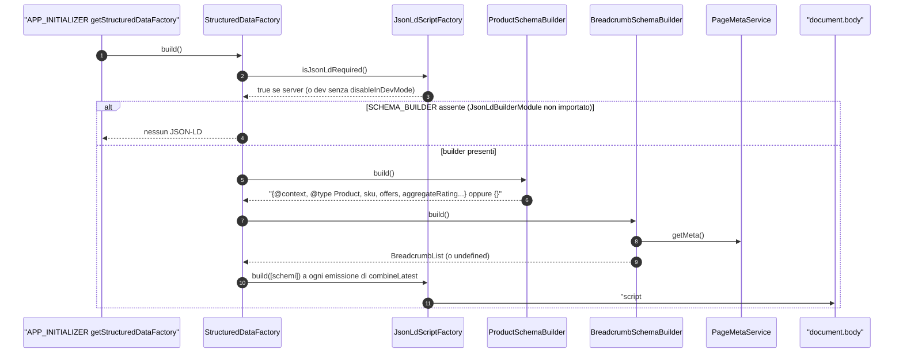
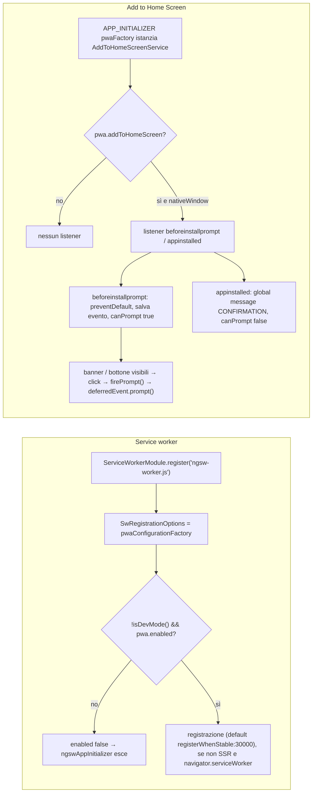

# 40 — SEO e PWA

> Riferimenti allo SHA `5b7a1c2bf2808d7380bc20596d10f4fa710c3da1` (vedi [00-meta](../00-meta.md)).

## 1. A cosa serve e perché esiste

Una storefront deve farsi trovare dai motori di ricerca e condividere bene sui social. Per farlo ogni pagina deve avere `<title>`, `<meta name="description">`, `<meta name="robots">`, un `<link rel="canonical">` e possibilmente dati strutturati JSON-LD. In una Single Page Application questi tag cambiano a ogni navigazione e, perché un crawler li veda, vanno scritti anche nell'HTML prodotto in SSR. Spartacus divide il problema in tre livelli, in due librerie diverse.

| Livello | Libreria | Classi chiave | Domanda a cui risponde |
|---|---|---|---|
| **Raccolta dei meta** (dati) | `@spartacus/core` | `PageMetaService`, `PageMetaResolver`, `BasePageMetaResolver`, `PageLinkService` | "Qual è il title, la description, il canonical… della pagina corrente?" |
| **Scrittura nel DOM** (rendering) | `@spartacus/storefront` | `SeoModule`, `SeoMetaService`, `PageMetaLinkService` | "Come trasformo un `PageMeta` in tag dentro `<head>`?" |
| **Dati strutturati** (JSON-LD) | `@spartacus/storefront` | `StructuredDataFactory`, `SCHEMA_BUILDER`, `JsonLdScriptFactory` | "Quale schema.org scrivo nello `<script type="application/ld+json">`?" |

Il cuore è il modello `PageMeta`: un oggetto con le proprietà opzionali `title`, `heading`, `description`, `robots`, `image`, `breadcrumbs` e `canonicalUrl` (`core-libs/core/src/cms/model/page.model.ts:L40-L78`). `PageMetaService` lo calcola per la pagina CMS corrente, scegliendo tra più `PageMetaResolver` quello con lo score migliore per tipo, template e uid della pagina (`core-libs/core/src/cms/page/page-meta.resolver.ts:L31-L45`). Il resolver scelto espone metodi `resolve*` che restituiscono `Observable`, e una configurazione decide quale metodo alimenta quale proprietà (`core-libs/core/src/cms/page/config/default-page-meta.config.ts:L9-L40`).

`PageMeta` non serve solo alla SEO. Lo usano anche la UI, per l'heading `<h1>` (`core-libs/storefront/cms-components/navigation/page-header/page-title.utils.ts:L11-L18`) e per il breadcrumb (`core-libs/storefront/cms-components/navigation/breadcrumb/breadcrumb.component.ts:L46-L49`), e il builder JSON-LD del breadcrumb (`core-libs/storefront/cms-structure/seo/structured-data/builders/breadcrumb/breadcrumb-schema.builder.ts:L19-L23`). Per questo l'interfaccia distingue `heading` (UI) da `title` (browser e crawler) (`core-libs/core/src/cms/page/page.resolvers.ts:L10-L25`).

La seconda metà del capitolo riguarda la **PWA**. `PwaModule` registra il service worker di Angular (`ngsw-worker.js`), ma lo abilita solo fuori da dev mode e con `pwa.enabled` (`core-libs/storefront/cms-structure/pwa/pwa.module.ts:L19-L23`). Inoltre gestisce il prompt "Add to Home Screen" tramite l'evento browser `beforeinstallprompt` (`core-libs/storefront/cms-structure/pwa/services/add-to-home-screen.service.ts:L36-L57`). Entrambe le funzioni sono disattivate per default (`core-libs/storefront/cms-structure/pwa/pwa.module-config.ts:L21-L26`).

`SeoModule` e `PwaModule` vengono importati da `BaseStorefrontModule` (`core-libs/storefront/base-storefront.module.ts:L26-L49`), mentre `PageMetaModule.forRoot()` arriva tramite `CmsModule` (`core-libs/core/src/cms/cms.module.ts:L14-L16`), che è importato da `BaseCoreModule` (`core-libs/core/src/base-core.module.ts:L34-L34`). I resolver di prodotto, categoria e ricerca si aggiungono solo con `ProductModule.forRoot()` (`core-libs/core/src/product/product.module.ts:L16-L49`).

Capitoli collegati: il caricamento della pagina CMS che fa partire tutto è in [15 — CMS core](../parte-2/15-cms-core.md); il rendering SSR, dove questi tag hanno davvero valore, è in [39 — SSR ottimizzato](../parte-2/39-ssr-ottimizzato.md) e [07 — SSR, hydration e TransferState](../parte-1/07-ssr-hydration-transferstate.md); il meccanismo `UnifiedInjector` per i provider multi nei moduli lazy è in [12 — Feature module e lazy loading](../parte-2/12-feature-module-lazy.md); i resolver di prodotto sono descritti anche in [24 — Prodotto e ricerca](../parte-2/24-product-search.md).

## 2. Mappa dei file

| Path | Ruolo |
|---|---|
| `core-libs/core/src/cms/model/page.model.ts` | `PageMeta`, `BreadcrumbMeta`, enum `PageRobotsMeta` |
| `core-libs/core/src/cms/page/page.resolvers.ts` | interfacce `PageHeadingResolver`, `PageTitleResolver`, `PageDescriptionResolver`, `PageBreadcrumbResolver`, `PageImageResolver`, `PageRobotsResolver`, `CanonicalPageResolver` |
| `core-libs/core/src/cms/page/page-meta.resolver.ts` | classe astratta `PageMetaResolver` (`Applicable`, scoring) |
| `core-libs/core/src/cms/page/base-page-meta.resolver.ts` | `BasePageMetaResolver`: implementazione riusabile via delega |
| `core-libs/core/src/cms/page/content-page-meta.resolver.ts` | `ContentPageMetaResolver` (`CONTENT_PAGE`) |
| `core-libs/core/src/cms/page/page-meta.module.ts` | `PageMetaModule`: multi-provide di `ContentPageMetaResolver` + default config |
| `core-libs/core/src/cms/page/config/page-meta.config.ts` | `PageMetaConfig`, `PageMetaResolversConfig`, `CanonicalUrlOptions` |
| `core-libs/core/src/cms/page/config/default-page-meta.config.ts` | `defaultPageMetaConfig` (7 resolver + opzioni canonical) |
| `core-libs/core/src/cms/page/routing/page-link.service.ts` | `PageLinkService`: calcolo del canonical URL |
| `core-libs/core/src/cms/page/routing/routing-page-meta.resolver.ts` | `RoutingPageMetaResolver`: breadcrumb dalle route Angular |
| `core-libs/core/src/cms/page/routing/default-route-page-meta.resolver.ts` | `DefaultRoutePageMetaResolver`: breadcrumb da `cxPageMeta` |
| `core-libs/core/src/cms/page/routing/route-page-meta.model.ts` | `RoutePageMetaConfig`, `RouteBreadcrumbConfig` |
| `core-libs/core/src/cms/facade/page-meta.service.ts` | `PageMetaService`: scelta del resolver e composizione del `PageMeta` |
| `core-libs/core/src/util/applicable.ts` | `Applicable`, `resolveApplicable` (selezione per priorità) |
| `core-libs/core/src/util/rxjs/unite-latest.ts` | `uniteLatest`: `combineLatest` "smussato" |
| `core-libs/core/src/lazy-loading/unified-injector.ts` | `UnifiedInjector.getMulti`: resolver da root + moduli lazy |
| `core-libs/core/src/product/product.module.ts` | registra i resolver PDP, PLP, ricerca, coupon |
| `core-libs/core/src/product/services/product-page-meta.resolver.ts` | `ProductPageMetaResolver` (PDP) |
| `core-libs/core/src/product/services/category-page-meta.resolver.ts` | `CategoryPageMetaResolver` (PLP) |
| `core-libs/core/src/product/services/search-page-meta.resolver.ts` | `SearchPageMetaResolver` |
| `core-libs/core/src/product/services/coupon-search-page-meta.resolver.ts` | `CouponSearchPageResolver` (non esportato) |
| `core-libs/core/src/occ/adapters/cms/converters/occ-cms-page-normalizer.ts` | `normalizeRobots`: `robotTag` OCC → `PageRobotsMeta[]` |
| `core-libs/storefront/cms-structure/seo/seo.module.ts` | `SeoModule`, `initSeoService` |
| `core-libs/storefront/cms-structure/seo/seo-meta.service.ts` | `SeoMetaService`: scrive title, meta e canonical |
| `core-libs/storefront/cms-structure/seo/page-meta-link.service.ts` | `PageMetaLinkService`: `<link rel="canonical">` e `<link rel="preconnect">` |
| `core-libs/storefront/cms-structure/seo/media-preconnect.service.ts` | `MediaPreconnectService`: preconnect verso il dominio dei media |
| `core-libs/storefront/cms-structure/seo/html-lang-provider.ts` | `htmlLangProvider`: `<html lang>` (non esportato) |
| `core-libs/storefront/cms-structure/seo/config/seo.config.ts` | `SeoConfig` |
| `core-libs/storefront/cms-structure/seo/config/default-seo.config.ts` | `defaultSeoConfig` |
| `core-libs/storefront/cms-structure/seo/structured-data/structured-data.module.ts` | `StructuredDataModule`, `getStructuredDataFactory` |
| `core-libs/storefront/cms-structure/seo/structured-data/structured-data.factory.ts` | `StructuredDataFactory`: orchestrazione degli `SCHEMA_BUILDER` |
| `core-libs/storefront/cms-structure/seo/structured-data/json-ld-script.factory.ts` | `JsonLdScriptFactory`: `<script id="json-ld">` ed escape |
| `core-libs/storefront/cms-structure/seo/structured-data/json-ld.directive.ts` | `JsonLdDirective` (`[cxJsonLd]`) |
| `core-libs/storefront/cms-structure/seo/structured-data/builders/tokens.ts` | `SCHEMA_BUILDER`, `JSONLD_PRODUCT_BUILDER` |
| `core-libs/storefront/cms-structure/seo/structured-data/builders/schema.interface.ts` | `SchemaBuilder`, `JsonLdBuilder<T>` |
| `core-libs/storefront/cms-structure/seo/structured-data/builders/json-ld-builder.module.ts` | `JsonLdBuilderModule` (opt-in) |
| `core-libs/storefront/cms-structure/seo/structured-data/builders/product/product-schema.builder.ts` | `ProductSchemaBuilder` |
| `core-libs/storefront/cms-structure/seo/structured-data/builders/product/jsonld-base-product.builder.ts` | sku, name, description, brand, image |
| `core-libs/storefront/cms-structure/seo/structured-data/builders/product/jsonld-product-offer.builder.ts` | `offers` |
| `core-libs/storefront/cms-structure/seo/structured-data/builders/product/jsonld-product-review.builder.ts` | `aggregateRating`, `review` |
| `core-libs/storefront/cms-structure/seo/structured-data/builders/breadcrumb/breadcrumb-schema.builder.ts` | `BreadcrumbList` |
| `core-libs/storefront/cms-structure/pwa/pwa.module.ts` | `PwaModule`, `pwaConfigurationFactory`, `pwaFactory` |
| `core-libs/storefront/cms-structure/pwa/pwa.module-config.ts` | `PWAModuleConfig`, `defaultPWAModuleConfig` |
| `core-libs/storefront/cms-structure/pwa/services/add-to-home-screen.service.ts` | `AddToHomeScreenService` |
| `core-libs/storefront/cms-structure/pwa/components/add-to-home-screen.component.ts` | base astratta `AddToHomeScreenComponent` |
| `core-libs/storefront/cms-structure/pwa/components/add-to-home-screen-banner/add-to-home-screen-banner.component.ts` | `cx-add-to-home-screen-banner` |
| `core-libs/storefront/cms-structure/pwa/components/add-to-home-screen-btn/add-to-home-screen-btn.component.ts` | `cx-add-to-home-screen-btn` |

## 3. Come funziona passo per passo

### 3.1 Dal backend: robots nella pagina CMS

1. La pagina CMS OCC porta un singolo `robotTag` (es. `NOINDEX_FOLLOW`). Il normalizer lo spezza in un array di due `PageRobotsMeta` e, se manca, assegna un array vuoto (`core-libs/core/src/occ/adapters/cms/converters/occ-cms-page-normalizer.ts:L198-L222`).
2. Title e description arrivano direttamente come `page.title` e `page.description`, e `BasePageMetaResolver` li legge dalla pagina corrente (`core-libs/core/src/cms/page/base-page-meta.resolver.ts:L47-L61`).

### 3.2 Registrazione dei resolver

1. `PageMetaModule` fa multi-provide del token `PageMetaResolver` con `useExisting: ContentPageMetaResolver`; `forRoot()` aggiunge `provideDefaultConfig(defaultPageMetaConfig)` (`core-libs/core/src/cms/page/page-meta.module.ts:L13-L29`).
2. `ProductModule.forRoot()` aggiunge, sullo stesso token, `ProductPageMetaResolver`, `CategoryPageMetaResolver`, `SearchPageMetaResolver` e `CouponSearchPageResolver` (`core-libs/core/src/product/product.module.ts:L16-L49`). Nella demo `ProductModule.forRoot()` è importato in `spartacus-features.module.ts` (`projects/storefrontapp/src/app/spartacus/spartacus-features.module.ts:L220-L220`), e la schematic `add-spartacus` genera la stessa riga (`core-libs/schematics/src/add-spartacus/spartacus-features.ts:L186-L186`).
3. Le feature-libs aggiungono i loro resolver con lo stesso schema. Per esempio `CheckoutPageMetaResolver` usa `CONTENT_PAGE` + `MultiStepCheckoutSummaryPageTemplate` (`feature-libs/checkout/base/core/services/checkout-page-meta.resolver.ts:L46-L47`), mentre `CustomerTicketingPageMetaResolver` usa `pageUid = 'support-ticket-details'` (`feature-libs/customer-ticketing/core/services/customer-ticketing-page-meta.resolver.ts:L53-L54`).

### 3.3 `PageMetaService`: raccolta dei resolver

1. `PageMetaService` è `providedIn: 'root'` e riceve `CmsService`, `UnifiedInjector`, `PageMetaConfig` e `PLATFORM_ID`; quest'ultimo è commentato come deprecato (`core-libs/core/src/cms/facade/page-meta.service.ts:L29-L41`).
2. `resolvers$` = `unifiedInjector.getMulti(PageMetaResolver)` con `shareReplay({bufferSize:1, refCount:true})` (`core-libs/core/src/cms/facade/page-meta.service.ts:L53-L57`).
3. `getMulti` parte dall'injector root (`startWith(this.rootInjector)`) e aggiunge l'injector di ogni modulo lazy caricato (`core-libs/core/src/lazy-loading/unified-injector.ts:L32-L35`). Per i moduli lazy legge solo le istanze proprie (`{ self: true }`, `core-libs/core/src/lazy-loading/unified-injector.ts:L52-L68`) e accumula le liste con `scan`. Emette solo quando trova istanze nuove e lancia un errore se il token mescola provider multi e singoli (`core-libs/core/src/lazy-loading/unified-injector.ts:L79-L93`). In pratica, quando un modulo lazy che fornisce un resolver (come quello del checkout) viene caricato, `resolvers$` riemette la lista allargata.

### 3.4 `PageMetaService`: scelta del resolver

1. `meta$` parte da `cms.getCurrentPage()`, scarta le pagine falsy, e con `switchMap` passa a `getMetaResolver(page)` (`core-libs/core/src/cms/facade/page-meta.service.ts:L59-L68`).
2. `getMetaResolver` applica `resolveApplicable(resolvers, [page], [page])` a ogni emissione di `resolvers$` (`core-libs/core/src/cms/facade/page-meta.service.ts:L133-L139`).
3. `resolveApplicable` tiene solo le istanze con `hasMatch(page)` vero e, tra queste, sceglie quella con `getPriority` più alta. Il confronto è `lastPriority > currPriority` (stretto), quindi **a parità vince il provider registrato per ultimo** (`core-libs/core/src/util/applicable.ts:L63-L87`), come dichiara anche il JSDoc (`core-libs/core/src/util/applicable.ts:L47-L62`).
4. In `PageMetaResolver`, `hasMatch` è `getScore(page) > 0` e `getPriority` è lo score stesso (`core-libs/core/src/cms/page/page-meta.resolver.ts:L47-L53`). Lo score somma ±1 per `pageType`, ±1 per `pageTemplate` e ±10 per `pageUid`; ogni criterio conta solo se la proprietà è valorizzata sul resolver (`core-libs/core/src/cms/page/page-meta.resolver.ts:L31-L45`).

Esempi di scoring con i resolver standard (calcolati da `core-libs/core/src/cms/page/page-meta.resolver.ts:L31-L45` e `core-libs/core/src/product/services/coupon-search-page-meta.resolver.ts:L89-L91`):

| Pagina | `ContentPage…` (CONTENT) | `Search…` (CONTENT + template ricerca) | `CouponSearch…` (come Search ±1) | `Product…` (PRODUCT) | `Category…` (CATEGORY) | Vince |
|---|---|---|---|---|---|---|
| contenuto generico, template qualsiasi | 1 | 0 | −1 | −1 | −1 | Content |
| `SearchResultsListPageTemplate` senza `couponcode` | 1 | 2 | 1 | −1 | −1 | Search |
| `SearchResultsListPageTemplate` con `couponcode` | 1 | 2 | 3 | −1 | −1 | CouponSearch |
| PDP | −1 | −2 | −3 | 1 | −1 | Product |
| PLP / categoria | −1 | −2 | −3 | −1 | 1 | Category |

Un resolver con `pageUid` corretto prende +10 e vince quasi sempre: per esempio `CustomerTicketingPageMetaResolver` arriva a 11 sulla pagina `support-ticket-details` (`feature-libs/customer-ticketing/core/services/customer-ticketing-page-meta.resolver.ts:L51-L55`). Se nessun resolver ha score > 0, `meta$` emette `null` (`core-libs/core/src/cms/facade/page-meta.service.ts:L64-L66`).

### 3.5 `PageMetaService`: composizione del `PageMeta`

1. `getResolverMethods()` trasforma `pageMeta.resolvers` (array di `{property, method}`) in una mappa `{ property: method }`; senza config restituisce `{}` (`core-libs/core/src/cms/facade/page-meta.service.ts:L115-L125`).
2. La config di default mappa 7 proprietà: `title→resolveTitle`, `heading→resolveHeading`, `breadcrumbs→resolveBreadcrumbs`, `description→resolveDescription`, `image→resolveImage`, `robots→resolveRobots`, `canonicalUrl→resolveCanonicalUrl` (`core-libs/core/src/cms/page/config/default-page-meta.config.ts:L9-L40`).
3. `resolve(metaResolver)` tiene solo i metodi che esistono **sull'istanza scelta**, li invoca senza argomenti, mappa ogni risultato in `{ [property]: data }` e unisce tutto con `uniteLatest` + `Object.assign`. Se non resta alcun metodo restituisce `of({})` (`core-libs/core/src/cms/facade/page-meta.service.ts:L84-L103`).
4. `uniteLatest` emette la prima combinazione in modo sincrono; le successive sono raggruppate con `audit` sull'`asapScheduler`, così più sorgenti che cambiano insieme producono un'unica emissione (`core-libs/core/src/util/rxjs/unite-latest.ts:L15-L47`). Sotto c'è un `combineLatest` (`core-libs/core/src/util/rxjs/unite-latest.ts:L45-L45`), che emette solo dopo che **tutte** le sorgenti hanno emesso almeno una volta (`deps:rxjs-7.8.2/package/src/internal/observable/combineLatest.ts:L242-L269`).
5. `getMeta()` restituisce `meta$`, condiviso con `shareReplay({bufferSize:1, refCount:true})` (`core-libs/core/src/cms/facade/page-meta.service.ts:L67-L77`).
6. Il costruttore si sottoscrive a `languageService.getActive()` con `skip(1)` e `distinctUntilChanged()`, e a ogni cambio lingua chiama `cms.refreshLatestPage()` (`core-libs/core/src/cms/facade/page-meta.service.ts:L42-L50`). Questo metodo prende il page context corrente e fa dispatch di `CmsActions.LoadCmsPageData` (`core-libs/core/src/cms/facade/cms.service.ts:L197-L204`): la pagina viene ricaricata e i meta si ricalcolano nella nuova lingua.

### 3.6 `BasePageMetaResolver` e `ContentPageMetaResolver`

1. `BasePageMetaResolver` (`providedIn: 'root'`) implementa title, description, breadcrumb, robots e canonical (`core-libs/core/src/cms/page/base-page-meta.resolver.ts:L25-L42`). **Non** estende `PageMetaResolver`: non viene mai scelto da `resolveApplicable`, serve solo come delegato.
2. `title$`, `description$` e `robots$` derivano da `page.title`, `page.description` e `page.robots || []` (`core-libs/core/src/cms/page/base-page-meta.resolver.ts:L47-L61`).
3. Il breadcrumb home è `[{ label: translate('common.home'), link: '/' }]` (`core-libs/core/src/cms/page/base-page-meta.resolver.ts:L66-L68`). `breadcrumb$` lo unisce con i breadcrumb delle route Angular figlie, prodotti da `RoutingPageMetaResolver.resolveBreadcrumbs()` (`core-libs/core/src/cms/page/base-page-meta.resolver.ts:L73-L79`).
4. `resolveCanonicalUrl(options?)` ricalcola `pageLinkService.getCanonicalUrl(options)` a ogni `NavigationEnd`, con `startWith(null)` per emettere subito (`core-libs/core/src/cms/page/base-page-meta.resolver.ts:L101-L107`).
5. `ContentPageMetaResolver` estende `PageMetaResolver`, imposta `pageType = PageType.CONTENT_PAGE` e delega i cinque metodi a `BasePageMetaResolver` (`core-libs/core/src/cms/page/content-page-meta.resolver.ts:L29-L65`). Il suo JSDoc suggerisce di creare resolver più specifici aggiungendo il template (`core-libs/core/src/cms/page/content-page-meta.resolver.ts:L21-L28`).

### 3.7 Breadcrumb dalle route Angular

1. `RoutingPageMetaResolver.routes$` scarta la prima route, cioè la root speciale di Angular (`core-libs/core/src/cms/page/routing/routing-page-meta.resolver.ts:L47-L50`).
2. Ogni route usa il resolver dichiarato in `cxPageMeta.resolver` oppure eredita quello del parent; per la prima route il default è `DefaultRoutePageMetaResolver`. L'URL assoluto si costruisce concatenando i segmenti (`core-libs/core/src/cms/page/routing/routing-page-meta.resolver.ts:L64-L85`).
3. `resolveBreadcrumbs(options)` per default rimuove la route corrente, a meno che `includeCurrentRoute` sia true (`core-libs/core/src/cms/page/routing/routing-page-meta.resolver.ts:L91-L111`). `trimCurrentRoute` rimuove anche le route finali con path `''` e poi il primo antenato con path non vuoto (`core-libs/core/src/cms/page/routing/routing-page-meta.resolver.ts:L159-L173`).
4. La config si legge da `route.routeConfig.data.cxPageMeta`, non da `route.data`, per evitare che le route figlie con path vuoto ereditino la config del parent (`core-libs/core/src/cms/page/routing/routing-page-meta.resolver.ts:L186-L198`).
5. `RoutePageMetaConfig` ha `breadcrumb?: string | RouteBreadcrumbConfig` (`{raw?, i18n?}`) e `resolver?: Type<any>` (`core-libs/core/src/cms/page/routing/route-page-meta.model.ts:L30-L55`). `DefaultRoutePageMetaResolver` restituisce `[]` senza config, la label letterale con `raw`, altrimenti traduce la chiave (`core-libs/core/src/cms/page/routing/default-route-page-meta.resolver.ts:L36-L71`).

### 3.8 Canonical URL (`PageLinkService`)

1. `getCanonicalUrl(options?, url?)` unisce `pageMeta.canonicalUrl` della config con le `options` passate, e prende come URL `url ?? winRef.location.href ?? ''` (`core-libs/core/src/cms/page/routing/page-link.service.ts:L33-L43`). In SSR `WindowRef.location` restituisce `{href: serverUrl, origin: serverOrigin}` e lancia un errore se `SERVER_REQUEST_URL` o `SERVER_REQUEST_ORIGIN` non sono forniti (`core-libs/core/src/window/window-ref.ts:L70-L89`).
2. Con il feature toggle `pageLinkSanitizeCanonicalUrl` l'URL viene parsato con `new URL`: i protocolli diversi da http/https e gli URL malformati diventano `''` (`core-libs/core/src/cms/page/routing/page-link.service.ts:L39-L55`). Il toggle vale `false` per default (`core-libs/core/src/features-config/feature-toggles/config/feature-toggles.ts:L1079-L1079`) e la demo lo attiva (`projects/storefrontapp/src/app/spartacus/spartacus-features.module.ts:L367-L367`).
3. `buildCanonicalUrl` applica nell'ordine `forceHttps`, `forceWww`, `removeQueryParams` e `forceTrailingSlash` (`core-libs/core/src/cms/page/routing/page-link.service.ts:L57-L79`). `removeQueryParams` toglie tutta la query string se l'opzione è `true`; se è un array toglie solo le chiavi elencate e conserva le altre (`core-libs/core/src/cms/page/routing/page-link.service.ts:L81-L102`).
4. I default sono `forceHttps: true`, `forceWww: false`, `removeQueryParams: true`, `forceTrailingSlash: true` (`core-libs/core/src/cms/page/config/default-page-meta.config.ts:L41-L46`).
5. Sulla PDP il canonical non parte da `location.href`. `ProductPageMetaResolver` risale ricorsivamente al `baseProduct` (scope LIST), costruisce `routingService.getFullUrl({cxRoute:'product', params: product})` e lo passa a `pageLinkService.getCanonicalUrl({}, url)` (`core-libs/core/src/product/services/product-page-meta.resolver.ts:L180-L209`). `getFullUrl` è `winRef.location.origin` + `getUrl(commands)` (`core-libs/core/src/routing/facade/routing.service.ts:L119-L121`). Così tutte le varianti di un prodotto puntano allo stesso URL canonico.

### 3.9 Resolver di prodotto, categoria e ricerca

- **PDP** (`pageType = PRODUCT_PAGE`). `product$` legge `params['productCode']` dallo stato del router e carica il prodotto con `ProductScope.DETAILS` (`core-libs/core/src/product/services/product-page-meta.resolver.ts:L50-L69`). Il resolver produce:
  - heading: `pageMetaResolver.product.heading` con `{heading: p.name}` (`core-libs/core/src/product/services/product-page-meta.resolver.ts:L76-L84`);
  - title: `name | prima categoria | manufacturer` (`core-libs/core/src/product/services/product-page-meta.resolver.ts:L91-L102`, `core-libs/core/src/product/services/product-page-meta.resolver.ts:L151-L161`);
  - description: `product.summary` (`core-libs/core/src/product/services/product-page-meta.resolver.ts:L108-L116`);
  - breadcrumb: home più un crumb per categoria (`core-libs/core/src/product/services/product-page-meta.resolver.ts:L122-L139`);
  - image: `images.PRIMARY.zoom.url ?? null` (`core-libs/core/src/product/services/product-page-meta.resolver.ts:L145-L149`);
  - robots: delegati a `BasePageMetaResolver` (`core-libs/core/src/product/services/product-page-meta.resolver.ts:L163-L165`).
- **Categoria** (`pageType = CATEGORY_PAGE`). `searchPage$` usa i risultati di `ProductSearchService` solo se la pagina contiene un componente `CMSProductListComponent` o `ProductGridComponent`; altrimenti usa la pagina CMS (`core-libs/core/src/product/services/category-page-meta.resolver.ts:L41-L64`, `core-libs/core/src/product/services/category-page-meta.resolver.ts:L119-L128`). Il resolver produce:
  - title: `pageMetaResolver.category.title` con `count` e `query` (`core-libs/core/src/product/services/category-page-meta.resolver.ts:L66-L78`);
  - breadcrumb: home, poi `/c/<code>` per le facet `category`/`allCategories` e `/Brands/<name>/c/<code>` per `brand` (`core-libs/core/src/product/services/category-page-meta.resolver.ts:L80-L117`);
  - robots e canonical: delegati a `BasePageMetaResolver` (`core-libs/core/src/product/services/category-page-meta.resolver.ts:L130-L142`).
- **Ricerca** (`CONTENT_PAGE` + `SearchResultsListPageTemplate`, `core-libs/core/src/product/services/search-page-meta.resolver.ts:L46-L55`). Il title usa `count` dai risultati e `query` da `params['query']`, con `default_title` come fallback (`core-libs/core/src/product/services/search-page-meta.resolver.ts:L35-L73`). Robots e canonical sono delegati (`core-libs/core/src/product/services/search-page-meta.resolver.ts:L75-L87`). Non risolve breadcrumb né description.
- **Coupon**. Stesso type e template della ricerca, con +1/−1 allo score in base alla presenza del query param `couponcode` (`core-libs/core/src/product/services/coupon-search-page-meta.resolver.ts:L44-L54`, `core-libs/core/src/product/services/coupon-search-page-meta.resolver.ts:L89-L95`). Il title usa `findProductTitle` e il breadcrumb aggiunge "My coupons" solo per utenti loggati (`core-libs/core/src/product/services/coupon-search-page-meta.resolver.ts:L56-L87`).
- I testi EN sono in `common.json`: `category.title` "{{count}} result for {{query}}", `search.default_title` "All products", `product.title` "{{title}}" (`core-libs/assets/src/translations/en/common.json:L43-L63`).

### 3.10 Scrittura nel DOM: `SeoModule` e `SeoMetaService`

1. `SeoModule` importa `StructuredDataModule` e fornisce `provideDefaultConfig(defaultSeoConfig)`, l'`APP_INITIALIZER` `initSeoService` e `htmlLangProvider` (`core-libs/storefront/cms-structure/seo/seo.module.ts:L22-L35`).
2. `initSeoService` ottiene `SeoMetaService` dall'`Injector` e chiama `init()` (`core-libs/storefront/cms-structure/seo/seo.module.ts:L14-L20`). `init()` sottoscrive `pageMetaService.getMeta()`, filtra i `null` con `isNotNullable` e assegna il risultato al setter `meta` (`core-libs/storefront/cms-structure/seo/seo-meta.service.ts:L32-L37`).
3. Il setter `meta` imposta, nell'ordine, title, description, image, robots e canonicalUrl (`core-libs/storefront/cms-structure/seo/seo-meta.service.ts:L39-L45`). `heading` e `breadcrumbs` non finiscono in `<head>`.
   - **title**: `ngTitle.setTitle(title || '')` (`core-libs/storefront/cms-structure/seo/seo-meta.service.ts:L47-L49`), che in Angular assegna `document.title` (`angular:packages/platform-browser/src/browser/title.ts:L36-L38`);
   - **description**: `updateTag({name:'description'})` se c'è un valore, altrimenti `removeTag` (`core-libs/storefront/cms-structure/seo/seo-meta.service.ts:L51-L57`);
   - **image**: `og:image` scritto con l'attributo `name` e rimosso se manca (`core-libs/storefront/cms-structure/seo/seo-meta.service.ts:L59-L65`);
   - **robots**: se l'array non è vuoto, `content` = elementi uniti da `', '`, es. `INDEX, FOLLOW` (`core-libs/storefront/cms-structure/seo/seo-meta.service.ts:L67-L71`);
   - **canonical**: delegato a `pageMetaLinkService?.setCanonicalLink(url)`. `pageMetaLinkService` è un parametro opzionale del costruttore (`core-libs/storefront/cms-structure/seo/seo-meta.service.ts:L23-L28`, `core-libs/storefront/cms-structure/seo/seo-meta.service.ts:L79-L81`).
4. `addTag` chiama `ngMeta.updateTag(meta)` solo se `meta.content` è truthy (`core-libs/storefront/cms-structure/seo/seo-meta.service.ts:L83-L87`). `Meta.updateTag` di Angular cerca un tag con lo stesso `name=` (o `property=`): se esiste lo aggiorna, altrimenti ne crea uno e lo appende a `<head>` (`angular:packages/platform-browser/src/browser/meta.ts:L137-L146`, `angular:packages/platform-browser/src/browser/meta.ts:L167-L197`).
5. `setCanonicalLink(url)` cerca `link[rel="canonical"]`. Senza url rimuove il link; se il link non esiste lo crea con `Renderer2` e lo appende a `head`; altrimenti ne aggiorna `href` (`core-libs/storefront/cms-structure/seo/page-meta-link.service.ts:L33-L53`).
6. `htmlLangProvider` è un altro `APP_INITIALIZER`: sottoscrive `languageService.getActive()` e scrive `documentElement.lang`, sostituendo `_` con `-` (`core-libs/storefront/cms-structure/seo/html-lang-provider.ts:L10-L30`).
7. Preconnect dei media: `MediaModule.forRoot()` registra un `APP_INITIALIZER` che chiama `MediaPreconnectService.addPreconnectLink()` (`core-libs/storefront/shared/components/media/media.module.ts:L14-L18`, `core-libs/storefront/shared/components/media/media.module.ts:L29-L43`). Il servizio aggiunge il link solo se l'origin di `mediaService.getBaseUrl()` è valido e diverso da `windowRef.location.origin` (`core-libs/storefront/cms-structure/seo/media-preconnect.service.ts:L20-L34`). `getBaseUrl()` usa `backend.media.baseUrl ?? backend.occ.baseUrl ?? ''` (`core-libs/storefront/shared/components/media/media.service.ts:L399-L403`). `addPreconnectLink` evita i duplicati e inserisce il link come primo figlio di `<head>` (`core-libs/storefront/cms-structure/seo/page-meta-link.service.ts:L55-L67`).

### 3.11 Structured data (JSON-LD)

1. `StructuredDataModule` importa ed esporta `JsonLdDirective` e registra un `APP_INITIALIZER` che chiama `StructuredDataFactory.build()` (`core-libs/storefront/cms-structure/seo/structured-data/structured-data.module.ts:L16-L36`).
2. `StructuredDataFactory` inietta `SCHEMA_BUILDER` con `@Optional()`. `build()` procede solo se `isJsonLdRequired()` è vero e se ci sono builder (`core-libs/storefront/cms-structure/seo/structured-data/structured-data.factory.ts:L20-L42`).
3. `isJsonLdRequired()` è vero sul server, oppure in dev mode quando `disableInDevMode` non è true (`core-libs/storefront/cms-structure/seo/structured-data/json-ld-script.factory.ts:L46-L51`). Il default è `disableInDevMode: true` (`core-libs/storefront/cms-structure/seo/config/default-seo.config.ts:L9-L15`), quindi **per default il JSON-LD si genera solo in SSR**.
4. `collectSchemas()` fa `combineLatest` dei `build()` di tutti gli schema builder, e ogni emissione (l'array degli schemi) va a `scriptBuilder.build(schema)` (`core-libs/storefront/cms-structure/seo/structured-data/structured-data.factory.ts:L36-L49`).
5. `JsonLdScriptFactory.build` scrive nel `textContent` di un unico `<script id="json-ld" type="application/ld+json">`, appeso al `body` alla prima chiamata (`core-libs/storefront/cms-structure/seo/structured-data/json-ld-script.factory.ts:L35-L39`, `core-libs/storefront/cms-structure/seo/structured-data/json-ld-script.factory.ts:L62-L76`). Il contenuto passa da `escapeHtml`, che serializza con `JSON.stringify`, assegna il risultato a `div.textContent` e restituisce `innerHTML`, per evitare l'XSS (`core-libs/storefront/cms-structure/seo/structured-data/json-ld-script.factory.ts:L78-L88`).
6. I builder standard sono registrati da `JsonLdBuilderModule`: `SCHEMA_BUILDER` → `ProductSchemaBuilder` e `BreadcrumbSchemaBuilder`; `JSONLD_PRODUCT_BUILDER` → base product, offer e review (`core-libs/storefront/cms-structure/seo/structured-data/builders/json-ld-builder.module.ts:L21-L52`). **Questo modulo è opt-in**: né `SeoModule` né `StructuredDataModule` lo importano, mentre la demo lo importa esplicitamente (`projects/storefrontapp/src/app/spartacus/spartacus-features.module.ts:L246-L247`).
7. `ProductSchemaBuilder` parte da `CurrentProductService.getProduct()`. Se c'è un prodotto, combina `{@context, @type:'Product'}` con i risultati dei `JsonLdBuilder` iniettati e li unisce con `Object.assign`; altrimenti emette `{}` (`core-libs/storefront/cms-structure/seo/structured-data/builders/product/product-schema.builder.ts:L31-L58`). I tre sotto-builder producono:
   - `JsonLdBaseProductBuilder`: `sku`, `name`, `description` (summary), `brand` (manufacturer) e `image` (`core-libs/storefront/cms-structure/seo/structured-data/builders/product/jsonld-base-product.builder.ts:L20-L60`);
   - `JsonLdProductOfferBuilder`: `offers` con price, currency e availability (`core-libs/storefront/cms-structure/seo/structured-data/builders/product/jsonld-product-offer.builder.ts:L20-L36`);
   - `JsonLdProductReviewBuilder`: `aggregateRating` e `review[]` se c'è almeno una recensione (`core-libs/storefront/cms-structure/seo/structured-data/builders/product/jsonld-product-review.builder.ts:L27-L82`).
8. `BreadcrumbSchemaBuilder` trasforma `pageMeta.breadcrumbs` in `ListItem` con `position` e `item:{@id: link, name: label}`, aggiunge il title come ultimo elemento e restituisce un `BreadcrumbList` (`core-libs/storefront/cms-structure/seo/structured-data/builders/breadcrumb/breadcrumb-schema.builder.ts:L19-L56`).
9. `JsonLdDirective` (`[cxJsonLd]`) appende uno script escapato all'elemento host, se `isJsonLdRequired()`. Secondo il JSDoc Spartacus non la usa: è pensata per i merchant (`core-libs/storefront/cms-structure/seo/structured-data/json-ld.directive.ts:L10-L47`).

### 3.12 PWA: service worker

1. `PwaModule` importa `ServiceWorkerModule.register('ngsw-worker.js')`, `I18nModule` e i due componenti standalone, che esporta (`core-libs/storefront/cms-structure/pwa/pwa.module.ts:L32-L56`).
2. `ServiceWorkerModule.register` chiama `provideServiceWorker`, che fornisce `SwRegistrationOptions` con `useValue: options` e registra un app initializer (`angular:packages/service-worker/src/module.ts:L30-L38`, `angular:packages/service-worker/src/provider.ts:L240-L254`).
3. `PwaModule` sovrascrive `SwRegistrationOptions` con `pwaConfigurationFactory`, che restituisce `enabled: true` solo fuori da dev mode e con `pwa.enabled` (`core-libs/storefront/cms-structure/pwa/pwa.module.ts:L19-L23`, `core-libs/storefront/cms-structure/pwa/pwa.module.ts:L42-L46`).
4. `ngswAppInitializer` termina subito in SSR (`ngServerMode`), quando `options.enabled === false` o quando `serviceWorker` non è disponibile in `navigator` (`angular:packages/service-worker/src/provider.ts:L32-L41`). Senza `registrationStrategy` la strategia è `'registerWhenStable:30000'` (`angular:packages/service-worker/src/provider.ts:L69-L73`).
5. Nella demo: `pwa: { enabled: false, addToHomeScreen: true }` (`projects/storefrontapp/src/app/spartacus/spartacus-configuration.module.ts:L49-L54`), build prod con `"serviceWorker": false` (`projects/storefrontapp/project.json:L169-L169`), e `index.html` che linka `manifest.json` (`projects/storefrontapp/src/index.html:L6-L6`), incluso negli assets (`projects/storefrontapp/project.json:L26-L26`).

### 3.13 PWA: Add to Home Screen

1. `PwaModule` registra l'`APP_INITIALIZER` `pwaFactory`, che ha come dipendenza `AddToHomeScreenService`. Lo scopo è istanziare il servizio all'avvio: la funzione restituita si limita a ritornarlo (`core-libs/storefront/cms-structure/pwa/pwa.module.ts:L25-L30`, `core-libs/storefront/cms-structure/pwa/pwa.module.ts:L47-L52`).
2. Il costruttore di `AddToHomeScreenService` chiama `init()` solo se `pwa.addToHomeScreen` è true (`core-libs/storefront/cms-structure/pwa/services/add-to-home-screen.service.ts:L26-L34`).
3. `init()` registra i listener solo se esiste `nativeWindow`, che in SSR è `undefined` (`core-libs/core/src/window/window-ref.ts:L41-L44`). Su `beforeinstallprompt` chiama `preventDefault`, salva l'evento e abilita il prompt. Su `appinstalled` mostra il global message `pwa.addedToHomeScreen` di tipo CONFIRMATION, disabilita il prompt e azzera l'evento (`core-libs/storefront/cms-structure/pwa/services/add-to-home-screen.service.ts:L36-L57`).
4. `canPrompt$` deriva da un `BehaviorSubject<boolean>(false)`; `firePrompt()` chiama `deferredEvent.prompt()` se l'evento è presente (`core-libs/storefront/cms-structure/pwa/services/add-to-home-screen.service.ts:L20-L24`, `core-libs/storefront/cms-structure/pwa/services/add-to-home-screen.service.ts:L67-L71`).
5. La base astratta `AddToHomeScreenComponent` (`@Directive()`) espone `canPrompt$` in `ngOnInit`, e `prompt()` chiama `firePrompt()` (`core-libs/storefront/cms-structure/pwa/components/add-to-home-screen.component.ts:L11-L23`).
6. `cx-add-to-home-screen-banner` mostra descrizione, due vantaggi e il bottone solo quando `canPrompt$` è true (`core-libs/storefront/cms-structure/pwa/components/add-to-home-screen-banner/add-to-home-screen-banner.component.html:L1-L16`). `cx-add-to-home-screen-btn` proietta il contenuto solo se `canPrompt$` è true, dentro uno `<span (click)="prompt()">` (`core-libs/storefront/cms-structure/pwa/components/add-to-home-screen-btn/add-to-home-screen-btn.component.html:L1-L3`).
7. Il banner compare nel messaggio di ringraziamento della conferma d'ordine (`feature-libs/order/components/order-confirmation/order-confirmation-thank-you-message/order-confirmation-thank-you-message.component.html:L26-L26`), e `OrderConfirmationModule` importa `PwaModule` (`feature-libs/order/components/order-confirmation/order-confirmation.module.ts:L56-L56`).

## 4. Diagrammi

### 4.1 Dal cambio pagina CMS ai tag in `<head>`

Ogni messaggio corrisponde ai passi 3.3–3.10.

```mermaid
sequenceDiagram
    autonumber
    participant INIT as "APP_INITIALIZER initSeoService"
    participant SEO as SeoMetaService
    participant PMS as PageMetaService
    participant CMS as CmsService
    participant UI as UnifiedInjector
    participant R as "PageMetaResolver scelto"
    participant NG as "Angular Title / Meta"
    participant LINK as PageMetaLinkService

    INIT->>SEO: init()
    SEO->>PMS: getMeta() (filter isNotNullable)
    PMS->>CMS: getCurrentPage()
    CMS-->>PMS: page (filtrata se falsy)
    PMS->>UI: getMulti(PageMetaResolver)
    UI-->>PMS: resolvers[] (root + moduli lazy)
    PMS->>PMS: resolveApplicable(resolvers, [page], [page])
    alt nessun resolver con score > 0
        PMS-->>SEO: null (scartato)
    else resolver trovato
        PMS->>R: resolveTitle(), resolveDescription(), ... (solo i metodi presenti)
        R-->>PMS: Observable per proprietà
        PMS->>PMS: uniteLatest + Object.assign
        PMS-->>SEO: PageMeta
        SEO->>NG: setTitle(title)
        SEO->>NG: updateTag / removeTag (description, og:image)
        SEO->>NG: updateTag robots (solo se non vuoto)
        SEO->>LINK: setCanonicalLink(canonicalUrl)
    end
```

### 4.2 Selezione del resolver



### 4.3 Calcolo del canonical URL



### 4.4 JSON-LD in SSR



### 4.5 PWA: service worker e Add to Home Screen



## 5. Estratti di codice reale

### 5.1 Lo scoring dei resolver

`core-libs/core/src/cms/page/page-meta.resolver.ts:L31-L53`
```ts
  getScore(page: Page): number {
    let score = 0;
    if (this.pageType) {
      score += page.type === this.pageType ? 1 : -1;
    }
    if (this.pageTemplate) {
      score += page.template === this.pageTemplate ? 1 : -1;
    }

    if (this.pageUid) {
      score += page.pageId === this.pageUid ? 10 : -10;
    }

    return score;
  }

  hasMatch(page: Page): boolean {
    return this.getScore(page) > 0;
  }

  getPriority(page: Page): number {
    return this.getScore(page);
  }
```

### 5.2 Pipeline `meta$` e composizione

`core-libs/core/src/cms/facade/page-meta.service.ts:L59-L68`
```ts
  protected meta$: Observable<PageMeta | null> = defer(() =>
    this.cms.getCurrentPage()
  ).pipe(
    filter((page) => Boolean(page)),
    switchMap((page: Page) => this.getMetaResolver(page)),
    switchMap((metaResolver: PageMetaResolver | undefined) =>
      metaResolver ? this.resolve(metaResolver) : of(null)
    ),
    shareReplay({ bufferSize: 1, refCount: true })
  );
```

`core-libs/core/src/cms/facade/page-meta.service.ts:L84-L103`
```ts
  protected resolve(metaResolver: PageMetaResolver): Observable<PageMeta> {
    const resolverMethods = this.getResolverMethods();
    const resolvedData: Observable<PageMeta>[] = Object.keys(resolverMethods)
      // TODO: Revisit if typing is possible here with Template Literal Types when we update to TS >=4.1
      .filter((key) => (metaResolver as any)[resolverMethods[key]])
      .map((key) => {
        return (metaResolver as any)
          [resolverMethods[key]]()
          .pipe(map((data) => ({ [key]: data })));
      });

    if (resolvedData.length === 0) {
      // uniteLatest will fail otherwise
      return of({});
    } else {
      return uniteLatest(resolvedData).pipe(
        map((data) => Object.assign({}, ...data))
      );
    }
  }
```

### 5.3 Selezione con parità a favore dell'ultimo provider

`core-libs/core/src/util/applicable.ts:L76-L87`
```ts
  let lastPriority = -Infinity;
  return matchedApplicables.reduce((acc: T | undefined, curr: T) => {
    const currPriority = curr.getPriority
      ? curr.getPriority(...priorityParams)
      : Priority.NORMAL;
    if (lastPriority > currPriority) {
      return acc;
    }
    lastPriority = currPriority;
    return curr;
  }, undefined);
}
```

### 5.4 Normalizzazione del canonical

`core-libs/core/src/cms/page/routing/page-link.service.ts:L57-L79`
```ts
  protected buildCanonicalUrl(
    url: string,
    options: CanonicalUrlOptions
  ): string {
    if (options.forceHttps) {
      url = url.replace(/^http(?!s):/i, 'https:');
    }

    if (options.forceWww) {
      // this will not allow for not adding wwww. in case of a subdomain
      url = url.replace(/^(https?:\/\/)(?!www\.)(.*)/i, '$1www.$2');
    }

    if (options.removeQueryParams) {
      url = this.removeQueryParams(url, options);
    }

    if (options.forceTrailingSlash) {
      url = url.replace(/^([^\?]+[^\/\?]$)$/i, '$1/');
    }

    return url;
  }
```

### 5.5 I setter di `SeoMetaService`

`core-libs/storefront/cms-structure/seo/seo-meta.service.ts:L39-L71`
```ts
  protected set meta(meta: PageMeta) {
    this.title = meta.title;
    this.description = meta.description;
    this.image = meta.image;
    this.robots = meta.robots;
    this.canonicalUrl = meta.canonicalUrl;
  }

  protected set title(title: string | undefined) {
    this.ngTitle.setTitle(title || '');
  }

  protected set description(value: string | undefined) {
    if (value) {
      this.addTag({ name: 'description', content: value });
    } else {
      this.ngMeta.removeTag('name="description"');
    }
  }

  protected set image(imageUrl: string | undefined) {
    if (imageUrl) {
      this.addTag({ name: 'og:image', content: imageUrl });
    } else {
      this.ngMeta.removeTag('name="og:image"');
    }
  }

  protected set robots(value: PageRobotsMeta[] | undefined) {
    if (value?.length) {
      this.addTag({ name: 'robots', content: value.join(', ') });
    }
  }
```

### 5.6 Quando si genera il JSON-LD, e come viene protetto

`core-libs/storefront/cms-structure/seo/structured-data/json-ld-script.factory.ts:L46-L51`
```ts
  isJsonLdRequired(): boolean {
    return (
      !isPlatformBrowser(this.platformId) ||
      (isDevMode() && !this.config.seo?.structuredData?.disableInDevMode)
    );
  }
```

`core-libs/storefront/cms-structure/seo/structured-data/json-ld-script.factory.ts:L84-L88`
```ts
  escapeHtml(schema: {}): string {
    const div: HTMLScriptElement = this.renderer.createElement('div');
    div.textContent = JSON.stringify(schema);
    return div.innerHTML;
  }
```

### 5.7 Abilitazione del service worker

`core-libs/storefront/cms-structure/pwa/pwa.module.ts:L19-L30`
```ts
export function pwaConfigurationFactory(
  pwaConfig: PWAModuleConfig
): SwRegistrationOptions {
  return { enabled: (!isDevMode() && pwaConfig.pwa?.enabled) || false };
}

export function pwaFactory(
  addToHomeScreenService: AddToHomeScreenService
): any {
  const result = () => addToHomeScreenService;
  return result;
}
```

### 5.8 Listener Add to Home Screen

`core-libs/storefront/cms-structure/pwa/services/add-to-home-screen.service.ts:L36-L57`
```ts
  init() {
    if (this.winRef.nativeWindow) {
      this.winRef.nativeWindow.addEventListener(
        'beforeinstallprompt',
        (event) => {
          event.preventDefault();
          this.deferredEvent = event;
          this.enableAddToHomeScreen();
        }
      );

      this.winRef.nativeWindow.addEventListener('appinstalled', () => {
        this.globalMessageService.add(
          { key: 'pwa.addedToHomeScreen' },
          GlobalMessageType.MSG_TYPE_CONFIRMATION
        );

        this.disableAddToHomeScreen();
        this.deferredEvent = null;
      });
    }
  }
```

## 6. Configurazione

| Chiave | Tipo | Default | Definita in | Letta in |
|---|---|---|---|---|
| `pageMeta.resolvers` | `PageMetaResolverConfig[]` (`{property, method}`) | 7 voci (title, heading, breadcrumbs, description, image, robots, canonicalUrl) | `core-libs/core/src/cms/page/config/page-meta.config.ts:L22-L41`; default `core-libs/core/src/cms/page/config/default-page-meta.config.ts:L11-L40` | `core-libs/core/src/cms/facade/page-meta.service.ts:L115-L125` |
| `pageMeta.canonicalUrl.forceHttps` | `boolean` | `true` | `core-libs/core/src/cms/page/config/page-meta.config.ts:L49-L52`; default `core-libs/core/src/cms/page/config/default-page-meta.config.ts:L42-L42` | `core-libs/core/src/cms/page/routing/page-link.service.ts:L61-L63` |
| `pageMeta.canonicalUrl.forceWww` | `boolean` | `false` | `core-libs/core/src/cms/page/config/page-meta.config.ts:L54-L59`; default `core-libs/core/src/cms/page/config/default-page-meta.config.ts:L43-L43` | `core-libs/core/src/cms/page/routing/page-link.service.ts:L65-L68` |
| `pageMeta.canonicalUrl.removeQueryParams` | `boolean \| string[]` | `true` | `core-libs/core/src/cms/page/config/page-meta.config.ts:L61-L70`; default `core-libs/core/src/cms/page/config/default-page-meta.config.ts:L44-L44` | `core-libs/core/src/cms/page/routing/page-link.service.ts:L70-L72`, `core-libs/core/src/cms/page/routing/page-link.service.ts:L81-L102` |
| `pageMeta.canonicalUrl.forceTrailingSlash` | `boolean` | `true` | `core-libs/core/src/cms/page/config/page-meta.config.ts:L44-L47`; default `core-libs/core/src/cms/page/config/default-page-meta.config.ts:L45-L45` | `core-libs/core/src/cms/page/routing/page-link.service.ts:L74-L76` |
| `seo.structuredData.disableInDevMode` | `boolean` | `true` | `core-libs/storefront/cms-structure/seo/config/seo.config.ts:L18-L24`; default `core-libs/storefront/cms-structure/seo/config/default-seo.config.ts:L9-L15` | `core-libs/storefront/cms-structure/seo/structured-data/json-ld-script.factory.ts:L46-L51` |
| `pwa.enabled` | `boolean` | `false` | `core-libs/storefront/cms-structure/pwa/pwa.module-config.ts:L14-L26` | `core-libs/storefront/cms-structure/pwa/pwa.module.ts:L19-L23` |
| `pwa.addToHomeScreen` | `boolean` | `false` | `core-libs/storefront/cms-structure/pwa/pwa.module-config.ts:L14-L26` | `core-libs/storefront/cms-structure/pwa/services/add-to-home-screen.service.ts:L31-L33` |
| feature toggle `pageLinkSanitizeCanonicalUrl` | `boolean` | `false` | `core-libs/core/src/features-config/feature-toggles/config/feature-toggles.ts:L511-L518`, `core-libs/core/src/features-config/feature-toggles/config/feature-toggles.ts:L1079-L1079` | `core-libs/core/src/cms/page/routing/page-link.service.ts:L39-L41` |
| route `data.cxPageMeta` | `RoutePageMetaConfig` | — | `core-libs/core/src/cms/page/routing/route-page-meta.model.ts:L16-L40` | `core-libs/core/src/cms/page/routing/routing-page-meta.resolver.ts:L186-L198` |

Le tre classi di config sono abstract `useExisting: Config` e aumentano `Config` tramite module augmentation: `PageMetaConfig` (`core-libs/core/src/cms/page/config/page-meta.config.ts:L10-L20`), `SeoConfig` (`core-libs/storefront/cms-structure/seo/config/seo.config.ts:L10-L28`) e `PWAModuleConfig` (`core-libs/storefront/cms-structure/pwa/pwa.module-config.ts:L10-L30`). Si configurano quindi con `provideConfig({...})` come qualsiasi altra chiave (vedi [11 — Configurazione](../parte-2/11-configurazione.md)).

Esempio di config (illustrativo, basato sui tipi `CanonicalUrlOptions` in `core-libs/core/src/cms/page/config/page-meta.config.ts:L43-L71` e `PWAModuleConfig` in `core-libs/storefront/cms-structure/pwa/pwa.module-config.ts:L14-L19`):

```ts
provideConfig({
  pageMeta: {
    canonicalUrl: {
      forceWww: true,
      removeQueryParams: ['utm_source', 'utm_medium'],
    },
  },
  pwa: { enabled: true, addToHomeScreen: true },
});
```

Nota: `pageMeta.resolvers` è un array. La sostituzione di un intero array in una config custom dipende dalla strategia di merge della configurazione, descritta in [11 — Configurazione](../parte-2/11-configurazione.md). ⚠️ DA VERIFICARE in quel capitolo se un array custom sostituisce o concatena quello di default: qui non è stato riletto il deep merge.

## 7. Commenti e note notevoli dal sorgente

- `// @deprecated (will be removed in 12 months)` sul parametro `platformId` di `PageMetaService` (`core-libs/core/src/cms/facade/page-meta.service.ts:L39-L40`).
- `// NOTE: Solution to the issue: https://jira.tools.sap/browse/CXSPA-10923`: il cambio lingua forza il ricaricamento della pagina CMS per aggiornare il title, saltando la prima emissione per non duplicare il refresh all'avvio (`core-libs/core/src/cms/facade/page-meta.service.ts:L42-L44`).
- `// TODO: Revisit if typing is possible here with Template Literal Types when we update to TS >=4.1`: il codice è su TypeScript 5.9 ma il TODO è ancora lì (`core-libs/core/src/cms/facade/page-meta.service.ts:L87-L87`).
- `// uniteLatest will fail otherwise`: giustifica il ramo `of({})` (`core-libs/core/src/cms/facade/page-meta.service.ts:L96-L96`).
- `// this will not allow for not adding wwww. in case of a subdomain`: `forceWww` non riconosce i sottodomini (`core-libs/core/src/cms/page/routing/page-link.service.ts:L66-L66`), come dice anche il JSDoc della config (`core-libs/core/src/cms/page/config/page-meta.config.ts:L54-L59`).
- Il JSDoc di `ProductPageMetaResolver.resolveCanonicalUrl` ammette due limiti: con varianti multi-livello OCC espone solo il `baseProduct` diretto, e l'URL della variante contiene solo il codice prodotto, non dati per URL "pretty" (`core-libs/core/src/product/services/product-page-meta.resolver.ts:L167-L179`).
- JSDoc di `JsonLdDirective`: "This helper directive is actually not used in Spartacus" (`core-libs/storefront/cms-structure/seo/structured-data/json-ld.directive.ts:L10-L20`).
- JSDoc di `escapeHtml`: "The given schema is not trusted, as malicious code could be injected (XSS)" (`core-libs/storefront/cms-structure/seo/structured-data/json-ld-script.factory.ts:L78-L83`).
- Canonical: la rimozione del link è un "edge case, but useful if the canonical url is created in CSR while developing/testing" (`core-libs/storefront/cms-structure/seo/page-meta-link.service.ts:L38-L42`), e il JSDoc del setter dice che i canonical "are (typically) only added in SSR" (`core-libs/storefront/cms-structure/seo/seo-meta.service.ts:L73-L78`).
- Preconnect: "we want the preconnect-link to be at the top of the <head> section" (`core-libs/storefront/cms-structure/seo/page-meta-link.service.ts:L66-L66`), e non serve se il dominio dei media coincide con quello della storefront (`core-libs/storefront/cms-structure/seo/media-preconnect.service.ts:L29-L30`).
- La nota lunga sull'uso di `routeConfig.data` invece di `data` spiega l'ereditarietà di `data` per le route figlie con path `''` (`core-libs/core/src/cms/page/routing/routing-page-meta.resolver.ts:L189-L196`).
- Il JSDoc di `PageHeadingResolver` invita ad aggiungere resolver custom "to the list of `PageMetaService.resolverMethods`", ma quella proprietà non esiste: la mappa è una variabile locale costruita da `getResolverMethods()` sulla config `pageMeta.resolvers` (`core-libs/core/src/cms/page/page.resolvers.ts:L17-L18`, `core-libs/core/src/cms/facade/page-meta.service.ts:L84-L86`).

## 8. Extension point

| Extension point | Come | Sorgente | Ricetta |
|---|---|---|---|
| Nuovo resolver di pagina | estendere `PageMetaResolver`, impostare `pageType`/`pageTemplate`/`pageUid`, implementare i `resolve*` e fare multi-provide sul token `PageMetaResolver` | `core-libs/core/src/cms/page/page-meta.resolver.ts:L17-L54`; registrazione d'esempio `core-libs/core/src/cms/page/page-meta.module.ts:L13-L21` | [52 — Ricette OCC, meta resolver](../parte-3/52-ricette-occ-dati.md) |
| Riuso dei comportamenti standard | iniettare `BasePageMetaResolver` e delegare, come fa `ContentPageMetaResolver` | `core-libs/core/src/cms/page/base-page-meta.resolver.ts:L25-L108`, `core-libs/core/src/cms/page/content-page-meta.resolver.ts:L41-L64` | [52](../parte-3/52-ricette-occ-dati.md) |
| Specializzare un resolver di prodotto | estendere `ProductPageMetaResolver` / `CategoryPageMetaResolver` / `SearchPageMetaResolver` (esportati) e registrarlo dopo l'originale, o con score più alto | export `core-libs/core/src/product/services/index.ts:L7-L9`; registrazione `core-libs/core/src/product/product.module.ts:L16-L37` | [52](../parte-3/52-ricette-occ-dati.md) |
| Nuova proprietà di meta | aggiungere `{property, method}` a `pageMeta.resolvers` e implementare il metodo sul resolver | `core-libs/core/src/cms/page/config/page-meta.config.ts:L22-L41`, `core-libs/core/src/cms/facade/page-meta.service.ts:L84-L103` | [50 — Ricette config e DI](../parte-3/50-ricette-config-di.md) |
| Regole del canonical | config `pageMeta.canonicalUrl`, oppure override di `PageLinkService` (metodi `protected` `buildCanonicalUrl`, `removeQueryParams`, `sanitizeUrl`) | `core-libs/core/src/cms/page/routing/page-link.service.ts:L45-L102` | [50](../parte-3/50-ricette-config-di.md) |
| Breadcrumb di route Angular | `data: { cxPageMeta: { breadcrumb, resolver } }` sulla route; resolver custom che estende `DefaultRoutePageMetaResolver` | `core-libs/core/src/cms/page/routing/route-page-meta.model.ts:L30-L55`, `core-libs/core/src/cms/page/routing/default-route-page-meta.resolver.ts:L21-L79` | [51 — Ricette CMS, outlet, route](../parte-3/51-ricette-cms-outlet-layout.md) |
| Scrittura dei tag | sostituire `SeoMetaService` via DI e ridefinire i setter `protected` (es. `og:image` con `property`, robots rimovibile) | `core-libs/storefront/cms-structure/seo/seo-meta.service.ts:L39-L87` | [50](../parte-3/50-ricette-config-di.md) |
| Canonical/preconnect nel DOM | override di `PageMetaLinkService` o `MediaPreconnectService` | `core-libs/storefront/cms-structure/seo/page-meta-link.service.ts:L33-L71`, `core-libs/storefront/cms-structure/seo/media-preconnect.service.ts:L20-L34` | [50](../parte-3/50-ricette-config-di.md) |
| Nuovo schema JSON-LD | classe che implementa `SchemaBuilder` e multi-provide su `SCHEMA_BUILDER` | `core-libs/storefront/cms-structure/seo/structured-data/builders/schema.interface.ts:L9-L11`, `core-libs/storefront/cms-structure/seo/structured-data/builders/tokens.ts:L15-L15` | [50](../parte-3/50-ricette-config-di.md) |
| Campi aggiuntivi nello schema Product | `JsonLdBuilder<Product>` in multi-provide su `JSONLD_PRODUCT_BUILDER` | `core-libs/storefront/cms-structure/seo/structured-data/builders/tokens.ts:L21-L23`, `core-libs/storefront/cms-structure/seo/structured-data/builders/product/product-schema.builder.ts:L44-L58` | [50](../parte-3/50-ricette-config-di.md) |
| Schema statico in un componente | direttiva `[cxJsonLd]` | `core-libs/storefront/cms-structure/seo/structured-data/json-ld.directive.ts:L21-L47` | [51](../parte-3/51-ricette-cms-outlet-layout.md) |
| UI Add to Home Screen custom | estendere `AddToHomeScreenComponent` o usare `AddToHomeScreenService` (`canPrompt$`, `firePrompt`, `enableAddToHomeScreen`, `disableAddToHomeScreen`) | `core-libs/storefront/cms-structure/pwa/components/add-to-home-screen.component.ts:L11-L23`, `core-libs/storefront/cms-structure/pwa/services/add-to-home-screen.service.ts:L59-L71` | [51](../parte-3/51-ricette-cms-outlet-layout.md) |
| Opzioni del service worker | sovrascrivere `SwRegistrationOptions` (es. `registrationStrategy`) dopo `PwaModule` | `core-libs/storefront/cms-structure/pwa/pwa.module.ts:L42-L46`, `angular:packages/service-worker/src/provider.ts:L69-L73` | [50](../parte-3/50-ricette-config-di.md) |

Esempio di resolver custom per una pagina di contenuto con template specifico. È illustrativo e usa solo simboli esportati da `@spartacus/core`: `PageMetaResolver` (`core-libs/core/src/cms/page/index.ts:L11-L11`), `BasePageMetaResolver` (`core-libs/core/src/cms/page/index.ts:L7-L7`), interfacce `Page*Resolver` (`core-libs/core/src/cms/page/index.ts:L12-L12`).

```ts
@Injectable({ providedIn: 'root' })
export class StorePageMetaResolver
  extends PageMetaResolver
  implements PageTitleResolver, PageRobotsResolver, CanonicalPageResolver
{
  constructor(protected base: BasePageMetaResolver) {
    super();
    this.pageType = PageType.CONTENT_PAGE;     // +1
    this.pageTemplate = 'StoreFinderPageTemplate'; // +1 → score 2 > ContentPageMetaResolver (1)
  }
  resolveTitle() { return this.base.resolveTitle(); }
  resolveRobots() { return this.base.resolveRobots(); }
  resolveCanonicalUrl() { return this.base.resolveCanonicalUrl({ forceWww: true }); }
}
// provider: { provide: PageMetaResolver, useExisting: StorePageMetaResolver, multi: true }
```

⚠️ DA VERIFICARE: il nome di template `'StoreFinderPageTemplate'` è solo un esempio e non è stato verificato nei dati CMS. I template reali dipendono dal backend.

Per l'API pubblica e la stabilità negli upgrade (per esempio `CouponSearchPageResolver` non esportato, toggle `pageLinkSanitizeCanonicalUrl`) vedi [54 — API pubblica e upgrade](../parte-3/54-upgrade-safe.md) e [42 — Feature toggle e deprecazioni](../parte-2/42-feature-toggle-deprecazioni.md).

## 9. Trappole, casi limite, comportamenti controintuitivi

1. **Un resolver che non emette blocca tutti i meta.** `resolve()` combina i metodi con `uniteLatest`, che è un `combineLatest` (`core-libs/core/src/util/rxjs/unite-latest.ts:L45-L45`), e `combineLatest` emette solo dopo che tutte le sorgenti hanno emesso (`deps:rxjs-7.8.2/package/src/internal/observable/combineLatest.ts:L242-L269`). Un esempio concreto: `CategoryPageMetaResolver.resolveTitle` filtra le pagine senza `pagination` (`core-libs/core/src/product/services/category-page-meta.resolver.ts:L66-L69`), e se la pagina categoria non contiene un componente PLP `searchPage$` emette la `Page` CMS, che non ha `pagination` (`core-libs/core/src/product/services/category-page-meta.resolver.ts:L45-L52`). In quel caso `meta$` non emette per quella pagina. ⚠️ DA VERIFICARE a runtime: è una deduzione dal codice, che non tiene conto di eventuali proprietà `pagination` aggiunte alla `Page` da normalizer custom.
2. **Il robots meta non viene mai rimosso.** Il setter non ha un ramo `else` (`core-libs/storefront/cms-structure/seo/seo-meta.service.ts:L67-L71`). Se si naviga da una pagina `NOINDEX` a una con `robots` vuoto (array vuoto quando il backend non manda `robotTag`, `core-libs/core/src/occ/adapters/cms/converters/occ-cms-page-normalizer.ts:L198-L222`), in CSR il vecchio tag resta nel DOM.
3. **`og:image` con `name` invece di `property`.** Open Graph usa `property`, ma Spartacus scrive `{ name: 'og:image' }` (`core-libs/storefront/cms-structure/seo/seo-meta.service.ts:L59-L65`). Angular usa `name` come selettore quando è presente (`angular:packages/platform-browser/src/browser/meta.ts:L194-L197`).
4. **Niente JSON-LD senza `JsonLdBuilderModule`.** Il modulo non è importato da `SeoModule` né da `StructuredDataModule`. Senza di esso `SCHEMA_BUILDER` è vuoto e `build()` non fa nulla (`core-libs/storefront/cms-structure/seo/structured-data/structured-data.factory.ts:L35-L35`). La demo lo importa a mano (`projects/storefrontapp/src/app/spartacus/spartacus-features.module.ts:L246-L247`), mentre un grep su `core-libs/schematics` non trova alcuna occorrenza di `JsonLdBuilderModule`: la schematic non lo genera.
5. **JSON-LD solo in SSR.** In browser in produzione `isJsonLdRequired()` è false, e in dev è spento da `disableInDevMode: true` (`core-libs/storefront/cms-structure/seo/structured-data/json-ld-script.factory.ts:L46-L51`, `core-libs/storefront/cms-structure/seo/config/default-seo.config.ts:L11-L13`). Chi testa con `ng serve` non vede lo script finché non imposta `disableInDevMode: false`.
6. **Schema del breadcrumb e `null` nell'array.** Senza breadcrumb, `BreadcrumbSchemaBuilder.collect` restituisce `undefined` (`core-libs/storefront/cms-structure/seo/structured-data/builders/breadcrumb/breadcrumb-schema.builder.ts:L25-L28`), che entra nell'array passato a `escapeHtml` (`core-libs/storefront/cms-structure/seo/structured-data/structured-data.factory.ts:L47-L49`). `JSON.stringify` serializza un `undefined` dentro un array come `null`. Inoltre l'ultimo `ListItem` usa il title come `@id`, non un URL (`core-libs/storefront/cms-structure/seo/structured-data/builders/breadcrumb/breadcrumb-schema.builder.ts:L40-L49`).
7. **Dettagli schema.org discutibili.** `@context` è `http://schema.org` (`core-libs/storefront/cms-structure/seo/structured-data/builders/product/product-schema.builder.ts:L52-L55`). Il `@type` delle recensioni è `'review'` minuscolo (`core-libs/storefront/cms-structure/seo/structured-data/builders/product/jsonld-product-review.builder.ts:L55-L57`). `datePublished` non ha zero iniziali e usa l'ora locale (`core-libs/storefront/cms-structure/seo/structured-data/builders/product/jsonld-product-review.builder.ts:L62-L67`). `availability` vale `'InStock'`/`'OutOfStock'` senza prefisso URL, e `lowStock` finisce in `OutOfStock` (`core-libs/storefront/cms-structure/seo/structured-data/builders/product/jsonld-product-offer.builder.ts:L30-L33`).
8. **Parità di score.** A parità vince il provider registrato per ultimo (`core-libs/core/src/util/applicable.ts:L81-L85`). Un resolver custom con lo stesso score di uno standard vince solo se è registrato dopo; per non dipendere dall'ordine conviene alzare lo score con `pageTemplate` o `pageUid`.
9. **`CouponSearchPageResolver` e `ActivatedRoute`.** Il getter `couponCode` legge `this.route.snapshot?.queryParams?.couponcode` da un `ActivatedRoute` iniettato in un servizio root (`core-libs/core/src/product/services/coupon-search-page-meta.resolver.ts:L48-L48`, `core-libs/core/src/product/services/coupon-search-page-meta.resolver.ts:L93-L95`). Nell'injector root Angular fornisce `routerState.root` (`angular:packages/router/src/provide_router.ts:L112-L120`), e lo snapshot root riceve i query params dell'URL (`angular:packages/router/src/recognize.ts:L122-L126`), quindi il parametro è visibile. ⚠️ DA VERIFICARE il timing: lo score è calcolato quando cambia la pagina CMS, e non è stato verificato che in quel momento lo snapshot della root sia già quello della nuova navigazione.
10. **`CouponSearchPageResolver` non è esportato** dal barrel `core-libs/core/src/product/services/index.ts` (`core-libs/core/src/product/services/index.ts:L7-L11`), quindi non si può estendere importandolo da `@spartacus/core`.
11. **`forceTrailingSlash` e query residue.** La regex esclude `?`: se `removeQueryParams` è un array e restano parametri, la slash finale non viene aggiunta (`core-libs/core/src/cms/page/routing/page-link.service.ts:L74-L76`).
12. **`forceWww` sui sottodomini.** Produce `www.shop.example.com` (`core-libs/core/src/cms/page/routing/page-link.service.ts:L65-L68`).
13. **Sanitize del canonical spento per default.** Senza il toggle, un `location.href` con protocollo non http finisce nel canonical (`core-libs/core/src/features-config/feature-toggles/config/feature-toggles.ts:L1079-L1079`, `core-libs/core/src/cms/page/routing/page-link.service.ts:L39-L42`).
14. **Le `CanonicalUrlOptions` per-chiamata non arrivano dal flusso standard.** `PageMetaService.resolve` invoca i metodi senza argomenti (`core-libs/core/src/cms/facade/page-meta.service.ts:L89-L92`). Il parametro `options` di `BasePageMetaResolver.resolveCanonicalUrl` è utile solo se un resolver custom lo passa esplicitamente, come nell'esempio della sezione 8.
15. **`resolveImage` della PDP restituisce `null`** pur avendo tipo `Observable<string>` (`core-libs/core/src/product/services/product-page-meta.resolver.ts:L145-L149`). `SeoMetaService` lo tratta come falsy e rimuove il tag (`core-libs/storefront/cms-structure/seo/seo-meta.service.ts:L59-L65`).
16. **Preconnect con URL completo.** `MediaPreconnectService` controlla l'origin ma passa a `addPreconnectLink` l'URL intero restituito da `getBaseUrl()` (`core-libs/storefront/cms-structure/seo/media-preconnect.service.ts:L21-L32`).
17. **`htmlLangProvider` non esportato e mai chiuso.** Non compare in `seo/index.ts` (`core-libs/storefront/cms-structure/seo/index.ts:L7-L12`), e la subscription a `getActive()` non viene mai annullata (`core-libs/storefront/cms-structure/seo/html-lang-provider.ts:L24-L27`).
18. **Service worker spento in dev, e la demo non lo genera.** `!isDevMode()` blocca la registrazione anche con `pwa.enabled: true` (`core-libs/storefront/cms-structure/pwa/pwa.module.ts:L22-L22`). La build prod della demo ha `serviceWorker: false` (`projects/storefrontapp/project.json:L169-L169`), quindi `ngsw-worker.js` non viene prodotto. Per attivare davvero la PWA servono `pwa.enabled`, una build con service worker e una configurazione ngsw. ⚠️ DA VERIFICARE: in `projects/storefrontapp` non è stato trovato un `ngsw-config.json`.
19. **`PwaModule` importato due volte.** Lo importano sia `BaseStorefrontModule` (`core-libs/storefront/base-storefront.module.ts:L33-L33`) sia `OrderConfirmationModule` (`feature-libs/order/components/order-confirmation/order-confirmation.module.ts:L56-L56`). ⚠️ DA VERIFICARE l'effetto runtime quando `OrderConfirmationModule` è caricato in lazy: `ServiceWorkerModule.register` e l'`APP_INITIALIZER` verrebbero ri-dichiarati nell'injector della feature.
20. **Listener mai rimossi e bottone poco accessibile.** I listener `beforeinstallprompt`/`appinstalled` non vengono mai rimossi (`core-libs/storefront/cms-structure/pwa/services/add-to-home-screen.service.ts:L36-L57`). Nel bottone, lo `<span (click)>` è sempre renderizzato e non ha `role` né `tabindex`, quindi non è raggiungibile da tastiera (`core-libs/storefront/cms-structure/pwa/components/add-to-home-screen-btn/add-to-home-screen-btn.component.html:L1-L3`).
21. **Errore con provider non multi.** `UnifiedInjector.getMulti` lancia `Multi-providers mixed with single providers` se `PageMetaResolver` è fornito senza `multi: true` in un injector (`core-libs/core/src/lazy-loading/unified-injector.ts:L83-L88`).
22. **JSDoc fuorvianti.** `SearchPageMetaResolver` cita `PageType.CATEGORY_PAGE` ma imposta `CONTENT_PAGE` (`core-libs/core/src/product/services/search-page-meta.resolver.ts:L22-L27`, `core-libs/core/src/product/services/search-page-meta.resolver.ts:L53-L53`). `CategoryPageMetaResolver` dice "title, and breadcrumbs only" ma risolve anche robots e canonical (`core-libs/core/src/product/services/category-page-meta.resolver.ts:L28-L32`, `core-libs/core/src/product/services/category-page-meta.resolver.ts:L130-L142`). `setCanonicalLink` parla di un "id" che il metodo non accetta (`core-libs/storefront/cms-structure/seo/page-meta-link.service.ts:L27-L33`).
23. **Field initializer che dipende dal costruttore.** In `JsonLdScriptFactory`, `renderer` è inizializzato con `this.rendererFactory`, una parameter property (`core-libs/storefront/cms-structure/seo/structured-data/json-ld-script.factory.ts:L23-L33`). Funziona perché il `tsconfig.json` di root imposta `"useDefineForClassFields": false` (`tsconfig.json:L799-L799`) e la libreria lo eredita (`core-libs/storefront/tsconfig.lib.json:L1-L5`). Attivare quell'opzione romperebbe la classe.
24. **Cambio lingua = nuovo load CMS.** Ogni cambio di lingua attiva dopo il primo dispatcha `LoadCmsPageData` (`core-libs/core/src/cms/facade/page-meta.service.ts:L42-L50`, `core-libs/core/src/cms/facade/cms.service.ts:L197-L204`), anche se gli unici dati da aggiornare fossero i meta.

## 10. Come fare debug

- **Il title non cambia.** Verificare prima che arrivi un `PageMeta`: sottoscrivere `PageMetaService.getMeta()` in un componente di test e loggare. `null` significa che nessun resolver ha score > 0 (`core-libs/core/src/cms/facade/page-meta.service.ts:L64-L66`). Se invece non arriva nulla, uno dei `resolve*` del resolver scelto non emette (trappola 1). Per capirlo, sottoscrivere singolarmente i metodi elencati in `pageMeta.resolvers` (`core-libs/core/src/cms/page/config/default-page-meta.config.ts:L11-L40`).
- **Quale resolver viene scelto?** Leggere `page.type`, `page.template` e `page.pageId` dalla pagina CMS (`CmsService.getCurrentPage()`) e calcolare a mano lo score con la formula di `core-libs/core/src/cms/page/page-meta.resolver.ts:L31-L45`. In alternativa, mettere un breakpoint in `PageMetaService.getMetaResolver` (`core-libs/core/src/cms/facade/page-meta.service.ts:L133-L139`) e ispezionare l'array `resolvers`.
- **Un resolver registrato in un modulo lazy non viene usato.** `getMulti` legge gli injector dei moduli lazy solo dopo il caricamento (`core-libs/core/src/lazy-loading/unified-injector.ts:L32-L35`). Se la pagina viene visualizzata prima che la feature sia caricata, il resolver non c'è ancora.
- **Canonical inatteso.** Chiamare `PageLinkService.getCanonicalUrl()` dalla console tramite un componente di debug e confrontare l'URL grezzo (`location.href`) con le opzioni effettive (`core-libs/core/src/cms/page/routing/page-link.service.ts:L33-L43`). In SSR, se compare l'errore `Cannot resolve the href as the SERVER_REQUEST_URL is undefined`, il server non ha fornito il token (`core-libs/core/src/window/window-ref.ts:L74-L78`).
- **Il JSON-LD non compare.** Nell'ordine: (a) è importato `JsonLdBuilderModule`? (b) si sta guardando l'HTML SSR (view-source) e non il DOM CSR? (c) in dev, `seo.structuredData.disableInDevMode` è `false`? Il punto di controllo è `StructuredDataFactory.build` (`core-libs/storefront/cms-structure/seo/structured-data/structured-data.factory.ts:L34-L42`). Lo script cercato è `#json-ld` in fondo al `body` (`core-libs/storefront/cms-structure/seo/structured-data/json-ld-script.factory.ts:L62-L76`).
- **Hydration e JSON-LD.** ⚠️ DA VERIFICARE se lo `<script id="json-ld">` generato in SSR, che è appeso al `body` fuori dall'app root, resta nel DOM dopo l'idratazione client: non è stato confermato a runtime.
- **Service worker non registrato.** Controllare `isDevMode()` e `pwa.enabled` (`core-libs/storefront/cms-structure/pwa/pwa.module.ts:L19-L23`), la presenza di `ngsw-worker.js` nell'output della build (`projects/storefrontapp/project.json:L169-L169`) e il pannello Application → Service Workers del browser. Ricordare che la registrazione di default avviene quando l'app è stabile o dopo 30 secondi (`angular:packages/service-worker/src/provider.ts:L69-L73`).
- **Il banner A2HS non appare.** Il banner dipende da `beforeinstallprompt`, che emette il browser. Servono `pwa.addToHomeScreen: true` (`core-libs/storefront/cms-structure/pwa/services/add-to-home-screen.service.ts:L31-L33`) e i criteri di installabilità del browser (manifest, HTTPS, service worker). Per testare la UI si può chiamare `AddToHomeScreenService.enableAddToHomeScreen()` (`core-libs/storefront/cms-structure/pwa/services/add-to-home-screen.service.ts:L59-L61`). Il prompt reale però non parte senza `deferredEvent` (`core-libs/storefront/cms-structure/pwa/services/add-to-home-screen.service.ts:L67-L71`).
- **`<html lang>` sbagliato.** Il valore è la lingua attiva con `_` → `-` (`core-libs/storefront/cms-structure/seo/html-lang-provider.ts:L24-L27`). Verificare la lingua attiva del site context (vedi [13 — Site context e theme](../parte-2/13-site-context-theme.md)).

## 11. Domande di autoverifica

1. **Su una pagina `CONTENT_PAGE` con template `SearchResultsListPageTemplate` e query param `couponcode=ABC`, quale resolver viene scelto e con che score?**
   `CouponSearchPageResolver` con score 3: +1 type, +1 template, +1 coupon. La ricerca ha 2 e il content resolver 1 (`core-libs/core/src/cms/page/page-meta.resolver.ts:L31-L45`, `core-libs/core/src/product/services/coupon-search-page-meta.resolver.ts:L89-L91`).

2. **Due resolver hanno lo stesso score: quale vince?**
   Quello fornito per ultimo, perché `resolveApplicable` sostituisce l'accumulatore anche a parità (`lastPriority > currPriority` è stretto) (`core-libs/core/src/util/applicable.ts:L81-L85`).

3. **Perché `BasePageMetaResolver` non viene mai selezionato da `PageMetaService`?**
   Perché non estende `PageMetaResolver` e non è multi-provided su quel token: è un servizio root usato per delega (`core-libs/core/src/cms/page/base-page-meta.resolver.ts:L25-L42`, `core-libs/core/src/cms/page/page-meta.module.ts:L13-L21`).

4. **Come si aggiunge una nuova proprietà al `PageMeta` calcolato?**
   Si aggiunge `{property, method}` a `pageMeta.resolvers` e si implementa `method` sul resolver. `resolve()` invoca solo i metodi esistenti sull'istanza scelta (`core-libs/core/src/cms/page/config/page-meta.config.ts:L22-L41`, `core-libs/core/src/cms/facade/page-meta.service.ts:L84-L103`). Per scriverla nel DOM serve anche un `SeoMetaService` custom, perché il setter `meta` gestisce solo cinque proprietà (`core-libs/storefront/cms-structure/seo/seo-meta.service.ts:L39-L45`).

5. **Con la config di default, cosa diventa `http://shop.com/p/123?utm=x`?**
   `https://shop.com/p/123/`: forceHttps, nessun www, query rimossa, slash finale aggiunta (`core-libs/core/src/cms/page/config/default-page-meta.config.ts:L41-L46`, `core-libs/core/src/cms/page/routing/page-link.service.ts:L57-L79`).

6. **Perché il canonical di una variante di prodotto punta al prodotto base?**
   `resolveCanonicalUrl` della PDP risale ricorsivamente `baseProduct` e costruisce l'URL della route `product` con quel prodotto (`core-libs/core/src/product/services/product-page-meta.resolver.ts:L180-L209`).

7. **In quali condizioni viene generato lo script JSON-LD?**
   Quando `isJsonLdRequired()` è vero (server, oppure dev mode con `disableInDevMode` non true) **e** sono registrati degli `SCHEMA_BUILDER`, cioè c'è `JsonLdBuilderModule` o un builder custom (`core-libs/storefront/cms-structure/seo/structured-data/json-ld-script.factory.ts:L46-L51`, `core-libs/storefront/cms-structure/seo/structured-data/structured-data.factory.ts:L34-L42`).

8. **Come si evita che contenuti del prodotto iniettino HTML nello script JSON-LD?**
   `escapeHtml` serializza con `JSON.stringify`, assegna la stringa a `textContent` di un `div` e legge `innerHTML`, così i caratteri HTML vengono escapati (`core-libs/storefront/cms-structure/seo/structured-data/json-ld-script.factory.ts:L78-L88`).

9. **Con `pwa.enabled: true` e `ng serve`, il service worker si registra?**
   No. `pwaConfigurationFactory` richiede `!isDevMode()` (`core-libs/storefront/cms-structure/pwa/pwa.module.ts:L19-L23`), e `ngswAppInitializer` esce quando `enabled === false` (`angular:packages/service-worker/src/provider.ts:L32-L41`).

10. **Perché `AddToHomeScreenService` viene istanziato all'avvio anche se nessun componente lo usa?**
    Perché `PwaModule` registra l'`APP_INITIALIZER` `pwaFactory` con `deps: [AddToHomeScreenService]`, e il costruttore del servizio chiama `init()` se `pwa.addToHomeScreen` è true (`core-libs/storefront/cms-structure/pwa/pwa.module.ts:L47-L52`, `core-libs/storefront/cms-structure/pwa/services/add-to-home-screen.service.ts:L26-L34`).
