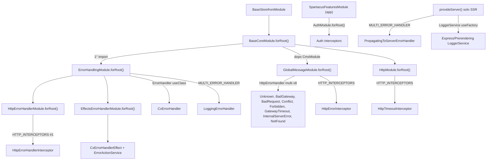
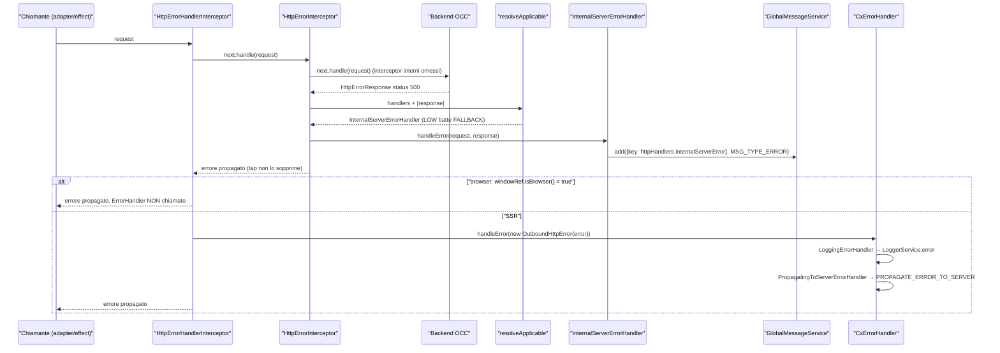
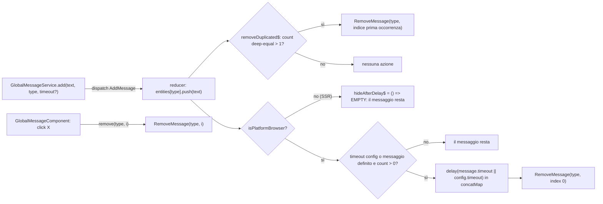
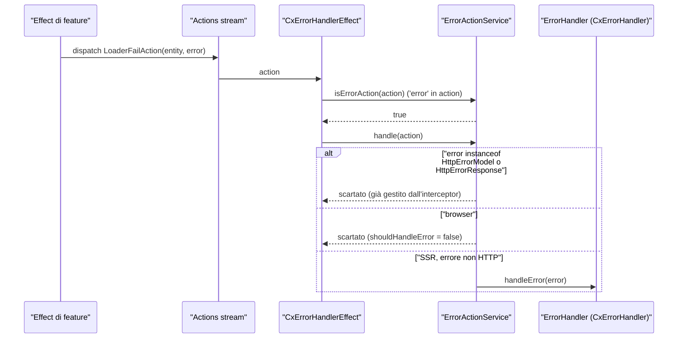

# 41 — Errori HTTP, error handling, logger e global message

> Riferimenti allo SHA `5b7a1c2bf2808d7380bc20596d10f4fa710c3da1` (vedi [00-meta](../00-meta.md)).

## 1. A cosa serve e perché esiste

Quando una chiamata OCC fallisce, in Spartacus succedono **due cose indipendenti**, gestite da due sottosistemi diversi che è facile confondere perché hanno nomi quasi identici:

| Sottosistema | Classe chiave | Domanda a cui risponde | Dove agisce |
|---|---|---|---|
| **Global message** (UX) | `HttpErrorInterceptor` + `HttpErrorHandler` (uno per status) | "Che messaggio mostro all'utente?" | browser e server (ma i messaggi hanno senso nel browser) |
| **Error handling** (osservabilità / SSR) | `HttpErrorHandlerInterceptor` + `CxErrorHandler` + `MULTI_ERROR_HANDLER` | "Chi deve sapere che c'è stato un errore? Devo far fallire il rendering SSR?" | di fatto **solo in SSR** |

Il primo sottosistema vive in `core-libs/core/src/global-message/`: un interceptor HTTP sceglie **un solo** handler applicabile per lo status della risposta (`core-libs/core/src/global-message/http-interceptors/http-error.interceptor.ts:L45-L65`) e l'handler, di norma, aggiunge una chiave di traduzione allo store NgRx `global-message` tramite `GlobalMessageService.add` (`core-libs/core/src/global-message/facade/global-message.service.ts:L43-L55`). Il componente `cx-global-message` legge lo store e mostra gli alert (`core-libs/storefront/cms-components/misc/global-message/global-message.component.ts:L44-L50`); un effect li rimuove dopo un timeout configurabile (`core-libs/core/src/global-message/store/effects/global-message.effect.ts:L70-L106`).

Il secondo sottosistema vive in `core-libs/core/src/error-handling/`: sostituisce l'`ErrorHandler` di Angular con `CxErrorHandler` (`core-libs/core/src/error-handling/error-handling.module.ts:L20-L31`), che fa da *fan-out* verso un array di `MultiErrorHandler` (`core-libs/core/src/error-handling/cx-error-handler.ts:L26-L30`). Due "sorgenti" alimentano l'`ErrorHandler`:

- gli errori HTTP, tramite `HttpErrorHandlerInterceptor`, che li incapsula in `OutboundHttpError` / `CmsPageNotFoundOutboundHttpError` (`core-libs/core/src/error-handling/http-error-handler/http-error-handler.interceptor.ts:L76-L81`);
- le *fail action* NgRx che portano una proprietà `error`, tramite `CxErrorHandlerEffect` ed `ErrorActionService` (`core-libs/core/src/error-handling/effects-error-handler/cx-error-handler.effect.ts:L23-L32`, `core-libs/core/src/error-handling/effects-error-handler/error-action.service.ts:L24-L37`).

Entrambe le sorgenti, però, inoltrano solo quando **non** sono nel browser (`!windowRef.isBrowser()`): il motivo dichiarato è non esporre nella console del browser dati potenzialmente confidenziali, mentre in SSR si vuole catturare tutto per poter rispondere con un 404/500 (`core-libs/core/src/error-handling/http-error-handler/http-error-handler.interceptor.ts:L63-L74`). In SSR `provideServer()` aggiunge infatti un secondo multi handler che propaga l'errore al server Express (`core-libs/setup/ssr/providers/ssr-providers.ts:L37-L45`), dove `defaultExpressErrorHandlers` sceglie 404 o 500 (`core-libs/setup/ssr/error-handling/express-error-handlers/express-error-handlers.ts:L21-L32`).

Trasversale a tutto c'è `LoggerService`: un servizio `providedIn: 'root'` che delega al `console` ed è pensato come extension point per redirigere i log (`core-libs/core/src/logger/logger.service.ts:L9-L22`). L'unico multi error handler di default, `LoggingErrorHandler`, scrive proprio lì (`core-libs/core/src/error-handling/multi-error-handler/logging-error-handler.ts:L17-L26`), e in SSR il logger è sostituito da una versione server (`core-libs/setup/ssr/logger/services/server-logger-service-factory.ts:L12-L17`).

Questo capitolo si concentra su `@spartacus/core`. La parte Express/SSR (dove viene fornito `PROPAGATE_ERROR_TO_SERVER`, formato dei log server) è trattata in [39 — SSR ottimizzato](../parte-2/39-ssr-ottimizzato.md); la catena di interceptor di Angular in [06 — HttpClient e interceptor](../parte-1/06-httpclient-interceptor.md).

## 2. Mappa dei file

| Path | Ruolo |
|---|---|
| `core-libs/core/src/error-handling/error-handling.module.ts` | `ErrorHandlingModule`: importa effects/http error handler; `forRoot()` sostituisce `ErrorHandler` con `CxErrorHandler` e registra `LoggingErrorHandler` |
| `core-libs/core/src/error-handling/cx-error-handler.ts` | `CxErrorHandler`: fan-out su `MULTI_ERROR_HANDLER` |
| `core-libs/core/src/error-handling/multi-error-handler/multi-error-handler.ts` | interfaccia `MultiErrorHandler`, token `MULTI_ERROR_HANDLER` |
| `core-libs/core/src/error-handling/multi-error-handler/logging-error-handler.ts` | `LoggingErrorHandler` → `LoggerService.error` |
| `core-libs/core/src/error-handling/multi-error-handler/provide-multi-error-handler.ts` | `provideMultiErrorHandler()` (non esportato dal barrel) |
| `core-libs/core/src/error-handling/multi-error-handler/index.ts` | barrel |
| `core-libs/core/src/error-handling/http-error-handler/http-error-handler.module.ts` | `HttpErrorHandlerModule.forRoot()`: registra l'interceptor |
| `core-libs/core/src/error-handling/http-error-handler/http-error-handler.interceptor.ts` | `HttpErrorHandlerInterceptor`: errori HTTP → `ErrorHandler` (solo SSR) |
| `core-libs/core/src/error-handling/http-error-handler/outbound-http-error.ts` | `OutboundHttpError`, `CmsPageNotFoundOutboundHttpError` |
| `core-libs/core/src/error-handling/http-error-handler/index.ts` | barrel |
| `core-libs/core/src/error-handling/effects-error-handler/effects-error-handler.module.ts` | `EffectsErrorHandlerModule`: effect + `ErrorActionService` |
| `core-libs/core/src/error-handling/effects-error-handler/cx-error-handler.effect.ts` | `CxErrorHandlerEffect` (non esportato) |
| `core-libs/core/src/error-handling/effects-error-handler/error-action.service.ts` | `ErrorActionService`: filtro action d'errore, esclusione errori HTTP |
| `core-libs/core/src/error-handling/effects-error-handler/error-action.ts` | interfaccia `ErrorAction` |
| `core-libs/core/src/error-handling/effects-error-handler/index.ts` | barrel |
| `core-libs/core/src/error-handling/index.ts` | barrel dell'area |
| `core-libs/core/src/global-message/global-message.module.ts` | `GlobalMessageModule`: store, effect, default config; `forRoot()` aggiunge handler + interceptor |
| `core-libs/core/src/global-message/http-interceptors/http-error.interceptor.ts` | `HttpErrorInterceptor`: sceglie l'`HttpErrorHandler` applicabile (non esportato) |
| `core-libs/core/src/global-message/http-interceptors/index.ts` | array `errorHandlers` e `httpErrorInterceptors` |
| `core-libs/core/src/global-message/http-interceptors/handlers/http-error.handler.ts` | classe astratta `HttpErrorHandler` (`Applicable`) |
| `core-libs/core/src/global-message/http-interceptors/handlers/bad-request/bad-request.handler.ts` | 400: password, login, validation, duplicate uid, unknown identifier, illegal argument |
| `core-libs/core/src/global-message/http-interceptors/handlers/forbidden/forbidden.handler.ts` | 403: messaggio + `logout()` se `users/current` |
| `core-libs/core/src/global-message/http-interceptors/handlers/not-found/not-found.handler.ts` | 404: no-op intenzionale |
| `core-libs/core/src/global-message/http-interceptors/handlers/conflict/conflict.handler.ts` | 409 |
| `core-libs/core/src/global-message/http-interceptors/handlers/internal-server/internal-server.handler.ts` | 500 |
| `core-libs/core/src/global-message/http-interceptors/handlers/bad-gateway/bad-gateway.handler.ts` | 502 |
| `core-libs/core/src/global-message/http-interceptors/handlers/gateway/gateway-timeout.handler.ts` | 504 |
| `core-libs/core/src/global-message/http-interceptors/handlers/unknown-error/unknown-error.handler.ts` | fallback: `warn` solo in dev mode |
| `core-libs/core/src/global-message/http-interceptors/handlers/index.ts` | barrel degli handler |
| `core-libs/core/src/global-message/models/global-message.model.ts` | `GlobalMessageType`, `GlobalMessage` |
| `core-libs/core/src/global-message/models/response-status.model.ts` | `HttpResponseStatus` |
| `core-libs/core/src/global-message/facade/global-message.service.ts` | `GlobalMessageService` (`get`/`add`/`remove`) |
| `core-libs/core/src/global-message/config/global-message-config.ts` | `GlobalMessageConfig`, `GlobalMessageTypeConfig`, augmentation di `Config` |
| `core-libs/core/src/global-message/config/default-global-message-config.ts` | `defaultGlobalMessageConfig` (non pubblico) |
| `core-libs/core/src/global-message/store/global-message-state.ts` | `GLOBAL_MESSAGE_FEATURE`, interfacce di stato |
| `core-libs/core/src/global-message/store/global-message-store.module.ts` | `GlobalMessageStoreModule` |
| `core-libs/core/src/global-message/store/actions/global-message.actions.ts` | `AddMessage`, `RemoveMessage`, `RemoveMessagesByType` |
| `core-libs/core/src/global-message/store/reducers/global-message.reducer.ts` | `reducer`, `initialState` |
| `core-libs/core/src/global-message/store/reducers/index.ts` | `reducerToken`, `reducerProvider`, `getReducers` |
| `core-libs/core/src/global-message/store/selectors/global-message.selectors.ts` | entities / byType / countByType |
| `core-libs/core/src/global-message/store/effects/global-message.effect.ts` | `GlobalMessageEffect`: dedup + auto-hide |
| `core-libs/core/src/global-message/index.ts` | barrel pubblico dell'area |
| `core-libs/core/src/logger/logger.service.ts` | `LoggerService` |
| `core-libs/core/src/logger/testing/mock-logger.service.ts` | `MockLoggerService` silenzioso |
| `core-libs/core/src/logger/testing/logger-testing.module.ts` | `LoggerTestingModule` |
| `core-libs/core/src/util/applicable.ts` | `Applicable`, `Priority`, `resolveApplicable` (fuori area, ma decisivo) |
| `core-libs/core/src/util/try-normalize-http-error.ts` | `tryNormalizeHttpError` → `HttpErrorModel` |
| `core-libs/storefront/cms-components/misc/global-message/global-message.component.ts` | `GlobalMessageComponent` (`cx-global-message`) |
| `core-libs/setup/ssr/providers/ssr-providers.ts` | `provideServer()`: logger server + `PropagatingToServerErrorHandler` |
| `core-libs/setup/ssr/error-handling/express-error-handlers/express-error-handlers.ts` | `defaultExpressErrorHandlers`: 404/500 + fallback CSR |

## 3. Come funziona passo per passo

### 3.1 Bootstrap: chi registra cosa, e in che ordine

1. `BaseStorefrontModule` importa `BaseCoreModule.forRoot()` e `GlobalMessageComponentModule` — `core-libs/storefront/base-storefront.module.ts:L26-L30`.
2. `BaseCoreModule` importa **per primo** `ErrorHandlingModule.forRoot()`, con il commento "Import this module before any other interceptor to handle HTTP errors efficiently" — `core-libs/core/src/base-core.module.ts:L26-L29`.
3. `ErrorHandlingModule` importa `EffectsErrorHandlerModule.forRoot()` e `HttpErrorHandlerModule.forRoot()` — `core-libs/core/src/error-handling/error-handling.module.ts:L13-L18`. Il secondo registra `HttpErrorHandlerInterceptor` in `HTTP_INTERCEPTORS` (`useExisting`, `multi`) — `core-libs/core/src/error-handling/http-error-handler/http-error-handler.module.ts:L11-L24`. Essendo il primo interceptor registrato, è il più **esterno** della catena.
4. `ErrorHandlingModule.forRoot()` aggiunge `provideMultiErrorHandler()` (→ `MULTI_ERROR_HANDLER` = `LoggingErrorHandler`) e `{ provide: ErrorHandler, useClass: CxErrorHandler }` — `core-libs/core/src/error-handling/error-handling.module.ts:L20-L31`, `core-libs/core/src/error-handling/multi-error-handler/provide-multi-error-handler.ts:L11-L19`.
5. `EffectsErrorHandlerModule` registra `CxErrorHandlerEffect` via `EffectsModule.forFeature` e, nel `forRoot()`, fornisce `ErrorActionService` — `core-libs/core/src/error-handling/effects-error-handler/effects-error-handler.module.ts:L12-L22`.
6. Più avanti `BaseCoreModule` importa `GlobalMessageModule.forRoot()` (dopo `CmsModule.forRoot()`, prima di `HttpModule.forRoot()`) — `core-libs/core/src/base-core.module.ts:L34-L42`.
7. `GlobalMessageModule` importa lo store e l'effect e fornisce `provideDefaultConfig(defaultGlobalMessageConfig)` — `core-libs/core/src/global-message/global-message.module.ts:L19-L25`; `forRoot()` aggiunge `...errorHandlers, ...httpErrorInterceptors` — `core-libs/core/src/global-message/global-message.module.ts:L26-L32`.
8. `errorHandlers` registra 8 handler come multi-provider del token-classe `HttpErrorHandler` con `useExisting`: Unknown, BadGateway, BadRequest, Conflict, Forbidden, GatewayTimeout, InternalServerError, NotFound — `core-libs/core/src/global-message/http-interceptors/index.ts:L22-L63`. `httpErrorInterceptors` registra `HttpErrorInterceptor` — `core-libs/core/src/global-message/http-interceptors/index.ts:L65-L71`.
9. `HttpModule.forRoot()` porta `HttpTimeoutInterceptor`, registrato dopo e quindi più interno — `core-libs/core/src/base-core.module.ts:L42-L42`, `core-libs/core/src/http/http-timeout/http-timeout.module.ts:L13-L23`.
10. Nell'app demo, `BaseStorefrontModule` precede `SpartacusFeaturesModule` (che contiene `AuthModule.forRoot()`), quindi gli interceptor di autenticazione sono ancora più interni — `projects/storefrontapp/src/app/spartacus/spartacus.module.ts:L14-L15`, `projects/storefrontapp/src/app/spartacus/spartacus-features.module.ts:L179-L179`.
11. Angular compone `HTTP_INTERCEPTORS` con `reduceRight`: dato `[a, b, c]` costruisce `c(b(a(end)))`, cioè il primo registrato vede la richiesta per primo e l'errore **per ultimo** — `angular:packages/common/http/src/interceptor.ts:L232-L240`.
12. In SSR, `provideServer()` (usato dall'`AppServerModule` della demo, `projects/storefrontapp/src/app/app.module.server.ts:L10-L17`) sostituisce `LoggerService` con `serverLoggerServiceFactory` e aggiunge `PropagatingToServerErrorHandler` come secondo `MULTI_ERROR_HANDLER` — `core-libs/setup/ssr/providers/ssr-providers.ts:L27-L46`.

Il risultato, per una richiesta OCC nella demo, è una catena (dall'esterno all'interno): `HttpErrorHandlerInterceptor` → … → `HttpErrorInterceptor` → … → `HttpTimeoutInterceptor` → … → interceptor auth → backend.

> ⚠️ DA VERIFICARE — L'ordine effettivo degli interceptor intermedi (site context, consensi, ecc.) dipende dall'ordine degli import dell'applicazione; qui è verificato solo l'ordine relativo dei quattro citati e solo per `projects/storefrontapp` (dossier Q4).

### 3.2 Il ramo "global message": dall'`HttpErrorResponse` all'alert

1. La risposta d'errore risale la catena dall'interno verso l'esterno — `angular:packages/common/http/src/interceptor.ts:L232-L240`.
2. `HttpErrorInterceptor.intercept` aggancia un `tap({ error })`: l'errore **non** viene catturato né sostituito, continua a propagarsi al chiamante. Reagisce solo se l'errore è `instanceof HttpErrorResponse` — `core-libs/core/src/global-message/http-interceptors/http-error.interceptor.ts:L30-L43`.
3. Gli handler disponibili sono ottenuti una volta sola, alla costruzione dell'interceptor, con `UnifiedInjector.getMulti(HttpErrorHandler)` più `shareReplay(1)` — `core-libs/core/src/global-message/http-interceptors/http-error.interceptor.ts:L22-L28`. `getMulti` interroga il root injector e gli injector dei moduli lazy, accumulando le istanze con `scan` — `core-libs/core/src/lazy-loading/unified-injector.ts:L79-L93`; `injectors$` parte con `startWith(this.rootInjector)` — `core-libs/core/src/lazy-loading/unified-injector.ts:L32-L35`. Per il funzionamento dell'`UnifiedInjector` vedi [12 — Feature module e lazy loading](../parte-2/12-feature-module-lazy.md).
4. `getResponseHandler` legge **sincronamente** l'ultimo array con `getLastValueSync` (subscribe + unsubscribe immediato) e lo passa a `resolveApplicable(handlers, [response])` — `core-libs/core/src/global-message/http-interceptors/http-error.interceptor.ts:L59-L65`, `core-libs/core/src/util/rxjs/get-last-value-sync.ts:L9-L23`.
5. `resolveApplicable` tiene solo gli handler con `hasMatch(response) === true` (o senza `hasMatch`); se ne restano meno di due restituisce il primo — `core-libs/core/src/util/applicable.ts:L63-L74`. Altrimenti vince la priorità più alta; a parità vince quello registrato **più tardi**; senza `getPriority` vale `Priority.NORMAL` — `core-libs/core/src/util/applicable.ts:L76-L86`, regola documentata nel JSDoc `core-libs/core/src/util/applicable.ts:L54-L57`.
6. L'`hasMatch` di default di `HttpErrorHandler` confronta `errorResponse.status === this.responseStatus` — `core-libs/core/src/global-message/http-interceptors/handlers/http-error.handler.ts:L42-L44`. `UnknownErrorHandler` sovrascrive `hasMatch` restituendo sempre `true` e ha `Priority.FALLBACK` (−50) — `core-libs/core/src/global-message/http-interceptors/handlers/unknown-error/unknown-error.handler.ts:L22-L50`. Tutti gli altri handler di default hanno `Priority.LOW` (−10) — es. `core-libs/core/src/global-message/http-interceptors/handlers/forbidden/forbidden.handler.ts:L39-L41`. Valori di `Priority`: `core-libs/core/src/util/applicable.ts:L7-L24`.
7. Viene invocato **un solo** handler: `handler.handleError(request, response)` — `core-libs/core/src/global-message/http-interceptors/http-error.interceptor.ts:L45-L53`.
8. L'handler, tipicamente, chiama `globalMessageService.add({ key: 'httpHandlers.xxx' }, GlobalMessageType.MSG_TYPE_ERROR)` — es. `core-libs/core/src/global-message/http-interceptors/handlers/internal-server/internal-server.handler.ts:L16-L28`. Le traduzioni inglesi stanno sotto `httpHandlers` in `core-libs/assets/src/translations/en/common.json:L116-L131` (vedi [37 — i18n](../parte-2/37-i18n.md)).
9. `GlobalMessageService.add` dispatcha `AddMessage`, avvolgendo una stringa in `{ raw: text }` — `core-libs/core/src/global-message/facade/global-message.service.ts:L43-L55`.
10. Il reducer accoda `message.text` all'array del tipo (creandolo se manca); `timeout` **non** viene salvato nello stato — `core-libs/core/src/global-message/store/reducers/global-message.reducer.ts:L24-L45`.
11. `GlobalMessageEffect.removeDuplicated$`: se dopo l'aggiunta esistono più testi deep-equal, dispatcha `RemoveMessage` sull'indice della **prima** occorrenza — `core-libs/core/src/global-message/store/effects/global-message.effect.ts:L31-L68`, utilità di confronto in `core-libs/core/src/util/object-comparison-utils.ts:L77-L92`.
12. `GlobalMessageEffect.hideAfterDelay$` (solo browser) attende `message.timeout || config.timeout` e poi rimuove l'indice `0` del tipo — `core-libs/core/src/global-message/store/effects/global-message.effect.ts:L73-L101`.
13. `GlobalMessageComponent` sottoscrive `globalMessageService.get()` e rende gli alert; la X chiama `remove(type, index)` — `core-libs/storefront/cms-components/misc/global-message/global-message.component.ts:L44-L50`, template `core-libs/storefront/cms-components/misc/global-message/global-message.component.html:L25-L94`.

### 3.3 Il ramo "error handling": dall'errore HTTP all'`ErrorHandler`

1. `HttpErrorHandlerInterceptor` (il più esterno) usa anch'esso `tap({ error })` e osserva **qualsiasi** errore, non solo `HttpErrorResponse` (anche ad es. un `TimeoutError` RxJS lanciato da un interceptor successivo, come nota il JSDoc) — `core-libs/core/src/error-handling/http-error-handler/http-error-handler.interceptor.ts:L48-L61`, `core-libs/core/src/error-handling/http-error-handler/http-error-handler.interceptor.ts:L34-L35`.
2. `shouldHandleError` restituisce `!this.windowRef.isBrowser()`: **nel browser si ferma qui** — `core-libs/core/src/error-handling/http-error-handler/http-error-handler.interceptor.ts:L63-L74`.
3. In SSR, `handleError` avvolge l'errore in `CmsPageNotFoundOutboundHttpError` se è un 404 sull'endpoint OCC `pages`, altrimenti in `OutboundHttpError`, e chiama `errorHandler.handleError` — `core-libs/core/src/error-handling/http-error-handler/http-error-handler.interceptor.ts:L76-L81`.
4. Il test "CMS page not found" costruisce l'URL atteso con `occEndpointsService.buildUrl('pages', { urlParams: { userId } })` (userId letto da un signal ottenuto con `toSignal(UserIdService.getUserId())`) e verifica `HttpErrorResponse`, status 404 e `url.startsWith(expectedUrl)` — `core-libs/core/src/error-handling/http-error-handler/http-error-handler.interceptor.ts:L46-L46`, `core-libs/core/src/error-handling/http-error-handler/http-error-handler.interceptor.ts:L89-L98`.
5. `OutboundHttpError` estende `Error` con messaggio `'Outbound HTTP Error'` e conserva l'originale in `cause`; la sottoclasse sovrascrive `message` con `'CMS Page Not Found'` — `core-libs/core/src/error-handling/http-error-handler/outbound-http-error.ts:L10-L25`.
6. L'`ErrorHandler` iniettato è `CxErrorHandler`, che chiama `handleError(error)` su ogni elemento di `MULTI_ERROR_HANDLER`, nell'ordine di registrazione e senza `try/catch` — `core-libs/core/src/error-handling/cx-error-handler.ts:L18-L30`, `core-libs/core/src/error-handling/multi-error-handler/multi-error-handler.ts:L20-L27`.
7. `LoggingErrorHandler` → `this.logger.error(error)` — `core-libs/core/src/error-handling/multi-error-handler/logging-error-handler.ts:L17-L26`. In SSR il `LoggerService` è `ExpressLoggerService` se esiste il token `REQUEST`, altrimenti `PrerenderingLoggerService` — `core-libs/setup/ssr/logger/services/server-logger-service-factory.ts:L12-L17`.
8. `PropagatingToServerErrorHandler` chiama `PROPAGATE_ERROR_TO_SERVER(error)` (opzionale, fallback noop) — `core-libs/setup/ssr/error-handling/multi-error-handlers/propagating-to-server-error-handler.ts:L29-L37`.
9. Lato Express, `defaultExpressErrorHandlers` (solo se `!res.headersSent`) imposta `Cache-Control: no-store` e risponde 404 per `CmsPageNotFoundOutboundHttpError`, 500 altrimenti, inviando il documento come fallback CSR — `core-libs/setup/ssr/error-handling/express-error-handlers/express-error-handlers.ts:L21-L32`.

### 3.4 Il ramo "error handling" per le fail action NgRx

1. Un effect cattura un errore e dispatcha una fail action con proprietà `error`: lo fanno di serie `LoaderFailAction` ed `EntityFailAction`, che implementano `ErrorAction` — `core-libs/core/src/state/utils/loader/loader.action.ts:L74-L83`, `core-libs/core/src/state/utils/entity-loader/entity-loader.action.ts:L80-L88`; ed esempi "manuali" come `LoadDeliveryCountriesFail` — `core-libs/core/src/user/store/actions/delivery-countries.action.ts:L25-L32`. Per le action loader/entity vedi [19 — State management](../parte-2/19-state-management.md).
2. Gli errori HTTP sono di norma normalizzati con `tryNormalizeHttpError`, che converte `HttpErrorResponse` in `HttpErrorModel` (message, status, statusText, url, details) o restituisce l'errore così com'è — `core-libs/core/src/util/try-normalize-http-error.ts:L21-L57`.
3. `CxErrorHandlerEffect.error$` (`dispatch: false`) filtra con `errorActionService.isErrorAction` e chiama `errorActionService.handle` — `core-libs/core/src/error-handling/effects-error-handler/cx-error-handler.effect.ts:L23-L32`.
4. `isErrorAction` è semplicemente `'error' in action` — `core-libs/core/src/error-handling/effects-error-handler/error-action.service.ts:L39-L43`.
5. `handle` scarta gli errori `HttpErrorModel` e `HttpErrorResponse` ("already handled in HttpErrorHandlerInterceptor") e inoltra gli altri all'`ErrorHandler` solo se `shouldHandleError`, che ancora una volta è `!windowRef.isBrowser()` — `core-libs/core/src/error-handling/effects-error-handler/error-action.service.ts:L24-L37`, `core-libs/core/src/error-handling/effects-error-handler/error-action.service.ts:L54-L56`.
6. Da qui il percorso è quello di 3.3 passi 6-9.

Nota: indipendentemente da Spartacus, NgRx stesso chiama `errorHandler.handleError(error)` quando un effect va in errore (non quando dispatcha una fail action) e lo risottoscrive fino a 10 volte — `deps:ngrx-effects-21.0.1/package/fesm2022/ngrx-effects.mjs:L174-L185`. Quel percorso arriva a `CxErrorHandler` **anche nel browser**, perché non passa da `shouldHandleError`.

### 3.5 L'`ErrorHandler` di Angular: cosa sostituisce Spartacus

L'`ErrorHandler` di default di Angular si limita a `console.error('ERROR', error)` — `angular:packages/core/src/error_handler.ts:L54-L63`. Angular lo risolve pigramente dall'`EnvironmentInjector` tramite `INTERNAL_APPLICATION_ERROR_HANDLER` e lo esegue fuori dalla zona — `angular:packages/core/src/error_handler.ts:L68-L91`. I listener globali `error`/`unhandledrejection` del browser (via `provideBrowserGlobalErrorListeners`) non sono attivi in server mode — `angular:packages/core/src/error_handler.ts:L108-L124`. Spartacus non cambia questo meccanismo: cambia solo *quale* classe risponde al token `ErrorHandler` (`core-libs/core/src/error-handling/error-handling.module.ts:L25-L28`). Il risultato pratico: nel browser, un errore non gestito di un componente arriva a `CxErrorHandler` → `LoggingErrorHandler` → `console.error` via `LoggerService`.

### 3.6 Timeout e errori di rete

1. `HttpTimeoutInterceptor` (interno) converte un `TimeoutError` RxJS in `HttpErrorResponse({ url, error })` senza status — `core-libs/core/src/http/http-timeout/http-timeout.interceptor.ts:L101-L110`; un `HttpErrorResponse` senza status vale `0` ("Unknown Error") — `angular:packages/common/http/src/response.ts:L401-L421`.
2. In `HttpErrorInterceptor` nessun handler ha `responseStatus` 0, quindi vince `UnknownErrorHandler`, che non aggiunge messaggi e fa solo `logger.warn` in `isDevMode()` — `core-libs/core/src/global-message/http-interceptors/handlers/unknown-error/unknown-error.handler.ts:L30-L43`.
3. In SSR `HttpErrorHandlerInterceptor` lo inoltra come `OutboundHttpError` → 500 — `core-libs/core/src/error-handling/http-error-handler/http-error-handler.interceptor.ts:L76-L81`.

### 3.7 Il `BadRequestHandler` in dettaglio

Il 400 è lo status più "carico" di semantica OCC, perciò `BadRequestHandler` (priorità LOW) esegue **in sequenza** sei sotto-handler, ognuno dei quali filtra gli `ErrorModel` della risposta — `core-libs/core/src/global-message/http-interceptors/handlers/bad-request/bad-request.handler.ts:L22-L33`:

| Sotto-handler | Condizione | Messaggio | Riferimento |
|---|---|---|---|
| `handleBadPassword` | URL contiene `/authorizationserver/oauth/token`, `error === 'invalid_grant'`, body `grant_type === 'password'` | chiave da `getErrorTranslationKey(error_description)`, param `errorMessage`; poi `remove(MSG_TYPE_CONFIRMATION)` | `bad-request.handler.ts:L17-L67` → `core-libs/core/src/global-message/http-interceptors/handlers/bad-request/bad-request.handler.ts:L35-L67` |
| `handleBadLoginResponse` | `type === 'PasswordMismatchError'` | path `/password` → `httpHandlers.badRequestOldPasswordIncorrect`, altrimenti `httpHandlers.validationErrors.invalid.password` | `core-libs/core/src/global-message/http-interceptors/handlers/bad-request/bad-request.handler.ts:L73-L87` |
| `handleValidationError` | `type === 'ValidationError'` | `httpHandlers.validationErrors.<reason>.<subject>` | `core-libs/core/src/global-message/http-interceptors/handlers/bad-request/bad-request.handler.ts:L94-L103` |
| `handleGuestDuplicateEmail` | `type === 'DuplicateUidError'` | `httpHandlers.badRequestGuestDuplicateEmail` con `errorMessage` | `core-libs/core/src/global-message/http-interceptors/handlers/bad-request/bad-request.handler.ts:L124-L136` |
| `handleUnknownIdentifierError` | `type === 'UnknownIdentifierError'` | `error.message` raw, altrimenti `httpHandlers.unknownIdentifier` | `core-libs/core/src/global-message/http-interceptors/handlers/bad-request/bad-request.handler.ts:L143-L152` |
| `handleValidationErrorIleggalArgument` | `type === 'IllegalArgumentError'` | `error.message` raw | `core-libs/core/src/global-message/http-interceptors/handlers/bad-request/bad-request.handler.ts:L106-L118` |

`getErrors` legge `response.error.errors` (o `[]`) escludendo `JaloObjectNoLongerValidError` — `core-libs/core/src/global-message/http-interceptors/handlers/bad-request/bad-request.handler.ts:L155-L159`. `getErrorTranslationKey` (definito nella classe base) converte la descrizione in `httpHandlers.badRequest.<snake_case>` o, se vuota, in `httpHandlers.badRequestPleaseLoginAgain` — `core-libs/core/src/global-message/http-interceptors/handlers/http-error.handler.ts:L51-L59`. Con il toggle `enablePasswordExpiredErrorTranslation`, una chiave che inizia con `...password_expired_for_the_user` è rimappata su `httpHandlers.badRequest.password_expired` — `core-libs/core/src/global-message/http-interceptors/handlers/bad-request/bad-request.handler.ts:L50-L57`.

Le feature lib specializzano il 400 con handler a priorità più alta: ad esempio `BadCartRequestHandler` usa `Priority.NORMAL` e restringe `hasMatch` a `super.hasMatch(...) && getErrors(...).some(isCartError)` — `feature-libs/cart/base/core/http-interceptors/handlers/bad-cart-request.handler.ts:L21-L33`, registrato in `CartBaseCoreModule` — `feature-libs/cart/base/core/cart-base-core.module.ts:L37-L46`. Così un 400 "di carrello" va **solo** a `BadCartRequestHandler`, mentre un 400 generico continua ad andare a `BadRequestHandler`. Pattern analoghi in checkout B2B, quote, organization, pdf-invoices, configuratore, ticketing, requested delivery date (dossier F+2, es. `feature-libs/quote/root/quote-root.module.ts:L110-L117`).

### 3.8 Gli altri handler per status

| Status | Handler | Priorità | Effetto | Riferimento |
|---|---|---|---|---|
| 403 | `ForbiddenHandler` | LOW | se `request.url` termina con l'URL OCC `user` per `current` → `authService.logout()`; sempre `httpHandlers.forbidden` | `core-libs/core/src/global-message/http-interceptors/handlers/forbidden/forbidden.handler.ts:L23-L37` |
| 404 | `NotFoundHandler` | LOW | nessuno (vuoto per non cadere nell'Unknown) | `core-libs/core/src/global-message/http-interceptors/handlers/not-found/not-found.handler.ts:L15-L24` |
| 409 | `ConflictHandler` | LOW | `httpHandlers.conflict` | `core-libs/core/src/global-message/http-interceptors/handlers/conflict/conflict.handler.ts:L16-L28` |
| 500 | `InternalServerErrorHandler` | LOW | `httpHandlers.internalServerError` | `core-libs/core/src/global-message/http-interceptors/handlers/internal-server/internal-server.handler.ts:L16-L28` |
| 502 | `BadGatewayHandler` | LOW | `httpHandlers.badGateway` | `core-libs/core/src/global-message/http-interceptors/handlers/bad-gateway/bad-gateway.handler.ts:L16-L28` |
| 504 | `GatewayTimeoutHandler` | LOW | `httpHandlers.gatewayTimeout` | `core-libs/core/src/global-message/http-interceptors/handlers/gateway/gateway-timeout.handler.ts:L16-L28` |
| qualsiasi | `UnknownErrorHandler` | FALLBACK | solo `warn` in dev mode | `core-libs/core/src/global-message/http-interceptors/handlers/unknown-error/unknown-error.handler.ts:L22-L50` |

`HttpResponseStatus` include anche `UNAUTHORIZED = 401`, ma nessun handler di default lo usa — `core-libs/core/src/global-message/models/response-status.model.ts:L7-L17`, `core-libs/core/src/global-message/http-interceptors/index.ts:L22-L63`. Il 401 è normalmente assorbito dall'`AuthInterceptor` con refresh e retry (vedi [22 — Autenticazione](../parte-2/22-auth.md)).

## 4. Diagrammi

### 4.1 Registrazione e ordine della catena di interceptor



Ogni freccia corrisponde a un passo di §3.1 (passi 1-12). L'ordine di registrazione, per `reduceRight`, diventa ordine di annidamento: `HttpErrorHandlerInterceptor` è il più esterno, gli interceptor auth i più interni (`angular:packages/common/http/src/interceptor.ts:L232-L240`).

### 4.2 Un errore 500 che risale la catena: browser vs SSR



Riferimenti: §3.2 passi 2-9 e §3.3 passi 1-8.

### 4.3 Ciclo di vita di un global message nello store



Riferimenti: `core-libs/core/src/global-message/facade/global-message.service.ts:L43-L72`, `core-libs/core/src/global-message/store/reducers/global-message.reducer.ts:L24-L67`, `core-libs/core/src/global-message/store/effects/global-message.effect.ts:L31-L106`.

### 4.4 Fail action NgRx verso l'`ErrorHandler`



Riferimenti: §3.4.

## 5. Estratti di codice reale

### 5.1 `ErrorHandlingModule`

`core-libs/core/src/error-handling/error-handling.module.ts:L13-L32`
```ts
@NgModule({
  imports: [
    EffectsErrorHandlerModule.forRoot(),
    HttpErrorHandlerModule.forRoot(),
  ],
})
export class ErrorHandlingModule {
  static forRoot(): ModuleWithProviders<ErrorHandlingModule> {
    return {
      ngModule: ErrorHandlingModule,
      providers: [
        provideMultiErrorHandler(),
        {
          provide: ErrorHandler,
          useClass: CxErrorHandler,
        },
      ],
    };
  }
}
```

### 5.2 `CxErrorHandler`

`core-libs/core/src/error-handling/cx-error-handler.ts:L18-L31`
```ts
@Injectable()
export class CxErrorHandler implements ErrorHandler {
  protected errorHandlers = inject(MULTI_ERROR_HANDLER);

  /**
   * Error handler method. Handles the error by passing it to the registered multi error handlers.
   * @param error - The error to be handled.
   */
  handleError(error: unknown): void {
    this.errorHandlers.forEach((handler) => {
      handler.handleError(error);
    });
  }
}
```

### 5.3 `HttpErrorHandlerInterceptor` (cuore)

`core-libs/core/src/error-handling/http-error-handler/http-error-handler.interceptor.ts:L40-L81`
```ts
@Injectable({ providedIn: 'root' })
export class HttpErrorHandlerInterceptor implements HttpInterceptor {
  protected errorHandler = inject(ErrorHandler);
  protected occEndpointsService = inject(OccEndpointsService);
  protected windowRef = inject(WindowRef);

  protected userId = toSignal(inject(UserIdService).getUserId());

  intercept(
    request: HttpRequest<unknown>,
    next: HttpHandler
  ): Observable<HttpEvent<unknown>> {
    return next.handle(request).pipe(
      tap({
        error: (error: unknown) => {
          if (this.shouldHandleError(error)) {
            this.handleError(error);
          }
        },
      })
    );
  }
  // ...
  protected shouldHandleError(_error: unknown): boolean {
    return !this.windowRef.isBrowser();
  }

  protected handleError(error: unknown): void {
    error = this.isCmsPageNotFoundHttpError(error)
      ? new CmsPageNotFoundOutboundHttpError(error)
      : new OutboundHttpError(error);
    this.errorHandler.handleError(error);
  }
```

### 5.4 `HttpErrorInterceptor` (global message)

`core-libs/core/src/global-message/http-interceptors/http-error.interceptor.ts:L22-L65`
```ts
@Injectable({ providedIn: 'root' })
export class HttpErrorInterceptor implements HttpInterceptor {
  constructor(protected unifiedInjector: UnifiedInjector) {}

  protected handlers$: Observable<HttpErrorHandler[]> = this.unifiedInjector
    .getMulti(HttpErrorHandler)
    .pipe(shareReplay(1));

  intercept(
    request: HttpRequest<any>,
    next: HttpHandler
  ): Observable<HttpEvent<any>> {
    return next.handle(request).pipe(
      tap({
        error: (response: any) => {
          if (response instanceof HttpErrorResponse) {
            this.handleErrorResponse(request, response);
          }
        },
      })
    );
  }

  protected handleErrorResponse(
    request: HttpRequest<any>,
    response: HttpErrorResponse
  ): void {
    const handler = this.getResponseHandler(response);
    if (handler) {
      handler.handleError(request, response);
    }
  }
  // ...
  protected getResponseHandler(
    response: HttpErrorResponse
  ): HttpErrorHandler | undefined {
    return resolveApplicable(getLastValueSync(this.handlers$) ?? [], [
      response,
    ]);
  }
```

### 5.5 `resolveApplicable`: la regola di scelta

`core-libs/core/src/util/applicable.ts:L63-L87`
```ts
export function resolveApplicable<T extends Applicable>(
  applicables: T[],
  matchParams: any[] = [],
  priorityParams: any[] = []
): T | undefined {
  const matchedApplicables = (applicables ?? []).filter(
    (applicable) => !applicable.hasMatch || applicable.hasMatch(...matchParams)
  );

  if (matchedApplicables.length < 2) {
    return matchedApplicables[0];
  }

  let lastPriority = -Infinity;
  return matchedApplicables.reduce((acc: T | undefined, curr: T) => {
    const currPriority = curr.getPriority
      ? curr.getPriority(...priorityParams)
      : Priority.NORMAL;
    if (lastPriority > currPriority) {
      return acc;
    }
    lastPriority = currPriority;
    return curr;
  }, undefined);
}
```

Nota la condizione `lastPriority > currPriority`: a parità (`===`) non si ritorna `acc`, si sostituisce con `curr`. È questo che realizza "provided later wins".

### 5.6 `HttpErrorHandler` (classe base)

`core-libs/core/src/global-message/http-interceptors/handlers/http-error.handler.ts:L12-L44`
```ts
@Injectable({
  providedIn: 'root',
})
export abstract class HttpErrorHandler implements Applicable {
  constructor(
    protected globalMessageService: GlobalMessageService,
    @Inject(PLATFORM_ID) protected platformId?: Object
  ) {}

  /**
   * The http response status number which is handled by this handler.
   * Implementations can set the response status number, i.e. 404, so that
   * the handler can be found by the error interceptor.
   */
  responseStatus?: number;
  // ...
  abstract handleError(
    request: HttpRequest<any>,
    errorResponse: HttpErrorResponse
  ): void;
  // ...
  hasMatch(errorResponse: HttpErrorResponse): boolean {
    return errorResponse.status === this.responseStatus;
  }
```

### 5.7 `UnknownErrorHandler`

`core-libs/core/src/global-message/http-interceptors/handlers/unknown-error/unknown-error.handler.ts:L22-L50`
```ts
export class UnknownErrorHandler extends HttpErrorHandler {
  protected logger = inject(LoggerService);

  responseStatus = HttpResponseStatus.UNKNOWN;

  /**
   * hasMatch always returns true, to mach all errors
   */
  hasMatch(_errorResponse: HttpErrorResponse): boolean {
    return true;
  }

  handleError(_request: HttpRequest<any>, errorResponse: HttpErrorResponse) {
    // Error is already handled and logged by the `HttpErrorHandlerInterceptor`.
    // Log error here only in dev mode.
    if (isDevMode()) {
      this.logger.warn(
        `An unknown http error occurred\n`,
        errorResponse.message
      );
    }
  }

  /**
   * Fallback priority assures that the handler is used as a last resort
   */
  getPriority() {
    return Priority.FALLBACK;
  }
}
```

### 5.8 `ForbiddenHandler`

`core-libs/core/src/global-message/http-interceptors/handlers/forbidden/forbidden.handler.ts:L20-L50`
```ts
export class ForbiddenHandler extends HttpErrorHandler {
  responseStatus = HttpResponseStatus.FORBIDDEN;

  handleError(request: HttpRequest<any>) {
    if (
      request.url.endsWith(
        this.occEndpoints.buildUrl('user', {
          urlParams: { userId: 'current' },
        })
      )
    ) {
      this.authService.logout();
    }
    this.globalMessageService.add(
      { key: 'httpHandlers.forbidden' },
      GlobalMessageType.MSG_TYPE_ERROR
    );
  }

  getPriority(): Priority {
    return Priority.LOW;
  }

  constructor(
    protected globalMessageService: GlobalMessageService,
    protected authService: AuthService,
    protected occEndpoints: OccEndpointsService
  ) {
    super(globalMessageService);
  }
}
```

### 5.9 `BadCartRequestHandler`: come una feature specializza il 400

`feature-libs/cart/base/core/http-interceptors/handlers/bad-cart-request.handler.ts:L21-L38`
```ts
export class BadCartRequestHandler extends HttpErrorHandler {
  responseStatus = HttpResponseStatus.BAD_REQUEST;

  getPriority(): Priority {
    return Priority.NORMAL;
  }

  hasMatch(errorResponse: HttpErrorResponse): boolean {
    return (
      super.hasMatch(errorResponse) &&
      this.getErrors(errorResponse).some(isCartError)
    );
  }

  handleError(request: HttpRequest<any>, response: HttpErrorResponse): void {
    this.handleCartNotFoundError(request, response);
    this.handleOtherCartErrors(request, response);
  }
```

### 5.10 `ErrorActionService`

`core-libs/core/src/error-handling/effects-error-handler/error-action.service.ts:L24-L43`
```ts
  handle(action: ErrorAction): void {
    const error: unknown = action.error;

    // Http errors are already handled in HttpErrorHandlerInterceptor.
    // To avoid duplicate errors we want to check if the error is not of type
    // HttpErrorModel or HttpErrorResponse.
    const isNotHttpError =
      !(error instanceof HttpErrorModel) &&
      !(error instanceof HttpErrorResponse);

    if (isNotHttpError && this.shouldHandleError(error)) {
      this.errorHandler.handleError(error);
    }
  }

  /** Here we want to filter which error actions should be handled.
   * By default, we check if action implements interface ErrorAction  */
  isErrorAction(action: Action): action is ErrorAction {
    return 'error' in action;
  }
```

### 5.11 `GlobalMessageService.add` / `remove`

`core-libs/core/src/global-message/facade/global-message.service.ts:L43-L72`
```ts
  add(
    text: string | Translatable,
    type: GlobalMessageType,
    timeout?: number
  ): void {
    this.store.dispatch(
      new GlobalMessageActions.AddMessage({
        text: typeof text === 'string' ? { raw: text } : text,
        type,
        timeout,
      })
    );
  }
  // ...
  remove(type: GlobalMessageType, index?: number): void {
    this.store.dispatch(
      index !== undefined
        ? new GlobalMessageActions.RemoveMessage({
            type: type,
            index: index,
          })
        : new GlobalMessageActions.RemoveMessagesByType(type)
    );
  }
```

### 5.12 `hideAfterDelay$`

`core-libs/core/src/global-message/store/effects/global-message.effect.ts:L70-L106`
```ts
  hideAfterDelay$:
    | Observable<GlobalMessageActions.RemoveMessage>
    | (() => Observable<never>) = createEffect(() =>
    isPlatformBrowser(this.platformId) // we don't want to run this logic when doing SSR
      ? this.actions$.pipe(
          ofType(GlobalMessageActions.ADD_MESSAGE),
          map((action) => (action as GlobalMessageActions.AddMessage).payload),
          concatMap((message) => {
            const config = this.config.globalMessages?.[message.type];
            return this.store.pipe(
              select(
                GlobalMessageSelectors.getGlobalMessageCountByType(message.type)
              ),
              take(1),
              filter(
                (count: number) =>
                  ((config && config.timeout !== undefined) ||
                    message.timeout !== undefined) &&
                  count > 0
              ),
              delay((message.timeout as number) || (config?.timeout as number)),
              switchMap(() =>
                of(
                  new GlobalMessageActions.RemoveMessage({
                    type: message.type,
                    index: 0,
                  })
                )
              )
            );
          })
        )
      : // workaround is required due to NGRX mutating a global static
        // observable EMPTY, causing to throw an error if we have
        // effect registered on the same observable twice
        () => EMPTY
  );
```

### 5.13 `LoggerService`

`core-libs/core/src/logger/logger.service.ts:L15-L30`
```ts
@Injectable({
  providedIn: 'root',
})
export class LoggerService {
  log(...args: Parameters<typeof console.log>): void {
    /* eslint-disable-next-line no-console */
    console.log(...args);
  }
  warn(...args: Parameters<typeof console.warn>): void {
    /* eslint-disable-next-line no-console */
    console.warn(...args);
  }
  error(...args: Parameters<typeof console.error>): void {
    /* eslint-disable-next-line no-console */
    console.error(...args);
  }
  // ...
```

### 5.14 Il ponte verso Express

`core-libs/setup/ssr/error-handling/express-error-handlers/express-error-handlers.ts:L21-L32`
```ts
export const defaultExpressErrorHandlers =
  (documentContent: string): ErrorRequestHandler =>
  (err, _req, res, _next) => {
    if (!res.headersSent) {
      res.set('Cache-Control', 'no-store');
      const statusCode =
        err instanceof CmsPageNotFoundOutboundHttpError
          ? HttpResponseStatus.NOT_FOUND
          : HttpResponseStatus.INTERNAL_SERVER_ERROR;
      res.status(statusCode).send(documentContent);
    }
  };
```

## 6. Configurazione

| Chiave | Tipo | Default | Definita in | Letta in |
|---|---|---|---|---|
| `globalMessages[MSG_TYPE_CONFIRMATION].timeout` | `number?` (ms) | 3000 | `core-libs/core/src/global-message/config/global-message-config.ts:L15-L27`; default `core-libs/core/src/global-message/config/default-global-message-config.ts:L12-L14` | `core-libs/core/src/global-message/store/effects/global-message.effect.ts:L78-L90` |
| `globalMessages[MSG_TYPE_INFO].timeout` | `number?` | 3000 | idem; default `core-libs/core/src/global-message/config/default-global-message-config.ts:L15-L17` | idem |
| `globalMessages[MSG_TYPE_ERROR].timeout` | `number?` | 7000 | idem; default `core-libs/core/src/global-message/config/default-global-message-config.ts:L18-L20` | idem |
| `globalMessages[MSG_TYPE_WARNING].timeout` | `number?` | 7000 | idem; default `core-libs/core/src/global-message/config/default-global-message-config.ts:L21-L23` | idem |
| `globalMessages[MSG_TYPE_ASSISTIVE].timeout` | `number?` | 7000 | idem; default `core-libs/core/src/global-message/config/default-global-message-config.ts:L24-L26` | idem |
| `timeout` del singolo messaggio (3° argomento di `GlobalMessageService.add`) | `number?` | `undefined` | `core-libs/core/src/global-message/facade/global-message.service.ts:L43-L54` | `core-libs/core/src/global-message/store/effects/global-message.effect.ts:L86-L90` (prevale se truthy) |
| feature toggle `enablePasswordExpiredErrorTranslation` | `boolean?` | `true` | `core-libs/core/src/features-config/feature-toggles/config/feature-toggles.ts:L174-L179`; default `core-libs/core/src/features-config/feature-toggles/config/feature-toggles.ts:L1031-L1031` | `core-libs/core/src/global-message/http-interceptors/handlers/bad-request/bad-request.handler.ts:L50-L57` |
| feature toggle `a11yFilteredFacetAnnouncement` | `boolean?` | `false` | `core-libs/core/src/features-config/feature-toggles/config/feature-toggles.ts:L333-L333`; default `core-libs/core/src/features-config/feature-toggles/config/feature-toggles.ts:L1054-L1054` | `core-libs/storefront/cms-components/misc/global-message/global-message.component.html:L1-L13` |

Note:

- `GlobalMessageTypeConfig` contiene **solo** `timeout` — `core-libs/core/src/global-message/config/global-message-config.ts:L11-L13`. `GlobalMessageConfig` è `providedIn: 'root'` con `useExisting: Config` e arricchisce `Config` via module augmentation — `core-libs/core/src/global-message/config/global-message-config.ts:L15-L31`. Si configura quindi con `provideConfig({ globalMessages: { ... } })` come qualsiasi altra chiave (vedi [11 — Configurazione](../parte-2/11-configurazione.md)).
- Il default è registrato con `provideDefaultConfig(defaultGlobalMessageConfig)` — `core-libs/core/src/global-message/global-message.module.ts:L24-L24`; `defaultGlobalMessageConfig` non è esportato dal barrel pubblico — `core-libs/core/src/global-message/index.ts:L7-L16`.
- Non esistono chiavi di configurazione per l'error handling (`MULTI_ERROR_HANDLER`, `shouldHandleError`, logger): si personalizza solo via DI (§8). I toggle in generale sono trattati in [42 — Feature toggle e deprecazioni](../parte-2/42-feature-toggle-deprecazioni.md).

## 7. Commenti e note notevoli dal sorgente

- "The CxErrorHandler is the default ErrorHandler for Spartacus. … The prefix `Cx` was used to distinguish it from Angular's `ErrorHandler` class." — `core-libs/core/src/error-handling/cx-error-handler.ts:L10-L17`.
- "CAUTION: It MUST be provided as the first one in the application to be able to catch errors from all subsequent interceptors." — `core-libs/core/src/error-handling/http-error-handler/http-error-handler.interceptor.ts:L27-L39`. Il contraltare in `BaseCoreModule`: "Import this module before any other interceptor to handle HTTP errors efficiently" — `core-libs/core/src/base-core.module.ts:L28-L28`.
- "Be default, we avoid sending unpredictable errors to the browser's console, to prevent possibly exposing there potentially confidential user's data. This isn't an issue in SSR, where pages are rendered anonymously." — `core-libs/core/src/error-handling/http-error-handler/http-error-handler.interceptor.ts:L63-L71` (testo identico, refuso "Be default" compreso, in `core-libs/core/src/error-handling/effects-error-handler/error-action.service.ts:L45-L53`).
- "It ensures that HTTP errors, which are already handled by `HttpErrorHandlerInterceptor`, are not processed again to avoid duplicate error handling." — `core-libs/core/src/error-handling/effects-error-handler/error-action.service.ts:L14-L18`.
- "Multi provided error handlers will be called in the order they are provided." — `core-libs/core/src/error-handling/multi-error-handler/multi-error-handler.ts:L20-L23`.
- "Intentional empty error handler to avoid we fallabck to the unknown error handler" — `core-libs/core/src/global-message/http-interceptors/handlers/not-found/not-found.handler.ts:L19-L19`.
- "Error is already handled and logged by the `HttpErrorHandlerInterceptor`. Log error here only in dev mode." — `core-libs/core/src/global-message/http-interceptors/handlers/unknown-error/unknown-error.handler.ts:L35-L36`. Vero solo in SSR: vedi §9, trappola 1.
- "return the error handler that matches the `HttpResponseStatus` code. If no handler is available, the UNKNOWN handler is returned." — `core-libs/core/src/global-message/http-interceptors/http-error.interceptor.ts:L55-L58`.
- "Updating email and changing password share same http error occurence." — `core-libs/core/src/global-message/http-interceptors/handlers/bad-request/bad-request.handler.ts:L76-L77`.
- "Added in 3.2, depends on the injected `platformId`." (su `isSsr()`) — `core-libs/core/src/global-message/http-interceptors/handlers/http-error.handler.ts:L63-L67`.
- "workaround is required due to NGRX mutating a global static observable EMPTY, causing to throw an error if we have effect registered on the same observable twice" — `core-libs/core/src/global-message/store/effects/global-message.effect.ts:L102-L105`.
- "It's a good extension point for customizing the destination of logs (e.g. to use a 3rd party logger library) or to enhance logs with more contextual data." — `core-libs/core/src/logger/logger.service.ts:L9-L14`.
- "Should be used with caution, as it's not a legitimate way for getting value from the observable." (su `getLastValueSync`) — `core-libs/core/src/util/rxjs/get-last-value-sync.ts:L13-L15`.
- "CXSPA-11104: Revise type to avoid redundant types - typescript:S6571" — `core-libs/core/src/util/try-normalize-http-error.ts:L28-L28`.
- "We need it until Angular implements a proper propagation of async errors … https://github.com/angular/angular/issues/33642" — `core-libs/setup/ssr/error-handling/multi-error-handlers/propagating-to-server-error-handler.ts:L18-L20`.
- La proprietà `error` aggiunta "to be recognizable by `CxErrorHandlerEffect` (which expects `error` property in every fail action)" — `feature-libs/pickup-in-store/core/store/actions/pickup-location.action.ts:L83-L87`.
- Nei 55 file dell'area non ci sono `@deprecated`, `TODO` o `FIXME` (dossier, sezione N).

## 8. Extension point

| Cosa vuoi fare | Extension point | Definizione | Pubblico? |
|---|---|---|---|
| Messaggio custom per uno status o per un sotto-caso di uno status | nuovo `HttpErrorHandler` multi-provider con `getPriority()` > LOW e/o `hasMatch` più stretto | `core-libs/core/src/global-message/http-interceptors/handlers/http-error.handler.ts:L15-L74` | sì, `core-libs/core/src/global-message/index.ts:L10-L10` |
| Modificare un handler esistente | estendere `BadRequestHandler`, `ForbiddenHandler`, … e registrarlo con priorità maggiore | `core-libs/core/src/global-message/http-interceptors/handlers/index.ts:L7-L15` | sì |
| Mostrare/rimuovere messaggi da codice applicativo | `GlobalMessageService` | `core-libs/core/src/global-message/facade/global-message.service.ts:L21-L73` | sì, `core-libs/core/src/global-message/index.ts:L8-L8` |
| Cambiare i timeout | `GlobalMessageConfig` via `provideConfig` | `core-libs/core/src/global-message/config/global-message-config.ts:L15-L27` | sì, `core-libs/core/src/global-message/index.ts:L7-L7` |
| Leggere lo store direttamente | `GlobalMessageSelectors`, `GlobalMessageActions`, `GLOBAL_MESSAGE_FEATURE` | `core-libs/core/src/global-message/store/selectors/index.ts:L7-L8`, `core-libs/core/src/global-message/store/actions/index.ts:L7-L8` | sì, `core-libs/core/src/global-message/index.ts:L14-L16` |
| Inviare gli errori a un servizio esterno (Sentry, APM…) | nuovo `MultiErrorHandler` su `MULTI_ERROR_HANDLER` (`multi: true`) | `core-libs/core/src/error-handling/multi-error-handler/multi-error-handler.ts:L16-L27` | sì, `core-libs/core/src/error-handling/multi-error-handler/index.ts:L8-L8` |
| Cambiare destinazione/formato dei log | sostituire `LoggerService` (`useClass`/`useExisting`) | `core-libs/core/src/logger/logger.service.ts:L15-L39` | sì, `core-libs/core/src/logger/index.ts:L7-L7` |
| Inoltrare errori HTTP all'`ErrorHandler` anche nel browser, o filtrarli | estendere `HttpErrorHandlerInterceptor` e sovrascrivere `shouldHandleError` (protected) | `core-libs/core/src/error-handling/http-error-handler/http-error-handler.interceptor.ts:L72-L98` | sì, `core-libs/core/src/error-handling/http-error-handler/index.ts:L7-L7` |
| Decidere quali fail action contano come errore | estendere `ErrorActionService` (`isErrorAction`, `shouldHandleError`) | `core-libs/core/src/error-handling/effects-error-handler/error-action.service.ts:L41-L56` | sì, `core-libs/core/src/error-handling/effects-error-handler/index.ts:L9-L9` |
| Far riconoscere una fail action custom | implementare `ErrorAction` (proprietà `error`) | `core-libs/core/src/error-handling/effects-error-handler/error-action.ts:L9-L11` | sì |
| Sostituire del tutto l'`ErrorHandler` | `{ provide: ErrorHandler, useClass: ... }` | `core-libs/core/src/error-handling/error-handling.module.ts:L25-L28` | `CxErrorHandler` pubblico, `core-libs/core/src/error-handling/index.ts:L7-L7` |
| Distinguere errori lato server | `OutboundHttpError`, `CmsPageNotFoundOutboundHttpError` (`instanceof`) | `core-libs/core/src/error-handling/http-error-handler/outbound-http-error.ts:L10-L25` | sì |
| Silenziare il logger nei test | `LoggerTestingModule` / `MockLoggerService` | `core-libs/core/src/logger/testing/logger-testing.module.ts:L11-L14` | sì, `core-libs/core/src/logger/index.ts:L8-L8` |

**Non** sono extension point pubblici: `HttpErrorInterceptor` (importato ma non riesportato da `core-libs/core/src/global-message/http-interceptors/index.ts:L20-L20`), `CxErrorHandlerEffect` (`core-libs/core/src/error-handling/effects-error-handler/index.ts:L7-L9`), `GlobalMessageEffect`, il reducer, `defaultGlobalMessageConfig` (`core-libs/core/src/global-message/index.ts:L7-L16`) e `provideMultiErrorHandler` (`core-libs/core/src/error-handling/multi-error-handler/index.ts:L7-L8`). Vedi [54 — API pubblica vs interna](../parte-3/54-upgrade-safe.md).

### 8.1 Schema: handler custom per uno status

Esempio illustrativo (nomi applicativi inventati, simboli Spartacus esportati da `@spartacus/core`), costruito sullo stesso schema di `BadCartRequestHandler` (§5.9) e della sua registrazione (`feature-libs/cart/base/core/cart-base-core.module.ts:L37-L41`):

```ts
// ESEMPIO — non presente nel repository
@Injectable({ providedIn: 'root' })
export class MyNotFoundHandler extends HttpErrorHandler {
  responseStatus = HttpResponseStatus.NOT_FOUND;

  hasMatch(errorResponse: HttpErrorResponse): boolean {
    return super.hasMatch(errorResponse) && /* condizione specifica */ true;
  }

  handleError(_request: HttpRequest<any>, _response: HttpErrorResponse): void {
    this.globalMessageService.add(
      { key: 'myApp.notFound' },
      GlobalMessageType.MSG_TYPE_WARNING
    );
  }

  getPriority(): Priority {
    return Priority.NORMAL; // > LOW del NotFoundHandler di default
  }
}

// providers: [{ provide: HttpErrorHandler, useExisting: MyNotFoundHandler, multi: true }]
```

Vincoli verificati sul codice: il provider deve essere `multi: true`, altrimenti `UnifiedInjector.getMulti` lancia "Multi-providers mixed with single providers" (`core-libs/core/src/lazy-loading/unified-injector.ts:L79-L93`); se l'handler vive in un modulo lazy viene visto solo dopo il caricamento di quel modulo (`core-libs/core/src/lazy-loading/unified-injector.ts:L32-L35`).

### 8.2 Schema: multi error handler verso un servizio esterno

```ts
// ESEMPIO — non presente nel repository
@Injectable({ providedIn: 'root' })
export class ApmErrorHandler implements MultiErrorHandler {
  handleError(error: unknown): void {
    // inviare error al servizio esterno; non lanciare mai da qui
  }
}

// providers: [{ provide: MULTI_ERROR_HANDLER, useExisting: ApmErrorHandler, multi: true }]
```

Ricorda che i default di Spartacus inoltrano a `ErrorHandler` errori HTTP e fail action **solo in SSR** (§3.3, §3.4); per raccoglierli anche nel browser serve sovrascrivere `shouldHandleError` in `HttpErrorHandlerInterceptor` / `ErrorActionService` — tenendo conto della motivazione di privacy del commento originale (§7).

Ricette correlate in Parte III:

- [50 — Ricette: configurazione, DI, interceptor, eventi](../parte-3/50-ricette-config-di.md): override di servizi via DI (`LoggerService`, `ErrorActionService`, `HttpErrorHandlerInterceptor`), multi-provider, interceptor custom e loro posizione nella catena.
- [53 — Ricette: feature lib lazy, carrello/checkout, stili, traduzioni](../parte-3/53-ricette-feature-cart-checkout-stili-i18n.md): override delle chiavi `httpHandlers.*` e aggiunta di chiavi per handler custom.
- [54 — API pubblica vs interna, upgrade, anti-pattern, checklist](../parte-3/54-upgrade-safe.md): perché non estendere `HttpErrorInterceptor` o `CxErrorHandlerEffect` (non esportati).

## 9. Trappole, casi limite, comportamenti controintuitivi

1. **Nel browser il `LoggingErrorHandler` non vede errori HTTP né fail action.** Sia `HttpErrorHandlerInterceptor` sia `ErrorActionService` filtrano con `!isBrowser()`; il commento dell'`UnknownErrorHandler` ("already handled and logged by the HttpErrorHandlerInterceptor") è vero solo in SSR. Nel browser un errore di rete/timeout non lascia traccia in produzione — `core-libs/core/src/error-handling/http-error-handler/http-error-handler.interceptor.ts:L72-L74`, `core-libs/core/src/error-handling/effects-error-handler/error-action.service.ts:L54-L56`, `core-libs/core/src/global-message/http-interceptors/handlers/unknown-error/unknown-error.handler.ts:L35-L42`.
2. **Un solo handler per errore.** `HttpErrorInterceptor` invoca solo l'handler con priorità più alta: un handler custom con priorità maggiore **sostituisce** il default per quella risposta, non si somma — `core-libs/core/src/global-message/http-interceptors/http-error.interceptor.ts:L45-L53`, `core-libs/core/src/util/applicable.ts:L76-L86`.
3. **Priorità di default bassa.** Tutti gli handler di default sono LOW (Unknown FALLBACK): un handler custom senza `getPriority` vale NORMAL e vince; a parità vince il provider registrato più tardi, anche se in un modulo lazy — `core-libs/core/src/util/applicable.ts:L54-L57`, `core-libs/core/src/lazy-loading/unified-injector.ts:L79-L93`. Attenzione però: `getPriority` è dichiarato `abstract getPriority?()` nella base, quindi è opzionale anche per TypeScript — `core-libs/core/src/global-message/http-interceptors/handlers/http-error.handler.ts:L61-L61`.
4. **`hasMatch` troppo largo = handler che "mangia" tutto.** Se sovrascrivi `hasMatch` restituendo `true` (come `UnknownErrorHandler`) con priorità > FALLBACK, intercetti ogni status — `core-libs/core/src/global-message/http-interceptors/handlers/unknown-error/unknown-error.handler.ts:L30-L32`.
5. **Ordine degli interceptor.** `ErrorHandlingModule` deve restare il primo import con interceptor; un interceptor registrato prima che catturi/sostituisca l'errore lo nasconderebbe a `HttpErrorHandlerInterceptor` — `core-libs/core/src/error-handling/http-error-handler/http-error-handler.interceptor.ts:L37-L38`, `core-libs/core/src/base-core.module.ts:L28-L28`.
6. **Il 401 non ha handler.** `UNAUTHORIZED` è nell'enum ma non tra i registrati; se un 401 sfugge all'auth interceptor cade nell'`UnknownErrorHandler` (nessun messaggio) — `core-libs/core/src/global-message/models/response-status.model.ts:L10-L10`, `core-libs/core/src/global-message/http-interceptors/index.ts:L22-L63`.
7. **Timeout e rete sono silenziosi.** Status 0 → `UnknownErrorHandler` → solo `warn` in dev mode; la chiave `httpHandlers.unknownError` esiste nelle traduzioni ma questo handler non la usa — `core-libs/core/src/global-message/http-interceptors/handlers/unknown-error/unknown-error.handler.ts:L34-L43`, `core-libs/assets/src/translations/en/common.json:L131-L131`.
8. **`HttpErrorInterceptor` ignora errori non HTTP**, mentre `HttpErrorHandlerInterceptor` li inoltra tutti — `core-libs/core/src/global-message/http-interceptors/http-error.interceptor.ts:L37-L39`, `core-libs/core/src/error-handling/http-error-handler/http-error-handler.interceptor.ts:L54-L58`.
9. **Il 404 è volutamente muto** (`NotFoundHandler` vuoto): per le pagine CMS il 404 è gestito dalla navigazione, e in SSR diventa un 404 HTTP via `CmsPageNotFoundOutboundHttpError` — `core-libs/core/src/global-message/http-interceptors/handlers/not-found/not-found.handler.ts:L18-L20`, `core-libs/setup/ssr/error-handling/express-error-handlers/express-error-handlers.ts:L26-L29`.
10. **403 e logout.** `ForbiddenHandler` fa `logout()` solo se l'URL termina con quello OCC di `users/current`; per altri 403 mostra solo il messaggio — `core-libs/core/src/global-message/http-interceptors/handlers/forbidden/forbidden.handler.ts:L24-L32`.
11. **Un 400 può produrre molti messaggi.** I sei sotto-handler di `BadRequestHandler` girano tutti, uno `add` per ogni `ErrorModel` corrispondente — `core-libs/core/src/global-message/http-interceptors/handlers/bad-request/bad-request.handler.ts:L26-L33`.
12. **Testo backend non tradotto.** `IllegalArgumentError` e `UnknownIdentifierError` (con message) mostrano `error.message` raw del backend — `core-libs/core/src/global-message/http-interceptors/handlers/bad-request/bad-request.handler.ts:L106-L118`, `core-libs/core/src/global-message/http-interceptors/handlers/bad-request/bad-request.handler.ts:L143-L152`.
13. **Presupposti sul formato della richiesta.** `handleBadPassword` chiama `request.body?.get('grant_type')` (presuppone `HttpParams`), `handleBadLoginResponse` usa `new URL(_request.url)` — `core-libs/core/src/global-message/http-interceptors/handlers/bad-request/bad-request.handler.ts:L42-L42`, `core-libs/core/src/global-message/http-interceptors/handlers/bad-request/bad-request.handler.ts:L78-L78`. ⚠️ DA VERIFICARE — con un URL relativo (es. `occ.baseUrl` vuoto) il costruttore `URL` senza base lancerebbe; il caso non è coperto da test nel dossier.
14. **`hideAfterDelay$` rimuove l'indice 0, non "quel" messaggio.** Se l'utente chiude manualmente un messaggio, il timer successivo rimuoverà un altro messaggio dello stesso tipo — `core-libs/core/src/global-message/store/effects/global-message.effect.ts:L91-L97`.
15. **Timer serializzati.** `concatMap` accoda i timer: con tre errori, il secondo inizia a contare solo dopo la scadenza del primo — `core-libs/core/src/global-message/store/effects/global-message.effect.ts:L77-L77`.
16. **`timeout: 0` non significa "subito".** Supera il filtro (`!== undefined`) ma `delay(0 || config.timeout)` usa il timeout di config — `core-libs/core/src/global-message/store/effects/global-message.effect.ts:L86-L90`.
17. **Il `timeout` non arriva allo store**: il reducer salva solo `text`, quindi non puoi leggerlo da un selettore — `core-libs/core/src/global-message/store/reducers/global-message.reducer.ts:L32-L41`.
18. **Dedup che sposta in fondo.** `removeDuplicated$` rimuove la prima occorrenza (la più vecchia): il messaggio "riappare" in coda e il suo timer è quello del nuovo `ADD_MESSAGE` — `core-libs/core/src/global-message/store/effects/global-message.effect.ts:L52-L62`. Il confronto è deep-equal sul `Translatable`: stessa key con `params` diversi = due messaggi distinti — `core-libs/core/src/global-message/store/effects/global-message.effect.ts:L47-L51`.
19. **In SSR i messaggi non scadono** (`hideAfterDelay$` = `() => EMPTY`) — `core-libs/core/src/global-message/store/effects/global-message.effect.ts:L73-L105`.
20. **`RemoveMessagesByType` lascia `[]`**, non elimina la chiave; `RemoveMessage` con indice fuori range è un no-op (`splice`) — `core-libs/core/src/global-message/store/reducers/global-message.reducer.ts:L57-L58`, `core-libs/core/src/global-message/store/reducers/global-message.reducer.ts:L69-L73`.
21. **`isErrorAction` è "duck typing" puro**: qualunque action con chiave `error` (anche `undefined`) è considerata d'errore — `core-libs/core/src/error-handling/effects-error-handler/error-action.service.ts:L41-L43`. Viceversa una fail action **senza** `error` sfugge (vedi il commento in pickup-in-store, `feature-libs/pickup-in-store/core/store/actions/pickup-location.action.ts:L83-L87`).
22. **Override di `isErrorAction` e `this`.** L'effect passa il metodo non legato: `filter(this.errorActionService.isErrorAction)` — `core-libs/core/src/error-handling/effects-error-handler/cx-error-handler.effect.ts:L25-L26`; RxJS lo invoca con `predicate.call(thisArg, ...)` e `thisArg` assente — `deps:rxjs-7.8.2/package/dist/cjs/internal/operators/filter.js:L6-L11`. Un override che usi `this` (es. per iniettare dipendenze) troverà `this === undefined`: usa una arrow function come proprietà o non dipendere da `this`.
23. **Fail action con `HttpErrorResponse` grezzo**: viene scartata comunque (`instanceof HttpErrorResponse`), anche se non normalizzata — `core-libs/core/src/error-handling/effects-error-handler/error-action.service.ts:L30-L32`.
24. **Un multi handler che lancia blocca gli altri.** `CxErrorHandler` itera senza `try/catch` — `core-libs/core/src/error-handling/cx-error-handler.ts:L26-L30`. In SSR `LoggingErrorHandler` è registrato prima di `PropagatingToServerErrorHandler`; un handler custom aggiunto in mezzo che lancia impedirebbe la propagazione al server.
25. **`provideMultiErrorHandler` non è pubblico**: per aggiungere handler usa direttamente `MULTI_ERROR_HANDLER` con `multi: true` — `core-libs/core/src/error-handling/multi-error-handler/index.ts:L7-L8`.
26. **`userId` del signal.** `isCmsPageNotFoundHttpError` usa il valore corrente del signal `userId` per costruire l'URL atteso — `core-libs/core/src/error-handling/http-error-handler/http-error-handler.interceptor.ts:L46-L46`, `core-libs/core/src/error-handling/http-error-handler/http-error-handler.interceptor.ts:L90-L92`. ⚠️ DA VERIFICARE — prima della prima emissione di `getUserId()` il signal vale `undefined` e l'URL atteso potrebbe non corrispondere; non verificato a runtime.
27. **`isSsr()` falso negativo.** Restituisce `false` se la sottoclasse non passa `platformId` a `super`, come fa `ForbiddenHandler` — `core-libs/core/src/global-message/http-interceptors/handlers/http-error.handler.ts:L68-L73`, `core-libs/core/src/global-message/http-interceptors/handlers/forbidden/forbidden.handler.ts:L48-L48`.
28. **Errori di effect vs fail action.** Un errore non catturato in un effect arriva a `CxErrorHandler` tramite il `defaultEffectsErrorHandler` di NgRx anche nel browser (e l'effect viene risottoscritto fino a 10 volte) — `deps:ngrx-effects-21.0.1/package/fesm2022/ngrx-effects.mjs:L174-L185`.
29. **`getLastValueSync` "funziona per costruzione"**: solo perché `injectors$` emette sincronamente il root injector (`startWith`) e `shareReplay(1)` memorizza l'ultimo array — `core-libs/core/src/lazy-loading/unified-injector.ts:L32-L35`, `core-libs/core/src/global-message/http-interceptors/http-error.interceptor.ts:L26-L28`.

## 10. Come fare debug

- **Quale handler ha gestito l'errore?** Metti un breakpoint in `HttpErrorInterceptor.handleErrorResponse` e ispeziona `handler` (`core-libs/core/src/global-message/http-interceptors/http-error.interceptor.ts:L49-L52`). Per vedere *tutti* i candidati, ispeziona il risultato di `getLastValueSync(this.handlers$)` in `getResponseHandler` (`core-libs/core/src/global-message/http-interceptors/http-error.interceptor.ts:L62-L64`) e confronta `responseStatus` e `getPriority()` di ciascuno con le regole di `core-libs/core/src/util/applicable.ts:L63-L87`.
- **Il mio handler custom non viene usato.** Verifica: (a) `multi: true` sul provider (`core-libs/core/src/lazy-loading/unified-injector.ts:L83-L88`); (b) priorità > LOW o `hasMatch` corretto; (c) se è in un modulo lazy, che il modulo sia già caricato al momento dell'errore (`core-libs/core/src/lazy-loading/unified-injector.ts:L32-L35`).
- **Nessun messaggio a video.** Status 0 (timeout/rete), 401 o 404 non producono messaggi di default (§9 punti 6, 7, 9). Con Redux DevTools cerca le action `[Global-message] Add a Message` (`core-libs/core/src/global-message/store/actions/global-message.actions.ts:L13-L16`): se ci sono, il problema è nel rendering (`cx-global-message` deve essere nel layout, importato via `GlobalMessageComponentModule` da `core-libs/storefront/base-storefront.module.ts:L26-L30`) o nelle traduzioni mancanti.
- **Messaggi che spariscono "a caso".** Ricorda indice 0 e `concatMap` (§9 punti 14-15). Seguire nella timeline le coppie `Add a Message` / `Remove a Message` e il loro `index`.
- **Errori in dev mode.** `UnknownErrorHandler` scrive `An unknown http error occurred` via `LoggerService.warn` solo con `isDevMode()` (`core-libs/core/src/global-message/http-interceptors/handlers/unknown-error/unknown-error.handler.ts:L37-L42`); `tryNormalizeHttpError` scrive `Error passed to tryNormalizeHttpError is not HttpErrorResponse instance` se riceve un errore non HTTP (`core-libs/core/src/util/try-normalize-http-error.ts:L59-L65`).
- **SSR risponde 500 inatteso.** Cerca nei log server l'`Outbound HTTP Error` scritto da `LoggingErrorHandler` (`core-libs/core/src/error-handling/multi-error-handler/logging-error-handler.ts:L23-L25`) e ispeziona la sua `cause` (`core-libs/core/src/error-handling/http-error-handler/outbound-http-error.ts:L10-L14`): è la richiesta OCC fallita. Un errore non HTTP proveniente da una fail action arriva invece "nudo" (§3.4). Approfondimento in [39 — SSR ottimizzato](../parte-2/39-ssr-ottimizzato.md).
- **Simulare il comportamento SSR nel browser.** Un `HttpErrorHandlerInterceptor` esteso con `shouldHandleError` che restituisce `true` fa passare gli errori HTTP da `CxErrorHandler` anche lato client (`core-libs/core/src/error-handling/http-error-handler/http-error-handler.interceptor.ts:L72-L74`) — solo in sviluppo, per la nota di privacy di §7.
- **Test unitari rumorosi.** Importa `LoggerTestingModule` (sostituisce `LoggerService` con `MockLoggerService`) — `core-libs/core/src/logger/testing/logger-testing.module.ts:L11-L14`. Vedi [44 — Strategia di test](../parte-2/44-test-tooling.md).

## 11. Domande di autoverifica

1. **Perché `ErrorHandlingModule.forRoot()` è il primo import di `BaseCoreModule`?**
   Perché registra `HttpErrorHandlerInterceptor`, che deve essere il più esterno per vedere gli errori di tutti gli interceptor successivi; Angular annida gli interceptor con `reduceRight`, quindi il primo registrato è l'ultimo a ricevere l'errore. — `core-libs/core/src/base-core.module.ts:L26-L29`, `core-libs/core/src/error-handling/http-error-handler/http-error-handler.interceptor.ts:L37-L38`, `angular:packages/common/http/src/interceptor.ts:L232-L240`.

2. **Un backend risponde 500 nel browser. Quante volte viene chiamato `CxErrorHandler`?**
   Zero (per questo percorso): `HttpErrorInterceptor` mostra `httpHandlers.internalServerError`, ma `HttpErrorHandlerInterceptor.shouldHandleError` è `false` nel browser. — `core-libs/core/src/global-message/http-interceptors/handlers/internal-server/internal-server.handler.ts:L16-L28`, `core-libs/core/src/error-handling/http-error-handler/http-error-handler.interceptor.ts:L72-L74`.

3. **Registro un handler per il 400 senza `getPriority`. Chi vince fra il mio, `BadRequestHandler` e `UnknownErrorHandler`?**
   Il mio: senza `getPriority` vale NORMAL (0), che batte LOW (−10) e FALLBACK (−50). — `core-libs/core/src/util/applicable.ts:L7-L24`, `core-libs/core/src/util/applicable.ts:L76-L86`.

4. **Due handler con la stessa priorità e lo stesso `hasMatch`: quale viene scelto?**
   Quello registrato più tardi, perché il `reduce` sostituisce l'accumulatore quando `lastPriority <= currPriority`. — `core-libs/core/src/util/applicable.ts:L54-L57`, `core-libs/core/src/util/applicable.ts:L81-L85`.

5. **Perché un timeout HTTP non mostra alcun messaggio di default?**
   `HttpTimeoutInterceptor` produce un `HttpErrorResponse` con status 0; nessun handler ha quello status, quindi vince `UnknownErrorHandler`, che fa solo `warn` in dev mode. — `core-libs/core/src/http/http-timeout/http-timeout.interceptor.ts:L101-L110`, `core-libs/core/src/global-message/http-interceptors/handlers/unknown-error/unknown-error.handler.ts:L34-L43`.

6. **In SSR, come fa il server a rispondere 404 invece di 500 per una pagina CMS inesistente?**
   `HttpErrorHandlerInterceptor` riconosce il 404 sull'endpoint `pages` e crea `CmsPageNotFoundOutboundHttpError`; `PropagatingToServerErrorHandler` lo propaga e `defaultExpressErrorHandlers` lo mappa su 404 con `instanceof`. — `core-libs/core/src/error-handling/http-error-handler/http-error-handler.interceptor.ts:L76-L98`, `core-libs/setup/ssr/error-handling/multi-error-handlers/propagating-to-server-error-handler.ts:L35-L37`, `core-libs/setup/ssr/error-handling/express-error-handlers/express-error-handlers.ts:L26-L30`.

7. **Una fail action porta un `HttpErrorModel`. Arriva all'`ErrorHandler` in SSR?**
   No: `ErrorActionService.handle` scarta `HttpErrorModel` e `HttpErrorResponse` perché già gestiti dall'interceptor, evitando il doppio log. — `core-libs/core/src/error-handling/effects-error-handler/error-action.service.ts:L27-L36`.

8. **Chiamo `globalMessageService.add('Salvato', MSG_TYPE_CONFIRMATION, 0)`. Dopo quanto sparisce?**
   Dopo 3000 ms: `timeout: 0` passa il filtro `!== undefined`, ma `delay(0 || config.timeout)` usa il default di config per CONFIRMATION. Inoltre la stringa diventa `{ raw: 'Salvato' }`. — `core-libs/core/src/global-message/store/effects/global-message.effect.ts:L84-L90`, `core-libs/core/src/global-message/config/default-global-message-config.ts:L12-L14`, `core-libs/core/src/global-message/facade/global-message.service.ts:L50-L50`.

9. **Come aggiungo l'invio degli errori a un servizio esterno senza perdere il logging di default?**
   Registrando un `MultiErrorHandler` su `MULTI_ERROR_HANDLER` con `multi: true` (il token è pubblico; `provideMultiErrorHandler` no); `CxErrorHandler` chiamerà tutti gli handler in ordine. — `core-libs/core/src/error-handling/multi-error-handler/multi-error-handler.ts:L16-L27`, `core-libs/core/src/error-handling/cx-error-handler.ts:L26-L30`, `core-libs/core/src/error-handling/multi-error-handler/index.ts:L7-L8`.

10. **Perché un 403 su `users/current` causa un logout, ma un 403 su un altro endpoint no?**
    `ForbiddenHandler` confronta `request.url` con `occEndpoints.buildUrl('user', { urlParams: { userId: 'current' } })` tramite `endsWith` e chiama `authService.logout()` solo in quel caso; il messaggio `httpHandlers.forbidden` è mostrato sempre. — `core-libs/core/src/global-message/http-interceptors/handlers/forbidden/forbidden.handler.ts:L23-L37`.
