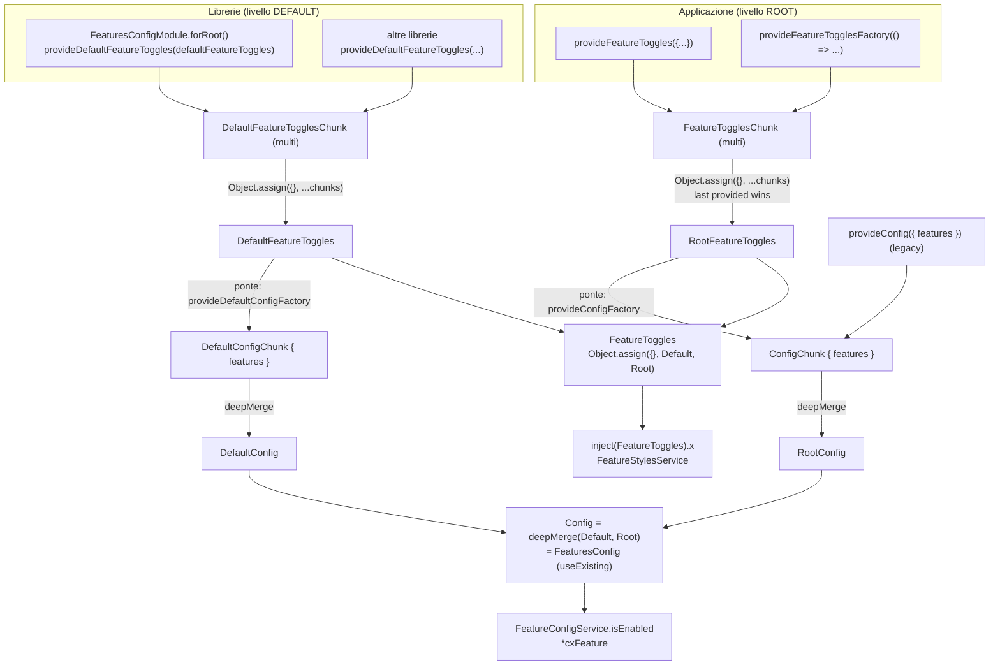
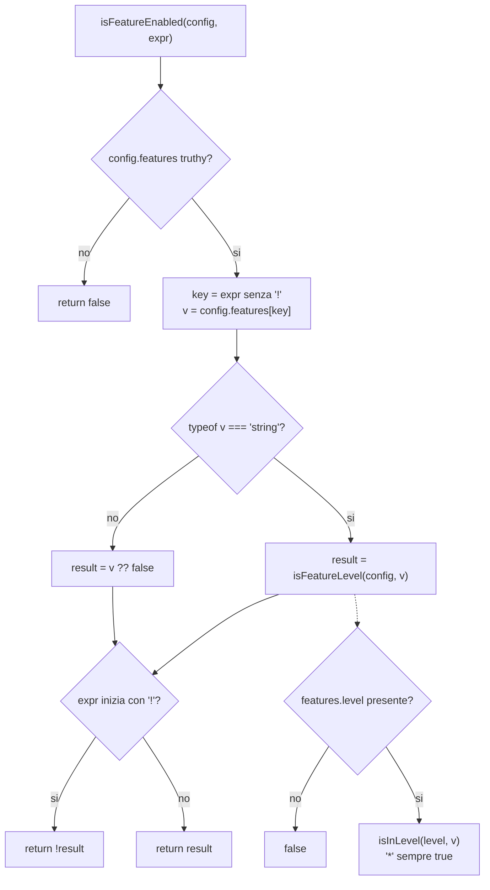
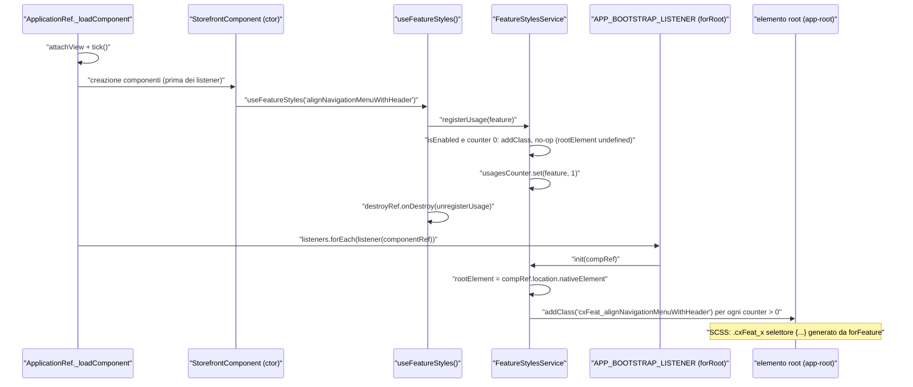
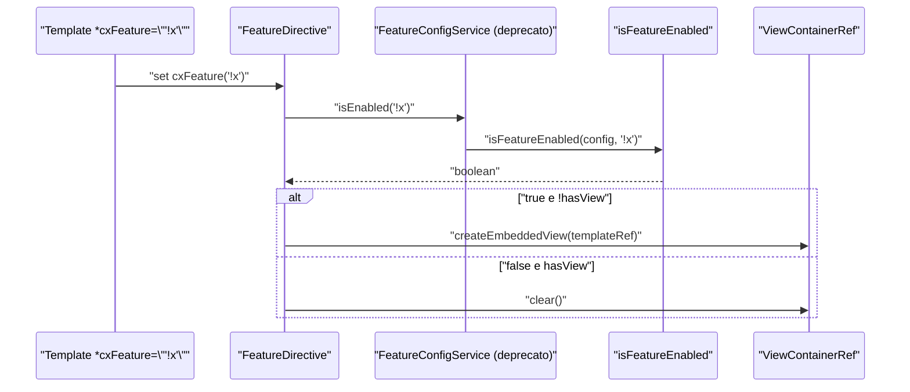

# 42 — Feature toggle e deprecazioni

> Riferimenti allo SHA `5b7a1c2bf2808d7380bc20596d10f4fa710c3da1` (vedi [00-meta](../00-meta.md)).

## 1. A cosa serve e perché esiste

Spartacus è una libreria che i clienti estendono per ereditarietà, sostituzione via DI e override SCSS. Ogni correzione che cambia DOM, stili o comportamento rischia quindi di rompere un'estensione a valle. La risposta del progetto è un meccanismo di **feature toggle**: la correzione viene scritta accanto al vecchio comportamento, protetta da un flag booleano con nome, e il cliente la attiva quando è pronto. Lo dice la JSDoc del token principale: "Properties for gradual adaptation to breaking changes in Spartacus via feature toggles. Each toggle has its own lifespan defined in the official docs." (`core-libs/core/src/features-config/feature-toggles/feature-toggles-tokens.ts:L10-L14`).

Allo SHA convivono **due generazioni** di API:

| Generazione | Simboli | Stato | Dove legge |
|---|---|---|---|
| Legacy | `FeaturesConfig` (`features.*` dentro il `Config` globale), `FeatureConfigService.isEnabled/isLevel`, `features.level`, `FeatureLevelDirective` | `@deprecated` (`core-libs/core/src/features-config/config/features-config.ts:L10-L26`, `core-libs/core/src/features-config/services/feature-config.service.ts:L15-L22`) | `Config.features`, costruito con `deepMerge` |
| Attuale | `FeatureToggles` (classe astratta DI + interfaccia), `provideFeatureToggles(...)`, `provideDefaultFeatureToggles(...)` | raccomandata (`core-libs/core/src/features-config/config/features-config.ts:L10-L26`) | oggetto piatto costruito con `Object.assign` (`core-libs/core/src/features-config/feature-toggles/feature-toggles-tokens.ts:L15-L24`) |

Le due generazioni sono collegate da un **ponte a senso unico** (toggle → config) installato da `FeaturesConfigModule.forRoot()` "for backward compatibility with the deprecated FeaturesConfig" (`core-libs/core/src/features-config/features-config.module.ts:L28-L52`). La direttiva strutturale `*cxFeature`, che nei template è il modo più diffuso di leggere un toggle, passa ancora dal servizio legacy (`core-libs/core/src/features-config/directives/feature.directive.ts:L11-L17`): per questo il ponte non si può togliere.

Il capitolo copre anche il lato **stili**: un toggle può attivare regole SCSS tramite il mixin `forFeature()` e la funzione TS `useFeatureStyles()`, che insieme fanno comparire classi `cxFeat_<chiave>` sull'elemento root (`core-libs/core/src/features-config/services/feature-styles.service.ts:L17-L26`, `core-libs/styles/scss/_features.scss:L41-L62`). Il vecchio approccio per versione, `forVersion()`, è deprecato (`core-libs/styles/scss/_versioning.scss:L1-L2`).

Infine si guarda alla **politica di deprecazione** come emerge dal codice: tag `@deprecated` (165 occorrenze nelle librerie, tabella completa in [A10 — API deprecate](../appendici/A10-deprecated.md)), interfaccia dei toggle volutamente *strict* (`core-libs/core/src/features-config/feature-toggles/config/feature-toggles.ts:L7-L11`), TODO "Remove feature flag next major release." e regole ESLint dedicate.

L'elenco delle 107 chiavi, con default, descrizione e conteggi d'uso, è in [A09 — Feature toggle](../appendici/A09-feature-toggle.md). Questo capitolo spiega il meccanismo; l'appendice è il catalogo.

> Nota sul focus dell'OUTLINE: una **pipe** dedicata ai feature toggle allo SHA **non esiste**. Allo SHA nessuna `@Pipe` legge i feature toggle: le pipe del repo (es. `cxTranslate`, `cxUrl`, `cxDate`, `cxArgs`, `formatTimer`, `cxMultiLine`) non hanno a che fare con `FeatureToggles` (`core-libs/core/src/i18n/translate.pipe.ts:L25-L28`, `core-libs/core/src/routing/configurable-routes/url-translation/url.pipe.ts:L11-L11`, `core-libs/core/src/i18n/date.pipe.ts:L13-L13`, `feature-libs/asm/core/utils/args/args.pipe.ts:L33-L33`).

Capitoli collegati: la meccanica di `Config`/`ConfigChunk`/`deepMerge` è in [11 — Configurazione](../parte-2/11-configurazione.md); i token `providedIn: 'root'` e i multi provider in [01 — Dependency injection](../parte-1/01-dependency-injection.md); gli `APP_BOOTSTRAP_LISTENER` nel contesto del bootstrap in [10 — Bootstrap e inizializzazione](../parte-2/10-bootstrap-inizializzazione.md); gli stili in generale in [38 — Stili e theming](../parte-2/38-stili-theming.md); le migrazioni in [43 — Schematics e migrazioni](../parte-2/43-schematics-migrazioni.md); il test tooling in [44 — Test tooling](../parte-2/44-test-tooling.md).

## 2. Mappa dei file

| Path | Ruolo |
|---|---|
| `core-libs/core/src/features-config/config/features-config.ts` | classe astratta deprecata `FeaturesConfig` (`useExisting: Config`) + module augmentation di `Config`; `level`, index signature, `consignmentTracking`, `disableConfigUpdates` |
| `core-libs/core/src/features-config/feature-toggles/config/feature-toggles.ts` | `FeatureTogglesInterface` (107 chiavi, strict) e `defaultFeatureToggles` (`Required<...>`): **API privata**, non esportata |
| `core-libs/core/src/features-config/feature-toggles/feature-toggles-tokens.ts` | `FeatureToggles` (classe+interfaccia), `FeatureToggleKey`, `FeatureToggleExpression`, `DefaultFeatureToggles`, `RootFeatureToggles`, `FeatureTogglesChunk`, `DefaultFeatureTogglesChunk` |
| `core-libs/core/src/features-config/feature-toggles/feature-toggles-providers.ts` | `provideFeatureToggles`, `provideFeatureTogglesFactory`, `provideDefaultFeatureToggles`, `provideDefaultFeatureTogglesFactory`, tipo `FeatureTogglesFactory` |
| `core-libs/core/src/features-config/feature-toggles/populate-feature-toggles-to-features-config.ts` | ponte retrocompatibile toggle → `Config.features` (livello root e default) |
| `core-libs/core/src/features-config/feature-toggles/index.ts` | barrel pubblico, esclude `config/feature-toggles` |
| `core-libs/core/src/features-config/feature-toggles/testing/mock-feature-toggles.ts` | `MockFeatureTogglesController`, `provideMockFeatureToggles`, `MockFeatureConfigService` (privato) |
| `core-libs/core/src/features-config/feature-toggles/testing/index.ts` | barrel del testing (non pubblicato) |
| `core-libs/core/src/features-config/features-config.module.ts` | `FeaturesConfigModule` e `forRoot(defaultLevel='3.0')`: default toggle, ponte, livello, `APP_BOOTSTRAP_LISTENER` |
| `core-libs/core/src/features-config/services/feature-config.service.ts` | `FeatureConfigService` deprecato (`isLevel`, `isEnabled`) |
| `core-libs/core/src/features-config/services/feature-styles.service.ts` | `FeatureStylesService`: contatore d'uso → classi `cxFeat_*` sull'elemento root |
| `core-libs/core/src/features-config/utils/feature-config-utils.ts` | `isFeatureEnabled`, `isFeatureLevel` (deprecata), helper privati `isFeatureConfig`, `isInLevel` |
| `core-libs/core/src/features-config/utils/use-feature-styles.ts` | `useFeatureStyles(feature)` (injection context + `DestroyRef`) |
| `core-libs/core/src/features-config/directives/feature.directive.ts` | `FeatureDirective` `[cxFeature]` |
| `core-libs/core/src/features-config/directives/feature-level.directive.ts` | `FeatureLevelDirective` `[cxFeatureLevel]`, deprecata e inutilizzata |
| `core-libs/core/src/features-config/index.ts` | barrel della cartella, riesportato da `core-libs/core/public_api.ts:L19-L19` |
| `core-libs/core/src/config/config-tokens.ts` | `Config`, `RootConfig`, `DefaultConfig` (deepMerge dei chunk) |
| `core-libs/core/src/config/config-providers.ts` | `provideConfigFactory`, `provideDefaultConfigFactory` usati dal ponte |
| `core-libs/core/src/config/services/configuration.service.ts` | legge `disableConfigUpdates` |
| `core-libs/core/src/base-core.module.ts` | importa `FeaturesConfigModule.forRoot()` |
| `core-libs/styles/scss/_features.scss` | mixin `forFeature`, funzione `getFeatureCssClass`, prefisso `cxFeat_` |
| `core-libs/styles/scss/_versioning.scss` | mixin deprecato `forVersion`, `$styleVersion`, `$useLatestStyles` |
| `core-libs/styles/scss/root.scss` | unico uso di produzione di `forFeature(..., 'currentSelector')` |
| `core-libs/storefront/layout/main/storefront.component.ts` | registra sei stili di feature globali; aggiunge a mano una classe su `<html>` |
| `core-libs/core/src/config/test-config.module.ts` | toggle ad alta priorità da `TEST_CONFIG` |
| `core-libs/schematics/src/add-spartacus/spartacus-feature-toggles.ts` | `ng add` genera `provideFeatureToggles` con tutte le chiavi a `true` |
| `tools/eslint-rules/rules/use-provide-default-feature-toggles.ts`, `tools/eslint-rules/rules/feature-toggles-must-be-private.ts`, `tools/eslint-rules/rules/no-storefrontapp-false-feature-toggles.ts` | regole di lint sui toggle |

## 3. Come funziona passo per passo

### 3.1 Il catalogo: `FeatureTogglesInterface` e `defaultFeatureToggles`

Tutte le chiavi stanno in un solo file. L'interfaccia apre con un commento programmatico:

- niente index signature, così che una chiave rimossa provochi un errore di compilazione nel codice cliente: "customers using a property that was recently removed, will know they have to adapt their code" (`core-libs/core/src/features-config/feature-toggles/config/feature-toggles.ts:L7-L11`);
- l'interfaccia va da L11 a L1011 e dichiara 107 proprietà `?: boolean` (`core-libs/core/src/features-config/feature-toggles/config/feature-toggles.ts:L11-L1011`);
- `defaultFeatureToggles` è tipato `Required<FeatureTogglesInterface>`: il compilatore obbliga a dare un default a ogni chiave. Allo SHA sono 32 `true` e 75 `false` (`core-libs/core/src/features-config/feature-toggles/config/feature-toggles.ts:L1013-L1121`);
- l'ordine delle chiavi nei default non coincide con quello dell'interfaccia (es. `alignNavigationMenuWithHeader` sta a L469 nell'interfaccia e a L1016 nei default: `core-libs/core/src/features-config/feature-toggles/config/feature-toggles.ts:L469-L469`, `core-libs/core/src/features-config/feature-toggles/config/feature-toggles.ts:L1016-L1016`).

Le JSDoc seguono convenzioni ricorrenti: una descrizione, spesso `Affects: <Classi>`, note `NOTE:` sulle dipendenze esterne (es. `authorizationCodeFlowByDefault` richiede un Authorization Server CCv2 "September 2025 update or higher": `core-libs/core/src/features-config/feature-toggles/config/feature-toggles.ts:L153-L161`) o da altri toggle (`authorizationCodeFlowByDefaultCsrfTokenRefresh` "Only applies when `authorizationCodeFlowByDefault` is also enabled": `core-libs/core/src/features-config/feature-toggles/config/feature-toggles.ts:L163-L172`). Alcune elencano anche i file SCSS toccati (`a11yHighContrastFix`: `core-libs/core/src/features-config/feature-toggles/config/feature-toggles.ts:L995-L1010`). Non tutti i toggle riguardano la UI: `enableCartSlowNetworkResilience` attiva i fix CXSPA-10582 sul carrello e descrive cosa torna "pre-fix" quando è OFF (`core-libs/core/src/features-config/feature-toggles/config/feature-toggles.ts:L554-L583`).

Il barrel `feature-toggles/index.ts` **non** esporta questo file: "don't export from './config/feature-toggles' as it contains private API" (`core-libs/core/src/features-config/feature-toggles/index.ts:L7-L9`). Dall'esterno si usa il tipo `FeatureToggles`, che estende l'interfaccia.

### 3.2 I token: due livelli, quattro token

`feature-toggles-tokens.ts` definisce una piramide a due livelli, **default** (librerie) e **root** (applicazione):

1. `DefaultFeatureTogglesChunk` e `FeatureTogglesChunk` sono `InjectionToken<FeatureToggles[]>` `providedIn: 'root'` con factory `() => []`, alimentati come multi provider (`core-libs/core/src/features-config/feature-toggles/feature-toggles-tokens.ts:L60-L78`). La JSDoc del primo fissa la regola: "all FeatureToggles provided in libraries should be provided as `default`" (`core-libs/core/src/features-config/feature-toggles/feature-toggles-tokens.ts:L69-L78`).
2. `DefaultFeatureToggles` unisce i chunk default con `Object.assign({}, ...chunks)`, con fallback `[]` (`core-libs/core/src/features-config/feature-toggles/feature-toggles-tokens.ts:L33-L43`).
3. `RootFeatureToggles` fa lo stesso con i `FeatureTogglesChunk` (`core-libs/core/src/features-config/feature-toggles/feature-toggles-tokens.ts:L48-L58`). Se due chunk hanno la stessa chiave, "last provided wins" (`core-libs/core/src/features-config/feature-toggles/feature-toggles-tokens.spec.ts:L58-L58`).
4. `FeatureToggles` è una classe astratta `providedIn: 'root'` con `useFactory` che restituisce `Object.assign({}, inject(DefaultFeatureToggles), inject(RootFeatureToggles))`: i valori root vincono sui default, e il merge è **shallow** (`core-libs/core/src/features-config/feature-toggles/feature-toggles-tokens.ts:L15-L24`).
5. La riga `export interface FeatureToggles extends FeatureTogglesInterface {}` usa il declaration merging di TypeScript: la classe astratta, che serve da token DI, riceve le 107 proprietà tipate (`core-libs/core/src/features-config/feature-toggles/feature-toggles-tokens.ts:L25-L25`).
6. `FeatureToggleKey = keyof FeatureToggles` e `FeatureToggleExpression = FeatureToggleKey | \`!${FeatureToggleKey}\``: la negazione è un template literal type, quindi `'!chiaveInesistente'` non compila (`core-libs/core/src/features-config/feature-toggles/feature-toggles-tokens.ts:L27-L28`).

### 3.3 I provider

`feature-toggles-providers.ts` espone quattro helper simmetrici:

- `provideFeatureToggles(toggles = {})` → `ValueProvider` multi su `FeatureTogglesChunk`. La JSDoc dice che va fornito "in the root injector (in an eagerly loaded module)" e rimanda le librerie a `provideDefaultFeatureToggles()` (`core-libs/core/src/features-config/feature-toggles/feature-toggles-providers.ts:L16-L33`).
- `provideFeatureTogglesFactory(factory)` → `FactoryProvider` multi sullo stesso token, senza `deps`: la factory usa `inject()` (`core-libs/core/src/features-config/feature-toggles/feature-toggles-providers.ts:L44-L52`). Il tipo della factory è `(...props: any[]) => FeatureToggles` (`core-libs/core/src/features-config/feature-toggles/feature-toggles-providers.ts:L14-L14`).
- `provideDefaultFeatureToggles` / `provideDefaultFeatureTogglesFactory` → stessi provider su `DefaultFeatureTogglesChunk`, con "CAUTION: It should be provided only in the root injector" (`core-libs/core/src/features-config/feature-toggles/feature-toggles-providers.ts:L54-L86`).

### 3.4 `FeaturesConfigModule.forRoot()` e il ponte verso `Config.features`

`BaseCoreModule` importa `FeaturesConfigModule.forRoot()` senza argomenti, dopo `ProcessModule.forRoot()` e prima di `SiteContextModule.forRoot()` (`core-libs/core/src/base-core.module.ts:L36-L38`). `forRoot(defaultLevel = '3.0')` registra quattro cose (`core-libs/core/src/features-config/features-config.module.ts:L28-L52`):

1. `provideDefaultFeatureToggles(defaultFeatureToggles)`: il catalogo diventa il primo chunk default;
2. `...populateFeatureTogglesToFeaturesConfig`: il ponte;
3. `provideDefaultConfig({ features: { level: defaultLevel || '*' } })`: il livello legacy;
4. un `APP_BOOTSTRAP_LISTENER` che chiama `FeatureStylesService.init(compRef)` (`core-libs/core/src/features-config/features-config.module.ts:L41-L49`), descritto in §3.8.

Il ponte è un array di due `FactoryProvider` (`core-libs/core/src/features-config/feature-toggles/populate-feature-toggles-to-features-config.ts:L18-L33`):

- `provideConfigFactory(() => ({ features: { ...inject(RootFeatureToggles) } }))` → un `ConfigChunk`;
- `provideDefaultConfigFactory(() => ({ features: { ...inject(DefaultFeatureToggles) } }))` → un `DefaultConfigChunk`.

`provideConfigFactory` e `provideDefaultConfigFactory` producono multi provider su `ConfigChunk` / `DefaultConfigChunk` (`core-libs/core/src/config/config-providers.ts:L37-L48`, `core-libs/core/src/config/config-providers.ts:L69-L79`). `RootConfig` e `DefaultConfig` sono il `deepMerge` dei rispettivi chunk e `Config = deepMerge({}, DefaultConfig, RootConfig)` (`core-libs/core/src/config/config-tokens.ts:L10-L21`, `core-libs/core/src/config/config-tokens.ts:L23-L39`). `FeaturesConfig` è `@Injectable({ providedIn: 'root', useExisting: Config })` (`core-libs/core/src/features-config/config/features-config.ts:L27-L31`) e il file aggiunge `FeaturesConfig` a `Config` con module augmentation (`core-libs/core/src/features-config/config/features-config.ts:L120-L122`): iniettare `FeaturesConfig` restituisce lo stesso oggetto `Config` globale.

Il ponte va **in un solo verso**: copia i toggle nella config, mai la config nei toggle. Chi scrive `provideConfig({ features: { x: true } })` lo vede con `FeatureConfigService.isEnabled('x')` e con `*cxFeature`, ma **non** con `inject(FeatureToggles).x` (vedi §9).

### 3.5 Lettura legacy: `FeatureConfigService` e `isFeatureEnabled`

`FeatureConfigService` è `providedIn: 'root'`, `@deprecated - Use FeatureToggles instead`, e riceve `FeaturesConfig`, cioè il `Config`, nel costruttore (`core-libs/core/src/features-config/services/feature-config.service.ts:L15-L22`). Ha due metodi (`core-libs/core/src/features-config/services/feature-config.service.ts:L24-L33`):

- `isLevel(version)` (deprecato, "features level is no longer used") → `isFeatureLevel(config, version)`;
- `isEnabled(feature)` → `isFeatureEnabled(config, feature)`.

`isFeatureEnabled` (`core-libs/core/src/features-config/utils/feature-config-utils.ts:L48-L65`):

1. se `config.features` è falsy, restituisce `false` (guardia `isFeatureConfig`: `core-libs/core/src/features-config/utils/feature-config-utils.ts:L11-L13`);
2. toglie l'eventuale `!` e legge `config.features[key]`;
3. se il valore è una **stringa**, lo tratta come livello di versione e delega a `isFeatureLevel`; altrimenti usa `valore ?? false`;
4. se l'espressione era negata, inverte il risultato.

La firma accetta anche il letterale `'disableConfigUpdates'` oltre a `FeatureToggleExpression` (`core-libs/core/src/features-config/utils/feature-config-utils.ts:L48-L51`): così `ConfigurationService.emitUnifiedConfig()` legge quella chiave per decidere se fare il deep-merge della config unificata (inclusi i chunk dei moduli lazy) dentro l'oggetto `Config` globale (`core-libs/core/src/config/services/configuration.service.ts:L92-L106`).

`isFeatureLevel` (`core-libs/core/src/features-config/utils/feature-config-utils.ts:L36-L46`) supporta la negazione `'!x.y'` e restituisce `false` se `features.level` manca. Il confronto vero è nel privato `isInLevel` (`core-libs/core/src/features-config/utils/feature-config-utils.ts:L15-L34`): `'*'` vale sempre; altrimenti scorre le parti numeriche della versione richiesta (le parti mancanti del livello valgono 0) e alla prima differenza restituisce `livello > versione`; se tutte le parti coincidono, `true`.

### 3.6 Lettura nei template: `*cxFeature`

`FeatureDirective` (selettore `[cxFeature]`) inietta `TemplateRef`, `ViewContainerRef` e il `FeatureConfigService` deprecato (`core-libs/core/src/features-config/directives/feature.directive.ts:L11-L17`). Il setter dell'input (`core-libs/core/src/features-config/directives/feature.directive.ts:L19-L29`):

- toggle abilitato e nessuna vista → `createEmbeddedView(templateRef)` e `hasView = true`;
- toggle disabilitato e vista presente → `viewContainer.clear()` e `hasView = false`.

La direttiva non si sottoscrive a nulla e rivaluta solo quando cambia il valore dell'input. Il pattern tipico è la coppia positivo/negato, vecchia UI contro nuova, come in `ProductImageZoomViewComponent` (`feature-libs/product/image-zoom/components/product-image-zoom/product-image-zoom-view/product-image-zoom-view.component.html:L15-L15`, `feature-libs/product/image-zoom/components/product-image-zoom/product-image-zoom-view/product-image-zoom-view.component.html:L35-L35`). Allo SHA ci sono 165 occorrenze di `*cxFeature=` in 62 file `.html`, 67 delle quali negate; `cxFeatureLevel` non compare in nessun template, solo nella direttiva e nel mock `core-libs/storefront/shared/test/mock-feature-level-directive.ts:L9-L9` (conteggi del dossier, F50).

`FeatureLevelDirective` (`[cxFeatureLevel]`) ha la stessa logica con `isLevel(level.toString())` ed è `@deprecated  Unused directive` (`core-libs/core/src/features-config/directives/feature-level.directive.ts:L10-L31`). Entrambe le direttive non dichiarano `standalone`, che in Angular 21 vale `true` per default (`standalone: directiveDefinition.standalone ?? true`: `angular:packages/core/src/render3/definition.ts:L637-L637`; JSDoc dell'opzione: `angular:packages/core/src/metadata/directives.ts:L335-L337`). Per questo `FeaturesConfigModule` le mette in `imports` ed `exports` invece che in `declarations` (`core-libs/core/src/features-config/features-config.module.ts:L23-L27`).

### 3.7 Lettura in TypeScript: `inject(FeatureToggles)`

Il pattern raccomandato è un campo `private` (`private featureToggles = inject(FeatureToggles)`) letto come proprietà: `this.featureToggles.a11yKeyboardAccessibleZoom` (`feature-libs/product/image-zoom/components/product-image-zoom/product-image-zoom-view/product-image-zoom-view.component.ts:L92-L92`, `feature-libs/product/image-zoom/components/product-image-zoom/product-image-zoom-view/product-image-zoom-view.component.ts:L234-L234`). Il dossier conta 126 occorrenze di `inject(FeatureToggles)` in 117 file non-spec e 180 accessi `featureToggles.<chiave>` in 99 file. Fuori da `features-config`, a runtime `FeatureConfigService` è iniettato solo da `CxApiService`, come campo `public` opzionale (`core-libs/storefront/cms-structure/page/component/services/cx-api.service.ts:L46-L46`). Le altre occorrenze sono dati delle migrazioni schematics, regole ESLint e commenti.

I toggle si leggono anche **dentro le factory di config di default**. `defaultAuthConfigFactory` destruttura `authorizationCodeFlowByDefault`, `asyncAuthConfigInitializer` e `oauthCallbackPage` da `inject(FeatureToggles)` (`core-libs/core/src/auth/user-auth/config/default-auth-config.ts:L76-L83`) ed è registrata con `provideDefaultConfigFactory(defaultAuthConfigFactory)` in `UserAuthModule` (`core-libs/core/src/auth/user-auth/user-auth.module.ts:L106-L106`). Qui si usa `FeatureToggles` e non `FeatureConfigService` per evitare un ciclo di DI: `FeatureConfigService` dipende da `Config`, che a sua volta dipende da tutti i `DefaultConfigChunk`, compresa questa factory. La regola ESLint lo dice esplicitamente: `inject(FeatureToggles)` "is preferred over `inject(FeatureConfigService)` inside `provideDefaultConfigFactory()` to avoid circular DI" (`tools/eslint-rules/rules/feature-toggles-must-be-private.ts:L23-L26`). Il flusso auth completo è in [22 — Autenticazione](../parte-2/22-auth.md).

### 3.8 Stili per feature: `useFeatureStyles` + `forFeature` + `FeatureStylesService`

Un toggle può attivare regole CSS senza toccare il DOM del componente. I pezzi sono tre.

**SCSS.** `_core.scss` importa prima `features` e poi `versioning` (`core-libs/styles/scss/_core.scss:L1-L2`). `_features.scss` definisce il prefisso `$CSS_FEATURE_FLAG_PREFIX: 'cxFeat_'` e la funzione `getFeatureCssClass` (`core-libs/styles/scss/_features.scss:L3-L14`). Il mixin `forFeature($feature, $classTarget: 'ancestorSelector')`:

- valida i parametri con `@error`: `$feature` deve essere una stringa, `$classTarget` deve valere `'ancestorSelector'` o `'currentSelector'` (`core-libs/styles/scss/_features.scss:L42-L49`);
- con `ancestorSelector` emette `@at-root .cxFeat_<f> & { ... }`, cioè la classe sta su un antenato; con `currentSelector` emette `@at-root &.cxFeat_<f> { ... }`, cioè la classe sta sullo stesso elemento (`core-libs/styles/scss/_features.scss:L51-L61`). Il secondo caso va usato "ONLY in one edge case", per gli stili dell'elemento root (`core-libs/styles/scss/_features.scss:L38-L40`). L'unico uso di produzione è in `root.scss`, dentro `:root`, per `a11yPreventWindowsHighContrastOverride` (`core-libs/styles/scss/root.scss:L36-L44`).

**TS, lato componente.** `useFeatureStyles(feature)` chiama `assertInInjectionContext`, inietta `FeatureStylesService` e `DestroyRef`, registra l'uso e lo cancella in `destroyRef.onDestroy` (`core-libs/core/src/features-config/utils/use-feature-styles.ts:L32-L40`). La JSDoc impone di chiamarla nel costruttore di **ogni** componente il cui SCSS usa `forFeature`, altrimenti gli stili "MIGHT NOT be activated EVEN if the flag is enabled" (`core-libs/core/src/features-config/utils/use-feature-styles.ts:L11-L31`). Fuori da un injection context, `assertInInjectionContext` lancia `RuntimeError` `MISSING_INJECTION_CONTEXT` (`angular:packages/core/src/di/contextual.ts:L77-L88`).

**TS, lato servizio.** `FeatureStylesService` (`core-libs/core/src/features-config/services/feature-styles.service.ts:L17-L26`):

1. legge `FeatureToggles` (non `FeaturesConfig`) e crea un `Renderer2` con `createRenderer(null, null)` (`core-libs/core/src/features-config/services/feature-styles.service.ts:L27-L41`);
2. tiene `usagesCounter: Map<string, number>`: quando un contatore passa a >0 aggiunge la classe, quando torna a 0 la toglie (`core-libs/core/src/features-config/services/feature-styles.service.ts:L50-L56`);
3. `registerUsage` aggiunge la classe solo se il flag è abilitato e il contatore era 0, poi incrementa il contatore **anche se il flag è spento** (`core-libs/core/src/features-config/services/feature-styles.service.ts:L89-L95`);
4. `unregisterUsage` in dev mode avvisa se il contatore è già 0, toglie la classe se il flag è abilitato e il contatore vale 1, poi decrementa con `Math.max(..., 0)` (`core-libs/core/src/features-config/services/feature-styles.service.ts:L103-L115`);
5. `addClass`/`removeClass` non fanno nulla se `rootElement` non è ancora impostato o se `getCssClass` restituisce `undefined` (`core-libs/core/src/features-config/services/feature-styles.service.ts:L130-L150`). `getCssClass` restituisce `cxFeat_<feature>` solo se il flag è truthy (`core-libs/core/src/features-config/services/feature-styles.service.ts:L158-L162`), e `isEnabled` è `!!this.featureToggles[feature]` (`core-libs/core/src/features-config/services/feature-styles.service.ts:L120-L122`).

**Bootstrap.** Il servizio non conosce l'elemento root finché non riceve `init`. Angular chiama gli `APP_BOOTSTRAP_LISTENER` in `_loadComponent`, **dopo** il primo `tick()` del componente root, leggendoli dall'injector in modo lazy "to prevent DI cycles" (`angular:packages/core/src/application/application_ref.ts:L775-L794`; token: `angular:packages/core/src/application/application_ref.ts:L64-L66`). Il listener di `forRoot()` passa il `ComponentRef` a `init`, che salva `rootComponent.location.nativeElement` e aggiunge le classi per tutti i contatori >0 già registrati (`core-libs/core/src/features-config/services/feature-styles.service.ts:L65-L77`). Senza questo recupero si perderebbero le registrazioni fatte nei costruttori dei componenti creati prima dell'invocazione dei listener (il commento del sorgente cita il costruttore del root component), che arrivano prima dell'`init`. ⚠️ DA VERIFICARE: in quale fase esatta (creazione del root component o primo `tick()`) vengono costruiti i componenti figli come `StorefrontComponent` non è stato tracciato nel renderer di Angular; per il meccanismo conta solo che avvenga prima dei listener.

`StorefrontComponent` registra così sei stili globali nel costruttore (`core-libs/storefront/layout/main/storefront.component.ts:L118-L123`). Per uno di questi la classe sull'elemento root dell'app non basta: le regole stanno su `:root`, cioè `<html>`. Per questo `ngOnInit` aggiunge a mano `cxFeat_a11yPreventWindowsHighContrastOverride` a `document.documentElement` ("TODO: Required to use feature flag with root styles": `core-libs/storefront/layout/main/storefront.component.ts:L141-L147`).

Il dossier conta 56 chiamate a `useFeatureStyles(` in 44 file TS non-spec (esclusa `features-config`) e 70 `@include forFeature(` in 40 file `.scss` di produzione (78 in 41 contando lo spec `core-libs/styles/test/features.spec.scss`) (F73).

### 3.9 Il vecchio approccio SCSS: `_versioning.scss`

`_versioning.scss` apre con "🚨 CAUTION": `forVersion($level)` è deprecato e sostituito da `forFeature($featureName)` (`core-libs/styles/scss/_versioning.scss:L1-L2`). Il file contiene:

- le versioni interne `$_fullVersion: (major: 221121, minor: 22, patch: 0)` e `$_majorVersion: 2211` (`core-libs/styles/scss/_versioning.scss:L29-L37`);
- le variabili di opt-in del cliente, `$styleVersion: $_majorVersion !default` e `$useLatestStyles: false !default` (`core-libs/styles/scss/_versioning.scss:L41-L46`);
- il mixin `forVersion($from, $to: 0)`, `@deprecated since 2211.20`, che emette il contenuto solo se `$from <= $_fullVersion` e la versione è stabile e valida, oppure è richiesta come breaking change (`core-libs/styles/scss/_versioning.scss:L63-L77`);
- `useBreakingChanges()`, vera se `$useLatestStyles` è attivo o `$styleVersion > $_majorVersion` (`core-libs/styles/scss/_versioning.scss:L228-L231`).

`forVersion` non ha usi di produzione: compare solo nel commento d'esempio (`core-libs/styles/scss/_versioning.scss:L18-L18`) e nella utility di test (`core-libs/styles/test/versioning-test-util.scss:L6-L6`). La storefrontapp imposta comunque `$useLatestStyles: true;` (`projects/storefrontapp/src/styles-config.scss:L2-L2`).

### 3.10 Chi fornisce i toggle nell'applicazione

- **App demo**: `provideFeatureTogglesFactory` restituisce un oggetto tipato `Required<FeatureToggles>`, quindi aggiungere un toggle alla libreria obbliga ad aggiornare anche l'app (`projects/storefrontapp/src/app/spartacus/spartacus-features.module.ts:L297-L301`). La regola `no-storefrontapp-false-feature-toggles` impone che tutti i valori siano `true`; un `false` è ammesso solo con un eslint-disable che citi un ticket CXSPA (`tools/eslint-rules/rules/no-storefrontapp-false-feature-toggles.ts:L33-L45`, `projects/storefrontapp/eslint.config.mjs:L26-L28`).
- **App nuova (`ng add`)**: lo schematic genera `provideFeatureToggles({...})` con **tutte** le chiavi di `defaultFeatureToggles` a `true` (`core-libs/schematics/src/add-spartacus/spartacus-feature-toggles.ts:L77-L93`). Per non dipendere a runtime da `@spartacus/core`, lo schematic legge una copia del file TS del core (`core-libs/schematics/src/add-spartacus/spartacus-feature-toggles.ts:L95-L113`). La copia è fatta in pre-build dallo script `copy-feature-toggles` (`core-libs/schematics/package.json:L16-L16`) con un semplice `fs.copyFileSync` verso `./src/feature-toggles.copied-from-core-lib.ts` (`core-libs/schematics/copy-feature-toggles.js:L5-L10`); il path di lettura è la costante `FEATURE_TOGGLES_COPIED_FROM_CORE_LIB_PATH` (`core-libs/schematics/src/shared/constants.ts:L1176-L1177`). Gli schematics sono trattati in [43 — Schematics e migrazioni](../parte-2/43-schematics-migrazioni.md).
- **Test con `TestConfigModule`**: fornisce di proposito toggle ad alta priorità con `provideFeatureTogglesFactory(() => inject(TEST_CONFIG)?.features)`, disattivando la regola di lint per quella riga (`core-libs/core/src/config/test-config.module.ts:L94-L98`).

### 3.11 Strumenti di test

`provideMockFeatureToggles(initial)` crea un `MockFeatureTogglesController` e lo lega **come stesso oggetto** a `MockFeatureTogglesController`, `FeatureToggles`, `RootFeatureToggles`, `DefaultFeatureToggles` e `FeatureTogglesChunk` (multi), e lo inserisce anche in un `ConfigChunk` (`features: controller`) tramite `provideConfigFactory` (`core-libs/core/src/features-config/feature-toggles/testing/mock-feature-toggles.ts:L150-L204`). `Config.features`, però, nasce dal deep-merge dei chunk e non condivide il riferimento: per questo il mock sostituisce anche `FeatureConfigService` (`core-libs/core/src/features-config/feature-toggles/testing/mock-feature-toggles.ts:L121-L125`). Il controller è un oggetto che fa sia da toggle sia da API di controllo: `set` assegna una chiave, `reset` cancella tutto tranne `set`/`reset` e poi applica `Object.assign` (`core-libs/core/src/features-config/feature-toggles/testing/mock-feature-toggles.ts:L95-L119`). Viene creato da capo a ogni setup di TestBed, quindi le mutazioni non passano da un test all'altro (`core-libs/core/src/features-config/feature-toggles/testing/mock-feature-toggles.ts:L154-L159`).

Il mock sostituisce anche `FeatureConfigService` con un `MockFeatureConfigService` che legge il controller (`core-libs/core/src/features-config/feature-toggles/testing/mock-feature-toggles.ts:L206-L216`). Senza questa sostituzione `*cxFeature` leggerebbe lo snapshot `Config.features`, già deep-merged al bootstrap, e non vedrebbe le chiamate a `set(...)`. `MockFeatureConfigService` riusa `isFeatureEnabled`/`isFeatureLevel` passando un finto `Config` `{ features: this.toggles }` (`core-libs/core/src/features-config/feature-toggles/testing/mock-feature-toggles.ts:L132-L148`).

Il testing **non** è un entry point pubblicato: le librerie lo raggiungono tramite alias nei tsconfig o nella config vitest, per esempio `@spartacus/core/testing/feature-toggles` in storefront (`core-libs/storefront/tsconfig.spec.json:L17-L19`) e `@spartacus/core/testing/mock-feature-toggles` in checkout (`feature-libs/checkout/vitest.config.ts:L26-L26`). `provideMockFeatureToggles` compare in 87 file `.spec.ts` (F95). Dettagli in [44 — Test tooling](../parte-2/44-test-tooling.md).

### 3.12 Deprecazioni: cosa dice il codice

- **Conteggi.** `@deprecated` nei `.ts` non-spec delle librerie, esclusi i path con `schematics`, `testing` e `mock`: 165 occorrenze in 124 file, uguale al totale di [A10](../appendici/A10-deprecated.md) (`docs/spartacus-book/appendici/A10-deprecated.md:L11-L30`). La distribuzione è molto sbilanciata: `@spartacus/epd-visualization` ne ha 91, `@spartacus/core` 14. Delle 14 di core, 10 stanno nella sola cartella `features-config` (F109).
- **Formati.** Non sono uniformi: con versione (`@deprecated since 2211.22  - should not be a public API`: `core-libs/core/src/config/config-initializer/config-initializer.module.ts:L33-L33`; `@deprecated since 2211.32. Use initOnce() ...`: `core-libs/core/src/site-context/services/site-context-routes-handler.ts:L51-L51`), con alternativa e senza versione (`@deprecated - Use FeatureToggles instead`), oppure in un commento `//` con una scadenza ("will be removed in 12 months": `core-libs/core/src/cms/facade/page-meta.service.ts:L39-L39`).
- **Da token a toggle.** `USE_AUTHORIZATION_CODE_FLOW_BY_DEFAULT` è "@deprecated since 221121.1 Please use the `authorizationCodeFlowByDefault` feature toggle instead" (`core-libs/core/src/auth/user-auth/config/default-auth-config.ts:L11-L19`). Il provider legacy `provideAuthorizationCodeFlowByDefault(enable)` chiama `inject(FeatureToggles)` nel proprio corpo e usa `authorizationCodeFlowByDefault ?? enable` (`core-libs/core/src/auth/user-auth/config/default-auth-config.ts:L37-L46`).
- **Fine vita dei toggle.** Il codice da rimuovere è segnato con TODO "Remove feature flag next major release.", di solito con un ticket CXSPA: 23 occorrenze in 14 file ts/html/scss non-spec (F111), per esempio `core-libs/storefront/cms-components/product/product-intro/product-intro.component.html:L6-L6`. La "lifespan" di ogni toggle è "defined in the official docs" (`core-libs/core/src/features-config/feature-toggles/feature-toggles-providers.ts:L16-L19`). ⚠️ DA VERIFICARE: nel repo non c'è una policy di rimozione codificata oltre a questi TODO; la documentazione ufficiale non è stata verificata.
- **Lint come politica.** `feature-toggles-must-be-private` richiede che `FeatureToggles` sia iniettato `private`: la rimozione di un toggle, "the normal end-of-life of a toggle", non deve diventare un breaking change TypeScript per chi lo referenzia da una sottoclasse (`tools/eslint-rules/rules/feature-toggles-must-be-private.ts:L11-L26`). Questa regola e `feature-config-service-must-be-private` sono `error` su `**/*.ts` (`eslint.config.mjs:L255-L256`). Nei `**/*.module.ts` delle librerie, `use-provide-default-feature-toggles(-factory)` sono `error` (`eslint.config.mjs:L237-L238`, messaggio: `tools/eslint-rules/rules/use-provide-default-feature-toggles.ts:L34-L35`); la storefrontapp le spegne (`projects/storefrontapp/eslint.config.mjs:L14-L15`).

## 4. Diagrammi

### 4.1 Costruzione di `FeatureToggles` e ponte verso `Config.features`



Riferimenti: chunk e token `core-libs/core/src/features-config/feature-toggles/feature-toggles-tokens.ts:L15-L78`; ponte `core-libs/core/src/features-config/feature-toggles/populate-feature-toggles-to-features-config.ts:L18-L33`; `Config` `core-libs/core/src/config/config-tokens.ts:L10-L39`; `useExisting` `core-libs/core/src/features-config/config/features-config.ts:L27-L31`. Non c'è nessuna freccia da `Config` verso `FeatureToggles`: il ponte è a senso unico.

### 4.2 Valutazione di un'espressione legacy (`isFeatureEnabled`)



Riferimenti: `core-libs/core/src/features-config/utils/feature-config-utils.ts:L11-L65`.

### 4.3 Stili per feature durante il bootstrap



Riferimenti: `angular:packages/core/src/application/application_ref.ts:L775-L794`; `core-libs/storefront/layout/main/storefront.component.ts:L118-L123`; `core-libs/core/src/features-config/utils/use-feature-styles.ts:L32-L40`; `core-libs/core/src/features-config/services/feature-styles.service.ts:L65-L95`; `core-libs/core/src/features-config/services/feature-styles.service.ts:L130-L136`; `core-libs/core/src/features-config/features-config.module.ts:L41-L49`; `core-libs/styles/scss/_features.scss:L51-L56`.

### 4.4 `*cxFeature` nel template



Riferimenti: `core-libs/core/src/features-config/directives/feature.directive.ts:L19-L29`; `core-libs/core/src/features-config/services/feature-config.service.ts:L31-L33`.

## 5. Estratti di codice reale

**Il token principale e il tipo dell'espressione** — `core-libs/core/src/features-config/feature-toggles/feature-toggles-tokens.ts:L15-L28`

```ts
@Injectable({
  providedIn: 'root',
  useFactory: () =>
    Object.assign(
      {},
      inject(DefaultFeatureToggles),
      inject(RootFeatureToggles)
    ),
})
export abstract class FeatureToggles {}
export interface FeatureToggles extends FeatureTogglesInterface {}

export type FeatureToggleKey = keyof FeatureToggles;
export type FeatureToggleExpression = FeatureToggleKey | `!${FeatureToggleKey}`;
```

**Interfaccia strict per scelta** — `core-libs/core/src/features-config/feature-toggles/config/feature-toggles.ts:L7-L11`

```ts
// Let's NOT add here any wildcard property like
//  `[key: string]: boolean | undefined;`
// We want this interface to be STRICT and cause a compilation error when a removed property is used.
// Thanks to that, customers using a property that was recently removed, will know they have to adapt their code.
export interface FeatureTogglesInterface {
```

**Provider per l'applicazione** — `core-libs/core/src/features-config/feature-toggles/feature-toggles-providers.ts:L25-L33`

```ts
export function provideFeatureToggles(
  toggles: FeatureToggles = {}
): ValueProvider {
  return {
    provide: FeatureTogglesChunk,
    useValue: toggles,
    multi: true,
  };
}
```

**Il ponte verso la config legacy** — `core-libs/core/src/features-config/feature-toggles/populate-feature-toggles-to-features-config.ts:L18-L33`

```ts
export const populateFeatureTogglesToFeaturesConfig: FactoryProvider[] = [
  // Copies RootFeatureToggles to RootConfig
  provideConfigFactory(() => {
    const flags = inject(RootFeatureToggles);
    return { features: { ...flags } };
  }),

  // Copies DefaultFeatureToggles to DefaultFeaturesConfig
  provideDefaultConfigFactory(() => {
    const flags = inject(DefaultFeatureToggles);
    return { features: { ...flags } };
  }),
];
```

**`forRoot()`** — `core-libs/core/src/features-config/features-config.module.ts:L28-L52`

```ts
  static forRoot(
    defaultLevel = '3.0'
  ): ModuleWithProviders<FeaturesConfigModule> {
    return {
      ngModule: FeaturesConfigModule,
      providers: [
        provideDefaultFeatureToggles(defaultFeatureToggles),
        ...populateFeatureTogglesToFeaturesConfig, // for backward compatibility with the deprecated FeaturesConfig
        provideDefaultConfig(<FeaturesConfig>{
          features: {
            level: defaultLevel || '*',
          },
        }),
        {
          provide: APP_BOOTSTRAP_LISTENER,
          multi: true,
          useFactory: (): ((compRef: ComponentRef<any>) => void) => {
            const featureStylesService = inject(FeatureStylesService);
            return (compRef: ComponentRef<any>) =>
              featureStylesService.init(compRef);
          },
        },
      ],
    };
  }
```

**Valutazione legacy** — `core-libs/core/src/features-config/utils/feature-config-utils.ts:L48-L65`

```ts
export function isFeatureEnabled(
  config: Config,
  feature: FeatureToggleExpression | 'disableConfigUpdates'
): boolean {
  if (isFeatureConfig(config)) {
    const featureConfig = feature.startsWith('!')
      ? config.features[feature.substring(1)]
      : config.features[feature];

    const result =
      typeof featureConfig === 'string'
        ? isFeatureLevel(config, featureConfig)
        : (featureConfig ?? false);

    return feature.startsWith('!') ? !result : result;
  }
  return false;
}
```

**La direttiva strutturale** — `core-libs/core/src/features-config/directives/feature.directive.ts:L19-L29`

```ts
  private hasView = false;

  @Input() set cxFeature(feature: FeatureToggleExpression) {
    if (this.featureConfig.isEnabled(feature) && !this.hasView) {
      this.viewContainer.createEmbeddedView(this.templateRef);
      this.hasView = true;
    } else if (!this.featureConfig.isEnabled(feature) && this.hasView) {
      this.viewContainer.clear();
      this.hasView = false;
    }
  }
```

**Registrazione d'uso degli stili** — `core-libs/core/src/features-config/services/feature-styles.service.ts:L65-L95`

```ts
  init(rootComponent: ComponentRef<any>): void {
    this.rootElement = rootComponent.location.nativeElement;

    // Handle edge-case:
    // Add classes for all features that were used (called `registerUsage()`) before `init()` was invoked.
    // (e.g. it's the case when `registerUsage` was called in the constructor of the root component,
    //       which happens before the hook APP_BOOTSTRAP_LISTENER is invoked by Angular, therefore before `init` is invoked.)
    for (const [feature, count] of this.usagesCounter.entries()) {
      if (count > 0) {
        this.addClass(feature as FeatureToggleKey);
      }
    }
  }
  // ...
  registerUsage(feature: FeatureToggleKey): void {
    const currentCounter = this.usagesCounter.get(feature) ?? 0;
    if (this.isEnabled(feature) && currentCounter === 0) {
      this.addClass(feature);
    }
    this.usagesCounter.set(feature, currentCounter + 1);
  }
```

**`useFeatureStyles`** — `core-libs/core/src/features-config/utils/use-feature-styles.ts:L32-L40`

```ts
export function useFeatureStyles(feature: FeatureToggleKey): void {
  assertInInjectionContext(useFeatureStyles);

  const featureStylesService = inject(FeatureStylesService);
  const destroyRef = inject(DestroyRef);

  featureStylesService.registerUsage(feature);
  destroyRef.onDestroy(() => featureStylesService.unregisterUsage(feature));
}
```

**Il mixin SCSS** — `core-libs/styles/scss/_features.scss:L41-L62`

```scss
@mixin forFeature($feature, $classTarget: 'ancestorSelector') {
  // Validate params
  @if (type-of($feature) != 'string') {
    @error "forFeature: $feature param must be a string, but #{type-of($feature)} was provided.";
  }
  @if (not index(('ancestorSelector', 'currentSelector'), $classTarget)) {
    @error "forFeature: $classTarget must be either 'ancestorSelector' or 'currentSelector', but #{$classTarget} was provided.";
  }
  // Validate params end

  $featureClass: getFeatureCssClass($feature);
  @if ($classTarget == 'ancestorSelector') {
    @at-root .#{$featureClass} & {
      @content;
    }
  }
  @if ($classTarget == 'currentSelector') {
    @at-root &.#{$featureClass} {
      @content;
    }
  }
}
```

**Coppia TS + SCSS in un componente reale** — `feature-libs/product/image-zoom/components/product-image-zoom/product-image-zoom-view/product-image-zoom-view.component.ts:L181-L188` e `feature-libs/product/image-zoom/styles/_product-image-zoom-view.scss:L14-L19`

```ts
  constructor(
    protected currentProductService: CurrentProductService,
    protected renderer: Renderer2,
    protected cdRef: ChangeDetectorRef,
    protected breakpointService: BreakpointService
  ) {
    useFeatureStyles('a11yKeyboardAccessibleZoom');
  }
```

```scss
      // TODO: (CXSPA-7492) - Remove feature flag next major release.
      @include forFeature('a11yKeyboardAccessibleZoom') {
        cx-media {
          display: unset;
        }
      }
```

**Workaround per gli stili su `:root`** — `core-libs/storefront/layout/main/storefront.component.ts:L141-L147`

```ts
    // TODO: Required to use feature flag with root styles.
    //       Remove this entire block once the a11yPreventWindowsHighContrastOverride feature flag is removed
    if (this.featureToggles.a11yPreventWindowsHighContrastOverride) {
      this.document?.documentElement.classList.add(
        'cxFeat_a11yPreventWindowsHighContrastOverride'
      );
    }
```

**Lo schematic accende tutto** — `core-libs/schematics/src/add-spartacus/spartacus-feature-toggles.ts:L80-L93`

```ts
function createFeatureTogglesProvider(): string {
  const defaultFeatureToggles = getDefaultFeatureToggles();

  //for each key in `defaultFeatureToggles` map it to a key with value true
  const featureTogglesAllEnabled: Record<string, boolean> = Object.keys(
    defaultFeatureToggles
  ).reduce((acc, key) => ({ ...acc, [key]: true }), {});
  const featureTogglesString = JSON.stringify(
    featureTogglesAllEnabled,
    null,
    2
  );
  return `provideFeatureToggles(${featureTogglesString})`;
}
```

**Il mock dei test sostituisce anche il servizio legacy** — `core-libs/core/src/features-config/feature-toggles/testing/mock-feature-toggles.ts:L206-L216`

```ts
    // Override `FeatureConfigService` (used by the `*cxFeature` directive
    // and any other `isEnabled()` consumer) so it queries our mutable
    // controller directly. Otherwise the directive would read from the
    // immutable, deep-merged `Config.features` snapshot built at bootstrap
    // and would NOT see runtime mutations done via `controller.set(...)`.
    {
      provide: FeatureConfigService,
      useFactory: (c: MockFeatureTogglesController) =>
        new MockFeatureConfigService(c as unknown as Record<string, unknown>),
      deps: [MockFeatureTogglesController],
    },
```

## 6. Configurazione

| Chiave | Tipo | Default | Definita in | Letta in |
|---|---|---|---|---|
| `FeatureToggles.<chiave>` (107 chiavi, catalogo in [A09](../appendici/A09-feature-toggle.md)) | `boolean` | da `defaultFeatureToggles`: 32 `true` / 75 `false` | interfaccia `core-libs/core/src/features-config/feature-toggles/config/feature-toggles.ts:L11-L1011`; default `core-libs/core/src/features-config/feature-toggles/config/feature-toggles.ts:L1013-L1121` | `inject(FeatureToggles)`; `FeatureConfigService.isEnabled` / `*cxFeature` tramite il ponte; `FeatureStylesService` (`core-libs/core/src/features-config/services/feature-styles.service.ts:L120-L122`) |
| `features.<chiave>` (legacy) | `string \| boolean \| undefined` | copia dei toggle tramite il ponte | `core-libs/core/src/features-config/config/features-config.ts:L72-L88`; ponte `core-libs/core/src/features-config/feature-toggles/populate-feature-toggles-to-features-config.ts:L18-L33` | `isFeatureEnabled` (`core-libs/core/src/features-config/utils/feature-config-utils.ts:L48-L65`) |
| `features.level` (deprecata) | `string` | `'3.0'` (default di `forRoot`), `'*'` se l'argomento è falsy | `core-libs/core/src/features-config/config/features-config.ts:L49-L70`; `core-libs/core/src/features-config/features-config.module.ts:L28-L40` | `isFeatureLevel` (`core-libs/core/src/features-config/utils/feature-config-utils.ts:L36-L46`), anche quando un toggle legacy ha valore stringa (`core-libs/core/src/features-config/utils/feature-config-utils.ts:L57-L60`) |
| `features.consignmentTracking` | `boolean` | `'1.2'` (stringa, fornita da `OrderDetailsModule` con `provideDefaultConfig`, interpretata come livello: `true` con `level` `'3.0'`; `feature-libs/order/components/order-details/order-details.module.ts:L173-L175`). La chiave non è in `FeatureTogglesInterface`: arriva solo dalla config legacy | `core-libs/core/src/features-config/config/features-config.ts:L90-L99` | `*cxFeature` in `OrderConsignedEntriesComponent` (`feature-libs/order/components/order-details/order-detail-items/order-consigned-entries/order-consigned-entries.component.html:L19-L19`) |
| `features.disableConfigUpdates` (deprecata) | `boolean` | non definita → `false` (`?? false`) | `core-libs/core/src/features-config/config/features-config.ts:L101-L116` | `core-libs/core/src/config/services/configuration.service.ts:L92-L106` |
| `$styleVersion` (SCSS, deprecata) | numero di versione | `$_majorVersion` (2211) `!default` | `core-libs/styles/scss/_versioning.scss:L41-L41` | `useBreakingChanges()` (`core-libs/styles/scss/_versioning.scss:L228-L231`) |
| `$useLatestStyles` (SCSS, deprecata) | bool | `false !default`; storefrontapp `true` | `core-libs/styles/scss/_versioning.scss:L46-L46`; `projects/storefrontapp/src/styles-config.scss:L2-L2` | `core-libs/styles/scss/_versioning.scss:L228-L231` |
| `$CSS_FEATURE_FLAG_PREFIX` (SCSS) / `CSS_FEATURE_FLAG_PREFIX` (TS) | string | `'cxFeat_'` | `core-libs/styles/scss/_features.scss:L6-L6`; `core-libs/core/src/features-config/services/feature-styles.service.ts:L31-L36` | `getFeatureCssClass` (`core-libs/styles/scss/_features.scss:L12-L14`); `getCssClass` (`core-libs/core/src/features-config/services/feature-styles.service.ts:L158-L162`) |
| `forFeature(..., $classTarget)` | `'ancestorSelector' \| 'currentSelector'` | `'ancestorSelector'` | `core-libs/styles/scss/_features.scss:L41-L41` | `core-libs/styles/scss/_features.scss:L51-L61` |

## 7. Commenti e note notevoli dal sorgente

- "Let's NOT add here any wildcard property … We want this interface to be STRICT" (`core-libs/core/src/features-config/feature-toggles/config/feature-toggles.ts:L7-L10`): la rottura in compilazione quando un toggle sparisce è una **scelta**, non un effetto collaterale.
- "don't export from './config/feature-toggles' as it contains private API" (`core-libs/core/src/features-config/feature-toggles/index.ts:L7-L7`).
- "for backward compatibility with the deprecated FeaturesConfig" (`core-libs/core/src/features-config/features-config.module.ts:L35-L35`).
- JSDoc di `provideFeatureToggles`: "For using in a library, call `provideDefaultFeatureToggles() instead." (nel sorgente il backtick non è chiuso: `core-libs/core/src/features-config/feature-toggles/feature-toggles-providers.ts:L21-L21`).
- I `@deprecated` di `FeaturesConfig` coprono la classe, `features`, `level`, la index signature e `disableConfigUpdates` (`core-libs/core/src/features-config/config/features-config.ts:L11-L11`, `core-libs/core/src/features-config/config/features-config.ts:L33-L33`, `core-libs/core/src/features-config/config/features-config.ts:L54-L54`, `core-libs/core/src/features-config/config/features-config.ts:L73-L73`, `core-libs/core/src/features-config/config/features-config.ts:L102-L102`). L'ultimo rimanda a CXSPA-13592 per lo spostamento in un injection token.
- "The properties below should be moved in the future to the global config, because they are not temporary feature toggles but rather permanent config options" (`core-libs/core/src/features-config/config/features-config.ts:L90-L99`): una distinzione esplicita tra *toggle temporaneo* e *opzione permanente*.
- `@deprecated  Unused directive. Please use named feature flags instead of feature level.` (`core-libs/core/src/features-config/directives/feature-level.directive.ts:L11-L11`).
- "🚨 CAUTION. The approach of using `forVersion($level)` in this file is deprecated" (`core-libs/styles/scss/_versioning.scss:L1-L2`) e `// @deprecated since 2211.20` (`core-libs/styles/scss/_versioning.scss:L63-L63`): una deprecazione dentro SCSS, dove non c'è nessun compilatore che la segnali.
- "IMPORTANT: Please mind to call `useFeatureStyles(feature)` … Otherwise the feature-flagged styles MIGHT NOT be activated" (`core-libs/styles/scss/_features.scss:L18-L21`).
- `$featureMessagingItems: true;` (`core-libs/styles/scss/_features.scss:L1-L1`): variabile che non è referenziata da nessun'altra parte del repo (F80).
- Lo spec avverte che la precedenza tra `FeaturesConfig` e `FeatureToggles` "might not be intuitive" (`core-libs/core/src/features-config/features-config.module.spec.ts:L84-L93`).
- Il commento della config vitest di checkout spiega perché serve l'alias di `@spartacus/core` verso il sorgente: altrimenti "`*cxFeature` never sees the mocked toggles" (`feature-libs/checkout/vitest.config.ts:L35-L42`).
- JSDoc incoerente: `a11yCardNotificationMessage` descrive un fix sulla tabella organization, non solo sul messaggio della card (`core-libs/core/src/features-config/feature-toggles/config/feature-toggles.ts:L237-L242`).

## 8. Extension point

| Punto | Tipo | Definizione | Note |
|---|---|---|---|
| `provideFeatureToggles`, `provideFeatureTogglesFactory` | funzioni provider (app) | `core-libs/core/src/features-config/feature-toggles/feature-toggles-providers.ts:L25-L52` | da usare nel root injector |
| `provideDefaultFeatureToggles`, `provideDefaultFeatureTogglesFactory` | funzioni provider (librerie) | `core-libs/core/src/features-config/feature-toggles/feature-toggles-providers.ts:L54-L86` | regola ESLint nelle librerie Spartacus |
| `FeatureToggles` | classe astratta DI + interfaccia | `core-libs/core/src/features-config/feature-toggles/feature-toggles-tokens.ts:L15-L25` | iniettare `private` |
| `FeatureTogglesChunk`, `DefaultFeatureTogglesChunk`, `RootFeatureToggles`, `DefaultFeatureToggles` | `InjectionToken` | `core-libs/core/src/features-config/feature-toggles/feature-toggles-tokens.ts:L33-L78` | "Should not be used directly" per i chunk |
| `FeatureToggleKey`, `FeatureToggleExpression`, `FeatureTogglesFactory` | tipi | `core-libs/core/src/features-config/feature-toggles/feature-toggles-tokens.ts:L27-L28`, `core-libs/core/src/features-config/feature-toggles/feature-toggles-providers.ts:L14-L14` | — |
| `FeatureDirective` (`*cxFeature`) | direttiva standalone | `core-libs/core/src/features-config/directives/feature.directive.ts:L11-L29` | importabile anche via `FeaturesConfigModule` |
| `FeatureStylesService` | servizio con metodi `protected` sovrascrivibili (`isEnabled`, `addClass`, `removeClass`, `getCssClass`) | `core-libs/core/src/features-config/services/feature-styles.service.ts:L25-L163` | sostituibile via DI |
| `useFeatureStyles` | funzione da injection context | `core-libs/core/src/features-config/utils/use-feature-styles.ts:L32-L40` | nel costruttore |
| `forFeature($feature, $classTarget)` | mixin SCSS | `core-libs/styles/scss/_features.scss:L41-L62` | da accoppiare a `useFeatureStyles` |
| `isFeatureEnabled` | funzione pura | `core-libs/core/src/features-config/utils/feature-config-utils.ts:L48-L65` | legge un `Config` |
| `FeaturesConfig`, `FeatureConfigService`, `FeatureLevelDirective`, `isFeatureLevel`, `forVersion` | legacy | vedi §3.4–3.9 | `@deprecated`: non costruirci sopra codice nuovo |
| `provideMockFeatureToggles`, `MockFeatureTogglesController` | test util | `core-libs/core/src/features-config/feature-toggles/testing/mock-feature-toggles.ts:L48-L218` | **non** nel public API; solo con alias |
| `FeatureTogglesInterface`, `defaultFeatureToggles` | — | `core-libs/core/src/features-config/feature-toggles/config/feature-toggles.ts:L11-L11`, `core-libs/core/src/features-config/feature-toggles/config/feature-toggles.ts:L1013-L1013` | **non** esportati (`core-libs/core/src/features-config/feature-toggles/index.ts:L7-L9`) |

Tutto ciò che è pubblico arriva da `core-libs/core/public_api.ts:L19-L19` → `core-libs/core/src/features-config/index.ts:L7-L15`.

Ricette pertinenti della Parte III:

- [50 — Ricette: configurazione, DI, interceptor, eventi](../parte-3/50-ricette-config-di.md): fornire i toggle (`provideFeatureToggles` / `provideFeatureTogglesFactory`) accanto agli altri override di configurazione; scegliere tra livello root e default.
- [53 — Ricette: feature lib lazy, carrello/checkout, stili, traduzioni](../parte-3/53-ricette-feature-cart-checkout-stili-i18n.md): stili condizionati da toggle (`forFeature` + `useFeatureStyles`) negli override SCSS; toggle di default in una feature lib custom con `provideDefaultFeatureToggles`.
- [54 — API pubblica vs interna, upgrade, anti-pattern, checklist](../parte-3/54-upgrade-safe.md): cosa succede quando un toggle viene rimosso, come usare [A09](../appendici/A09-feature-toggle.md) e [A10](../appendici/A10-deprecated.md) per pianificare un upgrade, perché non estendere classi referenziando `featureToggles`.

Schema minimo (usa solo simboli esportati da `@spartacus/core`):

```ts
// Applicazione (root injector, modulo eager)
providers: [
  provideFeatureToggles({ a11yKeyboardAccessibleZoom: true }),
];

// Libreria propria: default sovrascrivibili dall'app
providers: [provideDefaultFeatureToggles({ a11yKeyboardAccessibleZoom: false })];

// Componente
export class MyComponent {
  private featureToggles = inject(FeatureToggles); // private: regola ESLint
  constructor() {
    useFeatureStyles('a11yKeyboardAccessibleZoom'); // se lo SCSS usa forFeature(...)
  }
}
```

Nota: una libreria esterna non può aggiungere **nuove chiavi** a `FeatureToggles` senza una module augmentation dell'interfaccia, che però non è esportata (`core-libs/core/src/features-config/feature-toggles/index.ts:L7-L9`). ⚠️ DA VERIFICARE: nel repo non c'è un pattern documentato per estendere `FeatureTogglesInterface` da librerie di terze parti.

## 9. Trappole, casi limite, comportamenti controintuitivi

1. **Ponte a senso unico.** `provideConfig({ features: { x: true } })` non arriva a `inject(FeatureToggles).x`: il ponte copia solo toggle → config (`core-libs/core/src/features-config/feature-toggles/populate-feature-toggles-to-features-config.ts:L18-L33`). In un'app che usa ancora la config legacy, `*cxFeature="'x'"` e `this.featureToggles.x` possono quindi dare risultati diversi **sulla stessa chiave**. Lo stesso vale per gli stili: `FeatureStylesService` legge `FeatureToggles` (`core-libs/core/src/features-config/services/feature-styles.service.ts:L27-L29`), quindi la classe `cxFeat_x` non compare.
2. **Allo stesso livello la config legacy vince.** Con `provideConfig({features:{x:true}})` e `provideFeatureToggles({x:false})` nello stesso livello, `isEnabled('x')` restituisce `true` qualunque sia l'ordine dei provider, perché il chunk del ponte entra presto nell'albero DI tramite `forRoot()` (`core-libs/core/src/features-config/features-config.module.spec.ts:L84-L111`). Tra livelli diversi vale invece ROOT > DEFAULT (`core-libs/core/src/features-config/features-config.module.spec.ts:L37-L44`).
3. **Due merge diversi.** I toggle si uniscono con `Object.assign` (shallow, vince l'ultimo); la config con `deepMerge` (`core-libs/core/src/features-config/feature-toggles/feature-toggles-tokens.ts:L18-L22` contro `core-libs/core/src/config/config-tokens.ts:L10-L12`). Per valori booleani la differenza non si vede, ma l'ordine di precedenza segue regole diverse (punto 2).
4. **Moduli lazy.** I token sono `providedIn: 'root'` e i provider "should be provided in the root injector" (`core-libs/core/src/features-config/feature-toggles/feature-toggles-providers.ts:L16-L19`, `core-libs/core/src/features-config/feature-toggles/feature-toggles-providers.ts:L54-L57`): un `provideFeatureToggles` dentro un modulo lazy non arriva né a `FeatureToggles` né a `Config.features`. `ConfigurationService` raccoglie dagli injector lazy solo `ConfigChunk` e `DefaultConfigChunk` (`core-libs/core/src/config/services/configuration.service.ts:L58-L65`), e il ponte che converte i toggle in `ConfigChunk` è registrato soltanto nel root da `forRoot()` (`core-libs/core/src/features-config/features-config.module.ts:L33-L35`, `core-libs/core/src/features-config/feature-toggles/populate-feature-toggles-to-features-config.ts:L21-L33`). Solo un `provideConfig({ features: ... })` legacy in un modulo lazy viene unito in `Config` da `ConfigurationService`, se `disableConfigUpdates` è falso (`core-libs/core/src/config/services/configuration.service.ts:L92-L106`).
5. **`*cxFeature` non è reattiva.** Rivaluta solo quando cambia l'input; se cambia un toggle con la stessa stringa d'input, la vista non viene ri-renderizzata (`core-libs/core/src/features-config/directives/feature.directive.ts:L19-L29`).
6. **Stringhe interpretate come livelli.** `features: { x: '2.1' }` non è "truthy": viene letto come livello, quindi `isFeatureLevel(config, '2.1')`, che con il livello di default `'3.0'` restituisce `true` (`core-libs/core/src/features-config/utils/feature-config-utils.ts:L57-L60`, `core-libs/core/src/features-config/features-config.module.ts:L28-L40`). Con `forRoot('')` il livello diventa `'*'`, cioè tutti i livelli (`core-libs/core/src/features-config/features-config.module.ts:L38-L38`).
7. **Stili che non si accendono.** Se un componente non chiama `useFeatureStyles` nel costruttore, i blocchi `forFeature` restano spenti anche con il toggle a `true` (`core-libs/core/src/features-config/utils/use-feature-styles.ts:L11-L31`). La chiamata fuori da un injection context lancia `MISSING_INJECTION_CONTEXT` (`angular:packages/core/src/di/contextual.ts:L77-L88`). Un indizio utile: se la classe compare solo quando è montato *un altro* componente che registra lo stesso flag, significa che manca la registrazione nel componente stilizzato.
8. **Contatori anche per flag spenti.** `registerUsage` incrementa sempre; `unregisterUsage` con contatore 0 avvisa solo in dev mode (`core-libs/core/src/features-config/services/feature-styles.service.ts:L89-L115`).
9. **Nessuna reazione alle mutazioni.** Se un toggle passa da `true` a `false` dopo `addClass`, `unregisterUsage` salta `removeClass` perché `isEnabled(feature)` è falso (`core-libs/core/src/features-config/services/feature-styles.service.ts:L111-L113`), e in ogni caso `getCssClass` restituirebbe `undefined`: la classe **non** viene rimossa (`core-libs/core/src/features-config/services/feature-styles.service.ts:L144-L150`, `core-libs/core/src/features-config/services/feature-styles.service.ts:L158-L162`). In produzione `FeatureToggles` è un oggetto costruito una sola volta, quindi il caso riguarda soprattutto i test.
10. **Il "root" non è `<html>`.** Le classi finiscono su `compRef.location.nativeElement`, cioè l'elemento del componente di bootstrap (`core-libs/core/src/features-config/services/feature-styles.service.ts:L65-L66`). Per gli stili su `:root` servono `currentSelector` (`core-libs/styles/scss/root.scss:L36-L44`) e l'aggiunta manuale su `document.documentElement` in `StorefrontComponent` (`core-libs/storefront/layout/main/storefront.component.ts:L141-L147`).
11. **App nuova contro app migrata.** `ng add` accende tutti i 107 toggle (`core-libs/schematics/src/add-spartacus/spartacus-feature-toggles.ts:L84-L86`), mentre i default della libreria ne hanno 75 a `false` (`core-libs/core/src/features-config/feature-toggles/config/feature-toggles.ts:L1013-L1121`). Due progetti con la stessa versione di Spartacus possono quindi avere DOM e stili diversi.
12. **Rimozione di un toggle = errore di compilazione.** Chi referenzia una chiave rimossa non compila più: è voluto (`core-libs/core/src/features-config/feature-toggles/config/feature-toggles.ts:L7-L10`). È anche il motivo per cui `FeatureToggles` va iniettato `private` (`tools/eslint-rules/rules/feature-toggles-must-be-private.ts:L11-L21`). Se una sottoclasse cliente legge `this.featureToggles.x` da un campo `protected`, la rimozione di `x` rompe il suo codice.
13. **`provideAuthorizationCodeFlowByDefault` e `inject()`.** La funzione chiama `inject()` nel proprio corpo, quindi va invocata in un injection context; inoltre `authorizationCodeFlowByDefault ?? enable` ignora `enable` ogni volta che il toggle è definito, e il default lo definisce sempre (`core-libs/core/src/auth/user-auth/config/default-auth-config.ts:L37-L46`).
14. **Mock nei test.** `MockFeatureDirective` di storefront ignora i valori e mostra sempre il ramo non negato (`core-libs/storefront/shared/test/mock-feature-directive.ts:L16-L22`). `provideMockFeatureToggles` funziona con `*cxFeature` solo se il token `FeatureConfigService` ha la stessa identità di classe; da qui l'alias di `@spartacus/core` verso il sorgente in checkout (`feature-libs/checkout/vitest.config.ts:L35-L42`).
15. **Non esiste una pipe** per i toggle (nessuna delle pipe del repo, es. `cxTranslate` in `core-libs/core/src/i18n/translate.pipe.ts:L25-L28` o `cxArgs` in `feature-libs/asm/core/utils/args/args.pipe.ts:L33-L33`, legge `FeatureToggles`). Nei template si usa `*cxFeature`; per valori calcolati si espone un campo dal componente letto da `FeatureToggles`.

## 10. Come fare debug

- **Valore effettivo di un toggle.** In un componente o in un test: `inject(FeatureToggles)` restituisce l'oggetto finale già unito (`core-libs/core/src/features-config/feature-toggles/feature-toggles-tokens.ts:L15-L24`). Per capire *da dove* arriva un valore, confronta `inject(DefaultFeatureToggles)` e `inject(RootFeatureToggles)`: sono token pubblici (`core-libs/core/src/features-config/feature-toggles/feature-toggles-tokens.ts:L33-L58`).
- **Divergenza tra template e TS.** Se `*cxFeature` e `this.featureToggles.x` non concordano, cerca `provideConfig(` con `features` nell'app (trappole 1 e 2). Il valore che vede la direttiva è `inject(Config).features.x`, letto da `isFeatureEnabled` (`core-libs/core/src/features-config/utils/feature-config-utils.ts:L48-L65`).
- **Classe CSS assente.** Ispeziona l'elemento root dell'app (non `<html>`) e cerca `cxFeat_<chiave>`. Se manca: (a) il toggle è falsy in `FeatureToggles` (`core-libs/core/src/features-config/services/feature-styles.service.ts:L120-L122`); (b) nessun componente montato ha chiamato `useFeatureStyles('<chiave>')` (il dossier conta 56 chiamate: `git grep -n "useFeatureStyles('<chiave>')"`); (c) il componente è stato distrutto e il contatore è tornato a 0 (`core-libs/core/src/features-config/services/feature-styles.service.ts:L103-L115`). In dev mode, il warning `Feature flag CSS: "<chiave>" is already not used` indica una de-registrazione senza registrazione corrispondente (`core-libs/core/src/features-config/services/feature-styles.service.ts:L103-L108`).
- **Regola SCSS che non si applica pur con la classe presente.** Controlla il CSS compilato: con `ancestorSelector` la regola è `.cxFeat_x <selettore>` e richiede che l'elemento stilizzato stia *dentro* l'elemento root; per stili sull'elemento root stesso serve `currentSelector` (`core-libs/styles/scss/_features.scss:L51-L61`). Un errore di compilazione `forFeature: $classTarget must be either ...` indica un secondo argomento sbagliato (`core-libs/styles/scss/_features.scss:L46-L48`).
- **Catalogo e uso di una chiave.** [A09](../appendici/A09-feature-toggle.md) riporta per ogni chiave le righe di interfaccia e default e i conteggi d'uso in TS/HTML/SCSS. Per i dettagli, `git grep -n "'<chiave>'"` trova sia `*cxFeature` sia `useFeatureStyles`/`forFeature`.
- **Deprecazioni nel proprio codice.** [A10](../appendici/A10-deprecated.md) elenca i 165 `@deprecated` con simbolo e riferimento. Per le migrazioni automatiche tra versioni, vedi [43 — Schematics e migrazioni](../parte-2/43-schematics-migrazioni.md).
- **Nei test.** Usa `provideMockFeatureToggles({...})` e poi `TestBed.inject(MockFeatureTogglesController).set(key, value)` seguito da `fixture.detectChanges()`, come nell'esempio JSDoc (`core-libs/core/src/features-config/feature-toggles/testing/mock-feature-toggles.ts:L39-L58`). Se `*cxFeature` non reagisce, verifica che `FeatureConfigService` sia la stessa classe di quella sostituita dal mock (trappola 14).

## 11. Domande di autoverifica

1. **Perché `FeatureTogglesInterface` non ha una index signature?**
   Perché una chiave rimossa deve causare un errore di compilazione nel codice cliente, così chi la usa sa di dover adattare il codice. — `core-libs/core/src/features-config/feature-toggles/config/feature-toggles.ts:L7-L11`

2. **Un'app fornisce `provideConfig({ features: { x: true } })`. Che valore restituisce `inject(FeatureToggles).x`?**
   Il default di libreria (o `undefined`), non `true`: il ponte copia solo `FeatureToggles` → `Config.features`, mai il contrario. — `core-libs/core/src/features-config/feature-toggles/populate-feature-toggles-to-features-config.ts:L18-L33`

3. **Con `provideConfig({features:{x:true}})` e `provideFeatureToggles({x:false})` nell'app, cosa restituisce `FeatureConfigService.isEnabled('x')`? E se si invertono i provider?**
   `true` in entrambi i casi: allo stesso livello `FeaturesConfig` vince indipendentemente dall'ordine. — `core-libs/core/src/features-config/features-config.module.spec.ts:L84-L102`

4. **Perché `defaultAuthConfigFactory` usa `inject(FeatureToggles)` e non `FeatureConfigService`?**
   Perché la factory contribuisce a `DefaultConfig`/`Config`, da cui dipende `FeatureConfigService`: si creerebbe un ciclo di DI. `FeatureToggles` non dipende da `Config`. — `core-libs/core/src/auth/user-auth/config/default-auth-config.ts:L76-L83`, `tools/eslint-rules/rules/feature-toggles-must-be-private.ts:L23-L26`

5. **Un componente ha `@include forFeature('x')` nel suo SCSS, il toggle `x` è `true`, ma lo stile non si applica. Causa più probabile?**
   Il componente non chiama `useFeatureStyles('x')` nel costruttore, quindi `FeatureStylesService` non aggiunge `cxFeat_x` all'elemento root. — `core-libs/core/src/features-config/utils/use-feature-styles.ts:L11-L40`, `core-libs/core/src/features-config/services/feature-styles.service.ts:L89-L95`

6. **Perché `FeatureStylesService.init` scorre `usagesCounter` invece di limitarsi a salvare l'elemento root?**
   Perché i costruttori dei componenti (a partire dal root component) chiamano `registerUsage` prima che Angular invochi gli `APP_BOOTSTRAP_LISTENER`; in quel momento `addClass` non fa nulla perché `rootElement` non è ancora impostato. — `core-libs/core/src/features-config/services/feature-styles.service.ts:L65-L77`, `angular:packages/core/src/application/application_ref.ts:L775-L794`

7. **Quando si usa `forFeature(..., 'currentSelector')`?**
   Solo per gli stili dell'elemento root stesso; l'unico uso di produzione è in `root.scss` per `a11yPreventWindowsHighContrastOverride`. — `core-libs/styles/scss/_features.scss:L38-L40`, `core-libs/styles/scss/root.scss:L36-L44`

8. **Cosa restituisce `isFeatureEnabled(config, 'x')` se `config.features.x === '2.1'` e `features.level` vale `'3.0'`?**
   `true`: la stringa è interpretata come livello e `isInLevel('3.0', '2.1')` confronta 3 > 2. — `core-libs/core/src/features-config/utils/feature-config-utils.ts:L15-L34`, `core-libs/core/src/features-config/utils/feature-config-utils.ts:L57-L60`

9. **Perché `FeatureToggles` deve essere iniettato `private`?**
   Perché la rimozione di un toggle (il suo normale fine vita) diventerebbe un breaking change TypeScript per i clienti che lo referenziano da una sottoclasse. — `tools/eslint-rules/rules/feature-toggles-must-be-private.ts:L11-L21`

10. **Un'app creata con `ng add` e una con i soli default di libreria partono con gli stessi toggle?**
    No: lo schematic imposta tutte le chiavi a `true`, mentre i default ne hanno 75 su 107 a `false`. — `core-libs/schematics/src/add-spartacus/spartacus-feature-toggles.ts:L80-L93`, `core-libs/core/src/features-config/feature-toggles/config/feature-toggles.ts:L1013-L1121`
