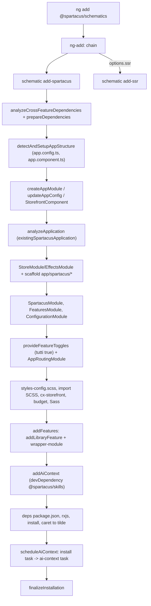
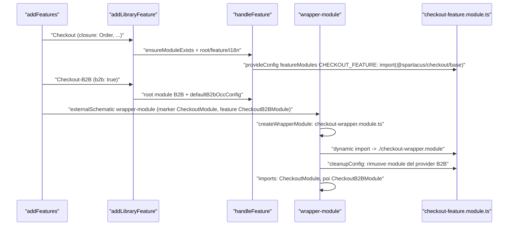
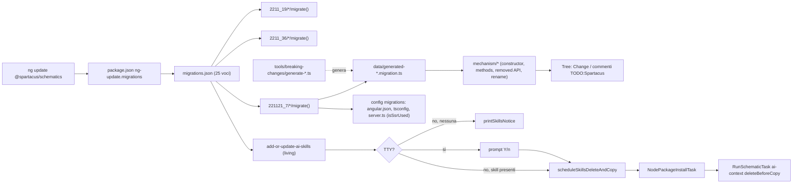
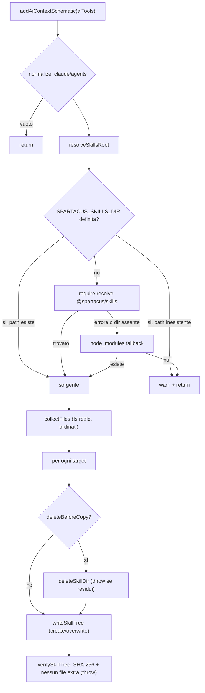

# 43 — Schematics e migrazioni di Spartacus

> Riferimenti allo SHA `5b7a1c2bf2808d7380bc20596d10f4fa710c3da1` (vedi [00-meta](../00-meta.md)).

## 1. A cosa serve e perché esiste

Spartacus non è un'applicazione da clonare: è un insieme di librerie npm che vanno *innestate* in un'applicazione Angular generata con `ng new`. L'innesto richiede decine di modifiche coordinate (moduli `app/spartacus/*`, config OCC, i18n, stili SCSS, `angular.json`, `package.json`, eventualmente SSR) e, a ogni release, modifiche inverse per adattare il codice del cliente ai breaking change. Il pacchetto `@spartacus/schematics` automatizza entrambe le cose con il meccanismo standard degli Angular schematics (vedi [08 — Schematics e builder](../parte-1/08-schematics-builder.md) per la parte Angular):

- **installazione** (`ng add @spartacus/schematics`, poi `ng add @spartacus/<feature-lib>`): scaffolding dell'app, configurazione, feature lazy-loaded, SSR;
- **generatori** di supporto (`add-cms-component`, `wrapper-module`, `ai-context`);
- **migrazioni** eseguite da `ng update` (`migrations.json`) e **modernizzazioni** manuali (`modernize-app-*`) per gli upgrade più invasivi.

Il pacchetto si dichiara con versione `221121.22.0` e registra la collection in `./src/collection.json` e le migrazioni in `./src/migrations/migrations.json` (`core-libs/schematics/package.json:L2-L3`, `core-libs/schematics/package.json:L90-L90`, `core-libs/schematics/package.json:L43-L89`). Nota: la versione dello schematics (`221121.22.0`) non coincide con la `2612.0.0` della root del monorepo; la cosa conta perché da quella versione dipendono `~<versione>` delle dipendenze installate e il "feature level" generato (`core-libs/schematics/src/shared/utils/package-utils.ts:L139-L149`).

Il pacchetto esporta anche utility per gli schematics delle altre librerie, con un avvertimento esplicito: "it exports utils for other Spartacus libs' schematics, but is not intended as a public API for external use. It may change without deprecation." (`core-libs/schematics/index.ts:L7-L13`). Ogni feature lib (es. `@spartacus/checkout`) ha infatti una propria piccola collection che riusa queste utility (`feature-libs/checkout/schematics/add-checkout/index.ts:L13-L43`).

Infine, un pezzo recente: il pacchetto `@spartacus/skills` e lo schematic `ai-context`, che copiano nel progetto del cliente una "skill" per assistenti AI (`.claude/skills/...`, `.agents/skills/...`), più una *living migration* che la tiene aggiornata a ogni `ng update` (`core-libs/schematics/src/ai-context/index.ts:L16-L22`, `core-libs/schematics/src/migrations/add-or-update-ai-skills/index.ts:L22-L31`).

> Nota: la semantica del devkit e della CLI citata nel capitolo (`chain`, task, `--dry-run`, selezione delle migrazioni di `ng update`, `ng-add.save`) è verificata sui sorgenti pubblicati di `@angular-devkit/schematics` e `@angular/cli` 21.2.23 (prefisso `deps:devkit/…`); vedi §3.9, §6 e le trappole 8, 16, 18 e 19 di §9.

Capitoli collegati: i feature toggle generati da `ng add` in [42 — Feature toggle e deprecazioni](../parte-2/42-feature-toggle-deprecazioni.md); lazy loading e `featureModules` in [12 — Feature module e lazy loading](../parte-2/12-feature-module-lazy.md); `provideConfig` in [11 — Configurazione](../parte-2/11-configurazione.md); lo stack SSR che `add-ssr` imposta in [39 — SSR ottimizzato](../parte-2/39-ssr-ottimizzato.md); stili in [38 — Stili e theming](../parte-2/38-stili-theming.md); test tooling in [44 — Test tooling](../parte-2/44-test-tooling.md); strategia di upgrade in [54 — Upgrade safe](../parte-3/54-upgrade-safe.md).

## 2. Mappa dei file

| Path | Ruolo |
|---|---|
| `core-libs/schematics/package.json` | versione `221121.22.0`, `ng-add.save: devDependencies`, `ng-update.migrations`, `packageGroup` di tutte le `@spartacus/*`, script `build`/`clean`/`copy-feature-toggles`/`test` |
| `core-libs/schematics/index.ts` | "public API" (non stabile): `SpartacusOptions` + `src/shared/index` |
| `core-libs/schematics/copy-feature-toggles.js` | pre-build: copia `feature-toggles.ts` da core in `src/feature-toggles.copied-from-core-lib.ts` (git-ignored) |
| `core-libs/schematics/jest.schematics.config.js`, `core-libs/schematics/setup-jest.ts`, `core-libs/schematics/project.json` | test Jest (`*_spec.ts`), target Nx `test-jest` |
| `core-libs/schematics/src/collection.json` | 9 schematics: `ng-add`, `add-spartacus`, `add-ssr`, `add-cms-component`, `wrapper-module`, `ai-context`, 3 × `modernize-app-*` |
| `core-libs/schematics/src/dependencies.json` | generato da `tools/schematics/dependency-collector.ts`: peer deps di ogni lib + deps della root |
| `core-libs/schematics/src/ng-add/index.ts` | `ng-add` = `add-spartacus` (+ `add-ssr` se `ssr`) |
| `core-libs/schematics/src/add-spartacus/index.ts` | `addSpartacus`: chain di ~20 rule; stili, budget, index.html, preprocessor, deps |
| `core-libs/schematics/src/add-spartacus/schema.json`, `core-libs/schematics/src/add-spartacus/schema.ts` | opzioni condivise da `ng-add`/`add-spartacus`/`add-ssr` |
| `core-libs/schematics/src/add-spartacus/{create-app-module,update-app-config,add-storefront-component-to-app-component,store,spartacus,spartacus-features,configuration,spartacus-feature-toggles,update-app-module}.ts` | singole rule di installazione |
| `core-libs/schematics/src/add-spartacus/ai-context.ts` | `addAiContext`, `scheduleAiContext` |
| `core-libs/schematics/src/add-ssr/index.ts` + `core-libs/schematics/src/add-ssr/*.ts` | `addSSR`: `@angular/ssr:ng-add` + adattamenti Spartacus |
| `core-libs/schematics/src/add-ssr/files/server.__typescriptExt__` | template `server.ts` (Express 5, `NgExpressEngineDecorator`) |
| `core-libs/schematics/src/add-cms-component/index.ts` | genera modulo + componente CMS (`ConfigModule.withConfig`) |
| `core-libs/schematics/src/wrapper-module/index.ts` | `generateWrapperModule`: "wrapper" per feature che devono caricarsi dopo un'altra |
| `core-libs/schematics/src/ai-context/index.ts` | copia + verifica SHA-256 della skill `spartacus-developer` |
| `core-libs/schematics/src/migrations/migrations.json` | 25 migrazioni (2211.19.0, 2211.36.0, 221121.7.0, 221121.22.0) |
| `core-libs/schematics/src/migrations/<versione>/*` | wrapper per versione (`migrate()`) + `data/generated-*.migration.ts` |
| `core-libs/schematics/src/migrations/mechanism/*` | motori generici: constructor, methods/properties, removed public API, rename symbol, config, component, dependency management, missing packages |
| `core-libs/schematics/src/migrations/add-or-update-ai-skills/*` | living migration delle skill AI (prompt TTY, sentinel, scheduling) |
| `core-libs/schematics/src/migrations/test/*` | migrazioni fittizie usate dagli spec dei mechanism |
| `core-libs/schematics/src/modernize-app-*/` | schematics di modernizzazione (application builder, Angular 19, standalone bootstrap) |
| `core-libs/schematics/src/shared/lib-configs/*-schematics-config.ts` | un `SchematicConfig` per ogni feature (es. Checkout) |
| `core-libs/schematics/src/shared/schematics-config-mappings.ts` | `SCHEMATICS_CONFIGS` e mappe derivate |
| `core-libs/schematics/src/shared/utils/lib-utils.ts` | `SchematicConfig`, `LibraryOptions`, `addLibraryFeature`, stili/assets/i18n, sort, finalize |
| `core-libs/schematics/src/shared/utils/feature-utils.ts` | `addFeatures`, `analyzeApplication` |
| `core-libs/schematics/src/shared/utils/graph-utils.ts`, `core-libs/schematics/src/shared/utils/dependency-utils.ts` | grafo e ordinamento topologico di librerie e feature |
| `core-libs/schematics/src/shared/utils/{program,tree-file-system,new-module-utils,import-utils}.ts` | ts-morph sopra il `Tree` e manipolazione `@NgModule` |
| `core-libs/schematics/src/shared/utils/{file-utils,module-file-utils}.ts` | API AST TypeScript "classica", tipi di deprecazione, `commitChanges` |
| `core-libs/schematics/src/shared/utils/{workspace-utils,package-utils}.ts` | workspace, progetto di default, scaffolding, deps, `isSsrUsed` |
| `tools/breaking-changes/*.ts` | generatori dei dati di deprecazione |
| `feature-libs/checkout/schematics/*` | esempio di collection di feature lib |
| `core-libs/skills/*` | pacchetto `@spartacus/skills` (skill `spartacus-developer`) |

## 3. Come funziona passo per passo

### 3.1 Pacchetto, build e collection

1. **Build senza ng-packagr.** `npm run build` rigenera `dependencies.json` (`generate:deps`) e compila con `tsc -p ./tsconfig.schematics.json`; `clean` esegue `copy-feature-toggles` (`core-libs/schematics/package.json:L14-L16`). `generate:deps` è `ts-node ./tools/schematics/dependency-collector.ts` (`package.json:L62-L64`).
2. **`dependencies.json`.** Il collector scrive `core-libs/schematics/src/dependencies.json`: per ogni lib sotto `projects`, `core-libs`, `feature-libs`, `integration-libs` raccoglie le `peerDependencies`, per il `package.json` root (name `storefrontapp`) le `dependencies` (`tools/schematics/dependency-collector.ts:L21-L31`, `tools/schematics/dependency-collector.ts:L46-L76`). Questo file è la "fonte di verità" delle versioni installate da `ng add` e da `ng update`.
3. **Feature toggle copiati.** `copy-feature-toggles.js` copia `core-libs/core/src/features-config/feature-toggles/config/feature-toggles.ts` in `src/feature-toggles.copied-from-core-lib.ts` (`core-libs/schematics/copy-feature-toggles.js:L5-L10`), file ignorato da git (`core-libs/schematics/.gitignore:L21-L22`). Serve a `addFeatureToggles` senza dipendere a runtime da `@spartacus/core` (§3.3).
4. **Collection.** `collection.json` registra 9 schematics; `ng-add` è `private`/`hidden` con alias `install`, gli altri hanno alias brevi (`spa`, `ssr`, `cms`, `wrapper`, `ai`) (`core-libs/schematics/src/collection.json:L3-L53`). `ng-add`, `add-spartacus` e `add-ssr` condividono lo stesso `./add-spartacus/schema.json` (`core-libs/schematics/src/collection.json:L7-L7`, `core-libs/schematics/src/collection.json:L15-L15`, `core-libs/schematics/src/collection.json:L21-L21`); `wrapper-module` non dichiara uno schema (`core-libs/schematics/src/collection.json:L30-L34`).
5. **`ng-add`** è un semplice `chain` di `schematic('add-spartacus')` e, se `options.ssr`, `schematic('add-ssr')` (`core-libs/schematics/src/ng-add/index.ts:L17-L24`).

### 3.2 Opzioni (`Schema` / `LibraryOptions`)

- `LibraryOptions` è la base comune: `project`, `lazy`, `features`, `debug`, `internal.existingSpartacusApplication`, `options` (`core-libs/schematics/src/shared/utils/lib-utils.ts:L85-L110`).
- `Schema` di add-spartacus aggiunge `baseUrl`, `occPrefix`, `baseSite`, `currency`, `language`, `urlParameters`, `useMetaTags`, `featureLevel` (`@deprecated`), `overwriteAppComponent`, `ssr`, `theme`, `aiTools`; `AiTool = 'claude' | 'agents'` (`core-libs/schematics/src/add-spartacus/schema.ts:L9-L27`).
- Lo schema JSON propone 16 feature di default con `x-prompt` a lista (`core-libs/schematics/src/add-spartacus/schema.json:L14-L34`, `core-libs/schematics/src/add-spartacus/schema.json:L94-L96`) e default `lazy: true`, `baseUrl: "https://localhost:9002"`, `overwriteAppComponent: true`, `ssr: false`, `debug: false`, `aiTools: ["agents"]` (`core-libs/schematics/src/add-spartacus/schema.json:L333-L346`, `core-libs/schematics/src/add-spartacus/schema.json:L376-L385`, `core-libs/schematics/src/add-spartacus/schema.json:L390-L397`).

### 3.3 `add-spartacus`: la catena di installazione

`addSpartacus` calcola **prima** le feature con le dipendenze transitive (`analyzeCrossFeatureDependencies`) e l'elenco delle dipendenze npm (`prepareDependencies`), poi restituisce un `chain` (`core-libs/schematics/src/add-spartacus/index.ts:L531-L590`). Le rule, nell'ordine:

1. **`detectAndSetupAppStructure`** — pretende un'app standalone con `app.config.ts` e il naming "2016" (`app.component.ts`); altrimenti `SchematicsException` con il consiglio di ricreare l'app con `--file-name-style-guide=2016` e senza `--standalone=false` (`core-libs/schematics/src/add-spartacus/index.ts:L324-L369`).
2. **`createAppModule`** — crea un `app.module.ts` vuoto (`@NgModule({})`) accanto ad `app.component.ts` (`core-libs/schematics/src/add-spartacus/create-app-module.ts:L22-L81`). Spartacus continua quindi a configurarsi in un NgModule, agganciato all'app standalone tramite:
3. **`updateAppConfig`** — aggiunge `provideHttpClient(withFetch(), withInterceptorsFromDi())` e `importProvidersFrom(AppModule)` ai `providers` di `appConfig`, evitando duplicati per confronto testuale (`core-libs/schematics/src/add-spartacus/update-app-config.ts:L19-L46`, `core-libs/schematics/src/add-spartacus/update-app-config.ts:L55-L110`).
4. **`addStorefrontComponentToAppComponent`** — importa `StorefrontComponent` e **sostituisce** l'array `imports` del `@Component` (`removeOldImports: true`) (`core-libs/schematics/src/add-spartacus/add-storefront-component-to-app-component.ts:L36-L48`, `core-libs/schematics/src/add-spartacus/add-imports-to-component-decorator.ts:L56-L89`).
5. **`analyzeApplication`** — imposta `options.internal.existingSpartacusApplication` se esiste già `SpartacusFeaturesModule` e, per app esistenti, verifica che i "marker module" degli `importAfter` siano installati (`core-libs/schematics/src/shared/utils/feature-utils.ts:L279-L370`).
6. **`setupStoreModules`** — `StoreModule.forRoot({})` ed `EffectsModule.forRoot([])` in `app.module.ts` (`core-libs/schematics/src/add-spartacus/store.ts:L48-L70`).
7. **`scaffoldStructure`** — via `ensureModuleExists` crea `app/spartacus/spartacus.module.ts` (dichiarato in `app`), `spartacus-features.module.ts` e `spartacus-configuration.module.ts` (dichiarati in `spartacus`) (`core-libs/schematics/src/shared/utils/workspace-utils.ts:L170-L198`).
8. **`setupSpartacusModule`** — `BaseStorefrontModule` in `imports` (order 0) e `exports` di `SpartacusModule` (`core-libs/schematics/src/add-spartacus/spartacus.ts:L53-L84`).
9. **`setupSpartacusFeaturesModule`** — moduli core/storefront fissi: `AuthModule.forRoot()`, `LogoutModule`, `LoginRouteModule`, moduli CMS base, consensi, Product, `CostCenterOccModule`, event module, `ExternalRoutesModule.forRoot()` (`core-libs/schematics/src/add-spartacus/spartacus-features.ts:L51-L276`).
10. **`addSpartacusConfiguration`** — in `spartacus-configuration.module.ts`: `provideConfigFactory(layoutConfigFactory)`, `provideConfig(mediaConfig)`, `...defaultCmsContentProviders`, poi config OCC, site context, i18n e `features.level` (`core-libs/schematics/src/add-spartacus/configuration.ts:L83-L122`, `core-libs/schematics/src/add-spartacus/configuration.ts:L157-L208`). Dettagli: con `useMetaTags` il `baseUrl` è omesso e `prefix` compare solo se `occPrefix` è valorizzato (`core-libs/schematics/src/add-spartacus/configuration.ts:L210-L221`); le CSV di site context passano per `parseCSV` (valute maiuscole, lingue minuscole) (`core-libs/schematics/src/add-spartacus/configuration.ts:L124-L151`, `core-libs/schematics/src/shared/utils/transform-utils.ts:L7-L19`); i18n usa `translationsEn`, `translationChunksConfig`, `fallbackLang: 'en'` (`core-libs/schematics/src/add-spartacus/configuration.ts:L183-L196`, `core-libs/schematics/src/add-spartacus/configuration.ts:L223-L231`); `features.level` è `featureLevel` o il `major.minor` dello schematics, funzione marcata `@deprecated` (`core-libs/schematics/src/add-spartacus/configuration.ts:L233-L242`, `core-libs/schematics/src/shared/utils/package-utils.ts:L147-L149`).
11. **`addFeatureToggles`** — `provideFeatureToggles({...})` con **tutte** le chiavi di `defaultFeatureToggles` a `true`, lette con `require` dal file copiato (`core-libs/schematics/src/add-spartacus/spartacus-feature-toggles.ts:L62-L113`, `core-libs/schematics/src/shared/constants.ts:L1176-L1177`).
12. **`updateAppModule`** — rimuove l'`AppRoutingModule` locale (import e file `app-routing.module.ts`) e importa quello di `@spartacus/storefront` con order 2 (`core-libs/schematics/src/add-spartacus/update-app-module.ts:L80-L145`).
13. **Stili** — `createStylesConfig` crea `styles-config.scss` con `$styleVersion` (`core-libs/schematics/src/add-spartacus/index.ts:L70-L86`, `core-libs/schematics/src/shared/utils/styling-utils.ts:L10-L13`); `installStyles` prende il primo elemento di `build.options.styles` e, se è un `.scss`, vi appende gli import di styles-config, `@spartacus/styles/scss/core`, Bootstrap vendorizzato sotto `@spartacus/styles/vendor/bootstrap/scss/*`, `@spartacus/styles/index` e, opzionalmente, il tema; se non è un `.scss` si limita a un warning (`core-libs/schematics/src/add-spartacus/index.ts:L89-L89`, `core-libs/schematics/src/add-spartacus/index.ts:L120-L128`, `core-libs/schematics/src/add-spartacus/index.ts:L102-L187`).
14. **`updateMainComponent`** — `<cx-storefront/>` in `app.component.html`, sostituendo tutto se `overwriteAppComponent` (`core-libs/schematics/src/add-spartacus/index.ts:L189-L229`). Con `useMetaTags`, `updateIndexFile` aggiunge le meta `occ-backend-base-url`/`media-backend-base-url` (`core-libs/schematics/src/add-spartacus/index.ts:L231-L254`).
15. **`increaseBudgets`** — `maximumError: '3.5mb'` per il budget `initial` in production (`core-libs/schematics/src/add-spartacus/index.ts:L256-L315`).
16. **`createStylePreprocessorOptions`** — `node_modules/` negli `includePaths` di build e test, `sass.silenceDeprecations` solo in build (`core-libs/schematics/src/add-spartacus/index.ts:L371-L464`), con `'import'` silenziato e la motivazione CXSPA-447 (`core-libs/schematics/src/shared/utils/workspace-utils.ts:L209-L243`).
17. **`addFeatures`** — per ogni feature `addLibraryFeature` + eventuali `wrapper-module` (§3.4).
18. **`addAiContext`** — `@spartacus/skills` in devDependencies (`overwrite: false`) se `aiTools` non è vuoto (`core-libs/schematics/src/add-spartacus/ai-context.ts:L27-L48`).
19. **Dipendenze** — sotto-chain: `addPackageJsonDependencies(prepareDependencies(features))`, forzatura di `rxjs` alla versione Spartacus, `installPackageJsonDependencies()`, `replaceCaretWithTildeForSpartacusDependencies` (`core-libs/schematics/src/add-spartacus/index.ts:L571-L585`). `prepareDependencies` unisce le core deps (`core`, `storefront`, `assets`, `styles`), le librerie delle feature (con `~<versione schematics>`) e le terze parti (`core-libs/schematics/src/add-spartacus/index.ts:L466-L480`, `core-libs/schematics/src/shared/utils/package-utils.ts:L256-L294`). Il passaggio `^`→`~` è motivato dalla scelta, dalla 2211.19, di rilasciare breaking change nei "minor" (`core-libs/schematics/src/add-spartacus/index.ts:L482-L529`).
20. **`scheduleAiContext`** — accoda `NodePackageInstallTask` e, dipendente da esso, `RunSchematicTask('ai-context', …)` (`core-libs/schematics/src/add-spartacus/ai-context.ts:L54-L76`).
21. **`finalizeInstallation`** — per un'app già Spartacus, warning "🚨 Detected Spartacus installation…" con l'elenco delle feature da verificare e ordinare (`core-libs/schematics/src/shared/utils/lib-utils.ts:L897-L909`).

### 3.4 Feature: `SchematicConfig`, `addFeatures`, `addLibraryFeature`

Ogni feature installabile è descritta da un oggetto dichiarativo `SchematicConfig`: `library {featureName, mainScope, featureScope?, b2b?}`, `folderName`, `moduleName`, `featureModule` (singolo o array), `rootModule?`, `lazyLoadingChunk?`, `i18n?`, `styles?`, `assets?`, `customConfig?`, `dependencyFeatures?`, `importAfter?` (`core-libs/schematics/src/shared/utils/lib-utils.ts:L115-L199`). Tutte le config sono elencate in `SCHEMATICS_CONFIGS`, che "_Must_ be updated when adding a new schematics library or a feature" (`core-libs/schematics/src/shared/schematics-config-mappings.ts:L99-L198`); `generateMappings()` ne ricava 4 mappe (`libraryFeatureMapping`, `featureFeatureModuleMapping`, `featureRootModuleMapping`, `featureSchematicConfigMapping`) (`core-libs/schematics/src/shared/schematics-config-mappings.ts:L203-L286`).

1. **Closure delle dipendenze.** `analyzeCrossFeatureDependencies` raccoglie ricorsivamente le `dependencyFeatures` (es. Digital Payments trascina User-Account, User-Profile, Cart, Order, Checkout) e le ordina (`core-libs/schematics/src/shared/utils/dependency-utils.ts:L29-L60`).
2. **Ordine globale.** All'import di `graph-utils.ts` vengono calcolati, come costanti di modulo, `crossLibraryInstallationOrder` e `crossFeatureInstallationOrder` (`core-libs/schematics/src/shared/utils/graph-utils.ts:L41-L49`) con l'algoritmo di Kahn, che lancia `Circular dependency detected.` sui cicli e restituisce l'ordine **invertito** (dipendenze prima) (`core-libs/schematics/src/shared/utils/graph-utils.ts:L85-L135`). Il grafo delle librerie usa le dipendenze `@spartacus/*` di `dependencies.json` (`core-libs/schematics/src/shared/utils/graph-utils.ts:L137-L166`), quello delle feature un arco per ogni `dependencyFeatures` (`core-libs/schematics/src/shared/utils/graph-utils.ts:L168-L184`); `groupFeatures` avvicina le feature della stessa libreria (`core-libs/schematics/src/shared/utils/graph-utils.ts:L51-L69`). Le voci assenti dall'ordine finiscono in fondo (`core-libs/schematics/src/shared/utils/lib-utils.ts:L878-L891`).
3. **`addFeatures`.** In un'app nuova installa tutte le feature della closure; in un'app esistente solo `options.features` ("we don't want to force-install the dependent features"). Per ciascuna applica `customConfig(options).options` se c'è, accoda `addLibraryFeature` e uno `externalSchematic('@spartacus/schematics', 'wrapper-module', …)` per ogni `importAfter` (`core-libs/schematics/src/shared/utils/feature-utils.ts:L102-L154`).
4. **`addLibraryFeature`.** Se manca la struttura fa scaffolding, poi `handleFeature`, stili e assets (`core-libs/schematics/src/shared/utils/lib-utils.ts:L239-L273`). `handleFeature` crea `<moduleName>-feature.module.ts` in `app/spartacus/features/<folder>`, dichiarato in `spartacus-features`, e aggiunge root module, feature module, traduzioni, custom config e, per b2b, `configureB2bFeatures` (`core-libs/schematics/src/shared/utils/lib-utils.ts:L293-L326`).
5. **Lazy vs eager.** Con `lazy` il feature module diventa `provideConfig(<CmsConfig>{ featureModules: { [CHUNK]: { module: () => import('…').then((m) => m.X) } } })`, altrimenti è importato staticamente (`core-libs/schematics/src/shared/utils/lib-utils.ts:L397-L446`). Questo è esattamente il formato consumato dal lazy loading descritto in [12](../parte-2/12-feature-module-lazy.md).
6. **Traduzioni, stili, assets, B2B.** `addFeatureTranslations` → `provideConfig(<I18nConfig>{…})` (`core-libs/schematics/src/shared/utils/lib-utils.ts:L448-L494`); `addLibraryStyles` → `<sourceRoot>/styles/spartacus/<file>.scss` aggiunto a `styles` di build e test (`core-libs/schematics/src/shared/utils/lib-utils.ts:L641-L728`); `addLibraryAssets` → glob `./node_modules/@spartacus/<input>` in `assets` (`core-libs/schematics/src/shared/utils/lib-utils.ts:L541-L629`); per b2b `provideConfig(defaultB2bOccConfig)` + dipendenza `@spartacus/setup` (`core-libs/schematics/src/shared/utils/lib-utils.ts:L786-L841`, `core-libs/schematics/src/shared/utils/config-utils.ts:L123-L139`).

Esempio concreto: `CHECKOUT_BASE_SCHEMATICS_CONFIG` (feature `Checkout`, `CheckoutModule` da `@spartacus/checkout/base`, root `CheckoutRootModule`, chunk `CHECKOUT_FEATURE`, dipendenza da `Order`) e `CHECKOUT_B2B_SCHEMATICS_CONFIG` (`b2b: true`, stesso `moduleName`, `importAfter` per caricare `CheckoutB2BModule` dopo `CheckoutModule`) (`core-libs/schematics/src/shared/lib-configs/checkout-schematics-config.ts:L40-L125`).

### 3.5 `wrapper-module`: caricare una feature "dopo" un'altra

Alcune feature (es. Checkout B2B) estendono un'altra feature e devono essere importate **nello stesso chunk lazy, dopo** di essa. Il wrapper risolve il problema creando un modulo che importa staticamente entrambi, e ripuntando il dynamic import a quel modulo. `generateWrapperModule` è un chain di sei rule (`core-libs/schematics/src/wrapper-module/index.ts:L527-L541`):

1. `checkWrapperModuleExists` — se un file importa già staticamente il marker module, il suo path finisce in `options.internal.wrapperModulePath`: le rule successive leggono questa **mutazione** delle opzioni (`core-libs/schematics/src/wrapper-module/index.ts:L89-L114`).
2. `createWrapperModule` — crea `app/spartacus/features/<folder>/<name>-wrapper.module.ts` importandolo temporaneamente nel feature module, workaround perché ts-morph "does not 'see' the newly created TS file if it is not referenced anywhere" (`core-libs/schematics/src/wrapper-module/index.ts:L167-L207`). Il nome file toglie `module`/`Module` e aggiunge `-wrapper` (`core-libs/schematics/src/shared/utils/lib-utils.ts:L328-L331`).
3. `updateFeatureModule` — `import('@spartacus/user/profile').then(...)` diventa `import('./profile-wrapper.module').then(...)` e l'import temporaneo è rimosso (`core-libs/schematics/src/wrapper-module/index.ts:L222-L336`).
4. `removeLibraryDynamicImport` / `cleanupConfig` — toglie `module` dal provider della feature dipendente e, se l'oggetto resta `{}`, l'intero provider (`core-libs/schematics/src/wrapper-module/index.ts:L338-L405`, `core-libs/schematics/src/wrapper-module/index.ts:L413-L427`).
5. `updateWrapperModule` ×2 — import statico di marker e poi feature module nel wrapper (`core-libs/schematics/src/wrapper-module/index.ts:L457-L521`).

Le opzioni comprendono `markerModuleName`, `featureModuleName` e `internal.wrapperModulePath` ("Should not be set by the user") (`core-libs/schematics/src/wrapper-module/schema.ts:L9-L38`).

### 3.6 `add-ssr`

`addSSR` riusa lo schematic ufficiale di Angular e poi lo "piega" verso lo stack SSR di Spartacus (`core-libs/schematics/src/add-ssr/index.ts:L437-L465`):

1. dipendenze `@spartacus/setup`, `@angular/platform-server`, `@angular/ssr`, con le versioni prese da `dependencies.json` alla chiave `storefrontapp` (`core-libs/schematics/src/add-ssr/index.ts:L59-L59`, `core-libs/schematics/src/add-ssr/index.ts:L131-L153`);
2. `externalSchematic('@angular/ssr', 'ng-add')`, che a sua volta delega a `@schematics/angular:ssr` (`deps:angular-ssr-21.2.23/package/schematics/ng-add/index.js:L11-L11`);
3. rimozione di `build.options.outputMode` ("This could be removed when we migrate to new SSR API") (`core-libs/schematics/src/add-ssr/index.ts:L362-L412`) e di `app.routes.server.ts` ("not supported by Spartacus SSR") (`core-libs/schematics/src/add-ssr/index.ts:L414-L435`);
4. `scripts["build:ssr"] = "ng build"` per la build CCv2 (TODO CXSPA-6466) (`core-libs/schematics/src/add-ssr/index.ts:L155-L181`);
5. `AppServerModule` vuoto in `app.module.server.ts` (`core-libs/schematics/src/add-ssr/create-app-server-module.ts:L22-L77`); in `app.config.server.ts` rimuove `withRoutes(serverRoutes)` e aggiunge `importProvidersFrom(AppServerModule)` (`core-libs/schematics/src/add-ssr/update-app-config-server.ts:L17-L58`, `core-libs/schematics/src/add-ssr/update-app-config-server.ts:L104-L140`); in `app.module.server.ts` inserisce `...provideServer({ serverRequestOrigin: process.env['SERVER_REQUEST_ORIGIN'] })` da `@spartacus/setup/ssr` (`core-libs/schematics/src/add-ssr/index.ts:L61-L96`);
6. meta OCC in `index.html` e `provideClientHydration(withEventReplay(), withNoHttpTransferCache())` in `appConfig` — transfer cache "temporarily disabled" (CXSPA-10430); il meta `occ-backend-base-url` è aggiunto da `modifyIndexHtmlFile` (`core-libs/schematics/src/add-ssr/index.ts:L98-L117`), l'hydration da `updateAppConfigInSsr` (`core-libs/schematics/src/add-ssr/update-app-config-in-ssr.ts:L47-L77`, `core-libs/schematics/src/add-ssr/update-app-config-in-ssr.ts:L104-L149`). I providers sono individuati cercando una variabile chiamata `appConfig` / `serverConfig` con un object literal che ha `providers` array (`core-libs/schematics/src/add-ssr/get-providers-array-from-named-object.ts:L22-L64`);
7. merge del template `server.ts` con `MergeStrategy.Overwrite` (`core-libs/schematics/src/add-ssr/index.ts:L455-L458`): `NgExpressEngineDecorator.get(ngExpressEngine)`, `getOriginValidationMiddleware`, `index.server.html`, `trust proxy: loopback`, `defaultExpressErrorHandlers` (`core-libs/schematics/src/add-ssr/files/server.__typescriptExt__:L1-L63`), route regex Express 5 e porta di default `4000` (`core-libs/schematics/src/add-ssr/files/server.__typescriptExt__:L45-L73`);
8. `prerender: false`, nuova configurazione `noSsr` agganciata a `serve` production/development (`core-libs/schematics/src/add-ssr/index.ts:L183-L360`); install.

### 3.7 `add-cms-component`

Valida che `cmsComponentDataModel` sia presente se `cmsComponentData` (`core-libs/schematics/src/add-cms-component/index.ts:L356-L362`); se non viene passato `declareCmsModule` genera un nuovo modulo con `@schematics/angular:module`, poi il componente con `@schematics/angular:component`, quindi aggiorna modulo/componente/template (`core-libs/schematics/src/add-cms-component/index.ts:L398-L447`). La registrazione usa la vecchia API `ConfigModule.withConfig(<CmsConfig>{ cmsComponents: … })` (`core-libs/schematics/src/add-cms-component/index.ts:L114-L136`).

### 3.8 AI context: `@spartacus/skills` e schematic `ai-context`

1. `@spartacus/skills` (versione `221121.22.0`, nessun target Nx) contiene la sola skill `skills/spartacus-developer` (`SKILL.md` + `references/`) (`core-libs/skills/package.json:L2-L14`, `core-libs/skills/project.json:L1-L7`). `SKILL.md` ha frontmatter `name: spartacus-developer` e una Quick Reference di regole per chi sviluppa su Spartacus (`core-libs/skills/skills/spartacus-developer/SKILL.md:L1-L5`, `core-libs/skills/skills/spartacus-developer/SKILL.md:L32-L58`).
2. Lo schematic `ai-context` normalizza `aiTools` (solo `claude`, `agents`, nell'ordine fisso) e risolve la sorgente: se `SPARTACUS_SKILLS_DIR` è definita viene usata **in esclusiva** (path inesistente → `null` → warning, anche se `@spartacus/skills` è installato) (`core-libs/schematics/src/ai-context/index.ts:L85-L88`); altrimenti `require.resolve('@spartacus/skills/package.json', { paths: [cwd] })`, poi il fallback `node_modules/@spartacus/skills/skills/spartacus-developer`; se non trova nulla emette un warning ed esce (`core-libs/schematics/src/ai-context/index.ts:L41-L111`).
3. Legge i file dal **file system reale** (`fs.readdirSync`/`readFileSync`), li ordina e li scrive nel `Tree` (create/overwrite) (`core-libs/schematics/src/ai-context/index.ts:L113-L132`, `core-libs/schematics/src/ai-context/index.ts:L178-L191`).
4. Con `deleteBeforeCopy` svuota prima la destinazione e, se resta qualcosa, lancia "so the transactional Tree commit is aborted" (`core-libs/schematics/src/ai-context/index.ts:L159-L176`).
5. `verifySkillTree` confronta lo SHA-256 di ogni file e rifiuta file extra sotto la destinazione (`core-libs/schematics/src/ai-context/index.ts:L193-L254`).

### 3.9 `ng update`: struttura delle migrazioni

1. `ng-update.migrations` punta a `./src/migrations/migrations.json` (`core-libs/schematics/package.json:L46-L47`). La CLI legge `packageNode['ng-update'].migrations` e chiama `executeMigrations(..., from, options.to || packageNode.version, ...)` (`deps:devkit/angular-cli-21.2.23/package/src/commands/update/cli.js:L252-L253`, `deps:devkit/angular-cli-21.2.23/package/src/commands/update/cli.js:L303-L303`); seleziona le voci la cui `version` soddisfa il range `>from <=to` e le esegue in ordine di versione e poi di **nome** (`deps:devkit/angular-cli-21.2.23/package/src/commands/update/utilities/migration.js:L107-L118`, `deps:devkit/angular-cli-21.2.23/package/src/commands/update/utilities/migration.js:L127-L127`).
2. `migrations.json` contiene 25 voci: 10 per `2211.19.0`, 4 per `2211.36.0`, 10 per `221121.7.0` e 1 per `221121.22.0` (`core-libs/schematics/src/migrations/migrations.json:L3-L127`); le chiavi hanno un prefisso `00-`…`09-` per versione (`core-libs/schematics/src/migrations/migrations.json:L3-L52`): poiché la CLI ordina per versione e poi per nome, è questo prefisso a fissare l'ordine d'esecuzione dentro una stessa versione (`deps:devkit/angular-cli-21.2.23/package/src/commands/update/utilities/migration.js:L127-L127`).
3. Ogni voce punta a `./<versione>/<nome>/<file>#migrate`. Per le migrazioni "di codice" il `migrate()` per versione è un wrapper sottilissimo che passa i dati generati al mechanism (`core-libs/schematics/src/migrations/221121_7/constructor-deprecations/constructor-deprecations.ts:L7-L19`).
4. I dati (`data/generated-*.migration.ts`, "Generated file, don't update manually.") sono prodotti da `tools/breaking-changes/generate-*.ts` per `NEW_VERSION = '221121_7'`, con prefisso di commento `// TODO:Spartacus -` (`core-libs/schematics/src/migrations/221121_7/constructor-deprecations/data/generated-constructor.migration.ts:L7-L9`, `tools/breaking-changes/common.ts:L12-L19`). Dimensioni dei file dati 221121_7 (`wc -l`, righe totali compresi header e import): 191 costruttori, 350 metodi/proprietà, 306 API rimosse, 17 rename (una sola voce). L'unico rename sposta `cdsTranslationChunksConfig` da `@spartacus/cds` a `@spartacus/cds/assets` (`core-libs/schematics/src/migrations/221121_7/rename-symbol/data/generated-rename-symbols.migration.ts:L11-L17`).
5. Alcune migrazioni 2211_19 hanno dati vuoti (`config-deprecations`, `dependency-management`, `missing-packages`) (`core-libs/schematics/src/migrations/2211_19/config-deprecations/config-deprecations.ts:L11-L11`, `core-libs/schematics/src/migrations/2211_19/dependency-management/dependency-management.ts:L10-L10`, `core-libs/schematics/src/migrations/2211_19/missing-packages/missing-packages.ts:L13-L13`); `css` si limita a un warning con link (`core-libs/schematics/src/migrations/2211_19/css/css.ts:L10-L16`).

Catalogo delle migrazioni di configurazione (non guidate da dati):

| Versione | Migrazione | Cosa fa | Riferimento |
|---|---|---|---|
| 2211.19.0 | `ssr` | solo con legacy server builder: ripristina `server.ts.bak`, `zone.js/dist/zone-node`→`zone.js/node`, `@nguniversal/express-engine`→`@spartacus/setup/ssr`, elimina `express.tokens.ts` | `core-libs/schematics/src/migrations/2211_19/ssr/ssr.ts:L11-L15`, `core-libs/schematics/src/migrations/2211_19/update-ssr/update-ssr-files.ts:L25-L137` |
| 2211.19.0 | `angular-json-styling` | riusa `createStylePreprocessorOptions()` | `core-libs/schematics/src/migrations/2211_19/angular-json-styles/angular-json-styles.ts:L7-L14` |
| 2211.36.0 | `ssr` | `index.html` → `join(serverDistFolder, 'index.server.html')` (se `isSsrUsed`) | `core-libs/schematics/src/migrations/2211_36/ssr/update-ssr/update-server-files.ts:L15-L149` |
| 2211.36.0 | `bootstrap` | disinstalla `bootstrap` (npm/yarn/pnpm) e riscrive gli import verso `@spartacus/styles/vendor/bootstrap/scss/*` | `core-libs/schematics/src/migrations/2211_36/bootstrap/bootstrap.ts:L16-L131`, `core-libs/schematics/src/migrations/2211_36/bootstrap/replace-bootstrap-imports.ts:L9-L198` |
| 2211.36.0 | `silence-sass-deprecations` | `silenceDeprecations: ['import']` | `core-libs/schematics/src/migrations/2211_36/silence-sass-deprecations/silence-sass-deprecations.ts:L14-L32` |
| 221121.7.0 | `angular-config` | rimuove `build.options.index` | `core-libs/schematics/src/migrations/221121_7/angular-config/index.ts:L13-L71` |
| 221121.7.0 | `angular-providers` | `provideBrowserGlobalErrorListeners()` in `app.module.ts` | `core-libs/schematics/src/migrations/221121_7/angular-providers/index.ts:L21-L88` |
| 221121.7.0 | `express-v5` | `express ^5.1.0`, `'*.*'`→`/.*\..*/`, `'*'`→`/.*/` (solo SSR) | `core-libs/schematics/src/migrations/221121_7/ssr/express-v5/index.ts:L59-L109`, `core-libs/schematics/src/migrations/221121_7/ssr/express-v5/index.ts:L199-L261` |
| 221121.7.0 | `tsconfig-update` | rimuove `outDir`/`esModuleInterop`/`moduleResolution`, `module: "preserve"`, `files: []` + `references` | `core-libs/schematics/src/migrations/221121_7/tsconfig-update/index.ts:L10-L117` |
| 221121.7.0 | `move-zone-change-detection-to-main` | sposta `provideZoneChangeDetection` da `main.ts` ad `app.module.ts` | `core-libs/schematics/src/migrations/221121_7/move-zone-change-detection-to-main/index.ts:L11-L22` |
| 221121.7.0 | `build-ssr-script` | ri-aggiunge `build:ssr` (solo SSR) | `core-libs/schematics/src/migrations/221121_7/ssr/build-ssr-script/index.ts:L16-L73` |
| 221121.22.0 | `add-or-update-ai-skills` | living migration delle skill AI | `core-libs/schematics/src/migrations/add-or-update-ai-skills/index.ts:L32-L86` |

### 3.10 I mechanism generici

- **Costruttori** — `migrateConstructorDeprecation` scorre tutti i `.ts` del sourceRoot del primo progetto; per ogni deprecazione candidata aggiunge e poi rimuove parametri, ricaricando il sorgente dopo ogni commit (`core-libs/schematics/src/migrations/mechanism/constructor-deprecations/constructor-deprecations.ts:L22-L79`). Un file è candidato se estende la classe deprecata importata dal path atteso, importa i tipi dei parametri e ha costruttore + `super()` corrispondenti (`core-libs/schematics/src/shared/utils/file-utils.ts:L352-L412`); `addConstructorParam` gestisce anche `@Inject(token)` e aggiorna `super(...)` (`core-libs/schematics/src/shared/utils/file-utils.ts:L532-L611`).
- **Metodi e proprietà** — commento `// TODO:Spartacus - '<old>' has been removed. Please try using '<new>' instead.` sopra gli usi (`core-libs/schematics/src/migrations/mechanism/methods-and-properties-deprecations/methods-and-properties-deprecations.ts:L20-L58`).
- **API rimosse** — commento sopra gli import dei simboli rimossi (`core-libs/schematics/src/migrations/mechanism/removed-public-api-deprecations/removed-public-api-deprecation.ts:L19-L53`).
- **Rename symbol** — mechanism su ts-morph (come `missing-packages`, `core-libs/schematics/src/migrations/mechanism/missing-packages/missing-packages.ts:L9-L9`, `core-libs/schematics/src/migrations/mechanism/missing-packages/missing-packages.ts:L30-L33`): sostituisce la dichiarazione di import (preservando l'alias) e chiama `saveAndFormat` (`core-libs/schematics/src/migrations/mechanism/rename-symbol/rename-symbol.ts:L14-L85`).
- **Config** — commento sopra ogni proprietà `propertyName` in un object literal (`core-libs/schematics/src/migrations/mechanism/config-deprecations/config-deprecation.ts:L17-L39`).
- **Componenti** — commenta nei template gli input/output rimossi e, nelle sottoclassi, le proprietà rimosse, usando `@angular/compiler` passato come parametro (`core-libs/schematics/src/migrations/mechanism/component-deprecations/component-deprecations.ts:L27-L156`). Allo SHA è usato solo dalle migrazioni di test: in `migrations.json` non c'è una migrazione component-deprecations (`core-libs/schematics/src/migrations/test/component-deprecations/component-deprecations.ts:L9-L31`).
- **Dependency management** — aggiorna con `overwrite: true` tutte le deps `@spartacus/*` (tranne `@spartacus/schematics`) secondo `dependencies.json` e installa (`core-libs/schematics/src/migrations/mechanism/dependency-management/dependency-management.ts:L28-L139`).
- **Missing packages** — avvisa se si importa da un pacchetto assente nel `package.json` (`core-libs/schematics/src/migrations/mechanism/missing-packages/missing-packages.ts:L18-L67`).

### 3.11 Living migration delle skill AI

`add-or-update-ai-skills` ha `version: "221121.22.0"` ma la sua JSDoc spiega che la versione "is updated to match the package version on every release so it always fires" (`core-libs/schematics/src/migrations/add-or-update-ai-skills/index.ts:L22-L31`, `core-libs/schematics/src/migrations/migrations.json:L123-L127`). Dato il range `>from <=to` della CLI, gira in ogni `ng update` che passa da una versione inferiore a quella allineata al pacchetto (allo SHA `221121.22.0`); non gira se `from` è già pari a quella versione (`deps:devkit/angular-cli-21.2.23/package/src/commands/update/utilities/migration.js:L107-L118`).

1. Senza TTY (`stdin.isTTY && stdout.isTTY` falso), se trova skill installate (sentinel `SKILL.md` in `.claude/...` o `.agents/...`) le ri-sincronizza, altrimenti stampa un avviso (`core-libs/schematics/src/migrations/add-or-update-ai-skills/index.ts:L33-L48`, `core-libs/schematics/src/migrations/add-or-update-ai-skills/ai-context.utils.ts:L35-L51`).
2. Con TTY chiede `Install`/`Update … (Y/n)` via `readline`; in update riusa gli strumenti già presenti, altrimenti chiede uno per uno (`core-libs/schematics/src/migrations/add-or-update-ai-skills/index.ts:L50-L85`, `core-libs/schematics/src/migrations/add-or-update-ai-skills/ai-context.utils.ts:L53-L86`).
3. `scheduleSkillsDeleteAndCopy` aggiunge `@spartacus/skills` con `overwrite: true`, accoda l'install e poi `RunSchematicTask('@spartacus/schematics', 'ai-context', { aiTools, deleteBeforeCopy: true })` (`core-libs/schematics/src/migrations/add-or-update-ai-skills/ai-context.utils.ts:L95-L115`).

### 3.12 Modernize-app (schematics manuali)

Tre schematics da lanciare a mano con `ng generate` per gli upgrade che non si possono automatizzare in sicurezza dentro `ng update`:

- `modernize-app-migrated-from-6_8-to-2211_19`: application builder, tsconfig, app module e, solo con legacy server builder, 8 step SSR (`core-libs/schematics/src/modernize-app-migrated-from-6_8-to-2211_19/index.ts:L26-L48`);
- `modernize-app-migrated-from-2211_32-to-2211_36` (Angular 19): angular.json, tsconfig, assets e favicon in `public`, `main.ts`, i18n lazy loading, server.ts (`core-libs/schematics/src/modernize-app-migrated-from-2211_32-to-2211_36/index.ts:L29-L48`);
- `modernize-app-to-standalone-bootstrap-application`: `bootstrapModule(AppModule)` → `bootstrapApplication(AppComponent, appConfig)` (`core-libs/schematics/src/modernize-app-to-standalone-bootstrap-application/index.ts:L26-L54`), con un `app.config.ts` generato che contiene `provideBrowserGlobalErrorListeners()`, `provideZoneChangeDetection({ eventCoalescing: true })`, `provideHttpClient(...)`, `importProvidersFrom(AppModule)` (`core-libs/schematics/src/modernize-app-to-standalone-bootstrap-application/csr-and-ssr/create-app-config.ts:L16-L59`).

Ogni step è avvolto in `withFallbackDocs*`: un'eccezione viene loggata con il link alla guida manuale e viene restituito lo stesso `tree` (le modifiche già applicate dallo step prima dell'eccezione non vengono annullate) (`core-libs/schematics/src/modernize-app-to-standalone-bootstrap-application/fallback-advice-to-follow-docs.ts:L12-L43`, `core-libs/schematics/src/modernize-app-to-standalone-bootstrap-application/fallback-advice-to-follow-docs.ts:L32-L41`).

### 3.13 Utility AST: due mondi

Gli schematics usano **due** API di manipolazione del codice:

- **ts-morph** (installazione, wrapper, rename): `createProgram` crea un `Project` dal tsconfig sopra un `TreeFileSystem` che adatta il `Tree` del devkit (`core-libs/schematics/src/shared/utils/program.ts:L11-L35`); `saveAndFormat` fa `organizeImports()`, `formatText({indentSize: 2})`, `saveSync()` (`core-libs/schematics/src/shared/utils/program.ts:L37-L48`); `writeFileSync` evita la scrittura se il contenuto è identico (`core-libs/schematics/src/shared/utils/tree-file-system.ts:L84-L94`). `addModuleImport/Export/Provider` aggiungono agli array di `@NgModule` con un `order` opzionale (`core-libs/schematics/src/shared/utils/new-module-utils.ts:L87-L176`) e deduplicano con confronto testuale normalizzato (`core-libs/schematics/src/shared/utils/new-module-utils.ts:L222-L284`, `core-libs/schematics/src/shared/utils/config-utils.ts:L52-L84`).
- **TypeScript AST "classico"** + `InsertChange`/`RemoveChange`/`ReplaceChange` applicati con `UpdateRecorder` in `commitChanges` (`core-libs/schematics/src/shared/utils/file-utils.ts:L292-L332`): usato da quasi tutti i mechanism di migrazione.

### 3.14 Schematics delle feature lib

Esistono cartelle `schematics/` in 20 feature-libs e 12 integration-libs (censimento del dossier). Esempio `@spartacus/checkout`: `"schematics": "./schematics/collection.json"`, build `tsc -p ./tsconfig.schematics.json` (`feature-libs/checkout/package.json:L21-L23`, `feature-libs/checkout/package.json:L51-L51`), collection con `ng-add` (privato) e `add` su `addCheckoutFeatures` (`feature-libs/checkout/schematics/collection.json:L3-L17`). `addCheckoutFeatures` valida che `@spartacus/core` sia installato, calcola la closure, poi `analyzeApplication` → `addFeatures` → `addPackageJsonDependenciesForLibrary(peerDependencies)` → `finalizeInstallation` (`feature-libs/checkout/schematics/add-checkout/index.ts:L25-L43`, `core-libs/schematics/src/shared/utils/workspace-utils.ts:L161-L168`). Lo schema offre `Checkout`, `Checkout-B2B`, `Checkout-Scheduled-Replenishment` con default `["Checkout"]` (`feature-libs/checkout/schematics/add-checkout/schema.json:L24-L33`). Lo stesso schema vale per tutte le 32 collection: ogni `*/schematics/collection.json` di feature-libs e integration-libs dichiara sia `"ng-add"` sia `"add"`, e ogni `schematics/add-*/index.ts` chiama `validateSpartacusInstallation` e `finalizeInstallation` (verifica con `grep` su tutti i 32 file, es. `feature-libs/checkout/schematics/collection.json:L3-L17`, `feature-libs/checkout/schematics/add-checkout/index.ts:L25-L43`).

## 4. Diagrammi

### 4.1 `ng add @spartacus/schematics` (chain di `add-spartacus`)



Ogni nodo corrisponde a una rule elencata in §3.3 (`core-libs/schematics/src/add-spartacus/index.ts:L531-L590`, `core-libs/schematics/src/ng-add/index.ts:L17-L24`).

### 4.2 Installazione di una feature con `importAfter` (Checkout-B2B)



Riferimenti: `core-libs/schematics/src/shared/utils/feature-utils.ts:L102-L154`, `core-libs/schematics/src/shared/utils/lib-utils.ts:L293-L326`, `core-libs/schematics/src/shared/lib-configs/checkout-schematics-config.ts:L83-L125`, `core-libs/schematics/src/wrapper-module/index.ts:L527-L541`.

### 4.3 `ng update @spartacus/schematics`



Riferimenti: `core-libs/schematics/package.json:L46-L47`, `core-libs/schematics/src/migrations/migrations.json:L3-L127`, `core-libs/schematics/src/migrations/221121_7/constructor-deprecations/constructor-deprecations.ts:L11-L19`, `core-libs/schematics/src/migrations/add-or-update-ai-skills/index.ts:L32-L86`, `tools/breaking-changes/common.ts:L12-L19`.

### 4.4 Schematic `ai-context`



Riferimenti: `core-libs/schematics/src/ai-context/index.ts:L41-L254` (risoluzione della sorgente: `core-libs/schematics/src/ai-context/index.ts:L84-L111`).

## 5. Estratti di codice reale

### 5.1 `ng-add`

`core-libs/schematics/src/ng-add/index.ts:L17-L24`
```ts
export default function (options: SpartacusOptions): Rule {
  return (host: Tree, context: SchematicContext) => {
    return chain([
      schematic('add-spartacus', options),
      options.ssr ? schematic('add-ssr', options) : noop(),
    ])(host, context);
  };
}
```

### 5.2 La chain di `addSpartacus` (abbreviata)

`core-libs/schematics/src/add-spartacus/index.ts:L531-L590`
```ts
export function addSpartacus(options: SpartacusOptions): Rule {
  return (tree: Tree, context: SchematicContext) => {
    const features = analyzeCrossFeatureDependencies(options.features ?? []);
    const dependencies = prepareDependencies(features);
    const spartacusRxjsDependency: NodeDependency[] = [
      dependencies.find((dep) => dep.name === RXJS) as NodeDependency,
    ];
    const packageJsonFile = readPackageJson(tree);
    return chain([
      detectAndSetupAppStructure(options),

      createAppModule(options),
      updateAppConfig(options),
      addStorefrontComponentToAppComponent(options),

      analyzeApplication(options, features),
      // ...
      addFeatures(options, features),

      addAiContext(options),

      chain([
        addPackageJsonDependencies(
          prepareDependencies(features),
          packageJsonFile
        ),
        /**
         * Force installing versions of dependencies used by Spartacus.
         * E.g. ng13 uses rxjs 7, but Spartacus uses rxjs 6.
         */
        updatePackageJsonDependencies(spartacusRxjsDependency, packageJsonFile),
        installPackageJsonDependencies(),
        replaceCaretWithTildeForSpartacusDependencies(options),
      ]),

      scheduleAiContext(options),

      finalizeInstallation(options, features),
    ])(tree, context);
  };
}
```

### 5.3 Feature toggle tutti a `true`, letti dal file copiato

`core-libs/schematics/src/add-spartacus/spartacus-feature-toggles.ts:L80-L113`
```ts
function createFeatureTogglesProvider(): string {
  const defaultFeatureToggles = getDefaultFeatureToggles();

  //for each key in `defaultFeatureToggles` map it to a key with value true
  const featureTogglesAllEnabled: Record<string, boolean> = Object.keys(
    defaultFeatureToggles
  ).reduce((acc, key) => ({ ...acc, [key]: true }), {});
  // ...
  return `provideFeatureToggles(${featureTogglesString})`;
}
// ...
function getDefaultFeatureToggles(): Record<string, boolean> {
  const { defaultFeatureToggles } = require(
    FEATURE_TOGGLES_COPIED_FROM_CORE_LIB_PATH
  );
  return defaultFeatureToggles;
}
```

### 5.4 `addFeatures`

`core-libs/schematics/src/shared/utils/feature-utils.ts:L115-L152`
```ts
    /**
     * In an existing Spartacus application, we don't want to
     * force-install the dependent features.
     */
    const featuresToInstall = options.internal?.existingSpartacusApplication
      ? (options.features ?? [])
      : features;

    const rules: Rule[] = [];
    for (const feature of featuresToInstall) {
      const schematicsConfiguration =
        featureSchematicConfigMapping.get(feature);
      // ...
      // TODO:#schematics - fix the interactivity for the CDS / ASM, etc.
      const libraryOptions =
        schematicsConfiguration.customConfig?.(options).options ?? options;

      rules.push(addLibraryFeature(libraryOptions, schematicsConfiguration));

      const wrappers = analyzeWrappers(schematicsConfiguration, libraryOptions);
      for (const { wrapperOptions } of wrappers) {
        rules.push(
          externalSchematic(
            SPARTACUS_SCHEMATICS,
            'wrapper-module',
            wrapperOptions
          )
        );
      }
    }

    return chain(rules);
```

### 5.5 Generazione del provider lazy

`core-libs/schematics/src/shared/utils/lib-utils.ts:L401-L434`
```ts
    const configFeatures = ([] as Module[]).concat(config.featureModule);
    for (let i = 0; i < configFeatures.length; i++) {
      const featureModule = configFeatures[i];

      // if it's already in a wrapper module
      if (findFeatureModule(featureModule, appSourceFiles)) {
        break;
      }

      let content = `${PROVIDE_CONFIG_FUNCTION}(<${CMS_CONFIG}>{
            featureModules: {`;
      if (options.lazy) {
        let lazyLoadingChunkName = config.moduleName;
        if (config.lazyLoadingChunk) {
          const namedImportsContent = config.lazyLoadingChunk.namedImports[i];
          lazyLoadingChunkName = `[${namedImportsContent}]`;
          createImports(sourceFile, config.lazyLoadingChunk);
        }
        content =
          content +
          `${lazyLoadingChunkName}: {
                module: () =>
                  import('${featureModule.importPath}').then((m) => m.${featureModule.name}),
              },`;

        addModuleProvider(sourceFile, {
          // ...
          content: content + `}})`,
        });
```

### 5.6 `SchematicConfig` di Checkout B2B

`core-libs/schematics/src/shared/lib-configs/checkout-schematics-config.ts:L83-L125`
```ts
export const CHECKOUT_B2B_SCHEMATICS_CONFIG: SchematicConfig = {
  library: {
    featureName: CHECKOUT_B2B_FEATURE_NAME,
    mainScope: SPARTACUS_CHECKOUT,
    featureScope: SPARTACUS_CHECKOUT_B2B,
    b2b: true,
  },
  folderName: CHECKOUT_FOLDER_NAME,
  moduleName: CHECKOUT_BASE_MODULE_NAME,
  featureModule: {
    name: CHECKOUT_B2B_MODULE,
    importPath: SPARTACUS_CHECKOUT_B2B,
  },
  // ...
  dependencyFeatures: [
    ORDER_FEATURE_NAME,
    CHECKOUT_BASE_FEATURE_NAME,
    USER_PROFILE_FEATURE_NAME,
  ],
  importAfter: [
    {
      markerModuleName: CHECKOUT_BASE_MODULE,
      featureModuleName: CHECKOUT_B2B_MODULE,
    },
  ],
};
```

### 5.7 Algoritmo di Kahn

`core-libs/schematics/src/shared/utils/graph-utils.ts:L108-L134`
```ts
  // Create a queue which stores the vertex without dependencies
  const queue = vertices.filter((vertex) => !inDegree[vertex]);
  const topNums: Record<string, number> = {};
  let index = 0;

  while (queue.length) {
    const vertex = queue.shift();
    // ...
    topNums[vertex] = index;
    index += 1;
    // adjust the incoming degree of its neighbors
    for (const neighbor of graph.getAdjacentVertices()[vertex]) {
      inDegree[neighbor]--;
      if (inDegree[neighbor] === 0) {
        queue.push(neighbor);
      }
    }
  }

  if (index !== vertices.length) {
    throw new Error(`Circular dependency detected.`);
  }

  return Object.keys(topNums).reverse();
```

### 5.8 Il chain di `generateWrapperModule`

`core-libs/schematics/src/wrapper-module/index.ts:L527-L541`
```ts
export function generateWrapperModule(options: SpartacusWrapperOptions): Rule {
  return (_tree: Tree, _context: SchematicContext): Rule => {
    return chain([
      checkWrapperModuleExists(options),

      createWrapperModule(options),

      updateFeatureModule(options),
      removeLibraryDynamicImport(options),

      updateWrapperModule(options, options.markerModuleName),
      updateWrapperModule(options, options.featureModuleName),
    ]);
  };
}
```

### 5.9 `addSSR`

`core-libs/schematics/src/add-ssr/index.ts:L442-L463`
```ts
    return chain([
      addPackageJsonDependencies(prepareDependencies(), packageJson),
      externalSchematic(ANGULAR_SSR, 'ng-add', {
        project: options.project,
      }),
      removeOutputModeSupportedOnlyInNewSsrApi(options),
      removeServerRoutesFile(options),
      addBuildSsrScript(options),
      createAppServerModule(options),
      updateAppConfigServer(options),
      modifyAppServerModuleFile(),
      modifyIndexHtmlFile(options),
      updateAppConfigInSsr(options),
      branchAndMerge(
        chain([mergeWith(serverTemplate, MergeStrategy.Overwrite)]),
        MergeStrategy.Overwrite
      ),

      disableSsrAndPrerenderingInAngularJson(options),

      installPackageJsonDependencies(),
    ])(tree, context);
```

### 5.10 Wrapper per versione + dato generato

`core-libs/schematics/src/migrations/221121_7/constructor-deprecations/constructor-deprecations.ts:L7-L19`
```ts
import { Rule, SchematicContext, Tree } from '@angular-devkit/schematics';
import { migrateConstructorDeprecation } from '../../mechanism/constructor-deprecations/constructor-deprecations';
import { GENERATED_CONSTRUCTOR_MIGRATIONS } from './data/generated-constructor.migration';

export function migrate(): Rule {
  return (tree: Tree, context: SchematicContext) => {
    return migrateConstructorDeprecation(
      tree,
      context,
      GENERATED_CONSTRUCTOR_MIGRATIONS
    );
  };
}
```

`core-libs/schematics/src/migrations/221121_7/constructor-deprecations/data/generated-constructor.migration.ts:L7-L29`
```ts
//
// Generated file, don't update manually.
//
import { ConstructorDeprecation } from '../../../../shared/utils/file-utils';

export const GENERATED_CONSTRUCTOR_MIGRATIONS: ConstructorDeprecation[] = [
  {
    class: 'EntitySuccessAction',
    importPath: '@spartacus/core',
    deprecatedParams: [
      {
        className: 'string',
        importPath: '',
      },
      // ...
      {
        className: 'any | undefined',
        importPath: '',
      },
    ],
```

### 5.11 Mechanism costruttori

`core-libs/schematics/src/migrations/mechanism/constructor-deprecations/constructor-deprecations.ts:L29-L58`
```ts
  const project = getSourceRoot(tree, {});
  const sourceFiles = getAllTsSourceFiles(tree, project);
  for (const originalSource of sourceFiles) {
    const sourcePath = originalSource.fileName;

    for (const constructorDeprecation of constructorDeprecations) {
      if (
        !isCandidateForConstructorDeprecation(
          originalSource,
          constructorDeprecation
        )
      ) {
        continue;
      }

      for (const newConstructorParam of constructorDeprecation.addParams ||
        []) {
        // 'source' has to be reloaded after each committed change
        const source = getTsSourceFile(tree, sourcePath);
        const nodes = getSourceNodes(source);
        const constructorNode = findConstructor(nodes);

        const changes = addConstructorParam(
          source,
          sourcePath,
          constructorNode,
          newConstructorParam
        );
        commitChanges(tree, sourcePath, changes, InsertDirection.RIGHT);
      }
```

### 5.12 Mechanism rename symbol (ts-morph)

`core-libs/schematics/src/migrations/mechanism/rename-symbol/rename-symbol.ts:L40-L80`
```ts
            if (renamedSymbol) {
              const newNodeName = renamedSymbol.newNode
                ? renamedSymbol.newNode
                : importName;

              const oldAlias = namedImport.getAliasNode()?.getText();
              let importPath = renamedSymbol.previousImportPath;

              if (renamedSymbol.newImportPath) {
                importPath = renamedSymbol.newImportPath;
              }

              if (!oldAlias && renamedSymbol.newNode) {
                namedImport.renameAlias(newNodeName);
              }
              // ...
              if ((id.getImportClause()?.getNamedImports()?.length || 0) > 1) {
                namedImport.remove();
              } else {
                id.remove();
              }
            }
          });
      });

      if (importDeclarationStructures.length) {
        sourceFile.addImportDeclarations(importDeclarationStructures);

        // organizeImports will remove unused imports
        saveAndFormat(sourceFile);
      }
```

### 5.13 Living migration AI (ramo non interattivo)

`core-libs/schematics/src/migrations/add-or-update-ai-skills/index.ts:L32-L48`
```ts
export function migrate(): Rule {
  return async (tree: Tree, context: SchematicContext): Promise<void> => {
    if (!isInteractiveTerminal()) {
      const existingTools = detectInstalledTools(tree);
      if (existingTools.length > 0) {
        // CI / non-interactive: deterministically re-sync the skills that are
        // already present. The delete + copy + integrity verify is idempotent,
        // so this keeps automated `ng update` runs from silently drifting.
        scheduleSkillsDeleteAndCopy(tree, context, existingTools);
        context.logger.info('Re-syncing existing Spartacus AI skills…');
      } else {
        // Nothing installed yet — we can't guess a tool without a prompt, so
        // fall back to the manual-install notice.
        printSkillsNotice(context);
      }
      return;
    }
```

### 5.14 Copia e verifica delle skill

`core-libs/schematics/src/ai-context/index.ts:L140-L157`
```ts
function copySkill(
  tree: Tree,
  files: SkillFile[],
  target: AiTool,
  options?: CopyOptions
): void {
  const dest = SKILL_DEST[target];
  if (options?.deleteBeforeCopy) {
    deleteSkillDir(tree, dest);
  }
  writeSkillTree(tree, files, dest);
  verifySkillTree(tree, files, dest);
  if (options?.debug) {
    options.logger?.info(
      `✅ Verified ${files.length} skill file(s) at ${dest}.`
    );
  }
}
```

### 5.15 Fallback dei modernize

`core-libs/schematics/src/modernize-app-to-standalone-bootstrap-application/fallback-advice-to-follow-docs.ts:L31-L43`
```ts
export function withFallbackDocsForStandaloneBootstrap(rule: Rule): Rule {
  return (tree: Tree, context: SchematicContext) => {
    try {
      return rule(tree, context);
    } catch (error) {
      printErrorWithDocsForStandaloneBootstrap(
        error instanceof Error ? error.message : 'Unknown error',
        context
      );
      return tree;
    }
  };
}
```

### 5.16 Schematics di una feature lib

`feature-libs/checkout/schematics/add-checkout/index.ts:L25-L43`
```ts
export function addCheckoutFeatures(options: SpartacusCheckoutOptions): Rule {
  return (tree: Tree, _context: SchematicContext): Rule => {
    const packageJson = readPackageJson(tree);
    validateSpartacusInstallation(packageJson);

    const features = analyzeCrossFeatureDependencies(
      options.features as string[]
    );

    return chain([
      analyzeApplication(options, features),

      addFeatures(options, features),
      addPackageJsonDependenciesForLibrary(peerDependencies, options),

      finalizeInstallation(options, features),
    ]);
  };
}
```

## 6. Configurazione

Opzioni degli schematics (path relativi alla root del repo):

| Chiave | Tipo | Default | Definita in | Letta in |
|---|---|---|---|---|
| `features` | string[] | 16 feature (ASM … User-Profile) | `core-libs/schematics/src/add-spartacus/schema.json:L14-L34` | `core-libs/schematics/src/add-spartacus/index.ts:L533-L533` |
| `lazy` | boolean | `true` | `core-libs/schematics/src/add-spartacus/schema.json:L338-L342` | `core-libs/schematics/src/shared/utils/lib-utils.ts:L412-L412` |
| `baseUrl` | string | `https://localhost:9002` | `core-libs/schematics/src/add-spartacus/schema.json:L343-L347` | `core-libs/schematics/src/add-spartacus/configuration.ts:L211-L211`, `core-libs/schematics/src/add-spartacus/index.ts:L238-L238`, `core-libs/schematics/src/add-ssr/index.ts:L105-L105` |
| `occPrefix` | string | — | `core-libs/schematics/src/add-spartacus/schema.json:L348-L351` | `core-libs/schematics/src/add-spartacus/configuration.ts:L212-L214` |
| `baseSite` / `currency` / `language` / `urlParameters` | CSV string | — | `core-libs/schematics/src/add-spartacus/schema.json:L352-L367` | `core-libs/schematics/src/add-spartacus/configuration.ts:L124-L151` |
| `useMetaTags` | boolean | — | `core-libs/schematics/src/add-spartacus/schema.json:L368-L371` | `core-libs/schematics/src/add-spartacus/index.ts:L564-L564`, `core-libs/schematics/src/add-spartacus/configuration.ts:L217-L217` |
| `featureLevel` (`@deprecated`) | string | `major.minor` dello schematics | `core-libs/schematics/src/add-spartacus/schema.ts:L19-L22` | `core-libs/schematics/src/add-spartacus/configuration.ts:L236-L242`, `core-libs/schematics/src/add-spartacus/index.ts:L74-L76` |
| `overwriteAppComponent` | boolean | `true` | `core-libs/schematics/src/add-spartacus/schema.json:L376-L380` | `core-libs/schematics/src/add-spartacus/index.ts:L215-L220` |
| `ssr` | boolean | `false` | `core-libs/schematics/src/add-spartacus/schema.json:L381-L385` | `core-libs/schematics/src/ng-add/index.ts:L21-L21` |
| `theme` | string | — | `core-libs/schematics/src/add-spartacus/schema.json:L386-L389` | `core-libs/schematics/src/add-spartacus/index.ts:L170-L172` |
| `aiTools` | (`'agents'`\|`'claude'`)[] | `["agents"]` | `core-libs/schematics/src/add-spartacus/schema.json:L390-L414` | `core-libs/schematics/src/add-spartacus/ai-context.ts:L29-L29`, `core-libs/schematics/src/ai-context/index.ts:L43-L43` |
| `debug` | boolean | `false` | `core-libs/schematics/src/add-spartacus/schema.json:L333-L337` | ovunque (`options.debug`), es. `core-libs/schematics/src/shared/utils/logger-utils.ts:L12-L18` |
| `deleteBeforeCopy` | boolean (interno) | — | `core-libs/schematics/src/ai-context/schema.ts:L12-L13` | `core-libs/schematics/src/ai-context/index.ts:L68-L68`, `core-libs/schematics/src/migrations/add-or-update-ai-skills/ai-context.utils.ts:L111-L111` |
| `internal.existingSpartacusApplication` | boolean (interno) | — | `core-libs/schematics/src/shared/utils/lib-utils.ts:L97-L102` | `core-libs/schematics/src/shared/utils/feature-utils.ts:L119-L121`, `core-libs/schematics/src/shared/utils/lib-utils.ts:L902-L902` |
| `internal.wrapperModulePath` | string (interno) | — | `core-libs/schematics/src/wrapper-module/schema.ts:L32-L37` | `core-libs/schematics/src/wrapper-module/index.ts:L139-L141`, `core-libs/schematics/src/wrapper-module/index.ts:L282-L282`, `core-libs/schematics/src/wrapper-module/index.ts:L478-L478` |
| `cmsComponentDataModelPath` | string | `@spartacus/core` (JSON) | `core-libs/schematics/src/add-cms-component/schema.json:L23-L28` | `core-libs/schematics/src/add-cms-component/index.ts:L217-L217` |
| env `SPARTACUS_SKILLS_DIR` | path | — | — | `core-libs/schematics/src/ai-context/index.ts:L85-L88` |
| env `SERVER_REQUEST_ORIGIN` | string | — | — | generato in `core-libs/schematics/src/add-ssr/index.ts:L86-L88` |
| env `SSR_ALLOWED_ORIGINS`, `PORT` | string | `PORT` = `4000` | — | `core-libs/schematics/src/add-ssr/files/server.__typescriptExt__:L30-L32`, `core-libs/schematics/src/add-ssr/files/server.__typescriptExt__:L66-L66` |
| `ng-add.save` | string | `devDependencies` | `core-libs/schematics/package.json:L43-L45` | Angular CLI: `manifest['ng-add']?.save`, dev dependency se `'devDependencies'` (`deps:devkit/angular-cli-21.2.23/package/src/commands/add/cli.js:L426-L426`, `deps:devkit/angular-cli-21.2.23/package/src/commands/add/cli.js:L473-L473`) |
| `ng-update.migrations` | path | `./src/migrations/migrations.json` | `core-libs/schematics/package.json:L46-L47` | Angular CLI: `packageNode['ng-update'].migrations` (`deps:devkit/angular-cli-21.2.23/package/src/commands/update/cli.js:L252-L253`) |

## 7. Commenti e note notevoli dal sorgente

- "it exports utils for other Spartacus libs' schematics, but is not intended as a public API for external use. It may change without deprecation." — `core-libs/schematics/index.ts:L9-L10`.
- `@deprecated - features level is no longer used` — `core-libs/schematics/src/add-spartacus/schema.ts:L19-L22`, `core-libs/schematics/src/add-spartacus/configuration.ts:L233-L235`.
- Motivazione `^`→`~`: "since 2211.19 we agreed to break SemVer and release breaking changes in 'minor' (x.Y.z) versions" — `core-libs/schematics/src/add-spartacus/index.ts:L482-L489`.
- "Force installing versions of dependencies used by Spartacus. E.g. ng13 uses rxjs 7, but Spartacus uses rxjs 6." — commento datato, `core-libs/schematics/src/add-spartacus/index.ts:L578-L581`.
- "Since v17 Angular `ng new` command by default creates a local `AppRoutingModule` file in the project. So we have to replace it." — `core-libs/schematics/src/add-spartacus/update-app-module.ts:L75-L78`.
- `TODO: CXSPA-6466 Can be removed if Model T adjust their build process to not require this script.` — `core-libs/schematics/src/add-ssr/index.ts:L158-L158`, `core-libs/schematics/src/migrations/221121_7/ssr/build-ssr-script/index.ts:L22-L22`.
- "This could be removed when we migrate to new SSR API." — `core-libs/schematics/src/add-ssr/index.ts:L365-L365`.
- "Http Transfer Cache is temporarily disabled; https://jira.tools.sap/browse/CXSPA-10430" — `core-libs/schematics/src/add-ssr/update-app-config-in-ssr.ts:L48-L48`.
- `CXSPA-447: Eventually we should remove all the @import directives … and drop the usage of Bootstrap 4` — `core-libs/schematics/src/shared/utils/workspace-utils.ts:L223-L224`.
- `TODO:#schematics - fix the interactivity for the CDS / ASM, etc.` — `core-libs/schematics/src/shared/utils/feature-utils.ts:L134-L134`.
- Workaround ts-morph per file nuovi non referenziati — `core-libs/schematics/src/wrapper-module/index.ts:L196-L203`.
- "Angular CLI auto-kebab-cases camelCase schema props (aiTools → ai-tools) and refuses comma-separated values for array flags — repeat the flag once per value." — `core-libs/schematics/src/ai-context/index.ts:L37-L39`.
- "Living migration that runs on every `ng update @spartacus/schematics`…" — `core-libs/schematics/src/migrations/add-or-update-ai-skills/index.ts:L22-L31`.
- `// NOSONAR typescript:S4158` su un loop sopra un array vuoto — `core-libs/schematics/src/migrations/2211_19/missing-packages/missing-packages.ts:L17-L17`.
- `as any` per non introdurre la dipendenza da `@angular-devkit/build-angular` — `core-libs/schematics/src/migrations/221121_7/angular-config/index.ts:L34-L35`.
- "_Must_ be updated when adding a new schematics library or a feature." — `core-libs/schematics/src/shared/schematics-config-mappings.ts:L99-L103`.
- "Generated file, don't update manually." — es. `core-libs/schematics/src/migrations/221121_7/constructor-deprecations/data/generated-constructor.migration.ts:L7-L9`.
- `NEW_VERSION = '221121_7'; // Increment this number to match the current release for which the script is used.` — `tools/breaking-changes/common.ts:L12-L12`.
- La JSDoc di `isCandidateForConstructorDeprecation` cita parametri (`inheritedClass`, `parameterClassTypes`) non più presenti nella firma — `core-libs/schematics/src/shared/utils/file-utils.ts:L352-L368`.
- La `description` di `01-migration-v2211_36-ssr` dice `index.server.ts`, ma il codice scrive `index.server.html` — `core-libs/schematics/src/migrations/migrations.json:L58-L62`, `core-libs/schematics/src/migrations/2211_36/ssr/update-ssr/update-server-files.ts:L15-L149`.

## 8. Extension point

Tutto ciò che segue è esportato dal barrel di `@spartacus/schematics` (`core-libs/schematics/index.ts:L12-L13` → `core-libs/schematics/src/shared/index.ts:L7-L10`), che però si dichiara **non stabile**. Usarlo dentro schematics propri è legittimo, ma va trattato come API interna in un upgrade (vedi [54 — API pubblica vs interna e upgrade](../parte-3/54-upgrade-safe.md)).

| Extension point | Uso | Riferimento |
|---|---|---|
| Schematic `add-spartacus` / `ng-add` con opzioni (`features`, `lazy`, `baseUrl`, `ssr`, `theme`, `aiTools`…) | installazione parametrica | `core-libs/schematics/src/add-spartacus/schema.ts:L9-L27` |
| `ng add @spartacus/<lib> --features=…` | installare feature in un'app esistente | `feature-libs/checkout/schematics/add-checkout/index.ts:L25-L43` |
| `SchematicConfig` + `addLibraryFeature` / `addFeatures` / `analyzeApplication` / `finalizeInstallation` / `addPackageJsonDependenciesForLibrary` | scrivere lo schematic `ng add` di una **propria** feature lib nello stesso formato di Spartacus | `core-libs/schematics/src/shared/utils/lib-utils.ts:L115-L273`, `core-libs/schematics/src/shared/utils/feature-utils.ts:L102-L154`, `core-libs/schematics/src/shared/utils/feature-utils.ts:L279-L370`, `core-libs/schematics/src/shared/utils/lib-utils.ts:L897-L909`, `core-libs/schematics/src/shared/utils/lib-utils.ts:L763-L777` |
| `customConfig` (`AdditionalFeatureConfiguration` / `AdditionalProviders`) | provider extra nel feature module, override delle opzioni | `core-libs/schematics/src/shared/utils/feature-utils.ts:L60-L80` |
| `importAfter` + schematic `wrapper-module` | caricare una propria estensione nello stesso chunk di una feature Spartacus, dopo di essa | `core-libs/schematics/src/shared/lib-configs/checkout-schematics-config.ts:L119-L124`, `core-libs/schematics/src/wrapper-module/index.ts:L527-L541` |
| Utility ts-morph: `addModuleImport`, `addModuleExport`, `addModuleProvider`, `ensureModuleExists`, `createImports`, `createProgram`, `saveAndFormat` | manipolare `@NgModule` e import in schematics propri | `core-libs/schematics/src/shared/utils/new-module-utils.ts:L40-L176`, `core-libs/schematics/src/shared/utils/import-utils.ts:L134-L177`, `core-libs/schematics/src/shared/utils/program.ts:L11-L48` |
| Tipi di deprecazione (`ConstructorDeprecation`, `MethodPropertyDeprecation`, `DeprecatedNode`, `ConfigDeprecation`, `RenamedSymbol`, `ComponentData`) | descrivere migrazioni di una propria libreria nello stesso formato | `core-libs/schematics/src/shared/utils/file-utils.ts:L41-L117` |
| Schematic `add-cms-component` | scaffolding di un componente CMS | `core-libs/schematics/src/add-cms-component/index.ts:L398-L447` |
| Schematic `ai-context` + env `SPARTACUS_SKILLS_DIR` | copiare una skill da una sorgente alternativa | `core-libs/schematics/src/ai-context/index.ts:L84-L111` |
| `generateDefaultWorkspace` | harness di test per gli spec degli schematics di feature lib | `core-libs/schematics/src/shared/utils/generate-default-workspace.ts:L45-L80` |

Ricette pertinenti della Parte III:

- creare una feature lib lazy-loaded che segua lo stesso formato (`featureModules`, root module, i18n, stili) prodotto da `addLibraryFeature`: [53 — Ricette: feature lib lazy, carrello/checkout, stili, traduzioni](../parte-3/53-ricette-feature-cart-checkout-stili-i18n.md);
- registrare componenti CMS (alternativa moderna a `ConfigModule.withConfig` generato da `add-cms-component`): [51 — Ricette: componenti CMS, outlet, route e layout](../parte-3/51-ricette-cms-outlet-layout.md);
- `provideConfig` e ordine dei provider nei moduli generati: [50 — Ricette: configurazione, DI, interceptor, eventi](../parte-3/50-ricette-config-di.md);
- cosa si rompe negli upgrade, ruolo di `ng update` e dei commenti `TODO:Spartacus`: [54 — API pubblica vs interna, upgrade, anti-pattern, checklist](../parte-3/54-upgrade-safe.md).

## 9. Trappole, casi limite, comportamenti controintuitivi

1. **`ng add` cancella il contenuto di `app.component.html`** (default `overwriteAppComponent: true`) e **sostituisce l'array `imports`** di `AppComponent` (`removeOldImports: true`), perdendo ad esempio `RouterOutlet` (`core-libs/schematics/src/add-spartacus/index.ts:L215-L217`, `core-libs/schematics/src/add-spartacus/add-storefront-component-to-app-component.ts:L46-L48`).
2. **Tutti i feature toggle a `true`.** Le app nuove non partono dai default di core ma con ogni toggle attivo (`core-libs/schematics/src/add-spartacus/spartacus-feature-toggles.ts:L77-L93`). Vedi [42](../parte-2/42-feature-toggle-deprecazioni.md).
3. **Solo app standalone con naming 2016.** Se tra i sorgenti del primo tsconfig di build non c'è un file il cui path contiene `app.config.ts`, oppure uno che contiene `app.component.ts`, l'installazione si interrompe con il consiglio di rigenerare l'app (`core-libs/schematics/src/add-spartacus/index.ts:L324-L369`).
4. **Primo progetto di `angular.json`.** `getDefaultProjectNameFromWorkspace` restituisce `Object.keys(workspace.projects)[0]`; molte migrazioni chiamano `getSourceRoot(tree, {})` e quindi lavorano solo su quel progetto in un workspace multi-progetto (`core-libs/schematics/src/shared/utils/workspace-utils.ts:L111-L115`, `core-libs/schematics/src/shared/utils/workspace-utils.ts:L33-L49`). `getSourceRoot` inoltre **muta** `options.project` (`core-libs/schematics/src/shared/utils/workspace-utils.ts:L39-L41`).
5. **Migrazioni "a commento" non idempotenti.** Config, metodi/proprietà e API rimosse inseriscono il commento senza controllare se c'è già: rilanciarle duplica i `// TODO:Spartacus` (`core-libs/schematics/src/migrations/mechanism/config-deprecations/config-deprecation.ts:L24-L35`, `core-libs/schematics/src/shared/utils/file-utils.ts:L1145-L1171`); lo stesso vale per `insertCommentAboveIdentifier` (metodi/proprietà) e `insertCommentAboveImportIdentifier` (API rimosse) (`core-libs/schematics/src/shared/utils/file-utils.ts:L1173-L1203`, `core-libs/schematics/src/migrations/mechanism/methods-and-properties-deprecations/methods-and-properties-deprecations.ts:L33-L42`, `core-libs/schematics/src/shared/utils/file-utils.ts:L1235-L1242`, `core-libs/schematics/src/migrations/mechanism/removed-public-api-deprecations/removed-public-api-deprecation.ts:L34-L44`).
6. **Doppio prefisso nei commenti delle API rimosse.** Il generatore mette già `// TODO:Spartacus -` nel `comment` dei dati, e il mechanism lo avvolge ancora con `// TODO:Spartacus `: con `TODO_SPARTACUS = 'TODO:Spartacus -'` il risultato atteso è `// TODO:Spartacus - // TODO:Spartacus - Variable …` (`tools/breaking-changes/generate-deleted.ts:L58-L58`, `core-libs/schematics/src/migrations/221121_7/removed-public-api-deprecations/data/generated-removed-public-api.migration.ts:L15-L16`, `core-libs/schematics/src/migrations/mechanism/removed-public-api-deprecations/removed-public-api-deprecation.ts:L39-L53`, `core-libs/schematics/src/shared/constants.ts:L1145-L1145`). ⚠️ DA VERIFICARE: inferito dalla lettura del codice, nessuno spec esegue il mechanism sui dati generati.
7. **Match di import per sottostringa.** `insertCommentAboveImportIdentifier` filtra con `.includes(importPath)`: `@spartacus/cart` corrisponde anche a `@spartacus/cart/base` (`core-libs/schematics/src/shared/utils/file-utils.ts:L1205-L1217`).
8. **Due install task.** Con `aiTools` valorizzato `add-spartacus` accoda un `NodePackageInstallTask` in `installPackageJsonDependencies()` e un altro in `scheduleAiContext` (`core-libs/schematics/src/add-spartacus/index.ts:L583-L587`, `core-libs/schematics/src/add-spartacus/ai-context.ts:L61-L61`). Il devkit non li deduplica: `TaskScheduler.schedule` accoda ogni task con un id nuovo ed `executePostTasks` li esegue tutti in sequenza, quindi l'install gira due volte (`deps:devkit/angular-devkit-schematics-21.2.23/package/src/engine/engine.js:L117-L130`, `deps:devkit/angular-devkit-schematics-21.2.23/package/src/engine/engine.js:L283-L297`).
9. **`ai-context` manuale dopo un `npm update`.** Senza `deleteBeforeCopy` (opzione interna, non nello schema JSON) la destinazione non viene svuotata, ma `verifySkillTree` rifiuta comunque file "extra": se la nuova versione di `@spartacus/skills` ha rimosso un file, `ng g @spartacus/schematics:ai-context` fallisce con "unexpected file(s)", proprio nel caso d'uso suggerito dal log di `ng add` ("Re-run 'ng generate @spartacus/schematics:ai-context' anytime to refresh them after updating the package") (`core-libs/schematics/src/ai-context/index.ts:L146-L151`, `core-libs/schematics/src/ai-context/index.ts:L241-L253`, `core-libs/schematics/src/add-spartacus/ai-context.ts:L71-L74`). Il "copy step" del README è invece il `cp -r` manuale, che allo stesso modo non rimuove i file obsoleti (`core-libs/skills/README.md:L50-L55`, `core-libs/skills/README.md:L58-L61`). La via robusta è `ng update`, che passa `deleteBeforeCopy: true` (`core-libs/schematics/src/migrations/add-or-update-ai-skills/ai-context.utils.ts:L108-L114`).
10. **JSDoc contraddittorie sull'AI context.** L'esempio mostra `--ai-tools=cursor`, ma lo schema accetta solo `agents`/`claude`: da CLI il comando viene rifiutato dalla validazione dello schema (`InvalidInputOptions`) prima di arrivare alla factory; `normalize` scarta valori non supportati solo nelle invocazioni programmatiche (`RunSchematicTask`, `add-spartacus`) (`core-libs/schematics/src/ai-context/index.ts:L35-L35`, `core-libs/schematics/src/ai-context/schema.json:L7-L13`, `deps:devkit/angular-devkit-schematics-21.2.23/package/tools/schema-option-transform.js:L27-L31`, `core-libs/schematics/src/ai-context/index.ts:L256-L267`); la living migration dice che in CI "falls back to a printed notice", ma se trova skill installate le ri-sincronizza (`core-libs/schematics/src/migrations/add-or-update-ai-skills/index.ts:L28-L31`, `core-libs/schematics/src/migrations/add-or-update-ai-skills/index.ts:L34-L47`).
11. **`add-ssr` sovrascrive `server.ts`** con `MergeStrategy.Overwrite`, compreso quello appena generato da `@angular/ssr` (`core-libs/schematics/src/add-ssr/index.ts:L455-L458`); il template riceve `browserDistDirectory` ma non lo usa (`core-libs/schematics/src/add-ssr/index.ts:L119-L129`, `core-libs/schematics/src/add-ssr/files/server.__typescriptExt__:L19-L20`).
12. **`"undefined,noSsr"`.** `useNoSsrConfigurationInNgServe` concatena `${buildTarget},noSsr` anche se `buildTarget` è indefinito (`core-libs/schematics/src/add-ssr/index.ts:L336-L343`).
13. **`modifyIndexHtmlFile` legge `src/index.html` fisso** ma scrive su `getIndexHtmlPath(tree)`: con un `sourceRoot` diverso da `src` il controllo fallisce in silenzio (`core-libs/schematics/src/add-ssr/index.ts:L98-L117`).
14. **Nome invertito.** `move-zone-change-detection-to-main` sposta `provideZoneChangeDetection` *da* `main.ts` *ad* `app.module.ts` (`core-libs/schematics/src/migrations/migrations.json:L93-L97`, `core-libs/schematics/src/migrations/221121_7/move-zone-change-detection-to-main/index.ts:L11-L16`).
15. **Check di duplicato testuali.** `angular-providers` e la migrazione zone controllano con `getFullText().includes(...)`: basta un commento con quel nome per saltare l'aggiunta (`core-libs/schematics/src/migrations/221121_7/angular-providers/index.ts:L75-L78`, `core-libs/schematics/src/migrations/221121_7/move-zone-change-detection-to-main/add-zone-change-detection-to-app-module/index.ts:L86-L90`).
16. **Side effect fuori dal Tree.** `2211_36 bootstrap` esegue davvero `npm/yarn/pnpm remove bootstrap` con `spawn(…, { shell: true })` dentro la rule e risolve la promise anche in caso di errore (`core-libs/schematics/src/migrations/2211_36/bootstrap/bootstrap.ts:L26-L72`). Anche `ai-context` legge le skill dal file system reale e non dal `Tree` (`core-libs/schematics/src/ai-context/index.ts:L119-L132`): il risultato dipende da ciò che è davvero installato in `node_modules`. Con `--dry-run` il workflow non aggiunge l'`HostSink` e salta i post-task, quindi install e `ai-context` schedulati come task non partono (`deps:devkit/angular-devkit-schematics-21.2.23/package/src/workflow/base.js:L97-L98`, `deps:devkit/angular-devkit-schematics-21.2.23/package/src/workflow/base.js:L126-L128`); invece la rule di `uninstallBootstrap` restituisce una funzione `async` che `callRuleAsync` invoca e attende durante la trasformazione del tree, quindi lo `spawn` di `remove bootstrap` gira **anche** con `--dry-run` (`deps:devkit/angular-devkit-schematics-21.2.23/package/src/rules/call.js:L76-L81`).
17. **Path hard-coded.** `src/styles.scss`, `src/main.ts`, `src/app/app.config.ts` in bootstrap e modernize (`core-libs/schematics/src/migrations/2211_36/bootstrap/bootstrap.ts:L76-L76`, `core-libs/schematics/src/modernize-app-to-standalone-bootstrap-application/csr-and-ssr/update-main-ts.ts:L23-L23`, `core-libs/schematics/src/modernize-app-to-standalone-bootstrap-application/csr-and-ssr/create-app-config.ts:L18-L18`).
18. **`withFallbackDocs*` cattura solo eccezioni sincrone** della rule avvolta (`core-libs/schematics/src/modernize-app-to-standalone-bootstrap-application/fallback-advice-to-follow-docs.ts:L31-L43`). `chain` restituisce una funzione `async` che costruisce osservabili lazy (`callRule` usa `defer`) e ritorna `() => intermediateTree`: se la rule avvolta è una `chain`, `rule(tree, context)` restituisce una Promise e gli errori delle rule figlie emergono dopo, fuori dal `try` sincrono; anche una Promise rifiutata non viene catturata (`deps:devkit/angular-devkit-schematics-21.2.23/package/src/rules/base.js:L46-L61`, `deps:devkit/angular-devkit-schematics-21.2.23/package/src/rules/call.js:L68-L75`).
19. **Factory non invocate in `chain`.** `updateServerFiles` (2211_19) passa `removeServer`, `modifyServerImports`, … senza chiamarle (`core-libs/schematics/src/migrations/2211_19/update-ssr/update-ssr-files.ts:L25-L32`). Funziona comunque: `callRuleAsync` continua a invocare il risultato finché è una funzione, quindi `removeServer(tree, ctx)` restituisce la Rule interna, che viene poi eseguita (`deps:devkit/angular-devkit-schematics-21.2.23/package/src/rules/call.js:L77-L81`). Il codice è fuorviante ma non è un bug.
20. **Bug sottili nell'ordinamento.** `groupFeatures` usa `if (!lastExistingIndex)`, quindi un indice `0` è trattato come "non trovato" (`core-libs/schematics/src/shared/utils/graph-utils.ts:L58-L66`); `calculateSortInternal` con entrambe le voci assenti produce `Infinity - Infinity = NaN` (`core-libs/schematics/src/shared/utils/lib-utils.ts:L890-L890`).
21. **`break` invece di `continue`.** In `addToFeatureModule`, se un feature module è già presente (es. in un wrapper) il ciclo esce, saltando anche i moduli successivi dell'array (`core-libs/schematics/src/shared/utils/lib-utils.ts:L405-L408`).
22. **`isStaticallyImported`** confronta l'ultimo segmento dopo `.`: per `X.forRoot()` diventa `forRoot()` e non corrisponde al nome del modulo (`core-libs/schematics/src/shared/utils/feature-utils.ts:L424-L433`).
23. **`getMajorVersionNumber`** usa solo il primo carattere: per `221121.22.0` restituisce `2` (`core-libs/schematics/src/shared/utils/package-utils.ts:L134-L137`).
24. **Dati di deprecazione solo fino a 221121_7.** `NEW_VERSION` dei generatori è `221121_7`; per la 221121.22.0 l'unica migrazione è quella delle skill AI (`tools/breaking-changes/common.ts:L12-L12`, `core-libs/schematics/src/migrations/migrations.json:L123-L127`).
25. **Barrel pubblico pesante e incompleto.** `generateDefaultWorkspace` e `test-utils` sono esportati, quindi importare `@spartacus/schematics` carica `@angular-devkit/schematics/testing` (`core-libs/schematics/src/shared/utils/index.ts:L21-L23`, `core-libs/schematics/src/shared/utils/generate-default-workspace.ts:L7-L10`); per contro `lib-configs/index.ts` non riesporta alcune config (customer-ticketing, estimated-delivery-date, pdf-invoices, pickup-in-store, product-multi-dimensional, requested-delivery-date) e `schematics-config-mappings` non è esportato (`core-libs/schematics/src/shared/lib-configs/index.ts:L7-L21`, `core-libs/schematics/src/shared/index.ts:L7-L10`).
26. **`add-cms-component` genera API vecchia** (`ConfigModule.withConfig`) e ha un default `cmsComponentDataModelPath` discordante fra JSDoc (`@spartacus/storefront`) e JSON (`@spartacus/core`) (`core-libs/schematics/src/add-cms-component/index.ts:L118-L124`, `core-libs/schematics/src/add-cms-component/schema.ts:L29-L33`).
27. **Versioni e licenze diverse.** `@angular/ssr` è `~21.2.23` nel `package.json` root (quindi in `dependencies.json`) ma `^21.2.23` tra le deps dello schematics (`package.json:L177-L177`, `core-libs/schematics/package.json:L21-L21`); `@spartacus/schematics` è MIT, `@spartacus/skills` e la root Apache-2.0 (`core-libs/schematics/package.json:L11-L11`, `core-libs/skills/package.json:L14-L14`, `package.json:L4-L4`).
28. **`prepareDependencies` calcolato due volte** in `addSpartacus` (`core-libs/schematics/src/add-spartacus/index.ts:L534-L534`, `core-libs/schematics/src/add-spartacus/index.ts:L574-L577`).

## 10. Come fare debug

- **`--debug`**: quasi ogni rule logga passi e risultati se `options.debug` è `true`, tipicamente con `debugLogRule` (`core-libs/schematics/src/shared/utils/logger-utils.ts:L12-L18`); `addFeatures` stampa anche il "Cross feature graph" calcolato (`core-libs/schematics/src/shared/utils/feature-utils.ts:L107-L113`). Utile per capire perché una feature viene installata (closure delle `dependencyFeatures`).
- **Ordine/dipendenze sbagliati**: controllare `dependencyFeatures` e `importAfter` del `SchematicConfig` e che la config sia in `SCHEMATICS_CONFIGS`; in caso contrario `addFeatures` lancia "[Internal] No feature config found for …" (`core-libs/schematics/src/shared/utils/feature-utils.ts:L127-L132`). Cicli producono `Circular dependency detected.` (`core-libs/schematics/src/shared/utils/graph-utils.ts:L130-L132`).
- **Feature "dipendente" in un'app esistente**: se manca il marker module `analyzeApplication` lancia con il comando da eseguire, `ng add @spartacus/schematics --features=<marker>` (`core-libs/schematics/src/shared/utils/feature-utils.ts:L279-L370`).
- **Versioni**: le versioni installate vengono da `core-libs/schematics/src/dependencies.json`; dopo una modifica ai `package.json` delle librerie rigenerarlo con `npm run generate:deps` (`package.json:L64-L64`). I log `🩹 Upgrading/Downgrading` vengono da `updatePackageJsonDependencies` (`core-libs/schematics/src/shared/utils/package-utils.ts:L296-L335`).
- **Migrazioni che "non fanno nulla"**: molte sono condizionate da `isSsrUsed` / `isUsingLegacyServerBuilder` e loggano lo skip, es. "SSR is not configured - skipping Express 5 migration" (`core-libs/schematics/src/migrations/221121_7/ssr/express-v5/index.ts:L247-L261`, `core-libs/schematics/src/shared/utils/package-utils.ts:L155-L228`). Verificare il builder (`@angular/build:application` o `@angular-devkit/build-angular:application`), `build.options.server` e `ssr.entry`.
- **Mechanism di deprecazione**: un costruttore non migrato di solito non è "candidato" (import della classe da un path diverso, tipi dei parametri non importati, `super()` diverso): rileggere i criteri in `core-libs/schematics/src/shared/utils/file-utils.ts:L352-L412`. Le migrazioni lavorano sul sourceRoot del primo progetto (§9.4).
- **AI skills**: se la copia non avviene cercare il warning "Could not find '@spartacus/skills' in node_modules" (`core-libs/schematics/src/ai-context/index.ts:L51-L59`); per provare una skill locale impostare `SPARTACUS_SKILLS_DIR` (`core-libs/schematics/src/ai-context/index.ts:L85-L88`). Gli errori "Skill integrity check failed" indicano file mancanti/diversi/extra (`core-libs/schematics/src/ai-context/index.ts:L207-L254`).
- **Test**: gli spec sono Jest (`*_spec.ts`, soglie 90/74/90/90) (`core-libs/schematics/jest.schematics.config.js:L8-L13`, `core-libs/schematics/jest.schematics.config.js:L28-L35`). Comandi: `cd core-libs/schematics && npm run test`, `nx run <library-name>:test-jest --testPathPatterns="<spec>"`, `npm run test:all-schematics` (che esegue anche `-u` sugli snapshot) (`.claude/skills/schematics/SKILL.md:L20-L35`, `package.json:L146-L146`); `test-jest-update` aggiorna gli snapshot (`core-libs/schematics/project.json:L20-L26`). Gli spec delle feature lib partono da `generateDefaultWorkspace`, che tiene in cache il tree tra i test (`core-libs/schematics/src/shared/utils/generate-default-workspace.ts:L43-L51`); quelli dei mechanism usano la collection fittizia `migrations/test/migrations-test.json` (`core-libs/schematics/src/migrations/test/migrations-test.json:L1-L49`).
- **Modernize**: se uno step fallisce si vedono "⚠️ <messaggio>" e il link alla guida manuale, e viene restituito lo stesso `tree`, senza annullare le modifiche parziali già fatte dallo step (`core-libs/schematics/src/modernize-app-to-standalone-bootstrap-application/fallback-advice-to-follow-docs.ts:L20-L43`).

## 11. Domande di autoverifica

1. **Perché `@spartacus/schematics` può generare `provideFeatureToggles` con tutte le chiavi senza dipendere da `@spartacus/core` a runtime?**
   Perché uno step di pre-build copia `feature-toggles.ts` in `src/feature-toggles.copied-from-core-lib.ts`, che viene compilato con lo schematics e letto con `require` (`core-libs/schematics/copy-feature-toggles.js:L5-L10`, `core-libs/schematics/src/add-spartacus/spartacus-feature-toggles.ts:L95-L113`).

2. **Quali schematics esegue `ng add @spartacus/schematics --ssr`?**
   `add-spartacus` e poi `add-ssr`, con le stesse opzioni (`core-libs/schematics/src/ng-add/index.ts:L17-L24`).

3. **Dove finisce un feature module installato in modalità lazy e in che forma?**
   In `app/spartacus/features/<folder>/<module>-feature.module.ts`, come `provideConfig(<CmsConfig>{ featureModules: { [CHUNK]: { module: () => import(...).then(...) } } })` (`core-libs/schematics/src/shared/utils/lib-utils.ts:L293-L326`, `core-libs/schematics/src/shared/utils/lib-utils.ts:L397-L446`).

4. **A cosa serve `importAfter` e cosa produce?**
   A importare una feature (es. `CheckoutB2BModule`) dopo un'altra (`CheckoutModule`) nello stesso chunk: `addFeatures` lancia `wrapper-module`, che crea `<name>-wrapper.module.ts`, ripunta il dynamic import al wrapper e vi importa staticamente i due moduli in ordine (`core-libs/schematics/src/shared/lib-configs/checkout-schematics-config.ts:L119-L124`, `core-libs/schematics/src/shared/utils/feature-utils.ts:L140-L149`, `core-libs/schematics/src/wrapper-module/index.ts:L527-L541`).

5. **Perché le dipendenze `@spartacus/*` vengono scritte con `~` invece di `^`?**
   Perché dalla 2211.19 i breaking change possono arrivare nelle versioni "minor"; `replaceCaretWithTildeForSpartacusDependencies` li blocca alla minor (`core-libs/schematics/src/add-spartacus/index.ts:L482-L529`).

6. **Come è fatta una migrazione di deprecazione costruttori per una nuova release?**
   `tools/breaking-changes/generate-constructors.ts` scrive `data/generated-constructor.migration.ts` sotto `migrations/<NEW_VERSION>`; un wrapper `migrate()` passa i dati a `migrateConstructorDeprecation`; `migrations.json` registra la voce con la `version` (`tools/breaking-changes/common.ts:L12-L19`, `core-libs/schematics/src/migrations/221121_7/constructor-deprecations/constructor-deprecations.ts:L7-L19`, `core-libs/schematics/src/migrations/migrations.json:L103-L107`).

7. **Perché la migrazione `add-or-update-ai-skills` gira a ogni `ng update`?**
   Perché è una "living migration": la sua `version` in `migrations.json` viene aggiornata a ogni release (`core-libs/schematics/src/migrations/add-or-update-ai-skills/index.ts:L22-L31`). La CLI esegue le voci con `version` nel range `>from <=to`, quindi la migrazione gira in ogni `ng update` che parte da una versione inferiore a quella del pacchetto, non se `from` è già pari (`deps:devkit/angular-cli-21.2.23/package/src/commands/update/utilities/migration.js:L107-L118`).

8. **Cosa succede in CI (senza TTY) durante `ng update` se il progetto ha già `.claude/skills/spartacus-developer/SKILL.md`?**
   Le skill vengono ri-sincronizzate: `@spartacus/skills` con `overwrite: true`, install, poi `ai-context` con `deleteBeforeCopy: true` (`core-libs/schematics/src/migrations/add-or-update-ai-skills/index.ts:L33-L48`, `core-libs/schematics/src/migrations/add-or-update-ai-skills/ai-context.utils.ts:L95-L115`).

9. **Una migrazione Express 5 non ha modificato `server.ts`. Prima ipotesi?**
   L'app non è riconosciuta come SSR da `isSsrUsed` (builder, `build.options.server`, `ssr.entry`, file server non vuoto) e la migrazione esce con il log di skip (`core-libs/schematics/src/migrations/221121_7/ssr/express-v5/index.ts:L247-L261`, `core-libs/schematics/src/shared/utils/package-utils.ts:L193-L228`).

10. **Perché in un workspace con più applicazioni le migrazioni potrebbero non toccare la tua app?**
    Perché molte usano `getSourceRoot(tree, {})` / `getDefaultProjectNameFromWorkspace`, che sceglie il primo progetto di `angular.json` (`core-libs/schematics/src/shared/utils/workspace-utils.ts:L33-L49`, `core-libs/schematics/src/shared/utils/workspace-utils.ts:L111-L115`).
