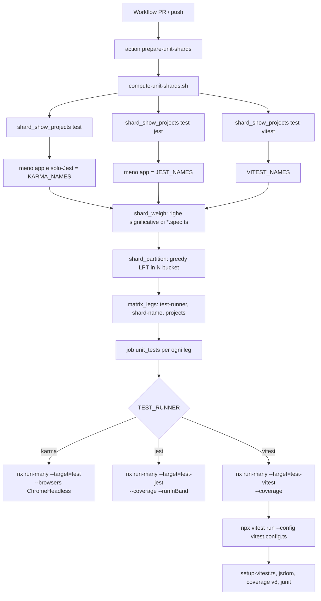
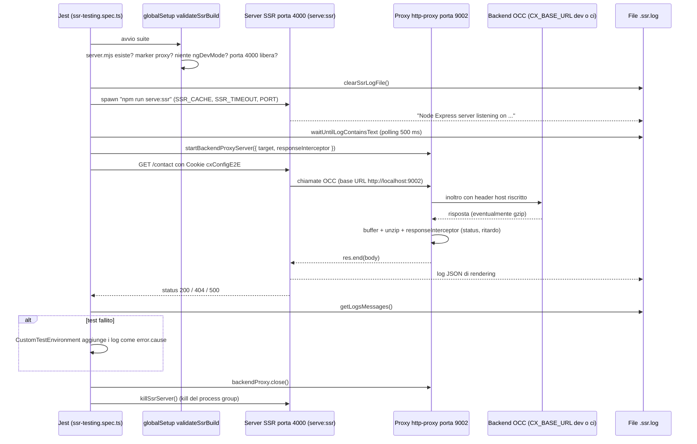
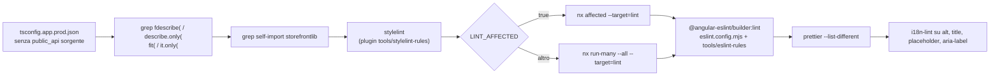
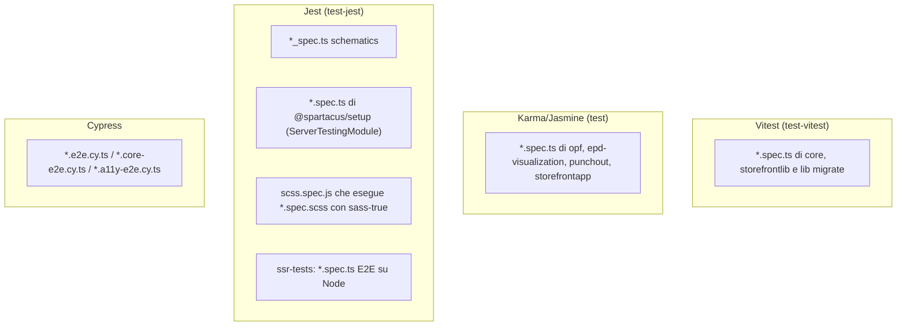

# 44 — Strategia di test e tooling del monorepo

> Riferimenti allo SHA `5b7a1c2bf2808d7380bc20596d10f4fa710c3da1` (vedi [00-meta](../00-meta.md)).

## 1. A cosa serve e perché esiste

Spartacus è un monorepo Nx con npm workspaces su `feature-libs/*`, `integration-libs/*` e `core-libs/*` (`package.json:L6-L10`). Le librerie sono decine, ognuna pubblicata come pacchetto npm a sé. Per tenerle coerenti servono test a più livelli e un tooling che li orchestri in CI senza far esplodere i tempi. Questo capitolo descrive quel tooling come si presenta allo SHA, che è uno stato **di transizione**:

- **tre runner di unit test convivono**. Vitest per quasi tutte le librerie, Karma/Jasmine per pochi progetti residui, Jest per gli schematics, per `@spartacus/setup` e per gli stili SCSS. Lo script CI li tratta come tre gruppi distinti (`ci-scripts/unit-tests.sh:L5-L12`, `ci-scripts/unit-tests.sh:L88-L106`);
- **le utility di test** non sono pubblicate. Sono mock condivisi in `core-libs/storefront/shared/test/` e cartelle `testing/` dentro `core-libs/core/src/...`, raggiungibili con alias di path definiti solo per i test (`core-libs/storefront/vitest.config.ts:L14-L34`, `core-libs/storefront/tsconfig.spec.json:L16-L35`);
- **gli E2E SSR** (`projects/ssr-tests`) sono una suite Jest su Node. Avvia il server SSR dell'app demo come processo figlio e mette un proxy HTTP tra l'app e il backend OCC, così da poter iniettare errori e ritardi (`projects/ssr-tests/src/utils/ssr.utils.ts:L47-L61`, `projects/ssr-tests/src/utils/proxy.utils.ts:L58-L115`);
- **gli E2E browser** usano Cypress (`projects/storefrontapp-e2e-cypress`). Qui interessano solo struttura, convenzioni di nome e modo di lancio in CI (`ci-scripts/e2e-cypress.sh:L7-L15`);
- **le validazioni statiche** sono script bash con grep anti-`fdescribe`, ESLint con regole custom del workspace, stylelint con un plugin custom, prettier e i18n-lint (`ci-scripts/validate-lint.sh:L32-L109`);
- **i tool interni** sotto `tools/` sono i builder ng-packagr custom, la coerenza di dipendenze e tsconfig (`config:check`), la pipeline API Extractor per i dati delle migrazioni e un registry Verdaccio per provare gli schematics (`tools/build-lib/builders.json:L1-L14`, `tools/config/index.ts:L129-L136`, `tools/breaking-changes/package.json:L7-L27`, `tools/schematics/testing.ts:L92-L109`).

Il capitolo non insegna a scrivere test Angular in generale. Mostra **come questo repository decide cosa eseguire, con quale runner, con quali mock, e dove si rompe**. È utile a chi contribuisce a Spartacus e a chi, in un progetto cliente, vuole riusarne gli schemi (proxy SSR, cookie di config E2E, sharding pesato).

Capitoli collegati: l'engine SSR verificato dagli E2E SSR è in [39 — SSR ottimizzato](../parte-2/39-ssr-ottimizzato.md) e, per la parte Angular, in [07 — SSR, hydration e TransferState](../parte-1/07-ssr-hydration-transferstate.md). L'app demo e il suo `server.ts` sono in [47 — L'app demo storefrontapp](../parte-2/47-app-demo.md). I feature toggle, e quindi `provideMockFeatureToggles` e `MockFeatureDirective`, sono in [42 — Feature toggle e deprecazioni](../parte-2/42-feature-toggle-deprecazioni.md). Il mixin `forFeature`/`forVersion` testato con sass-true è in [38 — Stili e theming](../parte-2/38-stili-theming.md). Gli schematics, con i loro test `*_spec.ts` e i dati generati da `tools/breaking-changes`, sono in [43 — Schematics e migrazioni](../parte-2/43-schematics-migrazioni.md). Builder e schematics dal lato Angular sono in [08 — Schematics e builder](../parte-1/08-schematics-builder.md).

> Convenzione dei file (dal dossier): `*.spec.ts` sono test Vitest, Karma o Jest unit; `*_spec.ts` sono test Jest degli schematics; `*.spec.scss` sono test sass-true; `*.cy.ts` sono spec Cypress.

## 2. Mappa dei file

| Path | Ruolo |
|---|---|
| `ci-scripts/unit-tests.sh` | dispatcher dei tre runner unit (`$TEST_RUNNER`, `$UNIT_TEST_GROUP_PROJECTS`, modalità affected) |
| `ci-scripts/compute-unit-shards.sh` | costruisce la matrice GitHub Actions degli shard (Karma/Jest/Vitest) |
| `ci-scripts/shard-lib.sh` | funzioni condivise: enumerazione progetti via `nx show projects`, peso per righe di spec, partizione LPT |
| `.github/actions/prepare-unit-shards/action.yml` | action composita che pubblica la matrice come output |
| `.github/workflows/ci-continuous-integration.yml`, `.github/workflows/ci.yml` | workflow PR e push: shard, unit, lint, build, e2e, ssr-tests |
| `nx.json` | `targetDefaults` (cache, `dependsOn`), inferenza disattivata |
| `core-libs/core/project.json`, `core-libs/storefront/project.json` | target `build` (builder custom), `test-vitest`, `lint` |
| `feature-libs/cart/project.json` | modello feature lib: `test-vitest` + `test-jest` (schematics) |
| `integration-libs/opf/project.json`, `integration-libs/opf/karma.conf.js`, `integration-libs/opf/test.ts` | esempio di libreria rimasta su Karma/Jasmine |
| `core-libs/core/vitest.config.ts` | config Vitest di core: Analog plugin, jsdom, `forks`, coverage v8, junit |
| `core-libs/storefront/vitest.config.ts` | come sopra più alias ordinati per gli entry di test e i sorgenti core/storefront |
| `feature-libs/asm/vitest.config.ts` | esempio di config Vitest di feature lib (senza `restoreMocks`) |
| `testing/setup-vitest.ts` | setup Vitest condiviso: zone.js, compiler JIT, `initTestEnvironment` browser |
| `testing/patch-object-define-property.ts` | patch globale di `Object.defineProperty` per `spyOnProperty` (Karma) |
| `vitest-globals.d.ts` | riferimento ambient a `vitest/globals` per l'editor |
| `core-libs/core/src/test.ts` | entry Karma legacy di core (orfano: core non ha più target Karma) |
| `core-libs/core/tsconfig.spec.json`, `core-libs/storefront/tsconfig.spec.json`, `feature-libs/cart/tsconfig.spec.json` | types Vitest e `paths` degli entry di test |
| `core-libs/storefront/shared/test/*` | `MockFeatureDirective`, `MockFeatureLevelDirective`, `MockFeatureDirectivesModule`, `MockMediaComponent`, `MockWinRef` |
| `core-libs/core/src/features-config/feature-toggles/testing/mock-feature-toggles.ts` | `provideMockFeatureToggles` / `MockFeatureTogglesController` |
| `core-libs/setup/jest.config.js`, `core-libs/setup/setup-jest.ts` | Jest di `@spartacus/setup` con `ServerTestingModule` |
| `core-libs/styles/jest.schematics.config.js`, `core-libs/styles/test-jest.ts`, `core-libs/styles/test/scss.spec.js` | Jest che esegue i `.spec.scss` tramite sass-true |
| `core-libs/styles/test/*.spec.scss`, `core-libs/styles/test/versioning-test-util.scss` | test di `forFeature`, `forVersion`, `compareVersion` |
| `core-libs/schematics/jest.schematics.config.js`, `feature-libs/cart/jest.schematics.config.js`, `jest-esm-matchers.js` | Jest per gli schematics (`*_spec.ts`) |
| `projects/ssr-tests/{project.json,package.json,jest.config.js,tsconfig.json,eslint.config.mjs,README.md}` | progetto E2E SSR |
| `projects/ssr-tests/validate-ssr-build.ts` | `globalSetup` Jest: build prod, marker proxy, porta libera |
| `projects/ssr-tests/src/environments/custom-test-environment.ts` | environment Jest che allega i log SSR agli errori |
| `projects/ssr-tests/src/utils/{ssr,proxy,http,log}.utils.ts` | avvio/arresto server SSR, proxy backend su 9002, client HTTP, parsing `.ssr.log` |
| `projects/ssr-tests/src/ssr-testing.spec.ts` | scenari SSR (200, 404, 500, timeout backend, cache) |
| `projects/storefrontapp-e2e-cypress/{package.json,cypress.config.ts,cypress.config.ci.ts}` | script `cy:*` e config Cypress locale/CI |
| `projects/storefrontapp-e2e-cypress/cypress/support/cx-config.commands.ts` | comando `cy.cxConfig()` (stesso cookie degli E2E SSR) |
| `ci-scripts/e2e-cypress.sh`, `ci-scripts/e2e-a11y-helpers.sh`, `ci-scripts/test-distribution.sh`, `ci-scripts/test-distribution.config.sh` | esecuzione e distribuzione degli e2e Cypress |
| `ci-scripts/validate-e2e-execution.sh` | decide se servono gli e2e in base ai file cambiati |
| `ci-scripts/validate-lint.sh` | validazioni statiche (focus test, tsconfig prod, stylelint, ESLint, prettier, i18n) |
| `ci-scripts/npm-commands.sh` | wrapper bash degli script npm (build CI con `nx run-many`) |
| `eslint.config.mjs`, `projects/storefrontapp/eslint.config.mjs`, `tools/eslint-rules/*` | flat config ESLint, module boundaries, 11 regole custom |
| `.stylelintrc.json`, `tools/stylelint-rules/*` | stylelint e plugin `valid-for-feature-mixin-argument` |
| `tools/build-lib/*` | builder `augmented-types` e `declaration-merging` |
| `tools/config/*` | `config:check` / `config:update` (dipendenze, tsconfig paths, lock file, versione migrazione AI) |
| `tools/breaking-changes/*` | API Extractor → confronto API → dati per le migrazioni |
| `tools/schematics/testing.ts` | Verdaccio locale per provare gli schematics pubblicati |

## 3. Come funziona passo per passo

### 3.1 Chi usa quale runner

Il criterio pratico è il **nome del target nx**:

| Target nx | Runner | Executor | Chi lo ha |
|---|---|---|---|
| `test-vitest` | Vitest | `nx:run-commands` → `npx vitest run --config vitest.config.ts` nella root del progetto | `core`, `storefrontlib` e le feature/integration lib migrate (`core-libs/core/project.json:L20-L26`, `core-libs/storefront/project.json:L21-L27`, `feature-libs/cart/project.json:L20-L26`) |
| `test` | Karma/Jasmine | `@angular-devkit/build-angular:karma` con `main: test.ts` e `karma.conf.js` locale | `opf`, `epd-visualization`, `punchout`, `storefrontapp` (`integration-libs/opf/project.json:L20-L28`); anche `eslint-rules`, ma con executor `@nx/jest:jest` (`tools/eslint-rules/project.json:L7-L14`) |
| `test-jest` | Jest | `nx:run-commands` → `npm run test` o `npm run test:schematics` | schematics delle lib (`feature-libs/cart/project.json:L27-L32`), `setup` (`core-libs/setup/project.json:L20-L26`), `storefrontstyles` (`core-libs/styles/project.json:L6-L12`), `ssr-tests` (`projects/ssr-tests/project.json:L1-L22`) |

I numeri allo SHA: 32 `vitest.config.ts` (2 core-libs, 20 feature-libs, 10 integration-libs) e 4 `karma.conf.js` (`projects/storefrontapp`, `integration-libs/epd-visualization`, `integration-libs/opf`, `integration-libs/punchout`). La fonte è un glob sul working tree riportato nel dossier (F13, es. `integration-libs/opf/karma.conf.js:L1-L49`, `core-libs/core/vitest.config.ts:L1-L61`). Le devDependencies root contengono tutte e tre le toolchain: `vitest ^4.1.10`, `@analogjs/vite-plugin-angular`, `@nx/vite`, `jsdom`, `karma ~6.4.4`, `jasmine-core ~6.3.0`, `jest ^30.2.0`, `jest-preset-angular ^17.0.0`, `sass-true ^10.0.0` (`package.json:L200-L293`).

Una feature lib migrata ha quindi **due** target di test: `test-vitest` per gli unit e `test-jest` per gli schematics (`feature-libs/cart/project.json:L20-L32`). `core` e `storefrontlib` invece hanno solo `test-vitest` (`core-libs/core/project.json:L7-L36`).

### 3.2 Configurazione Vitest

`core-libs/core/vitest.config.ts` è il modello:

1. **Plugin**: `angular()` di Analog compila componenti e decorator Angular per Vite; `nxViteTsPaths()` risolve gli alias dei tsconfig. La root è la cartella della lib (`core-libs/core/vitest.config.ts:L7-L13`).
2. **Esecuzione**: `pool: 'forks'`, `watch: false`, `globals: true` (`describe`/`it`/`vi` senza import), `restoreMocks: true`, `environment: 'jsdom'`, setup `../../testing/setup-vitest.ts`, include `**/*.spec.ts` (`core-libs/core/vitest.config.ts:L14-L21`).
3. **Typecheck** con il `tsconfig.spec.json` della lib (`core-libs/core/vitest.config.ts:L22-L24`). Quel tsconfig ha `strict: false`, `module: preserve`, `moduleResolution: bundler` e i types `vitest/globals`, `vitest/importMeta`, `vite/client`, `node`, `vitest` (`core-libs/core/tsconfig.spec.json:L1-L19`).
4. **Coverage** sempre attiva: provider `v8`, reporter `text-summary`/`html`/`lcov`, output in `coverage/core` (`core-libs/core/vitest.config.ts:L25-L30`). Esclude spec, `public_api.ts`, `index.ts`, `*.module.ts`, asset, `testing/` e `schematics/` (`core-libs/core/vitest.config.ts:L31-L43`). Le soglie sono 85/85/65/85, identiche in storefront (`core-libs/core/vitest.config.ts:L44-L49`, `core-libs/storefront/vitest.config.ts:L64-L69`).
5. **Reporter** `default` + `junit` in `unit-tests-reports/unit-test-core.xml`, letto dalla CI (`core-libs/core/vitest.config.ts:L51-L59`).

Il setup condiviso `testing/setup-vitest.ts` importa `zone.js`, `zone.js/testing` e `@angular/compiler`, poi chiama `getTestBed().initTestEnvironment(BrowserTestingModule, platformBrowserTesting())` **senza opzioni** (`testing/setup-vitest.ts:L7-L19`). Non c'è quindi il `ZoneChangeDetectionModule` che serve nei `test.ts` di Karma (§3.3).

`core-libs/storefront/vitest.config.ts` aggiunge `resolve.alias`. Mappa i sotto-path di test (`@spartacus/core/testing/feature-toggles`, `@spartacus/storefront/testing/mock-feature-directive`, `@spartacus/core/testing/i18n`, `@spartacus/core/testing/url-testing`) e poi `@spartacus/core`/`@spartacus/storefront` sui `public_api.ts` sorgente (`core-libs/storefront/vitest.config.ts:L14-L34`). Il commento avverte che l'ordine conta, perché Vite applica il primo alias che corrisponde e un alias "nudo" cattura anche i deep path (`core-libs/storefront/vitest.config.ts:L16-L19`). I test di storefront girano quindi contro i **sorgenti** di core, non contro `dist`; il `tsconfig.spec.json` di storefront infatti include `../../core-libs/core/src/**/*.ts` (`core-libs/storefront/tsconfig.spec.json:L16-L35`).

Le feature lib ripetono lo schema con alias propri. `asm`, ad esempio, mappa anche `core-libs/storefront/shared/test/mock-window-ref` e non ha `restoreMocks` (`feature-libs/asm/vitest.config.ts:L10-L28`). Per l'editor, un file ambient alla root referenzia `vitest/globals`, perché il `tsconfig.json` root non lo include nei `types` (`vitest-globals.d.ts:L7-L14`).

### 3.3 Karma/Jasmine residuo e il `test.ts` legacy

Una libreria Karma (es. `opf`) usa l'executor `@angular-devkit/build-angular:karma` con `main: integration-libs/opf/test.ts`, polyfill `zone.js`/`zone.js/testing` e `karma.conf.js` locale (`integration-libs/opf/project.json:L20-L28`). Il `karma.conf.js` usa jasmine e karma-coverage, scrive un junit in `unit-tests-reports/unit-test-opf.xml` e fissa le soglie a 80/80/70/80 (`integration-libs/opf/karma.conf.js:L7-L36`).

Il `test.ts` di `opf` registra un `ZoneChangeDetectionModule` con `provideZoneChangeDetection()` e inizializza TestBed con `teardown: { destroyAfterEach: false }` (`integration-libs/opf/test.ts:L9-L32`). Il `test.ts` di **core** fa lo stesso. Il motivo è spiegato nel commento: Angular 21 causa errori NG0100 con un `test.ts` custom. Lo stesso commento annota "No longer necessary under vitest" (`core-libs/core/src/test.ts:L21-L30`, `core-libs/core/src/test.ts:L33-L39`). In più, il `test.ts` di core importa `testing/patch-object-define-property` "just after zone.js imports" (`core-libs/core/src/test.ts:L7-L12`).

La patch sostituisce globalmente `Object.defineProperty`. Ogni proprietà con getter non configurabile diventa `configurable: true`, così `spyOnProperty` può sovrascrivere export di terze parti come `isDevMode` (`testing/patch-object-define-property.ts:L7-L36`). Serve "since `zone.js@0.11.4`" e non va importata in produzione (`testing/patch-object-define-property.ts:L11-L24`).

Allo SHA il `test.ts` di core è **orfano**. `core` non ha né target `test` né `karma.conf.js`, e il file resta citato solo nell'`exclude` di `tsconfig.lib.json` (`core-libs/core/project.json:L7-L36`, `core-libs/core/tsconfig.lib.json:L24-L24`).

### 3.4 Jest: `@spartacus/setup`, stili, schematics

**`@spartacus/setup`** (che contiene l'engine SSR) si testa con Jest. Il target `test-jest` esegue `npm run test`, cioè `jest --config ./jest.config.js` (`core-libs/setup/project.json:L20-L26`, `core-libs/setup/package.json:L15-L17`). Il config usa il preset `jest-preset-angular` e `setupFilesAfterEnv: ['<rootDir>/setup-jest.ts']` (`core-libs/setup/jest.config.js:L7-L26`). Il setup inizializza TestBed con `ServerTestingModule`/`platformServerTesting()`: l'ambiente è server, non browser (`core-libs/setup/setup-jest.ts:L7-L19`). Il config rimappa inoltre due dipendenze interne di Angular per problemi ESM/CJS. `beasties` va verso `node_modules/beasties`, `bundled-domino.mjs` verso un wrapper CJS in `__mocks__` (`core-libs/setup/jest.config.js:L12-L25`). La coverage è spenta di default (`collectCoverage: false`) e ha soglie 90/80/90/90 (`core-libs/setup/jest.config.js:L36-L46`).

**Stili** (`storefrontstyles`): l'unico target è `test-jest` → `jest --config ./jest.schematics.config.js` (`core-libs/styles/project.json:L6-L12`, `core-libs/styles/package.json:L13-L15`). Il config cerca solo `**/*.spec.js` e usa `test-jest.ts` come setup (`core-libs/styles/jest.schematics.config.js:L4-L20`), che è vuoto: "empty, for now" (`core-libs/styles/test-jest.ts:L7-L7`). L'unico `*.spec.js`, `scss.spec.js`, raccoglie con `globSync` tutti i `test/**/*.spec.scss` relativi a `process.cwd()`. Per ciascuno chiama `sassTrue.runSass({ describe, it }, file)`, più un test sentinella che fallisce se non trova file (`core-libs/styles/test/scss.spec.js:L1-L15`). Ogni `.spec.scss` importa sass-true e il modulo da testare e usa i mixin `describe`/`it`/`assert-equal`/`assert`/`output`/`expect` di sass-true (`core-libs/styles/test/features.spec.scss:L1-L11`):

- `features.spec.scss` verifica `getFeatureCssClass` (prefisso `cxFeat_`) e `forFeature`. Senza secondo argomento la classe va sull'antenato: `.cxFeat_<flag> .test` (`core-libs/styles/test/features.spec.scss:L14-L35`). Con `'currentSelector'` va sul selettore corrente: `.test.cxFeat_<flag>` (`core-libs/styles/test/features.spec.scss:L121-L141`);
- `versioning-test-util.scss` definisce quattro mixin helper (`shouldDisplayForRange`, `shouldNOTDisplayForRange`, `shouldDisplayForVersion`, `shouldNOTDisplayForVersion`) che avvolgono `it` + `assert` sul mixin `forVersion` (`core-libs/styles/test/versioning-test-util.scss:L1-L72`);
- i tre `versioning-forVersion-0N.spec.scss` fissano le globali `$_fullVersion`, `$_majorVersion`, `$styleVersion`, `$useLatestStyles` prima di chiamare gli helper. Il file 01 usa `3.2` (`core-libs/styles/test/versioning-forVersion-01.spec.scss:L1-L22`), lo 02 versioni a tre cifre `5.1.3` con `// prettier-ignore` (`core-libs/styles/test/versioning-forVersion-02.spec.scss:L5-L19`), lo 03 i confini dei range con `5.1` (`core-libs/styles/test/versioning-forVersion-03.spec.scss:L5-L20`);
- `versioning-functions.spec.scss` testa `compareVersion()` con ritorni 0/1/-1, anche con argomenti stringa (`core-libs/styles/test/versioning-functions.spec.scss:L5-L47`).

**Schematics** (`*_spec.ts`): i config Jest di core e delle feature lib usano `jest-preset-angular`, `testMatch: **/*_spec.ts`, `tsconfig.schematics.json` e un `transformIgnorePatterns` costruito da `jest-esm-matchers` (`core-libs/schematics/jest.schematics.config.js:L1-L23`). Quel file elenca i pacchetti solo-ESM che Jest deve trasformare, come `.mjs`, i locale Angular, `ora`, `chalk` (`jest-esm-matchers.js:L7-L30`). Le soglie sono 90/74/90/90 in core e 90/90/90/90 in cart (`core-libs/schematics/jest.schematics.config.js:L28-L35`, `feature-libs/cart/jest.schematics.config.js:L28-L35`). Lo script `test:schematics` di una feature lib pulisce gli output compilati di core-schematics e della lib prima di lanciare Jest (`feature-libs/cart/package.json:L27-L27`). Lo script root `test:all-schematics` li esegue tutti con `-u`, cioè aggiornando gli snapshot (`package.json:L146-L146`).

### 3.5 Utility di test condivise

**Storefront** (`core-libs/storefront/shared/test/`): il barrel esporta cinque mock (`core-libs/storefront/shared/test/index.ts:L7-L11`).

- `MockFeatureDirective` (`[cxFeature]`) renderizza il template solo se l'argomento **non** contiene `!`. Così i rami "deprecati" (`*cxFeature="'!toggle'"`) non compaiono nei test (`core-libs/storefront/shared/test/mock-feature-directive.ts:L9-L22`).
- `MockFeatureLevelDirective` (`[cxFeatureLevel]`) renderizza sempre (`core-libs/storefront/shared/test/mock-feature-level-directive.ts:L9-L18`).
- `MockFeatureDirectivesModule` importa, senza dichiararle, le due direttive standalone (`core-libs/storefront/shared/test/mock-feature-directives.module.ts:L11-L14`).
- `MockMediaComponent` (`cx-media`) rende un `` solo se ricava una `src` da `container.product.url` o `container.url` (`core-libs/storefront/shared/test/mock-media.component.ts:L9-L25`).
- `MockWinRef` importa `vi` da `vitest`. Fornisce `localStorage`/`sessionStorage` fatti di `vi.fn()`, `location.href` vuoto e `isBrowser()` sempre `true` (`core-libs/storefront/shared/test/mock-window-ref.ts:L7-L23`).

Gli spec li importano in tre modi: con l'alias `@spartacus/storefront/testing/...`, con un path relativo, oppure con un path dalla root del repo (`core-libs/storefront/cms-components/content/banner/banner.component.spec.ts:L23-L23`, `core-libs/storefront/cms-components/product/product-list/container/product-list.component.spec.ts:L33-L33`, `feature-libs/asm/root/services/asm-enabler.service.spec.ts:L12-L12`). Ogni feature lib dichiara gli alias nel proprio `tsconfig.spec.json` (`feature-libs/cart/tsconfig.spec.json:L35-L40`). `tools/config/manage-dependencies.ts` sa che questi file sono "da test". Classifica come uso in spec gli import provenienti da `test.ts`, `src/test.ts`, `setup-jest.ts`, `vitest.config.ts` e da qualunque file sotto `/shared/test/`, così le loro dipendenze non finiscono tra le dipendenze di produzione (`tools/config/manage-dependencies.ts:L527-L538`).

**Core**: le utility di test stanno nelle cartelle `testing/` dei moduli, escluse dalla coverage (`core-libs/core/vitest.config.ts:L38-L38`). L'esempio principale è `provideMockFeatureToggles(initial)` (`core-libs/core/src/features-config/feature-toggles/testing/mock-feature-toggles.ts:L150-L158`). Fa puntare `FeatureToggles`, `RootFeatureToggles`, `DefaultFeatureToggles` e il multi-provider `FeatureTogglesChunk` allo stesso `MockFeatureTogglesController`, creato nuovo a ogni setup di TestBed (`core-libs/core/src/features-config/feature-toggles/testing/mock-feature-toggles.ts:L161-L184`). Il meccanismo dei toggle è spiegato in [42](../parte-2/42-feature-toggle-deprecazioni.md).

### 3.6 Pattern ricorrenti negli spec

Un campione di sei spec, uno per tipo, mostra gli idiomi correnti:

- **Componente (Vitest)**: mock come classi locali, `TestBed.configureTestingModule` con `useClass`/`useValue`, `overrideComponent` per sostituire `MediaComponent`/`FeatureDirective` con i mock standalone, query con `By.css`/`By.directive` (`core-libs/storefront/cms-components/content/banner/banner.component.spec.ts:L58-L74`, `core-libs/storefront/cms-components/content/banner/banner.component.spec.ts:L97-L129`). Lo stato pilotato da un `BehaviorSubject` cambia in `beforeEach` annidati, prima di `fixture.detectChanges()` (`core-libs/storefront/cms-components/content/banner/banner.component.spec.ts:L142-L155`).
- **Facade NgRx (Vitest)**: store reale (`StoreModule.forRoot`, `EffectsModule.forRoot`, store module di feature), `vi.spyOn(store, 'dispatch')` e `provideMockFeatureToggles` (`core-libs/core/src/site-context/facade/currency.service.spec.ts:L53-L72`). Le asserzioni asincrone usano `await firstValueFrom(service.getAll())` dopo un dispatch di successo (`core-libs/core/src/site-context/facade/currency.service.spec.ts:L101-L130`).
- **Selettori (Vitest)**: `vi.mock('@ngrx/store', ...)` con `importOriginal`, per sostituire solo `select` (`core-libs/core/src/product/store/selectors/product-reviews.selectors.spec.ts:L4-L7`).
- **Adapter OCC (Vitest)**: `provideHttpClient(withInterceptorsFromDi())` + `provideHttpClientTesting()`, `HttpTestingController.expectOne`/`flush` e `httpMock.verify()` in `afterEach` (`core-libs/core/src/occ/adapters/product/occ-product-reviews.adapter.spec.ts:L29-L83`). Le dipendenze reali come il `ConverterService` sono osservate con `vi.spyOn` senza cambiarne l'implementazione (`core-libs/core/src/occ/adapters/product/occ-product-reviews.adapter.spec.ts:L56-L58`).
- **Karma/Jasmine**: `jasmine.createSpyObj`, `.and.returnValue(...)`, callback `done` e `fail()` (`integration-libs/opf/cta/core/services/opf-static-cta.service.spec.ts:L10-L79`).
- **Schematics (Jest)**: `SchematicTestRunner.runExternalSchematic('@schematics/angular', ...)` per creare workspace e app, poi `add-spartacus` e `add-ssr` in `beforeAll`, infine `toMatchSnapshot()` sui file generati (`core-libs/schematics/src/add-ssr/index_spec.ts:L17-L102`).

Le istruzioni di progetto chiedono di preferire `firstValueFrom` alle subscription e di non condividere stato mutabile tra test (`.claude/CLAUDE.md:L37-L41`). Lo spec della facade segue la prima regola.

### 3.7 Unit test in CI: sharding pesato e dispatch

1. Il workflow PR calcola `affected` (vero per PR non `epic/*`) e invoca l'action `prepare-unit-shards` (`.github/workflows/ci-continuous-integration.yml:L51-L57`). L'action esegue `compute-unit-shards.sh` e pubblica `matrix` come output (`.github/actions/prepare-unit-shards/action.yml:L39-L51`). Il workflow di push `ci.yml` usa `affected: 'false'` (`.github/workflows/ci.yml:L64-L80`).
2. `compute-unit-shards.sh` fissa i default `KARMA_SHARDS=2`, `JEST_SHARDS=4`, `VITEST_SHARDS=4`, `AFFECTED=false` (`ci-scripts/compute-unit-shards.sh:L9-L12`).
3. Enumera i progetti **per target**. Karma = progetti con `test` meno app e solo-Jest; Jest = progetti con `test-jest` meno app; Vitest = tutti quelli con `test-vitest` (`ci-scripts/compute-unit-shards.sh:L19-L31`). L'enumerazione usa `nx show projects --with-target=<t> --json`, con `--affected` opzionale, e fallisce rumorosamente se nx fallisce (`ci-scripts/shard-lib.sh:L13-L28`).
4. Ogni progetto riceve un peso: il numero di righe "significative" dei suoi `*.spec.ts`, cioè escludendo import, commenti `//` e righe vuote, con minimo 1 (`ci-scripts/shard-lib.sh:L30-L48`).
5. `shard_partition` applica un greedy LPT (longest processing time): ordina per peso decrescente e assegna ogni progetto al bucket meno carico (`ci-scripts/shard-lib.sh:L56-L71`).
6. `matrix_legs` produce voci `{test-runner, shard-name: "<runner>-i/n", projects}` ed elimina i bucket vuoti (`ci-scripts/compute-unit-shards.sh:L34-L47`). In modalità run-all una matrice vuota è un errore (`ci-scripts/compute-unit-shards.sh:L57-L61`).
7. Ogni leg della matrice esegue `ci-scripts/unit-tests.sh` con `$TEST_RUNNER` e `$UNIT_TEST_GROUP_PROJECTS` impostati (`.github/workflows/ci-continuous-integration.yml:L59-L81`).
8. `unit-tests.sh`, con la variabile valorizzata, chiama `run_all_unit_tests` (`ci-scripts/unit-tests.sh:L108-L109`), che smista sul runner (`ci-scripts/unit-tests.sh:L88-L106`):
   - `karma` → `nx run-many --target=test ... -- --no-watch --source-map --code-coverage --browsers ChromeHeadless` (`ci-scripts/unit-tests.sh:L30-L42`);
   - `jest` → `nx run-many --target=test-jest ... -- --coverage --runInBand` (`ci-scripts/unit-tests.sh:L44-L56`);
   - `vitest` → `nx run-many --target=test-vitest ... -- --coverage` (`ci-scripts/unit-tests.sh:L58-L68`).
9. Il ramo Vitest arriva a `npx vitest run --config vitest.config.ts` nella cartella della lib (`core-libs/core/project.json:L20-L26`). Da lì valgono setup, jsdom, coverage e junit descritti in §3.2.

`shard-lib.sh` è condiviso anche con una pipeline Azure/piper tramite `split-unit-test-projects.sh`, che non è nel repo (`ci-scripts/shard-lib.sh:L3-L7`).

### 3.8 E2E SSR (`projects/ssr-tests`)

Il progetto nx `ssr-tests` (`projectType: library`) ha i target `lint` e `test-jest` (`npm run test --verbose`) (`projects/ssr-tests/project.json:L1-L22`). Lo script `test` del package esegue `jest --config ./jest.config.js`; le peerDependencies sono `http-proxy`, `jest-circus`, `jest-environment-node` (`projects/ssr-tests/package.json:L13-L24`). Il config trasforma con `ts-jest`, cerca `*.spec.ts`, usa un `testEnvironment` custom e un `globalSetup` (`projects/ssr-tests/jest.config.js:L9-L26`).

Sequenza completa:

1. **Build prerequisita**: `npm run build:libs && npm run build:ssr:local-http-backend` (`projects/ssr-tests/README.md:L7-L9`). L'env `local-http` imposta `CX_BASE_URL=http://localhost:9002`, cioè la porta del proxy di test (`package.json:L57-L57`, `.env-cmdrc:L11-L13`).
2. **Lancio**: `npm run test:ssr` / `test:ssr:ci` caricano l'env `dev`/`ci` con `env-cmd` e invocano `nx test ssr-tests` (`package.json:L156-L157`). Gli env `dev` e `ci` puntano `CX_BASE_URL` a backend remoti (`.env-cmdrc:L2-L4`, `.env-cmdrc:L14-L16`), e lo spec usa quel valore come target del proxy (`projects/ssr-tests/src/ssr-testing.spec.ts:L6-L6`). La **build** punta dunque al proxy, mentre il **proxy** punta al backend reale.
3. **`globalSetup`** `validateSsrBuild()` controlla tre precondizioni dichiarate nella JSDoc: build prod, base OCC sul proxy locale, porta SSR libera (`projects/ssr-tests/validate-ssr-build.ts:L7-L31`). Lancia un errore se manca `dist/storefrontapp/server/server.mjs`, se nessun file di `dist/storefrontapp/server` contiene `CX_BASE_URL:"http://localhost:9002"`, se un file server o browser contiene `ngDevMode`, o se la porta 4000 è occupata (`projects/ssr-tests/validate-ssr-build.ts:L40-L58`, `projects/ssr-tests/validate-ssr-build.ts:L83-L141`). Per la porta tenta un `listen`: `EADDRINUSE` significa occupata, qualunque altro errore conta come libera (`projects/ssr-tests/validate-ssr-build.ts:L147-L165`).
4. **`beforeEach`** → `startSsrServer()` svuota `.ssr.log` e lancia `npm run serve:ssr` della root in una shell detached. Passa `SSR_CACHE`, `SSR_TIMEOUT`, `PORT` e `NODE_TLS_REJECT_UNAUTHORIZED=0`, ridirige stdout e stderr nel log e attende il testo `Node Express server listening on ` (`projects/ssr-tests/src/utils/ssr.utils.ts:L47-L61`). `serve:ssr` è `NG_ALLOWED_HOSTS=localhost node dist/storefrontapp/server/server.mjs` (`package.json:L152-L152`). Il `server.ts` demo legge `SSR_TIMEOUT` e `SSR_CACHE` per le `SsrOptimizationOptions` e stampa il messaggio atteso (`projects/storefrontapp/src/server.ts:L22-L27`, `projects/storefrontapp/src/server.ts:L93-L93`).
5. **Nel test** → `startBackendProxyServer({ target, responseInterceptor? })` crea un `http-proxy` con `secure: false` e `selfHandleResponse` solo se c'è un interceptor, e ascolta sempre sulla porta 9002 (`projects/ssr-tests/src/utils/proxy.utils.ts:L58-L115`). Riscrive l'header `host` con il target (`projects/ssr-tests/src/utils/proxy.utils.ts:L75-L77`). Con interceptor bufferizza il body, lo decomprime (gzip/deflate) e lo passa all'interceptor, che deve chiamare `res.end` (`projects/ssr-tests/src/utils/proxy.utils.ts:L79-L105`, `projects/ssr-tests/src/utils/proxy.utils.ts:L118-L127`).
6. **Richiesta** → `sendRequestToSsrServer({ path, testConfig? })` fa una GET su `localhost:4000` con un header `Cookie` costruito da `testConfig` (`projects/ssr-tests/src/utils/http.utils.ts:L13-L16`, `projects/ssr-tests/src/utils/http.utils.ts:L42-L54`). Il cookie si chiama `cxConfigE2E` e contiene JSON URI-encoded; lo legge il `TestConfigModule` dell'app demo (`projects/ssr-tests/src/utils/http.utils.ts:L75-L89`, `projects/storefrontapp/src/app/private/private.providers.ts:L54-L54`). In questo modo un'app buildata una volta sola si può testare con varianti di config iniettate a runtime (`projects/ssr-tests/src/utils/http.utils.ts:L27-L37`).
7. **Asserzioni** su status code e messaggi di log. `getLogsObjects` legge `./.ssr.log` e scarta le righe non JSON, `getLogsMessages` estrae `message` (`projects/ssr-tests/src/utils/log.utils.ts:L18-L18`, `projects/ssr-tests/src/utils/log.utils.ts:L59-L80`).
8. **Su fallimento**, `CustomTestEnvironment` (che estende `jest-environment-node`) intercetta `test_done` e allega i log SSR pretty-printed come `cause` sia dell'errore originale sia di quello asincrono, ad esempio un timeout (`projects/ssr-tests/src/environments/custom-test-environment.ts:L11-L43`). Usa `cause` perché è l'unica proprietà, oltre a `message`, che Jest stampa (`projects/ssr-tests/src/environments/custom-test-environment.ts:L26-L29`).
9. **`afterEach`**: `backendProxy.close()` e `killSsrServer()`, che invia il segnale al process group (`-child.pid`) e risolve all'`exit` (`projects/ssr-tests/src/ssr-testing.spec.ts:L14-L17`, `projects/ssr-tests/src/utils/ssr.utils.ts:L67-L74`).

Gli scenari verificati sono questi (`projects/ssr-tests/src/ssr-testing.spec.ts:L26-L82`):

- 200, con i log "Rendering started" e "Request is waiting...";
- 404 su pagina inesistente;
- 404 se `cms/pages` risponde 404;
- 500 se fallisce un'altra API (`cms/components`);
- 500 se `/languages` è ritardata oltre un `backend.timeout.server` di 4000 ms iniettato via `testConfig`. Il test verifica anche il log "exceeded expected time of 4000ms and was aborted" (`projects/ssr-tests/src/ssr-testing.spec.ts:L92-L129`);
- con cache attiva, la seconda richiesta deve loggare `Render from cache (...)`. Se però il primo render è fallito con 404, la seconda **non** deve venire dalla cache (`projects/ssr-tests/src/ssr-testing.spec.ts:L133-L196`).

Il timeout Jest è `DEFAULT_SSR_TIMEOUT` (20000 ms) e raddoppia nei test che chiamano il server due volte (`projects/ssr-tests/src/ssr-testing.spec.ts:L6-L12`, `projects/ssr-tests/src/ssr-testing.spec.ts:L164-L165`). La pagina usata è `/contact`, "less busy" della home (`projects/ssr-tests/src/ssr-testing.spec.ts:L12-L12`). Il comportamento dell'engine sotto test (fallback CSR, cache, timeout) è descritto in [39](../parte-2/39-ssr-ottimizzato.md).

### 3.9 E2E Cypress (struttura)

`cypress/e2e` contiene `a11y` (b2b, b2c, helpers), `b2b` (regression, vendor), `regression` (per dominio), `ssr` (2 spec) e `vendor` (per integrazione) (`projects/storefrontapp-e2e-cypress/cypress/e2e/`, listing nel dossier F165). Le convenzioni di nome separano `*.core-e2e.cy.ts` (sottoinsieme core), `*.e2e.cy.ts`, `*.e2e-flaky.cy.ts` e `*.a11y-e2e.cy.ts` (`projects/storefrontapp-e2e-cypress/package.json:L18-L19`, `projects/storefrontapp-e2e-cypress/package.json:L61-L61`). Gli script root `e2e:*` delegano ai `cy:*` del package con `npm --prefix` (`package.json:L65-L124`).

- `cypress.config.ts` (locale): baseUrl `http://localhost:4200`, `retries` 2 sia in run sia in open, env `BASE_SITE: 'electronics-spa'`, `OCC_PREFIX: '/occ/v2'` e `CLIENT_ID` derivato da `JDK_VERSION` (`projects/storefrontapp-e2e-cypress/cypress.config.ts:L9-L47`).
- `cypress.config.ci.ts`: aggiunge `projectId`, `video: true`, esclude `**/*.example-e2e.cy.ts` e abilita gli screenshot solo con `CYPRESS_ENABLE_SCREENSHOTS=true` (`projects/storefrontapp-e2e-cypress/cypress.config.ci.ts:L18-L49`).
- `cy:run:ci` registra sulla Cypress Dashboard con `--record --parallel --ci-build-id $BUILD_NUMBER --group B2C`, escludendo vendor/b2b/ssr, a11y e my-account-v2 (`projects/storefrontapp-e2e-cypress/package.json:L24-L24`).
- Il comando custom `cy.cxConfig(config)` imposta lo **stesso** cookie `cxConfigE2E` degli E2E SSR (`projects/storefrontapp-e2e-cypress/cypress/support/cx-config.commands.ts:L26-L28`).

In CI, `ci-scripts/e2e-cypress.sh` accetta `--suite/-s`, `--environment`, `--ssr`, `--skip-build` (`ci-scripts/e2e-cypress.sh:L7-L15`). Senza `--skip-build` esegue `npm ci` e `build_libs_ci`, fallisce se il log contiene `Warning: Can't resolve all parameters for`, poi esegue `build:csr` (`ci-scripts/e2e-cypress.sh:L86-L112`). In modalità SSR serve l'app con `serve:ssr:ci` e sceglie `e2e:run:ci:core:ssr` (PR non epic, commit di bot) oppure `e2e:run:ci:ssr` (`ci-scripts/e2e-cypress.sh:L114-L166`). In modalità CSR serve con `start:pwa` (http-server su 4200) e chiama `run_tests_for_suite` con scope `core` o `full` (`ci-scripts/e2e-cypress.sh:L167-L197`, `package.json:L143-L143`). Per `:a11y` carica `e2e-a11y-helpers.sh`; negli altri casi compone il nome dello script `e2e:run:ci[:core]<suite>` (`ci-scripts/e2e-cypress.sh:L17-L30`).

La distribuzione a11y senza recording è round-robin: file in ordine alfabetico, il file `i` va al container `(i % total) + 1` (`ci-scripts/test-distribution.sh:L4-L26`, `ci-scripts/test-distribution.sh:L30-L75`). Con `ENABLE_A11Y_RECORDING=true` si usano invece gli script `:record` della Dashboard; altrimenti si esporta `CYPRESS_SPEC_OVERRIDE` (`ci-scripts/e2e-a11y-helpers.sh:L74-L125`).

`validate-e2e-execution.sh` imposta `RUN_E2E=true` se il diff verso la base contiene file diversi da `*.md`, `docs/**`, `tools/**`, `*.spec.ts`, `**/schematics/**` (`ci-scripts/validate-e2e-execution.sh:L5-L20`, `.github/workflows/ci.yml:L59-L63`).

### 3.10 Lint e validazioni statiche

`validate-lint.sh` (job `linting`, con `LINT_PARALLEL=4` nel workflow PR: `.github/workflows/ci-continuous-integration.yml:L119-L124`) esegue in ordine:

1. verifica che `projects/storefrontapp/tsconfig.app.prod.json` **non** contenga `core-libs/storefront/public_api`, perché la build prod deve usare `dist` (`ci-scripts/validate-lint.sh:L11-L30`);
2. fallisce se trova `fdescribe(`, `describe.only(`, `fit(` o `it.only(` in un `*spec.ts` di `projects`, `feature-libs`, `integration-libs`, `core-libs` (`ci-scripts/validate-lint.sh:L32-L70`);
3. fallisce se storefrontlib importa se stessa (`from 'storefrontlib'`) (`ci-scripts/validate-lint.sh:L72-L80`);
4. stylelint → ESLint via nx (`affected` se `LINT_AFFECTED=true`, altrimenti `run-many --all`; `$LINT_PARALLEL` default 3; heap 3584 MB) → prettier → i18n-lint (`ci-scripts/validate-lint.sh:L82-L109`).

Gli script root corrispondenti sono `lint`, `lint:styles`, `prettier` (`--list-different`) e `i18n-lint`, che controlla gli attributi `alt,title,placeholder,aria-label` negli HTML (`package.json:L128-L131`).

**ESLint.** Il target `lint` di ogni lib usa `@angular-eslint/builder:lint` su `**/*.ts` e `**/*.html` (`core-libs/core/project.json:L27-L35`). La flat config root:

- ignora `dist`, `out-tsc`, l'intero progetto Cypress e i `vitest.config.ts` (`eslint.config.mjs:L18-L27`);
- impone selettori con prefisso `cx` e `prefer-standalone` come errore (`eslint.config.mjs:L51-L78`);
- applica `@nx/enforce-module-boundaries` sui tag (`eslint.config.mjs:L10-L16`, `eslint.config.mjs:L129-L154`). Nessuno dipende da `type:app`; `type:feature` non dipende da `type:integration`; `type:ui` non da `type:feature`; `scope:core` non da `type:ui`/`type:feature`. `core` ha i tag `type:util` + `scope:core`, `storefrontlib` ha `type:ui` (`core-libs/core/project.json:L37-L37`, `core-libs/storefront/project.json:L38-L38`);
- con una regola `no-restricted-syntax` (warn) segnala gli `inject()` assegnati a campi `private`, che devono essere `protected` per l'estendibilità, salvo `FeatureConfigService`/`FeatureToggles` (`eslint.config.mjs:L179-L192`);
- attiva le regole del workspace (`@nx/workspace-*`) per glob di file. Le `use-provide-default-*` valgono solo sui `*.module.ts`, quelle NgRx sui `*.action*.ts`, le altre su tutti i `.ts` (`eslint.config.mjs:L231-L258`).

Le 11 regole custom sono registrate in `tools/eslint-rules/index.ts` (`tools/eslint-rules/index.ts:L76-L101`). Sono scritte con `ESLintUtils.RuleCreator`; ad esempio `no-const-enum` esiste perché `const enum` non è compatibile con `isolatedModules: true` (`tools/eslint-rules/rules/no-const-enum.ts:L9-L37`). Si testano con `RuleTester` di `@angular-eslint/test-utils` (`tools/eslint-rules/rules/no-const-enum.spec.ts:L1-L20`) dentro un progetto nx con target `test` ed executor `@nx/jest:jest` (`tools/eslint-rules/project.json:L7-L14`, `tools/eslint-rules/jest.config.ts:L8-L16`). La regola `no-storefrontapp-false-feature-toggles` è attiva solo nell'app demo (`projects/storefrontapp/eslint.config.mjs:L28-L28`).

**Stylelint** estende `stylelint-config-recommended-scss`, carica il plugin `./tools/stylelint-rules` con la regola `spartacus/valid-for-feature-mixin-argument` e vieta le proprietà fisiche left/right, come `margin-left` e `padding-right` (`.stylelintrc.json:L1-L28`, `tools/stylelint-rules/index.js:L9-L11`).

### 3.11 Nx, build e tool di configurazione

- **`nx.json`**: `targetDefaults` con cache su `build`, `lint`, `test`, `e2e`; `build.dependsOn: ["^build"]`; plugin di inferenza e analytics disattivati (`nx.json:L1-L23`).
- **Build delle lib**: `core` e `storefrontlib` usano il builder custom `./tools/build-lib:declaration-merging`, `setup` usa `@angular-devkit/build-angular:ng-packagr` (`core-libs/core/project.json:L8-L19`, `core-libs/setup/project.json:L8-L19`). `tools/build-lib` registra `augmented-types`, che propaga gli export di tipi al `.d.ts` principale per la module augmentation, e `declaration-merging`, che corregge i path relativi nel `.d.ts` flattened (`tools/build-lib/builders.json:L1-L14`).
- **`build:libs`** valida i JSON di traduzione e poi builda in ordine core → storefrontlib → schematics/user → cart → ... → setup → s4-service, con gruppi `concurrently --kill-others-on-fail` (`package.json:L35-L35`). In CI, `build_libs_ci` compila in parallelo gli schematics delle lib che hanno `build:schematics`. Poi lancia `nx run-many --target=build --configuration=production --parallel=N`, escludendo app e Cypress e sfruttando grafo e cache di nx (`ci-scripts/npm-commands.sh:L14-L43`). `npm-commands.sh` centralizza i wrapper bash degli script npm (`build_ssr_local_http`, `test_ssr`, ...), così rinominare uno script npm non richiede di toccare più punti (`ci-scripts/npm-commands.sh:L5-L7`, `ci-scripts/npm-commands.sh:L45-L60`).
- **`config:check` / `config:update`** eseguono `tools/config/index.ts`, il secondo con `--fix`; `generate:deps` esegue `tools/schematics/dependency-collector.ts` (`package.json:L62-L64`). Il CLI accetta `--fix`, `--bump-versions`, `--generate-deps` (`tools/config/index.ts:L129-L136`). Il modello del repository nasce dai `package.json` in `{core-libs,feature-libs,integration-libs,projects}/*`, esclusi app demo e Cypress (`tools/config/index.ts:L228-L263`). La sequenza è: lock file (fail-fast), dipendenze, tsconfig paths, versione della migrazione AI, `generate:deps` (con `--compare` in modalità check); in fix aggiunge `npm install` e `prettier:fix`; se ci sono errori imposta `process.exitCode = 1` (`tools/config/index.ts:L330-L371`). `syncAiMigrationVersion` allinea la versione di `add-or-update-ai-skills` in `migrations.json` a quella di `@spartacus/schematics` (`tools/config/index.ts:L280-L325`). `tsconfig-paths.ts` gestisce i `compilerOptions.paths` di tutti i tsconfig secondo un elenco di assunzioni dichiarate, ad esempio "all dependencies to other spartacus libs are peerDependencies" (`tools/config/tsconfig-paths.ts:L7-L21`).
- **API Extractor** (`tools/breaking-changes`) è un pacchetto a sé con la pipeline `extract-*` → `parse-*` → `compare` → `gen-*` → `regenerate` (`tools/breaking-changes/package.json:L7-L27`). `extract.ts` trova tutti i `dist/**/public_api.d.ts` del clone e lancia API Extractor su ognuno (`tools/breaking-changes/extract.ts:L29-L44`). La versione target sta in `common.ts` (`NEW_VERSION`) e determina anche la cartella delle migrazioni schematics in cui finiscono i dati (`tools/breaking-changes/common.ts:L12-L18`). I generatori `gen-const`, `gen-deleted`, `gen-moved`, `gen-methods-props` producono i dati per gli schematics di migrazione (`tools/breaking-changes/readme.md:L57-L66`); vedi [43](../parte-2/43-schematics-migrazioni.md).
- **Verdaccio**: `tools/schematics/testing.ts` avvia un registry locale su `http://localhost:4873/`, punta `@spartacus:registry` lì e pubblica i pacchetti per provare gli schematics a mano (`tools/schematics/testing.ts:L92-L109`, `tools/schematics/testing.ts:L150-L156`).

### 3.12 Pipeline CI completa

In `ci.yml` (push su `develop`, `develop-*`, `release/*` e dispatch manuale: `.github/workflows/ci.yml:L1-L8`) i job sono, in ordine (`.github/workflows/ci.yml:L28-L358`):

- `detect_changes`, `no_retries`, `validate_e2e_execution`;
- `prepare_unit_shards`, `unit_tests`, `linting`;
- `build_libs`, `build_apps` (matrice B2C CSR, B2B CSR, B2C SSR);
- `b2c_e2e_tests` (5 container), `b2c_ssr_e2e_tests`, `b2b_e2e_tests` (4), `a11y_e2e_tests` (3), `ssr_tests`;
- `build_conclusion`, `send_slack_message`.

`build_libs` usa l'action `build-integrity-check` (fasi `snapshot`/`verify`) per verificare che la build non modifichi i sorgenti, e mette in cache `dist` (`.github/workflows/ci.yml:L132-L161`). `ssr_tests` ripristina le lib buildate, builda con `build_ssr_local_http` e lancia `test_ssr` (`.github/workflows/ci.yml:L299-L322`). Gli e2e partono con `e2e-cypress.sh --skip-build`, a cui si aggiunge `--ssr`, `-s b2b` o `-s a11y` (`.github/workflows/ci.yml:L232-L298`).

## 4. Diagrammi

### 4.1 Unit test in CI: dalla matrice al runner



Riferimenti dei nodi: `.github/workflows/ci-continuous-integration.yml:L51-L81`, `.github/actions/prepare-unit-shards/action.yml:L39-L51`, `ci-scripts/compute-unit-shards.sh:L19-L55`, `ci-scripts/shard-lib.sh:L13-L71`, `ci-scripts/unit-tests.sh:L30-L68`, `ci-scripts/unit-tests.sh:L88-L106`, `core-libs/core/project.json:L20-L26`, `core-libs/core/vitest.config.ts:L14-L59`.

### 4.2 Un test E2E SSR con proxy e interceptor



Riferimenti: `projects/ssr-tests/validate-ssr-build.ts:L83-L141`, `projects/ssr-tests/src/utils/ssr.utils.ts:L47-L74`, `projects/ssr-tests/src/utils/log.utils.ts:L82-L99`, `projects/ssr-tests/src/utils/proxy.utils.ts:L58-L127`, `projects/ssr-tests/src/utils/http.utils.ts:L42-L89`, `projects/ssr-tests/src/environments/custom-test-environment.ts:L19-L43`, `projects/ssr-tests/src/ssr-testing.spec.ts:L14-L82`, `.env-cmdrc:L2-L16`.

### 4.3 Validazioni statiche (`validate-lint.sh`)



Riferimenti: `ci-scripts/validate-lint.sh:L11-L109`, `core-libs/core/project.json:L27-L35`, `eslint.config.mjs:L18-L258`, `tools/eslint-rules/index.ts:L76-L101`, `.stylelintrc.json:L1-L28`, `package.json:L128-L131`.

### 4.4 Mappa dei runner per tipo di file



Riferimenti: `core-libs/core/project.json:L20-L26`, `integration-libs/opf/project.json:L20-L28`, `core-libs/schematics/jest.schematics.config.js:L1-L23`, `core-libs/setup/setup-jest.ts:L7-L19`, `core-libs/styles/test/scss.spec.js:L1-L15`, `projects/ssr-tests/jest.config.js:L9-L26`, `projects/storefrontapp-e2e-cypress/package.json:L18-L24`.

## 5. Estratti di codice reale

### 5.1 Dispatch del runner — `ci-scripts/unit-tests.sh:L88-L118`

```bash
function run_all_unit_tests {
    case "$TEST_RUNNER" in
        karma)
            run_karma_group_tests
            ;;
        jest)
            run_jest_group_tests
            ;;
        vitest)
            run_vitest_group_tests
            ;;
        *)
            run_karma_group_tests
            run_jest_group_tests
            run_vitest_group_tests
            ;;
    esac
    return 0
}

if [[ -n "${UNIT_TEST_GROUP_PROJECTS:-}" ]]; then
    run_all_unit_tests
elif [[ "${GITHUB_EVENT_NAME}" == "pull_request" ]]; then
    if [[ "${GITHUB_HEAD_REF}" == epic/* ]]; then
        run_all_unit_tests
    else
        run_affected_unit_tests
    fi
else
    run_all_unit_tests
fi
```

### 5.2 Partizione LPT — `ci-scripts/shard-lib.sh:L56-L71`

```bash
# Greedy longest-processing-time partition of a weighted list into N buckets.
# $1 = JSON array of {name,weight}, $2 = number of buckets.
# Emits a JSON array of buckets, each a JSON array of project names (sorted).
shard_partition() {
    local weighted="$1" n="$2"
    jq -nc --argjson list "$weighted" --argjson n "$n" '
        ($list | sort_by(-.weight)) as $sorted
        | reduce $sorted[] as $p ({buckets: [range(0;$n) | {items:[], load:0}]};
            (.buckets | to_entries | min_by(.value.load).key) as $idx
            | .buckets[$idx].items += [$p.name]
            | .buckets[$idx].load  += $p.weight
          )
        | .buckets | map(.items | sort)
    '
    return 0
}
```

### 5.3 Peso di un progetto — `ci-scripts/shard-lib.sh:L41-L48`

```bash
        if [[ -n "$root" && -d "$root" ]]; then
            # Count only "meaningful" spec lines: skip imports, comment-only and blank lines,
            # so the weight better reflects test volume than raw line count.
            weight=$(find "$root" -name '*.spec.ts' -exec cat {} + 2>/dev/null | grep -cvE '^\s*(import|//|$)' | tr -d ' ')
        else
            weight=1
        fi
        [[ -z "$weight" || "$weight" -eq 0 ]] && weight=1
```

### 5.4 Config Vitest di core — `core-libs/core/vitest.config.ts:L11-L30`

```ts
export default defineConfig({
  root: import.meta.dirname,
  plugins: [angular(), nxViteTsPaths()],
  test: {
    pool: 'forks',
    watch: false,
    globals: true,
    restoreMocks: true,
    environment: 'jsdom',
    setupFiles: ['../../testing/setup-vitest.ts'],
    include: ['**/*.spec.ts'],
    typecheck: {
      tsconfig: `${import.meta.dirname}/tsconfig.spec.json`,
    },
    coverage: {
      enabled: true,
      provider: 'v8',
      reporter: ['text-summary', 'html', 'lcov'],
      reportsDirectory: `${import.meta.dirname}/../../coverage/core`,
      include: ['**/*.ts'],
```

### 5.5 Setup Vitest condiviso — `testing/setup-vitest.ts:L7-L19`

```ts
import 'zone.js';
import 'zone.js/testing';
import '@angular/compiler';
import { getTestBed } from '@angular/core/testing';
import {
  BrowserTestingModule,
  platformBrowserTesting,
} from '@angular/platform-browser/testing';

getTestBed().initTestEnvironment(
  BrowserTestingModule,
  platformBrowserTesting()
);
```

### 5.6 Alias ordinati — `core-libs/storefront/vitest.config.ts:L14-L34`

```ts
  resolve: {
    alias: {
      // NOTE: order matters. Vite matches string aliases in order (first match
      // wins), and a bare alias like '@spartacus/storefront' also matches any
      // '@spartacus/storefront/...' import. The specific deep-path aliases must
      // come BEFORE the general package aliases, otherwise they get shadowed.
      '@spartacus/core/testing/feature-toggles': `${import.meta.dirname}/../../core-libs/core/src/features-config/feature-toggles/testing/index.ts`,
      '@spartacus/storefront/testing/mock-feature-directive': `${import.meta.dirname}/../../core-libs/storefront/shared/test/mock-feature-directive.ts`,
      // ...
      '@spartacus/core': path.resolve(
        import.meta.dirname,
        '../core/public_api.ts'
      ),
      '@spartacus/storefront': path.resolve(
        import.meta.dirname,
        './public_api.ts'
      ),
    },
  },
```

### 5.7 `test.ts` legacy Karma di core — `core-libs/core/src/test.ts:L21-L39`

```ts
// Angular 21 introduced a change that causes NG0100 errors in Karma tests.
// See: https://github.com/angular/angular-cli/issues/32047
// Angular fixed this for built-in test.ts: https://github.com/angular/angular-cli/pull/32049
// Since we use a custom test.ts, we must manually provide zone change detection.

//No longer necessary under vitest
@NgModule({
  providers: [provideZoneChangeDetection()],
})
class ZoneChangeDetectionModule {}

// First, initialize the Angular testing environment.
getTestBed().initTestEnvironment(
  [BrowserTestingModule, ZoneChangeDetectionModule],
  platformBrowserTesting(),
  {
    teardown: { destroyAfterEach: false },
  }
);
```

### 5.8 Patch di `Object.defineProperty` — `testing/patch-object-define-property.ts:L27-L36`

```ts
const { defineProperty } = Object;
Object.defineProperty = (object, name, meta) => {
  if (meta.get && !meta.configurable) {
    return defineProperty(object, name, {
      ...meta,
      configurable: true,
    });
  }
  return defineProperty(object, name, meta);
};
```

### 5.9 Mock di `*cxFeature` — `core-libs/storefront/shared/test/mock-feature-directive.ts:L9-L23`

```ts
@Directive({ selector: '[cxFeature]' })
export class MockFeatureDirective {
  constructor(
    protected templateRef: TemplateRef<any>,
    protected viewContainer: ViewContainerRef
  ) {}

  @Input() set cxFeature(_feature: string) {
    // ensure the deprecated DOM changes are not rendered during tests

    if (!_feature.toString().includes('!')) {
      this.viewContainer.createEmbeddedView(this.templateRef);
    }
  }
}
```

### 5.10 `provideMockFeatureToggles` — `core-libs/core/src/features-config/feature-toggles/testing/mock-feature-toggles.ts:L150-L166`

```ts
export function provideMockFeatureToggles(
  initial: Partial<FeatureTogglesInterface> = {}
): Provider[] {
  return [
    // The controller is created fresh by the injector on each TestBed setup,
    // so mutations via .set() from one test cannot leak into the next.
    {
      provide: MockFeatureTogglesController,
      useFactory: () => createController(initial),
    },

    // New, preferred path: `inject(FeatureToggles)`.
    {
      provide: FeatureToggles,
      useFactory: (c: MockFeatureTogglesController) => c,
      deps: [MockFeatureTogglesController],
    },
```

### 5.11 Runner sass-true — `core-libs/styles/test/scss.spec.js:L1-L15`

```js
const path = require('path');
const sassTrue = require('sass-true');
const { globSync } = require('glob');

const testFiles = globSync(path.resolve(process.cwd(), `test/**/*.spec.scss`));

describe('Scss Styles test runner', () => {
  it('should discover scss spec files to run through sass-true', () => {
    expect(testFiles.length).toBeGreaterThan(0);
  });
});

describe('Scss Styles', () => {
  testFiles.forEach((file) => sassTrue.runSass({ describe, it }, file));
});
```

### 5.12 Un test SCSS — `core-libs/styles/test/features.spec.scss:L14-L35`

```scss
  @include describe('forFeature') {
    @include it('should prepend the feature class to the ancestor selector') {
      @include assert {
        @include output(false) {
          .test {
            color: yellow;

            @include forFeature('someFeatureFlag') {
              color: green;
            }
          }
        }
        @include expect(false) {
          .test {
            color: yellow;
          }
          .cxFeat_someFeatureFlag .test {
            color: green;
          }
        }
      }
    }
```

### 5.13 Avvio del server SSR — `projects/ssr-tests/src/utils/ssr.utils.ts:L47-L74`

```ts
export async function startSsrServer({
  port = 4000,
  cache = false,
  timeout = DEFAULT_SSR_TIMEOUT,
}: SsrServerOptions = {}) {
  LogUtils.clearSsrLogFile();

  child = childProcess.spawn(
    // `2>&1` - redirect stderr to stdout, so also `console.error` and `console.warn` messages are captured in the log file
    `NODE_TLS_REJECT_UNAUTHORIZED=0 SSR_CACHE=${cache} SSR_TIMEOUT=${timeout} PORT=${port} npm run serve:ssr --prefix ../../> .ssr.log 2>&1`,
    { detached: true, shell: true }
  );

  await LogUtils.waitUntilLogContainsText(`Node Express server listening on `);
}

// ...
export function killSsrServer() {
  return new Promise((resolve) => {
    process.kill(-child.pid);
    child.on('exit', () => {
      resolve(true);
    });
  });
}
```

### 5.14 Proxy con interceptor — `projects/ssr-tests/src/utils/proxy.utils.ts:L58-L115`

```ts
export async function startBackendProxyServer(
  options: ProxyOptions
): Promise<http.Server> {
  const proxyOptions: httpProxy.ServerOptions = {
    secure: false,
    selfHandleResponse: !!options.responseInterceptor,
  };
  // ...
  const proxy = httpProxy.createProxyServer(proxyOptions);

  proxy.on('proxyReq', (proxyReq) => {
    proxyReq.setHeader('host', extractUrlWithoutProtocol(options.target));
  });

  if (options.responseInterceptor) {
    proxy.on('proxyRes', (proxyRes, req, res) => {
      // We have to buffer the response body before passing it to the interceptor
      const bodyBuffer: Buffer[] = [];
      proxyRes.on('data', (chunk) => {
        bodyBuffer.push(chunk);
      });
      proxyRes.on('end', () => {
        const body = unzipResponseBody(
          Buffer.concat(bodyBuffer),
          proxyRes.headers['content-encoding']
        );
        // ...
      });
    });
  }

  return new Promise((resolve) => {
    const server = http.createServer((req, res) => {
      proxy.web(req, res, { target: options.target });
    });

    server.listen(9002, () => {
      resolve(server);
    });
  });
}
```

### 5.15 Cookie di config E2E — `projects/ssr-tests/src/utils/http.utils.ts:L75-L89`

```ts
/**
 * Builds a cookie string with key 'cxConfigE2E' and the given `cxConfig`
 * object as a value that is stringified and URI-encoded.
 *
 * Note: `TestConfigModule` of Spartacus will read this cookie
 *       and inject the passed config chunk into Spartacus global config.
 */
function buildCxConfigE2ECookie(cxConfig?: object): string {
  if (!cxConfig) {
    return '{}';
  }
  const cookieKey = 'cxConfigE2E';
  const cookieValue = encodeURIComponent(JSON.stringify(cxConfig));
  return `${cookieKey}=${cookieValue}`;
}
```

### 5.16 Scenario timeout backend — `projects/ssr-tests/src/ssr-testing.spec.ts:L98-L128`

```ts
          const BACKEND_TIMEOUT_TIME_LIMIT = 4000;
          const API_DELAY = BACKEND_TIMEOUT_TIME_LIMIT + 1;

          backendProxy = await ProxyUtils.startBackendProxyServer({
            target: BACKEND_BASE_URL,
            responseInterceptor: ({ res, req, body }) => {
              // Delay the response from Backend API, but only for for the /languages endpoint.
              // We want Spartacus to consider this Backend API request as Timeouted (therefore failed).
              if (req.url?.includes('languages')) {
                setTimeout(() => res.end(body), API_DELAY);
              } else {
                res.end(body);
              }
            },
          });

          const response = await HttpUtils.sendRequestToSsrServer({
            path: REQUEST_PATH,
            testConfig: {
              backend: { timeout: { server: BACKEND_TIMEOUT_TIME_LIMIT } },
            },
          });

          expect(response.statusCode).toEqual(500);

          const logsMessages = LogUtils.getLogsMessages();
          expect(logsMessages.join('\n')).toMatch(
            new RegExp(
              `Error: Request to URL '[^']*\/languages' exceeded expected time of ${BACKEND_TIMEOUT_TIME_LIMIT}ms and was aborted`
            )
          );
```

### 5.17 Log SSR come `cause` — `projects/ssr-tests/src/environments/custom-test-environment.ts:L16-L44`

```ts
export default class CustomTestEnvironment extends NodeEnvironment {
  // ...
  async handleTestEvent(event: Event, _state: State) {
    if (event.name === 'test_done') {
      event.test.errors = event.test.errors.map((errors) => {
        if (Array.isArray(errors)) {
          const [originalError, asyncError] = errors;

          const ssrLogs = getSsrLogs();
          // Error's `cause` property is the only property printed by Jest
          // besides `message` that we can utilize for attaching logs.
          // No other custom properties are printed by Jest.
          // ...
          addCauseToError({
            error: originalError, // e.g. error when an expect() fails
            cause: ssrLogs,
          });
          addCauseToError({
            error: asyncError, // e.g. error when a test timeout happens
            cause: ssrLogs,
          });
        }
        return errors;
      });
    }
  }
}
```

### 5.18 Module boundaries — `eslint.config.mjs:L129-L154`

```js
      '@nx/enforce-module-boundaries': [
        'error',
        {
          allow: [],
          allowCircularSelfDependency: true,
          depConstraints: [
            {
              sourceTag: '*',
              onlyDependOnLibsWithTags: ['*'],
              notDependOnLibsWithTags: [TAG.APP],
            },
            {
              sourceTag: TAG.FEATURE,
              notDependOnLibsWithTags: [TAG.INTEGRATION],
            },
            {
              sourceTag: TAG.UI,
              notDependOnLibsWithTags: [TAG.FEATURE],
            },
            {
              sourceTag: TAG.CORE,
              notDependOnLibsWithTags: [TAG.UI, TAG.FEATURE],
            },
          ],
        },
      ],
```

### 5.19 Sequenza di `config:check` — `tools/config/index.ts:L327-L347`

```ts
// Run the cheap lock-file check first so a PR that forgot to update its
// `package-lock.json` fails fast, without waiting for the slower dependency,
// tsconfig and `generate:deps` steps below.
checkLockFiles(options);
if (!options.fix && errorsCount > 0) {
  console.log(chalk.red(`\nErrors: ${errorsCount}\n`));
  process.exit(1);
}

manageDependencies(repository, options);
// Keep it after dependencies, because fixes from deps might might result in different tsconfig files
manageTsConfigs(repository, options);
syncAiMigrationVersion();

if (options.generateDeps) {
  // re-generate dependencies.json file.
  execSync(`npm run generate:deps`);
} else {
  // collect and generate dependencies.json file.
  execSync(`npm run generate:deps -- --compare`);
}
```

## 6. Configurazione

| Chiave | Tipo | Default | Definita in | Letta in |
|---|---|---|---|---|
| `$TEST_RUNNER` (env) | `karma\|jest\|vitest\|""` | `""` (tutti e tre) | `ci-scripts/unit-tests.sh:L12-L12`; valorizzata dalla matrice in `.github/workflows/ci-continuous-integration.yml:L67-L69` | `ci-scripts/unit-tests.sh:L89-L104` |
| `$UNIT_TEST_GROUP_PROJECTS` (env) | lista CSV | vuota | matrice in `.github/workflows/ci-continuous-integration.yml:L67-L69` | `ci-scripts/unit-tests.sh:L31-L31`, `ci-scripts/unit-tests.sh:L108-L108` |
| `$KARMA_SHARDS` / `$JEST_SHARDS` / `$VITEST_SHARDS` | int | 2 / 4 / 4 | `ci-scripts/compute-unit-shards.sh:L9-L11`, `.github/actions/prepare-unit-shards/action.yml:L11-L22` | `ci-scripts/compute-unit-shards.sh:L49-L51` |
| `$AFFECTED` | `"true"\|"false"` | `false` | `ci-scripts/compute-unit-shards.sh:L12-L12` | `ci-scripts/compute-unit-shards.sh:L14-L17`, `ci-scripts/compute-unit-shards.sh:L57-L57` |
| `$LINT_AFFECTED` | stringa bool | vuota | `.github/workflows/ci-continuous-integration.yml:L121-L121` | `ci-scripts/validate-lint.sh:L87-L87` |
| `$LINT_PARALLEL` | int | 3 (PR CI: 4) | `ci-scripts/validate-lint.sh:L85-L85`, `.github/workflows/ci-continuous-integration.yml:L122-L122` | `ci-scripts/validate-lint.sh:L87-L93` |
| `$NX_BUILD_PARALLEL` | int | 3 | `ci-scripts/npm-commands.sh:L15-L15` | `ci-scripts/npm-commands.sh:L34-L37` |
| `$ENABLE_A11Y_RECORDING` | stringa bool | `false` (CI: `true`) | `ci-scripts/e2e-a11y-helpers.sh:L37-L37`, `.github/workflows/ci.yml:L297-L297` | `ci-scripts/e2e-a11y-helpers.sh:L78-L78` |
| `CYPRESS_SPEC_OVERRIDE` | glob/CSV | glob a11y | `ci-scripts/e2e-a11y-helpers.sh:L105-L105` | `projects/storefrontapp-e2e-cypress/package.json:L26-L27` |
| Vitest `test.pool` / `environment` / `globals` | string/bool | `forks` / `jsdom` / `true` | `core-libs/core/vitest.config.ts:L15-L19` | Vitest |
| Vitest `test.restoreMocks` | bool | `true` in core, storefront, user, cdc; assente altrove (es. asm) | `core-libs/core/vitest.config.ts:L18-L18`, `core-libs/storefront/vitest.config.ts:L39-L39` | Vitest |
| Vitest `coverage.thresholds` | numeri | 85/85/65/85 | `core-libs/core/vitest.config.ts:L44-L49` | Vitest |
| Jest `coverageThreshold` (setup) | numeri | 90/80/90/90 | `core-libs/setup/jest.config.js:L39-L46` | Jest |
| Jest `coverageThreshold` (schematics core / cart) | numeri | 90/74/90/90 e 90/90/90/90 | `core-libs/schematics/jest.schematics.config.js:L28-L35`, `feature-libs/cart/jest.schematics.config.js:L28-L35` | Jest |
| Karma `coverageReporter.check` (opf) | numeri | 80/80/70/80 | `integration-libs/opf/karma.conf.js:L28-L35` | Karma |
| `SSR_PORT` | number | 4000 | `projects/ssr-tests/validate-ssr-build.ts:L40-L40` | `projects/ssr-tests/validate-ssr-build.ts:L134-L134` |
| `SsrServerOptions.port/cache/timeout` | number/bool/number | 4000 / `false` / 20000 | `projects/ssr-tests/src/utils/ssr.utils.ts:L47-L51` | `projects/ssr-tests/src/utils/ssr.utils.ts:L56-L56` → `projects/storefrontapp/src/server.ts:L22-L27` |
| `SSR_LOG_PATH` | string | `./.ssr.log` | `projects/ssr-tests/src/utils/log.utils.ts:L18-L18` | `projects/ssr-tests/src/utils/log.utils.ts:L24-L24`, `projects/ssr-tests/src/utils/log.utils.ts:L33-L33` |
| Porta proxy backend | number | 9002 (hardcoded) | `projects/ssr-tests/src/utils/proxy.utils.ts:L112-L112` | — |
| `CX_BASE_URL` (env `local-http`) | URL | `http://localhost:9002` | `.env-cmdrc:L11-L13` | build SSR; marker in `projects/ssr-tests/validate-ssr-build.ts:L50-L50` |
| `CX_BASE_URL` (env `dev` / `ci`) | URL | backend remoto | `.env-cmdrc:L2-L4`, `.env-cmdrc:L14-L16` | target del proxy in `projects/ssr-tests/src/ssr-testing.spec.ts:L6-L6` |
| Cookie `cxConfigE2E` | JSON URI-encoded | — | `projects/ssr-tests/src/utils/http.utils.ts:L86-L88`, `projects/storefrontapp-e2e-cypress/cypress/support/cx-config.commands.ts:L27-L27` | `projects/storefrontapp/src/app/private/private.providers.ts:L54-L54` |
| `IS_CCV2_SERVER` | const bool | `false` | `projects/ssr-tests/src/utils/proxy.utils.ts:L17-L17` | `projects/ssr-tests/src/utils/proxy.utils.ts:L67-L67` |
| nx `targetDefaults.*.cache` | bool | `true` per build/lint/test/e2e | `nx.json:L6-L21` | Nx |
| `--fix` / `--bump-versions` / `--generate-deps` | flag | off | `tools/config/index.ts:L132-L134` | `tools/config/index.ts:L341-L357` |
| `NEW_VERSION` (breaking-changes) | string | `'221121_7'` | `tools/breaking-changes/common.ts:L12-L12` | `tools/breaking-changes/common.ts:L13-L18` |

## 7. Commenti e note notevoli dal sorgente

- "This file is required by karma.conf.js and loads recursively all the .spec and framework files" (`core-libs/core/src/test.ts:L7-L7`). Allo SHA è falso per core, che non ha più `karma.conf.js` (trappola 1).
- "Should be used with caution, and only if there is no other way to mock stuff (eg. by DI)" (`core-libs/core/src/test.ts:L10-L10`): la patch di `defineProperty` è dichiarata un'ultima risorsa.
- "//No longer necessary under vitest" (`core-libs/core/src/test.ts:L26-L26`): una nota di migrazione lasciata nel codice.
- "This file should NOT be imported in the production code, but only in unit tests!" (`testing/patch-object-define-property.ts:L11-L11`).
- "NOTE: order matters. Vite matches string aliases in order (first match wins) ..." (`core-libs/storefront/vitest.config.ts:L16-L19`).
- "// ensure the deprecated DOM changes are not rendered during tests" (`core-libs/storefront/shared/test/mock-feature-directive.ts:L17-L17`): il mock assume una convenzione (`!` = ramo deprecato) e non legge i toggle.
- "// empty, for now" (`core-libs/styles/test-jest.ts:L7-L7`).
- "mapping required to use `beasties` from node modules ..." e "Jest treats .mjs as ESM and double-wraps the default export ..." (`core-libs/setup/jest.config.js:L12-L24`): due workaround di interoperabilità ESM/CJS legati a issue Angular CLI linkate nel commento.
- La JSDoc del `globalSetup` elenca le tre precondizioni e contiene il refuso "The app us built" (`projects/ssr-tests/validate-ssr-build.ts:L7-L31`). La JSDoc del marker proxy è corrotta da un replace: "String that always USING_DEV_MODE_MARKER in the `main.js` ..." (`projects/ssr-tests/validate-ssr-build.ts:L48-L48`).
- "Error's `cause` property is the only property printed by Jest besides `message` ..." (`projects/ssr-tests/src/environments/custom-test-environment.ts:L26-L29`).
- "Note: `TestConfigModule` of Spartacus will read this cookie ..." (`projects/ssr-tests/src/utils/http.utils.ts:L79-L80`).
- "path to the page that is less "busy" than the homepage" (`projects/ssr-tests/src/ssr-testing.spec.ts:L12-L12`).
- "Shared unit-test sharding helpers, sourced by both CI pipelines" (`ci-scripts/shard-lib.sh:L3-L7`).
- "--json is passed explicitly: `nx show projects` output is environment-dependent (JSON array locally, newline plaintext on non-TTY CI runners)" (`ci-scripts/shard-lib.sh:L11-L12`).
- "Weight = total lines across the project's *.spec.ts files (a better runtime proxy than file count)" (`ci-scripts/shard-lib.sh:L30-L32`).
- "Run the cheap lock-file check first so a PR that forgot to update its `package-lock.json` fails fast" (`tools/config/index.ts:L327-L329`).
- "To make sure we get an accurate diff, do not update the dependencies of this tool ..." (`tools/breaking-changes/readme.md:L3-L3`).
- "#Force run vendor tests." è un blocco commentato in `e2e-cypress.sh` (`ci-scripts/e2e-cypress.sh:L199-L204`).
- "We've imported your old cypress plugins here. You may want to clean this up later" (`projects/storefrontapp-e2e-cypress/cypress.config.ts:L41-L42`): residuo della migrazione automatica a Cypress 10+.

## 8. Extension point

Questo capitolo riguarda tooling interno: nessuno dei simboli qui sotto è nel public API delle librerie pubblicate. Sono punti di estensione **per chi contribuisce al monorepo** o per chi copia gli schemi nel proprio progetto.

| Punto | Tipo | Definizione | Note |
|---|---|---|---|
| `MockFeatureDirective`, `MockFeatureLevelDirective`, `MockFeatureDirectivesModule`, `MockMediaComponent`, `MockWinRef` | mock di test | `core-libs/storefront/shared/test/index.ts:L7-L11` | non esportati da `core-libs/storefront/public_api.ts`; si raggiungono con gli alias `@spartacus/storefront/testing/...` (`core-libs/storefront/tsconfig.spec.json:L16-L32`) |
| `provideMockFeatureToggles(initial)`, `MockFeatureTogglesController` | provider di test | `core-libs/core/src/features-config/feature-toggles/testing/mock-feature-toggles.ts:L150-L184` | alias `@spartacus/core/testing/feature-toggles` (`core-libs/storefront/vitest.config.ts:L20-L20`). ⚠️ DA VERIFICARE se esista un entry point `testing` pubblicato: il dossier non ha cercato un `ng-package.json` in quella cartella |
| Nuova lib testata con Vitest | convenzione | target `test-vitest` (`nx:run-commands`) + `vitest.config.ts` + `tsconfig.spec.json`, modello `core-libs/core/project.json:L20-L26` | viene inclusa da sola nello sharding, perché l'enumerazione è per target (`ci-scripts/compute-unit-shards.sh:L31-L31`) |
| Regola ESLint del workspace | file in `tools/eslint-rules/rules/` | registrazione in `tools/eslint-rules/index.ts:L61-L101` | attivazione in `eslint.config.mjs` con prefisso `@nx/workspace-` (`eslint.config.mjs:L250-L258`); test con `RuleTester` |
| Regola stylelint | plugin | `tools/stylelint-rules/index.js:L9-L11` | attivata in `.stylelintrc.json:L3-L4` |
| Builder ng-packagr custom | builder Angular | `tools/build-lib/builders.json:L1-L14` | referenziato come `./tools/build-lib:<name>` (`core-libs/core/project.json:L9-L9`) |
| `ProxyOptions.responseInterceptor` | callback | `projects/ssr-tests/src/utils/proxy.utils.ts:L27-L50` | simula status code, ritardi e body del backend negli E2E SSR |
| `TestRequest.testConfig` | config iniettata | `projects/ssr-tests/src/utils/http.utils.ts:L27-L37` | varia toggle o timeout senza ribuildare l'app |
| `cy.cxConfig(config)` | comando Cypress | `projects/storefrontapp-e2e-cypress/cypress/support/cx-config.commands.ts:L21-L28` | stesso cookie letto da `TestConfigModule` (`projects/storefrontapp/src/app/private/private.providers.ts:L54-L54`) |

Come aggiungere uno scenario SSR (schema basato sui test esistenti):

```ts
// dentro un describe che in beforeEach chiama SsrUtils.startSsrServer(...)
it('should ... when <API> fails', async () => {
  backendProxy = await ProxyUtils.startBackendProxyServer({
    target: BACKEND_BASE_URL,
    responseInterceptor: ({ res, req, body }) => {
      if (req.url?.includes('<frammento URL OCC>')) {
        res.statusCode = 500;
      }
      res.end(body); // obbligatorio: l'interceptor gestisce la risposta
    },
  });
  const response = await HttpUtils.sendRequestToSsrServer({
    path: REQUEST_PATH,
    testConfig: { /* chunk di Config opzionale */ },
  });
  expect(response.statusCode).toEqual(500);
  expect(LogUtils.getLogsMessages()).toContain(`...`);
});
```

Ogni chiamata usata nello schema esiste in `projects/ssr-tests/src/ssr-testing.spec.ts:L52-L82`. L'`afterEach` di file chiude già proxy e server (`projects/ssr-tests/src/ssr-testing.spec.ts:L14-L17`).

Ricette pertinenti della Parte III:

- [50 — Ricette: configurazione, DI, interceptor, eventi](../parte-3/50-ricette-config-di.md): ogni override via DI (service, facade, interceptor) si verifica con gli stessi strumenti del §3.6 (`TestBed`, `provideHttpClientTesting`, `vi.spyOn`); `provideMockFeatureToggles` serve per i toggle.
- [51 — Ricette: componenti CMS, outlet, route e layout](../parte-3/51-ricette-cms-outlet-layout.md): per testare un componente CMS sostituito o esteso si usa lo schema `overrideComponent` + mock (`MockFeatureDirective`, `MockMediaComponent`) del test del banner.
- [52 — Ricette: OCC, adapter, converter, endpoint, meta resolver](../parte-3/52-ricette-occ-dati.md): un adapter custom si testa come `occ-product-reviews.adapter.spec.ts` (`HttpTestingController`, `ConverterService` spiato). Il proxy degli E2E SSR mostra come simulare errori OCC end-to-end.
- [53 — Ricette: feature lib lazy, carrello/checkout, stili, traduzioni](../parte-3/53-ricette-feature-cart-checkout-stili-i18n.md): per gli override SCSS con `forFeature` si può riusare l'approccio sass-true del §3.4.
- [54 — API pubblica vs interna, upgrade, anti-pattern, checklist](../parte-3/54-upgrade-safe.md): `tools/breaking-changes` (API Extractor) e le regole ESLint (`private` per `FeatureToggles`, `protected` per gli `inject()`) spiegano perché certe API restano stabili e altre no.

## 9. Trappole, casi limite, comportamenti controintuitivi

1. **`test.ts` orfano in core.** `core-libs/core/src/test.ts` dichiara di servire `karma.conf.js`, ma `core` non ha più né target `test` né `karma.conf.js`. Il file sopravvive solo come esclusione in `tsconfig.lib.json` (`core-libs/core/project.json:L7-L36`, `core-libs/core/tsconfig.lib.json:L24-L24`). Dice anche "Has to be imported just after zone.js imports" senza importare zone.js (`core-libs/core/src/test.ts:L11-L14`).
2. **Il commento di `$TEST_RUNNER` mente.** Dice "karma -> Jasmine/Karma (+ Jest schematics)", ma il `case` ha un ramo `jest` separato e il ramo `karma` non lancia Jest (`ci-scripts/unit-tests.sh:L9-L9`, `ci-scripts/unit-tests.sh:L90-L95`).
3. **Ramo affected irraggiungibile in CI.** La matrice valorizza sempre `$UNIT_TEST_GROUP_PROJECTS`, quindi `run_affected_unit_tests` di `unit-tests.sh` non viene mai eseguito: l'affected è gestito a monte in `compute-unit-shards.sh` (`ci-scripts/unit-tests.sh:L108-L115`, `.github/workflows/ci-continuous-integration.yml:L69-L69`). Fuori dalla CI lo script resta usabile da solo.
4. **`eslint-rules` nella shard "Karma".** Ha un target `test` (executor `@nx/jest:jest`), quindi rientra tra i progetti enumerati per `test` e riceve gli argomenti Karma (`--no-watch --browsers ChromeHeadless ...`) (`tools/eslint-rules/project.json:L7-L14`, `ci-scripts/compute-unit-shards.sh:L22-L25`). ⚠️ DA VERIFICARE l'effetto reale: senza `node_modules` non si può eseguire nx.
5. **Script npm e istruzioni obsoleti.** `test:libs` mescola `nx test-vitest` e `nx test <lib> --code-coverage` per lib già migrate (`cdc`, `s4-service`, `cdp`, `digital-payments`, `cpq-quote`) e per `setup`, che non hanno target `test` (`package.json:L147-L147`, `integration-libs/cdc/project.json:L20-L27`, `core-libs/setup/project.json:L20-L26`). Lo stesso vale per `test:storefront:lib` (`nx test storefrontlib`) (`package.json:L148-L148`, `core-libs/storefront/project.json:L21-L27`) e per le istruzioni di progetto, che citano ancora `nx run storefrontlib:test` (`.claude/CLAUDE.md:L26-L41`). Il comando giusto è `nx test-vitest <lib>` oppure `npx vitest run --config <lib>/vitest.config.ts <spec>`.
6. **`nx test ssr-tests`.** `test:ssr` invoca il target `test`, ma `ssr-tests` definisce solo `lint` e `test-jest`, `nx.json` non ha un default `test` e l'inferenza è spenta (`package.json:L156-L157`, `projects/ssr-tests/project.json:L6-L20`, `nx.json:L22-L22`). Anche il job CI passa di lì: `test_ssr` → `npm run test:ssr:ci` → `nx test ssr-tests` (`ci-scripts/npm-commands.sh:L45-L60`, `package.json:L157-L157`). ⚠️ DA VERIFICARE come nx risolva il target: non è eseguibile staticamente.
7. **Cache nx solo per `test`.** `nx.json` mette in cache `test` ma non `test-vitest`/`test-jest`, che sono `nx:run-commands` senza `targetDefaults`. Salvo config per progetto (non trovata in core e storefront), i run Vitest/Jest non sono cacheati (`nx.json:L13-L15`, `core-libs/core/project.json:L20-L26`).
8. **`restoreMocks` non uniforme.** È presente solo in 4 dei 32 `vitest.config.ts` (core, storefront, user, cdc); manca ad esempio in `asm` (`core-libs/core/vitest.config.ts:L18-L18`, `feature-libs/asm/vitest.config.ts:L21-L28`). In una lib senza `restoreMocks` uno `vi.spyOn` che non viene ripristinato può influenzare i test successivi dello stesso file: di qui la regola di progetto sul reset in `afterEach` (`.claude/CLAUDE.md:L37-L41`).
9. **Esclusioni di coverage sbagliate in core.** La config esclude `'../../testing/setup-test.ts'`, che non esiste (il file reale è `setup-vitest.ts`), e `textfield/root/**`, cartella che non appartiene a core (`core-libs/core/vitest.config.ts:L41-L42`).
10. **`MockWinRef` dipende da Vitest.** Importa `vi` da `vitest`, quindi le lib ancora su Karma/Jasmine non possono usarlo (`core-libs/storefront/shared/test/mock-window-ref.ts:L7-L7`).
11. **Alias `mock-media` solo nel tsconfig.** `@spartacus/storefront/testing/mock-media` è nei `paths` di `tsconfig.spec.json` ma non tra gli alias di `storefront/vitest.config.ts`; a runtime la risoluzione dipende da `nxViteTsPaths()` (`core-libs/storefront/tsconfig.spec.json:L23-L25`, `core-libs/storefront/vitest.config.ts:L14-L35`). ⚠️ DA VERIFICARE quale tsconfig legga il plugin (root o `tsconfig.spec.json`): il codice di `@nx/vite` non è disponibile allo SHA.
12. **`MockFeatureDirective` non copre i rami `!toggle`.** Qualunque argomento con `!` non viene renderizzato, a prescindere dal valore reale dei toggle (`core-libs/storefront/shared/test/mock-feature-directive.ts:L19-L21`). Per testare il ramo legacy serve la direttiva reale con `provideMockFeatureToggles` (vedi [42](../parte-2/42-feature-toggle-deprecazioni.md)).
13. **sass-true e path relativi.** I `.spec.scss` importano `'../../sass-true/sass/true'`, che rispetto a `core-libs/styles/test/` punterebbe a una `core-libs/sass-true/` inesistente (`core-libs/styles/test/features.spec.scss:L1-L1`). ⚠️ DA VERIFICARE come sass-true risolva i load path: il pacchetto `sass-true@10` non è in `/tmp/deps`.
14. **`it` annidati per errore.** In `features.spec.scss` due `it` (L61 e L94) sono annidati dentro un altro `it` aperto a L37 e chiuso a L119, per una parentesi messa male (`core-libs/styles/test/features.spec.scss:L37-L119`).
15. **Glob relativo alla cwd.** `scss.spec.js` risolve `test/**/*.spec.scss` rispetto a `process.cwd()`, quindi funziona solo se Jest parte da `core-libs/styles`, come fa il target nx (`core-libs/styles/test/scss.spec.js:L5-L5`, `core-libs/styles/project.json:L10-L10`). Lanciato da un'altra cartella, fallisce il test sentinella.
16. **Porte fisse e un server alla volta.** SSR su 4000 (validate, http.utils, default di ssr.utils) e proxy su 9002, entrambe hardcoded: i test SSR non si possono parallelizzare (`projects/ssr-tests/validate-ssr-build.ts:L40-L40`, `projects/ssr-tests/src/utils/http.utils.ts:L13-L16`, `projects/ssr-tests/src/utils/proxy.utils.ts:L112-L112`). Il processo figlio vive in una variabile di modulo, e `killSsrServer` fallisce se `startSsrServer` non è stato chiamato (`projects/ssr-tests/src/utils/ssr.utils.ts:L40-L40`, `projects/ssr-tests/src/utils/ssr.utils.ts:L67-L69`).
17. **Polling senza timeout proprio.** `waitUntilLogContainsText` termina solo quando il testo compare o quando scade il timeout Jest (`projects/ssr-tests/src/utils/log.utils.ts:L82-L99`). La ricorsione non ripassa `checkInterval`, quindi un intervallo custom vale solo per il primo controllo (`projects/ssr-tests/src/utils/log.utils.ts:L94-L97`). Se il server non parte (build mancante, errore di bootstrap), il test fallisce per timeout, non con un messaggio esplicito.
18. **Marker fragile.** Il controllo del proxy cerca la stringa esatta `CX_BASE_URL:"http://localhost:9002"` nei bundle minificati di primo livello: `getFiles` non è ricorsiva, e un cambio di minificazione o di naming rompe il controllo (`projects/ssr-tests/validate-ssr-build.ts:L50-L50`, `projects/ssr-tests/validate-ssr-build.ts:L92-L108`).
19. **Cookie "vuoto" malformato.** Senza `testConfig`, `buildCxConfigE2ECookie` restituisce `'{}'` come intero header `Cookie`, non una coppia `nome=valore` (`projects/ssr-tests/src/utils/http.utils.ts:L82-L85`).
20. **Timeout "lungo" uguale al default.** Il `describe` "With long SSR request timeout" passa `timeout: 20_000`, che coincide con `DEFAULT_SSR_TIMEOUT` (`projects/ssr-tests/src/ssr-testing.spec.ts:L85-L90`, `projects/ssr-tests/src/utils/ssr.utils.ts:L17-L17`).
21. **Consigli di build divergenti.** L'errore del `globalSetup` suggerisce `npm run build && ...`, il README `npm run build:libs && ...` (`projects/ssr-tests/validate-ssr-build.ts:L63-L65`, `projects/ssr-tests/README.md:L7-L7`).
22. **`moduleNameMapper` vuoto in ssr-tests.** `jest.config.js` legge `compilerOptions.paths` dal proprio `tsconfig.json`, che non li definisce: li erediterebbe via `extends`, ma `require` non risolve `extends` (`projects/ssr-tests/jest.config.js:L1-L8`, `projects/ssr-tests/tsconfig.json:L1-L23`).
23. **Falsi positivi e negativi in `validate-lint.sh`.** Il grep `'fit('` colpisce anche identificatori che finiscono in "fit(" come `benefit(` (`ci-scripts/validate-lint.sh:L53-L53`). Il check prettier fallisce solo se l'**ultima** riga di output contiene `projects`, quindi un file non formattato fuori da `projects/` in ultima posizione passa (`ci-scripts/validate-lint.sh:L98-L99`). Il messaggio di `validateTsConfigFile` usa `$LOCAL_ENV_LIB_PATH`, definita dopo la funzione: funziona solo per l'ordine di esecuzione (`ci-scripts/validate-lint.sh:L15-L15`, `ci-scripts/validate-lint.sh:L28-L30`).
24. **ESLint cieco su Cypress e Vitest config.** `projects/storefrontapp-e2e-cypress/**` e tutti i `vitest.config.ts` sono ignorati (`eslint.config.mjs:L21-L26`).
25. **Glob Cypress "full" senza i core.** Il pattern `--spec "...*.e2e.cy.ts"` (es. `cy:run:ci`) non corrisponde ai file `*.core-e2e.cy.ts`, perché prima di `e2e` c'è `-` invece di `.`. La suite "full" quindi non include gli spec core, mentre `cy:run:ci:b2b` usa `*e2e.cy.ts` e li include (`projects/storefrontapp-e2e-cypress/package.json:L24-L24`, `projects/storefrontapp-e2e-cypress/package.json:L30-L30`, `projects/storefrontapp-e2e-cypress/package.json:L36-L36`). ⚠️ DA VERIFICARE se sia intenzionale: dipende dal processo del team.
26. **Script Cypress del layout < 10.** `cy:run:ci:cdc-b2b` e `cy:run:ci:vendor:cdc-b2b` usano `--config-file cypress.ci.json` e `cypress/integration/...` (`projects/storefrontapp-e2e-cypress/package.json:L40-L40`, `projects/storefrontapp-e2e-cypress/package.json:L52-L52`).
27. **a11y: recording contro round-robin.** Con `ENABLE_A11Y_RECORDING: true`, impostato in `ci.yml`, ogni container lancia l'intera suite a11y affidandosi a `--parallel` della Dashboard; `test-distribution.sh` si usa solo senza recording (`.github/workflows/ci.yml:L297-L298`, `ci-scripts/e2e-a11y-helpers.sh:L78-L90`). Anche con `--skip-build`, la parte B2B ribuilda l'app (`ci-scripts/e2e-a11y-helpers.sh:L47-L52`, `ci-scripts/e2e-a11y-helpers.sh:L114-L115`). Per la suite a11y lo script forza `SPA_ENV='ci,b2c'`, sovrascrivendo quello del job (`ci-scripts/e2e-cypress.sh:L78-L80`).
28. **`$RUN_E2E` solo su PR.** `validate-e2e-execution.sh` imposta `$RUN_E2E` solo se `$GITHUB_BASE_REF` è valorizzata; su `push` resta `false`, e i job e2e di `ci.yml` partono comunque grazie alla condizione `github.event_name == 'push'` (`ci-scripts/validate-e2e-execution.sh:L5-L7`, `.github/workflows/ci.yml:L122-L122`).
29. **Versioni divergenti nei tool.** Il `package.json` root dice `2612.0.0`, `PUBLISHING_VERSION` dice `221121.22.0`, `tools/breaking-changes` usa `NEW_VERSION = '221121_7'` e il suo readme cita `'2211.19'` (`package.json:L3-L3`, `tools/config/const.ts:L13-L13`, `tools/breaking-changes/common.ts:L12-L12`, `tools/breaking-changes/readme.md:L10-L10`). Il commento di `tsconfig-paths.ts` cita inoltre `ts-node ./tools/tsconfig-paths/index.ts`, path inesistente: l'entry reale è `tools/config/index.ts` (`tools/config/tsconfig-paths.ts:L15-L15`, `package.json:L63-L63`).

## 10. Come fare debug

- **Un singolo spec Vitest.** `npx vitest run --config <lib>/vitest.config.ts <path-spec>` (`.claude/CLAUDE.md:L37-L41`), oppure `nx test-vitest <lib>`, che esegue lo stesso comando con cwd sulla lib (`core-libs/core/project.json:L20-L26`). La coverage è sempre attiva (`core-libs/core/vitest.config.ts:L26-L26`), quindi su un singolo file le soglie 85/85/65/85 possono fallire anche se i test passano. Le istruzioni di progetto suggeriscono anche `--sequence.shuffle` per scoprire dipendenze dall'ordine e `--detect-async-leaks` per gli async non risolti (`.claude/CLAUDE.md:L44-L46`).
- **Import non risolto sotto Vitest.** Controlla nell'ordine gli alias di `resolve.alias` (deep path prima di quelli generici: `core-libs/storefront/vitest.config.ts:L16-L19`) e poi i `paths` del `tsconfig.spec.json` della lib (`feature-libs/cart/tsconfig.spec.json:L35-L40`). Due copie dello stesso token DI, una da `dist` e una dal sorgente, sono una causa tipica di mock "ignorati": per questo storefront mappa `@spartacus/core` sul sorgente (`core-libs/storefront/vitest.config.ts:L25-L28`).
- **NG0100 sotto Karma.** Verifica che il `test.ts` registri `ZoneChangeDetectionModule` come in `integration-libs/opf/test.ts:L9-L32`. Sotto Vitest non serve (`core-libs/core/src/test.ts:L26-L26`).
- **Quale shard ha eseguito un progetto.** Ogni gruppo stampa nel log CI l'elenco dei progetti preceduto da `[KARMA]`/`[JEST]`/`[VITEST] Group will run N project(s):` (`ci-scripts/unit-tests.sh:L18-L28`). In locale `ci-scripts/compute-unit-shards.sh` stampa la matrice JSON (`ci-scripts/compute-unit-shards.sh:L53-L63`). Servono `jq` e nx funzionante.
- **E2E SSR che non parte.** Leggi il messaggio del `globalSetup`: nomina la condizione violata e suggerisce il comando di build o quello per liberare la porta (`projects/ssr-tests/validate-ssr-build.ts:L63-L81`, `projects/ssr-tests/validate-ssr-build.ts:L83-L141`). Se il test va in timeout, apri `projects/ssr-tests/.ssr.log`, dove finiscono stdout e stderr del server (`projects/ssr-tests/src/utils/ssr.utils.ts:L56-L56`). Su asserzione fallita, i log sono già nella `cause` stampata da Jest, tra `--- SSR LOGS (with JSONs pretty-printed) ---` e `--- SSR LOGS END ---` (`projects/ssr-tests/src/environments/custom-test-environment.ts:L58-L60`). Se resta un processo orfano sulla 4000: `kill -9 $(lsof -t -i :4000)`, come suggerito da `KILL_PORT_ADVICE` (`projects/ssr-tests/validate-ssr-build.ts:L70-L81`).
- **Backend CCv2 dietro il proxy.** Imposta a mano `IS_CCV2_SERVER = true` per usare un `HttpsAgent` con SNI (`projects/ssr-tests/src/utils/proxy.utils.ts:L13-L17`, `projects/ssr-tests/src/utils/proxy.utils.ts:L66-L71`).
- **Config dinamica negli E2E.** In SSR passa `testConfig` (`projects/ssr-tests/src/utils/http.utils.ts:L27-L37`), in Cypress `cy.cxConfig(...)` (`projects/storefrontapp-e2e-cypress/cypress/support/cx-config.commands.ts:L26-L28`). Funzionano solo con un'app che importa `TestConfigModule.forRoot({ cookie: 'cxConfigE2E' })`, come quella demo (`projects/storefrontapp/src/app/private/private.providers.ts:L54-L54`).
- **Test SCSS.** Lancia sempre da `core-libs/styles` (`nx run storefrontstyles:test-jest`, `core-libs/styles/project.json:L6-L12`). Se il runner dice che non ci sono file, il problema è la cwd (trappola 15).
- **Lint rosso in CI ma non in locale.** Esegui `ci-scripts/validate-lint.sh` per intero: i grep anti-focus e il check su `tsconfig.app.prod.json` non fanno parte di `npm run lint` (`ci-scripts/validate-lint.sh:L28-L80`, `package.json:L128-L131`).
- **Dipendenze o tsconfig incoerenti.** `npm run config:check` riporta errori e warning; `npm run config:update` prova a correggerli, rigenera il lock file e formatta (`package.json:L62-L64`, `tools/config/index.ts:L349-L371`).

## 11. Domande di autoverifica

1. **Con quale runner si testano allo SHA `core` e `storefrontlib`, e con quale comando?**
   Con Vitest, tramite il target `test-vitest` → `npx vitest run --config vitest.config.ts` nella root della lib. Non hanno un target `test`. — `core-libs/core/project.json:L20-L26`, `core-libs/storefront/project.json:L21-L27`

2. **Perché una lib come `cart` ha due target di test?**
   `test-vitest` esegue gli unit test, `test-jest` esegue gli schematics (`npm run test:schematics`) con Jest. — `feature-libs/cart/project.json:L20-L32`, `core-libs/schematics/jest.schematics.config.js:L1-L23`

3. **Come decide la CI quanti e quali progetti mettere in ogni shard?**
   Enumera i progetti per target con `nx show projects --with-target`, pesa ognuno con le righe significative dei suoi `*.spec.ts` e li distribuisce con un greedy LPT sul bucket meno carico. — `ci-scripts/compute-unit-shards.sh:L19-L51`, `ci-scripts/shard-lib.sh:L30-L71`

4. **Perché il `test.ts` Karma registra `provideZoneChangeDetection()` e `setup-vitest.ts` no?**
   Con un `test.ts` custom Angular 21 produce errori NG0100 sotto Karma; il commento annota che sotto Vitest non serve più. — `core-libs/core/src/test.ts:L21-L30`, `testing/setup-vitest.ts:L16-L19`

5. **In un test di storefront, perché l'alias `@spartacus/storefront/testing/mock-feature-directive` deve stare prima di `@spartacus/storefront`?**
   Vite usa il primo alias che corrisponde, e quello "nudo" catturerebbe anche il deep path. — `core-libs/storefront/vitest.config.ts:L16-L19`

6. **Come fanno gli E2E SSR a simulare un errore del backend OCC senza modificare il backend?**
   L'app è buildata con `CX_BASE_URL=http://localhost:9002`. Su quella porta il test avvia un `http-proxy` verso il backend reale, il cui `responseInterceptor` può cambiare status code o ritardare la risposta. — `.env-cmdrc:L11-L13`, `projects/ssr-tests/src/utils/proxy.utils.ts:L58-L115`, `projects/ssr-tests/src/ssr-testing.spec.ts:L52-L82`

7. **Come si cambia la configurazione Spartacus di un'app SSR già buildata, per un singolo test?**
   Passando `testConfig` a `sendRequestToSsrServer`: diventa il cookie `cxConfigE2E`, che `TestConfigModule` dell'app inietta nella config globale. — `projects/ssr-tests/src/utils/http.utils.ts:L27-L37`, `projects/ssr-tests/src/utils/http.utils.ts:L75-L89`, `projects/storefrontapp/src/app/private/private.providers.ts:L54-L54`

8. **Dove si trovano i log del server SSR quando un test fallisce?**
   Nella `cause` dell'errore stampato da Jest, aggiunta da `CustomTestEnvironment` su `test_done`, e nel file `.ssr.log`. — `projects/ssr-tests/src/environments/custom-test-environment.ts:L19-L43`, `projects/ssr-tests/src/utils/log.utils.ts:L18-L18`

9. **Che cosa blocca `validate-lint.sh` che `npm run lint` non controlla?**
   I focus test (`fdescribe(`, `describe.only(`, `fit(`, `it.only(`), il self-import di storefrontlib e un `tsconfig.app.prod.json` che punta ai sorgenti invece che a `dist`. — `ci-scripts/validate-lint.sh:L11-L80`

10. **Come si testa un mixin SCSS in questo repo?**
    Con un file `test/*.spec.scss` che usa i mixin di sass-true (`describe`, `it`, `assert`, `output`, `expect`). `scss.spec.js` lo scopre con `globSync` e lo esegue sotto Jest con `sassTrue.runSass`. — `core-libs/styles/test/features.spec.scss:L14-L35`, `core-libs/styles/test/scss.spec.js:L1-L15`

11. **Perché `MockWinRef` non si può usare in `integration-libs/opf`?**
    Importa `vi` da `vitest`, mentre `opf` gira ancora su Karma/Jasmine. — `core-libs/storefront/shared/test/mock-window-ref.ts:L7-L7`, `integration-libs/opf/project.json:L20-L28`

12. **Una regola `@nx/enforce-module-boundaries` impedisce a `core` di importare da `storefrontlib`: su quali tag si basa?**
    `core` ha `scope:core`, che non può dipendere da `type:ui`/`type:feature`; `storefrontlib` ha `type:ui`. — `eslint.config.mjs:L148-L151`, `core-libs/core/project.json:L37-L37`, `core-libs/storefront/project.json:L38-L38`
