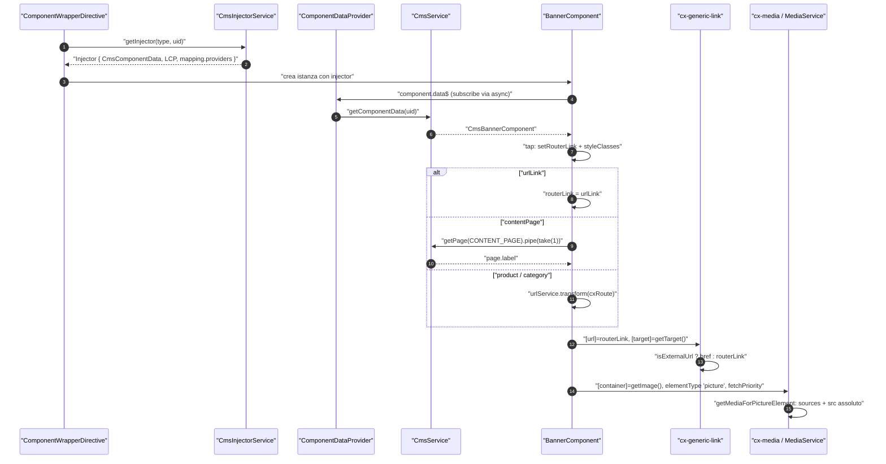
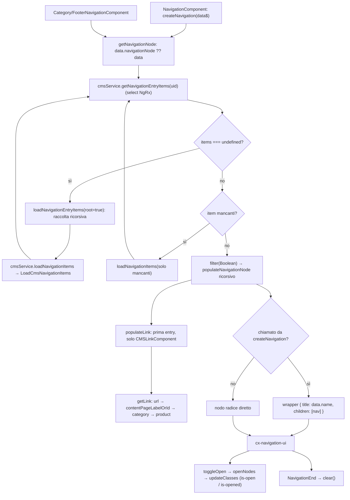
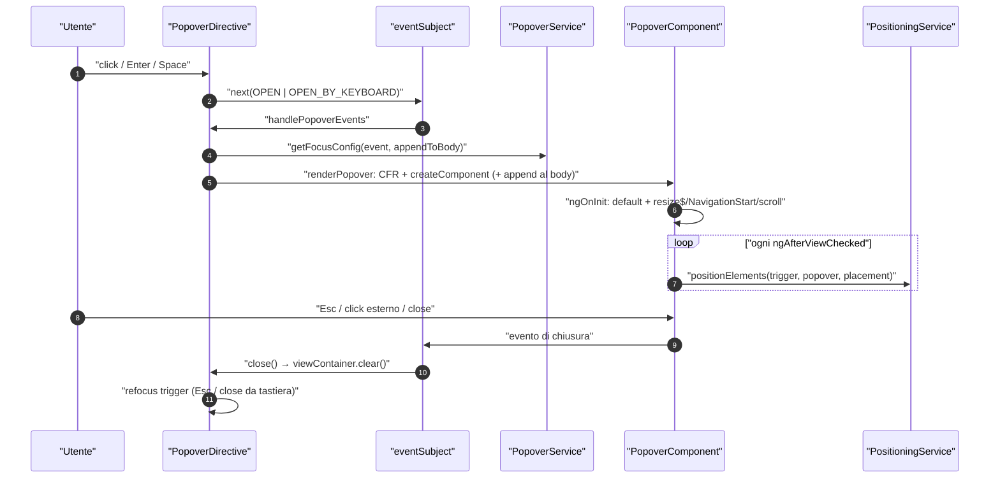
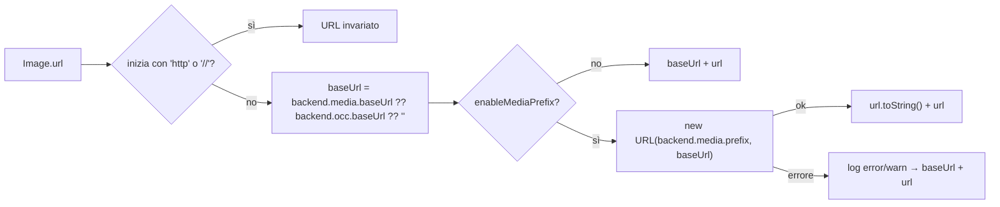

# 45 — Componenti CMS e shared components di storefront

> Riferimenti allo SHA `5b7a1c2bf2808d7380bc20596d10f4fa710c3da1` (vedi [00-meta](../00-meta.md)).

I capitoli [15](../parte-2/15-cms-core.md) e [16](../parte-2/16-cms-rendering.md) spiegano come una pagina CMS arriva nello store e come `cxComponentWrapper` trasforma un `typeCode` in un componente Angular. Questo capitolo guarda *dentro* i componenti: quelli CMS "generici" di `@spartacus/storefront` (content, navigation, misc) e la cassetta degli attrezzi condivisa (`shared/`: media, carousel, generic link, form errors, item counter, pagination, popover, direttive, pipe, servizi file e validator) che tutte le feature lib riusano.

Lo scopo non è un catalogo esaustivo dei 286 file assegnati: si sceglie un componente rappresentativo per famiglia (Banner per content, NavigationService + NavigationUIComponent per navigation, Icon per misc, Media/Carousel/GenericLink per shared) e lo si segue fino alle righe di codice, mentre gli altri sono descritti per differenza. La tabella completa `typeCode → componente → modulo` di tutto il monorepo è nell'[appendice A03](../appendici/A03-cms-components.md).

## 1. A cosa serve e perché esiste

Il backend SAP Commerce restituisce componenti CMS con un `typeCode` (es. `SimpleResponsiveBannerComponent`, `CMSParagraphComponent`, `NavigationComponent`) e un sacco di proprietà quasi sempre **stringhe**. Lo storefront deve fornire, per ogni tipo "di base" previsto dal modello CMS standard, un componente Angular che:

1. riceva i dati tramite `CmsComponentData` (creato per ogni istanza da `CmsInjectorService.getInjector`, `core-libs/storefront/cms-structure/page/component/services/cms-injector.service.ts:L28-L50`);
2. **normalizzi** i dati CMS, che arrivano spesso con booleani come stringa: `data.external === 'true' || data.external === true` nel banner (`core-libs/storefront/cms-components/content/banner/banner.component.ts:L133-L135`), `data.autoPlay === 'true'` nel video (`core-libs/storefront/cms-components/content/video/video.component.ts:L92-L96`), `isBool(...)` nel search box (`core-libs/storefront/cms-components/navigation/search-box/search-box.component.ts:L246-L266`);
3. **risolva i link** CMS (URL assoluto, content page, prodotto, categoria) in qualcosa che il router Angular capisca, con la cascata `urlLink → contentPage → product → category` (`core-libs/storefront/cms-components/content/banner/banner.component.ts:L137-L161`);
4. renda il tutto accessibile (tastiera, ARIA) e compatibile SSR.

Accanto ai componenti CMS esiste la directory `shared/`: componenti *non* mappati su typeCode ma usati come building block da tutto il resto (`cx-media`, `cx-generic-link`, `cx-carousel`, `cx-item-counter`, `cx-form-errors`, `cx-pagination`, `[cxPopover]`, …). `cms-components/index.ts` e `shared/index.ts` sono entrambi riesportati da `@spartacus/storefront` (`core-libs/storefront/public_api.ts:L21-L21`, `core-libs/storefront/public_api.ts:L29-L29`), quindi tutto ciò che vedete in questo capitolo è API pubblica salvo le eccezioni elencate nella sezione 9.

Il pattern architetturale ricorrente è: **componente standalone + NgModule "wrapper"** che importa il componente e registra il mapping con `provideDefaultConfig(<CmsConfig>{ cmsComponents: {...} })` (`core-libs/storefront/cms-components/content/banner/banner.module.ts:L20-L47`). Il modulo resta per retro-compatibilità e per portare con sé la configurazione di default; l'app demo li importa esplicitamente in `SpartacusFeaturesModule` (`projects/storefrontapp/src/app/spartacus/spartacus-features.module.ts:L184-L199`).

## 2. Mappa dei file

Prefisso comune: `core-libs/storefront/`. I file sono raggruppati per cartella; dove una cartella contiene il trittico `.component.ts/.html/.module.ts` si indica solo la cartella.

### 2.1 `cms-components/` (content, navigation, misc)

| Path | Ruolo |
|---|---|
| `core-libs/storefront/cms-components/index.ts` | Barrel di tutti i gruppi CMS (anche myaccount/product/user, fuori capitolo) |
| `core-libs/storefront/cms-components/content/banner/` | `BannerComponent` per 3 typeCode, link risolto, LCP, frecce a11y |
| `core-libs/storefront/cms-components/content/banner-carousel/` | `BannerCarouselComponent` per `RotatingImagesComponent`: carousel di componenti CMS |
| `core-libs/storefront/cms-components/content/link/` | `LinkComponent` per `CMSLinkComponent` → `cx-generic-link` |
| `core-libs/storefront/cms-components/content/paragraph/` | `ParagraphComponent` per `CMSParagraphComponent`/`CMSTabParagraphComponent`: HTML trusted + click via router |
| `core-libs/storefront/cms-components/content/pdf/` | `PDFComponent` per `PDFDocumentComponent` |
| `core-libs/storefront/cms-components/content/video/` | `VideoComponent` CMS (sorgente, thumbnail, flag, link) |
| `core-libs/storefront/cms-components/content/tab/` (`tab.component.ts`, `tab.model.ts`, `tab.module.ts`, `tab.utils.ts`, `panel/`) | `cx-tab`: tab/accordion generico, **non** mappato su typeCode |
| `core-libs/storefront/cms-components/content/tab-paragraph-container/` | `TabParagraphContainerComponent` per `CMSTabParagraphContainer` |
| `core-libs/storefront/cms-components/navigation/navigation/navigation.service.ts` | `NavigationService`: costruzione dell'albero `NavigationNode` dallo store CMS |
| `core-libs/storefront/cms-components/navigation/navigation/navigation-ui.component.ts` (+ `.html`) | `NavigationUIComponent` (`cx-navigation-ui`): flyout, hamburger, tastiera |
| `core-libs/storefront/cms-components/navigation/navigation/navigation-node.model.ts` | Modello di vista `NavigationNode` |
| `core-libs/storefront/cms-components/navigation/navigation/navigation.component.ts` | `NavigationComponent` CMS (usa `createNavigation`) |
| `core-libs/storefront/cms-components/navigation/category-navigation/` | `CategoryNavigationComponent`, unico mapping con `data` statici |
| `core-libs/storefront/cms-components/navigation/footer-navigation/` | `FooterNavigationComponent`, senza flyout |
| `core-libs/storefront/cms-components/navigation/breadcrumb/` | `BreadcrumbComponent` da `PageMetaService` |
| `core-libs/storefront/cms-components/navigation/page-header/` (+ `page-title.utils.ts`) | `PageTitleComponent` e util `getPageTitle` |
| `core-libs/storefront/cms-components/navigation/scroll-to-top/` | `ScrollToTopComponent` |
| `core-libs/storefront/cms-components/navigation/search-box/` | `SearchBoxComponent`, `SearchBoxComponentService`, eventi, outlet, `HighlightPipe` |
| `core-libs/storefront/cms-components/misc/icon/` | `IconComponent`, `IconLoaderService`, `IconConfig`, `ICON_TYPE`, config Font Awesome, `IconTestingModule` |
| `core-libs/storefront/cms-components/misc/site-context-selector/` | `SiteContextSelectorComponent`, `LanguageCurrencyComponent`, `SiteContextComponentService` |
| `core-libs/storefront/cms-components/misc/site-theme-switcher/` | `SiteThemeSwitcherComponent` + service |
| `core-libs/storefront/cms-components/misc/global-message/` | `GlobalMessageComponent` (nel layout, non CMS) |
| `core-libs/storefront/cms-components/misc/message/` | `MessageComponent` inline riutilizzabile |
| `core-libs/storefront/cms-components/misc/promotions/` | `PromotionsComponent` presentational |

### 2.2 `shared/`

| Path | Ruolo |
|---|---|
| `core-libs/storefront/shared/components/media/` (`media.component.ts`, `media.service.ts`, `media.config.ts`, `media.model.ts`, `media.module.ts`, `media-sources.pipe.ts`) | `cx-media`: immagini responsive `img`/`picture`, URL assoluti, lazy/eager, fetch priority |
| `core-libs/storefront/shared/components/carousel/` (+ `carousel.service.ts`, `focusable-carousel-item/`) | `cx-carousel` a slide |
| `core-libs/storefront/shared/components/carousel-scrolling/` | carousel a scroll orizzontale |
| `core-libs/storefront/shared/components/generic-link/` (+ `generic-link-component.service.ts`) | `cx-generic-link`: link interno (`routerLink`) o esterno (`href`) |
| `core-libs/storefront/shared/components/item-counter/` | `cx-item-counter` su `FormControl` esterno |
| `core-libs/storefront/shared/components/form/` (form-errors, date-picker, file-upload, password-visibility-toggle, required asterisks/legend) | componenti form |
| `core-libs/storefront/shared/components/list-navigation/` (pagination, sorting, total) | paginazione (`PaginationBuilder`), ordinamento ng-select, totale |
| `core-libs/storefront/shared/components/popover/` | `[cxPopover]`, `PopoverComponent`, `PopoverService`, modello |
| `core-libs/storefront/shared/services/positioning/positioning.service.ts` | `PositioningService`: calcolo posizione popover |
| `core-libs/storefront/shared/components/card/`, `spinner/`, `star-rating/`, `progress-button/`, `read-more/`, `truncate-text-popover/` | presentational vari |
| `core-libs/storefront/shared/components/table/`, `split-view/`, `chat-messaging/`, `captcha/`, `anonymous-consents-dialog/`, `assistive-technology-message/`, `ng-select-a11y/` | componenti più complessi (mappati, non approfonditi qui) |
| `core-libs/storefront/shared/directives/` (`roving-tabindex/`, `horizontal-scrolling-position/`) | direttive a11y e scroll |
| `core-libs/storefront/shared/pipes/suplement-hash-anchors/` | `cxSupplementHashAnchors` |
| `core-libs/storefront/shared/services/file/` | download file, CSV import/export, validator file |
| `core-libs/storefront/shared/utils/` (`validators/custom-form-validators.ts`, `forms/title-utils.ts`) | validator e util form |
| `core-libs/storefront/shared/config/` (`form-config.ts`, `view-config.ts`, `default-form-config.ts`) | config `FormConfig` / `ViewConfig` |

## 3. Come funziona passo per passo

### 3.1 Il contratto comune: mapping, injector, `data$`

1. **Registrazione.** Ogni modulo wrapper registra uno o più typeCode. `BannerModule` mappa tre typeCode sullo stesso `BannerComponent` (`core-libs/storefront/cms-components/content/banner/banner.module.ts:L20-L47`); `CmsParagraphModule` mappa `CMSParagraphComponent` e `CMSTabParagraphComponent` su `ParagraphComponent` (`core-libs/storefront/cms-components/content/paragraph/paragraph.module.ts:L22-L31`); `LinkModule` mappa `CMSLinkComponent` (`core-libs/storefront/cms-components/content/link/link.module.ts:L17-L21`); `BannerCarouselModule` mappa `RotatingImagesComponent` (`core-libs/storefront/cms-components/content/banner-carousel/banner-carousel.module.ts:L23-L29`); PDF, Video e TabParagraphContainer seguono lo stesso schema (`core-libs/storefront/cms-components/content/pdf/pdf.module.ts:L16-L22`, `core-libs/storefront/cms-components/content/video/video.module.ts:L27-L33`, `core-libs/storefront/cms-components/content/tab-paragraph-container/tab-paragraph-container.module.ts:L31-L37`). I moduli navigation mappano 1:1 typeCode omonimi (`core-libs/storefront/cms-components/navigation/navigation/navigation.module.ts:L33-L39`, `core-libs/storefront/cms-components/navigation/breadcrumb/breadcrumb.module.ts:L29-L35`, `core-libs/storefront/cms-components/navigation/search-box/search-box.module.ts:L41-L47`).
2. **Moduli senza mapping.** `TabModule` non registra nulla: `cx-tab` è un building block (`core-libs/storefront/cms-components/content/tab/tab.module.ts:L13-L17`). Anche `GlobalMessageComponentModule`, `MessageComponentModule` e `PromotionsModule` non hanno mapping; `<cx-global-message>` è scritto direttamente nel template di `StorefrontComponent` (`core-libs/storefront/cms-components/misc/global-message/global-message.module.ts:L13-L17`, `core-libs/storefront/layout/main/storefront.component.html:L16-L16`) e il modulo è importato da `BaseStorefrontModule` (`core-libs/storefront/base-storefront.module.ts:L30-L30`).
3. **Injector per istanza.** Quando il wrapper crea un componente, `CmsInjectorService.getInjector(type, uid)` costruisce un `Injector` con un provider `CmsComponentData` (`{ uid, data$ }`), `provideLcpPresenceForCmsComponent()` e i `providers` del mapping (`core-libs/storefront/cms-structure/page/component/services/cms-injector.service.ts:L28-L50`). `CmsComponentData` è il tipo con `uid` e `data$` (`core-libs/storefront/cms-structure/page/model/cms-component-data.ts:L10-L13`).
4. **Dati statici + dati backend.** `data$` è `ComponentDataProvider.get(uid, type)`: se il mapping ha `data`, emette subito i dati statici (`startWith`) e poi `{...static, ...backend}`, quindi il backend sovrascrive (`core-libs/storefront/cms-structure/page/component/services/component-data.provider.ts:L35-L59`). Nel perimetro di questo capitolo solo `CategoryNavigationComponent` usa `data` (`resetMenuOnClose: true`, `core-libs/storefront/cms-components/navigation/category-navigation/category-navigation.module.ts:L21-L30`).
5. **Providers per componente.** `SiteContextSelectorModule` usa il campo `providers` del mapping per dare a ogni istanza CMS un proprio `SiteContextComponentService` costruito con `CmsComponentData` nelle deps, e fornisce *anche* il service a livello modulo (senza dati CMS) per l'uso standalone (`core-libs/storefront/cms-components/misc/site-context-selector/site-context-selector.module.ts:L33-L52`).

### 3.2 Content: Banner (rappresentativo)

1. `BannerComponent` è OnPush; `data$` deriva da `component.data$` con un `tap` che chiama `setRouterLink(data)` e copia `data.styleClasses` nella `@HostBinding('class')` (`core-libs/storefront/cms-components/content/banner/banner.component.ts:L44-L57`).
2. `setRouterLink` risolve in cascata (`core-libs/storefront/cms-components/content/banner/banner.component.ts:L137-L161`):
   - `urlLink` → usato così com'è;
   - `contentPage` → `cmsService.getPage({ id, type: PageType.CONTENT_PAGE }).pipe(take(1))` e poi `page?.label` (asincrono);
   - `product` → `urlService.transform({ cxRoute: 'product', params: { code } })`;
   - `category` → idem con route `category`.
3. `getTarget` restituisce `_blank` se `data.external` vale `'true'` o `true` (`core-libs/storefront/cms-components/content/banner/banner.component.ts:L133-L135`).
4. `getImage` distingue `Image` da `ImageGroup` con `'url' in data.media`; l'aria-label del link è `headline ?? altText` della prima immagine (`core-libs/storefront/cms-components/content/banner/banner.component.ts:L163-L189`).
5. Il template, dentro `*cxLcpContext`, ha due rami: con `routerLink` rende un `cx-generic-link` **vuoto** seguito da headline/media/content come fratelli; senza link rende un `div.no-link`. Headline e content usano `[innerHTML]`; `cx-media` riceve `elementType 'picture'` e `fetchPriority` dal contesto LCP (`core-libs/storefront/cms-components/content/banner/banner.component.html:L1-L35`). Il contesto LCP è trattato nel [capitolo 16](../parte-2/16-cms-rendering.md).
6. Con il toggle `a11yBannerArrowKeyNavigation` (default `false`, `core-libs/core/src/features-config/feature-toggles/config/feature-toggles.ts:L1114-L1114`) il banner gestisce le frecce: cerca i sibling `cx-banner` nel parent e per ↑/↓ usa come passo il numero di colonne della prima riga, calcolato confrontando `getBoundingClientRect().top` con tolleranza di 1px (`core-libs/storefront/cms-components/content/banner/banner.component.ts:L65-L127`).

### 3.3 Content: gli altri per differenza

- **Paragraph.** Il contenuto passa prima dalla pipe `cxSupplementHashAnchors` e poi da `DomSanitizer.bypassSecurityTrustHtml`: nessuna sanitizzazione Angular (`core-libs/storefront/cms-components/content/paragraph/paragraph.component.html:L1-L4`, `core-libs/storefront/cms-components/content/paragraph/paragraph.component.ts:L49-L51`). Un `@HostListener('click')` intercetta i click su `<a>`: se l'host coincide con quello del documento fa `preventDefault` e `router.navigateByUrl` (navigazione SPA) (`core-libs/storefront/cms-components/content/paragraph/paragraph.component.ts:L29-L42`). La pipe riscrive gli `href="#id"` prefissandoli con l'URL corrente senza fragment, usando un `<template>` creato via `Renderer2` (`core-libs/storefront/shared/pipes/suplement-hash-anchors/supplement-hash-anchors.pipe.ts:L10-L50`).
- **Link.** `LinkComponent` si sottoscrive a mano in `ngOnInit` per `styleClasses` e si disiscrive in `ngOnDestroy`; il template delega a `cx-generic-link` con `url`, `style` e `target` (`core-libs/storefront/cms-components/content/link/link.component.ts:L35-L53`, `core-libs/storefront/cms-components/content/link/link.component.html:L1-L7`).
- **BannerCarousel.** `data.banners` è una stringa di uid separati da spazi: viene splittata e ogni uid diventa un Observable `cmsService.getComponentData(code)`; la classe host è `${effect}-theme` (`core-libs/storefront/cms-components/content/banner-carousel/banner-carousel.component.ts:L30-L47`). Ogni item è reso con `[cxComponentWrapper]` dentro `cx-carousel` con `itemWidth="100%"` (`core-libs/storefront/cms-components/content/banner-carousel/banner-carousel.component.html:L1-L17`): un componente CMS che istanzia altri componenti CMS.
- **PDF.** `url` = `MediaService.getMedia(data.pdfFile)?.src`; `addPdfExtension` aggiunge `.pdf` al titolo se manca (`core-libs/storefront/cms-components/content/pdf/pdf.component.ts:L22-L43`).
- **Video.** Flag stringa convertiti (`autoPlay`/`loop` → `=== 'true'`, `mute` → `'muted'|undefined`) (`core-libs/storefront/cms-components/content/video/video.component.ts:L92-L96`); thumbnail scelto in base a `containerBackground`/`thumbnailSelector` (`core-libs/storefront/cms-components/content/video/video.component.ts:L67-L90`); la cascata di routing replica quella del banner ma chiama `cd.markForCheck()` dopo la risoluzione asincrona della content page (`core-libs/storefront/cms-components/content/video/video.component.ts:L98-L123`).

### 3.4 Content: TabParagraphContainer e `cx-tab`

1. Config di default `{ openTabs: [0], breakpoint: BREAKPOINT.md }` (`core-libs/storefront/cms-components/content/tab-paragraph-container/tab-paragraph-container.component.ts:L39-L42`).
2. `components$` splitta `data.components`, carica ogni figlio con `cmsService.getComponentData`, usa `typeCode` come `flexType` se mancante, imposta `title = ${containerUid}.tabs.${tabUid}` (chiave i18n), scarta i nulli ed emette su `tabConfig$` la label `${uid}.tabPanelContainerRegionGroup` (`core-libs/storefront/cms-components/content/tab-paragraph-container/tab-paragraph-container.component.ts:L99-L140`).
3. Il template crea un `ng-template #tabRef` per figlio con `[cxOutlet]="component?.flexType"` + `[cxComponentWrapper]` e ascolta `(cxComponentRef)` (`core-libs/storefront/cms-components/content/tab-paragraph-container/tab-paragraph-container.component.html:L1-L15`).
4. In `ngAfterViewInit` `tabs$` combina `components$`, `tabRefs.changes` e `tabTitleParams$` per produrre i `Tab` (`headerKey`, `content` = TemplateRef, `id`, `headerParams`), poi `cdr.detectChanges()` (`core-libs/storefront/cms-components/content/tab-paragraph-container/tab-paragraph-container.component.ts:L169-L200`).
5. Quando un figlio viene creato, `tabCompLoaded` registra il suo `tabTitleParam$` una sola volta per uid, per evitare il loop `tabs$ → load → tabTitleParams$ → tabs$` (`core-libs/storefront/cms-components/content/tab-paragraph-container/tab-paragraph-container.component.ts:L202-L213`).
6. `cx-tab` decide la modalità: `config.mode` se presente, altrimenti `TAB` sopra il breakpoint e `ACCORDIAN` sotto (`BreakpointService.isUp`), altrimenti `TAB` (`core-libs/storefront/cms-components/content/tab/tab.component.ts:L254-L268`). In `TAB` `select()` apre solo il tab scelto, in `ACCORDIAN` fa toggle (`core-libs/storefront/cms-components/content/tab/tab.component.ts:L96-L105`, `core-libs/storefront/cms-components/content/tab/tab.component.ts:L196-L205`).
7. Tastiera: frecce, Home ed End spostano solo il focus con wrap circolare (`wrapIntoBounds`); `restrictDirectionKeys` limita Tab a ←/→ e Accordion a ↑/↓ (`core-libs/storefront/cms-components/content/tab/tab.component.ts:L136-L182`, `core-libs/storefront/cms-components/content/tab/tab.utils.ts:L12-L20`). ARIA: `role="tab"` in modalità TAB, `role="button"` + `aria-expanded` in ACCORDIAN (`core-libs/storefront/cms-components/content/tab/tab.component.html:L4-L17`).

### 3.5 Navigation: dall'entry CMS al menu

1. `NavigationComponent.node$ = service.createNavigation(componentData.data$)` (`core-libs/storefront/cms-components/navigation/navigation/navigation.component.ts:L23-L40`). `createNavigation` incapsula il nodo radice in `{ title: data.name, children: [nav] }` (`core-libs/storefront/cms-components/navigation/navigation/navigation.service.ts:L27-L38`). `CategoryNavigationComponent` e `FooterNavigationComponent` usano invece `getNavigationNode` direttamente, **senza** nodo wrapper (`core-libs/storefront/cms-components/navigation/category-navigation/category-navigation.component.ts:L22-L33`, `core-libs/storefront/cms-components/navigation/footer-navigation/footer-navigation.component.ts:L23-L26`).
2. `getNavigationNode` prende `data.navigationNode ?? data` e legge gli entry item dallo store con `cmsService.getNavigationEntryItems(uid)` (un `select` NgRx) (`core-libs/storefront/cms-components/navigation/navigation/navigation.service.ts:L45-L57`, `core-libs/core/src/cms/facade/cms.service.ts:L171-L192`).
3. Se gli item sono `undefined`, `loadNavigationEntryItems(navigation, true)` raccoglie ricorsivamente `{superType, id}` di entries e children e dispatcha **solo per la radice** (`core-libs/storefront/cms-components/navigation/navigation/navigation.service.ts:L95-L118`); `CmsService.loadNavigationItems` dispatcha `CmsActions.LoadCmsNavigationItems` (`core-libs/core/src/cms/facade/cms.service.ts:L171-L192`).
4. Se gli item ci sono ma ne mancano alcuni, carica solo i mancanti (`core-libs/storefront/cms-components/navigation/navigation/navigation.service.ts:L63-L80`).
5. `filter(Boolean)` e poi `populateNavigationNode` ricorsivo: titolo, `styleClasses`, `styleAttributes`, link dalla **prima** entry, figli filtrati; un nodo senza proprietà diventa `null` e viene scartato (`core-libs/storefront/cms-components/navigation/navigation/navigation.service.ts:L125-L161`).
6. `populateLink` considera solo `itemType === 'CMSLinkComponent'`, cerca l'item con chiave `${itemId}_${itemSuperType}` e imposta `url` solo se il nodo ha un titolo; `target='_blank'` se `item.target` è `'true'`/`true` (`core-libs/storefront/cms-components/navigation/navigation/navigation.service.ts:L166-L193`). `getLink` (protected) sceglie `url` → `contentPageLabelOrId` → route `category` → route `product` (`core-libs/storefront/cms-components/navigation/navigation/navigation.service.ts:L201-L223`).
7. `cx-navigation-ui` rende l'albero. Input: `node`, `wrapAfter`, `resetMenuOnClose`, `focusableNodeTitles`, `navAriaLabel`, `flyout` (default `true`, classe host `flyout`), `isOpen` (classe host `is-open`) (`core-libs/storefront/cms-components/navigation/navigation/navigation-ui.component.ts:L57-L88`). La category navigation passa `wrapAfter` convertito con `+`, `resetMenuOnClose` e l'aria-label `navigation.categoryNavLabel` (`core-libs/storefront/cms-components/navigation/category-navigation/category-navigation.component.html:L1-L8`); il footer disattiva il flyout (`core-libs/storefront/cms-components/navigation/footer-navigation/footer-navigation.component.html:L1-L7`).
8. Apertura sottomenu: `toggleOpen` gestisce click e tastiera; con `a11yNavigationSpaceKeyOnKeyUp` ignora `keydown` e reagisce su `keyup`, altrimenti il contrario (`core-libs/storefront/cms-components/navigation/navigation/navigation-ui.component.ts:L197-L229`, `core-libs/core/src/features-config/feature-toggles/config/feature-toggles.ts:L1093-L1093`). Lo stato vive in `openNodes: HTMLElement[]` ed è riflesso con `Renderer2` come `is-open` (ultimo) e `is-opened` (antenati) (`core-libs/storefront/cms-components/navigation/navigation/navigation-ui.component.ts:L381-L393`).
9. Il costruttore chiude tutto a ogni `NavigationEnd` e, su `window:resize` con `debounceTime(50)`, riallinea i `.wrapper` che sbordano a destra (`core-libs/storefront/cms-components/navigation/navigation/navigation-ui.component.ts:L95-L128`, `core-libs/storefront/cms-components/navigation/navigation/navigation-ui.component.ts:L356-L372`).
10. Con `resetMenuOnClose` il componente si sottoscrive a `HamburgerMenuService.isExpanded` e reinizializza il menu quando l'hamburger si apre (`core-libs/storefront/cms-components/navigation/navigation/navigation-ui.component.ts:L133-L185`). Il numero di colonne di un sottomenu è `ceil(length / wrapAfter)` (`core-libs/storefront/cms-components/navigation/navigation/navigation-ui.component.ts:L323-L335`); `getTabIndex` dà -1 alle foglie in profondità > 0 solo con flyout (`core-libs/storefront/cms-components/navigation/navigation/navigation-ui.component.ts:L398-L403`).

### 3.6 Navigation: breadcrumb, titolo, scroll-to-top, search box

- **Breadcrumb** estende `PageTitleComponent`; le crumb vengono da `pageMetaService.getMeta().breadcrumbs`, con fallback `[{ label: 'common.home' tradotto, link: '/' }]` (`core-libs/storefront/cms-components/navigation/breadcrumb/breadcrumb.component.ts:L32-L66`). `ariaLive$` emette a ogni `NavigationEnd` se il focus non è sul `body` (`core-libs/storefront/cms-components/navigation/breadcrumb/breadcrumb.component.ts:L37-L42`). I meta di pagina sono descritti nel [capitolo 40](../parte-2/40-seo-pwa.md).
- **Page title**: `getPageTitle` restituisce `meta.heading || meta.title` (`core-libs/storefront/cms-components/navigation/page-header/page-title.utils.ts:L11-L18`, `core-libs/storefront/cms-components/navigation/page-header/page-title.component.ts:L25-L45`).
- **Scroll-to-top**: `scrollBehavior` e `displayThreshold` dai dati CMS con `take(1)`; default `SMOOTH` e metà di `innerHeight` (400/2 se assente) (`core-libs/storefront/cms-components/navigation/scroll-to-top/scroll-to-top.component.ts:L40-L42`, `core-libs/storefront/cms-components/navigation/scroll-to-top/scroll-to-top.component.ts:L102-L107`). Visibile se `scrollY > displayThreshold` o se attivato da tastiera e ancora focalizzato (`core-libs/storefront/cms-components/navigation/scroll-to-top/scroll-to-top.component.ts:L66-L123`).
- **Search box**: config di default (`minCharactersBeforeRequest: 1`, max 5 prodotti/suggerimenti, recent e trending attivi) (`core-libs/storefront/cms-components/navigation/search-box/search-box.component.ts:L61-L72`) fusa a tre livelli default → dati CMS → `@Input() config`, con conversione dei flag stringa `'false'` e riscrittura del risultato in `this.config` (`core-libs/storefront/cms-components/navigation/search-box/search-box.component.ts:L246-L266`). `SearchBoxComponentService.search` non chiama il backend sotto `minCharactersBeforeRequest` e usa `searchWithCompletion`/`searchSuggestionsWithCompletion` con `pageSize` = `maxProducts`/`maxSuggestions` (`core-libs/storefront/cms-components/navigation/search-box/search-box-component.service.ts:L70-L125`); `getResults` toggla sul body la classe `has-searchbox-results` (`core-libs/storefront/cms-components/navigation/search-box/search-box-component.service.ts:L149-L166`). Eventi `SearchBoxSuggestionSelectedEvent`/`SearchBoxProductSelectedEvent` via `EventService` (`core-libs/storefront/cms-components/navigation/search-box/search-box.events.ts:L12-L32`, `core-libs/storefront/cms-components/navigation/search-box/search-box-component.service.ts:L204-L230`) e tre outlet `SearchBoxOutlets` (`core-libs/storefront/cms-components/navigation/search-box/search-box-outlets.model.ts:L7-L11`). La ricerca prodotti lato core è nel [capitolo 24](../parte-2/24-product-search.md). ⚠️ DA VERIFICARE: la logica interna di recent/trending searches e della gestione focus a gruppi di `SearchBoxComponent` (951 righe) è stata solo mappata dall'analista, non letta per intero.

### 3.7 Misc: Icon (rappresentativo), site context, theme, messaggi

1. `IconComponent` ha selettore doppio `cx-icon,[cxIcon]`: come attributo non aggiunge un nodo DOM e il contenuto è proiettato (`core-libs/storefront/cms-components/misc/icon/icon.component.ts:L22-L46`).
2. I setter `cxIcon` e `type` chiamano `setIcon`, che ottiene l'HTML dal loader, aggiunge le classi, carica l'eventuale risorsa LINK e imposta il flip (`core-libs/storefront/cms-components/misc/icon/icon.component.ts:L52-L99`). `addStyleClasses` aggiunge sempre `cx-icon`, rimuove le classi del tipo precedente e aggiunge quelle del simbolo split per spazio (`core-libs/storefront/cms-components/misc/icon/icon.component.ts:L113-L126`).
3. `IconLoaderService.getHtml`: per `SVG` costruisce `<svg><use xlink:href>` con URL sanitizzato (`SecurityContext.URL`); per `TEXT` mette il simbolo in `textContent`; per i font (LINK) restituisce `undefined` e bastano le classi (`core-libs/storefront/cms-components/misc/icon/icon-loader.service.ts:L33-L55`). Il template rende `<i [outerHTML]="icon">` solo se c'è HTML e proietta `<ng-content />` (`core-libs/storefront/cms-components/misc/icon/icon.component.html:L1-L4`).
4. `addLinkResource` inietta una sola volta per URL un `<link rel="stylesheet">` nel `<head>`, cercando una risorsa specifica per tipo o una "one-size-fits-all" senza `types` (`core-libs/storefront/cms-components/misc/icon/icon-loader.service.ts:L118-L160`).
5. Configurazione: `IconConfig` è una classe astratta `useExisting: Config` con `IconOptions` (`symbols`, `resources`, `flipDirection`) (`core-libs/storefront/cms-components/misc/icon/icon.model.ts:L79-L121`); `IconResourceType` vale `SVG`, `LINK`, `TEXT` (`core-libs/storefront/cms-components/misc/icon/icon.model.ts:L133-L149`). `IconModule` fornisce `defaultIconConfig` (flip RTL dei caret) e `fontawesomeIconConfig` (`core-libs/storefront/cms-components/misc/icon/icon.module.ts:L14-L23`, `core-libs/storefront/cms-components/misc/icon/default-icon.config.ts:L10-L17`); quest'ultimo mappa ogni `ICON_TYPE` su classi Font Awesome con una risorsa LINK a `url: ''`, quindi nessun CSS viene caricato dinamicamente (`core-libs/storefront/cms-components/misc/icon/fontawesome-icon.config.ts:L9-L86`). `ICON_TYPE` è un enum augmentabile riesportato nel blocco delimitato dal commento `AUGMENTABLE_TYPES_START` (`core-libs/storefront/cms-components/misc/icon/icon.model.ts:L11-L77`, `core-libs/storefront/public_api.ts:L32-L36`).
6. **Site context selector.** `SiteContextComponentService` risolve il contesto dall'`@Input context` o da `componentData.data$.context` (LANGUAGE/CURRENCY → id di contesto) (`core-libs/storefront/cms-components/misc/site-context-selector/site-context-component.service.ts:L91-L118`), poi trova il service concreto con `injector.get(contextServiceMap[context])` (`core-libs/storefront/cms-components/misc/site-context-selector/site-context-component.service.ts:L120-L125`). Label: `nativeName` per la lingua, `symbol + ' ' + isocode` per la valuta (`core-libs/storefront/cms-components/misc/site-context-selector/site-context-component.service.ts:L127-L136`). Il `<select>` appare solo con più di un item e il `change` passa dal setter `active` (`core-libs/storefront/cms-components/misc/site-context-selector/site-context-selector.component.html:L1-L4`, `core-libs/storefront/cms-components/misc/site-context-selector/site-context-selector.component.ts:L68-L70`). `LanguageCurrencyComponent` affianca due selettori in un template inline (`core-libs/storefront/cms-components/misc/site-context-selector/language-currency.component.ts:L11-L22`). Il meccanismo dei contesti è nel [capitolo 13](../parte-2/13-site-context-theme.md).
7. **Theme switcher**: delega a `SiteThemeService` tramite `SiteThemeSwitcherComponentService`, fornito dal modulo e non root (`core-libs/storefront/cms-components/misc/site-theme-switcher/site-theme-switcher.module.ts:L28-L36`, `core-libs/storefront/cms-components/misc/site-theme-switcher/site-theme-switcher.component.service.ts:L11-L26`).
8. **Messaggi**: `GlobalMessageComponent` legge `globalMessageService.get()` e rimuove con `remove(type, index)` (`core-libs/storefront/cms-components/misc/global-message/global-message.component.ts:L33-L51`); `MessageComponent` mappa `GlobalMessageType` su classi e icone e focalizza il contenitore se ha testo accordion o bottone d'azione (`core-libs/storefront/cms-components/misc/message/message.component.ts:L62-L89`). Il servizio dei global message è nel [capitolo 41](../parte-2/41-errori-global-message.md).

### 3.8 Shared: Media

1. `cx-media` accetta `MediaContainer | Image | ImageGroup | ImageGroup[]`; con un array usa solo il primo elemento (`core-libs/storefront/shared/components/media/media.component.ts:L62-L67`, `core-libs/storefront/shared/components/media/media.component.ts:L162-L174`).
2. A ogni `ngOnChanges` ricalcola il `Media`; senza `src` entra in stato "missing" (`is-missing`, `is-initialized`) ed emette `loaded(false)` (`core-libs/storefront/shared/components/media/media.component.ts:L155-L208`). Le classi host `is-initialized`, `is-loading`, `is-missing` sono aggiornate da `loadHandler` sull'evento `(load)` (`core-libs/storefront/shared/components/media/media.component.ts:L134-L148`, `core-libs/storefront/shared/components/media/media.component.ts:L179-L184`).
3. `fetchPriority === HIGH` forza `loading="eager"`, altrimenti vale `loading` o la strategia globale (`core-libs/storefront/shared/components/media/media.component.ts:L217-L222`), che per default è `LAZY` (`core-libs/storefront/shared/components/media/media.service.ts:L163-L168`).
4. Template: `<picture>` con `<source>` se `elementType !== 'img'` e ci sono `sources`, altrimenti `` con `srcset` (fallback `src`) e `sizes` (`core-libs/storefront/shared/components/media/media.component.html:L1-L47`).
5. `MediaService`: `sortedFormats` ordina `mediaFormats` per larghezza e lo memorizza (`core-libs/storefront/shared/components/media/media.service.ts:L175-L190`); `resolveFormat` usa il formato richiesto, poi il più grande disponibile, poi la prima chiave (`core-libs/storefront/shared/components/media/media.service.ts:L255-L276`); `resolveSrcSet` produce `"url widthw, ..."` (`core-libs/storefront/shared/components/media/media.service.ts:L285-L309`); i formati `<picture>` derivano da `media.pictureElementFormats` ordinati con `media.pictureFormatsOrder` (`core-libs/storefront/shared/components/media/media.service.ts:L197-L231`).
6. URL assoluti: `resolveAbsoluteUrl` lascia stare `http…` e `//…`, gli altri li prefissa con `getBaseUrl()` (`core-libs/storefront/shared/components/media/media.service.ts:L383-L387`), che usa `backend.media.baseUrl ?? backend.occ.baseUrl ?? ''` e, con `enableMediaPrefix` (default `true`), compone `new URL(backend.media.prefix, baseUrl)` con fallback e log in caso di errore (`core-libs/storefront/shared/components/media/media.service.ts:L399-L428`, `core-libs/core/src/features-config/feature-toggles/config/feature-toggles.ts:L1032-L1032`).
7. `MediaModule.forRoot()` registra un `APP_INITIALIZER` che aggiunge il link `preconnect` ed è importato da `BaseStorefrontModule` (`core-libs/storefront/shared/components/media/media.module.ts:L14-L43`, `core-libs/storefront/base-storefront.module.ts:L42-L42`).

### 3.9 Shared: Carousel, GenericLink, ItemCounter, FormErrors

- **Carousel.** Disattiva l'hydration con `host: { ngSkipHydration: 'true' }` (`core-libs/storefront/shared/components/carousel/carousel.component.ts:L57-L65`). Gli item sono Observable (caricamento lazy); cambiare `items` riporta `activeSlide` a 0 (`core-libs/storefront/shared/components/carousel/carousel.component.ts:L89-L95`). `template` è obbligatorio, `itemWidth` vale `'300px'` di default (`core-libs/storefront/shared/components/carousel/carousel.component.ts:L101-L153`). `CarouselService.getItemsPerSlide` ricalcola su `WindowRef.resize$` gli item per slide da `clientWidth` e `itemWidth` in px o % (`core-libs/storefront/shared/components/carousel/carousel.service.ts:L29-L60`, `core-libs/core/src/window/window-ref.ts:L91-L107`). Il template raggruppa gli item in `div.slide` (`core-libs/storefront/shared/components/carousel/carousel.component.html:L39-L72`); le frecce ←/→ spostano il focus tra `[cxFocusableCarouselItem]` cambiando slide (`core-libs/storefront/shared/components/carousel/carousel.component.ts:L210-L287`).
- **GenericLink.** `[href]` per URL esterni, `[routerLink]` + `queryParams` + `fragment` per quelli locali (`core-libs/storefront/shared/components/generic-link/generic-link.component.html:L3-L38`). Esterno = stringa che inizia con `http://`, `https://`, `mailto:` o `tel:` (`core-libs/storefront/shared/components/generic-link/generic-link-component.service.ts:L12-L39`). Per URL locali aggiunge lo slash iniziale e separa path/query/fragment (`core-libs/storefront/shared/components/generic-link/generic-link.component.ts:L43-L127`); `rel="noopener"` solo con `target === '_blank'` (`core-libs/storefront/shared/components/generic-link/generic-link.component.ts:L65-L67`).
- **ItemCounter.** Lavora su un `UntypedFormControl` del parent; input `min` (1), `max`, `step` (1), `allowZero`, `readonly` (`core-libs/storefront/shared/components/item-counter/item-counter.component.ts:L42-L86`). In `ngOnInit` corregge ogni valore entro `[min,max]` con `emitEvent: false` (`core-libs/storefront/shared/components/item-counter/item-counter.component.ts:L95-L146`). I bottoni usano `aria-disabled` (`core-libs/storefront/shared/components/item-counter/item-counter.component.html:L1-L54`).
- **FormErrors.** `errorsDetails$` nasce da `control.statusChanges` (`core-libs/storefront/shared/components/form/form-errors/form-errors.component.ts:L73-L88`); la chiave di traduzione è un array `[prefix.key, fallbackPrefix.key]`, accettato da `TranslatePipe` (`core-libs/storefront/shared/components/form/form-errors/form-errors.component.html:L1-L10`, `core-libs/core/src/i18n/translate.pipe.ts:L42-L43`); il componente è `cx-visually-hidden` finché il controllo non è invalid e touched/dirty, con `aria-live` di default `polite` (`core-libs/storefront/shared/components/form/form-errors/form-errors.component.ts:L126-L142`). Poiché il cambio di `touched` non emette eventi, `ngDoCheck` lo confronta a mano (`core-libs/storefront/shared/components/form/form-errors/form-errors.component.ts:L96-L112`).

### 3.10 Shared: Popover, Pagination, direttive

- **Popover.** `[cxPopover]` accetta stringa o `TemplateRef` (`core-libs/storefront/shared/components/popover/popover.directive.ts:L32-L52`). Tutti gli eventi passano da un unico `eventSubject` smistato in `handlePopoverEvents` (`core-libs/storefront/shared/components/popover/popover.directive.ts:L117-L182`). `renderPopover` crea `PopoverComponent` con `ComponentFactoryResolver` (deprecato in Angular, `angular:packages/core/src/linker/component_factory_resolver.ts:L38-L41`) e, con `appendToBody`, sposta il nodo nel `body` (`core-libs/storefront/shared/components/popover/popover.directive.ts:L187-L221`). `PopoverComponent` si riposiziona su resize, opzionalmente su scroll e a ogni `ngAfterViewChecked`, e chiude su `NavigationStart` (`core-libs/storefront/shared/components/popover/popover.component.ts:L211-L267`); la posizione è calcolata da `PositioningService.positionElements`, che con `auto` prova 12 posizioni (`core-libs/storefront/shared/services/positioning/positioning.service.ts:L285-L336`).
- **Pagination.** `PaginationBuilder.paginate` non produce nulla con meno di 2 pagine e compone pagine → dots → first/last → navigazione (`core-libs/storefront/shared/components/list-navigation/pagination/pagination.builder.ts:L65-L76`); `getStartOfRange` centra la pagina corrente (`core-libs/storefront/shared/components/list-navigation/pagination/pagination.builder.ts:L331-L346`). `PaginationComponent.getQueryParams` imposta il query param e lo rimuove se uguale a `defaultPage` (`core-libs/storefront/shared/components/list-navigation/pagination/pagination.component.ts:L199-L219`). Con `a11yPaginationKeyboardNavigation` (default `false`) i link sono avvolti in uno `span` con `cxRovingTabindex` (`core-libs/storefront/shared/components/list-navigation/pagination/pagination.component.html:L1-L38`, `core-libs/core/src/features-config/feature-toggles/config/feature-toggles.ts:L1116-L1116`).
- **Roving tabindex.** `CxRovingTabindexDirective` implementa il pattern APG (un solo item con tabindex 0, frecce, Home/End) (`core-libs/storefront/shared/directives/roving-tabindex/roving-tabindex.directive.ts:L19-L181`) e osserva solo `childList` con un `MutationObserver` creato solo se esiste (SSR) (`core-libs/storefront/shared/directives/roving-tabindex/roving-tabindex.directive.ts:L121-L138`). Per il quadro generale dell'accessibilità vedi il [capitolo 18](../parte-2/18-layout-breakpoint-a11y.md).
- **Horizontal scrolling position**: espone `isScrollStart$`, `isScrollEnd$`, `isScrollNeeded$` con `IntersectionObserver`/`ResizeObserver` e non fa nulla fuori dal browser (`core-libs/storefront/shared/directives/horizontal-scrolling-position/horizontal-scrolling-position.directive.ts:L52-L184`, `core-libs/storefront/shared/directives/horizontal-scrolling-position/horizontal-scrolling-position.directive.ts:L186-L197`).

### 3.11 Shared: servizi file, validator, config

- `FileDownloadService.download` crea, clicca e rimuove un `<a download>` (`core-libs/storefront/shared/services/file/file-download.service.ts:L20-L29`); `ExportCsvFileService.convert` quota solo le celle con il separatore e chiude le righe con `\r\n` (`core-libs/storefront/shared/services/file/csv/export-csv-file.service.ts:L23-L52`); `ImportCsvFileService` fa `split('\n')` + `split(separator)` (`core-libs/storefront/shared/services/file/csv/import-csv-file.service.ts:L82-L88`); `FilesFormValidators` offre `maxSize`, `maxEntries`, `allowedTypes` (`core-libs/storefront/shared/services/file/files-form-validators.ts:L13-L86`).
- `CustomFormValidators` raccoglie validator statici e gli array `passwordValidators`/`securePasswordValidators` (`core-libs/storefront/shared/utils/validators/custom-form-validators.ts:L26-L218`); `controlsMustMatch` non tocca il secondo controllo se ha già altri errori (`core-libs/storefront/shared/utils/validators/custom-form-validators.ts:L444-L463`); `sortTitles` ordina per `titleScores` (`core-libs/storefront/shared/utils/forms/title-utils.ts:L9-L27`).
- `FormConfig` e `ViewConfig` sono config augmentate `useExisting: Config` (`core-libs/storefront/shared/config/form-config.ts:L10-L22`, `core-libs/storefront/shared/config/view-config.ts:L10-L30`); `defaultFormConfig` è fornito da `PasswordVisibilityToggleModule` (`core-libs/storefront/shared/config/default-form-config.ts:L9-L13`, `core-libs/storefront/shared/components/form/password-visibility-toggle/password-visibility-toggle.module.ts:L23-L23`). `CaptchaModule` fornisce di default un renderer mock (`core-libs/storefront/shared/components/captcha/captcha.module.ts:L15-L25`); `TableModule` fornisce i componenti header/cella globali (`core-libs/storefront/shared/components/table/table.module.ts:L28-L28`, `core-libs/storefront/shared/components/table/config/default-table.config.ts:L11-L16`).

## 4. Diagrammi

### 4.1 Render di un banner CMS

Ogni messaggio corrisponde ai passi 3.1–3.2 e 3.8–3.9.



### 4.2 Costruzione dell'albero di navigazione



### 4.3 Popover: ciclo di vita degli eventi



Riferimenti per il diagramma 4.3: `core-libs/storefront/shared/components/popover/popover.directive.ts:L83-L115` (apertura), `core-libs/storefront/shared/components/popover/popover.directive.ts:L142-L221` (gestione e render), `core-libs/storefront/shared/components/popover/popover.component.ts:L226-L252` (init), `core-libs/storefront/shared/components/popover/popover.component.ts:L159-L192` (chiusura), `core-libs/storefront/shared/components/popover/popover.service.ts:L34-L38` (refocus).

### 4.4 Risoluzione dell'URL di un'immagine



## 5. Estratti di codice reale

### 5.1 Il modulo wrapper del banner

`core-libs/storefront/cms-components/content/banner/banner.module.ts:L20-L47`

```ts
@NgModule({
  imports: [
    CommonModule,
    RouterModule,
    GenericLinkModule,
    MediaModule,
    FeaturesConfigModule,
    LcpContextDirectiveModule,
    BannerComponent,
  ],
  providers: [
    provideDefaultConfig(<CmsConfig>{
      cmsComponents: {
        SimpleResponsiveBannerComponent: {
          component: BannerComponent,
        },
        BannerComponent: {
          component: BannerComponent,
        },
        SimpleBannerComponent: {
          component: BannerComponent,
        },
      },
    }),
  ],
  exports: [BannerComponent],
})
export class BannerModule {}
```

### 5.2 Injector per istanza e merge dei dati statici

`core-libs/storefront/cms-structure/page/component/services/cms-injector.service.ts:L28-L50`

```ts
  public getInjector(
    type: string,
    uid: string,
    parentInjector?: Injector
  ): Injector {
    const configProviders =
      this.cmsComponentsService.getMapping(type)?.providers ?? [];
    return Injector.create({
      providers: [
        {
          provide: CmsComponentData,
          useFactory: (dataProvider: ComponentDataProvider) => ({
            uid,
            data$: dataProvider.get(uid, type),
          }),
          deps: [ComponentDataProvider],
        },
        provideLcpPresenceForCmsComponent(),
        ...configProviders,
      ],
      parent: parentInjector ?? this.injector,
    });
  }
```

`core-libs/storefront/cms-structure/page/component/services/component-data.provider.ts:L35-L59`

```ts
  get<T extends CmsComponent>(uid: string, type?: string): Observable<T> {
    return defer(() => {
      let staticComponentData: T | undefined;

      if (type) {
        staticComponentData = this.componentsService.getStaticData<T>(type);
      }

      if (uid) {
        if (staticComponentData) {
          return this.cmsService.getComponentData<T>(uid).pipe(
            map((data) => ({
              ...staticComponentData,
              ...data,
            })),
            startWith(staticComponentData)
          );
        } else {
          return this.cmsService.getComponentData<T>(uid);
        }
      } else {
        return staticComponentData ? of(staticComponentData) : EMPTY;
      }
    });
  }
```

### 5.3 Banner: `data$` e cascata del link

`core-libs/storefront/cms-components/content/banner/banner.component.ts:L44-L57`

```ts
export class BannerComponent {
  routerLink: string | any[] | undefined;

  @HostBinding('class') styleClasses: string | undefined;

  private featureToggles = inject(FeatureToggles);
  protected el = inject(ElementRef);

  data$: Observable<CmsBannerComponent> = this.component.data$.pipe(
    tap((data) => {
      this.setRouterLink(data);
      this.styleClasses = data.styleClasses;
    })
  );
```

`core-libs/storefront/cms-components/content/banner/banner.component.ts:L137-L161`

```ts
  protected setRouterLink(data: CmsBannerComponent): void {
    if (data.urlLink) {
      this.routerLink = data.urlLink;
    } else if (data.contentPage) {
      this.cmsService
        .getPage({
          id: data.contentPage,
          type: PageType.CONTENT_PAGE,
        })
        .pipe(take(1))
        .subscribe((page) => {
          this.routerLink = page?.label;
        });
    } else if (data.product) {
      this.routerLink = this.urlService.transform({
        cxRoute: 'product',
        params: { code: data.product },
      });
    } else if (data.category) {
      this.routerLink = this.urlService.transform({
        cxRoute: 'category',
        params: { code: data.category },
      });
    }
  }
```

### 5.4 Paragraph: HTML fidato e click intercettati

`core-libs/storefront/cms-components/content/paragraph/paragraph.component.html:L1-L4`

```html
<div
  *ngIf="component.data$ | async as data"
  [innerHTML]="bypassSecurityTrustHtml(data.content | cxSupplementHashAnchors)"
></div>
```

`core-libs/storefront/cms-components/content/paragraph/paragraph.component.ts:L29-L42`

```ts
  @HostListener('click', ['$event'])
  public handleClick(event: Event): void {
    if (event.target instanceof HTMLAnchorElement) {
      const element = event.target as HTMLAnchorElement;
      const href = element?.getAttribute('href');
      const documentUrlObject = new URL(element.ownerDocument.URL);

      // Use router for internal link navigation
      if (href && documentUrlObject.host === element.host) {
        event.preventDefault();
        this.router.navigateByUrl(href.replace(documentUrlObject.origin, ''));
      }
    }
  }
```

### 5.5 TabParagraphContainer: dal campo `components` ai tab

`core-libs/storefront/cms-components/content/tab-paragraph-container/tab-paragraph-container.component.ts:L99-L140`

```ts
  components$: Observable<any[]> = this.componentData.data$.pipe(
    distinctUntilChanged((x, y) => x?.components === y?.components),
    tap((data: CMSTabParagraphContainer) => {
      this.ariaLabel = `${data?.uid}.tabPanelContainerRegion`;
    }),
    switchMap((data) =>
      combineLatest(
        (data?.components ?? '').split(' ').map((component) =>
          this.cmsService.getComponentData<any>(component).pipe(
            distinctUntilChanged(),
            map((tab) => {
              if (!tab) {
                return undefined;
              }

              if (!tab.flexType) {
                tab = {
                  ...tab,
                  flexType: tab.typeCode,
                };
              }

              return {
                ...tab,
                title: `${data.uid}.tabs.${tab.uid}`,
              };
            })
          )
        )
      ).pipe(
        // Remove tabs whose component data is null or undefined
        map((tabs) => tabs.filter((tab) => tab != null)),
        // Update tablist label with name from CMS
        tap(() => {
          this.tabConfig$.next({
            label: `${data?.uid}.tabPanelContainerRegionGroup`,
            ...defaultTabConfig,
          });
        })
      )
    )
  );
```

`core-libs/storefront/cms-components/content/tab-paragraph-container/tab-paragraph-container.component.ts:L202-L213`

```ts
  tabCompLoaded(componentRef: any, componentId?: string): void {
    this.tabTitleParams.push(componentRef.instance.tabTitleParam$);
    if (componentId) {
      const currentParams = this.tabTitleParams$.getValue();
      // We need to check if the componentId is already in the map
      // to avoid infinite loop(tabs$ emit -> component load -> tabTitleParams$ emit -> tabs$ emit)
      if (!currentParams.has(componentId)) {
        currentParams.set(componentId, componentRef.instance.tabTitleParam$);
        this.tabTitleParams$.next(currentParams);
      }
    }
  }
```

`core-libs/storefront/cms-components/content/tab/tab.component.ts:L254-L268`

```ts
  protected getMode(): Observable<TAB_MODE> {
    if (this.config.mode) {
      return of<TAB_MODE>(this.config.mode);
    }

    if (this.config.breakpoint) {
      return this.breakpointService
        .isUp(this.config.breakpoint)
        .pipe(
          map((isUp: boolean) => (isUp ? TAB_MODE.TAB : TAB_MODE.ACCORDIAN))
        );
    }

    return of<TAB_MODE>(TAB_MODE.TAB);
  }
```

### 5.6 NavigationService: caricamento incrementale e link

`core-libs/storefront/cms-components/navigation/navigation/navigation.service.ts:L51-L84`

```ts
    return data$.pipe(
      filter((data) => !!data),
      switchMap((data) => {
        const navigation = data.navigationNode ? data.navigationNode : data;
        return this.cmsService
          .getNavigationEntryItems(navigation.uid ?? '')
          .pipe(
            tap((items) => {
              if (items === undefined) {
                this.loadNavigationEntryItems(navigation, true);
                return;
              }
              // we should check whether the existing node items are what expected
              const expectedItems: {
                superType: string | undefined;
                id: string | undefined;
              }[] = [];
              this.loadNavigationEntryItems(navigation, false, expectedItems);
              const existingItems = Object.keys(items).map(
                (key) => items[key].uid ?? ''
              );
              const missingItems = expectedItems.filter(
                (it) => it.id && !existingItems.includes(it.id)
              );
              if (missingItems.length > 0) {
                this.cmsService.loadNavigationItems(
                  navigation.uid ?? '',
                  missingItems
                );
              }
            }),
            filter(Boolean),
            map((items) => this.populateNavigationNode(navigation, items) ?? {})
          );
```

`core-libs/storefront/cms-components/navigation/navigation/navigation.service.ts:L166-L183`

```ts
  private populateLink(node: NavigationNode, entry: any, items: any) {
    const item = items[`${entry.itemId}_${entry.itemSuperType}`];

    // now we only consider CMSLinkComponent
    if (item && entry.itemType === 'CMSLinkComponent') {
      if (!node.title) {
        node.title = item.linkName;
      }
      const url = this.getLink(item);
      // only populate the node link if we have a visible node
      if (node.title && url) {
        node.url = url;
        // the backend provide boolean value for the target
        // in case the link should be opened in a new window
        if (item.target === 'true' || item.target === true) {
          node.target = '_blank';
        }
      }
```

### 5.7 NavigationUIComponent: tastiera dipendente dal feature toggle

`core-libs/storefront/cms-components/navigation/navigation/navigation-ui.component.ts:L197-L229`

```ts
  toggleOpen(event: UIEvent): void {
    const isKeyboard = event.type === 'keydown' || event.type === 'keyup';
    if (this.featureToggles?.a11yNavigationSpaceKeyOnKeyUp) {
      if (event.type === 'keydown') {
        event.preventDefault();
        return;
      }
    } else if (event.type === 'keyup') {
      return;
    }
    if (isKeyboard) {
      event.preventDefault();
    }
    this.ariaCollapseNodes();
    const node = <HTMLElement>event.currentTarget;
    const parentNode = <HTMLElement>node.parentNode;
    if (this.openNodes.includes(parentNode)) {
      if (isKeyboard) {
        this.back();
      } else {
        this.openNodes = this.openNodes.filter((n) => n !== parentNode);
        this.renderer.removeClass(parentNode, 'is-open');
      }
    } else {
      this.openNodes.push(parentNode);
      this.renderer.setAttribute(node, ARIA_EXPANDED_ATTR, 'true');
    }

    this.updateClasses();

    event.stopImmediatePropagation();
    event.stopPropagation();
  }
```

### 5.8 Site context: provider per componente e risoluzione del service

`core-libs/storefront/cms-components/misc/site-context-selector/site-context-selector.module.ts:L33-L52`

```ts
  providers: [
    provideDefaultConfig(<CmsConfig>{
      cmsComponents: {
        CMSSiteContextComponent: {
          component: SiteContextSelectorComponent,
          providers: [
            {
              provide: SiteContextComponentService,
              useClass: SiteContextComponentService,
              deps: [CmsComponentData, ContextServiceMap, Injector],
            },
          ],
        },
        LanguageCurrencyComponent: {
          component: LanguageCurrencyComponent,
        },
      },
    }),
    SiteContextComponentService,
  ],
```

`core-libs/storefront/cms-components/misc/site-context-selector/site-context-component.service.ts:L120-L125`

```ts
  protected getInjectedService(context: string): SiteContext<any> {
    return this.injector.get<SiteContext<any>>(
      this.contextServiceMap[context],
      undefined
    );
  }
```

### 5.9 Icone: HTML sicuro e risorse LINK

`core-libs/storefront/cms-components/misc/icon/icon.component.ts:L91-L99`

```ts
  protected setIcon(type: ICON_TYPE): void {
    if (!type || <string>type === '') {
      return;
    }
    this.icon = this.iconLoader.getHtml(type);
    this.addStyleClasses(type);
    this.iconLoader.addLinkResource(type);
    this.flipIcon(type);
  }
```

`core-libs/storefront/cms-components/misc/icon/icon-loader.service.ts:L33-L55`

```ts
  getHtml(type: ICON_TYPE | string): SafeHtml | undefined {
    if (this.isResourceType(type, IconResourceType.SVG)) {
      const url = this.sanitizer.sanitize(
        SecurityContext.URL,
        this.getSvgPath(type) || null
      );
      if (url) {
        const useElement = this.winRef.document.createElement('use');
        useElement.setAttribute('xlink:href', url);
        const svgElement = this.winRef.document.createElement('svg');
        svgElement.appendChild(useElement);
        return this.sanitizer.bypassSecurityTrustHtml(svgElement.outerHTML);
      }
    }
    if (this.isResourceType(type, IconResourceType.TEXT)) {
      const symbol = this.getSymbol(type);
      if (symbol) {
        const helperDiv = this.winRef.document.createElement('div');
        helperDiv.textContent = symbol;
        return this.sanitizer.bypassSecurityTrustHtml(helperDiv.innerHTML);
      }
    }
  }
```

`core-libs/storefront/cms-components/misc/icon/icon-loader.service.ts:L139-L160`

```ts
  private findResource(
    iconType: ICON_TYPE | string,
    resourceType: IconResourceType
  ): IconConfigResource | undefined {
    if (!this.config?.resources) {
      return;
    }

    let resource = this.config.resources.find(
      (res) =>
        res.type === resourceType && res.types && res.types.includes(iconType)
    );
    // no specific resource found, let's try to find a one-size-fits-all resource
    if (!resource) {
      resource = this.config.resources.find(
        (res) =>
          (res.type === resourceType && !res.types) ||
          (res.types && res.types.length === 0)
      );
    }
    return resource;
  }
```

### 5.10 MediaService: base URL e srcset

`core-libs/storefront/shared/components/media/media.service.ts:L399-L428`

```ts
  public getBaseUrl(): string {
    const baseUrl =
      this.config.backend?.media?.baseUrl ??
      this.config.backend?.occ?.baseUrl ??
      '';

    if (!this.featureToggles.enableMediaPrefix) {
      return baseUrl;
    }

    try {
      const mediaPrefix = this.config?.backend?.media?.prefix ?? '';
      // Construct URL (with Validation)
      const url = new URL(mediaPrefix, baseUrl);
      return url.toString();
    } catch (error) {
      if (isDevMode()) {
        this.logger.error(
          'Invalid media/occ baseUrl and prefix configuration',
          error
        );
      } else {
        this.logger.warn(
          'Invalid media/occ baseUrl and prefix configuration',
          error
        );
      }
      return baseUrl;
    }
  }
```

`core-libs/storefront/shared/components/media/media.service.ts:L175-L190`

```ts
  protected get sortedFormats(): { code: string; size: MediaFormatSize }[] {
    const mediaFormats = this.config?.mediaFormats;

    if (!this._sortedFormats && mediaFormats) {
      this._sortedFormats = Object.keys(mediaFormats)
        .map((key) => ({
          code: key,
          size: mediaFormats[key],
        }))
        .sort((a, b) =>
          a.size.width && b.size.width && a.size.width > b.size.width ? 1 : -1
        );
    }

    return this._sortedFormats ?? [];
  }
```

### 5.11 Carousel: item per slide

`core-libs/storefront/shared/components/carousel/carousel.service.ts:L29-L60`

```ts
  getItemsPerSlide(
    nativeElement: HTMLElement,
    itemWidth: string
  ): Observable<number> {
    return this.winRef.resize$.pipe(
      map(() => (nativeElement as HTMLElement).clientWidth),
      map((totalWidth) => this.calculateItems(totalWidth, itemWidth))
    );
  }

  /**
   * Calculates the number of items per given hostSize.  calculated based on the given
   * intended size in pixels or percentages. The
   *
   * @param availableWidth The available width in pixels for the carousel items.
   * @param itemWidth The width per carousel item, in px or percentage.
   */
  private calculateItems(availableWidth: number, itemWidth: string) {
    let calculatedItems = 0;
    if (itemWidth.endsWith('px')) {
      const num = itemWidth.substring(0, itemWidth.length - 2);
      calculatedItems = availableWidth / <number>(<any>num);
    }

    if (itemWidth.endsWith('%')) {
      const perc = itemWidth.substring(0, itemWidth.length - 1);
      calculatedItems =
        availableWidth / (availableWidth * (<number>(<any>perc) / 100));
    }

    return Math.floor(calculatedItems) || 1;
  }
```

### 5.12 GenericLink: cosa è "esterno"

`core-libs/storefront/shared/components/generic-link/generic-link-component.service.ts:L12-L39`

```ts
export class GenericLinkComponentService {
  /**
   * Pattern matching string starting with `http://` or `https://`.
   */
  protected HTTP_PROTOCOL_REGEX: RegExp = /^https?:\/\//i;

  /**
   * Pattern matching string starting with `mailto:`.
   */
  protected MAILTO_PROTOCOL_REGEX: RegExp = /^mailto:/i;

  /**
   * Pattern matching string starting with `tel:`.
   */
  protected TEL_PROTOCOL_REGEX: RegExp = /^tel:/i;

  /**
   * Returns true when the @Input `url` is a string starting with `http://`, `https://`, `mailto:`, `tel:`.
   */
  isExternalUrl(url: string | any[]): boolean {
    return (
      typeof url === 'string' &&
      (this.HTTP_PROTOCOL_REGEX.test(url) ||
        this.MAILTO_PROTOCOL_REGEX.test(url) ||
        this.TEL_PROTOCOL_REGEX.test(url))
    );
  }
}
```

### 5.13 ItemCounter: clamp del valore

`core-libs/storefront/shared/components/item-counter/item-counter.component.ts:L95-L101`

```ts
  ngOnInit() {
    this.sub = this.control.valueChanges
      .pipe(startWith(this.control.value))
      .subscribe((value) =>
        this.control.setValue(this.getValidCount(value), { emitEvent: false })
      );
  }
```

`core-libs/storefront/shared/components/item-counter/item-counter.component.ts:L138-L146`

```ts
  private getValidCount(value: number) {
    if (value < this.min && !(value === 0 && this.allowZero)) {
      value = this.min;
    }
    if (this.max && value > this.max) {
      value = this.max;
    }
    return value;
  }
```

### 5.14 FormErrors: `ngDoCheck` e il workaround per `aria-live`

`core-libs/storefront/shared/components/form/form-errors/form-errors.component.ts:L96-L112`

```ts
  ngDoCheck(): void {
    if (this.control.touched !== this.previousTouchedState) {
      if (
        this.elementRef?.nativeElement?.getAttribute('aria-live') === 'polite'
      ) {
        // due to the way we detect changes here, JAWS doesn't always respect
        // aria live `polite`, so we need to move this in the next event-loop queue
        setTimeout(() => {
          this.previousTouchedState = this.control.touched;
          this.ChangeDetectionRef.markForCheck();
        });
      } else {
        this.previousTouchedState = this.control.touched;
        this.ChangeDetectionRef.markForCheck();
      }
    }
  }
```

### 5.15 SearchBox: merge a tre livelli

`core-libs/storefront/cms-components/navigation/search-box/search-box.component.ts:L246-L266`

```ts
  protected config$: Observable<SearchBoxConfig> = (
    this.componentData?.data$ || of({} as any)
  ).pipe(
    map((config) => {
      const isBool = (obj: SearchBoxConfig, prop: string): boolean =>
        obj[prop as keyof SearchBoxConfig] !== 'false' &&
        obj[prop as keyof SearchBoxConfig] !== false;

      return {
        ...DEFAULT_SEARCH_BOX_CONFIG,
        ...config,
        displayProducts: isBool(config, 'displayProducts'),
        displayProductImages: isBool(config, 'displayProductImages'),
        displaySuggestions: isBool(config, 'displaySuggestions'),
        // we're merging the (optional) input of this component, but write the merged
        // result back to the input property, as the view logic depends on it.
        ...this.config,
      };
    }),
    tap((config) => (this.config = config))
  );
```

### 5.16 Pagination: fallback e mutazione

`core-libs/storefront/shared/components/list-navigation/pagination/pagination.builder.ts:L16-L23`

```ts
const FALLBACK_PAGINATION_OPTIONS: PaginationOptions = {
  rangeCount: 3,
  dotsLabel: '...',
  startLabel: '«',
  previousLabel: '‹',
  nextLabel: '›',
  endLabel: '»',
};
```

`core-libs/storefront/shared/components/list-navigation/pagination/pagination.builder.ts:L370-L375`

```ts
  protected get config(): PaginationOptions {
    return Object.assign(
      FALLBACK_PAGINATION_OPTIONS,
      this.paginationConfig.pagination
    );
  }
```

### 5.17 Popover: FocusConfig solo con `appendToBody`

`core-libs/storefront/shared/components/popover/popover.service.ts:L19-L32`

```ts
  getFocusConfig(event: PopoverEvent, appendToBody: boolean): FocusConfig {
    let config = {};

    if (event === PopoverEvent.OPEN_BY_KEYBOARD && appendToBody) {
      config = {
        trap: true,
        block: true,
        focusOnEscape: false,
        autofocus: true,
      };
    }

    return config;
  }
```

## 6. Configurazione

| Chiave | Tipo | Default | Definita in | Letta in |
|---|---|---|---|---|
| `cmsComponents.<typeCode>` (banner, link, paragraph, navigation, …) | `CmsComponentMapping` | vedi sezione 3.1 e [A03](../appendici/A03-cms-components.md) | moduli wrapper, es. `core-libs/storefront/cms-components/content/banner/banner.module.ts:L31-L44` | `core-libs/storefront/cms-structure/page/component/services/cms-injector.service.ts:L33-L34` |
| `cmsComponents.CategoryNavigationComponent.data.resetMenuOnClose` | `boolean` | `true` | `core-libs/storefront/cms-components/navigation/category-navigation/category-navigation.module.ts:L25-L27` | `core-libs/storefront/cms-structure/page/component/services/component-data.provider.ts:L40-L51` |
| `icon.symbols` | `{[type]: string}` | classi Font Awesome | `core-libs/storefront/cms-components/misc/icon/fontawesome-icon.config.ts:L11-L78` | `core-libs/storefront/cms-components/misc/icon/icon-loader.service.ts:L162-L166` |
| `icon.resources` | `IconConfigResource[]` | `[{ type: LINK, url: '' }]` | `core-libs/storefront/cms-components/misc/icon/fontawesome-icon.config.ts:L79-L84` | `core-libs/storefront/cms-components/misc/icon/icon-loader.service.ts:L139-L160` |
| `icon.flipDirection` | `{[type]: DirectionMode}` | `CARET_RIGHT`/`CARET_LEFT`: RTL | `core-libs/storefront/cms-components/misc/icon/default-icon.config.ts:L10-L17` | `core-libs/storefront/cms-components/misc/icon/icon-loader.service.ts:L61-L63` |
| `mediaFormats` | `{[format]: { width }}` | ⚠️ DA VERIFICARE: definito in una recipe fuori dal perimetro (`default-media.config.ts`) | `core-libs/storefront/shared/components/media/media.config.ts:L58-L64` | `core-libs/storefront/shared/components/media/media.service.ts:L175-L190` |
| `media.pictureElementFormats` / `media.pictureFormatsOrder` | object / `string[]` | — | `core-libs/storefront/shared/components/media/media.config.ts:L27-L52` | `core-libs/storefront/shared/components/media/media.service.ts:L197-L231` |
| `imageLoadingStrategy` | `ImageLoadingStrategy` | `LAZY` (fallback nel service) | `core-libs/storefront/shared/components/media/media.config.ts:L76-L76` | `core-libs/storefront/shared/components/media/media.service.ts:L163-L168` |
| `backend.media.baseUrl` / `backend.occ.baseUrl` / `backend.media.prefix` | `string` | `''` | config core ([capitolo 11](../parte-2/11-configurazione.md)) | `core-libs/storefront/shared/components/media/media.service.ts:L399-L428` |
| `pagination` (`PaginationOptions`) | object | `{ addStart: true, addEnd: true }` + fallback `rangeCount: 3` e label | `core-libs/storefront/shared/components/list-navigation/pagination/config/default-pagination.config.ts:L9-L14`, `core-libs/storefront/shared/components/list-navigation/pagination/pagination.builder.ts:L16-L23` | `core-libs/storefront/shared/components/list-navigation/pagination/pagination.builder.ts:L370-L375` |
| `form.passwordVisibilityToggle` | `boolean` | `true` | `core-libs/storefront/shared/config/default-form-config.ts:L9-L13` | ⚠️ DA VERIFICARE: il lettore (`PasswordVisibilityToggleDirective`) non è stato letto per intero |
| `view.defaultPageSize`, `view.infiniteScroll.*` | number / object | non definito qui | `core-libs/storefront/shared/config/view-config.ts:L14-L26` | fuori capitolo (product list, [capitolo 24](../parte-2/24-product-search.md)) |
| `captchaRenderer`, `apiUrl`, `fields` | `Type` / string / object | `captchaRenderer: MockCaptchaService` | `core-libs/storefront/shared/components/captcha/mock-captcha/config/mock-captcha-api-config.ts:L10-L12`, `core-libs/storefront/shared/components/captcha/captcha-api-config.ts:L11-L33` | ⚠️ DA VERIFICARE: `CaptchaComponent` non letto per intero |
| `tableOptions.headerComponent` / `dataComponent`, `table[type]` | `Type` / config | header/data cell di default | `core-libs/storefront/shared/components/table/config/default-table.config.ts:L11-L16`, `core-libs/storefront/shared/components/table/config/table.config.ts:L20-L43` | `TableService` (solo mappato) |
| `SearchBoxConfig` (dati CMS o `@Input config`) | `SearchBoxConfig` | `DEFAULT_SEARCH_BOX_CONFIG` | `core-libs/storefront/cms-components/navigation/search-box/search-box.component.ts:L61-L72` | `core-libs/storefront/cms-components/navigation/search-box/search-box.component.ts:L246-L266` |
| `TabConfig` del container | `TabConfig` | `{ openTabs: [0], breakpoint: md }` | `core-libs/storefront/cms-components/content/tab-paragraph-container/tab-paragraph-container.component.ts:L39-L42` | `core-libs/storefront/cms-components/content/tab/tab.component.ts:L66-L68`, `core-libs/storefront/cms-components/content/tab/tab.component.ts:L254-L268` |
| `itemWidth` del carousel | string px/% | `'300px'` | `core-libs/storefront/shared/components/carousel/carousel.component.ts:L110-L110` | `core-libs/storefront/shared/components/carousel/carousel.service.ts:L46-L60` |

Feature toggle letti dai componenti del capitolo (default in `core-libs/core/src/features-config/feature-toggles/config/feature-toggles.ts`; il meccanismo è nel [capitolo 42](../parte-2/42-feature-toggle-deprecazioni.md) e l'elenco completo nell'[appendice A09](../appendici/A09-feature-toggle.md)):

| Toggle | Default | Riga default | Effetto in questo capitolo |
|---|---|---|---|
| `enableMediaPrefix` | `true` | `core-libs/core/src/features-config/feature-toggles/config/feature-toggles.ts:L1032-L1032` | `getBaseUrl` compone `backend.media.prefix` |
| `searchBoxRecentSearchesRemoval` | `false` | `core-libs/core/src/features-config/feature-toggles/config/feature-toggles.ts:L1041-L1041` | search box (⚠️ DA VERIFICARE dettaglio, vedi 3.6) |
| `searchBoxEmptyQueryResultsPanel` | `false` | `core-libs/core/src/features-config/feature-toggles/config/feature-toggles.ts:L1042-L1042` | search box (⚠️ DA VERIFICARE dettaglio, vedi 3.6) |
| `a11yCarouselPreventNavigationFocus` | `true` | `core-libs/core/src/features-config/feature-toggles/config/feature-toggles.ts:L1047-L1047` | prev/next del carousel non prendono il focus al `mousedown` |
| `a11yCarouselPreventIndicatorFocus` | `false` | `core-libs/core/src/features-config/feature-toggles/config/feature-toggles.ts:L1048-L1048` | indicatori del carousel |
| `a11yItemCounterValueText` | `false` | `core-libs/core/src/features-config/feature-toggles/config/feature-toggles.ts:L1064-L1064` | `aria-valuetext` sull'item counter |
| `a11yRestoreFocusOnNgSelect` | `false` | `core-libs/core/src/features-config/feature-toggles/config/feature-toggles.ts:L1065-L1065` | `SortingComponent` dispatcha un focus sintetico |
| `a11ySiteContextCaretClick` | `false` | `core-libs/core/src/features-config/feature-toggles/config/feature-toggles.ts:L1077-L1077` | site context selector |
| `a11yNavigationSpaceKeyOnKeyUp` | `false` | `core-libs/core/src/features-config/feature-toggles/config/feature-toggles.ts:L1093-L1093` | `toggleOpen` su `keyup` invece che `keydown` |
| `a11yBannerArrowKeyNavigation` | `false` | `core-libs/core/src/features-config/feature-toggles/config/feature-toggles.ts:L1114-L1114` | frecce tra banner fratelli |
| `a11yPaginationKeyboardNavigation` | `false` | `core-libs/core/src/features-config/feature-toggles/config/feature-toggles.ts:L1116-L1116` | roving tabindex sulla paginazione |

## 7. Commenti e note notevoli dal sorgente

- `// TODO: move the opinionated fontawesome config to a recipe` — la config Font Awesome vive ancora in `IconModule` (`core-libs/storefront/cms-components/misc/icon/icon.module.ts:L18-L18`). Se l'app non usa Font Awesome deve sovrascrivere `icon.symbols`/`icon.resources`.
- `NOTE: this is not working when the shadow is used as there's no head element available...` — `addLinkResource` non funziona dentro uno shadow DOM (`core-libs/storefront/cms-components/misc/icon/icon-loader.service.ts:L114-L116`).
- JSDoc del carousel: l'hydration è disattivata per differenze CSR/SSR (`core-libs/storefront/shared/components/carousel/carousel.component.ts:L57-L59`).
- `// DELIBERATELY PRIVATE PROPERTY, to remove easily in the future` sul campo `featureToggles` (`core-libs/storefront/shared/components/carousel/carousel.component.ts:L136-L136`, `core-libs/storefront/cms-components/navigation/search-box/search-box-component.service.ts:L50-L50`): non fateci affidamento in una sottoclasse.
- `// TODO: Improve a11y with better text appropriate to usage (example: loading cart spinner)` (`core-libs/storefront/shared/components/spinner/spinner.component.ts:L10-L10`).
- `// TODO: Insert mustEndWithLegalCharacter into this array when removing feature toogle: useEnhancedSecurePasswordValidators` (`core-libs/storefront/shared/utils/validators/custom-form-validators.ts:L208-L208`).
- `// CHECK SONAR` in fondo a `navigation.service.ts` (`core-libs/storefront/cms-components/navigation/navigation/navigation.service.ts:L226-L226`).
- `// to avoid infinite loop(tabs$ emit -> component load -> tabTitleParams$ emit -> tabs$ emit)` in `tabCompLoaded` (`core-libs/storefront/cms-components/content/tab-paragraph-container/tab-paragraph-container.component.ts:L206-L207`).
- `// Convert string value to number(prevents us from having '1' + 1 = '11' on increment)` in `updateValue` (`core-libs/storefront/shared/components/item-counter/item-counter.component.ts:L114-L114`).
- Il commento sul workaround di `aria-live` in `FormErrorsComponent.ngDoCheck` (estratto 5.14, `core-libs/storefront/shared/components/form/form-errors/form-errors.component.ts:L101-L102`).
- `@deprecated This method will be removed.` su `activeTabNum`, `ariaLabel`, `children`, `tabTitleParams`, `select()`, `ngOnInit()` di `TabParagraphContainerComponent` (`core-libs/storefront/cms-components/content/tab-paragraph-container/tab-paragraph-container.component.ts:L59-L80`, `core-libs/storefront/cms-components/content/tab-paragraph-container/tab-paragraph-container.component.ts:L144-L167`); `@deprecated since 2011.21 removed unused property` su `siteContextService` (`core-libs/storefront/cms-components/misc/site-context-selector/site-context-selector.component.ts:L43-L46`). Elenco completo nell'[appendice A10](../appendici/A10-deprecated.md).
- Commento esteso sul wrapper `span display:contents` per il roving tabindex nella paginazione (`core-libs/storefront/shared/components/list-navigation/pagination/pagination.component.html:L3-L13`) e JSDoc della classe `CxRovingTabindexDirective` su SSR, host tabella e gating via feature toggle a carico del chiamante (`core-libs/storefront/shared/directives/roving-tabindex/roving-tabindex.directive.ts:L19-L54`).
- `<!-- https://github.com/angular/angular/issues/24567 -->` in testa al template generic-link (`core-libs/storefront/shared/components/generic-link/generic-link.component.html:L1-L1`).
- JSDoc di `MediaComponent` sull'uso di più media query invece di `srcset` con densità nei `<source>` (`core-libs/storefront/shared/components/media/media.component.ts:L27-L48`).

## 8. Extension point

| Extension point | Come si usa | Definizione | Ricetta |
|---|---|---|---|
| Mapping `cmsComponents` (sostituire `component`, aggiungere `providers`, `data`) | `provideConfig(<CmsConfig>{ cmsComponents: { SimpleResponsiveBannerComponent: { component: MyBanner } } })`; ordine e precedenza della config nel [capitolo 11](../parte-2/11-configurazione.md) | `core-libs/storefront/cms-components/content/banner/banner.module.ts:L31-L44` | [Ricette CMS, outlet e layout](../parte-3/51-ricette-cms-outlet-layout.md) |
| Estendere un componente CMS (ereditarietà + `CmsComponentData`) | i componenti espongono metodi `protected` (es. `setRouterLink` del banner, `getLink` di `NavigationService`) | `core-libs/storefront/cms-components/content/banner/banner.component.ts:L137-L161`, `core-libs/storefront/cms-components/navigation/navigation/navigation.service.ts:L201-L223` | [Ricette CMS, outlet e layout](../parte-3/51-ricette-cms-outlet-layout.md) |
| `providers` per componente (pattern site context) | fornire un service con `CmsComponentData` nelle deps solo per un typeCode | `core-libs/storefront/cms-components/misc/site-context-selector/site-context-selector.module.ts:L36-L45` | [Ricette CMS, outlet e layout](../parte-3/51-ricette-cms-outlet-layout.md) |
| `IconConfig` (`symbols`, `resources`, `flipDirection`) e `ICON_TYPE` augmentabile | sostituire Font Awesome con sprite SVG o testo | `core-libs/storefront/cms-components/misc/icon/icon.model.ts:L11-L149` | [Ricette config/DI](../parte-3/50-ricette-config-di.md), [Ricette stili](../parte-3/53-ricette-feature-cart-checkout-stili-i18n.md) |
| Override di service `providedIn: 'root'` (`IconLoaderService`, `NavigationService`, `SearchBoxComponentService`, `CarouselService`, `GenericLinkComponentService`, `MediaService`) | `{ provide: X, useClass: MyX }`; molti metodi sono `protected` (`resolveFormat`, `resolveSrcSet`, `resolveAbsoluteUrl`, regex di `GenericLinkComponentService`) | `core-libs/storefront/cms-components/misc/icon/icon-loader.service.ts:L33-L160`, `core-libs/storefront/shared/components/media/media.service.ts:L255-L428`, `core-libs/storefront/shared/components/generic-link/generic-link-component.service.ts:L12-L39` | [Ricette config/DI](../parte-3/50-ricette-config-di.md) |
| `MediaConfig` (`mediaFormats`, `media.pictureElementFormats`, `media.pictureFormatsOrder`, `imageLoadingStrategy`) | config | `core-libs/storefront/shared/components/media/media.config.ts:L19-L81` | [Ricette config/DI](../parte-3/50-ricette-config-di.md) |
| `PaginationConfig` / `PaginationBuilder` (step `protected`) | config o sottoclasse del builder | `core-libs/storefront/shared/components/list-navigation/pagination/config/pagination.config.ts:L11-L21`, `core-libs/storefront/shared/components/list-navigation/pagination/pagination.builder.ts:L65-L76` | [Ricette config/DI](../parte-3/50-ricette-config-di.md) |
| `SearchBoxConfig` (dati CMS o `@Input`) e `SearchBoxOutlets` | config per istanza o outlet per recent/trending searches | `core-libs/storefront/cms-components/navigation/search-box/search-box-outlets.model.ts:L7-L11` | [Ricette CMS, outlet e layout](../parte-3/51-ricette-cms-outlet-layout.md) |
| Eventi `SearchBoxSuggestionSelectedEvent`, `SearchBoxProductSelectedEvent` | `EventService.get(...)` | `core-libs/storefront/cms-components/navigation/search-box/search-box.events.ts:L12-L32` | [Ricette config/DI (eventi)](../parte-3/50-ricette-config-di.md) |
| `PopoverOptions`, `PopoverService`, `PositioningService` | opzioni della direttiva o override del service | `core-libs/storefront/shared/components/popover/popover.model.ts:L27-L84`, `core-libs/storefront/shared/services/positioning/positioning.service.ts:L285-L348` | [Ricette config/DI](../parte-3/50-ricette-config-di.md) |
| `FormConfig`, `ViewConfig`, `CaptchaApiConfig.captchaRenderer`, `TableConfig` | config | `core-libs/storefront/shared/config/form-config.ts:L10-L22`, `core-libs/storefront/shared/config/view-config.ts:L10-L30`, `core-libs/storefront/shared/components/captcha/captcha-api-config.ts:L11-L33`, `core-libs/storefront/shared/components/table/config/table.config.ts:L20-L43` | [Ricette config/DI](../parte-3/50-ricette-config-di.md) |
| `CustomFormValidators`, `controlsMustMatch`, `sortTitles`, pipe e direttive shared | riuso diretto nei propri componenti | `core-libs/storefront/shared/utils/validators/custom-form-validators.ts:L26-L463` | [Ricette feature/checkout](../parte-3/53-ricette-feature-cart-checkout-stili-i18n.md) |
| Traduzioni delle chiavi usate qui (`navigation.categoryNavLabel`, `formErrors.*`, `<uid>.tabs.<tabUid>`, `common.language`) | override delle risorse i18n ([capitolo 37](../parte-2/37-i18n.md)) | `core-libs/storefront/cms-components/content/tab-paragraph-container/tab-paragraph-container.component.ts:L121-L124` | [Ricette traduzioni](../parte-3/53-ricette-feature-cart-checkout-stili-i18n.md) |
| Testing: `IconTestingModule` (mock pubblico) | importarlo negli spec al posto di `IconModule` | `core-libs/storefront/cms-components/misc/icon/testing/icon-testing.module.ts:L10-L50` | [Upgrade-safe](../parte-3/54-upgrade-safe.md) |

Cosa **non** è un extension point: `defaultIconConfig`, `tab.utils`, `defaultFormConfig` e `form-test-utils` non sono esportati dai rispettivi barrel (`core-libs/storefront/cms-components/misc/icon/index.ts:L7-L12`, `core-libs/storefront/cms-components/content/index.ts:L7-L25`, `core-libs/storefront/shared/config/index.ts:L7-L8`, `core-libs/storefront/shared/utils/index.ts:L7-L8`); importarli da path interni è l'anti-pattern descritto in [Upgrade-safe](../parte-3/54-upgrade-safe.md). Il campo `featureToggles` di carousel e search box è dichiarato "deliberately private" (sezione 7). I barrel `generic-link/index.ts` e `popover/index.ts` riesportano invece tutti i file (`core-libs/storefront/shared/components/generic-link/index.ts:L7-L9`, `core-libs/storefront/shared/components/popover/index.ts:L7-L11`).

## 9. Trappole, casi limite, comportamenti controintuitivi

1. **HTML del paragrafo non sanitizzato.** `bypassSecurityTrustHtml` rende il contenuto CMS fidato per definizione: chi può scrivere in Backoffice può iniettare script (`core-libs/storefront/cms-components/content/paragraph/paragraph.component.ts:L49-L51`).
2. **Banner OnPush e link asincrono.** Con `contentPage`, `routerLink` è assegnato dentro una `subscribe` senza `markForCheck`; il video invece chiama `markForCheck` (`core-libs/storefront/cms-components/content/banner/banner.component.ts:L140-L149`, `core-libs/storefront/cms-components/content/video/video.component.ts:L107-L111`). ⚠️ DA VERIFICARE a runtime: se `getPage` emette in modo sincrono (pagina già in store) il problema non si manifesta; altrimenti il link appare solo al prossimo ciclo di change detection innescato da altro.
3. **Booleani stringa ovunque.** Il backend manda `'true'`/`'false'`: banner, navigation, video e search box convertono a mano (`core-libs/storefront/cms-components/content/banner/banner.component.ts:L133-L135`, `core-libs/storefront/cms-components/navigation/navigation/navigation.service.ts:L180-L182`, `core-libs/storefront/cms-components/content/video/video.component.ts:L92-L96`, `core-libs/storefront/cms-components/navigation/search-box/search-box.component.ts:L250-L252`). Un componente custom che fa `if (data.flag)` sbaglia: `'false'` è truthy.
4. **Navigation: solo la prima entry, solo `CMSLinkComponent`.** Altri tipi di entry non generano link (`core-libs/storefront/cms-components/navigation/navigation/navigation.service.ts:L166-L170`); un nodo senza titolo non riceve `url` anche se l'item ha un link (`core-libs/storefront/cms-components/navigation/navigation/navigation.service.ts:L174-L177`).
5. **`createNavigation` vs `getNavigationNode`.** Il primo aggiunge un nodo radice con `title: data.name`; sostituire uno con l'altro in un componente custom sposta tutto di un livello (`core-libs/storefront/cms-components/navigation/navigation/navigation.service.ts:L27-L38`).
6. **Accumulo di sottoscrizioni nella navigation UI.** `onSpace` chiama `setupArrowControls()` a ogni pressione e ogni chiamata aggiunge una nuova sottoscrizione a `arrowControls`; ↑/↓ sono ascoltati su `document` da *ogni* istanza di `cx-navigation-ui` (`core-libs/storefront/cms-components/navigation/navigation/navigation-ui.component.ts:L100-L104`, `core-libs/storefront/cms-components/navigation/navigation/navigation-ui.component.ts:L256-L275`).
7. **Testi hardcoded e config null in `cx-tab`.** `getTitle` concatena `'Collapse'`/`'Expand'` in inglese (`core-libs/storefront/cms-components/content/tab/tab.component.ts:L239-L242`); `handleKeydownEvent` e `getMode` accedono a `this.config.*` senza optional chaining, mentre `ngOnInit` usa `this.config?.openTabs` (`core-libs/storefront/cms-components/content/tab/tab.component.ts:L66-L68`, `core-libs/storefront/cms-components/content/tab/tab.component.ts:L148-L151`, `core-libs/storefront/cms-components/content/tab/tab.component.ts:L255-L259`).
8. **`document` globale.** Breadcrumb, scroll-to-top e `FileDownloadService` usano `document` invece di `WindowRef.document` (`core-libs/storefront/cms-components/navigation/breadcrumb/breadcrumb.component.ts:L37-L42`, `core-libs/storefront/cms-components/navigation/scroll-to-top/scroll-to-top.component.ts:L85-L86`, `core-libs/storefront/shared/services/file/file-download.service.ts:L20-L29`). ⚠️ DA VERIFICARE il comportamento in SSR: dipende da cosa espone l'ambiente `@angular/platform-server` come `document` globale.
9. **`HighlightPipe` senza match.** Se il termine non c'è, `indexOf` vale -1 e `substring(-1, len-1)` evidenzia comunque un prefisso (`core-libs/storefront/cms-components/navigation/search-box/highlight.pipe.ts:L15-L24`).
10. **Icone.** `fontawesomeIconConfig` contiene `PDF_FILE`, che non è nell'enum `ICON_TYPE` (`core-libs/storefront/cms-components/misc/icon/fontawesome-icon.config.ts:L49-L49`); alcuni simboli hanno doppio spazio e funzionano solo perché `addStyleClasses` salta le stringhe vuote (`core-libs/storefront/cms-components/misc/icon/fontawesome-icon.config.ts:L72-L74`, `core-libs/storefront/cms-components/misc/icon/icon.component.ts:L121-L125`).
11. **Getter che creano Observable.** `SiteContextSelectorComponent` espone `items$`/`activeItem$` come getter e chiama `ariaLabel$()` nel template: a ogni ciclo di CD si creano nuovi Observable (`core-libs/storefront/cms-components/misc/site-context-selector/site-context-selector.component.ts:L60-L82`, `core-libs/storefront/cms-components/misc/site-context-selector/site-context-selector.component.html:L1-L9`).
12. **`PaginationBuilder` muta la costante di fallback.** `Object.assign(FALLBACK_PAGINATION_OPTIONS, ...)` scrive dentro l'oggetto di modulo condiviso (`core-libs/storefront/shared/components/list-navigation/pagination/pagination.builder.ts:L370-L375`). Inoltre il JSDoc di `addDots` dice "defaults to true" mentre il modello dice false e il codice esce se `!addDots` (`core-libs/storefront/shared/components/list-navigation/pagination/pagination.builder.ts:L104-L115`, `core-libs/storefront/shared/components/list-navigation/pagination/pagination.model.ts:L59-L66`); `PaginationComponent` usato standalone fuori da `PaginationModule` non riceve `defaultPaginationConfig` (`core-libs/storefront/shared/components/list-navigation/pagination/pagination.module.ts:L28-L28`).
13. **Media.** Con un array usa solo `container[0]` (`core-libs/storefront/shared/components/media/media.component.ts:L165-L165`); `sortedFormats` è memorizzato al primo accesso, quindi cambiare `mediaFormats` a runtime non ha effetto (`core-libs/storefront/shared/components/media/media.service.ts:L178-L189`); `MediaSourcesPipe` è importato in `MediaModule` ma non usato nel template (`core-libs/storefront/shared/components/media/media.module.ts:L20-L28`); `loading` è inizializzato da un getter che usa `this.mediaService`, possibile solo perché `useDefineForClassFields` è `false` (`core-libs/storefront/shared/components/media/media.component.ts:L89-L89`, `tsconfig.json:L799-L799`).
14. **Carousel in SSR.** `WindowRef.resize$` emette `of(null)` sul server e `clientWidth` è 0: `calculateItems` restituisce 1 item per slide (anche con `%`, dove `0/0` dà `NaN || 1`) (`core-libs/core/src/window/window-ref.ts:L97-L99`, `core-libs/storefront/shared/components/carousel/carousel.service.ts:L46-L60`). È coerente con la scelta di saltare l'hydration (`core-libs/storefront/shared/components/carousel/carousel.component.ts:L57-L65`); vedi il [capitolo 39](../parte-2/39-ssr-ottimizzato.md).
15. **ItemCounter.** I bottoni usano `aria-disabled` e restano cliccabili: è la sottoscrizione `valueChanges` a riportare il valore nel range; il bottone + non toglie il tabindex a `value >= max` (`core-libs/storefront/shared/components/item-counter/item-counter.component.html:L1-L54`, `core-libs/storefront/shared/components/item-counter/item-counter.component.ts:L95-L101`).
16. **FormErrors senza control.** Il setter ignora `null`, ma `ngDoCheck` legge `this.control.touched` senza guard: se `control` non viene mai impostato si ha un errore (`core-libs/storefront/shared/components/form/form-errors/form-errors.component.ts:L74-L77`, `core-libs/storefront/shared/components/form/form-errors/form-errors.component.ts:L96-L97`).
17. **URL protocol-relative.** `//host/path` non è considerato esterno da `GenericLinkComponentService` e finisce in `routerLink` (`core-libs/storefront/shared/components/generic-link/generic-link-component.service.ts:L16-L37`).
18. **Popover.** La direttiva sottoscrive `eventSubject` senza disiscriversi e usa `ComponentFactoryResolver` deprecato (`core-libs/storefront/shared/components/popover/popover.directive.ts:L167-L182`, `core-libs/storefront/shared/components/popover/popover.directive.ts:L223-L235`); il componente ricalcola la posizione a ogni `ngAfterViewChecked` (`core-libs/storefront/shared/components/popover/popover.component.ts:L265-L267`); trap e autofocus scattano solo con `appendToBody` (`core-libs/storefront/shared/components/popover/popover.service.ts:L22-L29`).
19. **CSV e download.** L'export non fa escape delle `"` interne né `URL.revokeObjectURL`; l'import fa uno split ingenuo e rimuove tutte le virgolette (`core-libs/storefront/shared/services/file/csv/export-csv-file.service.ts:L27-L51`, `core-libs/storefront/shared/services/file/csv/import-csv-file.service.ts:L86-L87`); senza `fileName` il download imposta `download="undefined"` (`core-libs/storefront/shared/services/file/file-download.service.ts:L24-L24`).
20. **`emailValidator` con valore vuoto.** Restituisce `cxInvalidEmail` anche per stringa vuota; il ramo `!email.length` è irraggiungibile (`core-libs/storefront/shared/utils/validators/custom-form-validators.ts:L37-L43`).
21. **`SupplementHashAnchorsPipe` e SSR.** Usa `WindowRef.location.href`, che sul server lancia se `SERVER_REQUEST_URL` manca (`core-libs/storefront/shared/pipes/suplement-hash-anchors/supplement-hash-anchors.pipe.ts:L28-L34`, `core-libs/core/src/window/window-ref.ts:L70-L89`). ⚠️ DA VERIFICARE l'effetto pratico della purezza della pipe (href non ricalcolato se cambia solo l'URL): dipende dal riuso dell'istanza del componente tra navigazioni.
22. **Card.** Gli output emettono costanti numeriche (delete=1 … cancel=5), non l'indice della card (`core-libs/storefront/shared/components/card/card.component.ts:L115-L139`).

## 10. Come fare debug

- **Quale componente è mappato su un typeCode?** Cercate il typeCode nell'[appendice A03](../appendici/A03-cms-components.md) o con `grep -rn "SimpleResponsiveBannerComponent:" core-libs feature-libs`. Ricordate che uno stesso typeCode può essere mappato in più librerie: vince l'ultima config applicata ([capitolo 11](../parte-2/11-configurazione.md)).
- **Cosa riceve il componente?** Mettete un breakpoint in `ComponentDataProvider.get` (`core-libs/storefront/cms-structure/page/component/services/component-data.provider.ts:L35-L59`): vedete i dati statici e quelli dello store. Per i dati grezzi dello store CMS usate NgRx DevTools (slice `cms`, [capitolo 19](../parte-2/19-state-management.md)).
- **Link del banner sbagliato.** Controllate quale campo è valorizzato tra `urlLink`, `contentPage`, `product`, `category`: la cascata si ferma al primo (`core-libs/storefront/cms-components/content/banner/banner.component.ts:L137-L161`). Se il link è esterno ma finisce in `routerLink`, verificate il prefisso con le regex di `GenericLinkComponentService` (`core-libs/storefront/shared/components/generic-link/generic-link-component.service.ts:L16-L37`).
- **Voce di menu mancante.** Verificate in DevTools che l'azione `LoadCmsNavigationItems` sia partita e che la chiave `${itemId}_${itemSuperType}` esista negli entry item; ricordate che solo la prima entry e solo `CMSLinkComponent` contano (`core-libs/storefront/cms-components/navigation/navigation/navigation.service.ts:L166-L170`). Un nodo senza alcuna proprietà viene scartato (`core-libs/storefront/cms-components/navigation/navigation/navigation.service.ts:L159-L160`).
- **Immagini rotte.** Ispezionate l'host `cx-media`: la classe `is-missing` indica `src` assente (`core-libs/storefront/shared/components/media/media.component.ts:L155-L208`). Se l'URL è sbagliato confrontate `backend.media.baseUrl`/`backend.occ.baseUrl`/`backend.media.prefix` e il toggle `enableMediaPrefix`; un errore di composizione viene loggato da `getBaseUrl` (`core-libs/storefront/shared/components/media/media.service.ts:L414-L426`).
- **Icona invisibile.** Controllate che `icon.symbols` contenga il tipo e che esista una risorsa del tipo giusto: con Font Awesome di default la risorsa LINK ha `url: ''` e il CSS va caricato dall'app (`core-libs/storefront/cms-components/misc/icon/fontawesome-icon.config.ts:L79-L84`).
- **Tab in modalità sbagliata.** Verificate `config.mode` e `config.breakpoint`: senza nessuno dei due la modalità è sempre `TAB` (`core-libs/storefront/cms-components/content/tab/tab.component.ts:L254-L268`).
- **Comportamenti a11y diversi tra ambienti.** Quasi tutte le differenze di tastiera (banner, navigation, carousel, paginazione) dipendono dai feature toggle elencati nella sezione 6: verificate la config `features` dell'app.
- **Test unitari.** Importate `IconTestingModule` per evitare `IconLoaderService` reale (`core-libs/storefront/cms-components/misc/icon/testing/icon-testing.module.ts:L10-L50`); strategie di test nel [capitolo 44](../parte-2/44-test-tooling.md).

## 11. Domande di autoverifica

1. **Perché `SimpleBannerComponent` e `SimpleResponsiveBannerComponent` producono lo stesso DOM?**
   Perché `BannerModule` li mappa entrambi (insieme a `BannerComponent`) sulla stessa classe `BannerComponent`. — `core-libs/storefront/cms-components/content/banner/banner.module.ts:L31-L44`

2. **Se `CategoryNavigationComponent` arriva dal backend con `resetMenuOnClose: false`, quale valore vede il componente?**
   `false`: `ComponentDataProvider.get` emette prima i dati statici (`true`) e poi `{...static, ...backend}`, dove il backend sovrascrive. — `core-libs/storefront/cms-structure/page/component/services/component-data.provider.ts:L44-L51`, `core-libs/storefront/cms-components/navigation/category-navigation/category-navigation.module.ts:L21-L30`

3. **Come fa `SiteContextSelectorComponent` a sapere se è un selettore di lingua o di valuta quando arriva dal CMS?**
   Il mapping fornisce per ogni istanza un `SiteContextComponentService` con `CmsComponentData`; `getContext` legge `data.context` (LANGUAGE/CURRENCY) e `getInjectedService` risolve il service con `injector.get(contextServiceMap[ctx])`. — `core-libs/storefront/cms-components/misc/site-context-selector/site-context-selector.module.ts:L36-L45`, `core-libs/storefront/cms-components/misc/site-context-selector/site-context-component.service.ts:L91-L125`

4. **Un nodo di navigazione ha due entry: la prima è un `CMSParagraphComponent`, la seconda un `CMSLinkComponent`. Il nodo avrà un URL?**
   No: `populateNavigationNode` passa solo `entries[0]` a `populateLink`, che considera solo `itemType === 'CMSLinkComponent'`. — `core-libs/storefront/cms-components/navigation/navigation/navigation.service.ts:L146-L148`, `core-libs/storefront/cms-components/navigation/navigation/navigation.service.ts:L166-L170`

5. **Perché il `cx-carousel` non partecipa all'hydration e quanti item per slide calcola in SSR?**
   È marcato `ngSkipHydration` per differenze CSR/SSR; sul server `clientWidth` è 0 e `calculateItems` restituisce `Math.floor(...) || 1`, cioè 1. — `core-libs/storefront/shared/components/carousel/carousel.component.ts:L57-L65`, `core-libs/storefront/shared/components/carousel/carousel.service.ts:L46-L60`

6. **Quando `cx-media` usa `loading="eager"`?**
   Quando `fetchPriority === ImageFetchPriority.HIGH` (es. passato dal contesto LCP del banner); altrimenti usa `loading` o `imageLoadingStrategy` (default `LAZY`). — `core-libs/storefront/shared/components/media/media.component.ts:L217-L222`, `core-libs/storefront/shared/components/media/media.service.ts:L163-L168`

7. **Un link CMS `//cdn.example.com/file.pdf` viene reso con `href` o con `routerLink`?**
   Con `routerLink`: `isExternalUrl` riconosce solo `http://`, `https://`, `mailto:`, `tel:`. — `core-libs/storefront/shared/components/generic-link/generic-link-component.service.ts:L16-L37`

8. **Perché `FormErrorsComponent` implementa `ngDoCheck`?**
   Perché il passaggio a `touched` non emette su `statusChanges`; `ngDoCheck` confronta lo stato precedente e chiama `markForCheck`, differito con `setTimeout` quando `aria-live` è `polite`. — `core-libs/storefront/shared/components/form/form-errors/form-errors.component.ts:L96-L112`

9. **Con quale meccanismo `TabParagraphContainerComponent` evita un loop infinito nel calcolo dei parametri dei titoli?**
   `tabCompLoaded` aggiorna `tabTitleParams$` solo se l'uid del figlio non è già nella `Map`. — `core-libs/storefront/cms-components/content/tab-paragraph-container/tab-paragraph-container.component.ts:L202-L213`

10. **Che problema c'è nel getter `config` di `PaginationBuilder`?**
    Usa `Object.assign(FALLBACK_PAGINATION_OPTIONS, ...)`, che muta la costante di modulo invece di crearne una copia. — `core-libs/storefront/shared/components/list-navigation/pagination/pagination.builder.ts:L370-L375`
