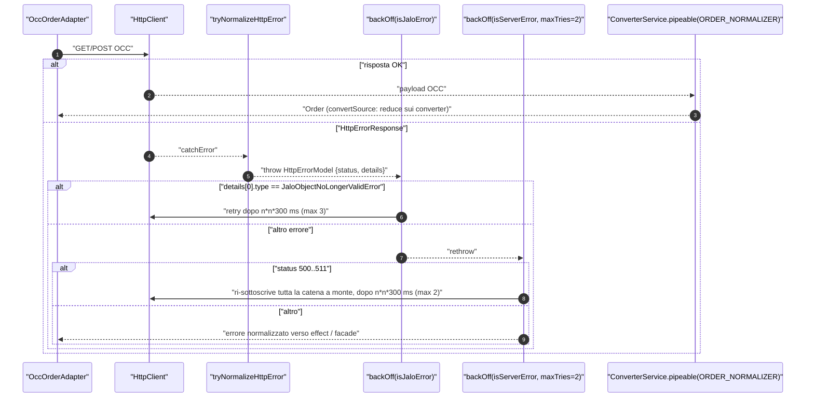
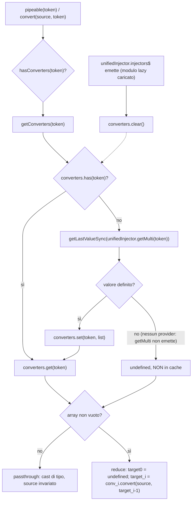
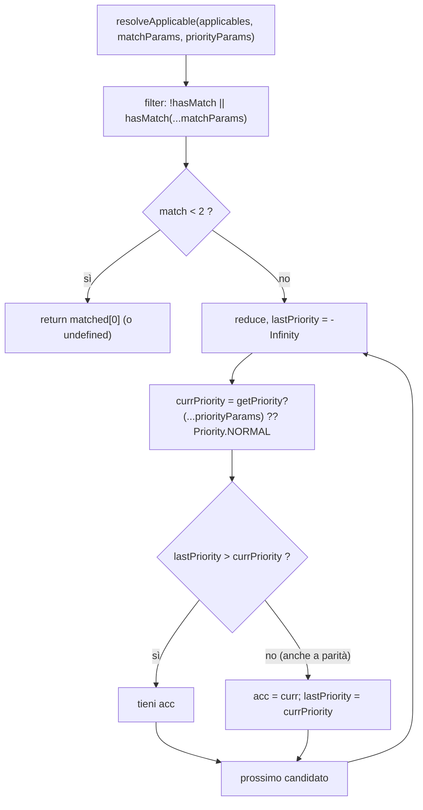
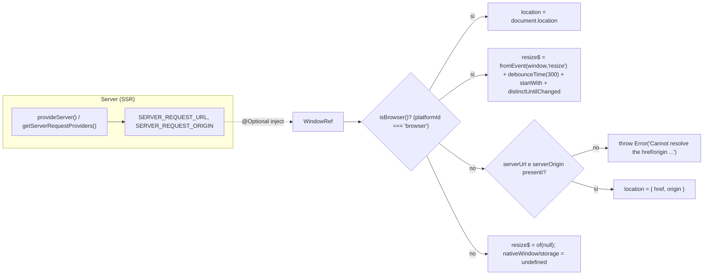
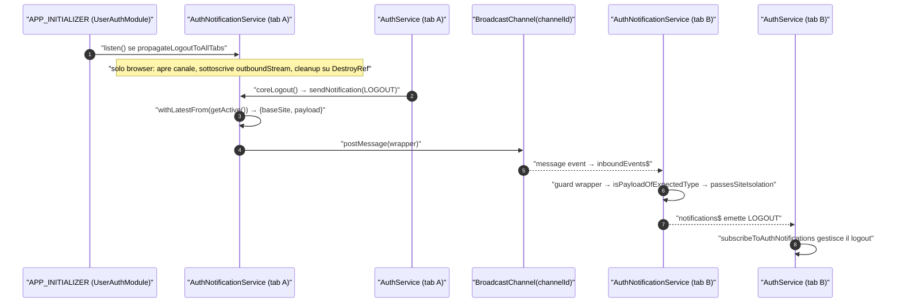

# 46 — Utility, window e modelli di dominio

> Riferimenti allo SHA `5b7a1c2bf2808d7380bc20596d10f4fa710c3da1` (vedi [00-meta](../00-meta.md)).

## 1. A cosa serve e perché esiste

Ogni capitolo precedente ha incontrato, quasi sempre senza fermarcisi, una manciata di "attrezzi" che `@spartacus/core` mette a disposizione di tutto il resto del framework: il `ConverterService` che normalizza le risposte OCC, `resolveApplicable` che sceglie l'handler giusto tra molti multi-provider, l'operatore `backOff` che ritenta le chiamate fallite, `tryNormalizeHttpError` che rende serializzabile un errore HTTP prima di metterlo in una action NgRx, `WindowRef` che permette di toccare `window` senza esplodere in SSR, e infine le decine di interfacce (`Product`, `Address`, `CmsComponent`, `BaseSite`, ...) che danno forma ai dati di dominio. Questo capitolo li raccoglie tutti e li smonta pezzo per pezzo.

Le tre cartelle coinvolte sono riesportate per intero dal `public_api.ts` di core (`core-libs/core/public_api.ts:L26-L36`):

- `core-libs/core/src/util/` — un barrel di 23 moduli (`core-libs/core/src/util/index.ts:L7-L29`) che spazia da pattern architetturali (Applicable, Converter, Command/Query) a operatori RxJS, encoding, regex, script loader, token SSR, helper di test;
- `core-libs/core/src/window/` — il solo `WindowRef` (`core-libs/core/src/window/index.ts:L7-L7`);
- `core-libs/core/src/model/` — 14 file di modelli di dominio (`core-libs/core/src/model/index.ts:L7-L20`), estendibili dalle feature lib tramite *module augmentation* TypeScript.

A questi si aggiungono due utility di `@spartacus/storefront` (`getAddressNumbers` e `FormUtils`), riesportate da `core-libs/storefront/utils/index.ts:L7-L9` tramite `core-libs/storefront/public_api.ts:L30-L30`.

Perché esistono come utility trasversali? Perché risolvono problemi che si ripetono in decine di feature:

| Problema ricorrente | Utility | Quanti la usano |
|---|---|---|
| Scegliere tra più implementazioni registrate come multi-provider | `resolveApplicable` | `PageMetaService`, `HttpErrorInterceptor`, `I18nextBackendService`, `ComponentHandlerService`, `LaunchDialogService` (`core-libs/core/src/cms/facade/page-meta.service.ts:L137-L137`, `core-libs/core/src/global-message/http-interceptors/http-error.interceptor.ts:L62-L64`) |
| Trasformare payload backend ↔ UI in modo componibile | `ConverterService` + `Converter` | tutti gli adapter OCC (es. `feature-libs/order/occ/adapters/occ-order.adapter.ts:L57-L65`) |
| Rendere un errore HTTP serializzabile per NgRx | `tryNormalizeHttpError` | 113 file non-spec (conteggio grep, dossier F66) |
| Accedere a `window`/storage/location in modo SSR-safe | `WindowRef` | 121 file non-spec (conteggio grep, dossier F94) |
| Estendere i tipi di dominio senza fork | `declare module '@spartacus/core'` | 90 file non-spec (conteggio grep, dossier F150) |

Due argomenti della cartella `util/` sono trattati altrove e qui solo richiamati: il pattern Command & Query (`core-libs/core/src/util/command-query/index.ts:L7-L8`) in [20 — Facade, command & query, eventi](../parte-2/20-facade-command-query-eventi.md), e `deepMerge` — che, nonostante il nome, **non** sta in `util/` ma in `core-libs/core/src/config/utils/deep-merge.ts:L18-L18` — in [11 — Configurazione](../parte-2/11-configurazione.md). `DirectiveStateTransferService`, pur riesportato dal barrel delle utility di storefront (`core-libs/storefront/utils/index.ts:L8-L8`), appartiene a [39 — SSR ottimizzato](../parte-2/39-ssr-ottimizzato.md).

## 2. Mappa dei file

| Path | Ruolo |
|---|---|
| `core-libs/core/src/util/index.ts` | barrel pubblico di util (23 export; **esclude** `glob-utils`) |
| `core-libs/core/src/util/applicable.ts` | `Priority`, `Applicable`, `resolveApplicable` |
| `core-libs/core/src/util/converter.service.ts` | interfaccia `Converter` e `ConverterService` (catena di converter con cache per token) |
| `core-libs/core/src/util/combined-injector.ts` | `CombinedInjector` (interno, usato da `LazyModulesService`) |
| `core-libs/core/src/util/create-from.ts` | `createFrom` (istanze di classi evento da dati) |
| `core-libs/core/src/util/glob-utils.ts` | glob → regex (interno, derivato dal service worker Angular) |
| `core-libs/core/src/util/glob.service.ts` | `GlobService.getValidator` (pubblico, usato dal routing) |
| `core-libs/core/src/util/base64.ts` | `encodeBase64` / `decodeBase64` UTF-8, opzione URL-safe |
| `core-libs/core/src/util/http-params-uri.encoder.ts` | `HttpParamsURIEncoder` (codec con `encodeURIComponent` puro) |
| `core-libs/core/src/util/is-key-invalid.ts` | guard anti prototype pollution (lancia) |
| `core-libs/core/src/util/normalize-empty.ts` | `normalizeEmpty`: `''` → `undefined` |
| `core-libs/core/src/util/regex-pattern.ts` | costanti regex email/password |
| `core-libs/core/src/util/java-reg-exp-converter/java-reg-exp-converter.ts` | `JavaRegExpConverter` (regex Java dei `urlPatterns` OCC → JS) |
| `core-libs/core/src/util/java-reg-exp-converter/index.ts` | barrel |
| `core-libs/core/src/util/occ-http-error-constants.ts` | enum `OccHttpErrorType`, `OccHttpErrorReason` (aumentabili) |
| `core-libs/core/src/util/occ-http-error-handlers.ts` | predicati `isJaloError`, `isServerError`, `isAuthorizationError` + costanti di retry |
| `core-libs/core/src/util/try-normalize-http-error.ts` | `tryNormalizeHttpError` (`HttpErrorResponse` → `HttpErrorModel`) |
| `core-libs/core/src/util/rxjs/index.ts` | barrel rxjs (esclude `buffer-debounce-time`) |
| `core-libs/core/src/util/rxjs/back-off.ts` | `backOff` (retry esponenziale) |
| `core-libs/core/src/util/rxjs/buffer-debounce-time.ts` | `bufferDebounceTime` (interno) |
| `core-libs/core/src/util/rxjs/get-last-value-sync.ts` | `getLastValueSync` |
| `core-libs/core/src/util/rxjs/unite-latest.ts` | `uniteLatest` (combineLatest con emissioni raggruppate) |
| `core-libs/core/src/util/rxjs/withdraw-on.ts` | `withdrawOn` (ri-sottoscrizione su notifier) |
| `core-libs/core/src/util/rxjs/wrap-into-observable.ts` | `wrapIntoObservable` |
| `core-libs/core/src/util/script-loader.service.ts` | `ScriptLoader`, `ScriptPlacement` |
| `core-libs/core/src/util/ssr.tokens.ts` | token `SERVER_REQUEST_URL`, `SERVER_REQUEST_ORIGIN` |
| `core-libs/core/src/util/browser-tab-notification/abstract-browser-tab-notification.service.ts` | classe base per notifiche cross-tab via `BroadcastChannel` |
| `core-libs/core/src/util/browser-tab-notification/index.ts` | barrel |
| `core-libs/core/src/util/type-guards.ts` | `isNotUndefined`, `isNotNullable` |
| `core-libs/core/src/util/type-utils.ts` | tipo `RequiredPick` |
| `core-libs/core/src/util/object-comparison-utils.ts` | `ObjectComparisonUtils` (shallow/deep equal) |
| `core-libs/core/src/util/time-utils.ts` | `TimeUtils` (offset timezone, conversioni data/datetime) |
| `core-libs/core/src/util/testing-time-utils.ts` | `TestingTimeUtils` (mock di `Date.prototype` per i test) |
| `core-libs/core/src/util/command-query/command.service.ts`, `query.service.ts`, `index.ts` | Command & Query (cap. 20) |
| `core-libs/core/src/window/window-ref.ts` | `WindowRef` |
| `core-libs/core/src/window/index.ts` | barrel |
| `core-libs/core/src/model/index.ts` | barrel dei modelli (**esclude** `unused.model.ts`) |
| `core-libs/core/src/model/misc.model.ts` | tipi trasversali: `User`, `Currency`, `Language`, `BaseSite`, `PaginationModel`, `ErrorModel`, `HttpErrorModel`, ... |
| `core-libs/core/src/model/product.model.ts` | `Product` e sottotipi, enum `VariantType`, `PriceType`, `ProductTypes` |
| `core-libs/core/src/model/product-search.model.ts` | `Facet`, `Breadcrumb`, `ProductSearchPage`, `ClearSearch` |
| `core-libs/core/src/model/image.model.ts` | `Images`, `ImageGroup`, `Image`, `ImageType` |
| `core-libs/core/src/model/cms.model.ts` | `CmsComponent`, `PageType` e interfacce dei componenti CMS standard |
| `core-libs/core/src/model/address.model.ts` | `Country`, `Region`, `Address`, `AddressValidation`, `CountryType` |
| `core-libs/core/src/model/consent.model.ts` | consensi, `ANONYMOUS_CONSENTS_HEADER` |
| `core-libs/core/src/model/org-unit.model.ts` | modelli B2B (`B2BUnit`, `B2BUser`, `CostCenter`, ruoli) |
| `core-libs/core/src/model/payment.model.ts` | `CardType`, `PaymentDetails` |
| `core-libs/core/src/model/point-of-service.model.ts` | `PointOfService`, orari di apertura |
| `core-libs/core/src/model/customer-coupon.model.ts` | coupon cliente |
| `core-libs/core/src/model/notification-preference.model.ts` | preferenze di notifica |
| `core-libs/core/src/model/product-interest.model.ts` | interessi di prodotto (back in stock) |
| `core-libs/core/src/model/scoped-data.ts` | `ScopedData<T>` |
| `core-libs/core/src/model/unused.model.ts` | tipi **non** esportati (`Catalog`, `Pagination`, `Sort`, `ProductList`, ...) |
| `core-libs/storefront/utils/index.ts` | barrel delle utility di storefront |
| `core-libs/storefront/utils/address-number-utils.ts` | `getAddressNumbers` |
| `core-libs/storefront/utils/form-utils.ts` | namespace `FormUtils` |

## 3. Come funziona passo per passo

### 3.1 La superficie pubblica e ciò che ne resta fuori

Prima di entrare nei singoli meccanismi conviene sapere **cosa è importabile** da `@spartacus/core`, perché il barrel di `util/` non espone tutto ciò che c'è nella cartella:

1. `public_api.ts` di core fa `export *` di `src/model/index`, `src/util/index` e `src/window/index` (`core-libs/core/public_api.ts:L26-L36`).
2. `util/index.ts` elenca 23 moduli (`core-libs/core/src/util/index.ts:L7-L29`). Manca `glob-utils`: `globToRegex`, `getGlobMatcher` e `processGlobPatterns` sono interni, è pubblico solo `GlobService` (`core-libs/core/src/util/index.ts:L13-L13`). Manca anche `combined-injector`: `CombinedInjector` non è riesportato da alcun barrel (dossier Q1).
3. `util/rxjs/index.ts` esporta `back-off`, `get-last-value-sync`, `unite-latest`, `withdraw-on`, `wrap-into-observable`, ma **non** `buffer-debounce-time` (`core-libs/core/src/util/rxjs/index.ts:L7-L11`). `bufferDebounceTime` è importato con path relativo solo dagli effect CMS e prodotto (`core-libs/core/src/cms/store/effects/components.effect.ts:L17-L17`, `core-libs/core/src/product/store/effects/product.effect.ts:L16-L16`).
4. `model/index.ts` esporta 14 file ma non `unused.model.ts` (`core-libs/core/src/model/index.ts:L7-L20`); quest'ultimo è importato solo da `customer-coupon.model.ts` e `product-interest.model.ts` per `Pagination` e `Sort` (`core-libs/core/src/model/customer-coupon.model.ts:L8-L8`, `core-libs/core/src/model/product-interest.model.ts:L8-L8`).

Le conseguenze per chi estende (non si può importare per nome ciò che non è nel barrel) sono discusse in [54 — API pubblica vs interna](../parte-3/54-upgrade-safe.md).

### 3.2 Applicable e `resolveApplicable`: scegliere il miglior candidato

Molti extension point di Spartacus sono **multi-provider**: più classi registrate sullo stesso token, di cui a runtime ne serve una sola. Il contratto è minimale:

1. L'enum `Priority` fissa quattro livelli: `FALLBACK = -50`, `LOW = -10`, `NORMAL = 0`, `HIGH = 10` (`core-libs/core/src/util/applicable.ts:L7-L24`).
2. L'interfaccia `Applicable` ha due metodi **entrambi opzionali**: `hasMatch?(...params)` e `getPriority?(...params): Priority | number` (`core-libs/core/src/util/applicable.ts:L32-L45`). Il tipo di ritorno `number` consente priorità intermedie (es. `Priority.NORMAL + 1`).
3. `resolveApplicable(applicables, matchParams, priorityParams)` filtra prima i candidati: passa chi non ha `hasMatch` (match implicito) o il cui `hasMatch(...matchParams)` è `true`; un array `null`/`undefined` è tollerato grazie a `applicables ?? []` (`core-libs/core/src/util/applicable.ts:L63-L70`).
4. Con 0 o 1 match restituisce subito `matchedApplicables[0]` — cioè il match o `undefined` — **senza** chiamare `getPriority` (`core-libs/core/src/util/applicable.ts:L72-L74`).
5. Con 2+ match esegue un `reduce`: chi non ha `getPriority` vale `Priority.NORMAL`; il candidato corrente viene scartato solo se `lastPriority > currPriority`, quindi a parità di priorità **vince l'ultimo**, cioè il provider registrato più tardi (`core-libs/core/src/util/applicable.ts:L76-L86`). Il JSDoc lo dice esplicitamente: "the applicable that was provided later wins" (`core-libs/core/src/util/applicable.ts:L47-L62`).

Gli usi concreti: `PageMetaService` sceglie il `PageMetaResolver` passando la pagina sia come match che come priority param (`core-libs/core/src/cms/facade/page-meta.service.ts:L137-L137`); `HttpErrorInterceptor` sceglie l'`HttpErrorHandler` per la risposta (`core-libs/core/src/global-message/http-interceptors/http-error.interceptor.ts:L62-L64`, vedi [41 — Errori HTTP](../parte-2/41-errori-global-message.md)); lo stesso schema compare in `I18nextBackendService`, `ComponentHandlerService` e `LaunchDialogService` (`core-libs/core/src/i18n/i18next/i18next-backend/i18next-backend.service.ts:L34-L36`, `core-libs/storefront/cms-structure/page/component/services/component-handler.service.ts:L52-L52`, `core-libs/storefront/layout/launch-dialog/services/launch-dialog.service.ts:L184-L184`).

### 3.3 Converter e `ConverterService`: normalize e serialize a catena

Il livello OCC (vedi [21 — Livello OCC](../parte-2/21-occ.md)) non consegna alla UI i payload grezzi del backend: li fa passare per converter registrati come multi-provider su un `InjectionToken`. Il motore è `ConverterService`.

1. **Contratto.** `Converter<SOURCE, TARGET>` ha un unico metodo `convert(source, target?)`. Il JSDoc distingue *Normalize* (backend → UI) e *Serialize* (UI → backend) e prevede che i converter si "impilino" per applicare personalizzazioni disaccoppiate (`core-libs/core/src/util/converter.service.ts:L13-L30`).
2. **Servizio.** `ConverterService` è `providedIn: 'root'`, implementa `OnDestroy` e dipende da `UnifiedInjector` (`core-libs/core/src/util/converter.service.ts:L32-L38`), l'aggregatore di injector root + lazy descritto in [12 — Feature module e lazy loading](../parte-2/12-feature-module-lazy.md).
3. **Cache e invalidazione.** La cache è una `Map<InjectionToken<Converter>, Converter[]>` privata (`core-libs/core/src/util/converter.service.ts:L47-L50`). Nel costruttore il servizio sottoscrive `unifiedInjector.injectors$` e svuota la cache a ogni nuovo injector, cioè ogni volta che viene caricato un modulo lazy che potrebbe portare converter aggiuntivi (`core-libs/core/src/util/converter.service.ts:L39-L44`). `ngOnDestroy` chiude la sottoscrizione (`core-libs/core/src/util/converter.service.ts:L139-L141`).
4. **Lookup.** `getConverters(token)` legge i multi-provider con `getLastValueSync(this.unifiedInjector.getMulti(token))` e mette in cache solo se il valore è definito (`core-libs/core/src/util/converter.service.ts:L52-L65`). `UnifiedInjector.getMulti` scarta le emissioni con array vuoto e accumula con `scan` le istanze di tutti gli injector; se trova un provider non-multi lancia `Multi-providers mixed with single providers` (`core-libs/core/src/lazy-loading/unified-injector.ts:L75-L95`).
5. **Presenza.** `hasConverters` è vero solo per un array non vuoto (`core-libs/core/src/util/converter.service.ts:L70-L75`).
6. **API di uso.**
   - `pipeable(token)` restituisce `map(convertSource)` se ci sono converter, altrimenti un operatore identità che fa solo un cast di tipo (`core-libs/core/src/util/converter.service.ts:L80-L88`);
   - `pipeableMany(token)` è l'analogo per array, via `convertMany` (`core-libs/core/src/util/converter.service.ts:L93-L101`);
   - `convert(source, token)` restituisce `source` invariato se non ci sono converter (`core-libs/core/src/util/converter.service.ts:L106-L112`);
   - `convertMany` converte solo se ci sono converter **e** `sources` è un array, altrimenti restituisce l'input (`core-libs/core/src/util/converter.service.ts:L117-L128`).
7. **La catena.** `convertSource` fa un `reduce` sui converter partendo da `target = undefined`: ogni converter riceve **lo stesso** `source` e il `target` prodotto dal precedente (`core-libs/core/src/util/converter.service.ts:L130-L137`). È il *populator pattern*: il primo converter crea l'oggetto UI, i successivi lo arricchiscono.

Uso tipico in un adapter: `catchError → tryNormalizeHttpError`, `backOff({ shouldRetry: isJaloError })`, poi `this.converter.pipeable(ORDER_NORMALIZER)` (`feature-libs/order/occ/adapters/occ-order.adapter.ts:L57-L65`). La ricetta per scrivere un converter custom è in [52 — Ricette OCC](../parte-3/52-ricette-occ-dati.md).

### 3.4 Errori HTTP OCC: normalizzazione, predicati e retry

Questa è la seconda metà della pipeline tipica di un adapter. Il "chi gestisce l'errore dopo" è in [41 — Errori HTTP, error handling, logger e global message](../parte-2/41-errori-global-message.md); qui interessa come l'errore viene **preparato**.

1. **Perché normalizzare.** Il JSDoc di `tryNormalizeHttpError` dichiara lo scopo: incorporare in modo sicuro gli errori HTTP nei payload delle action NgRx, eliminando le parti non serializzabili di `HttpErrorResponse` (`core-libs/core/src/util/try-normalize-http-error.ts:L12-L26`). La funzione restituisce l'errore normalizzato o, in mancanza, l'originale: `normalizeHttpError(error, logger) ?? error`.
2. **Il modello.** `HttpErrorModel` è una `class`, non un'interfaccia, proprio per poter essere riconosciuta con `instanceof` (`core-libs/core/src/model/misc.model.ts:L100-L106`, `core-libs/core/src/util/try-normalize-http-error.ts:L33-L33`). I suoi `details` sono `ErrorModel[]` con `message`, `reason`, `subject`, `subjectType`, `type` (`core-libs/core/src/model/misc.model.ts:L92-L98`).
3. **Conversione.** `normalizeHttpError` restituisce invariato un `HttpErrorModel`; da un `HttpErrorResponse` crea un `HttpErrorModel` copiando `message`, `status`, `statusText`, `url` (`core-libs/core/src/util/try-normalize-http-error.ts:L33-L42`).
4. **Dettagli backend.** I `details` vengono da `error.error.errors` (formato errori OCC) oppure, se `error.error.error` è una stringa (formato OAuth), da `{ type: error, message: error_description }` (`core-libs/core/src/util/try-normalize-http-error.ts:L44-L54`).
5. **Altri errori.** Per qualunque altro tipo, in dev mode logga con `logger.error(...)` e restituisce `undefined`, così `tryNormalizeHttpError` restituisce l'errore originale (`core-libs/core/src/util/try-normalize-http-error.ts:L59-L65`).
6. **Predicati.** `isJaloError` verifica `err.details?.[0]?.type === 'JaloObjectNoLongerValidError'` (`core-libs/core/src/util/occ-http-error-handlers.ts:L12-L14`); `isServerError` è vero per status 500..511, `isAuthorizationError` per 401 (`core-libs/core/src/util/occ-http-error-handlers.ts:L19-L28`). Le costanti `DEFAULT_SERVER_ERROR_RETRIES_COUNT = 2` e `DEFAULT_AUTHORIZATION_ERROR_RETRIES_COUNT = 2` (`core-libs/core/src/util/occ-http-error-handlers.ts:L30-L31`) sono usate come `maxTries` di un `backOff`: per esempio `OccOrderAdapter` concatena un secondo `backOff({ shouldRetry: isServerError, maxTries: DEFAULT_SERVER_ERROR_RETRIES_COUNT })` dopo quello per Jalo (`feature-libs/order/occ/adapters/occ-order.adapter.ts:L92-L102`), e il servizio OPF degli hosted fields usa la coppia `isAuthorizationError` / `DEFAULT_AUTHORIZATION_ERROR_RETRIES_COUNT` (`integration-libs/opf/payment/core/services/opf-payment-hosted-fields.service.ts:L119-L122`).
7. **Enum aumentabili.** `OccHttpErrorType` (`NotFoundError`, `ClassMismatchError`) e `OccHttpErrorReason` (`notFound`) (`core-libs/core/src/util/occ-http-error-constants.ts:L9-L16`) stanno nel blocco `AUGMENTABLE_TYPES_START/END` del public_api (`core-libs/core/public_api.ts:L54-L57`): una feature lib può aggiungere valori di tipo.

### 3.5 `backOff` e gli altri operatori RxJS

1. **`backOff(options)`.** Default: `shouldRetry = () => true`, `maxTries = 3`, `delay = 300` ms (`core-libs/core/src/util/rxjs/back-off.ts:L39-L42`). L'implementazione usa `retry({ delay })` di RxJS: dentro la callback, se `currentRetry > maxTries` o `!shouldRetry(err)` rilancia l'errore, altrimenti restituisce `timer(currentRetry² × delay)` (`core-libs/core/src/util/rxjs/back-off.ts:L44-L61`). In RxJS 7.8.2 `retry` senza `count` usa `count = Infinity` e passa a `delay` il contatore già incrementato, per cui il primo retry ha `currentRetry = 1` (`deps:rxjs-7.8.2/package/dist/cjs/internal/operators/retry.js:L20-L20`, `deps:rxjs-7.8.2/package/dist/cjs/internal/operators/retry.js:L34-L34`, `deps:rxjs-7.8.2/package/dist/cjs/internal/operators/retry.js:L46-L46`). Con i default si hanno quindi 3 retry, con attese di 300 + 1200 + 2700 = 4200 ms, esattamente come dice il JSDoc di `delay` (`core-libs/core/src/util/rxjs/back-off.ts:L26-L26`).
2. **`bufferDebounceTime(time = 0, scheduler?)`** (interno) accumula i valori in un array e li emette in blocco dopo il `debounceTime`, poi azzera il buffer; il buffer vive nella closure creata per ogni subscription (`core-libs/core/src/util/rxjs/buffer-debounce-time.ts:L10-L24`). È ciò che permette agli effect CMS/prodotto di accorpare più richieste di caricamento in una sola chiamata (vedi [15 — CMS core](../parte-2/15-cms-core.md) e [24 — Prodotto e ricerca](../parte-2/24-product-search.md)).
3. **`getLastValueSync(source)`** sottoscrive e disiscrive subito, restituendo l'ultimo valore emesso **in modo sincrono** o `undefined`; il JSDoc lo sconsiglia per l'uso generale (`core-libs/core/src/util/rxjs/get-last-value-sync.ts:L9-L23`). Lo usano `ConverterService.getConverters` (§3.3) e `HttpErrorInterceptor` per leggere gli handler (`core-libs/core/src/global-message/http-interceptors/http-error.interceptor.ts:L62-L64`).
4. **`uniteLatest(sources)`** è `combineLatest(sources).pipe(audit(() => trigger))` dentro un `defer`: la prima emissione è sincrona, le successive sono raggruppate e schedulate con `asapScheduler` (`core-libs/core/src/util/rxjs/unite-latest.ts:L26-L47`). Il JSDoc spiega lo scopo: se più sorgenti emettono "nello stesso momento", `uniteLatest` emette una sola volta dove `combineLatest` emetterebbe una volta per sorgente (`core-libs/core/src/util/rxjs/unite-latest.ts:L15-L25`). Usato da `PageMetaService` e `ProductLoadingService` (`core-libs/core/src/cms/facade/page-meta.service.ts:L99-L99`, `core-libs/core/src/product/services/product-loading.service.ts:L75-L75`).
5. **`withdrawOn(notifier)`** riscrive lo stream come `notifier.pipe(startWith(undefined), switchMap(() => source))`: a ogni emissione del notifier la sorgente viene ri-sottoscritta, abbandonando la trasformazione in corso (`core-libs/core/src/util/rxjs/withdraw-on.ts:L19-L27`).
6. **`wrapIntoObservable(value)`** restituisce l'Observable così com'è, converte un thenable con `from(Promise.resolve(value))`, altrimenti `of(value)`; `isPromise` è duck typing su `then` (`core-libs/core/src/util/rxjs/wrap-into-observable.ts:L17-L36`). `GuardsComposer` lo usa per normalizzare il risultato di `canActivate` (`core-libs/storefront/cms-structure/services/guards-composer.ts:L65-L65`).

### 3.6 `CombinedInjector` e `createFrom`

1. `CombinedInjector` implementa `Injector` combinando un `mainInjector` con una lista di `complementaryInjectors`; il JSDoc lo indica per istanziare moduli lazy che devono vedere le istanze dei propri moduli di dipendenza (`core-libs/core/src/util/combined-injector.ts:L17-L35`).
2. Se riceve l'opzione `self` restituisce `notFoundValue` se fornito, altrimenti lancia: non supporta dipendenze `@Self` (`core-libs/core/src/util/combined-injector.ts:L44-L51`).
3. La risoluzione procede in tre passi — (a) a livello `self` in ogni complementary injector, in ordine; (b) a tutti i livelli in ogni complementary injector; (c) fallback a `mainInjector.get(token, notFoundValue)` — usando come sentinella l'oggetto privato `NOT_FOUND_SYMBOL = {}` (`core-libs/core/src/util/combined-injector.ts:L15-L15`, `core-libs/core/src/util/combined-injector.ts:L53-L70`).
4. `LazyModulesService` lo crea solo quando ci sono **2+** moduli di dipendenza; con uno usa direttamente il suo injector, con zero il proprio (`core-libs/core/src/lazy-loading/lazy-modules.service.ts:L83-L94`). Il contesto completo è in [12 — Feature module e lazy loading](../parte-2/12-feature-module-lazy.md).
5. `createFrom(type, data)` è un one-liner: `Object.assign(new type(), data)`; serve a creare istanze di classi evento (`core-libs/core/src/util/create-from.ts:L15-L17`; eventi in [20](../parte-2/20-facade-command-query-eventi.md)).

### 3.7 Glob: pattern di URL per il routing

1. `glob-utils.ts` porta il copyright Google/Angular: è derivato dal service worker di Angular (`core-libs/core/src/util/glob-utils.ts:L1-L7`).
2. Le regole di escaping trasformano `.` → `\.`, `+` → `\+`, `*` → `[^/]*` e `?` → `[^/]` (o `\?` con `literalQuestionMark`) (`core-libs/core/src/util/glob-utils.ts:L9-L24`).
3. `globToRegex` lavora per segmenti separati da `/`: `**` diventa `(?:.+\/)?` se non è l'ultimo segmento, `.*` se lo è; gli altri segmenti vengono escapati e uniti con `\/` (`core-libs/core/src/util/glob-utils.ts:L38-L64`).
4. `processGlobPatterns` marca come negativo un pattern che inizia con `!`, lo rimuove e ancora la regex con `^...$`; chiama `globToRegex(url)` senza `literalQuestionMark` (`core-libs/core/src/util/glob-utils.ts:L91-L99`).
5. `getGlobMatcher` restituisce un predicato vero se almeno un pattern positivo matcha e nessun negativo matcha (`core-libs/core/src/util/glob-utils.ts:L71-L86`); `GlobService.getValidator` (root, pubblico) duplica la stessa logica (`core-libs/core/src/util/glob.service.ts:L10-L32`).
6. Il consumatore è `UrlMatcherService.getFromGlob`, che costruisce un `UrlMatcher` Angular ricomponendo il path completo `/seg1/seg2` e testandolo col validator (`core-libs/core/src/routing/services/url-matcher.service.ts:L178-L190`; routing in [14](../parte-2/14-routing.md)).

### 3.8 Encoding, sicurezza e regex

1. **Base64.** `encodeBase64` codifica UTF-8 con `TextEncoder`, poi `btoa` su una binary string; con `urlSafe` applica l'alfabeto RFC 4648 §5 (`core-libs/core/src/util/base64.ts:L16-L29`). `toUrlSafe` sostituisce `+`→`-`, `/`→`_` e rimuove il padding `=` (`core-libs/core/src/util/base64.ts:L54-L59`). `decodeBase64` inverte: ripristina alfabeto e padding, `atob`, poi `TextDecoder` (`core-libs/core/src/util/base64.ts:L31-L52`). Unico consumatore: `FederatedLoginContextSerializerService`, con `urlSafe: true` (`core-libs/core/src/federated-login/services/federated-login-context-serializer.service.ts:L8-L8`, `core-libs/core/src/federated-login/services/federated-login-context-serializer.service.ts:L27-L27`).
2. **`HttpParamsURIEncoder`** implementa `HttpParameterCodec` con solo `encodeURIComponent`/`decodeURIComponent`, perché l'encoder di default di Angular "de-codifica" alcuni caratteri ammessi da RFC 3986 (`core-libs/core/src/util/http-params-uri.encoder.ts:L7-L23`). È usato in `OccEndpointsService` per i query param degli URL OCC e negli adapter di pagamento checkout (`core-libs/core/src/occ/services/occ-endpoints.service.ts:L126-L126`, `feature-libs/checkout/base/occ/adapters/occ-checkout-payment.adapter.ts:L203-L203`).
3. **`isKeyInvalid(key)`** non restituisce un boolean: lancia `Error` se la chiave è `__proto__`, `constructor` o `prototype` (`core-libs/core/src/util/is-key-invalid.ts:L17-L27`). `ProductLoadingService` lo chiama su `productCode` prima di indicizzare la sua cache interna (`core-libs/core/src/product/services/product-loading.service.ts:L50-L50`, `core-libs/core/src/product/services/product-loading.service.ts:L59-L59`).
4. **`normalizeEmpty`** converte `''` in `undefined` per poter usare `??` (`core-libs/core/src/util/normalize-empty.ts:L14-L18`); lo usa per esempio il riepilogo OPF B2B checkout (`integration-libs/opf/b2b-checkout/components/opf-b2b-checkout-review/opf-b2b-checkout-review.component.ts:L149-L149`).
5. **Regex.** `regex-pattern.ts` esporta `EMAIL_PATTERN`, `PASSWORD_PATTERN` (maiuscola + cifra + speciale, almeno 6), pattern atomici per i requisiti password, `STRONG_PASSWORD_PATTERN`, `SECURE_PASSWORD_PATTERN` (8-128, nessun carattere ripetuto consecutivo) e `ENDS_WITH_LEGAL_CHARACTER_PATTERN` (`core-libs/core/src/util/regex-pattern.ts:L7-L36`).

### 3.9 `JavaRegExpConverter`: dal `BaseSite` OCC all'URL corrente

1. `JavaRegExpConverter` è `providedIn: 'root'` e inietta `LoggerService` con `inject()` (`core-libs/core/src/util/java-reg-exp-converter/java-reg-exp-converter.ts:L10-L12`).
2. La regex `EXTRACT_JAVA_REGEXP_MODIFIERS` estrae un prefisso opzionale `(?modifiers)` di sole lettere minuscole e il resto del pattern (`core-libs/core/src/util/java-reg-exp-converter/java-reg-exp-converter.ts:L14-L29`).
3. `toJsRegExp` passa i modificatori Java **così come sono** come flag JS (`new RegExp(jsSyntax, modifiers)`); se il costruttore lancia restituisce `null` e, solo in dev mode, logga un warning (`core-libs/core/src/util/java-reg-exp-converter/java-reg-exp-converter.ts:L42-L58`).
4. Il consumatore è `SiteContextConfigInitializer.isCurrentBaseSite`, che testa l'URL corrente contro gli `urlPatterns` del `BaseSite` restituito da OCC (`core-libs/core/src/site-context/config/config-loader/site-context-config-initializer.ts:L100-L106`; `BaseSite.urlPatterns` in `core-libs/core/src/model/misc.model.ts:L116-L133`). Il flusso di inizializzazione del site context è in [13 — Site context](../parte-2/13-site-context-theme.md).

### 3.10 `ScriptLoader`: script di terze parti, SSR-aware

1. `ScriptPlacement` ha `HEAD = 'head'` e `BODY = 'body'`; `ScriptLoader` è root e inietta `DOCUMENT` e `PLATFORM_ID` (`core-libs/core/src/util/script-loader.service.ts:L10-L22`).
2. `embedScript` accetta `src`, `params`, `attributes`, `callback`, `errorCallback`, `placement` (default `HEAD`), `disableKeyRestriction` (`core-libs/core/src/util/script-loader.service.ts:L36-L53`).
3. In SSR lo script **non** viene aggiunto se ci sono `callback` o `errorCallback` (non avrebbero senso sul server); nel browser non viene aggiunto se esiste già uno `script[src="..."]` identico; in SSR il controllo dei duplicati è saltato (`core-libs/core/src/util/script-loader.service.ts:L55-L63`).
4. Lo script creato ha sempre `async = true` e `defer = true` (`core-libs/core/src/util/script-loader.service.ts:L65-L68`).
5. Gli `attributes` con chiave `data-*` — o, con `disableKeyRestriction`, qualsiasi chiave che non sia già una proprietà di `HTMLScriptElement` — diventano attributi via `setAttribute`; tutte le altre sono assegnate come proprietà DOM (`core-libs/core/src/util/script-loader.service.ts:L70-L82`).
6. `callback`/`errorCallback` sono agganciati a `load`/`error` e lo script è appeso a `head` o `body` (`core-libs/core/src/util/script-loader.service.ts:L84-L93`). `hasScript` usa `querySelector('script[src="..."]')` e `parseParams` costruisce `?k=v&...` con `encodeURI` (`core-libs/core/src/util/script-loader.service.ts:L99-L121`).

### 3.11 `WindowRef` e i token SSR

`WindowRef` è il modo canonico di toccare il "mondo browser" in Spartacus. Il funzionamento è interamente guidato da `PLATFORM_ID` e dai due token di `ssr.tokens.ts`:

1. `SERVER_REQUEST_URL` e `SERVER_REQUEST_ORIGIN` sono `InjectionToken<string>` **senza** factory di default (`core-libs/core/src/util/ssr.tokens.ts:L12-L21`). Lato server li forniscono `provideServer()` (factory basate sulle `ServerOptions`) e `getServerRequestProviders()` (factory sulla `REQUEST` Express) (`core-libs/setup/ssr/providers/ssr-providers.ts:L27-L37`, `core-libs/setup/ssr/providers/ssr-providers.ts:L53-L65`; dettagli in [39](../parte-2/39-ssr-ottimizzato.md)).
2. `WindowRef` è root; inietta `DOCUMENT`, `PLATFORM_ID` e, come `@Optional`, i due token; espone `readonly document: Document` (`core-libs/core/src/window/window-ref.ts:L13-L27`). In Angular 21 `DOCUMENT` di `@angular/common` è una riesportazione di quello di `@angular/core` (`angular:packages/common/src/common.ts:L116-L116`).
3. `isBrowser()` delega a `isPlatformBrowser(platformId)`, che confronta con la stringa `'browser'` (`core-libs/core/src/window/window-ref.ts:L33-L35`, `angular:packages/common/src/platform_id.ts:L9-L9`, `angular:packages/common/src/platform_id.ts:L16-L18`).
4. `nativeWindow` restituisce il `window` globale solo nel browser, altrimenti `undefined` (`core-libs/core/src/window/window-ref.ts:L41-L44`); `sessionStorage` e `localStorage` sono getter che passano da `nativeWindow` e restituiscono `undefined` in SSR (`core-libs/core/src/window/window-ref.ts:L50-L60`).
5. `location` nel browser restituisce `document.location`; in SSR restituisce un `Partial<Location>` con soli `href` (da `SERVER_REQUEST_URL`) e `origin` (da `SERVER_REQUEST_ORIGIN`), e **lancia** se uno dei due manca (`core-libs/core/src/window/window-ref.ts:L70-L89`).
6. `resize$` in SSR emette `of(null)`; nel browser è `fromEvent(window, 'resize')` con `debounceTime(300)`, `startWith({ target: window })` e `distinctUntilChanged()` (`core-libs/core/src/window/window-ref.ts:L97-L107`). È la sorgente da cui parte il `BreakpointService` (`core-libs/storefront/layout/breakpoint/breakpoint.service.ts:L41-L41`; vedi [18 — Layout e breakpoint](../parte-2/18-layout-breakpoint-a11y.md)), e lo usano anche carousel e popover (`core-libs/storefront/shared/components/carousel/carousel.service.ts:L33-L33`, `core-libs/storefront/shared/components/popover/popover.component.ts:L239-L239`).

### 3.12 `AbstractBrowserTabNotificationService`: messaggi tra tab

Classe base generica per comunicare tra più tab dello stesso storefront tramite `BroadcastChannel`.

1. **Formato di trasporto.** `TabNotificationWrapper<T>` è `{ baseSite, payload }`; `isTabNotificationWrapperEvent` è un type guard che verifica che `event.data` sia un oggetto con entrambe le chiavi (`core-libs/core/src/util/browser-tab-notification/abstract-browser-tab-notification.service.ts:L14-L34`).
2. **Contratto per le sottoclassi.** Vanno definiti `channelId` (nome del canale) e `isPayloadOfExpectedType`; `isolateBySite` vale `true` di default; la classe inietta `BaseSiteService`, `LoggerService`, `WindowRef`, `DestroyRef` (`core-libs/core/src/util/browser-tab-notification/abstract-browser-tab-notification.service.ts:L49-L58`).
3. **Uscita.** Un `Subject` interno viene avvolto con il base site attivo (`withLatestFrom(getActive())`) e pubblicato con `channel?.postMessage` (`core-libs/core/src/util/browser-tab-notification/abstract-browser-tab-notification.service.ts:L60-L67`).
4. **Entrata.** `notifications$` applica in sequenza: guard del wrapper, `isPayloadOfExpectedType`, estrazione di `data`, confronto col base site attivo, estrazione del `payload` (`core-libs/core/src/util/browser-tab-notification/abstract-browser-tab-notification.service.ts:L73-L84`); `passesSiteIsolation` è `!this.isolateBySite || currentBaseSite === wrapper.baseSite` (`core-libs/core/src/util/browser-tab-notification/abstract-browser-tab-notification.service.ts:L122-L127`).
5. **Avvio.** `listen()` agisce solo nel browser: apre il canale, inoltra i `message` su `inboundEvents$`, sottoscrive lo stream in uscita e registra su `DestroyRef` chiusura e disiscrizione; eventuali eccezioni sono loggate come warning (`core-libs/core/src/util/browser-tab-notification/abstract-browser-tab-notification.service.ts:L93-L111`).
6. **Invio.** `sendNotification` spinge sul `Subject`: se `listen()` non è stato chiamato il payload viene scartato in silenzio, e il JSDoc lo documenta (`core-libs/core/src/util/browser-tab-notification/abstract-browser-tab-notification.service.ts:L113-L120`).
7. **Unica sottoclasse.** `AuthNotificationService` accetta solo stringhe dell'enum `AuthNotificationType` (`core-libs/core/src/auth/user-auth/facade/auth-notification.service.ts:L26-L39`). Il suo `listen()` è chiamato da un initializer solo se il feature toggle `propagateLogoutToAllTabs` è attivo, e `AuthService.coreLogout` invia `LOGOUT` sotto lo stesso toggle (`core-libs/core/src/auth/user-auth/user-auth.module.ts:L85-L92`, `core-libs/core/src/auth/user-auth/facade/auth.service.ts:L195-L199`); la ricezione è gestita in `AuthService.subscribeToAuthNotifications` (`core-libs/core/src/auth/user-auth/facade/auth.service.ts:L240-L247`). Contesto in [22 — Autenticazione](../parte-2/22-auth.md) e [42 — Feature toggle](../parte-2/42-feature-toggle-deprecazioni.md).

### 3.13 Helper vari: type guard, tipi, confronto, tempo

- `isNotUndefined` controlla `typeof value !== 'undefined'`; `isNotNullable` aggiunge `value !== null` e restringe a `NonNullable<T>` (`core-libs/core/src/util/type-guards.ts:L7-L13`) — utili come predicati di `filter` in RxJS.
- `RequiredPick<T, K>` rende obbligatorie le chiavi `K` lasciando invariate le altre: `Omit<T, K> & Required<Pick<T, K>>` (`core-libs/core/src/util/type-utils.ts:L7-L11`).
- `ObjectComparisonUtils.shallowEqualObjects` confronta con `===` le chiavi proprie e il loro numero (`core-libs/core/src/util/object-comparison-utils.ts:L8-L30`); `deepEqualObjects` richiede che entrambi siano `instanceof Object` con lo stesso `constructor` e confronta ricorsivamente le proprietà proprie in entrambe le direzioni (`core-libs/core/src/util/object-comparison-utils.ts:L32-L75`); `countOfDeepEqualObjects` e `indexOfFirstOccurrence` lavorano su array (`core-libs/core/src/util/object-comparison-utils.ts:L77-L92`).
- `TimeUtils.getLocalTimezoneOffset(invert?)` produce `±HH:MM` dall'offset del browser, invertendo il segno di `getTimezoneOffset` (`core-libs/core/src/util/time-utils.ts:L16-L24`); `convertDateToDatetime` aggiunge `T00:00:00` o `T23:59:59` più l'offset, `convertDatetimeToDate` fa il percorso inverso restituendo `YYYY-MM-DD` (`core-libs/core/src/util/time-utils.ts:L26-L38`).
- `TestingTimeUtils` — esportato nell'API pubblica (`core-libs/core/src/util/index.ts:L25-L25`) — sostituisce temporaneamente `Date.prototype.toLocaleTimeString` o `getTimezoneOffset`, esegue la callback e ripristina l'originale (`core-libs/core/src/util/testing-time-utils.ts:L7-L21`).
- In storefront, `getAddressNumbers(address, textPhone, textMobile)` produce la riga dei recapiti: solo mobile se `cellphone === phone`, entrambe le righe separate da `\n` se diversi, solo quella presente, oppure `undefined` (`core-libs/storefront/utils/address-number-utils.ts:L12-L33`). `FormUtils.deepUpdateValueAndValidity` ricorre su `UntypedFormGroup`/`UntypedFormArray` e chiama `updateValueAndValidity({ onlySelf: true, emitEvent })` su ogni controllo, figli prima del genitore (`core-libs/storefront/utils/form-utils.ts:L16-L52`).

### 3.14 I modelli di dominio

I file di `model/` sono quasi solo **tipi**: interfacce TypeScript che descrivono i dati "UI" (cioè già normalizzati dai converter OCC) consumati da facade e componenti.

1. **Opzionalità quasi totale.** Le proprietà sono praticamente tutte opzionali (`?`), con poche eccezioni come `ListModel.ids`, `EntitiesModel.values` (`core-libs/core/src/model/misc.model.ts:L60-L71`), `SiteTheme.*` (`core-libs/core/src/model/misc.model.ts:L135-L143`) e `CmsPickupItemDetails.*` (`core-libs/core/src/model/cms.model.ts:L249-L252`). La scelta riflette i payload OCC, che variano in base ai `fields` richiesti.
2. **`misc.model.ts`** definisce i tipi trasversali: `Currency`, `Time`, `GeoPoint`, `Language`, `Principal`, `User`, `ListModel`, `EntitiesModel<T>`, `PaginationModel`, `SortModel`, `Title`, `ErrorModel`, `HttpErrorModel`, `BaseStore`, `BaseSite`, `CaptchaConfig`, `SiteTheme` (`core-libs/core/src/model/misc.model.ts:L10-L143`). `BaseSite` include `urlPatterns` (regex Java, §3.9), `urlEncodingAttributes`, `requiresAuthentication`, `isolated`, `captchaConfig`, `theme` (`core-libs/core/src/model/misc.model.ts:L116-L133`). `PaginationModel` e `SortModel` sono i modelli UI di paginazione e ordinamento, distinti da `Pagination`/`Sort` di `unused.model.ts` (`core-libs/core/src/model/misc.model.ts:L73-L85`, `core-libs/core/src/model/unused.model.ts:L33-L43`).
3. **Prodotto.** `Product` raccoglie i campi OCC (codice, nome, `slug`, immagini, prezzi, stock, varianti, classificazioni, riferimenti, recensioni, promozioni) più `sapUnit` e `productTypes` (`core-libs/core/src/model/product.model.ts:L167-L210`); `slug` è documentato come base per gli URL "pretty" della PDP (`core-libs/core/src/model/product.model.ts:L181-L186`). Enum: `VariantType`, `PriceType`, `VariantQualifier`, `ProductTypes` (`core-libs/core/src/model/product.model.ts:L57-L66`, `core-libs/core/src/model/product.model.ts:L222-L230`, `core-libs/core/src/model/product.model.ts:L267-L271`). `ProductReferences` e `Images` sono dizionari indicizzati per stringa; `ImageGroup` è indicizzato per formato (`core-libs/core/src/model/product.model.ts:L157-L159`, `core-libs/core/src/model/image.model.ts:L7-L9`, `core-libs/core/src/model/image.model.ts:L41-L43`). `Image.width`/`height` non vengono dal CMS: sono stati aggiunti per impostare manualmente le dimensioni nel `MediaComponent` (`core-libs/core/src/model/image.model.ts:L18-L33`). `PointOfServiceStock` ripete i campi di `PointOfService` aggiungendo `stockInfo` invece di estenderlo (`core-libs/core/src/model/product.model.ts:L232-L247`).
4. **Ricerca.** `Facet` documenta `expanded`, `topValueCount` e `topValues` (duplicato OCC normalizzato in `topValueCount`) (`core-libs/core/src/model/product-search.model.ts:L43-L60`); `ProductSearchPage` usa `PaginationModel`/`SortModel` e contiene `breadcrumbs`, `facets`, `freeTextSearch`, `keywordRedirectUrl`, `spellingSuggestion` (`core-libs/core/src/model/product-search.model.ts:L68-L79`); `ClearSearch` ha `clearPageResults` e `clearSearchboxResults` (`core-libs/core/src/model/product-search.model.ts:L85-L88`).
5. **CMS.** `CmsComponent` è la base dei dati di ogni componente CMS: `uid`, `typeCode`, `name`, `modifiedTime`, `otherProperties`, `composition.inner`, `styleClasses` (`core-libs/core/src/model/cms.model.ts:L7-L32`). `PageType` ha `ContentPage`, `ProductPage`, `CategoryPage`, `CatalogPage` (`core-libs/core/src/model/cms.model.ts:L38-L43`). Il file prosegue con le interfacce dei componenti standard che estendono `CmsComponent` — link, search box, paragraph, banner, carousel, navigation, add to cart, video, pickup item details, ... (`core-libs/core/src/model/cms.model.ts:L45-L252`). Molti attributi semanticamente booleani o liste sono tipizzati `string`, riflettendo il payload CMS di OCC (`core-libs/core/src/model/cms.model.ts:L88-L92`, `core-libs/core/src/model/cms.model.ts:L137-L144`, `core-libs/core/src/model/cms.model.ts:L219-L224`). I media di banner e video possono essere singoli o responsive (`desktop`, `mobile`, `tablet`, `widescreen`) (`core-libs/core/src/model/cms.model.ts:L106-L117`). Come questi dati arrivano ai componenti è in [15](../parte-2/15-cms-core.md) e [16](../parte-2/16-cms-rendering.md).
6. **Indirizzi, consensi, B2B, pagamenti, punti vendita.** `Address` con `titleCode`, `line1/2`, `town`, `postalCode`, `region`, `country`, `cellphone`, `phone`, `defaultAddress`, `visibleInAddressBook`, `formattedAddress`, ... (`core-libs/core/src/model/address.model.ts:L38-L67`); `CountryType` e `AddressValidation` (`core-libs/core/src/model/address.model.ts:L14-L17`, `core-libs/core/src/model/address.model.ts:L69-L74`). `consent.model.ts` definisce consensi, consensi anonimi, `ANONYMOUS_CONSENT_STATUS` e la costante `ANONYMOUS_CONSENTS_HEADER = 'X-Anonymous-Consents'` (`core-libs/core/src/model/consent.model.ts:L7-L32`), letta dall'interceptor dei consensi anonimi (`core-libs/core/src/anonymous-consents/http-interceptors/anonymous-consents-interceptor.ts:L61-L61`). `org-unit.model.ts` definisce `CostCenter`, `B2BUnit`, `B2BUser extends User`, `B2BApprovalProcess`, `B2BUserRole`, `B2BUserRight` (`core-libs/core/src/model/org-unit.model.ts:L11-L49`). `PaymentDetails` (`core-libs/core/src/model/payment.model.ts:L13-L28`), `PointOfService` e `OpeningSchedule` (`core-libs/core/src/model/point-of-service.model.ts:L11-L49`).
7. **Modelli "my account".** `customer-coupon.model.ts`, `notification-preference.model.ts` e `product-interest.model.ts` (`core-libs/core/src/model/customer-coupon.model.ts:L10-L36`, `core-libs/core/src/model/notification-preference.model.ts:L7-L16`, `core-libs/core/src/model/product-interest.model.ts:L10-L29`).
8. **`ScopedData<T>`** avvolge un `data$` Observable con lo `scope` associato (`core-libs/core/src/model/scoped-data.ts:L9-L15`): `ScopedProductData` la estende per il caricamento di prodotto per scope (`core-libs/core/src/product/connectors/product/scoped-product-data.ts:L13-L13`; vedi [24](../parte-2/24-product-search.md)).

### 3.15 Module augmentation dei modelli

I modelli sono interfacce proprio perché TypeScript permette di **fonderle** (declaration merging) da qualsiasi altro file, a patto di rientrare nel modulo giusto:

1. Una feature lib scrive `declare module '@spartacus/core' { interface Product { ... } }`; 90 file non-spec del repo lo fanno (dossier F150). Esempi: product-configurator aggiunge a `Product` i campi `configurable` e `configuratorType` (`feature-libs/product-configurator/common/core/model/augmented-core.model.ts:L8-L13`); organization aggiunge a `B2BUnit` `parentOrgUnit`, `approvalProcess`, `administrators`, ... (`feature-libs/organization/administration/core/model/augmented-core.model.ts:L9-L25`).
2. Il public_api di core racchiude tra i commenti `AUGMENTABLE_TYPES_START/END` un blocco di re-export espliciti: `AuthToken`, `Config`, `Address`, `B2BUnit`, `B2BUser`, `B2BUserRole`, `CostCenter`, `Facet`, `ProductSearchPage`, `Price`, `Product`, `Stock`, `OccHttpError*`, ... (`core-libs/core/public_api.ts:L38-L58`).
3. Esiste un builder `augmented-types` che sposta quel blocco dal d.ts del public API al d.ts radice del pacchetto, come workaround a microsoft/TypeScript#9532 e #18877 (`tools/build-lib/augmented-types/index.ts:L20-L32`, `tools/build-lib/augmented-types/index.ts:L117-L148`). Il target `build` di core, però, usa l'executor `./tools/build-lib:declaration-merging`, che corregge i path relativi dei `declare module '../foo'` nel d.ts appiattito (workaround ng-packagr#3085) (`core-libs/core/project.json:L8-L13`, `tools/build-lib/declaration-merging/index.ts:L22-L28`, `tools/build-lib/declaration-merging/index.ts:L108-L111`).
4. Nessun `project.json` referenzia `augmented-types`, e `declaration-merging` non tocca i delimitatori: alla SHA il blocco è un semplice re-export esplicito, e l'augmentation funziona perché i `declare module '@spartacus/core'` puntano all'entry del pacchetto (`tools/build-lib/declaration-merging/index.ts:L108-L128`, `core-libs/core/project.json:L8-L13`). ⚠️ DA VERIFICARE: non è stato controllato se script di CI/release invochino ancora `augmented-types` (dossier Q2).
5. Un **enum** si può aumentare solo a livello di tipo: subscription-billing aggiunge `SUBSCRIPTION` a `ProductScope` con `declare module` e poi assegna il valore a runtime con un cast `(ProductScope as any)['SUBSCRIPTION'] = 'subscription'` (`feature-libs/subscription-billing/root/model/subscription-product.model.ts:L98-L110`).

## 4. Diagrammi

### 4.1 Pipeline di un adapter OCC: errore, retry, conversione

Il diagramma segue l'esempio di `OccOrderAdapter` (`feature-libs/order/occ/adapters/occ-order.adapter.ts:L92-L102`): `tryNormalizeHttpError` (§3.4), due `backOff` in cascata (§3.5) e `pipeable` (§3.3).



### 4.2 `ConverterService`: cache, lookup e catena



Riferimenti: cache e reset `core-libs/core/src/util/converter.service.ts:L39-L50`; lookup `core-libs/core/src/util/converter.service.ts:L52-L65`; `getMulti` `core-libs/core/src/lazy-loading/unified-injector.ts:L75-L95`; passthrough `core-libs/core/src/util/converter.service.ts:L80-L88`; catena `core-libs/core/src/util/converter.service.ts:L130-L137`.

### 4.3 `resolveApplicable`



Riferimenti: `core-libs/core/src/util/applicable.ts:L63-L87`.

### 4.4 `WindowRef.location` e `resize$` tra browser e server



Riferimenti: `core-libs/setup/ssr/providers/ssr-providers.ts:L27-L37`, `core-libs/core/src/window/window-ref.ts:L19-L27`, `core-libs/core/src/window/window-ref.ts:L70-L107`.

### 4.5 Logout propagato tra tab



Riferimenti: `core-libs/core/src/auth/user-auth/user-auth.module.ts:L85-L92`, `core-libs/core/src/util/browser-tab-notification/abstract-browser-tab-notification.service.ts:L60-L111`, `core-libs/core/src/auth/user-auth/facade/auth.service.ts:L195-L199`, `core-libs/core/src/auth/user-auth/facade/auth.service.ts:L240-L247`.

## 5. Estratti di codice reale

### 5.1 `resolveApplicable`

`core-libs/core/src/util/applicable.ts:L63-L87`
```ts
export function resolveApplicable<T extends Applicable>(
  applicables: T[],
  matchParams: any[] = [],
  priorityParams: any[] = []
): T | undefined {
  const matchedApplicables = (applicables ?? []).filter(
    (applicable) => !applicable.hasMatch || applicable.hasMatch(...matchParams)
  );

  if (matchedApplicables.length < 2) {
    return matchedApplicables[0];
  }

  let lastPriority = -Infinity;
  return matchedApplicables.reduce((acc: T | undefined, curr: T) => {
    const currPriority = curr.getPriority
      ? curr.getPriority(...priorityParams)
      : Priority.NORMAL;
    if (lastPriority > currPriority) {
      return acc;
    }
    lastPriority = currPriority;
    return curr;
  }, undefined);
}
```

Si noti l'operatore `>` stretto: è ciò che fa vincere l'ultimo a parità di priorità.

### 5.2 `ConverterService`: reset cache, lookup, catena

`core-libs/core/src/util/converter.service.ts:L38-L65`
```ts
  constructor(protected unifiedInjector: UnifiedInjector) {
    // Clear cached converters when new injectors appear
    const cacheResetLogic = this.unifiedInjector.injectors$.pipe(
      tap(() => this.converters.clear())
    );

    this.subscriptions.add(cacheResetLogic.subscribe());
  }

  private converters: Map<
    InjectionToken<Converter<any, any>>,
    Converter<any, any>[]
  > = new Map();

  private getConverters<S, T>(
    injectionToken: InjectionToken<Converter<S, T>>
  ): Converter<S, T>[] | undefined {
    if (!this.converters.has(injectionToken)) {
      const converters = getLastValueSync(
        this.unifiedInjector.getMulti(injectionToken)
      );
      if (converters) {
        this.converters.set(injectionToken, converters);
      }
    }

    return this.converters.get(injectionToken);
  }
```

`core-libs/core/src/util/converter.service.ts:L130-L137`
```ts
  private convertSource<S, T>(
    source: S,
    injectionToken: InjectionToken<Converter<S, T>>
  ): T {
    return this.getConverters(injectionToken)?.reduce((target, converter) => {
      return converter.convert(source, target);
    }, undefined as any);
  }
```

### 5.3 `tryNormalizeHttpError`

`core-libs/core/src/util/try-normalize-http-error.ts:L21-L58`
```ts
export function tryNormalizeHttpError(
  error: HttpErrorResponse | HttpErrorModel | any,
  logger: LoggerService
): HttpErrorModel | Error {
  return normalizeHttpError(error, logger) ?? error;
}

// CXSPA-11104: Revise type to avoid redundant types - typescript:S6571
function normalizeHttpError(
  error: HttpErrorResponse | HttpErrorModel | any,
  logger: LoggerService
): HttpErrorModel | undefined {
  if (error instanceof HttpErrorModel) {
    return error;
  }

  if (error instanceof HttpErrorResponse) {
    const normalizedError = new HttpErrorModel();
    normalizedError.message = error.message;
    normalizedError.status = error.status;
    normalizedError.statusText = error.statusText;
    normalizedError.url = error.url;

    // include backend's error details
    if (Array.isArray(error.error.errors)) {
      normalizedError.details = error.error.errors;
    } else if (typeof error.error.error === 'string') {
      normalizedError.details = [
        {
          type: error.error.error,
          message: error.error.error_description,
        },
      ];
    }

    return normalizedError;
  }
```

### 5.4 `backOff`

`core-libs/core/src/util/rxjs/back-off.ts:L39-L62`
```ts
export function backOff<T>(options?: BackOffOptions): OperatorFunction<T, T> {
  const shouldRetry = options?.shouldRetry ?? (() => true);
  const maxTries = options?.maxTries ?? 3;
  const delay = options?.delay ?? 300;

  return (source$) =>
    source$.pipe(
      // retries the source stream in case of an error.
      retry({
        delay: (attemptError: HttpErrorModel | Error, currentRetry) => {
          // if we've re-tried more than the maxTries, OR
          // if the source error is not the one we want to exponentially retry
          if (currentRetry > maxTries || !shouldRetry(attemptError)) {
            throw attemptError;
          }

          // exponential
          const exponent = currentRetry * currentRetry;
          // back-off
          return timer(exponent * delay);
        },
      })
    );
}
```

### 5.5 Due `backOff` in cascata in un adapter reale

`feature-libs/order/occ/adapters/occ-order.adapter.ts:L91-L102`
```ts
      .pipe(
        catchError((error) => {
          throw tryNormalizeHttpError(error, this.logger);
        }),
        backOff({
          shouldRetry: isJaloError,
        }),
        backOff({
          shouldRetry: isServerError,
          maxTries: DEFAULT_SERVER_ERROR_RETRIES_COUNT,
        }),
        this.converter.pipeable(ORDER_NORMALIZER)
```

### 5.6 `uniteLatest`

`core-libs/core/src/util/rxjs/unite-latest.ts:L26-L47`
```ts
export function uniteLatest<R extends Observables>(
  sources: R
): Observable<ReturnTypes<R>> {
  return defer(() => {
    let subNo = 0;
    const trigger = new Observable<void>((subscriber) => {
      const action = () => {
        subscriber.next();
        subscriber.complete();
      };

      if (subNo) {
        asapScheduler.schedule(action);
      } else {
        action();
      }
      subNo++;
    });

    return combineLatest(sources).pipe(audit(() => trigger));
  }) as any;
}
```

`audit` sottoscrive `trigger` a ogni valore che apre una finestra: la prima volta (`subNo === 0`) il trigger scatta subito, le volte successive scatta su `asapScheduler`, lasciando che le altre sorgenti "sincrone" aggiornino il valore prima dell'emissione.

### 5.7 `CombinedInjector.get`

`core-libs/core/src/util/combined-injector.ts:L43-L71`
```ts
  get(token: any, notFoundValue?: any, optional?: InjectOptions): any {
    if (optional && optional.self) {
      if (notFoundValue !== undefined) {
        return notFoundValue;
      }
      throw new Error(
        "CombinedInjector should be used as a parent injector / doesn't support self dependencies"
      );
    }

    for (const injector of this.complementaryInjectors) {
      // First we are resolving providers provided at Self level
      // in all complementary injectors...
      const service = injector.get(token, NOT_FOUND_SYMBOL, { self: true });
      if (service !== NOT_FOUND_SYMBOL) {
        return service;
      }
    }

    for (const injector of this.complementaryInjectors) {
      // next we try to resolve tokens from all levels
      const service = injector.get(token, NOT_FOUND_SYMBOL);
      if (service !== NOT_FOUND_SYMBOL) {
        return service;
      }
    }
    // ...and then fallback to main injector
    return this.mainInjector.get(token, notFoundValue);
  }
```

### 5.8 `WindowRef.location` e `resize$`

`core-libs/core/src/window/window-ref.ts:L70-L107`
```ts
  get location(): Partial<Location> {
    if (this.isBrowser()) {
      return this.document.location;
    } else {
      if (!this.serverUrl) {
        throw new Error(
          'Cannot resolve the href as the SERVER_REQUEST_URL is undefined'
        );
      }
      if (!this.serverOrigin) {
        throw new Error(
          'Cannot resolve the origin as the SERVER_REQUEST_ORIGIN is undefined'
        );
      }
      return {
        href: this.serverUrl,
        origin: this.serverOrigin,
      };
    }
  }

  /**
   * Returns an observable for the window resize event and emits an event
   * every 300ms in case of resizing. An event is simulated initially.
   *
   * If there's no window object available (i.e. in SSR), a null value is emitted.
   */
  get resize$(): Observable<any> {
    if (!this.nativeWindow) {
      return of(null);
    } else {
      return fromEvent(this.nativeWindow, 'resize').pipe(
        debounceTime(300),
        startWith({ target: this.nativeWindow }),
        distinctUntilChanged()
      );
    }
  }
```

### 5.9 `ScriptLoader.embedScript` (corpo)

`core-libs/core/src/util/script-loader.service.ts:L55-L93`
```ts
    const isSSR = isPlatformServer(this.platformId);
    if ((callback || errorCallback) && isSSR) {
      return;
    }

    const source = params ? src + this.parseParams(params) : src;
    if (!isSSR && this.hasScript(source)) {
      return;
    }

    const script: HTMLScriptElement = this.document.createElement('script');
    script.src = source;
    script.async = true;
    script.defer = true;

    if (attributes) {
      Object.keys(attributes).forEach((key) => {
        // custom attributes
        if (
          key.startsWith('data-') ||
          (disableKeyRestriction && !(key in script))
        ) {
          script.setAttribute(key, attributes[key as keyof object]);
        } else {
          (script as any)[key] = attributes[key as keyof object];
        }
      });
    }

    if (callback) {
      script.addEventListener('load', callback);
    }
    if (errorCallback) {
      script.addEventListener('error', errorCallback);
    }

    placement === ScriptPlacement.HEAD
      ? this.document.head.appendChild(script)
      : this.document.body.appendChild(script);
```

### 5.10 `JavaRegExpConverter.toJsRegExp`

`core-libs/core/src/util/java-reg-exp-converter/java-reg-exp-converter.ts:L42-L58`
```ts
  toJsRegExp(javaSyntax: string): RegExp | null {
    const parts = javaSyntax.match(this.EXTRACT_JAVA_REGEXP_MODIFIERS);
    if (!parts) {
      return null;
    }
    const [, , modifiers, jsSyntax] = parts;
    try {
      return new RegExp(jsSyntax, modifiers);
    } catch (error) {
      if (isDevMode()) {
        this.logger.warn(
          `WARNING: Could not convert Java regexp into Javascript. Original regexp: ${javaSyntax} \nMessage: ${error}`
        );
      }
      return null;
    }
  }
```

### 5.11 `listen()` e `sendNotification()` della notifica cross-tab

`core-libs/core/src/util/browser-tab-notification/abstract-browser-tab-notification.service.ts:L93-L120`
```ts
  listen(): void {
    if (!this.windowRef.isBrowser()) {
      return;
    }
    try {
      this.channel = new BroadcastChannel(this.channelId);
      this.channel.addEventListener('message', (event) =>
        this.inboundEvents$.next(event)
      );
      this.destroyRef.onDestroy(() => this.channel?.close());

      const sub = this.outboundStream.subscribe();
      this.destroyRef.onDestroy(() => sub.unsubscribe());
    } catch (err) {
      this.logger.warn(
        `Could not open ${this.channelId} channel: ${(err as Error)?.message ?? ''}`
      );
    }
  }

  /**
   * Sends `data` to other tabs. No-op when `listen()` was never called
   * (e.g. running on the server, or unsupported browser): the payload
   * is dropped silently.
   */
  sendNotification(data: T): void {
    this.outbound.next(data);
  }
```

### 5.12 Module augmentation, anche di un enum

`feature-libs/subscription-billing/root/model/subscription-product.model.ts:L98-L110`
```ts
declare module '@spartacus/core' {
  interface Product {
    sapSubscriptionTerm?: SubscriptionTerm;
    sapPricePlan?: PricePlan;
  }
}

declare module '@spartacus/core' {
  enum ProductScope {
    SUBSCRIPTION = 'subscription',
  }
}
(ProductScope as any)['SUBSCRIPTION'] = 'subscription';
```

## 6. Configurazione

Il capitolo non definisce chiavi di `Config` (quelle sono in [11](../parte-2/11-configurazione.md)). Le "manopole" sono parametri di funzione, default di classe e token:

| Chiave | Tipo | Default | Definita in | Letta in |
|---|---|---|---|---|
| `BackOffOptions.maxTries` | `number` | `3` | `core-libs/core/src/util/rxjs/back-off.ts:L23-L24` | `core-libs/core/src/util/rxjs/back-off.ts:L41-L41` |
| `BackOffOptions.delay` | `number` (ms) | `300` | `core-libs/core/src/util/rxjs/back-off.ts:L26-L27` | `core-libs/core/src/util/rxjs/back-off.ts:L42-L42` |
| `BackOffOptions.shouldRetry` | `(err) => boolean` | `() => true` | `core-libs/core/src/util/rxjs/back-off.ts:L21-L21` | `core-libs/core/src/util/rxjs/back-off.ts:L40-L40` |
| `DEFAULT_SERVER_ERROR_RETRIES_COUNT` | costante | `2` | `core-libs/core/src/util/occ-http-error-handlers.ts:L30-L30` | `feature-libs/order/occ/adapters/occ-order.adapter.ts:L98-L101` |
| `DEFAULT_AUTHORIZATION_ERROR_RETRIES_COUNT` | costante | `2` | `core-libs/core/src/util/occ-http-error-handlers.ts:L31-L31` | `integration-libs/opf/payment/core/services/opf-payment-hosted-fields.service.ts:L119-L122` |
| `embedScript.placement` | `ScriptPlacement` | `HEAD` | `core-libs/core/src/util/script-loader.service.ts:L42-L42` | `core-libs/core/src/util/script-loader.service.ts:L91-L93` |
| `embedScript.disableKeyRestriction` | `boolean` | `undefined` | `core-libs/core/src/util/script-loader.service.ts:L43-L43` | `core-libs/core/src/util/script-loader.service.ts:L75-L75` |
| `B64EncodingOptions.urlSafe` | `boolean` | `undefined` | `core-libs/core/src/util/base64.ts:L7-L14` | `core-libs/core/src/util/base64.ts:L25-L25`, `core-libs/core/src/util/base64.ts:L35-L35` |
| `globToRegex(…, literalQuestionMark)` | `boolean` | `false` | `core-libs/core/src/util/glob-utils.ts:L38-L38` | `core-libs/core/src/util/glob-utils.ts:L39-L41` |
| `bufferDebounceTime(time)` | `number` | `0` | `core-libs/core/src/util/rxjs/buffer-debounce-time.ts:L11-L11` | `core-libs/core/src/util/rxjs/buffer-debounce-time.ts:L19-L19` |
| `isolateBySite` (cross-tab) | `boolean` | `true` | `core-libs/core/src/util/browser-tab-notification/abstract-browser-tab-notification.service.ts:L51-L51` | `core-libs/core/src/util/browser-tab-notification/abstract-browser-tab-notification.service.ts:L126-L126` |
| debounce di `WindowRef.resize$` | costante | `300` ms | `core-libs/core/src/window/window-ref.ts:L102-L102` | — |
| `SERVER_REQUEST_URL` / `SERVER_REQUEST_ORIGIN` | `InjectionToken<string>` | nessuno (opzionali in `WindowRef`) | `core-libs/core/src/util/ssr.tokens.ts:L12-L21` | `core-libs/core/src/window/window-ref.ts:L23-L24` (forniti in `core-libs/setup/ssr/providers/ssr-providers.ts:L29-L36`) |
| feature toggle `propagateLogoutToAllTabs` | `boolean` | vedi [42](../parte-2/42-feature-toggle-deprecazioni.md) | — | `core-libs/core/src/auth/user-auth/user-auth.module.ts:L88-L88` |

Nota: `OccCartAccessCodeAdapter` usa `maxTries: 2` letterale invece della costante (`feature-libs/cart/base/occ/adapters/occ-cart-access-code.adapter.ts:L42-L45`): cambiare la costante non lo influenza.

## 7. Commenti e note notevoli dal sorgente

- `// TODO(#11133): Consider throwing in SSR` su `nativeWindow`: oggi restituisce `undefined`, ma è stata valutata un'eccezione esplicita (`core-libs/core/src/window/window-ref.ts:L42-L42`).
- `// https://github.com/angular/angular/issues/20351` sul parametro `document: any` del costruttore di `WindowRef`: spiega perché il tipo è `any` e poi viene fatto il cast a `Document` (`core-libs/core/src/window/window-ref.ts:L20-L20`).
- JSDoc di `JavaRegExpConverter.toJsRegExp`: "**CAUTION!** Not all features and modifiers of Java regexps are valid in Javascript!" (`core-libs/core/src/util/java-reg-exp-converter/java-reg-exp-converter.ts:L35-L36`).
- JSDoc di `getLastValueSync`: "Should be used with caution, as it's not a legitimate way for getting value from the observable." (`core-libs/core/src/util/rxjs/get-last-value-sync.ts:L13-L15`).
- JSDoc di `backOff`: cita come fonte la guida Angular "practical observable usage / exponential backoff" e il tag `@returns` è troncato ("or the") (`core-libs/core/src/util/rxjs/back-off.ts:L34-L37`).
- JSDoc di `resolveApplicable`: "the applicable that was provided later wins" (`core-libs/core/src/util/applicable.ts:L47-L62`).
- JSDoc di `FormUtils.deepUpdateValueAndValidity`: la funzione potrà essere rimossa quando Angular la implementerà nativamente (angular/angular#6170) (`core-libs/storefront/utils/form-utils.ts:L24-L25`).
- `// CXSPA-11104: Revise type to avoid redundant types - typescript:S6571` su `normalizeHttpError` (`core-libs/core/src/util/try-normalize-http-error.ts:L28-L28`).
- `// TODO: Simplify with converter` su `AddressValidation.errors`, che ha la forma annidata `{ errors: ErrorModel[] }` (`core-libs/core/src/model/address.model.ts:L71-L71`).
- `// TODO: Upgrade model when Breadcrumbs will be finally used in project` su `CmsBreadcrumbsComponent` (`core-libs/core/src/model/cms.model.ts:L167-L168`).
- `// TODO(#8875): Do we need it here?` su `EntitiesModel` (`core-libs/core/src/model/misc.model.ts:L66-L66`) e `// TODO(#8876): Should we simplify the models only for the fields required by the B2B checkout?` in testa ai modelli B2B (`core-libs/core/src/model/org-unit.model.ts:L10-L10`).
- `// CHECK SONAR` in coda a `object-comparison-utils.ts` (`core-libs/core/src/util/object-comparison-utils.ts:L95-L95`).
- Il commento in `fromUrlSafe` dice "'_' to '+'" ma il codice converte `_` in `/`: il codice è corretto, il commento no (`core-libs/core/src/util/base64.ts:L46-L47`).
- `glob-utils.ts` porta il copyright "Google LLC. http://angular.io/license" (`core-libs/core/src/util/glob-utils.ts:L1-L7`).
- Nessun `@deprecated` né `FIXME` nei 57 file del capitolo (verifica grep riportata nel dossier).

## 8. Extension point

| Extension point | Come si estende | Definizione | Export pubblico | Ricetta |
|---|---|---|---|---|
| `Applicable` / `Priority` / `resolveApplicable` | implementare `hasMatch`/`getPriority` in un nuovo provider (es. resolver, handler); usare `Priority.HIGH` o `NORMAL + n` per vincere sul default | `core-libs/core/src/util/applicable.ts:L7-L87` | `core-libs/core/src/util/index.ts:L7-L7` | [50 — Ricette DI](../parte-3/50-ricette-config-di.md), [52 — meta resolver](../parte-3/52-ricette-occ-dati.md) |
| `Converter<S,T>` su un `InjectionToken` (multi) | aggiungere un converter con `multi: true`: riceverà `(source, target)` dopo quelli già registrati | `core-libs/core/src/util/converter.service.ts:L21-L35` | `core-libs/core/src/util/index.ts:L11-L11` | [52 — Ricette OCC, converter](../parte-3/52-ricette-occ-dati.md) |
| `ConverterService` | servizio root; normalmente si usa, non si sostituisce | `core-libs/core/src/util/converter.service.ts:L32-L142` | idem | [52](../parte-3/52-ricette-occ-dati.md) |
| Predicati `isJaloError` / `isServerError` / `isAuthorizationError` + `backOff` | riusabili negli adapter custom come `shouldRetry` | `core-libs/core/src/util/occ-http-error-handlers.ts:L12-L31`, `core-libs/core/src/util/rxjs/back-off.ts:L39-L62` | `core-libs/core/src/util/index.ts:L7-L29`, `core-libs/core/src/util/rxjs/index.ts:L7-L7` | [52](../parte-3/52-ricette-occ-dati.md) |
| `AbstractBrowserTabNotificationService<T>` | sottoclasse con `channelId`, `isPayloadOfExpectedType`, opz. `isolateBySite = false`; chiamare `listen()` (es. da un initializer) | `core-libs/core/src/util/browser-tab-notification/abstract-browser-tab-notification.service.ts:L49-L135` | `core-libs/core/src/util/index.ts:L9-L9` | [50](../parte-3/50-ricette-config-di.md) |
| `WindowRef` | iniettarlo invece di usare `window`; sostituibile/mockabile via DI | `core-libs/core/src/window/window-ref.ts:L13-L108` | `core-libs/core/src/window/index.ts:L7-L7` | [50](../parte-3/50-ricette-config-di.md) |
| `SERVER_REQUEST_URL`, `SERVER_REQUEST_ORIGIN` | fornirli in un server custom se non si usa `provideServer()` | `core-libs/core/src/util/ssr.tokens.ts:L12-L21` | `core-libs/core/src/util/index.ts:L24-L24` | [50](../parte-3/50-ricette-config-di.md) |
| `ScriptLoader` | classe root con metodi `public` (`parseParams` è `private`) | `core-libs/core/src/util/script-loader.service.ts:L15-L122` | `core-libs/core/src/util/index.ts:L23-L23` | [50](../parte-3/50-ricette-config-di.md) |
| `JavaRegExpConverter`, `GlobService` | servizi root sostituibili via DI | `core-libs/core/src/util/java-reg-exp-converter/java-reg-exp-converter.ts:L10-L59`, `core-libs/core/src/util/glob.service.ts:L10-L33` | `core-libs/core/src/util/index.ts:L13-L16` | [51 — route custom](../parte-3/51-ricette-cms-outlet-layout.md) |
| Modelli aumentabili (`Address`, `B2BUnit`, `B2BUser`, `Product`, `Price`, `Stock`, `Facet`, `ProductSearchPage`, `OccHttpErrorType`, ...) | `declare module '@spartacus/core' { interface Product { ... } }` | `core-libs/core/public_api.ts:L38-L58` | blocco `AUGMENTABLE_TYPES_START/END` | [52 — campi OCC aggiuntivi](../parte-3/52-ricette-occ-dati.md), [53](../parte-3/53-ricette-feature-cart-checkout-stili-i18n.md) |
| Tutti gli altri modelli di `model/` | stessa tecnica di augmentation | `core-libs/core/src/model/index.ts:L7-L20` | `core-libs/core/public_api.ts:L26-L26` | [52](../parte-3/52-ricette-occ-dati.md) |
| `FormUtils`, `getAddressNumbers` | utility da riusare nei componenti custom | `core-libs/storefront/utils/form-utils.ts:L16-L53`, `core-libs/storefront/utils/address-number-utils.ts:L12-L33` | `core-libs/storefront/utils/index.ts:L7-L9` | [51](../parte-3/51-ricette-cms-outlet-layout.md) |
| **Non** extension point: `CombinedInjector`, `glob-utils`, `bufferDebounceTime`, `unused.model.ts` | interni: non importabili da `@spartacus/core` | `core-libs/core/src/util/combined-injector.ts:L27-L72`, `core-libs/core/src/util/rxjs/index.ts:L7-L11` | — | [54 — API pubblica vs interna](../parte-3/54-upgrade-safe.md) |

Uno schizzo (illustrativo, non presente nel repo) di augmentation + converter, usando solo simboli pubblici (`Product`, `Converter`, `Occ`, `PRODUCT_NORMALIZER`); la ricetta completa con la registrazione del provider è in [52](../parte-3/52-ricette-occ-dati.md):

```ts
// esempio illustrativo
declare module '@spartacus/core' {
  interface Product {
    myBadge?: string;
  }
}

@Injectable()
export class MyBadgeNormalizer implements Converter<Occ.Product, Product> {
  convert(source: Occ.Product, target?: Product): Product {
    target = target ?? { ...(source as any) }; // il primo della catena riceve undefined
    target.myBadge = (source as any).badge;
    return target;
  }
}
```

⚠️ DA VERIFICARE: lo schizzo non è compilato (node_modules assente); `Occ` e `PRODUCT_NORMALIZER` sono simboli pubblici di core ma la loro firma va controllata nella ricetta 52.

## 9. Trappole, casi limite, comportamenti controintuitivi

1. **A parità di priorità vince l'ultimo.** `resolveApplicable` scarta il corrente solo se `lastPriority > currPriority`: l'ordine dei provider conta, e un handler custom con la stessa priorità del default vince solo se registrato dopo (`core-libs/core/src/util/applicable.ts:L81-L85`).
2. **Con un solo match `getPriority` non viene neppure chiamato** (`core-libs/core/src/util/applicable.ts:L72-L74`): un breakpoint in `getPriority` non scatta.
3. **Nessuna cache dei "nessun converter".** `getConverters` mette in cache solo valori definiti; per un token senza provider `getMulti` non emette (filtra gli array vuoti) e ogni chiamata rifà il lookup (`core-libs/core/src/util/converter.service.ts:L55-L62`, `core-libs/core/src/lazy-loading/unified-injector.ts:L82-L92`).
4. **`pipeable` decide al momento della creazione dell'operatore**, non a ogni emissione: se la pipe è costruita prima che un modulo lazy porti il primo converter del token, quella pipe resta passthrough (inferenza dalla struttura di `core-libs/core/src/util/converter.service.ts:L83-L87`).
5. **Il primo converter riceve `target === undefined`** (`core-libs/core/src/util/converter.service.ts:L134-L136`): i converter "aggiuntivi" devono gestirlo, perché a priori non sanno se sono primi.
6. **`backOff` ritenta qualsiasi errore per default** (`shouldRetry = () => true`, `core-libs/core/src/util/rxjs/back-off.ts:L40-L40`), compresi 4xx non transitori. Inoltre con due `backOff` in cascata (§5.5) il secondo ri-sottoscrive tutta la catena a monte, primo `backOff` compreso, il cui contatore riparte (inferenza dalla semantica di `retry`).
7. **`tryNormalizeHttpError` e `error.error` nullo.** Il codice accede a `error.error.errors` senza optional chaining (`core-libs/core/src/util/try-normalize-http-error.ts:L45-L47`): un `HttpErrorResponse` con `error` `null`/`undefined` farebbe lanciare un `TypeError`. ⚠️ DA VERIFICARE: inferenza dal codice, non confermata da spec o esecuzione.
8. **Fuori dev mode niente log**: per errori non HTTP `tryNormalizeHttpError` restituisce silenziosamente l'originale (`core-libs/core/src/util/try-normalize-http-error.ts:L59-L65`), che potrebbe non essere serializzabile.
9. **`getLastValueSync` su sorgenti asincrone restituisce `undefined`** (`core-libs/core/src/util/rxjs/get-last-value-sync.ts:L19-L23`).
10. **Simboli non pubblici.** `bufferDebounceTime`, `globToRegex`/`getGlobMatcher`/`processGlobPatterns` e `CombinedInjector` non si importano da `@spartacus/core` (`core-libs/core/src/util/rxjs/index.ts:L7-L11`, `core-libs/core/src/util/index.ts:L7-L29`).
11. **`CombinedInjector` e `@Self`.** Con `{ self: true }` e senza `notFoundValue` lancia (`core-libs/core/src/util/combined-injector.ts:L44-L51`); inoltre ignora le altre `InjectOptions` (`optional`, `skipSelf`, `host`) e al main injector passa solo `notFoundValue` (`core-libs/core/src/util/combined-injector.ts:L43-L70`).
12. **`isKeyInvalid` lancia invece di restituire un boolean**, nonostante il nome (`core-libs/core/src/util/is-key-invalid.ts:L17-L27`).
13. **Glob "sporchi".** `globToRegex` escapa solo `.`, `+`, `*`, `?`: `(`, `[`, `$`, `^`, `|`, `{` restano metacaratteri attivi (`core-libs/core/src/util/glob-utils.ts:L12-L24`). Nei pattern di routing `?` è sempre un wildcard di un carattere non `/` (`core-libs/core/src/util/glob-utils.ts:L97-L97`). E `GlobService.getValidator` duplica `getGlobMatcher`: modificarne uno non cambia l'altro (`core-libs/core/src/util/glob.service.ts:L17-L32`, `core-libs/core/src/util/glob-utils.ts:L71-L86`).
14. **Modificatori Java senza equivalente JS** (es. `x`) fanno fallire `new RegExp` → `null`, e il pattern viene trattato come non matchante perché `?.test` dà `undefined` (`core-libs/core/src/util/java-reg-exp-converter/java-reg-exp-converter.ts:L47-L57`, `core-libs/core/src/site-context/config/config-loader/site-context-config-initializer.ts:L102-L102`). In produzione non c'è neanche il warning.
15. **`ScriptLoader` in SSR** aggiunge lo script al DOM server (quindi all'HTML) se non ci sono callback, e salta il controllo duplicati: chiamate ripetute possono duplicarlo (`core-libs/core/src/util/script-loader.service.ts:L55-L63`). `parseParams` usa `encodeURI`, che non codifica `&`, `=`, `?`, `#` (`core-libs/core/src/util/script-loader.service.ts:L114-L117`); `hasScript` interpola `src` in un selettore CSS senza escaping (`core-libs/core/src/util/script-loader.service.ts:L99-L101`).
16. **`WindowRef.location` in SSR** lancia se i token non sono forniti e restituisce solo `href` e `origin`: `pathname`, `search`, `hash` sono `undefined` (`core-libs/core/src/window/window-ref.ts:L74-L88`).
17. **`resize$` e `distinctUntilChanged()`**: confronta per riferimento e gli `Event` sono sempre oggetti nuovi, quindi di fatto non filtra nulla dopo il valore iniziale (inferenza da `core-libs/core/src/window/window-ref.ts:L101-L105`).
18. **Notifiche cross-tab perse.** `sendNotification` prima di `listen()` (o in SSR) scarta silenziosamente; e poiché `outboundStream` usa `withLatestFrom(getActive())`, anche i messaggi inviati prima che il base site attivo abbia emesso vanno persi (seconda parte: inferenza dalla semantica di `withLatestFrom`) (`core-libs/core/src/util/browser-tab-notification/abstract-browser-tab-notification.service.ts:L60-L67`, `core-libs/core/src/util/browser-tab-notification/abstract-browser-tab-notification.service.ts:L113-L120`).
19. **`deepEqualObjects` e oggetti senza proprietà proprie.** Due `Date` diverse risultano uguali; `NaN` non è uguale a se stesso (inferenza da `core-libs/core/src/util/object-comparison-utils.ts:L46-L75`). `indexOfFirstOccurrence` restituisce `undefined`, non `-1` (`core-libs/core/src/util/object-comparison-utils.ts:L86-L92`).
20. **Offset timezone frazionari negativi.** Per UTC−03:30 (`offset = -210`) `Math.floor(-3.5) = -4` e `-210 % 60 = -30`, producendo `-04:-30` (`core-libs/core/src/util/time-utils.ts:L17-L23`). ⚠️ DA VERIFICARE: inferenza aritmetica, non confermata da spec.
21. **`TestingTimeUtils` senza `try/finally`**: se la callback lancia, `Date.prototype` resta patchato per i test successivi; ed è esportato nell'API pubblica di produzione (`core-libs/core/src/util/testing-time-utils.ts:L8-L20`, `core-libs/core/src/util/index.ts:L25-L25`).
22. **`FormUtils` e form tipizzati.** Usa `instanceof UntypedFormGroup/UntypedFormArray`, ma in Angular 21 quei valori runtime sono gli stessi costruttori di `FormGroup`/`FormArray`, quindi funziona anche con form tipizzati e `FormRecord` (`core-libs/storefront/utils/form-utils.ts:L37-L46`, `angular:packages/forms/src/model/form_group.ts:L706-L706`, `angular:packages/forms/src/model/form_group.ts:L739-L739`, `angular:packages/forms/src/model/form_array.ts:L584-L584`).
23. **Tipi pubblici che usano tipi non pubblici.** `CustomerCouponSearchResult` e `ProductInterestSearchResult` usano `Pagination`/`Sort` di `unused.model.ts`, che non sono importabili per nome (`core-libs/core/src/model/index.ts:L7-L20`, `core-libs/core/src/model/customer-coupon.model.ts:L27-L31`). Non confonderli con `PaginationModel`/`SortModel`.
24. **Dipendenza circolare di tipo**: `misc.model.ts` importa `B2BUnit` da `'.'` (il barrel), mentre `org-unit.model.ts` importa `User` da `misc.model` (`core-libs/core/src/model/misc.model.ts:L7-L7`, `core-libs/core/src/model/org-unit.model.ts:L8-L8`).
25. **Augmentation di enum = solo tipo**: serve anche l'assegnazione runtime (`feature-libs/subscription-billing/root/model/subscription-product.model.ts:L105-L110`).
26. **`CmsBannerCarouselEffect.CURTAIN` vale `'CURTAINX'`** (`core-libs/core/src/model/cms.model.ts:L128-L128`); e molti flag CMS sono stringhe `'true'/'false'`, con `otherProperties?: any` (`core-libs/core/src/model/cms.model.ts:L10-L10`, `core-libs/core/src/model/cms.model.ts:L219-L224`): nei componenti servono conversioni esplicite.

## 10. Come fare debug

- **"Il mio converter non viene applicato".** Verificare che sia registrato con `multi: true` sullo **stesso** token (altrimenti `getMulti` lancia `Multi-providers mixed with single providers`, `core-libs/core/src/lazy-loading/unified-injector.ts:L75-L95`). Se è in un modulo lazy, controllare quando viene costruita la pipe che usa `pipeable` (trappola 4). Un breakpoint in `convertSource` (`core-libs/core/src/util/converter.service.ts:L134-L136`) mostra l'elenco effettivo e l'ordine dei converter.
- **"Viene scelto l'handler/resolver sbagliato".** Breakpoint nel `reduce` di `resolveApplicable` (`core-libs/core/src/util/applicable.ts:L77-L86`) e ispezione di `matchedApplicables`: si vede subito chi passa `hasMatch` e con quale priorità. Ricordare che a parità vince l'ultimo.
- **Retry inattesi o assenti.** Nella tab Network del browser, i retry di `backOff` appaiono come richieste ripetute a 300 ms, 1,2 s, 2,7 s. Verificare il `shouldRetry` passato e lo `status`/`details` dell'`HttpErrorModel` (`core-libs/core/src/util/occ-http-error-handlers.ts:L12-L28`).
- **Errore non serializzabile nello store.** Se nelle action NgRx compare un `HttpErrorResponse` invece di un `HttpErrorModel`, l'adapter non usa `tryNormalizeHttpError`; in dev mode, se è stato passato un errore non HTTP, la console mostra "Error passed to tryNormalizeHttpError is not HttpErrorResponse instance" (`core-libs/core/src/util/try-normalize-http-error.ts:L59-L65`).
- **SSR: "Cannot resolve the href as the SERVER_REQUEST_URL is undefined".** Il server non fornisce i token: usare `provideServer()` o `getServerRequestProviders()` (`core-libs/setup/ssr/providers/ssr-providers.ts:L27-L37`, `core-libs/setup/ssr/providers/ssr-providers.ts:L53-L65`).
- **Base site non riconosciuto dall'URL.** In dev mode cercare in console "WARNING: Could not convert Java regexp into Javascript" (`core-libs/core/src/util/java-reg-exp-converter/java-reg-exp-converter.ts:L51-L55`); poi provare a mano `new RegExp(...)` con i flag estratti.
- **Notifiche cross-tab.** Verificare che `listen()` sia stato chiamato (per l'auth: toggle `propagateLogoutToAllTabs`, `core-libs/core/src/auth/user-auth/user-auth.module.ts:L85-L92`), cercare il warning "Could not open ... channel" (`core-libs/core/src/util/browser-tab-notification/abstract-browser-tab-notification.service.ts:L106-L109`) e confrontare il `baseSite` del wrapper con quello attivo nell'altra tab.
- **Script duplicati nell'HTML SSR.** Ispezionare il sorgente della pagina (non il DOM): `ScriptLoader` in SSR non deduplica (trappola 15).
- **Test che dipendono dal fuso orario.** Usare `TestingTimeUtils.fakeDateTimezoneOffset` (`core-libs/core/src/util/testing-time-utils.ts:L7-L21`), ricordando che non ripristina se la callback lancia.

## 11. Domande di autoverifica

1. **Due `PageMetaResolver` matchano la stessa pagina ed entrambi restituiscono `Priority.NORMAL`. Quale viene scelto?**
   L'ultimo nell'ordine dei provider: il `reduce` scarta il corrente solo se `lastPriority > currPriority`. — `core-libs/core/src/util/applicable.ts:L76-L86`

2. **Cosa restituisce `ConverterService.convert(source, token)` se per `token` non è registrato alcun converter?**
   Lo stesso `source`, con un cast di tipo; `pipeable` in quel caso è un operatore identità. — `core-libs/core/src/util/converter.service.ts:L106-L112`, `core-libs/core/src/util/converter.service.ts:L80-L88`

3. **Perché un converter registrato in un modulo lazy viene visto dal `ConverterService` root?**
   Perché il servizio legge i converter da `UnifiedInjector.getMulti` (che aggrega tutti gli injector) e svuota la cache a ogni emissione di `injectors$`. — `core-libs/core/src/util/converter.service.ts:L39-L44`, `core-libs/core/src/util/converter.service.ts:L52-L65`

4. **Con le opzioni di default, quanti retry fa `backOff` e quanto attende in totale?**
   3 retry, con attese 300 + 1200 + 2700 = 4200 ms, perché il primo `currentRetry` passato da `retry` di RxJS 7.8 vale 1. — `core-libs/core/src/util/rxjs/back-off.ts:L39-L61`, `deps:rxjs-7.8.2/package/dist/cjs/internal/operators/retry.js:L34-L34`

5. **Perché `HttpErrorModel` è una classe e non un'interfaccia?**
   Perché `normalizeHttpError` deve riconoscerla con `instanceof` per restituirla invariata. — `core-libs/core/src/model/misc.model.ts:L100-L106`, `core-libs/core/src/util/try-normalize-http-error.ts:L33-L35`

6. **Da dove prende i `details` `tryNormalizeHttpError` per una risposta d'errore OAuth?**
   Se `error.error.error` è una stringa, crea un unico dettaglio `{ type: error, message: error_description }`. — `core-libs/core/src/util/try-normalize-http-error.ts:L44-L54`

7. **Cosa succede leggendo `windowRef.location.pathname` durante il rendering SSR?**
   Si ottiene `undefined` (in SSR `location` ha solo `href` e `origin`), oppure un'eccezione se `SERVER_REQUEST_URL`/`SERVER_REQUEST_ORIGIN` non sono forniti. — `core-libs/core/src/window/window-ref.ts:L70-L89`

8. **Perché in SSR `ScriptLoader.embedScript` con una `callback` non fa nulla?**
   Perché in quel caso esce subito: `if ((callback || errorCallback) && isSSR) return;`. — `core-libs/core/src/util/script-loader.service.ts:L55-L58`

9. **Si può importare `bufferDebounceTime` o `CombinedInjector` da `@spartacus/core`?**
   No: `bufferDebounceTime` non è nel barrel `util/rxjs/index.ts`, `CombinedInjector` non è riesportato da alcun barrel. — `core-libs/core/src/util/rxjs/index.ts:L7-L11`, `core-libs/core/src/util/index.ts:L7-L29`

10. **Come aggiunge subscription-billing il valore `SUBSCRIPTION` all'enum `ProductScope`, e perché non basta `declare module`?**
    Con `declare module '@spartacus/core' { enum ProductScope { SUBSCRIPTION = 'subscription' } }` più l'assegnazione runtime `(ProductScope as any)['SUBSCRIPTION'] = 'subscription'`, perché l'augmentation agisce solo sul tipo. — `feature-libs/subscription-billing/root/model/subscription-product.model.ts:L98-L110`
