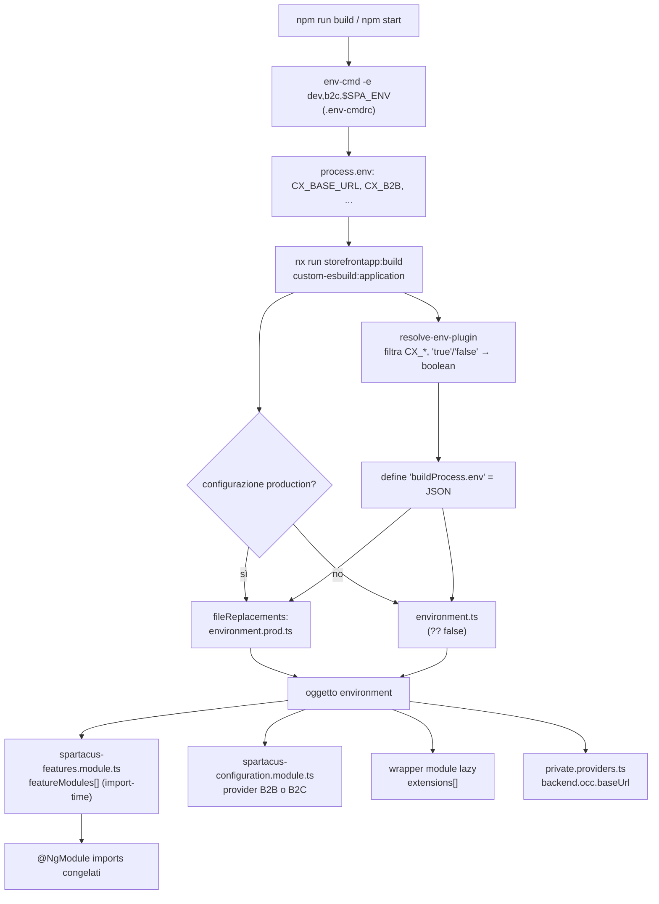
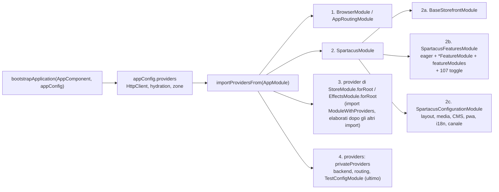
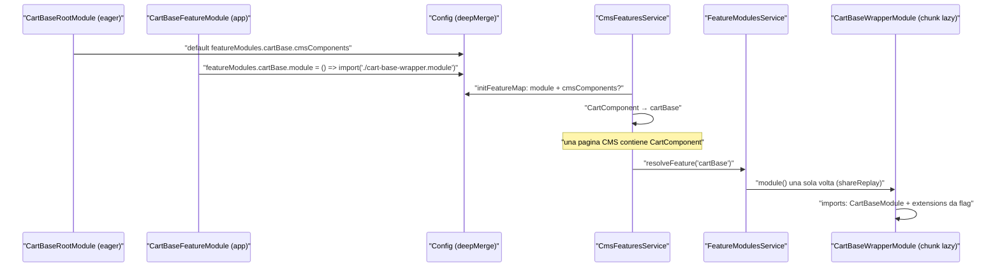

# 47 — L'app demo storefrontapp

> Riferimenti allo SHA `5b7a1c2bf2808d7380bc20596d10f4fa710c3da1` (vedi [00-meta](../00-meta.md)).

## 1. A cosa serve e perché esiste

`projects/storefrontapp` è l'applicazione Angular con cui il team Spartacus sviluppa, prova e collauda le librerie del monorepo. Non è un'app "di esempio" nel senso di un template da copiare: è un banco di prova che deve poter accendere **qualunque** combinazione di librerie (B2C, B2B, integrazioni CDC/CDS/OPF/S4/…) a partire dalla stessa base di codice, deve essere guidabile dai test e2e (Cypress e SSR) e deve esercitare quotidianamente i percorsi di codice più recenti. Il codice stesso lo dichiara in più punti:

- il root component "belongs to the example app, not Spartacus libraries" (`projects/storefrontapp/src/app/app.component.ts:L10-L19`);
- `privateProviders` sono "used only in our example Storefrontapp for testing purposes. CAUTION: IT IS NOT MEANT FOR CUSTOMERS' APPLICATIONS!" (`projects/storefrontapp/src/app/private/private.providers.ts:L14-L19`);
- la scelta del canale B2B/B2C "is enabled only in our repo via a special environment variable at build time. In customers' applications, either B2B or B2C configuration is used, which is decided at the installation time" (`projects/storefrontapp/src/app/spartacus/spartacus-configuration.module.ts:L33-L42`).

Leggere la demo serve quindi a due cose diverse:

1. **Capire come si assembla un'app Spartacus reale**: entry point standalone browser/server, `AppModule` che importa `SpartacusModule`, la triade *BaseStorefront + Features + Configuration*, i `*FeatureModule` con `featureModules` lazy, `server.ts` con Express e l'engine ottimizzato. La struttura ricalca quella che genera `ng add @spartacus/schematics` (vedi il commento su `ExternalRoutesModule`, "is added by default schematics", `projects/storefrontapp/src/app/spartacus/spartacus-features.module.ts:L244-L247`).
2. **Distinguere ciò che è solo del repo**: il sistema di flag di build `CX_*` iniettati da un plugin esbuild custom, `env-cmd` con 26 ambienti, `TestConfigModule` guidato da cookie, i test outlet, i feature toggle tutti `true` imposti da ESLint. Tutto questo **non** va riprodotto in un progetto cliente.

Questo capitolo non ripete ciò che è trattato altrove:

- l'ordine di inizializzazione (`bootstrapApplication` → `ENVIRONMENT_INITIALIZER` → `APP_INITIALIZER` → navigazione iniziale) è in [10 — Bootstrap e ordine di inizializzazione](../parte-2/10-bootstrap-inizializzazione.md): qui ci fermiamo a *quali* provider la demo registra e *in che ordine* entrano nell'injector;
- l'interno di `OptimizedSsrEngine` (timeout, cache, concorrenza, fallback CSR) è in [39 — SSR ottimizzato](../parte-2/39-ssr-ottimizzato.md): qui vediamo come `server.ts` lo configura;
- il meccanismo dei feature toggle è in [42 — Feature toggle e deprecazioni](../parte-2/42-feature-toggle-deprecazioni.md): qui vediamo come la demo li accende tutti;
- `ConfigChunk`/`deepMerge` sono in [11 — Configurazione](../parte-2/11-configurazione.md), `featureModules` e `FeatureModulesService` in [12 — Feature module e lazy loading](../parte-2/12-feature-module-lazy.md).

## 2. Mappa dei file

| Path | Ruolo |
|---|---|
| `projects/storefrontapp/src/main.ts` | bootstrap browser standalone (`bootstrapApplication(AppComponent, appConfig)`) |
| `projects/storefrontapp/src/main.server.ts` | funzione `bootstrap(context)` per SSR/prerender |
| `projects/storefrontapp/src/server.ts` | app Express: engine Spartacus decorato, middleware origin, statici, catch-all di rendering, error handler, `run()` |
| `projects/storefrontapp/src/index.html` | documento host: meta tag OCC/media con placeholder, `<base href>`, `<app-root>` |
| `projects/storefrontapp/src/app/app.component.ts` | root `app-root` con `<cx-storefront />` |
| `projects/storefrontapp/src/app/app.config.ts` | `ApplicationConfig` browser (HTTP, hydration, zone, `importProvidersFrom(AppModule)`) |
| `projects/storefrontapp/src/app/app.config.server.ts` | `mergeApplicationConfig(appConfig, serverConfig)` |
| `projects/storefrontapp/src/app/app.module.ts` | NgModule radice: NgRx root, `AppRoutingModule`, `SpartacusModule`, `privateProviders` |
| `projects/storefrontapp/src/app/app.module.server.ts` | `provideServer({ serverRequestOrigin })` |
| `projects/storefrontapp/src/app/private/private.providers.ts` | config solo-demo: backend, rotta product, `features.level`, Google Maps, `TestOutletModule`, `TestConfigModule`, devtools |
| `projects/storefrontapp/src/app/spartacus/spartacus.module.ts` | aggrega `BaseStorefrontModule`, `SpartacusFeaturesModule`, `SpartacusConfigurationModule` |
| `projects/storefrontapp/src/app/spartacus/spartacus-features.module.ts` | moduli eager, `*FeatureModule`, lista `featureModules` da flag, token My Account V2, 107 feature toggle |
| `projects/storefrontapp/src/app/spartacus/spartacus-configuration.module.ts` | layout/media/CMS/PWA/i18n + provider di canale |
| `projects/storefrontapp/src/app/spartacus/spartacus-b2c-configuration.providers.ts` | `context` B2C (8 siti), cart validation e selective cart |
| `projects/storefrontapp/src/app/spartacus/spartacus-b2b-configuration.providers.ts` | recipe `defaultB2bOccConfig`, checkout B2B, `context` powertools |
| `projects/storefrontapp/src/app/spartacus/features/**` | 48 feature module + 9 wrapper module (lazy) |
| `projects/storefrontapp/src/environments/environment.ts` / `environment.prod.ts` | oggetto `environment` costruito da `buildProcess.env.CX_*` |
| `projects/storefrontapp/src/environments/models/environment.model.ts` | interfaccia `Environment` (23 campi) |
| `projects/storefrontapp/src/environments/models/build.process.env.d.ts` | `declare var buildProcess` e interfaccia `Env` dei `CX_*` |
| `projects/storefrontapp/esbuild/plugins.ts` | plugin esbuild: `resolve-env-plugin` (inietta `CX_*`) e `filter-warnings` |
| `projects/storefrontapp/project.json` | target Nx `build`, `build-csr`, `prerender`, `serve`, `test` |
| `projects/storefrontapp/tsconfig.app.json` / `tsconfig.app.prod.json` | path `@spartacus/*` su sorgenti (dev) o su `dist/` (prod) |
| `projects/storefrontapp/prerender.txt` | 11 rotte per la configurazione `withPrerender` |
| `projects/storefrontapp/eslint.config.mjs` | regole lint specifiche della demo |
| `projects/storefrontapp/src/styles.scss`, `styles-config.scss`, `cms-themes.scss`, `styles/lib-*.scss` | stili globali, `$useLatestStyles`, temi CMS, bundle per libreria |
| `projects/storefrontapp/src/test-outlets/**` | pagine statiche di test per `cxOutletRef` (e2e) |
| `projects/storefrontapp/src/test.ts` | bootstrap Karma |
| `.env-cmdrc` (root) | 26 ambienti `env-cmd` con `CX_BASE_URL` e flag `CX_*` |
| `package.json` (root) | script `build`, `start*`, `build:ssr*`, `serve:ssr*`, `dev:ssr`, `prerender` |

## 3. Come funziona passo per passo

### 3.1 Dalla shell al bundle: i flag di build

La demo è compilata in varianti diverse senza toccare il codice. Il meccanismo ha cinque anelli.

**(a) `env-cmd` carica ambienti nominati.** Lo script `build` è `env-cmd --no-override -e dev,b2c,$SPA_ENV -- nx run storefrontapp:build`; `start` usa gli stessi ambienti con `nx serve … --configuration=development`, e `start:b2b` sostituisce `b2c` con `b2b` (`package.json:L16-L16`, `package.json:L133-L134`). Gli ambienti stanno in `.env-cmdrc`: `dev` imposta solo `CX_BASE_URL`, `b2c` imposta `CX_B2B: "false"` e `CX_CDS: "false"`, `b2b` solo `CX_B2B: "true"` (`.env-cmdrc:L2-L4`, `.env-cmdrc:L51-L57`). Alcuni ambienti implicano B2B: `cpq`, `s4om` (B2B + S4OM + RDD + PDF invoices), `s4-service`, `punchout` (`.env-cmdrc:L42-L46`, `.env-cmdrc:L58-L64`, `.env-cmdrc:L96-L104`). La variabile di shell `SPA_ENV` permette di accodare un ambiente extra senza scrivere un nuovo script.

> ⚠️ DA VERIFICARE: la semantica precisa di `env-cmd -e a,b,c` (gli ambienti successivi sovrascrivono i precedenti) e di `--no-override` (non sovrascrive variabili già presenti nella shell) è dedotta dall'uso, es. `build:cds:ssr` con `-e dev,b2c,cds` dove `b2c` mette `CX_CDS: "false"` e `cds` lo riporta a `"true"` (`package.json:L161-L161`, `.env-cmdrc:L20-L22`). Il pacchetto `env-cmd` non è disponibile né in `/tmp/deps` né in `node_modules`.

**(b) Nx esegue un builder esbuild personalizzato.** Il target `build` usa `@angular-builders/custom-esbuild:application` con `plugins: ["./projects/storefrontapp/esbuild/plugins.ts"]` (`projects/storefrontapp/project.json:L9-L13`).

**(c) Il plugin raccoglie le `CX_*`.** `resolve-env-plugin` scorre `process.env`, tiene solo le chiavi con prefisso `CX_`, converte `'true'`/`'false'` in booleani e imposta `build.initialOptions.define['buildProcess.env']` al JSON risultante; stampa `env=` in console (`projects/storefrontapp/esbuild/plugins.ts:L10-L31`). Un secondo plugin, `filter-warnings`, elimina dai warning di esbuild quelli con "no side effects", "[ignored-bare-import]" e "is not ESM" (`projects/storefrontapp/esbuild/plugins.ts:L34-L46`).

**(d) TypeScript conosce `buildProcess` come globale.** `build.process.env.d.ts` dichiara `declare var buildProcess: BuildProcess` con l'interfaccia `Env` dei 19 `CX_*` (`projects/storefrontapp/src/environments/models/build.process.env.d.ts:L7-L11`, `projects/storefrontapp/src/environments/models/build.process.env.d.ts:L13-L33`); il file è incluso esplicitamente nei `files` di `tsconfig.app.json` (`projects/storefrontapp/tsconfig.app.json:L12-L17`).

**(e) `environment.ts` traduce le variabili in flag.** In sviluppo ogni flag è `buildProcess.env.CX_* ?? false`, `occBaseUrl` è `CX_BASE_URL` e `occApiPrefix` è fisso `'/occ/v2/'` (`projects/storefrontapp/src/environments/environment.ts:L22-L44`). La configurazione `production` del build sostituisce il file con `environment.prod.ts` tramite `fileReplacements` (`projects/storefrontapp/project.json:L157-L162`), che ha `production: true` e flag **senza** `?? false`, tranne `myAccountV2` (`projects/storefrontapp/src/environments/environment.prod.ts:L9-L31`). L'interfaccia `Environment` ha 23 campi: `production`, `occBaseUrl`, `occApiPrefix`, opzionali `mediaBaseUrl`/`mediaApiPrefix` e 18 flag booleani (`projects/storefrontapp/src/environments/models/environment.model.ts:L7-L31`).

I flag diventano **struttura** a import-time dei moduli ES, prima ancora che Angular parta:

- `spartacus-features.module.ts` costruisce l'array di modulo `featureModules`: con `b2b` aggiunge 7 moduli B2B, altrimenti `PickupInStoreFeatureModule`; poi un `if` per ciascuno di `cdc`, `s4Service`, `cds`, `digitalPayments`, `epdVisualization`, `pdfInvoices`, `opps`, `s4om`, `opf`, `punchout`, `segmentRefs`, `requestedDeliveryDate`, `estimatedDeliveryDate`, `omf`, `cpq` (`projects/storefrontapp/src/app/spartacus/spartacus-features.module.ts:L115-L175`);
- il decoratore `@NgModule({ imports: [..., ...featureModules] })` "congela" la lista (`projects/storefrontapp/src/app/spartacus/spartacus-features.module.ts:L285-L285`);
- `spartacus-configuration.module.ts` sceglie i provider di canale con un ternario su `environment.b2b` (`projects/storefrontapp/src/app/spartacus/spartacus-configuration.module.ts:L40-L42`);
- ogni wrapper module lazy costruisce il proprio array `extensions` (§3.5).

> ⚠️ DA VERIFICARE: se esbuild, grazie al `define` di `buildProcess.env` come oggetto JSON, faccia constant-folding di `buildProcess.env.CX_B2B` ed elimini i rami morti (e quindi i moduli non usati dal bundle). Non è possibile eseguire il build in questo ambiente.

### 3.2 Entry point browser e configurazione applicativa

`main.ts` chiama `enableProdMode()` solo se `environment.production` e poi `bootstrapApplication(AppComponent, appConfig)`, con un `.catch` che fa `console.error` ("It's just an example application file") (`projects/storefrontapp/src/main.ts:L13-L23`). L'avvio vero e proprio, con l'ordine degli initializer, è descritto nel [capitolo 10](../parte-2/10-bootstrap-inizializzazione.md).

`appConfig` registra (`projects/storefrontapp/src/app/app.config.ts:L26-L35`):

- `provideHttpClient(withFetch(), withInterceptorsFromDi())`: `withInterceptorsFromDi()` è ciò che rende attivi gli interceptor Spartacus registrati come `HTTP_INTERCEPTORS` nei NgModule (`projects/storefrontapp/src/app/app.config.ts:L28-L28`);
- `provideClientHydration(withEventReplay(), withNoHttpTransferCache())`: la cache HTTP di trasferimento di Angular è disattivata (`angular:packages/platform-browser/src/hydration.ts:L72-L72`), perché Spartacus trasferisce lo stato con il proprio meccanismo (vedi [07 — SSR, hydration e TransferState](../parte-1/07-ssr-hydration-transferstate.md));
- `provideZoneChangeDetection({ eventCoalescing: true })`, `provideBrowserGlobalErrorListeners()`;
- `importProvidersFrom(AppModule)`: tutto Spartacus entra da qui.

`AppComponent` (selettore `app-root`) è standalone e ha come template `<cx-storefront />` (`projects/storefrontapp/src/app/app.component.ts:L10-L19`). `index.html` contiene `<app-root>Loading...</app-root>`, `<base href="/" />` e due meta tag con placeholder, `OCC_BACKEND_BASE_URL_VALUE` e `MEDIA_BACKEND_BASE_URL_VALUE` (`projects/storefrontapp/src/index.html:L71-L82`). Le factory che leggono quei meta tag ignorano il valore quando coincide con il placeholder e sono registrate da `MetaTagConfigModule.forRoot()` dentro `BaseCoreModule` (`core-libs/core/src/occ/config/config-from-meta-tag-factory.ts:L18-L41`, `core-libs/core/src/base-core.module.ts:L39-L39`): nella demo i placeholder restano, quindi i meta tag non contribuiscono configurazione. Lo stesso file dichiara manifest, favicon, icona apple-touch e splash screen iOS (`projects/storefrontapp/src/index.html:L4-L69`).

### 3.3 La composizione dei moduli e l'ordine dei provider

`AppModule` importa, in quest'ordine, `BrowserModule`, `StoreModule.forRoot({})`, `AppRoutingModule`, `EffectsModule.forRoot([])`, `SpartacusModule`, e mette `privateProviders` nei propri `providers` (`projects/storefrontapp/src/app/app.module.ts:L15-L25`). `SpartacusModule` importa `BaseStorefrontModule`, `SpartacusFeaturesModule`, `SpartacusConfigurationModule` e ri-esporta `BaseStorefrontModule` (`projects/storefrontapp/src/app/spartacus/spartacus.module.ts:L12-L20`).

Il punto chiave è **l'ordine**: Angular, quando appiattisce un NgModule in lista di provider, include prima i moduli importati semplici (ricorsivamente), poi i provider degli import `ModuleWithProviders` (`forRoot()`), che vengono elaborati dopo tutti gli altri import, e infine i `providers` dichiarati nel modulo stesso (`angular:packages/core/src/di/provider_collection.ts:L293-L354`, `angular:packages/core/src/di/provider_collection.ts:L316-L321`). In `AppModule`, quindi, i provider di `StoreModule.forRoot({})` ed `EffectsModule.forRoot([])` entrano dopo l'intero albero di `SpartacusModule`; lo stesso spostamento vale dentro `SpartacusFeaturesModule` per `AuthModule.forRoot()`, `AnonymousConsentsModule.forRoot()`, `ProductModule.forRoot()` ed `ExternalRoutesModule.forRoot()`. Di conseguenza:

1. i chunk di config di `BaseStorefrontModule` e delle librerie entrano per primi;
2. poi quelli di `SpartacusFeaturesModule` (eager + `*FeatureModule`);
3. poi `SpartacusConfigurationModule` (layout, media, CMS, PWA, i18n, canale);
4. **per ultimi** i `privateProviders` di `AppModule`, cioè la config backend e `TestConfigModule`.

Questo è ciò che rende vero il commento "Should be imported after other config modules" accanto a `TestConfigModule.forRoot` (`projects/storefrontapp/src/app/private/private.providers.ts:L54-L54`). Il merge dei chunk segue quest'ordine: `Config = deepMerge({}, DefaultConfig, RootConfig)` e `RootConfig = deepMerge({}, ...ConfigChunk)` (`core-libs/core/src/config/config-tokens.ts:L10-L12`, `core-libs/core/src/config/config-tokens.ts:L37-L39`). Tutti i `provideConfig` dell'app vincono sui default delle librerie e, tra loro, vince l'ultimo. `deepMerge` fonde ricorsivamente solo oggetti; array e primitivi, compreso `undefined`, **sostituiscono** il valore precedente (`core-libs/core/src/config/utils/deep-merge.ts:L7-L9`, `core-libs/core/src/config/utils/deep-merge.ts:L36-L48`). Il dettaglio del meccanismo è nel [capitolo 11](../parte-2/11-configurazione.md).

`provideConfig` produce un `ValueProvider` multi su `ConfigChunk` (o `DefaultConfigChunk` se `defaultConfig = true`) e `provideConfigFactory` l'equivalente `FactoryProvider` (`core-libs/core/src/config/config-providers.ts:L18-L48`). La demo usa sempre le varianti **non default**: per questo il suo ESLint spegne le regole `use-provide-default-config(-factory)` e `use-provide-default-feature-toggles(-factory)` che altrove le impongono (`projects/storefrontapp/eslint.config.mjs:L10-L15`).

### 3.4 Le tre "fette" di SpartacusModule

**SpartacusConfigurationModule.** A livello di modulo ES chiama `registerLocaleData` per `de`, `ja`, `zh` (`projects/storefrontapp/src/app/spartacus/spartacus-configuration.module.ts:L29-L31`). I suoi provider, nell'ordine, sono `provideConfigFactory(layoutConfigFactory)`, `provideConfig(mediaConfig)`, `...defaultCmsContentProviders`, `pwa: { enabled: false, addToHomeScreen: true }`, l'i18n statico (risorse en/ja/de/zh, `translationChunksConfig`, `fallbackLang: 'en'`) e infine i provider di canale (`projects/storefrontapp/src/app/spartacus/spartacus-configuration.module.ts:L44-L72`).

- **B2C**: `context.urlParameters: ['baseSite','language','currency']` e `baseSite` con 8 siti electronics/apparel, con `electronics-epdvisualization-spa` anteposto se `environment.epdVisualization` (`projects/storefrontapp/src/app/spartacus/spartacus-b2c-configuration.providers.ts:L11-L31`); abilita anche `cart.validation.enabled` e `cart.selectiveCart.enabled` (`projects/storefrontapp/src/app/spartacus/spartacus-b2c-configuration.providers.ts:L32-L39`).
- **B2B**: `provideConfig(defaultB2bOccConfig)`, `provideConfig(defaultB2BCheckoutConfig)` e `context.baseSite = ['powertools-spa','powertools-standalone']`, con `powertools-epdvisualization-spa` aggiunto con `unshift` se EPD (`projects/storefrontapp/src/app/spartacus/spartacus-b2b-configuration.providers.ts:L13-L28`). `defaultB2bOccConfig`, unica "recipe" di `@spartacus/setup`, contribuisce solo `backend.occ.endpoints` B2B (`core-libs/setup/recipes/b2b/config/default-b2b-occ-config.ts:L38-L49`).

Il site context che consuma `context.*` è descritto in [13 — Site context e theme](../parte-2/13-site-context-theme.md); l'i18n in [37 — i18n](../parte-2/37-i18n.md); la PWA in [40 — SEO e PWA](../parte-2/40-seo-pwa.md).

**SpartacusFeaturesModule.** Importa eager auth (`AuthModule.forRoot()`, `LogoutModule`, `LoginRouteModule`), 16 moduli CMS di base, User/AnonymousConsents/Product core+UI, `CostCenterOccModule` e i moduli di page event (`projects/storefrontapp/src/app/spartacus/spartacus-features.module.ts:L176-L242`). Una sezione "Opt-in features" aggiunge `ExternalRoutesModule.forRoot()` e `JsonLdBuilderModule` (`projects/storefrontapp/src/app/spartacus/spartacus-features.module.ts:L244-L247`). La sezione "Feature libraries" elenca 24 `*FeatureModule` sempre presenti più `...featureModules` (`projects/storefrontapp/src/app/spartacus/spartacus-features.module.ts:L249-L285`). Nei provider:

- `USE_MY_ACCOUNT_V2_CONSENT` e `USE_MY_ACCOUNT_V2_NOTIFICATION_PREFERENCE` valgono `environment.myAccountV2`, "because consents feature is not code-splitted ... and not lazy-loaded" (`projects/storefrontapp/src/app/spartacus/spartacus-features.module.ts:L287-L296`);
- `provideFeatureTogglesFactory` restituisce un oggetto tipizzato `Required<FeatureToggles>` con 107 chiavi, tutte `true` (`projects/storefrontapp/src/app/spartacus/spartacus-features.module.ts:L297-L408`).

**BaseStorefrontModule** è la base delle librerie (layout, CMS, routing, ecc.) e viene trattato nei capitoli della Parte II dedicati a quei sottosistemi.

### 3.5 Il pattern feature module + wrapper

Ogni libreria opzionale entra con un `*FeatureModule` sotto `features/`. Il pattern canonico (es. ASM) è (`projects/storefrontapp/src/app/spartacus/features/asm/asm-feature.module.ts:L18-L41`):

1. importare **eager** il `*RootModule` della libreria;
2. fornire `provideConfig({ featureModules: { [KEY]: { module: () => import(...) } } })`;
3. fornire un `provideConfig` i18n con risorse en/ja/de/zh, `chunks` e spesso `fallbackLang: 'en'`.

La lista dei componenti CMS gestiti da una feature **non** sta nella demo: è il `*RootModule` di libreria a fornirla come default. Per esempio `CartBaseRootModule` mappa 6 componenti su `CART_BASE_FEATURE`, `MiniCartComponent` su `MINI_CART_FEATURE`, `ProductAddToCartComponent` su `ADD_TO_CART_FEATURE` e dichiara l'alias `CART_BASE_CORE_FEATURE → CART_BASE_FEATURE` (`feature-libs/cart/base/root/cart-base-root.module.ts:L26-L57`, `feature-libs/cart/base/root/cart-base-root.module.ts:L77-L83`). Il `deepMerge` per chiave unisce `cmsComponents` (default di libreria) e `module` (root config dell'app). `CmsFeaturesService` mappa un componente sulla sua feature **solo** se la feature ha sia `module` sia `cmsComponents` non vuoto (`core-libs/storefront/cms-structure/services/cms-features.service.ts:L56-L76`). `FeatureModulesService.resolveFeature` risolve gli alias stringa, rifiuta le feature senza `module` ("No module defined for Feature Module ..."), risolve le `dependencies` e carica il modulo una sola volta con `shareReplay` (`core-libs/core/src/lazy-loading/feature-modules.service.ts:L42-L73`). `FeatureModuleConfig` ha tre campi: `module`, `dependencies`, `cmsComponents` (`core-libs/core/src/cms/config/cms-config.ts:L109-L129`). Il resto del meccanismo è nel [capitolo 12](../parte-2/12-feature-module-lazy.md).

Quando una libreria ha **estensioni** da altre librerie, la demo non punta `module` direttamente alla libreria ma a un **wrapper module locale**, che importa il modulo della libreria più le estensioni abilitate dai flag. Esempi:

| Wrapper | Base | Estensioni condizionali | Riferimento |
|---|---|---|---|
| `CartBaseWrapperModule` | `CartBaseModule` | `EstimatedDeliveryDateModule` (`estimatedDeliveryDate`), `CpqQuoteModule` (`cpq`) | `projects/storefrontapp/src/app/spartacus/features/cart/cart-base-wrapper.module.ts:L14-L25` |
| `CheckoutWrapperModule` | `CheckoutModule` | `CheckoutB2BModule` + `CheckoutScheduledReplenishmentModule` (`b2b`), `DigitalPaymentsModule` (`digitalPayments`), `S4ServiceCheckoutModule` (`s4Service`) | `projects/storefrontapp/src/app/spartacus/features/checkout/checkout-wrapper.module.ts:L16-L33` |
| `OrderWrapperModule` | `OrderModule` | `S4ServiceOrderModule`, `OmfOrderModule`, `OpfOrderModule` | `projects/storefrontapp/src/app/spartacus/features/order/order-wrapper.module.ts:L14-L27` |
| `UserAccountWrapperModule`, `UserProfileWrapperModule`, `AdministrationWrapperModule`, `OrganizationUserRegistrationWrapperModule` | modulo lib | modulo CDC corrispondente (`cdc`) | `projects/storefrontapp/src/app/spartacus/features/user/user-account-wrapper.module.ts:L13-L22` e analoghi |
| `CustomerTicketingWrapperModule` | modulo lib | `CdpCustomerTicketingModule` (`cdp`) | `projects/storefrontapp/src/app/spartacus/features/customer-ticketing/customer-ticketing-wrapper.module.ts:L13-L22` |
| `RulebasedConfiguratorWrapperModule` | modulo lib | `RulebasedCpqConfiguratorModule` (`cpq`) | `projects/storefrontapp/src/app/spartacus/features/product-configurator/rulebased-configurator-wrapper.module.ts:L12-L21` |

I wrapper sono 9 e sono raggiunti solo con `import()` dinamico da `featureModules` (`projects/storefrontapp/src/app/spartacus/features/cart/cart-base-feature.module.ts:L29-L32`, `projects/storefrontapp/src/app/spartacus/features/checkout/checkout-feature.module.ts:L81-L84`). Il flag `cdp` viene usato **solo** nel wrapper del customer ticketing: non esiste alcun feature module CDP dedicato (`projects/storefrontapp/src/app/spartacus/features/customer-ticketing/customer-ticketing-wrapper.module.ts:L13-L22`).

Varianti degne di nota:

- `CartBaseFeatureModule` registra tre feature in tre `provideConfig` separati: `CART_BASE_FEATURE` verso il wrapper, `MINI_CART_FEATURE` e `ADD_TO_CART_FEATURE` verso entry point secondari di `@spartacus/cart/base/components` (`projects/storefrontapp/src/app/spartacus/features/cart/cart-base-feature.module.ts:L23-L55`).
- `CheckoutFeatureModule` importa eager anche `CheckoutB2BRootModule` e `CheckoutScheduledReplenishmentRootModule` se `b2b` e imposta `checkout.guest: true` (`projects/storefrontapp/src/app/spartacus/features/checkout/checkout-feature.module.ts:L38-L107`).
- `WishListV2FeatureModule` importa `WishListFeatureModule` (V1) e ri-registra solo `CART_WISH_LIST_FEATURE` con `WishListWithV2Module`. Poiché i suoi provider vengono dopo quelli del modulo importato, l'override su `module` vince, mentre `ADD_TO_WISHLIST_FEATURE` e le traduzioni di V1 restano (`projects/storefrontapp/src/app/spartacus/features/cart/wish-list-v2-feature.module.ts:L12-L27`, `projects/storefrontapp/src/app/spartacus/features/cart/wish-list-feature.module.ts:L32-L63`).
- `CdsFeatureModule` **non** è lazy: importa `CdsModule.forRoot()` e fornisce `provideConfigFactory(cdsConfigFactory, [WindowRef])` (`projects/storefrontapp/src/app/spartacus/features/cds/cds-feature.module.ts:L84-L102`). `cdsConfigFactory` restituisce `cds1` sul server; nel browser sceglie la prima config il cui `baseSite` compare in `windowRef.location.href`, con fallback `cds1` (`projects/storefrontapp/src/app/spartacus/features/cds/cds-feature.module.ts:L30-L82`).
- `OpfFeatureModule` importa 9 root module OPF e registra 9 feature lazy in un solo `provideConfig` (`projects/storefrontapp/src/app/spartacus/features/opf/opf-feature.module.ts:L92-L152`); la config di checkout dipende dal canale (`projects/storefrontapp/src/app/spartacus/features/opf/opf-feature.module.ts:L73-L91`).
- `PersonalizationFeatureModule` importa eager `BaseTmsModule.forRoot()`, `GtmModule`, `AepModule` e configura gli eventi inoltrati ai tag manager (`projects/storefrontapp/src/app/spartacus/features/tracking/personalization-feature.module.ts:L22-L52`).
- Alcuni feature module sono "solo root": `OmfFeatureModule`, `OppsFeatureModule`, `SegmentRefsFeatureModule`, `ProductMultiDimensionalListFeatureModule`; altri importano il root module e aggiungono solo le traduzioni, senza `featureModules` (`CpqQuoteFeatureModule`, `EstimatedDeliveryDateFeatureModule`, `S4OMFeatureModule`) (`projects/storefrontapp/src/app/spartacus/features/omf/omf-feature.module.ts:L10-L13`, `projects/storefrontapp/src/app/spartacus/features/cpq-quote/cpq-quote-feature.module.ts:L18-L35`). `OmfRootModule` è addirittura un NgModule vuoto: il codice OMF utile arriva solo con `OmfOrderModule` nel wrapper degli ordini (`integration-libs/omf/root/omf-root.module.ts:L9-L10`).
- `DigitalPaymentsFeatureModule` non importa alcun root module e fornisce solo traduzioni; `DigitalPaymentsModule` entra soltanto nel wrapper lazy del checkout (`projects/storefrontapp/src/app/spartacus/features/digital-payments/digital-payments-feature.module.ts:L17-L33`, `projects/storefrontapp/src/app/spartacus/features/checkout/checkout-wrapper.module.ts:L22-L24`).

### 3.6 privateProviders e config e2e guidata da cookie

`privateProviders` è un `makeEnvironmentProviders([...])` (`projects/storefrontapp/src/app/private/private.providers.ts:L14-L19`) che:

- imposta `backend.occ.baseUrl/prefix` da `environment.occBaseUrl/occApiPrefix` e `backend.media.baseUrl/prefix` da `environment.mediaBaseUrl/mediaApiPrefix` (`projects/storefrontapp/src/app/private/private.providers.ts:L20-L31`). Nessuno dei due file environment valorizza i campi media, e non esiste una variabile `CX_*` per essi (`projects/storefrontapp/src/environments/environment.ts:L22-L44`, `projects/storefrontapp/src/environments/models/build.process.env.d.ts:L13-L33`);
- ridefinisce la rotta `product` con due path e `paramsMapping: { name: 'slug' }` "for e2e testing" (`projects/storefrontapp/src/app/private/private.providers.ts:L33-L41`);
- imposta `features: { level: '*' }`, ma `features.level` è `@deprecated` (`projects/storefrontapp/src/app/private/private.providers.ts:L43-L44`, `core-libs/core/src/features-config/config/features-config.ts:L48-L70`);
- imposta `googleMaps.apiKey` a `GOOGLE_MAPS_DEVELOPMENT_KEY_CONFIG`, cioè `'cx-development'` (`projects/storefrontapp/src/app/private/private.providers.ts:L46-L49`, `feature-libs/storefinder/root/config/constants.ts:L7-L7`);
- importa `TestOutletModule`, `TestConfigModule.forRoot({ cookie: 'cxConfigE2E' })` e, solo se `!environment.production`, `StoreDevtoolsModule.instrument()` (`projects/storefrontapp/src/app/private/private.providers.ts:L52-L56`).

`TestConfigModule.forRoot` contribuisce il contenuto di `TEST_CONFIG` due volte: come `FeatureTogglesChunk` (campo `features`) e come `ConfigChunk`, con eslint-disable espliciti ("deliberately providing a high priority FeatureConfig") (`core-libs/core/src/config/test-config.module.ts:L83-L106`). Nel browser `TEST_CONFIG` legge da `document.cookie` il cookie nominato da `TEST_CONFIG_COOKIE_NAME` e fa `JSON.parse(decodeURIComponent(...))`, restituendo `{}` in caso di errore (`core-libs/core/src/config/test-config.module.ts:L42-L63`). Sul server lo stesso token viene ridefinito da `TestConfigServerModule.forRoot()`, che legge l'header `Cookie` dalla `REQUEST` express (`core-libs/setup/ssr/testing/test-config-server.module.ts:L26-L58`). Il JSDoc ricorda il limite di 4096 byte dei cookie (`core-libs/core/src/config/test-config.module.ts:L76-L82`).

I `FeatureTogglesChunk` sono fusi con `Object.assign` superficiale, quindi vince l'ultimo: prima i 107 toggle dell'app, poi quelli dal cookie (`core-libs/core/src/features-config/feature-toggles/feature-toggles-tokens.ts:L15-L24`, `core-libs/core/src/features-config/feature-toggles/feature-toggles-tokens.ts:L48-L58`).

### 3.7 Entry point server

`app.config.server.ts` esporta `config = mergeApplicationConfig(appConfig, serverConfig)`, dove `serverConfig` aggiunge `provideServerRendering()`, `importProvidersFrom(AppServerModule)` e `TestConfigServerModule.forRoot()` ("DO NOT USE IN CUSTOMERS APPS") (`projects/storefrontapp/src/app/app.config.server.ts:L17-L30`). `mergeApplicationConfig` concatena i `providers` nell'ordine degli argomenti: i provider server vengono dopo quelli browser e vincono negli override "last wins" (`angular:packages/core/src/application/application_config.ts:L31-L38`).

`AppServerModule` fornisce `...provideServer({ serverRequestOrigin: process.env['SERVER_REQUEST_ORIGIN'] })` (`projects/storefrontapp/src/app/app.module.server.ts:L10-L17`). `provideServer` registra `SERVER_REQUEST_ORIGIN`, `SERVER_REQUEST_URL`, un `LoggerService` server e un `MULTI_ERROR_HANDLER` (`core-libs/setup/ssr/providers/ssr-providers.ts:L27-L47`). La factory dell'origin dà precedenza all'opzione esplicita, poi al valore dell'express engine, altrimenti lancia un errore che suggerisce `SERVER_REQUEST_ORIGIN=... yarn prerender` (`core-libs/setup/ssr/providers/server-request-origin.ts:L14-L40`). Il JSDoc spiega che in SSR l'origin è risolta automaticamente da express, mentre per il prerendering è *mandatory* (`core-libs/setup/ssr/providers/model.ts:L10-L22`).

`main.server.ts` esporta di default `bootstrap(context: BootstrapContext)`, che inoltra il `context` a `bootstrapApplication(AppComponent, config, context)` (`projects/storefrontapp/src/main.server.ts:L19-L26`).

### 3.8 server.ts: Express e engine decorato

A livello di modulo, `server.ts` costruisce `ssrOptions` con `timeout = Number(process.env['SSR_TIMEOUT'] ?? defaultSsrOptimizationOptions.timeout)` e `cache = process.env['SSR_CACHE'] === 'true'` (`projects/storefrontapp/src/server.ts:L22-L27`). Poi crea l'engine decorato, cioè una factory: `NgExpressEngineDecorator.get(engine, ssrOptions)`, dove `engine` è `ngExpressEngine` di `@spartacus/setup/ssr` (`projects/storefrontapp/src/server.ts:L8-L15`, `projects/storefrontapp/src/server.ts:L29-L29`). L'istanza di `CxCommonEngine`/`OptimizedSsrEngine` nasce a ogni chiamata di `app()`, quando la factory viene invocata con `{ bootstrap }` in `server.engine('html', ...)`; nella demo `app()` è chiamata una sola volta da `run()` (`core-libs/setup/ssr/engine-decorator/ng-express-engine-decorator.ts:L57-L73`, `projects/storefrontapp/src/server.ts:L51-L56`).

- I default sono `timeout: 3_000`, `cache: false`, `concurrency: 10`, `forcedSsrTimeout: 60_000`, `maxRenderTime: 300_000`, `reuseCurrentRendering: true` e altri (`core-libs/setup/ssr/optimized-engine/ssr-optimization-options.ts:L220-L237`). Il costruttore di `OptimizedSsrEngine` li fonde con le opzioni parziali (`core-libs/setup/ssr/optimized-engine/optimized-ssr-engine.ts:L59-L74`), quindi passare solo `timeout` e `cache` è sufficiente.
- `decorateExpressEngine` antepone `getServerRequestProviders()` ai provider dell'utente e, se ci sono opzioni di ottimizzazione, avvolge l'istanza in `OptimizedSsrEngine` (`core-libs/setup/ssr/engine-decorator/ng-express-engine-decorator.ts:L51-L74`).
- `ngExpressEngine` crea un `CxCommonEngine` (sottoclasse di `CommonEngine`) con `bootstrap`, `providers`, `enablePerformanceProfiler`, `allowedHosts` e calcola l'URL da protocollo, host, `baseUrl` e `url` (`core-libs/setup/ssr/engine/ng-express-engine.ts:L82-L106`, `core-libs/setup/ssr/engine/cx-common-engine.ts:L20-L22`).

La funzione `app()`, "exported so that it can be used by serverless Functions" (`projects/storefrontapp/src/server.ts:L31-L32`):

1. risolve `browserDistFolder = ../browser` da `import.meta.url` e legge **sincronamente** `index.server.html` (`projects/storefrontapp/src/server.ts:L32-L37`);
2. imposta `trust proxy = 'loopback'` (`projects/storefrontapp/src/server.ts:L39-L39`);
3. installa `getOriginValidationMiddleware({ allowedOrigins: process.env['SSR_ALLOWED_ORIGINS'] })` (`projects/storefrontapp/src/server.ts:L45-L49`). Il middleware accetta array o CSV; se la lista è vuota è un no-op, altrimenti risponde `400 Bad Request` con `Cache-Control: no-store` alle origin non ammesse (`core-libs/setup/ssr/express-utils/express-origin-validation-middleware.ts:L51-L67`). Il confronto è case-insensitive e `*` corrisponde a esattamente un'etichetta host (`core-libs/setup/ssr/express-utils/express-origin-validation-middleware.ts:L84-L99`). L'origin usa `X-Forwarded-Host` solo se `trust proxy fn` considera fidato il remoteAddress (`core-libs/setup/ssr/express-utils/express-request-origin.ts:L9-L26`);
4. registra l'engine `html` con `ngExpressEngine({ bootstrap })` e imposta `views` su `browserDistFolder` (`projects/storefrontapp/src/server.ts:L51-L59`);
5. serve come statico ogni path che contiene un punto (`/.*\..*/`), con `maxAge: '1y'` (`projects/storefrontapp/src/server.ts:L61-L67`);
6. per tutte le altre rotte chiama `res.render(indexHtml, { req, providers: [{ provide: APP_BASE_HREF, useValue: req.baseUrl }] })` (`projects/storefrontapp/src/server.ts:L69-L75`);
7. chiude con `defaultExpressErrorHandlers(indexHtmlContent)` (`projects/storefrontapp/src/server.ts:L77-L77`), che, se gli header non sono già partiti, risponde con il documento CSR, `Cache-Control: no-store` e status 404 per `CmsPageNotFoundOutboundHttpError` oppure 500 per il resto (`core-libs/setup/ssr/error-handling/express-error-handlers/express-error-handlers.ts:L21-L32`).

`run()` legge `PORT` (default 4000), chiama `listen` ed è invocata incondizionatamente in fondo al file (`projects/storefrontapp/src/server.ts:L82-L97`).

`server.ts` **non** passa `allowedHosts` all'engine (`projects/storefrontapp/src/server.ts:L51-L56`): gli script npm impostano `NG_ALLOWED_HOSTS=localhost` (`package.json:L152-L155`), che `CommonEngine` legge dall'ambiente con precedenza sull'opzione (`deps:angular-ssr-21.2.23/package/fesm2022/node.mjs:L108-L111`). Se l'host non è ammesso e non c'è alcun allowed host configurato, `CommonEngine.render` logga un errore e restituisce il documento non renderizzato ("Falling back to client side rendering") (`deps:angular-ssr-21.2.23/package/fesm2022/node.mjs:L113-L130`).

Cosa succede *dentro* `OptimizedSsrEngine` (code di rendering, timeout, fallback CSR, cache) è nel [capitolo 39](../parte-2/39-ssr-ottimizzato.md).

### 3.9 Target di build, script SSR e tsconfig

Opzioni di `build`: `outputPath: dist/storefrontapp`, `browser: src/main.ts`, `server: src/main.server.ts`, `ssr.entry: src/server.ts`, `prerender: false`, `polyfills: ["zone.js"]`, `aot: true` (`projects/storefrontapp/project.json:L14-L24`, `projects/storefrontapp/project.json:L142-L147`). La configurazione `production` attiva `optimization`, `outputHashing: all`, niente source map, `serviceWorker: false` e `tsConfig: tsconfig.app.prod.json` (`projects/storefrontapp/project.json:L150-L171`). Esistono anche `development`, `noSsr` e `withPrerender` (con `routesFile: prerender.txt`); il default è `production` (`projects/storefrontapp/project.json:L172-L188`). `prerender.txt` elenca 11 URL esplicite con baseSite, lingua e valuta nel path (`projects/storefrontapp/prerender.txt:L1-L11`).

I target `build-csr` e `prerender` sono `concat` che rimandano a `build` con `noSsr` o `withPrerender`; `serve` usa **sempre** `noSsr` (`projects/storefrontapp/project.json:L190-L229`).

In sviluppo `tsconfig.app.json` estende il `tsconfig.json` di root, dove `@spartacus/*` punta ai sorgenti; in produzione `tsconfig.app.prod.json` rimappa 314 path `@spartacus/*` su `dist/*` (`projects/storefrontapp/tsconfig.app.json:L1-L5`, `tsconfig.json:L795-L796`, `projects/storefrontapp/tsconfig.app.prod.json:L508-L509`). `tsconfig.app.json` disattiva `strict` (con un TODO) e `strictTemplates`, e abilita `skipLibCheck` per la dipendenza `@sapui5/ts-types-esm` di EPD (`projects/storefrontapp/tsconfig.app.json:L4-L20`).

Script SSR (`package.json:L150-L155`):

- `serve:ssr` → `NG_ALLOWED_HOSTS=localhost node dist/storefrontapp/server/server.mjs`;
- `serve:ssr:watch`/`serve:ssr:dev` → `SSR_TIMEOUT=30000` e `NODE_TLS_REJECT_UNAUTHORIZED=0`; `serve:ssr:ci` → `SSR_TIMEOUT=0`;
- `dev:ssr` → cancella `dist/storefrontapp/server` e lancia in parallelo `watch` e `serve:ssr:watch`.

### 3.10 Stili e test outlet

`styles.scss` importa, nell'ordine, `styles-config`, il core Spartacus, i parziali Bootstrap, `@spartacus/styles` e infine `cms-themes`, che deve venire dopo per sovrascrivere le custom property di `:root` (`projects/storefrontapp/src/styles.scss:L1-L29`). `styles-config.scss` imposta `$useLatestStyles: true` (`projects/storefrontapp/src/styles-config.scss:L1-L2`), sovrascrivendo il default `false !default` (`core-libs/styles/scss/_versioning.scss:L46-L46`). `cms-themes.scss` definisce le classi `.santorini`, `.lambda`, `.sparta` che ridefiniscono 24 custom property `--cx-color-*` (`projects/storefrontapp/src/cms-themes.scss:L1-L80`). Gli stili delle librerie sono 23 entry con `bundleName` distinto (`styles` + 22 `lib-*`) (`projects/storefrontapp/project.json:L43-L141`). Il resto è nel [capitolo 38](../parte-2/38-stili-theming.md).

`TestOutletModule` importa tre moduli di pagina di test e `ConfigModule.withConfigFactory(testOutletPagesCmsContentConfig)` (`projects/storefrontapp/src/test-outlets/test-outlet.module.ts:L14-L22`). La config definisce in `cmsStructure` tre pagine statiche con `ignoreBackend: true` (`projects/storefrontapp/src/test-outlets/test-outlet-cms-page.config.ts:L33-L76`); ogni modulo registra una rotta `test/outlet/*` con `canActivate: [CmsPageGuard]` (`projects/storefrontapp/src/test-outlets/test-outlet-component/test-outlet-component.module.ts:L17-L32`). I template dichiarano `ng-template [cxOutletRef]` in posizione `before`, `after` e replace (`projects/storefrontapp/src/test-outlets/test-outlet-component/test-outlet-component.component.html:L1-L13`). Sono un buon esempio minimo d'uso degli outlet (vedi [17 — Outlet](../parte-2/17-outlet.md)).

## 4. Diagrammi

### 4.1 Dai flag di build alla struttura dell'app



Riferimenti: `package.json:L16-L16`, `.env-cmdrc:L2-L4`, `projects/storefrontapp/project.json:L9-L13`, `projects/storefrontapp/esbuild/plugins.ts:L10-L31`, `projects/storefrontapp/project.json:L157-L162`, `projects/storefrontapp/src/environments/environment.ts:L22-L44`, `projects/storefrontapp/src/app/spartacus/spartacus-features.module.ts:L115-L175`, `projects/storefrontapp/src/app/spartacus/spartacus-configuration.module.ts:L40-L42`, `projects/storefrontapp/src/app/spartacus/features/cart/cart-base-wrapper.module.ts:L14-L25`, `projects/storefrontapp/src/app/private/private.providers.ts:L20-L31`.

### 4.2 Albero dei moduli e ordine dei provider



L'ordine numerico è l'ordine in cui i provider entrano nella lista (prima gli `imports` semplici, poi i provider degli import `forRoot()`, poi i `providers`): `projects/storefrontapp/src/app/app.module.ts:L15-L25`, `projects/storefrontapp/src/app/spartacus/spartacus.module.ts:L12-L20`, `angular:packages/core/src/di/provider_collection.ts:L293-L354`, `angular:packages/core/src/di/provider_collection.ts:L316-L321`.

### 4.3 Richiesta SSR

```mermaid
sequenceDiagram
  participant Client
  participant Express as "server.ts app()"
  participant Origin as "OriginValidationMiddleware"
  participant Opt as "OptimizedSsrEngine"
  participant CE as "CxCommonEngine / CommonEngine"
  participant Boot as "main.server.ts bootstrap(context)"
  participant Err as "defaultExpressErrorHandlers"
  Client->>Express: "GET /electronics-spa/en/USD/"
  Express->>Origin: "verifica SSR_ALLOWED_ORIGINS"
  alt "origin non ammessa"
    Origin-->>Client: "400 Bad Request, no-store"
  end
  alt "path con un punto"
    Express-->>Client: "express.static(browser, maxAge 1y)"
  else "altre rotte"
    Express->>Opt: "res.render(indexHtml, {req, APP_BASE_HREF})"
    Opt->>CE: "render (timeout, cache, concurrency: cap. 39)"
    CE->>CE: "valida host (NG_ALLOWED_HOSTS)"
    CE->>Boot: "bootstrap(context)"
    Boot->>Boot: "bootstrapApplication(AppComponent, config, context)"
    Boot-->>CE: "HTML renderizzato"
    CE-->>Opt: "HTML"
    Opt-->>Client: "200 HTML (o CSR in fallback)"
  end
  Note over Express,Err: "errori propagati a express"
  Err-->>Client: "documento CSR, 404 o 500, no-store"
```

Riferimenti: `projects/storefrontapp/src/server.ts:L45-L77`, `core-libs/setup/ssr/express-utils/express-origin-validation-middleware.ts:L51-L67`, `core-libs/setup/ssr/engine-decorator/ng-express-engine-decorator.ts:L51-L74`, `deps:angular-ssr-21.2.23/package/fesm2022/node.mjs:L108-L130`, `projects/storefrontapp/src/main.server.ts:L23-L24`, `core-libs/setup/ssr/error-handling/express-error-handlers/express-error-handlers.ts:L21-L32`.

### 4.4 Lazy loading di una feature con wrapper (cart)



Riferimenti: `feature-libs/cart/base/root/cart-base-root.module.ts:L26-L57`, `projects/storefrontapp/src/app/spartacus/features/cart/cart-base-feature.module.ts:L23-L35`, `core-libs/storefront/cms-structure/services/cms-features.service.ts:L56-L76`, `core-libs/core/src/lazy-loading/feature-modules.service.ts:L42-L73`, `projects/storefrontapp/src/app/spartacus/features/cart/cart-base-wrapper.module.ts:L14-L25`.

## 5. Estratti di codice reale

### 5.1 Il plugin che porta i flag nel bundle

`projects/storefrontapp/esbuild/plugins.ts:L10-L31`
```ts
const resolveEnvPlugin: Plugin = {
  name: 'resolve-env-plugin',
  setup(build) {
    const env: Record<string, string | boolean | undefined> = {};
    Object.keys(process.env).forEach((key) => {
      if (key.startsWith('CX_')) {
        if (process.env[key] === 'true') {
          env[key] = true;
        } else if (process.env[key] === 'false') {
          env[key] = false;
        } else {
          env[key] = process.env[key];
        }
      }
    });
    build.initialOptions.define = {
      ...build.initialOptions.define,
      'buildProcess.env': JSON.stringify(env),
    };
    console.log('env=', env); // eslint-disable-line no-console
  },
};
```

### 5.2 L'oggetto environment di sviluppo

`projects/storefrontapp/src/environments/environment.ts:L22-L30`
```ts
export const environment: Environment = {
  production: false,
  occBaseUrl: buildProcess.env.CX_BASE_URL,
  occApiPrefix: '/occ/v2/',
  cds: buildProcess.env.CX_CDS ?? false,
  b2b: buildProcess.env.CX_B2B ?? false,
  cdc: buildProcess.env.CX_CDC ?? false,
  cdp: buildProcess.env.CX_CDP ?? false,
  cpq: buildProcess.env.CX_CPQ ?? false,
  // ...
};
```

### 5.3 La configurazione applicativa browser e server

`projects/storefrontapp/src/app/app.config.ts:L26-L35`
```ts
export const appConfig: ApplicationConfig = {
  providers: [
    provideHttpClient(withFetch(), withInterceptorsFromDi()),
    provideClientHydration(withEventReplay(), withNoHttpTransferCache()),
    provideZoneChangeDetection({ eventCoalescing: true }),
    provideBrowserGlobalErrorListeners(),

    importProvidersFrom(AppModule),
  ],
};
```

`projects/storefrontapp/src/app/app.config.server.ts:L17-L30`
```ts
const serverConfig: ApplicationConfig = {
  providers: [
    provideServerRendering(),

    importProvidersFrom(AppServerModule),

    importProvidersFrom(
      // DO NOT USE IN CUSTOMERS APPS:
      TestConfigServerModule.forRoot() // Injects config dynamically from e2e tests for SSR.
    ),
  ],
};

export const config = mergeApplicationConfig(appConfig, serverConfig);
```

`projects/storefrontapp/src/main.server.ts:L23-L26`
```ts
const bootstrap = (context: BootstrapContext) =>
  bootstrapApplication(AppComponent, config, context);

export default bootstrap;
```

### 5.4 AppModule: imports prima, privateProviders dopo

`projects/storefrontapp/src/app/app.module.ts:L15-L25`
```ts
@NgModule({
  imports: [
    BrowserModule,
    StoreModule.forRoot({}),
    AppRoutingModule,
    EffectsModule.forRoot([]),
    SpartacusModule,
  ],
  providers: [privateProviders],
})
export class AppModule {}
```

`projects/storefrontapp/src/app/private/private.providers.ts:L52-L56`
```ts
  importProvidersFrom(
    TestOutletModule, // Custom usages of cxOutletRef only for e2e testing
    TestConfigModule.forRoot({ cookie: 'cxConfigE2E' }), // Injects config dynamically from e2e tests. Should be imported after other config modules.
    ...(environment.production ? [] : [StoreDevtoolsModule.instrument()]) // Enable Redux devtools only in non-production build
  ),
```

### 5.5 Feature module scelti a import-time

`projects/storefrontapp/src/app/spartacus/spartacus-features.module.ts:L115-L133`
```ts
const featureModules = [];

if (environment.b2b) {
  featureModules.push(
    AdministrationFeatureModule,
    AccountSummaryFeatureModule,
    BulkPricingFeatureModule,
    OrderApprovalFeatureModule,
    OrganizationUserRegistrationFeatureModule,
    UnitOrderFeatureModule,
    FutureStockFeatureModule
  );
} else {
  featureModules.push(PickupInStoreFeatureModule);
}

if (environment.cdc) {
  featureModules.push(CdcFeatureModule);
}
```

`projects/storefrontapp/src/app/spartacus/spartacus-features.module.ts:L297-L300`
```ts
    provideFeatureTogglesFactory(() => {
      const appFeatureToggles: Required<FeatureToggles> = {
        useAdvancedGoogleMarkers: true,
        useGoogleMapsAsyncLoading: true,
```

### 5.6 Scelta del canale

`projects/storefrontapp/src/app/spartacus/spartacus-configuration.module.ts:L40-L42`
```ts
const spartacusChannelSpecificConfigurationProviders = environment.b2b
  ? spartacusB2bConfigurationProviders
  : spartacusB2cConfigurationProviders;
```

### 5.7 Feature module e wrapper

`projects/storefrontapp/src/app/spartacus/features/cart/cart-base-feature.module.ts:L23-L35`
```ts
@NgModule({
  imports: [CartBaseRootModule],
  providers: [
    provideConfig({
      featureModules: {
        [CART_BASE_FEATURE]: {
          module: () =>
            import('./cart-base-wrapper.module').then(
              (m) => m.CartBaseWrapperModule
            ),
        },
      },
    }),
```

`projects/storefrontapp/src/app/spartacus/features/cart/cart-base-wrapper.module.ts:L14-L25`
```ts
const extensions: Type<any>[] = [];

if (environment.estimatedDeliveryDate) {
  extensions.push(EstimatedDeliveryDateModule);
}
if (environment.cpq) {
  extensions.push(CpqQuoteModule);
}
@NgModule({
  imports: [CartBaseModule, ...extensions],
})
export class CartBaseWrapperModule {}
```

### 5.8 server.ts

`projects/storefrontapp/src/server.ts:L22-L37`
```ts
const ssrOptions: SsrOptimizationOptions = {
  timeout: Number(
    process.env['SSR_TIMEOUT'] ?? defaultSsrOptimizationOptions.timeout
  ),
  cache: process.env['SSR_CACHE'] === 'true',
};

const ngExpressEngine = NgExpressEngineDecorator.get(engine, ssrOptions);

// The Express app is exported so that it can be used by serverless Functions.
export function app(): express.Express {
  const server = express();
  const serverDistFolder = dirname(fileURLToPath(import.meta.url));
  const browserDistFolder = resolve(serverDistFolder, '../browser');
  const indexHtml = join(serverDistFolder, 'index.server.html');
  const indexHtmlContent = readFileSync(indexHtml, 'utf-8');
```

`projects/storefrontapp/src/server.ts:L61-L77`
```ts
  // Serve static files from /browser
  server.get(
    /.*\..*/,
    express.static(browserDistFolder, {
      maxAge: '1y',
    })
  );

  // All regular routes use the Universal engine
  server.get(/.*/, (req, res) => {
    res.render(indexHtml, {
      req,
      providers: [{ provide: APP_BASE_HREF, useValue: req.baseUrl }],
    });
  });

  server.use(defaultExpressErrorHandlers(indexHtmlContent));
```

### 5.9 Engine decorato (libreria)

`core-libs/setup/ssr/engine-decorator/ng-express-engine-decorator.ts:L59-L72`
```ts
    const engineInstance = ngExpressEngine({
      ...setupOptions,
      providers: [
        // add spartacus related providers
        ...getServerRequestProviders(),
        ...(setupOptions.providers ?? []),
      ],
    });

    // apply optimization wrapper if optimization options were defined
    return optimizationOptions
      ? new OptimizedSsrEngine(engineInstance, optimizationOptions)
          .engineInstance
      : engineInstance;
```

## 6. Configurazione

| Chiave | Tipo | Default | Definita in | Letta in |
|---|---|---|---|---|
| `CX_BASE_URL` (build) | string | per ambiente (`dev`: `https://40.76.109.9:9002`) | `.env-cmdrc:L2-L4` | `projects/storefrontapp/src/environments/environment.ts:L24-L24` → `projects/storefrontapp/src/app/private/private.providers.ts:L24-L24` |
| `CX_B2B`, `CX_CDS`, `CX_CDC`, `CX_CDP`, `CX_CPQ`, `CX_OPF`, `CX_S4OM`, … (18 flag) | boolean (da `'true'`/`'false'`) | dev `false`; prod `undefined` (tranne `myAccountV2` = `false`) | `.env-cmdrc`, `projects/storefrontapp/esbuild/plugins.ts:L14-L24` | `projects/storefrontapp/src/environments/environment.ts:L26-L43`, `projects/storefrontapp/src/environments/environment.prod.ts:L13-L30` |
| `SPA_ENV` (shell) | string | vuoto | — | `package.json:L16-L16` |
| `SSR_TIMEOUT` (runtime) | number (ms) | `3000` | `core-libs/setup/ssr/optimized-engine/ssr-optimization-options.ts:L226-L226` | `projects/storefrontapp/src/server.ts:L23-L25` |
| `SSR_CACHE` (runtime) | `'true'` → boolean | `false` | `core-libs/setup/ssr/optimized-engine/ssr-optimization-options.ts:L221-L221` | `projects/storefrontapp/src/server.ts:L26-L26` |
| `SSR_ALLOWED_ORIGINS` (runtime) | stringa CSV | assente → no-op | — | `projects/storefrontapp/src/server.ts:L45-L49` |
| `PORT` (runtime) | number/string | `4000` | — | `projects/storefrontapp/src/server.ts:L83-L83` |
| `SERVER_REQUEST_ORIGIN` (runtime) | string | assente → origin da express | — | `projects/storefrontapp/src/app/app.module.server.ts:L13-L13` |
| `NG_ALLOWED_HOSTS` (runtime) | stringa | `localhost` negli script | `package.json:L152-L155` | `deps:angular-ssr-21.2.23/package/fesm2022/node.mjs:L10-L11` |
| cookie `cxConfigE2E` | JSON URI-encoded | assente → `{}` | `projects/storefrontapp/src/app/private/private.providers.ts:L54-L54` | `core-libs/core/src/config/test-config.module.ts:L42-L63`, `core-libs/setup/ssr/testing/test-config-server.module.ts:L42-L54` |
| `backend.occ.baseUrl` / `prefix` | string | `environment.occBaseUrl` / `'/occ/v2/'` | `projects/storefrontapp/src/app/private/private.providers.ts:L22-L26` | config globale ([cap. 21](../parte-2/21-occ.md)) |
| `backend.media.baseUrl` / `prefix` | string | `undefined` | `projects/storefrontapp/src/app/private/private.providers.ts:L27-L30` | `core-libs/core/src/occ/adapters/product/converters/product-image-normalizer.ts:L95-L99` |
| `routing.routes.product` | paths + paramsMapping | 2 path, `name→slug` | `projects/storefrontapp/src/app/private/private.providers.ts:L34-L41` | routing ([cap. 14](../parte-2/14-routing.md)) |
| `features.level` | string | `'*'` (deprecato) | `projects/storefrontapp/src/app/private/private.providers.ts:L44-L44` | `core-libs/core/src/features-config/utils/feature-config-utils.ts:L15-L21` |
| `googleMaps.apiKey` | string | `'cx-development'` | `projects/storefrontapp/src/app/private/private.providers.ts:L49-L49` | storefinder |
| `context.baseSite` / `urlParameters` | string[] | B2C 8 siti / B2B 2 siti; `['baseSite','language','currency']` | `projects/storefrontapp/src/app/spartacus/spartacus-b2c-configuration.providers.ts:L26-L31`, `projects/storefrontapp/src/app/spartacus/spartacus-b2b-configuration.providers.ts:L22-L27` | site context ([cap. 13](../parte-2/13-site-context-theme.md)) |
| `cart.validation.enabled`, `cart.selectiveCart.enabled` | boolean | `true` (solo B2C) | `projects/storefrontapp/src/app/spartacus/spartacus-b2c-configuration.providers.ts:L32-L39` | cart ([cap. 25](../parte-2/25-cart.md)) |
| `pwa.enabled` / `addToHomeScreen` | boolean | `false` / `true` | `projects/storefrontapp/src/app/spartacus/spartacus-configuration.module.ts:L49-L54` | PWA ([cap. 40](../parte-2/40-seo-pwa.md)) |
| `i18n.resources` / `chunks` / `fallbackLang` | oggetti | en/ja/de/zh, `translationChunksConfig`, `'en'` | `projects/storefrontapp/src/app/spartacus/spartacus-configuration.module.ts:L55-L67` + ogni feature module | i18n ([cap. 37](../parte-2/37-i18n.md)) |
| `checkout.guest` | boolean | `true` | `projects/storefrontapp/src/app/spartacus/features/checkout/checkout-feature.module.ts:L99-L103` | checkout |
| `userAccount.enableUserCurrencySync` | boolean | `false` | `projects/storefrontapp/src/app/spartacus/features/user/user-feature.module.ts:L42-L46` | user account |
| `featureModules[*].module` | `() => Promise` | per feature | ogni `*-feature.module.ts` | `core-libs/core/src/lazy-loading/feature-modules.service.ts:L42-L73`, `core-libs/storefront/cms-structure/services/cms-features.service.ts:L56-L76` |
| `USE_MY_ACCOUNT_V2_*` (token) | boolean | `environment.myAccountV2` | `projects/storefrontapp/src/app/spartacus/spartacus-features.module.ts:L289-L296`, `projects/storefrontapp/src/app/spartacus/features/order/order-feature.module.ts:L34-L37`, `projects/storefrontapp/src/app/spartacus/features/user/user-feature.module.ts:L79-L90` | componenti my-account |
| FeatureToggles (107) | boolean | tutti `true` | `projects/storefrontapp/src/app/spartacus/spartacus-features.module.ts:L297-L408` | `FeatureToggles` ([cap. 42](../parte-2/42-feature-toggle-deprecazioni.md)) |
| `$useLatestStyles` (SCSS) | boolean | `true` (default lib `false`) | `projects/storefrontapp/src/styles-config.scss:L2-L2` | `core-libs/styles/scss/_versioning.scss:L46-L46` |

## 7. Commenti e note notevoli dal sorgente

- "It's just an example application file. This message is not crucial to be logged using any special logger." — `projects/storefrontapp/src/main.ts:L18-L22`, ripetuto in `projects/storefrontapp/src/server.ts:L88-L92`.
- "Load `$localize` onto the global scope - used if i18n tags appear in Angular templates." — `projects/storefrontapp/src/main.server.ts:L7-L9`. È un **residuo**: il file non importa `@angular/localize` (`projects/storefrontapp/src/main.server.ts:L7-L17`).
- "// All regular routes use the Universal engine" — `projects/storefrontapp/src/server.ts:L69-L69`: riferimento storico ad Angular Universal; oggi l'engine è `CxCommonEngine` su `@angular/ssr`.
- "Validates the resolved request origin against an allowlist ... when unset or empty the middleware is a no-op." — `projects/storefrontapp/src/server.ts:L41-L44`.
- "DO NOT USE IN CUSTOMERS APPS" — `projects/storefrontapp/src/app/app.config.server.ts:L24-L25`; "CAUTION: IT IS NOT MEANT FOR CUSTOMERS' APPLICATIONS!" — `projects/storefrontapp/src/app/private/private.providers.ts:L17-L17`; "CAUTION: DON'T USE IT IN PRODUCTION! IT HASN'T BEEN REVIEWED FOR SECURITY ISSUES." — `core-libs/core/src/config/test-config.module.ts:L81-L81`, `core-libs/setup/ssr/testing/test-config-server.module.ts:L34-L34`.
- "Should be imported after other config modules." — `projects/storefrontapp/src/app/private/private.providers.ts:L54-L54`: è vero per costruzione, grazie all'ordine imports→providers (§3.3).
- "LogoutModule, // will be come part of auth package" — `projects/storefrontapp/src/app/spartacus/spartacus-features.module.ts:L180-L181`.
- "ExternalRoutesModule.forRoot(), // to opt-in explicitly, is added by default schematics" — `projects/storefrontapp/src/app/spartacus/spartacus-features.module.ts:L246-L246`.
- "Adding the provider here because consents feature is not code-splitted to separate library and not lazy-loaded" — `projects/storefrontapp/src/app/spartacus/spartacus-features.module.ts:L288-L288`.
- "we bring in static translations to be up and running soon right away" — `projects/storefrontapp/src/app/spartacus/spartacus-configuration.module.ts:L56-L56`.
- JSDoc di `WishListFeatureModule`: API legacy V1 basata su SavedCart; per nuove installazioni V2 (endpoint `/wishlists`, da SAP Commerce Cloud 2211-jdk21.9) — `projects/storefrontapp/src/app/spartacus/features/cart/wish-list-feature.module.ts:L22-L31`.
- "Only differences to the default cds config, they are merged together." — `projects/storefrontapp/src/app/spartacus/features/cds/cds-feature.module.ts:L23-L28`.
- Il commento in testa a `environment.ts` cita `ng build --env=prod` e `angular.json`: è **obsoleto**, oggi la sostituzione avviene con `fileReplacements` in `project.json` — `projects/storefrontapp/src/environments/environment.ts:L7-L10`, `projects/storefrontapp/project.json:L157-L162`.
- "This import should be commented out in production mode..." su `zone.js/plugins/zone-error` — `projects/storefrontapp/src/environments/environment.ts:L12-L19`.
- "TODO: Fix strict errors and remove this option" — `projects/storefrontapp/tsconfig.app.json:L5-L5`.
- "Angular 21 introduced a change that causes NG0100 errors in Karma tests ... we must manually provide zone change detection." — `projects/storefrontapp/src/test.ts:L30-L46`.
- "CMS-driven base-site theme rules (must come after Spartacus styles so the CSS custom properties override the defaults in `:root`)." — `projects/storefrontapp/src/styles.scss:L27-L29`.
- La regola ESLint `no-storefrontapp-false-feature-toggles` spiega che tutti i toggle devono essere `true` "so that developers exercise new code paths daily" — `tools/eslint-rules/rules/no-storefrontapp-false-feature-toggles.ts:L33-L45`.

## 8. Extension point

La demo è soprattutto un **catalogo di esempi** degli extension point pubblici. Ecco quelli che vale la pena copiare in un'app cliente, e quelli da non copiare.

**Da imitare (API pubbliche):**

| Simbolo | Uso nella demo | Definizione | Ricetta |
|---|---|---|---|
| `provideConfig`, `provideConfigFactory` | tutti i chunk di config dell'app | `core-libs/core/src/config/config-providers.ts:L18-L48` | [50 — Ricette: configurazione, DI, interceptor, eventi](../parte-3/50-ricette-config-di.md) |
| `provideFeatureTogglesFactory`, `FeatureToggles` | 107 toggle | `core-libs/core/src/features-config/feature-toggles/feature-toggles-providers.ts:L44-L52` | [50](../parte-3/50-ricette-config-di.md), [54 — Upgrade-safe](../parte-3/54-upgrade-safe.md) |
| `CmsConfig.featureModules` / `FeatureModuleConfig` + `*RootModule` | ogni `*FeatureModule` | `core-libs/core/src/cms/config/cms-config.ts:L109-L129` | [53 — Feature lib lazy, carrello/checkout, stili, traduzioni](../parte-3/53-ricette-feature-cart-checkout-stili-i18n.md) |
| Wrapper module lazy (modulo lib + estensioni) | 9 wrapper | `projects/storefrontapp/src/app/spartacus/features/cart/cart-base-wrapper.module.ts:L14-L25` | [53](../parte-3/53-ricette-feature-cart-checkout-stili-i18n.md) |
| `ConfigModule.withConfigFactory` + `cmsStructure` statica | test outlet | `core-libs/core/src/config/config.module.ts:L44-L53`, `projects/storefrontapp/src/test-outlets/test-outlet-cms-page.config.ts:L33-L76` | [51 — Componenti CMS, outlet, route e layout](../parte-3/51-ricette-cms-outlet-layout.md) |
| `cxOutletRef` before/after/replace | test outlet | `projects/storefrontapp/src/test-outlets/test-outlet-component/test-outlet-component.component.html:L1-L13` | [51](../parte-3/51-ricette-cms-outlet-layout.md) |
| `routing.routes.<page>.paths/paramsMapping` | rotta product | `projects/storefrontapp/src/app/private/private.providers.ts:L33-L41` | [51](../parte-3/51-ricette-cms-outlet-layout.md) |
| `defaultB2bOccConfig` (recipe) | canale B2B | `core-libs/setup/recipes/b2b/config/default-b2b-occ-config.ts:L38-L49` | [52 — OCC, adapter, converter, endpoint](../parte-3/52-ricette-occ-dati.md) |
| `NgExpressEngineDecorator`, `SsrOptimizationOptions`, `getOriginValidationMiddleware`, `defaultExpressErrorHandlers`, `provideServer` | `server.ts`, `AppServerModule` | `core-libs/setup/ssr/engine-decorator/ng-express-engine-decorator.ts:L51-L74`, `core-libs/setup/ssr/express-utils/express-origin-validation-middleware.ts:L51-L67`, `core-libs/setup/ssr/providers/ssr-providers.ts:L27-L47` | [39 — SSR ottimizzato](../parte-2/39-ssr-ottimizzato.md) |
| i18n per feature (`resources`, `chunks`, `fallbackLang`) | ogni feature module | `projects/storefrontapp/src/app/spartacus/features/asm/asm-feature.module.ts:L18-L41` | [53](../parte-3/53-ricette-feature-cart-checkout-stili-i18n.md) |
| Override SCSS via ordine degli import + custom property di tema | `styles.scss`, `cms-themes.scss` | `projects/storefrontapp/src/styles.scss:L1-L29` | [53](../parte-3/53-ricette-feature-cart-checkout-stili-i18n.md) |
| Meta tag `occ-backend-base-url` / `media-backend-base-url` | presenti ma inerti (placeholder) | `core-libs/core/src/occ/config/config-from-meta-tag-factory.ts:L18-L41` | [52](../parte-3/52-ricette-occ-dati.md) |

**Da non imitare (solo repo):** `TestConfigModule` e `TestConfigServerModule` (config da cookie, mai revisionata per la sicurezza), `features.level: '*'` (deprecato), il plugin esbuild `buildProcess.env` e l'`if` sui flag per scegliere moduli (un'app cliente sceglie le librerie a `ng add`), `Required<FeatureToggles>` con tutti i toggle `true` (in un'app cliente accendere un toggle è una decisione consapevole, vedi [42](../parte-2/42-feature-toggle-deprecazioni.md)). La checklist completa è in [54 — API pubblica vs interna, upgrade, anti-pattern](../parte-3/54-upgrade-safe.md).

## 9. Trappole, casi limite, comportamenti controintuitivi

1. **L'ordine dei moduli è l'ordine degli override.** `TestConfigModule` vince solo perché sta nei `providers` di `AppModule`, processati dopo gli `imports`. Spostarlo in un modulo importato prima di `SpartacusModule` lo renderebbe inefficace (`projects/storefrontapp/src/app/app.module.ts:L16-L23`, `angular:packages/core/src/di/provider_collection.ts:L293-L354`). Lo stesso vale per `WishListV2FeatureModule`, che vince su V1 perché ne importa il modulo e poi aggiunge i propri provider (`projects/storefrontapp/src/app/spartacus/features/cart/wish-list-v2-feature.module.ts:L12-L27`).
2. **Gli array vengono sostituiti, non uniti.** `context.baseSite`, `cdc[]`, `tagManager.*.events` sono array: un `provideConfig` successivo li rimpiazza interamente (`core-libs/core/src/config/utils/deep-merge.ts:L7-L9`).
3. **`backend.media.baseUrl: undefined` sovrascrive.** `privateProviders` scrive esplicitamente `undefined` per i campi media, e in `deepMerge` un `undefined` sostituisce i valori precedenti, compreso un eventuale meta tag `media-backend-base-url`. Il normalizer delle immagini ripiega su `occ.baseUrl` (`projects/storefrontapp/src/app/private/private.providers.ts:L27-L30`, `core-libs/core/src/config/utils/deep-merge.ts:L36-L48`, `core-libs/core/src/occ/adapters/product/converters/product-image-normalizer.ts:L95-L99`). Lo stesso vale per `occ.baseUrl` rispetto a un meta tag `occ-backend-base-url` reale (`core-libs/core/src/base-core.module.ts:L39-L39`).
4. **`environment.prod.ts` senza `?? false`.** Con flag non impostati i valori sono `undefined`: falsy, ma non del tipo `boolean` dichiarato (`projects/storefrontapp/src/environments/environment.prod.ts:L13-L30`).
5. **Solo le variabili `CX_*` arrivano al bundle.** `SSR_*`, `PORT`, `SERVER_REQUEST_ORIGIN`, `NG_ALLOWED_HOSTS` sono lette a runtime da Node, non a build (`projects/storefrontapp/esbuild/plugins.ts:L15-L15`, `projects/storefrontapp/src/server.ts:L22-L27`).
6. **I flag sono decisi a build time.** Cambiare `CX_B2B` richiede un nuovo build: `featureModules` ed `extensions` sono calcolati a import-time e congelati dal decoratore `@NgModule` (`projects/storefrontapp/src/app/spartacus/spartacus-features.module.ts:L115-L129`, `projects/storefrontapp/src/app/spartacus/spartacus-features.module.ts:L285-L285`).
7. **Import statici nei wrapper.** I moduli di estensione (`CpqQuoteModule`, `DigitalPaymentsModule`, …) sono importati staticamente anche quando il flag è falso (`projects/storefrontapp/src/app/spartacus/features/cart/cart-base-wrapper.module.ts:L10-L12`). ⚠️ DA VERIFICARE se finiscano o meno nel chunk: dipende dal tree-shaking di esbuild, e il build non è eseguibile qui.
8. **`Required<FeatureToggles>` rompe la compilazione** a ogni nuovo toggle in core finché non viene aggiunto alla demo, e la regola lint impone che sia `true` (`projects/storefrontapp/src/app/spartacus/spartacus-features.module.ts:L298-L298`, `projects/storefrontapp/eslint.config.mjs:L24-L30`).
9. **Feature senza `module` non vengono mappate ai componenti CMS.** `PRODUCT_MULTI_DIMENSIONAL_LIST_FEATURE` dichiara `cmsComponents` ma l'app non fornisce `module`; resta attivo solo l'outlet `ProductListOutlets.ITEM_DETAILS` in `REPLACE` (`feature-libs/product-multi-dimensional/list/root/product-multi-dimensional-list-root.module.ts:L19-L44`, `core-libs/storefront/cms-structure/services/cms-features.service.ts:L56-L76`).
10. **CDS sceglie la config per sottostringa dell'URL.** `location.href.includes(baseSite)` e, sul server, sempre `cds1`: SSR e browser possono divergere (`projects/storefrontapp/src/app/spartacus/features/cds/cds-feature.module.ts:L30-L82`).
11. **Placeholder non funzionanti** nella config demo: `JS_SDK_URL_PLACEHOLDER` (CDC), `A_CDS_*` (CDS 2), `ADD_COMMERCE_CLOUD_PUBLIC_KEY_HERE` (OPF) (`projects/storefrontapp/src/app/spartacus/features/cdc/cdc-feature.module.ts:L20-L33`, `projects/storefrontapp/src/app/spartacus/features/opf/opf-feature.module.ts:L186-L193`).
12. **Statici per qualunque path con un punto** (`/.*\..*/`): anche URL applicative con un punto passano prima da `express.static` (`projects/storefrontapp/src/server.ts:L61-L67`). ⚠️ DA VERIFICARE il fallthrough di `express.static` verso il catch-all di rendering quando il file non esiste: il pacchetto `express` non è disponibile in `/tmp/deps`.
13. **`index.server.html` è letto con `readFileSync` all'avvio.** Se manca (dist incompleto o non coerente, per esempio un `server/` vecchio), `app()` lancia prima di `listen` (`projects/storefrontapp/src/server.ts:L36-L37`). Con un build `noSsr` (`ssr: false`) non c'è proprio un server da avviare (`projects/storefrontapp/project.json:L177-L180`).
14. **Nessun `allowedHosts` in codice.** Senza `NG_ALLOWED_HOSTS` (e senza `allowedHosts`), `CommonEngine` logga un errore e degrada a CSR. Se invece `NG_ALLOWED_HOSTS` è impostata (come in tutti gli script `serve:ssr*`) e l'host della richiesta non vi compare, `render` lancia l'errore `URL with hostname "..." is not allowed.`, senza fallback (`projects/storefrontapp/src/server.ts:L51-L56`, `deps:angular-ssr-21.2.23/package/fesm2022/node.mjs:L119-L133`, `deps:angular-ssr-21.2.23/package/fesm2022/_validation-chunk.mjs:L15-L22`).
15. **`trust proxy = 'loopback'`.** Dietro un reverse proxy non loopback `X-Forwarded-Host` viene ignorato e l'origin (usata dall'allowlist e da `SERVER_REQUEST_ORIGIN`) è l'header `Host` (`projects/storefrontapp/src/server.ts:L39-L39`, `core-libs/setup/ssr/express-utils/express-request-origin.ts:L9-L26`).
16. **Il prerender richiede `SERVER_REQUEST_ORIGIN`**, altrimenti `serverRequestOriginFactory` lancia (`core-libs/setup/ssr/providers/server-request-origin.ts:L14-L40`).
17. **Il build production compila contro `dist/`.** `tsconfig.app.prod.json` mappa `@spartacus/*` su `dist/*`, quindi `build`/`build:ssr` (default `production`) richiedono le librerie già buildate, mentre `start` usa i sorgenti (`projects/storefrontapp/tsconfig.app.prod.json:L508-L509`, `projects/storefrontapp/project.json:L172-L188`).
18. **`serve` non fa mai SSR.** Entrambe le configurazioni usano `noSsr`; per SSR in sviluppo serve `dev:ssr` (`projects/storefrontapp/project.json:L190-L229`, `package.json:L151-L151`).
19. **Stili non bundlati.** `lib-customer-360.scss` e `lib-estimated-delivery-date.scss` esistono ma non sono elencati in `project.json` (`projects/storefrontapp/src/styles/lib-customer-360.scss:L1-L2`, `projects/storefrontapp/project.json:L43-L141`). ⚠️ DA VERIFICARE se gli stili ASM 360 ed EDD arrivino per altra via.
20. **`lib-customer-ticketing`, `lib-s4om`, `lib-subscription-billing` non importano `styles-config`**, quindi per quelle librerie `$useLatestStyles` resta al default `false` (`projects/storefrontapp/src/styles/lib-customer-ticketing.scss:L1-L1`, `core-libs/styles/scss/_versioning.scss:L46-L46`).
21. **`"types": ["node"]` fuori da `compilerOptions`** in `tsconfig.app.json`, dove TypeScript non lo considera un'opzione di compilazione (`projects/storefrontapp/tsconfig.app.json:L3-L11`).
22. **Script non uniformi.** `build:ssr:ci` e `test:ssr` non usano `--no-override` (`package.json:L54-L57`, `package.json:L156-L157`); `start:opf`/`start:punchout` non includono né `dev` né `b2c` (`package.json:L137-L141`), e l'ambiente `punchout` non definisce `CX_BASE_URL` (`.env-cmdrc:L101-L104`).
23. **`.env-cmdrc` contiene IP e host di ambienti interni** (`.env-cmdrc:L3-L3`). Gli script `serve:ssr:watch`, `serve:ssr:ci`, `serve:ssr:dev` e `prerender` disabilitano la verifica TLS con `NODE_TLS_REJECT_UNAUTHORIZED=0` (⚠️ DA VERIFICARE il motivo: nessun file del repo lo spiega; presumibilmente i certificati degli ambienti in `.env-cmdrc`, ad es. un host raggiunto per IP). `serve:ssr` non la imposta (`package.json:L152-L155`, `package.json:L158-L158`). Non va riprodotto in produzione.

## 10. Come fare debug

- **Quali flag sono finiti nel bundle?** Il plugin stampa `env=` con l'oggetto `CX_*` all'inizio del build (`projects/storefrontapp/esbuild/plugins.ts:L29-L29`). Se un flag non compare, controllare quali ambienti `env-cmd` sono stati passati e se la shell ha già la variabile (con `--no-override`).
- **Quale config ha vinto?** Iniettare `Config` (o `FeatureToggles`) in un componente o dalla console e confrontare con l'ordine del §3.3. Per un override veloce senza rebuild, sfruttare il cookie `cxConfigE2E` con JSON URI-encoded (`core-libs/core/src/config/test-config.module.ts:L42-L63`): funziona anche in SSR grazie a `TestConfigServerModule` (`core-libs/setup/ssr/testing/test-config-server.module.ts:L26-L58`). Attenzione al limite di 4096 byte.
- **NgRx DevTools** sono attivi solo nei build non production (`projects/storefrontapp/src/app/private/private.providers.ts:L55-L55`).
- **Stack trace leggibili**: in sviluppo `environment.ts` importa `zone.js/plugins/zone-error` (`projects/storefrontapp/src/environments/environment.ts:L12-L19`).
- **Una feature non si carica?** Verificare che la chiave in `featureModules` abbia sia `cmsComponents` (dal root module) sia `module` (dall'app); altrimenti `CmsFeaturesService` non mappa il componente (`core-libs/storefront/cms-structure/services/cms-features.service.ts:L56-L76`) e `FeatureModulesService` lancia "No module defined for Feature Module" (`core-libs/core/src/lazy-loading/feature-modules.service.ts:L42-L73`). Nel pannello Network del browser si vede il chunk lazy richiesto al primo componente.
- **SSR che restituisce sempre CSR?** Guardare la console di Node: senza alcun allowed host configurato (né `NG_ALLOWED_HOSTS` né `allowedHosts`) compare l'errore "Falling back to client side rendering"; se invece `NG_ALLOWED_HOSTS` è impostata ma non contiene l'host richiesto, la richiesta fallisce con `URL with hostname "..." is not allowed.` senza fallback (`deps:angular-ssr-21.2.23/package/fesm2022/node.mjs:L113-L133`). Altrimenti aumentare `SSR_TIMEOUT` (gli script di sviluppo usano 30000, `package.json:L153-L155`) e consultare i log dell'engine ottimizzato ([cap. 39](../parte-2/39-ssr-ottimizzato.md)).
- **400 Bad Request su tutte le richieste SSR**: `SSR_ALLOWED_ORIGINS` è impostata e l'origin calcolata non corrisponde; ricordare `trust proxy = 'loopback'` (`projects/storefrontapp/src/server.ts:L39-L49`).
- **Ciclo di sviluppo SSR**: `npm run dev:ssr` ricompila in watch e riavvia Node quando cambia `dist/storefrontapp/server/` (`package.json:L151-L153`).
- **Test Karma della demo con NG0100**: vedere il workaround `ZoneChangeDetectionModule` in `projects/storefrontapp/src/test.ts:L30-L46`.

## 11. Domande di autoverifica

1. **Perché `TestConfigModule` riesce a sovrascrivere qualsiasi config dell'app?**
   Perché sta nei `providers` di `AppModule` (tramite `privateProviders`), che Angular include dopo i provider di tutti gli `imports`; il `deepMerge` dei `ConfigChunk` fa vincere l'ultimo. — `projects/storefrontapp/src/app/app.module.ts:L15-L25`, `angular:packages/core/src/di/provider_collection.ts:L293-L354`, `core-libs/core/src/config/config-tokens.ts:L37-L39`

2. **Come arriva `CX_B2B=true` dalla shell a `environment.b2b`?**
   `env-cmd` carica l'ambiente da `.env-cmdrc`; il plugin esbuild `resolve-env-plugin` raccoglie le `CX_*`, converte `'true'` in `true` e le definisce come `buildProcess.env`; `environment.ts` legge `buildProcess.env.CX_B2B ?? false`. — `.env-cmdrc:L51-L57`, `projects/storefrontapp/esbuild/plugins.ts:L10-L31`, `projects/storefrontapp/src/environments/environment.ts:L27-L27`

3. **Si può passare da B2C a B2B impostando una variabile d'ambiente sul server Node già buildato?**
   No: i flag sono iniettati a build time e usati a import-time per costruire `featureModules` e i provider di canale. Solo `SSR_*`, `PORT`, `SERVER_REQUEST_ORIGIN`, `SSR_ALLOWED_ORIGINS`, `NG_ALLOWED_HOSTS` sono runtime. — `projects/storefrontapp/src/app/spartacus/spartacus-features.module.ts:L115-L129`, `projects/storefrontapp/src/server.ts:L22-L27`

4. **Perché la demo punta `featureModules[CART_BASE_FEATURE].module` a un wrapper locale e non a `@spartacus/cart/base`?**
   Perché il wrapper importa `CartBaseModule` più le estensioni (EDD, CPQ) abilitate dai flag, nello stesso chunk lazy. — `projects/storefrontapp/src/app/spartacus/features/cart/cart-base-feature.module.ts:L23-L35`, `projects/storefrontapp/src/app/spartacus/features/cart/cart-base-wrapper.module.ts:L14-L25`

5. **Dove è definita la lista dei componenti CMS che fanno scattare il caricamento lazy del carrello?**
   Nel `CartBaseRootModule` della libreria, come default; l'app aggiunge solo `module`, e `CmsFeaturesService` mappa i componenti solo se esistono entrambi. — `feature-libs/cart/base/root/cart-base-root.module.ts:L26-L57`, `core-libs/storefront/cms-structure/services/cms-features.service.ts:L56-L76`

6. **Cosa succede se avvio `serve:ssr` senza `NG_ALLOWED_HOSTS`?**
   `server.ts` non passa `allowedHosts`, quindi `CommonEngine` non ha host ammessi: logga un errore e restituisce il documento non renderizzato (fallback CSR). — `projects/storefrontapp/src/server.ts:L51-L56`, `deps:angular-ssr-21.2.23/package/fesm2022/node.mjs:L108-L130`

7. **Quali opzioni di ottimizzazione SSR configura la demo, e da dove prende le altre?**
   Solo `timeout` (da `SSR_TIMEOUT`, default 3000) e `cache` (da `SSR_CACHE === 'true'`). Le altre vengono da `defaultSsrOptimizationOptions`, fuse nel costruttore di `OptimizedSsrEngine`. — `projects/storefrontapp/src/server.ts:L22-L27`, `core-libs/setup/ssr/optimized-engine/ssr-optimization-options.ts:L220-L237`, `core-libs/setup/ssr/optimized-engine/optimized-ssr-engine.ts:L59-L74`

8. **Perché aggiungere un nuovo feature toggle in `@spartacus/core` rompe la compilazione della demo?**
   Perché i toggle dell'app sono tipizzati `Required<FeatureToggles>`, quindi ogni chiave dell'interfaccia deve comparire; inoltre una regola ESLint impone il valore `true`. — `projects/storefrontapp/src/app/spartacus/spartacus-features.module.ts:L298-L298`, `projects/storefrontapp/eslint.config.mjs:L24-L30`

9. **Perché i meta tag `occ-backend-base-url` di `index.html` non hanno effetto nella demo?**
   Contengono il placeholder, che le factory ignorano; e comunque `privateProviders`, registrati dopo `BaseCoreModule`, sovrascriverebbero `backend.occ.baseUrl` (e, con `undefined`, anche `media.baseUrl`). — `projects/storefrontapp/src/index.html:L71-L82`, `core-libs/core/src/occ/config/config-from-meta-tag-factory.ts:L18-L41`, `projects/storefrontapp/src/app/private/private.providers.ts:L20-L31`

10. **Che differenza c'è tra `npm start` e `npm run dev:ssr` rispetto all'SSR?**
    `start` usa il target `serve`, che applica sempre `noSsr`; `dev:ssr` lancia il build in watch e Node su `dist/storefrontapp/server/server.mjs`. — `projects/storefrontapp/project.json:L214-L229`, `package.json:L150-L153`
