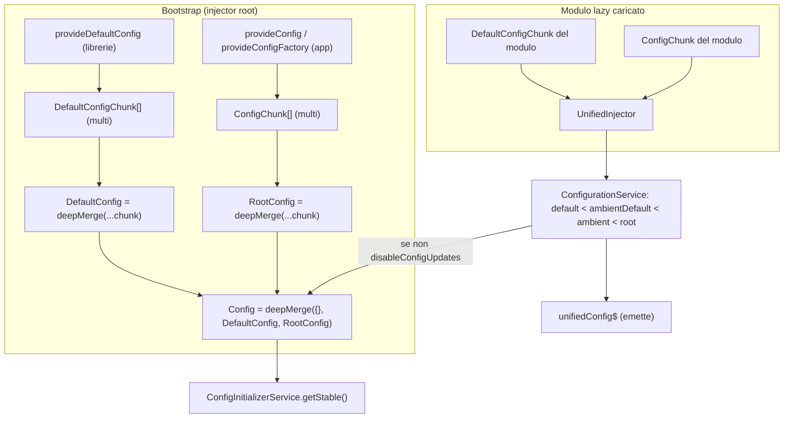
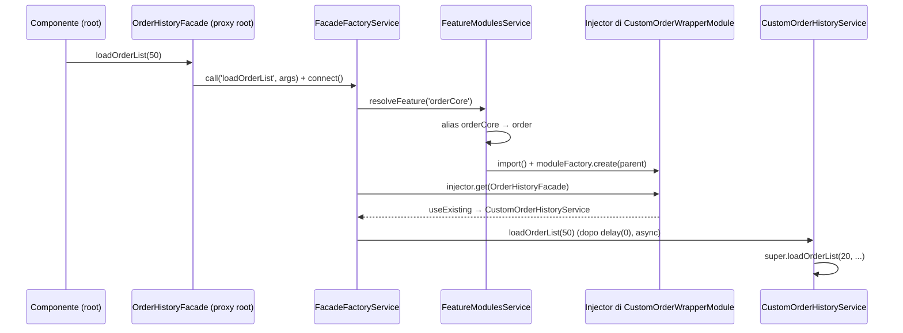
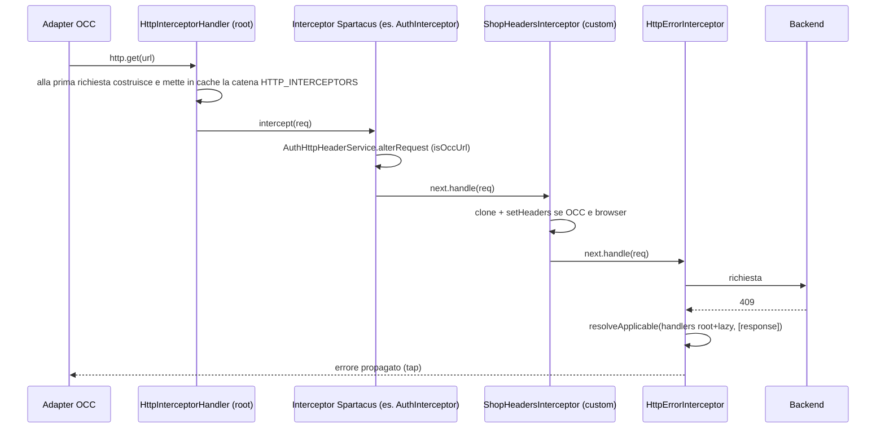
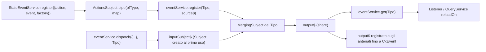

# 50 — Ricette: configurazione, DI, interceptor, eventi

> Riferimenti allo SHA `5b7a1c2bf2808d7380bc20596d10f4fa710c3da1` (vedi [00-meta](../00-meta.md)).

## 1. A cosa serve e perché esiste

Questo capitolo raccoglie le personalizzazioni "trasversali" di uno storefront Spartacus, quelle che non riguardano un componente o una feature specifica ma il modo in cui l'applicazione viene assemblata:

- **configurazione**: sovrascrivere i default delle librerie, calcolare config con una factory, definire una config tipizzata per il proprio codice, leggerla nel momento giusto;
- **dependency injection**: sostituire un servizio root caricato subito (eager) o l'implementazione di una facade caricata in lazy loading;
- **HTTP**: aggiungere un interceptor e personalizzare la gestione degli errori HTTP;
- **eventi**: definire, emettere e ascoltare eventi custom, anche derivati da altri eventi o da action NgRx.

Ogni ricetta (sezione 3) segue lo stesso schema: quando usarla, un esempio di codice che importa **solo** simboli esportati dai `public_api.ts` dei pacchetti `@spartacus/*` (oltre ad `@angular/*` e `rxjs`), i file sorgente che rendono possibile il meccanismo, i limiti. La regola "solo API pubblica" non è estetica: la superficie pubblica di `@spartacus/core` è esattamente quella che `core-libs/core/public_api.ts` riesporta dai barrel delle singole aree (config, event, lazy-loading, state, util, http, occ, auth, global-message, window, logger) — `core-libs/core/public_api.ts:L10-L36`. Un simbolo che non compare in quella catena (per esempio `configFactory`, `MergingSubject` o `CONFIG_INITIALIZER_FORROOT_GUARD`) è interno e può cambiare senza preavviso — `core-libs/core/src/config/index.ts:L7-L19`, `core-libs/core/src/event/index.ts:L7-L8`, `core-libs/core/src/config/config-initializer/index.ts:L7-L14`. Il tema è approfondito in [54 — API pubblica vs interna](54-upgrade-safe.md).

Le ricette presuppongono i meccanismi spiegati nella Parte I e II:

- DI Angular (multi provider, `providedIn`, `useExisting`/`useClass`, ordine di elaborazione dei provider): [01 — Dependency Injection](../parte-1/01-dependency-injection.md);
- `HttpClient` e interceptor Angular: [06 — HttpClient e interceptor](../parte-1/06-httpclient-interceptor.md);
- config di Spartacus (chunk, `deepMerge`, initializer, validator, config unificata): [11 — Configurazione](../parte-2/11-configurazione.md);
- feature module lazy, `featureModules`, `UnifiedInjector`: [12 — Feature module e lazy loading](../parte-2/12-feature-module-lazy.md);
- facade, `facadeFactory`, `EventService`, `StateEventService`, query/command: [20 — Facade, command/query, eventi](../parte-2/20-facade-command-query-eventi.md);
- endpoint OCC e `OccEndpointsService`: [21 — OCC](../parte-2/21-occ.md);
- `AuthInterceptor` e `AuthHttpHeaderService`: [22 — Autenticazione](../parte-2/22-auth.md);
- `HttpErrorHandler` e global message: [41 — Errori e global message](../parte-2/41-errori-global-message.md).

## 2. Mappa dei file

File sorgente che abilitano le ricette (non file da modificare: le ricette si applicano nel codice dell'applicazione).

| Path | Ruolo |
|---|---|
| `core-libs/core/public_api.ts` | Superficie pubblica di `@spartacus/core`; blocco AUGMENTABLE_TYPES con `Config` (L38-L40) |
| `core-libs/core/src/config/index.ts` | Barrel config: provider helper, token, `ConfigModule`, `ConfigurationService`, initializer, validator |
| `core-libs/core/src/config/config-tokens.ts` | `Config`, `DefaultConfig`, `RootConfig`, `ConfigChunk`, `DefaultConfigChunk` e factory di merge |
| `core-libs/core/src/config/config-providers.ts` | `provideConfig`, `provideConfigFactory`, `provideDefaultConfig`, `provideDefaultConfigFactory` |
| `core-libs/core/src/config/utils/deep-merge.ts` | Algoritmo di merge (oggetti ricorsivi, array sostituiti) |
| `core-libs/core/src/config/services/configuration.service.ts` | Config unificata con i chunk dei moduli lazy (`unifiedConfig$`) |
| `core-libs/core/src/config/config-initializer/config-initializer.service.ts` | `getStable(...scopes)` |
| `core-libs/core/src/config/config-validator/config-validator.ts` | `provideConfigValidator`, `ConfigValidator` |
| `core-libs/core/src/features-config/config/features-config.ts` | Flag deprecato `disableConfigUpdates` |
| `core-libs/core/src/lazy-loading/facade-factory/facade-factory.service.ts` | Proxy delle facade lazy: risoluzione dell'implementazione dall'injector del modulo lazy |
| `core-libs/core/src/lazy-loading/feature-modules.service.ts` | `isConfigured`, risoluzione degli alias di feature |
| `core-libs/core/src/lazy-loading/lazy-modules.service.ts` | Creazione dell'injector del modulo lazy (parent = root o dipendenze) |
| `core-libs/core/src/lazy-loading/unified-injector.ts` | `getMulti`: multi provider di root + moduli lazy |
| `core-libs/core/src/auth/user-auth/services/auth-http-header.service.ts` | Servizio root delegato da `AuthInterceptor` (esempio di override eager) |
| `core-libs/core/src/auth/user-auth/http-interceptors/auth.interceptor.ts` | Interceptor auth che delega a `AuthHttpHeaderService` |
| `core-libs/core/src/global-message/http-interceptors/http-error.interceptor.ts` | Sceglie l'`HttpErrorHandler` applicabile tra root + lazy |
| `core-libs/core/src/global-message/http-interceptors/handlers/http-error.handler.ts` | Classe base astratta degli handler di errore |
| `core-libs/core/src/util/applicable.ts` | `Priority`, `resolveApplicable` |
| `core-libs/core/src/occ/services/occ-endpoints.service.ts` | `getBaseUrl()` per riconoscere le chiamate OCC |
| `core-libs/core/src/event/event.service.ts` | `register`, `get`, `dispatch` |
| `core-libs/core/src/event/cx-event.ts` | Classe base `CxEvent` |
| `core-libs/core/src/event/utils/merging-subject.ts` | Sottoscrizione lazy alle sorgenti |
| `core-libs/core/src/state/event/state-event.service.ts` | Action NgRx → eventi |
| `core-libs/core/src/util/create-from.ts` | `createFrom(type, data)` |
| `core-libs/storefront/events/navigation/navigation.event.ts` | `NavigationEvent` (base per eventi di pagina derivati) |
| `angular:packages/core/src/di/r3_injector.ts` | Multi provider (push) vs single provider (sostituzione); record esplicito vs `providedIn` |
| `angular:packages/core/src/di/provider_collection.ts` | Ordine: provider degli `imports` prima dei `providers` del modulo |
| `angular:packages/core/src/render3/di.ts` | `ɵɵgetInheritedFactory`: sottoclassi senza costruttore |
| `angular:packages/common/http/src/interceptor.ts` | Catena degli interceptor DI, ordine, cache |
| `angular:packages/common/http/src/backend.ts` | `HttpInterceptorHandler`: catena costruita dall'injector root |
| `projects/storefrontapp/src/app/app.config.ts` | `provideHttpClient(withFetch(), withInterceptorsFromDi())` |
| `projects/storefrontapp/src/app/spartacus/spartacus-configuration.module.ts` | Esempi di `provideConfig`/`provideConfigFactory` nell'app demo |
| `projects/storefrontapp/src/app/spartacus/features/order/order-wrapper.module.ts` | Wrapper module lazy con estensioni (modello per override di facade) |

## 3. Come funziona passo per passo

Le ricette sono undici. Per ogni simbolo `@spartacus/*` usato negli esempi è indicata la catena di export dal `public_api.ts` del pacchetto fino alla definizione. Tutti gli esempi sono **illustrativi e non presenti nel repo**: sono modellati sugli usi reali citati nella sezione 5. Nomi di classi/file inventati per gli esempi sono scritti in corsivo nel testo.

### 3.1 Ricetta 1 — Sovrascrivere la configurazione di Spartacus con `provideConfig`

#### Quando usarlo

Quando si vuole cambiare un valore di default di una libreria (URL del backend, route, `featureModules`, flag `pwa`, ecc.) dal codice dell'applicazione. È lo strumento standard: le librerie forniscono i propri valori come *default config*, l'applicazione come *root config*, e la root vince sempre — `core-libs/core/src/config/config-tokens.ts:L10-L12`, `core-libs/core/src/config/config-tokens.ts:L49-L62`.

#### Esempio

Esempio illustrativo, non presente nel repo.

```ts
// app/spartacus/custom-config.module.ts (esempio illustrativo, non presente nel repo)
import { NgModule } from '@angular/core';
import { CmsConfig, provideConfig } from '@spartacus/core';
import { ORDER_FEATURE } from '@spartacus/order/root';

@NgModule({
  providers: [
    // 1. override puntuale: deepMerge ricorsivo sugli oggetti
    provideConfig({
      backend: {
        occ: {
          baseUrl: 'https://api.example.com',
        },
      },
    }),
    // 2. override di una chiave di featureModules (cast tipizzato, come nell'app demo)
    provideConfig(<CmsConfig>{
      featureModules: {
        [ORDER_FEATURE]: {
          module: () =>
            import('./order/custom-order-wrapper.module').then(
              (m) => m.CustomOrderWrapperModule
            ),
        },
      },
    }),
  ],
})
export class CustomConfigModule {}
```

Il modulo va importato **dopo** i moduli feature che configurano le stesse chiavi (o i provider vanno messi nei `providers` dell'`AppModule`, elaborati dopo tutti gli import).

Catena di export:

- `provideConfig`: `core-libs/core/public_api.ts:L15-L15` → `core-libs/core/src/config/index.ts:L9-L9` → definizione `core-libs/core/src/config/config-providers.ts:L18-L27`.
- `CmsConfig`: `core-libs/core/public_api.ts:L14-L14` → `core-libs/core/src/cms/index.ts:L8-L8` → `core-libs/core/src/cms/config/index.ts:L7-L7` → definizione `core-libs/core/src/cms/config/cms-config.ts:L128-L129`.
- `ORDER_FEATURE`: `feature-libs/order/root/public_api.ts:L9-L9` → definizione `feature-libs/order/root/feature-name.ts:L7-L7`.

#### Perché funziona (file sorgente)

- `provideConfig(config)` restituisce un provider `multi: true` su `ConfigChunk` — `core-libs/core/src/config/config-providers.ts:L18-L27`.
- Angular aggiunge (`push`) ogni provider multi al record del token nell'ordine in cui li elabora — `angular:packages/core/src/di/r3_injector.ts:L497-L521` — e per un NgModule elabora prima i provider degli `imports`, poi i propri `providers` — `angular:packages/core/src/di/provider_collection.ts:L293-L321`, `angular:packages/core/src/di/provider_collection.ts:L345-L353`.
- `RootConfig` fonde tutti i `ConfigChunk` nell'ordine dell'array, `DefaultConfig` tutti i `DefaultConfigChunk` — `core-libs/core/src/config/config-tokens.ts:L23-L47` — e `Config` = `deepMerge({}, DefaultConfig, RootConfig)` — `core-libs/core/src/config/config-tokens.ts:L10-L21`.
- `deepMerge` ricorre sugli oggetti plain e sostituisce tutto il resto, array compresi — `core-libs/core/src/config/utils/deep-merge.ts:L7-L49`.
- Esempio reale di override per ordine: `WishListV2FeatureModule` importa `WishListFeatureModule` e ridefinisce nei propri `providers` la stessa chiave `featureModules[CART_WISH_LIST_FEATURE]` — `projects/storefrontapp/src/app/spartacus/features/cart/wish-list-v2-feature.module.ts:L12-L27`, `projects/storefrontapp/src/app/spartacus/features/cart/wish-list-feature.module.ts:L35-L40`.

#### Limiti e trappole

- Gli **array sono sostituiti**, non concatenati: un `provideConfig` con un array rimpiazza l'intero array di default — `core-libs/core/src/config/utils/deep-merge.ts:L43-L45`.
- Tra due `ConfigChunk` sulla stessa chiave vince l'**ultimo elaborato**; un modulo importato prima del modulo feature viene sovrascritto da quest'ultimo — `angular:packages/core/src/di/provider_collection.ts:L293-L353`. L'app demo lo dichiara esplicitamente per `TestConfigModule`: "Should be imported after other config modules" — `projects/storefrontapp/src/app/private/private.providers.ts:L54-L54`.
- Un `provideConfig` dentro un modulo **lazy** non può battere un `provideConfig` della root: nella config unificata `rootConfig` è applicato per ultimo — `core-libs/core/src/config/services/configuration.service.ts:L92-L99`.
- Non usare `ConfigChunk` direttamente: il JSDoc lo vieta — `core-libs/core/src/config/config-tokens.ts:L49-L52`.
- `ConfigModule.withConfig(...)` è equivalente (è solo un wrapper `ModuleWithProviders` di `provideConfig`) — `core-libs/core/src/config/config.module.ts:L13-L66`; ma i `ModuleWithProviders` sono elaborati dopo gli import semplici dello stesso modulo — `angular:packages/core/src/di/provider_collection.ts:L293-L321`.

### 3.2 Ricetta 2 — Config calcolata con `provideConfigFactory` senza mutare i default

#### Quando usarlo

Quando la config non è un letterale statico ma va derivata da un'altra config (tipicamente: partire dal layout di default e aggiungere/rimuovere slot) o richiede dipendenze iniettate. L'app demo fornisce così il layout: `provideConfigFactory(layoutConfigFactory)` — `projects/storefrontapp/src/app/spartacus/spartacus-configuration.module.ts:L44-L72`.

#### Esempio

Esempio illustrativo, non presente nel repo.

```ts
// app/spartacus/custom-layout-config.ts (esempio illustrativo, non presente nel repo)
import { NgModule } from '@angular/core';
import { provideConfigFactory } from '@spartacus/core';
import {
  LayoutConfig,
  SlotConfig,
  layoutConfigFactory,
} from '@spartacus/storefront';

export function customLayoutConfigFactory(): LayoutConfig {
  // layoutConfigFactory() restituisce già una copia profonda della config statica
  const config = layoutConfigFactory();
  const landing = config.layoutSlots?.LandingPage2Template as
    | SlotConfig
    | undefined;
  if (landing?.slots) {
    // l'array verrà SOSTITUITO nel deepMerge: va fornito completo
    landing.slots = [...landing.slots, 'MyPromoSlot'];
  }
  return config;
}

@NgModule({
  providers: [provideConfigFactory(customLayoutConfigFactory)],
})
export class CustomLayoutConfigModule {}
```

Nell'app demo questo provider prenderebbe il posto di `provideConfigFactory(layoutConfigFactory)`; se convivono, vince quello elaborato per ultimo.

Catena di export:

- `provideConfigFactory`: `core-libs/core/public_api.ts:L15-L15` → `core-libs/core/src/config/index.ts:L9-L9` → definizione `core-libs/core/src/config/config-providers.ts:L37-L47`.
- `LayoutConfig`, `SlotConfig`: `core-libs/storefront/public_api.ts:L26-L26` → `core-libs/storefront/layout/index.ts:L9-L9` → `core-libs/storefront/layout/config/index.ts:L8-L8` → definizioni `core-libs/storefront/layout/config/layout-config.ts:L36-L46`, `core-libs/storefront/layout/config/layout-config.ts:L90-L102`.
- `layoutConfigFactory`: `core-libs/storefront/public_api.ts:L27-L27` → `core-libs/storefront/recipes/index.ts:L7-L7` → `core-libs/storefront/recipes/config/index.ts:L8-L8` → definizione `core-libs/storefront/recipes/config/layout-config.ts:L190-L198`.

#### Perché funziona (file sorgente)

- `provideConfigFactory(factory, deps?, defaultConfig = false)` produce un `FactoryProvider` multi su `ConfigChunk` — `core-libs/core/src/config/config-providers.ts:L37-L47`; `ConfigFactory` è `(...props: any[]) => Config` — `core-libs/core/src/config/config-factory.ts:L9-L9`.
- La factory viene eseguita quando `RootConfig` inietta tutti i `ConfigChunk` — `core-libs/core/src/config/config-tokens.ts:L37-L39`.
- `layoutConfigFactory` clona la config statica con `JSON.parse(JSON.stringify(...))` prima di modificarla — `core-libs/storefront/recipes/config/layout-config.ts:L190-L198` — quindi modificare il risultato non tocca l'oggetto `layoutConfig` condiviso.

#### Limiti e trappole

- `deepMerge` **muta il target** e il `Config` globale viene ulteriormente modificato in place quando arrivano moduli lazy: non mutare oggetti statici condivisi, clonali — `core-libs/core/src/config/services/configuration.service.ts:L102-L105`, `core-libs/storefront/recipes/config/layout-config.ts:L190-L191`.
- La costante `layoutConfig` è `@deprecated` a favore di `layoutConfigFactory` — `core-libs/storefront/recipes/config/layout-config.ts:L13-L27`.
- In una **libreria** usare `provideDefaultConfigFactory` (o il terzo argomento `true`), non `provideConfigFactory`: il JSDoc lo raccomanda e una regola ESLint del monorepo lo controlla — `core-libs/core/src/config/config-providers.ts:L29-L36`, `tools/eslint-rules/rules/use-provide-default-config-factory.ts:L22-L46`.
- La factory gira dentro un contesto di injection durante la creazione di `Config`: iniettare (anche indirettamente) `Config` dalla factory crea una dipendenza circolare. ⚠️ DA VERIFICARE con test: deduzione da `core-libs/core/src/config/config-tokens.ts:L10-L47` (nessun caso nel repo).

### 3.3 Ricetta 3 — Config tipizzata per il proprio codice (augmentation + default + validator)

#### Quando usarlo

Quando un proprio servizio/feature ha parametri configurabili e si vuole lo stesso modello delle librerie: una classe astratta iniettabile che è un alias di `Config`, un default sovrascrivibile dall'app, e un controllo in dev mode.

#### Esempio

Esempio illustrativo, non presente nel repo.

```ts
// app/shop-headers/shop-headers-config.ts (esempio illustrativo, non presente nel repo)
import { Injectable, NgModule } from '@angular/core';
import {
  Config,
  ConfigValidator,
  provideConfigValidator,
  provideDefaultConfig,
} from '@spartacus/core';

@Injectable({
  providedIn: 'root',
  useExisting: Config,
})
export abstract class ShopHeadersConfig {
  shopHeaders?: {
    headerName?: string;
    value?: string;
  };
}

declare module '@spartacus/core' {
  interface Config extends ShopHeadersConfig {}
}

export const defaultShopHeadersConfig: ShopHeadersConfig = {
  shopHeaders: {
    headerName: 'X-Shop-Channel',
    value: 'web',
  },
};

export const shopHeadersConfigValidator: ConfigValidator = (config) => {
  if (!config.shopHeaders?.headerName) {
    return 'Please configure shopHeaders.headerName';
  }
};

@NgModule({
  providers: [
    provideDefaultConfig(defaultShopHeadersConfig),
    provideConfigValidator(shopHeadersConfigValidator),
  ],
})
export class ShopHeadersConfigModule {}
```

L'applicazione può poi scrivere `provideConfig({ shopHeaders: { value: 'kiosk' } })` con tipizzazione completa.

Catena di export:

- `Config`: `core-libs/core/public_api.ts:L40-L40` (blocco AUGMENTABLE_TYPES) e `core-libs/core/public_api.ts:L15-L15` → `core-libs/core/src/config/index.ts:L10-L16` → definizione `core-libs/core/src/config/config-tokens.ts:L17-L21`.
- `provideDefaultConfig`: `core-libs/core/src/config/index.ts:L9-L9` → definizione `core-libs/core/src/config/config-providers.ts:L55-L61`.
- `ConfigValidator`, `provideConfigValidator`: `core-libs/core/src/config/index.ts:L17-L17` → `core-libs/core/src/config/config-validator/index.ts:L7-L7` → definizioni `core-libs/core/src/config/config-validator/config-validator.ts:L20-L20`, `core-libs/core/src/config/config-validator/config-validator.ts:L27-L35`.

#### Perché funziona (file sorgente)

- Pattern identico a `CartConfig`: classe astratta `providedIn: 'root', useExisting: Config` + `declare module '@spartacus/core' { interface Config extends CartConfig {} }` — `feature-libs/cart/base/root/config/cart-config.ts:L12-L32`; e a `SegmentRefsConfig` con il suo default — `integration-libs/segment-refs/root/config/segment-refs-config.ts:L10-L22`, `integration-libs/segment-refs/root/config/default-segment-refs-config.ts:L9-L13`.
- `Config` è esportato nel blocco dei tipi "augmentable" proprio per consentire la module augmentation — `core-libs/core/public_api.ts:L38-L40`.
- `provideDefaultConfig` punta sempre a `DefaultConfigChunk`, che perde contro qualsiasi `ConfigChunk` — `core-libs/core/src/config/config-providers.ts:L55-L61`, `core-libs/core/src/config/config-tokens.ts:L10-L12`.
- `provideConfigValidator(fn)` registra un multi provider su `ConfigValidatorToken`; `ConfigValidator = (config) => string | void` — `core-libs/core/src/config/config-validator/config-validator.ts:L11-L35`.

#### Limiti e trappole

- I validator girano **solo in dev mode**, dopo `getStable()`, e producono solo `logger.warn`: non bloccano l'app — `core-libs/core/src/config/config-validator/config-validator.module.ts:L23-L37`, `core-libs/core/src/config/config-validator/config-validator.ts:L37-L48`.
- Se il modulo che fornisce il default è **lazy**, il default arriva nel `Config` iniettato solo grazie al merge in place, disattivabile con `features.disableConfigUpdates` — `core-libs/core/src/config/services/configuration.service.ts:L102-L105`, `core-libs/core/src/features-config/config/features-config.ts:L101-L116`. È il caso reale di `OmfOrderModule` + `OmfConfig` — `integration-libs/omf/order/omf-order.module.ts:L15-L26`, `integration-libs/omf/order/config/omf-config.ts:L11-L21`.
- La module augmentation è globale: due augmentation con la stessa chiave e tipi incompatibili producono errori TypeScript.

### 3.4 Ricetta 4 — Leggere la config al momento giusto (`getStable`, `unifiedConfig$`)

#### Quando usarlo

- Codice che gira durante il bootstrap (un `APP_INITIALIZER`, il costruttore di un servizio istanziato presto) e che deve vedere la config **dopo** i `CONFIG_INITIALIZER` asincroni: usare `ConfigInitializerService.getStable(...)`.
- Codice che deve reagire alla config contribuita da moduli **lazy** (o che deve funzionare anche con `disableConfigUpdates` attivo): usare `ConfigurationService.unifiedConfig$`.

#### Esempio

Esempio illustrativo, non presente nel repo (usa l'augmentation della Ricetta 3).

```ts
// app/shop-headers/shop-headers-reader.service.ts (esempio illustrativo, non presente nel repo)
import { Injectable, inject } from '@angular/core';
import { ConfigInitializerService, ConfigurationService } from '@spartacus/core';
import { Observable } from 'rxjs';
import { distinctUntilChanged, map } from 'rxjs/operators';
import './shop-headers-config'; // porta in scope l'augmentation di Config

@Injectable({ providedIn: 'root' })
export class ShopHeadersReaderService {
  protected configInitializer = inject(ConfigInitializerService);
  protected configuration = inject(ConfigurationService);

  /** Valore alla fine dell'inizializzazione (una sola emissione). */
  readonly stableHeaderName$: Observable<string | undefined> =
    this.configInitializer
      .getStable('shopHeaders')
      .pipe(map((config) => config.shopHeaders?.headerName));

  /** Valore che si aggiorna se un modulo lazy contribuisce config. */
  readonly liveHeaderName$: Observable<string | undefined> =
    this.configuration.unifiedConfig$.pipe(
      map((config) => config.shopHeaders?.headerName),
      distinctUntilChanged()
    );
}
```

Catena di export:

- `ConfigInitializerService`: `core-libs/core/public_api.ts:L15-L15` → `core-libs/core/src/config/index.ts:L8-L8` → `core-libs/core/src/config/config-initializer/index.ts:L14-L14` → definizione `core-libs/core/src/config/config-initializer/config-initializer.service.ts:L21-L24`.
- `ConfigurationService`: `core-libs/core/src/config/index.ts:L19-L19` → definizione `core-libs/core/src/config/services/configuration.service.ts:L21-L24`.

#### Perché funziona (file sorgente)

- `getStable(...scopes)` è documentato come "Recommended way to get config for code that can run before app will finish initialization"; se la config è già stabile emette subito il `Config`, altrimenti attende che gli scope richiesti non siano più in corso — `core-libs/core/src/config/config-initializer/config-initializer.service.ts:L46-L70`.
- `ConfigInitializerModule.forRoot()` trattiene la navigazione iniziale finché la config non è stabile — `core-libs/core/src/config/config-initializer/config-initializer.module.ts:L41-L68` — ed è già importato da `BaseCoreModule` — `core-libs/core/src/base-core.module.ts:L30-L32`.
- `unifiedConfig$` è un `BehaviorSubject` inizializzato con il `Config` globale che riemette `default < ambientDefault < ambient < root` quando un modulo lazy porta nuovi chunk — `core-libs/core/src/config/services/configuration.service.ts:L25-L30`, `core-libs/core/src/config/services/configuration.service.ts:L48-L49`, `core-libs/core/src/config/services/configuration.service.ts:L57-L106`.
- Modelli reali: `getStable('context')` in un `MODULE_INITIALIZER` del cart — `feature-libs/cart/base/core/cart-persistence.module.ts:L19-L31`; `CmsComponentsService` copia `cmsComponents` dalla config stabile — `core-libs/storefront/cms-structure/services/cms-components.service.ts:L61-L68`.

#### Limiti e trappole

- `getStable()` emette una volta sola: non vede config arrivata in seguito da moduli lazy — `core-libs/core/src/config/config-initializer/config-initializer.service.ts:L62-L69`.
- Leggere `inject(Config)` una volta nel costruttore e memorizzare il valore perde i contributi lazy successivi; con `disableConfigUpdates` attivo il `Config` iniettato non cambia mai e il JSDoc impone `unifiedConfig$` — `core-libs/core/src/features-config/config/features-config.ts:L109-L113`.
- `disableConfigUpdates` è disattivo per default (`isFeatureEnabled` → `false` se assente) — `core-libs/core/src/features-config/utils/feature-config-utils.ts:L48-L65`.
- `initialize()` di `ConfigInitializerService` è `@internal`: non chiamarlo — `core-libs/core/src/config/config-initializer/config-initializer.service.ts:L124-L129`.

### 3.5 Ricetta 5 — Sostituire un servizio root eager (`useExisting` + sottoclasse)

#### Quando usarlo

Quando si vuole cambiare il comportamento di un servizio `providedIn: 'root'` che non è dietro una facade lazy, per esempio `AuthHttpHeaderService` (usato da `AuthInterceptor` per decidere a quali richieste aggiungere il token). Il codice stesso indica questo punto come quello da personalizzare: l'interceptor "only hooks into request send/received events" — `core-libs/core/src/auth/user-auth/http-interceptors/auth.interceptor.ts:L18-L27`.

#### Esempio

Esempio illustrativo, non presente nel repo.

```ts
// app/auth/custom-auth-http-header.service.ts (esempio illustrativo, non presente nel repo)
import { Injectable, NgModule } from '@angular/core';
import { AuthHttpHeaderService } from '@spartacus/core';

@Injectable({ providedIn: 'root' })
export class CustomAuthHttpHeaderService extends AuthHttpHeaderService {
  // Nessun costruttore: Angular usa la factory ereditata da AuthHttpHeaderService.

  /**
   * Tratta come "OCC" anche un secondo backend fidato, così riceve
   * il token e la gestione del refresh.
   */
  protected override isOccUrl(url: string): boolean {
    return super.isOccUrl(url) || url.startsWith('https://api2.example.com/');
  }
}

@NgModule({
  providers: [
    {
      provide: AuthHttpHeaderService,
      useExisting: CustomAuthHttpHeaderService,
    },
  ],
})
export class CustomAuthModule {}
```

*CustomAuthModule* va importato in un modulo **eager** (es. l'`AppModule`), non in un modulo lazy.

Catena di export:

- `AuthHttpHeaderService`: `core-libs/core/public_api.ts:L11-L11` → `core-libs/core/src/auth/index.ts:L9-L9` → `core-libs/core/src/auth/user-auth/index.ts:L20-L20` → `core-libs/core/src/auth/user-auth/services/index.ts:L10-L10` → definizione `core-libs/core/src/auth/user-auth/services/auth-http-header.service.ts:L87-L90`.

#### Perché funziona (file sorgente)

- Un record esplicito nell'injector ha precedenza sulla definizione `@Injectable({providedIn})`: quest'ultima è usata solo se `records.get(token)` è `undefined` — `angular:packages/core/src/di/r3_injector.ts:L347-L366`.
- `useExisting` è un alias: chi inietta `AuthHttpHeaderService` riceve la stessa istanza di *CustomAuthHttpHeaderService* — `angular:packages/core/src/di/r3_injector.ts:L657-L677`.
- `isOccUrl` è `protected` ed è l'unico punto usato da `shouldCatchError`, `shouldAddAuthorizationHeader` e `alterRequest` — `core-libs/core/src/auth/user-auth/services/auth-http-header.service.ts:L175-L207`.
- Una sottoclasse `@Injectable` senza costruttore usa la factory del padre (`ɵɵgetInheritedFactory`) — `angular:packages/core/src/render3/di.ts:L918-L945`; lo stesso schema è usato nel repo da `InternalServerErrorHandler` — `core-libs/core/src/global-message/http-interceptors/handlers/internal-server/internal-server.handler.ts:L13-L29`.
- Modello reale: `AsmRootModule` sostituisce `AuthStorageService`, `AuthService`, `AuthHttpHeaderService` con `useExisting` verso sottoclassi `providedIn: 'root'`, nel root module eager — `feature-libs/asm/root/asm-root.module.ts:L65-L87`, `feature-libs/asm/root/services/asm-auth-http-header.service.ts:L26-L60`.

#### Limiti e trappole

- **Conflitto con ASM**: se è installato `AsmRootModule`, anche lui ridefinisce `AuthHttpHeaderService`; vince il provider elaborato per ultimo e l'altro viene ignorato — `feature-libs/asm/root/asm-root.module.ts:L73-L76`, `angular:packages/core/src/di/r3_injector.ts:L513-L521`. In quel caso la sottoclasse dovrebbe estendere la classe ASM (se pubblica nel `public_api` di `@spartacus/asm/root`; ⚠️ DA VERIFICARE: export non controllato in questo capitolo).
- L'override in un modulo **lazy** è visibile solo ai consumer risolti da quell'injector; `AuthInterceptor` (root) continuerebbe a usare l'istanza root. ⚠️ DA VERIFICARE a runtime: deduzione dalla gerarchia degli injector — `core-libs/core/src/lazy-loading/lazy-modules.service.ts:L85-L107`, `angular:packages/core/src/di/r3_injector.ts:L347-L366`.
- Se si dichiara un costruttore, bisogna rilanciare a `super(...)` tutte e sette le dipendenze nell'ordine esatto, come fa ASM — `core-libs/core/src/auth/user-auth/services/auth-http-header.service.ts:L157-L165`, `feature-libs/asm/root/services/asm-auth-http-header.service.ts:L33-L52`; con `inject()` si evita l'accoppiamento alla firma.
- Estendere `isOccUrl` invia il token OAuth a un altro host: farlo solo per backend fidati.
- `useClass` invece di `useExisting` creerebbe un'istanza distinta da quella registrata sul token della sottoclasse — `angular:packages/core/src/di/r3_injector.ts:L657-L677`.

### 3.6 Ricetta 6 — Sostituire l'implementazione di una facade lazy (wrapper module)

#### Quando usarlo

Quando si vuole cambiare il comportamento di una facade astratta come `OrderHistoryFacade` o `ActiveCartFacade`, la cui implementazione vive nel chunk lazy della feature. Fornire la facade nell'injector root disattiverebbe il lazy loading (vedi trappole): l'override va fatto **dentro** il modulo lazy, con un wrapper module.

#### Esempio

Esempio illustrativo, non presente nel repo.

```ts
// app/spartacus/features/order/custom-order-wrapper.module.ts (esempio illustrativo, non presente nel repo)
import { Injectable, NgModule } from '@angular/core';
import { OrderModule } from '@spartacus/order';
import { OrderHistoryService } from '@spartacus/order/core';
import { OrderHistoryFacade } from '@spartacus/order/root';

@Injectable()
export class CustomOrderHistoryService extends OrderHistoryService {
  // Nessun costruttore: factory ereditata da OrderHistoryService.

  override loadOrderList(
    pageSize: number,
    currentPage?: number,
    sort?: string
  ): void {
    super.loadOrderList(Math.min(pageSize, 20), currentPage, sort);
  }
}

@NgModule({
  // 1. prima il modulo feature (registra OrderHistoryFacade -> OrderHistoryService)
  imports: [OrderModule],
  // 2. poi i propri provider, elaborati DOPO gli imports: vincono
  providers: [
    CustomOrderHistoryService,
    {
      provide: OrderHistoryFacade,
      useExisting: CustomOrderHistoryService,
    },
  ],
})
export class CustomOrderWrapperModule {}
```

Il wrapper si collega con `featureModules[ORDER_FEATURE].module` come nella Ricetta 1, al posto di `OrderWrapperModule` dell'app demo.

Catena di export:

- `OrderModule`: `feature-libs/order/public_api.ts:L16-L16` → definizione `feature-libs/order/order.module.ts:L12-L15`.
- `OrderHistoryService`: `feature-libs/order/core/public_api.ts:L8-L8` → `feature-libs/order/core/facade/index.ts:L7-L7` → definizione `feature-libs/order/core/facade/order-history.service.ts:L29-L37`.
- `OrderHistoryFacade`: `feature-libs/order/root/public_api.ts:L8-L8` → `feature-libs/order/root/facade/index.ts:L7-L7` → definizione `feature-libs/order/root/facade/order-history.facade.ts:L45-L49`.

#### Perché funziona (file sorgente)

- La facade root è una classe astratta `providedIn: 'root'` con `useFactory: orderHistoryFacadeFactory`, che crea un proxy con `facadeFactory({ feature: ORDER_CORE_FEATURE, methods: [...], async: true })`; `loadOrderList` è tra i `methods` — `feature-libs/order/root/facade/order-history.facade.ts:L19-L49`.
- Il proxy risolve la feature e prende l'implementazione con `moduleRef.injector.get(facadeClass)`, cioè dall'injector del modulo lazy — `core-libs/core/src/lazy-loading/facade-factory/facade-factory.service.ts:L38-L57`.
- `ORDER_CORE_FEATURE` è alias di `ORDER_FEATURE`, che dipende da `CART_BASE_FEATURE` — `feature-libs/order/root/order-root.module.ts:L68-L80`; gli alias stringa sono risolti da `FeatureModulesService` — `core-libs/core/src/lazy-loading/feature-modules.service.ts:L95-L100`.
- `OrderModule` importa `OrderCoreModule`, che registra `OrderHistoryService` e `{ provide: OrderHistoryFacade, useExisting: OrderHistoryService }` — `feature-libs/order/order.module.ts:L12-L15`, `feature-libs/order/core/order-core.module.ts:L17-L29`, `feature-libs/order/core/facade/facade-providers.ts:L33-L37`. I `providers` del wrapper sono elaborati dopo gli import e sostituiscono il record (single provider) — `angular:packages/core/src/di/provider_collection.ts:L345-L353`, `angular:packages/core/src/di/r3_injector.ts:L513-L521`.
- Modelli reali: `OrderWrapperModule` importa `OrderModule` e poi le estensioni, fra cui `OmfOrderModule`, che ridefinisce `OrderHistoryFacade` con `useClass: OmfOrderHistoryService` — `projects/storefrontapp/src/app/spartacus/features/order/order-wrapper.module.ts:L14-L27`, `integration-libs/omf/order/omf-order.module.ts:L15-L26`; dentro una libreria, `WishListWithV2Module` = `imports: [WishListModule, WishListV2Module]` — `feature-libs/cart/wish-list/wish-list-with-v2.module.ts:L11-L14`, `feature-libs/cart/wish-list/wish-list-v2.module.ts:L20-L50`.

#### Limiti e trappole

- **Non** fornire `OrderHistoryFacade` nell'injector root: il record esplicito disattiva `useFactory` (niente proxy), la classe finisce nel bundle iniziale e le sue dipendenze (store della feature) non sono registrate in root — `angular:packages/core/src/di/r3_injector.ts:L347-L366`. Il repo non contiene esempi di questo approccio.
- Il proxy espone **solo** i membri elencati in `methods`/`properties`: un metodo nuovo o un metodo non elencato non è raggiungibile dai consumer root; metodi con ritorno non-Observable restituiscono `EMPTY`. Esempio reale: `getQueryParams` non è in `methods` ed è `@deprecated` per questo, ma è proprio il metodo ridefinito da OMF — `core-libs/core/src/lazy-loading/facade-factory/facade-factory.service.ts:L84-L131`, `feature-libs/order/root/facade/order-history.facade.ts:L144-L148`, `integration-libs/omf/order/omf-order-history.service.ts:L12-L24`.
- Ordine degli `imports`: un'estensione che ridefinisce la facade deve venire **dopo** il modulo feature; se nel wrapper si importano anche `OmfOrderModule` o altre estensioni che ridefiniscono `OrderHistoryFacade`, vince l'ultimo elaborato (i `providers` del wrapper restano comunque dopo tutti gli import) — `projects/storefrontapp/src/app/spartacus/features/order/order-wrapper.module.ts:L24-L26`.
- `useClass` vs `useExisting`: OMF usa `useClass` e registra anche la classe, ottenendo due istanze distinte; `useExisting` (cart, wish-list, questo esempio) condivide l'istanza — `integration-libs/omf/order/omf-order.module.ts:L17-L23`.
- Chiamare un metodo della facade scarica subito il chunk (`connect()`), anche senza subscribe — `core-libs/core/src/lazy-loading/facade-factory/facade-factory.service.ts:L70-L92`.

### 3.7 Ricetta 7 — Interceptor HTTP custom

#### Quando usarlo

Quando si deve modificare ogni richiesta (header, query param) o osservare ogni risposta, in modo indipendente dagli adapter OCC. Per cambiare solo *quali* richieste ricevono il token, preferire la Ricetta 5; per reagire agli errori, la Ricetta 8.

#### Esempio

Esempio illustrativo, non presente nel repo (usa la config della Ricetta 3).

```ts
// app/shop-headers/shop-headers.interceptor.ts (esempio illustrativo, non presente nel repo)
import {
  HTTP_INTERCEPTORS,
  HttpEvent,
  HttpHandler,
  HttpInterceptor,
  HttpRequest,
} from '@angular/common/http';
import { Injectable, NgModule, Provider, inject } from '@angular/core';
import { OccEndpointsService, WindowRef } from '@spartacus/core';
import { Observable } from 'rxjs';
import { ShopHeadersConfig } from './shop-headers-config';

@Injectable({ providedIn: 'root' })
export class ShopHeadersInterceptor implements HttpInterceptor {
  protected config = inject(ShopHeadersConfig);
  protected occEndpoints = inject(OccEndpointsService);
  protected winRef = inject(WindowRef);

  intercept(
    request: HttpRequest<any>,
    next: HttpHandler
  ): Observable<HttpEvent<any>> {
    const headerName = this.config.shopHeaders?.headerName;
    const value = this.config.shopHeaders?.value;
    if (
      this.winRef.isBrowser() &&
      headerName &&
      value &&
      request.url.includes(this.occEndpoints.getBaseUrl())
    ) {
      request = request.clone({ setHeaders: { [headerName]: value } });
    }
    return next.handle(request);
  }
}

export const shopHeadersInterceptors: Provider[] = [
  {
    provide: HTTP_INTERCEPTORS,
    useExisting: ShopHeadersInterceptor,
    multi: true,
  },
];

@NgModule({
  providers: [...shopHeadersInterceptors],
})
export class ShopHeadersModule {}
```

*ShopHeadersModule* va importato in un modulo eager e l'app deve avere `provideHttpClient(withInterceptorsFromDi())`.

Catena di export:

- `OccEndpointsService`: `core-libs/core/public_api.ts:L27-L27` → `core-libs/core/src/occ/index.ts:L16-L16` → `core-libs/core/src/occ/services/index.ts:L7-L7` → definizione `core-libs/core/src/occ/services/occ-endpoints.service.ts:L34-L34`.
- `WindowRef`: `core-libs/core/public_api.ts:L36-L36` → `core-libs/core/src/window/index.ts:L7-L7` → definizione `core-libs/core/src/window/window-ref.ts:L16-L16`.
- `HTTP_INTERCEPTORS`: `@angular/common/http`, definito in `angular:packages/common/http/src/interceptor.ts:L195-L197`.

#### Perché funziona (file sorgente)

- L'app demo configura `provideHttpClient(withFetch(), withInterceptorsFromDi())` — `projects/storefrontapp/src/app/app.config.ts:L26-L35` — e lo schematic `add-spartacus` aggiunge la stessa riga — `core-libs/schematics/src/add-spartacus/update-app-config.ts:L96-L100`. `withInterceptorsFromDi` include gli interceptor class-based del multi provider `HTTP_INTERCEPTORS` — `angular:packages/common/http/src/provider.ts:L170-L194`.
- La funzione legacy legge `HTTP_INTERCEPTORS` una volta e avvolge la catena right-to-left, così il primo interceptor registrato è il più esterno — `angular:packages/common/http/src/interceptor.ts:L227-L240`; la catena è costruita e memorizzata da `HttpInterceptorHandler` con il proprio `EnvironmentInjector` — `angular:packages/common/http/src/backend.ts:L57-L66`, `angular:packages/common/http/src/backend.ts:L101-L122`.
- Modello reale: `OccSegmentRefsInterceptor` (`providedIn: 'root'`, filtro OCC con `getBaseUrl()`, `request.clone({ setHeaders })`, guardia `winRef.isBrowser()`) registrato con `useExisting` in un array di provider spalmato nel root module — `integration-libs/segment-refs/root/http-interceptors/occ-segment-refs.interceptor.ts:L18-L86`, `integration-libs/segment-refs/root/http-interceptors/index.ts:L11-L17`, `integration-libs/segment-refs/root/segment-refs-root.module.ts:L12-L20`.

#### Limiti e trappole

- Interceptor forniti in un modulo **lazy** non vengono applicati: la catena viene dall'injector root ed è in cache dalla prima richiesta. Tutti gli interceptor del repo sono in moduli root/eager — `angular:packages/common/http/src/backend.ts:L101-L122`, `angular:packages/common/http/src/interceptor.ts:L227-L240`.
- Senza `withInterceptorsFromDi()` non funzionano né gli interceptor Spartacus né quelli class-based custom; Angular avverte che il supporto DI "may be phased out" — `angular:packages/common/http/src/provider.ts:L170-L174`.
- Ordine: un interceptor nei `providers` dell'`AppModule` è elaborato dopo quelli dei moduli importati, quindi più interno (vede la richiesta già modificata, es. con l'header di autenticazione). ⚠️ DA VERIFICARE con test: deduzione da `angular:packages/core/src/di/r3_injector.ts:L497-L512` e `angular:packages/common/http/src/interceptor.ts:L233-L240`.
- `getBaseUrl()` per default include `baseUrl + prefix + baseSite`: richieste OCC senza base site (es. `baseSites`) non passano il filtro — `core-libs/core/src/occ/services/occ-endpoints.service.ts:L85-L101`.
- Gli interceptor girano anche in SSR: proteggere il codice browser-only con `winRef.isBrowser()` — `integration-libs/segment-refs/root/http-interceptors/occ-segment-refs.interceptor.ts:L53-L59`, `integration-libs/segment-refs/root/http-interceptors/occ-segment-refs.interceptor.ts:L73-L77`.
- Non tutto è estendibile: `@spartacus/segment-refs/root` esporta solo `SegmentRefsRootModule`, quindi `OccSegmentRefsInterceptor` non è importabile dall'app — `integration-libs/segment-refs/root/public_api.ts:L7-L7`.
- Per un parametro "per richiesta" Spartacus usa `HttpContextToken` (`OCC_HTTP_TOKEN`, `HTTP_TIMEOUT_CONFIG`) letti dall'interceptor con `request.context.get(...)` — `core-libs/core/src/occ/utils/occ-http-token.ts:L9-L20`, `feature-libs/asm/root/interceptors/user-id-http-header.interceptor.ts:L29-L84`.

### 3.8 Ricetta 8 — Gestione custom di un errore HTTP con `HttpErrorHandler`

#### Quando usarlo

Quando si vuole cambiare la reazione a uno status HTTP (messaggio, redirect, logout) per tutte le chiamate. A differenza di un interceptor, un `HttpErrorHandler` funziona anche se fornito in un modulo lazy, e si integra con la scelta per priorità degli handler core.

#### Esempio

Esempio illustrativo, non presente nel repo.

```ts
// app/errors/custom-conflict.handler.ts (esempio illustrativo, non presente nel repo)
import { HttpErrorResponse, HttpRequest } from '@angular/common/http';
import { Injectable, NgModule } from '@angular/core';
import {
  GlobalMessageType,
  HttpErrorHandler,
  HttpResponseStatus,
  Priority,
} from '@spartacus/core';

@Injectable({ providedIn: 'root' })
export class CustomConflictHandler extends HttpErrorHandler {
  // Nessun costruttore: factory ereditata (GlobalMessageService, PLATFORM_ID).
  responseStatus = HttpResponseStatus.CONFLICT;

  getPriority(): Priority {
    // i handler core usano LOW: NORMAL basta per vincere
    return Priority.NORMAL;
  }

  hasMatch(errorResponse: HttpErrorResponse): boolean {
    return (
      super.hasMatch(errorResponse) && !this.isSsr()
    );
  }

  handleError(_request: HttpRequest<any>, _response: HttpErrorResponse): void {
    this.globalMessageService.add(
      { key: 'myErrors.conflict' },
      GlobalMessageType.MSG_TYPE_ERROR
    );
  }
}

@NgModule({
  providers: [
    {
      provide: HttpErrorHandler,
      useExisting: CustomConflictHandler,
      multi: true,
    },
  ],
})
export class CustomErrorHandlingModule {}
```

Catena di export (tutti da `core-libs/core/public_api.ts:L21-L21` → `core-libs/core/src/global-message/index.ts`, salvo `Priority`):

- `HttpErrorHandler`: `core-libs/core/src/global-message/index.ts:L10-L10` → `core-libs/core/src/global-message/http-interceptors/handlers/index.ts:L12-L12` → definizione `core-libs/core/src/global-message/http-interceptors/handlers/http-error.handler.ts:L12-L19`.
- `GlobalMessageType`: `core-libs/core/src/global-message/index.ts:L12-L12` → definizione `core-libs/core/src/global-message/models/global-message.model.ts:L9-L13`.
- `HttpResponseStatus`: `core-libs/core/src/global-message/index.ts:L13-L13` → definizione `core-libs/core/src/global-message/models/response-status.model.ts:L7-L17`.
- `Priority`: `core-libs/core/public_api.ts:L35-L35` → `core-libs/core/src/util/index.ts:L7-L7` → definizione `core-libs/core/src/util/applicable.ts:L7-L24`.

#### Perché funziona (file sorgente)

- `HttpErrorInterceptor` raccoglie gli handler con `UnifiedInjector.getMulti(HttpErrorHandler)` (root + moduli lazy) — `core-libs/core/src/global-message/http-interceptors/http-error.interceptor.ts:L22-L28`, `core-libs/core/src/lazy-loading/unified-injector.ts:L75-L93` — e sceglie con `resolveApplicable(handlers, [response])` — `core-libs/core/src/global-message/http-interceptors/http-error.interceptor.ts:L59-L65`.
- `resolveApplicable` filtra per `hasMatch` e sceglie la priorità più alta; a parità vince il provider registrato per ultimo — `core-libs/core/src/util/applicable.ts:L47-L87`. Gli handler core hanno priorità `LOW` (`UnknownErrorHandler`: `FALLBACK`) — `core-libs/core/src/global-message/http-interceptors/handlers/conflict/conflict.handler.ts:L26-L28`, `core-libs/core/src/global-message/http-interceptors/handlers/unknown-error/unknown-error.handler.ts:L48-L50`.
- `HttpErrorHandler` fornisce `hasMatch` per status, `isSsr()` e `globalMessageService` — `core-libs/core/src/global-message/http-interceptors/handlers/http-error.handler.ts:L12-L72`.
- Modello reale importato solo da `@spartacus/core`: `BadCartRequestHandler`, registrato nel modulo lazy `CartBaseCoreModule` — `feature-libs/cart/base/core/http-interceptors/handlers/bad-cart-request.handler.ts:L9-L38`, `feature-libs/cart/base/core/cart-base-core.module.ts:L37-L41`.

#### Limiti e trappole

- `UnifiedInjector.getMulti` lancia un errore se lo stesso token mescola multi e single provider: fornire sempre `HttpErrorHandler` con `multi: true` — `core-libs/core/src/lazy-loading/unified-injector.ts:L75-L93`.
- Un handler in un modulo lazy è considerato solo dopo il caricamento del modulo — `core-libs/core/src/lazy-loading/unified-injector.ts:L75-L93`.
- L'interceptor non intercetta l'errore: lo osserva con `tap({ error })` e lo lascia propagare al chiamante — `core-libs/core/src/global-message/http-interceptors/http-error.interceptor.ts:L30-L43`.
- `getPriority()` è chiamato senza argomenti (l'interceptor passa solo `matchParams`) — `core-libs/core/src/global-message/http-interceptors/http-error.interceptor.ts:L62-L64`.
- Le chiavi di traduzione usate in `handleError` devono esistere nelle risorse i18n (vedi [53](53-ricette-feature-cart-checkout-stili-i18n.md)).

### 3.9 Ricetta 9 — Evento custom: definire, emettere, ascoltare

#### Quando usarlo

Per notificare fatti "una tantum" tra parti disaccoppiate dell'app (analytics, tracking, reload di query) senza creare dipendenze dirette tra servizi. Per stato persistente usare facade/query, non eventi.

#### Esempio

Esempio illustrativo, non presente nel repo.

```ts
// app/events/promo.events.ts + listener (esempio illustrativo, non presente nel repo)
import { Injectable, NgModule, OnDestroy, inject } from '@angular/core';
import { CxEvent, EventService, LogoutEvent } from '@spartacus/core';
import { Subscription, merge } from 'rxjs';

export class PromoBannerClickedEvent extends CxEvent {
  static readonly type = 'PromoBannerClickedEvent';
  bannerId: string;
}

/** Produttore: da un componente o servizio. */
export function trackPromoClick(eventService: EventService, bannerId: string) {
  eventService.dispatch({ bannerId }, PromoBannerClickedEvent);
}

/** Consumer: servizio root attivato da un modulo eager. */
@Injectable({ providedIn: 'root' })
export class PromoEventListener implements OnDestroy {
  protected eventService = inject(EventService);
  protected subscriptions = new Subscription();

  constructor() {
    this.subscriptions.add(
      merge(
        this.eventService.get(PromoBannerClickedEvent),
        this.eventService.get(LogoutEvent)
      ).subscribe((event) => {
        // es. invio a un sistema di analytics
        console.log(event);
      })
    );
  }

  ngOnDestroy(): void {
    this.subscriptions.unsubscribe();
  }
}

@NgModule({})
export class PromoEventModule {
  constructor(_promoEventListener: PromoEventListener) {}
}
```

Catena di export:

- `CxEvent`, `EventService`: `core-libs/core/public_api.ts:L18-L18` → `core-libs/core/src/event/index.ts:L7-L8` → definizioni `core-libs/core/src/event/cx-event.ts:L12-L17`, `core-libs/core/src/event/event.service.ts:L44-L47`.
- `LogoutEvent`: `core-libs/core/public_api.ts:L11-L11` → `core-libs/core/src/auth/index.ts:L9-L9` → `core-libs/core/src/auth/user-auth/index.ts:L10-L10` → `core-libs/core/src/auth/user-auth/events/index.ts:L9-L9` → definizione `core-libs/core/src/auth/user-auth/events/user-auth.events.ts:L15-L15`.

#### Perché funziona (file sorgente)

- `CxEvent` è la base astratta con `static readonly type` — `core-libs/core/src/event/cx-event.ts:L7-L17`.
- `dispatch(event, type)`: se `event` non è istanza del tipo la crea con `createFrom`, poi fa `next` su un `Subject` di input creato al primo uso e registrato come sorgente — `core-libs/core/src/event/event.service.ts:L105-L128`; `createFrom` = `Object.assign(new type(), data)` — `core-libs/core/src/util/create-from.ts:L15-L17`.
- `get(type)` restituisce l'`output$` del `MergingSubject`, con validazione in dev mode — `core-libs/core/src/event/event.service.ts:L90-L96`; ascoltare un padre riceve anche i sottotipi — `core-libs/core/src/event/event.service.ts:L144-L159`.
- Modello reale: eventi minimali `extends CxEvent` — `feature-libs/subscription-billing/root/events/subscription-billing.events.ts:L7-L23`; listener root che combina eventi core, dispatcha con `dispatch({}, Tipo)` e chiude la `Subscription` — `feature-libs/subscription-billing/root/events/subscription-billing-event.listener.ts:L19-L45`; attivato da un modulo che lo inietta nel costruttore — `feature-libs/subscription-billing/root/events/subscription-billing-event.module.ts:L8-L13`.
- Un evento può essere trigger di una query: `QueryNotifier = Observable<unknown> | Type<CxEvent>` e `reloadOn: [Tipo]` usa `eventService.get(trigger)` — `core-libs/core/src/util/command-query/query.service.ts:L31-L31`, `core-libs/core/src/util/command-query/query.service.ts:L144-L154`; esempio reale in `SubscriptionService` — `feature-libs/subscription-billing/core/facade/subscription.service.ts:L33-L57`.

#### Limiti e trappole

- Il bus non fa replay: un evento senza consumer attivi va perso — `core-libs/core/src/event/event.service.ts:L120-L128`, `core-libs/core/src/event/utils/merging-subject.ts:L45-L80`. Il listener deve essere istanziato prima che l'evento sia emesso (da qui il modulo che lo inietta nel costruttore).
- `createFrom` chiama `new Tipo()` senza argomenti: niente costruttori con parametri negli eventi — `core-libs/core/src/util/create-from.ts:L15-L17`.
- Un evento che non estende `CxEvent` produce solo un warning in dev mode — `core-libs/core/src/event/event.service.ts:L166-L197`.
- `static readonly type` deve essere univoco e leggibile: è il nome usato nei messaggi di validazione — `core-libs/core/src/event/event.service.ts:L181-L197`.

### 3.10 Ricetta 10 — Evento derivato da un altro evento (`EventService.register`)

#### Quando usarlo

Quando un evento può essere calcolato da un evento esistente (tipicamente `NavigationEvent`) filtrando o arricchendo: si registra una **sorgente** invece di fare `dispatch` manuale, così lo stream è attivo solo se qualcuno ascolta.

#### Esempio

Esempio illustrativo, non presente nel repo.

```ts
// app/events/order-history-page-event.builder.ts (esempio illustrativo, non presente nel repo)
import { Injectable, NgModule, inject } from '@angular/core';
import { CxEvent, EventService, createFrom } from '@spartacus/core';
import { NavigationEvent, NavigationEventModule } from '@spartacus/storefront';
import { Observable } from 'rxjs';
import { filter, map } from 'rxjs/operators';

export class OrderHistoryPageEvent extends CxEvent {
  static readonly type = 'OrderHistoryPageEvent';
  url: string;
}

@Injectable({ providedIn: 'root' })
export class OrderHistoryPageEventBuilder {
  protected eventService = inject(EventService);

  constructor() {
    // servizio root: vive quanto l'app, il teardown non serve
    this.eventService.register(OrderHistoryPageEvent, this.build());
  }

  protected build(): Observable<OrderHistoryPageEvent> {
    return this.eventService.get(NavigationEvent).pipe(
      filter((navigation) => navigation.semanticRoute === 'orders'),
      map((navigation) =>
        createFrom(OrderHistoryPageEvent, { url: navigation.url })
      )
    );
  }
}

@NgModule({
  imports: [NavigationEventModule], // senza, NavigationEvent non ha sorgenti
})
export class OrderHistoryPageEventModule {
  constructor(_builder: OrderHistoryPageEventBuilder) {}
}
```

Catena di export:

- `createFrom`: `core-libs/core/public_api.ts:L35-L35` → `core-libs/core/src/util/index.ts:L12-L12` → definizione `core-libs/core/src/util/create-from.ts:L15-L17`.
- `CxEvent`, `EventService`: come Ricetta 9.
- `NavigationEvent`, `NavigationEventModule`: `core-libs/storefront/public_api.ts:L25-L25` → `core-libs/storefront/events/index.ts:L8-L8` → `core-libs/storefront/events/navigation/index.ts:L8-L9` → definizione `core-libs/storefront/events/navigation/navigation.event.ts:L13-L33`.

#### Perché funziona (file sorgente)

- `register(type, source$)` aggiunge la sorgente al `MergingSubject` del tipo (con warning se già registrata) e restituisce il teardown — `core-libs/core/src/event/event.service.ts:L54-L84`.
- `MergingSubject.output$` si abbona alle sorgenti solo quando c'è almeno un consumer e se ne stacca a zero consumer — `core-libs/core/src/event/utils/merging-subject.ts:L45-L80`.
- `NavigationEvent` porta `context`, `semanticRoute?`, `url`, `params` — `core-libs/storefront/events/navigation/navigation.event.ts:L13-L33`; la route semantica `orders` è definita nella config di routing di default dell'order — `feature-libs/order/root/config/default-order-routing-config.ts:L12-L12`.
- Modello reale: `CartPageEventBuilder` registra `CartPageEvent` filtrando `NavigationEvent` su `semanticRoute === 'cart'` — `feature-libs/cart/base/core/event/cart-page-event.builder.ts:L14-L35`.

#### Limiti e trappole

- Senza `NavigationEventModule` importato, `NavigationEvent` non ha sorgenti e il builder non emette mai; l'app demo lo importa esplicitamente — `projects/storefrontapp/src/app/spartacus/spartacus-features.module.ts:L240-L242`.
- Chiamare `build()` due volte e registrare due observable distinti crea due sorgenti ed eventi duplicati: la deduplicazione è per identità dell'observable — `core-libs/core/src/event/event.service.ts:L70-L81`.
- Se la sorgente vive meno dell'app (es. registrata in un componente) il teardown va chiamato in `ngOnDestroy` — `core-libs/core/src/event/event.service.ts:L57-L59`.

### 3.11 Ricetta 11 — Evento da action NgRx (`StateEventService`)

#### Quando usarlo

Quando un fatto interessante è già rappresentato da una action NgRx ma non esiste un evento corrispondente. Esempio: tracciare i messaggi globali mostrati all'utente, dato che nel repo nessun evento è mappato su `GlobalMessageActions.ADD_MESSAGE` (la stringa compare solo in effect e reducer) — `core-libs/core/src/global-message/store/effects/global-message.effect.ts:L34-L34`, `core-libs/core/src/global-message/store/reducers/global-message.reducer.ts:L24-L24`.

#### Esempio

Esempio illustrativo, non presente nel repo.

```ts
// app/events/global-message-shown.event.ts (esempio illustrativo, non presente nel repo)
import { Injectable, NgModule, inject } from '@angular/core';
import {
  CxEvent,
  GlobalMessage,
  GlobalMessageActions,
  StateEventService,
  createFrom,
} from '@spartacus/core';

export class GlobalMessageShownEvent extends CxEvent {
  static readonly type = 'GlobalMessageShownEvent';
  message: GlobalMessage;
}

@Injectable({ providedIn: 'root' })
export class GlobalMessageEventBuilder {
  protected stateEventService = inject(StateEventService);

  constructor() {
    this.stateEventService.register({
      action: GlobalMessageActions.ADD_MESSAGE,
      event: GlobalMessageShownEvent,
      // senza factory il payload (GlobalMessage) verrebbe copiato
      // direttamente nei campi dell'evento
      factory: (action: GlobalMessageActions.AddMessage) =>
        createFrom(GlobalMessageShownEvent, { message: action.payload }),
    });
  }
}

@NgModule({})
export class GlobalMessageEventModule {
  constructor(_builder: GlobalMessageEventBuilder) {}
}
```

Catena di export:

- `StateEventService`: `core-libs/core/public_api.ts:L33-L33` → `core-libs/core/src/state/index.ts:L8-L8` → `core-libs/core/src/state/event/index.ts:L7-L8` → definizione `core-libs/core/src/state/event/state-event.service.ts:L19-L22`.
- `GlobalMessageActions`: `core-libs/core/public_api.ts:L21-L21` → `core-libs/core/src/global-message/index.ts:L14-L14` → `core-libs/core/src/global-message/store/actions/index.ts:L7-L8` → definizioni `core-libs/core/src/global-message/store/actions/global-message.actions.ts:L13-L21`.
- `GlobalMessage`: `core-libs/core/src/global-message/index.ts:L12-L12` → definizione `core-libs/core/src/global-message/models/global-message.model.ts:L17-L21`.
- `CxEvent`, `createFrom`: come Ricette 9 e 10.

#### Perché funziona (file sorgente)

- `StateEventService.register(mapping)` registra su `EventService` lo stream `actionsSubject.pipe(ofType(...), map(createEvent))`; senza `factory` usa `createFrom(eventType, action.payload ?? {})` — `core-libs/core/src/state/event/state-event.service.ts:L36-L76`.
- `ActionToEventMapping<T>` = `{ action: string | string[]; event: Type<T> | null; factory? }` — `core-libs/core/src/state/event/action-to-event-mapping.ts:L9-L24`.
- `GlobalMessageService.add` dispatcha `GlobalMessageActions.AddMessage` con payload `GlobalMessage` — `core-libs/core/src/global-message/facade/global-message.service.ts:L43-L54`, `core-libs/core/src/global-message/store/actions/global-message.actions.ts:L13-L21`.
- Modelli reali: mapping senza factory in `UserEventBuilder` — `core-libs/core/src/user/events/user-event.builder.ts:L16-L39`; con factory in `CartEventBuilder` — `feature-libs/cart/base/core/event/cart-event.builder.ts:L136-L145`.

#### Limiti e trappole

- `ActionsSubject` di NgRx è un `BehaviorSubject`: il primo consumer di un evento mappato può ricevere subito l'evento se l'ultima action dispatchata corrisponde. ⚠️ DA VERIFICARE con test: deduzione da `deps:ngrx-store-21.0.1/package/fesm2022/ngrx-store.mjs:L196-L200` e `core-libs/core/src/state/event/state-event.service.ts:L47-L54`.
- Mappare action di una feature lazy importando il suo pacchetto `core` (es. `CartActions` da `@spartacus/cart/base/core`) in un modulo eager porta quel codice nel bundle iniziale; il repo registra gli eventi di cart dentro il chunk lazy (`CartEventModule` in `CartBaseCoreModule`) — `feature-libs/cart/base/core/event/cart-event.module.ts:L10-L15`, `feature-libs/cart/base/core/cart-base-core.module.ts:L22-L28`. Le action lazy esistono comunque solo dopo il caricamento del chunk.
- Senza `factory`, action senza payload producono eventi vuoti — `core-libs/core/src/state/event/state-event.service.ts:L73-L75`.
- Le action sono un dettaglio dello store: preferire eventi già esistenti quando ci sono (es. `CartAddEntrySuccessEvent` da `@spartacus/cart/base/root`) — `feature-libs/cart/base/root/public_api.ts:L10-L10`, `feature-libs/cart/base/root/events/index.ts:L8-L9`.

## 4. Diagrammi

### 4.1 Da dove arriva un valore di config (Ricette 1-4)



Riferimenti: `core-libs/core/src/config/config-providers.ts:L18-L79`, `core-libs/core/src/config/config-tokens.ts:L10-L47`, `core-libs/core/src/config/services/configuration.service.ts:L57-L106`, `core-libs/core/src/config/config-initializer/config-initializer.service.ts:L58-L70`.

### 4.2 Override di una facade lazy con wrapper module (Ricetta 6)



Riferimenti: `feature-libs/order/root/facade/order-history.facade.ts:L19-L49`, `core-libs/core/src/lazy-loading/facade-factory/facade-factory.service.ts:L38-L92`, `core-libs/core/src/lazy-loading/feature-modules.service.ts:L95-L100`, `core-libs/core/src/lazy-loading/lazy-modules.service.ts:L85-L107`.

### 4.3 Richiesta HTTP: interceptor custom e handler di errore (Ricette 5, 7, 8)



L'ordine relativo degli interceptor dipende dall'ordine di registrazione dei multi provider (⚠️ DA VERIFICARE per il caso specifico, vedi Ricetta 7). Riferimenti: `angular:packages/common/http/src/backend.ts:L101-L122`, `angular:packages/common/http/src/interceptor.ts:L227-L240`, `core-libs/core/src/auth/user-auth/services/auth-http-header.service.ts:L188-L207`, `core-libs/core/src/global-message/http-interceptors/http-error.interceptor.ts:L30-L65`.

### 4.4 Eventi custom: dispatch, sorgenti derivate, action (Ricette 9-11)



Riferimenti: `core-libs/core/src/event/event.service.ts:L68-L159`, `core-libs/core/src/event/utils/merging-subject.ts:L45-L80`, `core-libs/core/src/state/event/state-event.service.ts:L36-L55`, `core-libs/core/src/util/command-query/query.service.ts:L144-L154`.

## 5. Estratti di codice reale

Estratti da cui sono modellati gli esempi della sezione 3.

**`provideConfig` è solo un multi provider** — `core-libs/core/src/config/config-providers.ts:L18-L27`

```ts
export function provideConfig(
  config: Config = {},
  defaultConfig = false
): ValueProvider {
  return {
    provide: defaultConfig ? DefaultConfigChunk : ConfigChunk,
    useValue: config,
    multi: true,
  };
}
```

**Default e root fusi separatamente, root per ultima** — `core-libs/core/src/config/config-tokens.ts:L10-L21`

```ts
export function configFactory() {
  return deepMerge({}, inject(DefaultConfig), inject(RootConfig));
}

/**
 * Global Configuration, can be used to inject configuration to any part of the app
 */
@Injectable({
  providedIn: 'root',
  useFactory: configFactory,
})
export abstract class Config {}
```

**Array sostituiti nel merge** — `core-libs/core/src/config/utils/deep-merge.ts:L31-L49`

```ts
  for (const key in source) {
    if (isRestricted(key)) {
      continue;
    }

    if (source[key] instanceof Date) {
      target[key] = source[key];
    } else if (isObject(source[key])) {
      if (!isObject(target[key])) {
        target[key] = {};
      }
      deepMerge(target[key] as Record<string, unknown>, source[key]);
    } else {
      target[key] = source[key];
    }
  }

  return deepMerge(target, ...sources);
}
```

**Config unificata e merge in place** — `core-libs/core/src/config/services/configuration.service.ts:L92-L106`

```ts
  private emitUnifiedConfig(): void {
    const newConfig: Config = deepMerge(
      {},
      this.defaultConfig,
      this.ambientDefaultConfig,
      this.ambientConfig,
      this.rootConfig
    );
    (this.unifiedConfig$ as BehaviorSubject<Config>).next(newConfig);

    // compatibility mechanism, can be disabled with feature toggle
    if (!isFeatureEnabled(this.config, 'disableConfigUpdates')) {
      deepMerge(this.config as Record<string, unknown>, newConfig);
    }
  }
```

**Override per ordine dei chunk nell'app demo** — `projects/storefrontapp/src/app/spartacus/features/cart/wish-list-v2-feature.module.ts:L12-L27`

```ts
@NgModule({
  imports: [WishListFeatureModule],
  providers: [
    provideConfig({
      featureModules: {
        [CART_WISH_LIST_FEATURE]: {
          module: () =>
            import('@spartacus/cart/wish-list').then(
              (m) => m.WishListWithV2Module
            ),
        },
      },
    }),
  ],
})
export class WishListV2FeatureModule {}
```

**Factory di layout che clona prima di modificare** — `core-libs/storefront/recipes/config/layout-config.ts:L190-L198`

```ts
export function layoutConfigFactory(): LayoutConfig {
  const config: LayoutConfig = JSON.parse(JSON.stringify(layoutConfig));

  applyUnifiedHeaderSlots(config);

  applyWithoutPageFold(config);

  return config;
}
```

**Config tipizzata con augmentation** — `feature-libs/cart/base/root/config/cart-config.ts:L12-L32`

```ts
@Injectable({
  providedIn: 'root',
  useExisting: Config,
})
export abstract class CartConfig {
  cart?: {
// ...
declare module '@spartacus/core' {
  interface Config extends CartConfig {}
}
```

**Override di servizi root eager (ASM)** — `feature-libs/asm/root/asm-root.module.ts:L65-L76`

```ts
    {
      provide: AuthStorageService,
      useExisting: AsmAuthStorageService,
    },
    {
      provide: AuthService,
      useExisting: AsmAuthService,
    },
    {
      provide: AuthHttpHeaderService,
      useExisting: AsmAuthHttpHeaderService,
    },
```

**Punto unico per "è una chiamata OCC?"** — `core-libs/core/src/auth/user-auth/services/auth-http-header.service.ts:L179-L183`, `core-libs/core/src/auth/user-auth/services/auth-http-header.service.ts:L205-L207`

```ts
  public shouldAddAuthorizationHeader(request: HttpRequest<any>): boolean {
    const hasAuthorizationHeader = !!this.getAuthorizationHeader(request);
    const isOccUrl = this.isOccUrl(request.url);
    return !hasAuthorizationHeader && isOccUrl;
  }
// ...
  protected isOccUrl(url: string): boolean {
    return url.includes(this.occEndpoints.getBaseUrl());
  }
```

**Wrapper module lazy con estensioni** — `projects/storefrontapp/src/app/spartacus/features/order/order-wrapper.module.ts:L14-L27`

```ts
const extensions: Type<any>[] = [];
if (environment.s4Service) {
  extensions.push(S4ServiceOrderModule);
}
if (environment.omf) {
  extensions.push(OmfOrderModule);
}
if (environment.opf) {
  extensions.push(OpfOrderModule);
}
@NgModule({
  imports: [OrderModule, ...extensions],
})
export class OrderWrapperModule {}
```

**L'estensione OMF ridefinisce la facade nel modulo lazy** — `integration-libs/omf/order/omf-order.module.ts:L15-L26`

```ts
@NgModule({
  providers: [
    OmfOrderHistoryService,
    provideDefaultConfig(defaultOmfConfig),
    { provide: OrderHistoryAdapter, useClass: OccOmfOrderHistoryAdapter },
    {
      provide: OrderHistoryFacade,
      useClass: OmfOrderHistoryService,
    },
  ],
})
export class OmfOrderModule {}
```

**Il proxy prende l'implementazione dall'injector lazy** — `core-libs/core/src/lazy-loading/facade-factory/facade-factory.service.ts:L43-L52`

```ts
    if (!this.featureModules.isConfigured(feature)) {
      return throwError(
        () => new Error(`Feature ${feature} is not configured properly`)
      );
    }

    let facadeService$ = this.featureModules.resolveFeature(feature).pipe(
      map((moduleRef) => moduleRef.injector),
      map((injector) => injector.get(facadeClass))
    );
```

**Registrazione di un interceptor** — `integration-libs/segment-refs/root/http-interceptors/index.ts:L11-L17`

```ts
export const segmentRefsInterceptors: Provider[] = [
  {
    provide: HTTP_INTERCEPTORS,
    useExisting: OccSegmentRefsInterceptor,
    multi: true,
  },
];
```

**Interceptor che filtra le chiamate OCC** — `integration-libs/segment-refs/root/http-interceptors/occ-segment-refs.interceptor.ts:L69-L86`

```ts
  intercept(
    request: HttpRequest<any>,
    next: HttpHandler
  ): Observable<HttpEvent<any>> {
    if (
      this.winRef.isBrowser() &&
      this.requestHeader &&
      this.segmentRefs &&
      request.url.includes(this.occEndpoints.getBaseUrl())
    ) {
      request = request.clone({
        setHeaders: {
          [this.requestHeader]: this.segmentRefs,
        },
      });
    }
    return next.handle(request);
  }
```

**Handler d'errore importato solo da `@spartacus/core`** — `feature-libs/cart/base/core/http-interceptors/handlers/bad-cart-request.handler.ts:L18-L38`

```ts
@Injectable({
  providedIn: 'root',
})
export class BadCartRequestHandler extends HttpErrorHandler {
  responseStatus = HttpResponseStatus.BAD_REQUEST;

  getPriority(): Priority {
    return Priority.NORMAL;
  }

  hasMatch(errorResponse: HttpErrorResponse): boolean {
    return (
      super.hasMatch(errorResponse) &&
      this.getErrors(errorResponse).some(isCartError)
    );
  }

  handleError(request: HttpRequest<any>, response: HttpErrorResponse): void {
    this.handleCartNotFoundError(request, response);
    this.handleOtherCartErrors(request, response);
  }
```

**Handler raccolti da root + lazy** — `core-libs/core/src/global-message/http-interceptors/http-error.interceptor.ts:L22-L28`

```ts
@Injectable({ providedIn: 'root' })
export class HttpErrorInterceptor implements HttpInterceptor {
  constructor(protected unifiedInjector: UnifiedInjector) {}

  protected handlers$: Observable<HttpErrorHandler[]> = this.unifiedInjector
    .getMulti(HttpErrorHandler)
    .pipe(shareReplay(1));
```

**`register` e `dispatch`** — `core-libs/core/src/event/event.service.ts:L68-L84`, `core-libs/core/src/event/event.service.ts:L105-L113`

```ts
  register<T>(eventType: AbstractType<T>, source$: Observable<T>): () => void {
    const eventMeta = this.getEventMeta(eventType);
    if (eventMeta.mergingSubject.has(source$)) {
      if (isDevMode()) {
        this.logger.warn(
          `EventService: the event source`,
          source$,
          `has been already registered for the type`,
          eventType
        );
      }
    } else {
      eventMeta.mergingSubject.add(source$);
    }

    return () => eventMeta.mergingSubject.remove(source$);
  }
// ...
  dispatch<T extends object>(event: T, eventType?: Type<T>): void {
    if (!eventType) {
      eventType = event.constructor as Type<T>;
    } else if (!(event instanceof eventType)) {
      event = createFrom(eventType, event);
    }
    const inputSubject$ = this.getInputSubject(eventType);
    inputSubject$.next(event);
  }
```

**Listener di eventi con `Subscription` chiusa in `ngOnDestroy`** — `feature-libs/subscription-billing/root/events/subscription-billing-event.listener.ts:L19-L45`

```ts
@Injectable({
  providedIn: 'root',
})
export class SubscriptionBillingEventListener implements OnDestroy {
  protected subscriptions = new Subscription();
  protected eventService = inject(EventService);

  constructor() {
    this.onLanguageAndCurrencySetEvent();
  }

  protected onLanguageAndCurrencySetEvent(): void {
    this.subscriptions.add(
      merge(
        this.eventService.get(LanguageSetEvent),
        this.eventService.get(CurrencySetEvent)
      ).subscribe(() => {
        this.eventService.dispatch({}, GetSubscriptionByCodeReloadEvent);
        this.eventService.dispatch({}, GetSubscriptionListReloadEvent);
      })
    );
  }

  ngOnDestroy(): void {
    this.subscriptions.unsubscribe();
  }
}
```

**Evento derivato da `NavigationEvent`** — `feature-libs/cart/base/core/event/cart-page-event.builder.ts:L17-L35`

```ts
export class CartPageEventBuilder {
  constructor(protected eventService: EventService) {
    this.register();
  }

  protected register(): void {
    this.eventService.register(CartPageEvent, this.buildCartPageEvent());
  }

  protected buildCartPageEvent(): Observable<CartPageEvent> {
    return this.eventService.get(NavigationEvent).pipe(
      filter((navigationEvent) => navigationEvent.semanticRoute === 'cart'),
      map((navigationEvent) =>
        createFrom(CartPageEvent, {
          navigation: navigationEvent,
        })
      )
    );
  }
```

**Action → evento con `factory`** — `feature-libs/cart/base/core/event/cart-event.builder.ts:L136-L145`

```ts
    this.stateEventService.register({
      action: CartActions.DELETE_CART,
      event: DeleteCartEvent,
      factory: (action: CartActions.DeleteCart) =>
        createFrom(DeleteCartEvent, {
          ...action.payload,
          cartCode: action.payload.cartId,
        }),
    });
```

## 6. Configurazione

| Chiave | Tipo | Default | Definita in | Letta in |
|---|---|---|---|---|
| qualsiasi, via `provideConfig` / `provideConfigFactory` | `Config` | — | `core-libs/core/src/config/config-providers.ts:L18-L47` | `core-libs/core/src/config/config-tokens.ts:L37-L39` |
| qualsiasi, via `provideDefaultConfig` / `provideDefaultConfigFactory` | `Config` | — | `core-libs/core/src/config/config-providers.ts:L55-L79` | `core-libs/core/src/config/config-tokens.ts:L23-L28` |
| `features.disableConfigUpdates` | `boolean` (deprecato) | assente → `false` | `core-libs/core/src/features-config/config/features-config.ts:L101-L116` | `core-libs/core/src/config/services/configuration.service.ts:L103-L103` |
| `featureModules[name].module` | `() => Promise<any>` | definito dall'app | `core-libs/core/src/cms/config/cms-config.ts:L128-L129` | `core-libs/core/src/lazy-loading/feature-modules.service.ts:L33-L35` |
| `featureModules[alias]` (es. `orderCore`) | `string` | `ORDER_CORE_FEATURE → ORDER_FEATURE` | `feature-libs/order/root/order-root.module.ts:L68-L80` | `core-libs/core/src/lazy-loading/feature-modules.service.ts:L95-L100` |
| `layoutSlots` | `LayoutSlotConfig` | `layoutConfigFactory()` nell'app demo | `core-libs/storefront/layout/config/layout-config.ts:L90-L102` | (vedi [18](../parte-2/18-layout-breakpoint-a11y.md)) |
| `segmentRefs.httpHeaderName` (modello per la Ricetta 3) | `string` | `'Segmentrefs'` | `integration-libs/segment-refs/root/config/default-segment-refs-config.ts:L9-L13` | `integration-libs/segment-refs/root/http-interceptors/occ-segment-refs.interceptor.ts:L53-L59` |

Le chiavi `shopHeaders.*` delle Ricette 3, 4 e 7 sono inventate per l'esempio e non esistono nel repo.

## 7. Commenti e note notevoli dal sorgente

- "Should not be used directly, use `provideConfig` or import `ConfigModule.withConfig` instead." e "General rule is, that all config provided in libraries should be provided as default config." — `core-libs/core/src/config/config-tokens.ts:L49-L62`.
- "To provide default configuration in libraries provideDefaultConfig should be used instead." — `core-libs/core/src/config/config-providers.ts:L11-L17`.
- "Recommended way to get config for code that can run before app will finish initialization (APP_INITIALIZERS, selected service constructors)" — `core-libs/core/src/config/config-initializer/config-initializer.service.ts:L46-L48`.
- `disableConfigUpdates`: "@deprecated" e "if any service would like to take into an account configuration from lazy loaded modules, it will have to use ConfigurationService.unifiedConfig$" — `core-libs/core/src/features-config/config/features-config.ts:L101-L116`.
- "Injects config dynamically from e2e tests. Should be imported after other config modules." — `projects/storefrontapp/src/app/private/private.providers.ts:L54-L54`.
- "Uses AuthHttpHeaderService for request manipulation and error handling. Interceptor only hooks into request send/received events." — `core-libs/core/src/auth/user-auth/http-interceptors/auth.interceptor.ts:L18-L27`.
- "Overrides `AuthHttpHeaderService` to handle asm calls as well (not only OCC)" — `feature-libs/asm/root/services/asm-auth-http-header.service.ts:L26-L29`.
- "All methods should either return an Observable or void. Any return type that is not an Observable will be ignored." — `core-libs/core/src/lazy-loading/facade-factory/facade-descriptor.ts:L20-L24`.
- JSDoc di `WishListV2Module`: override di `WishListFacade` e ordine `imports: [WishListModule, WishListV2Module]` — `feature-libs/cart/wish-list/wish-list-v2.module.ts:L20-L34`.
- "Prefer `withInterceptors` and functional interceptors instead, as support for DI-provided interceptors may be phased out in a later release." — `angular:packages/common/http/src/provider.ts:L170-L174`.
- "applicables with the same priority are sorted by order of providers, the applicable that was provided later wins" — `core-libs/core/src/util/applicable.ts:L47-L57`.
- "CAUTION: To avoid memory leaks, the returned teardown function should be called when the event source is no longer maintained by its creator" — `core-libs/core/src/event/event.service.ts:L57-L59`.
- Commento su `switchMap` invece di `withLatestFrom` per non abbonarsi agli stream del carrello prima dell'action — `feature-libs/cart/base/core/event/cart-event.builder.ts:L208-L220`.

## 8. Extension point

Riepilogo delle ricette, con il capitolo della Parte II che descrive il meccanismo e le ricette affini della Parte III.

| Extension point | Ricetta | Meccanismo (Parte II/I) | Ricette affini |
|---|---|---|---|
| `provideConfig`, `ConfigModule.withConfig` | 3.1 | [11 — Configurazione](../parte-2/11-configurazione.md) | [53](53-ricette-feature-cart-checkout-stili-i18n.md) (config di feature e traduzioni) |
| `provideConfigFactory`, `layoutConfigFactory` | 3.2 | [11](../parte-2/11-configurazione.md), [18 — Layout](../parte-2/18-layout-breakpoint-a11y.md) | [51 — CMS, outlet, layout](51-ricette-cms-outlet-layout.md) |
| Config tipizzata (`useExisting: Config` + augmentation), `provideDefaultConfig`, `provideConfigValidator` | 3.3 | [11](../parte-2/11-configurazione.md) | [53](53-ricette-feature-cart-checkout-stili-i18n.md) |
| `ConfigInitializerService.getStable`, `ConfigurationService.unifiedConfig$` | 3.4 | [11](../parte-2/11-configurazione.md), [12 — Feature module lazy](../parte-2/12-feature-module-lazy.md) | — |
| Override di servizio root (`useExisting` su sottoclasse) | 3.5 | [01 — DI](../parte-1/01-dependency-injection.md), [22 — Auth](../parte-2/22-auth.md) | [52 — OCC e dati](52-ricette-occ-dati.md) (adapter/converter) |
| Override di facade lazy nel wrapper module | 3.6 | [12](../parte-2/12-feature-module-lazy.md), [20 — Facade](../parte-2/20-facade-command-query-eventi.md) | [53](53-ricette-feature-cart-checkout-stili-i18n.md) |
| `HTTP_INTERCEPTORS` + `OccEndpointsService.getBaseUrl` | 3.7 | [06 — HttpClient e interceptor](../parte-1/06-httpclient-interceptor.md), [21 — OCC](../parte-2/21-occ.md) | [52](52-ricette-occ-dati.md) |
| `HttpErrorHandler` + `Priority` | 3.8 | [41 — Errori e global message](../parte-2/41-errori-global-message.md) | — |
| `CxEvent`, `EventService.dispatch/get` | 3.9 | [20](../parte-2/20-facade-command-query-eventi.md) | — |
| `EventService.register` (eventi derivati) | 3.10 | [20](../parte-2/20-facade-command-query-eventi.md) | — |
| `StateEventService.register` | 3.11 | [20](../parte-2/20-facade-command-query-eventi.md), [19 — State management](../parte-2/19-state-management.md) | — |
| Scelta dei soli simboli pubblici | tutte | [54 — API pubblica vs interna](54-upgrade-safe.md) | [54](54-upgrade-safe.md) |

## 9. Trappole, casi limite, comportamenti controintuitivi

1. **L'ordine degli import decide gli override.** Per i multi provider (config) l'ultimo chunk elaborato vince nel `deepMerge`; per i single provider (servizi, facade) l'ultimo record sostituisce i precedenti; gli `imports` di un NgModule sono elaborati prima dei suoi `providers` — `angular:packages/core/src/di/r3_injector.ts:L497-L521`, `angular:packages/core/src/di/provider_collection.ts:L293-L353`.
2. **Gli array di config si sostituiscono** — `core-libs/core/src/config/utils/deep-merge.ts:L43-L45`.
3. **Root batte lazy** nella config unificata, indipendentemente dall'ordine di caricamento — `core-libs/core/src/config/services/configuration.service.ts:L92-L99`.
4. **Il `Config` iniettato cambia dopo il bootstrap** (merge in place), salvo `disableConfigUpdates` — `core-libs/core/src/config/services/configuration.service.ts:L102-L105`.
5. **Fornire una facade lazy in root la rende eager** e disattiva il proxy — `angular:packages/core/src/di/r3_injector.ts:L347-L366`.
6. **Il proxy di facade espone solo i `methods`/`properties` del descrittore** — `core-libs/core/src/lazy-loading/facade-factory/facade-factory.service.ts:L110-L131`.
7. **Interceptor in moduli lazy ignorati**; `HttpErrorHandler` in moduli lazy invece funziona — `angular:packages/common/http/src/backend.ts:L101-L122`, `core-libs/core/src/global-message/http-interceptors/http-error.interceptor.ts:L26-L28`.
8. **Senza `withInterceptorsFromDi()` nessun interceptor class-based è attivo** — `projects/storefrontapp/src/app/app.config.ts:L28-L28`.
9. **Override concorrenti dello stesso servizio** (es. app + ASM su `AuthHttpHeaderService`): uno dei due viene silenziosamente ignorato — `feature-libs/asm/root/asm-root.module.ts:L73-L76`.
10. **Eventi senza listener vanno persi**; i listener vanno istanziati presto (modulo che li inietta nel costruttore) — `core-libs/core/src/event/utils/merging-subject.ts:L45-L80`, `feature-libs/subscription-billing/root/events/subscription-billing-event.module.ts:L8-L13`.
11. **Eventi derivati da action di feature lazy esistono solo dopo il caricamento del chunk** — `feature-libs/cart/base/core/event/cart-event.module.ts:L10-L15`.
12. **Non tutto ciò che si vede nel repo è pubblico**: controllare sempre `public_api.ts` del pacchetto (es. `@spartacus/segment-refs/root`) — `integration-libs/segment-refs/root/public_api.ts:L7-L7`.

## 10. Come fare debug

- **Valore di config finale**: iniettare `Config` (o `ConfigurationService` e sottoscrivere `unifiedConfig$`) e loggare la chiave; confrontare prima e dopo il caricamento della feature lazy per vedere il merge in place — `core-libs/core/src/config/services/configuration.service.ts:L92-L106`.
- **Ordine dei chunk**: iniettare `ConfigChunk`/`DefaultConfigChunk` (token pubblici) in un componente di debug e ispezionare l'array: l'ordine è quello di elaborazione dei provider — `core-libs/core/src/config/index.ts:L10-L16`, `core-libs/core/src/config/config-tokens.ts:L37-L39`.
- **Validator**: in dev mode i warning di `provideConfigValidator` compaiono in console dopo `getStable()` — `core-libs/core/src/config/config-validator/config-validator.module.ts:L23-L37`.
- **Override di servizio/facade**: nel metodo sovrascritto mettere un breakpoint; se non scatta, verificare (a) che il provider sia nell'injector giusto (root per servizi eager, wrapper lazy per facade), (b) l'ordine degli import, (c) che il metodo sia nei `methods` del descrittore — `feature-libs/order/root/facade/order-history.facade.ts:L19-L43`.
- **Facade che fallisce subito**: il messaggio "Feature X is not configured properly" indica `featureModules[X].module` mancante (o alias non risolto) — `core-libs/core/src/lazy-loading/facade-factory/facade-factory.service.ts:L43-L47`.
- **Interceptor**: verificare nel tab Network che l'header compaia; se no, controllare `withInterceptorsFromDi()`, che il modulo sia eager e che il filtro `getBaseUrl()` corrisponda all'URL reale (base site incluso) — `core-libs/core/src/occ/services/occ-endpoints.service.ts:L85-L101`.
- **Eventi**: in dev mode `EventService` avvisa di sorgenti registrate due volte e di tipi che non estendono `CxEvent` — `core-libs/core/src/event/event.service.ts:L70-L78`, `core-libs/core/src/event/event.service.ts:L166-L197`. Per vedere se un evento viene emesso, sottoscrivere `eventService.get(CxEvent)` (riceve tutti i tipi, grazie alla registrazione sugli antenati) — `core-libs/core/src/event/event.service.ts:L144-L159`.

## 11. Domande di autoverifica

1. **Un `provideConfig` nell'`AppModule` può essere sovrascritto da un `provideDefaultConfig` di una libreria importata dopo?** No: `Config = deepMerge({}, DefaultConfig, RootConfig)`, i default sono sempre sotto la root — `core-libs/core/src/config/config-tokens.ts:L10-L12`.
2. **Perché un array fornito con `provideConfig` "cancella" i valori di default?** Perché `deepMerge` ricorre solo sugli oggetti plain e assegna tutto il resto, array inclusi — `core-libs/core/src/config/utils/deep-merge.ts:L7-L9`, `core-libs/core/src/config/utils/deep-merge.ts:L36-L45`.
3. **Un servizio che legge la config nel costruttore vede i default forniti da un modulo lazy?** Solo se il modulo è già caricato; in seguito il `Config` viene aggiornato in place (salvo `disableConfigUpdates`), ma un valore copiato resta vecchio: usare `unifiedConfig$` — `core-libs/core/src/config/services/configuration.service.ts:L92-L106`, `core-libs/core/src/features-config/config/features-config.ts:L109-L113`.
4. **Perché per sostituire `OrderHistoryFacade` non basta fornirla nell'`AppModule`?** Perché il record esplicito in root disattiva `useFactory: orderHistoryFacadeFactory` e quindi il proxy lazy; l'implementazione va fornita nell'injector del modulo lazy, da cui il proxy la legge con `moduleRef.injector.get` — `angular:packages/core/src/di/r3_injector.ts:L347-L366`, `core-libs/core/src/lazy-loading/facade-factory/facade-factory.service.ts:L49-L52`.
5. **In un wrapper module, perché i `providers` vincono su quelli di `OrderModule` importato?** Perché Angular elabora prima i provider degli `imports` e poi quelli del modulo, e un single provider sostituisce il record — `angular:packages/core/src/di/provider_collection.ts:L345-L353`, `angular:packages/core/src/di/r3_injector.ts:L513-L521`.
6. **Una sottoclasse `@Injectable` di `AuthHttpHeaderService` senza costruttore riceve le dipendenze?** Sì, Angular usa la factory ereditata (`ɵɵgetInheritedFactory`) — `angular:packages/core/src/render3/di.ts:L918-L945`; lo stesso accade per `InternalServerErrorHandler` — `core-libs/core/src/global-message/http-interceptors/handlers/internal-server/internal-server.handler.ts:L13-L29`.
7. **Perché un interceptor fornito in un modulo lazy non viene eseguito, mentre un `HttpErrorHandler` sì?** La catena degli interceptor è costruita dall'injector root e messa in cache alla prima richiesta; gli `HttpErrorHandler` sono raccolti con `UnifiedInjector.getMulti`, che include gli injector lazy — `angular:packages/common/http/src/backend.ts:L101-L122`, `core-libs/core/src/global-message/http-interceptors/http-error.interceptor.ts:L26-L28`.
8. **Come fa un handler custom per il 409 a prevalere su `ConflictHandler`?** `ConflictHandler` ha priorità `LOW`; `resolveApplicable` sceglie la più alta, quindi `NORMAL` basta — `core-libs/core/src/global-message/http-interceptors/handlers/conflict/conflict.handler.ts:L26-L28`, `core-libs/core/src/util/applicable.ts:L76-L86`.
9. **Perché un evento custom con un costruttore `constructor(public id: string)` dà problemi con `dispatch({id}, Tipo)`?** `createFrom` fa `new type()` senza argomenti e poi `Object.assign` — `core-libs/core/src/util/create-from.ts:L15-L17`.
10. **Cosa succede se si fa `dispatch` di un evento prima che il listener sia sottoscritto?** L'evento va perso: il `MergingSubject` inoltra i valori solo ai consumer presenti — `core-libs/core/src/event/utils/merging-subject.ts:L45-L80`, `core-libs/core/src/event/event.service.ts:L120-L128`.
