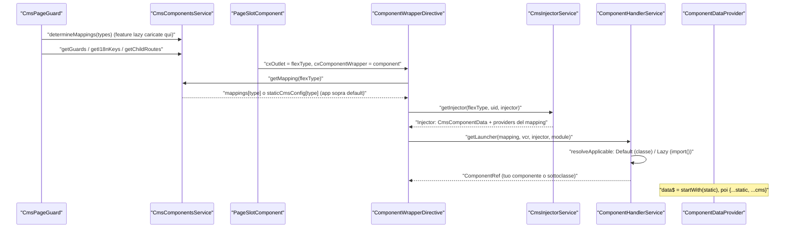
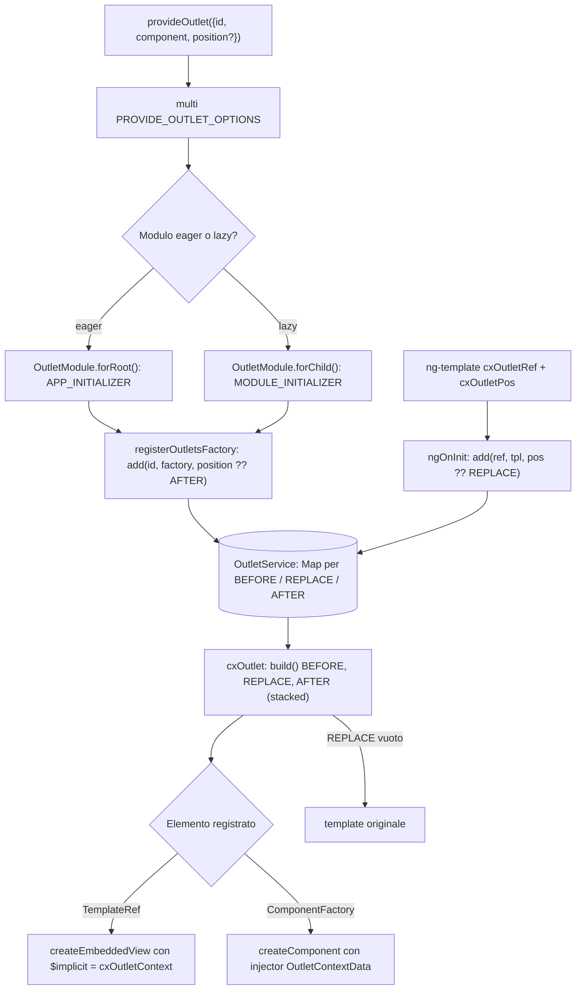
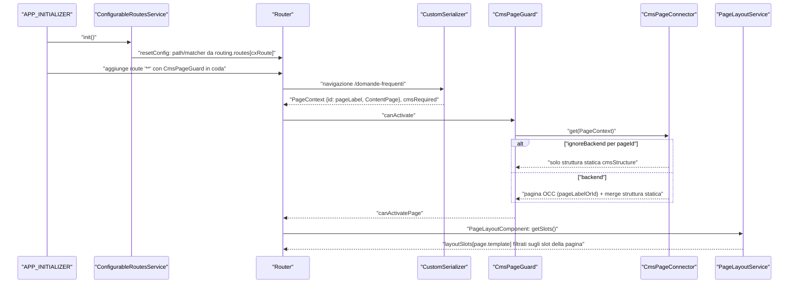

# 51 — Ricette: componenti CMS, outlet, route e layout

> Riferimenti allo SHA `5b7a1c2bf2808d7380bc20596d10f4fa710c3da1` (vedi [00-meta](../00-meta.md)).

Capitolo di **ricette** (Parte III). Ogni ricetta in sezione 3 è un extension point pubblico con esempio completo, meccanismo sorgente e trappole. Le spiegazioni di fondo sono nei capitoli della Parte II:
[14 — Routing](../parte-2/14-routing.md),
[15 — CMS core](../parte-2/15-cms-core.md),
[16 — CMS rendering](../parte-2/16-cms-rendering.md),
[17 — Outlet](../parte-2/17-outlet.md),
[18 — Layout, breakpoint e a11y](../parte-2/18-layout-breakpoint-a11y.md),
[40 — SEO e PWA](../parte-2/40-seo-pwa.md) (meta resolver),
[45 — Componenti storefront](../parte-2/45-componenti-storefront.md) (i componenti da estendere).
Le ricette sulla configurazione e la DI in generale sono in [50 — Ricette: configurazione, DI, interceptor, eventi](50-ricette-config-di.md); quelle su OCC e meta resolver in [52 — Ricette: OCC, adapter, converter, endpoint, meta resolver](52-ricette-occ-dati.md).

## 1. A cosa serve e perché esiste

Uno storefront Spartacus è disegnato dal backend CMS: la pagina arriva come *template* + *slot* + *componenti tipizzati*, e lo storefront decide **quale componente Angular** disegnare per ogni tipo, **dove** mettere ogni slot e **quale route** porta a quale pagina. Ognuna di queste decisioni è guidata da configurazione o da registri globali, ed è quindi personalizzabile senza toccare il codice delle librerie:

| Bisogno | Extension point | Ricetta |
|---|---|---|
| Disegnare diversamente un tipo CMS esistente | `cmsComponents[type].component` (mapping) | [3.1](#31-r1--sostituire-un-componente-cms-mapping-cmscomponents) |
| Riutilizzare la logica di un componente di libreria cambiandone la vista | ereditarietà di classe + `CmsComponentData` | [3.2](#32-r2--estendere-un-componente-cms-esistente) |
| Supportare un nuovo tipo CMS definito nel backend | nuovo componente + mapping (`data`, `deferLoading`, `guards`, `providers`) | [3.3](#33-r3--creare-un-nuovo-componente-cms) |
| Aggiungere UI in un punto nominato senza toccare i template | `provideOutlet` (`OutletPosition`) | [3.4](#34-r4--inserire-un-componente-in-un-outlet-con-provideoutlet) |
| Avvolgere/sostituire slot, componenti o pagine dal template | `[cxOutletRef]` + `cxOutletPos` | [3.5](#35-r5--template-in-un-outlet-con-cxoutletref-replace--before--after) |
| Dare a una content page CMS un URL "parlante" | `CmsRoute` + `RoutingConfig` (`cxRoute`, `pageLabel`) | [3.6](#36-r6--route-custom-per-una-content-page) |
| Disporre gli slot di un template nuovo (ed eventualmente una pagina statica) | `LayoutConfig.layoutSlots` (+ `CmsStructureConfig`) | [3.7](#37-r7--page-layout-per-un-template-nuovo-e-pagina-statica) |

Tutte le ricette poggiano sullo stesso meccanismo di configurazione: `provideConfig` registra un chunk su `ConfigChunk`, `provideDefaultConfig` su `DefaultConfigChunk` (`core-libs/core/src/config/config-providers.ts:L18-L27`, `core-libs/core/src/config/config-providers.ts:L55-L61`), e la config finale è `deepMerge({}, DefaultConfig, RootConfig)`, quindi i chunk applicativi vincono sempre sui default di libreria (`core-libs/core/src/config/config-tokens.ts:L10-L12`). Il JSDoc lo dice esplicitamente: "To provide default configuration in libraries provideDefaultConfig should be used instead" (`core-libs/core/src/config/config-providers.ts:L14-L14`). Da qui la regola pratica di questo capitolo: **nell'app si usa `provideConfig`**, in una libreria riusabile `provideDefaultConfig`.

## 2. Mappa dei file

File sorgente che rendono possibili le ricette (tutti sotto il repo alla SHA indicata).

| Path | Ruolo |
|---|---|
| `core-libs/core/public_api.ts` | Barrel pubblico di `@spartacus/core` (`cms`, `config`, `model`, `routing` alle righe 14, 15, 26, 30) |
| `core-libs/storefront/public_api.ts` | Barrel pubblico di `@spartacus/storefront` (`cms-components`, `cms-structure`, `layout`, `recipes` alle righe 21, 23, 26, 27) |
| `core-libs/core/src/config/config-providers.ts` | `provideConfig`, `provideDefaultConfig`, varianti factory |
| `core-libs/core/src/config/config-tokens.ts` | `Config`, `ConfigChunk`, `DefaultConfigChunk`, merge default + root |
| `core-libs/core/src/config/utils/deep-merge.ts` | Merge ricorsivo: oggetti fusi, array/classi sostituiti |
| `core-libs/core/src/cms/config/cms-config.ts` | `CmsConfig`, `CmsComponentMapping`, `DeferLoadingStrategy`, `FeatureModuleConfig` |
| `core-libs/core/src/cms/config/cms-structure.config.ts` | `CmsStructureConfig`, `CmsPageConfig`, `CmsPageSlotConfig` (pagine statiche) |
| `core-libs/core/src/cms/services/cms-structure-config.service.ts` | Fusione struttura statica / backend |
| `core-libs/core/src/cms/connectors/page/cms-page.connector.ts` | `ignoreBackend` e merge della struttura statica |
| `core-libs/core/src/occ/adapters/cms/converters/occ-cms-page-normalizer.ts` | Calcolo del `flexType` (chiave di mapping) |
| `core-libs/core/src/occ/adapters/cms/occ-cms-page.adapter.ts` | `pageLabelOrId` per le content page |
| `core-libs/core/src/routing/configurable-routes/config/routing-config.ts` | `RoutingConfig`, `RouteLoadStrategy` |
| `core-libs/core/src/routing/configurable-routes/routes-config.ts` | `RoutesConfig`, `RouteConfig` |
| `core-libs/core/src/routing/configurable-routes/configurable-routes.service.ts` | Applica `paths`/`matchers` alle route con `data.cxRoute` |
| `core-libs/core/src/routing/models/cms-route.ts` | `CmsRoute`, `CmsRouteData` (`pageLabel`, `cxCmsRouteContext`) |
| `core-libs/core/src/routing/store/reducers/router.reducer.ts` | `CustomSerializer`: `PageContext`, `cmsRequired` |
| `core-libs/storefront/cms-structure/page/model/cms-component-data.ts` | Token `CmsComponentData` |
| `core-libs/storefront/cms-structure/page/component/component-wrapper.directive.ts` | Istanzia il componente mappato |
| `core-libs/storefront/cms-structure/page/component/services/cms-injector.service.ts` | Injector per componente (`CmsComponentData` + `providers`) |
| `core-libs/storefront/cms-structure/page/component/services/component-data.provider.ts` | `data$` = dati statici + dati CMS |
| `core-libs/storefront/cms-structure/page/component/handlers/default-component.handler.ts` | Handler per classi componente |
| `core-libs/storefront/cms-structure/page/component/handlers/lazy-component.handler.ts` | Handler per `() => import(...)` |
| `core-libs/storefront/cms-structure/services/cms-components.service.ts` | Risoluzione mapping, guard, `childRoutes`, i18n, `disableSSR` |
| `core-libs/storefront/cms-structure/guards/cms-page.guard.ts` | `CmsPageGuard` |
| `core-libs/storefront/cms-structure/guards/cms-page-guard.service.ts` | `canActivatePage` / not-found |
| `core-libs/storefront/cms-structure/routing/cms-route/add-cms-route.ts` | Route `'**'` CMS aggiunta in coda |
| `core-libs/storefront/cms-structure/routing/default-routing-config.ts` | Route semantiche di default |
| `core-libs/storefront/cms-structure/outlet/outlet.providers.ts` | `provideOutlet`, `ProvideOutletOptions` |
| `core-libs/storefront/cms-structure/outlet/outlet.module.ts` | `OutletModule.forRoot()/forChild()`, `registerOutletsFactory` |
| `core-libs/storefront/cms-structure/outlet/outlet.service.ts` | Registro degli outlet |
| `core-libs/storefront/cms-structure/outlet/outlet.directive.ts` | `[cxOutlet]`: build BEFORE/REPLACE/AFTER, `OutletContextData` |
| `core-libs/storefront/cms-structure/outlet/outlet-ref/outlet-ref.directive.ts` | `[cxOutletRef]` |
| `core-libs/storefront/cms-structure/outlet/outlet.model.ts` | `OutletPosition`, `OutletContextData` |
| `core-libs/storefront/cms-structure/page/page-layout/page-layout.component.html` | Outlet di template/section + slot |
| `core-libs/storefront/cms-structure/page/page-layout/page-layout.service.ts` | Risoluzione degli slot da `layoutSlots` |
| `core-libs/storefront/cms-structure/page/slot/page-slot.component.html` | Outlet di slot e di componente |
| `core-libs/storefront/cms-structure/utils/cms-structure.util.ts` | `provideCmsStructure` |
| `core-libs/storefront/layout/config/layout-config.ts` | `LayoutConfig`, `SlotConfig`, `SlotGroup`, `LayoutSlotConfig` |
| `core-libs/storefront/recipes/config/layout-config.ts` | `layoutConfigFactory` (layout di riferimento) |
| `core-libs/storefront/cms-components/product/product-outlets.model.ts` | `ProductDetailOutlets`, `ProductListOutlets` |

## 3. Come funziona passo per passo

Prima di ogni ricetta, il percorso comune "dal mapping al componente" (dettagli nel cap. [16](../parte-2/16-cms-rendering.md)):

1. `PageSlotComponent` crea, per ogni componente dello slot, un outlet con chiave `component.flexType` e dentro un `cxComponentWrapper` (`core-libs/storefront/cms-structure/page/slot/page-slot.component.html:L6-L16`).
2. Il `flexType` è calcolato dal normalizer OCC: `CMSFlexComponent` → `component.flexType`, `JspIncludeComponent` → `component.uid`, altrimenti `typeCode` (`core-libs/core/src/occ/adapters/cms/converters/occ-cms-page-normalizer.ts:L151-L158`).
3. `ComponentWrapperDirective` risolve il mapping, verifica `shouldRender` e lancia il componente (`core-libs/storefront/cms-structure/page/component/component-wrapper.directive.ts:L67-L102`), usando un injector creato da `CmsInjectorService.getInjector` che fornisce `CmsComponentData` e i `providers` del mapping (`core-libs/storefront/cms-structure/page/component/services/cms-injector.service.ts:L28-L50`).
4. Il componente è creato da un handler scelto con `resolveApplicable` (`core-libs/storefront/cms-structure/page/component/services/component-handler.service.ts:L49-L65`): `DefaultComponentHandler` per le classi, `LazyComponentHandler` per `() => import(...)` (`core-libs/storefront/cms-structure/page/component/handlers/default-component.handler.ts:L27-L34`, `core-libs/storefront/cms-structure/page/component/handlers/lazy-component.handler.ts:L38-L52`).

### 3.1 R1 — Sostituire un componente CMS (mapping `cmsComponents`)

#### Quando usarlo

Quando il backend continua a inviare un tipo CMS standard (es. `CMSParagraphComponent`) ma lo vuoi disegnare con un tuo componente, completamente nuovo, senza ereditare nulla dall'originale. È il modo più "pulito": il tuo componente dipende solo dal modello dati (`CmsParagraphComponent`) e dal token `CmsComponentData`, non dall'implementazione di libreria.

#### Esempio

> Esempio illustrativo, non presente nel repo.

```typescript
// custom-paragraph.module.ts — esempio illustrativo, non presente nel repo
import { AsyncPipe, NgIf } from '@angular/common';
import { ChangeDetectionStrategy, Component, NgModule } from '@angular/core';
import {
  CmsConfig,
  CmsParagraphComponent,
  provideConfig,
} from '@spartacus/core';
import { CmsComponentData } from '@spartacus/storefront';

@Component({
  selector: 'app-plain-paragraph',
  template: `
    <article *ngIf="component.data$ | async as data" class="app-paragraph">
      <h2 *ngIf="data.title">{{ data.title }}</h2>
      <div [innerHTML]="data.content"></div>
    </article>
  `,
  changeDetection: ChangeDetectionStrategy.OnPush,
  imports: [NgIf, AsyncPipe],
})
export class PlainParagraphComponent {
  constructor(public component: CmsComponentData<CmsParagraphComponent>) {}
}

@NgModule({
  imports: [PlainParagraphComponent],
  providers: [
    // provideConfig (ConfigChunk) vince sempre sul provideDefaultConfig della libreria
    provideConfig(<CmsConfig>{
      cmsComponents: {
        CMSParagraphComponent: { component: PlainParagraphComponent },
      },
    }),
  ],
})
export class CustomParagraphModule {}
```

Il modulo va importato nell'app (nella demo la config applicativa vive in un `NgModule` importato da `AppModule`, a sua volta incluso con `importProvidersFrom(AppModule)` in `appConfig`: `projects/storefrontapp/src/app/spartacus/spartacus-configuration.module.ts:L44-L72`, `projects/storefrontapp/src/app/app.module.ts:L15-L25`, `projects/storefrontapp/src/app/app.config.ts:L26-L35`).

Catene di export dei simboli `@spartacus/*`:

| Simbolo | Catena |
|---|---|
| `provideConfig` | `core-libs/core/public_api.ts:L15-L15` → `core-libs/core/src/config/index.ts:L9-L9` → `core-libs/core/src/config/config-providers.ts:L18-L27` |
| `CmsConfig` | `core-libs/core/public_api.ts:L14-L14` → `core-libs/core/src/cms/index.ts:L8-L8` → `core-libs/core/src/cms/config/index.ts:L7-L7` → `core-libs/core/src/cms/config/cms-config.ts:L124-L134` |
| `CmsParagraphComponent` | `core-libs/core/public_api.ts:L26-L26` → `core-libs/core/src/model/index.ts:L8-L8` → `core-libs/core/src/model/cms.model.ts:L88-L92` |
| `CmsComponentData` | `core-libs/storefront/public_api.ts:L23-L23` → `core-libs/storefront/cms-structure/index.ts:L10-L10` → `core-libs/storefront/cms-structure/page/index.ts:L8-L8` → `core-libs/storefront/cms-structure/page/model/index.ts:L7-L7` → `core-libs/storefront/cms-structure/page/model/cms-component-data.ts:L10-L13` |

#### Perché funziona (file sorgente)

- `CmsConfig` è risolto con `useExisting: Config`, quindi il chunk entra nella config globale (`core-libs/core/src/cms/config/cms-config.ts:L124-L134`); `CMSComponentConfig` è un dizionario `componentType → CmsComponentMapping` (`core-libs/core/src/cms/config/cms-config.ts:L103-L107`).
- Il mapping di libreria è un default: `CmsParagraphModule` usa `provideDefaultConfig` (`core-libs/storefront/cms-components/content/paragraph/paragraph.module.ts:L21-L32`), e la config finale mette `RootConfig` sopra `DefaultConfig` (`core-libs/core/src/config/config-tokens.ts:L10-L12`).
- `deepMerge` sostituisce funzioni/classi per assegnazione (`core-libs/core/src/config/utils/deep-merge.ts:L36-L45`): la classe `component` dell'app rimpiazza quella di libreria.
- `CmsComponentsService.getMapping` legge `mappings[type]` o lo snapshot statico/`config.cmsComponents` (`core-libs/storefront/cms-structure/services/cms-components.service.ts:L165-L181`); il wrapper crea il componente con quell'injector (`core-libs/storefront/cms-structure/page/component/component-wrapper.directive.ts:L81-L102`).
- Modello reale: image-zoom rimappa `ProductImagesComponent` sul proprio componente (`feature-libs/product/image-zoom/components/product-image-zoom/product-image-zoom.module.ts:L53-L59`); lo stesso componente può servire più tipi (`core-libs/storefront/cms-components/content/paragraph/paragraph.module.ts:L21-L32`).

#### Limiti e trappole

- **`provideDefaultConfig` nell'app è fragile**: sia il tuo chunk sia quello di libreria finirebbero in `DefaultConfigChunk`, dove vince l'ordine di iniezione (`core-libs/core/src/config/config-tokens.ts:L23-L28`); `provideConfig` evita il problema.
- **Il mapping è fuso, non sostituito**: cambiando solo `component` erediti `guards`, `childRoutes`, `providers`, `data` dell'originale; se invece ridefinisci un array (`guards`, `providers`) lo **sostituisci per intero** (`core-libs/core/src/config/utils/deep-merge.ts:L36-L45`, `core-libs/core/src/cms/config/cms-config.ts:L60-L93`).
- **Chiave = `flexType`**: per i `JspIncludeComponent` è l'`uid`, per i `CMSFlexComponent` il `flexType` (`core-libs/core/src/occ/adapters/cms/converters/occ-cms-page-normalizer.ts:L151-L158`).
- **Mapping mancante = silenzio in produzione**: solo un warning dev, una volta per tipo (`core-libs/storefront/cms-structure/services/cms-components.service.ts:L170-L178`), e il wrapper esce senza renderizzare (`core-libs/storefront/cms-structure/page/component/component-wrapper.directive.ts:L86-L88`).
- **Tipi coperti da feature lazy**: il mapping statico prevale su quello della feature (`deepMerge({}, featureComponentMapping, staticConfig)`, `core-libs/storefront/cms-structure/services/cms-components.service.ts:L117-L141`), ma la feature viene comunque caricata e il componente è creato con il suo `NgModuleRef` (`core-libs/storefront/cms-structure/services/cms-components.service.ts:L149-L153`, `core-libs/storefront/cms-structure/page/component/component-wrapper.directive.ts:L99-L101`). ⚠️ DA VERIFICARE a runtime il caso image-zoom, dove `ProductImagesModule` mappa staticamente lo stesso tipo della feature lazy: da codice prevarrebbe il mapping statico (dossier T4/Q1; non eseguibile senza `node_modules`).
- **Snapshot statico**: `cmsComponents` aggiunti alla config globale dopo la sua stabilizzazione (es. da moduli lazy) non sono visti da `getMapping` (`core-libs/storefront/cms-structure/services/cms-components.service.ts:L60-L69`).
- Il binding `[innerHTML]` è sanificato da Angular; l'originale invece usa `bypassSecurityTrustHtml` (`core-libs/storefront/cms-components/content/paragraph/paragraph.component.ts:L49-L51`): stili/attributi inline del CMS possono quindi differire.

### 3.2 R2 — Estendere un componente CMS esistente

#### Quando usarlo

Quando la logica del componente di libreria va bene (servizi iniettati, stream, handler) e vuoi solo una vista diversa o l'override di qualche metodo `protected`/`public`. È lo schema usato dalla libreria stessa: `MyAccountV2UserComponent extends LoginComponent {}`, `BreadcrumbComponent extends PageTitleComponent`, `ProductImageZoomProductImagesComponent extends ProductImagesComponent`.

#### Esempio

> Esempio illustrativo, non presente nel repo.

```typescript
// boxed-paragraph.module.ts — esempio illustrativo, non presente nel repo
import { AsyncPipe, NgIf } from '@angular/common';
import { ChangeDetectionStrategy, Component, NgModule } from '@angular/core';
import { CmsConfig, provideConfig } from '@spartacus/core';
import { ParagraphComponent } from '@spartacus/storefront';

@Component({
  selector: 'app-boxed-paragraph',
  template: `
    <section *ngIf="component.data$ | async as data" class="boxed">
      <h3 *ngIf="data.title">{{ data.title }}</h3>
      <div [innerHTML]="bypassSecurityTrustHtml(data.content)"></div>
    </section>
  `,
  changeDetection: ChangeDetectionStrategy.OnPush,
  imports: [NgIf, AsyncPipe],
})
// Nessun costruttore: Angular usa la factory ereditata da ParagraphComponent
// (CmsComponentData + Router) e la sottoclasse eredita sanitizer,
// bypassSecurityTrustHtml() e il listener click per i link interni.
export class BoxedParagraphComponent extends ParagraphComponent {}

@NgModule({
  imports: [BoxedParagraphComponent],
  providers: [
    provideConfig(<CmsConfig>{
      cmsComponents: {
        CMSTabParagraphComponent: { component: BoxedParagraphComponent },
      },
    }),
  ],
})
export class BoxedParagraphModule {}
```

Catene di export:

| Simbolo | Catena |
|---|---|
| `provideConfig`, `CmsConfig` | come in [3.1](#31-r1--sostituire-un-componente-cms-mapping-cmscomponents) |
| `ParagraphComponent` | `core-libs/storefront/public_api.ts:L21-L21` → `core-libs/storefront/cms-components/index.ts:L8-L8` → `core-libs/storefront/cms-components/content/index.ts:L13-L13` → `core-libs/storefront/cms-components/content/paragraph/paragraph.component.ts:L26-L52` |

Variante con costruttore (quando servono servizi aggiuntivi): reiniettare **tutti** i parametri della base e chiamare `super(...)`, come `BreadcrumbComponent` (estratto in [5.3](#53-estensione-con-costruttore-breadcrumbcomponent)).

#### Perché funziona (file sorgente)

- `CmsComponentData` è una classe astratta usata come token DI (`core-libs/storefront/cms-structure/page/model/cms-component-data.ts:L10-L13`), fornita dall'injector del wrapper indipendentemente da quale classe venga creata (`core-libs/storefront/cms-structure/page/component/services/cms-injector.service.ts:L35-L49`).
- Senza costruttore proprio, Angular risale la catena dei prototipi per trovare la factory della superclasse (`angular:packages/core/src/render3/di.ts:L918-L935`): la sottoclasse riceve `CmsComponentData<CmsParagraphComponent>` e `Router` come la base (`core-libs/storefront/cms-components/content/paragraph/paragraph.component.ts:L44-L47`).
- I membri usati dal template sono accessibili: `sanitizer` è `protected`, `bypassSecurityTrustHtml` è `public` (`core-libs/storefront/cms-components/content/paragraph/paragraph.component.ts:L26-L52`).
- Le host binding della superclasse vengono fuse in quelle della sottoclasse da `ɵɵInheritDefinitionFeature` (`angular:packages/core/src/render3/features/inherit_definition_feature.ts:L84-L86`, `angular:packages/core/src/render3/features/inherit_definition_feature.ts:L215-L227`), e il compilatore mette i listener host nella funzione `hostBindings` (`angular:packages/compiler/src/render3/view/compiler.ts:L482-L522`): il `@HostListener('click')` della base resta attivo.
- Modelli reali: `MyAccountV2UserComponent extends LoginComponent {}` con nuovo template e nuovi `imports` (`feature-libs/user/account/components/my-account-v2-user/my-account-v2-user.component.ts:L13-L18`); `ProductImageZoomProductImagesComponent` riusa `mainMediaContainer`/`product$` `protected` della base (`feature-libs/product/image-zoom/components/product-image-zoom/product-image-zoom-product-images/product-image-zoom-product-images.component.ts:L36-L57`, `core-libs/storefront/cms-components/product/product-images/product-images.component.ts:L33-L55`).

#### Limiti e trappole

- **I metadati `@Component` vanno ridichiarati**: selector, template e `imports` standalone (`feature-libs/user/account/components/my-account-v2-user/my-account-v2-user.component.ts:L13-L17`). Il template originale usa `SupplementHashAnchorsPipe` (`core-libs/storefront/cms-components/content/paragraph/paragraph.component.ts:L24-L24`); l'esempio non la usa, quindi l'aggiunta del prefisso agli anchor `#` non avviene.
- **Membri `private` non estendibili**: es. `PageTitleComponent.setTitle` (`core-libs/storefront/cms-components/navigation/page-header/page-title.component.ts:L42-L44`).
- **Costruttore = API fragile**: se ne dichiari uno, devi ripetere tutti i parametri della base e chiamare `super` (`core-libs/storefront/cms-components/navigation/breadcrumb/breadcrumb.component.ts:L44-L50`); un cambio della firma della base in un upgrade rompe la sottoclasse (Spartacus gestisce questi casi con le migrazioni "constructor deprecations", vedi cap. [43](../parte-2/43-schematics-migrazioni.md)).
- **Stesso selector della base**: image-zoom riusa `cx-product-images` per ereditare gli stili (`feature-libs/product/image-zoom/components/product-image-zoom/product-image-zoom-product-images/product-image-zoom-product-images.component.ts:L22-L22`), ma la sostituzione avviene solo via mapping CMS, non dove la base è usata direttamente in un template.
- **Override di `CmsComponentData` nei `providers` del mapping**: i `providers` sono aggiunti dopo `CmsComponentData` nello stesso `Injector.create` (`core-libs/storefront/cms-structure/page/component/services/cms-injector.service.ts:L36-L47`), quindi un provider per lo stesso token lo sovrascrive (`angular:packages/core/src/di/r3_injector.ts:L497-L521`).
- Le stesse trappole di merge di R1 valgono anche qui, perché la registrazione passa ancora da `cmsComponents`.

### 3.3 R3 — Creare un nuovo componente CMS

#### Quando usarlo

Quando nel backend è stato definito un **nuovo tipo** di componente CMS (o un `CMSFlexComponent` con un nuovo `flexType`) e lo storefront deve disegnarlo. Servono: un'interfaccia dati che estende `CmsComponent`, un componente che inietta `CmsComponentData<T>`, un mapping con eventuali dati statici, strategia di defer, guard o provider.

#### Esempio

> Esempio illustrativo, non presente nel repo. *PromoBannerComponent* è un tipo CMS ipotetico definito nel backend.

```typescript
// promo-banner.module.ts — esempio illustrativo, non presente nel repo
import { AsyncPipe, NgIf } from '@angular/common';
import { ChangeDetectionStrategy, Component, NgModule } from '@angular/core';
import {
  CmsComponent,
  CmsComponentMapping,
  CmsConfig,
  DeferLoadingStrategy,
  provideConfig,
} from '@spartacus/core';
import { CmsComponentData } from '@spartacus/storefront';

/** Attributi del tipo CMS custom, come arrivano dal backend. */
export interface CmsPromoBannerComponent extends CmsComponent {
  headline?: string;
  ctaLabel?: string;
  ctaUrl?: string;
}

@Component({
  selector: 'app-promo-banner',
  template: `
    <aside *ngIf="component.data$ | async as data" class="promo">
      <!-- data$ emette prima i dati statici, poi quelli del CMS -->
      <strong>{{ data.headline }}</strong>
      <a *ngIf="data.ctaUrl" [href]="data.ctaUrl">{{ data.ctaLabel }}</a>
    </aside>
  `,
  changeDetection: ChangeDetectionStrategy.OnPush,
  imports: [NgIf, AsyncPipe],
})
export class PromoBannerComponent {
  constructor(public component: CmsComponentData<CmsPromoBannerComponent>) {}
}

const promoBannerMapping: CmsComponentMapping<CmsPromoBannerComponent> = {
  component: PromoBannerComponent,
  // dati statici: valori iniziali e proprietà assenti nell'API
  data: { ctaLabel: 'Scopri di più' },
  // il banner è sotto la piega: rendering solo vicino al viewport
  deferLoading: DeferLoadingStrategy.DEFER,
};

@NgModule({
  imports: [PromoBannerComponent],
  providers: [
    provideConfig(<CmsConfig>{
      cmsComponents: {
        // chiave = flexType (qui uguale al typeCode del backend)
        PromoBannerComponent: promoBannerMapping,
      },
    }),
  ],
})
export class PromoBannerModule {}
```

Catene di export:

| Simbolo | Catena |
|---|---|
| `CmsComponent` | `core-libs/core/public_api.ts:L26-L26` → `core-libs/core/src/model/index.ts:L8-L8` → `core-libs/core/src/model/cms.model.ts:L7-L13` |
| `CmsComponentMapping`, `DeferLoadingStrategy` | `core-libs/core/public_api.ts:L14-L14` → `core-libs/core/src/cms/index.ts:L8-L8` → `core-libs/core/src/cms/config/index.ts:L7-L7` → `core-libs/core/src/cms/config/cms-config.ts:L60-L93`, `core-libs/core/src/cms/config/cms-config.ts:L95-L101` |
| `CmsConfig`, `provideConfig`, `CmsComponentData` | come in [3.1](#31-r1--sostituire-un-componente-cms-mapping-cmscomponents) |

#### Perché funziona (file sorgente)

- `CmsComponentMapping<T>` è generico sul tipo dei dati e accetta `component`, `providers`, `childRoutes`, `disableSSR`, `i18nKeys`, `guards`, `data`, `deferLoading` (`core-libs/core/src/cms/config/cms-config.ts:L60-L93`); il JSDoc di `data` elenca gli usi: dati iniziali, proprietà UI assenti nell'API, ghost design (`core-libs/core/src/cms/config/cms-config.ts:L79-L85`).
- `ComponentDataProvider.get` fonde `{...static, ...cms}` ed emette prima i dati statici con `startWith` (`core-libs/storefront/cms-structure/page/component/services/component-data.provider.ts:L35-L59`); la sorgente CMS è `CmsService.getComponentData` (`core-libs/core/src/cms/facade/cms.service.ts:L74-L74`).
- `getDeferLoadingStrategy` legge `deferLoading` dallo snapshot statico (`core-libs/storefront/cms-structure/services/cms-components.service.ts:L195-L200`) e lo slot lo passa come `cxOutletDefer` all'outlet del componente (`core-libs/storefront/cms-structure/page/slot/page-slot.component.html:L7-L13`); il deferred loading è spiegato nel cap. [18](../parte-2/18-layout-breakpoint-a11y.md).
- Canone di libreria: `ParagraphComponent` standalone, `OnPush`, `public component: CmsComponentData<...>` (`core-libs/storefront/cms-components/content/paragraph/paragraph.component.ts:L20-L47`), template su `component.data$ | async` (`core-libs/storefront/cms-components/content/paragraph/paragraph.component.html:L1-L4`), mapping in `provideDefaultConfig` (`core-libs/storefront/cms-components/content/paragraph/paragraph.module.ts:L14-L35`).
- Opzioni avanzate del mapping, tutte raccolte da `CmsPageGuardService.canActivatePage` prima dell'attivazione (`core-libs/storefront/cms-structure/guards/cms-page-guard.service.ts:L65-L99`): `guards` uniti in un Set per tutta la pagina (`core-libs/storefront/cms-structure/services/cms-components.service.ts:L253-L261`), `i18nKeys` per precaricare chunk di traduzione (`core-libs/storefront/cms-structure/services/cms-components.service.ts:L266-L276`), `childRoutes` (`core-libs/storefront/cms-structure/services/cms-components.service.ts:L205-L248`). Esempio con `providers` + `guards` + `childRoutes`: `feature-libs/organization/administration/components/budget/budget.config.ts:L29-L80`.
- Componente senza backend: `provideCmsStructure({ componentId, pageSlotPosition })` crea `cmsStructure.components[componentId] = { typeCode, flexType }` e lo slot globale (`core-libs/storefront/cms-structure/utils/cms-structure.util.ts:L31-L66`); uso reale in `defaultCmsContentProviders` (`core-libs/storefront/recipes/config/static-cms-structure.ts:L10-L19`).

#### Limiti e trappole

- **Dati parziali**: il primo valore di `data$` è il solo dato statico (`core-libs/storefront/cms-structure/page/component/services/component-data.provider.ts:L44-L51`); nell'esempio `headline` è inizialmente `undefined`.
- **Componente statico senza uid**: `data$` è `of(static)` o `EMPTY` (`core-libs/storefront/cms-structure/page/component/services/component-data.provider.ts:L55-L57`); con `EMPTY` un `*ngIf="data$ | async"` non disegna nulla, quindi per componenti forniti con `provideCmsStructure` serve `data` nel mapping oppure un template che non dipende da `data$`.
- **`disableSSR: true`** toglie il componente anche da `childRoutes` e `i18nKeys` lato server (`core-libs/storefront/cms-structure/services/cms-components.service.ts:L187-L190`, `core-libs/storefront/cms-structure/services/cms-components.service.ts:L208-L210`, `core-libs/storefront/cms-structure/services/cms-components.service.ts:L269-L270`).
- **`childRoutes`** funzionano solo su content page con label che inizia con `/` e causano `resetConfig` + nuova navigazione (`core-libs/storefront/cms-structure/services/cms-routes-impl.service.ts:L82-L88`, `core-libs/storefront/cms-structure/services/cms-routes-impl.service.ts:L98-L123`).
- **Componente lazy** (`component: () => import(...).then(m => m.X)`): riconosciuto da `LazyComponentHandler` solo se `toString()` della funzione inizia con `function()` o `()=>` (`core-libs/storefront/cms-structure/page/component/handlers/lazy-component.handler.ts:L45-L48`); altrimenti cade sul `DefaultComponentHandler` che tratta ogni funzione come classe (`core-libs/storefront/cms-structure/page/component/handlers/default-component.handler.ts:L28-L30`). ⚠️ DA VERIFICARE con l'output del builder esbuild di Angular 21 (dossier Q3); nel codice non-spec del repo non c'è un esempio reale di questa forma (dossier Q5).
- **Web component** (`component: 'url#tag'`): `WebComponentHandler` esiste ma non è registrato né esportato (`core-libs/storefront/cms-structure/page/component/page-component.module.ts:L23-L40`, `core-libs/storefront/cms-structure/page/component/handlers/index.ts:L7-L9`).
- `DefaultComponentHandler` usa ancora `ComponentFactoryResolver` (`core-libs/storefront/cms-structure/page/component/handlers/default-component.handler.ts:L56-L70`), deprecato in Angular (`angular:packages/core/src/linker/component_factory_resolver.ts:L38-L39`): funziona anche con componenti standalone, ma è un punto da tenere d'occhio negli upgrade.

### 3.4 R4 — Inserire un componente in un outlet con `provideOutlet`

#### Quando usarlo

Quando vuoi aggiungere (o sostituire) UI in un punto nominato di un template di libreria che **non** è un componente CMS: prezzo e sommario del PDP, dettagli di una riga carrello, riepilogo ordine. Il punto deve esporre un `[cxOutlet]`; i nomi sono negli enum `*Outlets` (es. `ProductDetailOutlets`, `CartOutlets`) e nell'[Appendice A08](../appendici/A08-outlet.md).

#### Esempio

> Esempio illustrativo, non presente nel repo.

```typescript
// price-note.module.ts — esempio illustrativo, non presente nel repo
import { AsyncPipe, NgIf } from '@angular/common';
import { Component, NgModule, OnInit, Optional } from '@angular/core';
import { Product } from '@spartacus/core';
import {
  OutletContextData,
  OutletPosition,
  ProductDetailOutlets,
  provideOutlet,
} from '@spartacus/storefront';
import { Observable, of } from 'rxjs';
import { map } from 'rxjs/operators';

@Component({
  selector: 'app-price-note',
  template: `
    <p *ngIf="product$ | async as product" class="price-note">
      Prezzo IVA inclusa per {{ product.name }}
    </p>
  `,
  imports: [NgIf, AsyncPipe],
})
export class PriceNoteComponent implements OnInit {
  product$: Observable<Product | undefined> = of(undefined);

  // @Optional: OutletContextData esiste solo se il componente è creato da un outlet
  constructor(
    @Optional() protected outlet?: OutletContextData<{ product: Product }>
  ) {}

  ngOnInit(): void {
    if (this.outlet?.context$) {
      // context$ (non context, deprecato) segue i cambi di [cxOutletContext]
      this.product$ = this.outlet.context$.pipe(
        map((context) => context?.product)
      );
    }
  }
}

@NgModule({
  imports: [PriceNoteComponent],
  providers: [
    provideOutlet({
      id: ProductDetailOutlets.PRICE, // 'PDP.PRICE'
      position: OutletPosition.AFTER, // default di provideOutlet
      component: PriceNoteComponent,
    }),
  ],
})
export class PriceNoteModule {}
// Modulo eager: la registrazione la esegue OutletModule.forRoot(), già in BaseStorefrontModule.
// In un modulo caricato lazy aggiungere OutletModule.forChild() agli imports.
```

Catene di export:

| Simbolo | Catena |
|---|---|
| `Product` | `core-libs/core/public_api.ts:L49-L49` (sezione augmentable) e `core-libs/core/public_api.ts:L26-L26` → `core-libs/core/src/model/index.ts:L19-L19` → `core-libs/core/src/model/product.model.ts:L167-L167` |
| `OutletContextData`, `OutletPosition` | `core-libs/storefront/public_api.ts:L23-L23` → `core-libs/storefront/cms-structure/index.ts:L9-L9` → `core-libs/storefront/cms-structure/outlet/index.ts:L11-L11` → `core-libs/storefront/cms-structure/outlet/outlet.model.ts:L9-L13`, `core-libs/storefront/cms-structure/outlet/outlet.model.ts:L21-L44` |
| `provideOutlet` | `core-libs/storefront/cms-structure/outlet/index.ts:L13-L13` (export nominato) → `core-libs/storefront/cms-structure/outlet/outlet.providers.ts:L41-L47` |
| `OutletModule` | `core-libs/storefront/cms-structure/outlet/index.ts:L12-L12` → `core-libs/storefront/cms-structure/outlet/outlet.module.ts:L53-L89` |
| `ProductDetailOutlets` | `core-libs/storefront/public_api.ts:L21-L21` → `core-libs/storefront/cms-components/index.ts:L12-L12` → `core-libs/storefront/cms-components/product/index.ts:L16-L16` → `core-libs/storefront/cms-components/product/product-outlets.model.ts:L7-L12` |

#### Perché funziona (file sorgente)

- `provideOutlet` è un multi-provider su `PROVIDE_OUTLET_OPTIONS` (`core-libs/storefront/cms-structure/outlet/outlet.providers.ts:L41-L47`); `registerOutletsFactory` risolve una factory per ogni opzione e la aggiunge all'`OutletService` con default `OutletPosition.AFTER` (`core-libs/storefront/cms-structure/outlet/outlet.module.ts:L29-L47`).
- `OutletModule.forRoot()` esegue la registrazione in `APP_INITIALIZER`, `forChild()` in `MODULE_INITIALIZER` (`core-libs/storefront/cms-structure/outlet/outlet.module.ts:L54-L88`); `forRoot()` è già importato da `BaseStorefrontModule` (`core-libs/storefront/base-storefront.module.ts:L43-L43`); `MODULE_INITIALIZER` si comporta come `APP_INITIALIZER` se il modulo è eager (`core-libs/core/src/lazy-loading/tokens.ts:L9-L20`).
- `ProductSummaryComponent` apre l'outlet `outlets.PRICE` con contesto `{ product: product }` (`core-libs/storefront/cms-components/product/product-summary/product-summary.component.html:L6-L16`).
- `[cxOutlet]` costruisce BEFORE → REPLACE → AFTER (`core-libs/storefront/cms-structure/outlet/outlet.directive.ts:L121-L125`); per una `ComponentFactory` crea un injector con `OutletContextData` (`reference`, `position`, `context`, `context$`) (`core-libs/storefront/cms-structure/outlet/outlet.directive.ts:L196-L213`).
- Modelli reali: `EstimatedDeliveryDateComponent` AFTER su `CartOutlets.ITEM_DETAILS` (`feature-libs/estimated-delivery-date/show-estimated-delivery-date/show-estimated-delivery-date.module.ts:L28-L35`); `OrderSummaryComponent` con `@Optional()` e `context$` (`feature-libs/cart/base/components/cart-shared/order-summary/order-summary.component.ts:L26-L38`); `provideOutlet` in un root module eager (`feature-libs/subscription-billing/root/subscription-billing-root.module.ts:L42-L59`).

#### Limiti e trappole

- **Default di posizione diversi**: `provideOutlet` → AFTER, `cxOutletRef` senza `cxOutletPos` → REPLACE (`core-libs/storefront/cms-structure/outlet/outlet.module.ts:L42-L42`, `core-libs/storefront/cms-structure/outlet/outlet.service.ts:L31-L35`).
- **Modulo lazy senza `OutletModule.forChild()`**: la registrazione non avviene, perché `forRoot` gira una sola volta all'avvio (`core-libs/storefront/cms-structure/outlet/outlet.module.ts:L54-L88`); vedi come fa il cart (`feature-libs/cart/base/components/cart-base-components.module.ts:L30-L30`).
- **Registro non reattivo**: un outlet già renderizzato non vede registrazioni successive finché non si ri-renderizza (cambio di `cxOutlet` o `OutletRendererService.render`) (`core-libs/storefront/cms-structure/outlet/outlet.directive.ts:L92-L96`, `core-libs/storefront/cms-structure/outlet/outlet-renderer.service.ts:L24-L38`). ⚠️ DA VERIFICARE a runtime per registrazioni da moduli lazy (dossier Q2).
- **REPLACE multiplo**: tutte le registrazioni REPLACE vengono rese, non solo la prima (`core-libs/storefront/cms-structure/outlet/outlet.directive.ts:L130-L139`).
- **`context` vs `context$`**: `context` è `@deprecated since 3.0` e statico (`core-libs/storefront/cms-structure/outlet/outlet.model.ts:L33-L43`); `ngOnChanges` inoltra i cambi di `cxOutletContext` solo su `outletContext$` (`core-libs/storefront/cms-structure/outlet/outlet.directive.ts:L97-L99`).
- **`PROVIDE_OUTLET_OPTIONS` è `@private`** ("We plan to drive the outlets by standard configuration", `core-libs/storefront/cms-structure/outlet/outlet.providers.ts:L10-L12`): usare sempre `provideOutlet`, mai il token.
- Con `forChild` le deps non sono `Self`: ⚠️ DA VERIFICARE la possibile doppia registrazione quando l'injector lazy non ha propri `PROVIDE_OUTLET_OPTIONS` (`core-libs/storefront/cms-structure/outlet/outlet.module.ts:L79-L83`; cap. [17](../parte-2/17-outlet.md)).

### 3.5 R5 — Template in un outlet con `cxOutletRef` (replace / before / after)

#### Quando usarlo

Quando il contenuto da inserire è un pezzo di HTML legato a una pagina specifica (non un componente riutilizzabile), oppure vuoi avvolgere o sostituire un'intera **pagina** (outlet = nome del template), uno **slot** (outlet = `position`) o **ogni istanza di un tipo CMS** (outlet = `flexType`). Le registrazioni vivono quanto il componente che contiene i `ng-template`.

#### Esempio

> Esempio illustrativo, non presente nel repo. Il componente è pensato come `component` di una route (vedi [3.6](#36-r6--route-custom-per-una-content-page)).

```typescript
// faq-page.component.ts — esempio illustrativo, non presente nel repo
import { AsyncPipe, NgFor } from '@angular/common';
import { Component } from '@angular/core';
import { OutletRefDirective, PageLayoutComponent } from '@spartacus/storefront';

@Component({
  selector: 'app-faq-page',
  template: `
    <cx-page-layout />

    <!-- prima dello slot Section2A (contesto: { components$ }) -->
    <ng-template [cxOutletRef]="'Section2A'" cxOutletPos="before" let-model>
      <nav class="faq-index">
        <a *ngFor="let c of model.components$ | async" [href]="'#' + c.uid">
          {{ c.uid }}
        </a>
      </nav>
    </ng-template>

    <!-- dopo ogni CMSParagraphComponent (contesto: { component }) -->
    <ng-template
      [cxOutletRef]="'CMSParagraphComponent'"
      cxOutletPos="after"
      let-model
    >
      <a class="faq-top" [attr.id]="model.component.uid" href="#">Torna su</a>
    </ng-template>
  `,
  imports: [PageLayoutComponent, OutletRefDirective, NgFor, AsyncPipe],
})
export class FaqPageComponent {}
```

Catene di export:

| Simbolo | Catena |
|---|---|
| `OutletRefDirective` | `core-libs/storefront/public_api.ts:L23-L23` → `core-libs/storefront/cms-structure/index.ts:L9-L9` → `core-libs/storefront/cms-structure/outlet/index.ts:L7-L7` → `core-libs/storefront/cms-structure/outlet/outlet-ref/outlet-ref.directive.ts:L17-L36` |
| `PageLayoutComponent` | `core-libs/storefront/cms-structure/index.ts:L10-L10` → `core-libs/storefront/cms-structure/page/index.ts:L9-L9` → `core-libs/storefront/cms-structure/page/page-layout/index.ts:L8-L8` → `core-libs/storefront/cms-structure/page/page-layout/page-layout.component.ts:L30-L58` |

#### Perché funziona (file sorgente)

- `OutletRefDirective` registra il proprio `TemplateRef` in `ngOnInit` e lo rimuove in `ngOnDestroy` (`core-libs/storefront/cms-structure/outlet/outlet-ref/outlet-ref.directive.ts:L17-L36`), quindi le registrazioni durano quanto *FaqPageComponent*.
- Un `TemplateRef` è reso con `{ $implicit: cxOutletContext }`, da cui `let-model` (`core-libs/storefront/cms-structure/outlet/outlet.directive.ts:L175-L189`).
- Gli outlet di sistema e i loro contesti: template/section con `templateName$`, `slots$`, `section$` (`core-libs/storefront/cms-structure/page/page-layout/page-layout.component.html:L1-L18`); slot con `components$`, componente con `component` (`core-libs/storefront/cms-structure/page/slot/page-slot.component.html:L1-L17`).
- Modello reale: la demo `TestOutletComponentComponent` mette `<cx-page-layout />` e tre `cxOutletRef` (before/after/replace) su `CMSParagraphComponent` nello stesso template (`projects/storefrontapp/src/test-outlets/test-outlet-component/test-outlet-component.component.html:L1-L13`), standalone con `PageLayoutComponent` + `OutletRefDirective` (`projects/storefrontapp/src/test-outlets/test-outlet-component/test-outlet-component.component.ts:L10-L17`); varianti su slot e template in `projects/storefrontapp/src/test-outlets/test-outlet-slot/test-outlet-slot.component.html:L1-L27` e `projects/storefrontapp/src/test-outlets/test-outlet-template/test-outlet-template.component.html:L1-L25`.

#### Limiti e trappole

- **Chiavi stringa libere**: un refuso nel nome di slot/tipo/template non dà errori; la demo stessa legge `model.sections$` mentre il contesto espone `section$` (`projects/storefrontapp/src/test-outlets/test-outlet-template/test-outlet-template.component.html:L7-L7`, `core-libs/storefront/cms-structure/page/page-layout/page-layout.component.html:L5-L9`).
- **REPLACE sul template di pagina** sostituisce tutto: `ng-content` e tutti gli slot (`core-libs/storefront/cms-structure/page/page-layout/page-layout.component.html:L1-L18`).
- **Ordine di istanziazione**: la direttiva registra nel suo `ngOnInit`; il contenitore deve esistere prima o insieme all'outlet bersaglio (nella demo è nello stesso template di `<cx-page-layout />`) (`core-libs/storefront/cms-structure/outlet/outlet-ref/outlet-ref.directive.ts:L29-L31`).
- **Contesto fissato**: per i template `$implicit` è impostato alla creazione; se il contesto cambia, la vista non si aggiorna (usare gli observable del contesto, come `components$`) (`core-libs/storefront/cms-structure/outlet/outlet.directive.ts:L97-L99`, `core-libs/storefront/cms-structure/outlet/outlet.directive.ts:L176-L181`).
- **Registro globale**: mentre *FaqPageComponent* è vivo, il template "after `CMSParagraphComponent`" vale per **ogni** paragrafo renderizzato, anche fuori dalla pagina FAQ (es. header/footer), perché `OutletService` è indicizzato solo per nome (`core-libs/storefront/cms-structure/outlet/outlet.service.ts:L31-L42`).

### 3.6 R6 — Route custom per una content page

#### Quando usarlo

Quando una content page CMS deve avere un URL diverso dalla sua label (o più alias), un nome semantico per costruire link con `cxUrl`, o un componente Angular proprio attorno al layout (come *FaqPageComponent* di R5). Senza route custom, una content page è già raggiungibile tramite la route `'**'` con l'URL uguale alla label (`core-libs/storefront/cms-structure/routing/cms-route/add-cms-route.ts:L12-L25`, `core-libs/core/src/routing/store/reducers/router.reducer.ts:L198-L205`).

#### Esempio

> Esempio illustrativo, non presente nel repo. `/faq` è una label ipotetica di content page nel backend.

```typescript
// faq-routing.module.ts — esempio illustrativo, non presente nel repo
import { NgModule } from '@angular/core';
import { RouterModule } from '@angular/router';
import { CmsRoute, RoutingConfig, provideConfig } from '@spartacus/core';
import { CmsPageGuard, PageLayoutComponent } from '@spartacus/storefront';

const routes: CmsRoute[] = [
  {
    // path sostituito da ConfigurableRoutesService in base a routing.routes.faq
    path: 'faq',
    canActivate: [CmsPageGuard],
    component: PageLayoutComponent, // oppure FaqPageComponent di R5
    data: {
      cxRoute: 'faq', // nome semantico: chiave in routing.routes
      pageLabel: '/faq', // PageContext { id: '/faq', type: ContentPage }
    },
  },
];

@NgModule({
  imports: [RouterModule.forChild(routes)],
  providers: [
    provideConfig(<RoutingConfig>{
      routing: {
        routes: {
          // più alias: la route ottiene un matcher costruito dai paths
          faq: { paths: ['faq', 'domande-frequenti'] },
        },
      },
    }),
  ],
})
export class FaqRoutingModule {}
// Link semantico in un template: [routerLink]="{ cxRoute: 'faq' } | cxUrl"
```

Catene di export:

| Simbolo | Catena |
|---|---|
| `CmsRoute` | `core-libs/core/public_api.ts:L30-L30` → `core-libs/core/src/routing/index.ts:L12-L12` → `core-libs/core/src/routing/models/cms-route.ts:L15-L17` |
| `RoutingConfig` | `core-libs/core/public_api.ts:L30-L30` → `core-libs/core/src/routing/index.ts:L7-L7` → `core-libs/core/src/routing/configurable-routes/index.ts:L7-L7` → `core-libs/core/src/routing/configurable-routes/config/routing-config.ts:L22-L45` |
| `provideConfig` | come in [3.1](#31-r1--sostituire-un-componente-cms-mapping-cmscomponents) |
| `CmsPageGuard` | `core-libs/storefront/public_api.ts:L23-L23` → `core-libs/storefront/cms-structure/index.ts:L8-L8` → `core-libs/storefront/cms-structure/guards/index.ts:L7-L7` → `core-libs/storefront/cms-structure/guards/cms-page.guard.ts:L26-L84` |
| `PageLayoutComponent` | come in [3.5](#35-r5--template-in-un-outlet-con-cxoutletref-replace--before--after) |

#### Perché funziona (file sorgente)

- `RoutesConfig` è un dizionario aperto "allows User's custom pages" (`core-libs/core/src/routing/configurable-routes/routes-config.ts:L11-L13`); `RouteConfig` ha `paths`, `matchers`, `paramsMapping`, `disabled`, `protected`, `authFlow` (`core-libs/core/src/routing/configurable-routes/routes-config.ts:L15-L57`).
- `ConfigurableRoutesService.init()` gira in `provideAppInitializer` (`core-libs/core/src/routing/routing.module.ts:L93-L95`) e fa `router.resetConfig(configureRoutes(router.config))` (`core-libs/core/src/routing/configurable-routes/configurable-routes.service.ts:L37-L68`); `configureRoute` legge `data.cxRoute` e con un solo path imposta `path`, con più path crea un matcher (`core-libs/core/src/routing/configurable-routes/configurable-routes.service.ts:L77-L109`).
- `CustomSerializer` marca `cmsRequired` perché `CmsPageGuard` ha `guardName === 'CmsPageGuard'` e calcola il `PageContext` da `data.pageLabel` come CONTENT_PAGE (`core-libs/core/src/routing/store/reducers/router.reducer.ts:L137-L149`, `core-libs/core/src/routing/store/reducers/router.reducer.ts:L186-L195`).
- L'adapter OCC chiede la content page con `pageLabelOrId = context.id` (`core-libs/core/src/occ/adapters/cms/occ-cms-page.adapter.ts:L68-L100`); `CmsPageGuard` carica la pagina e delega a `canActivatePage` o al not-found (`core-libs/storefront/cms-structure/guards/cms-page.guard.ts:L26-L84`).
- Modelli reali: route `search` con `path: null`, `CmsPageGuard`, `PageLayoutComponent`, `data: { pageLabel, cxRoute }` (`core-libs/storefront/cms-pages/product-listing-page/product-listing-page.module.ts:L13-L53`); `orderGuest` in una feature con `defaultOrderRoutingConfig` (`feature-libs/order/root/order-root.module.ts:L82-L91`, `feature-libs/order/root/config/default-order-routing-config.ts:L9-L22`); override applicativo dei paths di `product` (`projects/storefrontapp/src/app/private/private.providers.ts:L33-L41`). `UrlPipe` (`cxUrl`) trasforma `{ cxRoute, params }` in link (`core-libs/core/src/routing/configurable-routes/url-translation/url.pipe.ts:L11-L17`).
- Il meta resolver di default per le content page è `ContentPageMetaResolver` (`core-libs/core/src/cms/page/content-page-meta.resolver.ts:L29-L65`); per titoli/description custom vedi [52](52-ricette-occ-dati.md) e il cap. [40](../parte-2/40-seo-pwa.md).

#### Limiti e trappole

- **`path` statico sovrascritto**: con `paths` di lunghezza 1 il path diventa `paths[0]`, con più paths il `path` viene cancellato e sostituito da un matcher (`core-libs/core/src/routing/configurable-routes/configurable-routes.service.ts:L95-L106`). La libreria usa `path: null` con `// @ts-ignore` (`core-libs/storefront/cms-pages/product-listing-page/product-listing-page.module.ts:L17-L18`); senza config la route ottiene un matcher da `[]` (mai matchato) e un warning dev "Could not configure the named route" (`core-libs/core/src/routing/configurable-routes/configurable-routes.service.ts:L153-L179`).
- **Niente `productCode`/`categoryCode`/`brandCode` nei parametri** se vuoi una content page: hanno precedenza su `pageLabel` (`core-libs/core/src/routing/store/reducers/router.reducer.ts:L186-L195`).
- **`pageLabel` va sulla route foglia**: è letto solo dall'ultimo snapshot figlio, mentre `cxRoute` da qualsiasi antenato (`core-libs/core/src/routing/store/reducers/router.reducer.ts:L120-L133`, `core-libs/core/src/routing/store/reducers/router.reducer.ts:L193-L194`).
- **Non avvolgere `CmsPageGuard` in un guard custom**: `cmsRequired` dipende dal `guardName` statico (`core-libs/core/src/routing/store/reducers/router.reducer.ts:L137-L149`, `core-libs/storefront/cms-structure/guards/cms-page.guard.ts:L27-L27`).
- **Route in `loadChildren`**: `init()` gira una volta e ricorre solo sui `children` (`core-libs/core/src/routing/configurable-routes/configurable-routes.service.ts:L37-L68`): route con `cxRoute` dentro moduli caricati dopo non vengono configurate.
- **`configureRoute` muta l'oggetto route** (`delete route.path`, `core-libs/core/src/routing/configurable-routes/configurable-routes.service.ts:L84-L99`): non riusare lo stesso array `routes` altrove.
- **Wildcard in coda**: la route `'**'` è aggiunta in coda in APP_INITIALIZER (`core-libs/storefront/cms-structure/routing/cms-route/add-cms-route.ts:L18-L23`): route aggiunte dopo a runtime in coda sarebbero oscurate.
- **Pagina inesistente**: il guard carica la pagina `notFound` come content page; se `notFound` non è configurata ritorna `false` (`core-libs/storefront/cms-structure/guards/cms-page-guard.service.ts:L107-L143`).
- **`loadStrategy: ONCE`** evita il reload della pagina CMS alla rinavigazione (`core-libs/storefront/cms-structure/guards/cms-page.guard.ts:L89-L91`, `core-libs/core/src/routing/configurable-routes/config/routing-config.ts:L11-L20`).
- ⚠️ DA VERIFICARE il valore esatto da usare come `pageLabel` per la propria installazione: deve coincidere con label o id della content page nel backend (l'adapter invia `pageLabelOrId`, ma la risoluzione label/id avviene in SAP Commerce, fuori da questo repo).

### 3.7 R7 — Page layout per un template nuovo (e pagina statica)

#### Quando usarlo

Quando il backend introduce un **nuovo page template** (o nuovi slot) e Spartacus deve sapere quali slot disegnare e in che ordine, eventualmente diverso per breakpoint. In aggiunta, con `CmsStructureConfig` puoi definire la pagina interamente lato storefront (`ignoreBackend: true`) per pagine "di servizio" o prototipi.

#### Esempio

> Esempio illustrativo, non presente nel repo. *FaqPageTemplate*, *FaqIntro*, *FaqBody*, *FaqAside* sono nomi ipotetici.

```typescript
// faq-layout.module.ts — esempio illustrativo, non presente nel repo
import { NgModule } from '@angular/core';
import { CmsStructureConfig, provideConfig } from '@spartacus/core';
import { LayoutConfig } from '@spartacus/storefront';

@NgModule({
  providers: [
    // 1) Layout del nuovo template: ordine degli slot, override per xs
    provideConfig(<LayoutConfig>{
      layoutSlots: {
        FaqPageTemplate: {
          slots: ['FaqIntro', 'FaqBody', 'FaqAside'],
          pageFold: 'FaqBody',
          xs: { slots: ['FaqIntro', 'FaqBody'] },
        },
      },
    }),

    // 2) (Opzionale) pagina statica: il backend non viene chiamato
    provideConfig(<CmsStructureConfig>{
      cmsStructure: {
        components: {
          FaqIntroParagraph: {
            uid: 'FaqIntroParagraph',
            typeCode: 'CMSParagraphComponent',
            flexType: 'CMSParagraphComponent',
            content: '<p>Le risposte alle domande più comuni.</p>',
          },
        },
        pages: [
          {
            ignoreBackend: true,
            pageId: '/faq', // = id del PageContext (pageLabel della route R6)
            template: 'FaqPageTemplate',
            slots: {
              FaqIntro: { componentIds: ['FaqIntroParagraph'] },
              FaqBody: {},
            },
          },
        ],
      },
    }),
  ],
})
export class FaqLayoutModule {}
```

Catene di export:

| Simbolo | Catena |
|---|---|
| `LayoutConfig` | `core-libs/storefront/public_api.ts:L26-L26` → `core-libs/storefront/layout/index.ts:L9-L9` → `core-libs/storefront/layout/config/index.ts:L8-L8` → `core-libs/storefront/layout/config/layout-config.ts:L90-L125` |
| `CmsStructureConfig` | `core-libs/core/public_api.ts:L14-L14` → `core-libs/core/src/cms/index.ts:L8-L8` → `core-libs/core/src/cms/config/index.ts:L9-L9` → `core-libs/core/src/cms/config/cms-structure.config.ts:L75-L85` |
| `provideConfig` | come in [3.1](#31-r1--sostituire-un-componente-cms-mapping-cmscomponents) |

#### Perché funziona (file sorgente)

- `LayoutConfig` (astratta, `useExisting: Config`) espone `layoutSlots` (`core-libs/storefront/layout/config/layout-config.ts:L90-L125`); `SlotConfig = { slots?, pageFold? }`, `SlotGroup` per `lg/md/sm/xs` (`core-libs/storefront/layout/config/layout-config.ts:L36-L61`).
- `PageLayoutComponent` usa la section se presente, altrimenti il template della pagina (`core-libs/storefront/cms-structure/page/page-layout/page-layout.component.ts:L30-L58`); `PageLayoutService.resolveSlots` usa `layoutSlots[page.template]` e filtra gli slot mantenendo solo quelli presenti nella pagina (`core-libs/storefront/cms-structure/page/page-layout/page-layout.service.ts:L106-L127`).
- Config per breakpoint: specifica se presente, altrimenti la più vicina tra i breakpoint più piccoli, altrimenti quella di base (`core-libs/storefront/cms-structure/page/page-layout/page-layout.service.ts:L217-L243`); breakpoint di default in `core-libs/storefront/layout/config/default-layout.config.ts:L9-L19`.
- `CmsPageConnector.get` salta l'adapter se `shouldIgnoreBackend(pageContext.id)` e fonde sempre la struttura statica (`core-libs/core/src/cms/connectors/page/cms-page.connector.ts:L30-L70`); la pagina è cercata per `pageId === PageContext.id` (`core-libs/core/src/cms/services/cms-structure-config.service.ts:L84-L92`); `CmsPageSlotConfig = { componentIds?, properties? }` (`core-libs/core/src/cms/config/cms-structure.config.ts:L63-L66`).
- `PageTemplateDirective` aggiunge il nome del template come classe CSS (`core-libs/storefront/cms-structure/page/page-layout/page-template.directive.ts:L46-L46`) e `PageSlotComponent` la `position` dello slot (`core-libs/storefront/cms-structure/page/slot/page-slot.component.ts:L44-L46`): i selettori CSS del nuovo layout sono `.FaqPageTemplate` e `.FaqIntro` (stili: cap. [38](../parte-2/38-stili-theming.md)).
- Modelli reali: `layoutConfig` di riferimento (es. `ContentPage1Template: { slots: ['Section2A', 'Section2B'] }`) (`core-libs/storefront/recipes/config/layout-config.ts:L13-L27`), fornito nell'app con `provideConfigFactory(layoutConfigFactory)` (`projects/storefrontapp/src/app/spartacus/spartacus-configuration.module.ts:L44-L49`); pagine statiche con `ignoreBackend: true` della demo (`projects/storefrontapp/src/test-outlets/test-outlet-cms-page.config.ts:L33-L76`).

#### Limiti e trappole

- **Lo slot deve esistere nella pagina**: uno slot in `layoutSlots` che la pagina non contiene viene filtrato (`core-libs/storefront/cms-structure/page/page-layout/page-layout.service.ts:L117-L119`). Nell'esempio *FaqAside* non è nella pagina statica e quindi non viene reso.
- **Template senza config**: tutti gli slot della pagina nell'ordine delle chiavi + warning dev; una section senza config non rende nulla (`core-libs/storefront/cms-structure/page/page-layout/page-layout.service.ts:L120-L126`, `core-libs/storefront/cms-structure/page/page-layout/page-layout.service.ts:L251-L273`).
- **Array sostituiti**: un `slots: [...]` rimpiazza l'intera lista del template (`core-libs/core/src/config/utils/deep-merge.ts:L36-L45`); `provideCmsStructure({ pageTemplate, pageSlotPosition })` genera `slots: [pageSlotPosition]` e può azzerare gli altri slot se fuso dopo (`core-libs/storefront/cms-structure/utils/cms-structure.util.ts:L78-L90`).
- **Ordine rispetto a `layoutConfigFactory`**: nell'app demo è un `ConfigChunk` (`projects/storefrontapp/src/app/spartacus/spartacus-configuration.module.ts:L46-L46`); un chunk `layoutSlots` fornito prima di esso verrebbe sovrascritto per le chiavi in comune (`core-libs/core/src/config/config-tokens.ts:L37-L39`). Per un template nuovo il conflitto non c'è; per modificare un template esistente fornisci la tua config **dopo**.
- **`cmsStructure.pages` è un array**: più chunk con `pages` non si sommano, l'ultimo vince (`core-libs/core/src/cms/config/cms-structure.config.ts:L82-L82`).
- **`pageId` = id del `PageContext`**: con `pageLabel` è il suo valore, per content page da URL include la `/` iniziale (`core-libs/core/src/cms/services/cms-structure-config.service.ts:L84-L92`, `core-libs/core/src/routing/store/reducers/router.reducer.ts:L193-L205`).
- **Il CMS reale prevale sugli slot statici**: `mergeSlots` aggiunge uno slot configurato solo se la pagina non lo ha già (`core-libs/core/src/cms/services/cms-structure-config.service.ts:L124-L167`).
- `layoutConfig` (costante) è deprecato a favore di `layoutConfigFactory` (`core-libs/storefront/recipes/config/layout-config.ts:L25-L25`); `layoutConfigFactory` rimuove i `pageFold` (`core-libs/storefront/recipes/config/layout-config.ts:L158-L198`).

## 4. Diagrammi

### 4.1 Dal mapping al componente (R1, R2, R3)



Riferimenti: `core-libs/storefront/cms-structure/guards/cms-page-guard.service.ts:L65-L99`, `core-libs/storefront/cms-structure/page/slot/page-slot.component.html:L6-L16`, `core-libs/storefront/cms-structure/page/component/component-wrapper.directive.ts:L67-L116`, `core-libs/storefront/cms-structure/page/component/services/cms-injector.service.ts:L28-L50`, `core-libs/storefront/cms-structure/page/component/services/component-handler.service.ts:L49-L65`, `core-libs/storefront/cms-structure/page/component/services/component-data.provider.ts:L35-L59`.

### 4.2 Registrazione e rendering di un outlet (R4, R5)



Riferimenti: `core-libs/storefront/cms-structure/outlet/outlet.providers.ts:L41-L47`, `core-libs/storefront/cms-structure/outlet/outlet.module.ts:L29-L88`, `core-libs/storefront/cms-structure/outlet/outlet-ref/outlet-ref.directive.ts:L29-L31`, `core-libs/storefront/cms-structure/outlet/outlet.service.ts:L31-L42`, `core-libs/storefront/cms-structure/outlet/outlet.directive.ts:L121-L213`.

### 4.3 Route custom, pagina e layout (R6, R7)



Riferimenti: `core-libs/core/src/routing/routing.module.ts:L93-L95`, `core-libs/core/src/routing/configurable-routes/configurable-routes.service.ts:L37-L109`, `core-libs/storefront/cms-structure/routing/cms-route/add-cms-route.ts:L12-L25`, `core-libs/core/src/routing/store/reducers/router.reducer.ts:L112-L220`, `core-libs/storefront/cms-structure/guards/cms-page.guard.ts:L26-L84`, `core-libs/core/src/cms/connectors/page/cms-page.connector.ts:L30-L70`, `core-libs/storefront/cms-structure/page/page-layout/page-layout.service.ts:L106-L127`.

## 5. Estratti di codice reale

### 5.1 Sostituzione di mapping in una feature (image-zoom)

`feature-libs/product/image-zoom/components/product-image-zoom/product-image-zoom.module.ts:L51-L60`
```typescript
  providers: [
    provideDefaultConfig(defaultProductImageZoomLayoutConfig),
    provideDefaultConfig(<CmsConfig>{
      cmsComponents: {
        ProductImagesComponent: {
          component: ProductImageZoomProductImagesComponent,
        },
      },
    }),
  ],
```
Una libreria usa `provideDefaultConfig`; nell'app, per R1, usa `provideConfig`.

### 5.2 Estensione con riuso di membri protected (image-zoom)

`feature-libs/product/image-zoom/components/product-image-zoom/product-image-zoom-product-images/product-image-zoom-product-images.component.ts:L21-L49`
```typescript
@Component({
  selector: 'cx-product-images',
  templateUrl: './product-image-zoom-product-images.component.html',
  changeDetection: ChangeDetectionStrategy.OnPush,
  imports: [
    NgIf,
    LcpContextDirective,
    MediaComponent,
    ProductImageZoomTriggerComponent,
    CarouselScrollingComponent,
    FocusableCarouselItemDirective,
    AsyncPipe,
    TranslatePipe,
  ],
})
export class ProductImageZoomProductImagesComponent extends ProductImagesComponent {
  expandImage = new BehaviorSubject(false);
  selectedIndex: number | undefined;

  product$: Observable<Product> = this.product$;

  constructor(protected currentProductService: CurrentProductService) {
    super(currentProductService);
  }

  openImage(item: any): void {
    this.mainMediaContainer.next(item);
    this.selectedIndex = this.mainMediaContainer.value?.zoom?.galleryIndex;
  }
```

### 5.3 Estensione con costruttore (BreadcrumbComponent)

`core-libs/storefront/cms-components/navigation/breadcrumb/breadcrumb.component.ts:L32-L55`
```typescript
// ...
  constructor(
    public component: CmsComponentData<CmsBreadcrumbsComponent>,
    protected pageMetaService: PageMetaService,
    private translation: TranslationService
  ) {
    super(component, pageMetaService);
  }

  ngOnInit(): void {
    super.ngOnInit();
    this.setCrumbs();
  }
// ...
```
(estratto abbreviato; il range copre la dichiarazione della classe, il costruttore e `ngOnInit`.)

### 5.4 Componente CMS canonico e suo mapping (Paragraph)

`core-libs/storefront/cms-components/content/paragraph/paragraph.component.ts:L20-L27`
```typescript
@Component({
  selector: 'cx-paragraph',
  templateUrl: './paragraph.component.html',
  changeDetection: ChangeDetectionStrategy.OnPush,
  imports: [NgIf, AsyncPipe, SupplementHashAnchorsPipe],
})
export class ParagraphComponent {
  protected sanitizer = inject(DomSanitizer);
```

`core-libs/storefront/cms-components/content/paragraph/paragraph.component.ts:L44-L51`
```typescript
  constructor(
    public component: CmsComponentData<CmsParagraphComponent>,
    protected router: Router
  ) {}

  public bypassSecurityTrustHtml(html: string = ''): SafeHtml {
    return this.sanitizer.bypassSecurityTrustHtml(html);
  }
```

`core-libs/storefront/cms-components/content/paragraph/paragraph.module.ts:L21-L32`
```typescript
  providers: [
    provideDefaultConfig(<CmsConfig>{
      cmsComponents: {
        CMSParagraphComponent: {
          component: ParagraphComponent,
        },
        CMSTabParagraphComponent: {
          component: ParagraphComponent,
        },
      },
    }),
  ],
```

### 5.5 Injector del componente CMS

`core-libs/storefront/cms-structure/page/component/services/cms-injector.service.ts:L28-L50`
```typescript
  public getInjector(
    type: string,
    uid: string,
    parentInjector?: Injector
  ): Injector {
    const configProviders =
      this.cmsComponentsService.getMapping(type)?.providers ?? [];
    return Injector.create({
      providers: [
        {
          provide: CmsComponentData,
          useFactory: (dataProvider: ComponentDataProvider) => ({
            uid,
            data$: dataProvider.get(uid, type),
          }),
          deps: [ComponentDataProvider],
        },
        provideLcpPresenceForCmsComponent(),
        ...configProviders,
      ],
      parent: parentInjector ?? this.injector,
    });
  }
```

### 5.6 Mapping di feature come default sovrascrivibile

`core-libs/storefront/cms-structure/services/cms-components.service.ts:L126-L133`
```typescript
          tap((featureComponentMapping) => {
            // We treat cms mapping configuration from a feature as a default,
            // that can be overridden by app/static configuration
            this.mappings[componentType] = deepMerge(
              {},
              featureComponentMapping,
              staticConfig
            );
```

### 5.7 `provideOutlet` con posizione esplicita

`feature-libs/estimated-delivery-date/show-estimated-delivery-date/show-estimated-delivery-date.module.ts:L28-L35`
```typescript
  providers: [
    provideDefaultConfig(defaultOccCartWithEddConfig),
    provideOutlet({
      id: CartOutlets.ITEM_DETAILS,
      position: OutletPosition.AFTER,
      component: EstimatedDeliveryDateComponent,
    }),
  ],
```

### 5.8 Componente che legge `OutletContextData.context$`

`feature-libs/cart/base/components/cart-shared/order-summary/order-summary.component.ts:L26-L34`
```typescript
  constructor(@Optional() protected outlet?: OutletContextData<any>) {}

  ngOnInit(): void {
    if (this.outlet?.context$) {
      this.subscription.add(
        this.outlet.context$.subscribe((context) => (this.cart = context))
      );
    }
  }
```

### 5.9 Registrazione degli outlet (default AFTER)

`core-libs/storefront/cms-structure/outlet/outlet.module.ts:L34-L45`
```typescript
  const result = () => {
    (providedOutletOptions ?? []).forEach((options) => {
      const factory = componentFactoryResolver.resolveComponentFactory(
        options.component
      );
      outletService.add(
        options.id,
        factory,
        options.position ?? OutletPosition.AFTER
      );
    });
  };
```

### 5.10 `cxOutletRef` nella demo

`projects/storefrontapp/src/test-outlets/test-outlet-component/test-outlet-component.component.html:L1-L13`
```html
<cx-page-layout />

<ng-template [cxOutletRef]="testComponent" cxOutletPos="before" let-model>
  <p>Before component, uid: {{ model.component.uid }}</p>
</ng-template>

<ng-template [cxOutletRef]="testComponent" cxOutletPos="after" let-model>
  <p>After component, uid: {{ model.component.uid }}</p>
</ng-template>

<ng-template [cxOutletRef]="testComponent" let-model>
  <p>Replace component, uid: {{ model.component.uid }}</p>
</ng-template>
```

`projects/storefrontapp/src/test-outlets/test-outlet-component/test-outlet-component.module.ts:L17-L28`
```typescript
@NgModule({
  imports: [
    CommonModule,
    PageLayoutModule,
    OutletRefModule,
    RouterModule.forChild([
      {
        path: 'test/outlet/component',
        component: TestOutletComponentComponent,
        canActivate: [CmsPageGuard],
      },
    ]),
```

### 5.11 Route semantica con `pageLabel`

`core-libs/storefront/cms-pages/product-listing-page/product-listing-page.module.ts:L13-L22`
```typescript
@NgModule({
  imports: [
    RouterModule.forChild([
      {
        // @ts-ignore
        path: null,
        canActivate: [CmsPageGuard],
        component: PageLayoutComponent,
        data: { pageLabel: 'search', cxRoute: 'search' },
      },
```

### 5.12 Override applicativo dei paths di una route

`projects/storefrontapp/src/app/private/private.providers.ts:L33-L41`
```typescript
    // Custom routing configuration for e2e testing:
    routing: {
      routes: {
        product: {
          paths: ['product/:productCode/:name', 'product/:productCode'],
          paramsMapping: { name: 'slug' },
        },
      },
    },
```

### 5.13 Come `configureRoute` applica la config

`core-libs/core/src/routing/configurable-routes/configurable-routes.service.ts:L77-L109`
```typescript
  protected configureRoute(route: Route): Route {
    const routeName = this.getRouteName(route);
    if (routeName) {
      const routeConfig = this.routingConfigService.getRouteConfig(routeName);
      this.validateRouteConfig(routeConfig, routeName, route);

      if (routeConfig?.disabled) {
        delete route.path;
        return {
          ...route,
          matcher: this.urlMatcherService.getFalsy(),
        };
      } else if (routeConfig?.matchers) {
        delete route.path;
        return {
          ...route,
          matcher: this.resolveUrlMatchers(route, routeConfig?.matchers),
        };
      } else if (routeConfig?.paths?.length === 1) {
        delete route.matcher;
        return { ...route, path: routeConfig?.paths[0] };
      } else {
        delete route.path;
        return {
          ...route,
          matcher: this.urlMatcherService.getFromPaths(
            routeConfig?.paths || []
          ),
        };
      }
    }
    return route; // if route doesn't have a name, just pass the original route
  }
```

### 5.14 `PageContext` da `pageLabel`

`core-libs/core/src/routing/store/reducers/router.reducer.ts:L186-L196`
```typescript
      const { params } = state;
      if (params['productCode']) {
        context = { id: params['productCode'], type: PageType.PRODUCT_PAGE };
      } else if (params['categoryCode']) {
        context = { id: params['categoryCode'], type: PageType.CATEGORY_PAGE };
      } else if (params['brandCode']) {
        context = { id: params['brandCode'], type: PageType.CATEGORY_PAGE };
      } else if (state.data.pageLabel !== undefined) {
        context = { id: state.data.pageLabel, type: PageType.CONTENT_PAGE };
      }
    }
```

### 5.15 Pagine statiche nella demo

`projects/storefrontapp/src/test-outlets/test-outlet-cms-page.config.ts:L33-L51`
```typescript
export function testOutletPagesCmsContentConfig(): CmsStructureConfig {
  return {
    cmsStructure: {
      components: {
        ...paragraphComponents,
        ...linkComponents,
      },
      pages: [
        {
          slots: {
            Section2A: {
              componentIds: ['Paragraph1'],
            },
            Section2B: {},
          },
          ignoreBackend: true,
          pageId: '/test/outlet/slot',
          template: 'ContentPage1Template',
        },
```

`projects/storefrontapp/src/test-outlets/test-outlet-cms-page.config.ts:L9-L18`
```typescript
export const paragraphComponents: {
  [key: string]: ContentSlotComponentData | any;
} = {
  Paragraph1: {
    uid: 'Paragraph1Component',
    typeCode: 'CMSParagraphComponent',
    flexType: 'CMSParagraphComponent',
    content: 'Paragraph1',
  },
};
```

### 5.16 Filtro degli slot dal layout

`core-libs/storefront/cms-structure/page/page-layout/page-layout.service.ts:L106-L127`
```typescript
  private resolveSlots(
    page: Page,
    section: string | undefined,
    breakpoint: BREAKPOINT
  ): string[] {
    const config = this.getSlotConfig(
      page.template ?? '',
      'slots',
      section,
      breakpoint
    );
    if (config && config.slots) {
      const pageSlots = page.slots ? Object.keys(page.slots) : [];
      return config.slots.filter((slot) => pageSlots.includes(slot));
    } else if (!section) {
      this.logMissingLayoutConfig(page);
      return page.slots ? Object.keys(page.slots) : [];
    } else {
      this.logMissingLayoutConfig(page, section);
      return [];
    }
  }
```

## 6. Configurazione

| Chiave | Tipo | Default | Definita in | Letta in |
|---|---|---|---|---|
| `cmsComponents[type].component` | classe / `() => import()` | — | `core-libs/core/src/cms/config/cms-config.ts:L61-L61` | `core-libs/storefront/cms-structure/page/component/handlers/default-component.handler.ts:L27-L34`, `core-libs/storefront/cms-structure/page/component/handlers/lazy-component.handler.ts:L38-L52` |
| `cmsComponents[type].providers` | `StaticProvider[]` | `[]` | `core-libs/core/src/cms/config/cms-config.ts:L62-L73` | `core-libs/storefront/cms-structure/page/component/services/cms-injector.service.ts:L33-L46` |
| `cmsComponents[type].data` | `T extends CmsComponent` | — | `core-libs/core/src/cms/config/cms-config.ts:L79-L85` | `core-libs/storefront/cms-structure/page/component/services/component-data.provider.ts:L39-L51` |
| `cmsComponents[type].guards` | `any[]` | — | `core-libs/core/src/cms/config/cms-config.ts:L77-L77` | `core-libs/storefront/cms-structure/services/cms-components.service.ts:L253-L261` |
| `cmsComponents[type].childRoutes` | `Route[]` o `{ parent, children }` | — | `core-libs/core/src/cms/config/cms-config.ts:L45-L58` | `core-libs/storefront/cms-structure/services/cms-components.service.ts:L205-L248` |
| `cmsComponents[type].disableSSR` | `boolean` | — | `core-libs/core/src/cms/config/cms-config.ts:L75-L75` | `core-libs/storefront/cms-structure/services/cms-components.service.ts:L187-L190` |
| `cmsComponents[type].i18nKeys` | `string[]` | — | `core-libs/core/src/cms/config/cms-config.ts:L76-L76` | `core-libs/storefront/cms-structure/services/cms-components.service.ts:L266-L276` |
| `cmsComponents[type].deferLoading` | `DeferLoadingStrategy` | — | `core-libs/core/src/cms/config/cms-config.ts:L87-L101` | `core-libs/storefront/cms-structure/services/cms-components.service.ts:L195-L200` |
| `featureModules[name]` | `FeatureModuleConfig \| string` | — | `core-libs/core/src/cms/config/cms-config.ts:L109-L129` | `core-libs/storefront/cms-structure/services/cms-features.service.ts:L56-L76` |
| `cmsStructure.{components,pages,slots}` | oggetti / array | — | `core-libs/core/src/cms/config/cms-structure.config.ts:L79-L85` | `core-libs/core/src/cms/services/cms-structure-config.service.ts:L84-L92`, `core-libs/core/src/cms/services/cms-structure-config.service.ts:L124-L167` |
| `cmsStructure.pages[].ignoreBackend` | `boolean` | — | `core-libs/core/src/cms/config/cms-structure.config.ts:L19-L25` | `core-libs/core/src/cms/connectors/page/cms-page.connector.ts:L30-L70` |
| `routing.routes[name]` | `RouteConfig` | `core-libs/storefront/cms-structure/routing/default-routing-config.ts:L17-L73` | `core-libs/core/src/routing/configurable-routes/routes-config.ts:L15-L57` | `core-libs/core/src/routing/configurable-routes/configurable-routes.service.ts:L77-L109` |
| `routing.loadStrategy` | `RouteLoadStrategy` | `ALWAYS` | `core-libs/core/src/routing/configurable-routes/config/routing-config.ts:L11-L45` | `core-libs/core/src/routing/configurable-routes/routing-config.service.ts:L45-L47`, `core-libs/storefront/cms-structure/guards/cms-page.guard.ts:L89-L91` |
| route `data.cxRoute` | `string` | — | convenzione | `core-libs/core/src/routing/configurable-routes/configurable-routes.service.ts:L149-L151`, `core-libs/core/src/routing/store/reducers/router.reducer.ts:L126-L128` |
| route `data.pageLabel` | `string` | — | `core-libs/core/src/routing/models/cms-route.ts:L10-L13` | `core-libs/core/src/routing/store/reducers/router.reducer.ts:L193-L194` |
| `layoutSlots[template\|section]` | `LayoutSlotConfig` | `layoutConfigFactory()` (app) | `core-libs/storefront/layout/config/layout-config.ts:L90-L125` | `core-libs/storefront/cms-structure/page/page-layout/page-layout.service.ts:L106-L127`, `core-libs/storefront/cms-structure/page/page-layout/page-layout.service.ts:L175-L243` |
| `breakpoints` | `LayoutBreakPoints` | `core-libs/storefront/layout/config/default-layout.config.ts:L9-L19` | `core-libs/storefront/layout/config/layout-config.ts:L90-L125` | `BreakpointService` (cap. [18](../parte-2/18-layout-breakpoint-a11y.md)) |
| `provideOutlet({ position })` | `OutletPosition` | `AFTER` | `core-libs/storefront/cms-structure/outlet/outlet.providers.ts:L17-L32` | `core-libs/storefront/cms-structure/outlet/outlet.module.ts:L39-L43` |
| `cxOutletPos` | `OutletPosition` | `REPLACE` | `core-libs/storefront/cms-structure/outlet/outlet-ref/outlet-ref.directive.ts:L17-L36` | `core-libs/storefront/cms-structure/outlet/outlet.service.ts:L31-L42` |

## 7. Commenti e note notevoli dal sorgente

- "To provide default configuration in libraries provideDefaultConfig should be used instead." — `core-libs/core/src/config/config-providers.ts:L14-L14`. È la ragione per cui le ricette usano `provideConfig` nell'app.
- "General rule is, that all config provided in libraries should be provided as default config." — `core-libs/core/src/config/config-tokens.ts:L58-L58`.
- Provider configurabili dei componenti: "these services cannot be extended with the native Angular DI system. The configurable component providers mitigate this downside" — `core-libs/core/src/cms/config/cms-config.ts:L62-L72`.
- "We treat cms mapping configuration from a feature as a default, that can be overridden by app/static configuration" — `core-libs/storefront/cms-structure/services/cms-components.service.ts:L127-L128`.
- Snapshot della config CMS: "we want to grab cms configuration available at config initialization phase as lazy-loaded modules can affect global configuration resulting in non-deterministic state" — `core-libs/storefront/cms-structure/services/cms-components.service.ts:L60-L69`.
- `PROVIDE_OUTLET_OPTIONS`: "@private We plan to drive the outlets by standard configuration" — `core-libs/storefront/cms-structure/outlet/outlet.providers.ts:L10-L12`.
- `OutletContextData.context`: "@deprecated since 3.0 - use `context$` observable instead" — `core-libs/storefront/cms-structure/outlet/outlet.model.ts:L33-L38`.
- `layoutConfig`: "@deprecated Use `layoutConfigFactory` and `provideConfigFactory(layoutConfigFactory)` instead." e "if you introduce custom page templates and/or slots, you most likely need to further adjust or replace this configuration." — `core-libs/storefront/recipes/config/layout-config.ts:L21-L25`.
- `CmsRoutesImplService`: "This service should be exposed in public API only after the refactor planned in https://github.com/SAP/spartacus/issues/7070" — `core-libs/storefront/cms-structure/services/cms-routes-impl.service.ts:L31-L31`.
- `LazyComponentHandler`: `PendingTasks` "prevents SSR from serializing and destroying the app while the import() is still in flight (which would cause NG0205 — destroyed injector)" — `core-libs/storefront/cms-structure/page/component/handlers/lazy-component.handler.ts:L61-L65`.
- Commento sull'ordine delle route PLP: "So not to shadow the specific 'brand' route, the 'category' is the last route in the sequence." — `core-libs/storefront/cms-pages/product-listing-page/product-listing-page.module.ts:L31-L32`.
- Demo: "CAUTION: IT IS NOT MEANT FOR CUSTOMERS' APPLICATIONS!" — `projects/storefrontapp/src/app/private/private.providers.ts:L14-L18`. I `test-outlets` sono un modello di forma, non codice da copiare in produzione.

## 8. Extension point

Questo capitolo **è** la ricetta per gli extension point del CMS storefront; la tabella riassume dove ciascuno è spiegato a fondo e quale ricetta lo applica.

| Extension point | Simbolo pubblico | Spiegazione | Ricetta |
|---|---|---|---|
| Mapping componente | `CmsConfig.cmsComponents` | [15](../parte-2/15-cms-core.md), [16](../parte-2/16-cms-rendering.md) | [3.1](#31-r1--sostituire-un-componente-cms-mapping-cmscomponents), [3.3](#33-r3--creare-un-nuovo-componente-cms) |
| Dati del componente | `CmsComponentData` | [16](../parte-2/16-cms-rendering.md) | [3.1](#31-r1--sostituire-un-componente-cms-mapping-cmscomponents)–[3.3](#33-r3--creare-un-nuovo-componente-cms) |
| Componenti di libreria estendibili | `ParagraphComponent`, `ProductImagesComponent`, `NavigationComponent`, ... | [45](../parte-2/45-componenti-storefront.md) | [3.2](#32-r2--estendere-un-componente-cms-esistente) |
| Outlet programmatici | `provideOutlet`, `OutletPosition`, `OutletContextData`, `OutletModule` | [17](../parte-2/17-outlet.md) | [3.4](#34-r4--inserire-un-componente-in-un-outlet-con-provideoutlet) |
| Outlet da template | `OutletRefDirective`, `OutletService`, `OutletRendererService` | [17](../parte-2/17-outlet.md) | [3.5](#35-r5--template-in-un-outlet-con-cxoutletref-replace--before--after) |
| Route semantiche e CMS | `RoutingConfig`, `CmsRoute`, `CmsPageGuard`, `PageLayoutComponent` | [14](../parte-2/14-routing.md) | [3.6](#36-r6--route-custom-per-una-content-page) |
| Layout | `LayoutConfig`, `PAGE_LAYOUT_HANDLER` | [18](../parte-2/18-layout-breakpoint-a11y.md) | [3.7](#37-r7--page-layout-per-un-template-nuovo-e-pagina-statica) |
| Pagine/componenti statici | `CmsStructureConfig`, `provideCmsStructure` | [15](../parte-2/15-cms-core.md) | [3.3](#33-r3--creare-un-nuovo-componente-cms), [3.7](#37-r7--page-layout-per-un-template-nuovo-e-pagina-statica) |
| Meta delle pagine | `PageMetaResolver`, `ContentPageMetaResolver` | [40](../parte-2/40-seo-pwa.md) | [52](52-ricette-occ-dati.md) |

Ricette collegate in Parte III: [50 — configurazione e DI](50-ricette-config-di.md) (ordine dei chunk, `provideConfigFactory`), [52 — OCC e meta resolver](52-ricette-occ-dati.md), [53 — feature lazy, stili, traduzioni](53-ricette-feature-cart-checkout-stili-i18n.md) (mapping in feature lazy con `featureModules`, stili dei nuovi template), [54 — API pubblica vs interna](54-upgrade-safe.md) (perché importare solo da entry point pubblici).

Extension point **non** pubblici da evitare: `PROVIDE_OUTLET_OPTIONS` e `registerOutletsFactory` (non esportati, `core-libs/storefront/cms-structure/outlet/index.ts:L12-L13`), `ComponentDataProvider`, `WebComponentHandler`, `CmsRoutesImplService` (non esportati: dossier E.2; `core-libs/storefront/cms-structure/services/cms-routes-impl.service.ts:L31-L33`). Per personalizzare le child routes si fornisce il token pubblico `CmsRoutesService` (`core-libs/storefront/cms-structure/services/cms-routes.service.ts:L11-L24`). Per trasformare gli slot a runtime c'è il multi-token `PAGE_LAYOUT_HANDLER` (`core-libs/storefront/cms-structure/page/page-layout/page-layout-handler.ts:L11-L18`), usato ad esempio da `CartPageLayoutHandler` (`feature-libs/cart/base/components/cart-base-components.module.ts:L41-L45`).

## 9. Trappole, casi limite, comportamenti controintuitivi

1. **`provideDefaultConfig` in app** per sovrascrivere un mapping: dipende dall'ordine dei provider; usare `provideConfig` (`core-libs/core/src/config/config-tokens.ts:L10-L28`).
2. **Merge parziale dei mapping**: i campi non ridefiniti si ereditano; gli array ridefiniti si sostituiscono (`core-libs/core/src/config/utils/deep-merge.ts:L36-L45`).
3. **Chiave di mapping = `flexType`**, non sempre `typeCode` (`core-libs/core/src/occ/adapters/cms/converters/occ-cms-page-normalizer.ts:L151-L158`).
4. **Mapping mancante**: nessun errore in produzione (`core-libs/storefront/cms-structure/services/cms-components.service.ts:L170-L178`).
5. **Snapshot statico della config CMS**: i mapping aggiunti tardi non sono visti (`core-libs/storefront/cms-structure/services/cms-components.service.ts:L60-L69`).
6. **Costruttori nelle sottoclassi**: vanno ripetuti tutti i parametri; meglio non dichiararne (`angular:packages/core/src/render3/di.ts:L918-L935`).
7. **`data$` emette prima i dati statici** (`core-libs/storefront/cms-structure/page/component/services/component-data.provider.ts:L44-L51`) ed è `EMPTY` per componenti senza uid e senza `data` (`core-libs/storefront/cms-structure/page/component/services/component-data.provider.ts:L55-L57`).
8. **Default di posizione**: AFTER per `provideOutlet`, REPLACE per `cxOutletRef` (`core-libs/storefront/cms-structure/outlet/outlet.module.ts:L42-L42`, `core-libs/storefront/cms-structure/outlet/outlet.service.ts:L34-L34`).
9. **`OutletModule.forChild()` obbligatorio nei moduli lazy** (`core-libs/storefront/cms-structure/outlet/outlet.module.ts:L72-L88`).
10. **Registro outlet globale e non reattivo** (`core-libs/storefront/cms-structure/outlet/outlet.service.ts:L31-L42`, `core-libs/storefront/cms-structure/outlet/outlet.directive.ts:L92-L96`).
11. **`path` della route custom sovrascritto** dalla config semantica (`core-libs/core/src/routing/configurable-routes/configurable-routes.service.ts:L95-L106`).
12. **Parametri con nomi "riservati"** (`productCode`, `categoryCode`, `brandCode`) cambiano il tipo di pagina (`core-libs/core/src/routing/store/reducers/router.reducer.ts:L186-L195`).
13. **`CmsPageGuard` riconosciuto per `guardName`** (`core-libs/core/src/routing/store/reducers/router.reducer.ts:L137-L149`).
14. **Slot configurati ma assenti nella pagina** non vengono resi (`core-libs/storefront/cms-structure/page/page-layout/page-layout.service.ts:L117-L119`).
15. **`cmsStructure.pages` e `layoutSlots[...].slots` sono array**: l'ultimo chunk vince (`core-libs/core/src/cms/config/cms-structure.config.ts:L82-L82`, `core-libs/core/src/config/utils/deep-merge.ts:L36-L45`).
16. **`pageId` statico deve coincidere con l'id del `PageContext`**, `/` iniziale inclusa per le content page da URL (`core-libs/core/src/cms/services/cms-structure-config.service.ts:L84-L92`, `core-libs/core/src/routing/store/reducers/router.reducer.ts:L198-L205`).

## 10. Come fare debug

- **Componente non disegnato**: in dev mode cercare in console "No component implementation found for the CMS component type" (`core-libs/storefront/cms-structure/services/cms-components.service.ts:L173-L176`) e "Can't resolve handler for component mapping" (`core-libs/storefront/cms-structure/page/component/services/component-handler.service.ts:L49-L65`). Verificare il `flexType` reale nella risposta OCC della pagina (normalizer: `core-libs/core/src/occ/adapters/cms/converters/occ-cms-page-normalizer.ts:L151-L158`).
- **Quale mapping è attivo**: iniettare `CmsComponentsService` in un componente di debug e chiamare `getMapping('<tipo>')` (`core-libs/storefront/cms-structure/services/cms-components.service.ts:L165-L181`); per un tipo di feature lazy farlo dopo `determineMappings` (JSDoc in `core-libs/storefront/cms-structure/services/cms-components.service.ts:L155-L164`).
- **Componente creato con il componente sbagliato**: il wrapper emette `ComponentCreateEvent` dopo la creazione (`core-libs/storefront/cms-structure/page/component/component-wrapper.directive.ts:L103-L116`); ascoltarlo con `EventService` (cap. [20](../parte-2/20-facade-command-query-eventi.md)).
- **Outlet**: iniettare `OutletService` e chiamare `get('<id>', OutletPosition.AFTER, true)` per vedere le registrazioni (`core-libs/storefront/cms-structure/outlet/outlet.service.ts:L53-L67`); se l'outlet è già a schermo forzare il ri-render con `OutletRendererService.render('<id>')` (`core-libs/storefront/cms-structure/outlet/outlet-renderer.service.ts:L24-L38`).
- **Route**: in dev mode "Could not configure the named route" (`core-libs/core/src/routing/configurable-routes/configurable-routes.service.ts:L169-L176`) e "No path was configured for the named route" (`core-libs/core/src/routing/configurable-routes/routing-config.service.ts:L26-L34`). Ispezionare `router.config` dopo il bootstrap per vedere il `path`/`matcher` effettivo e la posizione della route `'**'`.
- **PageContext**: con lo store devtools guardare lo stato del router (`context`, `cmsRequired`, `semanticRoute`) prodotto da `CustomSerializer` (`core-libs/core/src/routing/store/reducers/router.reducer.ts:L159-L166`).
- **Layout**: in dev mode `logMissingLayoutConfig` stampa gli slot disponibili e "No layout config found for ..., you can configure a 'LayoutConfig'" (`core-libs/storefront/cms-structure/page/page-layout/page-layout.service.ts:L251-L273`). Nel DOM, il nome del template è una classe dell'host del layout e la `position` è una classe di ogni `cx-page-slot` (`core-libs/storefront/cms-structure/page/page-layout/page-template.directive.ts:L46-L46`, `core-libs/storefront/cms-structure/page/slot/page-slot.component.ts:L44-L46`).
- **Pagina statica non usata**: verificare che `pageId` coincida con l'id del `PageContext` e che nessun chunk successivo ridefinisca `cmsStructure.pages` (`core-libs/core/src/cms/services/cms-structure-config.service.ts:L84-L92`).

## 11. Domande di autoverifica

1. **Perché nell'app si usa `provideConfig` e non `provideDefaultConfig` per rimappare `CMSParagraphComponent`?**
   Perché i chunk di `provideConfig` finiscono in `RootConfig`, fuso sopra `DefaultConfig`, dove stanno i mapping di libreria; con `provideDefaultConfig` vincerebbe l'ordine di iniezione. — `core-libs/core/src/config/config-tokens.ts:L10-L28`, `core-libs/core/src/config/config-providers.ts:L18-L27`.
2. **Se rimappo solo `component` di un tipo che nella libreria ha `guards: [AuthGuard]`, il guard resta?**
   Sì: `deepMerge` fonde gli oggetti, quindi `guards` è ereditato; ridefinendo `guards` l'array verrebbe invece sostituito per intero. — `core-libs/core/src/config/utils/deep-merge.ts:L36-L45`.
3. **Come ottiene `CmsComponentData` una sottoclasse senza costruttore?**
   Angular usa la factory ereditata risalendo i prototipi, e `CmsComponentData` è fornito dall'injector del wrapper. — `angular:packages/core/src/render3/di.ts:L918-L935`, `core-libs/storefront/cms-structure/page/component/services/cms-injector.service.ts:L35-L49`.
4. **Che cosa emette per primo `data$` se il mapping ha `data`?**
   I soli dati statici (`startWith`), poi `{...static, ...cms}`. — `core-libs/storefront/cms-structure/page/component/services/component-data.provider.ts:L44-L51`.
5. **Ho messo `provideOutlet` in un modulo caricato lazy e non compare nulla. Perché?**
   La registrazione di `forRoot` gira solo in `APP_INITIALIZER`; nei moduli lazy serve `OutletModule.forChild()` (MODULE_INITIALIZER). — `core-libs/storefront/cms-structure/outlet/outlet.module.ts:L54-L88`.
6. **Un `ng-template [cxOutletRef]="'X'"` senza `cxOutletPos` aggiunge o sostituisce?**
   Sostituisce: `OutletService.add` usa `REPLACE` come default, a differenza di `provideOutlet` (AFTER). — `core-libs/storefront/cms-structure/outlet/outlet.service.ts:L31-L35`, `core-libs/storefront/cms-structure/outlet/outlet.module.ts:L42-L42`.
7. **Perché un componente in outlet deve usare `context$` e non `context`?**
   `context` è deprecato e fissato alla creazione; i cambi di `cxOutletContext` arrivano solo su `outletContext$`. — `core-libs/storefront/cms-structure/outlet/outlet.model.ts:L33-L43`, `core-libs/storefront/cms-structure/outlet/outlet.directive.ts:L97-L99`.
8. **Una route con `data: { cxRoute: 'faq', pageLabel: '/faq' }` e config `paths: ['faq', 'domande-frequenti']`: che `path` ha a runtime?**
   Nessuno: con più paths `configureRoute` cancella `path` e imposta un matcher costruito dai paths. — `core-libs/core/src/routing/configurable-routes/configurable-routes.service.ts:L98-L106`.
9. **Che `PageContext` produce quella route, e con quale parametro la chiede l'adapter OCC?**
   `{ id: '/faq', type: ContentPage }`; l'adapter invia `pageLabelOrId=/faq`. — `core-libs/core/src/routing/store/reducers/router.reducer.ts:L193-L194`, `core-libs/core/src/occ/adapters/cms/occ-cms-page.adapter.ts:L95-L96`.
10. **Ho aggiunto *FaqAside* a `layoutSlots` (template *FaqPageTemplate*) ma non appare. Perché?**
    `resolveSlots` mantiene solo gli slot presenti nella pagina CMS (o statica); se la pagina non ha *FaqAside*, viene filtrato. — `core-libs/storefront/cms-structure/page/page-layout/page-layout.service.ts:L117-L119`.
