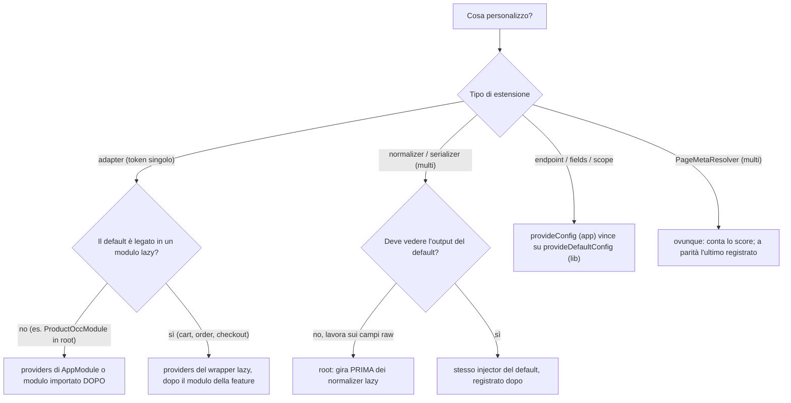
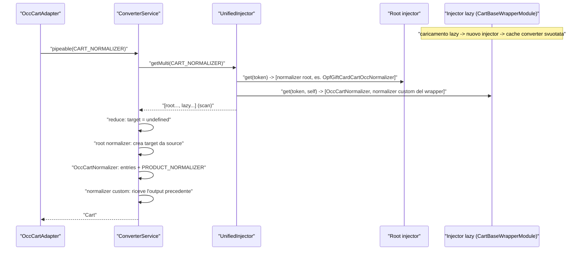
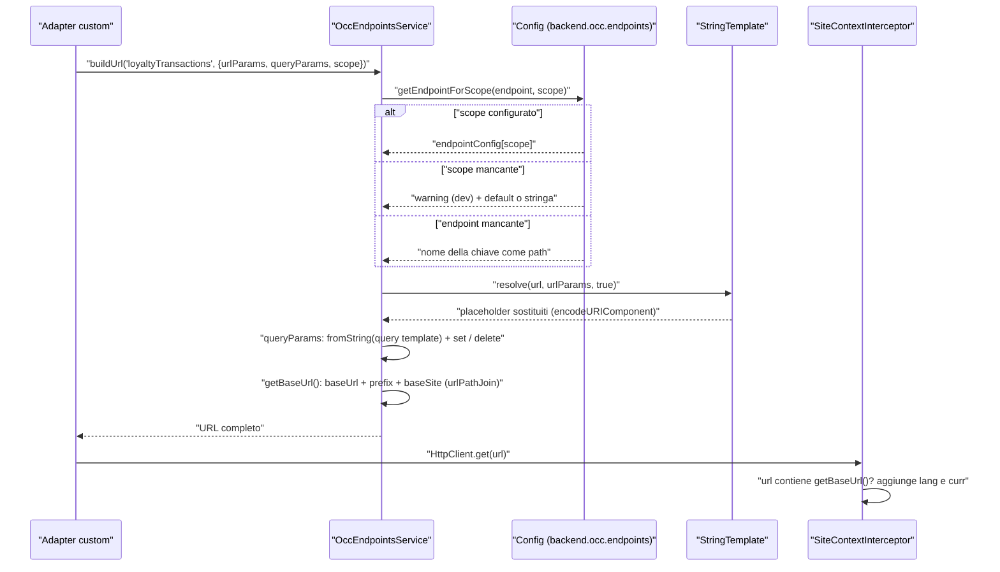
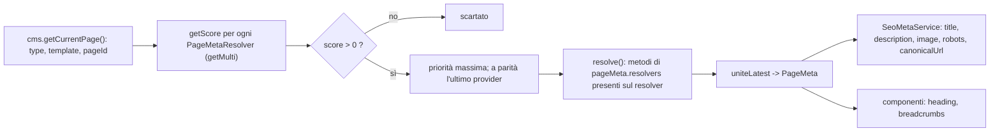

# 52 — Ricette: OCC, adapter, converter, endpoint, meta resolver

> Riferimenti allo SHA `5b7a1c2bf2808d7380bc20596d10f4fa710c3da1` (vedi [00-meta](../00-meta.md)).

## 1. A cosa serve e perché esiste

Questo capitolo raccoglie le ricette per **cambiare i dati** che lo storefront scambia con il backend: da dove arrivano (adapter e connector), come vengono trasformati (normalizer e serializer), quali campi OCC si chiedono (`fields` ed endpoint per scope), quali nuovi endpoint si aggiungono (augmentation di `OccEndpoints` + `OccEndpointsService.buildUrl`) e come si producono i meta della pagina (`PageMetaResolver`).

Tutte le ricette poggiano su quattro meccanismi già descritti nella Parte II, che qui vengono dati per noti e richiamati solo dove servono:

1. **Adapter astratto come token DI.** Il dominio dipende da una classe astratta (`ProductAdapter`, `CartAdapter`, …); il modulo OCC la lega all'implementazione con un semplice `useClass` (`core-libs/core/src/product/connectors/product/product.adapter.ts:L11-L30`, `core-libs/core/src/occ/adapters/product/product-occ.module.ts:L30-L51`). Il JSDoc dell'adapter prodotto lo dice esplicitamente: i dati "can be loaded from alternative sources, as long as the structure converts to the `Product`" (`core-libs/core/src/product/connectors/product/product.adapter.ts:L13-L15`). Dettagli nel capitolo [21 — OCC](../parte-2/21-occ.md).
2. **Converter impilabili su multi-provider.** `ConverterService` raccoglie tutti i converter registrati su un `InjectionToken` (root + moduli lazy) e li applica in catena con `reduce` (`core-libs/core/src/util/converter.service.ts:L38-L65`, `core-libs/core/src/util/converter.service.ts:L130-L137`).
3. **Endpoint come configurazione.** Gli URL sono template in `backend.occ.endpoints`, eventualmente per scope, risolti da `OccEndpointsService.buildUrl` (`core-libs/core/src/occ/services/occ-endpoints.service.ts:L111-L150`). La mappa completa degli endpoint è nell'appendice [A04 — Endpoint OCC](../appendici/A04-occ-endpoints.md).
4. **Selezione per punteggio dei meta resolver.** `PageMetaService` sceglie, tra tutte le istanze di `PageMetaResolver`, quella con lo score più alto per la pagina CMS corrente (`core-libs/core/src/cms/facade/page-meta.service.ts:L53-L57`, `core-libs/core/src/util/applicable.ts:L47-L87`). Dettagli nel capitolo [40 — SEO e PWA](../parte-2/40-seo-pwa.md).

Il filo conduttore di tutto il capitolo è una domanda che ricorre in ogni ricetta: **in quale injector va registrata la personalizzazione, e in che ordine rispetto al default?** Il prodotto (`ProductOccModule`) vive nell'injector root (`projects/storefrontapp/src/app/spartacus/spartacus-features.module.ts:L221-L221`), il carrello e l'ordine in moduli lazy (`projects/storefrontapp/src/app/spartacus/features/cart/cart-base-wrapper.module.ts:L14-L25`, `projects/storefrontapp/src/app/spartacus/features/order/order-wrapper.module.ts:L14-L27`): la stessa riga di codice funziona in un caso e viene ignorata nell'altro. I capitoli di dominio da tenere sotto mano sono [24 — Prodotto e ricerca](../parte-2/24-product-search.md), [25 — Carrello](../parte-2/25-cart.md) e [27 — Ordini](../parte-2/27-order.md).

> Convenzione: gli esempi di questo capitolo sono **illustrativi, non presenti nel repo**. Per ogni simbolo `@spartacus/*` importato è indicata la catena di export (`public_api.ts` → barrel → dichiarazione). I nomi inventati negli esempi (classi, token, campi) sono scritti in corsivo nel testo per distinguerli dai simboli reali.

## 2. Mappa dei file

| Path | Ruolo |
|---|---|
| `core-libs/core/src/occ/config/occ-config.ts` | `BackendConfig` (`occ.endpoints`, `loadingScopes`), `OccConfig` (`useExisting: Config`) |
| `core-libs/core/src/occ/occ-models/occ-endpoints.model.ts` | `DEFAULT_SCOPE`, `OccEndpoint`, `OccEndpoints` (augmentabile) |
| `core-libs/core/src/occ/services/occ-endpoints.service.ts` | `OccEndpointsService.buildUrl`, `getEndpointForScope`, `isConfigured`, `getRawEndpointValue` |
| `core-libs/core/src/config/utils/string-template.ts` | sostituzione dei placeholder `${...}` |
| `core-libs/core/src/occ/utils/occ-url-util.ts` | `urlPathJoin` |
| `core-libs/core/src/occ/services/occ-requests-optimizer.service.ts` | fusione delle richieste per scope |
| `core-libs/core/src/occ/services/occ-fields.service.ts`, `core-libs/core/src/occ/utils/occ-fields.ts` | fusione/estrazione dei `fields` |
| `core-libs/core/src/occ/config/loading-scopes-config.ts` | `LoadingScopeConfig`, `LoadingScopes` |
| `core-libs/core/src/util/converter.service.ts` | `Converter`, `ConverterService` |
| `core-libs/core/src/lazy-loading/unified-injector.ts` | `getMulti`: istanze root + lazy |
| `core-libs/core/src/lazy-loading/lazy-modules.service.ts` | creazione dell'injector dei moduli lazy |
| `core-libs/core/src/config/config-providers.ts`, `core-libs/core/src/config/config-tokens.ts`, `core-libs/core/src/config/utils/deep-merge.ts`, `core-libs/core/src/config/services/configuration.service.ts` | `provideConfig`/`provideDefaultConfig`, merge e config dei moduli lazy |
| `core-libs/core/src/product/connectors/product/product.adapter.ts`, `product.connector.ts`, `converters.ts` | adapter/connector/token prodotto |
| `core-libs/core/src/occ/adapters/product/product-occ.module.ts` | binding `ProductAdapter`→`OccProductAdapter` + normalizer multi |
| `core-libs/core/src/occ/adapters/product/occ-product.adapter.ts` | `OccProductAdapter` (estendibile) |
| `core-libs/core/src/occ/adapters/product/default-occ-product-config.ts` | endpoint `product` per scope + `loadingScopes` |
| `core-libs/core/src/occ/adapters/product/converters/product-name-normalizer.ts` | normalizer di riferimento (`target ?? {...source}`) |
| `core-libs/core/src/occ/adapters/user/occ-user-address.adapter.ts` | uso di `ADDRESS_SERIALIZER` |
| `core-libs/core/src/product/facade/product.service.ts`, `core-libs/core/src/product/services/product-loading.service.ts`, `core-libs/core/src/product/store/effects/product.effect.ts` | scope e caricamento prodotto |
| `core-libs/core/src/cms/page/page-meta.resolver.ts`, `page.resolvers.ts`, `base-page-meta.resolver.ts` | meta resolver: base, interfacce, helper |
| `core-libs/core/src/cms/facade/page-meta.service.ts` | selezione e risoluzione dei meta |
| `core-libs/core/src/cms/page/config/default-page-meta.config.ts`, `page-meta.config.ts` | `pageMeta.resolvers` |
| `core-libs/core/src/util/applicable.ts` | `resolveApplicable` (score, parità) |
| `core-libs/storefront/cms-structure/seo/seo-meta.service.ts` | scrittura dei meta nel DOM |
| `feature-libs/cart/base/core/connectors/cart/cart.adapter.ts`, `cart.connector.ts` | adapter/connector cart |
| `feature-libs/cart/base/core/cart-base-core.module.ts` | ri-fornisce i connector nel modulo lazy |
| `feature-libs/cart/base/occ/cart-base-occ.module.ts` | binding OCC del cart + `CART_NORMALIZER` |
| `feature-libs/cart/base/occ/adapters/occ-cart.adapter.ts` | `OccCartAdapter` |
| `feature-libs/cart/base/occ/adapters/converters/occ-cart-normalizer.ts` | normalizer cart (applica `PRODUCT_NORMALIZER`) |
| `feature-libs/cart/base/occ/model/occ-cart-endpoints.model.ts` | `CartOccEndpoints` + augmentation |
| `feature-libs/cart/base/occ/config/default-occ-cart-config-factory.ts` | `fields` di default di `carts`/`cart`/`createCart` |
| `integration-libs/omf/order/*` | esempio reale: adapter OCC esteso e sostituito (lazy) |
| `integration-libs/opf/gift-card/{root,core,occ}/*` | esempio reale: normalizer, campi extra, endpoint, adapter/connector nuovi |
| `feature-libs/product/bulk-pricing/*` | esempio reale: scope prodotto custom |
| `feature-libs/checkout/base/core/services/checkout-page-meta.resolver.ts`, `feature-libs/customer-ticketing/core/services/customer-ticketing-page-meta.resolver.ts` | esempi reali di `PageMetaResolver` |

## 3. Come funziona passo per passo

Le dieci ricette seguono lo stesso schema. Prima, però, tre regole trasversali che spiegano quasi tutte le trappole.

**Regola A — precedenza della config.** La config globale è `deepMerge({}, DefaultConfig, RootConfig)`: ciò che l'app passa a `provideConfig` vince sempre su `provideDefaultConfig` delle librerie (`core-libs/core/src/config/config-tokens.ts:L10-L21`, `core-libs/core/src/config/config-providers.ts:L11-L27`). Quando si carica un modulo lazy la config viene ricalcolata con precedenza `defaultConfig < ambientDefaultConfig < ambientConfig < rootConfig` e fusa *in place* nell'oggetto `Config` globale, salvo il flag `disableConfigUpdates` (`core-libs/core/src/config/services/configuration.service.ts:L92-L105`). `deepMerge` fonde solo gli oggetti: **stringhe e array sostituiscono** il valore precedente (`core-libs/core/src/config/utils/deep-merge.ts:L7-L9`, `core-libs/core/src/config/utils/deep-merge.ts:L31-L46`).

**Regola B — precedenza dei provider singoli.** Dentro un injector, per un token non-multi vince l'ultimo provider registrato (`angular:packages/core/src/di/r3_injector.ts:L497-L521`); in un NgModule Angular processa prima gli `imports` (i `ModuleWithProviders` dopo tutti gli import) e poi i `providers` del modulo stesso (`angular:packages/core/src/di/provider_collection.ts:L293-L322`, `angular:packages/core/src/di/provider_collection.ts:L346-L348`). Un modulo lazy ha il suo injector (`core-libs/core/src/lazy-loading/lazy-modules.service.ts:L78-L97`), i cui provider oscurano quelli della root per chi viene istanziato lì dentro.

**Regola C — ordine dei multi-provider.** `UnifiedInjector.getMulti` legge il token prima dalla root e poi da ogni injector lazy (con `{ self: true }`) nell'ordine di caricamento, e concatena con `scan` (`core-libs/core/src/lazy-loading/unified-injector.ts:L52-L68`, `core-libs/core/src/lazy-loading/unified-injector.ts:L75-L93`). È così che vengono raccolti sia i converter (`core-libs/core/src/util/converter.service.ts:L52-L65`) sia i `PageMetaResolver` (`core-libs/core/src/cms/facade/page-meta.service.ts:L53-L57`).

### 3.1 Ricetta: estendere e sostituire l'adapter OCC di una feature eager (`ProductAdapter`)

#### Quando usarlo

Quando una parte dei dati prodotto deve venire da una sorgente diversa da OCC (un PIM esterno, un mock, un microservizio) oppure quando la chiamata OCC va arricchita (header, logica di fallback) senza toccare facade, store ed effect. È la situazione descritta dal JSDoc di `ProductAdapter` (`core-libs/core/src/product/connectors/product/product.adapter.ts:L13-L15`).

#### Esempio

Esempio illustrativo, non presente nel repo. I prodotti con codice che inizia per `EXT-` vengono letti da un'API esterna; tutti gli altri passano per il percorso OCC standard (inclusa la fusione dei `fields`).

```ts
// app/product/external-aware-product.adapter.ts  (esempio illustrativo, non presente nel repo)
import { Injectable, NgModule } from '@angular/core';
import { Observable } from 'rxjs';
import { map } from 'rxjs/operators';
import {
  OccProductAdapter,
  Product,
  ProductAdapter,
  ScopedProductData,
} from '@spartacus/core';

interface ExternalProduct {
  title: string;
  summary?: string;
}

const isExternal = (code: string) => code.startsWith('EXT-');

@Injectable()
export class ExternalAwareProductAdapter extends OccProductAdapter {
  // Percorso usato dagli effect: ProductConnector.getMany -> adapter.loadMany
  loadMany(products: ScopedProductData[]): ScopedProductData[] {
    const occProducts = products.filter((p) => !isExternal(p.code));
    const externalProducts = products.filter((p) => isExternal(p.code));
    return [
      ...super.loadMany(occProducts),
      ...externalProducts.map((p) => ({
        ...p,
        data$: this.load(p.code, p.scope),
      })),
    ];
  }

  load(productCode: string, scope?: string): Observable<Product> {
    if (!isExternal(productCode)) {
      return super.load(productCode, scope);
    }
    return this.http
      .get<ExternalProduct>(
        `https://pim.example.com/api/products/${encodeURIComponent(productCode)}`
      )
      .pipe(
        map((ext) => ({
          code: productCode,
          name: ext.title,
          summary: ext.summary,
        }))
      );
  }
}

@NgModule({
  providers: [{ provide: ProductAdapter, useClass: ExternalAwareProductAdapter }],
})
export class ExternalProductModule {}
// Importare ExternalProductModule DOPO il modulo che porta ProductOccModule,
// oppure mettere il provider direttamente nei `providers` di AppModule.
```

Catene di export dei simboli `@spartacus/core`:

| Simbolo | Catena |
|---|---|
| `OccProductAdapter` | `core-libs/core/public_api.ts:L27-L27` → `core-libs/core/src/occ/index.ts:L7-L7` → `core-libs/core/src/occ/adapters/index.ts:L9-L9` → `core-libs/core/src/occ/adapters/product/index.ts:L11-L11` → `core-libs/core/src/occ/adapters/product/occ-product.adapter.ts:L21-L21` |
| `ProductAdapter` | `core-libs/core/public_api.ts:L29-L29` → `core-libs/core/src/product/index.ts:L7-L7` → `core-libs/core/src/product/connectors/index.ts:L7-L7` → `core-libs/core/src/product/connectors/product/index.ts:L8-L8` → `core-libs/core/src/product/connectors/product/product.adapter.ts:L11-L11` |
| `ScopedProductData` | `core-libs/core/public_api.ts:L29-L29` → `core-libs/core/src/product/index.ts:L7-L7` → `core-libs/core/src/product/connectors/index.ts:L7-L7` → `core-libs/core/src/product/connectors/product/index.ts:L10-L10` → `core-libs/core/src/product/connectors/product/scoped-product-data.ts:L13-L13` |
| `Product` | `core-libs/core/public_api.ts:L49-L49` (AUGMENTABLE_TYPES) → `core-libs/core/src/model/product.model.ts:L167-L167` |

#### Perché funziona (file sorgente)

- `ProductOccModule` lega il token astratto con `useClass: OccProductAdapter` (`core-libs/core/src/occ/adapters/product/product-occ.module.ts:L30-L37`) ed è importato nell'injector root della demo (`projects/storefrontapp/src/app/spartacus/spartacus-features.module.ts:L15-L15`, `projects/storefrontapp/src/app/spartacus/spartacus-features.module.ts:L221-L221`): un provider successivo dello stesso token lo sostituisce (Regola B).
- `OccProductAdapter` è `@Injectable()` con dipendenze `protected` (`http`, `occEndpoints`, `converter`, `requestsOptimizer`) e `getEndpoint` `protected`: è pensato per essere esteso (`core-libs/core/src/occ/adapters/product/occ-product.adapter.ts:L20-L27`, `core-libs/core/src/occ/adapters/product/occ-product.adapter.ts:L54-L59`).
- Gli effect raggruppano le `LoadProduct` simultanee e chiamano `productConnector.getMany` (`core-libs/core/src/product/store/effects/product.effect.ts:L45-L53`); il connector usa `loadMany` se l'adapter lo implementa, altrimenti `load` per ciascun prodotto (`core-libs/core/src/product/connectors/product/product.connector.ts:L23-L32`). Per questo l'esempio sovrascrive **anche** `loadMany`.
- Per ogni elemento restituito l'effect crea `LoadProductSuccess({ code: productLoad.code, ...data }, productLoad.scope)`: l'ordine dell'array non conta, conta che ogni elemento conservi `code` e `scope` (`core-libs/core/src/product/store/effects/product.effect.ts:L59-L90`).
- Lo stesso schema "estendi l'adapter OCC e sostituisci il token" è usato nel repo da CDC per `UserConsentAdapter` (`integration-libs/cdc/root/consent-management/cdc-consent.module.ts:L16-L31`, `integration-libs/cdc/root/consent-management/cdc-user-consent.adapter.ts:L20-L45`) e da OPF per `UserPaymentAdapter` (`integration-libs/opf/tokenisation/root/opf-tokenisation-root.module.ts:L33-L40`).

#### Limiti e trappole

- **Sovrascrivere solo `load` non basta**: `OccProductAdapter` implementa `loadMany`, quindi il percorso degli effect non passa mai da `load` (`core-libs/core/src/product/connectors/product/product.connector.ts:L23-L32`).
- **Ordine dei provider**: un modulo di override importato *prima* di quello che porta `ProductOccModule` perde (Regola B; `angular:packages/core/src/di/provider_collection.ts:L293-L348`).
- **Nessun normalizer sul ramo esterno**: l'esempio produce direttamente un `Product`; se si vuole riusare la catena di `PRODUCT_NORMALIZER` bisogna passare per `this.converter.pipeable(PRODUCT_NORMALIZER)` come fa `load` (`core-libs/core/src/occ/adapters/product/occ-product.adapter.ts:L29-L33`), ricordando che i normalizer registrati si aspettano la forma `Occ.Product`.
- **Una richiesta per scope** sul ramo esterno: la fusione dei `fields` è fatta da `OccRequestsOptimizerService.scopedDataLoad`, che qui non viene usato (`core-libs/core/src/occ/adapters/product/occ-product.adapter.ts:L35-L52`).
- `OccProductAdapter` non è `providedIn`: la sottoclasse va fornita con `useClass` (o dichiarata `providedIn: 'root'`, come fa `CdcUserConsentAdapter`) (`integration-libs/cdc/root/consent-management/cdc-user-consent.adapter.ts:L20-L20`).

### 3.2 Ricetta: sostituire l'adapter di una feature lib lazy (`CartAdapter`)

#### Quando usarlo

Quando l'adapter da cambiare appartiene a una feature lib caricata in lazy (cart, order, checkout, …). Il caso di riferimento nel repo è OMF, che sostituisce `OrderHistoryAdapter` con una sottoclasse di `OccOrderHistoryAdapter` (`integration-libs/omf/order/omf-order.module.ts:L15-L26`, `integration-libs/omf/order/occ-omf-order-history.adapter.ts:L23-L30`).

#### Esempio

Esempio illustrativo, non presente nel repo. `OccCartAdapter.load(userId, 'current')` non chiama l'endpoint `cart` ma scarica **tutti** i carrelli con `carts` e prende quello senza `saveTime` (`feature-libs/cart/base/occ/adapters/occ-cart.adapter.ts:L46-L50`). L'adapter qui sotto, per `current`, chiama direttamente `cart` con `cartId = 'current'`.

```ts
// app/cart/single-call-cart.adapter.ts  (esempio illustrativo, non presente nel repo)
import { Injectable, NgModule } from '@angular/core';
import { Observable } from 'rxjs';
import { CartBaseModule } from '@spartacus/cart/base';
import { CartAdapter } from '@spartacus/cart/base/core';
import { OccCartAdapter } from '@spartacus/cart/base/occ';
import { Cart, CART_NORMALIZER } from '@spartacus/cart/base/root';
import { Occ, OCC_CART_ID_CURRENT } from '@spartacus/core';

@Injectable()
export class SingleCallCartAdapter extends OccCartAdapter {
  public load(userId: string, cartId: string): Observable<Cart | undefined> {
    if (cartId !== OCC_CART_ID_CURRENT) {
      return super.load(userId, cartId);
    }
    return this.http
      .get<Occ.Cart>(
        this.occEndpointsService.buildUrl('cart', {
          urlParams: { userId, cartId },
        })
      )
      .pipe(this.converterService.pipeable(CART_NORMALIZER));
  }
}

// Wrapper caricato in lazy al posto di CartBaseModule:
// featureModules: { cartBase: { module: () => import('./cart-base-wrapper.module').then(m => m.CartBaseWrapperModule) } }
@NgModule({
  imports: [CartBaseModule],
  providers: [{ provide: CartAdapter, useClass: SingleCallCartAdapter }],
})
export class CartBaseWrapperModule {}
```

Catene di export:

| Simbolo | Catena |
|---|---|
| `CartBaseModule` | `feature-libs/cart/base/public_api.ts:L7-L7` → `feature-libs/cart/base/cart-base.module.ts:L15-L15` |
| `CartAdapter` | `feature-libs/cart/base/core/public_api.ts:L9-L9` → `feature-libs/cart/base/core/connectors/index.ts:L8-L8` → `feature-libs/cart/base/core/connectors/cart/index.ts:L7-L7` → `feature-libs/cart/base/core/connectors/cart/cart.adapter.ts:L10-L10` |
| `OccCartAdapter` | `feature-libs/cart/base/occ/public_api.ts:L7-L7` → `feature-libs/cart/base/occ/adapters/index.ts:L13-L13` → `feature-libs/cart/base/occ/adapters/occ-cart.adapter.ts:L28-L28` |
| `Cart` | `feature-libs/cart/base/root/public_api.ts:L19-L19` (AUGMENTABLE_TYPES) → `feature-libs/cart/base/root/models/cart.model.ts:L62-L62` |
| `CART_NORMALIZER` | `feature-libs/cart/base/root/public_api.ts:L15-L15` → `feature-libs/cart/base/root/tokens/index.ts:L8-L8` → `feature-libs/cart/base/root/tokens/converters.ts:L17-L17` |
| `Occ` | `core-libs/core/public_api.ts:L27-L27` → `core-libs/core/src/occ/index.ts:L15-L15` → `core-libs/core/src/occ/occ-models/index.ts:L8-L8` → `core-libs/core/src/occ/occ-models/occ.models.ts:L7-L7` |
| `OCC_CART_ID_CURRENT` | `core-libs/core/public_api.ts:L27-L27` → `core-libs/core/src/occ/index.ts:L17-L17` → `core-libs/core/src/occ/utils/index.ts:L14-L14` → `core-libs/core/src/occ/utils/occ-constants.ts:L7-L7` |

#### Perché funziona (file sorgente)

- `CartBaseModule` = `CartBaseCoreModule` + `CartBaseOccModule` + `CartBaseComponentsModule` (`feature-libs/cart/base/cart-base.module.ts:L12-L15`); `CartBaseOccModule` lega `CartAdapter`→`OccCartAdapter` con `useClass` (`feature-libs/cart/base/occ/cart-base-occ.module.ts:L32-L39`).
- `CartBaseCoreModule` **ri-fornisce** `CartConnector` nei propri `providers` (`feature-libs/cart/base/core/cart-base-core.module.ts:L22-L36`): il connector viene istanziato nell'injector lazy e risolve il `CartAdapter` di quell'injector. Nel wrapper, i `providers` del modulo sono processati dopo gli `imports` (Regola B), quindi vince *SingleCallCartAdapter*.
- `OccCartAdapter` espone `http`, `occEndpointsService`, `converterService` come `protected` (`feature-libs/cart/base/occ/adapters/occ-cart.adapter.ts:L27-L33`).
- La demo carica il cart tramite un wrapper lazy (`projects/storefrontapp/src/app/spartacus/features/cart/cart-base-feature.module.ts:L26-L35`, `projects/storefrontapp/src/app/spartacus/features/cart/cart-base-wrapper.module.ts:L14-L25`), esattamente come OMF si aggancia a `OrderWrapperModule` dopo `OrderModule` (`projects/storefrontapp/src/app/spartacus/features/order/order-wrapper.module.ts:L14-L27`).

#### Limiti e trappole

- **Override nel posto sbagliato**: un `{ provide: CartAdapter, useClass: … }` nell'`AppModule` (root) viene oscurato dal provider dell'injector lazy, perché sia l'adapter sia il connector vivono lì (`feature-libs/cart/base/occ/cart-base-occ.module.ts:L36-L39`, `feature-libs/cart/base/core/cart-base-core.module.ts:L29-L30`, `core-libs/core/src/lazy-loading/lazy-modules.service.ts:L96-L97`).
- Il core del cart è bundlato con i componenti (`[CART_BASE_CORE_FEATURE]: CART_BASE_FEATURE`), quindi c'è un solo modulo lazy da wrappare (`feature-libs/cart/base/root/cart-base-root.module.ts:L45-L53`).
- ⚠️ DA VERIFICARE: la semantica lato backend di `users/{userId}/carts/current` (che carrello restituisce, e cosa succede se non esiste) non è verificabile nel repo; l'adapter di default filtra `saveTime === undefined` sulla lista (`feature-libs/cart/base/occ/adapters/occ-cart.adapter.ts:L46-L50`), comportamento che un override deve riprodurre o accettare di cambiare.
- `OccCartAdapter` non è `providedIn` (`feature-libs/cart/base/occ/adapters/occ-cart.adapter.ts:L27-L27`): serve `useClass`.

### 3.3 Ricetta: nuovo dominio con adapter astratto, connector e implementazione OCC

#### Quando usarlo

Quando si introducono dati che Spartacus non conosce (punti fedeltà, garanzie, documenti) e si vuole lo stesso disaccoppiamento delle feature lib: il dominio dipende da un adapter astratto, il connector lo delega, il modulo OCC lo implementa. Modello reale: OPF gift card (`integration-libs/opf/gift-card/core/connectors/opf-gift-card.adapter.ts:L14-L32`, `integration-libs/opf/gift-card/core/connectors/opf-gift-card.connector.ts:L16-L40`, `integration-libs/opf/gift-card/occ/opf-gift-card-occ.module.ts:L12-L21`).

#### Esempio

Esempio illustrativo, non presente nel repo.

```ts
// app/loyalty/loyalty.ts  (esempio illustrativo, non presente nel repo)
import { HttpClient } from '@angular/common/http';
import { inject, Injectable, InjectionToken, NgModule } from '@angular/core';
import { Observable } from 'rxjs';
import {
  Converter,
  ConverterService,
  Occ,
  OccConfig,
  OccEndpoint,
  OccEndpointsService,
  provideDefaultConfig,
} from '@spartacus/core';

// 1. Modello UI
export interface LoyaltyBalance {
  points: number;
  tier?: string;
}

// 2. Endpoint: augmentation di OccEndpoints (tipizza la config)
export interface LoyaltyOccEndpoints {
  loyaltyBalance?: string | OccEndpoint;
}
declare module '@spartacus/core' {
  interface OccEndpoints extends LoyaltyOccEndpoints {}
}

// 3. Token del normalizer (locale, come CDC_PREFERENCE_SERIALIZER in CDC)
export const LOYALTY_BALANCE_NORMALIZER = new InjectionToken<
  Converter<any, LoyaltyBalance>
>('LoyaltyBalanceNormalizer');

// 4. Adapter astratto (token DI) e connector
export abstract class LoyaltyAdapter {
  abstract loadBalance(userId: string): Observable<LoyaltyBalance>;
}

@Injectable({ providedIn: 'root' })
export class LoyaltyConnector {
  protected adapter = inject(LoyaltyAdapter);
  getBalance(userId: string): Observable<LoyaltyBalance> {
    return this.adapter.loadBalance(userId);
  }
}

// 5. Implementazione OCC
@Injectable()
export class OccLoyaltyAdapter implements LoyaltyAdapter {
  protected http = inject(HttpClient);
  protected occEndpoints = inject(OccEndpointsService);
  protected converter = inject(ConverterService);

  loadBalance(userId: string): Observable<LoyaltyBalance> {
    return this.http
      .get<Occ.User>(this.getBalanceEndpoint(userId))
      .pipe(this.converter.pipeable(LOYALTY_BALANCE_NORMALIZER));
  }

  protected getBalanceEndpoint(userId: string): string {
    return this.occEndpoints.buildUrl('loyaltyBalance', {
      urlParams: { userId },
    });
  }
}

@Injectable({ providedIn: 'root' })
export class OccLoyaltyBalanceNormalizer
  implements Converter<any, LoyaltyBalance>
{
  convert(source: any, target?: LoyaltyBalance): LoyaltyBalance {
    target ??= { points: 0 };
    target.points = Number(source?.loyaltyPoints ?? 0);
    target.tier = source?.loyaltyTier;
    return target;
  }
}

// 6. Modulo che lega tutto
export const defaultLoyaltyOccConfig: OccConfig = {
  backend: {
    occ: {
      endpoints: {
        loyaltyBalance: 'users/${userId}/loyalty?fields=loyaltyPoints,loyaltyTier',
      },
    },
  },
};

@NgModule({
  providers: [
    provideDefaultConfig(defaultLoyaltyOccConfig),
    { provide: LoyaltyAdapter, useClass: OccLoyaltyAdapter },
    {
      provide: LOYALTY_BALANCE_NORMALIZER,
      useExisting: OccLoyaltyBalanceNormalizer,
      multi: true,
    },
  ],
})
export class LoyaltyOccModule {}
```

Catene di export dei simboli `@spartacus/core`:

| Simbolo | Catena |
|---|---|
| `Converter`, `ConverterService` | `core-libs/core/public_api.ts:L35-L35` → `core-libs/core/src/util/index.ts:L11-L11` → `core-libs/core/src/util/converter.service.ts:L21-L21`, `core-libs/core/src/util/converter.service.ts:L35-L35` |
| `Occ` | `core-libs/core/public_api.ts:L27-L27` → `core-libs/core/src/occ/index.ts:L15-L15` → `core-libs/core/src/occ/occ-models/index.ts:L8-L8` → `core-libs/core/src/occ/occ-models/occ.models.ts:L7-L7` |
| `OccConfig` | `core-libs/core/public_api.ts:L27-L27` → `core-libs/core/src/occ/index.ts:L12-L12` → `core-libs/core/src/occ/config/occ-config.ts:L46-L46` |
| `OccEndpoint` | `core-libs/core/public_api.ts:L27-L27` → `core-libs/core/src/occ/index.ts:L15-L15` → `core-libs/core/src/occ/occ-models/index.ts:L7-L7` → `core-libs/core/src/occ/occ-models/occ-endpoints.model.ts:L9-L9` |
| `OccEndpoints` (augmentato) | `core-libs/core/public_api.ts:L51-L51` (AUGMENTABLE_TYPES) → `core-libs/core/src/occ/occ-models/occ-endpoints.model.ts:L21-L21` |
| `OccEndpointsService` | `core-libs/core/public_api.ts:L27-L27` → `core-libs/core/src/occ/index.ts:L16-L16` → `core-libs/core/src/occ/services/index.ts:L7-L7` → `core-libs/core/src/occ/services/occ-endpoints.service.ts:L34-L34` |
| `provideDefaultConfig` | `core-libs/core/public_api.ts:L15-L15` → `core-libs/core/src/config/index.ts:L9-L9` → `core-libs/core/src/config/config-providers.ts:L55-L55` |

#### Perché funziona (file sorgente)

- Il connector OPF è `providedIn: 'root'`, usa `inject(OpfGiftCardAdapter)` e delega 1:1 (`integration-libs/opf/gift-card/core/connectors/opf-gift-card.connector.ts:L16-L40`); il modulo OCC lega l'adapter e fornisce gli endpoint con `provideDefaultConfig` (`integration-libs/opf/gift-card/occ/opf-gift-card-occ.module.ts:L12-L21`).
- L'augmentation `declare module '@spartacus/core' { interface OccEndpoints extends X {} }` è lo schema di tutte le feature lib (`feature-libs/cart/base/occ/model/occ-cart-endpoints.model.ts:L97-L99`, `integration-libs/opf/gift-card/occ/model/occ-opf-gift-card-endpoints.model.ts:L9-L22`); `OccEndpoints` è nel blocco AUGMENTABLE_TYPES, che il builder sposta nel `.d.ts` radice proprio per renderlo augmentabile (`core-libs/core/public_api.ts:L38-L58`, `tools/build-lib/augmented-types/index.js:L42-L52`).
- Il token del normalizer può essere locale: CDC definisce `CDC_PREFERENCE_SERIALIZER` nel proprio pacchetto e lo registra multi (`integration-libs/cdc/root/consent-management/converters/converter.ts:L11-L13`, `integration-libs/cdc/root/consent-management/cdc-consent.module.ts:L24-L28`).
- `ConverterService.pipeable` restituisce la sorgente invariata se il token non ha converter (`core-libs/core/src/util/converter.service.ts:L80-L128`).

#### Limiti e trappole

- **Se la feature è lazy, il connector va ri-fornito** nel modulo lazy, come fanno `CartBaseCoreModule` e `OpfGiftCardCoreModule` (`feature-libs/cart/base/core/cart-base-core.module.ts:L22-L36`, `integration-libs/opf/gift-card/core/opf-gift-card-core.module.ts:L11-L14`); altrimenti il connector `providedIn: 'root'` viene istanziato nella root e non trova l'adapter registrato solo nell'injector lazy.
- **Il primo normalizer crea il target**: `reduce` parte da `undefined` (`core-libs/core/src/util/converter.service.ts:L130-L137`); per questo l'esempio fa `target ??= …`.
- **L'augmentation va importata**: un file che contiene solo `declare module` non è attivo finché non viene importato da qualche parte; il file B2B lo commenta esplicitamente e il core importa `./product-occ-config` per side effect (`core-libs/setup/recipes/b2b/config/default-b2b-occ-config.ts:L7-L17`, `core-libs/core/src/occ/adapters/product/product-occ.module.ts:L26-L26`).
- Gli errori HTTP non sono normalizzati automaticamente: l'adapter OPF li passa a `tryNormalizeHttpError` e applica `backOff({ shouldRetry: isJaloError })` (`integration-libs/opf/gift-card/occ/adapters/occ-opf-gift-card.adapter.ts:L35-L66`).

### 3.4 Ricetta: normalizer custom per un modello eager (`PRODUCT_NORMALIZER`)

#### Quando usarlo

Quando il backend restituisce un campo che il modello UI non ha (o lo restituisce in una forma diversa) e lo si vuole esporre a tutti i consumer di `Product` senza toccare l'adapter. Il normalizer viene applicato a ogni risposta prodotto, e anche ai prodotti dentro carrello, ordini, resi e quote.

#### Esempio

Esempio illustrativo, non presente nel repo. Il backend espone `energyClass` (campo custom) che diventa `energyLabel` in `Product`.

```ts
// app/product/energy-label.normalizer.ts  (esempio illustrativo, non presente nel repo)
import { Injectable, NgModule } from '@angular/core';
import { Converter, Occ, Product, PRODUCT_NORMALIZER } from '@spartacus/core';

declare module '@spartacus/core' {
  interface Product {
    energyLabel?: string;
  }
}

@Injectable({ providedIn: 'root' })
export class EnergyLabelNormalizer implements Converter<Occ.Product, Product> {
  convert(source: Occ.Product, target?: Product): Product {
    target = target ?? { ...(source as unknown as Partial<Product>) };
    const energyClass = (source as any).energyClass;
    if (energyClass) {
      target.energyLabel = String(energyClass).toUpperCase();
    }
    return target as Product;
  }
}

@NgModule({
  providers: [
    {
      provide: PRODUCT_NORMALIZER,
      useExisting: EnergyLabelNormalizer,
      multi: true,
    },
  ],
})
export class EnergyLabelModule {}
// Il campo deve anche essere richiesto nei `fields` dell'endpoint: vedi 3.7 e 3.8.
```

| Simbolo | Catena |
|---|---|
| `Converter` | `core-libs/core/public_api.ts:L35-L35` → `core-libs/core/src/util/index.ts:L11-L11` → `core-libs/core/src/util/converter.service.ts:L21-L21` |
| `Occ` | `core-libs/core/public_api.ts:L27-L27` → `core-libs/core/src/occ/index.ts:L15-L15` → `core-libs/core/src/occ/occ-models/index.ts:L8-L8` → `core-libs/core/src/occ/occ-models/occ.models.ts:L7-L7` |
| `Product` (augmentato) | `core-libs/core/public_api.ts:L49-L49` (AUGMENTABLE_TYPES) → `core-libs/core/src/model/product.model.ts:L167-L167` |
| `PRODUCT_NORMALIZER` | `core-libs/core/public_api.ts:L29-L29` → `core-libs/core/src/product/index.ts:L7-L7` → `core-libs/core/src/product/connectors/index.ts:L7-L7` → `core-libs/core/src/product/connectors/product/index.ts:L9-L9` → `core-libs/core/src/product/connectors/product/converters.ts:L11-L11` |

#### Perché funziona (file sorgente)

- I normalizer di default sono `providedIn: 'root'` e registrati multi con `useExisting` in `ProductOccModule` (`core-libs/core/src/occ/adapters/product/product-occ.module.ts:L42-L51`, `core-libs/core/src/occ/adapters/product/converters/product-image-normalizer.ts:L14-L26`).
- La convenzione `target ?? { ...source }` è quella di `ProductNameNormalizer` (`core-libs/core/src/occ/adapters/product/converters/product-name-normalizer.ts:L13-L26`): se il normalizer è il primo della catena crea il target, altrimenti arricchisce quello ricevuto (`core-libs/core/src/util/converter.service.ts:L130-L137`).
- `ConverterService` legge la catena con `getLastValueSync(unifiedInjector.getMulti(token))` e la mette in cache, svuotandola quando compare un nuovo injector lazy (`core-libs/core/src/util/converter.service.ts:L38-L65`, `core-libs/core/src/util/rxjs/get-last-value-sync.ts:L19-L23`).
- `Product` è nel blocco AUGMENTABLE_TYPES del core (`core-libs/core/public_api.ts:L49-L49`); lo stesso schema di augmentation è usato da OPF per `Cart` (`integration-libs/opf/gift-card/root/model/augmented-opf-gift-card.model.ts:L12-L23`).
- `OccCartNormalizer` applica `PRODUCT_NORMALIZER` al `product` di ogni entry (`feature-libs/cart/base/occ/adapters/converters/occ-cart-normalizer.ts:L23-L43`); lo fanno anche `OccOrderNormalizer`, `OccReplenishmentOrderNormalizer`, `OccReturnRequestNormalizer` e `OccQuoteEntryNormalizer` (`feature-libs/order/occ/adapters/converters/occ-order-normalizer.ts:L74-L74`, `feature-libs/order/occ/adapters/converters/occ-replenishment-order-normalizer.ts:L34-L34`, `feature-libs/order/occ/adapters/converters/occ-return-request-normalizer.ts:L41-L41`, `feature-libs/quote/occ/converters/occ-quote-entry-normalizer.ts:L30-L30`).

#### Limiti e trappole

- **`multi: true` dimenticato**: non sostituisce la catena "in silenzio". Nello stesso injector Angular lancia l'errore di provider misti in dev mode; tra injector diversi `getMulti` lancia `Multi-providers mixed with single providers` (`angular:packages/core/src/di/r3_injector.ts:L500-L505`, `core-libs/core/src/lazy-loading/unified-injector.ts:L84-L88`). La skill di sviluppo nel repo afferma il contrario (`core-libs/skills/skills/spartacus-developer/references/normalizers.md:L5-L7`): fa fede il codice.
- **Default param sul target**: un `convert(source, target: Product = {})` in prima posizione perderebbe tutti i campi della sorgente (`core-libs/core/src/util/converter.service.ts:L134-L136`).
- **Prodotti parziali**: dentro carrello/ordini il prodotto arriva con i `fields` di quegli endpoint; il normalizer deve tollerare campi assenti (`feature-libs/cart/base/occ/adapters/converters/occ-cart-normalizer.ts:L31-L39`).
- **Campi non tipizzati di `Occ.*`**: il namespace `Occ` non è nel blocco AUGMENTABLE_TYPES; gli esempi reali leggono i campi extra con `(source as any).campo` (`integration-libs/opf/gift-card/root/normalizers/opf-gift-card-cart-occ-normalizer.ts:L26-L26`, `core-libs/core/public_api.ts:L38-L58`).
- Per **sostituire** un normalizer di default invece di aggiungerne uno, si può ridefinire la classe concreta referenziata da `useExisting` (es. `{ provide: ProductNameNormalizer, useClass: … }`), perché `useExisting` diventa `ɵɵinject(classe)` (`angular:packages/core/src/di/r3_injector.ts:L657-L664`). ⚠️ DA VERIFICARE: nessun esempio nel repo, dedotto dal codice DI.

### 3.5 Ricetta: normalizer che lavora sull'output del default in una feature lazy (`CART_NORMALIZER`)

#### Quando usarlo

Quando si vuole aggiungere al `Cart` un campo calcolato a partire dal risultato di `OccCartNormalizer` (per esempio dalle entry già normalizzate), oppure in generale quando il proprio normalizer deve girare **dopo** quello della feature lib.

#### Esempio

Esempio illustrativo, non presente nel repo.

```ts
// app/cart/restricted-items.normalizer.ts  (esempio illustrativo, non presente nel repo)
import { Injectable, NgModule } from '@angular/core';
import { CartBaseModule } from '@spartacus/cart/base';
import { Cart, CART_NORMALIZER } from '@spartacus/cart/base/root';
import { Converter, Occ } from '@spartacus/core';

declare module '@spartacus/cart/base/root' {
  interface Cart {
    hasRestrictedItems?: boolean;
  }
}

@Injectable({ providedIn: 'root' })
export class RestrictedItemsCartNormalizer implements Converter<Occ.Cart, Cart> {
  convert(source: Occ.Cart, target?: Cart): Cart {
    // Registrato dopo CartBaseModule: target è l'output di OccCartNormalizer
    target ??= { ...(source as any) } as Cart;
    target.hasRestrictedItems = (target.entries ?? []).some(
      (entry) => (entry.product as any)?.restricted === true
    );
    return target;
  }
}

@NgModule({
  imports: [CartBaseModule],
  providers: [
    {
      provide: CART_NORMALIZER,
      useExisting: RestrictedItemsCartNormalizer,
      multi: true,
    },
  ],
})
export class CartBaseWrapperModule {}
```

| Simbolo | Catena |
|---|---|
| `CartBaseModule` | `feature-libs/cart/base/public_api.ts:L7-L7` → `feature-libs/cart/base/cart-base.module.ts:L15-L15` |
| `Cart` (augmentato) | `feature-libs/cart/base/root/public_api.ts:L19-L19` (AUGMENTABLE_TYPES) → `feature-libs/cart/base/root/models/cart.model.ts:L62-L62` |
| `CART_NORMALIZER` | `feature-libs/cart/base/root/public_api.ts:L15-L15` → `feature-libs/cart/base/root/tokens/index.ts:L8-L8` → `feature-libs/cart/base/root/tokens/converters.ts:L17-L17` |
| `Converter` | `core-libs/core/public_api.ts:L35-L35` → `core-libs/core/src/util/index.ts:L11-L11` → `core-libs/core/src/util/converter.service.ts:L21-L21` |
| `Occ` | `core-libs/core/public_api.ts:L27-L27` → `core-libs/core/src/occ/index.ts:L15-L15` → `core-libs/core/src/occ/occ-models/index.ts:L8-L8` → `core-libs/core/src/occ/occ-models/occ.models.ts:L7-L7` |

#### Perché funziona (file sorgente)

- `OccCartNormalizer` è registrato multi su `CART_NORMALIZER` in `CartBaseOccModule` (`feature-libs/cart/base/occ/cart-base-occ.module.ts:L40-L44`), quindi nell'injector lazy del cart.
- Nello stesso injector i multi-provider sono accodati nell'ordine di processing (`angular:packages/core/src/di/r3_injector.ts:L497-L512`), e i `providers` del wrapper sono processati dopo gli `imports` (`angular:packages/core/src/di/provider_collection.ts:L293-L348`): il normalizer custom segue `OccCartNormalizer`.
- `getMulti` legge ogni injector lazy con `{ self: true }` e concatena root → lazy (`core-libs/core/src/lazy-loading/unified-injector.ts:L56-L67`, `core-libs/core/src/lazy-loading/unified-injector.ts:L82-L92`); `ConverterService` svuota la cache al caricamento del modulo (`core-libs/core/src/util/converter.service.ts:L38-L45`).
- `Cart` è augmentabile da `@spartacus/cart/base/root`, come fa OPF (`feature-libs/cart/base/root/public_api.ts:L18-L20`, `integration-libs/opf/gift-card/root/model/augmented-opf-gift-card.model.ts:L12-L23`).

#### Limiti e trappole

- **Root vs lazy**: un normalizer di `CART_NORMALIZER` registrato nella root gira **prima** di `OccCartNormalizer`, riceve `target` `undefined` e non vede il suo output. È il caso reale di `OpfGiftCardCartOccNormalizer`, registrato in `OpfGiftCardRootModule` (eager), che infatti lavora solo sui campi raw `sapGiftCards`/`sapGiftCardSummary` (`integration-libs/opf/gift-card/root/opf-gift-card-root.module.ts:L46-L56`, `integration-libs/opf/gift-card/root/normalizers/opf-gift-card-cart-occ-normalizer.ts:L18-L54`).
- **Più moduli lazy sullo stesso token**: l'ordine dipende dall'ordine di caricamento dei moduli (`core-libs/core/src/lazy-loading/lazy-modules.service.ts:L47-L55`). ⚠️ DA VERIFICARE caso per caso.
- Il normalizer custom vale per tutte le conversioni `CART_NORMALIZER`, sia `pipeable` sia `pipeableMany` della lista `carts` (`feature-libs/cart/base/occ/adapters/occ-cart.adapter.ts:L35-L44`).

### 3.6 Ricetta: serializer custom (UI → backend)

#### Quando usarlo

Quando il body inviato al backend deve avere una forma diversa dal modello UI: rinominare campi, rimuovere campi che il backend rifiuta, aggiungere default. I token `*_SERIALIZER` sono applicati dall'adapter **prima** della `POST`/`PUT`.

#### Esempio

Esempio illustrativo, non presente nel repo. Normalizza il telefono e rimuove `formattedAddress` (campo calcolato) prima dell'invio.

```ts
// app/user/address.serializer.ts  (esempio illustrativo, non presente nel repo)
import { Injectable, NgModule } from '@angular/core';
import { Address, ADDRESS_SERIALIZER, Converter } from '@spartacus/core';

@Injectable({ providedIn: 'root' })
export class CleanAddressSerializer implements Converter<Address, any> {
  convert(source: Address, target?: any): any {
    target = target ?? { ...source };
    if (target.phone) {
      target.phone = String(target.phone).replace(/[\s\-()]/g, '');
    }
    delete target.formattedAddress;
    return target;
  }
}

@NgModule({
  providers: [
    {
      provide: ADDRESS_SERIALIZER,
      useExisting: CleanAddressSerializer,
      multi: true,
    },
  ],
})
export class AddressSerializerModule {}
```

| Simbolo | Catena |
|---|---|
| `Address` | `core-libs/core/public_api.ts:L41-L41` (AUGMENTABLE_TYPES) → `core-libs/core/src/model/address.model.ts:L38-L38` |
| `ADDRESS_SERIALIZER` | `core-libs/core/public_api.ts:L34-L34` → `core-libs/core/src/user/index.ts:L8-L8` → `core-libs/core/src/user/connectors/index.ts:L7-L7` → `core-libs/core/src/user/connectors/address/index.ts:L9-L9` → `core-libs/core/src/user/connectors/address/converters.ts:L20-L20` |
| `Converter` | `core-libs/core/public_api.ts:L35-L35` → `core-libs/core/src/util/index.ts:L11-L11` → `core-libs/core/src/util/converter.service.ts:L21-L21` |

#### Perché funziona (file sorgente)

- `OccUserAddressAdapter.add` chiama `this.converter.convert(address, ADDRESS_SERIALIZER)` prima della `POST`; lo stesso in `update` e `verify` (`core-libs/core/src/occ/adapters/user/occ-user-address.adapter.ts:L64-L78`, `core-libs/core/src/occ/adapters/user/occ-user-address.adapter.ts:L87-L87`, `core-libs/core/src/occ/adapters/user/occ-user-address.adapter.ts:L106-L106`).
- Nel repo nessun modulo registra un provider per `ADDRESS_SERIALIZER`: finché l'app non ne fornisce uno, `convert` restituisce il modello così com'è (`core-libs/core/src/util/converter.service.ts:L106-L112`).
- Il serializer di riferimento del core è `OccCostCenterSerializer` (`active`→`activeFlag`), registrato multi su `COST_CENTER_SERIALIZER` (`core-libs/core/src/occ/adapters/cost-center/converters/occ-cost-center-serializer.ts:L12-L26`, `core-libs/core/src/occ/adapters/cost-center/cost-center-occ.module.ts:L33-L37`).

#### Limiti e trappole

- **Raggio d'azione più ampio del previsto**: `ADDRESS_SERIALIZER` è applicato anche da `OccCheckoutDeliveryAddressAdapter.createAddress`, da `OccOrgUnitAdapter` e dall'adapter OPF quick-buy (`feature-libs/checkout/base/occ/adapters/occ-checkout-delivery-address.adapter.ts:L37-L42`, `feature-libs/organization/administration/occ/adapters/occ-org-unit.adapter.ts:L157-L157`, `feature-libs/organization/administration/occ/adapters/occ-org-unit.adapter.ts:L169-L169`, `integration-libs/opf/quick-buy/occ/adapters/occ-opf-quick-buy-cart.adapter.ts:L41-L41`).
- **Non sempre il body è il modello serializzato**: `OccProductReviewsAdapter.post` applica `PRODUCT_REVIEW_SERIALIZER` e poi costruisce un body form-urlencoded con soli `headline`, `comment`, `rating`, `alias` (`core-libs/core/src/occ/adapters/product/occ-product-reviews.adapter.ts:L39-L55`): un campo aggiunto dal serializer non parte.
- Registrato nella root, il serializer è visibile anche agli adapter lazy (checkout) perché la catena è raccolta con `getMulti` (`core-libs/core/src/lazy-loading/unified-injector.ts:L52-L68`).

### 3.7 Ricetta: campi OCC aggiuntivi (override di `fields` su un endpoint esistente)

#### Quando usarlo

Quando il campo esiste già nella risposta OCC del backend (estensione del DTO lato SAP Commerce) ma Spartacus non lo chiede nel parametro `fields`. È il caso reale di OPF gift card, che aggiunge `sapGiftCards(...)`, `sapGiftCardSummary(...)` e `_availableOperations` agli endpoint `carts` e `cart` (`integration-libs/opf/gift-card/root/config/default-occ-opf-gift-card-cart-config.ts:L7-L24`).

#### Esempio

Esempio illustrativo, non presente nel repo. Aggiunge `energyClass` al dettaglio prodotto e un campo `costCenterNote` al carrello. Per il cart la stringa di default va ricopiata **per intero** da `default-occ-cart-config-factory.ts` (qui abbreviata con `/* ... */`).

```ts
// app/spartacus/occ-fields.providers.ts  (esempio illustrativo, non presente nel repo)
import { Provider } from '@angular/core';
import { CartOccEndpoints } from '@spartacus/cart/base/occ';
import { OccConfig, provideConfig } from '@spartacus/core';

// L'uso del tipo mantiene vivo l'import che attiva l'augmentation di OccEndpoints
const cartEndpoints: CartOccEndpoints = {
  carts:
    'users/${userId}/carts?fields=carts(DEFAULT,/* ...stringa di default completa... */,saveTime,name,description,costCenterNote)',
  cart: 'users/${userId}/carts/${cartId}?fields=DEFAULT,/* ...stringa di default completa... */,saveTime,name,description,costCenterNote',
};

const occFieldsConfig: OccConfig = {
  backend: {
    occ: {
      endpoints: {
        // oggetto: si fonde con gli altri scope di `product` (list, attributes, ...)
        product: {
          details:
            'products/${productCode}?fields=averageRating,stock(DEFAULT),description,availableForPickup,code,url,price(DEFAULT),numberOfReviews,manufacturer,categories(FULL),priceRange,multidimensional,tags,images(FULL),energyClass',
        },
        ...cartEndpoints,
      },
    },
  },
};

export const occFieldsProviders: Provider[] = [provideConfig(occFieldsConfig)];
```

| Simbolo | Catena |
|---|---|
| `CartOccEndpoints` | `feature-libs/cart/base/occ/public_api.ts:L9-L9` → `feature-libs/cart/base/occ/model/index.ts:L7-L7` → `feature-libs/cart/base/occ/model/occ-cart-endpoints.model.ts:L9-L9` |
| `OccConfig` | `core-libs/core/public_api.ts:L27-L27` → `core-libs/core/src/occ/index.ts:L12-L12` → `core-libs/core/src/occ/config/occ-config.ts:L46-L46` |
| `provideConfig` | `core-libs/core/public_api.ts:L15-L15` → `core-libs/core/src/config/index.ts:L9-L9` → `core-libs/core/src/config/config-providers.ts:L18-L18` |

#### Perché funziona (file sorgente)

- `provideConfig` registra un `ConfigChunk` che vince su ogni `provideDefaultConfig` di libreria, anche su quelli forniti da moduli lazy come `CartBaseOccModule` (`core-libs/core/src/config/config-providers.ts:L11-L27`, `core-libs/core/src/config/config-tokens.ts:L10-L21`, `core-libs/core/src/config/services/configuration.service.ts:L92-L105`, `feature-libs/cart/base/occ/cart-base-occ.module.ts:L35-L35`).
- La demo applica la config OPF proprio con `provideConfig` dal modulo feature root (`projects/storefrontapp/src/app/spartacus/features/opf/opf-feature.module.ts:L85-L91`); B2B fa lo stesso con `defaultB2bOccConfig` (`core-libs/setup/recipes/b2b/config/default-b2b-occ-config.ts:L27-L49`, `projects/storefrontapp/src/app/spartacus/spartacus-b2b-configuration.providers.ts:L20-L20`).
- `OccEndpointsService` legge `backend.occ.endpoints` dall'oggetto config a ogni `buildUrl` (`core-libs/core/src/occ/services/occ-endpoints.service.ts:L196-L204`).
- Il campo arriva nella risposta e, se non c'è un normalizer che lo rimuove, passa nel modello: i normalizer di default partono da una copia della sorgente (`core-libs/core/src/occ/adapters/product/converters/product-name-normalizer.ts:L17-L18`).

#### Limiti e trappole

- **Le stringhe si sostituiscono**: `deepMerge` non concatena, quindi per aggiungere un campo bisogna ricopiare l'intero `fields` di default e tenerlo allineato a ogni upgrade (`core-libs/core/src/config/utils/deep-merge.ts:L43-L45`, `feature-libs/cart/base/occ/config/default-occ-cart-config-factory.ts:L15-L19`).
- **Cart: `cart` E `carts`**: il carrello `current` arriva da `carts` via `loadAll` (`feature-libs/cart/base/occ/adapters/occ-cart.adapter.ts:L46-L50`); anche `createCart` ha i propri `fields` (`feature-libs/cart/base/occ/config/default-occ-cart-config-factory.ts:L18-L19`), che OPF non ridefinisce.
- **Oggetto vs stringa per gli scope**: `product: { details: '…' }` si fonde e conserva gli altri scope; `product: '…'` (stringa) li cancella tutti e ogni `buildUrl('product', { scope })` logga un warning in dev mode e usa la stringa (`core-libs/core/src/config/utils/deep-merge.ts:L38-L45`, `core-libs/core/src/occ/services/occ-endpoints.service.ts:L206-L224`).
- **Il template può cambiare il protocollo**: se `addEntries` contiene `quantity=${quantity}`, `OccCartEntryAdapter.add` passa a body form-urlencoded (caso B2B) (`feature-libs/cart/base/occ/adapters/occ-cart-entry.adapter.ts:L32-L49`).
- **L'augmentation va importata** per tipizzare la config (`core-libs/setup/recipes/b2b/config/default-b2b-occ-config.ts:L7-L17`).

### 3.8 Ricetta: scope di caricamento prodotto custom

#### Quando usarlo

Quando un componente ha bisogno di pochi campi prodotto specifici e non si vuole appesantire lo scope `details` per tutte le pagine. Lo scope custom ha un suo endpoint con un suo `fields`, viene richiesto solo da chi lo usa e, se coincide come URL base con altri scope richiesti insieme, viene fuso in un'unica richiesta. Modello reale: bulk pricing con lo scope `bulkPrices` (`feature-libs/product/bulk-pricing/occ/config/default-occ-bulk-pricing-config.ts:L9-L20`).

#### Esempio

Esempio illustrativo, non presente nel repo.

```ts
// app/product/energy-scope.ts  (esempio illustrativo, non presente nel repo)
import { Injectable, NgModule } from '@angular/core';
import { Observable } from 'rxjs';
import { map } from 'rxjs/operators';
import {
  OccConfig,
  ProductScope,
  ProductService,
  provideDefaultConfig,
} from '@spartacus/core';

export const ENERGY_SCOPE = 'energy';

export const energyScopeOccConfig: OccConfig = {
  backend: {
    occ: {
      endpoints: {
        product: {
          [ENERGY_SCOPE]: 'products/${productCode}?fields=energyClass',
        },
      },
    },
  },
};

@Injectable({ providedIn: 'root' })
export class EnergyLabelService {
  constructor(protected productService: ProductService) {}

  // Uno scope custom è una semplice stringa; combinato con uno scope standard
  getEnergyLabel(productCode: string): Observable<string | undefined> {
    return this.productService
      .get(productCode, [ProductScope.LIST, ENERGY_SCOPE])
      .pipe(map((product) => (product as any)?.energyClass));
  }
}

@NgModule({
  providers: [provideDefaultConfig(energyScopeOccConfig)],
})
export class EnergyScopeModule {}
```

| Simbolo | Catena |
|---|---|
| `OccConfig` | `core-libs/core/public_api.ts:L27-L27` → `core-libs/core/src/occ/index.ts:L12-L12` → `core-libs/core/src/occ/config/occ-config.ts:L46-L46` |
| `ProductScope` | `core-libs/core/public_api.ts:L52-L52` (AUGMENTABLE_TYPES) + `core-libs/core/src/product/index.ts:L10-L10` → `core-libs/core/src/product/model/index.ts:L8-L8` → `core-libs/core/src/product/model/product-scope.ts:L7-L7` |
| `ProductService` | `core-libs/core/public_api.ts:L29-L29` → `core-libs/core/src/product/index.ts:L9-L9` → `core-libs/core/src/product/facade/index.ts:L12-L12` → `core-libs/core/src/product/facade/product.service.ts:L20-L20` |
| `provideDefaultConfig` | `core-libs/core/public_api.ts:L15-L15` → `core-libs/core/src/config/index.ts:L9-L9` → `core-libs/core/src/config/config-providers.ts:L55-L55` |

#### Perché funziona (file sorgente)

- `ProductService.get` accetta `(ProductScope | string)[] | ProductScope | string` (`core-libs/core/src/product/facade/product.service.ts:L39-L46`); `ProductLoadingService.get` espande gli scope e, con più scope, unisce le parti con `uniteLatest` + `deepMerge`, emettendo solo quando tutte le parti sono definite (`core-libs/core/src/product/services/product-loading.service.ts:L49-L86`).
- `OccProductAdapter.getEndpoint` chiama `buildUrl('product', { urlParams, scope })` (`core-libs/core/src/occ/adapters/product/occ-product.adapter.ts:L54-L59`); `getEndpointForScope` restituisce `endpointConfig[scope]` se configurato (`core-libs/core/src/occ/services/occ-endpoints.service.ts:L195-L225`).
- `OccFieldsService.getOptimalUrlGroups` raggruppa gli scope che condividono l'URL senza `fields` e ricostruisce un unico URL con i `fields` fusi; `OccRequestsOptimizerService` fa una sola richiesta e per ogni scope estrae i propri campi (`core-libs/core/src/occ/services/occ-fields.service.ts:L50-L82`, `core-libs/core/src/occ/services/occ-requests-optimizer.service.ts:L34-L75`).
- Il default `product` è un oggetto per scope (`core-libs/core/src/occ/adapters/product/default-occ-product-config.ts:L10-L28`), quindi l'oggetto con la nuova chiave si fonde con esso (Regola A).
- `LoadingScopes` permette `include`, `maxAge` e `reloadOn` per scope (`core-libs/core/src/occ/config/loading-scopes-config.ts:L10-L31`); il core lo usa per `details.include = [LIST, VARIANTS]` (`core-libs/core/src/occ/adapters/product/default-occ-product-config.ts:L52-L58`).

#### Limiti e trappole

- **Enum augmentato ≠ membro runtime**: bulk pricing aumenta `ProductScope` con `declare module` **e** assegna il valore a runtime con un cast (`feature-libs/product/bulk-pricing/core/model/augmented-core.model.ts:L7-L15`). L'esempio evita il problema usando una costante stringa.
- **`extractFields`**: quando gli scope sono fusi, ogni scope riceve solo le chiavi dei propri `fields` (salvo `DEFAULT`/`FULL`/`BASIC`), e il normalizer gira dopo l'estrazione (`core-libs/core/src/occ/utils/occ-fields.ts:L106-L125`, `core-libs/core/src/occ/services/occ-requests-optimizer.service.ts:L61-L73`). Per questo l'esempio legge `energyClass` grezzo; se il normalizer della 3.4 è attivo, il campo `energyLabel` viene calcolato sulla parte dello scope `energy`.
- `LoadingScopes` e `LoadingScopeConfig` non sono esportati dai barrel: si può scrivere la chiave `backend.loadingScopes.product.<scope>` in config, ma non importare i tipi da `@spartacus/core` (dossier: nessuna occorrenza in `index.ts`/`public_api.ts`).
- Un adapter custom senza `loadMany` perde la fusione delle richieste (`core-libs/core/src/product/connectors/product/product.connector.ts:L23-L29`).

### 3.9 Ricetta: endpoint custom con scope e parametri dinamici (`OccEndpoints` + `buildUrl`)

#### Quando usarlo

Quando si aggiunge una chiamata OCC nuova (servizio custom esposto da un'estensione SAP Commerce) e la si vuole rendere configurabile dall'app come gli endpoint standard: path, `fields` per scope, query parameter dinamici.

#### Esempio

Esempio illustrativo, non presente nel repo. Endpoint `loyaltyTransactions` con due scope; l'adapter passa `urlParams`, `queryParams` e `scope`; l'app ridefinisce un solo scope.

```ts
// app/loyalty/loyalty-transactions.ts  (esempio illustrativo, non presente nel repo)
import { HttpClient } from '@angular/common/http';
import { inject, Injectable, NgModule } from '@angular/core';
import { Observable } from 'rxjs';
import {
  DEFAULT_SCOPE,
  OccConfig,
  OccEndpoint,
  OccEndpointsService,
  provideConfig,
  provideDefaultConfig,
} from '@spartacus/core';

export interface LoyaltyTransactionsOccEndpoints {
  loyaltyTransactions?: string | OccEndpoint;
}
declare module '@spartacus/core' {
  interface OccEndpoints extends LoyaltyTransactionsOccEndpoints {}
}

export const LOYALTY_SUMMARY_SCOPE = 'summary';

// Default "di libreria"
export const defaultLoyaltyTransactionsConfig: OccConfig = {
  backend: {
    occ: {
      endpoints: {
        loyaltyTransactions: {
          [DEFAULT_SCOPE]: 'users/${userId}/loyalty/transactions?fields=FULL',
          [LOYALTY_SUMMARY_SCOPE]:
            'users/${userId}/loyalty/transactions?fields=transactions(code,points)',
        },
      },
    },
  },
};

@Injectable({ providedIn: 'root' })
export class OccLoyaltyTransactionsAdapter {
  protected http = inject(HttpClient);
  protected occEndpoints = inject(OccEndpointsService);

  load(userId: string, currentPage: number, summary = false): Observable<unknown> {
    const url = this.occEndpoints.buildUrl('loyaltyTransactions', {
      urlParams: { userId },
      queryParams: { currentPage, pageSize: 20 },
      scope: summary ? LOYALTY_SUMMARY_SCOPE : DEFAULT_SCOPE,
    });
    return this.http.get(url);
  }
}

@NgModule({
  providers: [
    provideDefaultConfig(defaultLoyaltyTransactionsConfig),
    // Override "di app": vince sul default, e si fonde perché è un oggetto
    provideConfig({
      backend: {
        occ: {
          endpoints: {
            loyaltyTransactions: {
              [LOYALTY_SUMMARY_SCOPE]:
                'users/${userId}/loyalty/transactions?fields=transactions(code,points,date)',
            },
          },
        },
      },
    }),
  ],
})
export class LoyaltyTransactionsModule {}
```

| Simbolo | Catena |
|---|---|
| `DEFAULT_SCOPE`, `OccEndpoint` | `core-libs/core/public_api.ts:L27-L27` → `core-libs/core/src/occ/index.ts:L15-L15` → `core-libs/core/src/occ/occ-models/index.ts:L7-L7` → `core-libs/core/src/occ/occ-models/occ-endpoints.model.ts:L7-L9` |
| `OccEndpoints` (augmentato) | `core-libs/core/public_api.ts:L51-L51` (AUGMENTABLE_TYPES) → `core-libs/core/src/occ/occ-models/occ-endpoints.model.ts:L21-L21` |
| `OccConfig` | `core-libs/core/public_api.ts:L27-L27` → `core-libs/core/src/occ/index.ts:L12-L12` → `core-libs/core/src/occ/config/occ-config.ts:L46-L46` |
| `OccEndpointsService` | `core-libs/core/public_api.ts:L27-L27` → `core-libs/core/src/occ/index.ts:L16-L16` → `core-libs/core/src/occ/services/index.ts:L7-L7` → `core-libs/core/src/occ/services/occ-endpoints.service.ts:L34-L34` |
| `provideConfig`, `provideDefaultConfig` | `core-libs/core/public_api.ts:L15-L15` → `core-libs/core/src/config/index.ts:L9-L9` → `core-libs/core/src/config/config-providers.ts:L18-L18`, `core-libs/core/src/config/config-providers.ts:L55-L55` |

#### Perché funziona (file sorgente)

- `buildUrl(endpoint, attributes?, propertiesToOmit?)` risolve il template per scope, sostituisce i placeholder con `StringTemplate.resolve(url, urlParams, true)`, aggiunge i `queryParams` e antepone baseUrl+prefix+baseSite (`core-libs/core/src/occ/services/occ-endpoints.service.ts:L111-L150`).
- `StringTemplate.resolve` sostituisce ogni `${chiave}` presente in `urlParams` e applica `encodeURIComponent` ai valori (`core-libs/core/src/config/utils/string-template.ts:L15-L31`).
- Con `queryParams`, la query già nel template viene separata, ri-parsata e integrata con `HttpParams.set`; `null` cancella un parametro, `undefined` è ignorato (`core-libs/core/src/occ/services/occ-endpoints.service.ts:L125-L146`, `core-libs/core/src/occ/services/occ-endpoints.service.ts:L152-L168`); l'encoder è `HttpParamsURIEncoder` (`core-libs/core/src/util/http-params-uri.encoder.ts:L7-L23`).
- `getBaseUrl` compone baseUrl, prefix (default `'/occ/v2/'`) e baseSite con `urlPathJoin`; ogni parte si omette con `propertiesToOmit` (`core-libs/core/src/occ/services/occ-endpoints.service.ts:L86-L102`, `core-libs/core/src/occ/config/default-occ-config.ts:L9-L15`, `core-libs/core/src/occ/utils/occ-url-util.ts:L12-L33`). Esempio reale: ASM costruisce `asmSessionEvent` con `{ baseSite: false, prefix: false }` (`feature-libs/asm/occ/adapters/occ-asm.adapter.ts:L78-L90`).
- `SiteContextInterceptor` aggiunge `lang` e `curr` a ogni richiesta il cui URL contiene `getBaseUrl()` (`core-libs/core/src/occ/adapters/site-context/site-context.interceptor.ts:L54-L68`).

#### Limiti e trappole

- **`buildUrl` non è tipizzato sulla chiave** (`endpoint: string`): un refuso nella chiave non dà errore di compilazione (`core-libs/core/src/occ/services/occ-endpoints.service.ts:L111-L115`). Incapsulare la chiamata in un metodo `protected get…Endpoint`, come fa OPF, limita il rischio (`integration-libs/opf/gift-card/occ/adapters/occ-opf-gift-card.adapter.ts:L68-L82`).
- **Endpoint non configurato** → nessun errore: viene usato **il nome della chiave** come path (`<baseUrl>/occ/v2/<site>/loyaltyTransactions`); scope mancante → warning solo in dev mode e fallback sul `default` (`core-libs/core/src/occ/services/occ-endpoints.service.ts:L199-L224`).
- **Placeholder senza valore** restano letterali nell'URL (`core-libs/core/src/config/utils/string-template.ts:L20-L30`).
- **`queryParams` ricodifica la query del template** (`,`→`%2C`, `(`→`%28`) e `null` può rimuovere anche il `fields` del template (`core-libs/core/src/occ/services/occ-endpoints.service.ts:L125-L146`, `core-libs/core/src/util/http-params-uri.encoder.ts:L16-L23`).
- **URL fuori dal baseSite** (`baseSite: false` / `prefix: false`) non ricevono `lang`/`curr` (`core-libs/core/src/occ/adapters/site-context/site-context.interceptor.ts:L58-L58`).
- In una libreria vera i due provider dell'esempio starebbero in posti diversi: `provideDefaultConfig` nella libreria, `provideConfig` nell'app (JSDoc di `provideDefaultConfig`, `core-libs/core/src/config/config-providers.ts:L50-L61`).

### 3.10 Ricetta: meta resolver custom (`PageMetaResolver`)

#### Quando usarlo

Quando una pagina (identificata da tipo, template o uid CMS) richiede title, heading, description, breadcrumb o robots diversi da quelli del resolver generico. Esempi reali: checkout (per template) e dettaglio ticket (per uid) (`feature-libs/checkout/base/core/services/checkout-page-meta.resolver.ts:L22-L77`, `feature-libs/customer-ticketing/core/services/customer-ticketing-page-meta.resolver.ts:L44-L101`).

#### Esempio

Esempio illustrativo, non presente nel repo. Resolver per la content page con uid `loyalty` (uid inventato, va creato nel CMS): heading tradotto, breadcrumb "Account" inserito dopo "Home", resto delegato a `BasePageMetaResolver`.

```ts
// app/loyalty/loyalty-page-meta.resolver.ts  (esempio illustrativo, non presente nel repo)
import { Injectable, NgModule } from '@angular/core';
import { combineLatest, Observable } from 'rxjs';
import { map } from 'rxjs/operators';
import {
  BasePageMetaResolver,
  BreadcrumbMeta,
  PageBreadcrumbResolver,
  PageHeadingResolver,
  PageMetaResolver,
  PageRobotsMeta,
  PageRobotsResolver,
  PageTitleResolver,
  PageType,
  TranslationService,
} from '@spartacus/core';

@Injectable({ providedIn: 'root' })
export class LoyaltyPageMetaResolver
  extends PageMetaResolver
  implements
    PageTitleResolver,
    PageHeadingResolver,
    PageBreadcrumbResolver,
    PageRobotsResolver
{
  constructor(
    protected translation: TranslationService,
    protected basePageMetaResolver: BasePageMetaResolver
  ) {
    super();
    this.pageType = PageType.CONTENT_PAGE; // +1
    this.pageUid = 'loyalty'; // +10: batte ContentPageMetaResolver (score 1)
  }

  resolveTitle(): Observable<string | undefined> {
    return this.basePageMetaResolver.resolveTitle();
  }

  resolveHeading(): Observable<string> {
    return this.translation.translate('loyalty.pageHeading');
  }

  resolveBreadcrumbs(): Observable<BreadcrumbMeta[]> {
    return combineLatest([
      this.translation.translate('loyalty.accountBreadcrumb'),
      this.basePageMetaResolver.resolveBreadcrumbs(),
    ]).pipe(
      map(([label, breadcrumbs = []]) => {
        const [home, ...rest] = breadcrumbs;
        return [home, { label, link: '/my-account' }, ...rest];
      })
    );
  }

  resolveRobots(): Observable<PageRobotsMeta[]> {
    return this.basePageMetaResolver.resolveRobots();
  }
}

@NgModule({
  providers: [
    {
      provide: PageMetaResolver,
      useExisting: LoyaltyPageMetaResolver,
      multi: true,
    },
  ],
})
export class LoyaltyPageMetaModule {}
```

| Simbolo | Catena |
|---|---|
| `BasePageMetaResolver` | `core-libs/core/public_api.ts:L14-L14` → `core-libs/core/src/cms/index.ts:L16-L16` → `core-libs/core/src/cms/page/index.ts:L7-L7` → `core-libs/core/src/cms/page/base-page-meta.resolver.ts:L28-L28` |
| `BreadcrumbMeta`, `PageRobotsMeta` | `core-libs/core/public_api.ts:L14-L14` → `core-libs/core/src/cms/index.ts:L15-L15` → `core-libs/core/src/cms/model/page.model.ts:L80-L85` |
| `PageBreadcrumbResolver`, `PageHeadingResolver`, `PageRobotsResolver`, `PageTitleResolver` | `core-libs/core/public_api.ts:L14-L14` → `core-libs/core/src/cms/index.ts:L16-L16` → `core-libs/core/src/cms/page/index.ts:L12-L12` → `core-libs/core/src/cms/page/page.resolvers.ts:L20-L101` |
| `PageMetaResolver` | `core-libs/core/public_api.ts:L14-L14` → `core-libs/core/src/cms/index.ts:L16-L16` → `core-libs/core/src/cms/page/index.ts:L11-L11` → `core-libs/core/src/cms/page/page-meta.resolver.ts:L17-L17` |
| `PageType` | `core-libs/core/public_api.ts:L26-L26` → `core-libs/core/src/model/index.ts:L8-L8` → `core-libs/core/src/model/cms.model.ts:L38-L38` |
| `TranslationService` | `core-libs/core/public_api.ts:L23-L23` → `core-libs/core/src/i18n/index.ts:L18-L18` → `core-libs/core/src/i18n/translation.service.ts:L9-L9` |

#### Perché funziona (file sorgente)

- `PageMetaResolver.getScore` somma ±1 per `pageType`, ±1 per `pageTemplate`, ±10 per `pageUid` (solo per le proprietà valorizzate); `hasMatch` = score > 0, `getPriority` = score (`core-libs/core/src/cms/page/page-meta.resolver.ts:L17-L54`). `page.type/template/pageId` vengono da `typeCode/template/uid` della pagina OCC (`core-libs/core/src/occ/adapters/cms/converters/occ-cms-page-normalizer.ts:L52-L63`).
- `ContentPageMetaResolver` ha solo `pageType = CONTENT_PAGE` (score 1) (`core-libs/core/src/cms/page/content-page-meta.resolver.ts:L21-L65`): il resolver dell'esempio ha score 11 sulla pagina `loyalty`.
- `PageMetaService.resolvers$` raccoglie le istanze con `getMulti` (root + lazy) e `resolveApplicable` sceglie la priorità più alta; a parità vince il provider registrato per ultimo (`core-libs/core/src/cms/facade/page-meta.service.ts:L53-L57`, `core-libs/core/src/util/applicable.ts:L47-L87`).
- `resolve()` chiama solo i metodi elencati in `pageMeta.resolvers` che esistono sul resolver scelto e li unisce con `uniteLatest` (`core-libs/core/src/cms/facade/page-meta.service.ts:L84-L103`, `core-libs/core/src/cms/page/config/default-page-meta.config.ts:L9-L40`).
- `BasePageMetaResolver` (`providedIn: 'root'`) implementa title, description, breadcrumbs, robots, canonical e si usa per delega (`core-libs/core/src/cms/page/base-page-meta.resolver.ts:L25-L42`, `core-libs/core/src/cms/page/base-page-meta.resolver.ts:L81-L107`); la registrazione multi con `useExisting` è quella di `CheckoutCoreModule` (`feature-libs/checkout/base/core/checkout-core.module.ts:L17-L33`).

#### Limiti e trappole

- **Parità di score**: con gli stessi criteri di un resolver esistente si vince solo se registrati dopo; un criterio non corrispondente vale -1/-10 e può portare lo score a ≤ 0 (`core-libs/core/src/util/applicable.ts:L76-L86`, `core-libs/core/src/cms/page/page-meta.resolver.ts:L31-L49`).
- **Metodo assente = proprietà non risolta**: il resolver scelto sostituisce in blocco il generico; se manca `resolveDescription` la description non viene prodotta (`core-libs/core/src/cms/facade/page-meta.service.ts:L84-L103`). Per questo gli esempi reali delegano esplicitamente ogni metodo a `BasePageMetaResolver`.
- **`pageMeta.resolvers` è un array**: fornirne uno nuovo cancella le 7 voci di default (Regola A). Per aggiungere una proprietà bisogna ripartire da `defaultPageMetaConfig` (esportato) (`core-libs/core/src/cms/page/config/default-page-meta.config.ts:L9-L40`, `core-libs/core/src/cms/page/index.ts:L8-L8`).
- **Proprietà nuove non arrivano al DOM**: `SeoMetaService` scrive solo title/description/image/robots/canonicalUrl (`core-libs/storefront/cms-structure/seo/seo-meta.service.ts:L32-L45`); `PageMeta` non è nel blocco AUGMENTABLE_TYPES (`core-libs/core/src/cms/model/page.model.ts:L40-L78`, `core-libs/core/public_api.ts:L38-L58`). ⚠️ DA VERIFICARE se un'augmentation di `PageMeta` da app funziona sul pacchetto pubblicato (non verificabile senza `node_modules`).
- **`BasePageMetaResolver` non è un resolver**: non estende `PageMetaResolver`; registrato sul token multi non avrebbe `hasMatch`/`getPriority` (`core-libs/core/src/cms/page/base-page-meta.resolver.ts:L28-L35`, `core-libs/core/src/util/applicable.ts:L68-L80`).
- Per cambiare un solo metodo di un resolver esistente (es. il title prodotto) si può estendere `ProductPageMetaResolver`, che è `providedIn: 'root'` con dipendenze `protected` (`core-libs/core/src/product/services/product-page-meta.resolver.ts:L37-L102`), e ridefinire la classe concreta referenziata da `useExisting` in `ProductModule` (`core-libs/core/src/product/product.module.ts:L16-L21`). ⚠️ DA VERIFICARE a runtime: nessun esempio nel repo.

## 4. Diagrammi

### 4.1 Dove registrare la personalizzazione

Decisione derivata dalle Regole A/B/C (§3) e dai binding reali: `ProductOccModule` nella root (`projects/storefrontapp/src/app/spartacus/spartacus-features.module.ts:L221-L221`), cart/order nei wrapper lazy (`projects/storefrontapp/src/app/spartacus/features/cart/cart-base-wrapper.module.ts:L22-L25`, `projects/storefrontapp/src/app/spartacus/features/order/order-wrapper.module.ts:L24-L27`).



### 4.2 Catena di converter con un modulo lazy (cart)

Fatti: `core-libs/core/src/lazy-loading/lazy-modules.service.ts:L78-L107`, `core-libs/core/src/util/converter.service.ts:L38-L65`, `core-libs/core/src/lazy-loading/unified-injector.ts:L56-L67`, `core-libs/core/src/util/converter.service.ts:L130-L137`.



### 4.3 Da `buildUrl` alla richiesta HTTP

Fatti: `core-libs/core/src/occ/services/occ-endpoints.service.ts:L111-L150`, `core-libs/core/src/occ/services/occ-endpoints.service.ts:L195-L225`, `core-libs/core/src/config/utils/string-template.ts:L15-L31`, `core-libs/core/src/occ/services/occ-endpoints.service.ts:L86-L102`, `core-libs/core/src/occ/adapters/site-context/site-context.interceptor.ts:L54-L68`.



### 4.4 Selezione del meta resolver

Fatti: `core-libs/core/src/cms/facade/page-meta.service.ts:L53-L63`, `core-libs/core/src/cms/page/page-meta.resolver.ts:L31-L54`, `core-libs/core/src/util/applicable.ts:L63-L87`, `core-libs/core/src/cms/facade/page-meta.service.ts:L84-L103`, `core-libs/storefront/cms-structure/seo/seo-meta.service.ts:L32-L45`.



## 5. Estratti di codice reale

Gli esempi delle ricette sono modellati su questi estratti.

**Binding adapter + normalizer multi nella root (modello per 3.1 e 3.4)** — `core-libs/core/src/occ/adapters/product/product-occ.module.ts:L30-L51`

```ts
@NgModule({
  imports: [CommonModule],
  providers: [
    provideDefaultConfig(defaultOccProductConfig),
    {
      provide: ProductAdapter,
      useClass: OccProductAdapter,
    },
    // ...
    {
      provide: PRODUCT_NORMALIZER,
      useExisting: ProductImageNormalizer,
      multi: true,
    },
    {
      provide: PRODUCT_NORMALIZER,
      useExisting: ProductNameNormalizer,
      multi: true,
    },
```

**Adapter OCC estendibile (modello per 3.1)** — `core-libs/core/src/occ/adapters/product/occ-product.adapter.ts:L20-L33`

```ts
@Injectable()
export class OccProductAdapter implements ProductAdapter {
  constructor(
    protected http: HttpClient,
    protected occEndpoints: OccEndpointsService,
    protected converter: ConverterService,
    protected requestsOptimizer: OccRequestsOptimizerService
  ) {}

  load(productCode: string, scope?: string): Observable<Product> {
    return this.http
      .get(this.getEndpoint(productCode, scope))
      .pipe(this.converter.pipeable(PRODUCT_NORMALIZER));
  }
```

**Sostituzione di un adapter in una feature lazy (modello per 3.2)** — `integration-libs/omf/order/omf-order.module.ts:L15-L26`

```ts
@NgModule({
  providers: [
    OmfOrderHistoryService,
    provideDefaultConfig(defaultOmfConfig),
    { provide: OrderHistoryAdapter, useClass: OccOmfOrderHistoryAdapter },
    {
      provide: OrderHistoryFacade,
      useClass: OmfOrderHistoryService,
    },
  ],
})
export class OmfOrderModule {}
```

**…registrata nel wrapper lazy dopo il modulo della feature** — `projects/storefrontapp/src/app/spartacus/features/order/order-wrapper.module.ts:L14-L27`

```ts
const extensions: Type<any>[] = [];
if (environment.s4Service) {
  extensions.push(S4ServiceOrderModule);
}
if (environment.omf) {
  extensions.push(OmfOrderModule);
}
if (environment.opf) {
  extensions.push(OpfOrderModule);
}
@NgModule({
  imports: [OrderModule, ...extensions],
})
export class OrderWrapperModule {}
```

**Override che riusa la logica ereditata** — `integration-libs/omf/order/occ-omf-order-history.adapter.ts:L69-L86`

```ts
  public load(userId: string, orderCode: string): Observable<Order> {
    return this.getOrderGuid(orderCode).pipe(
      switchMap((guid) => {
        const url = this.getOrderDetailUrl(userId, orderCode);
        let headers = this.getRequestHeader(guid);
        if (userId === OCC_USER_ID_ANONYMOUS) {
          headers = InterceptorUtil.createHeader(
            USE_CLIENT_TOKEN,
            true,
            headers
          );
        }
        return this.http
          .get<Occ.Order>(url, { headers })
          .pipe(this.converter.pipeable(ORDER_NORMALIZER));
      })
    );
  }
```

**Normalizer con campi raw non tipizzati (modello per 3.4 e 3.5)** — `integration-libs/opf/gift-card/root/normalizers/opf-gift-card-cart-occ-normalizer.ts:L18-L30`

```ts
@Injectable({
  providedIn: 'root',
})
export class OpfGiftCardCartOccNormalizer implements Converter<Occ.Cart, Cart> {
  convert(source: Occ.Cart, target?: Cart): Cart {
    target ??= { ...(source as any) } as Cart;

    // Map sapGiftCards to opfGiftCards
    const sapGiftCards = (source as any).sapGiftCards;
    if (sapGiftCards && Array.isArray(sapGiftCards)) {
      target.opfGiftCards = sapGiftCards.map((card: any) =>
        this.convertGiftCard(card)
      );
    }
```

**Registrazione nella root (eager) — gira prima dei normalizer lazy** — `integration-libs/opf/gift-card/root/opf-gift-card-root.module.ts:L46-L56`

```ts
  providers: [
    {
      provide: ORDER_NORMALIZER,
      useExisting: OpfGiftCardOrderOccNormalizer,
      multi: true,
    },
    {
      provide: CART_NORMALIZER,
      useExisting: OpfGiftCardCartOccNormalizer,
      multi: true,
    },
```

**Serializer del core (modello per 3.6)** — `core-libs/core/src/occ/adapters/cost-center/converters/occ-cost-center-serializer.ts:L12-L26`

```ts
@Injectable({
  providedIn: 'root',
})
export class OccCostCenterSerializer
  implements Converter<CostCenter, Occ.CostCenter>
{
  convert(source: CostCenter, target?: Occ.CostCenter): Occ.CostCenter {
    if (target === undefined) {
      target = { ...(source as any) } as Occ.CostCenter;
    }
    target.activeFlag = source.active;
    delete target.active;
    return target;
  }
```

**Scope custom e augmentation dell'enum (modello per 3.8)** — `feature-libs/product/bulk-pricing/core/model/augmented-core.model.ts:L7-L15` e `feature-libs/product/bulk-pricing/occ/config/default-occ-bulk-pricing-config.ts:L9-L20`

```ts
import { ProductScope } from '@spartacus/core';

declare module '@spartacus/core' {
  enum ProductScope {
    BULK_PRICES = 'bulkPrices',
  }
}

(ProductScope as any)['BULK_PRICES'] = 'bulkPrices';
```

```ts
export const defaultOccBulkPricingConfig: OccConfig = {
  backend: {
    occ: {
      endpoints: {
        product: {
          bulkPrices:
            'orgProducts/${productCode}?fields=price(DEFAULT),volumePrices(FULL)',
        },
      },
    },
  },
};
```

**Endpoint custom: augmentation + default + `buildUrl` (modello per 3.3 e 3.9)** — `integration-libs/opf/gift-card/occ/model/occ-opf-gift-card-endpoints.model.ts:L9-L22`, `integration-libs/opf/gift-card/occ/config/default-occ-opf-gift-card-config.ts:L9-L19`, `integration-libs/opf/gift-card/occ/adapters/occ-opf-gift-card.adapter.ts:L68-L72`

```ts
export interface OccOpfGiftCardEndpoints {
  /**
   * Endpoint for applying gift card and getting balance
   */
  applyGiftCard?: string | OccEndpoint;
  /**
   * Endpoint for removing a gift card
   */
  removeGiftCard?: string | OccEndpoint;
}

declare module '@spartacus/core' {
  interface OccEndpoints extends OccOpfGiftCardEndpoints {}
}
```

```ts
export const defaultGiftCardOccEndpointsConfig: OccConfig = {
  backend: {
    occ: {
      endpoints: {
        applyGiftCard: 'users/${userId}/carts/${cartId}/giftCards',
        removeGiftCard:
          'users/${userId}/carts/${cartId}/giftCards/${giftCardId}',
      },
    },
  },
};
```

```ts
  protected getApplyGiftCardEndpoint(userId: string, cartId: string): string {
    return this.occEndpoints.buildUrl('applyGiftCard', {
      urlParams: { userId, cartId },
    });
  }
```

**Meta resolver per template, con delega (modello per 3.10)** — `feature-libs/checkout/base/core/services/checkout-page-meta.resolver.ts:L32-L68`

```ts
export class CheckoutPageMetaResolver
  extends PageMetaResolver
  implements
    PageHeadingResolver,
    PageTitleResolver,
    PageDescriptionResolver,
    PageRobotsResolver
{
  constructor(
    protected translationService: TranslationService,
    protected activeCartFacade: ActiveCartFacade,
    protected basePageMetaResolver: BasePageMetaResolver
  ) {
    super();
    this.pageType = PageType.CONTENT_PAGE;
    this.pageTemplate = 'MultiStepCheckoutSummaryPageTemplate';
  }
  // ...
  resolveHeading(): Observable<string> {
    return this.translationService.translate('pageMetaResolver.checkout.title');
  }
```

**Breadcrumb composti con `combineLatest` (modello per 3.10)** — `feature-libs/customer-ticketing/core/services/customer-ticketing-page-meta.resolver.ts:L81-L91`

```ts
  resolveBreadcrumbs(): Observable<BreadcrumbMeta[]> {
    return combineLatest([
      this.customerServiceBreadCrumb$,
      this.basePageMetaResolver.resolveBreadcrumbs(),
    ]).pipe(
      map(([customerServiceBreadCrumb, breadcrumbs = []]) => {
        const [home, ...restBreadcrumbs] = breadcrumbs;
        return [home, ...customerServiceBreadCrumb, ...restBreadcrumbs];
      })
    );
  }
```

## 6. Configurazione

| Chiave | Tipo | Default | Definita in | Letta in |
|---|---|---|---|---|
| `backend.occ.baseUrl` | `string` | nessuno | `core-libs/core/src/occ/config/occ-config.ts:L15-L15` | `core-libs/core/src/occ/services/occ-endpoints.service.ts:L93-L96` |
| `backend.occ.prefix` | `string` | `'/occ/v2/'` | `core-libs/core/src/occ/config/occ-config.ts:L16-L16`, `core-libs/core/src/occ/config/default-occ-config.ts:L12-L12` | `core-libs/core/src/occ/services/occ-endpoints.service.ts:L240-L248` |
| `backend.occ.endpoints.<key>` | `string \| OccEndpoint` | per libreria (vedi [A04](../appendici/A04-occ-endpoints.md)) | `core-libs/core/src/occ/occ-models/occ-endpoints.model.ts:L21-L299` + augmentation | `core-libs/core/src/occ/services/occ-endpoints.service.ts:L170-L225` |
| `backend.occ.endpoints.<key>.<scope>` | `string` | es. `product.{default,list,details,...}` | `core-libs/core/src/occ/adapters/product/default-occ-product-config.ts:L14-L28` | `core-libs/core/src/occ/services/occ-endpoints.service.ts:L206-L218` |
| `backend.loadingScopes.<model>.<scope>.{include,maxAge,reloadOn}` | `LoadingScopeConfig` | `product.details.include = [list, variants]` | `core-libs/core/src/occ/config/loading-scopes-config.ts:L10-L31`, `core-libs/core/src/occ/adapters/product/default-occ-product-config.ts:L52-L58` | `core-libs/core/src/occ/services/loading-scopes.service.ts:L29-L77` |
| `pageMeta.resolvers` | `PageMetaResolverConfig[]` | 7 voci (title, heading, breadcrumbs, description, image, robots, canonicalUrl) | `core-libs/core/src/cms/page/config/page-meta.config.ts:L22-L41`, `core-libs/core/src/cms/page/config/default-page-meta.config.ts:L11-L40` | `core-libs/core/src/cms/facade/page-meta.service.ts:L115-L125` |
| `features.disableConfigUpdates` | `boolean` | non impostato | `core-libs/core/src/features-config/config/features-config.ts:L116-L116` | `core-libs/core/src/config/services/configuration.service.ts:L103-L103` |
| `omf.guidHttpHeaderName` (esempio reale di config per adapter custom) | `string` | `'guid'` | `integration-libs/omf/order/config/default-omf-config.ts:L9-L13` | `integration-libs/omf/order/occ-omf-order-history.adapter.ts:L57-L65` |

## 7. Commenti e note notevoli dal sorgente

- "Product's data can be loaded from alternative sources, as long as the structure converts to the `Product`." — il contratto che rende possibile la ricetta 3.1 (`core-libs/core/src/product/connectors/product/product.adapter.ts:L13-L15`).
- "Converters can be stacked together to to apply decoupled customizations" (con il refuso "to to" nell'originale) — `core-libs/core/src/util/converter.service.ts:L19-L19`.
- "// Clear cached converters when new injectors appear" — la ragione per cui un normalizer lazy entra in catena dopo il caricamento del modulo (`core-libs/core/src/util/converter.service.ts:L39-L39`).
- "// we are grouping all load actions that happens at the same time / to optimize loading and pass them all to productConnector.getMany" — spiega perché `loadMany` è il metodo che conta (`core-libs/core/src/product/store/effects/product.effect.ts:L45-L46`).
- "// TODO: Can we reuse getEndpointFromConfig in this method? Should we change behavior of this function?" — su `getEndpointForScope`, il cui fallback (nome della chiave come path) è un comportamento da conoscere (`core-libs/core/src/occ/services/occ-endpoints.service.ts:L195-L195`).
- "// TODO 4.0: default to encodeVariable = true" — `StringTemplate.resolve` codifica solo se richiesto; `buildUrl` passa `true` (`core-libs/core/src/config/utils/string-template.ts:L24-L24`, `core-libs/core/src/occ/services/occ-endpoints.service.ts:L111-L150`).
- "// compatibility mechanism, can be disabled with feature toggle" — la fusione in place della config lazy (`core-libs/core/src/config/services/configuration.service.ts:L102-L102`).
- "applicables with the same priority are sorted by order of providers, the applicable that was provided later wins" — `core-libs/core/src/util/applicable.ts:L57-L57`.
- "// TODO: Revisit if typing is possible here with Template Literal Types when we update to TS >=4.1" — l'invocazione dei metodi dei resolver è non tipizzata (`(metaResolver as any)[...]`) (`core-libs/core/src/cms/facade/page-meta.service.ts:L87-L87`).
- "// We need this import for augmentation of OccEndpoints to pick up" — `core-libs/setup/recipes/b2b/config/default-b2b-occ-config.ts:L7-L7`.
- "// Handle b2b case where the x-www-form-urlencoded is still used" — `feature-libs/cart/base/occ/adapters/occ-cart-entry.adapter.ts:L36-L36`.
- "It's a workaround to make TS types augmentable" — il builder AUGMENTABLE_TYPES (`tools/build-lib/augmented-types/index.js:L49-L51`).
- "// Uncomment this when occ gets configured" — `productReferences` con `referenceType` lasciato commentato (`core-libs/core/src/occ/adapters/product/default-occ-product-config.ts:L32-L34`).

## 8. Extension point

| Extension point | Meccanismo | Ricetta | Capitolo di riferimento |
|---|---|---|---|
| `ProductAdapter` e altri adapter del core | token singolo, `useClass` | §3.1 | [21 — OCC](../parte-2/21-occ.md), [24 — Prodotto e ricerca](../parte-2/24-product-search.md) |
| `CartAdapter`, `OrderHistoryAdapter`, adapter di feature lazy | token singolo nel wrapper lazy | §3.2 | [25 — Carrello](../parte-2/25-cart.md), [27 — Ordini](../parte-2/27-order.md) |
| Adapter/connector di un dominio nuovo | classe astratta + connector `providedIn: 'root'` | §3.3 | [21 — OCC](../parte-2/21-occ.md) |
| `PRODUCT_NORMALIZER`, `ORDER_NORMALIZER`, … | multi-provider, catena `reduce` | §3.4 | [21 — OCC](../parte-2/21-occ.md), [24](../parte-2/24-product-search.md) |
| `CART_NORMALIZER` dopo il default | multi-provider nello stesso injector lazy | §3.5 | [25 — Carrello](../parte-2/25-cart.md) |
| `ADDRESS_SERIALIZER`, `PRODUCT_REVIEW_SERIALIZER`, `COST_CENTER_SERIALIZER` | multi-provider applicato prima dell'invio | §3.6 | [21 — OCC](../parte-2/21-occ.md) |
| `backend.occ.endpoints.<key>` (`fields`) | `provideConfig` + `deepMerge` | §3.7 | [A04 — Endpoint OCC](../appendici/A04-occ-endpoints.md), [25](../parte-2/25-cart.md) |
| `backend.occ.endpoints.product.<scope>`, `loadingScopes` | scope + fusione richieste | §3.8 | [24 — Prodotto e ricerca](../parte-2/24-product-search.md) |
| `OccEndpoints` (augmentation), `OccEndpointsService.buildUrl` | module augmentation + template | §3.9 | [21 — OCC](../parte-2/21-occ.md), [A04](../appendici/A04-occ-endpoints.md) |
| `PageMetaResolver`, `pageMeta.resolvers` | multi-provider + score | §3.10 | [40 — SEO e PWA](../parte-2/40-seo-pwa.md) |

Ricette collegate in Parte III:

- [50 — Ricette: configurazione, DI, interceptor, eventi](50-ricette-config-di.md): `provideConfig`, ordine dei provider, override di servizi; un interceptor è spesso l'alternativa migliore a un adapter esteso solo per aggiungere un header.
- [51 — Ricette: componenti CMS, outlet, route e layout](51-ricette-cms-outlet-layout.md): i componenti che consumano i campi aggiunti con normalizer e scope.
- [53 — Ricette: feature lib lazy, carrello/checkout, stili, traduzioni](53-ricette-feature-cart-checkout-stili-i18n.md): come costruire il wrapper lazy usato nelle ricette 3.2 e 3.5, e le chiavi di traduzione usate dai meta resolver.
- [54 — API pubblica vs interna, upgrade, anti-pattern, checklist](54-upgrade-safe.md): perché importare solo da entry point pubblici e come gestire le stringhe `fields` ricopiate negli upgrade.

## 9. Trappole, casi limite, comportamenti controintuitivi

1. **Override nell'injector sbagliato.** Adapter e connector del cart vivono nell'injector lazy: un override nella root viene oscurato (`feature-libs/cart/base/occ/cart-base-occ.module.ts:L36-L39`, `feature-libs/cart/base/core/cart-base-core.module.ts:L29-L30`, `core-libs/core/src/lazy-loading/lazy-modules.service.ts:L96-L97`).
2. **Ordine nello stesso injector.** Per un adapter eager vince l'ultimo provider; un modulo di override importato prima di `ProductOccModule` perde (`angular:packages/core/src/di/provider_collection.ts:L293-L348`, `angular:packages/core/src/di/r3_injector.ts:L513-L521`).
3. **`load` vs `loadMany`.** Il percorso degli effect prodotto passa da `getMany`→`loadMany` (`core-libs/core/src/product/store/effects/product.effect.ts:L45-L53`, `core-libs/core/src/product/connectors/product/product.connector.ts:L23-L32`).
4. **Normalizer root prima dei lazy.** `getMulti` concatena root → lazy: un normalizer di `CART_NORMALIZER` nella root non vede l'output di `OccCartNormalizer` (`core-libs/core/src/lazy-loading/unified-injector.ts:L56-L67`, `integration-libs/opf/gift-card/root/opf-gift-card-root.module.ts:L52-L56`).
5. **Il primo normalizer crea il target.** `reduce` parte da `undefined` (`core-libs/core/src/util/converter.service.ts:L130-L137`).
6. **`multi: true` dimenticato = errore, non sostituzione.** (`angular:packages/core/src/di/r3_injector.ts:L500-L505`, `core-libs/core/src/lazy-loading/unified-injector.ts:L84-L88`). In produzione (senza `ngDevMode`) il comportamento di un provider non-multi seguito da uno multi nello stesso injector non è stato verificato. ⚠️ DA VERIFICARE (`angular:packages/core/src/di/r3_injector.ts:L497-L512`).
7. **Normalizer prodotto ovunque.** `PRODUCT_NORMALIZER` gira anche su entry di carrello, ordini, resi, quote, con prodotti parziali (`feature-libs/cart/base/occ/adapters/converters/occ-cart-normalizer.ts:L31-L39`, `feature-libs/order/occ/adapters/converters/occ-order-normalizer.ts:L74-L74`).
8. **Serializer pass-through e raggio d'azione.** Senza provider `convert` restituisce il modello (`core-libs/core/src/util/converter.service.ts:L106-L112`); con un provider, `ADDRESS_SERIALIZER` tocca anche checkout e organization (`feature-libs/checkout/base/occ/adapters/occ-checkout-delivery-address.adapter.ts:L37-L42`).
9. **`fields` = sostituzione dell'intera stringa.** (`core-libs/core/src/config/utils/deep-merge.ts:L43-L45`, `integration-libs/opf/gift-card/root/config/default-occ-opf-gift-card-cart-config.ts:L11-L13`).
10. **`cart` E `carts` (e `createCart`).** (`feature-libs/cart/base/occ/adapters/occ-cart.adapter.ts:L46-L50`, `feature-libs/cart/base/occ/config/default-occ-cart-config-factory.ts:L15-L19`).
11. **Stringa al posto dell'oggetto per scope** cancella tutti gli scope (`core-libs/core/src/config/utils/deep-merge.ts:L38-L45`, `core-libs/core/src/occ/services/occ-endpoints.service.ts:L206-L224`).
12. **Endpoint non configurato** → la chiave diventa il path (`core-libs/core/src/occ/services/occ-endpoints.service.ts:L199-L224`).
13. **Placeholder non risolti** restano nell'URL (`core-libs/core/src/config/utils/string-template.ts:L20-L30`).
14. **`queryParams` ricodifica e può cancellare il `fields` del template** (`core-libs/core/src/occ/services/occ-endpoints.service.ts:L125-L146`, `core-libs/core/src/occ/services/occ-endpoints.service.ts:L159-L164`).
15. **Niente `lang`/`curr` fuori dal baseSite** (`core-libs/core/src/occ/adapters/site-context/site-context.interceptor.ts:L58-L58`).
16. **`buildUrl` accetta qualsiasi stringa** (`core-libs/core/src/occ/services/occ-endpoints.service.ts:L111-L115`).
17. **Augmentation non importata = non attiva** (`core-libs/setup/recipes/b2b/config/default-b2b-occ-config.ts:L7-L17`, `core-libs/core/src/occ/adapters/product/product-occ.module.ts:L26-L26`).
18. **Enum augmentato senza membro runtime** (`feature-libs/product/bulk-pricing/core/model/augmented-core.model.ts:L9-L15`).
19. **`extractFields` per scope** (`core-libs/core/src/occ/utils/occ-fields.ts:L117-L125`).
20. **`pageMeta.resolvers` sostituito, non esteso** (`core-libs/core/src/config/utils/deep-merge.ts:L7-L9`, `core-libs/core/src/cms/page/config/default-page-meta.config.ts:L11-L40`).
21. **Parità di score dei resolver** (`core-libs/core/src/util/applicable.ts:L76-L86`).
22. **Proprietà meta nuove non renderizzate** (`core-libs/storefront/cms-structure/seo/seo-meta.service.ts:L39-L45`).
23. **`disableConfigUpdates`.** Se attivo, la config dei moduli lazy non viene fusa nell'oggetto `Config` che `OccEndpointsService` legge: gli endpoint di default forniti solo da moduli lazy potrebbero non essere visibili (`core-libs/core/src/config/services/configuration.service.ts:L102-L105`, `core-libs/core/src/occ/services/occ-endpoints.service.ts:L46-L48`). ⚠️ DA VERIFICARE end-to-end.
24. **Doc della skill imprecisa** su `multi: true` e sui normalizer "price, and URL" del core, che non esistono in `ProductOccModule` (`core-libs/skills/skills/spartacus-developer/references/normalizers.md:L5-L7`, `core-libs/core/src/occ/adapters/product/product-occ.module.ts:L42-L51`).

## 10. Come fare debug

- **L'URL non è quello atteso.** Iniettare `OccEndpointsService` e confrontare `getRawEndpointValue(endpoint)` (template non risolto) con `buildUrl(...)`; `isConfigured(endpoint, scope)` dice se la chiave/scope esiste **senza** fallback (`core-libs/core/src/occ/services/occ-endpoints.service.ts:L57-L79`, `core-libs/core/src/occ/services/occ-endpoints.service.ts:L170-L193`). Un URL che finisce con il nome della chiave indica un endpoint non configurato (`core-libs/core/src/occ/services/occ-endpoints.service.ts:L199-L224`).
- **Scope ignorato.** In dev mode compare il warning `${endpoint} endpoint configuration missing for scope "${scope}"` (`core-libs/core/src/occ/services/occ-endpoints.service.ts:L206-L218`).
- **Override di config che "non prende".** Iniettare `OccConfig` (è lo stesso oggetto `Config`, `core-libs/core/src/occ/config/occ-config.ts:L42-L52`) e ispezionare `backend.occ.endpoints` dopo il caricamento del modulo lazy; ricordare che le stringhe sostituiscono (`core-libs/core/src/config/utils/deep-merge.ts:L31-L46`).
- **Normalizer che non gira o gira nell'ordine sbagliato.** Verificare in quale injector è registrato (root vs wrapper lazy) e se il modulo lazy è già stato caricato: prima del caricamento la catena contiene solo le istanze root (`core-libs/core/src/lazy-loading/unified-injector.ts:L52-L68`, `core-libs/core/src/util/converter.service.ts:L38-L45`). Un breakpoint in `ConverterService.convertSource` mostra l'array effettivo (`core-libs/core/src/util/converter.service.ts:L130-L137`).
- **Errore `Multi-providers mixed with single providers`**: manca `multi: true` su una registrazione dello stesso token (`core-libs/core/src/lazy-loading/unified-injector.ts:L84-L88`).
- **Adapter custom ignorato.** Breakpoint nel costruttore: se non viene istanziato, il token è risolto da un altro injector (Regola B) o un provider successivo lo sovrascrive; per il prodotto controllare anche che `loadMany` sia stato ridefinito (`core-libs/core/src/product/connectors/product/product.connector.ts:L23-L32`).
- **Campo assente nel modello.** Controllare la risposta HTTP: se il campo non c'è, manca nel `fields` dell'endpoint/scope effettivamente usato (per il cart `current`: `carts`) (`feature-libs/cart/base/occ/adapters/occ-cart.adapter.ts:L46-L50`); se c'è nella risposta ma non nel modello, con scope fusi può essere stato filtrato da `extractFields` (`core-libs/core/src/occ/utils/occ-fields.ts:L106-L125`).
- **Meta resolver non scelto.** Calcolare a mano lo score con `type`, `template`, `pageId` della pagina (`core-libs/core/src/occ/adapters/cms/converters/occ-cms-page-normalizer.ts:L52-L63`, `core-libs/core/src/cms/page/page-meta.resolver.ts:L31-L49`); se la proprietà manca nel `PageMeta`, verificare che il metodo esista sul resolver e che la voce sia in `pageMeta.resolvers` (`core-libs/core/src/cms/facade/page-meta.service.ts:L84-L103`, `core-libs/core/src/cms/facade/page-meta.service.ts:L115-L125`).

## 11. Domande di autoverifica

1. **Perché un `{ provide: CartAdapter, useClass: X }` nell'`AppModule` non ha effetto nella demo?**
   Perché `CartAdapter` è legato in `CartBaseOccModule` e `CartConnector` è ri-fornito in `CartBaseCoreModule`, entrambi nell'injector lazy del wrapper: il connector risolve l'adapter di quell'injector (`feature-libs/cart/base/occ/cart-base-occ.module.ts:L36-L39`, `feature-libs/cart/base/core/cart-base-core.module.ts:L22-L36`, `projects/storefrontapp/src/app/spartacus/features/cart/cart-base-wrapper.module.ts:L22-L25`).

2. **Estendo `OccProductAdapter` e ridefinisco solo `load`: perché le pagine prodotto non cambiano?**
   Gli effect chiamano `productConnector.getMany`, che usa `loadMany` quando l'adapter lo implementa, e `OccProductAdapter` lo implementa (`core-libs/core/src/product/store/effects/product.effect.ts:L45-L53`, `core-libs/core/src/product/connectors/product/product.connector.ts:L23-L32`, `core-libs/core/src/occ/adapters/product/occ-product.adapter.ts:L35-L52`).

3. **Un normalizer di `CART_NORMALIZER` registrato nella root riceve un `target` popolato da `OccCartNormalizer`?**
   No: `getMulti` concatena prima le istanze root e poi quelle lazy, e `reduce` parte da `undefined`; il normalizer root gira per primo e deve creare il target (`core-libs/core/src/lazy-loading/unified-injector.ts:L56-L67`, `core-libs/core/src/util/converter.service.ts:L130-L137`).

4. **Cosa succede se dimentico `multi: true` registrando un normalizer?**
   Non c'è sostituzione silenziosa: Angular in dev mode lancia l'errore di provider misti nello stesso injector, e `UnifiedInjector.getMulti` lancia `Multi-providers mixed with single providers` se trova un'istanza non-array (`angular:packages/core/src/di/r3_injector.ts:L500-L505`, `core-libs/core/src/lazy-loading/unified-injector.ts:L84-L88`).

5. **Voglio aggiungere un campo al `fields` del carrello: basta ridefinire `cart`?**
   No: la stringa sostituisce quella di default (va ricopiata per intero) e il carrello `current` è caricato con `carts` via `loadAll`; anche `createCart` ha i suoi `fields` (`core-libs/core/src/config/utils/deep-merge.ts:L43-L45`, `feature-libs/cart/base/occ/adapters/occ-cart.adapter.ts:L46-L50`, `feature-libs/cart/base/occ/config/default-occ-cart-config-factory.ts:L15-L19`).

6. **Cosa restituisce `buildUrl('fooBar')` se `fooBar` non è configurato?**
   Un URL con `fooBar` come path dopo baseUrl+prefix+baseSite, senza errori (`core-libs/core/src/occ/services/occ-endpoints.service.ts:L199-L224`, `core-libs/core/src/occ/services/occ-endpoints.service.ts:L86-L102`).

7. **Perché bulk pricing assegna `(ProductScope as any)['BULK_PRICES']` dopo il `declare module`?**
   Perché l'augmentation di un enum aggiunge solo il tipo, non il membro a runtime; in alternativa si può passare una stringa a `ProductService.get` (`feature-libs/product/bulk-pricing/core/model/augmented-core.model.ts:L7-L15`, `core-libs/core/src/product/facade/product.service.ts:L39-L46`).

8. **Un resolver con `pageType = CONTENT_PAGE` e `pageUid = 'x'` batte `ContentPageMetaResolver` sulla pagina `x`? E sulle altre content page?**
   Sulla pagina `x` sì (11 contro 1). Sulle altre content page ha score 1 − 10 = −9, quindi `hasMatch` è falso e non viene considerato (`core-libs/core/src/cms/page/page-meta.resolver.ts:L31-L54`, `core-libs/core/src/cms/page/content-page-meta.resolver.ts:L21-L65`).

9. **Aggiungo `pageMeta: { resolvers: [{ property: 'foo', method: 'resolveFoo' }] }` con `provideConfig`: cosa si rompe?**
   L'array sostituisce le 7 voci di default, quindi title, description, robots, ecc. non vengono più risolti; e `foo` non arriva comunque al DOM perché `SeoMetaService` scrive solo 5 proprietà (`core-libs/core/src/config/utils/deep-merge.ts:L7-L9`, `core-libs/core/src/cms/page/config/default-page-meta.config.ts:L11-L40`, `core-libs/storefront/cms-structure/seo/seo-meta.service.ts:L32-L45`).

10. **Un endpoint costruito con `{ baseSite: false, prefix: false }` riceve `lang` e `curr`?**
    No: `SiteContextInterceptor` li aggiunge solo agli URL che contengono `getBaseUrl()` (baseUrl+prefix+baseSite) (`core-libs/core/src/occ/adapters/site-context/site-context.interceptor.ts:L54-L68`, `feature-libs/asm/occ/adapters/occ-asm.adapter.ts:L78-L90`).
