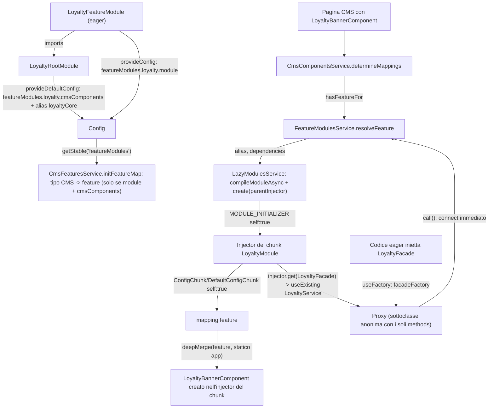
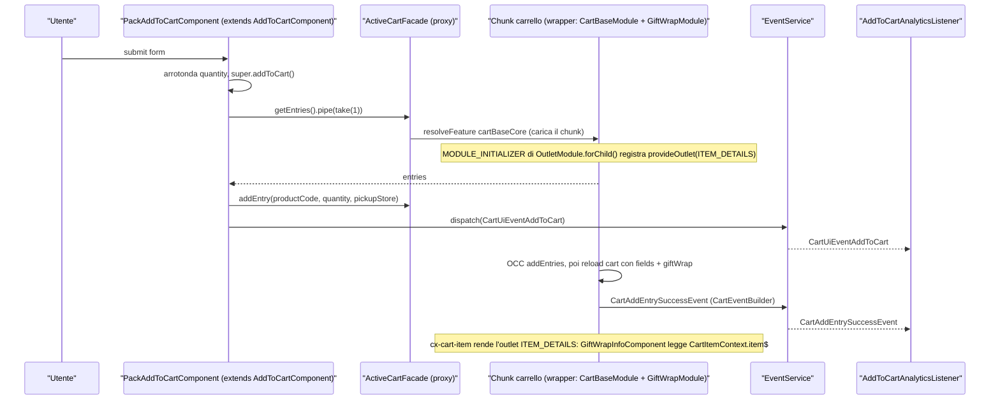
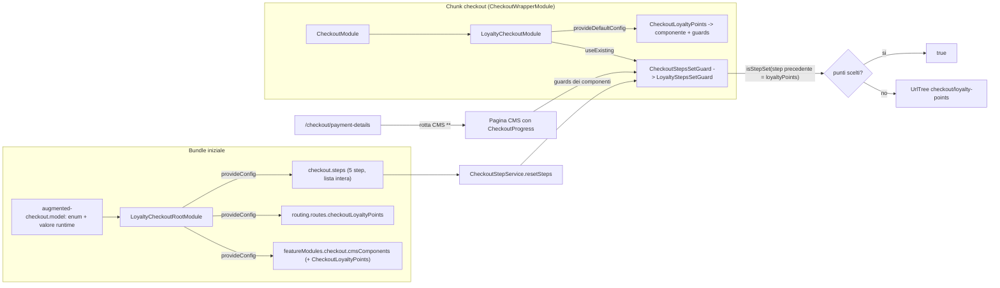
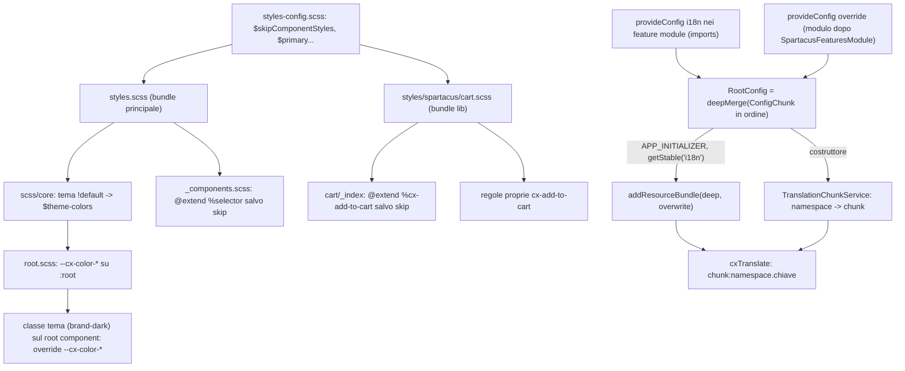

# 53 — Ricette: feature lib lazy, carrello/checkout, stili, traduzioni

> Riferimenti allo SHA `5b7a1c2bf2808d7380bc20596d10f4fa710c3da1` (vedi [00-meta](../00-meta.md)).

## 1. A cosa serve e perché esiste

Questo capitolo raccoglie le ricette per i quattro lavori più frequenti in un progetto Spartacus reale, quando l'app non si limita a configurare ma *aggiunge* funzionalità:

1. **creare una propria feature lazy-loaded** che si comporti come le feature lib ufficiali (root module eager, chunk lazy, componenti CMS che fanno scattare il caricamento, facade proxy utilizzabile dal codice eager);
2. **estendere il carrello e il checkout**: un campo nuovo sulla riga carrello, un add-to-cart diverso, la reazione agli eventi di carrello, uno step di checkout in più, un componente di step sostituito;
3. **personalizzare gli stili** senza forkare `@spartacus/styles`: escludere lo stile di un componente, riscriverlo, cambiare i colori del tema a build-time e a runtime;
4. **gestire le traduzioni**: sovrascrivere chiavi esistenti e aggiungere un chunk proprio.

Le ricette non introducono meccanismi nuovi: combinano quelli spiegati nella Parte II. Per questo ogni ricetta rimanda al capitolo che descrive il meccanismo in dettaglio:

- feature module, `featureModules`, dipendenze e injector dei chunk: [capitolo 12](../parte-2/12-feature-module-lazy.md);
- facade proxy (`facadeFactory`) ed eventi: [capitolo 20](../parte-2/20-facade-command-query-eventi.md);
- carrello: [capitolo 25](../parte-2/25-cart.md);
- checkout: [capitolo 26](../parte-2/26-checkout.md);
- i18n: [capitolo 37](../parte-2/37-i18n.md);
- stili e theming: [capitolo 38](../parte-2/38-stili-theming.md).

Il filo conduttore di tutte le ricette è una regola di merge della configurazione: **la config dell'app vince sempre** su quella delle librerie e su quella dei chunk lazy (`core-libs/core/src/config/services/configuration.service.ts:L92-L106`), e **gli array vengono sostituiti, non concatenati** (`core-libs/core/src/config/utils/deep-merge.ts:L7-L9`, `:L36-L45`). Metà delle trappole di questo capitolo discende da queste due righe.

Un secondo filo conduttore è *dove* vive il codice: nel bundle iniziale (root module, config eager, traduzioni statiche) oppure nell'injector di un chunk lazy (servizi della feature, override di provider, outlet registrati con `MODULE_INITIALIZER`). Sbagliare injector è la causa tipica di un'estensione che "non fa nulla" senza dare errori.

## 2. Mappa dei file

File sorgente che rendono possibili le ricette (abilitanti) e file del repo da cui gli esempi sono modellati.

| Path | Ruolo |
|---|---|
| `core-libs/core/src/cms/config/cms-config.ts` | `FeatureModuleConfig` (`module`, `dependencies`, `cmsComponents`), `CmsConfig.featureModules`, `CmsComponentMapping` (`guards`, `i18nKeys`) |
| `core-libs/core/src/config/config-providers.ts` | `provideConfig` (`ConfigChunk`) e `provideDefaultConfig`/`provideDefaultConfigFactory` (`DefaultConfigChunk`) |
| `core-libs/core/src/config/config-tokens.ts` | `RootConfig` = merge dei `ConfigChunk`, `Config` = `DefaultConfig` + `RootConfig` |
| `core-libs/core/src/config/services/configuration.service.ts` | merge della config portata dai chunk lazy (`ambientDefault`, `ambient`) sotto la config root |
| `core-libs/core/src/config/utils/deep-merge.ts` | semantica di merge: oggetti ricorsivi, array e primitive sostituiti |
| `core-libs/core/src/lazy-loading/feature-modules.service.ts` | `isConfigured`, `resolveFeature`, alias e dipendenze |
| `core-libs/core/src/lazy-loading/lazy-modules.service.ts` | creazione del modulo lazy, injector padre, `MODULE_INITIALIZER` con `self: true` |
| `core-libs/core/src/lazy-loading/facade-factory/facade-factory.ts` | `facadeFactory()` |
| `core-libs/core/src/lazy-loading/facade-factory/facade-descriptor.ts` | `FacadeDescriptor` (`methods`, `properties`, `async`) |
| `core-libs/core/src/lazy-loading/facade-factory/facade-factory.service.ts` | proxy: resolver, `call()` con connessione immediata |
| `core-libs/storefront/cms-structure/services/cms-features.service.ts` | mappa tipo CMS → feature, config CMS letta dai chunk del modulo lazy |
| `core-libs/storefront/cms-structure/services/cms-components.service.ts` | merge mapping feature + statico, `getGuards`, warning "No component implementation found" |
| `core-libs/storefront/cms-structure/services/cms-guards.service.ts` | istanze dei guard dei componenti CMS da `UnifiedInjector` |
| `core-libs/storefront/cms-structure/outlet/outlet.providers.ts` | `provideOutlet` |
| `core-libs/storefront/cms-structure/outlet/outlet.module.ts` | `OutletModule.forRoot()` / `forChild()` e `registerOutletsFactory` |
| `feature-libs/cart/saved-cart/root/saved-cart-root.module.ts` | modello di root module (featureModules senza `module`, rotte, alias core) |
| `feature-libs/cart/saved-cart/root/facade/saved-cart.facade.ts` | modello di facade proxy |
| `feature-libs/cart/saved-cart/core/facade/facade-providers.ts` | modello di ri-fornitura della facade nel chunk (`useExisting`) |
| `projects/storefrontapp/src/app/spartacus/features/cart/cart-saved-cart-feature.module.ts` | modello di feature module dell'app (fornisce `module` + i18n) |
| `feature-libs/cart/base/root/facade/active-cart.facade.ts` | `ActiveCartFacade` (`addEntry`, `getEntries`) |
| `feature-libs/cart/base/root/models/cart-outlets.model.ts` | enum `CartOutlets` |
| `feature-libs/cart/base/root/models/cart-item-context.model.ts` | `CartItemContext` |
| `feature-libs/cart/base/root/public_api.ts` | export del root carrello, `OrderEntry` aumentabile |
| `feature-libs/cart/base/root/events/cart.events.ts` | `CartAddEntrySuccessEvent`, `CartUiEventAddToCart` |
| `feature-libs/cart/base/components/add-to-cart/add-to-cart.component.ts` | `AddToCartComponent` (metodi pubblici/protected estendibili) |
| `feature-libs/cart/base/components/add-to-cart/add-to-cart.module.ts` | mapping di default di `ProductAddToCartComponent` |
| `feature-libs/cart/base/occ/config/default-occ-cart-config-factory.ts` | endpoint `cart`/`carts`/`createCart` con `fields` |
| `feature-libs/cart/base/occ/adapters/converters/occ-cart-normalizer.ts` | spread delle entry: i campi extra arrivano nel modello |
| `feature-libs/estimated-delivery-date/show-estimated-delivery-date/show-estimated-delivery-date.module.ts` | modello reale di estensione della riga carrello (outlet + endpoint) |
| `feature-libs/estimated-delivery-date/root/model/augmented-core.model.ts` | modello di augmentation di `OrderEntry` |
| `projects/storefrontapp/src/app/spartacus/features/cart/cart-base-wrapper.module.ts` | wrapper lazy del carrello: punto in cui inserire le estensioni |
| `feature-libs/checkout/base/root/config/checkout-config.ts` | `CheckoutConfig.checkout` (`steps`, `flows`, …) |
| `feature-libs/checkout/base/root/config/default-checkout-config.ts` | i 4 step di default |
| `feature-libs/checkout/base/root/config/default-checkout-routing-config.ts` | rotte semantiche degli step |
| `feature-libs/checkout/base/root/model/checkout-step.model.ts` | `CheckoutStep`, `CheckoutStepType` |
| `feature-libs/checkout/base/root/checkout-root.module.ts` | `CHECKOUT_BASE_CMS_COMPONENTS`, feature `checkout` |
| `feature-libs/checkout/base/components/guards/checkout-steps-set.guard.ts` | `CheckoutStepsSetGuard` (`protected isStepSet`) |
| `feature-libs/checkout/base/components/services/checkout-step.service.ts` | `CheckoutStepService` (`next`, `back`, `getBackBntText`) |
| `feature-libs/checkout/b2b/root/model/augmented-types.ts` | modello di nuovo `CheckoutStepType` |
| `feature-libs/checkout/b2b/root/config/default-b2b-checkout-config.ts` | modello di lista `steps` ridefinita |
| `feature-libs/checkout/b2b/components/checkout-b2b-components.module.ts` | modello di override del guard con `useExisting` |
| `integration-libs/digital-payments/src/checkout/cms-components/dp-payment-method/dp-payment-method.module.ts` | modello di sostituzione di un componente di step |
| `projects/storefrontapp/src/app/spartacus/features/checkout/checkout-wrapper.module.ts` | wrapper lazy del checkout |
| `core-libs/styles/scss/_components.scss` | `$skipComponentStyles`, allowlist, `@extend %<selector>` |
| `feature-libs/cart/base/styles/components/_index.scss` | allowlist della lib carrello |
| `feature-libs/cart/base/styles/components/_add-to-cart.scss` | placeholder `%cx-add-to-cart` |
| `core-libs/styles/scss/theme/santorini/_variables.scss` | variabili colore `!default` e `$theme-colors` |
| `core-libs/styles/scss/root.scss` | `$theme-colors` → custom property `--cx-color-*` |
| `projects/storefrontapp/src/styles.scss`, `projects/storefrontapp/src/styles-config.scss`, `projects/storefrontapp/src/styles/lib-cart.scss`, `projects/storefrontapp/src/cms-themes.scss` | integrazione degli stili nell'app demo |
| `core-libs/core/src/site-theme/config/site-theme-config.ts` | `siteTheme.optionalThemes` |
| `core-libs/core/src/i18n/config/i18n-config.ts` | `i18n.resources`, `i18n.chunks`, `i18n.backend.loader` |
| `core-libs/core/src/i18n/translation-chunk.service.ts` | mappa namespace → chunk (costruita una volta) |
| `core-libs/core/src/i18n/i18next/i18next-initializer.ts` | `addResourceBundle` delle risorse statiche all'init |
| `core-libs/core/src/i18n/i18next/i18next-translation.service.ts` | chiave `chunk:key`, fallback in dev/prod |
| `feature-libs/cart/base/assets/translations/translations.ts` | modello di `TranslationChunksConfig` |
| `projects/storefrontapp/src/app/spartacus/spartacus.module.ts` | ordine `SpartacusFeaturesModule` → `SpartacusConfigurationModule` |

## 3. Come funziona passo per passo

### 3.0 Convenzioni e catene di export

Tutti gli esempi di questo capitolo sono **esempi illustrativi, non presenti nel repo**. I nomi inventati (feature "loyalty", "gift wrap", componente "pack add to cart", ecc.) sono scritti in corsivo nel testo e compaiono solo nei blocchi di codice. I path nei commenti `// --- src/app/...` indicano dove metterei il file in un'app generata dagli schematic; non esistono nel repo.

Gli import `@spartacus/*` usano solo entry point pubblici. Per ogni simbolo, la catena `public_api` → `index` → definizione è la seguente (verificata con `grep -n`; la ripeto in forma compatta in ogni ricetta).

| Simbolo | Entry point | Catena di export |
|---|---|---|
| `provideConfig` | `@spartacus/core` | `core-libs/core/public_api.ts:L15-L15` → `core-libs/core/src/config/index.ts:L9-L9` → `core-libs/core/src/config/config-providers.ts:L18-L18` |
| `provideDefaultConfig` | `@spartacus/core` | `core-libs/core/public_api.ts:L15-L15` → `core-libs/core/src/config/index.ts:L9-L9` → `core-libs/core/src/config/config-providers.ts:L55-L55` |
| `CmsConfig` | `@spartacus/core` | `core-libs/core/public_api.ts:L14-L14` → `core-libs/core/src/cms/index.ts:L8-L8` → `core-libs/core/src/cms/config/index.ts:L7-L7` → `core-libs/core/src/cms/config/cms-config.ts:L128-L128` |
| `facadeFactory` | `@spartacus/core` | `core-libs/core/public_api.ts:L24-L24` → `core-libs/core/src/lazy-loading/index.ts:L12-L12` → `core-libs/core/src/lazy-loading/facade-factory/index.ts:L8-L8` → `core-libs/core/src/lazy-loading/facade-factory/facade-factory.ts:L20-L20` |
| `I18nConfig` | `@spartacus/core` | `core-libs/core/public_api.ts:L23-L23` → `core-libs/core/src/i18n/index.ts:L7-L7` → `core-libs/core/src/i18n/config/i18n-config.ts:L18-L18` |
| `TranslatePipe` (`cxTranslate`) | `@spartacus/core` | `core-libs/core/public_api.ts:L23-L23` → `core-libs/core/src/i18n/index.ts:L15-L15` → `core-libs/core/src/i18n/translate.pipe.ts:L29-L29` |
| `TranslationChunksConfig`, `TranslationResources` | `@spartacus/core` | `core-libs/core/public_api.ts:L23-L23` → `core-libs/core/src/i18n/index.ts:L17-L17` → `core-libs/core/src/i18n/translation-resources.ts:L16-L16` / `:L11-L11` |
| `EventService` | `@spartacus/core` | `core-libs/core/public_api.ts:L18-L18` → `core-libs/core/src/event/index.ts:L8-L8` → `core-libs/core/src/event/event.service.ts:L47-L47` |
| `RoutingConfig` | `@spartacus/core` | `core-libs/core/public_api.ts:L30-L30` → `core-libs/core/src/routing/index.ts:L7-L7` → `core-libs/core/src/routing/configurable-routes/index.ts:L7-L7` → `core-libs/core/src/routing/configurable-routes/config/routing-config.ts:L26-L26` |
| `OccConfig` | `@spartacus/core` | `core-libs/core/public_api.ts:L27-L27` → `core-libs/core/src/occ/index.ts:L12-L12` → `core-libs/core/src/occ/config/occ-config.ts:L46-L46` |
| `SiteThemeConfig` | `@spartacus/core` | `core-libs/core/public_api.ts:L32-L32` → `core-libs/core/src/site-theme/index.ts:L7-L7` → `core-libs/core/src/site-theme/config/site-theme-config.ts:L15-L15` |
| `provideOutlet` | `@spartacus/storefront` | `core-libs/storefront/public_api.ts:L23-L23` → `core-libs/storefront/cms-structure/index.ts:L9-L9` → `core-libs/storefront/cms-structure/outlet/index.ts:L13-L13` → `core-libs/storefront/cms-structure/outlet/outlet.providers.ts:L41-L41` |
| `OutletPosition` | `@spartacus/storefront` | `core-libs/storefront/public_api.ts:L23-L23` → `core-libs/storefront/cms-structure/index.ts:L9-L9` → `core-libs/storefront/cms-structure/outlet/index.ts:L11-L11` → `core-libs/storefront/cms-structure/outlet/outlet.model.ts:L9-L9` |
| `CartOutlets` | `@spartacus/cart/base/root` | `feature-libs/cart/base/root/public_api.ts:L13-L13` → `feature-libs/cart/base/root/models/index.ts:L10-L10` → `feature-libs/cart/base/root/models/cart-outlets.model.ts:L10-L10` |
| `CartItemContext` | `@spartacus/cart/base/root` | `feature-libs/cart/base/root/public_api.ts:L13-L13` → `feature-libs/cart/base/root/models/index.ts:L9-L9` → `feature-libs/cart/base/root/models/cart-item-context.model.ts:L17-L17` |
| `OrderEntry` | `@spartacus/cart/base/root` | `feature-libs/cart/base/root/public_api.ts:L19-L19` (tipo aumentabile) → `feature-libs/cart/base/root/models/cart.model.ts:L152-L152` |
| `CartAddEntrySuccessEvent`, `CartUiEventAddToCart` | `@spartacus/cart/base/root` | `feature-libs/cart/base/root/public_api.ts:L10-L10` → `feature-libs/cart/base/root/events/index.ts:L9-L9` → `feature-libs/cart/base/root/events/cart.events.ts:L66-L66` / `:L122-L122` |
| `CartBaseModule` | `@spartacus/cart/base` | `feature-libs/cart/base/public_api.ts:L7-L7` → `feature-libs/cart/base/cart-base.module.ts:L15-L15` |
| `AddToCartComponent` | `@spartacus/cart/base/components/add-to-cart` | `feature-libs/cart/base/components/add-to-cart/public_api.ts:L7-L7` → `feature-libs/cart/base/components/add-to-cart/add-to-cart.component.ts:L77-L77` |
| `CheckoutConfig` | `@spartacus/checkout/base/root` | `feature-libs/checkout/base/root/public_api.ts:L8-L8` → `feature-libs/checkout/base/root/config/index.ts:L7-L7` → `feature-libs/checkout/base/root/config/checkout-config.ts:L22-L22` |
| `CheckoutStep`, `CheckoutStepType` | `@spartacus/checkout/base/root` | `feature-libs/checkout/base/root/public_api.ts:L12-L12` e `:L15-L15` (aumentabile) → `feature-libs/checkout/base/root/model/index.ts:L9-L9` → `feature-libs/checkout/base/root/model/checkout-step.model.ts:L20-L20` / `:L7-L7` |
| `CHECKOUT_BASE_CMS_COMPONENTS` | `@spartacus/checkout/base/root` | `feature-libs/checkout/base/root/public_api.ts:L7-L7` → `feature-libs/checkout/base/root/checkout-root.module.ts:L20-L20` |
| `CHECKOUT_FEATURE` | `@spartacus/checkout/base/root` | `feature-libs/checkout/base/root/public_api.ts:L11-L11` → `feature-libs/checkout/base/root/feature-name.ts:L7-L7` |
| `CheckoutDeliveryModesFacade` | `@spartacus/checkout/base/root` | `feature-libs/checkout/base/root/public_api.ts:L10-L10` → `feature-libs/checkout/base/root/facade/index.ts:L9-L9` → `feature-libs/checkout/base/root/facade/checkout-delivery-modes.facade.ts:L30-L30` |
| `CheckoutModule` | `@spartacus/checkout/base` | `feature-libs/checkout/base/public_api.ts:L11-L11` → `feature-libs/checkout/base/checkout.module.ts:L15-L15` |
| `CheckoutStepService` | `@spartacus/checkout/base/components` | `feature-libs/checkout/base/components/public_api.ts:L39-L39` → `feature-libs/checkout/base/components/services/index.ts:L9-L9` → `feature-libs/checkout/base/components/services/checkout-step.service.ts:L22-L22` |
| `CheckoutStepsSetGuard` | `@spartacus/checkout/base/components` | `feature-libs/checkout/base/components/public_api.ts:L38-L38` → `feature-libs/checkout/base/components/guards/index.ts:L9-L9` → `feature-libs/checkout/base/components/guards/checkout-steps-set.guard.ts:L36-L36` |
| `CheckoutAuthGuard` | `@spartacus/checkout/base/components` | `feature-libs/checkout/base/components/public_api.ts:L38-L38` → `feature-libs/checkout/base/components/guards/index.ts:L8-L8` → `feature-libs/checkout/base/components/guards/checkout-auth.guard.ts:L25-L25` |
| `CartNotEmptyGuard` | `@spartacus/checkout/base/components` | `feature-libs/checkout/base/components/public_api.ts:L38-L38` → `feature-libs/checkout/base/components/guards/index.ts:L7-L7` → `feature-libs/checkout/base/components/guards/cart-not-empty.guard.ts:L17-L17` |

Nota: `PROVIDE_OUTLET_OPTIONS` (il token dietro `provideOutlet`) **non** è esportato: `core-libs/storefront/cms-structure/outlet/index.ts:L13-L13` esporta solo `provideOutlet` e `ProvideOutletOptions`, e il token è marcato `@private` (`core-libs/storefront/cms-structure/outlet/outlet.providers.ts:L10-L15`).

---

### 3.1 Ricetta A — Feature lib custom lazy-loaded

#### Quando usarlo

Quando l'app aggiunge una funzionalità di una certa dimensione (qui: un programma fedeltà *loyalty*) che:

- ha componenti CMS propri, che compaiono solo su alcune pagine;
- ha servizi che altri pezzi dell'app (anche eager: header, checkout) vogliono chiamare;
- non deve pesare sul bundle iniziale.

È lo stesso schema delle feature lib ufficiali: root module eager con la sola "dichiarazione" della feature, chunk lazy con l'implementazione, facade proxy nel root che inoltra al chunk. Il modello più compatto nel repo è `@spartacus/cart/saved-cart` (`feature-libs/cart/saved-cart/root/saved-cart-root.module.ts:L31-L50`, `projects/storefrontapp/src/app/spartacus/features/cart/cart-saved-cart-feature.module.ts:L21-L31`).

#### Esempio

Esempio illustrativo, non presente nel repo. Più file in un blocco; l'ordine segue il grafo di dipendenze.

```typescript
// --- src/app/loyalty/root/feature-name.ts
export const LOYALTY_FEATURE = 'loyalty';
export const LOYALTY_CORE_FEATURE = 'loyaltyCore';

// --- src/app/loyalty/root/loyalty.facade.ts  (eager: parte del bundle iniziale)
import { Injectable } from '@angular/core';
import { facadeFactory } from '@spartacus/core';
import { Observable } from 'rxjs';
import { LOYALTY_CORE_FEATURE } from './feature-name';

export interface LoyaltyBalance {
  points: number;
  tier: string;
}

@Injectable({
  providedIn: 'root',
  useFactory: () =>
    facadeFactory({
      facade: LoyaltyFacade,
      feature: LOYALTY_CORE_FEATURE,
      // SOLO i metodi elencati esistono sul proxy; devono tornare Observable o void
      methods: ['getBalance', 'redeem'],
      // async: true serve solo se il chunk registra uno store NgRx lazy
    }),
})
export abstract class LoyaltyFacade {
  abstract getBalance(): Observable<LoyaltyBalance>;
  abstract redeem(points: number): Observable<unknown>;
}

// --- src/app/loyalty/root/loyalty-root.module.ts  (eager)
import { NgModule } from '@angular/core';
import { CmsConfig, provideDefaultConfig } from '@spartacus/core';
import { LOYALTY_CORE_FEATURE, LOYALTY_FEATURE } from './feature-name';

@NgModule({
  providers: [
    // il root module dichiara COSA copre la feature, non DA DOVE caricarla
    provideDefaultConfig(<CmsConfig>{
      featureModules: {
        [LOYALTY_FEATURE]: {
          cmsComponents: ['LoyaltyBannerComponent'],
        },
        // alias: la facade punta a "loyaltyCore", che per ora coincide con "loyalty"
        [LOYALTY_CORE_FEATURE]: LOYALTY_FEATURE,
      },
    }),
  ],
})
export class LoyaltyRootModule {}

// --- src/app/loyalty/loyalty.service.ts  (lazy)
import { HttpClient } from '@angular/common/http';
import { Injectable, inject } from '@angular/core';
import { Observable } from 'rxjs';
import { LoyaltyBalance, LoyaltyFacade } from './root/loyalty.facade';

@Injectable() // NON providedIn: 'root' -> vive nell'injector del chunk
export class LoyaltyService implements LoyaltyFacade {
  protected http = inject(HttpClient);

  getBalance(): Observable<LoyaltyBalance> {
    // URL illustrativa: per un endpoint OCC configurabile vedi il capitolo 52
    return this.http.get<LoyaltyBalance>('/api/loyalty/balance');
  }

  redeem(points: number): Observable<unknown> {
    return this.http.post('/api/loyalty/redeem', { points });
  }
}

// --- src/app/loyalty/loyalty-banner.component.ts  (lazy)
import { AsyncPipe } from '@angular/common';
import { Component, inject } from '@angular/core';
import { TranslatePipe } from '@spartacus/core';
import { LoyaltyFacade } from './root/loyalty.facade';

@Component({
  selector: 'app-loyalty-banner',
  imports: [AsyncPipe, TranslatePipe],
  template: `
    @if (balance$ | async; as balance) {
      <p>{{ 'loyalty.balance' | cxTranslate: { points: balance.points } }}</p>
    }
  `,
})
export class LoyaltyBannerComponent {
  protected readonly balance$ = inject(LoyaltyFacade).getBalance();
}

// --- src/app/loyalty/loyalty.module.ts  (modulo lazy: DEVE essere un NgModule)
import { NgModule } from '@angular/core';
import { CmsConfig, provideDefaultConfig } from '@spartacus/core';
import { LoyaltyBannerComponent } from './loyalty-banner.component';
import { LoyaltyService } from './loyalty.service';
import { LoyaltyFacade } from './root/loyalty.facade';

@NgModule({
  providers: [
    LoyaltyService,
    // la facade astratta, dentro il chunk, risolve al servizio concreto
    { provide: LoyaltyFacade, useExisting: LoyaltyService },
    // mapping CMS -> componente: vive nel chunk, come default config
    provideDefaultConfig(<CmsConfig>{
      cmsComponents: {
        LoyaltyBannerComponent: { component: LoyaltyBannerComponent },
      },
    }),
  ],
})
export class LoyaltyModule {}

// --- src/app/spartacus/features/loyalty-feature.module.ts
// (eager, da aggiungere agli imports di SpartacusFeaturesModule)
import { NgModule } from '@angular/core';
import { CmsConfig, provideConfig } from '@spartacus/core';
import { LOYALTY_FEATURE } from '../../loyalty/root/feature-name';
import { LoyaltyRootModule } from '../../loyalty/root/loyalty-root.module';

@NgModule({
  imports: [LoyaltyRootModule],
  providers: [
    // e' l'app a dire DA DOVE caricare il chunk
    provideConfig(<CmsConfig>{
      featureModules: {
        [LOYALTY_FEATURE]: {
          module: () =>
            import('../../loyalty/loyalty.module').then((m) => m.LoyaltyModule),
        },
      },
    }),
  ],
})
export class LoyaltyFeatureModule {}
```

Catene di export dei simboli `@spartacus/*` usati:

- `facadeFactory`: `core-libs/core/public_api.ts:L24-L24` → `core-libs/core/src/lazy-loading/index.ts:L12-L12` → `core-libs/core/src/lazy-loading/facade-factory/index.ts:L8-L8` → `core-libs/core/src/lazy-loading/facade-factory/facade-factory.ts:L20-L20`.
- `CmsConfig`: `core-libs/core/public_api.ts:L14-L14` → `core-libs/core/src/cms/index.ts:L8-L8` → `core-libs/core/src/cms/config/index.ts:L7-L7` → `core-libs/core/src/cms/config/cms-config.ts:L128-L128`.
- `provideDefaultConfig`, `provideConfig`: `core-libs/core/public_api.ts:L15-L15` → `core-libs/core/src/config/index.ts:L9-L9` → `core-libs/core/src/config/config-providers.ts:L55-L55` / `:L18-L18`.
- `TranslatePipe`: `core-libs/core/public_api.ts:L23-L23` → `core-libs/core/src/i18n/index.ts:L15-L15` → `core-libs/core/src/i18n/translate.pipe.ts:L29-L29`.

#### Perché funziona (file sorgente)

1. `FeatureModuleConfig` ha tre campi: `module`, `dependencies`, `cmsComponents`; `featureModules` accetta anche una stringa come alias — `core-libs/core/src/cms/config/cms-config.ts:L109-L134`.
2. Il root module della lib dichiara `cmsComponents` e alias ma non `module`; è l'app a fornire `module` con `provideConfig` — modello `feature-libs/cart/saved-cart/root/saved-cart-root.module.ts:L31-L50` e `projects/storefrontapp/src/app/spartacus/features/cart/cart-saved-cart-feature.module.ts:L21-L31`.
3. A config stabile `CmsFeaturesService` associa ogni tipo CMS alla feature, **solo** se la feature ha sia `module` sia `cmsComponents` non vuoti — `core-libs/storefront/cms-structure/services/cms-features.service.ts:L56-L75`.
4. Quando la pagina contiene un tipo gestito da feature, `CmsComponentsService` passa dal resolver della feature — `core-libs/storefront/cms-structure/services/cms-components.service.ts:L86-L105` — e `FeatureModulesService.resolveFeature` risolve alias, dipendenze e istanzia il modulo, con cache `shareReplay` — `core-libs/core/src/lazy-loading/feature-modules.service.ts:L42-L73`.
5. Il valore restituito da `module()` passa per `compileModuleAsync` se non è una `NgModuleFactory`: deve essere un NgModule — `core-libs/core/src/lazy-loading/lazy-modules.service.ts:L220-L236`.
6. Il mapping CMS è letto dai soli chunk forniti con `self: true` nell'injector del modulo lazy (i `ConfigChunk` prevalgono sui `DefaultConfigChunk`) — `core-libs/storefront/cms-structure/services/cms-features.service.ts:L188-L205` — ed è trattato come default sotto la config statica dell'app — `core-libs/storefront/cms-structure/services/cms-components.service.ts:L117-L141`.
7. `facadeFactory` delega a `FacadeFactoryService.create` via `inject()`, quindi va chiamata in `useFactory` — `core-libs/core/src/lazy-loading/facade-factory/facade-factory.ts:L20-L24`. Il proxy è una sottoclasse anonima della facade con i soli `methods`/`properties` elencati — `core-libs/core/src/lazy-loading/facade-factory/facade-factory.service.ts:L110-L130`.
8. Il resolver del proxy fallisce subito se la feature non ha `module`; altrimenti prende `injector.get(facadeClass)` dall'injector del modulo lazy — `core-libs/core/src/lazy-loading/facade-factory/facade-factory.service.ts:L38-L57`. Lì trova il `useExisting` verso il servizio concreto — modello `feature-libs/cart/saved-cart/core/facade/facade-providers.ts:L11-L17`.
9. `FacadeDescriptor.async` esiste per lo store NgRx lazy ("Required to make lazy NgRx store feature ready") — `core-libs/core/src/lazy-loading/facade-factory/facade-descriptor.ts:L32-L37`; senza store non serve.

#### Limiti e trappole

- Se l'app non fornisce `module`, la feature non entra nella mappa dei componenti (warning "No component implementation found") e ogni chiamata alla facade dà l'errore "Feature loyaltyCore is not configured properly" — `core-libs/storefront/cms-structure/services/cms-features.service.ts:L65-L68`, `core-libs/storefront/cms-structure/services/cms-components.service.ts:L170-L176`, `core-libs/core/src/lazy-loading/facade-factory/facade-factory.service.ts:L43-L47`.
- Un metodo non elencato in `methods` non esiste sul proxy (la classe è astratta): `TypeError` alla chiamata. Metodi con ritorno non Observable restituiscono `EMPTY` — `core-libs/core/src/lazy-loading/facade-factory/facade-factory.service.ts:L84-L91`, `:L119-L126`.
- Una chiamata di metodo scarica il chunk anche senza `subscribe` (`connect()` immediato) — `core-libs/core/src/lazy-loading/facade-factory/facade-factory.service.ts:L70-L92`. Non usare la facade "per sondare".
- Se il chunk non ri-fornisce la facade con `useExisting`, `injector.get(LoyaltyFacade)` risale al root e trova il proxy stesso. ⚠️ DA VERIFICARE a runtime: comportamento dedotto dalla gerarchia degli injector (`core-libs/core/src/lazy-loading/facade-factory/facade-factory.service.ts:L49-L52`), non eseguito.
- `module` deve risolvere a un NgModule: un componente standalone non è un valore valido — `core-libs/core/src/lazy-loading/lazy-modules.service.ts:L220-L236`.
- Se la feature usa servizi di un'altra feature *non* tramite facade, va dichiarata `dependencies: [ALTRA_FEATURE]`: con una sola dipendenza l'injector padre del chunk è quello della dipendenza — `core-libs/core/src/lazy-loading/lazy-modules.service.ts:L78-L97`, `core-libs/core/src/lazy-loading/feature-modules.service.ts:L108-L123`.
- Il tipo CMS (qui *LoyaltyBannerComponent*) deve esistere lato backend come componente CMS con quel `typeCode`. ⚠️ DA VERIFICARE: i dati CMS non sono nel repo.
- Le traduzioni della feature vanno fornite eager (vedi Ricetta E2), non nel chunk.

---

### 3.2 Ricetta B1 — Nuovo campo sulla riga del carrello (augmentation + `fields` OCC + outlet)

#### Quando usarlo

Quando il backend restituisce (o può restituire) un attributo in più sulle entry del carrello e lo si vuole mostrare sotto ogni riga, senza sostituire `cx-cart-item`. Qui: un flag *giftWrap*. Il modello reale nel repo è `@spartacus/estimated-delivery-date`, che fa esattamente questo con `arrivalSlots` (`feature-libs/estimated-delivery-date/show-estimated-delivery-date/show-estimated-delivery-date.module.ts:L19-L37`).

#### Esempio

Esempio illustrativo, non presente nel repo.

```typescript
// --- src/app/gift-wrap/augmented-cart.model.ts
import '@spartacus/cart/base/root';

declare module '@spartacus/cart/base/root' {
  interface OrderEntry {
    giftWrap?: boolean;
  }
}

// --- src/app/gift-wrap/gift-wrap-info.component.ts
import { AsyncPipe } from '@angular/common';
import { Component, inject } from '@angular/core';
import { CartItemContext, OrderEntry } from '@spartacus/cart/base/root';
import { TranslatePipe } from '@spartacus/core';
import { EMPTY, Observable } from 'rxjs';
import './augmented-cart.model';

@Component({
  selector: 'app-gift-wrap-info',
  imports: [AsyncPipe, TranslatePipe],
  template: `
    @if ((entry$ | async)?.giftWrap) {
      <span class="app-gift-wrap">{{ 'giftWrap.label' | cxTranslate }}</span>
    }
  `,
})
export class GiftWrapInfoComponent {
  // { optional: true }: fuori da cx-cart-item il contesto non esiste
  protected readonly entry$: Observable<OrderEntry> =
    inject(CartItemContext, { optional: true })?.item$ ?? EMPTY;
}

// --- src/app/gift-wrap/gift-wrap.module.ts
// (da importare nel wrapper lazy del carrello, DOPO CartBaseModule)
import { NgModule } from '@angular/core';
import { CartOutlets } from '@spartacus/cart/base/root';
import { OccConfig, provideConfig } from '@spartacus/core';
import { OutletPosition, provideOutlet } from '@spartacus/storefront';
import { GiftWrapInfoComponent } from './gift-wrap-info.component';

@NgModule({
  providers: [
    // l'endpoint e' una stringa intera: va ridefinito per intero (qui: + giftWrap)
    provideConfig(<OccConfig>{
      backend: {
        occ: {
          endpoints: {
            cart: 'users/${userId}/carts/${cartId}?fields=DEFAULT,potentialProductPromotions,appliedProductPromotions,potentialOrderPromotions,appliedOrderPromotions,entries(totalPrice(formattedValue),product(images(FULL),stock(FULL)),giftWrap,basePrice(formattedValue,value),updateable),totalPrice(formattedValue),totalItems,totalPriceWithTax(formattedValue),totalDiscounts(value,formattedValue),subTotal(formattedValue),totalUnitCount,deliveryItemsQuantity,deliveryCost(formattedValue),totalTax(formattedValue, value),pickupItemsQuantity,net,appliedVouchers,productDiscounts(formattedValue),user,saveTime,name,description',
            // stessa operazione, se servono, per 'carts' e 'createCart'
          },
        },
      },
    }),
    provideOutlet({
      id: CartOutlets.ITEM_DETAILS,
      position: OutletPosition.AFTER,
      component: GiftWrapInfoComponent,
    }),
  ],
})
export class GiftWrapModule {}

// --- src/app/spartacus/features/cart/cart-base-wrapper.module.ts (modificato)
import { NgModule } from '@angular/core';
import { CartBaseModule } from '@spartacus/cart/base';
import { GiftWrapModule } from '../../../gift-wrap/gift-wrap.module';

@NgModule({
  imports: [CartBaseModule, GiftWrapModule],
})
export class CartBaseWrapperModule {}
```

Catene di export:

- `CartItemContext`: `feature-libs/cart/base/root/public_api.ts:L13-L13` → `feature-libs/cart/base/root/models/index.ts:L9-L9` → `feature-libs/cart/base/root/models/cart-item-context.model.ts:L17-L17`.
- `OrderEntry`: `feature-libs/cart/base/root/public_api.ts:L19-L19` → `feature-libs/cart/base/root/models/cart.model.ts:L152-L152`.
- `CartOutlets`: `feature-libs/cart/base/root/public_api.ts:L13-L13` → `feature-libs/cart/base/root/models/index.ts:L10-L10` → `feature-libs/cart/base/root/models/cart-outlets.model.ts:L10-L10`.
- `TranslatePipe`: `core-libs/core/public_api.ts:L23-L23` → `core-libs/core/src/i18n/index.ts:L15-L15` → `core-libs/core/src/i18n/translate.pipe.ts:L29-L29`.
- `OccConfig`: `core-libs/core/public_api.ts:L27-L27` → `core-libs/core/src/occ/index.ts:L12-L12` → `core-libs/core/src/occ/config/occ-config.ts:L46-L46`.
- `provideConfig`: `core-libs/core/public_api.ts:L15-L15` → `core-libs/core/src/config/index.ts:L9-L9` → `core-libs/core/src/config/config-providers.ts:L18-L18`.
- `provideOutlet`, `OutletPosition`: `core-libs/storefront/public_api.ts:L23-L23` → `core-libs/storefront/cms-structure/index.ts:L9-L9` → `core-libs/storefront/cms-structure/outlet/index.ts:L13-L13` / `:L11-L11` → `core-libs/storefront/cms-structure/outlet/outlet.providers.ts:L41-L41` / `core-libs/storefront/cms-structure/outlet/outlet.model.ts:L9-L9`.
- `CartBaseModule`: `feature-libs/cart/base/public_api.ts:L7-L7` → `feature-libs/cart/base/cart-base.module.ts:L15-L15`.

#### Perché funziona (file sorgente)

1. `OrderEntry` è esportato come tipo aumentabile dal root carrello — `feature-libs/cart/base/root/public_api.ts:L18-L20`; EDD lo aumenta con module augmentation — `feature-libs/estimated-delivery-date/root/model/augmented-core.model.ts:L7-L15`.
2. L'endpoint `cart` di default elenca esplicitamente i campi delle entries — `feature-libs/cart/base/occ/config/default-occ-cart-config-factory.ts:L9-L19`; EDD lo ridefinisce intero aggiungendo `arrivalSlots` — `feature-libs/estimated-delivery-date/show-estimated-delivery-date/config/default-occ-cart-with-edd.config.ts:L10-L28`.
3. `OccCartNormalizer` fa `...entry` su ogni entry: un campo OCC in più arriva nel modello senza converter — `feature-libs/cart/base/occ/adapters/converters/occ-cart-normalizer.ts:L23-L40`.
4. `provideOutlet` è un multi-provider di `PROVIDE_OUTLET_OPTIONS` con posizione di default `AFTER` — `core-libs/storefront/cms-structure/outlet/outlet.providers.ts:L34-L47`. Nel chunk carrello gli outlet sono registrati da `OutletModule.forChild()` tramite `MODULE_INITIALIZER` — `core-libs/storefront/cms-structure/outlet/outlet.module.ts:L72-L88`, importato da `CartBaseComponentsModule` — `feature-libs/cart/base/components/cart-base-components.module.ts:L30-L30`. I `MODULE_INITIALIZER` sono letti con `self: true` dall'injector del modulo lazy — `core-libs/core/src/lazy-loading/lazy-modules.service.ts:L150-L157`; poiché *GiftWrapModule* è importato nello stesso wrapper, il suo `provideOutlet` è nello stesso injector.
5. L'outlet `ITEM_DETAILS` è renderizzato sia in `cx-cart-item` sia in `cx-cart-item-list-row` — `feature-libs/cart/base/components/cart-shared/cart-item/cart-item.component.html:L37-L37`, `feature-libs/cart/base/components/cart-shared/cart-item-list-row/cart-item-list-row.component.html:L54-L54` — ed entrambi forniscono `CartItemContext` a livello di componente — `feature-libs/cart/base/components/cart-shared/cart-item/cart-item.component.ts:L33-L36`.
6. Il wrapper lazy dell'app importa `CartBaseModule` seguito dalle estensioni — `projects/storefrontapp/src/app/spartacus/features/cart/cart-base-wrapper.module.ts:L14-L25`; la feature `cartBase` punta al wrapper — `projects/storefrontapp/src/app/spartacus/features/cart/cart-base-feature.module.ts:L26-L35`.
7. Uso `provideConfig` (e non `provideDefaultConfig` come EDD) perché, nella config portata dai chunk, `ambientConfig` vince su `ambientDefaultConfig` indipendentemente dall'ordine — `core-libs/core/src/config/services/configuration.service.ts:L76-L106`.

#### Limiti e trappole

- Gli endpoint con `fields` sono stringhe intere: due estensioni che ridefiniscono `cart` si sovrascrivono (vince l'ultima nel merge), e un aggiornamento dei `fields` di default nelle nuove versioni non viene ereditato — `core-libs/core/src/config/utils/deep-merge.ts:L43-L45`. Con EDD attivo bisogna unire a mano `arrivalSlots` e `giftWrap`.
- La config root dell'app vince su quella del chunk: se l'app definisce già `backend.occ.endpoints.cart` in un modulo eager, l'override nel chunk viene ignorato — `core-libs/core/src/config/services/configuration.service.ts:L92-L99`.
- `provideOutlet` in un chunk che **non** importa `OutletModule.forChild()` non viene registrato (initializer letti `self: true`). ⚠️ DA VERIFICARE a runtime: dedotto staticamente da `core-libs/core/src/lazy-loading/lazy-modules.service.ts:L153-L157` e `core-libs/storefront/cms-structure/outlet/outlet.module.ts:L72-L88`. Per questo il modulo va nel wrapper carrello, non in una feature lazy separata.
- Il componente in outlet compare solo dopo il caricamento del chunk carrello — `core-libs/storefront/cms-structure/outlet/outlet.module.ts:L72-L88`.
- Il modello EDD dichiara `@Optional() protected cartItemContext = inject(CartItemContext);` (`feature-libs/estimated-delivery-date/show-estimated-delivery-date/components/estimated-delivery-date.component.ts:L26-L26`): `@Optional()` su un campo non rende opzionale `inject()`, che lancia se il token manca e non è richiesto `optional` (`angular:packages/core/src/di/injector_compatibility.ts:L188-L197`). Nell'esempio uso `{ optional: true }`.
- Per *inviare* un attributo custom all'add-to-cart non basta l'augmentation: `addEntry` accetta solo `productCode`, `quantity`, `pickupStore` (`feature-libs/cart/base/root/facade/active-cart.facade.ts:L100-L104`) e il body OCC è costruito in `OccCartEntryAdapter.add` (`feature-libs/cart/base/occ/adapters/occ-cart-entry.adapter.ts:L51-L63`). Va sostituito l'adapter nel chunk carrello (vedi [ricette OCC](52-ricette-occ-dati.md)). ⚠️ DA VERIFICARE: la catena store/effects/connector non è stata riletta per questo capitolo (vedi [capitolo 25](../parte-2/25-cart.md)).

---

### 3.3 Ricetta B2 — Sostituire/estendere l'add-to-cart

#### Quando usarlo

Quando il pulsante "Aggiungi al carrello" deve comportarsi diversamente: arrotondare la quantità a confezioni (*pack*), aggiungere un controllo, cambiare markup. Si sostituisce il componente mappato sul tipo CMS `ProductAddToCartComponent`, riusando la logica di `AddToCartComponent` per ereditarietà.

#### Esempio

Esempio illustrativo, non presente nel repo.

```typescript
// --- src/app/cart/pack-add-to-cart.component.ts
import { ChangeDetectionStrategy, Component, NgModule } from '@angular/core';
import { ReactiveFormsModule } from '@angular/forms';
import { AddToCartComponent } from '@spartacus/cart/base/components/add-to-cart';
import { CmsConfig, TranslatePipe, provideConfig } from '@spartacus/core';

const PACK_SIZE = 6;

@Component({
  // stesso selector dell'originale: continua a ricevere gli stili globali %cx-add-to-cart
  selector: 'cx-add-to-cart',
  changeDetection: ChangeDetectionStrategy.OnPush,
  imports: [ReactiveFormsModule, TranslatePipe],
  template: `
    @if (productCode) {
      <form [formGroup]="addToCartForm" (submit)="addToCart()">
        <label>
          {{ 'addToCart.quantityFull' | cxTranslate }}
          <input type="number" min="1" formControlName="quantity" />
        </label>
        <button
          #addToCartDialogTriggerEl
          class="btn btn-primary btn-block"
          type="submit"
          [disabled]="!hasStock"
        >
          {{ 'addToCart.addToCart' | cxTranslate }}
        </button>
      </form>
    }
  `,
})
export class PackAddToCartComponent extends AddToCartComponent {
  // nessun costruttore: Angular eredita la factory DI di AddToCartComponent
  override addToCart(): void {
    const control = this.addToCartForm.get('quantity');
    const requested = Number(control?.value) || 0;
    if (requested > 0) {
      control?.setValue(Math.ceil(requested / PACK_SIZE) * PACK_SIZE);
    }
    super.addToCart();
  }
}

// --- src/app/cart/pack-add-to-cart.module.ts (eager, importato dall'app)
@NgModule({
  providers: [
    provideConfig(<CmsConfig>{
      cmsComponents: {
        // config statica dell'app: fusa SOPRA il mapping della feature addToCart
        ProductAddToCartComponent: { component: PackAddToCartComponent },
      },
    }),
  ],
})
export class PackAddToCartModule {}
```

Catene di export:

- `AddToCartComponent`: `feature-libs/cart/base/components/add-to-cart/public_api.ts:L7-L7` → `feature-libs/cart/base/components/add-to-cart/add-to-cart.component.ts:L77-L77`.
- `CmsConfig`: `core-libs/core/public_api.ts:L14-L14` → `core-libs/core/src/cms/index.ts:L8-L8` → `core-libs/core/src/cms/config/index.ts:L7-L7` → `core-libs/core/src/cms/config/cms-config.ts:L128-L128`.
- `TranslatePipe`: `core-libs/core/public_api.ts:L23-L23` → `core-libs/core/src/i18n/index.ts:L15-L15` → `core-libs/core/src/i18n/translate.pipe.ts:L29-L29`.
- `provideConfig`: `core-libs/core/public_api.ts:L15-L15` → `core-libs/core/src/config/index.ts:L9-L9` → `core-libs/core/src/config/config-providers.ts:L18-L18`.

#### Perché funziona (file sorgente)

1. `ProductAddToCartComponent` è mappato su `AddToCartComponent` come default config dentro `AddToCartModule` (con `data.inventoryDisplay: false`) — `feature-libs/cart/base/components/add-to-cart/add-to-cart.module.ts:L34-L44` — e appartiene alla feature `addToCart` con chunk separato — `feature-libs/cart/base/root/cart-base-root.module.ts:L42-L44`, `projects/storefrontapp/src/app/spartacus/features/cart/cart-base-feature.module.ts:L46-L55`.
2. Per un tipo gestito da feature, il mapping effettivo è `deepMerge({}, mappingFeature, configStatica)`: la config dell'app sovrascrive `component` e lascia gli altri campi — `core-libs/storefront/cms-structure/services/cms-components.service.ts:L117-L141`. La config statica è uno snapshot preso a config stabile — `core-libs/storefront/cms-structure/services/cms-components.service.ts:L61-L68`.
3. `addToCartForm`, `hasStock`, `productCode` e `addToCart()` sono pubblici — `feature-libs/cart/base/components/add-to-cart/add-to-cart.component.ts:L78-L113`, `:L254-L303`; `addToCart()` legge la quantità dal form, chiama `getEntries()` (garantisce il caricamento della lib), poi `addEntry` e dispatcha `CartUiEventAddToCart` — `feature-libs/cart/base/components/add-to-cart/add-to-cart.component.ts:L278-L302`.
4. Il riferimento `#addToCartDialogTriggerEl` serve al refocus dopo il dialog: è letto da `@ViewChild` e copiato nell'evento da `createCartUiEventAddToCart` (protected) — `feature-libs/cart/base/components/add-to-cart/add-to-cart.component.ts:L90-L93`, `:L305-L318`.
5. Gli stili Spartacus sono globali e legati al selector: `AddToCartComponent` non dichiara `styleUrls` — `feature-libs/cart/base/components/add-to-cart/add-to-cart.component.ts:L61-L76`; la lib carrello estende `%cx-add-to-cart` sul selettore `cx-add-to-cart` — `feature-libs/cart/base/styles/components/_index.scss:L19-L35`.

#### Limiti e trappole

- Il chunk della feature `addToCart` viene caricato comunque (il tipo è gestito da feature) e `data.inventoryDisplay` del default resta nel mapping — `core-libs/storefront/cms-structure/services/cms-components.service.ts:L92-L99`, `:L126-L133`.
- Importare `@spartacus/cart/base/components/add-to-cart` da un modulo eager porta `AddToCartComponent` nel bundle iniziale. ⚠️ DA VERIFICARE: effetto sul bundle non misurato (build non eseguibile). In alternativa il mapping può vivere in un modulo lazy importato nel chunk della feature (stesso schema della Ricetta C2).
- Un selector diverso (es. `app-pack-add-to-cart`) **non** riceve gli stili di `cx-add-to-cart` — `feature-libs/cart/base/styles/components/_index.scss:L28-L35`.
- Il template originale ha in più outlet (`ADD_TO_CART_PICKUP_OPTION`), stock e icone — `feature-libs/cart/base/components/add-to-cart/add-to-cart.component.html:L1-L71`: riscrivendo il template quelle parti vanno reintrodotte se servono.
- L'ereditarietà lega il componente ai dettagli interni di `AddToCartComponent` (campi pubblici non documentati come API stabile): a ogni upgrade va riletto il sorgente (vedi [capitolo 54](54-upgrade-safe.md)).
- `addEntry` è `void` e non accetta campi extra — `feature-libs/cart/base/root/facade/active-cart.facade.ts:L100-L104`.

---

### 3.4 Ricetta B3 — Reagire agli eventi del carrello

#### Quando usarlo

Per tracking, notifiche, ricarico di dati correlati (come fa la lib quote) quando un prodotto viene aggiunto al carrello, senza toccare i componenti.

#### Esempio

Esempio illustrativo, non presente nel repo.

```typescript
// --- src/app/cart/add-to-cart-analytics.ts
import { Injectable, NgModule, OnDestroy, inject } from '@angular/core';
import {
  CartAddEntrySuccessEvent,
  CartUiEventAddToCart,
} from '@spartacus/cart/base/root';
import { EventService } from '@spartacus/core';
import { Subscription } from 'rxjs';

@Injectable({ providedIn: 'root' })
export class AddToCartAnalyticsListener implements OnDestroy {
  protected eventService = inject(EventService);
  protected subscription = new Subscription();

  constructor() {
    // intenzione dell'utente (UI): parte dal componente add-to-cart
    this.subscription.add(
      this.eventService
        .get(CartUiEventAddToCart)
        .subscribe((event) => this.track('add_click', event.productCode, event.quantity))
    );
    // esito lato backend: mappato dall'action NgRx nel chunk carrello
    this.subscription.add(
      this.eventService
        .get(CartAddEntrySuccessEvent)
        .subscribe((event) =>
          this.track('add_success', event.productCode, event.quantityAdded ?? event.quantity)
        )
    );
  }

  protected track(name: string, productCode: string, quantity: number): void {
    // invio verso il proprio sistema di analytics
  }

  ngOnDestroy(): void {
    this.subscription.unsubscribe();
  }
}

// istanzia il listener all'avvio (stesso schema di CartBaseEventModule)
@NgModule({})
export class AddToCartAnalyticsModule {
  constructor(_listener: AddToCartAnalyticsListener) {
    // Intentional empty constructor
  }
}
```

Catene di export:

- `CartAddEntrySuccessEvent`, `CartUiEventAddToCart`: `feature-libs/cart/base/root/public_api.ts:L10-L10` → `feature-libs/cart/base/root/events/index.ts:L9-L9` → `feature-libs/cart/base/root/events/cart.events.ts:L66-L66` / `:L122-L122`.
- `EventService`: `core-libs/core/public_api.ts:L18-L18` → `core-libs/core/src/event/index.ts:L8-L8` → `core-libs/core/src/event/event.service.ts:L47-L47`.

#### Perché funziona (file sorgente)

1. `EventService` espone `register`, `get`, `dispatch` — `core-libs/core/src/event/event.service.ts:L45-L47`, `:L68-L68`, `:L90-L90`, `:L105-L105`.
2. `CartAddEntrySuccessEvent` porta `productCode`, `quantity`, `entry?`, `quantityAdded?`, `deliveryModeChanged?` — `feature-libs/cart/base/root/events/cart.events.ts:L66-L76` — ed è mappato da `CART_ADD_ENTRY_SUCCESS` nel `CartEventBuilder` del core lazy — `feature-libs/cart/base/core/event/cart-event.builder.ts:L47-L87`.
3. `CartUiEventAddToCart` è dispatchato da `AddToCartComponent.addToCart()` — `feature-libs/cart/base/components/add-to-cart/add-to-cart.component.ts:L294-L301` — ed estende `CxEvent`, non `CartEvent` — `feature-libs/cart/base/root/events/cart.events.ts:L122-L136`.
4. Modello di listener root: `QuoteCartEventListener` — `feature-libs/quote/core/event/quote-cart-event.listener.ts:L18-L45`; modello di istanziazione con NgModule a costruttore vuoto — `feature-libs/cart/base/root/events/cart-base-event.module.ts:L10-L15`, `feature-libs/quote/core/quote-core.module.ts:L21-L24`.
5. Alternativa senza codice per i tag manager: `tagManager.gtm.events` — `projects/storefrontapp/src/app/spartacus/features/tracking/personalization-feature.module.ts:L30-L39`.

#### Limiti e trappole

- Gli eventi `CartAddEntry*` sono registrati dal `CartEventBuilder` del chunk carrello: prima del caricamento non esiste sorgente; `dispatch` non fa replay — `feature-libs/cart/base/core/cart-base-core.module.ts:L22-L28`, `feature-libs/cart/base/core/event/cart-event.builder.ts:L53-L55`.
- `CartUiEventAddToCart` non estende `CartEvent`: un listener su `CartEvent` non lo riceve — `feature-libs/cart/base/root/events/cart.events.ts:L122-L122`.
- `CartUiEventAddToCart` è emesso solo dal componente standard (e dalle sottoclassi che chiamano `super.addToCart()`): un add-to-cart fatto chiamando direttamente `ActiveCartFacade.addEntry` produce solo gli eventi `CartAddEntry*` — `feature-libs/cart/base/components/add-to-cart/add-to-cart.component.ts:L278-L302`.
- Approfondimento sul modello eventi: [capitolo 20](../parte-2/20-facade-command-query-eventi.md); ricette generiche sugli eventi: [capitolo 50](50-ricette-config-di.md).

---

### 3.5 Ricetta C1 — Nuovo step di checkout

#### Quando usarlo

Quando il checkout deve chiedere qualcosa in più in una pagina dedicata, con un posto nella progress bar e con il blocco "non puoi andare avanti se non hai completato lo step". Qui: uno step *loyalty points* tra modalità di consegna e pagamento. Il modello reale è lo step "payment type" del checkout B2B.

#### Esempio

Esempio illustrativo, non presente nel repo. Parte eager (tipo, step, rotta, componenti della feature) e parte lazy (componente, guard).

```typescript
// --- src/app/checkout-loyalty/augmented-checkout.model.ts
import { CheckoutStepType } from '@spartacus/checkout/base/root';

declare module '@spartacus/checkout/base/root' {
  enum CheckoutStepType {
    LOYALTY_POINTS = 'loyaltyPoints',
  }
}
// senza questa riga CheckoutStepType.LOYALTY_POINTS e' undefined a runtime
(CheckoutStepType as any)['LOYALTY_POINTS'] = 'loyaltyPoints';

// --- src/app/checkout-loyalty/loyalty-checkout-root.module.ts  (eager)
// Import augmented types first (come il root B2B)
import './augmented-checkout.model';
import { NgModule } from '@angular/core';
import {
  CHECKOUT_BASE_CMS_COMPONENTS,
  CHECKOUT_FEATURE,
  CheckoutConfig,
  CheckoutStepType,
} from '@spartacus/checkout/base/root';
import { CmsConfig, RoutingConfig, provideConfig } from '@spartacus/core';

@NgModule({
  providers: [
    // array: va ridefinita TUTTA la lista
    provideConfig(<CheckoutConfig>{
      checkout: {
        steps: [
          { id: 'deliveryAddress', name: 'checkoutProgress.deliveryAddress', routeName: 'checkoutDeliveryAddress', type: [CheckoutStepType.DELIVERY_ADDRESS] },
          { id: 'deliveryMode', name: 'checkoutProgress.deliveryMode', routeName: 'checkoutDeliveryMode', type: [CheckoutStepType.DELIVERY_MODE] },
          { id: 'loyaltyPoints', name: 'loyaltyCheckout.stepName', routeName: 'checkoutLoyaltyPoints', type: [CheckoutStepType.LOYALTY_POINTS] },
          { id: 'paymentDetails', name: 'checkoutProgress.paymentDetails', routeName: 'checkoutPaymentDetails', type: [CheckoutStepType.PAYMENT_DETAILS] },
          { id: 'reviewOrder', name: 'checkoutProgress.reviewOrder', routeName: 'checkoutReviewOrder', type: [CheckoutStepType.REVIEW_ORDER] },
        ],
      },
    }),
    provideConfig(<RoutingConfig>{
      routing: {
        routes: { checkoutLoyaltyPoints: { paths: ['checkout/loyalty-points'] } },
      },
    }),
    // il nuovo tipo CMS deve far parte della feature "checkout" (array: rispalmare la base)
    provideConfig(<CmsConfig>{
      featureModules: {
        [CHECKOUT_FEATURE]: {
          cmsComponents: [...CHECKOUT_BASE_CMS_COMPONENTS, 'CheckoutLoyaltyPoints'],
        },
      },
    }),
  ],
})
export class LoyaltyCheckoutRootModule {}

// --- src/app/checkout-loyalty/loyalty-choice.service.ts
import { Injectable } from '@angular/core';
import { BehaviorSubject } from 'rxjs';

@Injectable({ providedIn: 'root' })
export class LoyaltyChoiceService {
  // undefined = step non ancora completato
  readonly pointsToUse$ = new BehaviorSubject<number | undefined>(undefined);
}

// --- src/app/checkout-loyalty/checkout-loyalty-points.component.ts  (lazy)
import { Component, inject } from '@angular/core';
import { ActivatedRoute } from '@angular/router';
import { CheckoutStepService } from '@spartacus/checkout/base/components';
import { TranslatePipe } from '@spartacus/core';
import { LoyaltyChoiceService } from './loyalty-choice.service';

@Component({
  selector: 'app-checkout-loyalty-points',
  imports: [TranslatePipe],
  template: `
    <h2>{{ 'loyaltyCheckout.stepName' | cxTranslate }}</h2>
    <button class="btn btn-secondary" (click)="back()">{{ backBtnText | cxTranslate }}</button>
    <button class="btn btn-primary" (click)="usePoints(0)">{{ 'loyaltyCheckout.skip' | cxTranslate }}</button>
  `,
})
export class CheckoutLoyaltyPointsComponent {
  protected activatedRoute = inject(ActivatedRoute);
  protected checkoutStepService = inject(CheckoutStepService);
  protected loyaltyChoice = inject(LoyaltyChoiceService);

  backBtnText = this.checkoutStepService.getBackBntText(this.activatedRoute);

  usePoints(points: number): void {
    this.loyaltyChoice.pointsToUse$.next(points);
    this.checkoutStepService.next(this.activatedRoute);
  }

  back(): void {
    this.checkoutStepService.back(this.activatedRoute);
  }
}

// --- src/app/checkout-loyalty/loyalty-steps-set.guard.ts  (lazy)
import { Injectable, inject } from '@angular/core';
import { GuardResult } from '@angular/router';
import { CheckoutStepsSetGuard } from '@spartacus/checkout/base/components';
import { CheckoutStep, CheckoutStepType } from '@spartacus/checkout/base/root';
import { Observable } from 'rxjs';
import { map, take } from 'rxjs/operators';
import { LoyaltyChoiceService } from './loyalty-choice.service';

@Injectable({ providedIn: 'root' })
export class LoyaltyStepsSetGuard extends CheckoutStepsSetGuard {
  protected loyaltyChoice = inject(LoyaltyChoiceService);

  protected override isStepSet(step: CheckoutStep): Observable<GuardResult> {
    if (step && !step.disabled && step.type[0] === CheckoutStepType.LOYALTY_POINTS) {
      return this.loyaltyChoice.pointsToUse$.pipe(
        take(1),
        map((points) => (points !== undefined ? true : this.getUrl(step.routeName)))
      );
    }
    return super.isStepSet(step);
  }
}

// --- src/app/checkout-loyalty/loyalty-checkout.module.ts
// (lazy: da importare in CheckoutWrapperModule DOPO CheckoutModule)
import { NgModule } from '@angular/core';
import {
  CartNotEmptyGuard,
  CheckoutAuthGuard,
  CheckoutStepsSetGuard,
} from '@spartacus/checkout/base/components';
import { CmsConfig, provideDefaultConfig } from '@spartacus/core';
import { CheckoutLoyaltyPointsComponent } from './checkout-loyalty-points.component';
import { LoyaltyStepsSetGuard } from './loyalty-steps-set.guard';

@NgModule({
  providers: [
    provideDefaultConfig(<CmsConfig>{
      cmsComponents: {
        CheckoutLoyaltyPoints: {
          component: CheckoutLoyaltyPointsComponent,
          guards: [CheckoutAuthGuard, CartNotEmptyGuard],
        },
      },
    }),
    { provide: CheckoutStepsSetGuard, useExisting: LoyaltyStepsSetGuard },
  ],
})
export class LoyaltyCheckoutModule {}
```

Catene di export:

- `CheckoutStepType`, `CheckoutStep`: `feature-libs/checkout/base/root/public_api.ts:L12-L12` e `:L15-L15` → `feature-libs/checkout/base/root/model/index.ts:L9-L9` → `feature-libs/checkout/base/root/model/checkout-step.model.ts:L7-L7` / `:L20-L20`.
- `CheckoutConfig`: `feature-libs/checkout/base/root/public_api.ts:L8-L8` → `feature-libs/checkout/base/root/config/index.ts:L7-L7` → `feature-libs/checkout/base/root/config/checkout-config.ts:L22-L22`.
- `CHECKOUT_BASE_CMS_COMPONENTS`: `feature-libs/checkout/base/root/public_api.ts:L7-L7` → `feature-libs/checkout/base/root/checkout-root.module.ts:L20-L20`.
- `CHECKOUT_FEATURE`: `feature-libs/checkout/base/root/public_api.ts:L11-L11` → `feature-libs/checkout/base/root/feature-name.ts:L7-L7`.
- `CmsConfig`, `RoutingConfig`, `provideConfig`, `provideDefaultConfig`, `TranslatePipe`: vedi tabella §3.0 (`core-libs/core/src/cms/config/cms-config.ts:L128-L128`, `core-libs/core/src/routing/configurable-routes/config/routing-config.ts:L26-L26`, `core-libs/core/src/config/config-providers.ts:L18-L18`, `:L55-L55`, `core-libs/core/src/i18n/translate.pipe.ts:L29-L29`).
- `CheckoutStepService`: `feature-libs/checkout/base/components/public_api.ts:L39-L39` → `feature-libs/checkout/base/components/services/index.ts:L9-L9` → `feature-libs/checkout/base/components/services/checkout-step.service.ts:L22-L22`.
- `CheckoutStepsSetGuard`, `CheckoutAuthGuard`, `CartNotEmptyGuard`: `feature-libs/checkout/base/components/public_api.ts:L38-L38` → `feature-libs/checkout/base/components/guards/index.ts:L9-L9` / `:L8-L8` / `:L7-L7` → `feature-libs/checkout/base/components/guards/checkout-steps-set.guard.ts:L36-L36`, `feature-libs/checkout/base/components/guards/checkout-auth.guard.ts:L25-L25`, `feature-libs/checkout/base/components/guards/cart-not-empty.guard.ts:L17-L17`.

#### Perché funziona (file sorgente)

1. `CheckoutStep` = `id`, `name` (chiave i18n), `routeName`, `type`, `disabled?`, `nameMultiLine?` — `feature-libs/checkout/base/root/model/checkout-step.model.ts:L20-L27`; `CheckoutStepType` ha 4 valori — `feature-libs/checkout/base/root/model/checkout-step.model.ts:L7-L12` — ed è esportato come tipo aumentabile — `feature-libs/checkout/base/root/public_api.ts:L14-L17`.
2. Il B2B aumenta l'enum e assegna il valore runtime — `feature-libs/checkout/b2b/root/model/augmented-types.ts:L11-L23` — importando il file per primo nel root module — `feature-libs/checkout/b2b/root/checkout-b2b-root.module.ts:L8-L9`.
3. Il B2B ridefinisce l'intera lista `steps` — `feature-libs/checkout/b2b/root/config/default-b2b-checkout-config.ts:L13-L51` — e aggiunge la rotta del nuovo step — `feature-libs/checkout/b2b/root/config/default-checkout-b2b-routing-config.ts:L9-L15`.
4. `CheckoutStepService` costruisce gli step da `getCheckoutFlow()?.steps`, scartando i `disabled` — `feature-libs/checkout/base/components/services/checkout-step.service.ts:L88-L100`; `next`/`back` navigano allo step adiacente e `getBackBntText` restituisce la chiave del pulsante indietro — `feature-libs/checkout/base/components/services/checkout-step.service.ts:L65-L86`.
5. La progress bar traduce `step.name` con `cxTranslate` — `feature-libs/checkout/base/components/checkout-progress/checkout-progress.component.html:L27-L29`.
6. Il nuovo tipo CMS deve stare nella feature `checkout` (che dipende da `cartBase`) — `feature-libs/checkout/base/root/checkout-root.module.ts:L20-L49`; il B2B lo fa rispalmando la lista base — `feature-libs/checkout/b2b/root/checkout-b2b-root.module.ts:L23-L42`.
7. Il componente del nuovo step B2B è mappato con `guards` — `feature-libs/checkout/b2b/components/checkout-payment-type/checkout-payment-type.module.ts:L28-L35`. I guard dei componenti CMS sono istanze ottenute dall'`UnifiedInjector` e filtrate con `isCanActivate` — `core-libs/storefront/cms-structure/services/cms-guards.service.ts:L36-L48`, `core-libs/storefront/cms-structure/services/utils.ts:L9-L11`.
8. `CheckoutStepsSetGuard.canActivate` individua lo step corrente via `paths[0]` e verifica solo lo step precedente con `isStepSet` — `feature-libs/checkout/base/components/guards/checkout-steps-set.guard.ts:L73-L104`; `isStepSet` è `protected` e per un tipo sconosciuto ritorna `of(true)` — `feature-libs/checkout/base/components/guards/checkout-steps-set.guard.ts:L106-L132`; `getUrl` è `protected` — `feature-libs/checkout/base/components/guards/checkout-steps-set.guard.ts:L168-L172`.
9. Il B2B sostituisce il guard con una sottoclasse registrata con `useExisting` nel modulo lazy — `feature-libs/checkout/b2b/components/checkout-b2b-components.module.ts:L28-L37`.
10. La URL `checkout/loyalty-points` è servita dalla rotta CMS `**` (`CmsPageGuard` + `PageLayoutComponent`) — `core-libs/storefront/cms-structure/routing/cms-route/add-cms-route.ts:L12-L25`.

#### Limiti e trappole

- Senza estendere il guard, `isStepSet` ritorna `true` per il tipo sconosciuto: lo step successivo è raggiungibile anche se il nuovo non è completato — `feature-libs/checkout/base/components/guards/checkout-steps-set.guard.ts:L106-L132`.
- **Con il B2B attivo** il guard effettivo è `CheckoutB2BStepsSetGuard`, che ridefinisce `canActivate` e chiama `isB2BStepSet`, non `isStepSet` — `feature-libs/checkout/b2b/components/guards/checkout-b2b-steps-set.guard.ts:L57-L86`, `:L99-L122`: in quel caso si estende il guard B2B (e lo si registra al posto di entrambi).
- `CheckoutStepsSetGuard` è agganciato ai componenti di progress (`CheckoutProgress`, mobile), non ai componenti di step — `feature-libs/checkout/base/components/checkout-progress/checkout-progress.module.ts:L37-L37`. ⚠️ DA VERIFICARE: la pagina CMS dello step (ContentPage con label `/checkout/loyalty-points`, slot con *CheckoutLoyaltyPoints* e `CheckoutProgress`) va creata nel backend; i dati CMS non sono nel repo.
- Se la URL della pagina non coincide con `paths[0]` della `routeName` (o lo step è `disabled`) il guard reindirizza a `checkout` con warning in dev — `feature-libs/checkout/base/components/guards/checkout-steps-set.guard.ts:L81-L101`.
- `checkout.steps` e `featureModules.checkout.cmsComponents` sono array: ridefinendoli si sostituisce la lista intera — `core-libs/core/src/config/utils/deep-merge.ts:L43-L45`. Con il B2B la lista base degli step è diversa (`paymentType` in testa) e i suoi tipi CMS in più vanno inclusi.
- `CheckoutStepService` legge gli step nel costruttore — `feature-libs/checkout/base/components/services/checkout-step.service.ts:L57-L63`: la config degli step deve essere eager (root), come fa il B2B nel root module.
- Le guard funzionali (`CanActivateFn`) vengono scartate da `isCanActivate` senza errore — `core-libs/storefront/cms-structure/services/utils.ts:L9-L11`.
- Il *LoyaltyChoiceService* dell'esempio tiene lo stato in memoria: dopo un refresh lo step risulta non completato. Uno stato reale va letto dal backend (attributo del carrello). Dettagli sul checkout: [capitolo 26](../parte-2/26-checkout.md).

---

### 3.6 Ricetta C2 — Sostituire il componente di uno step

#### Quando usarlo

Quando lo step esiste già ma la sua UI va rifatta (qui: la scelta della modalità di consegna mostrata a "tile"). Si rimappa il tipo CMS dello step (`CheckoutDeliveryMode`) su un componente proprio, dentro il chunk checkout, come fa la lib digital-payments con `CheckoutPaymentDetails`.

#### Esempio

Esempio illustrativo, non presente nel repo.

```typescript
// --- src/app/checkout/delivery-mode-tiles.ts
import { AsyncPipe } from '@angular/common';
import { Component, NgModule, inject } from '@angular/core';
import { ActivatedRoute } from '@angular/router';
import { CheckoutStepService } from '@spartacus/checkout/base/components';
import { CheckoutDeliveryModesFacade } from '@spartacus/checkout/base/root';
import { CmsConfig, TranslatePipe, provideConfig } from '@spartacus/core';

@Component({
  selector: 'app-delivery-mode-tiles',
  imports: [AsyncPipe, TranslatePipe],
  template: `
    @for (mode of modes$ | async; track mode.code) {
      <button class="btn btn-secondary" (click)="select(mode.code)">{{ mode.name }}</button>
    }
    <button class="btn btn-secondary" (click)="back()">{{ backBtnText | cxTranslate }}</button>
    <button class="btn btn-primary" (click)="next()">{{ 'common.continue' | cxTranslate }}</button>
  `,
})
export class DeliveryModeTilesComponent {
  protected activatedRoute = inject(ActivatedRoute);
  protected checkoutStepService = inject(CheckoutStepService);
  protected deliveryModesFacade = inject(CheckoutDeliveryModesFacade);

  readonly modes$ = this.deliveryModesFacade.getSupportedDeliveryModes();
  backBtnText = this.checkoutStepService.getBackBntText(this.activatedRoute);

  select(code: string | undefined): void {
    if (code) {
      this.deliveryModesFacade.setDeliveryMode(code).subscribe();
    }
  }

  next(): void {
    this.checkoutStepService.next(this.activatedRoute);
  }

  back(): void {
    this.checkoutStepService.back(this.activatedRoute);
  }
}

// lazy: da importare in CheckoutWrapperModule DOPO CheckoutModule
@NgModule({
  providers: [
    provideConfig(<CmsConfig>{
      cmsComponents: {
        // solo `component`: guards e data del default restano (deepMerge)
        CheckoutDeliveryMode: { component: DeliveryModeTilesComponent },
      },
    }),
  ],
})
export class DeliveryModeTilesModule {}

// --- src/app/spartacus/features/checkout/checkout-wrapper.module.ts (modificato)
// @NgModule({ imports: [CheckoutModule, DeliveryModeTilesModule] })
// export class CheckoutWrapperModule {}
```

Catene di export:

- `CheckoutStepService`: `feature-libs/checkout/base/components/public_api.ts:L39-L39` → `feature-libs/checkout/base/components/services/index.ts:L9-L9` → `feature-libs/checkout/base/components/services/checkout-step.service.ts:L22-L22`.
- `CheckoutDeliveryModesFacade`: `feature-libs/checkout/base/root/public_api.ts:L10-L10` → `feature-libs/checkout/base/root/facade/index.ts:L9-L9` → `feature-libs/checkout/base/root/facade/checkout-delivery-modes.facade.ts:L30-L30`.
- `CmsConfig`, `TranslatePipe`, `provideConfig`: `core-libs/core/public_api.ts:L14-L14` / `:L23-L23` / `:L15-L15` → `core-libs/core/src/cms/config/cms-config.ts:L128-L128`, `core-libs/core/src/i18n/translate.pipe.ts:L29-L29`, `core-libs/core/src/config/config-providers.ts:L18-L18` (catene complete in §3.0).
- `CheckoutModule` (nel wrapper): `feature-libs/checkout/base/public_api.ts:L11-L11` → `feature-libs/checkout/base/checkout.module.ts:L15-L15`.

#### Perché funziona (file sorgente)

1. Il mapping di default di `CheckoutDeliveryMode` è default config nel chunk, con `data.composition.inner` e `guards: [CheckoutAuthGuard, CartNotEmptyGuard]` — `feature-libs/checkout/base/components/checkout-delivery-mode/checkout-delivery-mode.module.ts:L36-L50`.
2. La config CMS della feature è `deepMerge(defaultChunk..., configChunk...)` dei chunk `self: true` del modulo lazy: il `provideConfig` del modulo importato nel wrapper prevale sul default — `core-libs/storefront/cms-structure/services/cms-features.service.ts:L188-L205`; `deepMerge` fonde l'oggetto mapping chiave per chiave — `core-libs/core/src/config/utils/deep-merge.ts:L36-L45`.
3. Modello reale: digital-payments rimappa `CheckoutPaymentDetails` con `ConfigModule.withConfig` e solo `component` — `integration-libs/digital-payments/src/checkout/cms-components/dp-payment-method/dp-payment-method.module.ts:L32-L45` — mentre i `guards` restano quelli del default — `feature-libs/checkout/base/components/checkout-payment-method/checkout-payment-method.module.ts:L36-L38`.
4. Il wrapper checkout dell'app importa `CheckoutModule` e poi le estensioni — `projects/storefrontapp/src/app/spartacus/features/checkout/checkout-wrapper.module.ts:L16-L33`.
5. `CheckoutDeliveryModesFacade` è una facade proxy sulla feature `checkoutCore` — `feature-libs/checkout/base/root/facade/checkout-delivery-modes.facade.ts:L13-L55`; il componente standard usa lo stesso schema `next`/`back` con `ActivatedRoute` — `feature-libs/checkout/base/components/checkout-delivery-mode/checkout-delivery-mode.component.ts:L102-L102`, `:L151-L157`.

#### Limiti e trappole

- `data.composition.inner: ['PickupInStoreDeliveryModeComponent']` del default resta nel mapping: se il componente custom non rende i figli (`cx-page-component`), il blocco pickup sparisce senza errori — `feature-libs/checkout/base/components/checkout-delivery-mode/checkout-delivery-mode.module.ts:L41-L45`.
- Ridefinire `guards` sostituisce l'array: per aggiungere un guard vanno ripetuti anche quelli di default — `core-libs/core/src/config/utils/deep-merge.ts:L43-L45`.
- Il componente standard gestisce stato di caricamento, preselezione, focus da tastiera e filtro di `pickup` — `feature-libs/checkout/base/components/checkout-delivery-mode/checkout-delivery-mode.component.ts:L95-L160`: in una riscrittura vanno rifatti (vedi accessibilità nel [capitolo 38](../parte-2/38-stili-theming.md) e [capitolo 26](../parte-2/26-checkout.md)).
- Ordine nel wrapper: l'estensione va dopo `CheckoutModule`; con `provideDefaultConfig` sarebbe l'ordine dei chunk a decidere — `core-libs/storefront/cms-structure/services/cms-features.service.ts:L200-L204`, `angular:packages/core/src/di/provider_collection.ts:L293-L353`.
- Se lo stesso tipo è rimappato anche nella config statica dell'app, vince la config statica — `core-libs/storefront/cms-structure/services/cms-components.service.ts:L126-L133`.

---

### 3.7 Ricetta D1 — Escludere e riscrivere lo stile di un componente (SCSS)

#### Quando usarlo

Quando lo stile standard di un componente Spartacus è troppo distante da quello desiderato e "lottare" con la specificità costa più che ripartire da zero. Qui: `cx-add-to-cart`. Il meccanismo è la lista Sass `$skipComponentStyles`.

#### Esempio

Esempio illustrativo, non presente nel repo (l'"esempio" degli stili è SCSS). Due file dell'app, sullo schema dell'app demo.

```scss
// --- src/styles-config.scss  (importato in testa a OGNI bundle di stile)
// Always bump to the latest (breaking) styles during development.
$useLatestStyles: true;

// D1: niente stili standard per cx-add-to-cart (vale per il bundle core e per quelli delle lib).
// Va assegnata PRIMA degli import di Spartacus: le variabili della lib sono `!default`.
$skipComponentStyles: (cx-add-to-cart);

// --- src/styles/spartacus/cart.scss  (bundle della lib cart: generato dallo schematic)
@import '../../styles-config';
@import '@spartacus/cart';

// Le regole proprie stanno nello stesso bundle della lib, dopo l'import:
// qui sono disponibili mixin e variabili di @spartacus/styles/scss/core.
cx-add-to-cart {
  .quantity {
    margin: 0 0 1rem;

    label {
      @include type('8');
    }
  }

  button[type='submit'] {
    border-radius: 0;
    background-color: var(--cx-color-primary);
    color: var(--cx-color-inverse);
  }
}

// Variante "additiva" invece dello skip: aggiungere regole al placeholder,
// nello STESSO bundle in cui avviene l'@extend (senza $skipComponentStyles).
// %cx-add-to-cart {
//   .info { font-weight: var(--cx-font-weight-bold); }
// }
```

Catene di export (Sass): `@spartacus/cart` → `feature-libs/cart/_index.scss:L1-L17` (importa `@spartacus/styles/scss/core` e `./base/index`) → `feature-libs/cart/base/styles/components/_index.scss:L19-L35` (allowlist, `$skipComponentStyles`, `@extend`) → placeholder `feature-libs/cart/base/styles/components/_add-to-cart.scss:L1-L1`. `@spartacus/styles/scss/core` → `core-libs/styles/scss/_core.scss:L1-L5`.

#### Perché funziona (file sorgente)

1. I selettori dei componenti sono generati con `@extend %<selector>` per ogni voce dell'allowlist, saltando quelli presenti in `$skipComponentStyles` — `core-libs/styles/scss/_components.scss:L37-L53`; `$skipComponentStyles: () !default` — `core-libs/styles/scss/_components.scss:L4-L7`.
2. La lib carrello replica lo schema con `$cart-components-allowlist` (contiene `cx-add-to-cart`) e lo stesso `$skipComponentStyles` — `feature-libs/cart/base/styles/components/_index.scss:L19-L44`.
3. Lo stile del componente è un placeholder Sass, quindi non emette CSS se nessuno lo estende — `feature-libs/cart/base/styles/components/_add-to-cart.scss:L1-L1`.
4. L'app demo importa `styles-config` in testa sia al bundle principale — `projects/storefrontapp/src/styles.scss:L1-L4` — sia ai bundle delle lib — `projects/storefrontapp/src/styles/lib-cart.scss:L1-L2`; ogni lib è un bundle separato in `project.json` — `projects/storefrontapp/project.json:L85-L87`.
5. Lo schematic genera `src/styles/spartacus/<lib>.scss` con l'import relativo di `styles-config` seguito dalla lib — `core-libs/schematics/src/shared/utils/lib-utils.ts:L641-L698`.
6. `@spartacus/cart` importa `scss/core` (mixin come `type()`) prima dei componenti — `feature-libs/cart/_index.scss:L1-L13`; `scss/core` non emette CSS di componenti — `core-libs/styles/scss/_core.scss:L1-L5`.

#### Limiti e trappole

- `$skipComponentStyles` è `!default` in ogni lib: assegnato dopo l'import non ha effetto; e poiché ogni lib è un bundle Sass separato, va messo in `styles-config.scss` — `core-libs/styles/scss/_components.scss:L1-L19`, `feature-libs/cart/base/styles/components/_index.scss:L26-L26`.
- Lo skip agisce solo sui selettori in allowlist con placeholder: stili scritti come selettori diretti (es. EDD) non si disattivano così — `feature-libs/estimated-delivery-date/styles/_estimated-delivery-date.scss:L1-L5`.
- Lo skip toglie anche il ramo `%cx-add-to-cart__body` su `body` — `feature-libs/cart/base/styles/components/_index.scss:L37-L44`.
- La variante "additiva" sul placeholder funziona solo nella stessa compilazione Sass dove avviene l'`@extend` (il bundle della lib), non in `styles.scss`. ⚠️ DA VERIFICARE con compilazione: semantica di `@extend` per bundle, build non eseguibile (`projects/storefrontapp/project.json:L43-L47`, `:L85-L87`).
- Un componente custom con selector diverso non riceve né gli stili standard né lo skip (vedi Ricetta B2).
- La lib carrello ridefinisce il mixin `visible-focus` nel proprio bundle — `feature-libs/cart/_index.scss:L5-L11`: riscrivendo lo stile non va perso il focus visibile (vedi [capitolo 38](../parte-2/38-stili-theming.md)).

---

### 3.8 Ricetta D2 — Colori del tema: variabili Sass e custom property (SCSS)

#### Quando usarlo

Per applicare i colori del brand. Due livelli: **build-time** (variabili Sass `$primary` & co., una palette per tutta l'app) e **runtime** (classi tema che ridefiniscono `--cx-color-*`, selezionabili per sito o dall'utente).

#### Esempio

Esempio illustrativo, non presente nel repo (SCSS, con un complemento TypeScript per registrare il tema opzionale).

```scss
// --- src/styles-config.scss
$useLatestStyles: true;

// build-time: solo variabili `!default` del tema santorini, assegnate PRIMA di scss/core
$primary: #0a6e4f;
$primary-accent: #07523b;
$text: #1b1b1b;

// --- src/brand-themes.scss  (importato in styles.scss DOPO '@spartacus/styles')
// runtime: una classe tema ridefinisce le custom property generate su :root
.brand-dark {
  --cx-color-background: #121212;
  --cx-color-text: #f2f2f2;
  --cx-color-inverse: #1e1e1e;
  --cx-color-primary: #4fd1a5;
  --cx-color-primary-accent: #2fae84;
  --cx-color-visual-focus: #ffd166;
}

// --- src/styles.scss (estratto, ordine come nell'app demo)
// @import 'styles-config';
// @import '@spartacus/styles/scss/core';
// ... bootstrap ...
// @import '@spartacus/styles';
// @import 'brand-themes';
```

```typescript
// --- complemento: rendere selezionabile il tema "brand-dark"
import { NgModule } from '@angular/core';
import { SiteThemeConfig, provideConfig } from '@spartacus/core';

@NgModule({
  providers: [
    provideConfig(<SiteThemeConfig>{
      siteTheme: {
        // array: sostituisce i default, quindi ripeto i due temi high-contrast
        optionalThemes: [
          { i18nNameKey: 'siteThemeSwitcher.themes.highContrastDark', className: 'cx-theme-high-contrast-dark' },
          { i18nNameKey: 'siteThemeSwitcher.themes.highContrastLight', className: 'cx-theme-high-contrast-light' },
          { i18nNameKey: 'brandTheme.dark', className: 'brand-dark' },
        ],
      },
    }),
  ],
})
export class BrandThemeModule {}
```

Catene di export: `SiteThemeConfig`: `core-libs/core/public_api.ts:L32-L32` → `core-libs/core/src/site-theme/index.ts:L7-L7` → `core-libs/core/src/site-theme/config/site-theme-config.ts:L15-L15`; `provideConfig`: `core-libs/core/public_api.ts:L15-L15` → `core-libs/core/src/config/index.ts:L9-L9` → `core-libs/core/src/config/config-providers.ts:L18-L18`. Il tipo degli elementi è `SiteTheme` (`core-libs/core/public_api.ts:L26-L26` → `core-libs/core/src/model/index.ts:L12-L12` → `core-libs/core/src/model/misc.model.ts:L140-L143`). Sass: `@spartacus/styles/scss/core` → `core-libs/styles/scss/_core.scss:L5-L5` → `core-libs/styles/scss/_theme.scss:L10-L10` → `core-libs/styles/scss/theme/santorini/_variables.scss:L30-L50`.

#### Perché funziona (file sorgente)

1. Le variabili colore del tema santorini sono `!default` — `core-libs/styles/scss/theme/santorini/_variables.scss:L30-L50`; il commento d'intestazione dice che si possono ridefinire valori ma non aggiungere variabili — `core-libs/styles/scss/theme/santorini/_variables.scss:L1-L9`.
2. Il tema attivo è importato da `_theme.scss` — `core-libs/styles/scss/_theme.scss:L9-L12` — tramite `scss/core` — `core-libs/styles/scss/_core.scss:L1-L5`.
3. `$theme-colors` è costruita dalle variabili — `core-libs/styles/scss/theme/santorini/_variables.scss:L60-L85` — e `root.scss` la traduce in `--cx-color-<nome>` su `:root` — `core-libs/styles/scss/root.scss:L1-L6`.
4. Gli stili dei componenti usano le custom property (es. `var(--cx-color-secondary)`) — `feature-libs/cart/base/styles/components/_add-to-cart.scss:L1-L30`.
5. L'app demo definisce classi tema che ridefiniscono `--cx-color-*` — `projects/storefrontapp/src/cms-themes.scss:L1-L26` — importate per ultime perché devono sovrascrivere `:root` — `projects/storefrontapp/src/styles.scss:L27-L29`.
6. `ThemeService.setTheme` aggiunge/rimuove la classe sull'elemento del root component — `core-libs/storefront/layout/theme/theme.service.ts:L52-L61`; il tema di default viene da `context.theme` (o dal base site con il toggle `applyBaseSiteThemeFromCms`), gli opzionali da `siteTheme.optionalThemes` — `core-libs/core/src/site-theme/facade/site-theme.service.ts:L51-L63`, `:L86-L89`; i default sono due temi high-contrast — `core-libs/core/src/site-theme/config/default-site-theme-config.ts:L9-L22`.

#### Limiti e trappole

- `$theme-colors`, `$background-focus` e `$border-focus` **non** sono `!default`: vengono riassegnate a ogni import del tema, quindi non si ridefiniscono da `styles-config` — `core-libs/styles/scss/theme/santorini/_variables.scss:L51-L52`, `:L60-L85`. Per quei colori si usano le custom property. ⚠️ DA VERIFICARE con compilazione (build Sass non eseguibile).
- Le variabili Sass vanno in `styles-config.scss`, perché ogni bundle di lib re-importa il tema: assegnarle solo in `styles.scss` lascerebbe i bundle delle lib con i colori standard — `projects/storefrontapp/src/styles/lib-cart.scss:L1-L2`.
- La classe tema è applicata al root component, non a `cx-storefront` né a `html` — `core-libs/storefront/layout/theme/theme.service.ts:L52-L61`.
- `siteTheme.optionalThemes` è un array: va ripetuto per intero — `core-libs/core/src/config/utils/deep-merge.ts:L43-L45`. La chiave `i18nNameKey` del nuovo tema va tradotta (Ricetta E2).
- Il `theme` del base site da CMS è usato solo con il toggle `applyBaseSiteThemeFromCms` e se `context.theme` statico non è impostato — `core-libs/core/src/site-theme/facade/site-theme.service.ts:L51-L63`. Approfondimento: [capitolo 38](../parte-2/38-stili-theming.md).

---

### 3.9 Ricetta E1 — Sovrascrivere chiavi di traduzione esistenti

#### Quando usarlo

Per cambiare il testo di etichette standard (qui: "Proceed to Checkout" del carrello) senza toccare i file della lib.

#### Esempio

Esempio illustrativo, non presente nel repo.

```typescript
// --- src/app/spartacus/translation-overrides.module.ts
// Da importare DOPO SpartacusFeaturesModule (es. accanto a SpartacusConfigurationModule).
import { NgModule } from '@angular/core';
import { I18nConfig, provideConfig } from '@spartacus/core';

@NgModule({
  providers: [
    provideConfig(<I18nConfig>{
      i18n: {
        resources: {
          // lingua -> chunk -> namespace -> chiave (stessa struttura del chunk originale)
          en: {
            cart: {
              cartDetails: {
                proceedToCheckout: 'Go to checkout',
              },
            },
          },
          de: {
            cart: {
              cartDetails: {
                proceedToCheckout: 'Zur Kasse',
              },
            },
          },
        },
      },
    }),
  ],
})
export class TranslationOverridesModule {}
```

Catene di export: `I18nConfig`: `core-libs/core/public_api.ts:L23-L23` → `core-libs/core/src/i18n/index.ts:L7-L7` → `core-libs/core/src/i18n/config/i18n-config.ts:L18-L18`; `provideConfig`: `core-libs/core/public_api.ts:L15-L15` → `core-libs/core/src/config/index.ts:L9-L9` → `core-libs/core/src/config/config-providers.ts:L18-L18`.

#### Perché funziona (file sorgente)

1. `i18n.resources` è di tipo `TranslationResources` (lingua → chunk → oggetto chiavi) — `core-libs/core/src/i18n/config/i18n-config.ts:L78-L78`, `core-libs/core/src/i18n/translation-resources.ts:L7-L18`.
2. Il chunk `cart` contiene il namespace `cartDetails` — `feature-libs/cart/base/assets/translations/translations.ts:L9-L19` — e il JSON ha i namespace al primo livello — `feature-libs/cart/base/assets/translations/en/cart.json:L1-L5`.
3. `RootConfig` è il `deepMerge` dei `ConfigChunk` nell'ordine del multi-provider — `core-libs/core/src/config/config-tokens.ts:L37-L39`; `resources` è un oggetto e viene fuso chiave per chiave — `core-libs/core/src/config/utils/deep-merge.ts:L36-L45`.
4. Nei multi-provider Angular vengono prima i provider dei moduli importati, poi quelli del modulo — `angular:packages/core/src/di/provider_collection.ts:L293-L321`, `:L346-L353`; `SpartacusModule` importa `SpartacusFeaturesModule` prima di `SpartacusConfigurationModule` — `projects/storefrontapp/src/app/spartacus/spartacus.module.ts:L12-L20` — e le traduzioni della lib cart sono fornite nel feature module — `projects/storefrontapp/src/app/spartacus/features/cart/cart-base-feature.module.ts:L56-L67`.
5. Le `resources` statiche sono aggiunte a i18next all'init con `addResourceBundle(lang, chunk, data, deep=true, overwrite=true)` — `core-libs/core/src/i18n/i18next/i18next-initializer.ts:L36-L44`, `:L79-L92`.
6. La chiave effettiva è `<chunk>:<chiave>` e il chunk di `cartDetails.proceedToCheckout` è ricavato dal primo segmento — `core-libs/core/src/i18n/i18next/i18next-translation.service.ts:L121-L123`, `core-libs/core/src/i18n/translation-chunk.service.ts:L41-L49`.

#### Limiti e trappole

- L'ordine conta: un override fornito *prima* del `provideConfig` della lib viene sovrascritto da quest'ultimo — `core-libs/core/src/config/config-tokens.ts:L37-L39`, `angular:packages/core/src/di/provider_collection.ts:L293-L353`.
- La struttura deve rispettare il chunk originale: mettere `cartDetails` sotto un chunk diverso crea una chiave i18next diversa e l'override non si vede — `core-libs/core/src/i18n/i18next/i18next-translation.service.ts:L121-L123`.
- Le risorse sono lette una sola volta, all'`APP_INITIALIZER` a config `i18n` stabile: fornirle in un chunk lazy non funziona. ⚠️ DA VERIFICARE a runtime (dedotto da `core-libs/core/src/i18n/i18next/i18next-providers.ts:L13-L25` e `core-libs/core/src/i18n/i18next/i18next-initializer.ts:L79-L92`).
- Chiave mancante: in dev compare `[chiave]` con warning, in produzione uno spazio non separabile — `core-libs/core/src/i18n/i18next/i18next-translation.service.ts:L100-L119`. Approfondimento: [capitolo 37](../parte-2/37-i18n.md).

---

### 3.10 Ricetta E2 — Nuovo chunk di traduzioni per una feature custom

#### Quando usarlo

Quando una feature dell'app (Ricette A, B1, C1, D2) introduce testi propri. Si crea un chunk dedicato con i propri namespace, fornito eager insieme al root module della feature.

#### Esempio

Esempio illustrativo, non presente nel repo.

```typescript
// --- src/app/my-store/assets/translations.ts
import { TranslationChunksConfig, TranslationResources } from '@spartacus/core';

// chunk "myStore" -> namespace (primo segmento delle chiavi)
export const myStoreTranslationChunksConfig: TranslationChunksConfig = {
  myStore: ['loyalty', 'giftWrap', 'loyaltyCheckout', 'brandTheme'],
};

export const myStoreTranslations: TranslationResources = {
  en: {
    myStore: {
      loyalty: { balance: 'You have {{points}} points' },
      giftWrap: { label: 'Gift wrapped' },
      loyaltyCheckout: { stepName: 'Loyalty points', skip: 'Do not use points' },
      brandTheme: { dark: 'Brand dark' },
    },
  },
  de: {
    myStore: {
      loyalty: { balance: 'Sie haben {{points}} Punkte' },
      giftWrap: { label: 'Als Geschenk verpackt' },
      loyaltyCheckout: { stepName: 'Treuepunkte', skip: 'Keine Punkte verwenden' },
      brandTheme: { dark: 'Marke dunkel' },
    },
  },
};

// --- src/app/spartacus/features/my-store-i18n.module.ts  (eager)
import { NgModule } from '@angular/core';
import { I18nConfig, provideConfig } from '@spartacus/core';
import {
  myStoreTranslationChunksConfig,
  myStoreTranslations,
} from '../../my-store/assets/translations';

@NgModule({
  providers: [
    provideConfig(<I18nConfig>{
      i18n: {
        resources: myStoreTranslations,
        chunks: myStoreTranslationChunksConfig,
        fallbackLang: 'en',
      },
    }),
  ],
})
export class MyStoreI18nModule {}
```

Catene di export: `TranslationChunksConfig`, `TranslationResources`: `core-libs/core/public_api.ts:L23-L23` → `core-libs/core/src/i18n/index.ts:L17-L17` → `core-libs/core/src/i18n/translation-resources.ts:L16-L16` / `:L11-L11`; `I18nConfig`: `core-libs/core/public_api.ts:L23-L23` → `core-libs/core/src/i18n/index.ts:L7-L7` → `core-libs/core/src/i18n/config/i18n-config.ts:L18-L18`; `provideConfig`: `core-libs/core/public_api.ts:L15-L15` → `core-libs/core/src/config/index.ts:L9-L9` → `core-libs/core/src/config/config-providers.ts:L18-L18`.

#### Perché funziona (file sorgente)

1. `i18n.chunks` mappa chunk → namespace; lo scopo dei chunk è il lazy loading — `core-libs/core/src/i18n/config/i18n-config.ts:L84-L90`; `TranslationChunksConfig` è chunk → `string[]` — `core-libs/core/src/i18n/translation-resources.ts:L16-L18`.
2. Modello: EDD usa un chunk con un solo namespace omonimo — `feature-libs/estimated-delivery-date/assets/translations/translations.ts:L9-L12` — ed è fornito eager nel feature module, insieme al root module — `projects/storefrontapp/src/app/spartacus/features/estimated-delivery-date/estimated-delivery-date-feature.module.ts:L18-L35`.
3. `TranslationChunkService` costruisce la mappa namespace → chunk nel costruttore, con warning in dev per i duplicati — `core-libs/core/src/i18n/translation-chunk.service.ts:L20-L37`.
4. L'interpolazione `{{points}}` viene dai parametri passati alla pipe, come nel modello EDD — `feature-libs/estimated-delivery-date/show-estimated-delivery-date/components/estimated-delivery-date.component.html:L10-L17`; la pipe `cxTranslate` è `TranslatePipe` — `core-libs/core/src/i18n/translate.pipe.ts:L25-L29`.
5. Le chiavi di step e temi (`loyaltyCheckout.stepName`, `brandTheme.dark`) passano dalla stessa pipe nella progress bar — `feature-libs/checkout/base/components/checkout-progress/checkout-progress.component.html:L27-L29`.

#### Limiti e trappole

- Un namespace non elencato in `chunks` è trattato come chunk omonimo (si tenta di caricare un chunk con quel nome) — `core-libs/core/src/i18n/translation-chunk.service.ts:L41-L49`.
- Namespace duplicati tra chunk: vince il primo, warning solo in dev — `core-libs/core/src/i18n/translation-chunk.service.ts:L22-L36`. Il chunk core `common` contiene molti namespace (`common`, `miniCart`, `formErrors`, …): scegliere nomi che non collidano — `core-libs/assets/src/translations/translations.ts:L7-L27`.
- Due provider con lo stesso nome di chunk in `i18n.chunks` si sostituiscono (array) — `core-libs/core/src/config/utils/deep-merge.ts:L43-L45`.
- Le traduzioni vanno fornite eager: fornite nel chunk lazy (es. dentro *LoyaltyModule*) arriverebbero dopo l'init di i18next e dopo la costruzione di `TranslationChunkService`. ⚠️ DA VERIFICARE a runtime (`core-libs/core/src/i18n/i18next/i18next-providers.ts:L13-L25`, `core-libs/core/src/i18n/translation-chunk.service.ts:L20-L37`).
- Per caricare i chunk in lazy da asset locali la via raccomandata è `i18n.backend.loader` (dynamic import), non `loadPath` — `core-libs/core/src/i18n/config/i18n-config.ts:L42-L71`; con `resources` statiche tutte le lingue finiscono nel bundle iniziale.
- `CmsComponentMapping.i18nKeys` permette di dichiarare le chiavi di un componente CMS — `core-libs/core/src/cms/config/cms-config.ts:L76-L76`.

## 4. Diagrammi

### 4.1 Feature lib custom: dal bootstrap al componente nel chunk (Ricetta A)



Ogni passaggio corrisponde a §3.1, "Perché funziona" punti 2-8 (`core-libs/storefront/cms-structure/services/cms-features.service.ts:L56-L75`, `core-libs/core/src/lazy-loading/feature-modules.service.ts:L42-L73`, `core-libs/core/src/lazy-loading/lazy-modules.service.ts:L150-L157`, `core-libs/core/src/lazy-loading/facade-factory/facade-factory.service.ts:L38-L57`).

### 4.2 Riga carrello estesa e add-to-cart (Ricette B1, B2, B3)



Riferimenti: `feature-libs/cart/base/components/add-to-cart/add-to-cart.component.ts:L278-L302`, `core-libs/storefront/cms-structure/outlet/outlet.module.ts:L72-L88`, `feature-libs/cart/base/core/event/cart-event.builder.ts:L47-L87`, `feature-libs/cart/base/components/cart-shared/cart-item/cart-item.component.html:L37-L37`. Il passo "reload cart con fields" è una semplificazione: la catena effects → adapter non è riletta qui (vedi [capitolo 25](../parte-2/25-cart.md)).

### 4.3 Nuovo step di checkout (Ricetta C1)



Riferimenti: `feature-libs/checkout/b2b/root/model/augmented-types.ts:L11-L23`, `feature-libs/checkout/base/components/services/checkout-step.service.ts:L88-L100`, `feature-libs/checkout/base/components/guards/checkout-steps-set.guard.ts:L73-L132`, `feature-libs/checkout/base/components/checkout-progress/checkout-progress.module.ts:L37-L37`, `core-libs/storefront/cms-structure/routing/cms-route/add-cms-route.ts:L12-L25`.

### 4.4 Stili e traduzioni: dove si decide il risultato (Ricette D1, D2, E1, E2)



Riferimenti: `projects/storefrontapp/src/styles.scss:L1-L29`, `projects/storefrontapp/src/styles/lib-cart.scss:L1-L2`, `core-libs/styles/scss/_components.scss:L37-L53`, `core-libs/styles/scss/root.scss:L1-L6`, `core-libs/storefront/layout/theme/theme.service.ts:L52-L61`, `core-libs/core/src/config/config-tokens.ts:L37-L39`, `core-libs/core/src/i18n/i18next/i18next-providers.ts:L13-L25`, `core-libs/core/src/i18n/translation-chunk.service.ts:L20-L37`.

## 5. Estratti di codice reale

Gli esempi della sezione 3 sono modellati sui seguenti estratti, copiati letteralmente.

**Root module con featureModules senza `module` e alias core** — `feature-libs/cart/saved-cart/root/saved-cart-root.module.ts:L31-L50`

```typescript
export function defaultCartSavedCartComponentsConfig(): CmsConfig {
  const config: CmsConfig = {
    featureModules: {
      [CART_SAVED_CART_FEATURE]: {
        cmsComponents: [
          'AddToSavedCartsComponent',
          'AccountSavedCartHistoryComponent',
          'SavedCartDetailsOverviewComponent',
          'SavedCartDetailsItemsComponent',
          'SavedCartDetailsActionComponent',
        ],
        dependencies: [CART_BASE_FEATURE],
      },

      // by default core is bundled together with components
      [CART_SAVED_CART_CORE_FEATURE]: CART_SAVED_CART_FEATURE,
    },
  };
  return config;
}
```

**L'app fornisce `module` e importa il root module** — `projects/storefrontapp/src/app/spartacus/features/cart/cart-saved-cart-feature.module.ts:L21-L31`

```typescript
@NgModule({
  imports: [SavedCartRootModule],
  providers: [
    provideConfig(<CmsConfig>{
      featureModules: {
        [CART_SAVED_CART_FEATURE]: {
          module: () =>
            import('@spartacus/cart/saved-cart').then((m) => m.SavedCartModule),
        },
      },
    }),
```

**Facade proxy** — `feature-libs/cart/saved-cart/root/facade/saved-cart.facade.ts:L13-L22`

```typescript
@Injectable({
  providedIn: 'root',
  useFactory: () =>
    facadeFactory({
      facade: SavedCartFacade,
      feature: CART_SAVED_CART_CORE_FEATURE,
      methods: [
        'editSavedCart',
        'deleteSavedCart',
        'getSavedCart',
// ...
```

**Ri-fornitura della facade nel chunk** — `feature-libs/cart/saved-cart/core/facade/facade-providers.ts:L11-L17`

```typescript
export const facadeProviders: Provider[] = [
  SavedCartService,
  {
    provide: SavedCartFacade,
    useExisting: SavedCartService,
  },
];
```

**Proxy: resolver e sottoclasse anonima** — `core-libs/core/src/lazy-loading/facade-factory/facade-factory.service.ts:L43-L52` e `:L117-L126`

```typescript
    if (!this.featureModules.isConfigured(feature)) {
      return throwError(
        () => new Error(`Feature ${feature} is not configured properly`)
      );
    }

    let facadeService$ = this.featureModules.resolveFeature(feature).pipe(
      map((moduleRef) => moduleRef.injector),
      map((injector) => injector.get(facadeClass))
    );
// ...
    const resolver$ = this.getResolver(feature, facade, async);

    const result: any = new (class extends (facade as any) {})();
    (methods ?? []).forEach((method) => {
      result[method] = (...args: any[]) =>
        this.call(resolver$, method as string, args);
    });
    (properties ?? []).forEach((property) => {
      result[property] = this.get(resolver$, property as string);
    });
```

**Mapping della feature come default sotto la config statica** — `core-libs/storefront/cms-structure/services/cms-components.service.ts:L126-L133`

```typescript
          tap((featureComponentMapping) => {
            // We treat cms mapping configuration from a feature as a default,
            // that can be overridden by app/static configuration
            this.mappings[componentType] = deepMerge(
              {},
              featureComponentMapping,
              staticConfig
            );
```

**Estensione della riga carrello (EDD)** — `feature-libs/estimated-delivery-date/show-estimated-delivery-date/show-estimated-delivery-date.module.ts:L28-L37`

```typescript
  providers: [
    provideDefaultConfig(defaultOccCartWithEddConfig),
    provideOutlet({
      id: CartOutlets.ITEM_DETAILS,
      position: OutletPosition.AFTER,
      component: EstimatedDeliveryDateComponent,
    }),
  ],
})
export class ShowEstimatedDeliveryDateModule {}
```

**Augmentation di `OrderEntry`** — `feature-libs/estimated-delivery-date/root/model/augmented-core.model.ts:L7-L15`

```typescript
import '@spartacus/cart/base/root';
import '@spartacus/order/root';
import { ArrivalSlot, ArrivalSlots } from './estimated-delivery-date.model';

declare module '@spartacus/cart/base/root' {
  interface OrderEntry {
    arrivalSlots?: ArrivalSlots[];
  }
}
```

**Wrapper lazy del carrello** — `projects/storefrontapp/src/app/spartacus/features/cart/cart-base-wrapper.module.ts:L14-L25`

```typescript
const extensions: Type<any>[] = [];

if (environment.estimatedDeliveryDate) {
  extensions.push(EstimatedDeliveryDateModule);
}
if (environment.cpq) {
  extensions.push(CpqQuoteModule);
}
@NgModule({
  imports: [CartBaseModule, ...extensions],
})
export class CartBaseWrapperModule {}
```

**`addToCart()`: entries, `addEntry`, evento UI** — `feature-libs/cart/base/components/add-to-cart/add-to-cart.component.ts:L278-L302`

```typescript
    this.activeCartService
      .getEntries()
      .pipe(take(1))
      .subscribe((cartEntries) => {
        this.activeCartService.addEntry(
          this.productCode,
          quantity,
          this.pickupStore
        );

        // A CartUiEventAddToCart is dispatched.  This event is intended for the UI
        // responsible to provide feedback about what was added to the cart, like
        // the added to cart dialog.
        //
        // Because we call activeCartService.getEntries() before, we can be sure the
        // cart library is loaded already and that the event listener exists.
        this.eventService.dispatch(
          this.createCartUiEventAddToCart(
            this.productCode,
            quantity,
            cartEntries.length,
            this.pickupStore
          )
        );
      });
```

**Listener di eventi carrello** — `feature-libs/quote/core/event/quote-cart-event.listener.ts:L29-L34`

```typescript
  protected listenToCartEvents(): void {
    this.subscription.add(
      this.eventService.get(CartAddEntrySuccessEvent).subscribe(() => {
        this.triggerQuoteReload();
      })
    );
```

**Nuovo tipo di step (B2B)** — `feature-libs/checkout/b2b/root/model/augmented-types.ts:L11-L23`

```typescript
declare module '@spartacus/checkout/base/root' {
  enum CheckoutStepType {
    PAYMENT_TYPE = 'paymentType',
  }

  interface CheckoutState {
    costCenter?: CostCenter;
    purchaseOrderNumber?: string;
    paymentType?: PaymentType;
  }
}

(CheckoutStepType as any)['PAYMENT_TYPE'] = 'paymentType';
```

**Lista step ridefinita (B2B)** — `feature-libs/checkout/b2b/root/config/default-b2b-checkout-config.ts:L13-L27`

```typescript
export const defaultB2BCheckoutConfig: CheckoutConfig = {
  checkout: {
    steps: [
      {
        id: 'paymentType',
        name: 'checkoutB2B.progress.methodOfPayment',
        routeName: 'checkoutPaymentType',
        type: [CheckoutStepType.PAYMENT_TYPE],
      },
      {
        id: 'deliveryAddress',
        name: 'checkoutProgress.deliveryAddress',
        routeName: 'checkoutDeliveryAddress',
        type: [CheckoutStepType.DELIVERY_ADDRESS],
      },
// ...
```

**`isStepSet` del guard base** — `feature-libs/checkout/base/components/guards/checkout-steps-set.guard.ts:L106-L132`

```typescript
  protected isStepSet(step: CheckoutStep): Observable<GuardResult> {
    if (step && !step.disabled) {
      switch (step.type[0]) {
        case CheckoutStepType.DELIVERY_ADDRESS: {
          return this.isDeliveryAddress(step);
        }
        case CheckoutStepType.DELIVERY_MODE: {
          return this.isDeliveryModeSet(step);
        }
        // ...
        case CheckoutStepType.REVIEW_ORDER: {
          break;
        }
      }
    }
    return of(true);
  }
```

**Override del guard nel chunk (B2B)** — `feature-libs/checkout/b2b/components/checkout-b2b-components.module.ts:L28-L37`

```typescript
  providers: [
    {
      provide: CheckoutAuthGuard,
      useExisting: CheckoutB2BAuthGuard,
    },
    {
      provide: CheckoutStepsSetGuard,
      useExisting: CheckoutB2BStepsSetGuard,
    },
  ],
```

**Sostituzione di un componente di step (digital payments)** — `integration-libs/digital-payments/src/checkout/cms-components/dp-payment-method/dp-payment-method.module.ts:L32-L38`

```typescript
    ConfigModule.withConfig({
      cmsComponents: {
        CheckoutPaymentDetails: {
          component: DpPaymentMethodComponent,
        },
      },
    }),
```

**Skip degli stili per selettore** — `core-libs/styles/scss/_components.scss:L37-L44`

```scss
@each $selector in $selectors {
  #{$selector} {
    // skip selectors if they're added to the $skipComponentStyles list
    @if (index($skipComponentStyles, $selector) ==null) {
      @extend %#{$selector} !optional;
    }
  }
}
```

**Bundle stile di una lib nell'app demo** — `projects/storefrontapp/src/styles/lib-cart.scss:L1-L2`

```scss
@import '../styles-config';
@import '@spartacus/cart';
```

**Variabili tema `!default` e no** — `core-libs/styles/scss/theme/santorini/_variables.scss:L30-L32` e `:L50-L52`

```scss
// change theme-colors here
$primary: #1f7bc0 !default;
$primary-accent: #055f9f !default;
// ...
$visual-focus: #6d9df7 !default;
$background-focus: rgba(80, 176, 244, 0.1);
$border-focus: rgba(166, 204, 232, 0.6);
```

**Custom property da `$theme-colors`** — `core-libs/styles/scss/root.scss:L1-L6`

```scss
@import 'theme';

:root {
  @each $color, $value in $theme-colors {
    --cx-color-#{$color}: #{$value};
  }
```

**Traduzioni di una lib fornite eager dall'app** — `projects/storefrontapp/src/app/spartacus/features/estimated-delivery-date/estimated-delivery-date-feature.module.ts:L18-L35`

```typescript
@NgModule({
  imports: [EstimatedDeliveryDateRootModule],
  providers: [
    provideConfig(<I18nConfig>{
      i18n: {
        resources: {
          en: estimatedDeliveryDateTranslationsEn,
          ja: estimatedDeliveryDateTranslationsJa,
          de: estimatedDeliveryDateTranslationsDe,
          zh: estimatedDeliveryDateTranslationsZh,
        },
        chunks: estimatedDeliveryDateTranslationChunksConfig,
        fallbackLang: 'en',
      },
    }),
  ],
})
export class EstimatedDeliveryDateFeatureModule {}
```

**Risorse statiche aggiunte all'init** — `core-libs/core/src/i18n/i18next/i18next-initializer.ts:L79-L92`

```typescript
  protected addTranslationResources(): void {
    const resources: TranslationResources = this.config.i18n?.resources ?? {};
    Object.keys(resources).forEach((lang) => {
      Object.keys(resources[lang]).forEach((chunkName) => {
        this.i18next.addResourceBundle(
          lang,
          chunkName,
          resources[lang][chunkName],
          true,
          true
        );
      });
    });
  }
```

## 6. Configurazione

| Chiave | Tipo | Default | Definita in | Letta in |
|---|---|---|---|---|
| `featureModules[name].module` | `() => Promise<any>` (NgModule) | — (la fornisce l'app) | `core-libs/core/src/cms/config/cms-config.ts:L113-L113` | `core-libs/core/src/lazy-loading/feature-modules.service.ts:L33-L35`, `:L42-L73` |
| `featureModules[name].cmsComponents` | `string[]` | per lib (es. `feature-libs/cart/saved-cart/root/saved-cart-root.module.ts:L35-L41`) | `core-libs/core/src/cms/config/cms-config.ts:L121-L121` | `core-libs/storefront/cms-structure/services/cms-features.service.ts:L65-L72` |
| `featureModules[name].dependencies` | `(fn \| string)[]` | es. `[CART_BASE_FEATURE]` (`feature-libs/checkout/base/root/checkout-root.module.ts:L42-L42`) | `core-libs/core/src/cms/config/cms-config.ts:L117-L117` | `core-libs/core/src/lazy-loading/feature-modules.service.ts:L108-L123` |
| `featureModules[alias]` | `string` | es. `cartBaseCore → cartBase` | `core-libs/core/src/cms/config/cms-config.ts:L129-L129` | `core-libs/core/src/lazy-loading/feature-modules.service.ts:L42-L73` |
| `cmsComponents[type].component/guards/data/i18nKeys` | `CmsComponentMapping` | per modulo | `core-libs/core/src/cms/config/cms-config.ts:L60-L93` | `core-libs/storefront/cms-structure/services/cms-components.service.ts:L117-L141`, `:L253-L261` |
| `checkout.steps` | `CheckoutStep[]` | 4 step | `feature-libs/checkout/base/root/config/default-checkout-config.ts:L10-L42` | `feature-libs/checkout/base/components/services/checkout-step.service.ts:L88-L100` |
| `checkout.flows[paymentProvider]` | `CheckoutFlow` | — | `feature-libs/checkout/base/root/config/checkout-config.ts:L18-L55` | `feature-libs/checkout/base/components/services/checkout-flow-orchestrator.service.ts:L35-L44` |
| `routing.routes.<routeName>.paths` | `string[]` | es. `checkoutDeliveryAddress` | `feature-libs/checkout/base/root/config/default-checkout-routing-config.ts:L9-L20` | `feature-libs/checkout/base/components/guards/checkout-steps-set.guard.ts:L81-L84` |
| `backend.occ.endpoints.cart` / `carts` / `createCart` | `string` (con `fields`) | `feature-libs/cart/base/occ/config/default-occ-cart-config-factory.ts:L15-L19` | `feature-libs/cart/base/occ/model/occ-cart-endpoints.model.ts:L9-L9` | adapter OCC del carrello (⚠️ DA VERIFICARE: righe non rilette per questo capitolo) |
| `i18n.resources` | `TranslationResources` | — | `core-libs/core/src/i18n/config/i18n-config.ts:L78-L78` | `core-libs/core/src/i18n/i18next/i18next-initializer.ts:L79-L92` |
| `i18n.chunks` | `{ [chunk]: string[] }` | — | `core-libs/core/src/i18n/config/i18n-config.ts:L88-L90` | `core-libs/core/src/i18n/translation-chunk.service.ts:L20-L37` |
| `i18n.fallbackLang` | `string \| false` | — | `core-libs/core/src/i18n/config/i18n-config.ts:L23-L23` | `core-libs/core/src/i18n/i18next/i18next-initializer.ts:L52-L52` |
| `i18n.backend.loader` | `(lng, chunk) => Promise` | — | `core-libs/core/src/i18n/config/i18n-config.ts:L68-L71` | `core-libs/core/src/i18n/i18next/i18next-initializer.ts:L63-L68` |
| `context.theme` | `string[]` | — | `core-libs/core/src/site-context/providers/context-ids.ts:L10-L10` | `core-libs/core/src/site-theme/facade/site-theme.service.ts:L51-L58` |
| `siteTheme.optionalThemes` | `SiteTheme[]` | 2 temi high-contrast | `core-libs/core/src/site-theme/config/default-site-theme-config.ts:L9-L22` | `core-libs/core/src/site-theme/facade/site-theme.service.ts:L86-L89` |
| Sass `$skipComponentStyles` | lista | `()` | `core-libs/styles/scss/_components.scss:L7-L7`; `feature-libs/cart/base/styles/components/_index.scss:L26-L26` | `core-libs/styles/scss/_components.scss:L40-L40`, `:L49-L49` |
| Sass `$cart-components-allowlist` (e analoghe per area) | lista | per lib | `feature-libs/cart/base/styles/components/_index.scss:L19-L24`; `feature-libs/checkout/base/styles/components/steps/_index.scss:L7-L35` | loop `@each` negli stessi file |
| Sass `$page-template-allowlist` / `$page-template-blocklist` | lista | 14 template / `()` | `core-libs/styles/scss/_page-template.scss:L9-L19` | `core-libs/styles/scss/_page-template.scss:L21-L27` |
| Sass `$primary` … `$visual-focus`, `$disabled*` | colore `!default` | santorini | `core-libs/styles/scss/theme/santorini/_variables.scss:L30-L58` | `$theme-colors` `core-libs/styles/scss/theme/santorini/_variables.scss:L60-L85` → `core-libs/styles/scss/root.scss:L3-L6` |

## 7. Commenti e note notevoli dal sorgente

- `// by default core is bundled together with components` — sopra gli alias `*_CORE_FEATURE` dei root module: è il motivo per cui le facade puntano alla feature "core" e questa è un alias — `feature-libs/cart/saved-cart/root/saved-cart-root.module.ts:L45-L46`; per il cart il commento aggiunge "The cart lib should keep using this default" — `feature-libs/cart/base/root/cart-base-root.module.ts:L45-L53`.
- `// TODO: Inline this factory when we start releasing Ivy compiled libraries` — sul `provideDefaultConfigFactory` del root module saved-cart — `feature-libs/cart/saved-cart/root/saved-cart-root.module.ts:L30-L30`. In un'app (non libreria) la factory non serve: nell'esempio A uso `provideDefaultConfig`.
- `* Denotes that feature should have to be initialized with an async delay. Required to make lazy NgRx store feature ready.` — `core-libs/core/src/lazy-loading/facade-factory/facade-descriptor.ts:L32-L36`.
- `// TODO:#deprecation-checkout - remove once we remove ngrx` sull'`async: true` delle facade checkout — `feature-libs/checkout/base/root/facade/checkout-delivery-modes.facade.ts:L26-L26`.
- `* Because we call activeCartService.getEntries() before, we can be sure the cart library is loaded already and that the event listener exists.` — `feature-libs/cart/base/components/add-to-cart/add-to-cart.component.ts:L292-L293`: chi sovrascrive `addToCart()` senza `super` deve preservare questo ordine.
- `/** @private We plan to drive the outlets by standard configuration */` — su `PROVIDE_OUTLET_OPTIONS` — `core-libs/storefront/cms-structure/outlet/outlet.providers.ts:L10-L12`.
- `TODO:#9574 - we should be able to remove the spread of CHECKOUT_BASE_CMS_COMPONENTS` — `feature-libs/checkout/b2b/root/checkout-b2b-root.module.ts:L23-L31`: lo spread nella Ricetta C1 ha la stessa origine.
- `// Import augmented types first` — `feature-libs/checkout/b2b/root/checkout-b2b-root.module.ts:L8-L9`.
- `// we want to grab cms configuration available at config initialization phase / as lazy-loaded modules can affect global configuration resulting in / non-deterministic state` — `core-libs/storefront/cms-structure/services/cms-components.service.ts:L64-L66`.
- `// Don't use i18next's 'resources' config key for adding static translations, because it will disable loading chunks from backend.` — `core-libs/core/src/i18n/i18next/i18next-initializer.ts:L39-L40`.
- `* This option is NOT recommended for loading translations from local assets.` (su `backend.loadPath`) — `core-libs/core/src/i18n/config/i18n-config.ts:L42-L45`.
- `// ORDER IMPORTANT: Spartacus core first` / `// ORDER IMPORTANT: Spartacus styles last` — `projects/storefrontapp/src/styles.scss:L3-L4`, `:L24-L25`.
- `// the $skipComponentStyles is used as a list of component styles that can be ignore during the sass compilation.` — `core-libs/styles/scss/_components.scss:L4-L6`.
- `// You cannot: 1) Add new variables` — intestazione del tema santorini — `core-libs/styles/scss/theme/santorini/_variables.scss:L8-L9`.
- `* General rule is, that all config provided in libraries should be provided as default config.` — `core-libs/core/src/config/config-tokens.ts:L58-L58`: nelle ricette uso `provideDefaultConfig` per ciò che si comporta "da libreria" (root module, mapping nel chunk) e `provideConfig` per le decisioni dell'app.

## 8. Extension point

| Extension point | Ricetta | Meccanismo | Capitolo di riferimento |
|---|---|---|---|
| `featureModules` (`module`, `cmsComponents`, `dependencies`, alias) | [§3.1](#31-ricetta-a--feature-lib-custom-lazy-loaded) | `core-libs/core/src/cms/config/cms-config.ts:L109-L134` | [12](../parte-2/12-feature-module-lazy.md) |
| `facadeFactory` + `FacadeDescriptor` | [§3.1](#31-ricetta-a--feature-lib-custom-lazy-loaded) | `core-libs/core/src/lazy-loading/facade-factory/facade-factory.ts:L20-L24` | [20](../parte-2/20-facade-command-query-eventi.md) |
| `OrderEntry` augmentation + endpoint `cart` con `fields` | [§3.2](#32-ricetta-b1--nuovo-campo-sulla-riga-del-carrello-augmentation--fields-occ--outlet) | `feature-libs/cart/base/root/public_api.ts:L18-L20`; `feature-libs/cart/base/occ/config/default-occ-cart-config-factory.ts:L9-L19` | [25](../parte-2/25-cart.md), [ricette OCC](52-ricette-occ-dati.md) |
| `CartOutlets` + `provideOutlet` + `CartItemContext` | [§3.2](#32-ricetta-b1--nuovo-campo-sulla-riga-del-carrello-augmentation--fields-occ--outlet) | `feature-libs/cart/base/root/models/cart-outlets.model.ts:L10-L31`; `core-libs/storefront/cms-structure/outlet/outlet.providers.ts:L41-L47` | [ricette CMS/outlet](51-ricette-cms-outlet-layout.md) |
| Rimappatura `ProductAddToCartComponent` / sottoclasse `AddToCartComponent` | [§3.3](#33-ricetta-b2--sostituireestendere-ladd-to-cart) | `feature-libs/cart/base/components/add-to-cart/add-to-cart.module.ts:L34-L44` | [25](../parte-2/25-cart.md), [ricette CMS](51-ricette-cms-outlet-layout.md) |
| Eventi `CartAddEntrySuccessEvent`, `CartUiEventAddToCart` | [§3.4](#34-ricetta-b3--reagire-agli-eventi-del-carrello) | `feature-libs/cart/base/root/events/cart.events.ts:L66-L136` | [20](../parte-2/20-facade-command-query-eventi.md), [ricette eventi](50-ricette-config-di.md) |
| `checkout.steps`, `CheckoutStepType` augmentation, rotta, `CheckoutStepsSetGuard` | [§3.5](#35-ricetta-c1--nuovo-step-di-checkout) | `feature-libs/checkout/base/root/config/checkout-config.ts:L18-L55`; `feature-libs/checkout/base/components/guards/checkout-steps-set.guard.ts:L106-L132` | [26](../parte-2/26-checkout.md) |
| Rimappatura componenti di step (`CheckoutDeliveryMode`, `CheckoutPaymentDetails`, …) | [§3.6](#36-ricetta-c2--sostituire-il-componente-di-uno-step) | `feature-libs/checkout/base/components/checkout-delivery-mode/checkout-delivery-mode.module.ts:L36-L50` | [26](../parte-2/26-checkout.md) |
| `$skipComponentStyles`, allowlist, placeholder `%cx-*` | [§3.7](#37-ricetta-d1--escludere-e-riscrivere-lo-stile-di-un-componente-scss) | `core-libs/styles/scss/_components.scss:L37-L53` | [38](../parte-2/38-stili-theming.md) |
| Variabili tema `!default`, `--cx-color-*`, `siteTheme.optionalThemes` | [§3.8](#38-ricetta-d2--colori-del-tema-variabili-sass-e-custom-property-scss) | `core-libs/styles/scss/theme/santorini/_variables.scss:L30-L50`; `core-libs/styles/scss/root.scss:L1-L6` | [38](../parte-2/38-stili-theming.md) |
| `i18n.resources` (override) | [§3.9](#39-ricetta-e1--sovrascrivere-chiavi-di-traduzione-esistenti) | `core-libs/core/src/i18n/i18next/i18next-initializer.ts:L79-L92` | [37](../parte-2/37-i18n.md) |
| `i18n.chunks` + `resources` (nuovo chunk), `backend.loader` | [§3.10](#310-ricetta-e2--nuovo-chunk-di-traduzioni-per-una-feature-custom) | `core-libs/core/src/i18n/config/i18n-config.ts:L42-L92` | [37](../parte-2/37-i18n.md) |

Ricette correlate della Parte III: [configurazione, DI, interceptor, eventi](50-ricette-config-di.md) · [componenti CMS, outlet, route e layout](51-ricette-cms-outlet-layout.md) · [OCC, adapter, converter, endpoint](52-ricette-occ-dati.md) · [API pubblica vs interna e upgrade](54-upgrade-safe.md).

## 9. Trappole, casi limite, comportamenti controintuitivi

1. **Root module senza `module` fornito dall'app**: il tipo CMS non viene mappato (warning) e la facade lancia "Feature X is not configured properly" — `core-libs/storefront/cms-structure/services/cms-features.service.ts:L65-L68`, `core-libs/core/src/lazy-loading/facade-factory/facade-factory.service.ts:L43-L47`.
2. **La config dell'app vince su quella dei chunk lazy**: un `provideConfig` dentro un chunk non sovrascrive la config root — `core-libs/core/src/config/services/configuration.service.ts:L92-L99`.
3. **Array sostituiti**: `checkout.steps`, `featureModules[x].cmsComponents`, `cmsComponents[x].guards`, `i18n.chunks[x]`, `siteTheme.optionalThemes` vanno ridefiniti per intero — `core-libs/core/src/config/utils/deep-merge.ts:L7-L9`, `:L43-L45`.
4. **Override statico di un componente di feature**: il chunk della feature viene comunque caricato e i campi non ridefiniti (`guards`, `data`) restano — `core-libs/storefront/cms-structure/services/cms-components.service.ts:L92-L99`, `:L126-L133`.
5. **Provider nel posto sbagliato**: un override di un servizio del carrello (adapter, guard) va nel chunk del carrello/checkout (wrapper), dopo il modulo base; un provider root è oscurato da quello del chunk. ⚠️ DA VERIFICARE: risoluzione DI dedotta, non eseguita — `feature-libs/cart/base/occ/cart-base-occ.module.ts:L50-L53`, `core-libs/core/src/lazy-loading/lazy-modules.service.ts:L78-L97`.
6. **Outlet registrati da un chunk**: servono `OutletModule.forChild()` nello stesso injector e il caricamento del chunk — `core-libs/storefront/cms-structure/outlet/outlet.module.ts:L72-L88`.
7. **Endpoint con `fields`**: stringhe intere che due estensioni si contendono — `feature-libs/estimated-delivery-date/show-estimated-delivery-date/config/default-occ-cart-with-edd.config.ts:L10-L16`. Anche le lib OPF ridefiniscono endpoint cart (`integration-libs/opf/global-functions/root/config/default-occ-opf-cart-config.ts`, `integration-libs/opf/quick-buy/occ/config/default-occ-opf-quick-buy-cart-config.ts`).
8. **Nuovo step senza guard esteso**: `isStepSet` ritorna `true` per tipi sconosciuti — `feature-libs/checkout/base/components/guards/checkout-steps-set.guard.ts:L106-L132`; con il B2B attivo va esteso `CheckoutB2BStepsSetGuard` — `feature-libs/checkout/b2b/components/guards/checkout-b2b-steps-set.guard.ts:L57-L86`.
9. **Augmentation di enum senza valore runtime**: `CheckoutStepType.X` è `undefined` — `feature-libs/checkout/b2b/root/model/augmented-types.ts:L23-L23`.
10. **Guard funzionali scartati**: `isCanActivate` richiede un oggetto con `canActivate` — `core-libs/storefront/cms-structure/services/utils.ts:L9-L11`.
11. **Stili legati al selector**: un componente con selector diverso perde gli stili globali — `feature-libs/cart/base/styles/components/_index.scss:L28-L35`.
12. **`$skipComponentStyles` e allowlist assegnati dopo l'import**: nessun effetto (`!default`) — `core-libs/styles/scss/_components.scss:L1-L19`.
13. **`$theme-colors` non `!default`**: non ridefinibile da `styles-config` — `core-libs/styles/scss/theme/santorini/_variables.scss:L60-L85`.
14. **Traduzioni nel chunk lazy**: lette troppo tardi. ⚠️ DA VERIFICARE a runtime — `core-libs/core/src/i18n/i18next/i18next-providers.ts:L13-L25`, `core-libs/core/src/i18n/translation-chunk.service.ts:L20-L37`.
15. **Override i18n prima della lib**: perde — `core-libs/core/src/config/config-tokens.ts:L37-L39`.
16. **`CartUiEventAddToCart` non è un `CartEvent`** — `feature-libs/cart/base/root/events/cart.events.ts:L122-L122`.
17. **Chiamata di facade = download del chunk** anche senza subscribe — `core-libs/core/src/lazy-loading/facade-factory/facade-factory.service.ts:L70-L92`.

## 10. Come fare debug

- **Componente CMS custom non renderizzato** → in dev cercare in console "No component implementation found for the CMS component type" — `core-libs/storefront/cms-structure/services/cms-components.service.ts:L170-L176`. Se compare: la feature non ha `module` o il tipo non è in `cmsComponents` (`core-libs/storefront/cms-structure/services/cms-features.service.ts:L65-L72`), oppure il mapping non è fornito nel chunk (`core-libs/storefront/cms-structure/services/cms-features.service.ts:L188-L205`).
- **Errore "Feature … is not configured properly"** → la feature puntata dalla facade (dopo alias) non ha `module` — `core-libs/core/src/lazy-loading/facade-factory/facade-factory.service.ts:L43-L47`, `core-libs/core/src/lazy-loading/feature-modules.service.ts:L33-L35`.
- **Chunk caricato?** → nel tab Network del browser compare il file JS del chunk quando la pagina contiene il tipo CMS o alla prima chiamata della facade; `resolveFeature` è in cache, quindi una sola volta — `core-libs/core/src/lazy-loading/feature-modules.service.ts:L42-L73`. Dopo la creazione del modulo viene dispatchato `ModuleInitializedEvent` (ascoltabile con `EventService.get`) — `core-libs/core/src/lazy-loading/lazy-modules.service.ts:L78-L108`.
- **Config effettiva** → `ConfigurationService.unifiedConfig$` emette la config unificata dopo ogni chunk lazy con config — `core-libs/core/src/config/services/configuration.service.ts:L30-L30`, `:L92-L100`: sottoscriverla in dev mostra se il proprio override c'è e chi vince.
- **Step di checkout che rimanda indietro** → in dev il guard logga "Missing step with route '…' in checkout configuration or this step is disabled." — `feature-libs/checkout/base/components/guards/checkout-steps-set.guard.ts:L93-L101`. Confrontare la URL della pagina con `routing.routes.<routeName>.paths[0]`.
- **Guard sostituito attivo?** → mettere un breakpoint in `isStepSet` della sottoclasse; se non viene mai chiamato con il B2B attivo, è il guard B2B a essere in uso (`feature-libs/checkout/b2b/components/guards/checkout-b2b-steps-set.guard.ts:L57-L86`).
- **Traduzione mancante** → in dev il testo appare come `[chiave]` e la console riporta "Translation keys missing [...]. Attempted to load 'chiave' from chunk 'chunk'." — `core-libs/core/src/i18n/i18next/i18next-translation.service.ts:L100-L119`: il chunk indicato rivela se la mappa namespace → chunk è quella attesa (`core-libs/core/src/i18n/translation-chunk.service.ts:L41-L49`). Namespace duplicati producono un warning dedicato in dev — `core-libs/core/src/i18n/translation-chunk.service.ts:L34-L36`.
- **Stile non applicato / non escluso** → ispezionare il CSS compilato del bundle della lib (es. bundle `cart` in `projects/storefrontapp/project.json:L85-L87`): con lo skip attivo non deve contenere regole generate per `cx-add-to-cart`; controllare che `styles-config` sia importato in testa al bundle (`projects/storefrontapp/src/styles/lib-cart.scss:L1-L1`).
- **Colori runtime** → negli strumenti del browser verificare quale classe tema è sul root component (`core-libs/storefront/layout/theme/theme.service.ts:L52-L61`) e da dove arriva il valore di `--cx-color-primary` (`:root` da `core-libs/styles/scss/root.scss:L3-L6` o la classe tema).

## 11. Domande di autoverifica

1. **Perché il root module di una feature non dichiara `module`?**
   Perché è l'app a decidere da dove caricare il chunk (o se usare un wrapper con estensioni); il root module dichiara solo i tipi CMS coperti e gli alias. Senza `module` la feature non entra nella mappa dei componenti. — `feature-libs/cart/saved-cart/root/saved-cart-root.module.ts:L31-L50`; `projects/storefrontapp/src/app/spartacus/features/cart/cart-saved-cart-feature.module.ts:L21-L31`; `core-libs/storefront/cms-structure/services/cms-features.service.ts:L65-L72`.

2. **Cosa succede se chiamo sul proxy della facade un metodo non elencato in `methods`?**
   Il metodo non esiste sulla sottoclasse anonima (la classe è astratta): errore a runtime. — `core-libs/core/src/lazy-loading/facade-factory/facade-factory.service.ts:L119-L126`.

3. **Perché nella Ricetta B1 il modulo con `provideOutlet` va importato nel wrapper del carrello e non in una feature lazy propria?**
   Perché gli outlet sono registrati dal `MODULE_INITIALIZER` di `OutletModule.forChild()`, letto con `self: true` nell'injector del modulo lazy; nel wrapper il modulo condivide l'injector di `CartBaseComponentsModule` che importa `forChild()`. — `core-libs/core/src/lazy-loading/lazy-modules.service.ts:L150-L157`; `core-libs/storefront/cms-structure/outlet/outlet.module.ts:L72-L88`; `feature-libs/cart/base/components/cart-base-components.module.ts:L30-L30`.

4. **Rimappando `ProductAddToCartComponent` nella config dell'app, il chunk `addToCart` viene ancora caricato?**
   Sì: per un tipo gestito da feature si passa sempre dal resolver della feature, e il mapping finale è `deepMerge(feature, statico)`. — `core-libs/storefront/cms-structure/services/cms-components.service.ts:L92-L99`, `:L126-L133`.

5. **Perché nell'augmentation di `CheckoutStepType` serve anche `(CheckoutStepType as any)['X'] = 'x'`?**
   Perché `declare module` aggiunge il membro solo al tipo; l'oggetto enum a runtime resta quello della libreria. — `feature-libs/checkout/b2b/root/model/augmented-types.ts:L11-L23`.

6. **Aggiungo un nuovo step senza estendere `CheckoutStepsSetGuard`: cosa succede allo step successivo?**
   È accessibile anche se il nuovo step non è completato, perché `isStepSet` ritorna `of(true)` per i tipi che non conosce. — `feature-libs/checkout/base/components/guards/checkout-steps-set.guard.ts:L106-L132`.

7. **Ho esteso `isStepSet` ma con il B2B attivo non viene chiamato. Perché?**
   Il B2B registra `CheckoutB2BStepsSetGuard`, che ridefinisce `canActivate` e chiama `isB2BStepSet`. — `feature-libs/checkout/b2b/components/guards/checkout-b2b-steps-set.guard.ts:L57-L86`; `feature-libs/checkout/b2b/components/checkout-b2b-components.module.ts:L28-L37`.

8. **Perché `$skipComponentStyles` va in `styles-config.scss` e non in `styles.scss`?**
   Perché è `!default` in ogni lib e ogni lib è un bundle Sass separato che importa `styles-config` in testa. — `feature-libs/cart/base/styles/components/_index.scss:L26-L26`; `projects/storefrontapp/src/styles/lib-cart.scss:L1-L2`; `projects/storefrontapp/project.json:L85-L87`.

9. **Posso cambiare `$theme-colors` da `styles-config.scss`?**
   No: non è `!default` e viene riassegnata dall'import del tema; si cambiano le singole variabili `!default` (`$primary`, …) oppure le custom property `--cx-color-*`. — `core-libs/styles/scss/theme/santorini/_variables.scss:L30-L50`, `:L60-L85`; `core-libs/styles/scss/root.scss:L1-L6`.

10. **Il mio override di `cartDetails.proceedToCheckout` non ha effetto. Cosa controllo?**
    Che sia sotto il chunk giusto (`en.cart.cartDetails…`, la chiave i18next è `cart:cartDetails.proceedToCheckout`) e che il suo `provideConfig` venga dopo quello della lib nell'ordine dei provider (es. in un modulo importato dopo `SpartacusFeaturesModule`). — `feature-libs/cart/base/assets/translations/translations.ts:L9-L19`; `core-libs/core/src/i18n/i18next/i18next-translation.service.ts:L121-L123`; `projects/storefrontapp/src/app/spartacus/spartacus.module.ts:L12-L20`; `core-libs/core/src/config/config-tokens.ts:L37-L39`.
